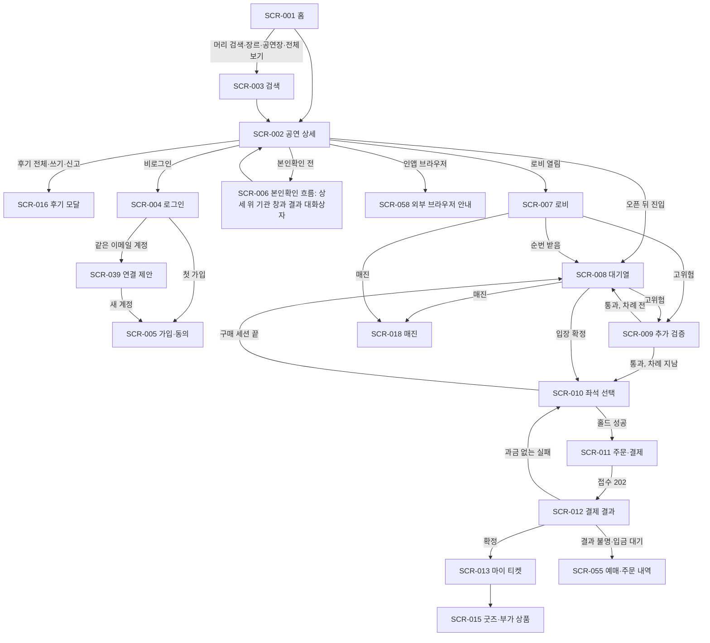
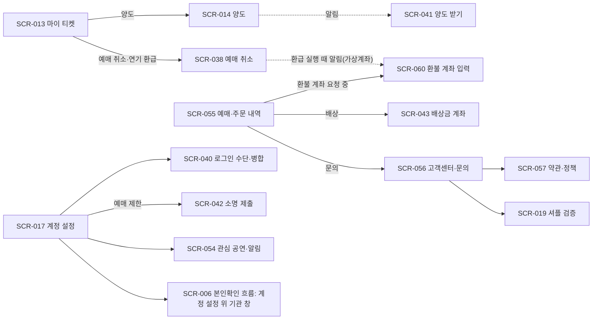
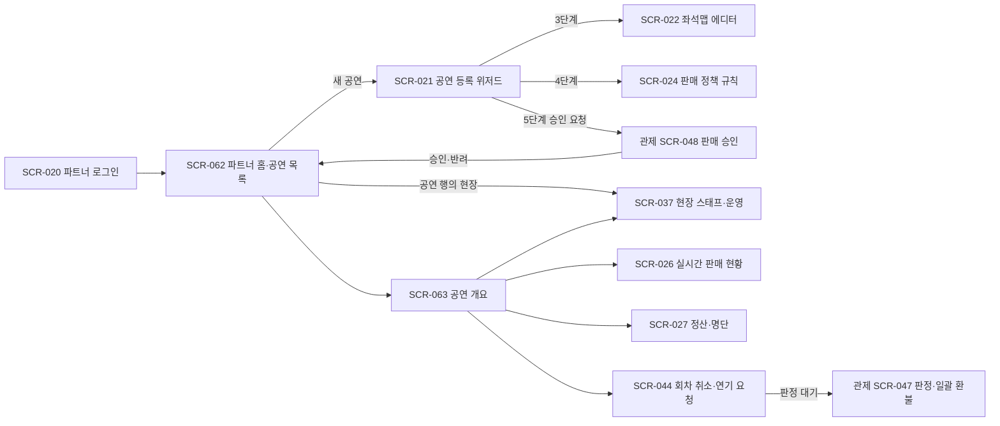
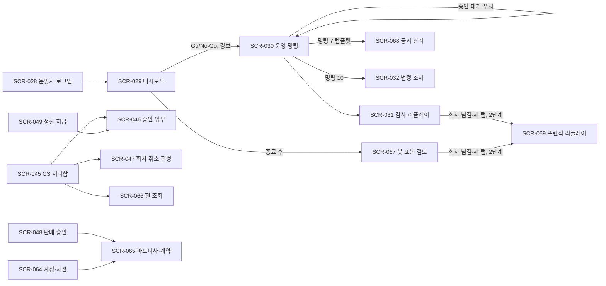
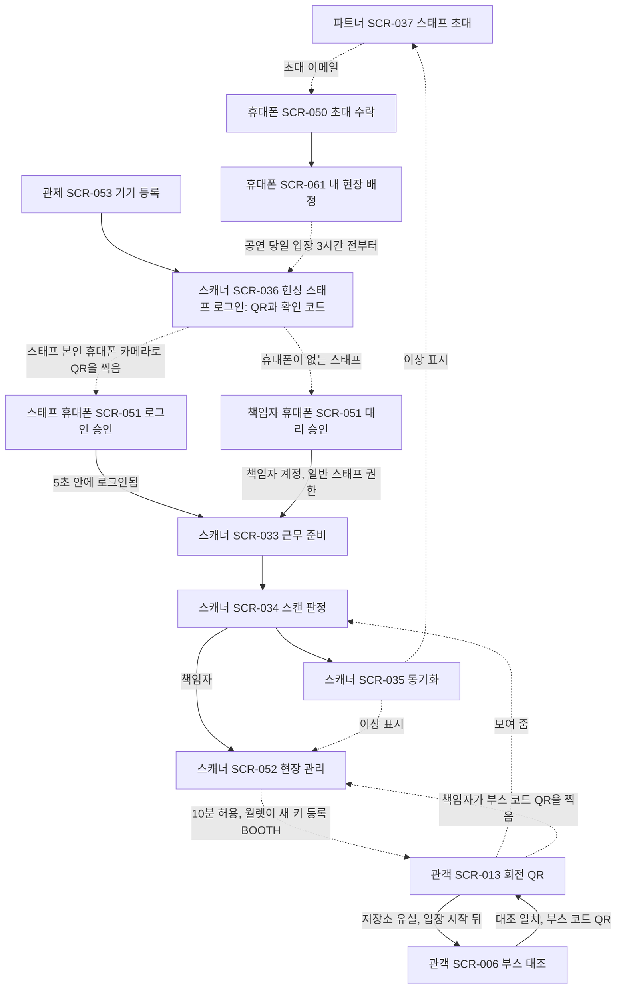

# D5. 전체 화면설계서(프로토타입 기준)

- **독자와 용도**: 프로토타입을 만드는 사람(제품 디자이너, 프론트엔드 엔지니어)이 화면을 어디에 놓고, 화면 사이를 어떻게 오가며, 어떤 상태를 어떤 순서로 보여 줄지를 한 문서에서 확인할 때 쓴다. 화면의 목적·요소·문구는 `planning/04-ia-flows-screens.md` §3이, 컴포넌트·상태 표현·접근성은 `design/d3-screens.md`가 정본이다. 이 문서는 두 정본을 배치도(와이어프레임), 앱 셸, 화면 흐름, 프로토타입 범위로 묶고, 2026-10-13 전수조사에서 찾은 빠진 화면을 더한다.
- **원문 출처**: planning/01~04, design/d1~d4·tokens.json, docs/features/*.md, docs/architecture.md §6, docs/api/openapi.yaml·asyncapi.yaml·guidelines.md, docs/security/data-classification.md, archive 원문 설계서 §3·§4·§6·§11. 조사 범위와 방법은 §1.1에 적었다.
- **기준 기획 버전**: v1.0.
- **갱신**: 2026-10-14 소유자 결정(질문 26, ADR-0060)을 반영했다. 정한 내용은 §11.1의 결정 열에 있다. 같은 날 P0 프로토타입(`prototype/`)을 만들며 찾은 것을 §10.7에 모으고, 예시 요일(10/14 수·10/25 일·10/26 월)과 현장 권한 시작 시각(13:30)을 고쳤으며, API·데이터 보완 24~31번을 §1.6에 더했다. 같은 날 미정 항목의 추천 적용(ADR-0062)을 해당 절과 §1.5·§11.2에 반영했다. 같은 날 밤 소유자가 화면 시안을 보고 요청한 개편 일곱 가지(홈의 NOL 구조, 공연 상세의 상세정보·관람 후기·안내 모달, 검색의 연관 검색어·페이지 번호, 본인확인 별도 화면 없앰, 외부 브라우저 안내의 Edge, 대기열 네 가지와 진행 막대, 좌석 확대 선택과 에디터 두 층)를 ADR-0063으로 §2·§3.1·§3.5·§4·§5.1~§5.3·§5.6·§5.8·§5.10·§5.16·§5.32·§6.5·§7.16·§11.1에 반영하고 새 컴포넌트 CMP-071~073을 더했다(§1.7). 2026-10-19 소유자가 디자인 캔버스를 보고 요청·질문한 12건(카드 아이콘 버튼, 후기 이름·사진·신고, 문의 화면, 시스템 안내의 다른 상태와 '서비스 상태' 링크, 현장 스태프 로그인, 좌석맵 에디터 네 단계와 템플릿, 현장 운영, 정산·명단과 상품 페이지, 웹훅의 목적, 파트너 설정 페이지)을 ADR-0066으로 §1.2·§1.6·§1.7·§2·§3.2·§3.7·§3.9·§4.1·§4.5·§5.1·§5.2·§5.15·§5.16·§5.27·§5.30·§5.33·§6.1·§6.5·§6.6·§6.8·§6.10·§6.11·§7.6·§8.1·§9.1·§11에 반영하고 새 컴포넌트 CMP-074~078을 더했다(§1.7). 새 화면은 없어 화면 수는 68개 그대로다.
- **표시 규칙**: 와이어프레임의 배치, 앱 셸, 새 화면(SCR-054~068), 새 컴포넌트(CMP-064~070), 프로토타입 범위는 원문에 없던 것이므로 전체가 [보완]이다. 표마다 [보완]을 되풀이하지 않는다. 시안이나 측정에서 정할 값만 [가정]으로 둔다. 와이어프레임과 목업 데이터에 나오는 공연명·금액·인원·시각은 화면을 그리기 위한 가상의 값이며 측정 결과가 아니다.

## 0. 이 문서의 위치와 읽는 법

### 0.1 세 문서의 역할

| 묻는 것 | 정본 | 이 문서가 더하는 것 |
| --- | --- | --- |
| 이 화면은 왜 있고 무엇을 보이며 어떤 문구를 쓰나 | planning/04 §3(구성 요소 ①②③, 상태, 표시 문구 초안) | 같은 번호 ①②③을 와이어프레임 위 자리에 붙인다 |
| 어떤 컴포넌트·variant로 그리고 상태·접근성을 어떻게 표현하나 | design/d3, design/d2 §2 | 상태 변형 표에 d3의 상태 이름을 그대로 쓴다 |
| 어디에 놓고, 어디서 와서 어디로 가며, 프로토타입에서 무엇을 먼저 만드나 | 이 문서 | 앱 셸(§3), 화면 흐름(§4), 와이어프레임(§5~§8), 알림(§9), 프로토타입 계획(§10) |

- 셋이 어긋나면 내용(요소·문구)은 planning/04, 표현(컴포넌트·상태·접근성)은 d3를 따르고 이 문서를 고친다. 화면별 상태 표에 없는 표준 상태(로딩, 빈 화면, 에러, 권한 없음)는 planning/04 §3 해당 행의 문구를 그대로 쓴다. 법정 고지 문안은 planning/03의 POL 원문을 한 글자도 바꾸지 않고 쓴다(design/d2 §4).
- d3 표의 '시안' 열은 이 문서의 해당 절(예: d5 §5.8)을 가리킨다. 그림 시안이 생기면 그 링크를 같은 칸에 더한다(design/d4 §3).

### 0.2 와이어프레임 기호

와이어프레임은 글자 폭이 다른 한글이 섞여도 어긋나지 않도록 오른쪽 테두리 없이 위에서 아래로 영역을 쌓아 그린다. 데스크톱 화면은 열 영역을 `[좌 4열]`처럼 이름 붙여 차례로 적는다.

| 기호 | 뜻 |
| --- | --- |
| `①` `②` … | planning/04 §3 그 화면 '구성 요소' 열의 번호. 번호가 없는 요소는 이 문서가 더한 것이다. 다만 2026-10-14 2차 점검에서 planning/04에 있는데 번호가 빠진 요소(SCR-020·023·024·025·027·037·054~063 등)를 찾았으므로, 번호가 없어도 planning/04 해당 행에 있으면 그 행이 정본이고 번호는 그림 시안 때 붙인다 |
| `[[ 이름 ]]` | 주 버튼(CMP-001 primary). 모바일 핵심 행동은 높이 44px |
| `[ 이름 ]` | 보조 버튼(secondary·ghost). 위험 행동은 `[! 이름 ]`(danger) |
| `( 이름 › )` | 다른 화면으로 가는 링크(CMP-002) |
| `{ 이름 }` | 입력 필드(CMP-004·005·006·007·008) |
| `◎` `☐` `▾` `⇄` | 라디오, 체크박스, 선택 상자, 토글 |
| `< 이름 >` | 배지·상태 표시 |
| `▣ 이름` | 카드·패널·위젯 |
| `! 문구` | 고지·경고 배너(CMP-017). 법정 고지는 `!법` |
| `── 하단 고정 ──` | 화면 아래에 붙는 영역(바텀 시트·고정 액션 바) |
| `→ SCR-0NN` | 누르면 가는 화면 |
| `…` | 같은 꼴의 항목이 반복된다 |

### 0.3 그린 크기와 셸

- 소비자 웹과 휴대폰 쪽 스태프 화면은 `sm 360`(모바일 우선)으로 그리고 `lg 1024` 이상에서 달라지는 점을 줄로 적는다.
- 파트너 콘솔과 관제 콘솔은 `lg 1280`(데스크톱 기본 밀도, design/d1 §4)으로 그리고 `xl 1440` 차이를 적는다. 휴대폰(`sm 360`)·태블릿(`md 768`) 배치와 휴대폰에서 하는 일의 범위는 §3.9에 모아 적는다(ADR-0061).
- 게이트 스캐너는 `sm 세로`로 그린다. 관리형 Android 단말 기준이다. 관리형 태블릿(`md 768` 세로)의 배치는 §3.4에 적는다(ADR-0061).
- 화면마다 첫 표에 쓰는 셸(§3)을 적는다. 셸이 그리는 머리·내비·바닥글은 와이어프레임에서 한 줄로 줄인다.

## 1. 전수조사 결과

### 1.1 범위와 방법

- **시점**: 2026-10-13. ADR-0058(같은 날 다른 세션이 반영, SCR-007 ⑨ 순번 공개 안내)까지 반영된 문서를 기준으로 했다.
- **읽은 문서**: planning/01~04, design/d1~d4·tokens.json, docs/features 9종과 README, docs/architecture.md §4·§6·§8·§9.4, docs/data.md, docs/observability.md, docs/devops.md, docs/verification.md, docs/perf-ledger.md, docs/security/data-classification.md와 asvs 추적 표, docs/api(openapi·asyncapi·guidelines), guide/ 16편, archive 원문 설계서 §3·§4·§6·§11·§19, 00-summary, review.
- **방법**: 문서 묶음 다섯 개를 나눠 각 문서가 묘사한 사용자 표면(화면, 하위 화면, 대화상자, 상태, 문구, 알림)을 모두 뽑고 SCR 53개와 대조했다. 맞는 SCR이 없으면 누락 후보로, 문서끼리 다르면 불일치로 모았다. 고치기 전에 정본(POL-004·018·019·020·024·032·037, control-tower §4, offline-gate §6.4, identity, planning/03 §2.1)을 다시 열어 확인했다.
- **외부 확인**: 카카오 로그인 디자인 가이드와 Google 로그인 브랜드 가이드라인 원문을 2026-10-13에 열어 확인했다. 네이버 로그인 버튼 사용 가이드(2025-11-25 개정본)는 2026-10-14에 원문을 확인했다(§5.4, §11.2 K1 해소).

### 1.2 결과 한눈에

| 항목 | 결과 |
| --- | --- |
| 기존 화면 | 53개(소비자 27 · 파트너 10 · 관제 11 · 스캐너 5) |
| 새 화면 | 15개(소비자 8 · 파트너 2 · 관제 5), 합계 68개 |
| 새 컴포넌트 | 7개(CMP-064~070), 합계 70개. 상태·변형을 더한 기존 컴포넌트 8개(CMP-009·015·017·019·028·036·049·059). 2026-10-14 2차 점검에서 11개에 변형·규칙을 더 더했다(§1.7 마지막 행). 그 뒤 화면 개편(ADR-0063)에서 CMP-071~073을, 2026-10-19 화면 피드백(ADR-0066)에서 CMP-074~078을 더해 지금 78개다(§1.7) |
| 기존 화면 보완 | 기존 53개 화면 모두에 요소·상태·문구를 더했다(§1.4, 화면별 상세는 §5~§8) |
| 문서 간 불일치 | 52건(같은 날 정합성 점검 세션이 찾은 6건 포함). 2026-10-14 추천 적용(ADR-0062) 반영 뒤 모두 고친 것 51건, 일부를 기록으로 남긴 것 1건(§1.5 46번의 다국어 문구 키, §1.6 14번) |
| API·데이터 보완 | 38건(§1.6. 15번은 ADR-0060, 16~23번은 2026-10-14 2차 점검, 24~31번은 같은 날 프로토타입 제작(§10.7), 32~37번은 같은 날 밤 화면 개편(ADR-0063), 38번은 2026-10-19 화면 피드백(ADR-0066)에서 더함). 6번은 openapi에 들어갔고, 3번과 16번의 다운로드 이력·판매자 정보 변경 요청은 2026-10-19에 들어갔다(ADR-0066) |
| 알림 | 34묶음을 받는 사람·채널·여는 화면과 함께 정리(§9.1. 34번째 묶음은 2026-10-19 문의·신고 알림, ADR-0066) |

### 1.3 새 화면

| SCR | 화면 | 앱 | 경로 | 왜 필요한가(근거) | 우선순위 |
| --- | --- | --- | --- | --- | --- |
| SCR-054 | 관심 공연·알림 신청 | 소비자 | `/my/likes` | 찜·오픈 알림·취소표 알림을 켜는 곳만 있고 모아 보고 끄는 곳이 없었다(FR-004·018·019) | P2 |
| SCR-055 | 예매·주문 내역 | 소비자 | `/my/orders`, `/my/orders/[orderId]` | 티켓이 없는 주문(실패·결과 불명·입금 대기)과 굿즈 주문, 예매 확인서 재열람, 취소·환불 진행이 갈 곳이 없었다(FR-053, POL-032, payment §4.2·§6) | P1 |
| SCR-056 | 고객센터·문의 | 소비자 | `/help`, `/help/inquiries/…` | CS 처리함에 '분쟁 접수'가 들어오는데 팬이 접수할 화면이 없었고, POL-004가 FAQ 두 문항을 요구한다(전자상거래법 §20③, FR-057) | P1 |
| SCR-057 | 약관·정책 문서 | 소비자 | `/policy/[slug]` | 분쟁 해결 기준 게시(FR-053), 처리방침의 자동화된 결정(POL-006) 등 법정 게시물이 '정적 문서'로만 있었다 | P1 |
| SCR-058 | 외부 브라우저 전환 안내 | 소비자 | 끼어드는 화면 | 인앱 브라우저는 상세까지만 지원한다는 규칙(design/d1 §4, NFR-019)의 화면이 없었다 | P1 |
| SCR-059 | 시스템 안내 화면 | 네 앱 | 404·500·429·판매 일시 중단·오프라인·미지원 | 일반 오류 화면(ASVS 16.5.1), 리전 장애 판매 중단 안내(infra §6), PWA 오프라인 대체 화면이 없었다 | P1 |
| SCR-060 | 환불 계좌 입력(지연 환급) | 소비자 | `/my/refunds/[refundId]/account` | 지연 환급 때 알림으로 계좌를 다시 받는다는 규칙(ADR-0050, POL-014)의 화면이 없었다 | P1 |
| SCR-061 | 내 현장 배정 | 소비자(스태프) | `/staff` | 권한 매트릭스의 '본인 배정 내역 조회'를 볼 곳이 없었다 | P2 |
| SCR-062 | 파트너 홈·공연 목록 | 파트너 | `/events` | IA에 경로만 있고 화면이 없었고, 판매 승인 상태·반려 사유를 볼 곳이 없었다(FR-052) | P0 |
| SCR-063 | 공연 개요(회차 허브) | 파트너 | `/events/[id]` | 공연 하위 경로가 일곱 개인데 공연의 첫 화면이 없었다 | P1 |
| SCR-064 | 관리 계정·세션 관리 | 관제 | `/accounts` | IA가 'SCR-017 관리자 보기'로만 적었고 정의가 없었다. 초대·잠금 해제·강제 종료·역할 부여(FR-021, planning/03 §2.7·§3) | P1 |
| SCR-065 | 파트너사·계약 관리 | 관제 | `/partners` | 계약 중개수수료율·보증·결제사 등록 상태를 입력·조회하는 곳이 없었다(settlement §4.1, transfer-refund §6) | P2 |
| SCR-066 | 팬 조회 | 관제 | `/customers` | CS의 주문·티켓·양도·병합 이력 조회 권한(planning/03 §3)을 쓸 화면이 없었다 | P1 |
| SCR-067 | 봇 판정 표본 검토 | 관제 | `/bot-review` | 통과 세션 표본의 수동 검토(FR-049)를 하는 화면이 없었다 | P2 |
| SCR-068 | 공지 관리 | 관제 | `/notices` | 대기실 공지 템플릿(명령 7, POL-021)과 파트너 긴급 공지(POL-022)를 쓰고 승인할 곳이 없었다 | P2 |

### 1.4 기존 화면에 더한 것

화면별 배치와 상태는 §5~§8에 그렸다. 아래는 무엇을 더했는지만 모은 목록이다. planning/04 §3의 해당 행에도 같은 요소를 더했다.

| SCR | 더한 요소·상태(요약) | 근거 |
| --- | --- | --- |
| 001 | 알림 권한 안내 시트 | NFR-019 |
| 002 | 회차 선택, 찜·공유, 정렬 방식별 고지, 판매 조건의 양도 마감·공제 고지, ⑦ 버튼 상태표(로비·사전 확인·오픈 뒤·혼잡·다른 기기·예매 제한·판매 종료·비공개. 처음 더한 '로비 마감'은 ADR-0064로 없앰) | FR-019·052, POL-004·017·032, queue-admission §3 |
| 003 | 최근 검색어 | 원문 §11 |
| 004 | 제공자 가이드 버튼, 제공자별 장애, 세션 종료 사유 안내 | 카카오·Google 가이드, identity §10, asyncapi SessionTerminated |
| 005 | 처리방침 링크, 만 14세 미만 차단 | 원문 §6, POL-023 |
| 006 | 목적별 문구(최초·재확인·부스 대조), 창 닫음, 부스 대조 409·422(하루 한도 429는 SCR-013의 부스 요청) | openapi booth-reverifications |
| 007 | POL-004 표준 문구, 순번 공개 대기·순서 계산 중·발표 지연·비상 처리 공지, 다른 기기 409, 차례 알림 받기 | POL-004, ADR-0058, queue-admission §2 |
| 008 | 묶음 처리, 일시정지, 로그인 만료, 대기 취소 확인, 차례 도래 15분 유예, invalid·ended, FIFO 대기실의 법정 고지 | FR-006·008, ADR-0055·0056, POL-004·024 |
| 009 | 재검토 결과(인정·기각), 통과 뒤 분기 | F-06, POL-006 |
| 010 | 등급 칩·연석 찾기·좌석 정보, 예매 그만두기, 판매 일시정지, 무활동 경고·구매 세션 끝, 다중 탭 401, 연장 뒤 상태, 자동 배정 결과 유형 | 원문 §11, 명령 9, POL-009, seat-hold §5 |
| 011 | 결제 직전 판매 조건 동의, 제3자 제공 5항목, 결제창 복귀 처리, 결제 일시 정지·판매 일시정지·결제창 단계 실패 3회 초과·다른 탭, 결제창 연 뒤 홀드 만료 계속 | POL-004·012·013, payment §2.1 |
| 012 | 예매번호, 실패 범주별 문구, 결과 불명 1시간, 자동 취소, 가상계좌 입금 대기 | payment §3·§6, F-03 |
| 013 | 예매번호, 연동 부가 상품, 티켓 상태 여섯(공연 취소·일정 변경·입장함·퇴장함·취소 무효·회수됨), 재발급 한도, 돌려주기 확인, 인앱 브라우저 | planning/03 §2.5, FR-014, offline-gate §4 |
| 014 | 양도 마감 문구 정정, 재인증 만료, 철회 409 | FR-013, ADR-0051 |
| 015 | 상품의 판매자 고지, 배송지, 인기 MD 대기열 경로 | POL-037, 원문 §6 |
| 016 | 노출 차단·같은 내용 자동 숨김 표시 | POL-024 마목 |
| 017 | 프로필(닉네임·회원 코드·연락처·저장된 예매자 정보), 스캐너 세션 안내, 예매 제한, 탈퇴 완료 | planning/04 SCR-014 ③, POL-017·019 |
| 018 | 닫힘(PREQUEUE_SHUFFLE 오픈 뒤 도착) 변형. ADR-0064로 없앰(사전 셔플 공연도 오픈 뒤 진입을 받음) | POL-003, F-02 K |
| 019 | 동시 도착 묶음 공개, 참가 토큰 해시 자동 채우기 | queue-admission §3 |
| 020 | 내 계정(비밀번호·TOTP·패스키·복구 코드·기기), 판매자 정보와 변경 재승인, 초대 만료, 비밀번호 규칙 정정 | POL-020·039, NFR-016 |
| 021 | 5단계 정리, 1단계 필드(설명·이미지·장르·전산망 항목), 회차 시각 필드, 가상계좌 허용, 정비 창·반려·재승인 상태, 셀러 상태 | 원문 §11, data.md `event`, POL-041, FR-052 |
| 022 | 휠체어석 기준 검사, 내보내기, 용량·예상 매출 요약 | FR-023 |
| 023 | 굿즈 주문 현황 탭 | planning/03 §3 |
| 024 | 상한 위반 안내 | POL-032·017 |
| 025 | 이전 비밀 24시간 유효 표시, 다시 보내기 | ADR-0053 |
| 026 | SSE 정정, '잠정' 표시, Last-Event-ID 복구 | ADR-0027, analytics §8.1 |
| 027 | 탭 구성, 이의 대화상자·재통지, 보류·지급 실패 안내, 판매 요약 R3 전 상태 | settlement §4.2, analytics §8.4 |
| 028 | 초대 수락·복구 코드·내 계정, 인증 문구 정정, 반복 실패·유휴 만료 | POL-019·020 |
| 029 | T-30분 점검 최신 항목, Go/No-Go 판정 대화상자, '잠정', Degraded 후보 팝업, 리포트 판 목록·결정 기록 목록, 입장 탭 지표 보강 | control-tower §2, ADR-0049·0058, analytics §4.2 |
| 030 | 명령별 파라미터 표, 적용 중 명령·내 승인 대기, 잠금·접속자 표시, 상태 전체, 보조 대화상자, 문구 정정 | control-tower §3·§4·§12 |
| 031 | 행위자 구분, 감사 체인 검증, 명단 다운로드 기록, 공개 앵커 상태와 검증 묶음 내보내기(ADR-0075) | control-tower §5·§7 |
| 032 | 10시간 기한, 같은 내용 차단 목록, 자료 제출 commander 승인, 보안 사고 판단·기록 필드, 점검 이상 건의 보안 사고 등록 | POL-024, FR-063·064 |
| 033 | 새 버전 적용, 인증서 경고, 목록 받기 제한 | offline-gate §6 |
| 034 | 판정 순서 10단계 전체, 예외 통과 사유·메모, 세션 끝 | offline-gate §6.4·§9.1 |
| 035 | 해제 뒤 업로드 안내 | offline-gate §6.5 |
| 036 | 세션 끝 사유 네 가지, 코드 발급 한도 | POL-031, identity |
| 037 | 동기화 경보 배너, 준비 점검, 미보고 기기, 이상 표시 종류 전체 | offline-gate §0·§5·§7 |
| 038 | 연기 환급 모드, 환급 시점 정정, 취소 처리 중·취소 무효 | POL-032, FR-055 |
| 039 | 연결 성공 문구, 남은 시도, 만료 문구 정정 | identity §2.1 |
| 040 | 병합 불가 사유 전체, 흡수된 세션 안내, 제안 만료 | POL-034 |
| 041 | 키 생성은 등록 버튼으로(수락 뒤 단계), 입장 중 409 | POL-018, ADR-0051 |
| 042·043 | 결과·이미 지급 상태 | FR-056·061 |
| 044 | 반려, 연기 환급 신청 현황, 배상 합계 | planning/03 §2.11 |
| 045 | 건 종류 전체, 추가 검증 이의 심사, 예매 제한 목록 | POL-006·038, FR-054 |
| 046 | 회수 조건 표시, 90일 두 번째 자동 판정, 기본 환불과 면제분 구분 | transfer-refund §3·§4 |
| 047 | 반려·연기 처리, 통지 문안 미리보기, 감속 표시 | planning/03 §2.11 |
| 048 | 공연 규모 지정, 등록 상태, KYC 안내 | POL-030, settlement §3 |
| 049 | 정산서 상세·지급 건, 예약지급 취소, 수기 조정 진입 | settlement §5 |
| 050·051 | 검증 이메일 없음·이미 배정·동의 누락 / 대리 승인 권한·거부 | identity §6.1 |
| 052·053 | 준비 점검·본인확인 장애 안내 / 회수 기기 재등록·퇴역 | offline-gate §6.5·§9, RB-22 |

### 1.5 문서 간 불일치와 처리

'고침'은 이번에 화면 문서(planning/04·design/d3·d2)를 정본에 맞춘 것이고, '기록'은 정본 쪽이 정해지지 않았거나 요구사항·정책 문장이라 §11에 올린 것이다.

| # | 무엇 | 어긋난 곳 | 정본·근거 | 처리 |
| --- | --- | --- | --- | --- |
| 1 | 2인 승인 대기 시간 | planning/04 F-05 '5분' | control-tower §4 10분(추천 적용 2026-10-09) | 고침 |
| 2 | 되돌리기 시간 제한 | SCR-030 ⑧·F-05 '10분 이내' | control-tower §4·POL-021(제한 없음, 만료 있는 명령은 자동 만료) | 고침 |
| 3 | 양도 마감 | SCR-014 ①·문구·F-08 B '공연 시작 2시간 전' | FR-013·POL-017 '2시간 전과 입장 시작 중 이른 때' | 고침 |
| 4 | 입장 시작 뒤 취소의 환급 시점 | SCR-038 ④ '공연 종료 후' | POL-032 '입장 기록 마감 뒤' | 고침 |
| 5 | 양도 수락 때 키 생성 | SCR-041 ③·F-08 I, FR-013·POL-017, openapi accept(publicKeyJwk 필수), transfer-refund §4, offline-gate §5, planning/03 §2.5, d3 SCR-041 | POL-018·ADR-0051 '키는 등록 버튼으로만' | 고침(화면 문서는 2026-10-13, 정본은 2026-10-14 2차 점검. 추천 적용) |
| 6 | 형사처벌 고지 문안 | SCR-002 문구 | POL-024 라목 원문(design/d2 §4는 한 글자도 바꾸지 말라고 함) | 고침. 부정판매·과징금 문안은 POL-024 라목을 바꿔 반영(K2 해소, 추천 적용 2026-10-14, ADR-0062) |
| 7 | 게시물 노출 제한 고지 | SCR-016 문구 | POL-024 다목 | 고침. POL-024 다목을 2호 다목 범위로 바꾸고 FR-016은 다목을 가리키게 함(K3 해소, 추천 적용 2026-10-14, ADR-0062) |
| 8 | 대기실 정렬 방식 고지 | SCR-007 ③(다른 문장) | POL-004 '같은 표준 문구' | 고침(표준 문구 추가, 기존 문장은 보조) |
| 9 | 이의 기각 결과 | F-06 M '영구 차단' | POL-006(페널티 아님), planning/03 §2.1(그 대기 참여만 무효) | 고침 |
| 10 | 팬 재인증 | SCR-017 '재인증 비밀번호' | FR-001(팬은 비밀번호 없음) | 고침 |
| 11 | 관리 계정 인증·재인증 | SCR-028 '하드웨어 보안키', SCR-030 ⑤ '생체', F-05 E '생체'(2026-10-14 2차 점검에서 고침) | POL-020(TOTP 필수, 패스키 보조), control-tower §10(5분 재인증 토큰) | 고침 |
| 12 | 관리자 비밀번호 규칙 | SCR-020 '복합 규칙' | POL-020 '문자 조합 강제 배제' | 고침 |
| 13 | 위저드 단계 수 | SCR-021 '4단계'(같은 행에 5단계) | settlement·planning/04 IA 5단계 | 고침 |
| 14 | 파트너 실시간 전송 | SCR-026 'WebSocket' | ADR-0027·control-tower §11 SSE | 고침(planning/04, d3) |
| 15 | 결과 불명 알림 채널 | d3 SCR-012 '알림톡' | payment §4.2 이메일·푸시 | 고침 |
| 16 | QR 시각 초과 문구 | SCR-034 '오래된 QR입니다' | offline-gate §6.4 '유효시간이 지난 QR' | 고침 |
| 17 | 입장 판정 순서 | F-04(구역 검사 먼저, 사유 넷 빠짐) | offline-gate §6.4 10단계 | 고침(F-04 다시 그림) |
| 18 | 소셜 로그인 버튼 | d3 SCR-004 'secondary 변형', planning/04 '카카오로 계속하기' | 카카오·Google 가이드(2026-10-13 확인) | 고침(네이버는 2026-10-14 K1 해소: 흰 바탕 세트, ADR-0062) |
| 19 | CS 처리함 건 종류 | SCR-045 14종, FR-057 8종, 용어 사전 7종, openapi CsCase 16종 | 문서 전체에 나오는 23종 | SCR-045는 고침. 2026-10-14 2차 점검에서 openapi·data에 2종(VERIFICATION_APPEAL, APPROVAL_EXECUTION_FAILED)을 더하고 §7.6에 API 종류를 붙임. FR-057·용어 사전은 대표 종류로 둠 |
| 20 | T-30분 점검 항목 | SCR-029 ① | control-tower §2(CDN 배포 한도, 진행 중 배포, 동결 창, 유지보수, 온콜 시험) | 고침 |
| 21 | 컴포넌트 상태 이름 | d3가 쓰는 CMP-017 'announcement'가 d2에 없음, CMP-015·028·036·049·059 상태 누락 | planning/03 §2 상태 정의 | 고침(design/d2) |
| 22 | 좌석 흔들림 시간 | d3 SCR-010 '320ms' | tokens.json `motion.seat-shake` 300ms | 고침(토큰 이름만 쓰게) |
| 23 | 연결 제안 실패 결과 | SCR-039 '3회 실패 시 세션 만료' | identity §2.1 '제안 만료' | 고침 |
| 24 | 결제 중 홀드 만료 | SCR-011 '좌석 선택으로 유도'만 | POL-012(결제창을 연 뒤에는 계속, 좌석이 남아 있으면 확정) | 고침 |
| 25 | 결제 직전 동의 | SCR-011 ④ 재고지만 | POL-004 '결제 직전 동의를 받는다' | 고침 |
| 26 | 처리방침 링크 | SCR-005 없음 | 원문 §6 '가입 화면에서 연결' | 고침 |
| 27 | `/accounts` 화면 | IA 'SCR-017 관리자 보기' | 정의 없음 | 고침(SCR-064) |
| 28 | 로비 개방 시각 | SCR-007 'T-10분' 고정 | queue-admission §9(공연별 설정, 기본 10분) | 고침 |
| 29 | 기기 변경 정책 | F-02 H '기존 기기에서 계속' | FR-007·POL-002 '취소하고 새 순번'. API는 409만 | 기록(D1) → 고침(ADR-0060: FR-007·POL-002대로, 로비 참가 취소 API 추가) |
| 30 | 재진입 | FR-008 '재진입 안내' | data.md `q:dup` 중복 확인 키가 온세일 끝까지 남음 | 자진 취소 뒤 다시 참가는 고침(ADR-0060 결정 1, 취소 때 키 삭제). 만료 뒤 재진입도 고침(추천 적용 2026-10-14, ADR-0062: 410 때 키 삭제, 맨 뒤, 입장한 사람·사전 셔플 제외). 사전 셔플 제외는 없앰(추천 적용 2026-10-14, ADR-0064), 판매 종료 뒤에는 다시 줄 서기 없음 |
| 31 | 추가 검증 통과자 입장 | SCR-009 '원래 순번 보장' | queue-admission 입장 확정의 빠진 번호 검사 | 고침(추천 적용 2026-10-14, ADR-0062, queue-admission §7 격리 기록과 복귀) |
| 32 | 중간 상태 문구 | '순서 계산 중'(로비 셔플), '순서를 정하는 중'(동시 도착 묶음), queue-admission §3 '순서를 확정하는 중' | FR-006·POL-004 | 화면은 앞의 둘로 나눠 씀. queue-admission §3 문구도 '순서를 정하는 중'으로 고침(2026-10-14) |
| 33 | 기판매 실패 문구 | SCR-012 '이미 판매되어' | payment §4 '이미 홀드되어' | 화면 문구 유지, payment §4 문구를 화면 문구로 고침(2026-10-14) |
| 34 | 본인확인 장애·환불 지연 문구 | SCR-006·038 | identity §10·payment §4.1 다른 표현 | 화면 문구 유지. 기능 문서는 동작을, 화면 문구는 planning/04·이 문서가 정본이라 둘을 맞추지 않아도 된다(2026-10-14 정리) |
| 35 | 신고 누리집 운영 주체 | CMP-048·FR-016 문화체육관광부 | POL-024 한국콘텐츠진흥원 | 고침(K4 해소: 누리집 이름·주소와 공연 분야 신고기관으로 표기, 추천 적용 2026-10-14, ADR-0062) |
| 36 | 추가 검증 고지 | SCR-009 '한 번 더 확인합니다' | design/d2 §4 '추가 검증을 진행합니다' | 고침(2026-10-14 2차 점검: d2 §4를 planning/04 문구로, d4 #11은 필수 내용 확인으로) |
| 37 | 탈퇴 경고 | SCR-017·POL-033 '먼저 양도하세요' | POL-017 받은 티켓은 재양도 불가 | 고침(2026-10-14 추천 적용, ADR-0062, K9, planning/03 §1.5) |
| 38 | 상태도 없음 | 주문 '입금 대기', 판매 승인 | payment §6, data.md `sale_review` | 고침(추천 적용 2026-10-14, ADR-0062, planning/03 §2.4·§2.14) |
| 39 | 홀드 연장 방식 | ADR-0014 결정 1 '결제 진입 시 3분 연장'(00-summary 질문 11은 이미 '사용자 1회 연장') | POL-012·seat-hold §5 사용자 1회 3분 | 고침(2026-10-14 2차 점검: ADR-0014 상태 줄) |
| 40 | 운영 명령 세부 | 명령 2·3·11 | 명령 4의 2인 기준과 명령 11 재개 2인은 2026-10-13 추천 적용으로 정함. 남은 것은 명령 2의 10분 뒤 동작(재확인 대 자동 만료), 명령 3의 적용 범위, 명령 11의 사후 검토 항목 | 고침(2026-10-14 추천 적용, ADR-0062, K10) |
| 41 | 결제사 지정 | SCR-048 확인 항목 | 지정 행위는 명령 12, 승인 전 주체 없음 | 고침(추천 적용 2026-10-14, ADR-0062, K11) |
| 42 | 퍼널 단계 이름 | SCR-029 ③, control-tower §2 | analytics 지표 사전 F3 | 고침(2026-10-14 2차 점검: planning/04·control-tower를 F3 단계 이름으로) |
| 43 | 양도 회수 시한 | transfer-refund §3.1 대 §3.2, POL-038 ③ '공연 시작 전' | ADR-0051 결정 10 '입장 시작 전' | 고침(2026-10-14 2차 점검) |
| 44 | 판매 승인 확인 항목 수 | transfer-refund §2.1 4개 | planning/04·settlement 5개 | 고침(2026-10-13 전수 점검에서 transfer-refund를 5개로) |
| 45 | 화면 시각 규칙 | asvs/delivery 16.2.2 KST | NFR-024 병기 | 기록(D4) → 고침(ADR-0060: 팬 화면 NFR-024, 콘솔 KST, 로그 UTC) |
| 46 | 오류 `type` 목록 | docs/api/guidelines.md §2(`seat-already-held`는 예시) | guidelines §2의 이름 규칙: 대문자 별칭의 케밥 표기(openapi에는 `manual-selection-required` 등) | type은 이름 규칙으로 정함(2026-10-14 2차 점검). 다국어 문구 키는 기록(§1.6 14번) |
| 47 | 연결 제안 실패 횟수 | F-11 '3회 이하 → 다시, 3회 초과 → 끝' | planning/03 §2.8·POL-034 '세 번째 실패에서 제안 파기' | 고침 |
| 48 | 병합을 막는 사유 | SCR-040 ⑤ 두 가지, F-11 세 가지 | POL-034 네 범주 | 고침 |
| 49 | 동시 입장 목표의 안전 한계 | SCR-030 안전 한계 1,000~8,000 | 포트원 공연 상한(약 830)이 하한보다 낮다. 상한은 8,000과 결제사 상한 중 낮은 값, 하한은 1,000과 결제사 상한의 절반 중 낮은 값 [가정](POL-021·control-tower §6, 같은 날 추천 적용) | 고침 |
| 50 | 양도 받는 사람 확인 | SCR-014 ④ '회원 검색' | openapi `POST /v1/transfer-recipient-lookups`(닉네임 일부와 참조값, 같은 날 추가) | 고침 |
| 51 | 관련 ID 누락 | SCR-020(POL-019), SCR-014(FR-060), SCR-034(FR-046), SCR-045(FR-020·054·066, POL-006), SCR-052(FR-036) | review §2 추적표 대조 | 고침 |
| 52 | 기준선 판정 문단의 숫자 | planning/04 §4 '가정 값 0개', '확인 필요 0·해석 5' | 판정 당시 숫자. 지금(2026-10-13 전수 점검 뒤)은 POL-027 확인 필요 4·해석 14·간주 6·추정 4 | 고침(판정 당시로 한정하고 현재 수를 덧붙임) |

### 1.6 API·데이터 보완이 필요한 것

화면이 부르는 동작 중 docs/api/openapi.yaml에 없는 것이다. 이번에는 API 문서를 고치지 않았고(2026-10-14 ADR-0060으로 6번만 openapi에 더함), API 설계 때 이 표를 쓴다. 16번부터는 2026-10-14 2차 점검에서, 24번부터는 같은 날 프로토타입을 만들며(§10.7), 32번부터는 같은 날 밤 화면 개편(ADR-0063)에서, 38번은 2026-10-19 화면 피드백(ADR-0066)에서 더했다. 2026-10-19에는 3번 전부와 16번의 다운로드 이력·판매자 정보 변경 요청을 openapi에 넣었다(ADR-0066).

| # | 필요한 것 | 쓰는 화면 |
| --- | --- | --- |
| 1 | 찜 목록 조회, 알림 구독 목록·해제, 취소표 알림 구독 | SCR-018, 054 |
| 2 | 주문 목록·상세 조회(티켓·굿즈), 굿즈 주문 취소·반품, 굿즈 결제의 에스크로 상점 구분, 배송 정보 등록, 구매 확정 상태 조회 | SCR-012, 055 |
| 3 | 문의 접수·목록·상세(팬)와 문의를 분쟁 접수 건(CsCase `DISPUTE`)으로 잇는 것. CS 처리 쪽은 `GET /v1/ops/cases`·`PATCH /v1/ops/cases/{caseId}`로 된다. 해소(추천 적용 2026-10-19, ADR-0066): 팬 `POST /v1/inquiries`·`GET /v1/inquiries`·`GET /v1/inquiries/{inquiryId}`·`POST /v1/inquiries/{inquiryId}/messages`(추가 문의)와 운영자 답변·진행 경과 `POST /v1/ops/cases/{caseId}/replies`를 openapi에 더했다. 문의는 core-svc의 새 support 모듈이 갖고 CS 처리함 건(`INQUIRY`, 분쟁 유형은 지금처럼 `DISPUTE`)과 잇는다 | SCR-056, 045 |
| 4 | 지연 환급 계좌 입력 | SCR-060 |
| 5 | 초대 거절, 내 배정 목록 | SCR-050, 061 |
| 6 | 로비 참가 취소(ADR-0060 D1, 2026-10-14 openapi에 더함) | SCR-007·008 |
| 7 | 진입 410의 사유 코드(매진·판매 종료). 해소(추천 적용 2026-10-14, ADR-0064): 사전 셔플 공연의 '닫힌 판매'는 없어졌고, 판매 종료는 openapi 진입·입장 확정·홀드·주문·취소표 알림 신청 410의 Problem type `sale-ended`, 매진은 엣지 정적 응답이다. 대기 상태 파일 `saleStatus`에 `ENDED`를 더했다 | SCR-008, 018 |
| 8 | 관리 계정 초대·역할·잠금 해제·강제 종료·지정(identity §11은 '관리 API 없음'), 관리 계정 초대 수락, 비밀번호·TOTP·패스키·복구 코드 변경, 내 세션 목록·종료 | SCR-064, 028 |
| 9 | 파트너사 계약·수수료율·보증 | SCR-065 |
| 10 | 팬 조회(가림·열람 사유 기록) | SCR-066 |
| 11 | 봇 표본 검토 기록 | SCR-067 |
| 12 | 공지 템플릿·파트너 긴급 공지(파트너 긴급 공지는 제목·말머리·본문) | SCR-068 |
| 13 | Go/No-Go 판정 기록(control-tower §13은 API 없음) | SCR-029 |
| 14 | 다국어 문구 키(오류 `type`은 guidelines §2 이름 규칙으로 정한다) | 모든 화면(§9.2) |
| 15 | 구매 세션 유휴 연장(무활동 경고의 [ 계속하기 ], ADR-0060 D7, 2026-10-14 추가) | SCR-010 |
| 16 | 파트너 공연 목록·할 일, 공연 개요, 등록 임시저장·수정, 공연 이미지 올리기·지우기(한 장씩, 파생본 주소), 좌석맵 저장·내보내기, 상품 목록·굿즈 주문 현황, 파트너 배송·반품 처리(송장, 도착 확인·거절, 현장 수령, 배송 명단 내려받기), 웹훅 조회·비밀 재발급·발송 이력·다시 보내기, 명단 조회·다운로드 이력·정산 리포트 내보내기, 회차 취소 요청 상태 조회, 판매자 정보 변경 요청, 현장 현황의 스태프 로그인 표시(목록은 guidelines §3 커서 페이징). 이 가운데 다운로드 이력(`GET /v1/partner/events/{eventId}/attendee-exports`)과 판매자 정보 보기·변경 요청(`GET /v1/partner/seller-profile`, `POST /v1/partner/seller-profile/change-requests`)은 해소(추천 적용 2026-10-19, ADR-0066) | SCR-062, 063, 021, 022, 023, 025, 027, 044, 020, 037 |
| 17 | 같은 주문의 여러 티켓 일괄 취소(티켓 ID 목록, 재인증 1회, 티켓별 결과. 지금 API는 티켓마다 따로 부르고 재인증 토큰은 1회용) | SCR-038 |
| 18 | 후기 수정·삭제와 내 차단 글 조회, 프로필·동의 변경, 휴대폰 쪽 스캐너 세션 목록·종료, 소명 건 조회, 배상 건 조회, 찜 해제 | SCR-016, 017, 042, 043, 054 |
| 19 | 구매 세션 나가기(LEFT, 입장 자리를 바로 비움) | SCR-010 |
| 20 | 대기 상태 파일의 잔여 좌석 수(근사)·평균 구매 매수(④ 조건부 경고)와 입장 일시정지(명령 2) 표시 | SCR-008 |
| 21 | 공연 목록·상세·검색·연관 검색어, 가입 완료(동의·만 14세·닉네임), 닉네임 중복 검사, 예매 제한 상태 조회(웹 서버 내부 경로로 둘지 공개 API로 둘지 함께 정한다) | SCR-001~005 |
| 22 | 스캐너 기기 배정 변경, 회수 기기 재등록, 퇴역(RETIRED) 처리 | SCR-053 |
| 23 | 추가 검증 이의 심사 기록(인정·기각, data.md `verification_case.appeal_result`) | SCR-045 |
| 24 | 재인증 토큰 받기(팬은 소셜 제공자로 다시 로그인한 뒤, 관리 계정은 비밀번호와 TOTP를 다시 넣은 뒤)와 관리 계정·스캐너 로그아웃(세션 종료). openapi에는 보내는 헤더 `X-Reauth-Token`(guidelines §7)만 있고 받는 경로가 없다 | SCR-013·014·017·038·040, SCR-020·028·030·046·064, SCR-036 |
| 25 | 티켓 목록 응답(`Ticket`)의 화면 표시 값: 공연명·장소·시작·입장 시작 시각, 받은 티켓의 보낸 분 닉네임, 예매번호, 입장 시각 | SCR-013 |
| 26 | 홀드 다시 읽기(새로고침, 좌석 ↔ 결제 왕복 때 좌석 이름·등급·서버 계산 금액). `Hold` 응답에 좌석 이름과 금액이 없다 | SCR-010·011 |
| 27 | 차례 도래 시각(유예 마감). 입장 확정 응답과 대기 상태 파일에 없어 '차례 도래 유예'의 남은 시간을 계산할 수 없다 | SCR-008 |
| 28 | 스캐너 응답 값: 토큰 발급 200 본문, `DeviceApprovalView`의 권한 없음 사유·배정 공연명·시작 시각, `ScannerShift`의 세션 ID·닉네임·권한 끝 시각·공연명. 기기 승인 흐름(RFC 8628)의 `error` 값을 problem+json(guidelines §2)에 싣는 규칙 | SCR-036·051·033 |
| 29 | 이상 표시 종류 '시각 불확실'(offline-gate §7.1, §8.5 ③)이 `GateFlag.kind`에 없다 | SCR-052·037 |
| 30 | 운영 명령: 판매 승인 approve 본문(공연 규모. 2026-10-14 추천 적용으로 openapi에 `scale`을 더한다, ADR-0062), 되돌리기 본문(사유)과 명령 3·11 재개의 2인 흐름, 실행 전 dry-run 미리보기, 전파 ack 실패 뒤 다시 보내기 | SCR-030·048 |
| 31 | 판매 승인의 단위와 판매자 값: data.md에 공연(회차 묶음) 엔터티가 없어 `event`(회차) 행이 `sale_review`를 갖는데 SCR-062·048과 openapi는 공연 단위로 승인한다(`{eventId}`가 회차인지 공연인지 모호). openapi `SellerInfo`는 신고번호와 `exemptionBasis`를 나누지만 data.md `promoter.mail_order_report_no`는 한 칸이다. 판매 승인 요청은 매번 `payoutAccount`를 요구하지만 지급대행 등록과 셀러 상태는 파트너사 단위다(POL-039 ①, settlement §3, data.md `promoter`). 판매 승인 변경 취소(재승인 대기·변경 반려를 마지막 승인 내용으로 되돌림) API도 없다. | SCR-021·048·062 |
| 32 | 좌석맵 도형과 좌표(ADR-0063): `venue`의 캔버스 크기·무대 도형, `section`의 도형(공연장 좌표계 다각형)·라벨 위치·등급, `seat`의 x·y(공연장 좌표계). 좌석맵 정적 파일(CDN)에 구역 도형과 좌석 좌표를 함께 싣는 형식, 에디터 가져오기·내보내기(SVG·JSON·CSV)의 도형 포함 형식 | SCR-010, 022 |
| 33 | 구역별 잔여 상태 집계(전체 배치의 '많음·적음·매진' 색칠용). 해소(추천 적용 2026-10-14, ADR-0063): 좌석이 보이지 않는 구역은 구독하지 않고 5초 [가정]마다 다시 받는 구역 요약 스냅샷(스냅샷 비트맵을 좌석맵 파일의 구역 인덱스 범위로 센다)으로 갱신한다(docs/features/seat-hold §7 '구독 범위'). 구간 경계는 [가정] | SCR-010 |
| 34 | 관람 후기(ADR-0063, POL-042): 쓰기 자격 확인(회차·결제자·종료 예정 시각, 자격 없음 사유 코드), 회차당 하나(두 번째는 409), 공연 단위 목록(정렬 최신·별점 높은·낮은 순, '더 보기' 커서, 평균 별점·수), 응답의 작성자 표시 값(닉네임 첫 글자·관람 회차)만 주고 계정 ID·닉네임 전체는 주지 않음 | SCR-002, 016 |
| 35 | 홈 구성(ADR-0063, POL-043): 배너·테마 목록·저장·게시·이력(operator, 감사 로그), 배너 이미지 올리기(가로형), 판매 승인 공연 고르기 검색, 홈 정적 파일(배너·테마·장르별 랭킹·지금 판매 중) 형식과 다시 만드는 시점, 랭킹 일 집계 작업(분석 저장소) | SCR-001, 068 |
| 36 | 검색 결과 페이지 번호(전체 수, `page`), 공연장 필터, 연관 검색어의 종류 구분(공연·아티스트·공연장)과 공연 후보의 작은 포스터·오픈 일시(21번의 연관 검색어를 이 형식으로) | SCR-003 |
| 37 | 본인확인 복귀 경로 `/verify/return`(기관에 등록하는 돌아올 주소 변경)과 팝업 창에서 부르는 화면으로 결과를 넘기는 방식(같은 출처 확인), 결과 대화상자용 결과 코드(완료·취소·기관 장애·다른 계정·만 14세 미만·대조 불일치·동의 없음) | SCR-006 |
| 38 | 화면 피드백(ADR-0066) 화면이 부르지만 2026-10-19 openapi에 더한 14개 경로(후기 사진·신고, 문의, 좌석맵 템플릿, 다운로드 이력, 판매자 정보, 운영자 답변·후기 조치)에 없는 것: 운영자가 판매자 정보 변경 요청을 검토(승인·반려)하는 경로와 화면(SCR-065 파트너사·계약 관리의 판매자 정보 탭이 후보). 후기 응답의 '내가 신고함'(`reportedByMe`)·공시 값(`notice`·`noticeUntil`)과 문의 목록의 새 답변 표시(`hasNewAnswer`)는 같은 날 openapi 스키마에 들어갔다. 파트너 계정 보안 설정(비밀번호·인증 앱·패스키·복구 코드·로그인 기기)은 8·24번에 그대로 남는다 | SCR-020, 065(후보) |

### 1.7 컴포넌트 변경

| CMP | 이름 | 변경 | 쓰는 화면 |
| --- | --- | --- | --- |
| CMP-064 | ReauthPrompt | 새 컴포넌트. 변형 fan-social(소셜 재인증, 5분 토큰), admin(비밀번호 + TOTP) | SCR-013·014·017·020·028·030·038·040·046·047·064 |
| CMP-065 | AppShell | 새 컴포넌트. 변형 web-default, web-focus, web-staff, partner, console, scanner | 모든 화면 |
| CMP-066 | RoundPicker | 새 컴포넌트. 같은 공연의 회차 고르기 | SCR-002, 018, 037, 063 |
| CMP-067 | AddressForm | 새 컴포넌트. 굿즈 배송지 | SCR-015 |
| CMP-068 | NotifyPermissionSheet | 새 컴포넌트. 웹 푸시 권한 사전 안내, iOS 홈 화면 추가 안내 | SCR-001·002·007·008·012·013·054 |
| CMP-069 | MediaUploader | 새 컴포넌트. 포스터·상세 이미지 올리기 | SCR-021 |
| CMP-070 | RichTextEditor | 새 컴포넌트. 공연 설명(저장 때 정리) | SCR-021 |
| CMP-015 | QueuePanel | 상태 batching·calculating·paused·invalid·ended·closed 추가(closed는 ADR-0064로 없앰) | SCR-008, 018 |
| CMP-017 | NoticeBanner | 변형 announcement 추가(design/d3가 쓰던 것) | SCR-007·008·010·011 |
| CMP-028 | TicketCard | 상태 event-cancelled·postponed·scanned-in·scanned-out·voided·reclaimed 추가 | SCR-013 |
| CMP-036 | CommandCard | 상태 propagating·rejected·reverted·auto-expired 추가 | SCR-030 |
| CMP-049 | ShuffleProofPanel | 동시 도착 묶음 절 추가 | SCR-019 |
| CMP-059 | TransferOfferCard | 상태 reclaimed 추가 | SCR-013, 041 |
| CMP-009 | ConsentCheckbox | 변형 checklist 추가(design/d2 §2) | SCR-064(지정 확인) |
| CMP-019 | Dialog | 변형 alert 추가(시간 제한 경고, `role="alertdialog"`, ADR-0060 결정 7) | 파트너·관제 셸, SCR-010 |
| CMP-001·004·006·014·020·023·024·037·041·046·049 | (여러 개) | 2026-10-14 2차 점검: provider 변형(001), url(004), current·new(006), 낭독 방식 주기형·임계형(014), fan·ops 변형(020), 첫 그림과 변경분 규칙(023), 등급 범례는 글자·칩(024), one-person·two-person(037), 화면 절반·'입장 기록 안 함'(041), page·inline(046), 사전 검증 토큰 해시(049) | design/d2 §2 |
| CMP-071 | Carousel | 새 컴포넌트(ADR-0063). 변형 banner(자동 넘김·일시정지), rail(가로 카드 줄) | SCR-001, 068 |
| CMP-072 | EventCard | 새 컴포넌트(ADR-0063). 변형 poster, rank, horizontal, compact, result | SCR-001, 003, 054 |
| CMP-073 | ReviewCard | 새 컴포넌트(ADR-0063). 변형 preview, full, mine | SCR-002, 016 |
| CMP-002·004·010·015·016·019·021·030·051·058 | (여러 개) | 2026-10-14 화면 개편(ADR-0063): tile·venue(002), search의 연관 검색어 창 combobox(004), rating(010), 대기열 기본 네 가지(015), queue(016), info·list·form과 모달 겹침 금지(019), overview·seats·미니맵(021), chip·anchor(030), layout·seats·preview(051), line(058) | design/d2 §2 |
| CMP-074 | ProductCard | 새 컴포넌트(ADR-0066). 변형 simple(바로 담기), with-options(옵션 시트) | SCR-015 |
| CMP-075 | ReportDialog | 새 컴포넌트(ADR-0066). 변형 report(신고 모달), confirm(신고 확인 모달) | SCR-002, 016 |
| CMP-076 | ImageUploader | 새 컴포넌트(ADR-0066). 변형 review-photo(후기 사진 3장 [가정]) | SCR-016 |
| CMP-077 | SeatFillPanel | 새 컴포넌트(ADR-0066). 변형 fill(좌석 채우기), handles(도형 손잡이) | SCR-022 |
| CMP-078 | TemplatePicker | 새 컴포넌트(ADR-0066). 변형 start, gallery, setup | SCR-022 |
| CMP-003·019·030·048·051·053·072·073 | (여러 개) | 2026-10-19 화면 피드백(ADR-0066): 카드 안 쓰임·outline·toggle(003), `?report=` 주소(019), 단계 전환(030), [신고]와 outbound·reported(048), 네 단계·곡선 띠·start·overlap(051), 대리 승인 표시(053), 오픈 예정 카드의 종 토글과 제목 링크(072), 사진 썸네일·temp-blocked·policy-blocked·reported(073) | design/d2 §2 |

## 2. 화면 인벤토리(69개)

| SCR | 화면 | 앱 | 경로 | 쓰는 사람 | 셸 | 우선순위 | 이 문서 |
| --- | --- | --- | --- | --- | --- | --- | --- |
| SCR-001 | 홈 | 소비자 | `/` | 누구나 | 일반 | P0 | §5.1 |
| SCR-002 | 공연 상세 | 소비자 | `/events/[id]` | 누구나 | 일반 | P0 | §5.2 |
| SCR-003 | 검색 | 소비자 | `/search?q=&page=` | 누구나 | 일반 | P1 | §5.3 |
| SCR-004 | 로그인 | 소비자 | `/login` | 팬 | 일반 | P0 | §5.4 |
| SCR-005 | 가입 완료·동의 | 소비자 | `/signup/consent` | 첫 로그인 팬 | 일반 | P0 | §5.5 |
| SCR-006 | 본인확인 흐름(기관 창·결과 대화상자·복귀 화면) | 소비자 | 부르는 화면 위, 복귀 화면만 `/verify/return` | 팬 | 부르는 화면의 셸 | P0 | §5.6 |
| SCR-007 | 로비(오픈 전) | 소비자 | `/queue/[eventId]` | 본인확인한 팬 | 집중 | P0 | §5.7 |
| SCR-008 | 대기열(오픈 후) | 소비자 | `/queue/[eventId]` | 대기 중인 팬 | 집중 | P0 | §5.8 |
| SCR-009 | 추가 검증 | 소비자 | `/queue/[eventId]/verify` | 격리된 팬 | 집중 | P1 | §5.9 |
| SCR-010 | 좌석 선택 | 소비자 | `/booking/[eventId]/seats` | 입장 확정한 팬 | 집중 | P0 | §5.10 |
| SCR-011 | 주문·결제 | 소비자 | `/booking/[eventId]/checkout` | 홀드한 팬 | 집중 | P0 | §5.11 |
| SCR-012 | 결제 결과 | 소비자 | `/booking/[eventId]/result` | 결제 접수한 팬 | 집중 | P0 | §5.12 |
| SCR-013 | 마이 티켓(월렛) | 소비자 | `/my/tickets` | 티켓 보유자 | 일반 | P0 | §5.13 |
| SCR-014 | 티켓 양도 | 소비자 | `/my/tickets/[ticketId]/transfer` | 결제자·보유자 | 일반 | P1 | §5.14 |
| SCR-015 | 굿즈 스토어·부가 상품 | 소비자 | `/shop…` | 누구나 | 일반 | P2 | §5.15 |
| SCR-016 | 후기(전체 모달·쓰기 모달) | 소비자 | `/events/[id]?reviews=all`·`?review=new`·`?report=`(공연 상세 위 모달) | 읽기 누구나, 쓰기 자격 있는 결제자, 신고 로그인 | 일반 | P1 | §5.16 |
| SCR-017 | 계정 설정 | 소비자 | `/my/settings` | 팬 | 일반 | P1 | §5.17 |
| SCR-018 | 매진 | 소비자 | `/queue/[eventId]`(상태) | 팬 | 집중 | P0 | §5.18 |
| SCR-019 | 셔플 검증 | 소비자 | `/events/[id]/shuffle-proof` | 누구나 | 일반 | P1 | §5.19 |
| SCR-038 | 예매 취소 | 소비자 | `/my/tickets/[ticketId]/cancel` | 결제자·보유자 | 일반 | P1 | §5.20 |
| SCR-039 | 계정 연결 제안 | 소비자 | `/login/link` | 새 제공자 로그인 | 일반 | P1 | §5.21 |
| SCR-040 | 로그인 수단·병합 | 소비자 | `/my/settings/providers` | 팬 | 일반 | P2 | §5.22 |
| SCR-041 | 양도 받기 | 소비자 | `/my/transfers/[offerId]` | 받는 사람 | 일반 | P1 | §5.23 |
| SCR-042 | 소명 제출 | 소비자 | `/my/appeals/[id]` | 제한·회수 대상 | 일반 | P2 | §5.24 |
| SCR-043 | 배상금 계좌 입력 | 소비자 | `/my/compensations/[id]` | 결제자 | 일반 | P2 | §5.25 |
| SCR-050 | 현장 스태프 초대 수락 | 소비자(스태프) | `/staff/invitations` | 초대받은 회원 | 스태프 | P1 | §5.26 |
| SCR-051 | 스캐너 승인 | 소비자(스태프) | `/staff/approve` | 배정된 스태프 | 스태프 | P0 | §5.27 |
| SCR-054 | 관심 공연·알림 신청 | 소비자 | `/my/likes` | 팬 | 일반 | P2 | §5.28 |
| SCR-055 | 예매·주문 내역 | 소비자 | `/my/orders` | 팬 | 일반 | P1 | §5.29 |
| SCR-056 | 고객센터·문의 | 소비자 | `/help`, `/help/inquiries…` | 누구나(문의 세 페이지는 로그인) | 일반 | P1 | §5.30 |
| SCR-057 | 약관·정책 문서 | 소비자 | `/policy/[slug]` | 누구나 | 일반 | P1 | §5.31 |
| SCR-058 | 외부 브라우저 전환 안내 | 소비자 | 끼어드는 화면 | 인앱 브라우저의 팬 | 집중 | P1 | §5.32 |
| SCR-059 | 시스템 안내 화면 | 네 앱 | 오류·안내 | 누구나 | 앱별 | P1 | §5.33 |
| SCR-060 | 환불 계좌 입력(지연 환급) | 소비자 | `/my/refunds/[refundId]/account` | 가상계좌 결제자 | 일반 | P1 | §5.34 |
| SCR-061 | 내 현장 배정 | 소비자(스태프) | `/staff` | 배정된 회원 | 스태프 | P2 | §5.35 |
| SCR-020 | 파트너 로그인·계정 | 파트너 | `/login`, `/settings/*` | 파트너 | 파트너 | P0 | §6.1 |
| SCR-062 | 파트너 홈·공연 목록 | 파트너 | `/events` | 파트너 | 파트너 | P0 | §6.2 |
| SCR-063 | 공연 개요(회차 허브) | 파트너 | `/events/[id]` | 파트너 | 파트너 | P1 | §6.3 |
| SCR-021 | 공연 등록 위저드 | 파트너 | `/events/new` | 파트너 | 파트너 | P0 | §6.4 |
| SCR-022 | 좌석맵 에디터 | 파트너 | `/events/[id]/seatmap` | 파트너 | 파트너 | P1 | §6.5 |
| SCR-023 | 상품 빌더 | 파트너 | `/products` | 파트너 | 파트너 | P2 | §6.6 |
| SCR-024 | 판매 정책 규칙(DSL) | 파트너 | `/events/[id]/policy` | 파트너 | 파트너 | P1 | §6.7 |
| SCR-025 | 웹훅 연동 | 파트너 | `/settings/webhooks` | 파트너 | 파트너 | P2 | §6.8 |
| SCR-026 | 실시간 판매 현황 | 파트너 | `/events/[id]/live` | 파트너 | 파트너 | P0 | §6.9 |
| SCR-027 | 정산 리포트·명단 | 파트너 | `/events/[id]/settlement` | 파트너 | 파트너 | P1 | §6.10 |
| SCR-037 | 현장 스태프·현장 운영 | 파트너 | `/events/[id]/staff` | 파트너 | 파트너 | P0 | §6.11 |
| SCR-044 | 회차 취소·연기 요청 | 파트너 | `/events/[id]/cancellation` | 파트너 | 파트너 | P1 | §6.12 |
| SCR-028 | 운영자 로그인·계정 | 관제 | `/login`, `/me` | 운영자·CS | 관제 | P0 | §7.1 |
| SCR-029 | 중앙 관제 대시보드 | 관제 | `/dashboard` | 관제 역할 전부 | 관제 | P0 | §7.2 |
| SCR-030 | 운영 명령 | 관제 | `/commands` | operator·commander | 관제 | P0 | §7.3 |
| SCR-031 | 감사 로그·리플레이 | 관제 | `/audit` | 관제 역할 전부 | 관제 | P1 | §7.4 |
| SCR-032 | 법정 조치 | 관제 | `/compliance` | operator·commander | 관제 | P1 | §7.5 |
| SCR-045 | CS 처리함 | 관제 | `/cs/inbox` | CS(처리)·operator·commander(조회) | 관제 | P1 | §7.6 |
| SCR-046 | 승인 업무 | 관제 | `/cs/approvals` | CS·commander·operator | 관제 | P1 | §7.7 |
| SCR-047 | 회차 취소 판정·일괄 환불 | 관제 | `/cancellations/[requestId]` | commander·operator | 관제 | P1 | §7.8 |
| SCR-048 | 판매 승인 | 관제 | `/sale-reviews/[eventId]` | operator 이상 | 관제 | P0 | §7.9 |
| SCR-049 | 정산 지급 | 관제 | `/settlements` | viewer·CS·operator·commander | 관제 | P1 | §7.10 |
| SCR-053 | 스캐너 기기 관리 | 관제 | `/scanner-devices` | viewer·operator 이상 | 관제 | P1 | §7.11 |
| SCR-064 | 관리 계정·세션 관리 | 관제 | `/accounts` | operator·commander | 관제 | P1 | §7.12 |
| SCR-065 | 파트너사·계약 관리 | 관제 | `/partners` | operator 이상·CS(조회) | 관제 | P2 | §7.13 |
| SCR-066 | 팬 조회 | 관제 | `/customers` | CS·operator·commander | 관제 | P1 | §7.14 |
| SCR-067 | 봇 판정 표본 검토 | 관제 | `/bot-review` | CS 전담 | 관제 | P2 | §7.15 |
| SCR-068 | 공지 관리 | 관제 | `/notices` | operator·승인자 | 관제 | P2 | §7.16 |
| SCR-069 | 포렌식 리플레이 | 관제(1단계는 데모 앱 `apps/forensics`) | 1단계 데모 첫 화면, 2단계 `/forensics?event=` | 1단계 누구나, 2단계 가명정보 취급자 | 데모(1단계)·관제 주소 아래 따로 여는 페이지(2단계, 관제 셸 없음) | P2 | §7.17 |
| SCR-036 | 현장 스태프 로그인(기기 승인) | 스캐너 | `/login` | 스태프 | 스캐너 | P0 | §8.1 |
| SCR-033 | 근무 준비 | 스캐너 | `/setup` | 스태프 | 스캐너 | P0 | §8.2 |
| SCR-034 | 티켓 스캔·판정 | 스캐너 | `/scan` | 스태프 | 스캐너 | P0 | §8.3 |
| SCR-035 | 동기화 상태·이상 표시 | 스캐너 | `/sync` | 스태프 | 스캐너 | P1 | §8.4 |
| SCR-052 | 현장 관리 | 스캐너 | `/manage` | 현장 책임자 | 스캐너 | P1 | §8.5 |

## 3. 앱 셸과 공통 요소

앱마다 화면을 감싸는 틀(셸)을 CMP-065 AppShell 하나의 변형으로 둔다. 셸은 머리·내비·바닥글·상태 띠·전역 배너 자리를 가지며, 각 화면은 셸의 본문만 그린다. ASVS 7.4.4가 요구하는 대로 네 앱 모두 로그인한 화면이면 어디서나 로그아웃에 닿는다(docs/security/asvs/auth.md, asvs/offline-gate.md).

### 3.1 소비자 웹 셸

| 변형 | 쓰는 화면 | 머리 | 내비·바닥글 | 비고 |
| --- | --- | --- | --- | --- |
| 일반(web-default) | 홈·탐색·상세·마이·계정·고객센터·정책(SCR-001~006, 013~017, 019, 038~043, 054~057, 059, 060) | sm: 로고 · 검색 아이콘(누르면 머리가 검색창으로 바뀌고 SCR-003) · 마이 티켓 · 메뉴. lg: 로고 · 통합 검색창(소비자 웹의 유일한 검색 입력, 연관 검색어 창) · 찜 · 마이 티켓 · 계정 메뉴, 아래 줄 '전체 장르' 버튼과 주 메뉴(홈 · 공연 · 오픈 예정 · 굿즈 스토어)(ADR-0063) | 메뉴 시트(sm)·계정 메뉴(lg), 바닥글(CMP-058 footer) | 위쪽 배너 자리: 오프라인, 새 버전 안내. 바닥글의 중개자 고지(공연·상품)와 구매안전서비스 줄은 아래 |
| 집중(web-focus) | 예매 흐름(SCR-007~012, 018, 058) | ( 닫기 › ) 공연명 · 회차 · (홀드 남은 시간) · 계정 메뉴(로그아웃) | 없음 | 대기실(007·008·018)은 글자와 링크만 써서 번들 예산(JS 50KB·CSS 10KB)을 지킨다 |
| 스태프(web-staff) | 휴대폰 쪽 스태프 화면(SCR-050, 051, 061) | <현장 스태프> 배지 · 닫기 · [ 로그아웃 ] | 없음 | 외부 분석 스크립트를 싣지 않는다 |

```text
sm 360 · 메뉴 시트(일반 셸)
│ (로그인 전) [[ 로그인 ]]
│ (로그인 뒤) 지민 · 본인확인 <완료>
│ ( 마이 티켓 › ) ( 예매·주문 내역 › ) ( 관심 공연·알림 › ) ( 계정 설정 › )
│ ( 현장 근무 › )                                  스태프 배정이 있을 때만 → SCR-061
│ ( 고객센터 › ) · 언어 ▾ 한국어 · English · 日本語 · 中文
│ [ 로그아웃 ] → 대화상자 "로그아웃합니다" ☐ 이 기기의 입장 키도 지우기(기본 해제)
```

- 집중·스태프 셸에도 로그아웃이 있고 일반 셸과 같은 확인 대화상자를 쓴다(ASVS 7.4.4, 2026-10-14 2차 점검).
- 로그아웃 확인 문구(추천 적용 2026-10-21, ADR-0079 결정 17): 본문 "이 기기에 저장된 대기·예매 진행 정보를 지웁니다. 입장 키는 남겨 두어 공연장에서 인터넷 없이 QR을 열 수 있습니다", 체크 상자 아래 "다른 사람과 함께 쓰는 기기라면 지워 주세요. 지우면 입장 시작 전에 다시 받아야 하고(티켓마다 24시간에 한 번), 입장이 시작된 뒤에는 현장 부스에서 받습니다", [ 취소 ] [[ 로그아웃 ]]. 휴대폰은 아래 시트, 태블릿·데스크톱은 대화상자다. 지우는 것은 docs/frontend.md §3.12 표를 따른다.
- 집중 셸의 '닫기'는 공연 상세로 가고 대기를 취소하지 않는다. "창을 닫아도 순번은 유지됩니다"를 대기실 본문에 둔다(POL-007).
- 시각은 공연장 현지 시각(국내 공연은 KST)으로 쓰고, 기기 시간대가 다르면 괄호로 내 시각을 덧붙인다(NFR-024, design/d1 §4). 파트너·관제 콘솔은 시간대를 붙인 KST로 쓰고, 로그·기록은 UTC다(ADR-0060. asvs/delivery 16.2.2의 '화면 표시만 KST'를 이 구분으로 고쳤다).
- 언어 선택은 메뉴 시트·바닥글·로그인 화면에 둔다. 로케일은 주소 앞에 붙인다. 한국어는 접두 없이 기본 주소를 쓰고 영어·일본어·중국어 간체는 `/en/…`·`/ja/…`·`/zh/…`이며, 페이지마다 hreflang을 두고 브라우저 언어로 자동 이동하지 않는다. 언어 쿠키는 없다(ADR-0060).
- 쿠키 동의 배너는 두지 않는다. 로그인·대기열 공정성·봇 방어에 필요한 쿠키만 쓰고, 처리방침(SCR-057)의 자동 수집 장치 항목에 이름·목적·보관 기간·거부 방법과 거부 때 영향을 적는다(개인정보 보호법 §30①7호, ADR-0060). 표에 적을 쿠키 이름은 팬·파트너·운영자의 액세스·리프레시 쿠키, Auth.js 쿠키, 계정 연결 제안 쿠키(이름과 속성은 docs/features/identity.md §3), 도착 시각 쿠키 `__Host-peaket_arr`, 최초 방문 쿠키 `__Host-peaket_fv`(봇 방어의 쿠키 나이 신호, docs/features/queue-admission.md §7)다. 최초 방문 쿠키는 거부하면 쿠키 나이 신호가 낮게 잡혀 위험 점수에 영향을 줄 수 있다는 점을 거부 때 영향에 적는다(추천 적용 2026-10-15, ADR-0065 결정 9).
- 새 서비스 워커는 대기실·좌석·결제·티켓 화면에 있는 동안 적용을 미루고, 다른 화면에서 "새 버전이 있습니다 [ 새로고침 ]" 토스트로 알린다(docs/devops.md).
- 바닥글(CMP-058 footer)의 중개자 고지는 공연과 상품을 함께 말한다: "PEAKET은 통신판매중개자로서 공연과 상품 거래의 당사자가 아닙니다. 공연의 개최·변경·취소와 상품의 제공·품질에 따른 책임은 각 판매자에게 있고, 예매·주문 취소와 환불은 PEAKET이 처리합니다. 판매자 정보는 각 공연·상품 상세에 있습니다." 사업자 정보 줄 아래에는 "구매안전서비스: 굿즈 택배 주문은 토스페이먼츠 결제대금예치를 이용할 수 있습니다 ( 서비스 가입 사실 확인 › )"를 둔다(POL-037·POL-014, 추천 적용 2026-10-14, ADR-0062).

### 3.2 파트너 셸

```text
lg 1280 · 파트너 셸
│ [위 바] (주)스텔라엔터테인먼트 · 알림함(3) · 계정 메뉴(이름 · <파트너 관리자>|<파트너 실무자> · 내 계정 · 로그아웃)
│ [왼쪽 내비 240px] 공연 관리(SCR-062) · 상품(SCR-023) · 설정(내 계정·판매자 정보·정산 계좌·팀 계정 SCR-020, 웹훅 SCR-025)
│ [공연 문맥 탭] 공연을 고르면: 개요 · 등록 정보 · 좌석맵 · 판매 정책 · 판매 현황 · 현장 · 정산·명단 · 회차 취소
│ [본문] 12열 1040px(lg), xl 1440에서 고밀도
```

```text
sm 360 · 파트너 셸(휴대폰, ADR-0061)
│ [위 바] [≡ 메뉴] PEAKET <파트너> · 알림함(3) · 계정 메뉴(<파트너 관리자>|<파트너 실무자>)
│ [메뉴 서랍] (주)스텔라엔터테인먼트 · 공연 관리 · 상품 · 설정(내 계정·판매자 정보·정산 계좌·팀 계정·웹훅) · [ 로그아웃 ]
│ [공연 문맥] ( ‹ 공연 관리 ) 공연명 · 판매 승인 배지 · 문맥 탭은 가로로 밀어 보고 지금 탭이 보이게 둔다
│ [본문] 1열·바깥 여백 16. 표는 카드 목록, 통계 타일 2열, 차트는 폭에 맞추고 '표로 보기'를 남긴다
md 768 · 파트너 셸(태블릿): 위 바에 조직명까지 · 메뉴 서랍 · 본문 8열·바깥 여백 24 · 표는 가로 스크롤 상자 · 통계 타일 2열
```

- 알림함: 긴급 공지(운영자, POL-022)는 팝업으로도 띄운다. 판매 승인 결과·반려 사유, 정산서 통지·이의 결과·지급 완료·지급 연기·KYC 필요, 회차 취소 판정 결과, 웹훅 수신 실패, 이상 표시 요약을 모은다.
- 파트너 역할(planning/03 §3, 추천 적용 2026-10-14, ADR-0062): 파트너 계정은 파트너 관리자(`partner_admin`)와 파트너 실무자(`partner_member`) 둘이다. 판매 승인 요청과 재승인 대상 변경 저장·변경 취소, 판매자 정보 변경 요청, 정산 계좌, 정산서 이의, 예매자 명단 보기·내려받기, 굿즈 배송 명단 내려받기, 회차 취소·연기 요청, 웹훅 주소·서명 비밀·다시 보내기, 판매 자격 명단 올리기는 관리자만 한다. 실무자에게는 그 버튼을 숨기지 않고 비활성으로 두고 "이 작업은 파트너 관리자만 할 수 있습니다"를 보인다(서버는 403).
- 1시간 유휴면 세션이 끝난다. 다음 동작에서 비밀번호 + TOTP로 다시 로그인하는 대화상자(CMP-064 admin 모양)를 띄우고, 새 세션을 받은 뒤 원래 화면으로 돌아간다(FR-021, POL-019. 위험 작업 직전의 5분 재인증 토큰과 다르다). 만료 2분 전 [가정]에 경고 대화상자 "2분 뒤 자동으로 잠깁니다" [[ 계속 사용 ]]을 띄운다. 누르면 유휴 시간이 다시 시작되고, 최대 수명 24시간은 늘리지 않는다(ADR-0060, WCAG 2.2.1의 연장과 20시간 예외). 관제 셸도 같다.

### 3.3 관제 셸

```text
xl 1440 · 관제 셸(다크 고정)
│ [위 상태 바] <운영> 환경 배지 · 회차 ▾(동시 진행 회차 개요: 대형 1 + 중형 2~4) · 단계 <T=0>
│             · 자동 제어 <정상|일시정지 13:12|자동 증액 멈춤|입력 없음|긴급 정지> · 자동 조치 {3}(걸린 것이 있을 때만) → 걸린 자동 조치
│             · 경보 SEV1 0 · SEV2 1 · SEV3 4 → 경보 패널
│             · 내 승인 대기 1 · 접속 운영자 3 · 20:04:12 KST · <commander> · 계정 메뉴(/me · 로그아웃)
│ [왼쪽 내비] 역할별(아래 표)
│ [본문] 전체 폭, 위젯 격자(xl 4열·lg 3열)
│ [경보 패널] 맨 위 SEV1 줄 → 이 회차 판단 → 플랫폼·위생·법정. 줄마다 제목 · 심각도 · 시작 시각 · ( 런북 › ) ( Grafana › ), SLO 경보는 ( 실패 사건 보기 ↗ ). 억제된 경보는 그 SEV1 아래 접힌 줄(ADR-0069)
```

```text
sm 360 · 관제 셸(휴대폰, 다크 고정, ADR-0061)
│ [위 상태 바] [≡ 메뉴] <운영> · 회차 ▾ · 단계 <T=0> · 계정 메뉴(이름 · <commander>)
│ [요약 줄] 자동 제어 <일시정지 13:12> · 자동 조치 {3}(있을 때만) · 경보 SEV1 0 · SEV2 1 · SEV3 4 → 경보 패널 · 20:04:12 KST
│ [본문] 1열·바깥 여백 12. 위젯은 제목·상태 점·핵심 숫자 한 줄의 접힌 목록에서 시작하고 누르면 펼친다(경보 패널·적용 중 명령·걸린 자동 조치는 펼친 채)
│ [아래 탭 막대] 대시보드 · 명령 · 경보 · 승인(내 승인 대기 1) · 메뉴
md 768 · 관제 셸(태블릿): 위 상태 바를 두 줄로 접음 · 메뉴 서랍 · 위젯 격자 2열 · 표는 가로 스크롤 상자 · 아래 탭 막대 없음
```

| 메뉴(화면) | viewer | operator | commander | cs_agent | cs_lead |
| --- | --- | --- | --- | --- | --- |
| 대시보드(SCR-029) | 읽기 | 읽기·Go/No-Go | 읽기·결정 기록 | 읽기 | 읽기 |
| 운영 명령(SCR-030) | 목록만 | 1인 명령, 명령 4의 2인 조건 요청, 2인 명령의 두 번째 승인(요청자 제외) | 2인 명령 요청·승인, 명령 11(1인 긴급, 재개 2인) | — | — |
| 감사·리플레이(SCR-031) | 읽기 | 읽기 | 읽기 | 읽기 | 읽기 |
| 법정 조치(SCR-032) | 보안 사고 조회 | 실행 | 실행·보안 사고 판단·접속기록 점검 | 기관 요청·보안 사고 조회 | 기관 요청·보안 사고 조회 |
| CS 처리함·팬 조회(SCR-045·066) | — | 조회 | 조회 | 처리 | 처리 |
| 승인 업무(SCR-046) | — | 지급 묶음·수수료율·보증 변경 요청 | 2인 승인 | 요청 | 1인 승인·제한, 양도 회수·수기 조정 요청 |
| 회차 취소(SCR-047) | 읽기 | 제2 승인 | 판정·제2 승인 | 읽기 | 읽기 |
| 판매 승인(SCR-048) | 읽기 | 승인·반려 | 승인·반려 | 읽기 | 읽기 |
| 정산 지급(SCR-049) | 읽기 | 확인 요청·실행 기록 | 승인 | 읽기 | 읽기·수기 조정 요청 |
| 스캐너 기기(SCR-053) | 읽기 | 등록·폐기 | 등록·폐기 | — | — |
| 계정·세션(SCR-064) | — | 파트너 계정·강제 종료 | 운영자·CS 역할·지정(commander 역할은 다른 commander 승인) | — | — |
| 파트너사(SCR-065) | — | 입력·수수료율·보증 변경 요청 | 입력·변경 승인(2인) | 읽기 | 읽기 |
| 봇 표본 검토(SCR-067) | — | — | — | 검토 | 검토 |
| 공지 관리(SCR-068) | 홈 구성 읽기 | 작성·발송, 홈 구성 게시(1인, ADR-0063) | 템플릿 승인, 홈 구성 게시 | — | — |
| 포렌식 리플레이(SCR-069, 2단계) | — | — | 가명정보 취급자로 지정된 사람만(내보내기·다시 보기, ADR-0080) | — | — |

- 위 상태 바의 자동 제어 표시는 다섯 값이다(추천 적용 2026-10-14, ADR-0063. <입력 없음>은 소유자 결정 2026-10-20, ADR-0069): <정상>(AIMD 자동 조절 중), <일시정지 mm:ss>(운영자가 명령 1로 목표를 정해 15분 유예 중, 남은 시간), <자동 증액 멈춤>(에러 버짓 연동 감축 뒤 운영자가 명령 1로 목표를 정할 때까지 자동 증액만 멈춘 상태. 감축은 계속하고, 유예 중에 감축이 일어나 유예가 끝난 경우도 같다, planning/03 POL-021 C(2)·(3)), <입력 없음>(자동 제어가 읽는 지표가 쿼리 실패·빈 결과이거나 30초 [가정]보다 낡아 목표를 늘리지도 줄이지도 않는 상태. 지표가 돌아오면 감축은 바로 다시 하고 증액은 '자동 조절 복귀 확인' 뒤에 한다, ADR-0069), <긴급 정지>(명령 11로 입장 제어 자동화 전체 정지). 둘 이상이면 긴급 정지, 입력 없음, 일시정지, 자동 증액 멈춤 순으로 앞의 것을 보인다.
- 위 상태 바의 '자동 조치 n'(추천 적용 2026-10-21, ADR-0078 결정 2): 지금 걸려 있는 자동 조치의 수다(SCR-029 '걸린 자동 조치' 위젯의 걸림 줄 수, 최근 풀림은 세지 않는다). 걸린 것이 없으면 보이지 않는다. 사람이 풀어야 하는 조치가 하나라도 있으면 warning 색, 자동 해제를 기다리는 것만 있으면 primary 색이고 글자도 함께 바뀐다('사람이 풀 것 포함'). 누르면 SCR-029의 그 위젯으로 간다(다른 화면이면 고른 회차의 대시보드를 그 위젯 위치로 연다). AIMD의 평소 조절은 바로 앞 '자동 제어' 표시가 맡고 이 수에 넣지 않는다.
- 경보 패널 묶음(추천 적용 2026-10-20, ADR-0069): 맨 위 SEV1 줄은 종류와 관계없이 SEV1을 모은다. '이 회차 판단'은 고른 회차의 `event_id`를 가진 경보와 온세일 경로 경보(의존성 원인, 제어 입력 없음)이고, '플랫폼·위생·법정'은 그 밖(위생·변경·법정 기한·정산 등)이다. 예산 SEV1이 울리면 같은 회차·여정의 SEV2는 알림을 보내지 않고 그 SEV1 아래 '관련 경보 N건 접힘 · 알림은 보내지 않았습니다' 줄로 보인다. SLO 경보 줄의 ( 실패 사건 보기 ↗ )는 같은 시간 창과 그 SLI의 실패 조건으로 채운 Grafana Explore 조회를 새 탭으로 연다(docs/observability.md §5).
- 이 표는 planning/03 §3 권한 매트릭스를 화면 메뉴로 옮긴 것이고(2026-10-14 2차 점검에서 매트릭스의 조회 권한과 2인 명령의 요청·두 번째 승인을 맞췄다), 계정·세션·파트너사·팬 조회·봇 표본·공지 관리 행은 2026-10-14 planning/03 §3 권한 매트릭스에 더했다(ADR-0060).
- 콘솔 밖 도구는 링크로만 잇는다: Grafana(서비스 대시보드, gw-ops 뒤), 온콜(Grafana Cloud IRM)·Slack·GitHub Issues, 공개 상태 페이지(클러스터 밖), ArgoCD, 비상 런북 CLI(두 운영자 서명). 변경 동결 달력은 T-30분 점검 항목으로만 보인다(docs/devops.md, ADR-0032).
- 위젯 머리 오른쪽에 ( 자세히 보기 ↗ )를 둔다. 누르면 같은 회차·같은 시간대로 맞춘 Grafana 대시보드(오류 위젯은 Sentry)가 새 탭으로 열린다. 판단에 쓰는 숫자는 콘솔이 직접 그리고, Grafana 패널은 콘솔에 끼워 넣지 않는다(ADR-0067). 휴대폰의 접힌 위젯 목록에서는 펼친 위젯 아래쪽에 같은 링크를 둔다.
- `?` 키로 단축키 도움말을 연다(design/d3 §0). 2인 승인 요청은 승인 권한자에게 푸시 팝업으로 뜬다(control-tower §12).

### 3.4 스캐너 셸

```text
sm 세로 · 스캐너 셸(라이트 고정)
│ [위 상태 띠] 하늘 · <현장 책임자> · 동문 구역 · <입장>|<퇴장>(퇴장은 다른 색과 글자) · <온라인>|<오프라인 · 마지막 변경분 3분 전> · 대기 12 → SCR-035 · [ 로그아웃 ]
│ [본문]
│ [아래 바] ( 현장 관리 › )(책임자만)        닉네임·역할·로그아웃은 위 띠(design/d3 SCR-034, asvs/offline-gate 7.4.4)
```

- 화면 꺼짐 방지를 근무 중 내내 건다. 버튼은 44px 이상이고 직사광선에서 대비를 가장 높게 둔다.
- 관리형 태블릿(`md 768` 세로, ADR-0061)은 같은 위 띠와 아래 바를 쓴다. 스캔 화면은 뷰파인더와 판정 결과를 위아래로 크게 두고(판정은 화면 절반 이상) 최근 판정을 그 아래 목록으로 보인다. 근무 준비·동기화·현장 관리는 카드 2열이다. 데스크톱 배치는 없다.

### 3.5 공통 대화상자·시트·배너

| 요소 | 컴포넌트 | 쓰는 곳 | 내용 |
| --- | --- | --- | --- |
| 소셜 재인증 | CMP-064 fan-social | SCR-013(결제자에게 돌려주기, 재발급, 입장 시작 뒤 첫 등록), 014, 017(탈퇴·연락처), 038, 040(로그인 수단 추가·해제, 병합) | "카카오로 다시 로그인하고 계속" → 제공자 로그인 → 5분 재인증 토큰. 취소·실패·5분 초과(403) 문구 |
| 관리 계정 재인증 | CMP-064 admin | 정산 계좌 변경, 내 계정 보안 설정 변경(비밀번호·TOTP·패스키·복구 코드), 관제 위험 명령·승인 실행(요청자와 두 번째 승인자), 역할 부여·회수·삭제·지정 | 비밀번호 + TOTP → 5분 재인증 토큰. 휴대폰(sm)에서는 TOTP 칸 아래에 §3.9의 인증 앱 안내 한 줄 |
| 유휴 만료 뒤 다시 로그인 | CMP-064 admin 모양 + SCR-020·028 | 파트너·관제 셸 | 1시간 유휴로 세션이 끝나면 비밀번호 + TOTP로 새 세션을 받고 원래 화면으로 돌아간다 |
| 시간 제한 경고 | CMP-019 Dialog(`role=alertdialog`) | 파트너·관제 셸, SCR-010 | 관리 계정 유휴 만료 2분 전 [가정] [[ 계속 사용 ]], 구매 세션 무활동 4분 [가정] [[ 계속하기 ]]. 초점은 계속 버튼에 둔다(ADR-0060) |
| 세션 종료 안내 | CMP-045 inline + SCR-004 | 네 앱 | 사유별 문구(아래 표), 다시 로그인하면 원래 화면으로 |
| 알림 권한 안내 | CMP-068 | SCR-001·002·007·008·012·013·054 | 왜 필요한지 설명 → 사용자가 버튼을 누른 뒤에만 권한 요청. iOS는 홈 화면에 추가한 앱에서만 웹 푸시가 되므로 추가 방법을 먼저 안내. 거부·미지원이면 탭 제목·소리·이메일로 대신한다고 알림 |
| 위험 확인 | CMP-020 | 탈퇴, 양도, 취소, 병합, 킬스위치, 폐기 | 결과를 적은 버튼("예매를 취소하고 ₩123,200을 환급받습니다") |
| 오프라인 배너 | CMP-017 offline | 네 앱 | 마지막 동기화 시각, 연결이 필요한 버튼은 이유와 함께 비활성 |
| 운영 공지 배너 | CMP-017 announcement | SCR-007·008·010·011 | 명령 7의 승인된 템플릿만 |
| 본인확인 흐름 | CMP-001 버튼 + 기관 팝업 창 + CMP-019 default 결과 대화상자, 완료는 CMP-018 | SCR-002·005·007·008·009·011·013·017·050 | 버튼 위 목적 문구 한 줄 → 누른 동작 안에서 기관 창 열기 → 결과 대화상자(§5.6 표). 별도 화면이 없다(SCR-006, ADR-0063) |
| 안내 모달·시트 | CMP-019 info(sm은 바텀 시트) | SCR-002(예매 안내사항·취소·환불 안내사항·판매자 정보), SCR-008('순번 안내 ›') | 본문에 늘 보이는 법정 고지의 자세한 내용. 접는 항목, 제목 연결, 닫으면 단추로 초점 복귀(ADR-0063) |

| 세션 종료 사유(SessionTerminated) | 화면 문구 |
| --- | --- |
| LOGOUT(다른 기기에서 원격 로그아웃) | "다른 기기에서 이 기기를 로그아웃했습니다" |
| DELETE | "탈퇴가 완료되었습니다" |
| ADMIN_FORCE | "보안을 위해 운영자가 로그아웃시켰습니다. 다시 로그인해 주세요" |
| REFRESH_REUSE | "보안을 위해 모든 기기에서 로그아웃되었습니다. 다시 로그인해 주세요" |
| STAFF_REVOKED(스캐너) | "권한이 해제되었습니다" |
| MERGED | "이 계정은 대표 계정으로 합쳐졌습니다. 대표 계정으로 다시 로그인해 주세요" |
| DEVICE_LIMIT | "로그인한 기기가 5대를 넘어 가장 오래 쓰지 않은 이 기기에서 로그아웃했습니다" |
| ACCOUNT_LOCKED(관리 계정) | "로그인 실패가 반복되어 계정이 잠겼습니다. 운영자에게 재초대를 요청하세요" |

### 3.6 전역 화면

404·500·429·판매 일시 중단·오프라인 대체·지원하지 않는 브라우저는 SCR-059(§5.33) 한 틀의 변형이다. 파트너·관제·스캐너는 각 셸 안에 같은 틀을 쓰되 판매 중단 변형은 소비자 웹에만 있다.

### 3.7 표시 금지와 가림

| 앱·화면 | 보이지 않거나 가리는 것 | 근거 |
| --- | --- | --- |
| 소비자 SCR-039 | 다른 채널의 닉네임·전체 이메일(제공자 종류만) | CMP-055 |
| 소비자 SCR-050 | 초대 이메일 일부 | planning/04 SCR-050 |
| 소비자 SCR-041 | 결제 금액·결제자 연락처 | transfer-refund §7.3 |
| 계좌 입력(SCR-020·021·038·043·060) | 저장하지 않고 이후에는 은행·끝 4자리만. 브라우저 저장소·주소·분석 스크립트에 남기지 않는다 | data-classification, CMP-062 |
| 소비자 SCR-042·056, 부스 대조 | 민감정보를 적지 말라는 안내, 부스 대조는 별도 동의와 대조 결과만. 문의 답변의 담당자는 개인 이름 대신 '피켓 고객센터'로 보이고, 남의 문의는 없는 문의와 같은 화면이다(ADR-0066) | data-classification |
| 소비자 SCR-016 후기 | 사진의 메타데이터(촬영 위치 포함)를 지우고 원본은 파생본을 만든 뒤 지운다. QR 코드·바코드가 보이는 사진은 받지 않는다. 신고한 사람이 누구인지는 글쓴이에게 알리지 않는다 | POL-042, POL-044, ADR-0066 |
| 파트너 SCR-027 명단 | 동의 범위 최소 항목, 다운로드 사유 필수(접속기록) | FR-027, POL-023 |
| 파트너 SCR-026·027 판매 요약 | 개인정보·봇 정보 제외, 판매 5건 [가정] 미만 칸 합침, 다른 파트너 비교 금지 | analytics §8.4 |
| 파트너 배상·정산 | 배상은 대상 수·합계만, 결제사 내부 ID·계좌 전체·결제사 오류 원문 금지 | transfer-refund §7.3, settlement §9 |
| 파트너 SCR-037 | 스태프는 닉네임·역할·수락 여부·스캔·예외 통과 건수만 | data-classification |
| 관제 SCR-045·066 | 결제자 이름·전화를 가리고 사유 입력 뒤에만 열람, 열람은 접속기록 점검 대상 | FR-064 |
| 관제 SCR-046 | 증빙 파일을 받거나 저장하지 않음 | data-classification |
| 관제 SCR-029·031·067 | 개인 식별자 없음, 가명 참조값만 | observability, POL-006 |
| 스캐너 SCR-034·052 | 관람객 이름·연락처 금지, 예외 통과 메모에 개인정보 금지 안내 | data-classification |

### 3.8 보안 요구가 화면에 주는 영향

| 요구 | 화면에서 하는 일 | 근거 |
| --- | --- | --- |
| 세션 수명 | 팬: 유휴 14일·최대 30일·기기 5대. 관리 계정: 유휴 1시간·최대 24시간·기기 2대. 스태프: 역할 유효 시간까지 | POL-019 |
| 재인증 | 팬: 양도·결제자에게 돌려주기·예매 취소·재발급·입장 시작 뒤 첫 키 등록·로그인 수단 추가·해제·병합·연락처 변경·탈퇴. 관리 계정: 위험 명령·승인 실행(두 번째 승인자 포함)·정산 계좌 변경·내 계정 보안 설정 변경·역할 변경 | POL-019, identity, asvs/auth 7.5.1 |
| 로그인 시작 | 소셜 로그인은 버튼을 눌렀을 때만 시작한다 | FR-001 |
| 복귀 주소 | 로그인·본인확인의 `next`는 같은 출처의 상대 경로만 받는다(그 밖이면 홈으로). 본인확인 복귀 화면 `/verify/return`도 같다(ADR-0063) | ASVS 3.7.2(asvs/auth) |
| 외부 분석 스크립트 금지 화면 | 결제(SCR-011), 양도 받기, 취소, 계좌 입력, 소명, 문의, 초대 수락, 스캐너 승인, 스캐너 전부 | asvs/transfer-refund·offline-gate 14.2.3 |
| 주소에 비밀 금지 | 초대·승인 코드는 주소 조각(`#`)에만, 결제창 복귀 값은 읽자마자 지운다 | docs/api/guidelines.md, design/d4 §2 |
| 오류 문구 | 원인 내부 정보(스택·쿼리·토큰)를 보이지 않는다. 남의 자원은 404 | ASVS 16.5.1 |
| 허니팟 | 로비·공연 상세에 숨은 요소, 접근성 트리에서도 숨김 | queue-admission §7 |

### 3.9 콘솔의 휴대폰·태블릿 배치와 휴대폰 범위

파트너·관제 콘솔은 `sm` 360~767(휴대폰), `md` 768~1023(태블릿), `lg` 1024 이상(데스크톱)에서 쓴다(소유자 결정 2026-10-14, ADR-0061. 아래 범위는 추천 적용). 셸 배치는 §3.2·§3.3의 sm·md 그림을 따른다.

- 태블릿은 데스크톱과 기능이 같고 배치만 바뀐다. 좌우로 나뉜 화면(목록 | 상세)은 목록을 먼저 보이고 상세를 다음 화면으로 연다. 좌석맵 에디터는 캔버스를 전체 폭으로 두고 계층 트리와 좌석 속성을 시트로 연다.
- 휴대폰은 아래 표의 일만 한다. 범위 밖의 일은 버튼을 숨기지 않고 그 자리에 안내 카드(CMP-017 info)를 둔다: "이 작업은 태블릿이나 데스크톱에서 합니다. 휴대폰에서는 볼 수만 있습니다" [ 링크 복사 ](같은 화면 주소를 복사해 큰 화면에서 연다).
- 이 범위는 잘못 누름·확인 건너뛰기·공공장소 노출을 줄이는 화면 장치다. 서버는 화면 크기를 믿지 않고, 권한은 역할(§3.3 표)·재인증·2인 승인이 막는다(ADR-0061 결정 4).
- 휴대폰의 승인자 화면은 요청자·사유·파라미터·dry-run 결과를 줄이지 않고 세로로 모두 보이고, 버튼 바로 위에 무엇을 승인하는지 한 줄로 다시 적는다(예: "명령 3 판매 일시정지 · 범위 전체 · 요청 수진"). [[ 승인 ]](재인증) · [ 거부 ](사유 필수).
- 인증 앱 안내(ADR-0061 결과 절, 추천 적용 2026-10-14, ADR-0062): 휴대폰 재인증 시트(CMP-064 admin, sm)의 TOTP 칸 아래에 "휴대폰을 잃을 때 로그인과 인증 앱 코드를 함께 잃지 않도록, 인증 앱은 이 휴대폰이 아닌 다른 기기에 두기를 권합니다."를(`aria-describedby`로 TOTP 칸에 연결), 초대 수락과 TOTP 다시 등록 단계(SCR-020·028, 모든 크기)에 "휴대폰으로 로그인해 승인할 예정이라면, 휴대폰을 잃을 때 인증 앱까지 함께 잃지 않도록 인증 앱은 다른 기기에 등록하기를 권합니다."를 둔다. 서버는 인증 앱이 어느 기기에 있는지 알 수 없어 강제하지 못하므로 명령형('두세요') 대신 권고 문장으로 쓴다.
- 표는 카드 목록으로 바꾸고 카드에는 핵심 열 3~4개만 둔다. 나머지는 상세에서 본다. 차트는 폭에 맞춰 그리고 '표로 보기'를 남긴다.

| SCR | 휴대폰에서 하는 일 | 태블릿·데스크톱에서만 하는 일(휴대폰은 안내 카드) |
| --- | --- | --- |
| SCR-020 파트너 로그인·계정 | 로그인, 초대 수락(TOTP는 설정 키 복사로 등록), 내 계정 보안 설정(재인증), 판매자 정보 보기, 팀 계정 보기(추천 적용 2026-10-14, ADR-0063) | 정산 계좌 바꾸기, 판매자 정보 변경 요청 |
| SCR-062 파트너 홈·공연 목록 | 할 일, 공연 카드 목록, 필터 | 새 공연 등록, 고쳐서 다시 요청 |
| SCR-063 공연 개요 | 변경 취소를 뺀 전부 | 판매 승인 변경 취소(재승인 대기·변경 반려를 마지막 승인 내용으로 되돌림)(추천 적용 2026-10-14, ADR-0063) |
| SCR-021 공연 등록 위저드 | 단계별 입력 내용 보기, 판매 승인 상태와 반려 사유 | 입력·임시저장·판매 승인 요청, 변경 취소(추천 적용 2026-10-14, ADR-0063) |
| SCR-022 좌석맵 에디터 | 배치 미리보기(전체 → 확대)와 요약 줄(좌석 수·등급별 수·휠체어석 기준 검사 결과) | 배치 그리기·좌석 채우기·좌석 다듬기(배치 층·좌석 층 편집), 템플릿으로 시작(템플릿 고르기·설정. 휴대폰은 그 자리에 안내 카드, 추천 적용 2026-10-19, ADR-0066), 가져오기·내보내기 |
| SCR-023 상품 빌더 | 상품 목록, 굿즈 주문 현황, [배송·반품 처리]의 주문 보기와 반품 도착 확인, [상품 정산]의 정산서 보기와 이의 제기(파트너 관리자, 회차 정산서 이의와 같음)(추천 적용 2026-10-14, ADR-0062) | 상품 만들기·게시, [배송·반품 처리]의 송장 등록(CSV 묶음 포함)·반품 거절·배송 명단 내려받기(추천 적용 2026-10-14, ADR-0062), 현장 수령 처리(안내 카드, 추천 적용 2026-10-14, ADR-0063) |
| SCR-024 판매 정책 규칙 | 규칙 목록 | 규칙 편집·시뮬레이션, 판매 자격 명단 올리기(추천 적용 2026-10-14, ADR-0063) |
| SCR-025 웹훅 연동 | 전송 기록 | 주소 저장, 구독 저장(추천 적용 2026-10-14, ADR-0062), 서명 비밀 재발급(한 번만 보이는 비밀), 다시 보내기 |
| SCR-026 실시간 판매 현황 | 전부 | — |
| SCR-027 정산 리포트·명단 | 정산서·결제사별 상태·배상 요약·판매 요약, 정산서 내려받기, 이의 제기 | 예매자 명단 보기·내려받기, 다운로드 이력 |
| SCR-037 현장 스태프·현장 운영 | 전부(초대·재발송·권한 해제·기기 배치·준비 점검·이상 표시) | — |
| SCR-044 회차 취소·연기 요청 | 요청 상태·환불 진행률 | 요청 보내기 |
| SCR-028 운영자 로그인·계정 | 로그인(허용 망·VPN), 초대 수락(인증 앱은 설정 키 복사로 등록, 추천 적용 2026-10-14, ADR-0063), 내 계정 보안 설정(재인증) | — |
| SCR-029 중앙 관제 대시보드 | 모든 탭 보기(위젯은 접힌 목록), 경보 패널, 걸린 자동 조치(펼친 채, 보기와 런북 링크만, 추천 적용 2026-10-21, ADR-0078) | Go/No-Go 판정, 결정 기록 작성, 걸린 자동 조치의 [명령 n 열기] |
| SCR-030 운영 명령 | 적용 중 명령·명령 목록·전파 상태, 2인 명령의 두 번째 승인·거부(재인증) | 명령 요청·실행, 되돌리기·해제 |
| SCR-031 감사 로그·리플레이 | 기록 카드 목록·필터·상세 | 리플레이 플레이어, 원본 로그 내보내기 |
| SCR-032 법정 조치 | 목록·기한·상세 | 노출 차단·복원, 자료 제출, 보안 사고 등록·판단, 접속기록 점검 |
| SCR-045 CS 처리함 | 건 목록·기한·상세(가린 값, 문의 기록, 신고된 후기) | 가림 해제(열람), 처리 행동(문의 답변·진행 경과·문의 닫기, 게시물 신고의 조치 없음·임시조치·노출 차단 포함, 추천 적용 2026-10-19, ADR-0066), 팬 통지, 승인 업무 만들기 |
| SCR-046 승인 업무 | 요청 목록·상세, 승인·반려(재인증) | 요청 만들기 |
| SCR-047 회차 취소 판정·일괄 환불 | 요청·dry-run·진행률, 제2 승인(재인증), 일괄 환불 일시정지 | 판정·반려, 일괄 환불 재개 |
| SCR-048 판매 승인 | 대기 목록과 확인 패널(수요 예측 포함) 보기 | 판매 승인·반려, 승인 뒤 규모 올리기(추천 적용 2026-10-21, ADR-0078) |
| SCR-049 정산 지급 | 지급 묶음·잔액·정산서 보기(묶음 승인은 SCR-046) | 확인 요청, 포트원 실행 기록, 수기 조정 요청, 예약지급 취소 |
| SCR-053 스캐너 기기 관리 | 기기 목록·상세, 즉시 폐기(사유 필수) | 등록, 이름·배정 변경, 다시 등록, 퇴역 처리 |
| SCR-064 관리 계정·세션 관리 | 계정 목록·상세, 세션 강제 종료 | 초대, 잠금 해제(재초대), 역할 변경, 지정, 삭제 |
| SCR-065 파트너사·계약 관리 | 보기 | 계약·결제사 등록 정보 입력, 수수료율·보증 변경 요청 |
| SCR-066 팬 조회 | 찾기, 계정·주문·티켓 보기(가린 값) | 가림 해제(열람), 승인 업무 만들기 |
| SCR-067 봇 판정 표본 검토 | 진행·중간 결과 | 표본 판정 기록 |
| SCR-068 공지 관리 | 템플릿·발송 이력 보기, 홈 구성(배너·테마) 보기 | 템플릿 작성·승인, 파트너 긴급 공지 보내기, 홈 구성 편집·게시(ADR-0063) |
| SCR-069 포렌식 리플레이 | 좌석 리플레이·타임라인·요약 보기 | 교차 필터, 봇 후보 산점도, 파일 불러오기·내려받기 |
| SCR-059 시스템 안내 | 전부 | — |

- 게이트 스캐너(SCR-033~036·052·059)는 휴대폰과 태블릿에서 같은 일을 한다. 태블릿 배치는 §3.4다.
- 콘솔은 인앱 브라우저를 지원하지 않는다. 인앱 브라우저로 들어오면 SCR-059의 지원하지 않는 브라우저 변형으로 외부 브라우저에서 열라고 안내한다(NFR-019).

## 4. 화면 흐름도

planning/04 §2의 플로우(F-01~F-13)는 업무 규칙의 분기를 그렸고, 여기서는 화면 사이의 이동만 그린다. 화살표 이름은 이동 조건이다.

### 4.1 소비자 웹: 예매 여정



### 4.2 소비자 웹: 마이·계정·고객센터



### 4.3 파트너 콘솔과 판매 승인



### 4.4 관제 콘솔



### 4.5 공연 당일 입장(앱을 건너는 흐름)



- 현장 스태프 로그인 과정(소유자 질문 2026-10-19에 답해 적음, 추천 적용 2026-10-19, ADR-0066. 과정 자체는 ADR-0051 그대로): ① 파트너가 SCR-037 [스태프]에서 이메일로 초대 → ② 스태프가 자기 휴대폰에서 초대 이메일의 링크로 SCR-050 초대 수락(휴대폰 본인확인, 계정 이메일 일치, 동의 둘) → ③ SCR-061에서 배정 확인 → ④ 공연 당일 입장 시작 3시간 전(10/25 13:30)부터 운영자가 등록한 스캐너(SCR-053)에서 앱을 열면 로그인 화면 SCR-036이 기기 승인 QR과 확인 코드 WDJB-MJHT를 띄움 → ⑤ 스태프가 자기 휴대폰 카메라로 그 QR을 찍으면 휴대폰 브라우저에 SCR-051이 열림 → ⑥ 두 코드가 같은지 보고 [동문-03에 로그인 승인], 스캐너가 5초 안에 '로그인했습니다'로 바뀜 → ⑦ SCR-033 근무 준비 → ⑧ SCR-034 스캔(planning/04 F-09의 ①~⑧과 같은 나눔). 휴대폰이 없는 스태프는 현장 책임자(하늘)가 자기 휴대폰의 SCR-051에서 '대리 승인'을 한다. 대리 승인 세션은 책임자 계정에 묶이고 역할만 일반 스태프(`gate_staff`)로 낮아지며, 그 스캐너의 스캔 기록도 책임자 계정으로 남는다. 스캐너는 실제로 기기를 쓰는 스태프가 누구인지 모른다(ADR-0051, docs/features/identity.md §6.1, POL-031).
- SCR-051은 스태프 본인의 휴대폰에 뜬다. 현장 책임자 계정에 자동으로 뜨는 화면이 아니고, 책임자가 대리 승인할 때만 책임자 휴대폰에서 같은 화면을 쓴다.
- 스캐너는 여러 사람이 쓰는 공용 기기라 아이디·비밀번호를 넣지 않는다. 공용 기기에서는 비밀번호가 기기에 남거나 입력 화면이 엿보이거나 비밀번호를 서로 나눠 쓰게 되기 쉬워서다. 로그인은 RFC 8628 기기 승인 방식이고 받은 토큰은 그 기기의 인증서에 묶인다(ADR-0051).
- 그림 시안(디자인 캔버스)에는 스캐너 페이지 맨 위 행에 이 과정을 그린 흐름 보드(FLOW-staff-login: 파트너 콘솔(사무실)·스태프 휴대폰·게이트 스캐너(공용 기기) 세 레인, 단계 카드 여덟 개와 곁가지 카드)를 둔다(추천 적용 2026-10-19, ADR-0066).

## 5. 소비자 웹 화면(`apps/web`)

화면마다 첫 표는 경로, 셸(§3.1), 쓰는 사람, 들어오는 곳, 나가는 곳, 프로토타입 우선순위(§10.2)다. 와이어프레임 뒤의 상태 표는 planning/04 §3 '상태' 열, design/d3 '상태별 표현' 열, 기능 설계의 응답 코드를 합쳐 프로토타입에서 전환해 볼 상태를 모은 것이다. 오류 응답별 문구는 §9.2에 모았다.

### 5.1 SCR-001 홈

| 경로 | 셸 | 쓰는 사람 | 들어옴 | 나감 | 우선순위 |
| --- | --- | --- | --- | --- | --- |
| `/` | 일반 | 누구나 | 직접 접속, 알림 링크, 셸 머리 로고 | SCR-002, 003(머리 검색·장르·공연장·전체보기·주 메뉴), 015, 054 | P0 |

근거: 소유자 결정(2026-10-14, ADR-0063)으로 홈은 NOL 티켓 메인의 섹션 구성(순서·배치·비율)을 따른다. NOL의 로고·이미지·문구·배지 이름·아이콘 그림·색은 쓰지 않고 시각은 피켓 토큰으로 그리며, NOL에만 있는 기능(포인트·결제 혜택, 타임딜·할인, 영상 클립, 쿠폰·특가)은 넣지 않는다(design/d1 §3, planning/03 POL-043). 섹션 내용은 planning/04 SCR-001의 ①~⑪이다. 따르는 구조가 데스크톱 배치라 이 절만 lg로 그리고 sm·md 차이를 아래 줄로 적는다(§0.3의 예외).

```text
lg 1280 · 일반 셸 · 본문 최대 1240px(1280 화면에서는 바깥 여백 32px를 지켜 1216px)
│ [셸 머리] PEAKET · ② { 공연, 아티스트, 공연장 검색 } · ♥ 찜 · 마이 티켓 · 계정 ▾
│           [ ☰ 전체 장르 ] 홈 · 공연 · 오픈 예정 · 굿즈 스토어            '공연'·'오픈 예정'·장르 → SCR-003 필터. [전체 장르]는 장르 필터 없는 SCR-003으로 간다(planning/04 §1.1, 추천 적용 2026-10-14, ADR-0063)
│ ⑥ ▣ 배너 슬라이드(CMP-071 banner) 높이 약 400 · 모서리 20 [가정]   양옆에 다음 장이 조금 보인다
│      [운영자가 올린 가로형 배너 이미지 + 대체 텍스트]                  누르면 → SCR-002
│      ‹  ›   3 / 7   [ ❚❚ 일시정지 ]                                5초 [가정] 자동 넘김, 포커스·마우스가 올라가면 멈춤
│ ⑦ ▣ 장르 바로가기(CMP-002 tile) 한 줄 10칸: 콘서트 · 뮤지컬 · 연극 · 클래식 · 페스티벌 · 팬미팅 · 기타 · 굿즈 스토어 · 공연장 · 전체 장르
│      장르 7개는 정본 목록(planning/03 §4 '장르')       → SCR-003 장르 필터, 굿즈 → SCR-015, 공연장 → 공연장 필터를 연 SCR-003, 전체 장르 → 장르 필터 없는 SCR-003
│ ① ── 오픈 예정 ──────────── ( 전체보기 › )                         → SCR-003 오픈 예정 필터
│    ▣ [포스터] 10/14(수) 20:00 오픈 ············ [ 종 아이콘 ⇄ ]      CMP-072 poster, 한 화면 5장. 글자 묶음 1행: 오픈 일시(굵게) | 종 토글(CMP-003 outline·toggle)
│               LUMEN 콘서트 2026 서울 · <사전 셔플>                  공연명·배지는 아래에서 두 칸을 다 쓴다(추천 적용 2026-10-19, ADR-0066)
│    ▣ … ‹ ›                                                          비로그인이 알림을 누르면 → SCR-004
│ ③ ── 찜한 공연 ── ( 전체보기 › )                                   로그인한 경우만 → SCR-054
│    ▣ 작은 카드 줄(CMP-072 compact)
│ ⑧ ── 장르별 랭킹 ── "어제 판매 매수 기준, 매일 오전 10시 갱신"
│    <전체> <콘서트> <뮤지컬> <연극> …                                CMP-030 chip
│    ▣ 1 [포스터] 공연명 · 장소   ▣ 2 …   ▣ 3 … <매진>               CMP-072 rank, 한 화면 5장
│ ⑨ ── 지금 판매 중 ──
│    ▣ [포스터] <판매 중> 12일 남음 · 공연명 · 장소 · 10/25~10/26 · ₩110,000부터   CMP-072 horizontal, 3열 격자
│    ▣ … ▣ …                                                          판매 종료가 가까운 순, 남은 기간은 글자로만
│ ④ ▣ 공식 굿즈 스토어 띠 배너                                         → SCR-015. 가격을 보이면 §5.15 ⑬ 표시 가격 규칙
│ ⑩ ── 테마 추천 ──
│    {테마 이름} ▣ [포스터] ▣ … ‹ ›                                    운영자가 SCR-068 [홈 구성]에서 만든 테마마다 한 줄
│    {테마 이름} ▣ …
│ ⑪ ── 공연장 ──  (피) 피켓 아레나 · (서) 서울 소극장 …                CMP-002 venue, 원형 이니셜 → SCR-003 공연장 필터
│ ⑤ [셸 바닥글] 중개자 고지(공연·상품, §3.1) · PEAKET 사업자 정보 · 구매안전서비스 · 고객센터
│       ( 분쟁 해결 기준 › ) ( 이용약관 › ) ( 개인정보 처리방침 › )   → SCR-057
```

- sm 360·md 768: 같은 순서로 쌓는다. 머리는 로고 · 검색 아이콘 · 마이 티켓 · 메뉴이고 검색 아이콘을 누르면 머리가 검색창으로 바뀐다(SCR-003). 배너는 폭 가득(양옆 미리보기 없음), 장르 타일 10칸은 5×2 격자, 카드 줄은 가로 스크롤(CMP-071 rail), 지금 판매 중은 sm 1열·md 2열이다.
- 영상 클립 섹션은 두지 않는다(피켓에 기능 없음). NOL의 '할인 중' 자리는 피켓의 '지금 판매 중'(⑨)으로, '파트너 공연장'은 원형 이니셜(로고 이미지 없음)로 바꿨다.
- 배너·테마·랭킹은 정적 파일(CDN)이고 운영자 게시나 하루 한 번 계산 때 다시 만든다. 100만 동시 접속 때도 엣지 캐시가 응답한다(추천 적용 2026-10-14, ADR-0063).
- 휴대폰·태블릿 배너는 같은 가로형 이미지(1240×400 이상 [가정])를 비율 그대로 줄여 보인다(360 화면에서 약 328×106). 배너의 핵심 문구는 이미지 안 글자로 넣지 않고 [홈 구성]의 제목 칸으로 받아 HTML 글자로 이미지 위나 아래에 보인다(WCAG 2.2 SC 1.4.5, ADR-0062 결정 38과 같은 원칙, 추천 적용 2026-10-14, ADR-0063). 장르 타일 아이콘 10개는 피켓이 새로 그렸다(24 격자 · 2px 선 · 둥근 끝, 정본 SVG는 design/icons/genre/: concert·musical·theater·classic·festival·fanmeeting·etc·goods·venue·all, 2026-10-15 소유자 요청).

| 상태 | 화면 | 조건 |
| --- | --- | --- |
| 기본 | 섹션 순서대로 | 엣지 캐시 응답 |
| 로딩 | 섹션마다 스켈레톤(CMP-044 card), 배너 자리는 같은 높이의 빈 판 | 첫 렌더 |
| 빈 화면(오픈 예정) | "예정된 공연이 없습니다" + ( 공연 검색 › ) | 오픈 예정 공연 0개 |
| 섹션 비어 있음 | 그 섹션만 숨긴다. 배너가 없으면 슬라이드 자리를 접는다 | 배너·테마·찜·랭킹·지금 판매 중 중 하나가 0개 |
| 배너 멈춤 | [ ▶ 재생 ]으로 바뀌고 자동 넘김 없음. 포커스·마우스가 올라간 동안은 버튼 글자를 바꾸지 않고 잠시 멈췄다가 떠나면 다시 넘긴다(버튼 글자는 사용자가 고른 상태만 보인다) (추천 적용 2026-10-14, ADR-0063) | [일시정지]를 누름, 모션 축소(처음부터 멈춤) |
| 랭킹 갱신 실패 | 직전 랭킹 파일과 그 파일의 판매일("10/12 판매 기준")을 보인다. 기준 문구의 날짜는 늘 집계한 판매일이다(10/14 09:30 계산이 실패하면 10/13에 만든 10/12 판매분이 남는다, 추천 적용 2026-10-14, ADR-0063). 기준일이 2일 [가정] 넘게 묵으면 장르별 랭킹 섹션을 숨긴다(analytics 홈 랭킹 절, POL-043) | 매일 계산 실패 |
| 에러 | 마지막 정상 캐시를 그대로 보인다 | 원본 장애 |
| 비로그인 | 찜한 공연 줄만 숨긴다 | 세션 없음 |
| 오프라인 | 셸 위 오프라인 배너, 알림 토글 비활성 | 연결 끊김 |

- 오픈 알림을 처음 켤 때는 웹 푸시 권한 안내 시트(CMP-068)를 먼저 보이고, 권한은 사용자가 시트의 버튼을 누른 뒤에만 요청한다(NFR-019).
- 오픈 예정 카드의 오픈 알림(추천 적용 2026-10-19, ADR-0066. 소유자 요청 "다른 화면의 카드 UI 중에도 비슷한 형태로 버튼이 배치되어있는 경우가 있을거에요 그것도 같은 방식으로 성격에 맞게 수정해주면 돼요"를 따름): 꽉 찬 [오픈 알림 받기] 버튼 대신 글자 묶음 1행 오른쪽에 종 아이콘 토글(`icon-btn icon-btn-outline`, CMP-003)을 둔다. 꺼짐은 `aria-pressed="false"`와 `ic-bell`, 신청됨은 `aria-pressed="true"`와 새 `ic-bell-fill`, 바탕 `var(--primary-subtle)`·테두리 `var(--primary)`다(색만으로 말하지 않도록 아이콘 모양이 바뀐다). 이름은 `aria-label="팬미팅 오픈 알림 받기"`처럼 공연명을 넣고 누른 뒤에도 같으며 상태는 `aria-pressed`로 알린다. 누르면 토스트 "오픈 알림을 신청했습니다"/"오픈 알림을 껐습니다". 비로그인·오프라인 처리(위 상태 표)는 그대로다. 카드의 링크는 공연명(제목) 링크 하나이고 그 클릭 영역만 카드 전체로 넓히며(가상 요소 등) 종 토글만 그 위에 두어 따로 누르게 한다. 포스터는 따로 링크하지 않는다(design/d2 CMP-072).
- 2026-10-19 전 보드 조사에서 카드 아래 꽉 찬 버튼 꼴은 이 카드와 굿즈 상품 카드(§5.15) 두 곳뿐이었다. SCR-033·035의 [스캔 시작]·[지금 동기화]는 카드가 아닌 화면 주 버튼이라 그대로 둔다(ADR-0066).
- 장르별 랭킹은 어제 판매 매수(분석 저장소의 결제 확정 매수) 기준이고 판매 승인된 공연만, 매진·판매 종료 공연도 <매진> 배지와 함께 넣는다. '지금 판매 중'은 판매 중이고 잔여석이 있는 공연을 판매 종료가 가까운 순으로 시스템이 고른다. 회차의 판매 종료는 그 회차의 공연 시작 24시간 전(`starts_at` − 24시간, 소유자 결정 2026-10-14, ADR-0064)이고, 남은 판매 기간은 그 공연의 마지막 회차의 판매 종료까지다 [가정, 새 데이터 칸 없음, 추천 적용 2026-10-14, ADR-0063·ADR-0064]. 예: 마지막 회차가 10/26(월) 17:00이면 '지금 판매 중'의 남은 기간은 10/25(일) 17:00까지다. 두 목록의 규칙은 POL-043이다.
- 프로토타입: 공연 카드 4개(§10.3 E-1~E-4)로 각 섹션을 채우고, 배너 3장·테마 1개는 목업 값으로 둔다. 알림 토글은 누르면 바로 켜짐으로 바뀌고(낙관적 갱신) 실패 흉내 때 되돌리며 토스트를 띄운다.

### 5.2 SCR-002 공연 상세

| 경로 | 셸 | 쓰는 사람 | 들어옴 | 나감 | 우선순위 |
| --- | --- | --- | --- | --- | --- |
| `/events/[id]` (id는 회차) | 일반 | 누구나(입장·예매는 로그인과 본인확인) | 홈, 검색, 알림 링크 | SCR-004, 006(이 화면 위 기관 창), 007, 008, 009, 016(이 화면 위 모달), 018, 019, 058, 003(장소의 다른 공연) | P0 |

근거: 소유자 결정(2026-10-14, ADR-0063)으로 상세정보 섹션·관람 후기 섹션·안내 모달 셋·섹션 바로가기를 더하고, 데스크톱은 2단(왼쪽 본문, 오른쪽 고정 예매 패널)으로 둔다. 법정 고지(②·⑤), 판매 조건 요약과 POL-032 사전 고지(④), 판매자 줄(⑩)은 모달로만 숨기지 않고 본문에 늘 보인다. 섹션 안 배치와 높이는 추천 적용이다.

```text
sm 360 · 일반 셸
│ [셸 머리]
│ ① [포스터] LUMEN 콘서트 2026 서울                ⑫ [ ♥ 찜 ] [ 공유 ]
│    피켓 아레나 · 120분 · 만 7세 이상
│    회차: <10/25(일) 18:00> <10/26(월) 17:00>   CMP-066, 회차마다 주소가 다르다
│    오픈 10/14(수) 20:00 KST · 로비 19:50부터     기기 시간대가 다르면 내 시각을 괄호로
│    등급  R석 ₩154,000 <판매 중> · S석 ₩132,000 <매진> · A석 ₩110,000 <판매 중>   오픈 뒤 예. 오픈 전에는 모두 <오픈 예정>
│    ★ 4.6 · 후기 128개 ( › )                       → ⑨
│ ⑬ [ 공연 정보 | 상세정보 | 판매 조건 | 장소 | 후기 ]   CMP-030 anchor, 스크롤을 따라 위에 붙는다
│ ── 공연 정보 ──
│ ③ "휴대폰 본인확인은 계정당 한 번만 합니다. 한 사람은 한 계정으로만 예매할 수 있습니다"   목적 문구 한 줄
│    본인확인 <완료> 또는 ! 본인확인이 필요합니다 [ 휴대폰 본인확인 ]   누르면 기관 창이 바로 열리고 결과는 이 화면 위 대화상자(SCR-006)
│ ② ! 정렬 방식(POL-004 표준 문구, 정렬 방식별)   대기열 진입과 이어지므로 공연 정보 안에 둔다(추천 적용 2026-10-14, ADR-0063)
│      HYBRID: "오픈 전에 들어온 분은 오픈 시각에 무작위로 순번을 받습니다.
│               일찍 들어와도 유리하지 않습니다. 오픈 후에 오신 분은 그 뒤에 도착 순으로 섭니다."
│      PREQUEUE_SHUFFLE: "오픈 전에 들어온 분은 오픈 시각에 무작위로 순번을 받습니다. 일찍 들어와도 유리하지 않습니다.
│               오픈 후에 오신 분은 대기실 참가자 모두의 뒤에 도착 순으로 섭니다."(POL-004, 추천 적용 2026-10-14, ADR-0064)
│      FIFO: POL-004 선착순 문구(오픈 직후 2초 묶음) · AUTO 공연: "좌석은 등급 안에서 자동으로 배정됩니다"
│ ── 상세정보 ──
│ ⑭ 공연 설명 글(SCR-021 1단계, CMP-070으로 쓴 글) + 상세 이미지 0~10장(대체 텍스트, ADR-0062 결정 38)
│    처음에는 높이 1,200px [가정]까지만, 아래는 흐리게 접는다
│    [ 상세정보 더보기 ▾ ]                          펼치면 [ 상세정보 접기 ▴ ]. 상세 이미지가 없으면 설명 글만
│ ── 판매 조건 ── (role="region" "판매 조건")
│ ④ ▣ 판매 조건: 1인 1순번 · 1인 4매 · 재입장 불가
│      · 양도 마감: 공연 시작 2시간 전과 입장 시작 중 이른 때
│      · 취소: 공연일 10일 이내 취소 시 기준에 따른 공제 후 환불 ( 자세히 › )   → ⑯ 취소·환불 안내사항 모달
│ ⑤ !법 부정구매·부정판매 형사처벌과 과징금 고지(POL-024 라목)
│ ⑧ ( 셔플 검증 › )                               → SCR-019
│ ── 장소 ──
│ ⑮ 피켓 아레나 · 주소 [ 주소 복사 ] ( 이 공연장의 다른 공연 › )   → SCR-003 공연장 필터. 지도 그림 없음 [가정]
│ ── 후기 ── ★ 4.6 · 후기 128                       [ 후기 쓰기 ]   → SCR-016 쓰기 모달 또는 이유 대화상자. 화면 제목 '후기'(소유자 요청 2026-10-19, ADR-0066)
│ ⑨ ▣ 김** · 10월 25일 18:00 관람 · ★★★★☆ 5점 만점에 4점 · 10/25 작성   CMP-073 preview ×2(최근 2개)
│      본문 세 줄 …  [사진 72] [사진 72]  [ 신고 ]   사진을 누르면 전체 모달을 그 후기의 사진 보기로 연다. [신고]는 상세 위 신고 모달(`?report=1234`, §5.16)
│    [ 후기 128개 전체보기 ]                         → SCR-016 전체 모달(`?reviews=all`)
│ ⑩ 판매자: (주)스텔라엔터테인먼트. PEAKET은 통신판매중개자로서 … (POL-037 공연용 원문 한 줄)   CMP-058 line
│ ⑯ [ 예매 안내사항 ] [ 취소·환불 안내사항 ] [ 판매자 정보 ]      CMP-019 info 모달(sm은 바텀 시트)
│ ── 하단 고정 ──
│ ⑥ [ 오픈 알림 받기 ⇄ ]   ⑦ [[ 로비 입장 ]]     시각·상태에 따라 아래 표처럼 바뀐다
```

- lg: 2단이다. 왼쪽 본문 8열, 오른쪽 고정 예매 패널 4열(⑪ 회차 선택, 등급별 가격 요약, ⑥, ⑦)이 스크롤을 따라 붙는다. 섹션 바로가기(⑬)는 왼쪽 본문 위에 붙는다. 법정 고지 블록은 `role="region"` "판매 조건"이다(design/d3).
- ⑯ 안내 모달 셋의 내용(문장은 정본에서 가져온다, 추천 적용 2026-10-14, ADR-0063):
  - 예매 안내사항(접는 항목): 예매 전 확인(본인확인 계정당 1회, 1인 1순번, 매수 한도, 사람 확인. 사람 확인 문장은 "예매 전에 사람 확인을 합니다. 오픈 전에 확인을 마쳐 두세요. 확인은 15분 동안 유효하고 그동안 조용히 갱신됩니다") · 대기실과 순번(POL-004 표준 문구) · 가상계좌 결제 안내(허용 공연만, POL-014. 문장은 "가상계좌로 결제하면 입금해야 예매가 확정됩니다. 입금 기한은 발급 다음 날 23:59와 입장 시작 24시간 전 중 이른 때이고, 기한 안에 입금하지 않으면 자동으로 취소됩니다. 입금 기한까지 2시간이 안 남았거나 고수요 공연이면 가상계좌를 고를 수 없습니다", §5.11·planning/03 §2.4 (추천 적용 2026-10-14, ADR-0063)) · 모바일 티켓과 입장용 휴대폰 등록(SCR-013) · 양도(결제자만, 수락형, 양도 마감, POL-017) · 부정구매·부정판매 처벌·과징금(POL-024 라목 원문).
  - 취소·환불 안내사항: POL-032 공제표 전체 · 취소 방법과 기한(공연 시작 전, 입장 시작 뒤 취소는 입장 기록 확인 뒤 환급) · 환급 수단과 3영업일 · 회차 취소·연기 때 환급과 배상 · 미성년자 계약 취소(POL-038 ⑧, 문장은 FR-053).
  - 판매자 정보: 신원정보 7항목(상호 · 대표자 · 주소 · 전화 · 전자우편 · 사업자등록번호 · 통신판매업 신고번호)과 공연용 중개자 고지(POL-037, CMP-058 detail). 같은 7항목은 결제 직전 SCR-011 본문 ⑧ 정보 상자에 접지 않고 늘 보이므로 청약 전 제공(전자상거래법 §20②)은 그 자리가 맡는다(§5.11, 추천 적용 2026-10-14, ADR-0063).
- 관람 후기 섹션(⑨): 평균 별점·후기 수, 최근 후기 2개 미리보기(작성자는 닉네임 첫 글자와 '**', 관람 회차, 별점은 별 아이콘과 '5점 만점에 N점' 글자), [후기 n개 전체보기], 섹션 머리 오른쪽 [후기 쓰기]. [후기 쓰기]는 자격이 없어도 숨기지 않는다(POL-042, §5.16). 화면에 보이는 섹션 제목은 '후기'이고, 미리보기에도 사진 썸네일과 후기마다 [신고]가 있다(소유자 요청 2026-10-19, ADR-0066).
- 상세정보(⑭): 이미지마다 대체 텍스트를 두고, 이미지에만 있는 정보(출연진·관람 유의사항 등)는 설명 글로도 적는다(WCAG 1.4.5, ADR-0062 결정 38). [상세정보 더보기]는 `aria-expanded`이고 펼치면 초점을 그대로 둔다.
- 회차 선택(CMP-066)은 같은 공연의 다른 회차로 주소를 바꾼다. 대기열·좌석 재고는 회차 단위이기 때문이다(docs/data.md §2 `event` 설명).
- 정적 셸(ISR) 위에 본인확인 상태, 사람 확인, 알림·찜 토글을 클라이언트 영역으로 얹는다. 숨은 허니팟 요소를 두되 접근성 트리에서도 숨긴다(queue-admission §7).
- 찜·공유(⑫)와 회차 선택(⑪)은 planning/04 SCR-002의 요소다(FR-019, 원문 §11). 공유는 Web Share API를 쓰고 없으면 주소 복사로 대신한다.

| 상태 | ⑦ 하단 버튼과 화면 | 조건 |
| --- | --- | --- |
| 오픈 전, 로비 닫힘 | ⑥ 알림 토글 + 비활성 "로비는 19:50에 열립니다" | 로비 개방 전 |
| 로비 열림(HYBRID·PREQUEUE_SHUFFLE) | [[ 로비 입장 ]] → 사람 확인 → SCR-007 | 로비 개방 ~ T=0 |
| 사전 사람 확인(FIFO, 오픈 뒤 도착) | ▣ 사람 확인(CMP-047) → 통과 표시와 남은 시간(15분), 만료 전에 조용히 갱신. "오픈 전에 확인을 마쳐 두세요" | 사전 검증 토큰 |
| 오픈 뒤 진입 | [[ 대기열 들어가기 ]] → SCR-008(대기 또는 '순서를 정하는 중'. 사전 셔플 공연은 동시 도착 묶음이 없어 바로 대기) | T=0 뒤 ~ 판매 종료 전, 모든 정렬 방식(F-02. 사전 셔플 공연도 받음, 소유자 결정 2026-10-14, ADR-0064) |
| 진입 혼잡 | "잠시 뒤 자동으로 다시 시도합니다" + 남은 초 | 진입 503 + Retry-After |
| 다른 기기·탭에서 대기 중 | 대화상자: "다른 기기나 탭에서 이미 대기 중입니다. 처음 기기에서 계속하세요" [[ 확인 ]] ( 처음 기기를 쓸 수 없나요? › ) → 확인 대화상자. 로비: "이 기기에서 다시 참가합니다. 처음 기기의 참가는 취소되고, 순서는 오픈 때 정해지므로 불리하지 않습니다". 대기열: "기존 순번을 취소하고 맨 뒤에서 다시 시작합니다" | 로비·진입 409 → 참가 취소(로비 `DELETE …/lobby-participants/me`, 대기열 `DELETE …/entries/me`) 뒤 다시 참가(ADR-0060) |
| 본인확인 필요 | ⑦ 자리에 [[ 휴대폰 본인확인 ]]. 누르면 기관 창이 바로 열리고(SCR-006) 결과는 이 화면 위 대화상자, 완료면 ⑦이 원래 버튼으로 돌아온다. 403을 받은 뒤 창을 자동으로 열지 않는다(팝업 차단) | 본인확인 전, 로비 403 |
| 고위험 | SCR-009로 | 로비 201 `verification: REQUIRED`(ADR-0079 결정 4) |
| 비로그인 | [[ 로그인하고 입장 ]] → SCR-004 | 세션 없음 |
| 인앱 브라우저 | 누르면 SCR-058로 | 카카오톡·인스타그램 안 브라우저 |
| 예매 제한 중 | "예매가 제한되어 있습니다 · 소명 기한 10/27" ( 소명하기 › ) → SCR-042 | 예매 제한(POL-038) |
| 판매 정책 자격 없음 | ⑦ 버튼 비활성 "이 회차의 선예매 대상이 아닙니다" + 일반 예매 시작 시각 | 판매 정책 규칙 미충족(SCR-024, ADR-0060 결정 6) |
| 선예매 대상 | "팬클럽 선예매 대상입니다. 10/13(화) 20:00부터 1인 2매까지 예매할 수 있습니다" + "판매자((주)스텔라엔터테인먼트)가 보낸 팬클럽 선예매 명단에 회원님이 있습니다. 이 명단은 선예매 자격 확인에만 쓰고, 이 공연의 판매 기간이 끝나고 1일 뒤 지웁니다" | 판매 자격 명단에 회원 코드가 있음(§6.7, 추천 적용 2026-10-14, ADR-0062) |
| 매진 | 등급 배지 전부 <매진>, [ 취소표 알림 받기 ] · ( 다른 회차 › ) | 엣지 정적 매진 응답(FR-043) |
| 판매 종료 | "판매가 끝난 회차입니다" · ( 다른 회차 › ). 매진이어도 이 상태가 먼저이고 [ 취소표 알림 받기 ]는 보이지 않는다(취소표 알림 신청은 판매 종료에 끝남) | 그 회차의 판매 종료(공연 시작 24시간 전, `starts_at` − 24시간)가 지남. 모든 정렬 방식에 같다(소유자 결정 2026-10-14, ADR-0064. 판매가 온세일 윈도우로 끝나지 않는 것은 ADR-0063). 진입 410 `sale-ended` |
| 판매 승인 전·반려 | 본문 대신 "공개 전인 공연입니다" 안내만, 버튼 없음 | FR-052 |
| 잔여석 조회 실패 | 등급 배지 대신 '판매 중' 고정 문구 | 원본 장애(POL-029) |
| 로딩 | 정적 셸 즉시, 잔여석과 개인 영역만 스켈레톤 | 첫 렌더 |
| 후기 쓰기 자격 없음 | [후기 쓰기]를 누르면 대화상자 "공연이 끝난 뒤 이 회차를 예매하신 분만 후기를 쓸 수 있습니다" [[ 닫기 ]]. 비로그인이면 "로그인하면 후기를 쓸 수 있습니다" [[ 로그인 ]] → SCR-004 | POL-042 자격 미충족, 세션 없음 |
| 후기 없음 | ⑨ 자리에 "아직 후기가 없습니다", [후기 쓰기]는 그대로 | 후기 0개 |
| 상세 이미지 실패 | 그 이미지 자리에 대체 텍스트를 글로 보인다 | 이미지 응답 실패 |
| 상세정보 없음 | ⑭ 섹션과 ⑬의 '상세정보'를 숨긴다 | 설명 글·상세 이미지 모두 없음 |

- 프로토타입: 데모 시계(§10.4)로 T-15분 → T-10분 → T=0 → T+5분을 넘기며 ⑦이 바뀌는 것을 보인다. 공연 E-1(HYBRID·PICK), E-2(FIFO·AUTO), E-3(매진), E-4(PREQUEUE_SHUFFLE)를 같은 화면 틀로 보인다. E-4도 T=0 뒤에는 [[ 대기열 들어가기 ]]이고, 회차 시작 24시간 전을 넘기면 판매 종료 상태다(ADR-0064).

### 5.3 SCR-003 검색

| 경로 | 셸 | 쓰는 사람 | 들어옴 | 나감 | 우선순위 |
| --- | --- | --- | --- | --- | --- |
| `/search?q=&page=` (필터 `genre`·`status`·`venue`·`date`, 정렬 `sort`) | 일반 | 누구나 | 셸 머리 검색창(연관 검색어 고르기·Enter·전체 결과 보기), 홈의 전체보기·장르·공연장, 주 메뉴 '공연'·'오픈 예정'·'전체 장르' | SCR-002 | P1 |

근거: 검색 입력은 셸 머리의 통합 검색창 하나다. 이 화면 본문에는 검색창을 두지 않는다(소유자 결정 2026-10-14, ADR-0063). 연관 검색어 창과 페이지 번호의 수치는 추천 적용이다.

```text
lg 1280 · 셸 머리 검색창에 포커스 · 연관 검색어 창(CMP-004 search)
│ [셸 머리] PEAKET · ① { 루멘 } [지우기] · ♥ · 마이 티켓 · 계정
│ ⑤ ── 연관 검색어 창(listbox) ──
│    입력 전 포커스: ④ 최근 검색어  LUMEN ✕ · 뮤지컬 ✕   ( 전체 지우기 )   이 기기에만 저장, 비로그인도
│    2자 [가정]부터:
│    ♪ [작은 포스터] **루멘** 콘서트 2026 서울 · 10/14(수) 20:00 오픈      공연
│    ☺ **루멘**(아티스트)                                                  아티스트
│    ⌂ **루멘** 홀                                                         공연장
│    … 최대 8개 [가정]
│    ( '루멘' 전체 결과 보기 › )                                           → 이 화면 결과
│    후보가 없으면 "연관 검색어가 없습니다"
```

```text
sm 360 · 일반 셸 · 결과
│ [셸 머리] 검색 아이콘을 누른 상태: 머리 자체가 { 공연, 아티스트, 공연장 검색 } [취소]로 바뀐다(화면 안 두 번째 입력 없음)
│ ③ 칩: <장르 ▾> <공연 일정 ▾> <예매 상태 ▾> <공연장 ▾>   lg에서는 왼쪽 필터 패널
│ ② 검색 결과 45개 · 정렬 ▾ 정확도|오픈 임박|인기     인기 = 최근 7일 확정 판매 매수 [가정](랭킹과 같은 집계, POL-043)
│    ▣ [포스터] 공연명 · 회차 범위 · 장소 · <오픈 예정|판매 중|매진>   CMP-072 result → SCR-002
│    ▣ … (한 페이지 20개 [가정])
│ ⑥ ‹ 이전  [1] 2 3  다음 ›                        SEED pagination-button, 현재 페이지 aria-current="page", 주소 ?page=
```

| 상태 | 화면 | 조건 |
| --- | --- | --- |
| 연관 검색어 불러오는 중 | 창 안 줄 스켈레톤(이전 요청은 취소) | 입력 변경 뒤 300ms 디바운스 |
| 연관 검색어 없음 | 창에 "연관 검색어가 없습니다"와 ( '{입력}' 전체 결과 보기 › ) | 후보 0개 |
| 로딩 | 결과 줄 스켈레톤 | 새 검색어·필터·페이지(이전 요청은 취소) |
| 빈 화면 | "검색 결과가 없습니다" + 연관 검색어 | 결과 0건 |
| 없는 페이지 | 마지막 페이지를 보인다 | `page`가 마지막보다 큼 |
| 에러 | "검색하지 못했습니다. 다시 시도해 주세요" [ 다시 시도 ] | 네트워크 실패 |

- 최근 검색어는 원문 §11에 있던 요소를 되살린 것이다(§1.4). 연관 검색어 창에서 하나씩 지우기와 전체 지우기를 할 수 있다.
- 연관 검색어 창은 ARIA combobox다: 머리 입력이 `role="combobox"`·`aria-expanded`·`aria-controls`·`aria-activedescendant`, 창이 `listbox`, 후보가 `option`(구분 아이콘은 `aria-hidden`이고 '공연'·'아티스트'·'공연장' 글자를 후보 이름에 넣는다). ↑↓로 이동, Enter로 고르기(공연이면 SCR-002, 아티스트·공연장이면 그 필터의 결과), Esc로 창 닫기.
- 페이지를 바꾸면 결과 목록 맨 위로 스크롤하고 초점을 '검색 결과 n개' 제목으로 옮긴다.
- 일치 표시: 입력과 같은 글자를 굵게 한다. 한글 별칭으로 맞은 결과(예: '루멘' → LUMEN 콘서트 2026 서울)는 별칭에 대응하는 원래 이름 부분(LUMEN)을 굵게 한다(추천 적용 2026-10-14, ADR-0063).

### 5.4 SCR-004 로그인

| 경로 | 셸 | 쓰는 사람 | 들어옴 | 나감 | 우선순위 |
| --- | --- | --- | --- | --- | --- |
| `/login?next=` | 일반(가운데 카드) | 팬 | 보호된 화면 접근, 셸 머리, 세션 종료 안내 | `next` 주소, SCR-005(첫 가입), SCR-039(같은 이메일 계정) | P0 |

```text
sm 360 · 일반 셸(머리만)
│ PEAKET 로고
│ ! (세션이 끝나서 왔을 때만) 사유별 안내 한 줄, 아래 표
│ "공연 예매는 소셜 계정으로 로그인합니다"
│ ① [ 카카오 로그인 ]                 제공자 가이드 색: 컨테이너 #FEE500, 심볼·글자 검정
│ ① [ 네이버 로그인 ]                 네이버 가이드 흰 바탕 세트: 바탕 #FFFFFF, N 로고 #03A94D, 글자 #000000, 테두리 1px #747775
│ ① [ Google 계정으로 로그인 ]        흰 바탕, 회색 테두리, 표준 색 그라데이션 'G'. 세 버튼 레이블 14px/20px·500
│    세 버튼은 같은 크기·같은 비중으로 세로로 쌓는다
│ ② ( 개인정보 처리방침 › ) ( 이용약관 › )        → SCR-057
│    언어: 한국어 · English · 日本語 · 中文          주소 접두로 이동(ADR-0060 결정 3)
```

- 버튼 문구와 색은 제공자 가이드를 따른다. 카카오 로그인 디자인 가이드(2026-10-13 확인)는 컨테이너 #FEE500, 심볼 #000000, 레이블 #000000 85%, 모서리 12px을 정하고 기본 레이블을 '카카오 로그인'(완성형)과 '로그인'(축약형)으로 두며, 정한 색 밖의 색과 카카오 버튼을 덜 강조하는 배치를 금한다. Google 로그인 브랜드 가이드라인(영어 원문 2026-07-07 갱신본, 2026-10-14 확인. 한국어판은 AI 번역 옛 판이라 글꼴이 Roboto로 남아 있다)은 'Sign in with Google' 등의 문구(현지화 허용), 표준 색 그라데이션 'G' 로고, 레이블 Google Sans Medium 14/20(#1F1F1F), 다른 제공자 버튼과 적어도 같은 수준의 눈에 띔을 요구한다. 그래서 세 버튼 레이블을 14px/20px·500으로 맞추고, Google 레이블은 `"Google Sans", 사이트 글꼴` 스택이라 한글은 사이트 글꼴로 보인다(Google Sans에는 한글이 없다, 추천 적용 2026-10-14, ADR-0062). 네이버 로그인 버튼 사용 가이드(2025-11-25 개정본, 2026-10-14 확인)는 지정 색을 바꾸지 못하게 하고 두 세트만 둔다: 녹색 세트(바탕 #03A94D, N 로고·레이블 #FFFFFF, 권장)와 흰 바탕 세트(바탕 #FFFFFF, N 로고 #03A94D, 레이블 #000000). 완성형 기본 문구는 '네이버 로그인'이고, N 로고는 완성형 16px 이상, 글자는 로고 높이보다 작게, 가운데 정렬이면 로고와 글자 사이 8px, 다른 제공자 버튼과 함께 쓸 때 크기를 줄이지 않는다. 녹색 세트의 흰 글자는 대비 3.09:1이라 보통 크기 글자에 필요한 4.5:1(WCAG 1.4.3, NFR-020)에 못 미치고, 글자를 19px 이상 굵게 키우면 Google 가이드(Google Sans Medium 14/20, 적어도 같은 눈에 띔)와 어긋난다. W3C 해설도 브랜드 지침 때문에 대비가 모자란 글자를 예외로 보지 않고 대비가 충분한 변형을 고르라고 권한다. 그래서 흰 바탕 세트에 Google 버튼과 같은 1px #747775 테두리를 쓴다(추천 적용 2026-10-14, ADR-0062). 가이드가 '타사 버튼이 컬러일 때 흰 바탕 버튼은 지양'한다고 권하는 점은 따르지 못한다. N 로고는 네이버 배포 애셋을 그대로 쓴다. 이 세 가이드에 맞추려고 design/d3의 '소셜 variant는 secondary'와 planning/04의 문구 '카카오로 계속하기'를 고쳤다(§1.5). 영어·일본어·중국어 화면은 세 버튼 모두 영어 문구 'Login with Kakao'·'Log in with NAVER'·'Sign in with Google'을 쓴다(카카오·네이버 가이드에 일본어·중국어 문구가 없음, 추천 적용 2026-10-14, ADR-0062).

| 상태 | 화면 | 조건 |
| --- | --- | --- |
| 진행 중 | 누른 버튼만 스피너, 나머지 비활성 | 제공자 인증 창으로 이동 중 |
| 에러 | "로그인에 실패했습니다. 다시 시도해 주세요" | 제공자 오류·취소 |
| 제공자 장애 | 그 버튼 아래 "지금은 카카오 로그인을 쓸 수 없습니다"(planning/04 SCR-004 문구) | 한 제공자만 장애(identity §10) |
| 같은 이메일 계정 | SCR-039로 | 제공자가 검증한 이메일이 기존 계정 하나와 같음(409 LINK_PROPOSED) |
| 세션 종료 사유 | 원격 로그아웃 / "보안을 위해 운영자가 로그아웃시켰습니다"(운영자 강제 종료) / "보안을 위해 모든 기기에서 로그아웃되었습니다"(재사용 탐지) / 기기 5대 초과 / 계정이 합쳐짐 / 탈퇴 | SessionTerminated 사유(§3.5) |
| 로그인 성공 | `next` 주소로 돌아간다 | — |

- 프로토타입: 실제 OAuth 대신 '가짜 제공자' 시트(계정 3개 중 고르기)로 대신한다. 고른 계정에 따라 첫 가입(SCR-005), 기존 회원, 같은 이메일 연결 제안(SCR-039) 세 갈래를 보인다.

### 5.5 SCR-005 가입 완료·동의

| 경로 | 셸 | 쓰는 사람 | 들어옴 | 나감 | 우선순위 |
| --- | --- | --- | --- | --- | --- |
| `/signup/consent` | 일반(머리만) | 첫 로그인 팬 | SCR-004, SCR-039 '새 계정 만들기' | SCR-006(권유 수락: 이 화면 위 기관 창), `next` 주소 | P0 |

```text
sm 360
│ "피켓 가입을 마무리합니다"
│ ① ☐ 만 14세 이상입니다 (필수)                 도움말·( 만 14세 미만이에요 › )
│    "만 14세 미만은 가입할 수 없습니다. 예매 전 휴대폰 본인확인 때 생년월일로 한 번 더 확인합니다"
│ ② ☐ 이용약관 동의 (필수) ( 보기 › )
│    ☐ 개인정보 수집·이용 동의 (필수) ( 보기 › )   ⑥ ( 개인정보 처리방침 › )
│    · 예매 때 파트너에게 제공하는 항목을 미리 알립니다( 보기 › )
│ ③ ☐ 마케팅 알림 받기 (선택)
│    ☐ 휴대폰 번호 수집 (선택) { 휴대폰 번호 }  CMP-008
│ ④ { 닉네임 } <확인 중|사용 가능|이미 사용 중>  이모지 입력 불가
│ ⑤ ▣ ! "입장권을 사려면 휴대폰 본인확인이 필요합니다. 지금 해 두면 오픈 때 바로 들어갑니다"
│      [ 지금 본인확인 ]  ( 나중에 하기 › )
│ ── 하단 고정 ──
│    [[ 가입 완료 ]]
```

| 상태 | 화면 | 조건 |
| --- | --- | --- |
| 입력 오류 | 위쪽 오류 요약(CMP-012) + 첫 오류 필드로 포커스 | 제출 실패 |
| 닉네임 확인 중 | 닉네임 칸 옆 작은 스피너 | 300ms 뒤 중복 검사 |
| 만 14세 미만 | CMP-046 "만 14세 미만은 가입할 수 없습니다" · "피켓은 법정대리인 동의 절차를 두지 않아 만 14세 미만은 가입할 수 없습니다. 계정을 만들지 않았고 소셜 로그인으로 받은 정보도 지웠습니다." [ 홈으로 ]. 계정을 만들지 않고 임시 값 삭제 | ( 만 14세 미만이에요 › )를 누름. 제공자 연령대는 요청하지 않는다(POL-023, 추천 적용 2026-10-14, ADR-0062) |
| 완료 | 권유 수락([ 지금 본인확인 ])이면 가입을 마치고 이 화면 위에서 기관 창을 연다(창은 누른 동작 안에서 먼저 열고 가입 처리 뒤 기관 주소로 보낸다, SCR-006, 추천 적용 2026-10-14, ADR-0063). 결과 대화상자 뒤 `next`. 아니면 바로 `next` | 제출 성공 |

- 선택 동의는 필수 동의와 같은 묶음 체크로 켜지지 않는다(design/d1 §3 다크 패턴 금지). 처리방침 링크는 원문 §6에 있던 요소다.

### 5.6 SCR-006 본인확인 흐름(기관 창·결과 대화상자·복귀 화면)

| 경로 | 셸 | 쓰는 사람 | 들어옴 | 나감 | 우선순위 |
| --- | --- | --- | --- | --- | --- |
| 별도 화면 없음(부르는 화면 위). 복귀 화면만 `/verify/return?next=&purpose=` | 부르는 화면의 셸(복귀 화면은 일반, 머리만) | 로그인한 팬 | 부르는 화면의 본인확인 버튼: SCR-002 ③·⑦(알림 링크도 SCR-002로), SCR-005 ⑤, SCR-007·008 진입 차단, SCR-009 ③, SCR-011, SCR-013 ⑩, SCR-017, SCR-050 | 부르는 화면 그대로(결과 대화상자), 복귀 화면은 `next` 주소 | P0 |

근거: 소유자 결정(2026-10-14, ADR-0063)으로 본인확인 화면을 없앴다. 부르는 화면의 버튼이 본인확인기관 창을 바로 열고 결과를 그 화면 위 대화상자로 보인다. ID는 '본인확인 흐름'으로 남는다. 복귀 화면, 팝업 차단 처리, 목적 문구 자리는 추천 적용이다.

```text
sm 360 · 부르는 화면(예: SCR-002) 안
│ ① (목적 문구, 버튼 위 한 줄) 최초: "휴대폰 본인확인은 계정당 한 번만 합니다. 한 사람은 한 계정으로만 예매할 수 있습니다"
│             재확인(SCR-009): "같은 분인지 다시 확인합니다"
│             부스 대조(SCR-013 ⑩): "이 티켓을 가진 분과 같은 분인지 대조합니다. 대조 결과만 남기고 연계정보는 버립니다"
│    [ 휴대폰 본인확인 ]                           누른 사용자 동작 안에서 기관 창(팝업)을 바로 연다
│ ② ▣ 본인확인기관 창(팝업)                       창 제목 "휴대폰 본인확인". 부르는 화면에는 "본인확인 창에서 진행해 주세요" 진행 표시
│ ③ 결과 대화상자(CMP-019 default, 부르는 화면 위)   아래 표. 완료는 토스트 "본인확인을 마쳤습니다"만 띄우고 부르던 동작을 잇는다
```

```text
sm 360 · 복귀 화면 /verify/return(기관이 새 창 대신 페이지 이동으로 처리하는 모바일·일부 브라우저만)
│ [셸 머리만]
│ ◌ "본인확인 결과를 확인하는 중입니다"           CMP-016 indeterminate, role="status"
│   결과를 받으면 `next` 화면으로 돌아가 그 화면 위에 ③ 결과 대화상자를 띄운다
```

| 상태 | 화면 | 조건 |
| --- | --- | --- |
| 기관 응답 대기 | 부르는 화면 위에 "본인확인 창에서 진행해 주세요" + 진행 표시 | 창 열림 |
| 팝업 차단 | 대화상자 "팝업이 차단되었습니다. 브라우저에서 팝업을 허용한 뒤 다시 눌러 주세요" [ 다시 시도 ](추천 적용 2026-10-14, ADR-0063) | 창 열기 실패 |
| 창을 닫음·실패 | "본인확인을 마치지 못했습니다. 다시 시도해 주세요" [ 다시 시도 ] | 사용자 취소·인증 실패 |
| 기관 장애 | "지금은 본인확인을 할 수 없습니다. 잠시 후 다시 시도해 주세요"(이미 본인확인한 계정은 영향 없음) | 기관 오류 |
| 다른 계정의 본인 | "이미 다른 계정에서 본인확인한 분입니다. 그 계정으로 로그인해 주세요" + ( 로그인 › ) | 같은 연계정보 HMAC이 다른 계정에 있음 |
| 만 14세 미만 확인 | CMP-046 "만 14세 미만은 피켓을 이용할 수 없습니다" · "휴대폰 본인확인 결과 만 14세 미만으로 확인되어 이 계정을 삭제합니다. 본인확인 결과는 저장하지 않았습니다. 주문·결제 기록은 법에 따라 5년간 분리 보관 후 파기됩니다." [ 홈으로 ] | 403 `under-14`: 본인확인 결과의 생년월일로 만 나이를 계산(생년월일은 저장·로그하지 않음), 연계정보 HMAC을 저장하지 않고 계정을 탈퇴와 같은 절차로 정리(추천 적용 2026-10-14, ADR-0062). 부스 대조 목적은 계산하지 않는다 |
| 부스 대조 불일치 | "티켓을 가진 분과 다른 분으로 확인되었습니다. 부스 직원에게 문의해 주세요" | 409 |
| 부스 대조 동의 없음 | SCR-013 ⑩ 동의 시트를 다시 열고 "동의해야 휴대폰 본인확인을 시작할 수 있습니다"(추천 적용 2026-10-14, ADR-0063) | 422(하루 요청 한도는 SCR-013의 부스 요청 429) |
| 비로그인 | SCR-004로(돌아올 주소에 부르는 화면) | 세션 없음 |
| 복귀 확인 중 | 복귀 화면의 진행 표시만 | 기관이 페이지 이동으로 결과를 돌려줌 |
| 완료 | 부르는 화면 그대로 토스트 "본인확인을 마쳤습니다", 본인확인 버튼 자리가 <완료>로 바뀐다 | 성공 |

- 위 상태의 대화상자는 모두 부르는 화면 위에 뜨고 닫으면 초점을 본인확인 버튼 자리로 돌린다. 문구는 이 표가 정본이다(planning/04 SCR-006).
- 프로토타입: 기관 창은 같은 문서 안의 팝업 모양 '시험용 기관 화면'으로 대신하고 성공·실패·창 닫기·기관 장애·다른 계정의 본인·만 14세 미만 여섯 결과와 '팝업이 막힌 경우 보기'를 고르게 한다. '기관이 페이지 이동으로 처리'를 켜면 복귀 화면 `/web/verify/return`을 거친다(2026-10-14 화면 개편 반영).

### 5.7 SCR-007 로비(오픈 전 대기실)

| 경로 | 셸 | 쓰는 사람 | 들어옴 | 나감 | 우선순위 |
| --- | --- | --- | --- | --- | --- |
| `/queue/[eventId]` (T=0 전) | 집중 | 본인확인한 팬 | SCR-002 ⑦(로비 개방부터, 기본 T-10분) | SCR-008(순번 받음), SCR-009(고위험), SCR-006(본인확인 전, 이 화면 위 기관 창), SCR-018(매진), SCR-058(인앱 브라우저) | P0 |

```text
sm 360 · 집중 셸 · 100dvh
│ [집중 머리] ( 닫기 › ) LUMEN 콘서트 2026 서울 · 10/25(일) 18:00
│ ① 오픈까지
│      09:58                                     display, role="timer", 30초마다 낭독
│ ③ ! 정렬 방식(POL-004 표준 문구, SCR-002 ②와 같은 문장)
│    "지금은 순번이 없습니다. 오픈 시각에 무작위로 정해지며 일찍 들어와도 유리하지 않습니다"
│ ⑨ "오픈 뒤 잠시 안에 순번이 공개되고 사람마다 몇 초씩 나눠 받습니다"   숫자 없이(ADR-0058)
│ ② ▣ 사람 확인(CMP-047)                         통과하면 접혀서 "확인 완료"
│ ⑧ ▣ 희망 조건(CMP-057 preference)               AUTO 공연만: 1순위 등급·매수·휠체어석, 선택 2순위·분리 허용
│ ④ !법 부정구매·부정판매 형사처벌과 과징금 고지(POL-024 라목)
│ ⑤ ! [공지] 운영 공지                            있을 때만(명령 7 템플릿, 예 §7.16 `entry-delay`)
│ ⑦ 시드 해시 3f9a…c21e ( 복사 ) ( 셔플 검증 › )   → SCR-019
│ ⑩ [ 차례 알림 받기 ]                           웹 푸시 권한 안내(CMP-068)
│    "창을 닫아도 참가는 유지됩니다"
```

- 순번으로 오인될 숫자는 카운트다운 말고는 그리지 않는다(design/d4 §2). 참가자 수, 진행 막대, 퍼센트도 그리지 않는다(진행 막대는 순번을 받은 뒤 SCR-008에서만 보인다, ADR-0063).
- lg: 가운데 480px 카드 하나로 줄인다. 대기실 번들 예산(JS 50KB·CSS 10KB, gzip)을 지키려고 셸 머리는 글자와 링크만 쓴다.

| 상태 | 화면 | 조건 → 다음 |
| --- | --- | --- |
| 사람 확인 중 | ② 자리에 진행 표시 | 첫 진입 |
| 참가 완료 | ② "확인 완료", 카운트다운만 남는다 | 참가 토큰 발급(pid당 1장) |
| 사람 확인 실패 | "확인하지 못했습니다. 다시 시도해 주세요" [ 다시 시도 ] | 위젯 실패 |
| 고위험 | SCR-009로 바로 넘어간다 | 로비 201 `verification: REQUIRED`(ADR-0079 결정 4) |
| 다른 기기·탭에서 이미 참가 | 새 토큰을 받지 않고 "이미 다른 기기나 탭에서 로비에 들어와 있습니다. 처음 들어온 곳에서 계속하세요" ( 이 기기에서 다시 참가 › ) → 확인 대화상자(CMP-019) "처음 기기의 참가를 취소하고 이 기기에서 다시 참가합니다"(셔플 전이라 불리하지 않음) | 로비 409 → `DELETE …/lobby-participants/me` 뒤 다시 참가(ADR-0060) |
| 다른 기기에서 취소됨 | "다른 기기에서 이 참가를 취소했습니다" → SCR-002 | 이 기기의 참가 토큰이 취소됨 |
| 저전력 | 애니메이션을 끄고 숫자만 바꾼다(폴링 주기는 queue-admission §4 그대로) | 배터리 15% 이하 |
| calculating(순번 공개 대기) | ① 자리에 "곧 순번이 공개됩니다" | T=0 ~ 공개 예정 시각(`shuffleResultAt`) + 0~8초 분산 |
| calculating(순서 계산 중) | ① 자리에 "순서 계산 중입니다", 2초→20초 간격으로 다시 받는다 | 결과 파일 404·비콘 지연 |
| 순서 발표 지연 | "순서 발표가 늦어지고 있습니다. 참가는 그대로 유지되고, 발표되면 자동으로 이어집니다" | 60초 넘게 지연(SEV1, 비상 처리. 문구는 ADR-0060으로 확정) |
| 비상 처리 공지 | ⑤ 자리에 "비상 절차로 순서를 정했습니다 ( 셔플 검증 › )" | 비상 셔플(시드만) |
| 순번 받음 | 같은 주소에서 SCR-008로 바뀐다 | 셔플 결과 수신 |
| 매진 | SCR-018 | 상태 파일 SOLD_OUT |
| 오프라인 | 위쪽 오프라인 배너, 카운트다운은 기기 시계로 계속 | 연결 끊김 |

- 프로토타입: 데모 시계로 T-10분에 들어와 T=0 뒤 '곧 순번이 공개됩니다' 3초 [가정]를 거쳐 SCR-008로 넘긴다. 저전력·고위험·다른 탭·계산 지연은 도구 막대에서 켠다.

### 5.8 SCR-008 대기열(오픈 후)

| 경로 | 셸 | 쓰는 사람 | 들어옴 | 나감 | 우선순위 |
| --- | --- | --- | --- | --- | --- |
| `/queue/[eventId]` (T=0 뒤) | 집중 | 대기표·참가 토큰이 있는 팬 | SCR-007, SCR-002(오픈 뒤 진입) | SCR-010(입장 확정), SCR-018(매진), SCR-002(만료·대기 취소·종료), SCR-009(고위험), SCR-004(로그인 만료) | P0 |

근거: 소유자 결정(2026-10-14, ADR-0063)으로 기본 화면은 ① 내 앞 대기 인원, ③ 진행 막대, ② 남은 예상 시간, ⑦ [대기 취소] 네 가지뿐이다. 나머지는 생길 때만 뜨고 등급별 매진 현황은 뺐다. 정렬 방식·형사처벌 고지는 화면 아래 '순번 안내 ›' 시트로 옮겼다(공연 상세에서 이미 미리 알리고, FIFO 공연은 이 시트가 POL-004의 대기실 고지 자리). 진행 막대의 동작 세부는 추천 적용이다.

```text
sm 360 · 집중 셸 · 100dvh · 기본 화면
│ [집중 머리] LUMEN 콘서트 2026 서울 · 10/25(일) 18:00
│ ① 앞에 3,214명                                 display, 반올림하지 않는다. 줄 때 숫자가 굴러가듯 바뀐다
│ ③ [■■■■■■■■■▶나□□□□□]                       CMP-016 queue: 처음 받은 앞 인원 대비 진행률, '나' 표시, 은은한 흐름 효과
│ ② 약 2분                                        남은 예상 시간
│ ⑦ ( 대기 취소 )                                  확인 대화상자 뒤 취소
│ ── 생길 때만 ①~② 위에 ──
│ ⑤ ! [공지] 운영 공지                            명령 7 템플릿
│    ! 판매가 잠시 멈췄습니다 … / 순서를 정하는 중 / 곧 입장 / 연결 확인 중 … (아래 상태 표)
│ ④ ! 현재 순번으로는 구매가 어려울 수 있습니다    앞 인원 × 평균 매수 > 잔여석일 때만(두 값은 대기 상태 파일에 아직 없다, §1.6 20번)
│ ⑧ 희망 R석 2매 [ 바꾸기 ]                       AUTO 공연만 한 줄 요약. [바꾸기]가 CMP-057 preference 시트를 연다
│ ── 화면 아래 ──
│ ⑥ [ 차례 알림 받기 ]                           탭 제목 카운트다운·알림음·웹 푸시(CMP-068)
│ ⑨ ( 순번 안내 › )                               작은 텍스트 링크 → 시트(CMP-019 info)
```

```text
sm 360 · ⑨ '순번 안내' 시트
│ "순번 안내"
│ ! 정렬 방식(POL-004 표준 문구, 정렬 방식별)          접지 않고 전문
│ !법 부정구매·부정판매 형사처벌과 과징금 고지(POL-024 라목 원문)
│ "창을 닫아도 순번은 유지됩니다"
│ [[ 닫기 ]]
```

- 진행 막대(③, CMP-016 queue): 진행률 = (처음 받은 앞 인원 − 지금 앞 인원) ÷ 처음 받은 앞 인원. 0~100%로 자르고 처음 받은 앞 인원이 0이면 100%다. 다른 엣지에서 더 오래된 대기 상태 파일을 받아 앞 인원이 늘어 보이면 막대도 실제 값대로 조금 물러나고 숨기거나 멈추지 않으며(추가 검증 복귀자는 빠진 번호를 다시 채우지 않으므로 다른 사람의 앞 인원을 늘리지 않는다), 숫자 '앞에 N명'은 늘 실제 값이다(추천 적용 2026-10-14, ADR-0063). 새 값이 오면 이전 값에서 다음 갱신 예정 시각까지 보간해 부드럽게 채우고, 막대 위 '나' 표시가 함께 움직이며, 막대 안 은은한 흐름 효과로 살아 있음을 보인다. 처음 받은 앞 인원은 탭의 세션 저장소에 두므로 같은 탭 새로고침에는 남고, 탭을 닫았다 다시 열거나 다른 탭·기기에서 열면 0%부터 시작한다(ADR-0063). `prefers-reduced-motion`·저전력(배터리 15% 이하)이면 효과 없이 값만 바꾼다. 움직임은 `transform`·`opacity`만 써서 대기실 번들 예산(JS 50KB·CSS 10KB) 안에 둔다.
- 접근성: 막대는 `role="progressbar"`, `aria-valuenow`, `aria-valuetext`("앞에 3,214명, 약 2분 남음")이다. 화면 낭독기 알림은 `aria-live="polite"` 영역 하나가 1분에 한 번 같은 문장을 읽고, ① 숫자 자체에는 live를 두지 않아 중복 낭독을 막는다. '나' 표시와 흐름 효과는 `aria-hidden`이다.
- lg: 가운데 카드로 모은다. 앞 인원 숫자는 바뀔 때 굴리는 모션(base)을 쓰고 저전력·모션 축소면 바로 바꾼다. '곧 입장합니다' 글자 단위 연출은 원문을 `aria-label`에 두고 글자 span은 `aria-hidden`이다(design/d1 §5).
- 내 대기 번호와 현재 입장 번호는 보이지 않는다. 앞 인원과 예상 대기만 보인다(FR-007, ADR-0060). 빠진 번호 때문에 두 번호의 차가 앞 인원과 달라 보이기 때문이다.

| 상태(CMP-015) | 화면 | 조건 → 다음 |
| --- | --- | --- |
| loading | ① 자리에 "순번 확인 중" | 첫 상태 파일 받기 전 |
| batching | ① 자리에 "순서를 정하는 중입니다. 이 동안에는 순번이 보이지 않습니다" | 오픈 직후 동시 도착 묶음(진입 202, 기본 2초 [가정]) |
| waiting | ①·③·②·⑦ 네 가지(③은 진행 막대) | 기본 |
| 앞 인원 늘어남 | 막대가 실제 값대로 조금 물러나고 숫자는 늘어난 값 | 다른 엣지에서 더 오래된 대기 상태 파일을 받음(새 진행률 < 이전 진행률) |
| soon | "곧 입장합니다" + 자동 재시도 남은 초 | 차례 도래 뒤 만석 대기(입장 확정 SOON, Retry-After) |
| 차례 도래 유예 | "차례가 되었습니다. 14:32 안에 입장하세요" + [[ 지금 입장 ]] | 차례 뒤 15분 유예(탭이 백그라운드였던 경우) |
| 입장 확정 | SCR-010으로 이동(AUTO는 자동 배정까지 요청한 뒤) | 입장 확정 ADMITTED |
| tier-sold-out(AUTO) | ⑧ 요약 줄에 "1순위 등급이 매진되었습니다. 2순위 등급을 골라 두세요" [ 바꾸기 ] | 1순위 등급 매진 |
| stale | 숫자를 흐리게, 진행 막대의 흐름 효과를 멈추고 "연결 확인 중" | 폴링 실패, 백오프 |
| paused | ① 위에 "판매가 잠시 멈췄습니다. 대기 순서는 그대로입니다" | 판매 상태 PAUSED(명령 3이 queue-svc에 보내 쓴다)·입장 일시정지(명령 2, 최대 10분)·Go/No-Go가 No-Go인 시작(입장 일시정지 표시는 대기 상태 파일에 아직 없다, §1.6 20번) |
| 로그인 만료 | "로그인이 만료되었습니다. 다시 로그인해도 순번은 그대로입니다" [ 다시 로그인 ] | 입장 확정 401·identity 장애(ADR-0055) |
| 대기 취소 확인 | 대화상자 "대기를 취소하면 이 순번은 사라집니다" [! 대기 취소 ] | ⑦ 누름 → 취소 뒤 SCR-002 |
| expired | CMP-045 page "차례가 지난 지 15분이 넘어 대기표가 만료됐습니다. 다시 줄을 서면 맨 뒤 순번을 받습니다" [[ 다시 줄 서기 ]] ( 공연 상세 › ). 사전 셔플 공연도 같은 문구다(추천 적용 2026-10-14, ADR-0064). 판매 종료가 지나 다시 줄 설 수 없으면(rejoinAllowed=false) ended로 보인다 | 차례 뒤 15분 미진입(410, rejoinAllowed) |
| already-admitted | "이 회차에는 이미 입장했습니다. 같은 회차에는 다시 줄을 설 수 없습니다" ( 예매 내역 › ) | 다시 줄 서기 409 ALREADY_ADMITTED |
| invalid | "이미 다른 기기나 탭의 대기표로 입장했습니다. 처음 입장한 곳에서 계속하세요" | 입장 확정 409(ADR-0056) |
| 다른 기기에서 취소됨 | "다른 기기에서 이 대기를 취소했습니다" → SCR-002 | 다른 기기에서 대기 취소 뒤 다시 참가(이 대기표는 빠진 번호, ADR-0060) |
| ended | "판매 시간이 끝났습니다" + ( 다른 회차 › ). 폴링을 멈춘다 | 그 회차의 판매 종료(공연 시작 24시간 전): 상태 파일 `saleStatus` ENDED, 입장 확정·다시 줄 서기 410 `sale-ended`(소유자 결정 2026-10-14, ADR-0064). 온세일 윈도우 종료는 판매를 끝내지 않는다(추천 적용 2026-10-14, ADR-0063). 사용자 문구는 이 문서가 정함 |
| sold-out | SCR-018로 바뀌고 폴링을 멈춘다 | 상태 파일 SOLD_OUT |
| 대기표 없음 | SCR-002로 | 유효 토큰 없음 |

- 프로토타입: 앞 인원을 데모 시계에 맞춰 줄이고(예: 3,214 → 0, 2분) 진행 막대를 함께 채우며, batching·soon·paused·만료·invalid·매진·판매 종료(ended)·연결 끊김·앞 인원 늘어남을 도구 막대에서 켠다.

### 5.9 SCR-009 추가 검증

| 경로 | 셸 | 쓰는 사람 | 들어옴 | 나감 | 우선순위 |
| --- | --- | --- | --- | --- | --- |
| `/queue/[eventId]/verify` | 집중 | 격리된 팬 | SCR-002·007·008에서 고위험 판정(SCR-002는 오픈 뒤 진입 때 201 대기표의 `verification: REQUIRED`, ADR-0079 결정 4) | SCR-008(원래 순번 차례 전), SCR-010(차례가 지났으면 바로 입장), 이의 제기 결과 | P1 |

```text
sm 360 · 집중 셸
│ Stepper: ① 안내 → ② 사람 확인 → ③ 본인확인 → 완료
│ ① ▣ "자동으로 확인된 사항이 있어 한 번 더 확인합니다. 통과하면 원래 순번의 차례에 입장합니다"
│      확인된 사항의 범주: <짧은 시간 많은 요청> 같은 범주만(세부 기준은 공개하지 않음)
│ ② ▣ 사람 확인 심층 챌린지(CMP-047)
│ ③ [[ 휴대폰 본인확인 다시 하기 ]]               이 화면 위에서 기관 창(SCR-006 재확인 목적)
│ ④ "통과하면 원래 순번이 그대로입니다. 차례가 이미 지났다면 통과 즉시 입장합니다"
│ ⑤ ── "설명을 요청하거나 재검토를 신청할 수 있습니다" ──
│    { 내용 } (남은 글자 수, 최대 1,000자)  [ 재검토 신청 ]      접수 뒤 <접수됨|검토 중|결과 통지>
│    "건강 정보 같은 민감한 내용은 적지 않아도 됩니다" · 비우면 설명 요청, 쓰면 설명과 재검토
│ ⑥ ( 개인정보 처리방침: 자동화된 결정 › )        → SCR-057
```

| 상태 | 화면 | 조건 → 다음 |
| --- | --- | --- |
| 챌린지 실패 | "확인하지 못했습니다. 다시 시도해 주세요" | 위젯 실패 |
| 통과, 차례 전 | "원래 순번으로 돌아갑니다" → SCR-008 | 본인확인까지 통과 |
| 통과, 차례 지남 | "바로 입장합니다" → SCR-010 | 다음 빈 입장 자리로 우선 입장. 입장 확정은 통과 기록으로 빠진 번호 예외를 두고 15분은 통과 시각부터(queue-admission §7) |
| 재검토 접수 | ⑤ 상태 배지 <접수됨> · "재검토를 신청했습니다. 판매 중에는 30분 안에 확인하려고 합니다. 결과와 설명은 늦어도 10영업일 안에 이메일로 보내고 웹 푸시로도 알려 드립니다" | 이의 제기 202(CS 처리함 추가 검증 이의, §7.6) |
| 오탐 인정 | "확인 결과 자동 판정이 잘못되었습니다. 바로 입장합니다" → SCR-010 | CS 인정(SCR-045 이의 심사) |
| 기각 | "재검토 결과 판정을 유지합니다. 이 대기 참여는 끝납니다" + 사유 범주 + ( 문의하기 › ) | CS 기각. 이 대기 참여만 무효이고 계정 제재가 아니다(planning/03 §2.1, POL-006) |

- ⑤ 설명 요청·재검토 신청(추천 적용 2026-10-14, ADR-0062): 내용은 0~1,000자이고 NFC 정규화 뒤 grapheme으로 센다(design/d2 §3.1, 화면과 서버가 같은 규칙). 비워 보내면 설명 요청, 쓰면 설명과 재검토를 함께 요청한 것으로 처리하고 버튼은 하나다. 한 대기 참여에 한 번 보내고, 보낸 뒤에는 보낸 내용과 상태만 보인다. 온세일이 끝나 이 화면이 닫힌 뒤에는 고객센터(SCR-056)에서도 같은 요청을 받는다.

### 5.10 SCR-010 좌석 선택

| 경로 | 셸 | 쓰는 사람 | 들어옴 | 나감 | 우선순위 |
| --- | --- | --- | --- | --- | --- |
| `/booking/[eventId]/seats` | 집중 | 입장 확정한 팬 | SCR-008, SCR-009, SCR-011(되돌아옴) | SCR-011(홀드 성공), SCR-018(전 등급 매진), SCR-008(구매 세션 끝) | P0 |

```text
sm 360 · 집중 셸 · 지도 전체 화면
│ [집중 머리] LUMEN 콘서트 · 10/25 18:00   ④ 홀드 남은 시간 06:59 [ 1회 연장 ]   홀드 뒤에만
│ ① 상태 범례: ■가능 ▨다른 분 선택 ✓내 선택 ✕판매됨·선택 불가 ⋯판매 제외 ♿휠체어석(속성)   색·무늬·글자 함께. 첫 그림의 점유 좌석은 ✕, 변경분이 오면 ▨와 ✕를 가른다(seat-hold §2)
│ ⑤ 등급 범례(CMP-024): R석 ₩154,000 · S석 ₩132,000 · A석 ₩110,000   글자·칩(색·무늬는 상태 전용)
│ ⑧ 등급 칩: <전체> <R석> <S석> <A석>   [ 연석 2매 찾기 ]                구역 필터·추천 좌석
│ ① ▣ 캔버스 좌석맵(CMP-021)                      Canvas는 aria-hidden
│      처음(overview): 무대와 구역 배치 전체를 화면 가득. 구역마다 등급 색 + 상태 <많음|적음|매진>(대략값 [가정])
│      휠·핀치·[ + ]·구역 누르기로 확대 → 구역이 화면 폭의 1/3 이상 [가정]으로 보이면(seats) 그 범위 구역들의 좌석이 나타난다
│      축소하면 좌석이 다시 구역 색으로 합쳐진다     [ + ] [ − ] [ 전체 보기 ]   ▣ 미니맵(지금 보는 범위 사각형)
│      "구역을 확대하면 좌석을 고를 수 있습니다"     overview일 때만
│      좌석을 길게 누르거나 포커스하면 좌석 정보 팝오버: R구역 12열 7번 · R석 ₩154,000 · 휠체어석 여부
│ ② [ 목록으로 보기 ] ↔ 구역 > 열 > 좌석 목록(CMP-022) · [ 자동 좌석 배정 ]
│ ── 바텀 시트 ──
│ ③ 선택: R구역 12열 7번, 8번 · ₩308,000 · 남은 한도 2매
│ ⑥ [[ 좌석 홀드하기 ]]                            → SCR-011
│ ⑨ ( 예매 그만두기 )                              홀드를 풀고 구매 세션을 끝낸다(LEFT, API는 §1.6 19번)
```

```text
sm 360 · 자동 배정(AUTO) 공연
│ [집중 머리] … ④ 홀드 남은 시간 06:59
│ ⑦ ▣ 배정 결과(CMP-057 result): R석 R구역 3열 14·15번 · ₩308,000
│      결과 유형 문구: 1순위 연석 / 1순위 분리 좌석 / 2순위 연석 / 2순위 분리 좌석
│      [[ 결제하기 ]] → SCR-011   [ 반납 ]
│    ▣ 수동 선택(CMP-057 manual): 남은 등급 ◎R ◎S · 매수 [− 2 +] [[ 배정 요청 ]]
│      배정할 수 없었거나 반납했을 때만
```

- lg: 좌석맵 8열 + 오른쪽 패널 4열(범례·선택 요약·타이머·버튼). 좌석맵 영역 최대 폭 1280px.
- 전체 배치 → 확대 좌석(소유자 결정 2026-10-14, ADR-0063. 배율 기준·상태 구간은 추천 적용): 실시간 좌석 상태는 좌석이 보이는 구역만 구독한다(구역 단위 채널 `s:{event:E}:sec:{section}`). 축소해 좌석이 구역 색으로 합쳐지거나 화면 밖으로 나간 구역은 구독을 끊고, 좌석이 보이지 않는 구역(overview·화면 밖)의 많음·적음·매진은 5초 [가정]마다 갱신하는 구역 요약 스냅샷으로 칠한다(docs/features/seat-hold §7 '구독 범위', §1.6 33번). 좌석맵 정적 파일(CDN)에 무대·구역 도형과 좌석 좌표를 함께 싣고 상태 변화는 지금처럼 구역별 델타다(docs/data.md `venue`·`section`·`seat`의 도형·좌표 열은 §1.6 32번). 접근성 대안 목록(구역 → 열 → 좌석), 등급 칩·연석 찾기, 오른쪽 패널, 자동 배정(AUTO) 화면은 그대로다. 확대·축소는 버튼과 키보드로도 된다(WCAG 2.5.7).
- 등급 칩, 연석 찾기, 좌석 정보 팝오버는 원문 §11(좌석 상세 모달·섹션 필터·좌석 추천)과 운영 명령 9(비핵심 기능 끄기의 '좌석 추천')에 맞춰 더한 요소다. 명령 9로 꺼지면 연석 찾기만 사라진다.
- 좌석 홀드(7분, 1회 연장)와 구매 세션 최대 체류(45분)는 온세일이라는 실시간 경쟁에서 다른 사람이 살 좌석과 입장 자리를 묶는 제한이라 WCAG 2.2.1의 실시간 예외로 본다(ADR-0060). 남은 시간 표시, 1분 전 경고, 1회 연장은 그대로 둔다.

| 상태 | 화면 | 조건 → 다음 |
| --- | --- | --- |
| 로딩 | 구역 외곽선 와이어프레임만(좌석맵 정적 파일의 구역 도형) | 좌석 스냅샷 받기 전 |
| overview | 구역마다 등급 색과 상태(많음·적음·매진, 5초 [가정] 구역 요약 스냅샷), 좌석은 그리지 않고 "구역을 확대하면 좌석을 고를 수 있습니다" | 처음 그림, 축소 |
| seats | 보이는 범위 구역의 좌석, 미니맵에 범위 표시 | 구역이 화면 폭의 1/3 이상 [가정] |
| live | 다른 분 홀드가 0.3초 안에 회색 | 실시간 연결 정상(좌석이 보이는 구역) |
| reconnecting | 위쪽 "실시간 연결 복구 중" 배너 | 연결 끊김 |
| degraded | "실시간 반영이 느려졌습니다" 배너. 보이는 구역은 1초 변경분, 화면 밖 구역은 5초 스냅샷(seat-hold 감내 모드) | 감내 모드 |
| 경합 패배 | 고른 좌석 흔들림(`motion.seat-shake`) 뒤 선택 취소, 토스트 "이 좌석은 방금 다른 분이 선택했습니다. 가까운 좌석: B-13, B-14" | 홀드 409 |
| 한도 초과 | 요약 시트에 `role="alert"` "한 공연에서 최대 4매까지 구매할 수 있습니다" | 홀드 422 |
| 홀드 성공 | 타이머 시작(7분), SCR-011로 | 홀드 201 |
| 연장 뒤 | [ 1회 연장 ] 비활성 "이미 연장했습니다" | 연장 1회 사용, 두 번째는 409 |
| 1분 전 | 타이머 warning, 이때만 낭독 | 남은 1분 |
| 홀드 만료 | "홀드 시간이 끝나 좌석이 풀렸습니다. 요금은 청구되지 않습니다" | TTL 만료 |
| 무활동 경고 | 대화상자(`role=alertdialog`) "계속 예매하시겠어요? 1분 뒤 예매가 끝납니다" [[ 계속하기 ]] → 구매 세션 유휴 연장 요청 | 무활동 4분 [가정](5분에 종료, POL-009. 주문서 생성 전만. WCAG 2.2.1 연장, ADR-0060) |
| 구매 세션 끝 | "예매 시간이 끝났습니다" → SCR-008(차례 뒤 15분 안이면 같은 대기표로 다시 입장) | 무활동 5분·최대 체류 45분 |
| 판매 일시정지 | 위쪽 danger 배너 "판매가 잠시 멈췄습니다. 고른 좌석은 홀드 시간 동안 유지됩니다", 홀드 버튼 비활성 | 홀드 423(명령 3) |
| 판매 종료 | 위쪽 배너 "판매 시간이 끝나 좌석을 새로 고를 수 없습니다. 이미 고른 좌석은 남은 시간 안에 결제할 수 있습니다", 홀드 버튼 비활성. 고른 좌석이 없으면 SCR-002 판매 종료 상태로 | 그 회차의 판매 종료(공연 시작 24시간 전), 홀드 410 `sale-ended`(소유자 결정 2026-10-14, 진행 중 세션 허용은 추천 적용 2026-10-14, ADR-0064) |
| 운영 공지 | 위쪽 공지 배너 | 명령 7 |
| 세션 무효 | "다른 탭에서 예매가 진행 중이거나 예매 세션이 끝났습니다" → SCR-008 | 401(구매 세션 서명 실패, 다중 탭) |
| 배정 중(AUTO) | ⑦ "좌석을 배정하는 중" | 홀드 auto 요청 |
| 배정 실패(AUTO) | ⑦ no-match → 수동 선택으로 | 409 manual-selection-required |
| 희망 조건 오류(AUTO) | "희망 조건을 다시 골라 주세요" | 400·422 |
| 전 등급 매진 | SCR-018 | 잔여 0 |

- 프로토타입: 좌석 2,400석 [가정] 소형 지도(§10.3)로 그리고 구역 6개의 전체 배치 → 확대 좌석을 보인다. 5만 석 Canvas·Web Worker 성능은 프로토타입 범위가 아니다. 경합 패배는 '다음 클릭은 진다' 토글로 흉내 낸다.

### 5.11 SCR-011 주문·결제

| 경로 | 셸 | 쓰는 사람 | 들어옴 | 나감 | 우선순위 |
| --- | --- | --- | --- | --- | --- |
| `/booking/[eventId]/checkout`, 결제창 복귀 `/booking/[eventId]/checkout/return` | 집중 | 홀드한 팬 | SCR-010 | 결제사 결제창 → 복귀 → SCR-012, SCR-010(홀드 만료), SCR-006(본인확인 정보 유실, 이 화면 위 기관 창) | P0 |

```text
sm 360 · 집중 셸
│ [집중 머리] 주문·결제   ⑦ 홀드 남은 시간 05:12
│ ① ▣ 좌석 R구역 12열 7·8번 · R석 2매 · 합계 ₩308,000(서버 계산)
│ ② { 예매자 이름 } { 휴대폰 번호 }   저장된 정보 자동 입력. 포트원 채널이 요구하는 구매자 항목은 서버가 넣는다(ADR-0044 결정 10, 이메일 입력 칸은 없다)
│ ③ ▣ 판매자에게 제공: 받는 자 · 목적 · 항목 · 보유 기간 · 거부권과 불이익(동의하지 않으면 예매할 수 없음)
│    ☐ 위 내용에 동의합니다 (필수)                 문안은 planning/04 SCR-011 ③, 받는 자·목적·보유 기간 굵게
│ ④ ! 정렬 방식(POL-004, 세 번째 고지 자리)
│    ▣ "공연일 10일 이내 취소 시 기준에 따른 공제 후 환불" + 공제율 표 ( 자세히 › )
│    ☐ 판매 조건(정렬 방식·1인 1순번·매수 한도·취소 규정)에 동의합니다 (필수)
│ ⑤ 결제수단                                     결제사가 포트원이면 목록에서 고른다
│    ◎ 카드 ◎ 간편결제 ◎ 계좌이체 (◎ 가상계좌: 고수요 공연과 입금 기한까지 2시간 [가정]이 안 남은 때는 숨김, 고르면 입금 기한 안내. 기한은 발급 다음 날 23:59와 입장 시작 24시간 전 중 이른 때 [가정], planning/03 §2.4)
│ ⑥ ▣ 결제 프레임(CMP-027 toss|portone)           결제사가 바뀌면 pg-switched 안내
│ ⑧ ▣ 판매자: (주)스텔라엔터테인먼트. PEAKET은 통신판매중개자로서 … (POL-037 원문, 판매자 표시와 같거나 큰 글씨)
│      ▣ 판매자 정보: 상호 · 대표자 · 주소 · 전화 · 전자우편 · 사업자등록번호 · 통신판매업 신고번호   작은 정보 상자, 접지 않고 늘 보인다
│ ⑨ "만 19세 미만 미성년자가 법정대리인(부모 등)의 동의 없이 결제하면, 미성년자 본인이나 법정대리인이 이 계약을 취소할 수 있습니다." ( 미성년자 계약 취소 안내 › ) → SCR-056   전자상거래법 §13③, 모든 결제자에게
│ ── 하단 고정 ──
│    "결제 접수 후 확정까지 몇 초가 걸립니다. 좌석이 먼저 확정되지 않으면 결제되지 않습니다"
│    [[ ₩308,000 결제하기 ]]
```

- lg: ①⑦을 오른쪽 사이드바에 고정한다.
- ⑧ 판매자 신원정보 7항목(추천 적용 2026-10-14, ADR-0063): 공연 상세(§5.2)는 판매자 줄과 [판매자 정보] 모달이므로, 청약 전에 7항목을 본문으로 보이는 자리는 이 정보 상자다. 접지 않고 결제 버튼보다 먼저 읽히게 둔다. 전자상거래법 §20②(2026-07-21 시행본, 2026-10-14 원문 확인)은 통신판매중개자가 판매자 정보를 '청약이 이루어지기 전까지' 소비자에게 제공하라고만 정하므로 이것으로 충족한다.
- 결제창 복귀 주소는 결제 값을 읽은 즉시 주소창에서 지우고(design/d4 §2) "결제 접수 중" 표시 뒤 접수를 보낸다. 202면 SCR-012, 실패 주소로 오면 사유를 보이고 이 화면에서 다시 시도한다. 복귀 처리는 별도 SCR이 아니라 이 화면의 상태다.
- 이 화면에서는 외부 분석 스크립트를 싣지 않는다. 예매자 이름·전화는 세션 저장소 드래프트에 넣지 않는다(§3.8, 확인 필요 항목).
- ⑨ 미성년자 계약 취소 고지(전자상거래법 §13③, 추천 적용 2026-10-14, ADR-0062): 결제하는 사람의 나이를 알 수 없으므로(생년월일을 저장하지 않음) 모든 결제자에게 같은 문장을 결제 버튼 바로 위 본문에 보인다. 동의 체크는 받지 않고(고지 의무), 본문과 같은 크기로 두며 접거나 약관 링크로 갈음하지 않는다. 같은 문장을 이용약관(SCR-057)의 계약 조항과 예매·주문 확인서(SCR-055·확인 이메일)의 취소 안내 끝에도 싣는다.

| 상태 | 화면 | 조건 → 다음 |
| --- | --- | --- |
| 위젯 준비 | ⑥ 스켈레톤 | 결제 시도 생성 중 |
| 결제사 전환 | ⑥ 위 `role="status"` "결제 대행사 장애로 다른 결제 대행사로 결제합니다" | 결제 감내 모드 대체 결제사(POL-036) |
| 전환 뒤 원래 결제창 실패 | "결제 대행사 장애로 결제되지 않았습니다. 다른 결제 대행사로 다시 결제해 주세요. 요금은 청구되지 않았습니다" | 결제창을 연 뒤 결제사가 바뀌면 열린 결제창은 원래 결제사로 끝내고, 실패하면 같은 주문의 새 시도가 대체 결제사로 열린다(POL-036 예외, 홀드 시간 안) |
| 입력 오류 | 오류 요약 + 첫 오류 필드 포커스 | 제출 실패 |
| 동의 안 함 | 결제 버튼 비활성 "필수 동의가 필요합니다" | ③④ 미체크 |
| 금액 불일치 | CMP-045 page "결제 정보가 변경되었습니다. 다시 확인해 주세요" | 접수 400 |
| 결제 일시 정지 | 결제 버튼 비활성, "결제가 잠시 멈췄습니다. 홀드 시간을 늘려 두었습니다" | 결제 시작 503(PG 감내 모드, 홀드 TTL 연장) |
| 판매 일시정지 | danger 배너, 결제 버튼 비활성 | 423(명령 3) |
| 결제창 실패 3회 넘음 | 결제 버튼 비활성 "이 주문으로는 더 결제할 수 없습니다. 홀드 시간이 끝나면 좌석이 풀립니다. 요금은 청구되지 않았습니다" | 같은 주문의 결제창 단계 실패(카드 인증 실패·결제창 취소) 4번째, 409 PAYMENT_ATTEMPTS_EXCEEDED(payment §4.2). 승인 단계 거절은 주문 실패라 SCR-012로 간다 |
| 이미 진행 중 | "다른 탭에서 결제가 진행 중입니다. 결과를 확인합니다" → SCR-012 | 접수 409(다른 탭·대체된 시도·승인 요청 이미 보냄) |
| 홀드 만료(결제창 열기 전) | 대화상자 "홀드 시간이 끝났습니다. 요금은 청구되지 않습니다" [ 좌석 다시 고르기 ] → SCR-010 | TTL 만료 |
| 홀드 만료(결제창 연 뒤) | 결제를 계속한다. 접수 때 좌석이 비어 있으면 확정하고, 다른 분이 가져갔으면 과금 없이 SCR-012 실패 | 결제창 최대 30분(POL-012) |
| 본인확인 정보 없음 | 결제 버튼 자리에 [[ 휴대폰 본인확인 ]], 이 화면 위에서 기관 창과 결과 대화상자(SCR-006) 뒤 결제를 잇는다 | 본인확인 유실 |
| 결제 접수 중 | 버튼 비활성·스피너, 같은 멱등키 | 결제창 복귀 |
| 복귀 뒤 새로고침 | 접수를 보낸 뒤면 SCR-012로 바로 간다. 보내기 전이면 "결제가 끝나지 않았습니다. 요금은 청구되지 않습니다" + [[ 다시 결제하기 ]](홀드 시간 안, ⑥ 결제 위젯으로) | 결제창 복귀 화면에서 결제 값을 주소창에서 지운 뒤 접수 전에 새로고침. 결제사 인증은 10분이 지나면 과금 없이 만료(추천 적용 2026-10-21, ADR-0079 결정 6·7, docs/frontend.md §5.3) |
| 새로고침 | 입력 드래프트 복구(개인정보 제외) | 세션 저장소 |

- 프로토타입: 결제창은 '가짜 결제창'(성공, 결제창 취소, 결제창 실패, 승인 거절, 결과 불명) 다섯 결과를 고른다. 승인 거절은 SCR-012(좌석 해제)로 간다. 결제사 표시는 E-1은 토스페이먼츠, 결제사 전환 토글을 켜면 포트원 변형으로 바뀐다.

### 5.12 SCR-012 결제 결과

| 경로 | 셸 | 쓰는 사람 | 들어옴 | 나감 | 우선순위 |
| --- | --- | --- | --- | --- | --- |
| `/booking/[eventId]/result?order=` | 집중 | 결제 접수한 팬 | SCR-011(202 접수), 알림 링크·새로고침(주문 ID로 다시 들어옴) | SCR-013, SCR-010(과금 없는 실패), SCR-015(연계 상품), SCR-055 | P0 |

```text
sm 360 · 집중 셸(머리에 닫기만)
│ ① ▣ 결제 확인 중 [━━━━ indeterminate ━━━━]     평시 3초 안, 감내 모드면 최대 60초 안내
│ ── 확정되면 ──
│ ② ▣ 예매 완료 <발권됨> · ⑦ 예매번호 2026101400123 ( 복사 )
│      LUMEN 콘서트 · 10/25(일) 18:00 · R구역 12열 7·8번 · 입장 게이트 동문
│      [[ 마이 티켓 보기 ]]                       → SCR-013
│ ⑤ ! 홈 화면에 추가하면 공연장에서 인터넷이 없어도 티켓을 엽니다 ( 방법 보기 › )   CMP-068
│ ④ ▣ 이 공연 부가 상품: 주차권 · 응원봉           → SCR-015(티켓 연동)
│ ⑥ ▣ 예매 확인서: 판매자 정보 + 중개자 고지(CMP-058 receipt)
```

| 상태 | 화면 | 조건 → 다음 |
| --- | --- | --- |
| 확인 중 | ① | 결제 접수 직후(30초 롱 폴링 반복) |
| 확인이 길어짐 | ① 아래 "결과를 확인하고 있습니다. 화면을 닫아도 결과가 나오면 알림으로 알려 드립니다" ( 예매 내역 › ) → SCR-055. 화면이 보이는 동안 30초 [가정]마다 10분 [가정]까지 다시 확인 | 접수 뒤 120초 [가정]가 지나도 확정·실패·결과 불명이 아님(추천 적용 2026-10-21, ADR-0079 결정 8, docs/frontend.md §3.6) |
| 확정 | ② 이하, `role="alert"` 한 번 | CONFIRMED |
| 과금 없는 실패 | 실패 범주별 문구(§9.2) + [ 좌석 다시 고르기 ] → SCR-010. 예: "좌석이 이미 판매되어 결제되지 않았습니다. 요금은 청구되지 않습니다" | FAILED(승인 단계 거절 CARD_DECLINED·VALIDATION·EXPIRED·PG_ERROR·THROTTLED·이미 판매됨·한도 초과. 좌석은 해제됨. 결제창 단계의 USER_ABORTED는 SCR-011에 남는다) |
| 결과 불명 | "결제 확인이 지연되고 있습니다. 결과가 확정되는 대로 이메일과 알림으로 보내 드립니다" ( 예매 내역 › ) | UNKNOWN |
| 결과 불명 1시간 넘음 | "확인을 계속하고 있습니다. 중복 청구는 발생하지 않습니다" | UNKNOWN 1시간 [가정] 초과(CS 처리함 등록) |
| 발권 실패 자동 취소 | "발권하지 못해 결제를 자동으로 취소했습니다. 요금은 청구되지 않습니다" | COMPENSATED(F-03) |
| 입금 대기(가상계좌) | ② 자리에 "입금하면 예매가 확정됩니다" · ○○은행 123-45-678 · ₩66,000 · 입금 기한 10/15 23:59 ( 계좌 복사 ) | 가상계좌 발급(payment §6). 가상계좌를 허용한 일반 공연만(예: §10.3 E-3 1매. LUMEN 같은 고수요 온세일은 가상계좌를 끈다, POL-014). 기한이 지나면 주문 취소·좌석 반환(SCR-055) |
| 입금 오류(가상계좌) | ② 자리에 <입금 대기>와 §5.29 '입금 오류' 행의 문장을 그대로 보인다 + ( 예매 내역 › ) → SCR-055 | 가상계좌 입금 오류로 입금이 취소됨(planning/03 §2.4, §5.29) |

- FR-053의 '예매·주문 확인서'는 SCR-055 주문 상세 패널(과 확인 이메일)이다. 미성년자 계약 취소 고지는 결제 직전(SCR-011 ⑨)과 그 확인서에 싣고, 이 결제 결과 화면의 확정 상태에는 넣지 않는다(⑥은 판매자 정보와 중개자 고지만, 추천 적용 2026-10-14, ADR-0063).

### 5.13 SCR-013 마이 티켓(월렛)

| 경로 | 셸 | 쓰는 사람 | 들어옴 | 나감 | 우선순위 |
| --- | --- | --- | --- | --- | --- |
| `/my/tickets`, 티켓 펼침 `/my/tickets/[ticketId]` | 일반(오프라인 캐시) | 티켓 보유자 | SCR-012, 셸 머리 '마이 티켓', 알림 링크 | SCR-014, 015, 038, 041, 055, 006(부스 대조) | P0 |

```text
sm 360 · 일반 셸 · 목록
│ ④ ! 오프라인입니다. 마지막 동기화 10/25 09:12 · QR은 그대로 표시됩니다   오프라인일 때만
│ ① ▣ LUMEN 콘서트 · 10/25(일) 18:00 · R구역 12열 7번 · 게이트 동문 <사용 가능>
│ ① ▣ 같은 공연 12열 8번 <양도 요청 중>        ⑦ ( 요청 보기 › )
│ ⑦ ▣ 받은 티켓 · 보낸 분 '하늘' <받은 티켓> [ 결제자에게 돌려주기 ]
│    ▣ 지난 공연 <입장함 19:02> / <지난 공연>    회색
│ ⑤ ! 홈 화면에 추가하면 인터넷 없이 열립니다 ( 방법 › )   CMP-068
│ ⑥ [ 지금 동기화 ]
```

```text
sm 360 · 티켓 펼침(입장용으로 등록된 휴대폰)
│ ① LUMEN 콘서트 · 10/25(일) 18:00 · R구역 12열 7번 · 게이트 동문 · ⑫ 예매번호 … ( 복사 )
│ ② ▣ 회전 QR (화면 폭 90%, 15초마다 바뀜)      대체 텍스트에 티켓 ID
│      "인터넷이 없어도 QR이 표시됩니다" · 화면 밝기를 올려 주세요
│ ⑫ ▣ 연동 부가 상품: 주차권 1매(QR 아래 표시)    FR-014
│ ③ [ 양도 ] [ 부가 상품 ] [ 예매 취소 ]          마감 규칙에 따라 비활성 + 이유
│ ⑧ ▣ 예매 확인서: 판매자 정보 + 중개자 고지(CMP-058 receipt)
```

```text
sm 360 · 티켓 펼침(이 휴대폰에 입장 키가 없음)
│ ② ▣ (QR 자리) "입장할 때 쓸 휴대폰을 등록해야 QR이 나옵니다"
│ ⑨ [[ 이 휴대폰을 입장용으로 등록 ]]
│      데스크톱이면 "입장 QR은 휴대폰에서 등록하세요"를 먼저 보이고 ( 그래도 이 기기에 등록 › )(offline-gate §4)
│      iOS 브라우저 탭이면 "홈 화면에 추가한 앱에서 등록하세요"
│      인앱 브라우저면 SCR-058
│      입장 시작 뒤 첫 등록이면 소셜 재인증(CMP-064)과 계정 이메일 알림
```

- md 이상: 티켓 카드 2열 격자. QR을 보이는 동안 화면 꺼짐 방지(Screen Wake Lock)를 건다. 회전은 cross-fade(fast)이고 `aria-live`는 쓰지 않는다.
- 로그아웃할 때 셸이 '이 기기의 입장 키 지우기'(기본은 유지)를 묻는다(⑪, §3.1). 이 화면에서는 외부 분석 스크립트를 싣지 않는다.

| 상태(CMP-028·029) | 화면 | 조건 → 다음 |
| --- | --- | --- |
| 로딩 | IndexedDB 캐시로 바로 그린다 | 첫 진입 |
| 빈 화면 | "아직 티켓이 없습니다" + ( 공연 둘러보기 › ) | 티켓 0장 |
| unregistered | 위 세 번째 그림 | 이 기기 키 없음(병합·재발급으로 키가 폐기된 뒤 포함: "다시 등록해 주세요") |
| stale | <15초 지남> | 기기 시계·잠금 |
| 양도 요청 중 | 카드 <양도 요청 중>, 취소 버튼 비활성 "양도 요청을 철회한 뒤 취소할 수 있습니다" | 요청 진행 |
| 받은 티켓 | 돌려주기만 보임. 확인 대화상자 "돌려주면 이 휴대폰의 입장 키가 지워집니다" → CMP-064 fan-social 재인증 → 돌려주기(5분 넘으면 403 "다시 로그인해 주세요"). 입장 시작 뒤에는 숨김 | 보유자 ≠ 결제자, POL-019 |
| 취소 접수(환급 보류) | <취소 접수됨> "입장 기록 마감 뒤 환급됩니다" | 입장 시작 뒤 취소(CancelRequested) |
| 회차 취소·연기 | <공연 취소됨> "환급이 진행 중입니다" / <일정 변경> "새 일정 10/31 18:00 · 원하면 환급을 신청할 수 있습니다" ( 환급 신청 › ) → SCR-038 연기 모드 | 회차 취소·연기 확정 |
| 입장함·퇴장함 | <입장함 19:02 동문> / <퇴장함>(재입장 허용 회차) | ScannedIn·ScannedOut |
| 취소 무효·회수됨 | <취소 무효> / <회수됨> "계정 보호 절차로 결제한 분에게 돌아갔습니다" | 입장 대조·양도 회수 |
| 환급 완료·지난 공연 | <환급됨> / <지난 공연> 회색 | Refunded / 공연 종료 |
| 저장소 유실, 입장 시작 전 | CMP-045 "이 기기에서 티켓을 다시 받아야 합니다" [ 다시 로그인하고 받기 ] (티켓당 24시간 1회, 이메일 알림) | iOS 저장소 정리 등 |
| 재발급 한도 | "24시간 안에 이미 다시 받았습니다(티켓당 24시간에 1번). 고객센터로 문의해 주세요" ( 문의하기 › ) | 재발급 429(POL-018) |
| 저장소 유실, 입장 시작 뒤 | ⑩ "현장 부스에서 다시 받을 수 있습니다" [ 부스 재발급 요청 ] → 대조 목적 동의 → SCR-006(부스 대조) → 부스 코드 QR 10분 "부스 직원에게 이 화면을 보여 주세요" | 재발급 403(ADR-0050·0051) |
| 부스 요청 한도·불일치 | "오늘은 부스 재발급을 더 요청할 수 없습니다(하루 3회 [가정])" / "본인확인 결과가 이 티켓의 계정과 다릅니다" · "입장 시작 전에는 온라인으로 다시 받으세요" | 부스 요청 429 / 409(openapi booth-requests) |
| 비로그인 | SCR-004로 | 세션 없음 |

- 프로토타입: 회전 QR은 15초마다 글자 몇 개가 바뀌는 가짜 QR 그림으로 흉내 내고 서명은 하지 않는다. 오프라인 토글로 배너와 '그대로 표시'를 보인다.

### 5.14 SCR-014 티켓 양도

| 경로 | 셸 | 쓰는 사람 | 들어옴 | 나감 | 우선순위 |
| --- | --- | --- | --- | --- | --- |
| `/my/tickets/[ticketId]/transfer` | 일반 | 결제자이면서 보유자 | SCR-013 ③ | SCR-013(요청 생성·철회) | P1 |

```text
sm 360
│ ① ! "공연 시작 2시간 전과 입장 시작 중 이른 때까지 양도할 수 있습니다"(마감 10/25 16:00)
│ ② ▣ 이 티켓의 양도 정책: <양도 가능> (VIP 패키지는 <양도 불가>)
│ ③ { 받는 분 휴대폰 번호 또는 회원 코드 } [ 확인 ]   회원 코드는 받는 분의 SCR-017에 있다
│    ▣ 결과: 닉네임 일부 '하*' (본인확인 회원만 찾힌다)   이름·번호는 보이지 않는다
│      요청은 확인 응답의 참조값(10분)으로 보낸다(`POST /v1/transfer-recipient-lookups`)
│ ④ [[ 카카오로 다시 로그인하고 계속 ]]           CMP-064 소셜 재인증(5분). 받는 분을 확인한 뒤 요청 직전에
│ ⑦ !법 부정구매·부정판매 형사처벌과 과징금 고지(POL-024 라목)   ⑤ 확인 바로 위. 웃돈 거래를 양도로 넘기기 직전에 알린다(2호 라목)
│ ⑤ ▣ 확인: "받는 분이 수락하면 넘어갑니다. 수락 기한은 48시간과 양도 마감 중 이른 때입니다.
│      요청 중에는 예매를 취소할 수 없습니다"
│    [[ 양도 요청 보내기 ]]                       DangerConfirm
│ ⑥ ▣ 진행 중 요청(CMP-059 sender) <수락 대기 · 47:12 남음> [ 요청 철회 ]
```

| 상태 | 화면 | 조건 |
| --- | --- | --- |
| 마감 지남 | 인라인 오류 "양도 가능 시간이 지났습니다" | 마감 경과 |
| 양도 불가 상품 | "이 상품은 양도할 수 없습니다" | 상품 정책 |
| 받은 티켓 | "받은 티켓은 다시 양도할 수 없고 결제한 분에게 돌려주기만 할 수 있습니다" | 보유자 ≠ 결제자 |
| 비회원·본인확인 전 | "본인확인을 마친 피켓 회원에게만 양도할 수 있습니다" | 확인 결과 없음 |
| 확인 시도 초과 | "잠시 뒤 다시 확인해 주세요" | 429(시도 횟수 제한) |
| 재인증 만료 | "다시 로그인한 지 5분이 지났습니다. 다시 로그인해 주세요" | 403 |
| 요청됨 | ⑥ 카드, 상대에게 알림 | 요청 201 |
| 철회 불가 | "이미 처리된 요청입니다" | 철회 409(수락·만료 뒤) |

### 5.15 SCR-015 굿즈 스토어·티켓 연동 부가 상품

| 경로 | 셸 | 쓰는 사람 | 들어옴 | 나감 | 우선순위 |
| --- | --- | --- | --- | --- | --- |
| `/shop`, `/shop/[productId]`, `/shop/[productId]/queue`(인기 MD 대기열), `/shop/cart`, `/shop/checkout`, `/my/tickets/[ticketId]/addons` | 일반 | 누구나(구매는 로그인) | 홈, SCR-012 ④, SCR-013 ③, SCR-018 ④ | SCR-055(주문 완료) | P2 |

```text
sm 360 · 목록
│ 칩: <전체> <응원봉> <의류> <주차권>
│ ① ▣ 상품 카드 2열(CMP-074): 사진                                      상품 이름 링크(클릭 영역은 카드 전체) → 상세
│      LUMEN 공식 응원봉(2줄 말줄임) ·········· [ 장바구니 아이콘 ]   글자 묶음 1행: 이름 | 장바구니 버튼(CMP-003 outline 44×44, ic-cart, 위쪽 정렬)
│      ⑬ 표시 가격 · 판매자 (주)스텔라엔터테인먼트 · <한정 120개 남음|품절>   아래 줄은 두 칸을 다 쓴다(소유자 요청 2026-10-19, 배치는 추천 적용, ADR-0066)
│      ⑬ 택배만: 배송비 포함 ₩38,000 (작게: 상품 ₩35,000 + 배송비 ₩3,000)
│         현장 수령도 됨: ₩35,000 · 택배 배송비 ₩3,000 별도(현장 수령 무료)
│    ▣ 티켓 연동 부가 상품: LUMEN 콘서트 주차권 ···· [ 장바구니 아이콘 ]   이름에 회차 날짜를 넣지 않는다
│      "10/25(일) 18:00 회차" · 표시 가격 · 판매자                  연결 회차는 이름 아래 줄(추천 적용 2026-10-19, ADR-0066)
sm 360 · 옵션 시트(옵션이 있는 상품의 장바구니 버튼. 휴대폰은 바텀 시트, 태블릿·데스크톱은 작은 대화상자)
│ "옵션 고르기" · 옵션 ▾ · 수량 [− 1 +](계정당 최대 2개)
│ [[ 장바구니에 담기 ]] [ 닫기 ]
sm 360 · 상세
│ ① 사진 · 이름 · 가격 · 옵션 ▾ · 수량 [− 1 +](계정당 최대 2개)
│ ④ 수령 방식 ◎ 택배 ◎ 현장 수령 ◎ 티켓 소지자 전용 시간대(티켓 있을 때만)   부가 상품은 택배 없음(현장·월렛 이용권)
│ ⑪ ▣ 취소·반품(POL-016 §1.4, 수령 방식별 문장은 아래)   판매자 정보 위
│ ③ ▣ 판매자 정보 + 상품용 중개자 고지(CMP-058 detail, 판매자 = 상품을 등록한 파트너)
│ ── 하단 고정 ── [ 장바구니 ] [[ 바로 구매 ]]
sm 360 · 주문서
│ ② 담은 상품 · 수령 방식 · 합계
│    판매자·수령 방식별 묶음('택배로 받는 상품 · 판매자 (주)스텔라엔터테인먼트' / '현장에서 받는 상품'), 묶음마다 합계와 결제 버튼(한 결제 = 한 판매자·한 수령 방식)
│    택배면 ▣ 배송지(CMP-067 AddressForm): 받는 분 · 연락처 · 주소 찾기 · 상세 주소
│    택배면 ▣ 판매자에게 배송 정보 제공: 받는 자 · 목적 · 항목 · 보유 기간 · 거부권과 불이익 ☐ 위 내용에 동의합니다 (필수)   문안은 아래, 현장 수령은 동의 없음
│    택배면 ! 결제대금예치 한 줄: "신용카드가 아닌 결제(체크카드·계좌이체·가상계좌)는 결제대금예치(에스크로)를 고를 수 있습니다. 고르면 상품을 받고 구매를 확정할 때까지 토스페이먼츠가 대금을 보관합니다."
│ ⑤ 결제 프레임(CMP-027 toss) → 판매자·중개자 고지(checkout) → 미성년자 계약 취소 고지(§5.11 ⑨와 같음) → [[ 결제하기 ]]
```

- 표시 가격 ⑬(전자상거래법 §21의2①1호, 전자상거래 소비자보호 지침 12. 가·나, 2026-10-14 원문 확인, POL-016, 추천 적용 2026-10-14, ADR-0063): 가격이 처음 보이는 화면(목록 카드, 홈 굿즈 띠 배너에 가격을 보일 때)에는 필수 비용을 포함한 총금액을 보인다. 배송비도 필수 비용이지만 추가 비용이 없는 기본 선택지가 있으면 그보다 비싼 선택지의 비용은 빠진다. 그래서 택배만 되는 상품은 '배송비 포함 ₩총액'을 앞에 두고 상품가·배송비를 작게, 현장 수령(무료)도 되는 상품은 상품가와 '택배 배송비 ₩n 별도(현장 수령 무료)'를 함께 보인다. 티켓은 예매 수수료가 없어(POL-032) 공연 카드의 가격이 곧 총금액이다.
- lg: 목록 4열. 장바구니는 오른쪽 드로어다. 인기 MD 오픈 때는 `/shop/[productId]/queue`에서 SCR-008과 같은 대기 패널(CMP-015)을 먼저 보인다.
- 카드 안 장바구니 버튼(소유자 요청 2026-10-19 "SCR-015 굿즈 스토어에 각 상품의 장바구니 담기 버튼은 장바구니 아이콘으로 바꿔서 텍스트들이 있는 레이아웃안에서 우측에 위치해주세요.", 배치·동작 세부는 추천 적용 2026-10-19, ADR-0066): [장바구니 담기] 꽉 찬 버튼을 없애고 카드 글자 묶음 안 오른쪽 위에 장바구니 아이콘 버튼을 둔다. 글자 묶음은 `display:grid;grid-template-columns:minmax(0,1fr) auto;column-gap:8px;row-gap:4px`이고 1행은 [상품 이름(2줄 말줄임) | 아이콘 버튼], 그 아래 가격·배송비·판매자·배지 줄은 `grid-column:1/-1`로 두 칸을 다 쓴다. 버튼은 `icon-btn icon-btn-outline`(44×44, 터치 최소 44px, CMP-003 md), 아이콘은 새 `ic-cart`, `align-self:start`다. 티켓 연동 부가 상품은 이름에 회차 날짜를 넣지 않고 이름 아래 줄에 연결 회차("10/25(일) 18:00 회차")를 보인다.
  - 이름(접근): `aria-label="LUMEN 공식 응원봉 장바구니에 담기"`. 옵션(크기 등)이 있는 상품은 `aria-haspopup="dialog"`와 `aria-label="LUMEN 투어 티셔츠 옵션 고르고 장바구니에 담기"`. 카드의 링크는 상품 이름(제목) 링크 하나이고 그 클릭 영역만 카드 전체로 넓히며(가상 요소 등) 장바구니 버튼만 그 위에 두어 따로 누르게 한다. 상품 그림은 따로 링크하지 않는다(design/d2 CMP-074).
  - 동작: 옵션 없는 상품은 1개를 바로 담고 토스트 "장바구니에 담았습니다 ( 장바구니 보기 › )"(`role="status"`). 옵션 있는 상품은 옵션 시트(휴대폰 바텀 시트, 태블릿·데스크톱 작은 대화상자) "옵션 고르기"를 연다.
  - 품절이면 아이콘 버튼 `disabled="disabled"`와 `aria-describedby`로 카드의 <품절> 배지를 가리킨다. 티켓 보유자 전용 상품을 티켓 없이 누르면 토스트 "이 상품은 티켓 보유자만 구매할 수 있습니다", 한도는 "계정당 2개까지 살 수 있습니다".
  - 셸 머리의 장바구니 버튼도 `ic-bag` 대신 `ic-cart`로 바꾼다(같은 뜻은 같은 아이콘: `ic-cart` 장바구니, `ic-bag` 굿즈 상점(상점 띠 배너·상점 메뉴), `ic-genre-goods` 장르 타일). 상품 상세 아래의 [ 장바구니 ] [[ 바로 구매 ]] 글자 버튼은 카드가 아니므로 그대로 둔다.
- 렌더링은 상품 게시 때 다시 검증하는 ISR을 제안한다(원문 §6 '게시 → 페이지 재검증'). `/shop` 경로와 인기 MD 대기열은 architecture §6.3에 아직 없어 구현 전에 그 절에 정한다.
- 판매 당사자와 상품용 고지(POL-037, 추천 적용 2026-10-14, ADR-0062): 굿즈와 티켓 연동 부가 상품의 판매자는 상품 빌더(SCR-023)로 상품을 등록한 파트너다. 상품 상세 ③, 주문서 결제 직전, 주문 확인서(SCR-055·확인 이메일)에 "판매자: {판매자 상호}. PEAKET은 통신판매중개자로서 이 상품 거래의 당사자가 아닙니다. 상품의 제공(배송·이용)과 품질에 따른 책임은 판매자에게 있고, 주문 취소·반품과 환불은 PEAKET이 처리합니다."를 싣고, 주문서와 확인서의 글씨는 판매자 표시와 같거나 크게 한다.
- 취소·반품 사전 고지 ⑪(전자상거래법 §13②5·6호, POL-016 §1.4, 추천 적용 2026-10-14, ADR-0062). 굿즈 택배: "발송 전에는 예매·주문 내역에서 바로 취소하고 전액 환급합니다. 받은 날부터 7일 안에 반품할 수 있습니다(단순 변심이면 반품 배송비 ₩[반품 배송비]를 빼고 환급). 상품이 설명과 다르면 받은 날부터 3개월 안(안 날부터 30일 안)에 배송비 없이 반품할 수 있습니다. 환급은 판매자가 반품을 받은 날부터 3영업일 안에 결제한 수단으로 돌려드립니다." 굿즈 현장 수령: "수령 시간 안에 받지 않으면 다음 영업일에 주문을 취소하고 전액 환급합니다. 받은 뒤 7일 안에는 택배로 반품할 수 있습니다(반품 배송비 구매자 부담)." 부가 상품: "연결된 공연의 입장 시작 전까지는 언제든 취소하고 전액 환급합니다. 입장이 시작되면 이용이 시작된 것으로 보아 취소할 수 없습니다. 연결된 티켓을 취소하거나 공연이 취소되면 함께 전액 환급합니다."
- 배송 정보 판매자 제공 동의(택배 묶음만, 개인정보 보호법 §17, 추천 적용 2026-10-14, ADR-0062): 받는 자 "{판매자 상호}(이 상품의 판매자)", 목적 "상품 배송과 반품·교환 처리. 광고·홍보에는 쓰지 않습니다", 항목 "받는 분 이름·연락처·배송 주소, 주문번호, 주문 상품·수량", 보유 기간 "배송 완료 후 3개월까지(설명과 다른 상품의 반품 기간)", 거부권과 불이익 "동의를 거부할 수 있습니다. 판매자가 직접 배송하므로 동의하지 않으면 택배로 받을 수 없습니다. 현장 수령은 동의 없이 고를 수 있습니다". 현장 수령은 PEAKET 교환권으로 확인하므로 판매자에게 개인정보를 주지 않는다.
- 결제대금예치(POL-014, 추천 적용 2026-10-14, ADR-0062): 굿즈 택배 묶음은 에스크로를 켠 별도 토스페이먼츠 상점으로 결제하고 신용카드 외 결제에 선택권을 준다. 티켓·부가 상품·현장 수령 굿즈는 전자상거래법 §24③3호 거래로 보아(해석) 고지하지 않는다. 에스크로 주문은 구매 확정 전에는 주문 전체만 취소·반품하고, 일부 상품 반품은 구매 확정 뒤에 받는다.

| 상태 | 화면 | 조건 |
| --- | --- | --- |
| 로딩·빈 화면 | 스켈레톤 / "판매 중인 상품이 없습니다" | — |
| 장바구니에 담음 | 토스트 "장바구니에 담았습니다 ( 장바구니 보기 › )"(`role="status"`) | 옵션 없는 상품의 카드 장바구니 버튼(ADR-0066) |
| 옵션 고르기 | 옵션 시트 "옵션 고르기"(옵션 ▾ · 수량 · [[ 장바구니에 담기 ]] · [ 닫기 ]) | 옵션 있는 상품의 카드 장바구니 버튼(ADR-0066) |
| 품절 | 토스트 "방금 품절되었습니다", 구매 버튼 비활성. 목록 카드의 장바구니 버튼도 비활성이고 <품절> 배지에 연결(ADR-0066) | 재고 0 |
| 티켓 보유자 전용 | CMP-046 inline "이 상품은 티켓 보유자만 구매할 수 있습니다". 목록 카드에서 누르면 같은 문구의 토스트(ADR-0066) | 티켓 없음 |
| 한도 초과 | 수량 선택기 상한, 안내 문구. 목록 카드에서 누르면 토스트 "계정당 2개까지 살 수 있습니다"(ADR-0066) | 계정당 한도 |
| 배송 정보 동의 없음 | 택배 묶음의 결제 버튼 비활성. 현장 수령 묶음은 동의 없이 주문된다 | 택배 묶음 동의 미체크(FR-015) |
| 주문 완료 | "주문했습니다" → SCR-055 주문 상세 | 결제 확정 |

### 5.16 SCR-016 후기(전체 모달·쓰기 모달)

| 경로 | 셸 | 쓰는 사람 | 들어옴 | 나감 | 우선순위 |
| --- | --- | --- | --- | --- | --- |
| `/events/[id]?reviews=all`(전체 모달), `/events/[id]?review=new`(쓰기 모달), `/events/[id]?reviews=all&report=1234`(전체 모달 자리의 신고 모달), `/events/[id]?report=1234`(상세 위 신고 모달). 별도 페이지가 아니라 SCR-002 위 모달 | 일반(공연 상세 위) | 읽기 누구나, 쓰기 자격 있는 결제자(POL-042), 신고는 로그인한 회원(POL-044) | SCR-002 ⑨의 [후기 n개 전체보기]·[후기 쓰기]·사진·[신고] | SCR-002(닫기·뒤로 가기), 외부 신고 누리집(새 창) | P1 |

근거: 소유자 결정(2026-10-14, ADR-0063)으로 기대평을 없애고 관람 후기만 둔다. 공연 상세의 후기 섹션(§5.2 ⑨)이 미리보기를 보이고, 전체 목록과 쓰기는 이 모달 둘이 맡는다. 자격·내용·표시 규칙은 planning/03 POL-042, 작성자 표시는 추천 적용이다. 2026-10-19 소유자 요청(ADR-0066)으로 화면 표기를 '후기'로 바꾸고, 사진을 올리게 하고, '암표·매크로 신고'를 일반 [신고]로 바꿔 사유 버튼·자세한 사유·유의사항이 있는 신고 모달과 보내기 전 확인 모달을 둔다. 사진 기준·신고 사유·유의사항·수치는 추천 적용이고 신고 처리 규칙은 POL-044다. 기대평은 ADR-0063에서 없앴고, 2026-10-19 캔버스·프로토타입을 다시 찾아 '기대평'이 남은 화면이 없음을 확인했다. 목록에는 후기만 있다.

- 화면 표기(소유자 요청 2026-10-19, ADR-0066): 섹션 제목 "후기", 수 "후기 128", 버튼 [후기 쓰기]·[후기 128개 전체보기], 모달 제목 "후기"(전체)·"후기 쓰기"·"후기 고치기", 빈 화면 "아직 후기가 없습니다", 기능 꺼짐 "지금은 후기를 볼 수 없습니다". POL-042와 문서 본문의 개념 설명('관람 후기')은 그대로 둔다.

```text
sm 360 · 후기 전체 모달(CMP-019 list, sm은 전체 화면)
│ ( ✕ 닫기 )  "후기"                             모달 제목, aria-labelledby
│ ★ 4.6 · 후기 128                               같은 공연의 모든 회차 후기
│ ! "후기마다 있는 [신고]를 누르면 피켓 운영팀에 신고할 수 있습니다. 암표나 매크로 프로그램은 정부 신고기관(한국콘텐츠진흥원)의
│    온라인 암표신고센터에도 신고할 수 있습니다. ( 온라인 암표신고센터 ↗ )"     POL-024 나목 바로가기, aria-label="온라인 암표신고센터, 새 창"
│ 정렬 ▾ 최신 순 | 별점 높은 순 | 별점 낮은 순
│ ① ▣ 김** · 10월 25일 18:00 관람 · 10/25 작성       CMP-073 full
│      ★★★★☆ 5점 만점에 4점
│      본문 …
│      [사진 72] [사진 72] [사진 72]                  썸네일 줄(최대 3), 누르면 같은 모달 안의 사진 보기
│      ③ [ 신고 ] (게시물 번호 1234)                  CMP-048, aria-label="김**의 후기 신고, 게시물 1234" → 신고 모달
│    ▣ 내 후기(CMP-073 mine) … ⑤ [ 수정 ] [ 삭제 ]   [신고]는 없다. 수정은 같은 자리가 쓰기 모달로 바뀐다. 삭제는 모달을 겹치지 않고 카드 안에서 확인한다: "이 후기를 지울까요? 지운 후기는 되살릴 수 없습니다" [! 지우기 ] [ 그대로 두기 ](추천 적용 2026-10-14, ADR-0063)
│    ▣ … 이미 신고한 후기는 [ 신고함 ](disabled, aria-describedby "이미 신고한 후기입니다")
│    ▣ "권리 침해 신고로 임시조치된 후기입니다(11/18까지)" / "운영정책에 따라 가려진 후기입니다"   조치된 후기 자리의 공시
│    [ 더 보기 ]                                    무한 스크롤 대신
sm 360 · 사진 보기(같은 모달 안에서 바뀐다. 모달을 겹치지 않는다)
│ [큰 사진]   ‹  ›   "1/3"
│ 사진 설명(비면 "후기 사진 1/3"으로 읽는다)
│ [ 목록으로 ]                                     후기 목록으로 돌아간다
```

```text
sm 360 · 후기 쓰기 모달(CMP-019 form, sm은 전체 화면)
│ ( ✕ 닫기 )  "후기 쓰기"                        이미 쓴 회차면 "후기 고치기"
│ ④ !법 게시물 노출 제한 고지(POL-024 다목 원문)     작성 칸 위
│    관람 회차 ▾ 10/25(일) 18:00                     이 공연에서 쓸 수 있는 회차가 둘 이상일 때만
│ ② 별점 (필수) ☆☆☆☆☆ → ★★★★☆ "5점 만점에 4점"     CMP-010 rating
│    { 후기 } (10~1,000자 [가정], 남은 글자 수, 이모지 가능)   CMP-005
│    사진 (선택, 최대 3장)                            CMP-076 review-photo. 칸에 aria-describedby로 아래 안내(.hint)
│    "티켓·입장 QR·예매번호가 보이는 사진은 올리지 마세요. 티켓을 도용당할 수 있습니다. 다른 사람이 알아볼 수 있는 얼굴 사진과
│     촬영이 허용되지 않은 공연 중 사진도 올리지 마세요. 사진의 촬영 위치 같은 정보는 지우고 올립니다."
│    [사진 72 ✕] { 사진 설명 (선택, 100자) }   [ ＋ 사진 추가 1/3 ]   ✕는 aria-label="사진 1 지우기", 추가 타일은 ic-image·ic-plus
│    [[ 등록 ]]                                       이미 쓴 회차면 [[ 고치기 ]]
```

```text
sm 360 · 신고 모달(CMP-075 report, sm은 전체 화면 시트)   전체 모달 자리를 바꿔 연다(?reviews=all&report=1234). 상세 미리보기에서는 상세 위(?report=1234)
│ ( ✕ 닫기 )  "후기 신고"                        role="dialog" aria-modal="true" aria-labelledby, 닫기 aria-label="후기 신고 닫기"
│ ▣ 김** · 10월 25일 18:00 관람 · 게시물 1234      대상 상자
│    본문 첫 줄 …                                   한 줄 말줄임
│ "신고하는 이유를 골라 주세요 (필수)"             role="radiogroup", 칩 모양 라디오 2열(휴대폰 1열), 고르면 .chip.is-selected
│    ◎ 암표·부정판매             "웃돈을 받고 티켓을 팔거나 사겠다는 글"
│    ◎ 매크로·부정 예매 프로그램  "자동 예매 프로그램을 팔거나 쓰라고 권하는 글"
│    ◎ 욕설·비방·혐오 표현
│    ◎ 개인정보 노출·명예훼손     "연락처·얼굴·실명이 드러나거나, 사실이 아닌 내용으로 명예를 훼손하는 글"
│    ◎ 음란물·불법 촬영물
│    ◎ 광고·도배
│    ◎ 공연과 관계없는 내용
│    ◎ 기타
│ { 자세한 내용 } (선택) 0/500                     0~500자 [가정]. 4번에서 '본인'을 고르거나 8번이면 (필수)
│    "어느 부분이 왜 문제인지 적어 주세요. 신고와 관계없는 개인정보는 적지 마세요."
│ (1·2번) ! 정부 신고기관에도 신고할 수 있습니다 … [ 온라인 암표신고센터에 신고하기 ↗ ]   banner-info, 문구는 아래
│ (4번)   "이 후기로 권리를 침해받은 본인인가요? (필수)" ◎ 네, 저에 대한 글입니다 ◎ 아니요
│         '네'면 ! 삭제 요청 안내(아래)와 "처리 결과를 받을 곳 (필수)" ◎ 앱 알림 ◎ 계정 이메일(ji****@k*****.com)
│ (5번)   ! 불법 촬영물로 신고된 후기는 확인할 때까지 바로 가립니다 …   경고 배너, 링크 없음
│ ▣ 신고 전에 확인해 주세요                        유의사항 6줄(아래), 늘 보인다
│ [[ 신고 보내기 ]] [ 닫기 ]                        [[ 신고 보내기 ]]는 확인 모달을 연다(아직 보내지 않는다)
sm 360 · 신고 확인 모달(CMP-075 confirm, 신고 모달 자리를 바꿔 연다, role="alertdialog")
│ "이 내용으로 신고할까요?"
│ 대상 "김**의 후기 · 게시물 1234" · 이유 "광고·도배" · 자세한 내용(앞 2줄, 없으면 "적지 않음")   kv
│ (4번 본인 요청이면) 처리 방식 "정보통신망법 제44조의2 삭제 요청" · 결과 받을 곳 "앱 알림"
│ "보낸 신고는 고치거나 취소할 수 없습니다. 사실과 다른 신고는 이용이 제한될 수 있습니다."
│ (1·2번이면) "정부 신고기관 신고는 따로 해야 합니다 ( 온라인 암표신고센터 ↗ )"
│ [[ 신고합니다 ]] [ 다시 고치기 ]                 보내는 중이면 버튼 "보내는 중"(aria-busy="true"). [ 다시 고치기 ]는 입력을 그대로 둔 채 신고 모달로
```

| 상태 | 화면 | 조건 |
| --- | --- | --- |
| 빈 화면 | "아직 후기가 없습니다" | 0건 |
| 쓰기 자격 없음 | 쓰기 모달을 열지 않고 공연 상세 위 대화상자 "공연이 끝난 뒤 이 회차를 예매하신 분만 후기를 쓸 수 있습니다" | 종료 예정 시각 전, 결제자 아님(양도받은 보유자 포함), 그 회차 티켓이 모두 취소·환불(POL-042) |
| 이미 씀 | 쓰기 모달을 고치기 모드(제목 "후기 고치기")로 열고 위에 "이 회차에는 이미 후기를 쓰셨습니다. 쓴 후기를 고칠 수 있습니다" | 같은 계정·같은 회차 후기 있음(등록은 409) |
| 입력 오류 | 위쪽 오류 요약(CMP-012) "별점을 골라 주세요" / "10자 이상 써 주세요" + 첫 오류로 초점 | 별점 없음, 본문 10자 [가정] 미만 |
| 금칙어 | 입력 아래 "이 표현은 쓸 수 없습니다: …" | 정규화 뒤 금칙어 일치 |
| 노출 차단(남의 글) | 목록에서 빠진다 | 통보로 차단(Blocked) |
| 같은 내용 자동 숨김(내 글) | 내 글에 <노출 제한> "운영정책에 따라 노출이 제한되었습니다" | 통보로 차단한 글과 같은 지문(FR-033 마목) |
| 쓰기 권한 없음 | [후기 쓰기]를 누르면 "로그인하면 후기를 쓸 수 있습니다" [[ 로그인 ]] | 비로그인 |
| 기능 꺼짐 | 후기 섹션과 모달 대신 "지금은 후기를 볼 수 없습니다" | 운영 명령 9 |
| 후기 쓰기(사진) | 쓰기 모달의 사진 칸에 썸네일과 사진 설명 | 사진을 고름(ADR-0066) |
| 사진 올리는 중 | 썸네일 위 진행 막대(`role="progressbar"`, "올리는 중 64%"), 서버가 검사하는 동안 "확인하는 중" | 올리기 |
| 사진 오류 | 썸네일 자리(`role="alert"`): "JPEG·PNG·WebP 사진만 올릴 수 있습니다" / "한 장에 10MB까지 올릴 수 있습니다" / "사진이 너무 작습니다. 짧은 변이 320px 이상인 사진을 올려 주세요" / "입장 QR이나 바코드가 보이는 사진은 올릴 수 없습니다" / "올리지 못했습니다. 다시 시도해 주세요" [ 다시 시도 ] | 형식·크기·작음·QR 코드나 바코드·실패(`POST /v1/review-images` 422 사유 코드) |
| 사진 3장 | [ ＋ 사진 추가 3/3 ] 비활성 "사진은 3장까지 올릴 수 있습니다" | 3장 [가정] |
| 사진 보기 | 같은 모달 안: 큰 사진, ‹ ›, "1/3", 사진 설명, [ 목록으로 ]. 공연 상세 미리보기에서 사진을 누르면 전체 모달을 그 후기의 사진 보기로 연다 | 썸네일 누름 |
| 신고 | 신고 모달(전체 모달 자리, 상세 미리보기에서는 상세 위) | [신고] 누름, 로그인 |
| 신고 비로그인 | 대화상자 "로그인하면 신고할 수 있습니다" [[ 로그인 ]] [ 닫기 ] | 세션 없음 |
| 신고 입력 오류 | 오류 요약(CMP-012) "신고하는 이유를 골라 주세요" / "자세한 내용을 적어 주세요" / "권리를 침해받은 본인인지 골라 주세요" / "처리 결과를 받을 곳을 골라 주세요" + 첫 오류로 초점 | 필수 누락 |
| 신고 확인 | 확인 모달(신고 모달 자리) | [[ 신고 보내기 ]], 입력 오류 없음 |
| 신고 보내는 중 | 버튼 "보내는 중"(`aria-busy="true"`) | [[ 신고합니다 ]] |
| 신고 접수 | 대화상자를 닫고 원래 자리(전체 모달이나 상세)로 돌아가 토스트 "신고를 접수했습니다. 검토 결과는 알림으로 알려 드립니다."(`role="status"`), 그 후기의 버튼은 [ 신고함 ] | 201 |
| 신고 실패 | 신고 모달로 돌아가 위에 오류 배너 "신고를 보내지 못했습니다. 입력한 내용은 그대로 있습니다. 다시 시도해 주세요." 입력은 화면에만 두고 브라우저 저장소에 남기지 않는다 | 네트워크·서버 실패 |
| 이미 신고함 | "이미 신고한 후기입니다", 버튼 [ 신고함 ](`disabled`) | 409(같은 후기는 계정당 한 번) |
| 신고 한도 | "오늘은 더 신고할 수 없습니다. 내일 다시 시도해 주세요" | 429(하루 10건 [가정]) |
| 신고 대상 없음 | "이미 지워졌거나 가려진 후기입니다" | 404 |
| 신고기관 바로가기 | 게시물 주소를 복사하고 온라인 암표신고센터를 새 창으로 연다. 토스트 "게시물 주소를 복사했습니다. 신고서에 붙여 넣어 주세요"(복사 실패면 "신고서에 이 주소를 적어 주세요: [게시물 주소]") | 1·2번 사유 배너의 [ 온라인 암표신고센터에 신고하기 ↗ ], 목록 위 링크 |
| 임시조치(남의 글) | 후기 자리에 "권리 침해 신고로 임시조치된 후기입니다(11/18까지)" | 권리 침해 삭제 요청의 임시조치(30일 이내) |
| 노출 차단(신고 처리) | 후기 자리에 "운영정책에 따라 가려진 후기입니다" | 신고를 처리한 노출 차단 |
| 불법 촬영물 신고 | 확인할 때까지 바로 가린다. 가린 자리의 문구는 [자리 표시] | 5번 사유 신고 접수 |

- 작성자 표시(추천 적용 2026-10-14, ADR-0063): 계정 닉네임의 첫 글자와 '**'(예: '김**'), 그 옆에 관람 회차('10월 25일 18:00 관람')만 보인다. 이메일·전화번호·실명은 보이지 않는다. 별점은 별 아이콘과 숫자 글자('5점 만점에 4점')를 함께 두고 별 아이콘은 `aria-hidden`이다.
- 모달은 제목 연결·포커스 가둠·Esc 닫기를 지키고, 주소(`?reviews=all`·`?review=new`·`?reviews=all&report=1234`·`?report=1234`)가 바뀌므로 뒤로 가기로 닫힌다. 모달 위에 모달을 겹치지 않는다(design/d2 §3.4). 한 번에 대화상자 하나(추천 적용 2026-10-19, ADR-0066): 신고 모달은 전체 모달 자리를 바꿔 열고 닫으면 전체 모달의 같은 위치로 돌아간다. 공연 상세 미리보기에서 열면 상세 위에 연다. 확인 모달은 신고 모달 자리를 바꿔 열고, [ 다시 고치기 ]는 입력을 그대로 둔 채 신고 모달로 돌아간다. 휴대폰은 다른 모달처럼 전체 화면 시트다. 사진 보기도 같은 모달 안에서 바뀐다.
- 사진(소유자 요청 2026-10-19, 세부는 추천 적용 2026-10-19, ADR-0066): 한 후기에 사진 최대 3장 [가정]. JPEG·PNG·WebP, 한 장 10MB, 짧은 변 320px 이상 [가정], 긴 변 20,000px·4,000만 화소 상한(ADR-0062 결정 38과 같은 기준). 올리면 서버가 확장자·매직 바이트·디코딩·악성 코드 검사를 하고 다시 인코딩하며 메타데이터(촬영 위치 포함)를 지운다. 파생본 2종(목록 240px, 보기 긴 변 1,280px [가정])만 공개 이미지 배포로 내고 원본은 파생본을 만든 뒤 바로 지운다. 붙이지 않은 사진은 24시간 [가정] 뒤 지운다. 후기를 지우거나 가리면 사진도 함께 지우거나 가린다.
  - QR·바코드 거르기: 파생본을 만들기 전에 사진에서 QR 코드·바코드를 찾고, 찾으면 그 사진을 받지 않는다(어떤 QR이든). 한계: 일부만 보이거나 흐린 코드는 찾지 못할 수 있고, 사진에는 금칙어 검사가 듣지 않아 신고로 보완한다(planning/01 §5.2).
  - 사진 설명(대체 텍스트): 사진마다 { 사진 설명 (선택, 100자) } [가정]. 비우면 "후기 사진 1/3"으로 읽는다. 타일은 [ ＋ 사진 추가 0/3 ](`ic-image`·`ic-plus`, 3장이면 비활성), 올린 사진 썸네일 72×72 [가정]마다 [ ✕ ](`aria-label="사진 1 지우기"`)와 { 사진 설명 }을 둔다. 목록·미리보기는 본문 아래 썸네일 줄(최대 3, 72px 정사각, `ic-image` 자리 그림)이다.
  - API: `POST /v1/review-images`(한 장씩, 422 사유 코드, 429)로 올리고 후기 등록·수정 본문의 `images`(최대 3, 사진 설명 포함)로 붙인다.
- 신고 모달 문구(소유자 요청 2026-10-19, 사유·문구·수치는 추천 적용 2026-10-19, ADR-0066, POL-044). 사유 번호 1~8은 위 그림의 순서다.
  - 1·2번 배너(`banner-info`): 제목 "정부 신고기관에도 신고할 수 있습니다", 본문 "암표와 매크로 프로그램은 공연 분야 신고기관인 한국콘텐츠진흥원에 신고할 수 있습니다. 아래 버튼을 누르면 이 후기의 주소를 복사하고 온라인 암표신고센터(culture.go.kr/singo)를 새 창으로 엽니다. 피켓에 보낸 신고는 신고기관에 자동으로 전달되지 않습니다." 버튼 [ 온라인 암표신고센터에 신고하기 ↗ ](`aria-label="온라인 암표신고센터에 신고하기, 게시물 주소 복사, 새 창"`). 복사 결과 토스트는 위 상태 표의 '신고기관 바로가기'.
  - 4번에서 '네'를 고르면 정보 배너: "권리를 침해받은 본인이 요청하면 정보통신망법 제44조의2에 따른 삭제 요청으로 처리합니다. 침해받은 사실을 '자세한 내용'에 적어 주세요. 침해 여부를 바로 판단하기 어려우면 그 후기를 30일 이내 동안 가리는 임시조치를 하고, 처리 결과를 신청하신 분과 글쓴이에게 알립니다." 그리고 "처리 결과를 받을 곳 (필수)" ◎ 앱 알림 ◎ 계정 이메일(ji****@k*****.com).
  - 5번 경고 배너: "불법 촬영물로 신고된 후기는 확인할 때까지 바로 가립니다. 촬영물 속 피해자라면 한국여성인권진흥원에도 삭제 지원을 요청할 수 있습니다." 링크는 두지 않는다(안내 문구와 주소를 확인하지 않았다, [확인 필요]. 기관 이름은 전기통신사업법 시행령 §30의5①2호).
  - 유의사항(늘 보임, 제목 "신고 전에 확인해 주세요"): "신고한 후기는 운영팀이 운영정책에 따라 검토합니다. 신고만으로 후기가 바로 지워지지는 않습니다(불법 촬영물 신고는 확인할 때까지 바로 가립니다)." · "신고하신 분이 누구인지는 글쓴이에게 알리지 않습니다." · "같은 후기는 한 번만 신고할 수 있고, 하루에 10건까지 신고할 수 있습니다." [가정] · "사실과 다른 신고나 다른 사람을 괴롭히려는 반복 신고는 처리하지 않으며, 운영정책에 따라 이용이 제한될 수 있습니다." · "검토 결과는 3영업일 안에 알림으로 알려 드립니다. 권리 침해 삭제 요청은 지체 없이 처리합니다." [가정: 3영업일] · "신고 내용은 처리가 끝나고 1년 동안 보관한 뒤 지웁니다." [가정]
- 신고 안내(POL-024 나목. 2026-10-14 ADR-0062의 안내를 2026-10-19 ADR-0066으로 바꿈): 목록 위에 "후기마다 있는 [신고]를 누르면 피켓 운영팀에 신고할 수 있습니다. 암표나 매크로 프로그램은 정부 신고기관(한국콘텐츠진흥원)의 온라인 암표신고센터에도 신고할 수 있습니다. ( 온라인 암표신고센터 ↗ )"(`aria-label="온라인 암표신고센터, 새 창"`)를 둔다. 게시물 정보는 주소 매개변수로 넘기지 않는다(누리집이 받는다는 안내가 없고, 외부 주소에 작성자 정보를 싣지 않는다).
- 법률 근거(2026-10-19 원문 확인, ADR-0066): 공연법 시행령 §3의3 1호·2호 나목은 신고기관에 신고하는 기능을 요구하므로 1·2번 사유의 신고기관 바로가기와 목록 위 링크를 남긴다(POL-024 나목의 '간주'는 유지하고 위치만 바뀐다). 권리 침해 삭제 요청과 통지 수단 지정·지체 없는 조치와 신청인·글쓴이 통지·게시판 공시·30일 이내 임시조치는 정보통신망법 §44의2①·②·④, 임의의 임시조치는 §44의3이다. 이용약관·운영정책 문서(SCR-057)에 신고·임시조치 절차를 싣는다(§44의2⑤). 전기통신사업법 §22의5①(신고로 인식한 불법촬영물등은 지체 없이 삭제·접속차단)은 PEAKET이 조치의무사업자에 해당하는지 [확인 필요]이고, 같은 조 ②와 시행령 §30의6의 사전조치의무는 별표 3의2를 확인하지 못해 [확인 필요]다.
- 운영 쪽 처리: 신고는 core-svc review 모듈이 받아 `content_report`로 두고 CS 처리함 건을 만든다. 같은 후기의 신고는 한 건으로 모아 신고 수를 센다. 건 종류·기한·처리 행동은 §7.6, 규칙은 POL-044다. 글쓴이는 문의 유형 '게시물 조치 이의'(§5.30)로 이의를 낸다. 팬 API는 `POST /v1/reviews/{reviewId}/reports`(Idempotency-Key, 201·409·429·404·422)다.

### 5.17 SCR-017 계정 설정

| 경로 | 셸 | 쓰는 사람 | 들어옴 | 나감 | 우선순위 |
| --- | --- | --- | --- | --- | --- |
| `/my/settings` | 일반 | 로그인한 팬 | 셸 메뉴 | SCR-006, 040, 042, 054, 057 | P1 |

```text
sm 360 · 섹션 목록(lg: 왼쪽 메뉴 + 오른쪽 본문)
│ ▣ 프로필: 닉네임 '지민' [ 바꾸기 ] · 내 회원 코드 PK7-42Q9 ( 복사 ) · 연락처 [ 바꾸기 ](재인증)
│ ⑦ 저장된 예매자 정보 [ 관리 ]                  planning/04 SCR-017 ⑦(원문 §6·§11)
│ ① 본인확인 <완료 2026-10-02> 또는 [ 지금 본인확인 ]
│ ② 로그인한 기기(최대 5대): ▣ Chrome · Windows · 지금 이 기기 / ▣ Safari · iPhone [ 로그아웃 ]
│    ▣ 현장 스캐너 동문-03(스태프 세션) [ 로그아웃 ]   스태프만. "휴대폰에서 로그아웃해도 스캐너 세션은 따로 끝내야 합니다"
│ ③ ( 로그인 수단·계정 합치기 › )                 → SCR-040
│    예매 제한 <없음> 또는 <제한 중 · 소명 기한 10/27> ( 소명하기 › ) → SCR-042
│ ④ ⇄ 오픈·취소표 알림 ( 신청 목록 › ) → SCR-054  ⇄ 마케팅 알림(선택)
│ ⑤ ( 개인정보 처리방침 › )                       → SCR-057
│ ⑥ ( 회원 탈퇴 › ) → 탈퇴 단계
```

```text
sm 360 · 탈퇴 단계(해당하는 줄만 보인다. planning/03 §1.5, 추천 적용 2026-10-14, ADR-0062)
│ ⑥ "탈퇴하면 주문·결제 기록은 법에 따라 5년간 분리 보관 후 파기됩니다"
│    ▣ RefundQuote(account): "미사용 티켓 2장은 취소되고 예상 환급액은 ₩308,000입니다. 다른 분에게 넘기려면 탈퇴 전에 양도해 주세요(받는 분이 수락해야 넘어갑니다)."
│    ( 먼저 양도하기 › ) · "탈퇴 뒤 바로 다시 가입할 수 있습니다"
│    (받은 티켓) "받은 티켓 1장은 결제한 분에게 돌아갑니다. 환급은 결제한 분이 정합니다."
│    (보낸 양도 요청) "양도 요청 중인 티켓 1장은 요청을 철회하고 취소합니다. 양도를 마치려면 받는 분이 수락한 뒤 탈퇴해 주세요." ( 요청 보기 › )
│    (받은 양도 요청) "받은 양도 요청 1건은 거절됩니다."
│    (가상계좌, 지금 환급) "가상계좌로 결제한 티켓 1장은 환불받을 계좌가 필요합니다." { 은행 ▾ } { 계좌번호 } { 예금주 }(CMP-062 refund) "계좌번호는 저장하지 않고 환불 요청에만 씁니다"
│    (가상계좌, 나중 환급) "가상계좌로 결제한 티켓 1장은 입장 기록이 마감된 뒤 환급합니다. 그때 알림으로 계좌를 받고, 환급이 끝나면 탈퇴가 처리됩니다."
│    (입금 대기) "입금 대기 중인 주문 1건은 취소합니다. 탈퇴한 뒤에는 그 계좌로 입금하지 마세요."
│    (양도 완료한 내 결제 티켓) "내가 결제해 다른 분에게 양도한 티켓 2장은 그대로 남습니다. 공연이 취소되면 환급은 결제한 수단으로 갑니다."
│    (굿즈) "보내기 전 굿즈·부가 상품 주문 1건은 취소하고 환급합니다. 배송 중인 주문은 그대로 보내고, 반품은 고객센터로 받습니다."
│    [[ 카카오로 다시 로그인하고 계속 ]] → [! 탈퇴합니다 ] "주문·결제 기록은 법에 따라 5년 분리 보관 후 파기됩니다"   CMP-064 → CMP-020 fan
│ ── 완료 ──
│    "탈퇴했습니다. 환급은 3영업일 안에 결제한 수단으로 돌아갑니다. 언제든 다시 가입할 수 있습니다"
│    (미룸) "탈퇴를 접수했습니다. 결제 결과·환급이 끝나면 처리하고 이메일로 알려 드립니다. 그동안 새 예매와 양도는 할 수 없습니다."
```

| 상태 | 화면 | 조건 |
| --- | --- | --- |
| 기기 목록 로딩 | 스피너 | — |
| 재인증 실패 | "다시 로그인하지 못했습니다. 다시 시도해 주세요" | 제공자 오류 |
| 결제 확정 대기 | "결제 결과가 나온 뒤 탈퇴가 처리됩니다(보통 10분 안)" | 탈퇴 202. 결과 불명이 이어지면 결과가 정해질 때까지 미룬다(POL-033) |
| 받은 티켓·양도 중 티켓 | 탈퇴 단계에 해당 줄(받은 티켓·보낸·받은 양도 요청·가상계좌·입금 대기·양도 완료·굿즈)을 개수와 함께 보인다(planning/03 §1.5) | 보유 티켓 중 받은 티켓·양도 요청 중 |
| 가상계좌 지연 환급 | 탈퇴 202, 완료 자리에 미룸 문구 | 지금 환급할 수 없는 가상계좌 결제 티켓(입장 시작 뒤 취소, 결제사 장애). 환급을 실행할 때까지 탈퇴를 미루고 그동안 새 예매·주문·양도 요청은 409(planning/03 §1.5) |
| 비로그인 | SCR-004로 | — |

### 5.18 SCR-018 매진

| 경로 | 셸 | 쓰는 사람 | 들어옴 | 나감 | 우선순위 |
| --- | --- | --- | --- | --- | --- |
| `/queue/[eventId]` 매진 상태, 엣지 정적 응답(410) | 집중 | 대기 중이던 팬, 직접 접속 | SCR-007, SCR-008, SCR-010, SCR-002 | 다른 회차 SCR-002, SCR-015, SCR-054 | P0 |

```text
sm 360 · 집중 셸
│ ① "매진되었습니다. 취소표가 나오면 알려 드릴까요?"   role="alert" 한 번
│    ! 등급별: R석 매진 · S석 매진 · A석 매진
│ ② [[ 취소표 알림 받기 ]]
│ ③ ( 10/26(월) 17:00 회차 보기 › )               CMP-066 같은 공연 다른 회차
│ ④ ( 공식 굿즈 스토어 › )
│ ⑤ (화면에는 안 보임) 대기 상태 폴링을 멈춘다
```

| 상태 | 화면 | 조건 |
| --- | --- | --- |
| 매진(sold-out) | 위 그림 | 전석 매진 |
| 판매 종료 뒤 매진 | ① 자리에 "매진되었습니다"만, ②를 숨기고 ③ 다른 회차를 보인다 | 그 회차의 판매 종료(공연 시작 24시간 전)가 지남. 취소표 알림 신청은 판매 종료에 끝난다(소유자 결정 2026-10-14, ADR-0064). 사전 셔플 공연의 오픈 뒤 '닫힘(closed)' 상태는 오픈 뒤 진입을 받게 되어 없앴다(ADR-0064) |
| 구독 완료 | 버튼이 "알림 신청됨"으로 바뀌고 SCR-054 목록에 생긴다 | 구독 성공 |
| 구독 실패 | 토스트 "알림을 신청하지 못했습니다"(동작 버튼 없음) + 신청 버튼 자리에 CMP-045 inline [ 다시 시도 ] | 네트워크 실패 |

- 공연 상세 주소(`/events/[id]`)의 매진은 SCR-002의 매진 상태로, 대기열 주소의 매진은 이 화면으로, 판매 종료는 SCR-002의 판매 종료 상태와 SCR-008 ended로 보인다. 진입 410의 두 뜻(매진·판매 종료)은 Problem type `sale-ended`로 가른다(§1.6 7번, 추천 적용 2026-10-14, ADR-0064).

### 5.19 SCR-019 셔플 검증

| 경로 | 셸 | 쓰는 사람 | 들어옴 | 나감 | 우선순위 |
| --- | --- | --- | --- | --- | --- |
| `/events/[id]/shuffle-proof` | 일반 | 누구나 | SCR-002 ⑧, SCR-007 ⑦, SCR-056 FAQ | 결과 파일 내려받기 | P1 |

```text
sm 360 · 단계 타임라인(CMP-049)
│ ① ▣ 로비 개방 19:50: 시드 해시 3f9a…c21e ( 복사 ) · drand 체인 · 라운드 · 알고리즘 v1
│ ② ▣ 오픈 20:00: 참가자 머클 루트 9be0…77a1 ( 복사 )
│ ③ ▣ drand 값·서명 (늦으면 "순서 계산 중", 비상 처리 때는 사유와 한계)
│ ④ ( 정렬 결과 파일 내려받기 › )
│ ⑤ ▣ 원본 시드: 오픈 60분 뒤 공개 <공개 전|공개됨>
│ ⑧ ▣ 동시 도착 묶음: 오픈 10분 전 커밋 공시, 오픈 직후 2초 묶음의 시드·참가자 루트   FIFO·HYBRID 오픈 뒤 도착분
│ ⑥ ▣ 내 순번 검증: { 참가 토큰 해시 } 또는 { 사전 검증 토큰 해시 }(묶음 참가자) [ 다시 계산 ]   ⑨ 같은 브라우저면 자동으로 채운다
│      결과: 다시 계산한 순번 3,215 · 결과 파일의 순번 3,215 <일치>      시드 공개 뒤의 검증 결과라 순번을 보인다
│ ⑦ ( 재현 규격·알고리즘 설명 › )
│    "누구나 공개된 시드·비콘·참가자 목록으로 전체 순서를 다시 계산할 수 있습니다"
```

| 상태(CMP-049) | 화면 | 조건 |
| --- | --- | --- |
| before | "셔플 전입니다", ①만 | T=0 전 |
| after-shuffle | T=0에는 ②만. 공시한 drand 라운드를 받고 결과를 게시하면 ③④(그 사이는 '순서 계산 중'이 정상 단계). ⑥은 시드 공개 전이라 비활성 | T=0 ~ 오픈 60분(ADR-0050) |
| FIFO 공연 | 로비가 없어 ①~③ 없이 ⑧ 묶음 공개와 ⑥(사전 검증 토큰 해시)만 | FIFO |
| revealed | 전부, [ 다시 계산 ] 활성 | 시드 공개 뒤 |
| 파일 없음 | "검증 파일을 찾지 못했습니다" | 게시 실패 |

- ⑨ 자동 채우기와 ⑧ 묶음 셔플 공개는 planning/04 SCR-019의 요소이고, 묶음 셔플을 이 화면에 게시하는 것은 queue-admission §3이 정했다. SCR-007 ⑦에서 이 화면으로 오는 링크는 이 문서가 더한 것이다.
- ⑥의 결과는 다시 계산한 내 순번과 결과 파일의 값을 함께 보인다. 내 번호를 화면에 내지 않는 규칙(ADR-0060 결정 2)은 대기열 화면의 실시간 표시에 대한 것이고, 이 화면은 원본 시드를 공개한(오픈 60분 뒤) 다음의 검증 결과다. 예시 3,215는 §10.6 S1의 앞 인원 3,214명과 맞춘 값이다(해석, 추천 적용 2026-10-14).

### 5.20 SCR-038 예매 취소

| 경로 | 셸 | 쓰는 사람 | 들어옴 | 나감 | 우선순위 |
| --- | --- | --- | --- | --- | --- |
| `/my/tickets/[ticketId]/cancel`(연기 환급은 `?mode=postponed`) | 일반 | 결제자이면서 보유자 | SCR-013 ③, SCR-013 <일정 변경> 배지, SCR-055 | SCR-013, SCR-055(진행 상태), SCR-060(나중에 환불 계좌) | P1 |

```text
sm 360(lg: 오른쪽 4열에 ③ 환급 명세 고정)
│ ① ☐ R구역 12열 7번  ☐ R구역 12열 8번           좌석 단위로 고른다. 여러 장을 재인증 한 번으로 취소하려면 일괄 취소 API(§1.6 17번)가 필요하고, 그 전에는 티켓마다 재인증한다
│ ② ▣ 취소 기준표: 예매 후 24시간 안(주말·공휴일은 24시간 계산에서 뺀다, 공연 3일 전까지) 0% · 10일 전까지 0% · 9~7일 10%
│      · 6~3일 20% · 2~1일 30% · 당일 90% · 근거: 소비자분쟁해결기준
│ ③ ▣ RefundQuote(ticket): 결제 ₩154,000 − 공제 20% ₩30,800 = 환급 ₩123,200
│      "공연 5일 전이라 입장료의 20%를 공제하고 환급합니다(소비자분쟁해결기준)"
│      환급 수단: 결제한 카드(끝 1234)로
│ ④ ! 입장이 시작된 뒤 취소하면 티켓은 바로 쓸 수 없게 되고, 환급은 입장 기록 마감 뒤 입장하지 않은 것이 확인되면 실행합니다
│ ⑦ { 은행 ▾ } { 계좌번호 } { 예금주 }            가상계좌 결제이고 지금 환급할 때만(CMP-062 refund)
│    "계좌번호는 저장하지 않고 환불 요청에만 씁니다"
│ ⑤ [[ 카카오로 다시 로그인하고 계속 ]] → [! 예매를 취소하고 ₩123,200을 환급받습니다 ]
│ ⑥ ▣ 결과: <취소 접수됨> <환급 진행 중> <환급 완료 · 3영업일 안>
```

```text
sm 360 · 연기 환급 모드
│ ! "공연 일정이 10/25 18:00에서 10/31 18:00으로 바뀌었습니다. 원하면 공제 없이 전액 환급받을 수 있습니다"
│ 신청 기한: 바뀐 공연 시작 전까지(10/31 18:00)
│ ③ RefundQuote: 결제 ₩154,000 − 공제 0원 = 환급 ₩154,000
│ ⑤ [[ 카카오로 다시 로그인하고 계속 ]] → [! 환급을 신청하고 ₩154,000을 받습니다 ]
```

| 상태 | 화면 | 조건 |
| --- | --- | --- |
| 계산 중 | ③ 스켈레톤 | 환급 예상 조회 |
| 양도 요청 중 | "양도 요청을 철회한 뒤 취소할 수 있습니다" + ( 요청 보기 › ) | 409 |
| 공연 시작 뒤 | CMP-046 "공연이 시작되어 취소할 수 없습니다" | 공연 시작 |
| 재인증 만료 | "다시 로그인한 지 5분이 지났습니다. 다시 로그인해 주세요" | 재인증 토큰 5분 초과(403) |
| 취소 처리 중 | ⑥ <취소 처리 중>(Cancellation `REFUND_PENDING`) | 결제사 요청 진행 |
| 입장 시작 뒤 접수 | ⑥ <환급 보류> "입장 기록 마감 뒤 환급됩니다", 가상계좌는 그때 알림으로 계좌를 받는다 → SCR-060 | 입장 시작 뒤 취소 |
| 결제사 지연 | ⑥ "환급이 지연되고 있습니다. 자동으로 다시 요청합니다". 가상계좌 결제는 "환급할 때 알림으로 계좌를 다시 받습니다" → SCR-060 | 결제사 장애(재시도 큐, POL-014) |
| 취소 확인 중 | ⑥ <확인 중> "입장 기록을 확인하고 있습니다. 환급은 확인 뒤 진행됩니다" | 입장 기록 마감 대조에서 기록이 나와 이상 표시로 CS 처리함에 감(환급 보류 유지) |
| 취소 무효 | ⑥ <취소 무효> "취소 접수 뒤 입장 기록이 확인되어 취소가 무효가 되었습니다" | CS가 기록을 확인해 무효 확정(기록 오류면 취소가 유효해 환급, ADR-0051 결정 12·13) |

- 연기 환급 모드는 이 문서가 더한 화면 변형이다. POL-032와 FR-047은 연기 때 신청한 팬에게 공제 없이 환급한다고 정했지만 신청 화면이 없었다(§1.4).

### 5.21 SCR-039 계정 연결 제안

| 경로 | 셸 | 쓰는 사람 | 들어옴 | 나감 | 우선순위 |
| --- | --- | --- | --- | --- | --- |
| `/login/link` | 일반(가운데 카드) | 새 제공자로 처음 로그인한 사람 | SCR-004(같은 이메일 계정 감지, 계정 만들기 전) | 원래 화면(연결 성공), SCR-005(새 계정), SCR-004(만료) | P1 |

```text
sm 360 · 로그인 카드와 같은 폭
│ ① "이 이메일로 가입한 계정이 있습니다(카카오 로그인). 연결하면 다음부터 구글로도
│      같은 계정에 로그인되고 티켓과 주문은 그대로입니다"     닉네임·전체 이메일은 가린다
│ ② "처음 가입한 카카오 계정으로 로그인하면 연결됩니다"
│    [ 카카오 로그인 ]                            제공자 가이드 버튼
│ ③ [ 새 계정 만들기 ]
│ ④ 남은 시간 9:41 (분 단위 낭독) · ( 닫기 )
```

| 상태(CMP-055) | 화면 | 조건 |
| --- | --- | --- |
| verifying | 버튼 로딩, 나머지 비활성 | 기존 제공자 인증 중 |
| 연결 성공 | 원래 화면 + 토스트 "구글 계정을 연결했습니다" | 같은 계정 확인 |
| error | "다른 계정입니다. 처음 가입한 카카오 계정으로 로그인해 주세요 (남은 시도 2회)" | 다른 계정 인증(LINK_MISMATCH), 3회면 제안 만료 |
| expired | CMP-046 "시간이 지났습니다. 다시 로그인해 주세요" + ( 로그인 › ) | 10분 경과·닫기·3회 실패, 아무 계정도 만들지 않는다 |

### 5.22 SCR-040 로그인 수단·계정 병합

| 경로 | 셸 | 쓰는 사람 | 들어옴 | 나감 | 우선순위 |
| --- | --- | --- | --- | --- | --- |
| `/my/settings/providers` | 일반(설정 하위) | 로그인한 팬 | SCR-017 ③, SCR-050(검증 이메일 수단 연결) | SCR-017 | P2 |

```text
sm 360(lg: 왼쪽 설정 메뉴 + 오른쪽 본문)
│ ① ▣ 카카오 · 처음 연결 2026-09-01 · 최근 로그인 오늘 ③ [ 연결 해제 ]
│    ▣ 네이버 · 처음 연결 2026-10-02 ③ [ 연결 해제 ]   해제 전에 CMP-064 재인증(5분 넘으면 403)
│    ! 마지막 로그인 수단은 해제할 수 없습니다    수단이 하나면 해제 버튼 비활성 + 이 문구
│ ② [ 로그인 수단 추가 ] → CMP-064 재인증 → 새 제공자 로그인   예: 구글로 로그인했는데 이미 다른 PEAKET 계정이면 ④
│ ④ ▣ MergeSummary: "구글 계정은 이미 다른 PEAKET 계정입니다. 두 계정을 합칠까요? 합치면 되돌릴 수 없습니다"
│      남는 계정(대표): 본인확인한 계정 · 옮겨 오는 것: 티켓 2 · 주문 3 · 배송지 1 · 찜 5 · 후기 1 · 알림 2 · 로그인 수단 1
│      대표 계정 것을 쓰는 것: 닉네임 · 동의 내역 · 제안 남은 시간 9:12
│ ⑤ (막는 사유가 있으면 확인 버튼 대신 role="alert") "공연 X의 보유 매수가 한도 4매를 넘어 합칠 수 없습니다"
│ ⑥ [[ 카카오로 다시 로그인하고 계속 ]] → [! 두 계정을 합칩니다. 되돌릴 수 없습니다 ]
```

| 상태(CMP-056) | 화면 | 조건 |
| --- | --- | --- |
| loading | 요약 스켈레톤 | 합산 계산 |
| blocked | 네 범주: 진행 중 구매 세션·결제 대기, 합산 한도 초과(공연별 매수·굿즈), 두 계정 모두 본인확인, 흡수될 계정의 탈퇴·이의 제기 계류 | POL-034, planning/03 §2.8 |
| merging | "처리 중입니다. 완료되면 알림으로 안내해 드립니다" | 202 |
| 지금 계정이 흡수됨 | "이 계정은 대표 계정으로 합쳐졌습니다. 대표 계정으로 다시 로그인해 주세요" | 현재 세션 계정이 흡수 쪽(세션 종료 MERGED) |
| 제안 만료 | "합치기 제안 시간이 지났습니다. 다시 추가해 주세요" | 10분 |

### 5.23 SCR-041 양도 받기

| 경로 | 셸 | 쓰는 사람 | 들어옴 | 나감 | 우선순위 |
| --- | --- | --- | --- | --- | --- |
| `/my/transfers/[offerId]` | 일반 | 지정된 받는 사람(본인확인) | 양도 알림 링크, SCR-013 | SCR-013(수락 뒤 입장용 휴대폰 등록) | P1 |

```text
sm 360
│ ① ▣ TransferOfferCard(recipient): 보낸 분 '지민' · LUMEN 콘서트 · 10/25 18:00 · R구역 12열 8번
│      수락 기한 10/24 15:20 (남은 시간 46:10)     결제 금액·결제자 연락처는 보이지 않는다
│ ② ! "이 티켓은 결제한 사람만 취소할 수 있고, 공연이 취소되면 환불도 결제한 분에게 갑니다.
│      티켓값을 주고받았다면 두 분이 직접 정산해야 합니다"
│    "받으면 이 티켓은 다시 양도할 수 없고 결제한 분에게 돌려주기만 할 수 있습니다"
│ ③ [[ 받기 ]] [ 거절 ]                            고지가 버튼보다 먼저 읽힌다
│ ── 받은 뒤 ──
│    "티켓을 받았습니다. 입장할 휴대폰에서 등록해야 QR이 나옵니다"
│    [[ 이 휴대폰을 입장용으로 등록 ]] ( 나중에 휴대폰에서 등록 › )   키는 이 버튼으로만 만든다(POL-018)
```

| 상태 | 화면 | 조건 |
| --- | --- | --- |
| 만료·철회·처리됨 | CMP-045 inline 각각의 안내 | 409 |
| 입장 중 | "입장이 시작되어 지금은 받을 수 없습니다" | 409 ENTRY_STARTED(입장 시작 ~ 입장 기록 마감) |
| 권한 없음 | "지정된 분만 열 수 있습니다" / 본인확인 전이면 이 화면 위 본인확인 흐름(SCR-006) | 남의 요청은 404 |

- 수락하면 보낸 분의 키가 폐기되고, 받는 분의 키는 등록 버튼을 눌렀을 때 만든다. planning/04 F-08 I는 2026-10-13에, FR-013·POL-017·openapi 수락 API·transfer-refund·offline-gate는 2026-10-14 2차 점검에 이 규칙으로 맞췄다(§1.5 5번).

### 5.24 SCR-042 소명 제출

| 경로 | 셸 | 쓰는 사람 | 들어옴 | 나감 | 우선순위 |
| --- | --- | --- | --- | --- | --- |
| `/my/appeals/[id]` | 일반 | 예매 제한·양도 회수 대상 본인 | 제한·회수 알림, SCR-017, SCR-002 예매 제한 상태 | SCR-017 | P2 |

```text
sm 360
│ ① ▣ 사유 범주: <최근 1개월 취소가 많음> · 기한 10/27 18:00 <남은 시간 51시간>(CMP-040 hours)
│ ② { 소명 내용 } (남은 글자 수)  "건강 정보 같은 민감한 내용은 적지 않아도 됩니다"
│    [[ 제출 ]]
│ ③ ▣ 제출됨 · "기한 안에 소명하면 담당자가 검토합니다" · 처리 일정
```

| 상태(CMP-063) | 화면 | 조건 |
| --- | --- | --- |
| submitted | ③ | 제출 성공 |
| overdue | "기한이 지났습니다. 고객센터로 문의해 주세요" ( 문의하기 › ) → SCR-056 | 기한 경과 |
| 결과 | 예매 제한(restriction): <제한 해제> / <제한 유지> + 사유(cs_lead 검토). 양도 회수(reclaim): <회수하지 않음> / <회수됨>(소명 기한 뒤 commander 승인, FR-059) | CMP-063 변형 |
| 빈 화면 | "진행 중인 소명 건이 없습니다" | 건 없음 |

### 5.25 SCR-043 배상금 계좌 입력

| 경로 | 셸 | 쓰는 사람 | 들어옴 | 나감 | 우선순위 |
| --- | --- | --- | --- | --- | --- |
| `/my/compensations/[id]` | 일반 | 결제자 본인 | 회차 취소 확정 알림, SCR-013, SCR-055 | SCR-055 | P2 |

```text
sm 360
│ ① ▣ 배상 사유: 주최 측 사정으로 공연이 취소되었습니다 · 배상금 ₩15,400(실제 결제 금액의 10%)
│      "분쟁해결기준에 따른 배상금입니다"
│ ② ! "계좌번호는 저장하지 않고 송금에만 씁니다"
│    { 은행 ▾ } { 계좌번호 } { 예금주 }            CMP-062 compensation, autocomplete off
│    [[ 송금 요청 ]]
│ ③ ▣ 결과: <송금 요청됨> / <송금 완료>
```

| 상태 | 화면 | 조건 |
| --- | --- | --- |
| 송금 요청 중 | 버튼 로딩 | 제출 |
| 계좌 오류 | 해당 필드에 오류, 다시 입력 | 송금 실패 |
| 3회 실패 | "고객센터에서 도와드리겠습니다" ( 문의하기 › ) | 연속 실패 |
| 이미 지급 | "이미 지급된 배상금입니다" | 409 |

### 5.26 SCR-050 현장 스태프 초대 수락

| 경로 | 셸 | 쓰는 사람 | 들어옴 | 나감 | 우선순위 |
| --- | --- | --- | --- | --- | --- |
| `/staff/invitations#token=` | 스태프 | 초대받은 피켓 회원 | 초대 이메일 링크(24시간 1회용) | SCR-006(본인확인 전, 이 화면 위 기관 창), SCR-040(검증 이메일 수단 없음), SCR-061(수락 뒤) | P1 |

```text
sm 360 · 스태프 셸
│ ① ▣ (주)스텔라엔터테인먼트 · LUMEN 콘서트 10/25 18:00 · 역할 <현장 스태프>
│      권한 유효: 10/25 13:30 ~ 22:00(입장 시작 3시간 전 ~ 공연 종료 2시간 뒤)
│ ② "휴대폰 본인확인을 마쳤고, 이 계정의 검증된 이메일이 초대 이메일과 같아야 받을 수 있습니다"
│ ③ ▣ 수집·이용 동의: 목적 · 항목 · 보유 · 거부권과 불이익                ☐ 동의합니다
│ ④ ▣ 파트너 제공 동의: 받는 자 · 목적 · 항목 · 보유 · 거부권과 불이익    ☐ 동의합니다
│ ⑤ [[ 수락 ]](두 동의 모두 체크해야 켜짐)  [ 수락하지 않기 ]
```

| 상태 | 화면 | 조건 |
| --- | --- | --- |
| 조회 중 | 카드 스켈레톤 | 토큰 조회 |
| 만료·사용됨 | "초대가 만료되었습니다. 파트너에게 다시 요청하세요" | 24시간·1회 |
| 이메일 불일치 | "이 초대는 ○○○@○○.com(가림) 계정 이메일과 같아야 받을 수 있습니다. 이 계정 이메일로 다시 초대를 요청하세요" | 403 |
| 검증 이메일 없음 | "카카오나 구글 로그인 수단을 연결해야 받을 수 있습니다" → SCR-040 | 네이버만 연결(검증 이메일 플래그 없음) |
| 본인확인 전 | [ 휴대폰 본인확인 ], 이 화면 위에서 기관 창과 결과 대화상자(SCR-006) 뒤 수락을 잇는다 | 본인확인 안 함 |
| 이미 배정 | "이미 이 회차에 배정되어 있습니다" | 409 |
| 동의 누락 | 동의 카드에 오류 | 422 |
| 수락 완료 | "수락했습니다. 입장 시작 3시간 전부터 스캐너에 로그인할 수 있습니다" → SCR-061 | 배정 ASSIGNED |

- 파트너 제공 동의의 보유 기간은 '회차가 끝나고 1년까지(피켓의 배정 기록과 같은 기간)'다. PEAKET이 고정하고 파트너마다 받지 않는다(추천 적용 2026-10-14, ADR-0062).
- '수락하지 않기'는 API를 부르지 않고 닫는다. 초대 거절 API가 없어서다(§1.6).
- 주소의 `#token=` 조각은 화면이 열리자마자 읽고 주소창에서 지운다. 로그인하러 갈 때 돌아올 주소(`next`)에는 경로만 넣고 토큰은 이 탭의 세션 저장소에 잠시 둔다. 서버가 그리지 않고 클라이언트가 그린다(추천 적용 2026-10-15, ADR-0065 결정 10, docs/features/identity.md §6.1).

### 5.27 SCR-051 스캐너 승인(휴대폰 쪽)

| 경로 | 셸 | 쓰는 사람 | 들어옴 | 나감 | 우선순위 |
| --- | --- | --- | --- | --- | --- |
| `/staff/approve#code=` | 스태프 | 배정된 현장 스태프·책임자 | 스캐너 SCR-036의 QR(스태프가 자기 휴대폰 카메라로 찍음) | 승인 완료 안내 | P0 |

근거: 소유자 질문(2026-10-19, ADR-0066)에 답해 이 화면이 열리는 때를 화면 맨 위에 적고 대리 승인 화면을 더했다(추천 적용 2026-10-19, ADR-0066). 이 화면은 스태프 본인의 휴대폰에 뜬다. 현장 책임자 계정에 자동으로 뜨는 화면이 아니고, 책임자가 대리 승인할 때만 책임자 휴대폰에서 같은 화면을 쓴다. 로그인 과정 전체는 §4.5다. 대리 승인 세션은 책임자 계정에 묶이고 역할만 일반 스태프(`gate_staff`)로 낮아지며 스캔 기록도 책임자 계정으로 남는다(ADR-0051, POL-031).

```text
sm 360 · 스태프 셸(md·lg에서 열면 가운데 정렬 폭 480~560)
│ "스캐너에 뜬 QR을 내 휴대폰 카메라로 찍으면 이 화면이 열립니다. 승인하면 그 스캐너가 내 계정(하늘 · 현장 책임자)으로 로그인됩니다."
│ ① ! "현장 스캐너에 로그인하려고 합니다"
│ ② 기기 동문-03 · 배정 파트너 (주)스텔라엔터테인먼트
│ ③ 확인 코드  WDJB-MJHT                         display, 한 글자씩 낭독
│    "스캐너 화면의 코드가 WDJB-MJHT와 같을 때만 승인하세요"
│ ④ ▾ 내 배정: LUMEN 콘서트 10/25 18:00 · 현장 책임자   둘 이상일 때만 고른다
│ ⑥ ☐ 휴대폰 없는 스태프 대신 승인(일반 스태프 권한)   책임자에게만
│ ⑤ [[ 동문-03에 로그인 승인 ]] [ 거부 ]
│ ── 대리 승인(⑥을 켠 책임자 화면) ──
│ ! "대리 승인하면 이 스캐너는 내 계정(하늘)으로 로그인되지만 권한은 일반 스태프로 낮아집니다. 이 스캐너의 스캔 기록은 내 계정으로 남습니다"
│ ⑤ [[ 동문-03에 대리 로그인 승인 ]] [ 거부 ]
```

| 상태 | 화면 | 조건 |
| --- | --- | --- |
| 승인 대기(기본) | 위 그림, 두 코드 대조 | 코드 조회 성공 |
| 로그인 필요 | "스캐너에 로그인하려면 먼저 이 휴대폰에서 피켓에 로그인하세요" [[ 로그인 ]], 로그인 뒤 같은 탭으로 돌아와 이어간다 | 세션 없음 |
| 조회 중 | "기기 정보를 확인하는 중" | 코드 조회 |
| 배정 고르기 | ▾ 내 배정 "LUMEN 콘서트 10/25 18:00 · 현장 책임자" / "LUMEN 콘서트 10/26 17:00 · 현장 스태프" | 유효 배정이 둘 이상 |
| 대리 승인 | ☑ "휴대폰 없는 스태프 대신 승인(일반 스태프 권한)"을 켜면 버튼이 [[ 동문-03에 대리 로그인 승인 ]]으로 바뀌고 위에 경고 "대리 승인하면 이 스캐너는 내 계정(하늘)으로 로그인되지만 권한은 일반 스태프로 낮아집니다. 이 스캐너의 스캔 기록은 내 계정으로 남습니다" | 현장 책임자가 ⑥을 켬 |
| 승인됨 | "승인했습니다. 스캐너 화면을 확인하세요" | 승인 204 |
| 거부함 | "거부했습니다. 스캐너의 코드는 쓸 수 없게 됩니다" | DENY |
| 코드 만료 | "스캐너에서 새 QR을 띄워 주세요" | 5분 경과 |
| 시도 초과 | "잠시 뒤 다시 시도하세요" | 429(계정당 10분 5회) |
| 권한 없음 · 배정 없음 | 이유만 보이고 승인 버튼 숨김: "이 회차에 배정되지 않았습니다" | 403 |
| 권한 없음 · 다른 파트너 기기 | 이유만 보이고 승인 버튼 숨김: "이 기기는 다른 파트너의 기기입니다" | 403 |
| 권한 없음 · 운영 시간 밖 | 이유만 보이고 승인 버튼 숨김: "운영 시간 밖입니다. 권한 유효 시간 안에서만 승인할 수 있습니다"(2026-10-14 프로토타입 문구) | 403 |
| 권한 없음 · 대리 승인 | 이유만 보이고 승인 버튼 숨김(문구 [자리 표시]) | 현장 스태프가 대리 승인 칸을 쓰려 할 때(403) |

- 상태 이름은 그림 시안의 세 크기(휴대폰·태블릿·데스크톱)에 같게 둔다(추천 적용 2026-10-19, ADR-0066). 태블릿·데스크톱에서 열면 가운데 정렬 폭 480~560이다.
- 주소의 `#code=` 조각은 SCR-050과 같이 화면이 읽은 뒤 바로 주소창에서 지우고 `next`에 넣지 않는다. 로그인하지 않았으면 로그인 뒤 같은 탭으로 돌아와 이어간다(추천 적용 2026-10-15, ADR-0065 결정 10).

### 5.28 SCR-054 관심 공연·알림 신청 (새 화면)

| 경로 | 셸 | 쓰는 사람 | 들어옴 | 나감 | 우선순위 |
| --- | --- | --- | --- | --- | --- |
| `/my/likes` | 일반 | 로그인한 팬 | SCR-001 ③, SCR-017 ④, 셸 메뉴, SCR-018 | SCR-002 | P2 |

근거: FR-019(찜 목록), FR-004(오픈 알림 구독), FR-018(취소표 알림). 찜과 알림을 켜는 곳(SCR-001·002·018)은 있었지만 모아 보고 끄는 화면이 없었다.

```text
sm 360
│ ① 탭: <관심 공연> <알림 신청>
│ ② ▣ [포스터] LUMEN 콘서트 · 10/14 20:00 오픈 <오픈 예정> [ ♥ 찜 해제 ]   → SCR-002
│    ▣ … <판매 중> / <매진> / <지난 공연>
│    ! 연결되면 저장됩니다(오프라인에서 누른 찜 2건)   FR-019 오프라인 대기열
│ ③ ▣ LUMEN 콘서트 10/25 18:00 · <오픈 알림> · 웹 푸시·이메일 [ 끄기 ]
│    ☐ 밤(21:00~08:00)에도 웹 푸시 받기(기본 꺼짐. 끄면 밤에는 이메일만)
│    ▣ 10/26 17:00 · <취소표 알림> · 웹 푸시·이메일 [ 끄기 ]
│    ( 알림 권한 설정 › )                          CMP-068
```

| 상태 | 화면 | 조건 |
| --- | --- | --- |
| 빈 화면 | "관심 공연이 없습니다" + ( 공연 둘러보기 › ) / "신청한 알림이 없습니다" | 0건 |
| 신청 끝 | <끝남> "취소표 알림을 5번 보내 신청을 마쳤습니다" [ 다시 신청 ] | 5번 [가정] 보냄·예매함·그 회차의 판매 종료(공연 시작 24시간 전, ADR-0064)(§9.1.1). 판매 종료로 끝난 신청에는 [ 다시 신청 ]을 보이지 않는다 |
| 비로그인 | SCR-004로 | — |

### 5.29 SCR-055 예매·주문 내역 (새 화면)

| 경로 | 셸 | 쓰는 사람 | 들어옴 | 나감 | 우선순위 |
| --- | --- | --- | --- | --- | --- |
| `/my/orders`, `/my/orders/[orderId]` | 일반 | 로그인한 팬 | 셸 메뉴, SCR-012(결과 불명·실패·입금 대기), SCR-015(주문 완료), 알림 링크 | SCR-013, 038, 043, 056, 060 | P1 |

근거: FR-053(예매 확인서를 결과 화면·이메일·마이 티켓에서 다시 보기), POL-032(예매 상세에 '공연일 10일 이내 취소 시 기준에 따른 공제 후 환불' 사전 고지), FR-047(취소·환불 진행), FR-015·POL-016(굿즈 주문·수령), payment §4.2(결과 화면을 놓친 팬의 결과 복구, 티켓이 없는 주문), payment §6(가상계좌 입금 대기). 티켓이 생기지 않은 주문(실패·결과 불명·자동 취소·입금 대기)과 굿즈 주문이 갈 곳이 없었다.

```text
sm 360 · 목록
│ 탭: <전체> <예매> <굿즈>
│ ▣ 2026101400123 · LUMEN 콘서트 R석 2매 · ₩308,000 · <결제 완료>
│ ▣ … · <결제 확인 중> "결과가 확정되면 알림으로 보내 드립니다. 중복 청구는 없습니다"
│ ▣ … · <입금 대기> 가상계좌 ○○은행 · 기한 10/15 23:59
│ ▣ … · <일부 취소> / <취소·환불 완료> / <환급 보류> / <자동 취소(발권 실패)>
│ ▣ 굿즈 주문 … · <배송 준비> <배송 중 ( 배송 조회 › )> / <수령 대기 10/25 16:00~17:00 ( 교환권 › )> · 에스크로 주문은 <결제대금예치>   배지 전체는 아래
sm 360 · 주문 상세(예매 확인서)
│ 예매번호 2026101400123 ( 복사 ) · 공연·회차·좌석·매수 · 결제 수단(끝 4자리) · 결제 금액
│ ! "공연일 10일 이내 취소 시 기준에 따른 공제 후 환불" ( 취소 기준 › )
│    미성년자 계약 취소 고지 한 줄(§5.11 ⑨와 같은 문장)
│ ▣ 판매자 정보 + 중개자 고지(CMP-058 receipt, 판매자 표시와 같거나 큰 글씨)
│ ▣ 취소·환불 이력: 접수일 · 공제 · 환급액 · 환급 예정(3영업일) · 상태
│ ▣ 배상: <계좌 입력 필요> ( 계좌 입력 › ) → SCR-043
│ ▣ 환급: <환불 계좌 입력 필요>(가상계좌, 환급 실행 때 요청) ( 환불 계좌 입력 › ) → SCR-060
│ [ 티켓 보기 ] [ 예매 취소 ] ( 이 주문으로 문의하기 › ) → SCR-056
│ (굿즈) [ 주문 취소 ](발송·수령 전, 부가 상품은 입장 시작 전) / [ 반품 요청 ](배송 중·배송 완료·수령함, 기한 안) · 반품 기한 줄 · 배송지 · 수령 교환권 QR
```

| 상태 | 화면 | 조건 |
| --- | --- | --- |
| 로딩·빈 화면 | 줄 스켈레톤 / "주문 내역이 없습니다" | — |
| 입금 기한 지남 | <주문 취소됨> "입금 기한이 지나 주문이 취소되고 좌석이 풀렸습니다" | 가상계좌 기한 만료 |
| 입금 오류 | <입금 대기> "은행 처리 오류로 입금이 취소되었습니다. 발급한 티켓은 무효가 되었고, 입금 기한 10/15 23:59까지 다시 입금하면 티켓을 다시 발급합니다" | 가상계좌 입금 오류(planning/03 §2.4, 추천 적용 2026-10-14, ADR-0062) |
| 비로그인 | SCR-004로 | — |

- 굿즈 취소·반품은 POL-016 §1.4를 따른다(추천 적용 2026-10-14, ADR-0062). 굿즈 주문 조회·취소·반품 API는 §1.6 2번.
- 굿즈 주문 취소·반품 화면(POL-016 §1.4, 추천 적용 2026-10-14, ADR-0062): [ 주문 취소 ] 확인 "발송 전이라 바로 취소하고 ₩○○을 결제한 수단으로 환급합니다". [ 반품 요청 ] 대화상자는 사유 ◎ 단순 변심 ◎ 상품 이상·설명과 다름, 환급 예상("반품 배송비 ₩3,000을 빼고 ₩36,000을 환급합니다" / "배송비 없이 ₩39,000을 환급합니다"), 반품 주소(판매자), { 반품 송장(선택) }이다. 기한 줄: "반품은 10/30까지(받은 날부터 7일). 상품이 설명과 다르면 받은 날부터 3개월 안에 요청할 수 있습니다." 상태 배지: <배송 준비>·<배송 중>·<배송 완료>·<수령 대기 10/25 16:00~17:00>·<수령함>·<사용 가능>·<입장 시작, 취소 불가>·<반품 요청>·<반품 도착 확인 중>·<반품 확인 중(분쟁)>·<미수령 취소>·<취소·환불 완료>.
- 결제대금예치를 고른 굿즈 주문(POL-014, 추천 적용 2026-10-14, ADR-0062)은 배지 <결제대금예치>와 "상품을 받으면 토스페이먼츠가 보내는 이메일에서 구매를 확정해 주세요. 3영업일 동안 고르지 않으면 자동으로 확정됩니다. 일부 상품만 반품하려면 구매를 확정한 뒤 요청해 주세요."를 보인다.

### 5.30 SCR-056 고객센터·문의 (새 화면)

| 경로 | 셸 | 쓰는 사람 | 들어옴 | 나감 | 우선순위 |
| --- | --- | --- | --- | --- | --- |
| `/help`(FAQ), `/help/inquiries/new`(문의하기), `/help/inquiries`(내 문의 내역), `/help/inquiries/[id]`(문의 상세) | 일반 | FAQ 누구나, 문의 세 페이지는 로그인(비로그인이면 SCR-004로 갔다가 돌아온다) | 셸 바닥글·메뉴, SCR-013·042·043·055 오류 안내, 문의 답변 알림 | SCR-019, SCR-055(관련 주문), SCR-057 | P1 |

근거: 전자상거래법 §20③과 시행령 §25의2의 분쟁 처리(POL-037·038, FR-057의 '분쟁 접수' 건), POL-004의 FAQ 상시 게시('일찍 접속했음에도 뒷순번이 부여된 이유', '추첨 조작 여부 검증 방법'), POL-006(자동화된 결정 설명 요구), POL-038(재량 면제 요청의 입구). CS 처리함(SCR-045)에 '분쟁 접수'가 들어오는데 팬이 접수할 화면이 없었다. 2026-10-19 소유자 요청 "SCR-056에 있는 문의하기 버튼을 눌렀을때 이동해야하는 문의하기 페이지랑 내 문의 내역 페이지가 없네요 이 부분도 합당하게 디자인 해주세요."에 따라 문의하기·내 문의 내역·문의 상세 세 페이지를 그렸다(세부는 추천 적용 2026-10-19, ADR-0066, FR-069). 문의는 core-svc의 새 support 모듈이 갖고 CS 처리함 건(ops-svc)과 잇는다.

```text
sm 360 · /help
│ { 무엇을 도와드릴까요? }
│ ▣ 자주 묻는 질문: 일찍 접속했는데 왜 뒷순번인가요? · 추첨이 조작되지 않았는지 어떻게 확인하나요? ( 셔플 검증 › )
│    '왜 뒷순번인가요?'의 답은 정렬 방식별 POL-004 문구(하이브리드·선착순). 사전 셔플 공연은 "오픈 전에 들어온 분은 오픈 시각에
│    무작위로 순번을 받습니다. 일찍 들어와도 유리하지 않습니다. 오픈 후에 오신 분은 대기실 참가자 모두의 뒤에 도착 순으로 섭니다."(ADR-0064)
│    · 예매 취소 수수료 · 양도 방법 · 입장 QR이 안 보여요 · 추가 검증은 왜 하나요 · 미성년자가 결제했어요 …   답은 아래 표
│ "답변은 보통 3영업일 안에 드립니다. 분쟁 문의는 진행 경과를 3영업일, 결과를 10영업일 안에 알려 드립니다."   [가정: 일반 3영업일]
│ [[ 문의하기 ]]  ( 내 문의 내역 › )
```

```text
sm 360 · 문의하기 /help/inquiries/new (h1 "문의하기")
│ { 문의 유형 } (필수) ▾ 예매·결제 / 취소·환불(사정이 있어 공제 면제를 요청) / 양도 / 입장·현장 / 계정
│                        / 자동화된 결정(추가 검증) 설명·재검토 / 공연(판매자) 관련 분쟁 / 미성년자 계약 취소
│                        / 굿즈·상품 / 게시물 조치 이의 / 기타          11개. 굿즈·상품과 게시물 조치 이의는 2026-10-19에 더함
│ { 관련 주문 } (선택) ▾ 선택 안 함
│                        / LUMEN 콘서트 2026 서울 · 10/25(일) 18:00 · R석 2매 · 예매번호 2026101400123
│                        / 굿즈 · LUMEN 공식 응원봉 외 1건 · 주문번호 [예시]
│ { 제목 } (필수)                                   5~50자 [가정]
│ { 내용 } (필수)                                   10~2,000자 [가정], 남은 글자 수
│    "건강 정보 같은 민감한 내용과 계좌번호는 적지 않아도 됩니다. 필요하면 담당자가 따로 확인합니다."
│ ▣ "답변은 '내 문의 내역'과 알림으로 알려 드립니다. 첨부 파일은 받지 않습니다. 증빙이 필요하면 담당자가 화면으로 확인하고
│    사본은 저장하지 않습니다."
│ (작게) "문의를 처리하려고 문의 내용, 계정 정보(닉네임·계정 이메일)와 고른 주문 정보를 씁니다. 문의 기록은 소비자 불만·분쟁
│    처리 기록으로 처리가 끝나고 3년 동안 보관한 뒤 지웁니다(전자상거래법 시행령 §6①4호)."   동의 체크 없음
│ [[ 문의를 접수합니다 ]] [ 접수하지 않고 돌아가기 ]
```

```text
sm 360 · 내 문의 내역 /help/inquiries (h1 "내 문의 내역")      lg는 목록을 표(CMP-031)로
│                                          [[ 문의하기 ]]   오른쪽 위
│ <전체> <답변 기다리는 중> <답변 완료> <닫힘>
│ ▣ <답변 완료> <새 답변> 취소·환불 · "아이가 아파서 공연 3일 전 취소 수수료를 면제받을 수 있을까요"   줄 전체가 → 문의 상세
│      접수 10/14(수) · 답변 10/15(목)
│ ▣ <처리 중> 공연(판매자) 관련 분쟁 · "공연 시간이 바뀌었는데 안내를 못 받았습니다" · 접수 10/14(수)
│ ▣ <접수됨> 굿즈·상품 · "응원봉 배송 예정일이 궁금합니다" · 접수 10/14(수)
│ ▣ <닫힘> 계정 · "카카오와 구글 계정을 합치고 싶어요" · 접수 9/30(수) · 답변 10/1(목)
│    줄마다: 상태 배지 <접수됨|처리 중|답변 완료|닫힘> · 유형 · 제목(한 줄) · 접수·답변 날짜 · 관련 주문이 있으면 공연명 · 새 답변이면 <새 답변>
│ 이전 · 1 2 3 · 다음                               한 페이지 20개 [가정], 지금 페이지 aria-current="page"
│ (작게) "문의 기록은 처리가 끝나고 3년 동안 볼 수 있습니다."
```

```text
sm 360 · 문의 상세 /help/inquiries/[id] (h1은 문의 제목)      그림 시안의 보기용 상태 '문의 상세'는 위 첫 줄의 문의(답변 완료)
│ <답변 완료> · 접수 번호 Q-2610-0042 · 취소·환불 · 접수 10/14(수) 20:31
│ 관련 주문 LUMEN 콘서트 2026 서울 · 10/25(일) 18:00 ( 예매 확인서 보기 › )        → SCR-055
│ (분쟁 유형이면) ▣ "진행 경과 안내 기한 10/16(3영업일) · 결과 안내 기한 10/27(10영업일)"   CMP-040
│ 기록(시간 순, ol)
│    ▣ 내 문의 · 10/14 20:31 · 본문 …
│    ▣ 진행 경과 · 피켓 고객센터 · 10/15 11:02 "판매자에게 사실 확인을 요청했습니다. 10/27까지 결과를 알려 드립니다."
│    ▣ 답변 · 피켓 고객센터 · 10/15 15:40 "확인 결과 공연 3일 전 질병으로 인한 취소는 증빙을 확인한 뒤 수수료를 면제할 수 있습니다.
│       진단서는 사본을 받지 않고 상담 중 화면으로 확인합니다. …"
│ { 추가로 문의할 내용 } 10~2,000자 [ 추가 문의 보내기 ]       닫히지 않았을 때
│ (작게) "답변을 받은 뒤 14일 동안 추가 문의가 없으면 문의가 닫힙니다."   [가정]
```

자주 묻는 질문 답변(추천 적용 2026-10-14, ADR-0062). [가정] 값(재발급 24시간 1회, 부스 하루 3회 등)은 값이 바뀌어도 답을 고치지 않도록 숫자로 쓰지 않는다. '추가 검증' 답의 '통과하는 즉시 입장'은 POL-006 문장이고, 입장 확정은 통과 기록으로 빠진 번호 예외를 둔다(queue-admission §7, §11.2 K6 해소).

| 질문 | 답 |
| --- | --- |
| 예매 취소 수수료 | "공연 10일 전까지는 수수료 없이 전액 환급됩니다. 그 뒤에는 공연 9~7일 전 10%, 6~3일 전 20%, 2~1일 전 30%, 공연 당일 시작 전까지 90%를 공제하고 환급합니다. 단, 공연 3일 전까지는 예매하고 24시간 안에 취소하면 전액 환급됩니다(주말·공휴일은 24시간 계산에서 뺍니다). 이 기준은 소비자분쟁해결기준을 따르며 예매 수수료는 따로 받지 않습니다. 취소는 결제하신 분이 마이 티켓에서 공연 시작 전까지 할 수 있고, 환급은 결제하신 수단으로 3영업일 안에 합니다(입장이 시작된 뒤 취소하면 입장 기록을 확인한 뒤 환급합니다)." |
| 양도 방법 | "결제하신 분이 가진 티켓만 양도할 수 있습니다. 마이 티켓에서 티켓을 열고 [양도]를 누른 뒤, 받는 분의 휴대폰 번호나 회원 코드로 상대를 확인하고 요청을 보냅니다(본인확인을 마친 피켓 회원에게만 보낼 수 있습니다). 받는 분이 수락해야 넘어가며, 수락 기한은 요청 뒤 48시간과 양도 마감(공연 시작 2시간 전과 입장 시작 중 이른 때) 중 이른 때입니다. 받은 분은 입장할 휴대폰에서 '이 휴대폰을 입장용으로 등록'을 눌러야 입장 QR이 나옵니다. 받은 티켓은 다시 양도할 수 없고, 공연이 취소되면 환급은 결제하신 분께 갑니다." |
| 입장 QR이 안 보여요 | "입장 QR은 '이 휴대폰을 입장용으로 등록'을 누른 휴대폰에서만 나옵니다. 마이 티켓에서 티켓을 열어 등록 버튼을 누르세요. 아이폰은 홈 화면에 추가한 피켓 앱에서, 카카오톡 같은 앱 안의 브라우저가 아니라 기본 브라우저에서 등록합니다. 등록한 휴대폰에서 티켓이 사라졌다면 입장 시작 전에는 다시 로그인해 받을 수 있고, 입장이 시작된 뒤에는 현장 부스에서 휴대폰 본인확인을 한 뒤 다시 받습니다. 등록한 휴대폰에서는 인터넷이 없어도 QR이 나옵니다." |
| 추가 검증은 왜 하나요? | "매크로 같은 자동 프로그램으로 예매하는 것을 막기 위해, 자동으로 확인된 사항이 있으면 한 번 더 확인합니다. 불이익을 주는 절차가 아니며, 사람 확인과 휴대폰 본인확인을 다시 통과하면 원래 순번의 차례에 입장합니다(차례가 이미 지났다면 통과하는 즉시 입장합니다). 판단 기준의 세부 내용은 우회를 막기 위해 공개하지 않지만, 판단에 대한 설명을 요청하거나 재검토를 신청할 수 있고 담당 직원이 직접 확인합니다." |
| 미성년자가 결제했어요 | "만 19세 미만 미성년자가 법정대리인(부모 등)의 동의 없이 예매하거나 상품을 샀다면, 미성년자 본인이나 법정대리인이 계약을 취소할 수 있습니다. 고객센터에서 문의 유형 '미성년자 계약 취소'로 접수해 주세요. 미성년자 본인이 피켓 계정에서 휴대폰 본인확인을 하면 계약할 때의 나이를 확인하고, 법정대리인이 요청하시면 관계와 생년월일을 확인할 수 있는 서류를 화면으로 보여 주시면 됩니다(사본은 저장하지 않습니다). 확인되면 공제 없이 결제하신 수단으로 3영업일 안에 환급합니다. 받은 상품은 판매자에게 돌려보내 주시고, 반품 배송비는 받지 않습니다. 이미 관람하거나 이용한 경우와 다른 분께 양도한 티켓은 따로 확인해 안내해 드립니다." |

| 상태 | 화면 | 조건 |
| --- | --- | --- |
| 입력 오류 | 오류 요약(CMP-012) "문의 유형을 골라 주세요" / "제목을 5자 이상 써 주세요" / "내용을 10자 이상 써 주세요" + 첫 오류로 초점 | 필수 누락·길이 미달 |
| 접수 중 | [[ 문의를 접수합니다 ]]를 바로 비활성화하고 `aria-busy="true"`(중복 제출 방지, design/d2 §3.1) | 접수 요청 |
| 접수 완료 | 별도 완료 화면 없이 접수 직후의 문의 상세(<접수됨>)로 가고 그 위에 토스트 "문의를 접수했습니다. 접수 번호 Q-2610-0042"(`role="status"`). 분쟁 유형이면 상세의 기한 상자에 두 기한 | 201 |
| 접수 실패 | "접수하지 못했습니다. 입력한 내용은 그대로 있습니다. 다시 시도해 주세요" | 네트워크 실패. 입력은 화면에만 두고 브라우저 저장소에는 남기지 않는다(asvs 14.3.3) |
| 하루 한도 | "오늘은 더 접수할 수 없습니다. 급한 일이면 내 문의 내역의 진행 중인 문의에 추가로 적어 주세요" | 429(계정당 하루 10건 [가정]) |
| 내 문의 없음 | "문의한 내역이 없습니다" [[ 문의하기 ]] | 0건 |
| 새 답변 | 목록 줄에 <새 답변> 배지 | 답변이 왔고 아직 열어 보지 않음 |
| 닫힌 문의 | "닫힌 문의입니다. 더 궁금한 점은 새로 문의해 주세요" [[ 새로 문의하기 ]], 추가 문의 칸 없음 | 답변 뒤 14일 [가정] 추가 문의 없음(닫힌 문의에 추가 문의를 보내면 409) |
| 문의를 찾을 수 없음 | "문의를 찾을 수 없습니다"(있는지 여부를 알리지 않는다) | 없는 문의·남의 문의(모두 404) |
| 비로그인 | FAQ만 보이고 문의 세 페이지는 SCR-004로 갔다가 돌아온다 | 세션 없음 |

- 첨부 파일은 받지 않는다. 증빙은 사본을 저장하지 않는다는 원칙(POL-038)을 따르고, 필요하면 담당자가 화면으로 확인한다. 이 화면에서는 외부 분석 스크립트를 싣지 않는다.
- 문의 세 페이지(추천 적용 2026-10-19, ADR-0066): 담당자는 개인 이름 대신 '피켓 고객센터'로 보이고 담당자 개인 식별자는 ops-svc 감사 기록에만 둔다. 개인정보 고지는 동의 체크 없이 작게 둔다. 일반 문의까지 소비자 불만·분쟁 처리 기록으로 3년 보관하는 것은 해석이다(POL-027 '해석'). 문의는 CS 처리함(SCR-045)의 '문의' 건으로 들어가고 분쟁 유형은 지금처럼 '분쟁 접수', 미성년자 계약 취소 유형은 그 건 종류로 들어간다(§7.6). 글쓴이의 게시물 조치 이의는 유형 '게시물 조치 이의'로 받는다(§5.16).
- API: `POST /v1/inquiries`(201, 접수 번호·기한, 429 하루 10건 [가정]), `GET /v1/inquiries`(내 문의만, 상태 필터, 커서), `GET /v1/inquiries/{inquiryId}`(남의 것·없는 것 모두 404), `POST /v1/inquiries/{inquiryId}/messages`(추가 문의, 닫힌 문의 409). 답변·진행 경과는 운영자 `POST /v1/ops/cases/{caseId}/replies`가 넣는다(§1.6 3번 해소).

### 5.31 SCR-057 약관·정책 문서 (새 화면)

| 경로 | 셸 | 쓰는 사람 | 들어옴 | 나감 | 우선순위 |
| --- | --- | --- | --- | --- | --- |
| `/policy/[slug]` | 일반 | 누구나 | 셸 바닥글, SCR-004·005·009·011·017 링크 | — | P1 |

근거: FR-053(분쟁 해결 기준 게시), POL-004(판매 조건과 이용약관 명시), POL-006(개인정보 처리방침에 자동화된 결정 명문화), POL-024 다목(운영정책). 기존 IA에 '정적 문서'로만 있었다.

```text
sm 360
│ 문서 선택 ▾: 이용약관 · 개인정보 처리방침 · 분쟁 해결 기준 · 판매 조건 공통 · 운영정책(게시물) · 사업자 정보 · 보안 사고 안내(게시 중일 때만)
│ 시행일 2026-11-01 · ( 이전 버전 › )
│ 목차 → 본문(제목 h2·h3)
│ (개인정보 처리방침) 자동 수집 장치 표: 쿠키 이름 · 목적(로그인·대기열 공정성·봇 방어) · 보관 기간 · 거부 방법 · 거부 때 영향   쿠키 동의 배너는 두지 않는다(ADR-0060 결정 11, 개인정보 보호법 §30①7호)
```

- '보안 사고 안내'는 연락처를 알 수 없는 회원 몫의 보안 사고 이용자 통지를 갈음해 같은 내용을 30일 이상 게시하는 문서다. 게시하는 동안 셸 바닥글과 홈 위쪽 공지 배너(CMP-017 announcement)에서 연결한다(control-tower §9.1, 추천 적용 2026-10-14, ADR-0062).

### 5.32 SCR-058 외부 브라우저 전환 안내 (새 화면)

| 경로 | 셸 | 쓰는 사람 | 들어옴 | 나감 | 우선순위 |
| --- | --- | --- | --- | --- | --- |
| 로비·대기열 진입과 입장용 휴대폰 등록 직전에 끼어드는 화면 | 집중 | 인앱 브라우저의 팬 | SCR-002 ⑦, SCR-013 ⑨ | 외부 브라우저의 같은 주소 | P1 |

근거: design/d1 §4(인앱 브라우저는 탐색·상세까지만, 로비 전 외부 브라우저 전환 안내), NFR-019. 대기표에는 기기 식별자가 서명되고 입장 키는 그 브라우저 저장소에 묶여, 브라우저를 바꾸면 순번이나 키를 다시 받아야 하기 때문이다.

```text
sm 360
│ "이 앱 안의 브라우저에서는 대기실에 들어갈 수 없습니다"
│ "대기 순번과 입장 키는 브라우저에 저장됩니다. 이 기기의 기본 브라우저에서 열어 주세요.
│  iPhone·iPad는 Safari, Android는 Chrome이나 삼성 인터넷, Windows는 Edge나 Chrome,
│  Mac은 Safari나 Chrome을 쓸 수 있습니다(Whale도 됩니다)."     기기를 알아내면 그 기기 줄을 먼저 굵게
│ [[ 다른 브라우저로 열기 ]]                       Android는 기본 브라우저로 바로 열기, iOS는 방법 안내,
│                                                  Windows·Mac(PC용 메신저 안 브라우저 등)은 '기본 브라우저(Edge 등)로 열기' 안내
│ [ 주소 복사 ]
```

- [다른 브라우저로 열기]의 방법 안내(시트·대화상자) (추천 적용 2026-10-14, ADR-0063): iOS는 "① 이 앱 화면의 메뉴 버튼(점 세 개나 공유 모양)을 누릅니다 ② 'Safari로 열기'나 '기본 브라우저로 열기'를 고릅니다 ③ 메뉴에 없으면 주소를 복사해 Safari 주소창에 붙여 넣습니다", Windows·Mac은 "① 이 창의 메뉴 버튼(점 세 개나 브라우저 모양)을 누릅니다 ② '기본 브라우저로 열기'를 고릅니다 ③ 메뉴에 없으면 주소를 복사해 Edge나 Chrome 주소창에 붙여 넣습니다"(Mac은 'Safari나 Chrome').
- 지원 브라우저는 NFR-019(Chrome·Safari·Samsung Internet·Edge·Whale 최신 2개)이고 Edge도 지원 대상이라 'Safari나 Chrome'만 말하던 문구를 고쳤다(추천 적용 2026-10-14, ADR-0063).

### 5.33 SCR-059 시스템 안내 화면 (새 화면)

| 경로 | 셸 | 쓰는 사람 | 들어옴 | 나감 | 우선순위 |
| --- | --- | --- | --- | --- | --- |
| 없는 주소, 오류, 요청 과다, 판매 일시 중단, 오프라인 대체, 지원하지 않는 브라우저 | 일반(파트너·관제·스캐너는 각 셸 안에 같은 틀) | 누구나 | 어디서나 | 홈, 마이 티켓 | P1 |

```text
sm 360 · CMP-045 page 틀 하나에 변형 여섯
│ 404     "주소를 찾을 수 없습니다" ( 홈으로 › )
│ 500     "일시적인 오류입니다. 잠시 후 다시 시도해 주세요" [ 다시 시도 ]
│ 429     "요청이 많아 잠시 기다려야 합니다. 18초 뒤 자동으로 다시 시도합니다"   Retry-After
│ 판매 일시 중단 "지금은 예매를 잠시 멈췄습니다. 마이 티켓의 입장 QR은 그대로 열립니다" ( 복구 소식 보기 ↗ )
│         (작게) "피켓이 멈춰도 열리는 별도 안내 페이지에서 복구 진행 상황을 알려 드립니다(새 창)"   aria-label="복구 소식 보기, 피켓 상태 안내 페이지, 새 창"
│ 오프라인 "인터넷 연결이 없습니다" ( 마이 티켓 열기 › )   PWA 오프라인 대체 화면
│ 미지원  "이 브라우저에서는 예매할 수 없습니다. 최신 브라우저로 열어 주세요"   판정은 필수 기능 검사 실패나 iOS·iPadOS 16.4 미만(NFR-019). 콘솔은 데스크톱이면 "Chrome·Edge·Whale에서 열어 주세요", 휴대폰·태블릿이면 "iPhone·iPad는 Safari(iOS·iPadOS 16.4 이상), Android는 Chrome·삼성 인터넷에서 열어 주세요". 콘솔을 인앱 브라우저로 열면 "이 앱 안의 브라우저에서는 콘솔을 열 수 없습니다" [[ 다른 브라우저로 열기 ]] [ 주소 복사 ](SCR-058과 같은 버튼, ADR-0061)
```

- 문구는 일반 안내만 쓴다. 스택·쿼리·토큰을 보이지 않는다(docs/api/guidelines.md §2, ASVS 16.5.1).
- '판매 일시 중단'은 리전 장애 1단계에서 앱 밖 정적 파일로도 서빙하는 화면이다(docs/infra.md §6).
- '복구 소식 보기' 링크(2026-10-19 전 이름 '서비스 상태')는 클러스터 밖(GitHub Pages)에 두는 공개 상태 페이지다(ADR-0032, Upptime). 리전 장애로 이 화면을 앱 밖 정적 파일로 낼 때 피켓 서버가 멈춰도 그 페이지는 열려 복구 진행 상황을 알린다. 소유자 질문 "서비스 상태 링크는 왜 만들었나요? 이건 뭐죠? 필요한게 맞나요?"(2026-10-19)에 답해 링크는 남기되 이름을 쉬운 말로 바꾸고 그 아래 설명 글을 붙였으며, '판매 일시 중단' 상태에만 둔다(추천 적용 2026-10-19, ADR-0066. 소유자가 빼라고 하면 뺀다).
- 그림 시안에는 팬 웹의 404·500·429·오프라인·미지원과 파트너·관제·스캐너 셸의 기본이 아닌 상태를 모두 보기용 보드로 따로 둔다(추천 적용 2026-10-19, ADR-0066). 상태 문구는 위 그림 그대로다.
- 계획된 정비를 위한 '점검 중' 화면은 두지 않는다. 오픈 시각은 정비 창을 피하고(POL-041), 정비 중 장애 조치로 짧은 오류가 나면 500·503(Retry-After) 변형을 보인다(docs/devops.md).

### 5.34 SCR-060 환불 계좌 입력(지연 환급) (새 화면)

| 경로 | 셸 | 쓰는 사람 | 들어옴 | 나감 | 우선순위 |
| --- | --- | --- | --- | --- | --- |
| `/my/refunds/[refundId]/account` | 일반 | 가상계좌로 결제한 결제자 | 환불 계좌 요청 알림, SCR-055 | SCR-055 | P1 |

근거: FR-047·POL-014·ADR-0050(입장 시작 뒤 취소, 결제사 장애, 회차 취소로 환급을 바로 못 하면 계좌를 받지 않고 실행할 때 알림으로 다시 받는다), payment §4.1·§6, CS 처리함 '환불 대기'. 그 알림이 열 화면이 없었다.

```text
sm 360
│ ▣ 환급 대상: 소극장 뮤지컬 [회차] 1매(가상계좌 결제 ₩66,000) · 공연 당일 입장 시작 뒤 취소라 90% 공제 · 환급액 ₩6,600 · 입장 기록이 없어 환급합니다
│ ! "계좌번호는 저장하지 않고 환불 요청에만 씁니다"
│ { 은행 ▾ } { 계좌번호 } { 예금주 }               CMP-062 refund
│ [[ 환급 받기 ]]
```

| 상태 | 화면 | 조건 |
| --- | --- | --- |
| 계좌 오류 | 필드 오류, 다시 입력 | 결제사 거절 |
| 완료 | "환급을 요청했습니다. 3영업일 안에 입금됩니다" | 성공 |

- 예시는 가상계좌를 허용한 일반 공연(§10.3 E-3)이다. LUMEN 같은 고수요 온세일 공연은 가상계좌를 끄고(POL-014, payment §6), 입장 시작 뒤 취소는 공연 당일 시작 전 취소라 90%를 공제한다(POL-032). 2026-10-14 이전 예시(LUMEN · ₩123,200)는 두 규칙과 맞지 않아 바꿨다.

### 5.35 SCR-061 내 현장 배정 (새 화면)

| 경로 | 셸 | 쓰는 사람 | 들어옴 | 나감 | 우선순위 |
| --- | --- | --- | --- | --- | --- |
| `/staff` | 스태프 | 현장 스태프·책임자로 배정된 회원 | SCR-050(수락 뒤), 셸 메뉴 '현장 근무' | SCR-051(스캐너 QR을 찍은 뒤) | P2 |

근거: planning/03 §3 권한 매트릭스의 '현장 스태프 R(본인 배정 내역)'. 수락한 배정을 다시 볼 곳이 없었다.

```text
sm 360 · 스태프 셸
│ ▣ LUMEN 콘서트 10/25 18:00 · (주)스텔라엔터테인먼트 · <현장 책임자>
│    권한 유효 13:30~22:00 <진행 중> · 지금 로그인한 스캐너: 동문-03   배지: 곧 시작(ASSIGNED, 유효 시작 전엔 로그인 불가)·진행 중·종료(ENDED)·해제(REVOKED)
│ ▣ 지난 배정 <종료> …
│ "스캐너 화면의 QR을 휴대폰 카메라로 찍으면 승인 화면이 열립니다"
```

| 상태 | 화면 | 조건 |
| --- | --- | --- |
| 빈 화면 | "배정된 현장 근무가 없습니다" | 배정 0건 |
| 해제됨 | <해제됨> "파트너가 배정을 해제했습니다" | 파트너 해제 |

## 6. 파트너 콘솔 화면(`apps/partner`)

모든 화면은 파트너 셸(§3.2) 안에 있고 `lg 1280`으로 그렸다. 휴대폰·태블릿 배치와 휴대폰에서 하는 일의 범위는 §3.9에 있다(ADR-0061). 파트너는 자기 테넌트(`promoter_id`)의 공연·상품·정산만 본다. 다른 테넌트의 비공개 자원(정산서·명단 등)은 404, 공개된 공연의 판매 요약을 다른 테넌트가 요청하면 403이다(openapi, FR-068). 와이어프레임의 시각은 줄여 적었고 화면에서는 시간대를 붙인 KST로 쓴다(ADR-0060 결정 4).

### 6.1 SCR-020 파트너 로그인·계정

| 경로 | 셸 | 쓰는 사람 | 들어옴 | 나감 | 우선순위 |
| --- | --- | --- | --- | --- | --- |
| `/login`, 초대 `/invite#token=`, `/settings/account`, `/settings/seller`, `/settings/payout`, `/settings/team` | 로그인은 셸 없이 가운데 카드, 설정은 파트너 셸 | 파트너 계정 | 초대 이메일(24시간 1회용), 직접 접속, 셸 사용자 메뉴 | SCR-062 | P0 |

```text
lg 1280 · 로그인(가운데 카드, 단계 Stepper)
│ 1단계 ① { 업무용 이메일 } { 비밀번호 }(보기 토글, 붙여넣기 허용)  [[ 다음 ]]
│ 2단계 ② { 인증 앱의 6자리 코드 } □□□□□□(CMP-007)  ( 복구 코드로 로그인 › )
│    "비밀번호를 잊었으면 PEAKET 운영자에게 재초대를 요청하세요"
│ 초대 수락 ④ 비밀번호 만들기(15자 이상, 조합 규칙 없음, 유출 비밀번호 차단) → 인증 앱 등록(QR, §3.9 인증 앱 안내 한 줄) → 복구 코드 10개 [가정] 보관 확인
```

```text
lg 1280 · 설정(파트너 셸, 왼쪽 설정 메뉴 3열 + 본문 9열. 태블릿은 설정 메뉴를 위 탭 줄로, 휴대폰은 §3.9 범위)
│ [설정 메뉴 3열] 내 계정 · 판매자 정보 · 정산 계좌 · 팀 계정      지금 메뉴 aria-current="page"
│ ── ⑦ 내 계정 /settings/account ──
│ ▣ 프로필: 이름 표시 '파트너 담당자' · 업무용 이메일 st****@stella.example · 역할 <파트너 관리자> · 소속 (주)스텔라엔터테인먼트
│ ▣ 보안(바꾸기는 모두 재인증 CMP-064 admin 뒤)
│    비밀번호 "마지막 변경 9/30(수)" [ 비밀번호 바꾸기 ]
│    인증 앱 "등록됨 9/30" [ 인증 앱 다시 등록 ]
│    ③ 패스키 "사무실 노트북 · 10/2 등록" [ 지우기 ] [ 패스키 등록 ]
│       "패스키는 인증 앱을 대신하지 않는 보조 수단입니다. 패스키만으로는 로그인할 수 없습니다"   POL-020
│    복구 코드 "남은 코드 7개" [ 다시 만들기 ]
│    로그인 기기(최대 2, CMP-052): "이 기기 · Chrome · Windows · 20:01 KST" / "Safari · iPad · 10/13 18:20 KST" [ 로그아웃 ]
│ ── 판매자 정보 /settings/seller ──
│ "이 정보는 공연 상세·결제 직전·예매 확인서에 판매자 정보로 보입니다(전자상거래법 §20②)."
│ ⑧ 상호 (주)스텔라엔터테인먼트 · 대표자 [예시] · 주소 [예시] · 전화 [예시] · 전자우편 [예시] · 사업자등록번호 [예시]
│    · 통신판매업 신고번호(또는 면제 근거) [예시]         "마지막 확인 10/1 · PEAKET 판매 승인에 쓰인 값"
│ [ 변경 요청 ](파트너 관리자) → 대화상자: 바꿀 항목 ☐ · 새 값 { } · { 근거 서류 참조 }(파일은 받지 않음)
│    ! "상호나 대표자를 바꾸면 PEAKET 운영자가 판매자 정보를 다시 확인합니다(POL-039). 확인이 끝날 때까지 지금 정보가 공연 상세와 결제 화면에 보입니다."
│    [[ 변경을 요청합니다 ]]
│ ── 정산 계좌 /settings/payout ──
│ ⑥ 은행 ○○은행 · 계좌 ****1234 · 예금주 (주)스텔라엔터테인먼트 · <예금주 확인 완료>
│    지급 보류 "없음"(계좌를 바꾼 뒤에는 "10/20까지 보류(계좌 변경)")
│    "예금주가 판매자 상호나 대표자와 같은 계좌만 받습니다 · 바꾸면 3영업일 동안 지급이 보류됩니다"
│    [ 계좌 바꾸기 ](파트너 관리자만) → 재인증(CMP-064 admin) → '정산 계좌 변경' 대화상자(CMP-062 payout)
│       → 완료 "변경했습니다. 10/20까지 지급이 보류됩니다"
│ ── ⑨ 팀 계정 /settings/team ──
│ (파트너 관리자만) 이름 · 가린 이메일 · 역할 · 상태 · 마지막 접속   "계정 추가·삭제·역할 변경은 PEAKET 운영자에게 요청하세요"
```

| 상태 | 화면 | 조건 |
| --- | --- | --- |
| 인증 중 | 버튼 스피너 | 제출 |
| 실패 | "이메일이나 비밀번호가 맞지 않습니다" + 남은 시도 | 1~4회 실패 |
| 사람 확인 | 1단계를 보내기 전에 CMP-047 "로그인 실패가 반복되어 사람 확인을 마친 뒤 다시 시도합니다" | 3회 [가정] 연속 실패 뒤의 시도부터(추천 적용 2026-10-14, ADR-0062) |
| 잠김 | CMP-046 "계정이 잠겼습니다. 운영자 확인 후 재초대됩니다" | 5회 연속 실패(비밀번호·인증 앱 코드·복구 코드 실패를 모두 셈, 로그인 성공이면 0으로. 내부 관리계획, identity) |
| 유휴 만료 경고 | 대화상자(`role="alertdialog"`) "2분 뒤 자동으로 잠깁니다" [[ 계속 사용 ]] | 유휴 58분 [가정](ADR-0060 결정 7) |
| 유휴 만료 | 세션이 끝나 비밀번호 + TOTP로 다시 로그인(CMP-064 admin 모양), 새 세션 뒤 원래 화면으로 | 1시간 유휴(POL-019) |
| 초대 만료 | "초대가 만료되었습니다. 운영자에게 다시 요청하세요" | 24시간 경과 |
| 내 계정 | 위 그림의 내 계정 페이지 | 설정 메뉴 '내 계정'(ADR-0066) |
| 보안 설정 재인증 | 바꾸기 버튼을 누르면 CMP-064 admin 재인증, 통과하면 그 설정을 바꾼다 | 비밀번호·인증 앱·패스키·복구 코드·로그인 기기 변경 |
| 판매자 정보 | 위 그림의 판매자 정보 페이지 | 설정 메뉴 '판매자 정보'(ADR-0066) |
| 변경 요청 대화상자 | 바꿀 항목 ☐ · 새 값 · 근거 서류 참조, 상호·대표자를 바꾸면 운영자가 다시 확인한다는 경고, [[ 변경을 요청합니다 ]] | [ 변경 요청 ](파트너 관리자) |
| 변경 검토 중 | 배지 <검토 중 · 10/15 요청>, 확인이 끝날 때까지 지금 정보를 보인다 | 변경 요청 202 |
| 실무자 보기 | [ 변경 요청 ] 비활성과 "변경 요청은 파트너 관리자만 할 수 있습니다" | 파트너 실무자 |
| 정산 계좌 변경 | 재인증 뒤 '정산 계좌 변경' 대화상자(CMP-062 payout) | [ 계좌 바꾸기 ](파트너 관리자) |
| 계좌 변경 완료 | "변경했습니다. 10/20까지 지급이 보류됩니다" | 변경 성공 |
| 예금주 불일치 | 인라인 "예금주가 판매자 상호나 대표자와 같은 계좌만 받습니다" | 422 |

- 설정 네 페이지(소유자 질문 "파트너 콘솔의 '내 계정' '판매자 정보' '정산 계좌' 메뉴에 대한 페이지 디자인이 안되어 있어요. 이거 필요한거 아닌가요?"(2026-10-19)에 답해 그림, 추천 적용 2026-10-19, ADR-0066): 필요하다. 내 계정은 파트너 계정의 보안(비밀번호·인증 앱·패스키·복구 코드·로그인 기기, POL-020), 판매자 정보는 공연 상세·결제 직전·예매 확인서에 보이는 판매자 신원정보 7항목(전자상거래법 §20②, POL-037)과 판매 승인의 근거, 정산 계좌는 정산금 지급 계좌(POL-039, ADR-0047)다. 2026-10-19 전에는 SCR-020 보드의 숨은 상태로만 있었다. 팀 계정은 지금 문구 그대로다.
- 판매자 정보 API는 `GET /v1/partner/seller-profile`(7항목과 검토 중인 변경 요청)과 `POST /v1/partner/seller-profile/change-requests`(파트너 관리자, 202, 상호·대표자면 운영자 재확인 대상 표시(`identityReviewRequired`))다(§1.6 16번 일부 해소). 운영자가 변경 요청을 검토하는 쪽은 §1.6 38번, 파트너 계정 보안 설정 API는 §1.6 8·24번에 남는다.

### 6.2 SCR-062 파트너 홈·공연 목록 (새 화면)

| 경로 | 셸 | 쓰는 사람 | 들어옴 | 나감 | 우선순위 |
| --- | --- | --- | --- | --- | --- |
| `/events` | 파트너 | 파트너 | 로그인 직후, 셸 '공연 관리' | SCR-021(새 공연), SCR-063(공연 개요), SCR-037(공연 행의 [ 현장 ], P0 시연 경로) | P0 |

근거: planning/04 §1.2의 `/events`에 SCR이 없었고, SCR-021·026·027·044의 진입 경로가 '공연 관리 목록'이었다. 판매 승인 상태(data.md `event.sale_review`: DRAFT·SUBMITTED·APPROVED·REJECTED, FR-052)와 반려 사유를 볼 곳도 필요했다.

```text
lg 1280 · 파트너 셸
│ ▣ 할 일(4열 카드 줄): 반려된 판매 승인 1 · 정산 이의 기한 내일 · 미처리 이상 표시 3 · 수락 안 한 스태프 초대 5
│ [[ 새 공연 등록 ]]                                → SCR-021
│ 필터: 판매 승인 ▾ · 판매 상태 ▾ · 기간 ▾ · { 공연명 }
│ ▣ 표(CMP-031): 공연 | 회차 수 | 판매 승인 <승인 대기|승인|반려|초안> | 첫 오픈 | 판매 상태 | 다음 할 일
│    LUMEN 콘서트 2026 서울 | 2 | <승인> | 10/14 20:00 | <오픈 예정> | ( 판매 현황 › )
│    가을 뮤지컬 | 12 | <반려> 사유: 통신판매업 신고번호 누락 | — | — | [ 고쳐서 다시 요청 ]
│    … 행을 누르면 → SCR-063
```

| 상태 | 화면 | 조건 |
| --- | --- | --- |
| 빈 화면 | "등록한 공연이 없습니다" + [[ 새 공연 등록 ]] | 0건 |
| 로딩·에러 | 표 스켈레톤 / 재시도 | — |
| 긴급 공지 | 셸 위 팝업(운영자 공지, POL-022. 예: "[발생] 오픈 직후 입장이 잠시 멈출 수 있습니다") | 공지 발송 |

### 6.3 SCR-063 공연 개요(회차 허브) (새 화면)

| 경로 | 셸 | 쓰는 사람 | 들어옴 | 나감 | 우선순위 |
| --- | --- | --- | --- | --- | --- |
| `/events/[id]` | 파트너(공연 문맥 탭) | 파트너 | SCR-062 | SCR-021·022·024·026·027·037·044 | P1 |

근거: IA의 공연 하위 경로(`/events/[id]/seatmap`·`policy`·`sale-review`·`cancellation`·`live`·`settlement`·`staff`)가 있지만 공연 자체의 첫 화면이 없었다.

```text
lg 1280 · 파트너 셸 + 공연 문맥 탭: [개요] [등록 정보] [좌석맵] [판매 정책] [판매 현황] [현장] [정산·명단] [회차 취소]
│ ▣ 진행 단계: 등록 → 판매 승인 <승인 2026-10-08> → 오픈 10/14 20:00 → 판매 → 입장 → 입장 기록 마감 → 정산
│ ▣ 회차 표: 10/25(일) 18:00 | 입장 16:30 | 종료 예정 20:00 | 판매율 0% <오픈 예정> | ( 현장 › ) ( 회차 취소 › )
│           10/26(월) 17:00 | …
│ ! 승인 뒤 가격·회차·좌석 등급·판매 정책을 바꾸면 다시 판매 승인을 받고, 오픈 전이면 오픈 예약이 멈춥니다
│ ▣ 판매자 고지 미리보기(CMP-058 detail)
```

### 6.4 SCR-021 공연 등록 위저드

| 경로 | 셸 | 쓰는 사람 | 들어옴 | 나감 | 우선순위 |
| --- | --- | --- | --- | --- | --- |
| `/events/new`, `/events/[id]/edit?step=`, `/events/[id]/sale-review`(5단계) | 파트너 | 파트너 | SCR-062 [새 공연 등록], SCR-063 [등록 정보] | SCR-022(3단계), SCR-024(4단계), SCR-062(승인 요청 뒤) | P0 |

```text
lg 1280 · Stepper 1 기본 정보 → 2 회차·가격·입장 정책 → 3 좌석맵 → 4 판매 정책 → 5 판매자 정보·승인 요청
│ 1단계 { 공연명 } { 아티스트 } ▾ 장르 · { 관람 연령 } { 러닝타임 }
│       ▣ 공연 설명(CMP-070 RichTextEditor, 저장 때 정리) · ▣ 포스터·상세 이미지(CMP-069 MediaUploader: JPEG·PNG·WebP, 한 장 10MB, 포스터 800×1,000px 이상 세로형, 상세 10장까지)
│       ▣ 공연예술통합전산망 10개 항목 확인(공연법 시행규칙 §2)
│ 2단계 ▣ 회차 표: 공연 시작 · 오픈 시각 · 로비 개방(기본 10분) · 입장 시작 · 공연 종료 예정(필수) · 재입장 ⇄(기본 불허)
│       ▣ 가격 등급(CMP-050 DnDList: R ₩154,000 · S ₩132,000 · A ₩110,000, 키보드 '위로·아래로' 버튼)
│       ☐ 가상계좌 허용(고수요 공연은 자동 숨김)
│ 3단계 ( 좌석맵 에디터 열기 › ) → SCR-022 · 공연장 템플릿 ▾
│ 4단계 ◎ 대기열 정렬 HYBRID(기본) ◎ PREQUEUE_SHUFFLE ◎ FIFO → 고객 문구 미리보기(CMP-017 info)
│       FIFO를 고르면 ! "선착순은 빠른 매크로에 취약합니다. 오픈 직후 동시 도착 구간 묶음이 적용되며, 추첨(하이브리드)을 권장합니다"
│       ◎ 좌석 직접 선택 PICK(기본) ◎ 자동 배정 AUTO(선호 기준 ▾ 무대 중앙 인접 순(기본) [가정] · 배정 기준 고지 미리보기, POL-035) · 1인 한도 [− 4 +]
│       ( 판매 정책 규칙 › ) → SCR-024 · 공연 규모 <대형>(판매 승인 때 운영자가 확정)
│ 5단계 ▣ 판매자 정보 7항목 확인(통신판매업 신고번호 또는 면제 근거, CMP-058 detail 미리보기) · ▣ 정산 계좌(CMP-062 payout, 저장하지 않고 결제사 등록에 넘김) · 중개수수료율 10.00%(판매 승인 때 이 공연에 고정, ADR-0060) · ▣ 휠체어석 확인(☐ 공연장 배치도와 대조함 필수, 기준 미달이면 이유 ▾)
│       "주 1천만 원 이상 첫 지급에서 결제사 KYC 때문에 지급이 늦어질 수 있습니다" · 토스페이먼츠 셀러 상태 <승인 필요>
│       [[ 판매 승인 요청 ]](파트너 관리자)
│ ── 하단 고정 ── [ 이전 ] [ 임시저장 ] [[ 다음 ]]
```

| 상태 | 화면 | 조건 |
| --- | --- | --- |
| 임시저장 중 | 버튼 스피너, 자동 임시저장 표시 | 입력 변경 |
| 오픈 간격 충돌 | 인라인 "다른 공연과 5분 이상 떨어져야 합니다(가능: 20:05)" | POL-030(409) |
| 대형 간격 경고 | 인라인 경고(저장은 됨) "이 공연이 판매 승인에서 대형 공연(예상 대기 50만 명 이상)으로 정해지면 다른 대형 공연과 30분 이상 떨어져야 합니다. 그때 오픈 시각을 바꿔야 할 수 있습니다(가능: 20:30)" | 대형으로 승인된 공연과 30분 안(30분 규칙은 판매 승인에서 막는다, 추천 적용 2026-10-14, ADR-0062) |
| 정비 시간 | 인라인 "수요일 03:00~06:30에는 오픈할 수 없습니다" | POL-041 정비 창(409) |
| 정렬 방식·배정 방식 잠김 | 필드 비활성 "온세일 중에는 바꿀 수 없습니다" | 오픈 뒤(POL-035 예외 열) |
| 예금주 불일치 | 5단계 인라인 "예금주가 판매자 상호나 대표자와 같은 계좌만 받습니다" | 판매 승인 요청 422 |
| 휠체어석 확인 누락 | 5단계 인라인 "휠체어석 확인에 체크해 주세요" / "휠체어석이 기준보다 적은 이유를 골라 주세요" | 판매 승인 요청 422(FR-023) |
| 재입장 축소 금지 | 토글 비활성 "구매자에게 불리한 변경은 할 수 없습니다" | 오픈 뒤 허용 → 불허 |
| 승인 대기 | 위저드 위에 <판매 승인 대기> | SUBMITTED |
| 반려 | <반려> 사유와 [ 고쳐서 다시 요청 ] | REJECTED |
| 승인 뒤 중요 항목 변경 | 저장 전 경고 "다시 판매 승인을 받아야 하고 오픈 예약이 멈춥니다. 공개 중인 내용과 판매는 승인될 때까지 그대로입니다" | APPROVED에서 가격·회차·등급·정책 변경(파트너 관리자) |
| 재승인 대기·변경 반려 | <재승인 대기>·<변경 반려> + [ 변경 취소 ](파트너 관리자) | SUBMITTED·REJECTED이고 승인 이력 있음(planning/03 §2.14) |
| 이미지 기준 위반 | CMP-069 error와 기준별 문구(아래) | 형식·크기·해상도·장수·서버 검사 실패 |
| 입력 오류 | CMP-012 오류 요약 | 제출 실패 |
| 권한 없음 | 404 | 다른 테넌트 공연 |

- 단계 수는 5단계로 정리했다(planning/04의 '4단계'는 판매 승인 요청 단계를 빼고 센 것, §1.5). 1단계 필드(리치 텍스트 설명, 이미지, 장르)는 원문 §11에 있던 것을 되살렸다.
- 5단계 '휠체어석 확인' 블록(FR-023, 추천 적용 2026-10-14, ADR-0062): 요약 "휠체어석 20석 · 기준 20석 이상 · 위치 확인 0석", 체크(필수) "휠체어석의 수와 위치를 공연장 좌석 배치도와 대조했습니다", 수량이 기준보다 적으면(§6.5 W1) 고르기(필수) "기준보다 적은 이유": ① 공연장이 완화된 기준을 승인받았습니다(장애인등편의법 §15) ② 공연장이 휠체어석 설치 권장 시설입니다(체육관·운동장·야외 공연장 등) ③ 무대 설치 등으로 이 공연에서 쓸 수 없는 휠체어석이 있습니다 ④ 기타(직접 입력, 500자 이하). 도움말 "판매 승인에서 운영자가 이 확인과 이유를 봅니다." 승인 뒤 휠체어석을 바꾸는 것은 재승인 대상이 아니지만(POL-037), 저장할 때 새 경고가 생기면 같은 확인과 이유를 다시 받아 감사 기록에 남긴다.
- 공연 이미지(planning/04 SCR-021, 추천 적용 2026-10-14, ADR-0062. 수치는 [가정]): 포스터 1장(필수, 첫 이미지)과 상세 이미지 0~10장. JPEG·PNG·WebP만 받고(확장자·파일 시그니처·디코딩 결과가 같아야 함, 움직이는 이미지·SVG·GIF·HEIC·PDF는 받지 않음), 한 장 10MB 이하, 포스터는 가로 800px·세로 1,000px 이상 세로형(권장 3:4), 상세는 가로 800px 이상, 공통 상한 긴 변 20,000px·4,000만 화소. 장마다 대체 텍스트 1~300자 필수이고, 이미지에만 있는 정보(출연진·일정·안내)는 공연 설명 글로도 적는다(WCAG 2.2 1.1.1·1.4.5). 화면 검사는 안내용이고 서버가 다시 검사한다. 오류 문구: "JPEG, PNG, WebP 이미지만 올릴 수 있습니다" / "한 장에 10MB까지 올릴 수 있습니다" / "포스터는 가로 800px, 세로 1,000px 이상인 세로형 이미지여야 합니다" / "상세 이미지는 가로 800px 이상이어야 합니다" / "긴 변 20,000px, 4,000만 화소를 넘는 이미지는 올릴 수 없습니다. 나눠서 올려 주세요" / "움직이는 이미지는 올릴 수 없습니다" / "포스터 1장과 상세 이미지 10장까지 올릴 수 있습니다" / "이미지를 읽지 못했습니다. 다른 파일로 다시 올려 주세요". 판매 승인 뒤 이미지를 바꾸는 것은 재승인 대상이 아니다.

### 6.5 SCR-022 좌석맵 에디터

| 경로 | 셸 | 쓰는 사람 | 들어옴 | 나감 | 우선순위 |
| --- | --- | --- | --- | --- | --- |
| `/events/[id]/seatmap` | 파트너(xl 권장) | 파트너 | SCR-021 3단계, SCR-063 | SCR-021 | P1 |

근거: 2026-10-19 소유자 요청 "SCR-022 좌석맵 에디터를 좀더 구체화 할 필요가 있겠어요. 저는 큰틀에서의 레이아웃을 그리고, 그 레이아웃 안에 각 좌석을 배치하는 방식으로 에디터가 작동했으면 좋겠어요."와 국내에서 흔한 공연장은 좌석 템플릿을 가져다 쓰게 하라는 요청(ADR-0066)으로 시작 화면·템플릿·네 단계 도구를 더했다. 도구 세부와 템플릿 목록은 추천 적용이다.

```text
lg 1280 · 시작(좌석 0. 2026-10-19 전의 '빈 화면'을 바꿈, CMP-078 start)
│ "어떻게 시작할까요?"
│ ⑤ ▣ [ 템플릿으로 시작 ] <권장> "흔한 공연장 모양 10가지 중에서 고르고 고칩니다"     → 템플릿 고르기
│    ▣ [ 빈 캔버스에서 그리기 ] "무대와 구역을 처음부터 그립니다"                     → "① 배치 그리기"
│ ② ▣ [ 파일 가져오기 ] "SVG·JSON·CSV 좌석맵 파일을 불러옵니다"
lg 1280 · 템플릿 고르기(대화상자, 데스크톱 폭 960, CMP-078 gallery)
│ "템플릿은 흔한 공연장 모양을 본뜬 출발점이고 실제 공연장의 배치도가 아닙니다. 공연장에서 받은 좌석 배치도와 같게 고친 뒤 판매 승인을 요청하세요."
│ <전체> <아레나·돔·경기장> <극장> <콘서트홀> <평면>
│ ▣ [개략도] 실내 아레나 · 엔드 스테이지 · "기본 좌석 약 12,000석 · 3개 층 · 구역 24개" · 한 줄 설명 [ 미리보기 ]   카드 격자, 10종은 아래 표
│ ▣ …
│ (작게) "스탠딩(정리번호 입장) 구역은 아직 지원하지 않아 플로어는 지정석으로 만듭니다(ADR-0051)."
lg 1280 · 템플릿 설정(대화상자 2단계, CMP-078 setup)
│ [왼쪽] 큰 미리보기
│ [오른쪽] { 목표 좌석 수 } · 구역별 좌석 수 표(구역 · 좌석 수, 구역 비율대로 나눔) · 고를 수 있는 것(아래 표) · 등급 기본값(R·S·A 구역 배정 안)
│ [[ 이 템플릿으로 시작 ]] [ 다른 템플릿 고르기 ]
│ → "① 배치 그리기"로 열고 배너 "템플릿 '실내 아레나 · 엔드 스테이지'로 시작했습니다. 공연장 배치도와 맞게 도형과 좌석을 고치세요."
```

```text
lg 1280 · 편집 [좌 3열] 계층 트리(role="tree") | [가운데 7열] 캔버스(CMP-051) | [우 2열] 속성
│ [위 도구 막대] [ "① 배치 그리기" | "② 좌석 채우기" | "③ 좌석 다듬기" | "미리보기" ] · ③ Undo · Redo · ② 가져오기(SVG·JSON·CSV) · ⑦ 내보내기(SVG·JSON·CSV)
│                [ 템플릿 기본값으로 모든 구역 채우기 ](ic-wand)      따옴표 안의 ①②③은 화면 글자다. ① 캔버스·트리, ⑥ 휠체어석 기준 검사, ⑧ 요약은 아래
│ [좌] 피켓 아레나 > 1층 > R구역 > 12열 > 7번 …
│ ── "① 배치 그리기"(배치 층) ──
│ [가운데 왼쪽 도구 세로 막대] 선택(ic-cursor) · 무대(ic-rect + "무대") · 사각형 구역(ic-rect) · 다각형 구역(ic-polygon) · 부채꼴 구역(ic-sector) · 곡선 띠 구역(ic-arcband)   아이콘 + 글자 툴팁
│ [가운데] 고른 도형에 손잡이(CMP-077 handles): 모서리 넷·변 가운데 넷·회전 하나(ic-rotate), 다각형은 꼭짓점 점과 변 가운데 '＋ 꼭짓점 더하기' 점,
│          부채꼴·곡선 띠는 안쪽·바깥 반지름 손잡이와 시작·끝 각도 손잡이 · 정렬 안내선(점선)과 치수 표시 "가로 24.0m · 세로 12.0m" · 격자 맞춤
│ [우] 이름 { R1구역 } · 층 ▾ · 등급 ▾ · 입장 게이트 ▾ · 위치 x·y · 크기 w·h · 회전 ° · (부채꼴·곡선 띠) 중심·안쪽 반지름·바깥 반지름·시작각·끝각
│      [ 좌우 대칭 복제 ](ic-mirror) [ 복제 ] [! 지우기 ]
│ ── "② 좌석 채우기"(좌석 층. 구역을 고르면 오른쪽 '좌석 채우기' 패널, CMP-077 fill) ──
│ [우] ◎ 좌석 수로 채우기 { 600 }   ◎ 행 수 × 행마다 좌석 수 { 20 } × { 30 }
│      행 모양 ◎ 직선 ◎ 무대를 향한 곡선 · 좌석 간격(옆) { 50 }cm · 행 간격(앞뒤) { 90 }cm · 세로 통로 { 2 }개(통로 폭 120cm)
│      번호: 행 이름 ◎ 1열·2열 ◎ A·B·C · 첫 번호 { 1 } · 방향 ◎ 무대를 보고 왼쪽부터 ◎ 오른쪽부터            값은 모두 [가정]
│      [ 채우기 미리보기 ] → 캔버스에 흐린 좌석, 결과 줄(role="status") "598석이 들어갑니다(목표보다 2석 적습니다). 도형을 넓히거나 좌석 간격을 줄이세요."
│      [[ 이 구역에 채우기 ]]   이미 좌석이 있으면 확인 "이 구역의 좌석 420석을 지우고 새로 채웁니다" [! 지우고 채우기 ] [ 그대로 두기 ]
│ ── "③ 좌석 다듬기"(좌석 층) ──
│ [가운데] 좌석·행 고르기: 누름, 끌어 상자 고르기, 행 이름을 누르면 그 행 전체, Shift로 더하기
│ [고른 것 막대] "좌석 12석 선택" [ 옮기기 ](끌기·화살표) [ 줄 맞추기 ] [ 간격 고르게 ] [ 통로 만들기 ](고른 좌석 사이를 비움)
│                [! 지우기 ](기둥·카메라 자리) [ 좌석 넣기 ] [ 번호 다시 매기기 ]
│ [우] ④ 좌석 등급 ▾ · 휠체어석 ☐ · 판매 제외 ☐ · 입장 게이트 ▾ · x·y(숫자 입력)
│ ── "미리보기" ──
│ [가운데] 팬 화면(SCR-010)처럼 전체 배치 → 확대 좌석(확대·축소 ease-out)
│ [아래 요약] 좌석 15,000 · 등급별 수 · 예상 매출 ₩19억 · 휠체어석 120 · 기준 20석 이상 <수량 기준 충족>
│    "좌석맵으로는 휠체어석의 수와 열 안의 위치만 검사합니다. 크기와 실제 위치는 판매 승인 요청 때 공연장 좌석 배치도와 대조해 확인합니다." ( 기준 보기 › )
```

| 상태 | 화면 | 조건 |
| --- | --- | --- |
| 시작 | "어떻게 시작할까요?" 카드 셋(템플릿으로 시작·빈 캔버스에서 그리기·파일 가져오기) | 좌석 0(2026-10-19 전의 '빈 화면'을 바꿈, ADR-0066) |
| 템플릿 고르기 | 대화상자(CMP-078 gallery) | [ 템플릿으로 시작 ] |
| 템플릿 설정 | 대화상자 2단계(CMP-078 setup) | 템플릿 카드를 고름 |
| 템플릿으로 시작함 | "① 배치 그리기"와 배너 "템플릿 '실내 아레나 · 엔드 스테이지'로 시작했습니다. 공연장 배치도와 맞게 도형과 좌석을 고치세요." | [[ 이 템플릿으로 시작 ]] |
| 템플릿 바꾸기 확인 | 이미 좌석이 있는 배치본이면 바꿀지 확인한 뒤 보낸다(확인 문구 [자리 표시]). 확인 없이 보내면 409, 잠긴 배치본도 409 | 템플릿에서 만들기 |
| 배치 그리기 | 도구 세로 막대, 고른 도형의 손잡이·안내선·치수 | "① 배치 그리기" 탭 |
| 좌석 채우기 | 좌석 채우기 패널, 미리보기의 흐린 좌석과 결과 줄 | "② 좌석 채우기" 탭에서 구역을 고름 |
| 채우기 결과 부족 | 결과 줄 "598석이 들어갑니다(목표보다 2석 적습니다). 도형을 넓히거나 좌석 간격을 줄이세요." | 목표 좌석 수보다 적게 들어감 |
| 지우고 채우기 확인 | "이 구역의 좌석 420석을 지우고 새로 채웁니다" [! 지우고 채우기 ] [ 그대로 두기 ] | 이미 좌석이 있는 구역에 채우기 |
| 좌석 다듬기 | 고른 것 막대 "좌석 12석 선택"과 도구 | "③ 좌석 다듬기" 탭에서 좌석을 고름 |
| 좌석 겹침 | 요약 줄 <확인 필요> "좌석 3석이 겹칩니다" + 해당 좌석 테두리, 저장은 막지 않음 | 좌석 중심 사이가 좌석 간격의 절반보다 가까움 [가정](ADR-0066) |
| 미리보기 | 팬 화면처럼 전체 배치 → 확대 좌석 | "미리보기" 탭 |
| 가져오는 중 | 진행률(CMP-016) | 대용량 파일 |
| 검증 실패 | 오류 행 표(CMP-031) "CSV 12행: 좌석 번호 중복", 반영하지 않음 | 형식·중복 오류 |
| 휠체어석 기준 경고 | 요약 줄 <확인 필요>·<위치 확인 n석> + 해당 좌석 테두리, 문구는 아래 | W1 수량 미달·W2 열 가운데·W3 온라인 판매 없음(FR-023) |
| 도형 밖 좌석 | 요약 줄 <확인 필요> "구역 도형 밖에 좌석 3석이 있습니다" + 해당 좌석 테두리, 저장은 됨 | 좌석 x·y가 속한 구역 다각형 밖(추천 적용 2026-10-14, ADR-0063) |
| 구역 도형 없음 | 좌석 층으로 가기 전에 "먼저 배치 층에서 구역 도형을 그려 주세요" | 도형 없는 구역에 좌석 배치 시도 |
| 휴대폰 | 미리보기와 요약 줄만. 템플릿 고르기 자리에는 안내 카드(§3.9) | sm |

- 네 단계(소유자 요청 2026-10-19, 도구 세부는 추천 적용 2026-10-19, ADR-0066): 큰 틀의 배치(무대·구역 도형)를 그리고 모양을 조절한다 → 구역마다 좌석 수를 넣으면 그 도형 안에 좌석이 자동으로 놓인다 → 좌석 위치를 다듬는다. 지금 두 층(배치 층·좌석 층, ADR-0063)은 그대로 두고 도구 막대를 네 단계 [① 배치 그리기] [② 좌석 채우기] [③ 좌석 다듬기] [미리보기]로 보인다. ①은 배치 층, ②③은 좌석 층이다. 고른 도형은 화살표 10cm, Shift+화살표 1m [가정]로 옮기고, 끄는 조작은 모두 숫자 입력으로도 된다(WCAG 2.5.7). 아래 요약 줄(좌석 수·등급별·휠체어석 검사)과 오픈 뒤 도형·좌표 잠금 규칙은 지금 그대로다.
- 두 층(소유자 결정 2026-10-14, ADR-0063. 도구 세부는 추천 적용): 배치 층은 무대·구역 도형(사각형·다각형·부채꼴), 구역 이름·등급·입장 게이트, 구역 라벨 위치를, 좌석 층은 구역을 확대해 행·좌석 배치 도구(행 수·좌석 수·간격·곡률·번호 매기기)와 개별 좌석 속성을 다룬다. 간격은 공연장 좌표 단위(캔버스 1단위 = 1cm [가정])로, 곡률은 한 행이 그리는 호의 중심각(0~180도, 0은 직선)으로 적는다 (추천 적용 2026-10-14, ADR-0063). 미리보기는 팬 좌석 선택(§5.10)과 같은 전체 → 확대다. 가져오기(SVG·JSON·CSV)는 구역 도형과 좌석 좌표를 함께 받고, 저장한 좌석맵 정적 파일에도 둘을 함께 싣는다(§1.6 32번). 끌기 조작은 모두 속성 패널의 숫자 입력으로도 된다(WCAG 2.5.7). 2026-10-19에 배치 층 도형에 곡선 띠를 더했다(ADR-0066).
- 자동 채우기와 검사(추천 적용 2026-10-19, ADR-0066): 자동 채우기 계산은 에디터(브라우저)가 하고, 서버는 저장 때 좌석이 도형 안인지·겹치는지·번호가 겹치지 않는지 다시 검사한다. 구역 `editor_meta`의 행 배치 도구 값에 채우기 규칙(방식·목표 수·행 모양·간격·통로·번호 규칙)을 더한다(docs/data.md). 템플릿 API는 `GET /v1/partner/seatmap-templates`, `GET /v1/partner/seatmap-templates/{templateId}`, `POST /v1/partner/events/{eventId}/seatmap`(템플릿에서 만들기, 본문 templateId·variant·targetCapacity, 이미 좌석이 있으면 `replace: true` 없이는 409, 잠긴 배치본 409)다.
- 좌석 템플릿 10종(소유자 요청 2026-10-19, 목록은 추천 적용 2026-10-19, ADR-0066. 좌석 수는 모두 [가정]이고 파트너가 바꾼다):

| 코드 | 이름 | 기본 좌석 | 구성 | 고를 수 있는 것 |
| --- | --- | --- | --- | --- |
| ARENA-END | 실내 아레나 · 엔드 스테이지 | 약 12,000 | 플로어 지정석 + 2·3층 스탠드(말굽형) | — |
| ARENA-THRUST | 실내 아레나 · 돌출 무대 | 약 11,000 | 엔드 스테이지에서 플로어 가운데로 길게 나온 무대 | 돌출 길이 |
| ARENA-CENTER | 실내 아레나 · 센터 무대 | 약 13,000 | 가운데 무대, 사방 플로어·스탠드 | — |
| DOME | 돔 구장 | 약 25,000 | 그라운드 지정석 + 1~3층 스탠드, 외야 쪽 무대 | 그라운드 구역 수 |
| STADIUM | 종합운동장 | 약 50,000 | 그라운드 지정석 + 둥근 스탠드, 한쪽 무대 | 그라운드 구역 수 |
| THEATER-L | 대극장(3층) | 약 2,500 | 1층 + 2·3층 발코니 | 오케스트라 피트 있음·없음 |
| THEATER-M | 중극장(2층) | 약 1,000 | 1층 + 2층 | 오케스트라 피트 있음·없음 |
| THEATER-S | 소극장 | 약 300 | 단층 경사 객석 | — |
| HALL | 콘서트홀(합창석) | 약 2,000 | 1층 + 무대 뒤 합창석 + 2·3층 옆 발코니 | 합창석 판매 여부 |
| FLAT | 평면 블록(컨벤션·야외 특설) | 약 3,000 | 평평한 바닥의 의자 블록 | 블록 수 |

- 템플릿의 출처(추천 적용 2026-10-19, ADR-0066): 템플릿은 `venue` TEMPLATE 행(`template_code`·`template_family`·`variants`·`default_capacity`·`template_version`·`published`·개략도 키)이고 저장소의 정적 파일(`seed/seatmap-templates/*.json`, 예정)을 배포 때 넣는다. 파트너는 읽기만 하고 운영자 편집 화면은 없다(바꿀 때는 배포). 템플릿은 흔한 공연장 모양을 본뜬 출발점이고 실제 공연장의 배치도가 아니다. 실제 공연장 배치도는 공연장이 준 공식 자료와 허락이 있어야 쓸 수 있어 템플릿에 넣지 않는다(다른 예매처·공연장 누리집의 배치도를 베끼지 않는다). 특정 공연장 이름도 템플릿 이름에 쓰지 않는다. 스탠딩(정리번호) 구역은 ADR-0051대로 범위 밖이라 플로어는 지정석이다. 남는 한계: 템플릿은 실제 공연장과 달라 파트너가 고쳐야 한다(planning/01 §5.2).
- 휴대폰(sm): 편집·템플릿은 태블릿·데스크톱에서만 하고(§3.9) 미리보기와 요약 줄만 보인다. 템플릿 고르기 자리에는 안내 카드를 둔다.
- 내보내기와 휠체어석 기준 검사는 FR-023에 있으나 화면 명세에 빠져 있던 요소다(§1.4).
- 휠체어석 기준 검사(FR-023, 추천 적용 2026-10-14, ADR-0062): 좌석맵 자료로 판정할 수 있는 것은 휠체어석의 수와 열 안의 순서뿐이고 크기·통로 접근·시야는 공연장(시설주)의 의무라 '규격 검증 통과'는 보이지 않는다. 좌석맵 편집·가져오기 때 화면에서, 판매 승인 요청 때 서버가 저장된 좌석맵으로 다시 검사한다. 모두 경고이고 저장·가져오기를 막지 않는다.
  - W1 수량: N = 전체 좌석 수(판매 대상 + 판매 제외), 기준 수 M = min(⌈N ÷ 100⌉, 20). N = 0이면 검사하지 않는다(요약 "검사 전"). 휠체어석 수 W(판매 제외 포함)가 M보다 적으면 배지 <확인 필요>와 "휠체어석이 기준보다 8석 적습니다. 공연장 관람석 기준은 전체 좌석의 1% 이상(2,000석 이상이면 20석 이상)입니다. 공연장 배치도와 다르면 고치고, 같다면 판매 승인 요청 때 이유를 골라 주세요."(0석이면 첫 문장만 "휠체어석이 없습니다. 기준은 20석 이상입니다.")
  - W2 위치: 같은 구역·같은 열에서 이어진 휠체어석 묶음마다 왼쪽과 오른쪽으로 열 끝이나 다른 휠체어석에 닿기 전까지 일반 좌석을 세어, 양쪽 모두 2석 이상 [가정, 파일럿 공연장 자료로 조정]이면 '위치 확인'으로 표시한다. 열 끝에 닿은 휠체어석과 휠체어석·동반석이 번갈아 있는 열은 경고하지 않는다. 좌석 번호가 통로를 건너 이어지는 공연장에서는 틀린 경고가 날 수 있어 확인 요청으로만 쓴다. 요약 배지 <위치 확인 2석>, 캔버스 캡션 "테두리 친 휠체어석 2석은 위치 확인이 필요합니다", 좌석 속성 "위치 확인 필요 · 양옆에 일반 좌석이 2석 이상 있어 통로에서 바로 닿지 않을 수 있습니다. 공연장 배치도와 같은지 확인해 주세요."
  - W3 온라인 예매: 휠체어석이 있는데 판매 대상 휠체어석이 0석이면 "휠체어석이 모두 판매 제외라 PEAKET에서 예매할 수 없습니다. 휠체어석 예매 방법을 공연 설명에 적어 주세요."
  - '기준 보기' 펼침: "휠체어석 기준(장애인등편의법 시행령 별표 2, 시행규칙 별표 1 제20호): 공연장과 관람장은 전체 관람석의 1% 이상(2,000석 이상이면 20석 이상, 소수점은 올림)을 휠체어석으로 둡니다. 출입구와 피난통로에서 접근하기 쉬운 곳, 무대 기준 중간 줄이나 맨 앞줄처럼 무대가 잘 보이는 곳에 두고, 1석당 폭 0.9m·깊이 1.3m 이상이어야 합니다. 이 기준은 공연장(시설주)이 지키는 것이고, PEAKET은 좌석맵이 공연장과 같은지 확인합니다."

### 6.6 SCR-023 상품 빌더

| 경로 | 셸 | 쓰는 사람 | 들어옴 | 나감 | 우선순위 |
| --- | --- | --- | --- | --- | --- |
| `/products`, `/products/new`, `/products/[id]`, `/products/orders` | 파트너 | 파트너 | 셸 '상품' | — | P2 |

```text
lg 1280 · 탭 [상품 목록] [상품 만들기] [굿즈 주문 현황] [배송·반품 처리] [상품 정산]
│ [상품 목록] [[ 상품 만들기 ]] · <전체> <굿즈> <티켓 연동 부가 상품> · { 상품 이름 찾기 } · 상태 ▾ · 공연 ▾
│            표(데스크톱)·카드(휴대폰): 상품(작은 자리 그림 + 이름) | 유형 | 상태 <판매 중|판매 전|품절|숨김> | 표시 가격(총금액 규칙, §5.15 ⑬) | 재고(남은/전체) | 판매 기간 | 연결 공연 | [ 고치기 ]
│            예시 5줄: LUMEN 공식 응원봉 · LUMEN 투어 티셔츠 · 포토카드 세트 <품절> · 투어 후드 · LUMEN 콘서트 주차권(부가 상품, 이름에 날짜 없음, 회차는 연결 공연 열)
│ [상품 만들기] ① 상품 유형 ▾(굿즈·주차권·VIP 패키지…) → ② 유형별 입력 2열(옵션 규격·배송/현장 수령(부가 상품은 택배 없음)·취소·반품 기준(읽기 전용)·배송비·반품 배송비·반품 주소·티켓 소지자 전용 ⇄)
│              ③ 한정 수량 { 120 } · ④ [[ 게시 ]]   "VIP 패키지는 양도 불가가 기본입니다"
│ [굿즈 주문 현황] "개인정보 없이 집계만 봅니다. 반품은 판매자가 도착을 확인한 건만 셉니다." · 기간 ▾ · 공연 ▾
│            타일 4개: 주문 1,204건 · 판매 수량 1,890개 · 수령 방식 택배 62% · 현장 수령 38% · 취소·반품 41건
│            상품별 표: 상품 | 주문 | 수량 | 택배 | 현장 수령 | 취소 | 반품 · 일자별 주문 차트(CMP-033, 표로 보기)
│ [배송·반품 처리] 택배 주문 목록(동의 범위 항목만 가림) · [ 배송 명단 내려받기 ](파트너 관리자, 사유 필수) · 송장 등록(한 건·CSV 묶음) · 반품 도착 확인·[ 거절 ](사유와 근거) · 현장 수령 처리(교환권 QR)
│ [상품 정산] 주·결제 상점별 상품 정산서 표(금액 항목 · 상태 · 지급 예정일) · StatTile '정산 대기' "구매 확정이나 반품 기한이 지난 주문부터 다음 주 정산서에 들어갑니다" · [ 이의 제기 ](파트너 관리자) · KYC·보류 안내
```

- '굿즈 주문 현황' 탭은 권한 매트릭스의 '파트너 R(주문 현황)'에 맞춰 더했다.
- 탭 페이지(소유자 요청 "SCR-023 상품목록, 굿즈주문현황에 대한 디자인이 없습니다. 개별적으로 만들어주세요."(2026-10-19)에 따라 그림, 세부는 추천 적용 2026-10-19, ADR-0066): 탭 다섯 중 [상품 목록] [굿즈 주문 현황] [배송·반품 처리] [상품 정산]을 그림 시안에서 각각 보기용 보드로 둔다([상품 만들기]는 원본 보드의 기본 상태). 상태 이름은 '상품 목록', '굿즈 주문 현황', '배송·반품 처리', '상품 정산'이다. 상품 목록과 굿즈 주문 현황 API는 §1.6 16번에 남는다.
- 취소·반품 기준은 PEAKET 공통(POL-016 §1.4)이라 판매자가 좁힐 수 없고 읽기 전용으로 보인다. 판매자는 배송비(편도, 택배 배송을 켤 때 필수), 단순 변심 반품 배송비(편도, 필수), 반품 받을 주소(필수)만 정한다. 부가 상품은 수령 방식에서 택배를 고를 수 없고 "실물을 보내려면 굿즈로 따로 등록하세요"를 보인다(추천 적용 2026-10-14, ADR-0062).
- [배송·반품 처리] 탭(POL-037·POL-016, 추천 적용 2026-10-14, ADR-0062): 굿즈와 부가 상품의 판매 당사자는 상품을 등록한 파트너라 택배는 판매자가 보내고 송장을 등록한다. 택배 주문의 배송 정보는 주문서에서 받은 제3자 제공 동의 범위의 항목만 가려서 보이고 배송 완료 후 3개월까지 본다. 배송 명단 내려받기(여러 건의 개인정보를 한 번에)는 예매자 명단처럼 파트너 관리자만 하고 사유를 받아 사유·건수를 접속기록에 남긴다. 주문별 배송지 보기·송장 등록·반품 도착 확인·현장 수령 확인은 파트너 관리자와 실무자가 모두 한다. 에스크로 주문의 송장 등록은 결제사 배송 정보 등록으로 이어진다. 반품 도착 확인 때 전자상거래법 §17②1·2호 사유(구매자 책임의 훼손, 사용으로 가치가 현저히 줄어듦)를 근거와 함께 들어 거절하면 CS 처리함 '분쟁 접수'로 넘어간다. 현장 수령은 PEAKET 교환권 QR로 확인하고 판매자에게 개인정보를 주지 않는다.
- [상품 정산] 탭(POL-039 ②, settlement §4.5, 추천 적용 2026-10-14, ADR-0062): 굿즈와 티켓 연동 부가 상품은 회차 정산서와 따로 상품 정산서로 낸다. 파트너·결제사·결제 상점(토스페이먼츠 일반·에스크로) 단위로 한 주(월~일, KST)에 정산 기준일이 든 항목을 매주 첫 영업일에 계산하고 계산일로부터 4영업일 뒤 지급한다. 정산 기준일은 에스크로 주문이 구매 확정일, 그 밖의 택배·현장 수령이 받은 날부터 7일이 지난 다음 날, 부가 상품이 연결 회차가 끝난 다음 날이다. 반품 요청 중인 항목은 결과가 날 때까지 넣지 않는다. 이의는 회차 정산서와 같은 사유 코드 5종으로 파트너 관리자가 한다.

### 6.7 SCR-024 판매 정책 규칙(DSL)

| 경로 | 셸 | 쓰는 사람 | 들어옴 | 나감 | 우선순위 |
| --- | --- | --- | --- | --- | --- |
| `/events/[id]/policy` | 파트너 | 파트너 | SCR-021 4단계, SCR-063 [판매 정책] | SCR-021, SCR-063 | P1 |

```text
lg 1280 · [좌 5열] 규칙 목록(CMP-031) | [우 7열] 규칙 편집 + 시뮬레이션
│ [좌] 팬클럽 선예매 10/13 20:00~22:00 · 1인 2매 …
│ [우] 조건 ▾ { 값 } · 결과 ▾ · ③ 중첩 깊이 2/3 [가정]
│      ▣ 시뮬레이션(role="region"): "팬클럽 회원 A가 3매를 담으면 → 거부(1인 2매)"
│ [우] 자격 명단: <LUMEN 팬클럽 2026 · 12,345명 · 10/12 20:00 잠금> [ 명단 올리기 ](파트너 관리자)
```

| 상태 | 화면 | 조건 |
| --- | --- | --- |
| 문법 오류 | 오류 위치 강조와 수정 제안 | AST 검증 실패 |
| 상한 위반 | "공제율 상한(POL-032)이나 양도 규칙(POL-017)을 넘는 규칙은 승인되지 않습니다" | 판매 승인 확인 항목 |

- 팬클럽 선예매 자격은 판매 정책 규칙으로만 판정하고 팬 쪽 자격 확인 화면은 두지 않는다(ADR-0060). 자격이 없으면 공연 상세(SCR-002)의 예매 제한 상태로 안내한다.
- 판매 자격 명단(추천 적용 2026-10-14, ADR-0062): 팬클럽 회원 여부는 파트너가 올린 판매 자격 명단(팬이 팬클럽에 스스로 알려 준 PEAKET 회원 코드 목록)으로 판정한다. PEAKET은 팬클럽 가입 자체를 확인하지 않고 명단에 있는지만 본다. 파트너 관리자가 한 줄에 회원 코드 하나인 CSV·텍스트(명단 하나에 최대 50만 줄 [가정])를 올리고, 명단마다 키(영문 소문자·숫자·하이픈 3~32자, 규칙에서 씀)와 표시 이름을 붙인다. 올리면 '반영 N명 · 형식 오류 M줄(행 번호) · 없는 코드 K줄(행 번호)'을 보이고 계정 이름·연락처는 보이지 않는다. 명단은 그 규칙의 판매 시작 24시간 전 [가정]까지 바꿀 수 있고 그 뒤 잠근다. 명단 내용을 바꾸는 것은 재승인을 부르지 않는다(규칙 자체를 바꾸면 재승인). 대기열 진입 때 명단 사본으로 확인해 대상이 아니면 대기열에 넣지 않고 SCR-002 예매 제한 상태로 보내며, 입장 확정 때 명단 키를 입장 토큰에 싣는다. 올린 파일은 저장하지 않고 자격 집합만 두며, 판매 기간이 끝나고 1일 [가정] 뒤 지운다(감사 로그에는 올린 계정·시각·건수·파일 SHA-256만). 공연 상세 문구는 §5.2 '선예매 대상'·'판매 정책 자격 없음'이다. 남는 한계: 회원 코드를 남에게 알려 주면 그 사람이 명단에 들어갈 수 있고(1인 1계정이라 한 사람이 여러 자리를 차지하지는 못함), 누구를 넣을지는 판매자 책임이다. 명단 제공의 법적 성격(제3자 제공인지 처리 위탁인지)과 PEAKET의 수집 출처 통지 의무(개인정보 보호법 §20②)는 확인 필요다.
- 규칙 문법(1판, 추천 적용 2026-10-14, ADR-0062. 파트너 콘솔 기능 설계를 쓰면 그 문서로 옮긴다):
  - 규칙 텍스트는 JSON이고 저장되는 AST와 같다. 폼과 텍스트는 같은 AST를 편집하고 화면·서버는 같은 Zod 스키마로 검사한다. 알 수 없는 필드·연산자·사실은 오류다.
  - 최상위: `version`(1), `name`(1~40자), `rounds`("ALL" 또는 회차 ID 배열), 그리고 규칙 종류 하나: `rule`(구매 자격·매수) 또는 `refundFee`(취소 공제율). `during`은 `rule`에만 쓰고 `from` 필수, `to` 선택이며 ISO 8601 시간대를 붙인다(예 `2026-10-13T20:00+09:00`, `from` 포함·`to` 제외).
  - 조건(`if`): `{ "fact": 사실, 연산자: 값 }`, 또는 `{ "all": [ … ] }`·`{ "any": [ … ] }`·`{ "not": … }`. 중첩 깊이 최대 3 [가정], 조건 수 최대 10 [가정].
  - 사실 허용 목록: `buyer.lists`(구매자가 든 판매 자격 명단 키들, 연산자 `has`), `round`(회차 ID, `eq`·`in`), `grade`(좌석 등급 ID, `eq`·`in`), `quantity`(이번 요청 매수, `eq`·`lte`·`gte`).
  - 결과(`then`·`else`): `{ "limitPerPerson": n }`(1 ≤ n ≤ 회차 1인 한도), `{ "deny": 사유 코드 }`(`PRESALE_ONLY` 선예매 기간이라 대상만 구매, `GRADE_NOT_ON_SALE` 이 등급은 지금 판매하지 않음), `{ "allow": true }`. `if`가 없으면 `then`만 쓰고, `else`가 없으면 조건이 맞지 않을 때 이 규칙은 적용되지 않는다.
  - `refundFee`: 배열이고 각 항목은 `{ "daysLeft": { "gte": a, "lte": b }, "rate": r }`. daysLeft는 공연일까지 남은 달력일수(공연장 현지, payment §4.1), r은 정수 %이며 POL-032의 같은 구간 상한 이하이고 구간은 겹치지 않는다. 적지 않은 구간은 POL-032 기본 공제율을 쓴다.
  - 합치기: 같은 시각·회차·등급에 걸리는 규칙이 둘 이상이면 모두 적용하고 가장 엄격한 결과(거부 > 작은 한도)를 쓴다. 걸리는 규칙이 없으면 회차의 기본 1인 한도로 판다. 판매 자체는 오픈 시각과 대기열이 정한다.
  - 크기: 규칙 텍스트 8KB [가정], 공연당 규칙 20개 [가정].
  - 오류 예: 아래 첫 예시의 7행을 `"if": { "fact": "buyer.lists", "equals": "lumen-fanclub-2026" },`로 쓰면 "7행 36열: 알 수 없는 연산자 "equals"입니다. "has"를 쓰려던 것이면 고쳐 주세요." 둘째 예시는 상한 위반이라 "5행 64열: 공제율 20%는 공연일 7~9일 전 상한 10%를 넘습니다(POL-032)."가 나온다.

```json
{
  "version": 1,
  "name": "팬클럽 선예매",
  "rounds": "ALL",
  "during": { "from": "2026-10-13T20:00+09:00", "to": "2026-10-13T22:00+09:00" },
  "rule": {
    "if": { "fact": "buyer.lists", "has": "lumen-fanclub-2026" },
    "then": { "limitPerPerson": 2 },
    "else": { "deny": "PRESALE_ONLY" }
  }
}
```

```json
{
  "version": 1,
  "name": "7~9일 전 취소 공제율",
  "rounds": "ALL",
  "refundFee": [ { "daysLeft": { "gte": 7, "lte": 9 }, "rate": 20 } ]
}
```

### 6.8 SCR-025 웹훅 연동

| 경로 | 셸 | 쓰는 사람 | 들어옴 | 나감 | 우선순위 |
| --- | --- | --- | --- | --- | --- |
| `/settings/webhooks` | 파트너 | 파트너 | 셸 '설정' | — | P2 |

```text
lg 1280
│ ▣ "웹훅은 판매·취소·매진·정산 같은 일이 생기면 피켓이 파트너 회사의 서버 주소로 바로 알려 주는 기능입니다. 회계 시스템이나 사내 메신저가
│    콘솔을 계속 확인하지 않아도 됩니다. 이름·연락처·좌석 번호는 보내지 않습니다. 쓰지 않아도 판매와 정산에는 영향이 없습니다."   맨 위 정보 상자
│ ▸ 이렇게 씁니다(접는 상자, button과 aria-expanded)
│    1) 매출·회계 시스템에 판매·환급 금액 반영               order.confirmed · order.cancelled(회색 글자)
│    2) 사내 메신저에 매진·회차 취소·연기 알림               event.sold_out · event.cancelled · event.postponed
│    3) 자사 홈페이지·SNS 공지 자동 갱신                     같은 이벤트
│    4) 정산 통지·입금 확인                                 statement.notified · payout.completed · payout.failed
│ ① { https://partner.example.com/hook } [[ 저장 ]]       http는 거부
│ ② 서명 비밀 <발급됨 10/01 KST> [ 재발급 ]  발급·재발급 직후 한 번만 `whsec_` 전체를 보이고 [ 복사 ](다시 볼 수 없음), "이전 비밀은 24시간 동안 함께 유효합니다"(ADR-0053)
│    연동 안내: 5분 안 타임스탬프만 받기 · `webhook-id`로 중복 거르기 · 본문 그대로 서명 검증(Standard Webhooks)
│ ⑤ 구독할 이벤트(☐ 8종: 판매 확정 · 예매 취소·환급 · 매진 · 회차 취소 확정 · 회차 연기 확정 · 정산서 통지 · 지급 완료 · 지급 실패, 고른 것만 보냄) [ 구독 저장 ]   이름 옆에 회색으로 `type`
│ ③ 표: 보낸 이벤트(이름 · `type`) · 응답 · 재시도 횟수 · <성공|재시도 중|DLQ> [ 다시 보내기 ]
```

| 상태 | 화면 | 조건 |
| --- | --- | --- |
| http 입력 | "https 주소만 등록할 수 있습니다" | 검증 |
| 수신 실패 | 셸 알림함과 ③에 <DLQ> | 최종 실패 |
| 구독 없음 | "고른 이벤트가 없어 보내지 않습니다" | 0개 |

- 구독할 이벤트 ⑤(planning/04 SCR-025 ⑤, 추천 적용 2026-10-14, ADR-0062): `order.confirmed` 판매 확정(결제가 확정되어 티켓을 발권했을 때), `order.cancelled` 예매 취소·환급(예매 취소가 확정되어 환급을 시작할 때. 입장 시작 뒤 접수한 취소는 입장 기록 확인 뒤), `event.sold_out` 매진(회차의 모든 좌석이 팔렸을 때), `event.cancelled` 회차 취소 확정, `event.postponed` 회차 연기 확정, `statement.notified` 정산서 통지(정산서를 계산해 알렸을 때, 이의 기간 시작), `payout.completed` 지급 완료(정산금이 정산 계좌로 지급되었을 때), `payout.failed` 지급 실패(지급이 실패해 계좌 확인이 필요할 때). 본문은 `{type, timestamp, data}`(thin, 개인정보·계정 ID·좌석 번호·결제사 결제 참조 없음)이고, 엔드포인트마다 고른 이벤트만 보내며 기본값은 아무것도 고르지 않음이다(docs/api/guidelines.md §8).
- 목적(소유자 질문 "SCR-025 의 웹훅 연동은 어디에 쓰는거죠? 이거에 대한 기획은 없는거 같은데요. 아니면 있나요?"(2026-10-19)에 답함, 추천 적용 2026-10-19, ADR-0066): 기획은 있었다(FR-025 우선순위 Could, SCR-025 P2, 이벤트 8종·서명 규칙은 openapi `webhooks`·docs/api/guidelines.md §8·ADR-0053, 화면은 이 절). 비어 있던 것은 '왜 쓰는가'다. 판매·취소·매진·회차 취소·연기·정산 같은 일이 생기면 PEAKET이 파트너 회사 서버 주소로 바로 알려 파트너 시스템이 콘솔을 계속 확인하지 않게 한다. 쓰임새는 위 접는 상자의 넷이다. 본문에는 개인정보·좌석 번호가 없어 팬 관리(CRM)에는 쓸 수 없다. 쓰지 않아도 판매·정산은 그대로다. 우선순위는 그대로 Could다.
- 한계: 파트너 서버가 PEAKET에 직접 물어볼 API(서버용 키)는 없다. 웹훅 본문의 금액·수·ID만 쓸 수 있고 자세한 내용은 콘솔에서 본다(Phase 이연, planning/01 §5.2).

### 6.9 SCR-026 실시간 판매 현황

| 경로 | 셸 | 쓰는 사람 | 들어옴 | 나감 | 우선순위 |
| --- | --- | --- | --- | --- | --- |
| `/events/[id]/live` | 파트너 | 파트너 | SCR-062, SCR-063 | — | P0 |

```text
lg 1280 · ② 연결 표시등 <실시간 연결됨(SSE)>
│ ! "약 1분 지연된 잠정 집계입니다. 확정 숫자는 판매 요약 리포트에서 봅니다"
│ ① StatTile ×4(design/d3): 판매 1,204석 · 잔여 1,196석 · 예상 매진 21:12 KST · 지금 대기 9,214명(보조 줄: 대기열 진입 48,000명 누적)   ③ 타일마다 <잠정>
│    잔여 = 판매할 수 있는 좌석 − 판매 완료(다른 분이 홀드·결제 중인 좌석도 잔여에 셈. 홀드 수는 실시간 표에 없어 보이지 않고 "잔여는 다른 분이 홀드·결제 중인 좌석을 포함합니다" 안내만 둔다, 추천 적용 2026-10-20, ADR-0073). 예상 매진 = 잔여 ÷ 최근 5분 [가정] 판매 속도. 판매 없음·오픈 전·매진이면 '—'와 이유, 공연 시작 뒤로 나오면 '—' "지금 속도로는 공연 시작 전에 매진되지 않습니다"(추천 적용 2026-10-14, ADR-0062)
│ TimeSeriesChart: 분당 판매(표 보기 전환)
│ HeatmapGrid: 구역별 잔여석(표 보기 전환)
```

| 상태 | 화면 | 조건 |
| --- | --- | --- |
| 재연결 중 | "다시 연결하는 중" 배너, 놓친 이벤트는 Last-Event-ID로 복구 | SSE 끊김 |
| 로딩 | 타일 스켈레톤 | 첫 집계 |

- 전송 방식은 SSE다(ADR-0027, control-tower §11). planning/04·design/d3의 'WebSocket' 표기는 고쳤다(§1.5). 개인정보·봇 원천 정보는 보이지 않는다.

### 6.10 SCR-027 정산 리포트·명단

| 경로 | 셸 | 쓰는 사람 | 들어옴 | 나감 | 우선순위 |
| --- | --- | --- | --- | --- | --- |
| `/events/[id]/settlement` | 파트너 | 파트너 | SCR-063, 정산서 통지 알림 | — | P1 |

```text
lg 1280 · 탭 [정산서] [판매 요약] [예매자 명단] [다운로드 이력]
│ [정산서] ▣ 요약 StatTile: 판매 대금 · 환급 · 중개수수료와 부가세 · 미수금 상계 = 지급액   [ 내려받기 ▾ CSV·XLSX·PDF ](FR-027)
│         ▣ 결제사별 표: 토스페이먼츠 <통지됨 · 이의 기한 10/28(2영업일)> 지급 예정 10/30(금, 회차 종료 5영업일 뒤) · 포트원 …
│         [ 이의 제기 ] → 대화상자(사유 코드 ▾ 판매 대금 차이·환급 금액 차이·중개수수료·부가세 차이·미수금 상계 차이·그 밖의 사유, 설명 { } 그 밖의 사유면 필수) · 상태 <이의 처리 중>(DISPUTED) · 보류 사유(KYC 필요·계좌 변경 3영업일·잔액 부족) · <지급일 연기>(결제사 승인 지연·잔액 부족) · 지급 실패면 "계좌를 확인해 주세요"
│         ▣ 배상: 대상 312명 · 합계 ₩4,804,800 · 재원(상계·보증·청구) · 미수금 단계
│ [판매 요약] R3 확정 뒤에만. 머리 배지 <확정 10/26(월) 10:00 KST>
│            타일 4개: 순 판매 2,288매(판매 2,400매 − 환불 112매) · 판매 금액 ₩[합계] · 환불 112매 · 매진 10/14(수) 21:09 KST
│            등급별 표: 등급 | 판매 | 환불 | 순 판매 | 매출 — R석 600 · 24 · 576 / S석 900 · 41 · 859 / A석 900 · 47 · 853
│            (휠체어석 12석은 각 등급 안에 포함) [예시 숫자]. 매진 시각은 SCR-026의 예상 매진 21:12와 맞춘 예시
│            시간대별 판매 차트(확정 집계, CMP-033, 표로 보기) · 권고 문장 상자 <확정> [권고 문장 자리 표시]
│            "판매 5건 미만인 칸은 합쳐 보입니다"(5건은 [가정]) · [ 내려받기 ▾ CSV·XLSX·PDF ]
│            R3 전이면 "확정 전입니다(예정 10/26(월) 10:00 KST)"
│ [예매자 명단] "예매 때 받은 제3자 제공 동의 범위의 항목만 보입니다(예매자 이름·휴대폰 번호·예매번호·회차·좌석·매수). 회차가 끝나고 1개월까지 볼 수 있습니다."
│            찾기 { 예매번호 } · 회차 ▾ · 등급 ▾ · 머리 줄 "예매 1,031건 · 2,330매(10/24(토) 15:00 KST 기준)" [예시]
│            표: 예매자(김*민) | 휴대폰(010-****-1234) | 예매번호 | 회차 | 좌석 | 매수
│            [ 명단 내려받기 ] → 사유 입력 대화상자(필수, 형식 CSV·XLSX·PDF) → 스트리밍 진행률
│            보기와 내려받기 모두 파트너 관리자만. 실무자에게는 표 대신 잠금 카드 "예매자 명단은 파트너 관리자만 볼 수 있습니다"
│ [다운로드 이력] "예매자 명단을 내려받은 기록입니다. 같은 기록이 PEAKET 접속기록에 2년 동안 남습니다."   파트너 관리자만
│            표: 일시(KST) | 내려받은 사람(닉네임 · 역할) | 사유 | 건수 | 형식 | 결과 <완료|실패>
│            예: 10/24(토) 15:02 · 스텔라 관리자 · 파트너 관리자 · 현장 명단 대조(동문 입장 확인용) · 1,031건 · XLSX · 완료 (외 2줄, 건수는 명단의 예매 건수와 같다)
│            실무자는 "다운로드 이력은 파트너 관리자만 볼 수 있습니다"
```

| 상태 | 화면 | 조건 |
| --- | --- | --- |
| 사유 없음 | `role="alert"` 경고, 다운로드 막음 | 사유 미입력 |
| 이의 기간 끝 | [ 이의 제기 ] 비활성 "이의 기간이 끝났습니다" | 409 |
| KYC 예고 | info 배너 "이번 지급으로 토스페이먼츠 결제분 지급이 7일 동안 1천만 원 이상이 될 수 있어, 결제사가 고객확인(KYC)을 요청할 수 있습니다. 결제사가 셀러 등록 이메일로 고객확인 신청서를 보내면 PC에서 바로 제출해 주세요(서류는 최근 3개월 안에 발급한 것). 고객확인은 미리 받을 수 없고, 요청이 오면 승인될 때까지 토스페이먼츠 결제분 지급이 보류됩니다." | 셀러 PARTIALLY_APPROVED, 지급일 앞뒤 6일 안 토스페이먼츠 지급 합계(예정 포함) 1천만 원 이상(추천 적용 2026-10-14, ADR-0062. 지급 동작은 바뀌지 않음) |
| 재통지(조정) | "이의를 반영해 조정한 정산서를 다시 알렸습니다. 이의 기간은 1영업일입니다" | 수기 조정 뒤 |
| 재통지(기각) | "이의를 받아들이지 않았습니다: (기각 사유). 이의 기간은 1영업일입니다" | 기각(dispute-dismissal, 사유 필수) 뒤 |
| 판매 요약 없음 | "확정 전입니다" | R3 전(404) |
| 판매 요약(확정) | 확정 배지·타일 4개·등급별 표·시간대별 판매 차트·권고 문장 | R3 확정 뒤(ADR-0066) |
| 다운로드 대화상자 | 사유 입력(필수)과 형식(CSV·XLSX·PDF) | [ 명단 내려받기 ](파트너 관리자) |
| 내려받는 중 | 스트리밍 진행률(CMP-016) | 내보내기 진행 |
| 실무자 보기 | [예매자 명단]은 표 대신 잠금 카드 "예매자 명단은 파트너 관리자만 볼 수 있습니다", [다운로드 이력]은 "다운로드 이력은 파트너 관리자만 볼 수 있습니다" | 파트너 실무자(보기와 내려받기 모두 파트너 관리자만, planning/03 §3, ADR-0062 결정 35, ADR-0066) |
| 다운로드 이력 없음 | "내려받은 기록이 없습니다" | 0건(ADR-0066) |
| KYC 보류 | warning 배너 "토스페이먼츠 고객확인(KYC)이 필요합니다" · "결제사가 등록 이메일로 보낸 고객확인 신청서를 PC에서 열어 제출해 주세요. 서류가 갖춰지면 결제사는 2영업일 안에 심사를 마친다고 안내합니다. 승인될 때까지 토스페이먼츠 결제분 지급을 보류하고, 승인되면 다음 지급일에 보냅니다. 포트원 결제분은 그대로 지급합니다. 이메일을 받지 못했으면 PEAKET 파트너센터에 알려 주세요." | 셀러 KYC_REQUIRED(정산서 HELD, hold_reason KYC) |
| 보유 기간 끝 | [예매자 명단] 자리에 "회차가 끝나고 1개월이 지나 명단을 볼 수 없습니다(예매 때 받은 제3자 제공 동의의 보유 기간)" | 회차 종료 1개월 뒤(내보내기 410 `retention-ended`, 연기 회차는 바뀐 회차 기준) |

- 탭 네 페이지(소유자 요청 "SCR-027 판매 요약, 예매자 명단, 다운로드 이력에 대한 디자인이 없습니다. 만들어주세요."(2026-10-19)에 따라 그림, 세부는 추천 적용 2026-10-19, ADR-0066): [정산서] [판매 요약] [예매자 명단] [다운로드 이력]을 그림 시안에서 각각 보기용 보드로 둔다. 다운로드 이력은 2026-10-19에 새로 그렸고 API는 `GET /v1/partner/events/{eventId}/attendee-exports`(파트너 관리자, 커서 페이징)다(§1.6 16번 일부 해소). 휴대폰은 예매자 명단·다운로드 이력을 안내 카드로 보인다(§3.9). 예매자 명단은 보기와 내려받기 모두 파트너 관리자만 한다(planning/03 §3 권한 표, docs/security/data-classification.md, ADR-0062 결정 35). 실무자에게는 표 대신 잠금 카드 "예매자 명단은 파트너 관리자만 볼 수 있습니다"를 보이고, 다운로드 이력도 같다.
- 이의 사유 코드(settlement §4.2, 추천 적용 2026-10-14, ADR-0062): `GROSS_AMOUNT` 판매 대금 차이 "승인된 결제 금액의 합이 판매 기록과 다릅니다", `REFUND_AMOUNT` 환급 금액 차이 "취소·환불 금액의 합이나 공제가 다릅니다", `COMMISSION` 중개수수료·부가세 차이 "적용한 수수료율이나 계산이 계약과 다릅니다", `OFFSET` 미수금 상계 차이 "상계한 미수금(지급 뒤 환불, 카드 이의제기, 배상 선지급, 지난 정산 이월)의 금액이나 근거가 다릅니다", `OTHER` 그 밖의 사유 "위에 없는 사유입니다. 설명을 적어야 보낼 수 있습니다"(따옴표는 고를 때 보이는 도움말). 설명 도움말 "어느 금액이 얼마여야 하는지와 근거(거래일, 주문 번호 등)를 적으면 빨리 확인합니다. 팬의 이름이나 연락처는 적지 않습니다.", 오류 "그 밖의 사유는 설명을 적어야 보낼 수 있습니다". 지급일·계좌·KYC 보류는 이의가 아니라 보류 사유와 계좌 변경으로 다룬다.
- KYC 필요 알림(파트너 콘솔 알림함·이메일, 추천 적용 2026-10-14, ADR-0062): 제목 "[PEAKET] 토스페이먼츠 고객확인(KYC)이 필요합니다", 본문 "{공연명} {회차} 정산금 중 토스페이먼츠 결제분 ₩{금액}의 지급을 보류했습니다. 결제사가 셀러 등록 이메일로 보낸 고객확인 신청서를 제출해 주세요. 서류가 갖춰지면 결제사는 2영업일 안에 심사를 마친다고 안내합니다. 승인되면 다음 지급일에 보내 드립니다." 이메일 주소 같은 개인정보는 넣지 않는다. 지급 재개는 경과 시간이 아니라 `seller.changed` APPROVED(서명 확인)와 셀러 단건 조회로만 한다(settlement §6).

### 6.11 SCR-037 현장 스태프 관리와 현장 운영

| 경로 | 셸 | 쓰는 사람 | 들어옴 | 나감 | 우선순위 |
| --- | --- | --- | --- | --- | --- |
| `/events/[id]/staff` | 파트너 | 파트너 | SCR-063 [현장], SCR-062 공연 행 [ 현장 ] | — | P0 |

```text
lg 1280 · ① 회차 탭 · 하위 탭 [스태프] [현장 운영]
│ [스태프] ② { 이메일 여러 줄 } 역할 ◎현장 스태프 ◎현장 책임자 [[ 초대 보내기 ]]
│         ③ 표: 닉네임 | 역할 | <대기|수락|만료|해제|종료> | 권한 유효 시간 | 스캔 수 | 예외 통과 수 | [ 재발송 ] [! 권한 해제 ]
│ [현장 운영] "공연 당일 입장 현장을 실시간으로 봅니다. 스캐너 배치를 바꾸고, 기기 준비와 이상 표시를 확인합니다. 관람객 이름과 연락처는 보이지 않습니다."
│         시간 띠: 입장 시작 16:30 · 지금 17:12 KST · 공연 시작 18:00 · 입장 기록 마감 예정 22:00
│         ▣ 요약 타일 4개(StatTile): 기기 준비 6/7대 · 입장 1,204/2,388명(50%) · 거부 12건 · 이상 표시 3건(처리 대기 1)
│         ! 동문-03 동기화 3분 넘음(2분 넘으면 경보)
│         ▣ 준비 점검(입장 30분 전): 모든 기기 준비 · 예비 기기 · 부스 회선 ☐
│         ⑥ 기기 배치 표: 기기 | 구역 ▾ | 모드 ▾(퇴장은 재입장 허용 회차만) · 구역별 티켓 수와 권장 기기 수 · 행마다 [ 배치 바꾸기 ]
│            → 시트: 구역 ▾ · 모드 ▾ · [[ 바꾸기 ]] "다음 동기화 때 그 스캐너에 적용됩니다"
│         ⑦ 기기 준비 표: 로그인 · 목록 일련번호 · 마지막 동기화 · 업로드 대기 · <미보고>
│         ⑧ 구역별 입장 수(StatTile) · 거부·확인 필요 사유별 건수 표(사유 · 판정 · 건수) · ⑩ 입장 기록 마감 <대기|마감 23:12>
│         ⑨ 이상 표시 표(10초 [가정] 갱신): 좌석 | 종류(중복 입장 동시·알고도 통과·퇴장 기록 없음·취소 뒤 입장·세션 밖·마감 뒤 도착·예외 통과 사후 검토) | 시각 | 처리 결과
```

| 상태 | 화면 | 조건 |
| --- | --- | --- |
| 빈 화면 | "배정된 현장 스태프가 없습니다" | 0명 |
| 초대 형식 오류 | 형식 오류 행 표(한 번에 최대 200명 [가정]) | 422. 이미 배정된 계정인지는 수락 때 판정(SCR-050 409) |
| 현장 운영(기본) | 위 그림(입장 중) | 입장 시작 뒤(ADR-0066) |
| 입장 전 준비 | 요약 타일은 '입장 전', 준비 점검을 먼저 본다 | 입장 30분 전(T-30분) |
| 동기화 지연 경보 | 위 배너 "동문-03 동기화 3분 넘음(2분 넘으면 경보)" | 기기의 마지막 동기화가 2분 넘음 |
| 배치 바꾸기 시트 | 구역 ▾ · 모드 ▾ · [[ 바꾸기 ]] "다음 동기화 때 그 스캐너에 적용됩니다"(sm은 바텀 시트) | 기기 배치 표의 [ 배치 바꾸기 ] |
| 퇴장 모드 불가 | "재입장 불허 회차에서는 퇴장 모드를 쓸 수 없습니다" | 422 |
| 입장 기록 마감 뒤 | ⑩ <마감 23:12> | 입장 기록 마감 |
| 이상 표시 없음 | 이상 표시 표가 빈 상태(문구 [자리 표시]) | 이상 표시 0건 |
| 권한 해제 확인 | DangerConfirm "해제하면 그 스캐너는 다음 요청부터 막히고 다음 동기화 때 로그아웃됩니다" | 해제 버튼 |

- 개인정보는 보이지 않는다. 스태프는 닉네임·역할·수락 여부·스캔·예외 통과 건수만 보인다(docs/security/data-classification.md).
- [현장 운영]의 목적(소유자 질문 "SCR-037 현장 운영 탭이 디자인에는 있는데 여기는 뭘 하는건가요? 만약 필요하다면 추가로 디자인을 해야 할거 같은데요."(2026-10-19)에 답함, 추천 적용 2026-10-19, ADR-0066): 공연 당일 파트너(기획사) 사무실이나 현장 운영실에서 입장 현장을 실시간으로 보는 화면이고 필요한 화면이다. 스캐너를 든 현장 책임자는 스캐너의 SCR-052 현장 관리에서 같은 정보의 일부를 본다. 하는 일: 입장 30분 전 준비 점검, 기기(스캐너) 배치(구역·입장/퇴장 모드), 기기 준비·동기화 상태, 구역별 입장 수, 거부·확인 필요 사유별 건수, 이상 표시(중복 입장 등) 처리 결과, 입장 기록 마감(FR-066·067, ADR-0051). 2026-10-19에 맨 위 설명·시간 띠·요약 타일 4개와 [ 배치 바꾸기 ] 시트를 더했고, 그 아래 구역(경보 배너 → 준비 점검 → 기기 배치 표 → 기기 준비 표 → 구역별 입장 막대 → 사유별 표 → 이상 표시 표(10초 갱신) → 입장 기록 마감)은 그대로다. 그림 시안의 보기용 상태 이름은 '현장 운영'이다.

### 6.12 SCR-044 회차 취소·연기 요청

| 경로 | 셸 | 쓰는 사람 | 들어옴 | 나감 | 우선순위 |
| --- | --- | --- | --- | --- | --- |
| `/events/[id]/cancellation` | 파트너 | 파트너 | SCR-063 [회차 취소] | — | P1 |

```text
lg 1280
│ ① 회차 ▾ · ◎ 취소 ◎ 연기 → 연기면 { 바뀐 일시 }
│ ② { 사유 } · { 증빙 참조 }(파일은 받지 않고 참조만, `evidenceRef`) · ③ 귀책 의견 ▾(참고값)
│ [[ 요청 보내기 ]] → DangerConfirm "요청을 보냅니다. 확정과 귀책 판정은 PEAKET이 합니다"
│ ④ ▣ 상태(role="status"): <판정 대기 · 1영업일> → <판정: 주최 측 귀책 · 사유> → <확정> "확정되면 예매자 전원에게 환불 일정이 안내됩니다" → 환불 진행률 64%(CMP-016) · <일시정지(사유)> · <완료>
│    연기면: 팬 환급 신청 312건 · 신청 기한 10/31 18:00 · 배상 대상 수·합계(합계만)
```

| 상태 | 화면 | 조건 |
| --- | --- | --- |
| 이미 요청 중 | CMP-045 inline "이미 요청한 회차입니다" | 409 |
| 반려 | <반려> 사유 + [ 다시 요청 ] | 판정 전 반려(planning/03 §2.11) |
| 공연 종료 뒤 | "종료된 회차는 요청할 수 없습니다" | 거부 |

## 7. 관제 콘솔 화면(`apps/console-host`)

모든 화면은 관제 셸(§3.3) 안에 있고 다크 모드 고정, `lg 1280`(xl 1440에서 고밀도)으로 그렸다. 휴대폰·태블릿 배치와 휴대폰에서 하는 일의 범위는 §3.9에 있다(ADR-0061). 와이어프레임의 시각은 줄여 적었고 화면에서는 시간대를 붙인 KST로 쓴다(ADR-0060 결정 4). 역할별로 보이는 메뉴와 버튼은 §3.3의 역할 × 메뉴 표를 따른다. 실시간 표와 로그에는 개인 식별자를 보이지 않고 가명 참조값만 쓴다(docs/observability.md, data-classification).

### 7.1 SCR-028 운영자 로그인·계정

| 경로 | 셸 | 쓰는 사람 | 들어옴 | 나감 | 우선순위 |
| --- | --- | --- | --- | --- | --- |
| `/login`, 초대 `/invite#token=`, `/me` | 로그인은 셸 없이 가운데 카드, 내 계정은 관제 셸 | 운영자·CS | 허용 IP·VPN에서 직접 접속 | SCR-029 | P0 |

```text
lg 1280 · 로그인(가운데 보안 카드)
│ ① { 업무용 이메일 } { 비밀번호 } → ② { 인증 앱 코드 6자리 } ( 복구 코드 › )   패스키는 /me에서 등록하는 보조 수단이고 단독 로그인·TOTP 대체는 하지 않는다(POL-020)
│ ③ 로그인 뒤 상단에 부여된 역할 배지 <commander>
│ 초대 수락: 비밀번호 만들기(15자 이상, 조합 규칙 없음, 유출 대조) → 인증 앱 등록(§3.9 인증 앱 안내 한 줄) → 복구 코드 확인
lg 1280 · 내 계정(/me)
│ 비밀번호 바꾸기 · 인증 앱 다시 등록 · 패스키 · 복구 코드 · 로그인 기기(최대 2) [ 로그아웃 ]   바꾸기 전에 CMP-064 admin 재인증(asvs 7.5.1)
```

| 상태 | 화면 | 조건 |
| --- | --- | --- |
| 허용 망 밖 | CMP-046 "허용된 네트워크에서만 접속할 수 있습니다" | IP·VPN 차단 |
| 역할 없음 | "관제 역할이 없는 계정입니다" | 역할 미부여 |
| 반복 실패 | 3회 [가정] 연속 실패 뒤부터 사람 확인(CMP-047) → 5회면 잠김 "운영자 확인 후 재초대됩니다" | 연속 실패(비밀번호·인증 앱 코드·복구 코드, 추천 적용 2026-10-14, ADR-0062) |
| 유휴 만료 경고 | 대화상자(`role="alertdialog"`) "2분 뒤 자동으로 잠깁니다" [[ 계속 사용 ]] | 유휴 58분 [가정](ADR-0060 결정 7) |
| 유휴 만료 | 세션이 끝나 비밀번호 + TOTP로 다시 로그인(CMP-064 admin 모양), 새 세션 뒤 원래 화면으로 | 1시간 유휴(POL-019) |

- planning/04의 '하드웨어 보안키/TOTP'는 POL-020(TOTP 필수, 패스키는 보조)에 맞춰 고쳤다(§1.5).

### 7.2 SCR-029 중앙 관제 대시보드

| 경로 | 셸 | 쓰는 사람 | 들어옴 | 나감 | 우선순위 |
| --- | --- | --- | --- | --- | --- |
| `/dashboard?event=&tab=` | 관제 | 모든 관제 역할(viewer는 읽기만) | 로그인 직후 | SCR-030(명령), SCR-031(타임라인) | P0 |

```text
xl 1440 · 관제 셸 · 탭 [T-30분 점검] [T=0] [판매 중] [종료 후] [입장(공연 당일)]
│ [T-30분 점검·T=0·판매 중] 탭 내용 맨 위 ▣ 걸린 자동 조치 {3} · 최근 풀림 {1}(전체 폭. 걸린 것도 10분 [가정] 안에 풀린 것도 없으면 그리지 않는다, 아래 '걸린 자동 조치')
│ [T-30분 점검] ▣ 체크리스트(CMP-009 checklist, 필수 13 · 권고 1, control-tower §2)
│     필수: 프리워밍(T-40분 시작 [가정], 최소 복제 수 미달이면 RB-02, T-20분까지 회복 못 하면 입장 일시정지로 오픈) · Redis·Kafka·PostgreSQL 헬스 · 그 공연 결제사 상태와 한도 초과 응답 없음 · 본인확인·사람 확인 제공자
│     · CloudFront 배포별 한도 ≥ 그 회차 설계 피크 · 대기실·상세·결제 종합 합성 점검 · 온콜 채널 시험 발송
│     · 시계 오프셋 ≤ 20ms · 만료 7일 이하 인증서 없음 · 마지막 교차 리전 백업 성공
│     · 진행 중 배포 0건(대형·중형 공연. 소형은 T-15분 자동 중단으로 대신하므로 <표시만, 판정 제외>) · 변경 동결 창 적용 · 겹치는 관리형 유지보수 없음
│     권고: CDN 엣지 캐시 적중률(직전 15분 90% 이상 [가정], 요청 1,000건 미만은 판정 보류) · 표시: 결제사 기본 토스페이먼츠 · 대체 포트원(명령 12 지정)
│   [[ Go/No-Go 판정 ]] → 대화상자: 권고 실패 사유 { }, No-Go면 "입장 일시정지(명령 2)와 공지(명령 7)로 시작합니다"
│ [T=0] Widget 격자(xl 4열): 진입 RPS·p99 · 셔플·결과 파일 게시 · serving 속도 · 상태 조회량·CDN 적중률   위젯마다 머리 ( 자세히 보기 ↗ )와 아래 '판단:' 한 줄(ADR-0067·0069)
│     · 버짓 소진 배수(SEV1 10배, SEV2 3배. 결제 확정은 3배 대신 결제사 쪽 임박 원인으로 판정) · 남은 허용 실패("결제 확정 12건 중 3건 사용") · 봇 차단 · 추가 검증 유입·통과율·이의 결과
│     · 제공자 성공률·p99
│ [판매 중] 탭 머리 '실시간 표 {2.4}초 전'(심장 박동 신선도, 5초 넘으면 warning, ADR-0071). 퍼널(입장 → 첫 홀드 성공 → 결제 접수 → 승인 → 발권) <잠정>: 다섯 단계 숫자와 단계 비율은 처리량 급감 경보와 같은 클러스터 안 Prometheus 값(ADR-0071 결정 4), 등급별 상세는 실시간 표
│     · 구역 히트맵: 실시간 표 <잠정>, 잔여석 = 판매 대상 − 판매 좌석(홀드·결제 중 좌석도 남은 좌석에 셈, docs/streaming.md §4.1). 거래 사건이 60초 [가정] 넘게 끊기면 판매 누적·잔여석 옆에 <거래 사건 끊김>
│     · 입장 비율·빈자리(입장 자리 = 동시 입장 목표 − 예매 단계 인원, 좌석 아님). 제어 숫자라 <잠정> 표시 없음(자동 제어와 같은 Prometheus 값, observability §8)
│     · 결제사별 승인률·승인 호출 p99(경보: 호출 기한 2초)·결제 확정 소요 p99(재시도 포함, RB-07 전환 검토 5초)·한도 사용률·전환 상태
│     · 여정별 남은 허용 실패 · 대기 순서(차례 전 입장 0건·차례 뒤 시스템 원인 입장 실패·예상 대기 오차)
│     · 포화도 요약(CPU·Redis 메모리·Kafka lag·이벤트 루프, <정상>|<주의>|<위험>과 핵심 숫자) · 새로 생긴 오류 종류 수(배포 뒤)·많이 난 오류 상위 5(Sentry)
│     ▣ 진단 힌트 · 운영 명령 없음(엔지니어 호출만): RUM 요약(INP·LCP p75) · 느린 쿼리 상위 5(DB·queryid·호출 수·평균·최대) · 네트워크 <정상>|<주의>
│     모든 위젯 머리 오른쪽 ( 자세히 보기 ↗ ) → 같은 회차·시간대의 Grafana(오류 위젯은 Sentry), 새 탭(ADR-0067). 위젯 아래 '판단:' 한 줄(아래 연결 판단 표, ADR-0069)
│     ! 버짓 50% 소진·10배 경보: 목표 자동 하향 + "자동 증액이 멈췄습니다. 명령 1로 목표를 정하세요"
│     ! 버짓 100% 소진: "Degraded 후보를 검토하세요" 팝업(명령 6, 2인) + 포스트모템 소집
│     ! 제어 입력 없음: 위 상태 바 <입력 없음> + danger 배너 "자동 제어 입력이 끊겼습니다 · 목표를 {1,000}명으로 유지합니다"(명령 1·2·3·6은 그대로) + 경보 패널 SEV2(ADR-0069)
│ [종료 후] 리포트 판 목록 <R0 잠정> <R1 확정> <R2> <R3> <마감 지연>
│     ▣ 리포트 본문(11개 절) · 결정 규칙 판정 표(걸림·안 걸림·판정 보류와 사유) · 지표 카드(값·목표·같은 규모 기준선)
│     · 데이터 품질 · 지난 결정의 확인 줄 · 놓친 봇 비율 추정과 95% 신뢰구간 · 누적 사후 라벨 건수 · 그림자 판정 괴리 세션 수(FR-049) · 포스트모템 초안(원인 유형·구성 요소, 기여 원인, 쓴 손잡이, 후속 조치 칸, ADR-0078)
│     ▣ 결정 기록 작성(commander): 계기 · 결정 · 기대 효과 · 확인 시점 · 되돌릴 조건 · ( 결정 기록 목록 › )
│ [입장] 준비 기기 · 동기화 경과 최대(2분 넘으면 SEV2) · 구역별 분당 입장 · 거부 사유 %(오거부 후보) · 확인 필요 건수(따로) · 이상 표시 4종
│     · 부스·예외 통과(책임자별) · 업로드 대기 · 첫 키 등록 % · 마감 상태·미보고 기기 · 폐기 목록 버전 차이 · 판정 p95
```

| 상태 | 화면 | 조건 |
| --- | --- | --- |
| 위젯 로딩 | 위젯마다 스켈레톤(전체 화면을 막지 않는다) | — |
| 위젯 오류 | 그 위젯만 오류 표시(Error Boundary) | 위젯 쿼리 실패 |
| 원격 위젯 적재 실패 | 그 칸만 위 '위젯 오류'와 같은 카드 "이 위젯만 불러오지 못했습니다" + [ 다시 시도 ] + ( 자세히 보기 ↗ )(같은 회차의 Grafana). 다른 위젯은 그대로 그린다 | 원격 파일 무결성 불일치·계약 판 불일치·적재 시간 초과로 한 번 다시 받아도 실패(추천 적용 2026-10-21, ADR-0079 결정 16, docs/frontend.md §4.5) |
| 수집 장애 | "시스템 코어 지표만 보입니다" 축소 표시 | 관제 수집 장애 |
| 실시간 표 낡음 | 탭 머리 신선도가 warning(5초 넘음). 3분 넘게 이어지면 실시간 표 위젯(구역 히트맵·판매 누적·등급별 상세)을 Prometheus 대체 표시(퍼널 다섯 단계 카운터로 본 전체 숫자만)로 바꾸고 배지 <대체 표시>, 경보 패널 SEV3. 퍼널·판단·제어 위젯은 원래 Prometheus라 그대로 | 심장 박동 신선도 1분 p95 > 5초(docs/streaming.md §4.5, ADR-0071) |
| 거래 사건 끊김 | 판매 누적·잔여석·등급별 상세 옆 warning 배지 <거래 사건 끊김>(탭 머리 신선도는 텔레메트리 경로라 정상으로 보일 수 있다), 경보 패널 '플랫폼·위생·법정'에 SEV3 | 온세일 창에서 거래 소스 `sourceIdleTime` 60초 [가정] 초과(docs/streaming.md §12·§14, 추천 적용 2026-10-20, ADR-0073) |
| 기준선 위반 | StatTile 배경 전환 + 글자 "경고: 에러 버짓 3.2× 속도로 소진 중" | SLO 위반 |
| 대상 없음 | "모니터링 중인 공연이 없습니다" | 활성 회차 0 |
| viewer | 판정·명령·결정 기록 버튼 없음 | 읽기 전용 |
| 결정 기록 거부 | "데이터 품질이 판정 보류인 지표로는 결정을 기록할 수 없습니다" | 409 TRIGGER_DEFERRED |
| 제어 입력 없음 | 상태 바 <입력 없음>, danger 배너, 자동 제어 위젯의 입력 상태 표(입력별 마지막 표본 나이), 경보 패널 '이 회차 판단'에 SEV2 "관측 경로와 별개로 입장 제어가 알린 경보입니다" | 입력이 쿼리 실패·빈 결과·30초 [가정]보다 낡음(ADR-0069) |
| 경보 억제 | 예산 SEV1 아래 "관련 경보 N건 접힘 · 알림은 보내지 않았습니다" | 같은 회차·여정의 SEV2(ADR-0069) |
| 자동 조치 걸림 | 위 상태 바 '자동 조치 3', 탭 내용 맨 위 '걸린 자동 조치' 위젯(아래). 예시: 결제사 위젯의 토스페이먼츠 상태가 '신규 진입 정지(자동)'이고 경보 패널 '이 회차 판단'에 SEV2 '결제 Degraded 진입(토스페이먼츠 신규 결제 정지)' | architecture §5 '상태가 남는 자동 조치와 끝내는 조건' 표의 조치가 하나라도 걸림(추천 적용 2026-10-21, ADR-0078 결정 2) |
| 자동 조치 최근 풀림 | 풀린 줄을 10분 [가정] 동안 <최근 풀림>으로 흐리게 남기고 지운다. 걸린 것도 최근 풀린 것도 없으면 위젯을 그리지 않는다 | 끝내는 조건을 채웠거나 사람이 풂 |

- **걸린 자동 조치**(추천 적용 2026-10-21, ADR-0078 결정 2): 시스템이 스스로 건 조치가 지금 무엇이고 언제 풀리는지를 한곳에 보인다.

  ```text
  xl 1440 · 걸린 자동 조치(전체 폭, 왼쪽 '이 회차 · LUMEN 10/25 18:00' | 오른쪽 '플랫폼')
  │ ● <자동 해제 대기> 결제 신규 진입 정지 · 토스페이먼츠                          20:02:51 KST부터 · 1분 21초
  │   왜: 서킷 열림, 결제 확정 소요 p99 7.2초(기준 5초)
  │   풀림: 서킷이 닫혀 있고 결제 확정 소요 p99가 5초 아래로 5분 이어지면 자동으로 다시 연다
  │         → 지금 서킷 닫힘(20:03:40) · p99 2.3초 · 32초째 / 5분 [▓░░░░░░░░░ 11%]
  │   오래 이어지면 RB-07: 명령 6(결제사 전환, 2인)   ( RB-07 › ) [ 명령 6 열기 › ] ( 자세히 보기 ↗ )
  │ ○ <최근 풀림> 실시간 표 대체 표시 · 20:01:58 KST 자동으로 풀림(신선도 p95 5초 미만이 5분)
  │ ── 플랫폼
  │ ● <사람이 풂> 실패 메시지(DLQ) 적재 · 알림 발송 3건                                    19:41 KST부터
  │   풀림: 원인을 고친 뒤 엔지니어가 RB-11로 다시 넣는다(이미 반영된 메시지는 건너뜀)   ( RB-11 › )
  │ ● <자동 해제 대기> 배포 잠금 · 28일 에러 버짓 전량 소진(공연 상세)                10/14(수) 09:40 KST부터
  │   풀림: 28일 창의 남은 예산이 0보다 커지면 자동 → 지금 −0.3% · commander는 사유를 적어 연장 · 잠금 중 긴급 변경은 RB-23
  │ 판단: 사람이 푸는 조치는 그 손잡이를 본다. 자동 해제를 기다리는 조치는 막대가 차는지 본다
  ```

  - 싣는 것: architecture §5 '상태가 남는 자동 조치와 끝내는 조건' 표의 조치 가운데 지금 걸린 것. 싣지 않는 것: AIMD의 평소 조절(위 상태 바 '자동 제어'가 맡음), 한 번 실행하고 끝나는 조치(결제-발권 자동 보상, 상태 미확정 대사), CloudFront 원본 그룹의 요청별 넘김(CloudFront 지표와 RB-04 경보로만 본다). 운영자가 건 명령(명령 6의 S3 사본 고정 등)은 SCR-030 '적용 중 명령'에 있다.
  - 묶음: '이 회차'는 고른 회차에 걸린 조치(진입 Degraded 자동 전환, 에러 버짓 연동 감축 뒤 자동 증액 멈춤, 그 회차 결제사의 신규 결제 진입 정지·채널 상한 낮춤·서킷 열림, 실시간 표 대체 표시)이고 '플랫폼'은 그 밖(배포 잠금, 카나리 자동 중단, 일괄 환불 작업 자동 정지, 실패 메시지 적재)이다. 휴대폰·태블릿은 두 묶음을 위아래로 쌓는다.
  - 순서: 묶음 안에서 사람이 풀어야 하는 것 → 자동 해제를 기다리는 것 → 회차 끝까지 유지하는 것(결제사 채널 상한 낮춤) → 최근 풀린 것 순이고, 같은 칸에서는 오래된 것부터다.
  - 줄 내용: 상태 배지(<사람이 풂>·<자동 해제 대기>·<회차 끝까지 유지>·<최근 풀림>), 이름·대상, 시작 시각과 경과, '왜'(시작 조건과 그때 값), '풀림'(끝내는 조건 표의 문장, 그리고 지금 값과 조건을 채운 채 이어진 시간 또는 풀 사람과 명령), 런북 링크, 그 숫자의 ( 자세히 보기 ↗ ). 상태는 색과 함께 글자로 적는다(WCAG 1.4.1).
  - 막대: 시간 조건이 있는 자동 해제에만 그린다(예: 5분 중 32초면 11%). 조건이 깨지면 0으로 돌아가고 "조건이 깨져 다시 셉니다" 한 줄을 보인다. 막대는 `role="progressbar"`와 `aria-valuenow`를 갖는다.
  - 버튼: 사람이 푸는 조치와 오래 이어질 때의 다음 손잡이는 [명령 n 열기 ›]로 SCR-030의 그 명령 화면을 연다. 위젯에서 명령을 바로 실행하지 않는다(승인·재인증은 SCR-030). 권한이 없으면 링크만 보이고, 휴대폰은 §3.9 범위라 버튼 대신 런북 링크만 둔다.
  - 출처와 갱신: ops-svc가 경보(`OpsAlert`)와 조치를 하는 서비스의 상태 지표로 걸림·풀림을 모으고, 풀림 조건의 지금 값과 조건을 채운 채 이어진 시간을 Prometheus로 15초 [가정]마다 계산해 관제 GraphQL 구독(docs/frontend.md §3.10 `autoActions`)으로 보낸다. 구현 방식은 wbs 4.5.2에서 정한다 [가정]. 위젯 머리에 'n초 전'을 두고 늦으면 다른 위젯처럼 신선도 경고다.
  - 걸리거나 풀릴 때 운영 사건 줄(`ops_event`)도 남아 Grafana 그래프에 주석으로 보인다(docs/observability.md §7).
- 퍼널 단계 이름은 지표 사전(analytics) 기준으로 맞췄다. planning/04·control-tower도 2026-10-14 2차 점검에서 이 이름으로 맞췄다(§1.5 42번). 결정 기록 목록은 회차를 넘어 보는 하위 화면 `/dashboard/decisions`(필터: 회차, 상태 확인 대기·확인함·철회, 확인 결과 달성·미달·판단 불가. openapi `status`·`checkResult`)다.
- 위젯의 연결 판단(추천 적용 2026-10-20, ADR-0069): 위젯 아래 '판단:' 줄에 이 숫자로 무엇을 하는지 적는다. 운영 명령이 없는 위젯은 판매 중 탭 아래 '진단 힌트' 묶음에 둔다.

  | 탭 | 위젯 | 연결 판단 |
  | --- | --- | --- |
  | T=0 | 진입 RPS·p99 | 기준 밖이면 진입 Degraded 자동 전환을 확인한다. 한 대역에 몰리면 명령 4 |
  | T=0 | 셔플·결과 파일 게시 | 게시가 실패하거나 늦으면 엔지니어 호출(결과 파일은 S3 대체 원본으로 다시 게시, infra §4). 비콘 대기가 60초를 넘어 셔플이 멈추면 SEV1과 RB-35(비상 셔플은 서로 다른 commander 두 명의 런북 CLI 서명, ADR-0073) |
  | T=0 | serving 속도·자동 제어 | 기대치와 다르면 자동 제어 상태를 보고 명령 1·2 |
  | T=0 | 상태 조회량·CDN 적중률·배포별 한도 | CDN 오류율이 1%를 1분 넘으면 RB-04(원본 오류인 요청은 CloudFront가 S3 사본으로 자동으로 넘기고, 원본이 살아 있어도 사본으로 고정하려면 명령 6, ADR-0078). 적중률이 떨어지면 엔지니어 호출. 배포별 한도 80%는 SEV3 기록(다음 회차 전 한도 상향 요청 근거)이고 온세일 중이면 엔지니어도 부른다 |
  | T-30분 점검·T=0·판매 중 | 걸린 자동 조치 | 사람이 푸는 조치는 그 손잡이(명령·런북)를 본다. 자동 해제를 기다리는 조치는 막대가 차는지 보고, 오래 차지 않으면 런북의 다음 단계로 간다(예: 결제 신규 진입 정지가 길어지면 RB-07 명령 6 결제사 전환, ADR-0078) |
  | T=0·판매 중 | 소진 배수·남은 허용 실패 | 판단 순서 ②. 최근 변경이면 되돌리기(RB-23) → 명령 1 → 2 → 6 → 3(판단 순서 ⑤, ADR-0070) |
  | T=0 | 봇 차단·추가 검증 | 명령 4·5, 실행 뒤 효과 줄 확인 |
  | T=0 | 제공자 성공률·p99 | 본인확인·사람 확인이 나빠지면 명령 7(공지). 본인확인은 서킷 브레이커가 안내를 띄우고(identity §10), 사람 확인 한도면 로비 조기 개방(queue-admission §9). 엔지니어 호출 |
  | 판매 중 | 퍼널·전환 | 단계 비율은 처리량 급감 경보와 같은 Prometheus 값이다. 잠정 숫자라 운영 명령의 참고로만 쓴다. 판매 정책은 확정 숫자로 바꾼다(POL-040). 단계 비율이 기준선의 절반 아래로 떨어지면 SEV2 처리량 급감이 경보 패널 '이 회차 판단'에 뜬다: RB-33(막힌 단계 찾기, 최근 변경이면 되돌리기, 원인을 모르면 명령 2, ADR-0070) |
  | 판매 중 | 입장 비율·빈자리 | 명령 없음. 빈자리가 줄면 serving 전진이 자동으로 느려진다(serving 증가 = 빈자리 ÷ 입장 비율, ADR-0005) |
  | 판매 중 | 구역별 잔여석 | 판단 없음(파트너 문의 응대 참고) |
  | 판매 중 | 결제사 | 임박 원인(SEV2)이면 결제사 상태를 보고 필요하면 명령 1로 목표를 낮춘다. 결제 확정 소요 p99 5초 초과나 서킷 열림이면 RB-07: 명령 6(결제사 전환, 2인). 한도에 가까우면 명령 1(ADR-0069 결정 7) |
  | 판매 중 | 대기 순서 | 차례 전 입장이 1건이면 SEV2. 명령 2를 검토하고 엔지니어를 부른다 |
  | 판매 중 | 포화도 요약 | '위험'이면 명령 1로 목표를 낮추고 엔지니어를 부른다 |
  | 판매 중 | 오류(Sentry) | 배포 뒤 새 오류가 늘면 되돌리기를 검토한다(RB-23, commander). 엔지니어를 부른다 |
  | 판매 중 | 진단 힌트(RUM·느린 쿼리·네트워크) | 운영 명령 없음. 엔지니어 호출만 |
  | 입장 | 스캐너·입장 위젯 | 관제는 감시만 한다. 현장 대응은 현장 책임자와 파트너(ADR-0051) |

### 7.3 SCR-030 운영 명령

| 경로 | 셸 | 쓰는 사람 | 들어옴 | 나감 | 우선순위 |
| --- | --- | --- | --- | --- | --- |
| `/commands`, `/commands/[commandId]` | 관제 | operator·commander(viewer는 목록만) | 대시보드, 경보 배너 | SCR-031 | P0 |

```text
xl 1440 · [좌 4열] 명령 카탈로그(CMP-036 ×12) | [우 8열] 실행·승인 패널
│ [위 줄] ▣ 적용 중 명령: 명령 1 목표 1,000 · AIMD 정지 13:12 남음 [ 되돌리기 ] · 명령 4 차단 23:40 남음 [ 해제 ]
│         └ 명령 4 효과(실행 전 5분 → 지금): 차단 비율 1.2% → 3.8% · 추가 검증 통과율 94% → 93% · 이의 제기 1건(실행 뒤 10분 [가정] 동안, ADR-0069)
│         ▣ 내 승인 대기 1건 → 누르면 승인자 화면([[ 승인 ]](재인증) · [ 거부 ](사유 필수) · 이미 처리됐으면 409)
│ [좌] 1 동시 입장 목표 · 2 입장 일시정지 · 3 판매 일시정지(킬스위치) · 4 ASN·IP 차단 · 5 봇 판정 강도
│      · 6 Degraded 전환 · 7 대기실 공지 · 8 로그 레벨 · 9 비핵심 기능 끄기 · 10 게시물 노출 차단(→ SCR-032)
│      · 11 입장 제어 자동화 긴급 정지(오토스케일 제외) · 12 결제사 지정       권한 밖 카드는 비활성 + 이유
│ [우] ApprovalStepper: ① 사유 → ② 파라미터 → ③ dry-run → ④ 재인증(위험 명령만) → ⑤ 2인 승인(2인 명령만, 승인자도 재인증) → ⑥ 전파 ack
│      ② 파라미터 폼(명령별, §7.3 표) · 안전 한계 검증 "이 값은 안전 한계(1,000~5,000) 밖입니다"
│      ③ DryRunPreview: 대상 서비스 · 예상 변동(serving 속도·빈자리 추이 / 진행 중 결제 세션 수 / 최근 5분 요청량 …)
│      ⑤ "두 번째 승인을 기다리는 중 · 9:41 남음"(10분, 넘으면 거부)
│      ⑥ ack 3/3 <acked> · 실패면 [ 다시 시도 ] + 런북 CLI(RB-08) 안내와 채운 `peaket-runbook draft …` 한 줄 [ 복사 ]
│      같은 회차·같은 유형 명령이 진행 중이면 "명령 3이 승인 대기 중입니다(요청자 수진)" 잠금 표시 · 접속 운영자 표시
```

| # | 명령 | 파라미터 | 안전 한계 | 승인 | 되돌리기·만료 |
| --- | --- | --- | --- | --- | --- |
| 1 | 동시 입장 목표 조정 | 회차, 목표 인원 | 상한은 8,000과 그 공연 결제사 상한 중 낮은 값, 하한은 1,000과 결제사 상한의 절반 중 낮은 값 [가정](포트원 공연 약 415~830, 토스페이먼츠 공연 1,000~5,000), serving 속도 상한 | operator 1인 | 직전 값, 실행하면 자동 조절 15분 멈춤 |
| 2 | 입장 일시정지 | 회차 | 최대 10분 | operator 1인 | 즉시 재개. 9분에 재확인 대화상자(10분 더 멈추기·지금 재개), 연장하지 않으면 10분에 자동 만료 |
| 3 | 판매 일시정지(킬스위치) | 범위(회차 하나 이상·전체) | 처리 중 결제는 완결, 범위 안 입장도 멈춤, 굿즈 제외, 만료 없음 | commander 요청 + 요청자 아닌 operator 이상 1인 승인, 둘 다 재인증 | 재개 2인 |
| 4 | ASN·IP 대역 차단 | ASN·CIDR 목록, 만료(필수) | 최대 24시간 | operator 1인. ASN 단위나 IPv4 /16·IPv6 /32보다 넓은 대역이 있으면 2인 + 재인증 [가정](파라미터 폼에 판정 표시) | 자동 만료·수동 해제 |
| 5 | 봇 판정 강도 | 완화·기본·강화, 대기 중 재평가 모드(끔·그림자·적용, 기본 그림자, ADR-0071·0073) | 3단계. 재평가 격리 상한(대기 인원의 0.5%/10분)을 dry-run에 표시 | commander 요청 + 요청자 아닌 operator 이상 1인 승인, 둘 다 재인증 | 직전 단계 |
| 6 | Degraded 전환 | 여정 × 표준 모드(대체 결제사 전환 포함) | 표준 모드만 | commander 요청 + 요청자 아닌 operator 이상 1인 승인, 둘 다 재인증 | 전면 해제 |
| 7 | 대기실 공지 배너 | 템플릿(SCR-068), 회차 | 승인된 템플릿만 | operator 1인 | 즉시 내리기 |
| 8 | 로그 레벨 | 서비스, DEBUG·TRACE | — | operator 1인 | 30분 뒤 자동 복귀 |
| 9 | 비핵심 기능 끄기 | 플래그(후기·좌석 추천·찜 등) | 비핵심 목록만 | operator 1인 | 다시 켜기 |
| 10 | 게시물 노출 차단 | 통보 건, 게시물 ID | 공문에 적힌 ID만 | operator 1인 | 철회 때 복원(같은 내용 포함) |
| 11 | 입장 제어 자동화 긴급 정지 | 없음(AIMD·버짓 연동 감축·Degraded 후보 추천, 오토스케일 제외) | — | commander 1인 긴급 + 재인증, 사후 검토 보고서(작성 48시간·검토 7일) | 재개 2인 + 재인증 |
| 12 | 결제사 지정 | 회차, 기본·대체 결제사 | T-10분~T+60분 밖, 기본≠대체, 서버 승인이 켜진 채널만. dry-run에 바뀌는 동시 입장 목표 상한 | operator 1인 | 직전 지정 |

| 상태(CMP-036) | 화면 | 조건 |
| --- | --- | --- |
| disabled | 카드 비활성 + 이유 툴팁 | 권한 부족 |
| pending-approval | 승인 대기 카운트다운 | 2인 명령 |
| rejected | "거부되었거나 승인 대기 10분이 지나 취소되었습니다" | 거부·시간 초과 |
| propagating → acked | ⑥ 진행 표시 → <acked> | 전파 |
| propagating 지연 | "전파가 늦어지고 있습니다" | ack 3초 초과(전파 SLO) |
| failed | "전파에 실패했습니다" + 재시도·런북 | ack 10초 [가정] 초과(control-tower §4, ADR-0073) |
| revert-pending | "재개 승인을 기다립니다" + 승인 대기 카운트다운 | 명령 3·11 되돌리기 요청(2인, `REVERT_PENDING`, ADR-0073) |
| reverted / auto-expired | <되돌림> / <자동 만료> | 되돌리기 / 만료 |

- 보조 대화상자: 입장 일시정지 만료 1분 전 확인(문안은 아래), 자동 조절 15분 만료 뒤 '자동 조절로 돌아갑니다' 확인, 유예 중 버짓 연동 감축 배너(문안은 아래), 버짓 100% 소진 때 Degraded 후보, 명령 11 뒤 사후 검토 보고서 폼(항목 8개, 작성 48시간·검토 7일, control-tower §6).
- 입장 일시정지 만료 1분 전 확인(명령 2, `role="alertdialog"`, 추천 적용 2026-10-14, ADR-0062): 만료 1분 전(9분 경과)에 그 회차 룸에 접속한 operator 이상과 요청자에게 띄운다. 제목 "입장 일시정지가 1분 뒤 끝납니다", 본문 "연장하지 않으면 {20:05:12} KST에 이 회차의 입장이 자동으로 다시 시작됩니다. 계속 멈춰야 하면 사유를 적고 10분 연장합니다." Go/No-Go가 No-Go라 입장 일시정지로 시작한 회차는 "아직 실패한 필수 항목: {시계 오프셋}"을 덧붙인다. 입력 "연장 사유 (필수)", 버튼 [[ 10분 더 멈추기 ]] · [ 지금 입장 재개하기 ] · ( 예정대로 자동 재개 ). 연장은 같은 명령의 연장 기록(사유·행위자·새 만료 시각 = 연장한 시각 + 10분, operator 1인, 재인증 없음, admission-ctrl ack)이고 횟수는 묶지 않는다. 응답이 없으면 그대로 만료되어(행위자 SYSTEM) 카드가 <자동 만료>가 되고 토스트 "입장 일시정지가 끝나 입장이 다시 시작되었습니다({20:05} KST)"를 띄운다(예시 시각은 셸 시계 20:04:12에 맞춘 값, 추천 적용 2026-10-14, ADR-0063). 오래 멈춰야 하면 명령 2를 이어 붙이지 않고 명령 3이나 명령 6을 쓴다. 휴대폰(§3.9)은 버튼 대신 "연장과 재개는 태블릿이나 데스크톱에서 합니다" [ 링크 복사 ]를 보인다.
- 유예 중 버짓 연동 감축 배너(POL-021 C-2, 추천 적용 2026-10-14, ADR-0062): 운영자가 명령 1로 목표를 정한 15분 유예 동안에도, 지정 뒤 새로 울린 경보나 새로 넘은 소진선이면 시스템이 목표를 절반으로 줄이고(안전 하한 아래로는 내리지 않음) 유예를 끝낸다. 그때 위 줄 배너 "운영자가 정한 동시 입장 목표를 새 소진 경보로 절반으로 줄였습니다({이전} → {이후}명). 다시 정하려면 동시 입장 목표 조정(명령 1)을 쓰세요."를 띄우고 감사 로그(행위자 시스템, 사유 '유예 중 버짓 연동 감축')에 남긴다. 유예 중 AIMD의 일반 감축은 하지 않고, 감축까지 멈추려면 명령 11을 쓴다.
- 명령 11 사후 검토 보고서 폼(control-tower §6, 추천 적용 2026-10-14, ADR-0062): 실행 직후 위 줄에 배너 "입장 제어 자동화를 1인 긴급 실행으로 멈췄습니다. {10/16(금) 20:04} KST까지 사후 검토 보고서를 써야 합니다" [ 보고서 쓰기 ]를 둔다. 실행 기록·정지 동안의 조치·영향·재개는 시스템이 감사 로그와 지표에서 채우고, 실행한 commander가 계기(고르기와 설명)·2인 승인을 기다리지 않은 이유(필수)·후속 조치를 쓴다. 제출 버튼 [[ 보고서를 제출하고 검토를 요청합니다 ]], 실행자가 아닌 commander의 검토 버튼 [[ 검토를 마칩니다 ]](적절했다·적절하지 않았다·판단 보류와 의견). 실행자가 검토하려 하면 "실행한 분은 검토할 수 없습니다. 다른 commander가 검토합니다". 보고서는 재개(2인 승인)의 조건이 아니다. 폼 자리는 데스크톱·태블릿에서 오른쪽 실행·승인 패널 안이고, 휴대폰(§3.9)은 보고서 보기와 "보고서 작성과 검토는 태블릿이나 데스크톱에서 합니다" 안내 카드 [ 링크 복사 ]다(추천 적용 2026-10-14, ADR-0063).
- 전파 실패 때 런북 CLI 한 줄 ⑥(control-tower §5, 추천 적용 2026-10-14, ADR-0062): 실패한 명령의 유형·회차·명령 ID로 채워 [ 복사 ]와 함께 보인다. 예(명령 3): `peaket-runbook draft KILL_SWITCH --event <회차 ID> --param scope=EVENT --command-id 01929f3c-7a1e-7b42-9c3d-6e2a8f4b1d05 --reason "purchase-svc-3 ack 시간 초과" --out ks.json`, 그 아래 "두 commander가 각자 `peaket-runbook sign ks.json` → 비상 역할로 `peaket-runbook run ks.json`(5분 안)". 같은 명령 ID로 다시 보내므로 이미 ack한 파드는 중복으로 거른다.
- 승인자 화면에는 요청자, 사유, dry-run 결과를 가감 없이 그대로 보인다(design/d2 §3.5). 재인증은 비밀번호·TOTP의 5분 재인증 토큰이다(control-tower §10). planning/04의 '생체 재인증'(SCR-030 ⑤, F-05 E는 2026-10-14 2차 점검), '10분 이내 되돌리기', F-05의 '5분 타임아웃'은 정본에 맞춰 고쳤다(§1.5).
- 명령 4·5 효과 줄(추천 적용 2026-10-20, ADR-0069): ack 뒤 10분 [가정] 동안 카드와 위 줄에 차단 비율·추가 검증 통과율·이의 제기 수를 실행 전 5분과 나란히 보인다. 통과율이 10%p [가정] 넘게 떨어지거나 이의 제기가 10분에 5건 [가정]을 넘으면 SEV2 "차단이 사람을 막고 있을 수 있습니다"를 띄우고 카드에 [ 해제 ]·[ 직전 단계로 ]를 앞에 둔다. 예시의 1.2% → 3.8%·94% → 93%·1건은 기준 안이다.

### 7.4 SCR-031 감사 로그·인시던트 리플레이

| 경로 | 셸 | 쓰는 사람 | 들어옴 | 나감 | 우선순위 |
| --- | --- | --- | --- | --- | --- |
| `/audit` | 관제 | 모든 관제 역할(조회) | 셸 메뉴, SCR-029·030 | — | P1 |

```text
xl 1440
│ [위] 필터: 기간 · 행위자 ▾(사람·SYSTEM·런북 CLI) · 종류 ▾ · { 주문·좌석 ID } · 감사 체인 <검증됨> · 공개 앵커 <#1284 완료>
│ [가운데] DataTable(dense, 가상 스크롤): 시각 · 행위자 · 명령 · 사유 · 승인자 · dry-run 결과 · 결과
│ [아래] AuditTimeline 플레이어: 장애 주입 → 경보 → 명령 → 회복 (Space 재생·일시정지)
│     결제 예시 그래프: 결제 확정 소요 p99(재시도 포함)와 'RB-07 전환 검토 5초' 선, 사건 'SEV2 결제 확정 임박(승인 호출 2초 기한)'(ADR-0069)
│ 탭 [명단 다운로드 기록]: 일시 · 계정 · 사유 · 건수
│ ④ [ 원본 로그 내보내기 ](규제 기관 제출용, 사유 필수, 접속기록에 남음)
│ 행 메뉴 [ 검증 묶음 내보내기 ](분쟁 당사자 제공용: 기록 정규화 값·잎 솔트·포함 증명·체크포인트·서명·공개 타임스탬프 증명, 사유 필수, 감사 기록에 남음, ADR-0075)
```

| 상태 | 화면 | 조건 |
| --- | --- | --- |
| 빈 화면 | "이 기간에 기록이 없습니다" | 0건 |
| 체인 변조 | danger 배너 "감사 체인 검증에 실패했습니다"(SEV2·보안 사고 기록) | 해시 체인 불일치 |
| 공개 타임스탬프 대기 | 공개 앵커 배지 '확정 대기'(비트코인 확정 전, 보통 몇 시간) | 마지막 체크포인트 증명이 '대기' |
| 공개 앵커 지연 | warning 띠 "공개 앵커 게시가 6시간 넘게 밀렸습니다"(SEV3) | 게시 지연 6시간 [가정] |

### 7.5 SCR-032 법정 조치

| 경로 | 셸 | 쓰는 사람 | 들어옴 | 나감 | 우선순위 |
| --- | --- | --- | --- | --- | --- |
| `/compliance?tab=` | 관제 | operator 이상(보안 사고 해당 판단·접속기록 점검은 commander) | 셸 메뉴, 경보 | SCR-030 명령 10 | P1 |

```text
xl 1440 · 탭 [통보·자료 요청] [보안 사고] [접속기록 점검] · [좌 4열] 목록 | [우 8열] 상세
│ [통보] ① 등록: 발송 기관 · 접수 시각 · 기한 ◎24시간 ◎10시간(고시 사항) → DeadlineBadge "남은 시간 5시간 12분"
│        ② 대상 게시물 · [! 노출 차단 ] · 철회 때 [ 복원 ](같은 내용 자동 숨김 글도 함께) · ③ 결과 회신 기록
│        ▣ 같은 내용 차단 지문 목록
│ [자료 요청] ④ 요건 체크리스트: 법적 근거 · 목적 · 범위 · 기한 · (통신사실확인자료) 법원 허가서 · commander 승인 단계
│        ⑤ 최소 범위 선택 · 제출 기록 · 제공 대장(7년·1년) · ⑥ 반기 보고 현황
│ [보안 사고] ⑦ 등록: 종류(침해사고·개인정보 유출·유출 가능성) · 인지 시각 · 대상 수 · 민감정보·고유식별정보 여부 · 외부 접근 여부 → commander 해당 판단
│        의무별 DeadlineBadge: 침해사고 신고 24시간 · 추가 사실 24시간 · 이용자 통지 · 피해구제 14일 · 정보주체 통지·유출 신고 72시간 · 유출 가능성 통지 72시간
│        장애 지속 시간 자동 표시 · 신고 기록(기관·방법·시각·요약) · 이용자 통지 문안 미리보기(control-tower §9.1 문안 A·A2·A3·B, 제목 말머리 '[피켓]'(§9.1.1), 필수 칸이 비면 보내기 비활성)
│ [접속기록 점검] ⑧ 이번 달 점검 진행 · 자동 탐지 이상 건 · 사유·사후조치 입력 · [ 보안 사고로 등록 ]
│        자기 접속기록은 점검 완료 버튼 비활성 + 이유
```

| 상태 | 화면 | 조건 |
| --- | --- | --- |
| 기한 2시간 전 | 상단 danger 배너 + SEV2 | 통보 미처리 |
| 보안 사고 등록 | 상단 danger 배너(SEV1) | 등록 즉시 |
| 22·60시간 경과 | SEV2 재알림 | 24·72시간 기한 |
| 월말 미완료 | SEV3 | 정기 점검 |

### 7.6 SCR-045 CS 처리함

| 경로 | 셸 | 쓰는 사람 | 들어옴 | 나감 | 우선순위 |
| --- | --- | --- | --- | --- | --- |
| `/cs/inbox`, `/cs/inbox/[caseId]` | 관제 | cs_agent·cs_lead(처리), operator·commander(조회) | 셸 메뉴, 기한 알림 | SCR-046(승인 업무 만들기), SCR-047(판정 대기), SCR-066(팬 조회) | P1 |

```text
xl 1440 · [좌 3열] 필터(종류·기한·상태) | [가운데 5열] 건 목록(가상 스크롤) | [우 4열] 건 상세
│ [가운데] 행: 종류 · 대상(가림) · DeadlineBadge(시간·영업일) · 상태 <열림|진행 중|해결>
│ [우] 결제자 이름·전화는 가림 → [ 열람 ] → 사유 입력 대화상자(포커스 가둠) → 접속기록에 남김
│      종류별 처리 버튼(아래 표) · [ 승인 업무 만들기 ] → SCR-046 · 팬에게 진행 경과·결과 통지 [ 보내기 ]
│ [좌] 종류 필터에 '문의'·'게시물 신고'·'권리 침해 삭제 요청'을 더한다(ADR-0066)
│ [우·문의] 문의 기록(시간 순, 관제에는 담당자 이름이 보이고 팬에게는 '피켓 고객센터'로 보인다)
│      { 답변 } [[ 답변 보내기 ]] [ 진행 경과 남기기 ] [ 문의 닫기 ]          태블릿·데스크톱
│ [우·게시물 신고] 신고 수 · 사유별 수 · 후기 본문(사진 썸네일) · 신고한 계정은 가림
│      위반 사유 종류 ▾(신고 이유 8종, 글쓴이 통지에 쓴다)
│      [ 조치 없음 ](사유) [ 임시조치 ](최대 30일, 끝 날짜) [ 노출 차단 ](운영정책 위반 사유)   태블릿·데스크톱
│ 탭 [예매 제한 목록]: 제한 중인 계정 · 소명 기한 · [ 해제 ](cs_lead)
```

| 건 종류 | 자동 등록 조건 | 기한 | 처리 행동 |
| --- | --- | --- | --- |
| 결제 상태 불명(`UNKNOWN_PAYMENT`) | UNKNOWN 1시간 초과 | 3영업일 | 확정, 또는 시스템 잘못 환불 요청(cs_lead 1인 승인) |
| 환급 실패(`REFUND_FAILED`) | 결제사 취소 재시도 소진 | 3영업일 | 재처리(RB-19) |
| 이상 표시(`FLAGGED`) | 취소 뒤 입장, 동시 스캔 | 다음 영업일 | 취소 무효 확정, 또는 기록 오류로 보고 환급 |
| 환불 대기(`REFUND_ACCOUNT_PENDING`) | 가상계좌 계좌 미입력 | 기한 표시: 첫 요청 뒤 3영업일(PEAKET 환급 기한). 재발송: 첫 요청(환급을 실행할 수 있게 된 즉시), 다음 영업일 10:00, 그다음 영업일 10:00 [가정], 그 뒤 7일마다 [가정] | 입력 요청 재발송(SCR-060). 3영업일이 지나도 입력이 없으면 `cs_agent`가 등록 연락처로 1회 연락하고 기록(연락처 열람 사유 기록). 입력되면 그날 환급 요청. 입력될 때까지 닫지 않는다 |
| 배상 대기(`COMPENSATION_PENDING`) | 계좌 미입력·송금 실패 | 회차 취소 확정 뒤 10영업일 [가정](내부 기준). 재발송은 환불 대기와 같은 일정 | 입력 요청 재발송(SCR-043). 송금 실패는 바로 다시 입력을 요청하고 3회 실패면 `cs_agent`가 상담. 입력될 때까지 닫지 않는다 |
| 남용 표시(`ABUSE_FLAG`) | 1개월 50매 취소 등 | 1영업일 | 제한 승인 → 소명 → 해제 판단 |
| 분쟁 접수(`DISPUTE`) | 팬 문의(SCR-056)의 분쟁 유형 | 경과 3영업일·결과 10영업일 | 통지, 필요하면 예외 환불 |
| 문의(`INQUIRY`) | 팬 문의(SCR-056). 분쟁 유형은 '분쟁 접수', 미성년자 계약 취소 유형은 그 종류로 등록한다(추천 적용 2026-10-19, ADR-0066) | 답변 3영업일 [가정] | [[ 답변 보내기 ]] · [ 진행 경과 남기기 ] · [ 문의 닫기 ]. 관제에는 담당자 이름이 보이고 팬에게는 '피켓 고객센터'로 보인다(담당자 개인 식별자는 ops-svc 감사 기록에만 둔다). 답변은 ops-svc가 core-svc support 모듈 내부 API로 넣고 팬에게 알린다. 답변 뒤 14일 [가정] 추가 문의가 없으면 닫힌다 |
| 게시물 신고(`CONTENT_REPORT`) | 후기 신고(SCR-016). 같은 후기의 신고는 한 건으로 모아 신고 수를 센다(추천 적용 2026-10-19, ADR-0066, POL-044) | 결과 3영업일 [가정]. 불법 촬영물 신고(사유 `ILLEGAL_FILMING`)는 들어오면 바로 가리고 1영업일 [가정] 안에 판단 | 위반 사유 종류(신고 이유 8종, 글쓴이 통지에 쓴다)를 고르고 [ 조치 없음 ](사유) · [ 임시조치 ](최대 30일, 끝 날짜) · [ 노출 차단 ](운영정책 위반 사유). 신고한 계정은 가린다. 결과는 신고자에게 알린다(처리함·해당 없음). 임시조치·노출 차단은 글쓴이에게 조치 사실과 위반 사유 종류만 알리고 신고자를 밝히지 않는다. 후기 자리에 공시 문구를 보인다(§5.16). 불법 촬영물 판단이 어려우면 방송미디어통신심의위원회에 심의를 요청할 수 있다(전기통신사업법 시행령 §30의5③) |
| 권리 침해 삭제 요청(`RIGHTS_REQUEST`) | 개인정보 노출·명예훼손 사유를 권리를 침해받은 본인이 신고(SCR-016, 추천 적용 2026-10-19, ADR-0066, POL-044) | 1영업일 [가정]('지체 없이', 정보통신망법 §44의2②) | 게시물 신고와 같은 처리 행동. 침해 여부를 바로 판단하기 어려우면 30일 이내 임시조치(§44의2④). 신청인(고른 통지 수단)과 글쓴이에게 알리고 후기 자리에 공시한다(§44의2②). 글쓴이는 문의 유형 '게시물 조치 이의'로 이의를 낸다 |
| 추가 검증 이의(`VERIFICATION_APPEAL`) | SCR-009 설명 요청·재검토 신청 | 판정: 온세일 중 접수는 접수 뒤 30분 [가정] 목표(늦어도 온세일 윈도우 안). 결과·설명 통지: 받은 날부터 10영업일 [가정], 법정 상한 30일(시행령 §44의3⑤) | `cs_agent`가 접속 증적(사람 확인 결과, 위험 점수 범주, 행동 신호 요약 범주, 기기·계정 나이 범주, 진입·홀드 타임라인)을 재검토해 인정(`PASSED`, 즉시 우선 입장, §5.9) 또는 기각(이 대기 참여만 끝, 계정 제재 아님). 결과와 설명(결정의 결과, 사용한 주요 개인정보 유형, 범주 수준의 주요 기준, 처리 절차. 가중치는 공개하지 않음)을 이메일로 보낸다. 온세일 안에 판정하지 못하면 결과·설명만 기한 안에 보낸다 |
| 판정 대기(`JUDGEMENT_PENDING`) | 회차 취소 요청 | 1영업일 | SCR-047로 |
| 정산 이의(`STATEMENT_DISPUTE`) | 파트너 이의 | 3·10영업일 | 인용이면 수기 조정, 기각이면 사유 → 재통지 |
| 미성년자 계약 취소(`MINOR_CONTRACT_CANCEL`) | SCR-056 문의(유형 '미성년자 계약 취소')·고객센터 이메일·전화 | 확인 결과 안내 3영업일, 승인 뒤 환급 3영업일 | 본인확인 대조 결과나 서류 종류 확인 → 승인 업무(`cs_lead` 1인) → 전액 환급. 관람·이용 뒤·양도 완료·돌려보낼 수 없음·3년 지남은 분쟁 접수로(POL-038 ⑧, 추천 적용 2026-10-14, ADR-0062) |
| KYC 필요(`SELLER_KYC_REQUIRED`) | 셀러 KYC_REQUIRED·지급 취소 | 2영업일, 이후 2영업일마다 [가정] | 파트너 안내 → 기한에 APPROVED가 없으면 토스페이먼츠 상점관리자 '셀러 KYC 심사'에서 상태 확인(제출대기면 안내문 재발송, 수정 요청이면 보완 안내, 승인 보류면 결제사 문의) → APPROVED(웹훅 서명 확인 + 셀러 단건 조회) 뒤 다음 지급 묶음 |
| 지급 요청 오류·실패·지연(`PAYOUT_ERROR`·`PAYOUT_FAILED`·`PAYOUT_DELAYED`) | 결제사 응답 | — | 고쳐서 같은 멱등키 재전송·계좌 확인 요청·단건 조회 |
| 포트원 일괄 지급 실행(`PORTONE_PAYOUT_EXECUTION`) | 지급일 09시 생성 | 15시 | 실행 직전 콘솔에서 지급 대행 계좌 잔액을 다시 보고, 모자라면 실행하지 않고 '잔액 부족'을 적는다(지급일 연기). 실행했으면 포트원 콘솔 실행 후 ID 기록 |
| 미보고 스캐너(`SCANNER_UNREPORTED`) | 마감 때 큐 비움 미보고 | 진행: 1영업일 안 파트너에게 기기 확인 요청. 결과: 3영업일 [가정] | 파트너에게 그 기기를 켜서 온라인으로 남은 기록을 올리게 한다. 올라오면 '마감 뒤 도착' 판정과 이상 표시 처리로 이어 닫는다. 분실·고장이면 RB-22로 폐기하고 손실 범위(마지막 업로드 뒤 시간대·구역)를 기록해 닫는다(지급일 전에 늦은 기록을 반영) |
| 예외 통과 사후 검토(`FLAGGED`, 이상 표시 OVERRIDE_REVIEW) | 모든 예외 통과 | 입장 기록 마감 뒤 3영업일 [가정] | 사유·메모·책임자·시각과 그 티켓의 상태(취소 접수·양도·키 폐기)를 대조해 '정상'·'부적정'을 기록한다. 같은 기기·같은 사유는 묶어 검토한다. 취소 접수되거나 키가 폐기된 티켓을 통과시켰으면 '취소 뒤 입장' 이상 표시로 넘기고, 부적정은 파트너에게 알린다 |
| 현장 확인 결과 부정 의심·판단 불가(`FLAGGED`, 처리 결과 SUSPECT·UNDETERMINED) | 책임자 기록 | 3영업일 [가정] | 키 등록·재발급·양도 이력과 두 스캔 기록을 대조한다. 키 공유·QR 중계(되팔기) 정황이면 남용 표시(`ABUSE_FLAG`)로 넘겨 `cs_lead` 확인과 소명 1일 이상(POL-038 ⑤). 정황이 없으면 '확인 불가'로 닫고 기록만 남긴다. 퇴장 조치는 파트너 현장 규정(PEAKET은 기록만) |
| 전산망 전송 실패(`KOPIS_REPORT_FAILED`) | 다음 날까지 실패 | — | 누락분 재전송 확인 |
| 일괄 환불 실패(`REFUND_FAILED`) | 회차 취소 일괄 환불 작업의 실패 건 | 회차 취소 확정 뒤 3영업일(POL-027 해석: 회차 취소에 전자상거래법 §15②·④의 3영업일 적용) | 결제사 장애면 재처리(RB-19), 가상계좌 결제면 환불 대기로 넘기고, 그 밖은 원인을 기록한 뒤 같은 멱등키로 재처리 |
| 승인 업무 실행 실패(`APPROVAL_EXECUTION_FAILED`) | 승인 업무의 실행 실패 | 원래 승인 업무의 기한을 이어받음(시스템 잘못 환불·재량 면제 추가 환불 3영업일, 양도 회수는 입장 시작 전, 예매 제한·해제 1영업일) | 원인을 고친 뒤 같은 대상·금액으로 다시 실행(승인자가 approve를 다시 불러 실행 직전 재인증, 승인 ID가 멱등키라 두 번 실행되지 않음, 새 승인 불필요, ADR-0073). 대상·금액이 바뀌면 새 승인 업무. 기한 안에 못 하면 분쟁 접수로 바꾼다 |
| 양도 회수 실패(`DISPUTE`, FR-059) | 회수 승인 뒤 입장 시작 등으로 회수 실패 | 분쟁 접수와 같음(진행 경과 3영업일, 결과 10영업일) | 원래 보유자에게 회수 실패와 이유를 알리고, 피해 회복이 필요하면 예외 환불 승인 업무(POL-038 ①·②)로 잇는다 |
| 반품 처리 지연(`RETURN_DELAYED`) | 굿즈·부가 상품 반품 요청 뒤 7일 [가정] 판매자 도착 확인 없음(POL-016 §1.4) | 3영업일 | 판매자에게 도착 확인 요청. 기한을 넘기면 CS 담당자가 반품을 인정해 환급을 진행한다(추천 적용 2026-10-20, ADR-0073, docs/features/transfer-refund.md §7.1) |
| 분실 기기 기록 손실(`SCANNER_UNREPORTED`, RB-22) | 분실·도난 기기 폐기 | 3영업일 [가정] | 손실 범위(마지막 업로드 뒤 시간대·구역·스태프)를 기록하고 파트너에게 알린다. 그 범위의 취소 접수 티켓은 마감 때 이미 환급됐을 수 있음을 기록한다(되돌리지 않음, offline-gate §7.3). 기록 뒤 닫는다 |

| 상태 | 화면 | 조건 |
| --- | --- | --- |
| 기한 1영업일 전·초과 | warning / overdue + 상단 danger 배너 | 영업일 계산 |
| 빈 화면 | "처리할 건이 없습니다" | 0건 |
| 문의 답변 | 상세 패널에 문의 기록과 { 답변 } [[ 답변 보내기 ]] [ 진행 경과 남기기 ] [ 문의 닫기 ](태블릿·데스크톱) | 문의 건을 고름(ADR-0066) |
| 게시물 신고 | 상세 패널에 신고 수·사유별 수·후기 본문(사진 썸네일)·위반 사유 종류 ▾와 [ 조치 없음 ] [ 임시조치 ] [ 노출 차단 ], 신고한 계정은 가림 | 게시물 신고·권리 침해 삭제 요청 건을 고름(ADR-0066) |
| 휴대폰 | 건 목록·기한·상세는 보기만. 답변·조치는 태블릿 이상(§3.9) | sm |

- 건 종류는 문서마다 7·8·14종으로 달랐다. 문서 전체에 나오는 종류를 모아 위 표로 정리했고, 기한과 처리 행동은 2026-10-14 추천 적용으로 정했다(수치는 [가정], ADR-0062). 기한은 영업일(공휴일 달력)로 세고 1영업일 전에 알린다. 두 기한(진행·결과)인 건은 `cs_case.progress_due_at`·`result_due_at`에, 하나인 건은 `result_due_at`에 둔다.
- 2026-10-19 문의·게시물 신고·권리 침해 삭제 요청 세 종류를 더했다(추천 적용 2026-10-19, ADR-0066, POL-044, 기한은 [가정]: 문의 3영업일, 게시물 신고 3영업일(불법 촬영물 1영업일), 권리 침해 삭제 요청 1영업일). 신고는 core-svc review 모듈이 받아 `content_report`로 두고 CS 처리함 건을 만들고, 문의는 core-svc의 새 support 모듈이 갖는다. ops-svc는 팬 트래픽을 직접 받지 않는다(독립 제어 평면). 처리 API는 `POST /v1/ops/cases/{caseId}/replies`(답변·진행 경과, 문의 건만, 팬 알림)와 `POST /v1/ops/reviews/{reviewId}/moderation`(조치 없음·임시조치·노출 차단·해제, 사유 필수, 끝 날짜는 30일 이내, 감사 로그)이다.

### 7.7 SCR-046 승인 업무

| 경로 | 셸 | 쓰는 사람 | 들어옴 | 나감 | 우선순위 |
| --- | --- | --- | --- | --- | --- |
| `/cs/approvals`, `/cs/approvals/[id]` | 관제 | cs_agent(예외 환불 요청), cs_lead(1인 승인, 양도 회수·수기 조정 요청), commander(2인 승인), operator(지급 묶음·수수료율·보증 변경 요청) | SCR-045, SCR-049, 승인 대기 알림 | — | P1 |

```text
xl 1440 · [좌 4열] 요청 목록 | [우 8열] ApprovalPanel(CMP-060)
│ ① 요청: 종류(예외 환불 2종·미성년자 계약 취소·양도 회수·예매 제한·지급 묶음·정산서 수기 조정·수수료율·보증 변경·commander 역할 부여·회수. 역할별로 요청할 수 있는 종류만 보임) · 대상 · 금액 · 사유 · 증빙 확인 사실(파일 없음)
│    양도 회수: 피해자 본인확인 재확인 <완료> · 소명 기간 1일 지남 <예|아니오> · 받은 분 소명 <제출됨|없음> · 입장 시작 전 <예>
│    재량 면제: "같은 팬 90일 안 두 번째" 자동 판정 · 자동 기본 환불액과 면제 추가분을 나눠 표시
│ ② "30만 원을 넘어 두 분의 승인이 필요합니다" · 승인자 목록
│ ③ [[ 승인 ]] [ 반려 ](사유 필수)   요청자 본인에게는 비활성 + aria-describedby "요청한 분은 승인할 수 없습니다"
│ ④ 실행 직전 재인증(CMP-064 admin) → ⑤ 실행 결과와 감사 기록
```

| 상태(CMP-060) | 화면 | 조건 |
| --- | --- | --- |
| pending / escalated | 대기 / 1영업일 무응답 <상위 승인자 알림> | — |
| executing → done / failed | 실행 결과. 실패면 원인을 고친 뒤 같은 대상·금액으로 [ 다시 실행 ](실행 직전 재인증, 처리 기한 안) | 실패면 CS 건 생성(승인 업무 실행 실패, §7.6) |
| 403 | "권한 밖 승인입니다" / "요청한 분은 승인할 수 없습니다" | 자기 요청·권한 밖 |

### 7.8 SCR-047 회차 취소 판정·일괄 환불

| 경로 | 셸 | 쓰는 사람 | 들어옴 | 나감 | 우선순위 |
| --- | --- | --- | --- | --- | --- |
| `/cancellations/[requestId]` | 관제 | commander(판정·일괄 환불 일시정지·재개), operator 이상(제2 승인), viewer·CS(조회) | SCR-045 판정 대기 | — | P1 |

```text
xl 1440
│ [위] ① 파트너 요청: 회차 · 취소/연기 · 사유 · 증빙 확인 · 귀책 의견
│ [좌 6열] ② 판정: ◎ 주최 측 귀책 ◎ 불가항력 ◎ 공연 내용 변경 · { 사유 } · [ 반려 ]
│ [우 6열] ③ DryRunPreview: 대상 주문 1,152(2,400매) · 환급 총액 · 배상 대상과 총액 · 결제사별 건수와 예상 소요 시간
│          통지 문안 미리보기(취소·연기, 결제자용·보유자용, §9.3. 팬용 사유 요약 입력)
│ [아래] ④ ApprovalPanel(two-person): "판정한 분은 두 번째 승인을 할 수 없습니다" · 확정 승인 직전 CMP-064 admin 재인증
│        ⑤ BulkRefundProgress: 64% · 결제사별 처리 속도 · 실패 건 → CS 처리함 · [ 일시정지 ] [ 재개 ](commander만, 아니면 비활성과 이유)
│        ! 온세일 중인 회차가 있어 속도를 낮췄습니다
```

| 상태 | 화면 | 조건 |
| --- | --- | --- |
| 판정 전 | 확정 버튼 비활성 | — |
| 자동 정지 | danger 배너 "오류율이 기준을 넘어 멈췄습니다" | paused(자동) |
| 일부 실패로 완료 | "완료했습니다. 실패 n건은 CS 처리함에서 처리합니다" | partially-failed |
| 연기 | 환급 신청 현황 · 신청 기한 · 팬 통지 상태 | 연기 판정 |
| 확정 | DangerConfirm "실행된 환불은 되돌릴 수 없습니다" → CMP-064 admin 재인증 | 2인 승인(openapi approve는 재인증 필수) |

### 7.9 SCR-048 판매 승인

| 경로 | 셸 | 쓰는 사람 | 들어옴 | 나감 | 우선순위 |
| --- | --- | --- | --- | --- | --- |
| `/sale-reviews/[eventId]` | 관제 | operator 이상 | 셸 메뉴(승인 대기 수 배지) | — | P0 |

```text
xl 1440 · [좌 4열] 승인 대기 목록 | [우 8열] 확인 패널
│ ① 대기 목록(재승인 대상은 <재승인> 배지)
│ ② ☐ 판매자 신원정보와 사업자 진위  ☐ 표시 사항(휠체어석 확인 포함)과 공연예술통합전산망 10개 항목  ☐ 판매 정책 상한(공제율·양도)
│    ☐ 결제사 지정: 기본·대체 결제사와 동시 입장 상한(지정이 없으면 플랫폼 기본값을 승인 때 이 공연에 고정, 바꾸려면 명령 12)  ☐ 결제사 지급대행 등록과 예금주 일치(셀러 <승인 필요>·포트원 파트너 <등록됨>)
│    공연 규모 ◎대형 ◎중형 ◎소형(CDN·동결 창 기준)
│      수요 예측: 오픈 알림 구독 82,400명 × 구독 대비 진입 비율(중앙 2.1·상단 3.4, 비슷한 지난 회차 37개) → 예상 진입 17만~28만 명 · 제안 <중형>
│    (승인 뒤) [ 규모 올리기 ] 사유 입력 · T-30분 점검 전까지 · 올리기만
│    ▣ 판매자 고지 미리보기(CMP-058 detail) · 재승인이면 바뀐 항목 강조
│ ③ [[ 판매 승인 ]] [ 반려 ](사유 필수)   "판매 조건은 파트너가 정합니다. 확인과 반려만 할 수 있습니다"
```

| 상태 | 화면 | 조건 |
| --- | --- | --- |
| 승인 불가 | 승인 버튼 비활성 + 이유(채널 미준비면 "결제사 채널이 준비되지 않았습니다. 명령 12로 다른 결제사를 지정하세요") | 신고번호·면제 근거 없음, 지급대행 등록 미완료(예금주 불일치, 포트원 파트너 미등록, 토스페이먼츠 셀러가 PARTIALLY_APPROVED 전. settlement §3), 지정 결제사 채널 미준비 |
| KYC 안내 | "주 1천만 원 이상 첫 지급에서 KYC 때문에 지급이 늦어질 수 있습니다" | 셀러 상태 |
| 대형 간격 충돌 | '대형'을 고르면 승인 버튼 비활성 "다른 대형 공연({공연명}, {오픈 시각} KST)과 30분 안이라 대형으로 승인할 수 없습니다. 오픈 시각을 바꾸도록 반려해 주세요" | 409 open-interval-conflict(추천 적용 2026-10-14, ADR-0062. 승인 때 오픈 시각 검사는 같은 잠금으로 직렬화) |
| 기본 비율 | 수요 예측 줄 끝에 <기본 비율> 배지와 도움말 "비슷한 지난 회차가 10개보다 적어 기본 비율(중앙 2.0·상단 3.0)로 계산했습니다" | 구독 수가 이 회차의 0.5~2배인 지난 회차 10개 미만(ADR-0078) |
| 규모 올리기 검토 | warning 배너 "예상 진입 상단(52만 명)이 지금 등급(중형)의 상한을 넘었습니다. 규모를 올릴지 검토하세요" + [규모 올리기] | 승인 뒤 다시 계산한 예측 상단 > 지금 등급 상한(경보 `kind` control, SEV3. 오픈 24시간 안이면 SEV2, ADR-0078) |
| 올리기 간격 충돌 | operator: "다른 대형 공연({공연명}, {오픈 시각} KST)과 30분 안입니다. commander의 간격 예외가 필요합니다". commander: [간격 예외로 올리기](사유 필수) → CMP-064 재인증 | 409 open-interval-conflict(ADR-0078) |
| 규모 올리기 닫힘 | [규모 올리기] 비활성 "T-30분 점검이 시작되어 규모를 바꿀 수 없습니다" | 409 scale-change-closed |
| 빈 화면 | "승인 대기 공연이 없습니다" | 0건 |

- '표시 사항' 안의 휠체어석 줄(FR-023, 추천 적용 2026-10-14, ADR-0062): 서버가 판매 승인 요청 때 저장된 좌석맵으로 다시 센 결과와 파트너 확인을 한 줄로 보인다. 예 "휠체어석 12석(기준 20석 이상) · 위치 확인 2석 · 파트너 확인함 · 이유: 공연장이 완화된 기준을 승인받았습니다". 도움말 "휠체어석 기준을 지키는 책임은 공연장에 있습니다. 판매 승인에서는 파트너의 확인과 이유가 좌석맵과 맞는지만 봅니다." 운영자는 실제 규격을 판정하지 않고, 좌석맵과 맞지 않으면 반려한다. 확인 항목 수는 5개 그대로다.
- 결제사 지정(POL-036, 추천 적용 2026-10-14, ADR-0062): 판매 승인을 하는 operator가 확인 항목 4에서 이 공연에 쓸 기본·대체 결제사와 그 결제사 기준 동시 입장 상한을 본다. 공연에 지정이 없으면 그때의 플랫폼 기본값을 보이고, 승인하면 그 값을 공연 지정으로 저장한다(승인과 같은 트랜잭션, 감사 로그에 '판매 승인 때 결제사 지정 고정'). 다르게 하려면 승인 전·후 언제든 명령 12로 바꾼다. 결제사 지정은 판매 조건이 아니라 재승인을 부르지 않는다.
- 수요 예측과 규모 올리기(추천 적용 2026-10-21, ADR-0078 결정 1): 예상 진입 인원 = 오픈 알림 구독 수 × 구독 대비 진입 비율이고, 비율은 구독 수가 이 회차의 0.5~2배 [가정]인 지난 회차(최근 2년)의 '실제 진입 ÷ 오픈 30분 전 구독 수' 중앙값과 75번째 백분위다. 머신러닝이 아니다. 계산은 ops-svc가 하고 화면은 `GET /v1/ops/sale-reviews/{eventId}/demand-forecast`로 받는다. 승인 때는 구독이 다 모이기 전이라 예측이 낮게 나오므로 운영자는 공연장 규모와 판단으로 제안보다 높게 정할 수 있다. 승인 뒤에는 매일 09:00 [가정]과 T-30분 점검 때 다시 계산한다. [규모 올리기]는 `POST /v1/ops/sale-reviews/{eventId}/scale-changes`(올리기만, 사유 필수, 감사 로그)이고, 올리면 변경 동결 달력이 10분 안에 창을 다시 계산한다(docs/devops.md §8.1).

### 7.10 SCR-049 정산 지급

| 경로 | 셸 | 쓰는 사람 | 들어옴 | 나감 | 우선순위 |
| --- | --- | --- | --- | --- | --- |
| `/settlements?date=` | 관제 | viewer·CS(조회), operator(확인 요청·실행 기록), commander(승인), `cs_lead`(수기 조정 요청) | 셸 메뉴, 지급 알림 | SCR-046 | P1 |

```text
xl 1440 · ① 지급일 탭 · ⑥ 결제사 지급 가능 잔액 StatTile(토스페이먼츠: API availableAmount와 '정산 대기' pendingAmount, 조회 시각. 포트원: 요청 전 '—'와 '포트원 콘솔에서 확인 ↗', 요청 뒤 '운영자 입력 · 포트원 콘솔 기준 · 이름 시각')
│ ▣ 결제사·결제 상점별 지급 묶음 카드: 결제 상점(토스페이먼츠 일반·에스크로) · 건수 · 합계 · 상태 · 승인 기한(지급일 전 영업일 15시) · [ 확인 요청 ] → SCR-046
│ ② 정산서 표(dense): 종류 필터(회차·상품) · 결제 상점 필터 · 상태 필터(이의·보류·실패·미수금 이월) · 행 → 정산서 상세(금액 항목, 지급 건 refPayoutId·결제사 상태)
│    예약지급 취소(토스 REQUESTED 상태만) · KYC 보류 금액 · [ 수기 조정 요청 ](`cs_lead`만)
│    수기 조정: 사유 ▾(여덟 가지, 이의 인정이면 그 이의의 코드가 자동으로 고정) · 금액(±) · 근거 메모
│ ④ 포트원 일괄 지급 실행 기록: { 일괄 지급 ID } "포트원 콘솔에서 일괄 지급을 실행한 뒤 일괄 지급 ID를 적어 주세요"
│ ⑤ 미수금 표: 원인 · 남은 금액 · 단계(상계 → 보증 → 청구 → 손실)
│    "지급한 돈은 결제사가 되돌려 주지 않습니다. 합계와 제외 목록을 확인하세요"
```

| 상태 | 화면 | 조건 |
| --- | --- | --- |
| 잔액 부족·기한 임박 | warning + 지급일 연기 안내 | — |
| 확인 요청 | ③ 보류·이의로 빠지는 정산서 목록을 확인한 뒤 요청 | operator |
| 포트원 잔액 입력 | 확인 요청 대화상자에 { 포트원 지급 대행 계좌 잔액(원) } { 본 시각 } 필수, 안내 '포트원 콘솔 > 파트너정산 > 정산 내역 관리 > 내 가상계좌에서 지급 대행 계좌를 골라 잔액을 조회한 뒤 적어 주세요' | 포트원 묶음 확인 요청 |
| 잔액 부족으로 거절 | 409 "결제사 잔액이 모자라 이 묶음은 지급일을 미룹니다" | payout-batches 409 |
| 포트원 실행 기록 | ④ 지급 내역 조회 결과와 묶음을 대조해 보인다 | 포트원 묶음 |
| 지급 실패·지연 | danger 배너 | 결제사 응답 |
| 빈 화면 | "오늘 처리할 지급 묶음이 없습니다" | — |
| 이미 요청 | "이미 확인 요청한 묶음입니다" | 409 |
| 권한 밖 버튼(`cs_lead` 등) | [ 확인 요청 ]·④ 실행 기록은 비활성 + 이유 "확인 요청과 실행 기록은 operator가 합니다", 지급 묶음 승인 자리는 비활성 + 이유 "지급 묶음 승인은 commander가 합니다"(숨기지 않는다, 추천 적용 2026-10-14, ADR-0063) | operator·commander가 아닌 역할 |

- 포트원에는 잔액 조회 API가 없어 콘솔에서 본 값을 operator가 적는다. 이 값은 PEAKET이 검증할 수 없는 확인값이라 지급을 미루는 쪽으로만 쓰고, 입력자·값·본 시각을 묶음과 감사 로그에 남긴다. 토스페이먼츠는 묶음을 만들 때와 승인 뒤 지급 요청 직전에 `availableAmount`를 다시 본다(settlement §5.1, 추천 적용 2026-10-14, ADR-0062).
- 지급 묶음은 지급일·결제사·결제 상점별로 만들고 토스페이먼츠 잔액도 상점마다 본다. 같은 지급일·같은 상점이면 회차 정산서와 상품 정산서가 한 묶음에 든다(POL-039 ②, 추천 적용 2026-10-14, ADR-0062).
- 수기 조정 사유(settlement §4.3, 추천 적용 2026-10-14, ADR-0062): 이의 인정은 그 이의와 같은 코드로만 쓴다 — 판매 대금 차이(`GROSS_AMOUNT`)·환급 금액 차이(`REFUND_AMOUNT`)·중개수수료·부가세 차이(`COMMISSION`)·미수금 상계 차이(`OFFSET`)·그 밖의 사유(`OTHER`, 근거 메모 필수), 모두 '(이의 인정)'. 이의 없는 조정은 원장 오류 정정(`LEDGER_ERROR`)·계약 수수료율 정정(`CONTRACT_CORRECTION`)·합의한 차감(`AGREED_DEDUCTION`, 확인한 증빙 종류도)과 근거 메모. 금액은 +면 지급을 늘리고 −면 줄인다. 근거 메모는 2,000자까지이고 팬 개인정보를 적지 않는다. 지급 요청 뒤(SCHEDULED·PAID·FAILED)의 정산서는 조정하지 않는다(409).

### 7.11 SCR-053 스캐너 기기 관리

| 경로 | 셸 | 쓰는 사람 | 들어옴 | 나감 | 우선순위 |
| --- | --- | --- | --- | --- | --- |
| `/scanner-devices` | 관제 | viewer(조회), operator 이상(등록·폐기) | 셸 메뉴 | — | P1 |

```text
xl 1440 · [좌 8열] 기기 표(필터: 파트너·상태) | [우 4열] 상세·작업
│ [좌] 이름 · 배정 파트너 · <ACTIVE|REVOKED|RETIRED> · 인증서 만료(7일 이하 경고) · 마지막 연락 · 로그인 세션
│ [우] { 기기 이름 } · 배정 파트너 ▾ · [ 등록 ](대안 B면 등록 코드 `XXXX-XXXX-XXXX`와 QR 크게, 만료 시각, [ 새 코드 만들기 ]) · [! 즉시 폐기 ](사유 필수, RB-22 단계 안내, DangerConfirm "폐기하면 이 기기의 다음 요청부터 막히고 로그인한 스태프 세션이 끝납니다")
│      [ 회수 기기 다시 등록 ] · [ 퇴역 처리 ] · AuditTimeline(등록·폐기 이력)
```

| 상태 | 화면 | 조건 |
| --- | --- | --- |
| 폐기 뒤 | "이 기기의 세션이 끝났습니다" | REVOKED |
| 관리 앱 연동 실패 | 재시도 안내 | 등록 오류 |
| 빈 화면 | "등록된 기기가 없습니다" | 0대 |

- 등록 코드(대안 B로 갈 때, offline-gate §6.1, 추천 적용 2026-10-14, ADR-0062): RFC 8628 §6.1 문자 집합(모음 없는 대문자 20자) 12자를 4자씩 하이픈으로 나눠 보이고(예 `KDTW-BMQX-HLRP`), 만든 뒤 10분 [가정] 동안 한 번만 쓴다. 새 코드를 만들면 이전 코드는 무효다. QR 내용은 `https://<스캐너 주소>/enroll#code=XXXX-XXXX-XXXX`(코드는 주소 조각에만)다. 문구: "등록 코드 KDTW-BMQX-HLRP · {18:14} KST까지 10분 동안 한 번 쓸 수 있습니다" [ 새 코드 만들기 ], 안내 "회수한 서문-02에서 스캐너 앱의 기기 등록 화면을 열고 이 QR을 찍거나 코드를 입력하세요. 대문자와 하이픈은 구분하지 않습니다. 기기 안에서 만든 키가 이 기기 기록에 묶입니다.", 만료되면 "등록 코드가 만료되었습니다. 새 코드를 만드세요".

### 7.12 SCR-064 관리 계정·세션 관리 (새 화면)

| 경로 | 셸 | 쓰는 사람 | 들어옴 | 나감 | 우선순위 |
| --- | --- | --- | --- | --- | --- |
| `/accounts`, `/accounts/[accountId]` | 관제 | operator(파트너 초대·잠금 해제·강제 종료), commander(운영자·CS 역할 부여·회수, 지정) | 셸 메뉴 | — | P1 |

근거: planning/04 §1.3이 `/accounts`를 'SCR-017 관리자 보기'로만 적었고 SCR-017에는 관리자 보기 정의가 없었다. planning/03 §2.7 관리 계정 상태(초대 → 활성 → 잠김 → 재초대, 삭제), §3 '파트너 계정 초대·잠금 해제'·'원격 강제 만료', FR-021(재초대로만 잠금 해제), FR-064·analytics(접속기록 점검자·가명정보 취급자 지정). 관리 API도 없다(identity §11).

```text
xl 1440 · 탭 [운영자·CS] [파트너 계정] · [좌 7열] 계정 표 | [우 5열] 상세
│ [좌] 이메일(가림) · 역할 <viewer|operator|commander|cs_agent|cs_lead|파트너 관리자|파트너 실무자> · 소속(파트너) · <초대됨|활성|잠김|삭제> · 마지막 접속 · 인증 앱
│      [ 초대 보내기 ] → { 이메일 } 역할 ▾ / 파트너 ▾ + 파트너 역할 ▾(파트너 관리자·파트너 실무자, 계약 때 첫 계정은 관리자) (이메일 중복 확인, 24시간 1회용 링크)
│ [우] 활성 세션 목록 [ 강제 종료 ] · [ 잠금 해제 = 재초대 ] · 역할 변경 ▾(commander) · [! 계정 삭제 ]   역할 변경·삭제·지정 직전 CMP-064 admin 재인증
│      지정: ☐ 접속기록 점검자 ☐ 가명정보 취급자(개인정보 보호책임자 지정 근거 입력)
│      권한 변경·말소 이력
```

| 상태 | 화면 | 조건 |
| --- | --- | --- |
| 자기 계정 | 역할 변경·삭제 비활성 "자기 권한은 바꿀 수 없습니다" | 본인 |
| 권한 밖 | 버튼 비활성 + 이유 | operator가 운영자 역할 변경 시도 |
| 마지막 관리자 | 역할 변경·삭제 비활성 "파트너사마다 파트너 관리자가 1명 이상 있어야 합니다" | 그 파트너사의 활성 partner_admin이 1명(추천 적용 2026-10-14, ADR-0062) |

- 권한 나눔은 planning/03 §3 권한 매트릭스의 '관리 계정(운영자·CS) 초대·역할·세션' 행을 따른다(ADR-0060). commander 역할의 부여·회수는 다른 commander의 승인(SCR-046, 2인)이고, 권한 부여·변경·말소 내역은 3년 보관한다(고시 §5③).

### 7.13 SCR-065 파트너사·계약 관리 (새 화면)

| 경로 | 셸 | 쓰는 사람 | 들어옴 | 나감 | 우선순위 |
| --- | --- | --- | --- | --- | --- |
| `/partners`, `/partners/[promoterId]` | 관제 | operator 이상(조회·입력), CS(조회) | 셸 메뉴, SCR-048 | SCR-048, SCR-064(파트너 계정) | P2 |

근거: settlement §4.1·§10의 계약 중개수수료율(`commission_rate_bp`)과 결제사 등록 상태, transfer-refund §6의 계약 보증(회차 예상 매출의 10%)을 입력·조회하는 곳이 어디에도 없었다. 권한 매트릭스의 '정산 계좌 변경: CS R(은행·끝 4자리)'도 볼 화면이 없었다.

```text
xl 1440 · [좌 5열] 파트너 표 | [우 7열] 상세 탭 [계약] [판매자 정보] [결제사 등록] [공연정보 전송]
│ [계약] 중개수수료율 { 10.0 }% · 계약 보증 { 회차 예상 매출의 10% } · 변경 이력   변경은 operator 요청 → commander 승인(2인, 승인 전에는 <승인 대기>). 바뀐 수수료율은 승인 뒤 판매 승인을 받는 공연부터 쓰고 판매 승인 때 공연에 고정된다(ADR-0060)
│ [판매자 정보] 7항목 · 사업자 진위 확인 시각 · 판매 승인 이력
│ [결제사 등록] 토스페이먼츠 셀러: 일반 상점 <KYC 필요> · 에스크로 상점(굿즈 택배) <승인 필요> · 포트원 파트너 <등록됨> · 정산 계좌 ○○은행 ****1234 · 변경 뒤 보류 <10/20까지>
│ [공연정보 전송] 회차별 1일 전송 기록 · 원장 해시 · <전송됨|재시도 중|실패> · 누락분 포함 표시   FR-054
```

- 셀러가 KYC 필요이면 [결제사 등록] 탭에 "결제사 심사는 서류가 갖춰지면 2영업일 안에 끝납니다(토스페이먼츠 안내). 보완 요청이나 승인 보류가 있으면 더 걸리고, 제출·심사 상태는 토스페이먼츠 상점관리자의 '셀러 KYC 심사'에서 봅니다. 보통 KYC 필요 뒤 5영업일 안팎에 지급을 다시 시작합니다(추정). KYC는 1년이나 3년마다 다시 받을 수 있습니다."와 링크 ( 토스페이먼츠 상점관리자 ↗ )(https://app.tosspayments.com, 새 창)를 보인다(settlement §6, 추천 적용 2026-10-14, ADR-0062). 2영업일은 결제사 공개 안내(확인됨), 5영업일은 추정이고, 지급 재개는 경과 시간이 아니라 APPROVED 확인으로만 한다.
- 토스페이먼츠 셀러는 일반 상점과 에스크로 상점(굿즈 택배)에 함께 등록하고, 셀러 상태·잔액·KYC를 상점마다 따로 본다(추정, settlement §3, 추천 적용 2026-10-14, ADR-0062). 택배 상품은 에스크로 상점 셀러가 PARTIALLY_APPROVED 이상일 때만 공개된다.

### 7.14 SCR-066 팬 조회 (새 화면)

| 경로 | 셸 | 쓰는 사람 | 들어옴 | 나감 | 우선순위 |
| --- | --- | --- | --- | --- | --- |
| `/customers`, `/customers/[accountId]` | 관제 | cs_agent·cs_lead·operator·commander | SCR-045 건 상세, 셸 메뉴 | SCR-045, SCR-046 | P1 |

근거: planning/03 §3의 CS 조회 권한(주문 원장, 티켓, 양도, 병합 이력, 본인확인 요청 시), identity §1('고객 거래 분쟁 내역 조회'), transfer-refund §7.3(가린 표시, 열람 사유). 분쟁·예외 환불·양도 회수를 판단할 때 볼 화면이 없었다.

```text
xl 1440
│ { 주문번호 · 예매번호 · 회원 코드 } [ 찾기 ]       이름·전화로는 찾지 않는다
│ ▣ 계정: 닉네임 · 상태 · 본인확인 <완료 일시> · 로그인 수단 · 병합 이력 · 예매 제한
│ ▣ 탭 [주문] [티켓] [양도] [대기 참여](본인 확인을 요청한 문의·건이 있을 때만, 아니면 비활성과 이유. planning/03 §3) [문의·건]
│    이름·전화·이메일은 가림 → [ 열람 ] → 사유 입력(포커스 가둠, 접속기록에 남김)
│ [ 이 계정으로 승인 업무 만들기 ] → SCR-046
```

| 상태 | 화면 | 조건 |
| --- | --- | --- |
| 없음 | "찾는 계정이 없습니다" | 0건 |
| 열람 기록 | 상세 위 "열람 사유: 분쟁 접수 #123 확인 · 14:02" | 열람 뒤 |

### 7.15 SCR-067 봇 판정 표본 검토 (새 화면)

| 경로 | 셸 | 쓰는 사람 | 들어옴 | 나감 | 우선순위 |
| --- | --- | --- | --- | --- | --- |
| `/bot-review?event=` | 관제 | CS 전담 인력 | 셸 메뉴, SCR-029 종료 후 탭 | SCR-029(결과는 종료 후 탭에 하한 추정치로) | P2 |

근거: FR-049(온세일 종료 뒤 통과 세션의 무작위 표본을 CS가 수동 검토), POL-006(세션 ID와 판정 결과만 기록, 행동 신호 보존 30일 안), analytics §4.2(R2까지 못 끝내면 '판정 보류'). 결과 표시만 SCR-029에 있고 검토하는 화면이 없었다.

```text
xl 1440
│ 회차 ▾ · 진행 137/200 [가정] · 기한: 행동 신호 삭제 전(오픈 + 30일) · R2 마감 전
│ ▣ 세션 카드: 가명 세션 ID · 위험 점수 범주 · 행동 신호 요약 범주 · 진입 → 홀드 → 결제 타임라인 · 허니팟 접촉 <없음>
│ ◎ 사람 ◎ 봇 ◎ 판단 불가 [[ 기록하고 다음 ]]   기록은 세션 ID와 판정 결과만(POL-006)
│ ▣ 중간 결과: 놓친 봇 비율 추정과 95% 구간 <잠정>
```

- 개인 식별 정보는 보이지 않는다. 판정 기준 세부 가중치도 보이지 않는다(POL-006).

### 7.16 SCR-068 공지 관리 (새 화면)

| 경로 | 셸 | 쓰는 사람 | 들어옴 | 나감 | 우선순위 |
| --- | --- | --- | --- | --- | --- |
| `/notices?tab=`(`templates`·`partner`·`home`) | 관제 | operator(공지 작성·발송, 홈 구성 게시), commander(템플릿 승인, ADR-0060), viewer(홈 구성 보기만, planning/03 §3) | 셸 메뉴, SCR-030 명령 7 | SCR-030 | P2 |

근거: POL-021과 명령 7(대기실 공지는 사전 승인한 문구 템플릿만), POL-022·observability §5(파트너 콘솔 긴급 팝업). 템플릿을 고르고 승인하는 곳과 파트너 긴급 공지를 쓰는 곳이 없었고, 템플릿 원문은 2026-10-14 추천 적용으로 초안 다섯 개를 정했다(아래 표, commander 승인 전, ADR-0062).

```text
xl 1440 · 탭 [대기실 공지 템플릿] [파트너 긴급 공지] [홈 구성]
│ [템플릿] 표: 제목 · 문구(ko·en·ja·zh) · <승인|검토 중> · 마지막 사용   검토 중 템플릿은 명령 7에서 고를 수 없다(design/d3)
│          초기 템플릿 5종(아래 표, commander 승인 전 초안)
│ [파트너 긴급 공지] 대상 ▾(전체·회차의 파트너) · { 제목 }(말머리 ▾ 발생·진행·해결, 40자 [가정]) · { 본문 }(무슨 일 → 언제부터·지금 상태 → 파트너 영향과 할 일 → 다음 안내 시각, 500자 [가정]) · 채널 ☐콘솔 팝업 ☐이메일 · [[ 보내기 ]] · 발송 이력
│ [홈 구성] 배너 표(CMP-031): 순서(CMP-050) · 공연(판매 승인된 공연만 고르기) · 배너 이미지(가로 1,240×400px 이상 [가정], CMP-069) · { 대체 텍스트 }(필수) · 노출 시작~끝 · <게시 중|예정|끝남|노출 안 됨>   최대 10장 [가정]
│          테마 표: 순서 · { 테마 이름 }(20자 [가정]) · 공연 목록(판매 승인된 공연, 순서) · 노출 시작~끝 · <게시 중|예정|끝남>
│          [ 미리보기 ](홈 슬라이드·테마 줄 모양, CMP-071)  [[ 게시 ]]  변경 이력(누가·언제·무엇, 감사 로그)
│          "게시하면 1분 안에 홈에 반영됩니다" [가정]   장르별 랭킹·지금 판매 중은 시스템이 계산하므로 여기서 고치지 않는다
```

- 홈 구성 탭(소유자 결정 2026-10-14, ADR-0063. 세부는 추천 적용, planning/03 POL-043): operator가 1인으로 게시하고 게시·변경은 감사 로그에 남는다(commander도 할 수 있다, viewer는 보기만). 공연 고르기는 판매 승인된 공연만 보인다. 배너 이미지는 파트너 포스터·상세 이미지가 아니라 운영자가 올린 가로형 이미지이고, 형식·용량 검사는 ADR-0062 결정 38과 같으며 대체 텍스트가 비면 게시가 막힌다. 노출 기간이 끝났거나 판매 승인이 풀렸거나 회차가 모두 취소된 공연은 <노출 안 됨>으로 표시되고 홈에서는 자동으로 빠진다(그때 홈 정적 파일을 다시 만든다). 배너·테마 노출은 유료 광고 상품으로 팔지 않는다.
- 홈 구성 탭의 휴대폰 배치는 보기만 하고 게시는 '태블릿이나 데스크톱에서 합니다' 안내로 대신한다(§3.9 원칙, 추천 적용 2026-10-14, ADR-0063).

초기 대기실 공지 템플릿(추천 적용 2026-10-14, ADR-0062). commander 승인 전 초안이고, 법무·운영 검토(번역 포함) 뒤 commander가 승인해야 명령 7에서 고를 수 있다(ADR-0060). 글자 수는 언어마다 120자 [가정] 안이다(NFC 기준).

| ID·제목 | ko | en | ja | zh |
| --- | --- | --- | --- | --- |
| `entry-delay` 입장 지연 안내 | 접속이 많아 입장이 평소보다 늦어질 수 있습니다. 대기 순서는 그대로이며, 새로고침하지 않아도 자동으로 이어집니다. | Entry may be slower than usual due to high traffic. Your place in line is kept, and this page updates automatically. | アクセスが集中しているため、入場が通常より遅れる場合があります。順番はそのままで、再読み込みしなくても自動で進みます。 | 由于访问人数较多，入场可能比平时慢。您的排队顺序不变，无需刷新页面，系统会自动继续。 |
| `pg-maintenance` 결제 지연 안내(결제 대행사 점검) | 결제 대행사 점검으로 결제가 잠시 늦어질 수 있습니다. 대기 순서는 그대로입니다. | Payments may be briefly delayed due to maintenance by our payment provider. Your place in line is kept. | 決済代行会社のメンテナンスにより、決済が一時的に遅れる場合があります。順番はそのままです。 | 由于支付服务商进行系统维护，付款可能会暂时延迟。您的排队顺序不变。 |
| `payment-confirm-delay` 결제 확인 지연 안내 | 결제 확인이 평소보다 늦어지고 있습니다. 결과는 확인되는 대로 보여 드리며, 중복 청구는 발생하지 않습니다. | Payment confirmation is slower than usual. Your result will appear once confirmed, and you won't be charged twice. | 決済の確認に通常より時間がかかっています。結果は確認でき次第表示し、二重に請求されることはありません。 | 付款确认比平时慢。确认后将立即显示结果，不会重复扣款。 |
| `admission-paused` 입장 일시정지 안내 | 시스템을 확인하느라 입장을 잠시 멈췄습니다. 대기 순서는 그대로이며, 다시 시작되면 자동으로 이어집니다. | Entry is briefly paused while we check our systems. Your place in line is kept, and entry will resume automatically. | システム確認のため、入場を一時停止しています。順番はそのままで、再開すると自動で進みます。 | 我们正在检查系统，入场暂时停止。您的排队顺序不变，恢复后将自动继续。 |
| `sale-paused` 판매 일시정지 안내 | 확인할 일이 있어 판매를 잠시 멈췄습니다. 대기 순서는 그대로이고, 이미 접수된 결제는 그대로 처리됩니다. | Sales are briefly paused for a check. Your place in line is kept, and payments already received will go through. | 確認のため、販売を一時停止しています。順番はそのままで、受付済みの決済はそのまま処理されます。 | 因需确认情况，销售暂时停止。您的排队顺序不变，已受理的付款将照常处理。 |

- 고르는 규칙: 예정된 결제 대행사 점검이면 `pg-maintenance`, 예정에 없던 지연이면 `payment-confirm-delay`(장애를 '점검'이라고 하지 않는다). 명령 2와 함께면 `admission-paused`, 명령 3과 함께면 `sale-paused`. Go/No-Go가 No-Go인 시작은 `admission-paused`.
- 작성 규칙: 템플릿에는 바뀌는 값(시각·숫자·공연명·회사명)을 넣지 않아 승인한 문장이 그대로 나간다. 재개 시각을 약속하지 않고, 원인을 단정하거나 남에게 넘기지 않는다. 마지막 문장은 대기 순서 보존이나 사용자가 할 일을 알린다. ko·en·ja·zh 네 언어가 모두 있어야 승인할 수 있다.
- 파트너 긴급 공지(POL-022, 추천 적용 2026-10-14, ADR-0062): operator가 쓰고 1인으로 보낸다(템플릿 승인 없음, 감사 로그). 제목 맨 앞에 상태 말머리 `[발생]`·`[진행]`·`[해결]` 중 하나를 고르고, 같은 사건이면 상태 페이지와 같은 사건 이름을 쓴다. 본문 칸 아래 도움말은 "무슨 일 → 언제부터·지금 상태 → 파트너 영향과 할 일 → 다음 안내 시각 순서로 씁니다."이고, 할 일이 없으면 "파트너께서 하실 일은 없습니다", 해결이면 "이 공지로 마칩니다"로 쓴다. 팬 개인정보(이름·연락처·계정 ID)와 개별 주문 정보, 봇 탐지 세부와 내부 임계값, 원인 단정과 책임 판단은 넣지 않고, 팬에게도 영향이 있으면 같은 시점 대기실 공지(명령 7)와 사실이 어긋나지 않게 쓴다. 예: 제목 "[진행] 결제 확정 지연 안내", 본문 "10/14(수) 20:03 KST부터 결제 대행사 응답이 늦어 LUMEN 콘서트 2026 서울 10/25(일) 18:00 회차의 결제 확정이 늦어지고 있습니다. 판매 현황 숫자가 몇 분 늦게 바뀔 수 있습니다. 파트너께서 하실 일은 없습니다. 20:30 KST까지 다음 소식을 알려 드립니다."

### 7.17 SCR-069 포렌식 리플레이 (새 화면)

| 경로 | 셸 | 쓰는 사람 | 들어옴 | 나감 | 우선순위 |
| --- | --- | --- | --- | --- | --- |
| 1단계: 데모 앱 첫 화면(`apps/forensics`, 공유 주소 `?preset=&seed=&t=`). 2단계: `/forensics?event=` | 데모(자체 머리, 다크) · 2단계도 자체 머리(관제 주소 아래 새 탭, 관제 셸 없음) | 1단계 누구나, 2단계 가명정보 취급자 | 1단계 공개 주소. 2단계 관제 메뉴·SCR-031·067에서 새 탭 | — | P2 |

근거: FR-071, ADR-0080, docs/features/forensic-replay.md §2(구성·상태의 정본). POL-006(판정은 표본 검토와 정해진 규칙), analytics §11(가명정보 취급자, 재식별 금지).

```text
xl 1440 · 다크
│ [머리] PEAKET 포렌식 리플레이 <합성 데이터> · 시나리오 ▾ 인기 콘서트 오픈(5만 석·봇 30%) · 시드 { 20261021 } [ 다시 만들기 ] [ 파일 불러오기 ] [ 이 시나리오 내려받기 ] ( 공유 주소 복사 )
│ [가운데] 좌석 리플레이(CMP-021 replay) · 레이어 [상태][경합][이탈] · 끌어서 구역 상자 고르기 · [+][−][전체 보기]
│ [오른쪽 위] 교차 필터: 구역 · 결과(HELD·CONFLICT·LIMIT·ERROR) · 사건 종류 · 봇 등급(합성 정답) · 네트워크 유형
│     고른 범위 요약: 홀드 시도 · 경합 패배율 · 홀드 → 판매 전환 · 후보 비율
│ [오른쪽 아래] 봇 후보(CMP-079): 가로 '입장 확정 → 첫 홀드'(ms, 로그) × 세로 '포인터 이동 엔트로피'
│     ! "후보 찾기용입니다. 봇 판정은 표본 검토(SCR-067)와 정해진 규칙(POL-006)으로 합니다"
│     고른 영역: 세션 수 · 합성 정답 기준 정밀도·재현율 · 기기 묶음 목록(10ms [가정] 안에 서로 다른 좌석을 동시에 시도)
│ [아래] 타임라인(CMP-039 scrub): ▶/❚❚ · ×1 ×10 ×60 · T+00:00 ━━●━━ T+10:00 · 끌어서 구간 · 초당 홀드·경합·판매 막대(CMP-033)
│ [상태 띠] 이 기기에서 잰 값: 필터 반영 ms · 프레임 ms · 긴 작업 수 · 공유 메모리 <켜짐>|<복사 방식>
```

- lg 1280: 오른쪽 패널 폭을 줄이고 기기 묶음 목록을 접는다. md(태블릿): 패널을 좌석맵 아래로 쌓는다. sm(휴대폰): 좌석 리플레이·타임라인·요약만, 교차 필터·봇 후보는 '태블릿이나 데스크톱에서 봅니다' 카드(§3.9).
- 고르기는 모두 연결된다: 타임라인 구간·좌석 상자·산점도 영역·필터 가운데 하나를 바꾸면 나머지가 같은 조건으로 다시 그려진다. 모든 그림에 [표로 보기]가 있다.
- 1단계는 <합성 데이터> 배지를 늘 보인다. 2단계는 배지 자리에 회차·시간창과 '가명 기록 · 30분 동안 쓰지 않으면 지워짐'을 보이고, 파일 불러오기·시나리오 단추가 없다. 2단계 머리 끝에는 ( 관제 콘솔 › )를 둔다(추천 적용 2026-10-21, docs/features/forensic-replay.md §6.8).

| 상태 | 화면 | 조건 |
| --- | --- | --- |
| 만드는 중 | 진행 막대 "합성 사건 만드는 중 · 62만 / 100만" | 생성 Worker |
| 재생 | 기본 | 사건 준비 |
| 일시정지 | ▶ 단추 | 사용자가 멈춤 |
| 고름 | 고른 범위 강조와 [고르기 지우기] | 구간·상자·영역 |
| 파일 거절 | danger 띠 "이 파일은 열 수 없습니다(형식이 다릅니다)" + 이유 한 줄. 아무것도 그리지 않는다 | 형식 검증 실패 |
| 사건 일부 버림 | warning 띠 "규칙에 맞지 않는 사건 12건을 빼고 보입니다" | 일관성 규칙 |
| 복사 방식 | 상태 띠 <복사 방식>(정보) | 교차 출처 격리 없음 |
| 그래픽 대체 | 산점도 "이 기기는 표본으로 그립니다"(2만 점 [가정]) | WebGL2 없음 |
| 돌릴 수 없음 | "이 기기에서는 리플레이를 돌릴 수 없습니다" | Worker·OffscreenCanvas 없음 |
| (2단계) 권한 없음 | 메뉴에 없고, 주소로 오면 403 화면 | 가명정보 취급자 아님 |

## 8. 게이트 스캐너 화면(`apps/scanner`)

모든 화면은 스캐너 셸(§3.4) 안에 있고 라이트 모드 고정, `sm 세로`로 그렸다. 관리형 태블릿 배치는 §3.4에 있다(ADR-0061). 터치 영역은 44px 이상이다. 관람객의 이름과 연락처는 어느 화면에도 보이지 않는다.

### 8.1 SCR-036 현장 스태프 로그인(기기 승인)

| 경로 | 셸 | 쓰는 사람 | 들어옴 | 나감 | 우선순위 |
| --- | --- | --- | --- | --- | --- |
| `/login` | 스캐너(상태 띠만) | 현장 스태프·책임자 | 앱 실행, 세션 끝, 교대 | SCR-033 | P0 |

근거: 소유자 질문(2026-10-19, ADR-0066) "현장 스탭이 스캔을 하기 위해 로그인하는 프로세스는 어떻게 되며 어떻게 화면이 디자인되어있나요?"와 "게이트 스캐너 스태프 로그인 화면에 대한 디자인이 없는거 같은데요."에 답해 보강했다. 로그인 화면은 이 화면이었으나 '아이디·비밀번호 입력' 모양이 아니라 'QR 승인 대기' 모양이라 로그인 화면으로 알아보기 어려웠다. 그래서 맨 위에 제목·설명·세 단계를 넣고 상태 이름을 세 배치(sm 세로·md 가로·태블릿 md 세로)에 같게 맞췄다(추천 적용 2026-10-19, ADR-0066). 과정 전체는 §4.5이고, 그림 시안의 스캐너 페이지 맨 위 행에 흐름 보드(FLOW-staff-login)를 둔다.

```text
sm 세로
│ h1 "현장 스태프 로그인"
│ "이 스캐너는 여러 사람이 함께 쓰는 기기라 아이디와 비밀번호를 넣지 않습니다. 내 휴대폰으로 승인해 로그인합니다."
│ 단계 목록(ol, ①②③은 화면 글자): "① 내 휴대폰 카메라로 아래 QR을 찍습니다" "② 휴대폰에 나온 확인 코드가 이 화면의 코드와 같은지 봅니다"
│    "③ 휴대폰에서 [로그인 승인]을 누르면 이 화면이 바로 넘어갑니다"
│ ① 기기 동문-03 · 배정 파트너 (주)스텔라엔터테인먼트 · 인증서 <유효 23일>
│ ② ▣ 일회용 QR(CMP-053, 관람객 티켓 QR과 다른 모양·문구)
│    확인 코드  WDJB-MJHT                         display, 한 글자씩 낭독, 5분마다 새로
│ ③ "휴대폰으로 QR을 열어 확인 코드가 같은지 보고 승인하세요"
│ ④ [━━ 승인 기다리는 중 ━━]                     5초 폴링
│ (작게) "휴대폰이 없으면 현장 책임자에게 대리 승인을 요청하세요 · 로그인은 입장 시작 3시간 전(10/25 13:30)부터 됩니다"
│ ── 승인되면 ──
│ ⑤ "로그인했습니다 · 하늘 · 현장 책임자 · 22:00까지"
│    대리 승인이면 "로그인했습니다 · 하늘(현장 책임자)의 대리 승인 · 일반 스태프 권한 · 22:00까지"
│    kv: 계정 하늘(현장 책임자) · 권한 일반 스태프(예외 통과·현장 관리 없음) · 승인 방식 대리 승인 · 기록 "이 스캐너의 스캔 기록은 하늘 계정으로 남습니다"
│ ⑥ [ 안전하게 로그아웃 ]                         온라인이면 업로드 대기를 비운 뒤 끝낸다
```

| 상태(CMP-053) | 화면 | 조건 |
| --- | --- | --- |
| 승인 대기(기본, waiting) | 위 그림 | 앱 실행, 세션 끝, 교대 |
| 새 코드로 바뀜(expired) | 새 코드로 자동 교체(cross-fade fast)와 "확인 코드가 바뀌었습니다. 휴대폰에서 QR을 다시 찍어 주세요"(`role="status"`) | 5분 경과 |
| 승인 거부됨(rejected) | "휴대폰에서 승인을 거부했습니다. 새 코드를 띄웠습니다" | 휴대폰에서 거부 |
| 승인 완료(approved) | ⑤, `role="alert"` | 승인 |
| 승인 완료(대리 승인) | "로그인했습니다 · 하늘(현장 책임자)의 대리 승인 · 일반 스태프 권한 · 22:00까지"와 kv '계정 하늘(현장 책임자) · 권한 일반 스태프(예외 통과·현장 관리 없음) · 승인 방식 대리 승인 · 기록 이 스캐너의 스캔 기록은 하늘 계정으로 남습니다'. 기기를 쓰는 스태프 이름은 보이지 않는다 | 현장 책임자가 자기 휴대폰의 SCR-051에서 대리 승인. 세션은 책임자 계정에 묶이고 역할만 `gate_staff`로 낮아진다(ADR-0051, docs/features/identity.md §6.1, POL-031) |
| 코드 발급 한도 초과 | "잠시 뒤 다시 시도하세요" | 429(기기당 시간 10회) |
| 미등록·폐기 기기 | CMP-046 "운영자에게 기기 등록을 요청하세요" | 인증서 무효·REVOKED |
| 기기 등록(대안 B) | "이 기기는 아직 등록되지 않았습니다. 운영자가 준 기기 등록 QR을 찍거나 등록 코드를 넣으세요" { XXXX-XXXX-XXXX } [[ 기기 등록 ]], 도움말 "대문자·하이픈·공백은 구분하지 않습니다" → 키 만들기·등록 → 로그인 화면 | 기기 키 없음(`POST /v1/scanner/device-enrollments`, DPoP 증명, 추천 적용 2026-10-14, ADR-0062) |
| 등록 시도 초과(대안 B) | "잠시 뒤 다시 시도하세요. 등록 시도가 많아 10분 동안 막았습니다" | 429(출발지 IP당 10분 10회, 전체 실패 10분 100회를 넘으면 등록 경로를 10분 닫음 [가정]) |
| 세션 끝 | 대표 문구 "근무 시간이 끝나 로그아웃되었습니다" + 접은 목록 "다른 이유로 끝나는 경우"(나머지 6가지): "권한이 해제되었습니다" / "이 기기가 폐기되었습니다" / "다음 스태프가 로그인해 이전 세션이 끝났습니다" / "같은 계정이 다른 스캐너에서 로그인해 이 기기의 세션이 끝났습니다" / "휴대폰에서 이 스캐너 세션을 끝냈습니다" / "계정이 탈퇴되어 로그아웃되었습니다" | 역할 유효 끝·해제·폐기·교대·같은 계정의 다른 기기 승인·휴대폰 SCR-017에서 종료·탈퇴(identity). 대표 문구와 접은 목록은 추천 적용 2026-10-19, ADR-0066 |
| 승인 대기 slow_down | 대기 화면을 그대로 두고 폴링 간격을 늘린다 | 토큰 응답 `slow_down`(RFC 8628) |

- 상태 이름은 그림 시안의 세 배치(휴대폰 세로·가로, 관리형 태블릿)에 같게 둔다: 승인 대기 · 새 코드로 바뀜 · 승인 거부됨 · 승인 완료 · 승인 완료(대리 승인) · 코드 발급 한도 초과 · 미등록·폐기 기기 · 기기 등록 · 세션 끝(추천 적용 2026-10-19, ADR-0066). QR·코드·타이머·대기 막대는 2026-10-19 전 그대로다.

### 8.2 SCR-033 근무 준비

| 경로 | 셸 | 쓰는 사람 | 들어옴 | 나감 | 우선순위 |
| --- | --- | --- | --- | --- | --- |
| `/setup` | 스캐너 | 로그인한 스태프 | SCR-036 | SCR-034 | P0 |

```text
sm 세로
│ ① 기기 동문-03 · 인증서 <유효 23일>(7일 이하면 경고)
│ ② ▣ 이 기기의 배치: LUMEN 콘서트 10/25 18:00 · 동문 구역 · <입장 모드>   읽기 전용(책임자·파트너가 정함)
│ ③ 목록 받기 [━━━━━━━━━━ 82% ━━━]               티켓별 구역·좌석 표시·상태·유효 키·입장 상태, 폐기 키
│ ④ 시계 오차 +0.4초 <보정됨>
│ ⑤ 화면 꺼짐 방지 <켜짐>
│    새 앱 버전이 있으면 "근무 준비 때 새 버전을 적용합니다" [ 적용 ]
│ ⑥ "준비 완료: 목록 #48213, 시계 오차 +0.4초, 업로드 대기 0건"   role="status"
│    [[ 스캔 시작 ]]
```

| 상태 | 화면 | 조건 |
| --- | --- | --- |
| 배치 없음 | "현장 책임자에게 기기 배치를 요청하세요", 스캔 시작 비활성 | 배치 없음 |
| 목록 받기 거부 | "이 회차 목록을 받을 수 없습니다. 다시 로그인하거나 책임자에게 알리세요" → SCR-036 | 403(토큰 회차와 다름) |
| 목록 받기 제한 | "잠시 뒤 다시 받으세요" | 429(분당 3회) |
| 세션 끝 | SCR-036 세션 끝 화면 | 근무 준비 401 |
| 미등록·폐기 | CMP-046 | 인증서 무효 |

### 8.3 SCR-034 티켓 스캔 및 판정

| 경로 | 셸 | 쓰는 사람 | 들어옴 | 나감 | 우선순위 |
| --- | --- | --- | --- | --- | --- |
| `/scan` | 스캐너 | 스태프·책임자 | SCR-033 | SCR-035, SCR-052(책임자) | P0 |

```text
sm 세로 · 화면 대부분이 판정
│ [상태 띠] 하늘 · <현장 책임자> · 동문 구역 · <입장> 또는 <퇴장>(다른 색과 글자로 크게) · 온라인 · 대기 0 · [ 로그아웃 ]
│ ① ▣ 카메라 뷰파인더(CMP-042, Web Worker 디코딩)
│ ── 판정 오버레이(화면 절반 이상, CMP-041) ──
│ ③ <통과>  녹색·체크·한 번 비프·짧은 진동
│ ③ <거부>  적색·✕·두 번 비프·긴 진동 · ④ 사유 한 줄 "다른 게이트 티켓입니다(서문)"
│ ③ <확인 필요> 황색·!·"퇴장 기록 없음" · "현장 책임자 확인 전에는 들여보내지 마세요"
│    2초 [가정] 뒤 자동으로 뷰파인더로 돌아간다
│ ⑥ 하단: [ 예외 통과 ] [ 확인 스캔 ]   예외 통과·확인 스캔은 책임자만(닉네임·역할 배지는 위 띠, design/d3 SCR-034)
```

| 순서 | 조건 | 판정 | 화면 문구 |
| --- | --- | --- | --- |
| 1 | 디코딩 실패·지원하지 않는 형식 버전 | 거부 | "유효하지 않은 QR입니다" |
| 2 | 회차 목록에 없음 | 거부 | "이 회차 티켓이 아니거나 발권되지 않은 티켓입니다" |
| 3 | 취소 접수·환급된 티켓 | 거부 | "취소된 티켓입니다" |
| 4 | 폐기된 키 | 거부 | "양도·취소·재발급된 티켓의 옛 QR입니다" |
| 5 | 모르는 키 | 거부 | "키가 아직 반영되지 않았습니다. 부스나 책임자에게 안내하세요" |
| 6 | 서명 불일치 | 거부 | "위조가 의심됩니다" |
| 7 | 시각 ±30초 밖 | 거부 | "유효시간이 지난 QR입니다" |
| 8 | 구역 다름 | 거부 | "다른 게이트 티켓입니다(서문)"(괄호 안은 티켓의 게이트 구역, §10.3 동문·서문) |
| 9 | 재입장 불허 회차에 입장 기록 | 거부 | "이미 입장한 티켓입니다(19:02, 동문)" |
| 9 | 재입장 허용 회차에 퇴장 기록 없음 | 확인 필요 | "퇴장 기록 없음" |
| 9 | 퇴장 모드인데 마지막 방향이 퇴장이거나 입장 기록 없음 | 확인 필요 | "입장 기록 없음" |
| 10 | 모두 통과 | 통과 | "통과" |
| 예외 | 판정 중 오류 | 통과시키지 않음 | "다시 찍어 주세요" |
| — | 확인 스캔(한 번) | verify | 결과 + "입장 기록 안 함"(스캔 기록은 올라간다). 찍거나 60초 [가정] 동안 찍지 않으면 입장·퇴장 판정으로 돌아간다(추천 적용 2026-10-14, ADR-0062) |

- 판정 순서의 정본은 docs/features/offline-gate.md §6.4, 사유 코드는 §6.5다. planning/04 F-04는 구역 검사를 먼저 그리고 사유 넷을 빼서 이 표와 순서가 달랐다(§1.5). QR 시각 초과 문구는 offline-gate §6.4의 '유효시간이 지난 QR'에 맞췄다.

```text
sm 세로 · 예외 통과(책임자, 모달)
│ { 좌석 표시 검색: R구역 12열 7 } → 기기 안 목록에서 찾기
│ 사유 ▾(CMP-010 Select: 카메라 고장 · 방전 · 키 미반영 · 부스 두절 · 기타) · { 메모 }(100자, 개인정보를 적지 마세요)
│ [[ 예외 통과 기록 ]]   모든 예외 통과는 사후 검토(CS 처리함)에 오른다
```

| 상태 | 화면 | 조건 |
| --- | --- | --- |
| 카메라 권한 대기 | "카메라 권한을 허용해 주세요" | 첫 실행 |
| 카메라 고장(일반 스태프) | "예비 기기로 바꾸거나 현장 책임자를 부르세요" | 장치 오류 |
| 카메라 고장(책임자) | 예외 통과 입력 화면 | 장치 오류 |
| 오프라인 | 상태 띠 <오프라인 · 마지막 변경분 3분 전> | 연결 끊김 |
| 세션 끝 | SCR-036 세션 끝 화면 | 역할 끝·해제·폐기 |

- 프로토타입: 가짜 QR 스캔 대신 '판정 결과 고르기' 버튼(통과·거부 사유 9종·확인 필요)으로 오버레이를 차례로 보인다.

### 8.4 SCR-035 동기화 상태와 이상 표시

| 경로 | 셸 | 쓰는 사람 | 들어옴 | 나감 | 우선순위 |
| --- | --- | --- | --- | --- | --- |
| `/sync` | 스캐너 | 스태프·책임자 | 상태 띠의 동기화 아이콘 | SCR-034 | P1 |

```text
sm 세로
│ ① StatTile: 업로드 대기 12건 · 마지막 업로드 18:42
│ ② StatTile: 마지막 변경분 18:44(2분 넘으면 경고 배지) · 반영한 서버 변경 #48291
│ ③ 이 기기 관련 이상 표시 표: 좌석 · 종류 · 시각
│ ④ [[ 지금 동기화 ]]
│    "로그아웃하거나 권한이 해제되어도 남은 기록은 기기 인증으로 올라갑니다"
```

| 상태 | 화면 | 조건 |
| --- | --- | --- |
| 업로드 실패 | "업로드 대기 12건 · 연결되면 바로 다시 보냅니다"(CMP-045) | 네트워크 단절 |
| 변경분 지연 | 경고 배지 "변경분 2분 넘게 못 받음" | 신선도 경보 |

### 8.5 SCR-052 현장 관리(현장 책임자)

| 경로 | 셸 | 쓰는 사람 | 들어옴 | 나감 | 우선순위 |
| --- | --- | --- | --- | --- | --- |
| `/manage?tab=` | 스캐너 | 현장 책임자 세션만 | 셸 메뉴 | SCR-034 | P1 |

```text
sm 세로 · 탭 [기기] [이상 표시] [부스] [내 예외 통과]
│ [기기] ① 이 회차 이 파트너 기기: 준비 · 마지막 동기화 · 업로드 대기 · 배치 / ② 배치 바꾸기(구역 ▾·모드 ▾, 온라인에서만)
│        ▣ 준비 점검(입장 30분 전): 모든 기기 준비 ☐ 예비 기기 ☐ 부스 회선 ☐
│ [이상 표시] ③ "R구역 12열 7번: 중복 입장(동시)" · 종류(중복 입장 동시·알고도 통과·퇴장 기록 없음·취소 뒤 입장·세션 밖 기록·마감 뒤 도착·시각 불확실)
│        예외 통과의 사후 검토(OVERRIDE_REVIEW)는 ③에 넣지 않는다(⑥에 검토 상태로, 처리는 §7.6)
│        [ 확인 스캔 ] → [ 정상 확인 ] [ 부정 의심 ] [ 판단 불가 ]   버튼 레이블에 대상 좌석
│ [부스] ⑤ 관객 화면의 부스 코드 QR 찍기(CMP-042) → "부스 허용 완료: 10분 안에 관객 휴대폰에서 등록하세요"
│        본인확인기관 장애면 "부스 재발급을 할 수 없습니다. 예외 통과를 쓰세요"
│ [내 예외 통과] ⑥ 시각 · 좌석 · 사유 · 사후 검토 상태 <검토 대기|정상|부적정>
```

| 상태 | 화면 | 조건 |
| --- | --- | --- |
| 오프라인 | 마지막 목록을 회색으로, 배치 변경·부스 허용 버튼 비활성 "오프라인: 배치 변경·부스 허용은 연결된 뒤에 됩니다" | 연결 끊김 |
| 이상 표시 없음 | "이상 표시가 없습니다" | 0건 |
| 부스 코드 만료 | "부스 코드가 만료되었습니다. 관객에게 다시 요청하게 하세요" | 410 |
| 일반 스태프 | 메뉴 없음, API 403 | 권한 |

## 9. 화면 밖 메시지

### 9.1 알림 메시지 목록

알림도 사용자가 보는 화면이므로 받는 사람, 채널, 여는 화면을 함께 정한다. 알림 모듈(notify)의 상세 설계는 '구현 직전 작성 대상'이고(docs/features/README.md), 문서 대부분이 채널을 정하지 않았다. 아래 '채널' 열에서 문서에 근거가 있는 것은 그대로 적었고, 근거가 없던 것(†)은 이 문서의 제안을 2026-10-14 소유자가 채택했다(ADR-0060). 알림톡과 문자는 발송 대행 계약(wbs §7) 뒤에 켜고, 그 전에는 이메일과 웹 푸시로만 보낸다. 제안 기준: 돈·법정 기한·보안이 걸리면 이메일을 반드시 보내고 웹 푸시를 더하며, 시간이 급하면 웹 푸시와 앱 안 신호(탭 제목·소리)를 쓰고, iOS에서 웹 푸시가 안 되는 경우에 대비해 공연 전 안내는 알림톡·문자를 함께 보낸다(FR-040, docs/api/guidelines.md §8).

| 알림 | 종류 | 받는 사람 | 채널 | 시점 | 여는 화면 | 근거 |
| --- | --- | --- | --- | --- | --- | --- |
| 오픈(대기실 개방) 알림, 본인확인 전이면 본인확인 링크 | 신청 | 구독자 | 웹 푸시·이메일 | 로비 개방 전(몇 분 전인지는 [가정]) | SCR-002(③ 본인확인 버튼, SCR-006 흐름) | FR-004 |
| 차례 임박 | 거래·안전 | 대기자 | 웹 푸시(권한 있을 때) + 탭 제목·소리 | 예상 대기 짧아짐 | SCR-008 | POL-008 |
| 취소표·잔여석 | 신청 | 신청자 | 웹 푸시·이메일† | 좌석이 풀릴 때(조건은 [가정]) | SCR-002 | FR-018 |
| 예매 확인서(발권) | 거래·안전 | 결제자 | 이메일(판매자 고지 포함)·웹 푸시† | 확정 직후 | SCR-013, SCR-055 | FR-053 |
| 결제 결과 확정(결과 불명 해소)·확인 지연 | 거래·안전 | 결제자 | 이메일·웹 푸시 | 해소 때, 1시간 넘을 때 | SCR-055 | payment §4.2 |
| 자동 결제 취소(발권 실패) | 거래·안전 | 결제자 | 이메일·웹 푸시† | 보상 완료 | SCR-055 | F-03 |
| 가상계좌 입금 안내·기한 임박·만료 | 거래·안전 | 결제자 | 이메일·알림톡† | 발급, 기한 전, 만료, 입금 오류 | SCR-055 | payment §6 |
| 공연 전날·당일 아침 월렛 열기, 입장 24시간 전 키 미등록 | 거래·안전 | 보유자 | 이메일 + 알림톡·문자(+웹 푸시) | 전날 18:00·당일 09:00(입장 10:00 전이면 08:00) [가정], 24시간 전(밤이면 앞의 20:00) | SCR-013 | FR-040, offline-gate §2 |
| 입장 키 재발급·입장 시작 뒤 첫 등록 | 거래·안전 | 계정 소유자 | 이메일(재발급은 이전 기기에도) | 등록 직후 | SCR-017 | FR-012 |
| 양도 도착·수락·거절·철회·만료·돌려주기 | 거래·안전 | 양쪽 | 웹 푸시·이메일† | 상태 변화 | SCR-041, SCR-013 | FR-013·060 |
| 양도 회수 예고(소명 1일 이상)·결과 | 거래·안전 | 받은 사람 | 이메일† | 요청·실행 | SCR-042 | FR-059 |
| 취소 접수·환급 완료·환급 지연·취소 무효 | 거래·안전 | 결제자 | 이메일·웹 푸시† | 상태 변화 | SCR-055 | FR-047 |
| 환불 계좌 입력 요청(지연 환급) | 거래·안전 | 가상계좌 결제자 | 이메일·알림톡†(재발송) | 환급 실행 때 | SCR-060 | POL-014 |
| 회차 취소·연기와 환급 일정, 연기 환급 신청 기한 | 거래·안전 | 결제자와 보유자(환급 일정은 결제자) | 이메일·알림톡† | 2인 확정 뒤 | SCR-013, SCR-038 | FR-055(문안 §9.3) |
| 배상금 계좌 요청·송금 실패 재요청 | 거래·안전 | 결제자 | 이메일·알림톡† | 확정 뒤, 실패 때(3회면 상담) | SCR-043 | FR-056 |
| 분쟁 진행 경과(3영업일)·결과(10영업일) | 거래·안전 | 문의한 팬 | 이메일† | 기한 안 | SCR-056 | FR-057(법정) |
| 문의 답변·진행 경과, 후기 신고 결과, 후기 조치(임시조치·노출 차단) 통지, 권리 침해 삭제 요청 처리 결과 | 거래·안전 | 문의한 팬, 신고한 팬, 글쓴이, 신청인 | 권리 침해 삭제 요청은 신청인이 고른 곳(앱 알림·계정 이메일, 정보통신망법 §44의2①). 나머지는 아직 정하지 않았다(위 제안 기준으로 정한다) | 답변·진행 경과를 남길 때, 처리 뒤(게시물 신고 3영업일 [가정], 권리 침해 삭제 요청 1영업일 [가정]) | SCR-056 문의 상세, SCR-016 | FR-069, FR-070, POL-044(2026-10-19, ADR-0066) |
| 예매 제한과 소명 기한 | 거래·안전 | 팬 | 이메일† | 제한 확인 때 | SCR-042 | FR-061 |
| 추가 검증 재검토 결과 | 거래·안전 | 격리된 팬 | 이메일·웹 푸시† | CS 처리 뒤 | SCR-009 | FR-020 |
| 새 기기 로그인 | 거래·안전 | 계정 소유자 | 이메일·웹 푸시 | 세션 생성 | SCR-017 | POL-019 |
| 보안 로그아웃(토큰 재사용 탐지) | 거래·안전 | 계정 소유자 | 이메일† | 즉시 | SCR-004 | identity §3 |
| 로그인 수단 연결·해제, 계정 병합 완료 | 거래·안전 | 관련 계정 | 두 계정의 모든 채널 | 즉시, 이동 완료 | SCR-017, SCR-040 | POL-034 |
| 보안 사고 이용자 통지(유출·유출 가능성·미유출 확인·침해사고) | 거래·안전 | 해당 정보주체·이용자 | 이메일(+문자†), 연락처를 모르면 SCR-057 '보안 사고 안내' 30일 이상 게시 | 유출·유출 가능성 72시간 안, 침해사고 지체 없이 | SCR-057 | FR-063(법정, 문안은 control-tower §9.1, 제목 말머리 '[피켓]') |
| 현장 스태프 초대 | 거래·안전 | 초대 이메일 | 이메일 | 초대·재발송 | SCR-050 | POL-031 |
| 판매 승인·반려 | 거래·안전 | 파트너 | 콘솔 알림함·이메일† | 처리 때 | SCR-062 | FR-052 |
| 정산서 통지·이의 결과·지급 완료·지급 연기·KYC 필요 | 거래·안전 | 파트너 | 콘솔 알림함·이메일† | 정산 일정 | SCR-027 | FR-062(KYC 필요 문안 §6.10) |
| 정산 계좌 변경 | 거래·안전 | 파트너 | 등록 이메일·전화 | 변경 즉시 | SCR-020 | POL-039 |
| 회차 취소 판정 결과 | 거래·안전 | 파트너 | 콘솔 알림함·이메일† | 판정 뒤 | SCR-044 | FR-055 |
| 긴급 공지 | 거래·안전 | 파트너 | 콘솔 팝업·이메일 | 발송 때 | SCR-062 | POL-022 |
| 웹훅 수신 실패(DLQ) | 거래·안전 | 파트너 | 콘솔 알림함 | 최종 실패 | SCR-025 | FR-040 |
| 이상 표시 | 거래·안전 | 그 구역 책임자·파트너 | 스캐너 변경분·콘솔 10초 [가정] | 생성 때 | SCR-052, SCR-037 | FR-067 |
| 2인 승인 요청 | 거래·안전 | 승인 권한자 | 관제 푸시 팝업 | 요청 때(10분 기한) | SCR-030 | control-tower §12 |
| 경보(SEV1·2·3) | 운영 경보(§9.1.1 밖) | 온콜·운영자 | 관제 배너 + 외부(전화·SMS·Slack·GitHub Issue) | 발생 때 | SCR-029 | POL-022 |
| CS 기한 1영업일 전·초과, 승인 1영업일 무응답 | 거래·안전 | 담당자·상위 승인자 | 관제 알림(+SEV3·2) | 기한 | SCR-045, SCR-046 | POL-038 |

#### 9.1.1 발신 이름·야간·중복(추천 적용 2026-10-14, ADR-0062)

'[가정]'은 운영 데이터로 조정한다. 거래·안전 알림과 이용자가 공연을 골라 신청한 오픈·취소표 알림을 영리목적의 광고성 정보로 보지 않는 것은 해석이다(정보통신망법 §50, 카카오 알림톡 심사 가이드가 인용한 안내서 기준. 안내서 원문 대조는 법률 검토 목록).

**발신 이름**

| 받는 사람 | 이메일 보내는 이름 | 제목 말머리 | 그 밖의 채널 |
| --- | --- | --- | --- |
| 팬 | 피켓 | [피켓] | 웹 푸시: 제목은 공연명이나 알림 종류로 시작하고 '피켓'을 넣지 않는다(브라우저가 사이트 출처를 보임). 아이콘은 피켓 앱 아이콘. 알림톡: 카카오톡 채널 이름 '피켓'. 문자: 본문 맨 앞 '[피켓]', 발신번호는 고객센터 대표번호 하나 |
| 파트너 | PEAKET 파트너센터 | [PEAKET] | 파트너 콘솔 알림함 |
| 운영자·CS 관리 계정(초대·보안 알림) | PEAKET 운영 | [PEAKET] | 관제 알림. 운영 경보는 IRM·Slack(이 규칙 밖) |

- 팬에게 가는 보안 사고 이용자 통지(control-tower §9.1 문안 A·A2·A3·B와 합쳐 보낼 때)도 제목 말머리는 '[피켓]'이다. 본문 첫 줄 'PEAKET(피켓)입니다'와 서명 'PEAKET(피켓) · …'은 법정 고지문 표기(design/d2 §4)라 그대로 둔다. 파트너·운영 계정에 가는 이메일(KYC 필요 알림 등)은 '[PEAKET]'이다.
- 보내는 주소는 알림 전용 하위 도메인(예: `no-reply@notify.peaket.example`)이고 답장(Reply-To)은 받는 사람에 맞춘 지원 주소(팬 고객센터, 파트너 지원)다. 그 도메인에 SPF·DKIM·DMARC를 설정해 받는 쪽이 PEAKET을 흉내 낸 메일을 거를 수 있게 한다.
- 제목·문자·푸시에는 이름·전화번호·계좌번호와 예매번호 전체를 넣지 않는다(예매번호는 끝 4자리).

**알림 종류**(위 표 '종류' 열)

- 거래·안전: 예매·결제·환급·취소·양도·입장·회차 취소·연기·배상·보안·법정 통지·분쟁 진행과 결과, 파트너 정산. 계약 이행과 계정 보안에 필요한 정보다.
- 신청: 팬이 공연(회차)을 골라 켠 오픈 알림·취소표·잔여석 알림. 신청한 그 공연의 정보만 담는다.
- 광고: 마케팅 수신 동의(선택)를 한 팬에게만 보내는 공연·상품 홍보.
- 거래·안전 알림과 신청 알림에는 다른 공연·상품 추천, 할인·쿠폰, 앱 설치 권유를 넣지 않는다. 넣으면 광고성 정보가 되어 광고 규칙을 따라야 하고 알림톡으로는 보낼 수 없다.

**야간(21:00~08:00 KST)**

- 광고: 어느 채널로도 보내지 않는다(법은 이메일을 야간 규칙에서 빼지만 PEAKET은 이메일도 보내지 않는다. 그래서 야간 별도 동의는 받지 않는다). 광고에는 (광고) 표시, 전송자 명칭·연락처, 수신 거부 방법(이메일은 한글·영문 안내와 바로 거부하는 링크)을 넣고, 수신 동의·거부·철회의 처리 결과를 14일 안에 알리며, 2년마다 수신 동의를 확인한다.
- 거래·안전: 시간 제한 없이 바로 보낸다(차례 임박, 결제 결과, 보안 알림, 회차 취소, 보안 사고 통지 등).
- 시각을 미리 잡는 거래 안내(공연 전날 월렛 안내, 당일 아침 안내, 입장 24시간 전 키 미등록, 가상계좌 입금 기한 임박)는 08:00~21:00 사이로 잡는다. 전날 안내 18:00 [가정], 당일 아침 안내 09:00 [가정](입장 시작이 10:00 전이면 08:00). 정해진 시각이 밤에 걸리면 바로 앞의 20:00 [가정]으로 당긴다.
- 신청: 이메일은 바로 보낸다. 웹 푸시는 밤이면 그 신청에 '밤에도 웹 푸시 받기'(기본 꺼짐, 오픈 알림 켜기와 SCR-054에서 고름)를 켠 사람에게만 보내고, 끈 사람에게는 이메일만 보낸다(취소표는 아침이면 이미 없을 수 있어 미뤄 보내지 않는다). 알림톡·문자는 신청 알림에 쓰지 않는다.

**같은 알림 중복 방지**

- 알림마다 중복 키 `{알림 종류}:{대상 ID}:{사건 ID 또는 상태 버전}:{받는 계정 ID}:{채널}`을 만들고, notify가 보내기 전에 발송 기록 표(중복 키 유일 제약)에 먼저 넣는다. 이미 있으면 보내지 않는다. 같은 사건의 Kafka 재전달·BullMQ 재시도·여러 파드 동시 처리에서도 채널마다 한 번만 나간다.
- 발송 대행이 시간 초과 등으로 결과를 알려 주지 않으면 같은 키로 상태를 확인하고, 그래도 모르면 돈·보안·법정 통지는 한 번 더 보낸다(빠뜨리는 것보다 겹치는 쪽을 고른다. '정확히 한 번'을 약속하지 않는다). 신청 알림과 광고는 다시 보내지 않는다.
- 한 알림을 정한 여러 채널(이메일과 웹 푸시)로 보내는 것은 중복이 아니다. 대체 채널(iOS 웹 푸시를 못 받는 사람에게 알림톡·문자, 발송 대행 계약 뒤)은 원래 채널을 쓸 수 없거나 실패했을 때만 쓴다. FR-040의 공연 전 안내처럼 두 채널을 함께 보내기로 정한 것은 예외다.
- 웹 푸시는 Topic 머리와 알림 `tag`를 같은 값으로 쓴다(대상 단위: 차례 임박은 대기 참여 하나, 취소표는 회차 하나, 결제 결과는 주문 하나). Topic은 푸시 서비스에 쌓인, 아직 전달되지 않은 같은 Topic 메시지를 바꾸고, tag는 화면에 떠 있는 같은 tag 알림을 바꾼다. TTL은 알림이 쓸모 있는 동안만이다: 차례 임박 900초(15분 유예), 오픈 알림은 로비 개방 10분 뒤까지, 취소표 30분 [가정], 그 밖 24시간 [가정].
- 상태가 짧은 사이에 여러 번 바뀌는 알림은 마지막 상태만 보낸다: 같은 대상의 양도 상태 변화와 결제 결과(불명 → 확정)는 60초 [가정] 모아 하나로. 돈·보안·법정 통지(환급 완료, 보안 로그아웃, 보안 사고 통지 등)는 모으지 않는다.
- 신청 알림 횟수: 취소표·잔여석 알림은 한 사람에게 같은 회차로 10분에 한 번 [가정], 신청 한 번에 최대 5번 [가정] 보내고 신청을 끝낸다. 마지막 알림에 "취소표 알림을 5번 보내 신청을 마쳤습니다. 계속 받으려면 다시 신청해 주세요"를 넣는다. 그 회차를 예매했거나 그 회차의 판매 종료(공연 시작 24시간 전)가 오면 신청을 끝낸다(추가 요청 없이 되풀이해 보내는 정보는 광고로 볼 수 있다는 기준 때문, §5.28 '신청 끝'. 판매 종료 뒤에는 다시 팔지 않으므로 신청도 받지 않는다, 소유자 결정 2026-10-14, ADR-0064).
- 발송 기록 표(`notification_delivery`, core DB): 중복 키(유일), 알림 종류, 대상 ID, 받는 계정 ID, 채널, 상태, 시각, 발송 대행 메시지 ID. 받는 주소·전화번호·본문은 넣지 않고 90일 [가정] 뒤 지운다(법정 통지를 보낸 사실은 그 건의 처리 기록에 따로 남는다).
- 이 규칙 밖: 파트너 웹훅(Standard Webhooks `webhook-id`로 받는 쪽이 거름), 운영 경보(Alertmanager·IRM 묶기 규칙).

### 9.2 오류 응답별 화면 문구

docs/api/guidelines.md §2는 프론트엔드가 오류 응답의 `type`으로 다국어 문구를 고른다고 정했지만, `type`은 guidelines §2의 이름 규칙(대문자 별칭의 케밥 표기, 예: `manual-selection-required`)으로 정해지고 다국어 문구 키 목록은 아직 없다(§1.6 14번). 프로토타입이 가짜 응답으로 쓸 수 있도록 조건별 문구를 여기에 모은다. 문구 구조는 '무엇이 문제인가 + 어떻게 하면 되는가'이고 과금 없는 결제 실패에는 "요금은 청구되지 않습니다"를 붙인다(결과 불명은 "중복 청구는 발생하지 않습니다", design/d2 §4). 정식 `type` 목록을 만들 때 이 표를 출발점으로 쓴다(§1.6).

| 영역 | 조건(응답) | 화면 | 문구 |
| --- | --- | --- | --- |
| 공통 | 429·503 + Retry-After | 모든 화면 | "요청이 많아 잠시 기다려야 합니다. 18초 뒤 자동으로 다시 시도합니다" |
| 공통 | 401 세션 만료 | 모든 화면 | "로그인이 만료되었습니다. 다시 로그인해 주세요"(돌아올 주소 유지) |
| 공통 | 403 `reauth-required` | 재인증이 필요한 모든 화면 | CMP-064를 다시 띄운다(팬 "다시 로그인한 지 5분이 지났습니다", 관리 계정은 비밀번호 + TOTP) |
| 공통 | 403 | 모든 화면 | "이 작업을 할 권한이 없습니다" + 이유 한 줄 |
| 공통 | 404(없음 또는 권한 없음) | 모든 화면 | "찾을 수 없습니다" |
| 공통 | 500 | 모든 화면 | "일시적인 오류입니다. 잠시 후 다시 시도해 주세요" |
| 대기열 | 로비 403 본인확인 전 | SCR-002 | 본인확인으로 이동 |
| 대기열 | 로비·진입 409 다른 기기·탭 | SCR-002·007·008 | "다른 기기나 탭에서 이미 대기 중입니다. 처음 기기에서 계속하세요" + ( 이 기기에서 다시 참가 › )(기존 참가 취소 `DELETE …/lobby-participants/me`·`…/entries/me` 뒤 다시 참가, 오픈 뒤는 새 순번, ADR-0060 결정 1) |
| 대기열 | 다른 기기에서 취소됨 | SCR-007·008(처음 기기) | "다른 기기에서 이 참가를 취소했습니다" |
| 대기열 | 로비 참가 취소 409 | SCR-007 | "로비가 닫혀 참가를 취소할 수 없습니다" |
| 대기열 | 진입 202 묶음 처리 | SCR-008 | "순서를 정하는 중입니다. 이 동안에는 순번이 보이지 않습니다" |
| 대기열 | 진입·입장 확정 410 매진·판매 종료 | SCR-018, SCR-002·008 | 매진 / 판매 종료(`sale-ended`)는 SCR-002 "판매가 끝난 회차입니다", SCR-008 "판매 시간이 끝났습니다"(ADR-0064. 사전 셔플 공연의 '닫힘'은 없앰) |
| 대기열 | 입장 확정 409 | SCR-008 | "이미 다른 기기나 탭의 대기표로 입장했습니다" |
| 대기열 | 입장 확정 410 만료 | SCR-008 | "차례가 지난 지 15분이 넘어 대기표가 만료됐습니다. 다시 줄을 서면 맨 뒤 순번을 받습니다"(`rejoinAllowed`가 false면 다시 줄 서기 대신 사유 안내) |
| 대기열 | 진입 409 ALREADY_ADMITTED | SCR-008 | "이 회차에는 이미 입장했습니다. 같은 회차에는 다시 줄을 설 수 없습니다" |
| 대기열 | 입장 확정 200 `VERIFYING`(추가 검증 중) | SCR-008 | SCR-009로 이동(빠진 번호이고 VERIFYING, ADR-0079 결정 4) |
| 좌석 | 홀드 409 경합 | SCR-010 | "이 좌석은 방금 다른 분이 선택했습니다. 가까운 좌석: B-13, B-14" |
| 좌석 | 홀드 422 한도 | SCR-010 | "한 공연에서 최대 4매까지 구매할 수 있습니다" |
| 좌석 | 홀드 423 판매 일시정지 | SCR-010·011 | "판매가 잠시 멈췄습니다. 고른 좌석은 홀드 시간 동안 유지됩니다" |
| 좌석 | 홀드·주문 410 판매 종료(`sale-ended`) | SCR-010·011 | "판매 시간이 끝나 좌석을 새로 고를 수 없습니다. 이미 고른 좌석은 남은 시간 안에 결제할 수 있습니다"(고른 좌석이 없으면 뒤 문장 없이 SCR-002로, 추천 적용 2026-10-14, ADR-0064) |
| 좌석 | 연장 409 | SCR-010 | "이미 연장했습니다" |
| 좌석 | 자동 배정 409 manual-selection-required | SCR-010 | "희망 조건에 맞는 좌석이 없습니다. 남은 등급에서 골라 주세요" |
| 좌석 | 구매 세션 401·종료 | SCR-010 | "예매 시간이 끝났습니다" |
| 결제 | 결제 시작 503 | SCR-011 | "결제가 잠시 멈췄습니다. 홀드 시간을 늘려 두었습니다" |
| 결제 | 접수 400 금액 불일치 | SCR-011 | "결제 정보가 변경되었습니다. 다시 확인해 주세요" |
| 결제 | 접수 409 | SCR-011 | "다른 탭에서 결제가 진행 중입니다. 결과를 확인합니다" |
| 결제 | FAILED CARD_DECLINED(승인 단계 거절) | SCR-012 | "카드사에서 결제를 승인하지 않아 좌석이 해제되었습니다. 요금은 청구되지 않았습니다. 좌석을 다시 골라 주세요" |
| 결제 | FAILED USER_ABORTED | SCR-011 | "결제를 취소했습니다. 좌석은 홀드 시간 동안 유지됩니다" |
| 결제 | 409 PAYMENT_ATTEMPTS_EXCEEDED | SCR-011 | "이 주문으로는 더 결제할 수 없습니다. 홀드 시간이 끝나면 좌석이 풀립니다. 요금은 청구되지 않았습니다" |
| 결제 | FAILED VALIDATION·PG_ERROR·THROTTLED | SCR-012 | "결제를 처리하지 못해 좌석이 해제되었습니다. 요금은 청구되지 않았습니다. 좌석을 다시 골라 주세요" |
| 결제 | FAILED EXPIRED | SCR-012 | "결제 승인 시간이 지나 결제되지 않았습니다. 요금은 청구되지 않습니다" |
| 결제 | 이미 판매됨 | SCR-012 | "좌석이 이미 판매되어 결제되지 않았습니다. 요금은 청구되지 않습니다" |
| 결제 | 가상계좌 기한 지남 | SCR-055 | "입금 기한이 지나 주문이 취소되고 좌석이 풀렸습니다" |
| 티켓 | 기기 키 등록 403 | SCR-013 | 재인증 없음 → CMP-064 / 입장 시작 뒤 온라인 재발급 → "현장 부스에서 다시 받을 수 있습니다" / 부스 허용 없음·10분 지남 → "현장 책임자에게 부스 코드를 다시 찍어 달라고 하세요". 데스크톱·인앱·iOS 탭 안내는 요청 전에 클라이언트가 보이는 것이라 API 응답이 아니다(MSW도 403을 만들지 않는다) |
| 티켓 | 재발급 429 | SCR-013 | "24시간 안에 이미 다시 받았습니다(티켓당 24시간에 1번). 고객센터로 문의해 주세요" |
| 티켓 | 부스 대조 409·422 | SCR-006 | 다른 분 / 동의 필요 |
| 티켓 | 부스 요청 409·429 | SCR-013 | 대조 불일치·입장 시작 전 / 오늘 횟수 초과(하루 3회 [가정]) |
| 양도 | 수락 409 ENTRY_STARTED·만료 | SCR-041 | "입장이 시작되어 지금은 받을 수 없습니다" / "기한이 지난 요청입니다" |
| 양도 | 돌려주기 409 | SCR-013 | "입장이 시작되어 돌려줄 수 없습니다" |
| 취소 | 409 양도 요청 중·남이 보유 | SCR-038 | "양도 요청을 철회한 뒤 취소할 수 있습니다" |
| 취소 | 재인증 403(5분 초과, `reauth-required`) | SCR-014·038·040 | "다시 로그인한 지 5분이 지났습니다. 다시 로그인해 주세요" |
| 취소 | 403 결제자가 아님(`NOT_PAYER`) | SCR-038 | "결제한 분만 취소할 수 있습니다" |
| 배상 | 409 이미 지급 | SCR-043 | "이미 지급된 배상금입니다" |
| 스태프 | 초대 403 네이버만 연결·이메일 불일치, 409 이미 배정 | SCR-050 | 각각 §5.26 |
| 스태프 | 스캐너 승인 403 | SCR-051 | 배정 없음·다른 파트너 기기·시간 밖·대리 승인 권한 없음 |
| 파트너 | 공연 등록 409 정비 창·오픈 간격 | SCR-021 | "수요일 03:00~06:30에는 오픈할 수 없습니다" / 추천 시각 |
| 파트너 | 판매 요약 404 | SCR-027 | "확정 전입니다" |
| 파트너 | 정산 이의 409 | SCR-027 | "이의 기간이 끝났습니다" |
| 파트너 | 정산 계좌 변경 403·422 | SCR-020 | 재인증(CMP-064 admin) / "예금주가 판매자 상호나 대표자와 같은 계좌만 받습니다" |
| 파트너 | 기기 배치 403·422 | SCR-037·052 | "책임자에게 배치를 요청하세요" / "재입장 불허 회차에서는 퇴장 모드를 쓸 수 없습니다" |
| 관제 | 결정 기록 409 TRIGGER_DEFERRED | SCR-029 | "데이터 품질이 판정 보류인 지표로는 결정을 기록할 수 없습니다" |
| 관제 | 지급 묶음 409 | SCR-049 | 잔액 부족: "결제사 잔액이 모자라 지급일을 미룹니다" / 이미 요청함: "이미 요청한 묶음입니다" |
| 관제 | 포트원 실행 기록 409 | SCR-049 | 승인 전: "승인된 뒤에 기록할 수 있습니다" / 포트원 묶음 아님: "포트원 묶음만 기록합니다" |
| 스캐너 | 코드 발급 429, 토큰 slow_down·access_denied, 근무 준비 401, 목록 403·429, 부스 코드 410 | SCR-036·033·052 | 각 화면 상태 표 |

### 9.3 회차 취소·연기 안내 문안

회차 취소·연기가 확정(2인 승인)된 뒤 결제자용과 보유자용 이메일을 나눠 보낸다(transfer-refund §5, FR-055, 추천 적용 2026-10-14, ADR-0062). `{ }`는 시스템이 채우는 값, `(조건)`은 해당할 때만 넣는 문단이다. 팬 화면 용어(환급, 마이 티켓, 예매 내역, 결제자에게 돌려주기)를 그대로 쓴다.

- 사유 요약 `{사유}`는 판정자가 SCR-047 통지 문안 미리보기에서 쓰는 팬용 한두 문장(200자 [가정])이고 내부 판정 사유와 따로 둔다.
- `{환급 마감일}`은 확정일부터 3영업일(공휴일 달력)이다. 전자상거래법 §15②(공급 곤란이면 3영업일 안 환급이나 환급에 필요한 조치)를 공연 취소에 적용하는 것은 ADR-0046의 해석이다.
- 끝에 판매자 고지를 POL-037 원문 그대로 붙인다.

**① 회차 취소 · 결제자(결제자이면서 보유자 포함)**

제목: "[피켓] {공연명} {회차 일시} 공연이 취소되었습니다"

> {공연명} {회차 일시}({장소}) 공연이 취소되었습니다.
>
> 취소 사유: {사유}
>
> 결제하신 {n}매 ₩{결제 금액}은 공제 없이 전액 환급합니다. 결제하신 수단으로 {환급 마감일}까지 결제 취소를 마치며, 카드사나 은행에 따라 실제로 돌려받는 날은 이보다 늦을 수 있습니다.
>
> (가상계좌 결제) 가상계좌로 결제하셨다면 환급받을 계좌를 알려 주셔야 환급됩니다. 아래 버튼에서 계좌를 입력해 주세요. 계좌번호는 저장하지 않고 환급 요청에만 씁니다. [ 환급 계좌 입력하기 ]
>
> (배상 대상: 주최 측 귀책·공연 내용 변경 판정) 이번 취소는 소비자분쟁해결기준의 배상 대상으로 판정되어, 배상금 ₩{배상금}(실제 결제 금액의 10%)을 판매자를 대신해 피켓이 먼저 지급합니다. 아래 버튼에서 받으실 계좌를 입력해 주세요. [ 배상금 계좌 입력하기 ]
>
> (양도한 티켓이 있을 때) 다른 분께 양도한 티켓도 환급은 결제하신 분께 갑니다. 티켓값을 주고받으셨다면 두 분이 직접 정산해 주세요.
>
> 이 공연의 티켓은 더 이상 입장에 쓸 수 없습니다. 환급 진행 상황은 마이 티켓의 예매 내역에서 볼 수 있습니다. [ 예매 내역 보기 ]
>
> 궁금한 점은 피켓 고객센터로 문의해 주세요. {고객센터 링크}
>
> 판매자: {판매자 상호}. PEAKET은 통신판매중개자로서 이 공연의 당사자가 아닙니다. 공연의 개최·변경·취소에 따른 책임은 판매자에게 있고, 예매 취소와 환불은 PEAKET이 처리합니다.

**② 회차 취소 · 보유자(양도받은 분)**

제목: ①과 같다.

> {공연명} {회차 일시}({장소}) 공연이 취소되었습니다.
>
> 취소 사유: {사유}
>
> 가지고 계신 티켓은 양도받은 티켓이라 환급은 결제하신 분께 갑니다. 티켓값을 주고받으셨다면 결제하신 분과 직접 정산해 주세요. 이 공연의 티켓은 더 이상 입장에 쓸 수 없습니다.
>
> (문의와 판매자 고지는 ①과 같다)

**③ 회차 연기 · 결제자**

제목: "[피켓] {공연명} 공연 일정이 {바뀐 일시}로 바뀌었습니다"

> {공연명} 공연 일정이 바뀌었습니다.
>
> 원래 일정: {원래 일시} · {장소}
> 바뀐 일정: {바뀐 일시} · {장소}
> 바뀐 사유: {사유}
>
> 가지고 계신 티켓은 바뀐 일정에 그대로 쓸 수 있습니다.
>
> 바뀐 일정에 관람하기 어려우시면 {신청 기한}(바뀐 공연 시작 전)까지 공제 없이 전액 환급을 신청할 수 있습니다. 마이 티켓에서 티켓을 열고 [환급 신청]을 누르세요. [ 환급 신청하기 ]
>
> (가상계좌 결제) 가상계좌로 결제하셨다면 신청할 때 환급받을 계좌를 입력합니다.
>
> (배상 대상) 이번 일정 변경은 소비자분쟁해결기준의 배상 대상으로 판정되어, 환급 신청과 관계없이 배상금 ₩{배상금}(실제 결제 금액의 10%)을 판매자를 대신해 피켓이 먼저 지급합니다. 아래 버튼에서 받으실 계좌를 입력해 주세요. [ 배상금 계좌 입력하기 ]
>
> (양도한 티켓이 있을 때) 다른 분께 양도한 티켓은 받은 분이 결제하신 분께 돌려준 뒤에 환급을 신청할 수 있습니다. 돌려주기는 입장이 시작되기 전까지만 됩니다.
>
> (문의와 판매자 고지는 ①과 같다)

**④ 회차 연기 · 보유자**

제목: ③과 같다.

> {공연명} 공연 일정이 바뀌었습니다(원래 {원래 일시} → 바뀐 {바뀐 일시}, {장소}).
>
> 바뀐 사유: {사유}
>
> 가지고 계신 티켓은 바뀐 일정에 그대로 쓸 수 있습니다. 환급은 결제하신 분만 신청할 수 있어, 원하시면 입장 시작 전까지 마이 티켓에서 [결제자에게 돌려주기]로 티켓을 돌려준 뒤 결제하신 분이 신청합니다.
>
> (문의와 판매자 고지는 ①과 같다)

## 10. 프로토타입 계획

### 10.1 목적과 하지 않는 것

- 목적: 화면 68개의 배치, 이동, 상태 전환을 클릭해 보며 설계를 검토하고, 포트폴리오 시연 영상을 만든다.
- 하지 않는 것: 실제 소셜 로그인·본인확인·사람 확인·결제·지급대행 연동, 서명과 암호, 성능(대기실 번들 예산, 5만 석 Canvas, 100만 동시접속), 보안 통제. 이것들은 v0·v1 구현과 측정의 일이다(docs/verification.md).
- 프로토타입의 숫자와 화면은 성능 증거가 아니다. 스크린샷과 영상은 보조 자료이고(docs/perf-ledger.md §1), 상시 데모는 두지 않는다(docs/verification.md §7). 화면 위에 '예시 데이터' 띠를 항상 보인다.

### 10.2 범위와 우선순위

| 우선순위 | 뜻 | 화면 |
| --- | --- | --- |
| P0 | 첫 프로토타입. 네 시연 흐름(팬 예매, 파트너 등록과 판매 승인, T=0 관제, 공연 당일 입장)을 끝까지 클릭한다 | 소비자 SCR-001, 002, 004, 005, 006, 007, 008, 010, 011, 012, 013, 018, 051 · 파트너 SCR-020, 021, 026, 037, 062 · 관제 SCR-028, 029, 030, 048 · 스캐너 SCR-033, 034, 036 (25개) |
| P1 | Must·법정 화면 | 소비자 SCR-003, 009, 014, 016, 017, 019, 038, 039, 041, 050, 055, 056, 057, 058, 059, 060 · 파트너 SCR-022, 024, 027, 044, 063 · 관제 SCR-031, 032, 045, 046, 047, 049, 053, 064, 066 · 스캐너 SCR-035, 052 (32개. SCR-016·049·060은 2026-10-14 2차 점검에서 P2에서 옮김) |
| P2 | Should·Could 화면과 Must 기능의 보조 화면(주된 기능은 다른 화면이나 시드 데이터가 먼저 맡는다: SCR-040·054·061·065·068) | 소비자 SCR-015, 040, 042, 043, 054, 061 · 파트너 SCR-023, 025 · 관제 SCR-065, 067, 068 (11개) |

### 10.3 목업 데이터

모든 이름·회사·장소·금액은 가상이다. 실존 아티스트·기획사·공연장 이름을 쓰지 않는다.

| 데이터 | 값 |
| --- | --- |
| 공연 E-1 | LUMEN 콘서트 2026 서울 · HYBRID · PICK · 회차 10/25(일) 18:00, 10/26(월) 17:00 · 오픈 10/14(수) 20:00 · 로비 19:50 · 입장 시작 16:30 · 종료 예정 20:00 · R ₩154,000 · S ₩132,000 · A ₩110,000 · 1인 4매 · 재입장 불가 · 토스페이먼츠 · 가상계좌 끔(고수요 온세일, POL-014) |
| 공연 E-2 | 가을 야외 페스티벌 · FIFO · AUTO · 1회차 · 1인 2매 · 포트원 · 재입장 허용(퇴장 모드 시연) · 가상계좌 허용 |
| 공연 E-3 | 소극장 뮤지컬 · 전석 매진 · 회차 3개(다른 회차 바로가기 시연) · 전석 ₩66,000 · 가상계좌 허용(일반 공연, 지연 환급 SCR-060 예시) |
| 공연 E-4 | 팬미팅 · PREQUEUE_SHUFFLE(오픈 뒤 진입이 로비 참가자 뒤에 도착 순으로 서는 것과, 회차 시작 24시간 전을 넘긴 판매 종료 상태 시연, ADR-0064) |
| 공연장·좌석 | 피켓 아레나(가상) · 2,400석 [가정](R 600 · S 900 · A 900 · 휠체어석 20, A1·A2구역 마지막 열 1~10번. 휠체어석 기준 20석 이상을 채운다, §6.5) · 구역 6(R1·R2·S1·S2·A1·A2. 앞줄 S1·R1·R2·S2, 뒷줄 A1·A2, R은 R1·R2 각 300석) · 게이트 구역 동문·서문 |
| 판매자 | (주)스텔라엔터테인먼트(가상) · 판매자 신원정보 7항목은 '예시' 값 |
| 팬 | 지민(카카오, 본인확인 완료) · 하늘(구글, 받는 사람이자 현장 책임자) · 새 사용자(첫 가입) · 같은 이메일 다른 제공자 계정(연결 제안) |
| 운영자 | 수진(commander) · 민호(operator) · 서연(viewer) · 다은(cs_agent) · 준(cs_lead) · 두 번째 commander(2인 승인 상대) |
| 현장 | 하늘(gate_lead) · 도윤(gate_staff) · 기기 동문-01~04, 서문-01~03 · 확인 코드 WDJB-MJHT |
| 티켓 상태 표본 | 사용 가능 · 키 없음 · 양도 요청 중 · 받은 티켓 · 취소 접수 · 입장함 · 공연 취소됨 · 지난 공연 |
| 주문 상태 표본 | 결제 완료 · 결과 불명 · 입금 대기 · 일부 취소 · 자동 취소 · 굿즈 배송 중 |
| 관제 표본 | 적용 중 명령(목표 1,000. 2,400석 회차라 안전 하한에 둔다) · 승인 대기(킬스위치) · 경보 SEV2 1건 · CS 건(분쟁 접수, 결제 상태 불명 2, 추가 검증 이의, 정산 이의) |

### 10.4 데모 도구 막대

프로토타입 화면 가장자리에 접는 도구 막대를 둔다. 원문 8장이 말한 개발용 데모 모드(가짜 응답으로 대기열 진행·좌석 변화 재현)와 같은 생각이고, 실제 앱에는 넣지 않는다.

| 묶음 | 조작 |
| --- | --- |
| 데모 시계 | T-15분 · T-10분 · T=0 · T+1분 · T+30분 · T+60분 · 판매 종료(이 회차, 공연 시작 24시간 전) · 입장 시작 · 입장 기록 마감으로 이동, 배속 1×·10× |
| 사용자·기기 | 역할 전환(팬 2명·파트너·운영자 5역할·스태프 2명), 휴대폰·데스크톱·iOS 탭·인앱 브라우저, 오프라인, 저전력, 모션 축소, 라이트·다크, 언어 ko·en |
| 대기열 | 묶음 처리 · 곧 입장 · 일시정지 · 만료 · 다른 대기표 입장(409) · 다른 기기에서 다시 참가 · 매진 · 판매 종료(지금으로 당기기, ADR-0064) · 앞 인원 늘어남 · 고위험 · 순번 공개 지연 |
| 좌석·결제 | 다음 클릭 경합 패배 · degraded · 재연결 · 무활동 경고 · 가짜 결제창 결과(성공·결제창 취소·결제창 실패·승인 거절·결과 불명·가상계좌) · 결제사 전환 |
| 관제 | 경보 발생(SEV1·2) · 버짓 100% 소진 · 2인 승인 상대 역할로 바로 전환 · ack 실패 |
| 스캐너 | 판정 결과 고르기(통과·거부 9종·확인 필요) · 변경분 지연 · 이상 표시 생성 |

### 10.5 구현 방식(A안 채택, ADR-0060)

| 안 | 내용 | 장점 | 단점 |
| --- | --- | --- | --- |
| **A. 프로토타입 앱 하나(권장)** | Vite + React + TypeScript 앱 하나에 경로 묶음 넷(`/web`, `/partner`, `/console`, `/scanner`). `@seed-design/css`·`@seed-design/react`와 tokens.json의 CSS 변수. 가짜 API는 MSW로 openapi.yaml의 응답 모양을 따른다. 컴포넌트 이름을 CMP 이름과 같게 짓는다 | 가장 빨리 네 앱을 한 번에 띄운다. 버리기 쉽고, 컴포넌트는 나중에 `@peaket/ds`로 옮길 수 있다 | 실제 앱 구조(Next.js·Module Federation·Vite PWA)와 다르다 |
| B. 실제 앱 구조로 시작 | apps/web·partner(Next.js), console-host(Module Federation), scanner(Vite PWA)를 바로 만든다 | v0으로 이어진다 | 설정 비용이 커 화면 검토가 늦어진다 |
| C. 디자인 도구의 클릭 프로토타입 | 코드 없이 화면을 잇는다 | 코드가 필요 없다 | 대기열·좌석·스캐너처럼 상태가 많은 화면을 흉내 내기 어렵고 코드로 이어지지 않는다 |

- 2026-10-14 소유자가 A안으로 정했다(ADR-0060). 코드는 이 저장소의 `prototype/` 폴더에 두고 시작할 때 버전을 고정한다(2026-10-14 npm 레지스트리 확인: `@seed-design/react` 3.0.0·`@seed-design/css` 3.0.2 Apache-2.0, `msw` 3.0.3 MIT, `vite` 8.3.4 MIT). 실제 개인정보·비밀값·결제 키를 넣지 않고, 상시 배포하지 않는다.
- 2026-10-14 P0를 만들었다. 화면 25개와 시연 S1·S4·S6·S7·S8(S2·S3은 일부)이 끝까지 눌리고, P1·P2 화면은 자리 화면으로 이어 두었다. 같은 날 화면 개편(ADR-0063)으로 홈·공연 상세·본인확인 흐름·대기열·좌석 선택을 고치고 SCR-016 관람 후기를 공연 상세 위 모달로 넣어 P1 자리 화면은 31개가 되었다. 실행 방법·구조·가짜 API 목록·한계는 `prototype/README.md`에, 만들면서 찾은 설계 문제는 §10.7에 있다.

실제 구현 때 지켜야 하지만 프로토타입이 흉내 내지 않는 제약(docs/architecture.md §6):

| 항목 | 소비자 웹 | 파트너 | 관제 | 스캐너 |
| --- | --- | --- | --- | --- |
| 렌더링 | `/`·`/events/[id]` ISR, `/search` SSR, `/queue` 정적 셸 + CSR, 좌석·마이 티켓 CSR(+PWA) | 완전 CSR | 완전 CSR, Module Federation 원격 위젯 | Vite 설치형 PWA, 오프라인 판정 |
| 실시간 | 대기 상태 정적 파일 폴링(1·5·20초, 지터), 셔플 결과 0~8초 분산 조회, 좌석 WebSocket, 결제 결과 롱 폴링 30초 | SSE(1분 지연), 현장 운영 10초 [가정] | GraphQL 구독 + Socket.IO(명령 ack·경보·접속자) | 변경분 60초, 판정 뒤 즉시 업로드 |
| 예산·목표 | 대기실 JS 50KB·CSS 10KB(gzip), 좌석맵 첫 렌더 1초, LCP 2.5초·INP 200ms·CLS 0.1 | 같은 Core Web Vitals | 지표 반영 p95 5초 | 판정 p95 150ms |
| 테마·해상도 | OS 설정, 360~1440 | OS 설정, 360~1440(휴대폰은 §3.9 범위) | 다크 고정, 360~1440(휴대폰은 §3.9 범위) | 라이트 고정, 관리형 Android 휴대폰·태블릿 |

### 10.6 시연 시나리오

| # | 시나리오 | 화면 순서 |
| --- | --- | --- |
| S1 | 지민 씨의 하이브리드 공연 예매(E-1) | SCR-001 → 002(본인확인 완료) → T-10분 SCR-007(사람 확인) → T=0 '곧 순번이 공개됩니다' → 008(3,214명 → 0) → 010(R구역 2석 홀드) → 011(가짜 결제창 성공) → 012 → 013(입장용 휴대폰 등록 → 회전 QR) |
| S2 | 매진과 취소표 알림(E-3) | SCR-008 → 018 → 알림 신청 → 054 |
| S3 | 결제 실패와 결과 불명 | SCR-011 결제창 실패 → 같은 주문으로 다시 결제 → 결과 불명 → 012 → 055. 다른 주문은 승인 거절 → 012(좌석 해제, 요금 청구 없음) → 010 |
| S4 | 선착순·자동 배정(E-2) | SCR-002 사전 사람 확인 → T=0 진입 → 008 '순서를 정하는 중' → 희망 조건 → 010 배정 결과 → 011(포트원) |
| S5 | 양도와 취소 | SCR-013 → 014 → (하늘) 041 → 하늘의 013 등록 → (지민) 남은 다른 티켓을 038에서 취소(20% 공제) |
| S6 | 공연 등록과 판매 승인 | SCR-020 → 062 → 021(5단계) → (민호) 048 승인 → 062 상태 변화 → 026 |
| S7 | T=0 관제 | SCR-029 T-30분 점검 → Go → T=0 위젯 → SEV2 경보 → 030 명령 1(민호) → 명령 3 요청(수진) → 두 번째 commander 승인 → ack → 되돌리기(감사 타임라인 SCR-031은 P1 시연) |
| S8 | 공연 당일 입장 | (시드: 하늘의 초대 수락 SCR-050과 기기 등록 SCR-053은 끝난 상태) SCR-037 배정 확인 → 036 → (하늘 휴대폰) 051 → 033 → 034 판정 넷(이상 표시 처리 SCR-052는 P1 시연) |
| S9 | 회차 취소와 배상(선택) | SCR-044 → 045 → 047 판정·2인 승인 → 일괄 환불 진행 → (지민) 013 <공연 취소됨> → 043 |

### 10.7 프로토타입에서 찾은 것(2026-10-14)

P0 프로토타입을 만들고 S1·S4·S6·S7·S8을 브라우저에서 끝까지 눌러 보며 찾은 설계 문제다(wbs 0.10.4의 피드백 목록). 처리 열의 '고침'은 같은 날 해당 문서를 고친 것, '보완'은 본문을 두고 상태 줄 등에 덧붙인 것, '§1.6'은 API·데이터 보완 표에 더한 것, '가정'은 프로토타입이 가정 값으로 정해 두고 구현·시안 때 정할 값이다. '정함'은 같은 날 추천 적용(ADR-0062)으로 정한 것이다.

| # | 찾은 것 | 처리 |
| --- | --- | --- |
| 1 | 예시 요일이 2026년 달력과 달랐다(10/14는 수, 10/25는 일, 10/26은 월) | 고침(이 문서 12곳) |
| 2 | 현장 권한 유효 예시 14:00이 규칙(입장 시작 3시간 전, 입장 16:30)과 맞지 않았다 | 고침(§5.26 ①·§5.35, 13:30) |
| 3 | 예외 통과 사유가 ADR-0051 결정 11에는 넷, offline-gate §9.1·openapi·이 문서에는 다섯(부스 통신 두절 포함)이었다 | 보완(ADR 본문은 고치지 않는 규칙(00-summary §1)에 따라 ADR-0051 상태 줄에 '사유는 부스 통신 두절을 더한 다섯 가지로 읽는다'를 적었다. 같은 결정의 부스 절이 이 경우 예외 통과를 쓴다고 이미 적었다) |
| 4 | SCR-051 '운영 시간 밖' 문구가 없었다 | 고침(§5.27) |
| 5 | 판매 승인 완료 조건을 §7.9가 '지급대행 등록 미완료'로만 적었다(settlement §3은 토스페이먼츠 셀러 PARTIALLY_APPROVED 이상을 요구) | 고침(§7.9). 프로토타입 데이터에는 PARTIALLY_APPROVED 값이 없다 |
| 6 | 재인증 토큰 받기·로그아웃, 티켓 표시 값, 홀드 다시 읽기, 차례 도래 시각, 스캐너 응답 값, '시각 불확실' 이상 표시, 운영 명령 본문, 판매 승인 단위와 판매자 값이 openapi·data.md에 없거나 서로 달랐다 | §1.6 24~31번 |
| 7 | 현장 스태프 표기: 용어집은 `gate_staff`를 '현장 스태프'로 정하고, 이 문서 §5.27 ⑥·§8.1 ⑤와 offline-gate는 책임자와 견줄 때 '일반 스태프'를 쓴다 | 배지·역할 이름은 '현장 스태프', 대리 승인 권한 설명만 '일반 스태프 권한'으로 둔다(용어집의 '현장 책임자' 정의와 같은 쓰임) |
| 8 | §8.5 ③ 이상 표시 종류에 OVERRIDE_REVIEW가 없다(openapi에는 있다) | 정함(2026-10-14 추천 적용, ADR-0062): 프로토타입대로 ③에서 빼고 ⑥에 검토 상태로 보인다(§8.5, offline-gate §7.2) |
| 9 | 명령 2의 10분 뒤 동작(상태도는 자동 만료, POL-021은 재확인)과 운영자가 목표를 정한 15분 동안 버짓 연동 자동 감축을 할지가 정해지지 않았다 | 앞부분(명령 2)은 자동 만료와 연장으로 정함(2026-10-14 추천 적용, ADR-0062. §7.3). 뒷부분도 정함(2026-10-14 추천 적용, ADR-0062): 유예 중에도 버짓 연동 감축을 하되 지정 뒤 새로 울린 경보일 때만, 감축하면 유예 끝(POL-021 C-2, §7.3) |
| 10 | 명령 3 승인자를 control-tower §3 표는 '2인 상호 승인'으로만 적고, 이 문서 §3.3과 planning/03 §3은 '요청자가 아닌 operator 이상'으로 적는다(모순은 아니고 표현 차이) | 고침(control-tower §3 승인 요건을 같은 표현으로) |
| 11 | 등록 때의 오픈 간격 검사(POL-030 대형 공연 사이 30분)는 공연 규모가 판매 승인(SCR-048) 때 정해져 등록 시점의 기준이 없다 | 정함(2026-10-14 추천 적용, ADR-0062): 등록은 5분만 막고 대형 30분은 경고, 판매 승인에서 대형으로 정할 때 막는다(POL-030, §6.4·§7.9) |
| 12 | 정하지 않은 값: 파트너 SCR-026 '잔여'에 홀드를 넣는지와 '예상 매진' 계산, 파트너 로그인의 사람 확인·잠금 실패 횟수, 확인 스캔을 한 번만 하는지, 거부 사유 표에 '확인 필요'를 넣는지, CDN 적중률 권고의 기준값 | 정함(2026-10-14 추천 적용, ADR-0062): 잔여는 홀드 포함·예상 매진은 최근 5분 속도(§6.9), 사람 확인 3회 뒤·잠금 5회(§6.1·§7.1), 확인 스캔은 한 번(§8.3), 확인 필요는 사유 표에 따로(§6.11·§7.2), CDN 적중률 90%·15분·1,000건(§7.2) |
| 13 | 프로토타입 한정: 가짜 API(MSW 서비스 워커)는 브라우저가 가려진 탭의 타이머를 늦추면 끊길 수 있다 | 프로토타입이 끊김을 감지해 페이지를 다시 읽는다(실제 앱 설계와 무관) |

## 11. 남은 결정과 확인 필요

### 11.1 소유자가 정한 것

2026-10-14 소유자가 "추천안대로 가겠습니다"로 정했다(ADR-0060). D16은 같은 날 화면 디자인 시안을 보고 정했다(ADR-0061). D17은 같은 날 밤 시안을 보고 요청한 개편과 확인 질문의 답이다(ADR-0063). 결정 열이 정한 내용이고, 이 문서 본문과 해당 문서에 반영했다.

| # | 결정할 것 | 선택지와 이 문서의 기본값 | 관련 | 결정(2026-10-14) |
| --- | --- | --- | --- | --- |
| D1 | 다른 기기·탭에서 대기 중일 때 | (가) 처음 기기에서 계속만 허용(기본값, F-02 H·API 409와 같음) (나) 기존 대기를 취소하고 새 순번(맨 뒤)도 허용(FR-007·POL-002 문장, 로비 참가 취소 API 필요) | SCR-002·007·008 | (나). 처음 기기를 쓸 수 없으면 기존 참가를 취소하고 다시 참가(로비는 불리하지 않음, 대기열은 맨 뒤). 로비 참가 취소 API 추가 |
| D2 | 대기열에 내 대기 번호·현재 입장 번호를 숫자로 보일지 | (가) 앞 인원·예상 대기만(기본값, planning/04) (나) 두 번호도 함께(guide/02, design/d1 §3의 serving 표시 차용) | SCR-008 | (가). 앞 인원·예상 대기만 |
| D3 | 언어를 주소로 나눌지 | (가) `/en/…` 접두(hreflang과 맞음) (나) 쿠키·Accept-Language | §3.1 | (가). 한국어는 접두 없음, `/en/`·`/ja/`·`/zh/`, hreflang, 자동 이동 없음, 언어 쿠키 없음 |
| D4 | 시각 표기 | (가) 공연장 현지 시각 + 기기 시각 병기(기본값, NFR-024) (나) KST 고정(asvs/delivery 16.2.2) | 모든 시각 | (가). 팬 화면은 공연장 현지 + 기기 시각, 콘솔은 KST, 로그는 UTC |
| D5 | 쿠폰 | (가) 넣지 않음(기본값, FR 없음. design/d2 §3.1·ADR-0020의 '쿠폰' 예시 문구를 정리) (나) SCR-011에 쿠폰 입력 추가(원문 §11) | SCR-011 | (가). 쿠폰 없음 |
| D6 | 팬클럽 선예매 자격 확인 화면 | (가) 판매 정책 규칙만(기본값) (나) 팬 쪽 자격 확인 단계 추가 | SCR-024, 002 | (가). 판매 정책 규칙만 |
| D7 | 시간 제한 경고 | 관리 계정 유휴 만료 2분 전 경고 [가정], 구매 세션 무활동 4분 경고 [가정] 추가 여부(WCAG 2.2.1 예외 해당 여부와 함께) | §3.2, SCR-010 | 두 경고를 둔다. 좌석 홀드·최대 체류는 WCAG 2.2.1 실시간 예외로 본다 |
| D8 | 관제 메뉴 권한 나눔 | §3.3 표의 제안(계정·세션, 파트너사, 봇 표본, 공지 관리 행) | SCR-064~068 | §3.3 제안 채택, planning/03 §3에 5행. commander 역할은 다른 commander 승인 |
| D9 | 수수료율·보증 변경 승인 | (가) operator 1인 (나) commander 승인 업무(SCR-046) | SCR-065 | (나). operator 요청·commander 승인(2인), 수수료율은 판매 승인 때 공연에 고정 |
| D10 | 프로토타입 구현 방식 | §10.5의 A(권장)·B·C | §10 | A. 코드는 `prototype/` 폴더 |
| D11 | 쿠키 동의 배너 | (가) 두지 않음(기본값, 필수 쿠키만 쓰고 처리방침에 적음) (나) 배너 추가 | §3.1 | (가). 처리방침에 쿠키 목록(개인정보 보호법 §30①7호) |
| D12 | 소셜 로그인 버튼 문구 | '카카오 로그인' · '네이버 로그인'(가이드 확인 필요) · 'Google 계정으로 로그인'(기본값, 제공자 가이드) | SCR-004 | 기본값. 네이버는 '네이버 로그인'(가이드 완성형 기본 문구, 2026-10-14 원문 확인. 영어·일본어·중국어 화면은 'Log in with NAVER') |
| D13 | 알림 채널 | §9.1 '†' 제안 | §9.1 | '†' 채택. 알림톡·문자는 발송 대행 계약 뒤 |
| D14 | 셔플 결과 발표가 60초 넘게 늦을 때의 사용자 문구 | §5.7의 문구(기본값) | SCR-007 | §5.7 문구 |
| D15 | WBS 반영 | 새 화면 15개와 프로토타입 작업을 WBS에 넣을지와 일정(ADR-0059 결과 절의 추정) | wbs | 넣는다. 0.10 프로토타입 12.5일, 새 화면 12일, 2.4.3 로비 참가 취소 0.5일 |
| D16 | 콘솔·스캐너의 지원 크기 | (가) 모두 세 크기(콘솔 휴대폰·태블릿 추가, 스캐너 태블릿 추가) (나) 태블릿까지만 (다) 그대로(콘솔 데스크톱 전용) | §3.2~§3.4, §3.9, NFR-019 | (가). 휴대폰은 보기·승인·안전 쪽 조치와 현장 운영까지(§3.9, 추천 적용). WBS +6.5일 |
| D17 | 화면 시안을 본 소유자의 개편 요청 일곱 가지(2026-10-14 밤, ADR-0063) | 홈: NOL 레이아웃을 따름 / 따르지 않음. 본인확인: 별도 화면 없앰 / 화면 유지. 나머지(공연 상세의 상세정보·관람 후기·안내 모달, 검색의 연관 검색어·페이지 번호, 외부 브라우저 안내의 Edge, 대기열 네 가지와 진행 막대, 좌석 확대 선택과 에디터 두 층): 적은 대로 진행 | §5.1~§5.3, §5.6, §5.8, §5.10, §5.16, §5.32, §6.5, §7.16 | 홈은 NOL 레이아웃을 따른다(구조만, 약관 위험 감수, design/d1 §3). 본인확인은 별도 화면을 없앤다. 나머지는 적은 대로 진행. 세부 수치·문구는 추천 적용 |

- 2026-10-19 소유자가 디자인 캔버스를 보고 요청·질문한 12건은 요청한 것을 그대로 따르고 세부를 추천 적용으로 정했다(ADR-0066, 결정 하나하나가 소유자 검토 대상): 페이지·탭·주요 모달마다 보기용 보드, 카드 아이콘 버튼(굿즈 장바구니·오픈 예정 종 토글, 제목 링크), 후기 사진 3장 [가정]과 QR 거르기, 일반 [신고](사유 8종·유의사항·확인 모달, 신고기관 바로가기 유지, 권리 침해 삭제 요청·임시조치), 문의 세 페이지(유형 11개, 답변 뒤 14일 [가정] 닫힘), '서비스 상태'를 '복구 소식 보기'로, 스태프 로그인 설명·대리 승인 문구·흐름 보드, 좌석맵 에디터 네 단계와 템플릿 10종, 현장 운영·정산·명단·상품·파트너 설정 페이지, 웹훅의 목적.

### 11.2 확인이 필요한 사실과 문안

| # | 확인할 것 | 지금 상태 |
| --- | --- | --- |
| K1 | 네이버 로그인 버튼 가이드 원문(색·문구) | 해소(2026-10-14 원문 확인, 추천 적용): 흰 바탕 세트(바탕 #FFFFFF·N 로고 #03A94D·글자 #000000·테두리 1px #747775)와 '네이버 로그인'. 녹색 세트는 흰 글자 대비 3.09:1이라 쓰지 않는다(§5.4, ADR-0062) |
| K2 | 형사처벌 고지에 더할 부정판매 처벌·과징금(판매금액 50배 이하) 문안 | 해소(2026-10-14 추천 적용: POL-024 라목을 부정구매·부정판매와 과징금을 담은 두 문장으로 바꾸고 양도 화면에도 싣는다, ADR-0062) |
| K3 | 게시물 노출 제한 고지 문안 통일 | 해소(2026-10-14 추천 적용: POL-024 다목을 프로그램 유통·부정구매·부정판매로 넓히고 FR-016은 다목을 가리킨다, ADR-0062) |
| K4 | 암표 신고 누리집 운영 주체 표기 | 해소(2026-10-14: 문체부 Q&A 24번 확인. 누리집 이름·주소와 공연 분야 신고기관 한국콘텐츠진흥원으로 표기, ADR-0062) |
| K5 | 아직 없는 문안 | 해소(2026-10-14 추천 적용, ADR-0062: 제3자 제공 동의 planning/04 SCR-011 ③, 부스 대조 동의 SCR-013 ⑩, 사전 셔플 고지 POL-004, 대기실 공지 템플릿 §7.16, 보안 사고 이용자 통지 control-tower §9.1, 회차 취소·연기 안내 §9.3, 굿즈 판매 당사자·상품용 고지 POL-037) |
| K6 | 추가 검증 통과자의 입장 확정 | 해소(2026-10-14 추천 적용, ADR-0062: 격리 기록 `q:{event:E}:verify`, 입장 확정의 PASSED 예외, 15분은 통과 시각부터) |
| K7 | 만료 뒤 같은 회차 재진입 | 해소(2026-10-14 추천 적용, ADR-0062: 만료 410 때 중복 확인 키를 지워 맨 뒤로 다시 줄 서기, 이 회차에 입장한 사람과 사전 셔플 공연은 제외). 사전 셔플 공연 제외는 없앴고 판매 종료 뒤에는 다시 줄 서기가 없다(추천 적용 2026-10-14, ADR-0064) |
| K8 | 상태도 | 해소(2026-10-14 추천 적용, ADR-0062: 주문 상태도에 입금 대기(planning/03 §2.4), 판매 승인 상태도 planning/03 §2.14) |
| K9 | 탈퇴 때 받은 티켓·양도 요청 중 티켓·가상계좌 결제 티켓 처리 | 해소(2026-10-14 추천 적용, POL-033 §1.5, ADR-0062) |
| K10 | 운영 명령 세부 | 해소(2026-10-14 추천 적용: 명령 2 자동 만료와 연장, 명령 3 범위, 명령 11 사후 검토 보고서, ADR-0062) |
| K11 | 결제사 지정의 시점과 주체 | 해소(2026-10-14 추천 적용, ADR-0062: 판매 승인 때 operator가 결제사 지정을 확정하고, 비어 있으면 플랫폼 기본값을 공연에 고정, 바꾸려면 명령 12) |
| K12 | CS 처리함 건의 처리 기한·행동 | 해소(2026-10-14 추천 적용, ADR-0062: §7.6 종류별 기한과 처리 행동, 수치는 [가정]) |
| K13 | 양도 회수 시한 | 해소(2026-10-14 2차 점검: POL-038 ③과 transfer-refund를 ADR-0051 결정 10의 '입장 시작 전'으로) |
| K14 | 판매 승인 확인 항목 수 | 해소(2026-10-13 전수 점검에서 transfer-refund를 5개로) |
| K15 | 파트너 내부 역할 | 해소(2026-10-14 추천 적용, ADR-0062: 파트너 관리자·파트너 실무자 두 역할, planning/03 §3) |
| K16 | 결제대금예치 선택권 | 해소(2026-10-14 추천 적용: 티켓·부가 상품·현장 수령은 §24③3호, 굿즈 택배는 토스페이먼츠 결제대금예치, POL-014, ADR-0062) |
| K17 | 만 14세 확인 | 해소(2026-10-14 추천 적용: 제공자 연령대 미요청, 가입 자기 확인 + 휴대폰 본인확인 생년월일 재확인, POL-023, ADR-0062) |
| K18 | 결제 화면 드래프트 | 해소(2026-10-14 2차 점검: design/d2 §3.1이 개인정보·계좌·비밀번호·OTP·소명·문의 본문을 브라우저 저장소에서 뺀다) |
| K19 | 양도 수락 때 키 생성 문구 | 해소(2026-10-14 2차 점검 추천 적용: FR-013·POL-017·openapi accept·transfer-refund §4·offline-gate §5·planning/03 §2.5·design/d3를 '키는 등록 버튼으로만'에 맞춤. 프로토타입 MSW도 본문 없는 수락을 따른다) |
| K20 | 굿즈 청약철회·반품 | 해소(2026-10-14 추천 적용, POL-016 §1.4·planning/03 §2.13, ADR-0062) |
| K21 | 휴대폰 승인자 안내와 초대 수락의 인증 앱 안내 문안 | 해소(2026-10-14 추천 적용, §3.9, ADR-0062) |
| K22 | 정산서 이의 사유 코드 목록 | 해소(2026-10-14 추천 적용, settlement §4.2, ADR-0062) |
| K23 | 미성년자 계약 취소권 고지(전자상거래법 §13③) | 해소(2026-10-14 추천 적용: 모든 결제자에게 결제 직전 고지, POL-038 ⑧ 확인·승인·전액 환급, ADR-0062) |
| K24 | 굿즈·부가 상품 판매 대금의 정산 단위 | 해소(2026-10-14 추천 적용: 주 단위 상품 정산서와 정산 기준일, 에스크로는 구매 확정 전 넣지 않음, 상점별 셀러·잔액·묶음, POL-039 ②, ADR-0062) |
| K25 | 판매 단계와 오픈 | 선예매·일반 예매처럼 한 회차에 판매 단계가 둘 이상일 때 단계별 오픈(로비·대기열·온세일 윈도우)과 오픈 간격 검사. data.md `event.open_at`은 하나다. 2026-10-14에 더했던 사전 셔플(PREQUEUE_SHUFFLE) 공연의 남은 좌석·취소표 판매 문제는 ADR-0064로 해소했다(소유자 결정 2026-10-14: 사전 셔플 공연도 오픈 뒤 진입을 받아 판매 종료, 곧 공연 시작 24시간 전까지 판다). 한 회차에 판매 단계가 둘 이상일 때의 오픈만 남는다 |
| K26 | 후기 신고 모달 5번 사유(음란물·불법 촬영물) 경고 배너의 한국여성인권진흥원 삭제 지원 안내 문구와 주소 | 확인 필요(2026-10-19, ADR-0066). 확인하지 않아 링크를 두지 않았다. 기관 이름은 전기통신사업법 시행령 §30의5①2호(§5.16) |
| K27 | PEAKET이 전기통신사업법 §22의5①의 조치의무사업자(부가통신사업 신고자 등)에 해당하는지, 같은 조 ②와 시행령 §30의6의 사전조치의무 대상(별표 3의2 서비스)인지 | 확인 필요(2026-10-19, ADR-0066). 별표 3의2를 확인하지 못했다. 법률 검토(wbs 7.4.1)에서 정한다. 그 전에도 불법 촬영물 신고는 확인할 때까지 바로 가린다(§5.16, §7.6) |
