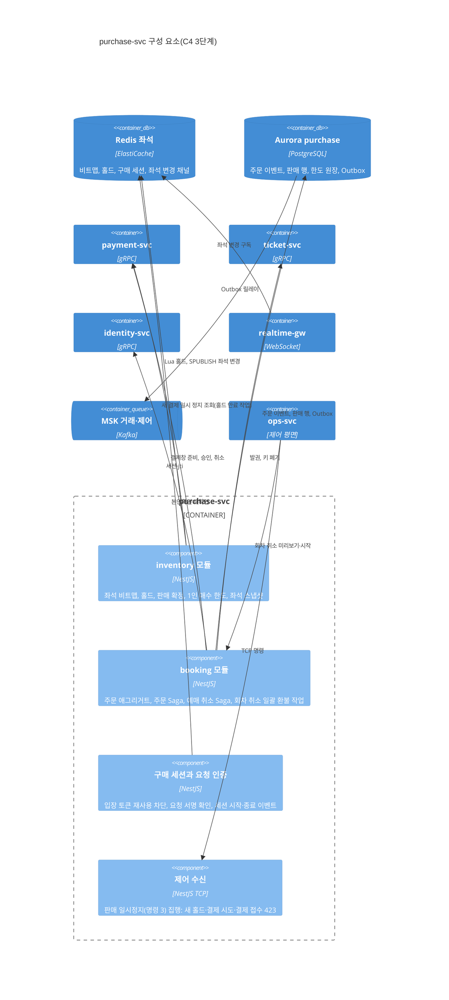
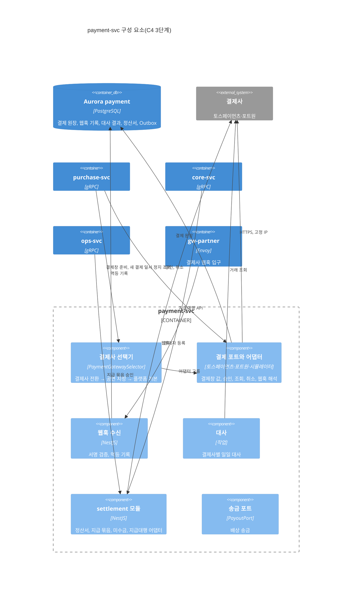
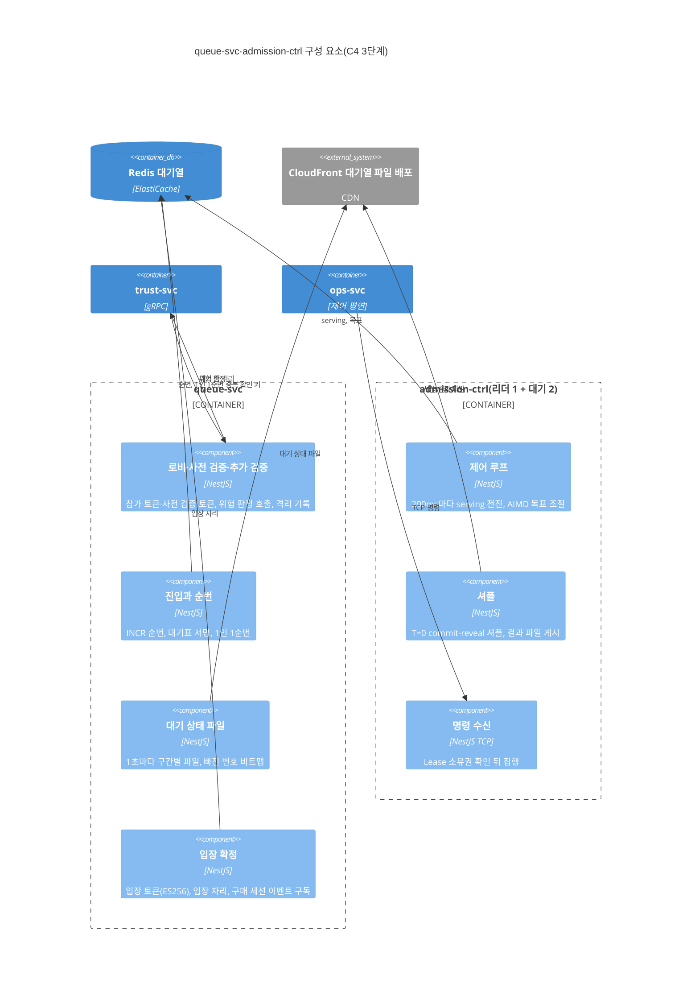

# 아키텍처 문서 안내(arc42·C4)

- **독자와 용도**: arc42(아키텍처 문서를 열두 칸 목차로 나눠 쓰는 틀)와 C4 모델(시스템을 지도처럼 전체 → 서비스 → 서비스 내부 순으로 확대해 그리는 방식)에 익숙한 아키텍트·면접관·새 합류자가, PEAKET 문서에서 각 칸과 각 그림이 어디 있는지 찾을 때 읽는다. 내용은 옮기지 않고 정본 절만 가리킨다. 역할별 읽기 순서는 00-summary.md §2에 있다.
- **원본 출처**: 2026-10-22 소유자 요청으로 새로 만든 안내 문서다. 소유자가 멘토의 기준("C4 + ADR + arc42로 전체 아키텍처를 설계한다는 전제")으로 문서 구성을 점검하게 했고, 점검에서 arc42 칸마다의 위치를 알려 주는 문서와 C4 3단계 그림이 없음을 찾았다.
- **기준 기획 버전**: v1.0. 작성 2026-10-22.
- **표시 규칙**: 표의 '상태'는 그 칸이 정본에 갖춰졌는지다(갖춤·일부·빈칸). §3의 C4 3단계 그림은 정본 서비스 맵(docs/architecture.md §3.1)의 모듈과 책임을 그림으로 옮긴 것이고 새 결정은 없다. 그림의 구성 요소 이름은 추천 적용(2026-10-22)이다.

## 1. arc42 열두 칸

| 칸 | 이 칸이 답하는 질문 | PEAKET에서 볼 곳 | 상태 | 빈 곳 |
| --- | --- | --- | --- | --- |
| 1. 소개와 목표 | 무엇을 왜 만드나, 가장 중요한 품질 목표는 무엇인가 | planning/01-overview.md §1(해결할 문제)·§2(사용자)·§3(목표 지표), planning/02-requirements.md §2(기능 요구사항). 2쪽 요약은 planning/00-executive-summary.md | 일부 | 가장 중요한 품질 목표 셋~다섯과 그 순서가 없다 |
| 2. 제약 | 바꿀 수 없는 조건은 무엇인가 | planning/01-overview.md §5.1(제약사항), docs/architecture.md §8.1(준수 기준), docs/api/guidelines.md, docs/devops.md §2.2(가지 규칙), ADR-0057(운영 환경을 띄우지 않음) | 갖춤 | — |
| 3. 맥락과 범위 | 바깥의 누구·무엇과 어떻게 주고받나 | 사업 맥락: docs/architecture.md §1(C4 1단계), planning/01-overview.md §4(범위). 기술 맥락: docs/infra.md §2(데이터 흐름도), docs/architecture.md §3.2(통신 표), docs/infra-handover.md §4 | 일부 | 바깥 연동마다 채널·프로토콜·버전을 한 표로 모은 곳이 없다(docs/api/guidelines.md §8 표에 연동별 통신 방식과 장애 동작은 있고, 버전은 없다) |
| 4. 해결 전략 | 큰 방향을 어떻게 정했나 | docs/architecture.md §1(핵심 결정)·§2(문제별 기술 과제)·§6.1(기술 스택과 선정 근거) | 갖춤 | — |
| 5. 구성 요소 보기 | 무엇으로 나뉘어 있나 | docs/architecture.md §3(서비스 분리)·§3.1(서비스 맵), docs/data.md §1(저장소 지도), docs/features/README.md, docs/frontend.md §2, 이 문서 §3(서비스 내부) | 일부 | §3의 셋 말고는 서비스 내부 그림이 없다 |
| 6. 실행 보기 | 중요한 흐름이 실제로 어떻게 도나 | 기능 설계서의 순서도(§2 표), planning/04-ia-flows-screens.md §2(사용자 흐름 F-01~F-13), planning/03-policies-glossary.md §2(상태도) | 일부 | shop·catalog·notify·review·support·trust의 상세 설계는 구현 직전에 쓴다(docs/features/README.md). Flink 잡은 표로만 있다(docs/streaming.md) |
| 7. 배치 보기 | 어디에 어떻게 올라가나 | docs/infra.md §1·§3·§4·§6, docs/devops.md §5, docs/infra-handover.md §2·§3 | 갖춤 | — |
| 8. 공통 개념 | 여러 곳에 똑같이 적용하는 규칙은 무엇인가 | docs/architecture.md §5(장애 격리·시간 초과·프로브)·§6.4(상태 소유권)·§8(품질·보안 절차), docs/api/guidelines.md, docs/observability.md, docs/data.md §4·§5·§6, docs/security/, docs/frontend.md §5 | 갖춤 | 흩어져 있다. 이 표가 안내한다 |
| 9. 아키텍처 결정 | 무엇을 왜 그렇게 정했나 | docs/adr/(88건), 목록은 docs/architecture.md §11 | 갖춤 | 결정 수십 개를 한 ADR에 묶은 것이 있다(예: ADR-0062) |
| 10. 품질 요구 | 품질을 어떻게 재고 지키나 | planning/02-requirements.md §3(NFR), docs/quality/quality-requirements.md, docs/architecture.md §7(NFR별 대응 표) | 일부 | 품질 시나리오(어떤 자극에 어떻게 반응해야 하나)와 우선순위가 없다 |
| 11. 위험과 기술 부채 | 무엇이 잘못될 수 있고 무엇을 미뤘나 | planning/01-overview.md §5.2(주요 리스크), docs/architecture.md §9.4(먼저 검증할 위험), 기능 설계서마다의 '미결정' 절, docs/devops.md §15, docs/streaming.md §15, docs/verification.md §8 | 일부 | 위험마다 가능성·영향 등급이 없고, 기술 부채 목록이 따로 없다 |
| 12. 용어 | 이 말은 무슨 뜻인가 | planning/03-policies-glossary.md §4(용어 사전)·§5(쉬운 말과 용어 풀이) | 갖춤 | — |

## 2. C4 그림 위치

모든 그림은 Mermaid 코드로 문서 안에 있다.

| 단계 | 그림 | 위치 | 상태 |
| --- | --- | --- | --- |
| 1단계: 시스템 맥락 | PEAKET과 사용자·바깥 시스템 | docs/architecture.md §1 | 있음(알림 발송, 외부 감시, 상태 페이지, 공개 타임스탬프는 2026-10-22에 더했다, §4) |
| 2단계: 컨테이너 | 게이트웨이·서비스·저장소 | docs/architecture.md §3('요청 경로 중심') | 있음(파트너·운영자·현장 스태프 경로, 게이트웨이 뒤 연결, trust-svc 연결, 서비스 → Kafka 선은 2026-10-22에 더했다, §4) |
| 3단계: 구성 요소 | 서비스 안의 모듈 | 이 문서 §3(purchase-svc, payment-svc, queue-svc·admission-ctrl) | 셋만 있음 |
| 4단계: 코드 | 표와 관계 | docs/data.md §2(ERD), §3(Redis 키) | 있음 |
| 배치 | 리전·AZ·노드 풀 | docs/infra.md §1(배포 구성도), docs/infra-handover.md §2(이중화 구성도) | 있음. C4 표기가 아닌 일반 흐름도다 |
| 동작 | 흐름별 순서도 | 아래 표 | 있음 |

| 흐름 | 위치 |
| --- | --- |
| 로비와 셔플, 오픈 후 진입, 입장 확정 | docs/features/queue-admission.md §2·§3·§6 |
| 좌석 홀드, 실시간 좌석 전파 | docs/features/seat-hold.md §3·§7 |
| 주문·결제·발권, 예매 취소·환불 | docs/features/payment.md §2·§4.1 |
| 발권과 입장용 휴대폰 등록, 스캐너 | docs/features/offline-gate.md §2·§6 |
| 소셜 로그인, 계정 연결·병합, 휴대폰 본인확인, 스태프 스캐너 로그인 | docs/features/identity.md §2·§2.1·§5·§6.1 |
| 판매 승인, 양도, 회차 취소 일괄 환불 | docs/features/transfer-refund.md §2.1·§4·§5 |
| 지급대행 등록, 정산 지급 | docs/features/settlement.md §3·§5.2 |
| 화면 쪽 흐름 | docs/frontend.md §5 |

## 3. C4 3단계: 서비스 안 구성 요소

정본 서비스 맵(docs/architecture.md §3.1)의 모듈과 책임을 그대로 그렸다. 서비스 사이 호출의 모양은 docs/api/proto/README.md에 있다.

### 3.1 purchase-svc

### 3.2 payment-svc

### 3.3 queue-svc와 admission-ctrl

- 셔플 결과 파일은 admission-ctrl의 리더가 만들어 게시한다(docs/features/queue-admission.md §2, docs/architecture.md §9.4). docs/architecture.md §3.1의 queue-svc 줄이 다르게 적고 있던 것을 2026-10-22에 이쪽으로 맞췄다.

## 4. 빈 곳과 다음 일

| 빈 곳 | 다음 일 | 언제 |
| --- | --- | --- |
| 품질 목표의 순서와 품질 시나리오(arc42 1·10칸) | 핵심 품질 목표 셋~다섯을 정하고, NFR마다 '자극 → 반응 → 재는 값' 시나리오를 붙인다 | 소유자가 정한 뒤 |
| 위험 등급과 기술 부채 목록(arc42 11칸) | planning/01 §5.2 위험에 가능성·영향 등급을 더하고, 미룬 결정과 가정을 기술 부채 목록으로 묶는다 | 소유자가 정한 뒤 |
| C4 2단계 그림의 빠진 연결 | 2026-10-22에 파트너·운영자·현장 스태프 경로, gw-partner·gw-ops·gw-scanner 뒤의 연결, trust-svc 연결, 서비스 → Kafka 선을 더했다(docs/architecture.md §3) | 끝남 |
| C4 1단계 그림의 빠진 바깥 시스템 | 2026-10-22에 알림 발송, 외부 감시(합성 점검·데드맨 수신), 상태 페이지, OpenTimestamps를 더했다(docs/architecture.md §1) | 끝남 |
| 셔플 결과 파일 게시 주체 | 2026-10-22에 admission-ctrl로 맞췄다(§3 아래) | 끝남 |
| 나머지 서비스의 3단계 그림 | 상세 설계를 쓸 때(shop·catalog·notify·review·support·trust) 함께 그린다 | 구현 직전 |
