# 시스템 아키텍처

- **독자와 용도**: 백엔드·인프라·프론트엔드 엔지니어가 시스템 경계, 처음부터 끝까지의 요청 경로, 핵심 기술 스택을 고른 근거, 성능이나 보안 같은 품질 요구사항인 비기능 요구사항(NFR)을 기술로 채우는 전략을 확인할 때 기준으로 보는 문서다. 개별 기술 결정의 대안 비교와 트레이드오프는 `docs/adr/`의 ADR(아키텍처 결정과 그 이유를 남긴 기록)에 있다. 자세한 데이터 스키마(데이터의 구조 정의)는 [data.md](data.md), 클라우드 인프라와 배포 파이프라인은 [infra.md](infra.md), 모니터링과 관측성(지표·로그·요청 기록으로 시스템 안을 들여다보는 능력)은 [observability.md](observability.md), 도메인별 세부 동작 흐름은 `docs/features/`에 자세히 적었다.
- **원문 출처**: 설계서 TL;DR, 설계서 §0, 설계서 §2, 설계서 §3, 설계서 §6, 설계서 §8, 설계서 §9, 설계서 §10, §13·§14(ADR 목록), §15(리포지토리 구조), §18(참고 문헌), 5장(라우트 렌더링), 4장(상태 소유권), 6장(토큰), 16장(Fastify·RxJS), 18장(통신 프로토콜), 19장(서비스 메시).
- **기준 기획 버전**: v1.0.
- **표시 규칙**: C4 모델 다이어그램, NFR 대응 표 구조, PoC(본 개발 전에 위험한 부분만 먼저 만들어 확인하는 시험) 통과 기준은 원문에 빠진 것을 정리해 넣은 것이라 모두 [보완]으로 표시한다. 수치는 원문 설계를 이어받았고, 새로 확정한 수치에만 [가정]을 붙인다.

## 1. 핵심 결정과 시스템 컨텍스트

시스템 아키텍처의 핵심 설계 결정과 구조적 특징은 다음과 같다:

- **2단계 일관성 모델 ([ADR-0014](adr/0014-soft-hold-hard-sale.md))**:
  - **좌석 홀드 (Soft Hold)**: 결제하는 동안 다른 사람이 가져가지 못하게 좌석을 잠시 잡아 두는 일로, Redis(메모리에 데이터를 두는 빠른 저장소)에서 초고속으로 처리하여 핫패스(Hot Path)의 RDBMS 쓰기 I/O를 0건으로 유지한다. Redis 페일오버 중에는 그 회차의 구매 요청을 503으로 잠시 미룬다. PostgreSQL로 홀드를 주는 비상 경로는 두지 않아, 홀드를 주는 곳은 늘 하나다([NFR-015](planning/02-requirements.md), 추천 적용 2026-10-28, ADR-0121).
  - **최종 판매 확정 (Hard Sale)**: PG 결제 승인 바로 앞에 PostgreSQL에 사전 예약(PENDING)을 넣고, 활성 상태 부분 유니크 인덱스로 같은 좌석의 두 번째 판매를 막는다. 승인이 끝나면 SOLD로 바꾼다. 남는 위험은 두 가지다. 좌석 Redis 장애로 원장에 적기 전의 홀드가 사라지면, 같은 좌석을 고른 두 사람 중 한 명은 결제 승인 전에 실패 안내를 받는다(과금은 없다). 승인 결과를 모르거나 승인 뒤 발권이 실패하면 결제와 발권이 잠시 어긋난다. 결제 승인은 되돌리기 어려운 고비 단계라, 승인 뒤에는 결제를 취소하지 않고 같은 주문 ID로 발권을 다시 시도한다(발권 기한 승인 뒤 30분 [가정], ADR-0106). 승인 뒤 60초 안에 발권되지도 발권 재시도 큐에 들어가지도 않은 결제 0건을 목표로 두고, 부하 시험 뒤 불변식 검사와 원장 대사로 확인한다(K2·K7, docs/features/seat-hold.md §6, docs/features/payment.md §3·§4).
- **도메인 경계 기반 마이크로서비스 10개 분리 ([ADR-0007](adr/0007-service-boundaries-by-load-availability-runtime.md))**:
  - 비즈니스 도메인뿐만 아니라 트래픽 부하 수준, 가용성(서비스를 멈춤 없이 쓸 수 있는 정도) SLA 등급, 런타임 특성에 따라 10개 독립 서비스로 격리한다.
  - 개발 초기 v0 단계는 모듈러 모놀리스로 검증하고, v1 단계에서 분산 서비스로 배포한다. 분리 효과는 한 프로세스 합본·역할별 배포·10개 서비스의 세 구성을 같은 자원 합계로 재서, 실행을 나눈 몫과 서비스로 나눈 몫을 따로 정량 측정한다(ADR-0096).
- **클라이언트 전용 Thin API 게이트웨이 5종 분리 ([ADR-0008](adr/0008-client-specific-thin-gateways.md))**:
  - 팬 웹(`gw-fan`), 대기열(`gw-queue`), 파트너와 결제사 웹훅(`gw-partner`), 운영자(`gw-ops`), 스캐너(`gw-scanner`)마다 API 게이트웨이(API는 프로그램끼리 요청과 응답을 주고받는 창구, 게이트웨이는 그 앞에 둔 입구 서버)를 따로 두어, 한쪽의 폭주나 장애가 다른 쪽으로 번지는 것을 줄인다(§4).
- **초단위 텔레메트리 관제 루프**:
  - 시스템 분산 이벤트를 TypeScript 스트림 작업자로 ClickHouse에 싣고 읽을 때 집계하여(조회 시점 집계) 관제 콘솔에 제공하고, 이상 징후 발생 시 안전 한계(POL-010) 안에서 동시 입장 목표(AIMD)를 적응형으로 제어한다.

**PEAKET 시스템 컨텍스트 (C4 L1)**

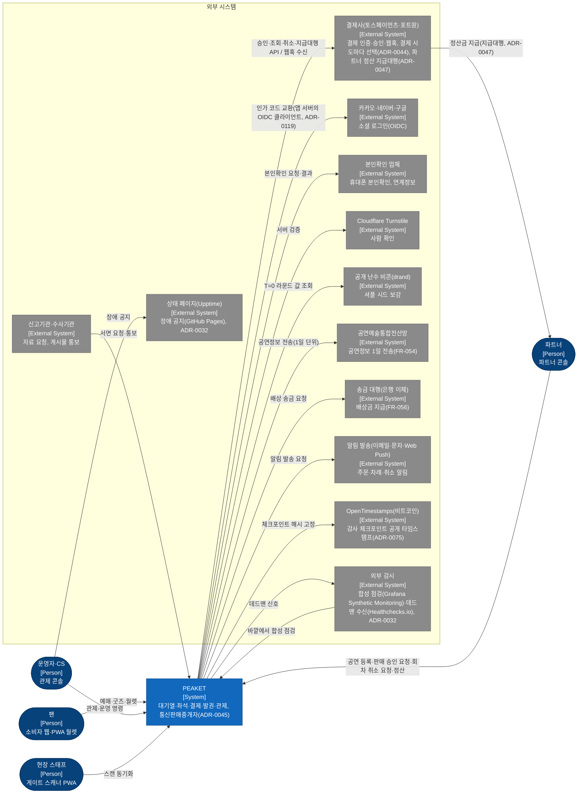

## 2. 비즈니스 문제별 기술 과제 (원문 §2 '해결할 기술 과제')

| 문제 식별자 | 비즈니스 문제 요약 (`docs/planning/01-overview.md`) | 핵심 기술 해결 과제 | 주된 구현 위치 |
| --- | --- | --- | --- |
| P-01 | 대규모 동시 접속 때의 서버 멈춤 | 가상 대기열 도입, AIMD(정상이면 조금씩 늘리고 나빠지면 크게 줄이는 조절 방식) 적응형 입장 제어, 정적 캐싱을 CDN(사용자 가까운 곳에 파일을 복사해 두고 대신 응답하는 전송망)의 엣지에 대신 맡기기 | `features/queue-admission`, §4, [infra.md](infra.md) |
| P-02 | 동일 좌석 오버셀(같은 좌석이 두 사람 이상에게 팔리는 사고) | 2단계 일관성(Soft Hold + Hard Sale), 분산 Saga 패턴(여러 서비스에 걸친 일을 단계별로 처리하고, 중간에 실패하면 앞 단계를 되돌리는 방식), 멱등성(같은 요청이 여러 번 와도 한 번 처리한 것과 결과가 같은 성질) 보장 | `features/seat-hold`, `features/payment`, `ADR-0014`, `ADR-0015` |
| P-03 | 매크로 부정구매 및 암표 유통 | 행동 기반 봇 탐지 파이프라인, 토큰(권한이나 상태를 증명하려고 주고받는 서명된 문자열)에 단말 식별자 묶기, 구매 세션 소지 증명(요청마다 브라우저가 함께 보내는 작은 값인 쿠키와 입장 토큰의 탈취 대비, 봇 방어 효과는 주장하지 않는다. 남길지는 탈취 재현 시험 S-T16으로 정한다, ADR-0050·0124) | `trust-svc`, `ADR-0011`, `features/identity` |
| P-04 | 대기열 순번 불신 및 공정성 시비 | 다시 접속해도 순번 영구 보존, 1인 1순번 원칙(본인확인), 프리큐 순번을 무작위로 섞는 셔플 | `ADR-0002`, `ADR-0006`, `ADR-0012` |
| P-05 | 미결제 좌석 묶임 및 판매 기회 손실 | 짧은 TTL(저장한 값이나 키를 쓸 수 있는 시간)이 지난 홀드를 만료 인덱스(만료 시각 순으로 정렬해 둔 Redis Sorted Set) 1초 폴링으로 자동 해제(작업 큐를 거치지 않는다, 추천 적용 2026-10-28, 기술 검토 낮음-006), 즉시 재판매 노출 | `features/seat-hold` |
| P-06 | 장애 대응 시의 운영 상황 암전 | SLO(팀이 정한 서비스 품질 목표) 기반 다중 창 알림, 중앙 관제 콘솔, 무중단 운영 명령 전달 | [observability.md](observability.md), `features/control-tower` |
| P-07 | 현장 게이트 네트워크 마비 | 오프라인 PWA(설치형 앱처럼 쓰는 웹 앱) 실행, 회전 Dynamic QR 로컬 검증, 양방향 오프라인 동기화 | `features/offline-gate`, `ADR-0025` |
| P-08 | 정보 취약계층 접근성 및 글로벌 대응 | 4개 국어(ko, en, ja, zh) i18n 지원(구매는 언어와 관계없이 한국 휴대폰 본인확인이 필요하고, 한국 휴대폰이 없는 해외 팬은 둘러보기·안내만 쓴다, docs/planning/01 §4.2, 추천 적용 2026-10-28, 기술 검토 중간-113), Canvas 좌석맵의 웹 접근성 대안 UI | §6 프론트엔드 구조 |
| P-09 | 티켓 외 부가 수익 창출 한계 | 예매와 독립된 굿즈 스토어, 티켓 연동 부가 상품, 인기 MD 오픈에 대기열 재사용 | `core-svc` shop 모듈, `ADR-0013`·`ADR-0101` |

## 3. 도메인 경계와 서비스 분리

**마이크로서비스는 단순한 도메인 개념 단위가 아니라, 트래픽 부하의 규모·요구 가용성 등급·런타임 실행 방식이 크게 다른 경계에 따라 나눈다(`ADR-0007`).** 티켓 오픈 정각의 대기열 진입 트래픽은 초당 20만 건의 요청(200,000 RPS)에 이르지만, 좌석 홀드는 피크 초당 2,000건, 결제 접수는 초당 300건의 처리(300 TPS) 수준이다. 진입 구간과 결제 구간의 트래픽 차이가 670배다. 그래서 대기열 진입이 몰려도 결제·발권·중앙 관제·현장 게이트 시스템으로 번져 연쇄 장애를 일으키지 않도록 런타임을 물리적으로 나눠야 한다. 이 분리 기준에 해당하지 않는 도메인은 한 서비스 안의 모듈로 묶는다. 다만 DDD 바운디드 컨텍스트(Bounded Context) 경계를 분명히 지켜, 앞으로 조직이 커지면 바로 독립 서비스로 나눌 수 있게 한다.

- **아키텍처 분리 원칙**: AWS Well-Architected 신뢰성 기둥(REL03-BP01, REL03-BP02)과 마틴 파울러(Martin Fowler)의 마이크로서비스 설계 원칙을 따른다. 자세한 원문 요약과 대안 비교는 `ADR-0007`에 적었다.
- **분리 근거의 투명성**: 1인 개발 환경이므로 콘웨이 법칙(Conway's Law: 시스템 구조가 그것을 만드는 조직의 소통 구조를 닮는다는 관찰) 같은 조직상의 이점을 분리 근거로 내세우지 않는다. 저장소 구성(§10)도 서비스 분리의 근거가 아니다. 2026-10-30부터 코드는 모노레포 하나에 두고, 가상 팀은 폴더 주인(CODEOWNERS)으로 나눈다(ADR-0165). 인프라 운영 복잡도와 클라우드 비용을 최소로 줄이려고 초기 설계의 서비스 14개를 10개로 실용적으로 합쳤다.
- **분리 실효성 검증**: 같은 v1 비즈니스 로직 코드를 세 구성으로 띄워 같은 CPU·메모리 합계에서 비교한다. (가) 프로세스 하나에 함께 띄운 합본, (나) 같은 이미지를 역할별로 따로 띄운 배포, (다) 10개 서비스다. 티켓 오픈 때처럼 요청이 한꺼번에 몰리는 부하 환경(K1)에서 결제 접수 p99 지연시간(요청 백 건 중 아흔아홉 건이 이 시간 안에 끝난다는 뜻)과 오류율을 잰다. (가)와 (나)의 차이는 실행을 나눈 효과이고, (나)와 (다)의 차이는 코드를 서비스로 나눈 효과다. (나)와 (다)의 차이가 없으면 서비스로 나눈 이유는 성능이 아닌 근거(배포·장애·런타임 단위, 저장소 소유)로만 말한다(docs/verification.md §3.8, ADR-0096).
- **Database per Service(서비스마다 저장소를 따로 두고 공유하지 않는다) 원칙**: 이전 이름 'Shared-Nothing'은 노드끼리 메모리·디스크를 나누지 않는 클러스터 구조를 가리키는 말이라 바꿨다(추천 적용 2026-10-28, 기술 검토 낮음-006). 서로 다른 바운디드 컨텍스트에 속한 서비스끼리는 데이터 저장소를 절대 공유하지 않는다. '공유하지 않는다'는 원칙은 다른 컨텍스트의 데이터베이스 테이블이나 Redis 키를 직접 조회·수정하지 않고, 모든 데이터 교환을 전용 gRPC(서비스끼리 함수를 부르듯 빠르게 호출하는 통신 방식) API나 비동기 Kafka(이벤트를 순서대로 쌓아 두고 여러 곳에 나눠 주는 메시지 시스템) 이벤트로만 한다는 뜻이다. 단, 같은 컨텍스트를 런타임 특성 때문에 나눠 배포한 경우(대기열 컨텍스트의 `queue-svc`와 `admission-ctrl`, 좌석 컨텍스트의 `purchase-svc`와 `realtime-gw`)는 같은 저장소를 공유한다. 비용을 줄이려고 물리적 Redis 클러스터나 Aurora(AWS가 운영해 주는 PostgreSQL 호환 데이터베이스) 인스턴스를 여러 컨텍스트가 함께 쓰는 경우에도, 네임스페이스 키 접두사·DB 스키마 분리·전용 IAM/DB 역할로 같은 격리 규칙을 지킨다.

**PEAKET 컨테이너 구성 (C4 L2, 요청 경로 중심)**

컨테이너 그림은 한 장에 담으면 선이 50개라 세 장으로 나눠 그린다(docs/planning/03 §5.5, ADR-0138). ① 사람에서 게이트웨이까지, ② 게이트웨이에서 서비스까지, ③ 서비스 사이와 저장소다. 상자 종류는 라벨의 [Person]·[Container]·[Container DB]다. 같은 상자가 여러 그림에 나오면 설명은 처음 나오는 그림에만 적는다.

**① 사람에서 게이트웨이까지**

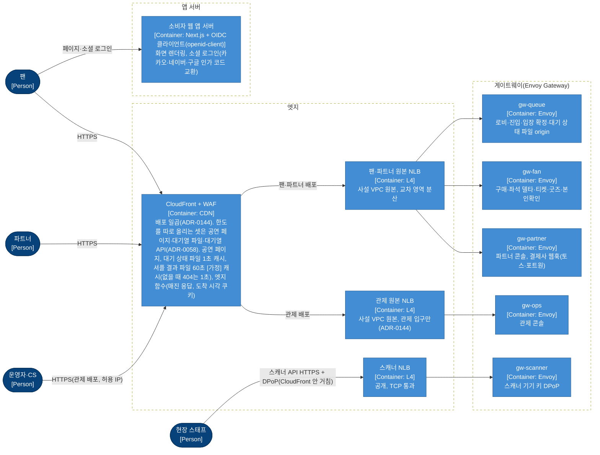

**② 게이트웨이에서 서비스까지**

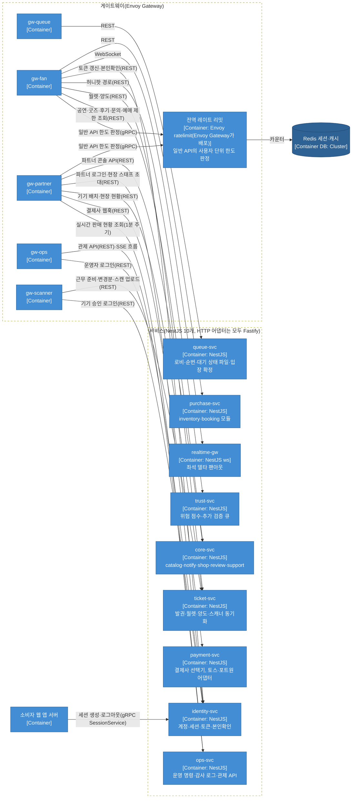

- gw-partner → identity-svc(파트너 로그인, 현장 스태프 초대)와 gw-partner → ticket-svc(기기 배치 `/v1/partner/events/{eventId}/device-placements/{deviceId}`, 현장 현황 `/v1/partner/events/{eventId}/gate-status`), gw-fan → trust-svc(허니팟 경로 `/_t/*`) 선은 §3.3 구성 요소 그림에 맞춰 더했다(추천 적용 2026-10-30, §3.3 identity-svc·ticket-svc·trust-svc, docs/features/bot-defense.md §7). 파트너 로그인을 gw-partner로 받는 것은 ADR-0119다.

**③ 서비스 사이와 저장소**

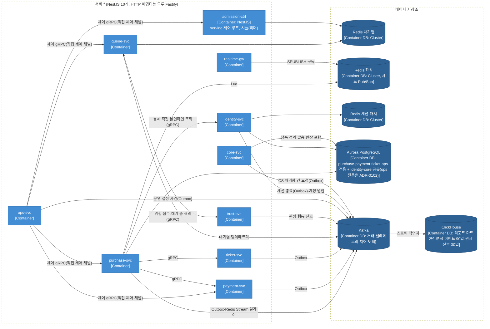

- **인증 담당과 요청 경로**: 계정·세션·토큰 발급·본인확인은 `identity-svc`가 맡는다. 소셜 로그인의 인가 코드 교환은 소비자 웹 앱 서버의 얇은 OIDC 클라이언트가 한다. 앱 서버는 자기 세션을 두지 않는다(추천 적용 2026-10-28, ADR-0119). 제공자 토큰은 `identity-svc`로 보내지 않는다. 로그인 뒤 요청의 토큰은 게이트웨이가 공개키로 확인하므로, 대기열 진입과 좌석 홀드 요청은 `identity-svc`를 거치지 않는다. 주문 생성(결제 직전) 때만 `purchase-svc`가 본인확인 상태를 조회한다(`ADR-0008`, `ADR-0011`). 이 조회에 `identity-svc`가 응답하지 못하면 토큰의 `ticket:buy`·pid로 판정한다(`ADR-0055`). 로그인 흐름은 `docs/features/identity.md` §2에 있다.

### 3.1 서비스 맵

**서비스 안 구조의 기본값(추천 적용 2026-10-28, 기술 검토 낮음-008)**: 서비스 열 개는 '포트와 어댑터를 쓰는 모듈 계층 구조' 하나를 기본으로 쓴다. 바운디드 컨텍스트 하나가 NestJS(Node.js 서버 프레임워크) 모듈 하나이고, 모듈 안은 받는 층(REST·gRPC 처리기, Kafka 소비자) → 유스케이스 층 → 도메인 층(업무 규칙과 상태. 프레임워크와 저장소를 모른다)으로 나눈다. 저장소·결제사·다른 서비스 같은 바깥 의존은 도메인 쪽이 정한 포트(인터페이스) 뒤에 어댑터로 붙이고, 의존은 안쪽으로만 향한다. 서비스마다 구조 이름이 다르면 공용 라이브러리·서비스 템플릿·리뷰 기준이 함께 갈라지므로 하나로 정했다. 서비스 템플릿(`packages/platform`, §10)이 이 폴더 뼈대를 주고(`packages/platform/template/`: 조립 파일 `<컨텍스트>.module.ts` 아래 `inbound`·`application`·`domain`·`adapters`), 층을 거꾸로 부르는 import는 공용 ESLint 설정(`@peaket/config/eslint/service-layers`의 `no-restricted-imports`)이 `pnpm lint`와 CI에서 막는다(추천 적용 2026-11-01, openspec 변경 `add-service-structure-and-request-checks`). 도메인은 다른 층과 프레임워크·저장소 패키지를, 유스케이스는 받는 층·어댑터와 웹 서버·저장소·계약 생성물을, 받는 층은 어댑터를, 어댑터는 받는 층·유스케이스를 가져오지 않고, 다른 컨텍스트는 그 모듈의 공개 파일(`index.ts`)로만 가져온다. 아래 표의 '내부 구조' 칸은 이 기본에서 벗어난 곳만 이유와 함께 적고, 점수기 파이프라인·애그리거트 같은 코드 수준의 설계 패턴은 '주요 패턴' 칸에 따로 적는다. 기본에서 벗어난 곳은 셋이다. admission-ctrl은 요청을 받는 서비스가 아니라 리더 하나가 도는 제어 루프이고, realtime-gw는 업무 규칙이 없는 스트리밍 서버이며, ops-svc의 운영 명령 기록은 이벤트 소싱이다.

| 서비스명 | 담당 모듈과 핵심 책임 | 전용 저장소 | 내부 구조(기본에서 벗어난 점) | 주요 패턴 | 통신 프로토콜 | 분리 근거 |
| --- | --- | --- | --- | --- | --- | --- |
| queue-svc | 로비 입장(참가 토큰 발급), 사전 검증 토큰 발급, 대기열 진입, 순번 발급, 결번 비트맵(값마다 한 비트로 줄여 적은 표) 기록, 구간별 대기 상태 파일 생성·게시(셔플 결과 파일은 admission-ctrl이 게시한다, §9.4·queue-admission §2), 입장 확정(입장 토큰 발급과 입장 자리 등록), 구매 세션 수명 주기 이벤트 수신과 입장 자리 반환 처리 | Redis Cluster (대기열 전용) | 기본 | 결번 비트맵, 서명한 대기표(HMAC), 한 번에 끝나는 Redis 원자 연산(`SET NX`·`INCR`) | REST (`gw-queue` 경유, CDN이 가까운 곳에 복사해 두는 캐시의 원천), gRPC (`trust-svc` 위험 점수 동기 조회), Kafka (텔레메트리 발행, 구매 세션 이벤트 구독, 봇 판정 이의 제기의 CS 처리함 건 요청 `VERIFICATION_APPEAL`), 제어 gRPC (대기실 공지·판매 일시정지 수신. 상태는 `q:{event:E}:notice`, ADR-0102·0103), gRPC (`ops-svc`의 이의 결과 반영(`PASSED`·기각)과 이의 내용 읽기, 추천 적용 2026-10-30, docs/features/bot-defense.md §12, ADR-0156 결정 14), gRPC (`identity-svc`에 추가 검증의 본인확인 재통과를 확인한다, 추천 적용 2026-10-30, docs/features/bot-defense.md §5.2), gRPC (`ops-svc`의 예매 제한·해제 반영 `SetBookingRestriction`을 받아 대기열 Redis에 사본을 두고 입장 확정에서 막는다, 소유자 결정 2026-10-30, open-items 75번, docs/features/queue-admission.md §6) | 큰 진입 부하: 초당 20만 건(200,000 RPS)을 받는다 |
| admission-ctrl | 현재 입장 번호(serving) 증가 제어(실제 입장 비율 반영), AIMD 동시 입장 목표 조절, T=0 무작위 셔플 연산과 셔플 결과 파일 약 1,000개 생성·S3 게시(리더 하나가 혼자 수행), 운영 명령 수신 | Redis Cluster (대기열 클러스터 공유), K8s Lease (리더 선출: 여러 복제 중 일을 맡을 하나를 고르는 것. Lease는 정해진 시간 동안만 유효한 권한) | 예외: 결과를 보고 다시 조절하는 제어 루프(Control Loop). 요청을 받아 처리하는 서비스가 아니라 리더 하나가 주기마다 지표를 읽고 serving을 올리므로, 받는 층은 제어 gRPC뿐이고 유스케이스는 루프의 한 단계다 | 리더 선출과 리더 세대 펜싱(ADR-0056), AIMD 조절 | 제어 gRPC (직접 제어 채널, 리더만 받는 제어 전용 Service 엔드포인트, ADR-0102), `/metrics` (제어 지표 `admission_*`를 지표를 모아 저장하는 도구인 Prometheus가 긁어 간다. Kafka 발행은 없다, ADR-0076), Prometheus HTTP (하위 서비스 p99와 오류율 관측) | 리더로 뽑힌 노드 하나에서만 실행되어야 하는, 결과를 보고 다시 조절하는 제어 루프 |
| purchase-svc | inventory 모듈(좌석 비트맵 관리, Soft Hold, Hard Sale 확정, 1인당 매수 한도 검증, 어느 시점의 좌석 상태 전체를 찍어 둔 좌석 스냅샷 제공), booking 모듈(주문 애그리거트 관리, 분산 Saga 오케스트레이션), 구매 세션 소유(시작/종료 이벤트 발행), 비상 운영 명령인 판매 일시정지(킬스위치)의 판매 차단 집행(범위 안 회차의 새 홀드·결제 시도 시작·결제 접수 423. 입장 멈춤은 admission-ctrl, 대기 화면의 판매 상태는 queue-svc가 함께 받는다, ADR-0062. 정지 상태는 purchase DB `sale_control`에 두고 좌석 Redis `s:{event:E}:ctl` 사본을 홀드 Lua가 함께 읽으며, 새로 뜬 파드는 그 상태를 읽어야 준비 상태가 된다, ADR-0103), 입장 토큰 재사용 차단, 구매 세션 요청 인증(소지 증명) 확인 | Redis (비트맵, 홀드, 세션), PostgreSQL (확정 원장, 매수 한도 행, 주문 상태 이력 `order_event`) | 기본. 주문은 '상태 + 덧붙이기 이력 + Outbox(보낼 이벤트를 같은 트랜잭션으로 DB 표에 먼저 적어 두고 나중에 보내는 방식)'다. 지금 상태 칸을 바꾸는 트랜잭션에서 전이 이력과 Outbox 행을 함께 쓴다. 이벤트 소싱(상태를 사건의 재생으로만 만드는 방식)은 아니다(추천 적용 2026-10-28, ADR-0113) | 주문 애그리거트(함께 바뀌어야 하는 객체를 한 묶음으로 다루는 DDD 패턴), Saga 오케스트레이션, 펜싱 토큰, 좌석 홀드 Lua | REST (`gw-fan` 경유), gRPC (`payment-svc`, `ticket-svc`, `identity-svc` 본인확인 조회), gRPC (`ops-svc`의 예매 제한·해제 반영 `SetBookingRestriction`을 받아 좌석 Redis에 사본을 두고 주문 생성에서 한 번 더 막는다, 소유자 결정 2026-10-30, open-items 75번, docs/features/queue-admission.md §6), Kafka (Transactional Outbox와 서비스별 Outbox 릴레이(ADR-0116), Redis Stream 릴레이), 제어 gRPC (비상 킬스위치 수신, 파드마다 부르는 헤드리스 제어 Service, ADR-0102) | 입장을 마친 5,000명 규모의 핵심 구매 경로다. 두 모듈은 트래픽 규모와 SLO가 같고 서로 긴밀히 묶여 있어 한 묶음으로 구성했다 |
| payment-svc | 결제사 선택기(결제 시도마다 연동 결제사 토스페이먼츠·포트원 중 선택, 공연별 지정과 장애 전환 반영, ADR-0044)와 결제사 어댑터(결제창 값, 전자결제 승인, 상태 조회, 취소), 웹훅(일이 생기면 상대 서버가 우리 주소를 불러 알려 주는 방식) 이벤트 수신과 무결성 검증, 결제사별 대사, 배상 송금 포트(`CompensationTransferPort`, ADR-0046, 정산 지급과 구분하려고 2026-10-28 이름을 바꿨다, 기술 검토 낮음-088), 정산서·지급 묶음·미수금(파트너에게서 돌려받을 돈)과 결제사 지급대행(결제사가 PEAKET 대신 파트너 정산 계좌로 판매 대금을 보내는 서비스) 어댑터(ADR-0047) | PostgreSQL (결제 원장, 대체 결제사 전환 상태 `pg_switch`, ADR-0143) | 기본 | 결제사 포트(`PaymentGatewayPort`) 하나에 어댑터 둘(토스페이먼츠·포트원)과 결제 시도마다 고르는 선택기(ADR-0044), 배상 송금 포트(`CompensationTransferPort`) | gRPC (`purchase-svc`, `core-svc`, `ops-svc`가 호출), Webhook 수신 (`gw-partner` 경유), Kafka (Transactional Outbox), 제어 gRPC (명령 6의 대체 결제사 전환 수신, 파드마다 부르는 헤드리스 제어 Service. 판 번호와 함께 payment DB `pg_switch`에 쓴다, ADR-0143) | 외부 PG사(온라인 결제를 대신 처리해 주는 회사) 장애 격리, 결제 웹훅 수신 격리, 결제사 비밀 키 엄격 격리 |
| ticket-svc | 전자 티켓 발권, 마이 티켓 월렛 조회, 양도 요청·수락·돌려주기·회수(결제자·보유자 구분, ADR-0046), Dynamic QR 검증용 기기 공개키 등록과 폐기 목록 관리, 게이트 스캐너 오프라인 동기화(회차 목록·변경분·입장 상태 공유), 스캔 수신과 서버 입장 판정·이상 표시·입장 기록 마감, 스캐너 기기 기록·배치, 부스 재발급 허용(ADR-0051) | PostgreSQL (티켓 원장, 다른 리전의 읽기 복제본 구성(티켓 원장 보존과 복구 기준점이고 리전 장애 당일 조회에는 쓰지 않는다, 기술 검토 중간-081). 리전은 클라우드 데이터센터가 모인 지역, 복제본은 원본을 복사해 두고 읽기를 나눠 받거나 장애 때 대신하는 저장소), Redis (세션·캐시 클러스터 공유: 스캐너 기기 등록 코드 `scanner:enroll:*`, 스캐너 DPoP 증명 `jti` `scanner:dpop:*`, docs/data.md §3, 추천 적용 2026-10-30) | 기본 | 티켓 애그리거트(발권·양도·폐기 상태), 스캐너 동기화의 서버 변경 일련번호와 두 칸 버전 벡터(ADR-0051) | gRPC (`purchase-svc`, `core-svc`, `ops-svc`(스캐너 기기 관리, 승인된 양도 회수), `identity-svc`(기기 승인 로그인 때 기기 찾기, 추천 적용 2026-10-30)가 호출. ticket-svc는 `identity-svc`에 스캐너 세션을 확인한다), REST (`gw-fan`, `gw-scanner`, `gw-partner`(기기 배치·현장 현황) 경유. gw-partner 경로는 추천 적용 2026-10-30, §3.3 ticket-svc), Kafka (발권과 폐기 이벤트 발행) | 다른 가용성 시간대: 공연 당일 현장 입장과 월렛 이용이 몰림 |
| realtime-gw | 좌석 홀드 변경분(델타)을 WebSocket(연결을 열어 둔 채 서버와 브라우저가 주고받는 통신 방식)으로 많은 접속자에게 나눠 보내기 (API 게이트웨이가 아닌 전용 스트리밍 서비스) | 전용 저장소 없음 (좌석 Redis의 Pub/Sub 채널만 실시간 구독) | 예외: 여러 연결에 나눠 보내는 무상태 스트리밍 서버. 업무 규칙과 저장소가 없어(좌석 Redis 채널을 구독만 한다) 도메인 층을 두지 않는다 | 구독한 구역별로 나눠 보내기, 100ms 묶음(ADR-0110) | WebSocket (`gw-fan` 경유), Redis 샤드 Pub/Sub 구독 (`SPUBLISH`) | 오래 유지되는 연결(Long-lived Connection) 수에 비례해 따로 수평 확장 |
| identity-svc | 소셜 계정 식별자 관리, 활성 세션 제어, 액세스/리프레시 토큰 발급과 갱신(구매 권한과 사람 식별 해시 바인딩. 해시는 원래 값으로 되돌릴 수 없게 바꾼 고정 길이 값), 기기 식별값 기록(키 소지 증명은 아니다, ADR-0001, 2026-11-01 정합), 휴대폰 본인확인 연계정보(CI: 본인확인 기관이 주는, 사람마다 하나인 연계 식별값) 관리, 관리 계정 인증(비밀번호 대조, 인증 앱이 시간에 따라 새로 만드는 일회용 코드인 TOTP 검증). 소셜 OAuth(다른 서비스 계정으로 로그인하게 하는 표준) 흐름 자체는 웹 앱 서버의 얇은 OIDC 클라이언트가 맡고(ADR-0119), 제공자 토큰은 identity에 도달하지 않는다 | PostgreSQL (identity·core가 Aurora 인스턴스 하나를 DB 스키마와 역할로 나눠 씀. ops는 2026-10-28 전용 클러스터로 옮겼다, ADR-0102), Redis (세션 클러스터 공유) | 기본 | 리프레시 토큰 회전과 재사용 탐지, 키 버전별 HMAC 조회(연계정보) | REST (`gw-fan`, `gw-partner`, `gw-ops`, `gw-scanner`(스캐너 기기 승인·토큰) 경유), gRPC (`purchase-svc`의 본인확인 상태 조회, `ticket-svc`의 스캐너 세션 확인(추천 적용 2026-10-30, §3.3 ticket-svc), `queue-svc`의 본인확인 재통과 확인, `core-svc` 팬 알림 발송 워커의 받는 사람 묶음 조회, `ops-svc`의 관리 계정 세션 강제 종료·지정 조회(넷은 추천 적용 2026-10-30, §3.2), `ops-svc`의 병합 막기 알림 `SetAccountHold`·스캐너 세션 별명 읽기 `ListActiveScannerSessions`(추천 적용 2026-10-29, ADR-0148)와 관리 계정 관리 `AdminAccountService`(소유자 결정 2026-10-30, open-items 73번). identity-svc는 기기 승인 로그인 때 `ticket-svc`에 기기를 찾는다, 웹 화면을 만드는 프레임워크인 Next.js의 소비자 웹 앱 서버가 부르는 세션 생성·로그아웃 `SessionService`. 부르는 쪽은 메시 mTLS(양쪽이 서로 인증서를 확인하는 암호화 통신) 신원으로 확인한다, 추천 적용 2026-10-28, 기술 검토 중간-083), Kafka (세션 종료를 모두에게 알림) | 가장 높은 보안 경계: 연계정보(CI) HMAC(비밀 키로 만든 위조 확인용 값) 키, 토큰 서명 개인키, TOTP 암호화 키 격리, 오픈 직전 로그인 트래픽 집중 |
| trust-svc | 접속 위험 점수 산출, 매크로 봇 판정, 악성 IP/기기 차단 목록 관리(차단 기기는 기기 가명마다 키 하나 `tr:block:{deviceRef}`, TTL 90일 [가정]. 이의가 인정되면 지운다, 추천 적용 2026-10-28, 기술 검토 중간-014), 추가 검증 큐 격리 | Redis (실시간 피처 저장소), ClickHouse (대량 이벤트 집계에 강한 분석용 데이터베이스, 원시 텔레메트리 신호) | 기본 | 점수기 목록 파이프라인(점수기(HumanCheck·DeviceTrust·BehaviorScore 등)를 모두 돌려 가중합으로 점수를 매기고, 허니팟 적중·차단 기기 목록 같은 확정 신호만 앞에서 판정을 끝낸다. 확정 신호는 판정을 일찍 끝내는 신호이고 '봇 확정' 라벨이 아니다. 그때도 판정은 추가 검증이고 점수기는 모두 돈다(FR-049, ADR-0039, 추천 적용 2026-10-30, docs/features/bot-defense.md §4.3, ADR-0156 결정 2). 점수가 높으면 추가 검증 큐로 보낸다. 앞 단계가 처리하면 뒤로 넘기지 않는 '책임 연쇄'와 다르므로 그 이름은 쓰지 않는다, 추천 적용 2026-10-28, 기술 검토 낮음-063), 그림자 실행 규칙 | gRPC (`queue-svc`, `identity-svc`가 호출. 대기 중 격리는 `queue-svc` `IsolateWaiting`을 호출, ADR-0071. `ops-svc`가 표본 검토·부정구매 확인·이의 결과를 라벨 반영으로 보내고, 이의 심사 화면의 판정 근거를 읽는다(판정 근거 읽기는 추천 적용 2026-10-30)), REST (`gw-fan`이 허니팟 경로 `/_t/*`를 허니팟 기록 처리기로 넘긴다. 이 둘은 추천 적용 2026-10-30, docs/features/bot-defense.md §7·§9·§12), Kafka(대기 중 재평가 작업자 `trust-reassess`가 행동 신호를 읽어 Redis로 세고 후보를 낸다, ADR-0099) | OWASP(웹 보안 기준을 만드는 비영리 단체) A10 원칙을 따른다: 장애 때 무조건 통과가 아니라 캐시 규칙 기반 축소 운영을 강제하고, 탐지 규칙은 따로 자주 배포한다 |
| ops-svc | 운영 명령 전달과 유효성 검증, 불변 감사 로그 기록, 관제 지표 집계 API, 승인 업무·CS 처리함(고객 문의 답변·진행 경과, 게시물 신고 처리 포함, ADR-0066)·회차 취소 판정·판매 승인(ADR-0045·0046). 만료 차단 정리 작업 `waf-block-expirer`: 같은 이미지의 다른 진입점으로 띄운 CronJob이다(관제 노드 풀, 1분 [가정]마다, 서비스 계정은 따로). ops DB의 명령 4 읽기 전용 보기 `waf_block_expiry_v`와 관제용 IP 집합 하나의 조회·갱신 권한만 갖고, 만료된 IP 차단을 거둔다. ops-svc가 멈춰도 만료된 차단이 남지 않게 하려는 것이다(소유자 결정 2026-10-30, open-items 70번 ①, docs/features/control-tower.md §5) | PostgreSQL (ops 전용 Aurora 클러스터: 명령 이벤트 스토어, 감사 로그, SSE(서버가 브라우저로 한 방향으로 계속 보내는 통신 방식) 알림 표 `ops_push_event`, ADR-0102), ClickHouse (시계열 관측 읽기 모델) | 기본. 예외: 운영 명령 기록만 Event Sourcing이다(명령의 상태는 덧붙이기만 하는 사건으로 정하고 감사 체인이 묶는다. 화면용 지금 상태는 같은 트랜잭션의 상태 표). 감사 기록이 곧 명령의 원본이어야 고치거나 지운 흔적을 체인으로 찾을 수 있기 때문이다. 따로 떨어진 읽기 저장소(CQRS)는 없다(추천 적용 2026-10-28, ADR-0113) | 2인 승인 상태 기계, 키를 건 해시 체인 감사 기록(ADR-0053) | REST(운영 명령·조회)·SSE(늘 여는 흐름·위젯 흐름) (`gw-ops` 경유, ADR-0100), 제어 gRPC (직접 제어 채널로 명령 송신, ADR-0102) | 제어 평면: 관제 전용 노드 풀과 전용 DB로 핫패스 노드·공유 저장소의 부하에서 떨어진다. 같은 클러스터·노드 프록시는 함께 쓰므로, 데이터 평면과 ops-svc가 함께 멈추면 긴급 명령은 비상 런북이 같은 제어 채널로 전한다(ADR-0102) |
| core-svc | catalog 모듈(공연 정보, 공연장 맵(배치·좌석 두 층과 좌석맵 파일 게시, 좌석맵 템플릿 10종 읽기와 템플릿에서 만들기, 템플릿은 배포 때 넣는 읽기 전용 자료, ADR-0066), 가격 등급, 공연(회차 묶음)·공연장·아티스트·다른 이름(ADR-0093), 검색·자동완성(서버 메모리 사전)·관련 공연(검색 포트 `SearchIndex` 뒤, ADR-0094), 홈 피드와 홈 구성(배너·테마), 판매자 신원정보와 판매 승인 상태, 공연예술통합전산망 1일 전송), notify 모듈(이메일, 알림톡, Web Push, 파트너 웹훅 발송 워커. 웹훅 발송은 나가는 통신을 '공인 주소 443만'으로 연 전용 배포 `core-webhook-dispatcher`에서만 돈다, 기술 검토 중간-061), shop 모듈(굿즈, 티켓 연동 부가 상품, 장바구니, MD 주문, 한정 재고), review 모듈(관람 후기와 작성 자격 확인(ticket-svc 조회), 후기 사진(받기·결과 반영·파생본 게시), 게시물 신고 접수와 신고기관 바로가기, 신고 처리 조치(임시조치·노출 차단·불법 촬영물 신고 가림) 반영, 법정 통보 게시물 노출 차단. 기대평은 없앴다, ADR-0063·0066), support 모듈(고객 문의 접수·내 문의 목록·상세·추가 문의, 답변·진행 경과 기록, 문의 닫기와 3년 보존 뒤 파기, ADR-0066. 예매 제한·양도 회수 대상 팬의 소명 접수와 보관, 결과 기록. 소명은 추천 적용 2026-10-30). 이미지 처리 작업 `image-worker`: 같은 이미지의 다른 진입점으로 띄운 별도 배포다. 공연 이미지·홈 배너·후기 사진의 디코딩·화소 검사·다시 인코딩을 여기서만 한다(QR·바코드 자동 거르기는 두지 않는다, 기술 검토 낮음-158, POL-042). DB·Kafka·Redis 자격 증명이 없고 격리 버킷 읽기·파생본 쓰기 권한만 있다(꾸민 이미지가 네이티브 디코더 취약점을 터뜨려도 core-svc의 DB 자격 증명에 닿지 않게 한다, docs/security/asvs/catalog-review.md 5.4.3, 추천 적용 2026-10-28, 기술 검토 중간-068). 좌석맵 해석 작업 `seatmap-worker`: 같은 이미지의 다른 진입점으로 띄운 별도 배포다. 파트너 좌석맵 가져오기 파일(SVG·JSON·CSV)의 해석을 여기서만 한다. DB·Kafka·Redis 자격 증명과 AWS 권한이 없고, 입력·출력 저장소도 없다(파일은 gRPC 요청으로 받고 해석 결과는 응답으로 돌려준다). 나가는 통신은 막고, 파드마다 동시 처리 1, 해석 CPU 5초 [가정]·메모리 512MiB [가정] 상한이다(XML 파서 결함이 core-svc의 DB 자격 증명에 닿지 않게 한다, 소유자 결정 2026-10-30, open-items 70번 ②, 세부는 추천 적용 2026-10-30, docs/features/seat-hold.md §10, docs/security/asvs/seat-hold.md 15.2.5) | PostgreSQL(굿즈·부가 상품 정의 `product`의 유형별 속성은 JSONB 칸, ADR-0101. 알림·파트너 웹훅 발송 작업과 원장, 워커가 `FOR UPDATE SKIP LOCKED`로 가져감, ADR-0109), Redis (읽기 모델 캐시, 재고 차감) | 기본(다섯 모듈 모두) | catalog: 읽기 캐시(Redis의 카탈로그 값은 캐시이고, 검색 읽기 모델은 같은 트랜잭션에서 고친다)와 검색 포트(`SearchIndex`, ADR-0094·0113), notify: DB 발송 원장을 `FOR UPDATE SKIP LOCKED`로 가져가는 워커(ADR-0109), shop: MD 주문 애그리거트 | REST (미리 그려 두고 정해진 주기로 다시 그리는 ISR의 소스, `gw-fan`, `gw-partner` 경유), gRPC (shop → `ticket-svc`, `payment-svc`, review → `ticket-svc`, 작업 워커 → `image-worker`, 팬 알림 발송 워커 `core-notify-sender` → `identity-svc`(받는 사람 묶음 조회, 추천 적용 2026-10-30). `ops-svc`의 판매 승인 결과·게시물 조치·CS 처리함·홈 구성 반영 호출을 받는다), Kafka | 트래픽 부하가 비교적 낮고 가용성 요구가 보통이라, 운영 복잡도를 줄이려고 한 서비스로 합쳤다 |

- **고객 문의·게시물 신고와 CS 처리함의 연결(추천 적용 2026-10-19, ADR-0066)**:
  - **설계 원칙 (부하·보안 격리)**: 팬의 대량 트래픽이 비상 킬스위치와 모니터링을 맡는 `ops-svc`(제어 평면)에 직접 닿지 않도록 게이트웨이와 노드 풀을 나눕니다. `ops-svc`는 관제 전용 노드 풀에서 돌고, 같은 클러스터 네트워크와 노드 프록시는 함께 씁니다(2026-10-28 ADR-0102에 맞춤).
  - **1단계: 접수 흐름 (팬 → core-svc → ops-svc)**:
    - 팬의 1:1 문의(`/v1/inquiries*`)와 후기 신고(`/v1/reviews/{reviewId}/reports`)·후기 사진 올리기(`/v1/review-images`), 소명 제출(`POST /v1/appeals`, 추천 적용 2026-10-30)은 오직 `gw-fan`을 통해 일반 비즈니스 서비스인 `core-svc`(support·review 모듈)로만 인입됩니다. 소명의 원본 대상(예매 제한 `booking_restriction`, 양도 회수 승인 업무)은 ops DB에 있지만, 소명 글은 문의처럼 support 모듈이 core DB `appeal`에 둡니다.
    - `core-svc`는 접수 내역을 DB에 저장하는 트랜잭션 안에서 Transactional Outbox 패턴으로 접수 이벤트(식별 ID, 유형 포함 / 개인정보 미포함 / 처리 기한은 받은 `ops-svc`가 건 종류로 계산(docs/features/transfer-refund.md §7.1, 추천 적용 2026-10-29), asyncapi `support.cases-requested`)를 발행합니다.
    - `ops-svc`는 이 이벤트를 비동기로 읽어와 운영자 콘솔의 CS 처리함 건(`INQUIRY`, `DISPUTE`, `MINOR_CONTRACT_CANCEL`, `CONTENT_REPORT`, `RIGHTS_REQUEST`, `APPEAL`)을 자동 생성합니다. 소명 건(`APPEAL`)은 support 모듈 내부 API로 소명의 대상 ID·계정을 읽어 그 예매 제한이나 양도 회수 승인 업무에 잇고, 대상이 그 계정의 것인지와 소명 기한을 원본으로 확인합니다(추천 적용 2026-10-30).
    - *장애 격리 효과*: 팬 문의가 폭주해도 관제 시스템에 부하를 주지 않으며, `ops-svc`가 점검 중이거나 장애가 나도 팬의 문의 접수는 정상 유지되고 복구 후 처리함에 지연 등록됩니다.
  - **2단계: 처리 흐름 (CS 담당자 → ops-svc → core-svc → 팬)**:
    - CS 담당자가 관제 콘솔에서 답변 작성, 진행 경과 기록, 문의 닫기 또는 후기 조치(임시조치·노출 차단·해제)를 실행합니다.
    - 이 작업은 `gw-ops` → `ops-svc`로 전달되어 관리자 권한 확인, 조치 사유 기록, 불변 감사 로그(Audit Log)를 남깁니다.
    - 검증이 완료되면 `ops-svc`가 `core-svc`의 내부 API를 호출하여 실제 고객 서비스 데이터베이스에 결과를 반영합니다.
    - 답변 완료 안내 알림(이메일, 알림톡, Web Push)은 `core-svc`의 `notify` 모듈이 팬에게 발송합니다.
  - **관련 스키마**: [data.md](data.md) §2의 `inquiry`, `inquiry_message`, `appeal`, `content_report`, `review_image` 테이블.

### 3.2 서비스 간 통신 매트릭스

| 통신 방식 | 적용 경로 및 구간 | 통신 규칙 및 아키텍처 제약 |
| --- | --- | --- |
| gRPC (동기 RPC) | `purchase-svc` → `payment-svc`(결제창 준비·승인·취소·새 결제 일시 정지 조회, 결과 사건이 5초 [가정] 안에 오지 않을 때의 결과 당기기 `BatchGetPayments`, ADR-0140)·`ticket-svc` (단, inventory와 booking은 한 서비스 안이므로 함수를 직접 호출), `core-svc` shop → `ticket-svc`·`payment-svc`, `core-svc` review → `ticket-svc`(후기 작성 자격 `CheckReviewEligibility`), `queue-svc`·`identity-svc` → `trust-svc` (로비·사전 검증·추가 검증 제출·로그인 때 위험 판정. 추가 검증 제출은 사람 확인만 본다, ADR-0156 결정 8), `trust-svc` → `queue-svc` (대기 중 재평가로 건 격리 `IsolateWaiting`, ADR-0071), `purchase-svc` → `identity-svc` (결제 직전 본인확인 검증), 소비자 웹 앱 서버(OIDC 클라이언트) → `identity-svc` `SessionService`(소셜 로그인 뒤 세션 생성 `CreateSession`과 로그아웃 `EndSession`. 같은 로그인 시도는 멱등 키로 세션을 하나만 만든다. 이전의 '메시 mTLS 내부 호출' 행을 합쳤다, 추천 적용 2026-10-28, 기술 검토 중간-083. 파트너 로그인은 `gw-partner` → `identity-svc` 관리 계정 로그인으로 옮겼다, ADR-0119), `ops-svc` → `payment-svc`(지급 묶음 승인 뒤 지급 요청)·`purchase-svc`(회차 취소 일괄 환불)·`core-svc`(판매 승인 결과, 게시물 조치, support 모듈의 CS 건 상세 읽기·답변·진행 경과·문의 닫기, support 모듈의 소명 읽기(대상 ID·계정·본문)와 결과 기록(호출 이름과 모양은 proto 초안에 아직 없다, wbs 0.2.3, 추천 적용 2026-10-30), 예매 제한의 화면용 사본 `SetBookingRestrictionView`(팬의 `GET /v1/booking-restrictions/me`가 읽는다, 추천 적용 2026-10-30, docs/features/queue-admission.md §6), catalog 모듈의 홈 구성·아티스트·공연장·다른 이름 반영)·`ticket-svc`(스캐너 기기 등록·폐기·등록 코드 새로 만들기. 기기 원장의 주인은 ticket-svc이고 ops-svc는 권한 확인과 감사 기록 뒤 부른다, 추천 적용 2026-10-29. 승인 업무가 승인된 양도 회수의 실행 `ReclaimTicket`, docs/features/transfer-refund.md §4, 추천 적용 2026-10-30)·`identity-svc`(이의 제기·소명 건이 열리고 닫힐 때 계정 병합을 막는 건 알림 `SetAccountHold`, 스캐너 기기 목록에 합칠 기기별 지금 세션 별명 읽기 `ListActiveScannerSessions`, 추천 적용 2026-10-29, ADR-0148. 관리 계정 세션 강제 종료 `TerminateAdminSessions`, 감사 기록 ID로 멱등, docs/features/control-tower.md §12. 지정된 사람만 하는 작업 앞의 지정 조회 `GetAdminDesignations`, 5초 [가정] 캐시, docs/security/authz-matrix.md §3.1. 관리 경로를 처리하는 모든 서비스 → `identity-svc` `AdminAuthzService.GetAdminAuthz`(요청마다 역할·테넌트 판정, 5초 [가정] 캐시, 답이 없으면 503으로 닫음, 소유자 결정 2026-10-31, ADR-0172). 둘은 추천 적용 2026-10-30. 관리 계정 관리 `AdminAccountService`(목록·상세·초대·역할 변경·재초대·삭제·지정과 거두기. openapi `/v1/ops/admin-accounts*`를 받은 ops-svc가 역할·재인증을 보고 감사 기록을 남긴 뒤 부르고, identity-svc가 DB의 지금 역할로 한 번 더 판정한다, docs/features/identity.md §6 '관리 계정 관리 API', 소유자 결정 2026-10-30, open-items 73번, 계약은 추천 적용 2026-10-30))·`trust-svc`(봇 판정 표본 검토·CS 부정구매 확인·이의 인정의 라벨 반영 `ApplyLabel`. trust-svc가 차단 기기 키를 올리거나 지운다. 건 ID와 판 번호로 멱등이다, docs/features/bot-defense.md §9·§12. 이의 심사 화면의 판정 근거 읽기 `GetVerdictEvidence`, 점수 원값 없음, 추천 적용 2026-10-30)·`queue-svc`(봇 판정 이의 내용 읽기 `GetVerificationAppeal`과 결과 반영 `ResolveVerificationAppeal`(인정 `PASSED`, 기각이면 대기 참여를 끝냄), bot-defense §12)(trust-svc·queue-svc 호출은 추천 적용 2026-10-30, ADR-0156 결정 14), `ticket-svc` → `identity-svc`(스캐너 경로 가드가 스태프 토큰 요청마다 하는 스캐너 세션 확인 `CheckScannerSession`, 5초 [가정] 캐시, docs/features/offline-gate.md §6 흐름도, 추천 적용 2026-10-30), `queue-svc` → `identity-svc`(추가 검증 제출의 본인확인 재통과 확인 `CheckReverification`, docs/features/bot-defense.md §5.2, 추천 적용 2026-10-30), `core-svc` 팬 알림 발송 워커(`core-notify-sender`) → `identity-svc`(대량 발송 조각의 받는 사람 묶음 조회 `BatchGetRecipients`, 계정 500개 [가정], 읽기 전용 복제본, docs/features/notify.md §2.1 E6·§4.2, 추천 적용 2026-10-30), `identity-svc` → `ticket-svc`(스캐너 기기 승인 로그인 때 기기 키 지문으로 등록 기기와 상태를 찾는 `GetScannerDeviceByCredential`, docs/features/identity.md §6.1, 추천 적용 2026-10-30), `identity-svc` → `purchase-svc`·`ticket-svc`·`core-svc`(계정 병합 제안을 만들 때와 확정 바로 앞에 막는 사유 확인 `CheckAccountMerge`, 추천 적용 2026-10-29, ADR-0148), `core-svc` → `payment-svc`(판매 승인 때 지급대행 판매자 등록), `core-svc` 작업 워커 → `image-worker`(이미지 처리 맡기기. 원본 키와 종류만 보내고 상태·파생본 키·폭·높이·거절 사유를 받는다, 추천 적용 2026-10-28, 기술 검토 중간-068), `core-svc` catalog → `seatmap-worker`(좌석맵 가져오기 해석 `ParseSeatmapImport`. 파일 바이트와 형식을 보내고 해석한 배치와 오류를 받는다. 저장소를 쓰지 않는다, 소유자 결정 2026-10-30, open-items 70번 ②, 세부는 추천 적용 2026-10-30, docs/features/seat-hold.md §10), `ops-svc` → `queue-svc`·`purchase-svc`(예매 제한·해제 반영 `SetBookingRestriction`. 판 번호를 붙여 두 서비스가 자기 저장소에 사본을 두게 하고, ops-svc 작업 워커가 실패한 호출과 10분 [가정]마다의 다시 보내기를 맡는다, 소유자 결정 2026-10-30, open-items 75번, 세부는 추천 적용 2026-10-30, docs/features/queue-admission.md §6). 부정 예매 사후 조사(추천 적용 2026-10-31, ADR-0171, docs/features/forensic-replay.md §6.7): `ops-svc` → `ticket-svc`(소명을 요청할 때 그 사건 계정의 그 회차 표에 거는 양도 잠금 `SetTransferLock`, `TransferLockService`, 사건 ID·판으로 멱등), `ops-svc` → `core-svc`(팬 소명 화면이 읽는 소명 요청의 화면용 사본 `SetFraudAppealView`), `ops-svc` → `purchase-svc`(이의가 인정된 표 취소의 우선 구매 권리 만들기 `GrantPriorityPurchase`, 취소한 티켓 ID로 멱등), `ops-svc` → `queue-svc`(우선 구매 권리의 대기열 사본 `SetPriorityGrant`), `ops-svc` → `trust-svc` `ApplyLabel`의 부정 예매 출처 둘(조치 실행 봇, 소명·이의 인정 사람. 조사 저장소의 기기 가명을 `device_ref`에 싣고, 텔레메트리로 내지 않는다), 조사 적재 작업자 `inv-ingest` → `identity-svc`(조사용 연결 값 묶음 조회 `BatchGetInvestigationRefs`, 계정 500개 [가정]), `purchase-svc` → `identity-svc`(주문 예매자 번호의 연락처 가명 `ComputeContactRef`, `contact` 라벨 키는 identity-svc만 받는다, 데드라인 50ms [가정]), `ops-svc` → `identity-svc`(사건 계정의 연계정보 HMAC 보관 `SetRestrictedCiHold`: 소명 요청 때 CASE_OPEN, 이용 제한을 걸기 전에 RESTRICTED, 끝나면 RELEASED), `ops-svc` → `identity-svc` `GetAdminDesignations`(지정에 부정 거래 조사관 `FRAUD_INVESTIGATOR`가 더해졌다). 받는 쪽은 앞의 넷과 `TrustLabelService`·`RestrictedCiHoldService`가 ops-svc 신원만, `InvestigationRefService`가 `inv-ingest` 신원만, `ContactRefService`가 purchase-svc 신원만 받는다(docs/api/proto/README.md '부르는 쪽 확인'). 호출마다의 요청·응답 모양과 멱등 키는 docs/api/proto/README.md의 초안에 있다(추천 적용 2026-10-22) | Protocol Buffers 기반의 엄격한 스키마 계약을 따른다(`docs/api/proto`, `buf breaking` CI 검증). HTTP/2 다중화 연결, 데드라인(Deadline) 전파. 연결 하나에 요청이 쏠리는 것을 막으려고 서비스 메시(서비스끼리 주고받는 통신을 앱 대신 처리하는 층) 기반 L7 로드밸런싱을 적용한다(`ADR-0010`). 받는 쪽은 메시 신원 허용 목록으로 부르는 쪽을 확인한다. identity-svc의 `SessionService`는 소비자 웹 앱 서버 신원만 받는다(`ADR-0011`, I-T15·I-T50) |
| Kafka (비동기 이벤트) | 거래 이벤트: 주문·결제·좌석 확정·발권은 PostgreSQL Transactional Outbox 패턴, 좌석 홀드와 세션 이벤트는 Redis Stream 릴레이, `acks=all`, 파티션(토픽을 나눈 칸. 순서는 칸 안에서만 지켜진다) 키는 회차 ID `eventId`(공연은 회차 묶음이라 키가 아니다, docs/streaming.md §7). 대량 텔레메트리: 진입 로그, 사용자 행동 신호(브라우저 RUM은 Kafka를 거치지 않는다. `telemetry.rum`은 예약, ADR-0076), 토픽(메시지를 종류별로 모아 두는 통로)마다 키는 docs/streaming.md §7(ADR-0026·0071). 제어·보안 이벤트: 운영 파라미터 변경(압축 토픽 `control.settings`, ops-svc Outbox), 세션 강제 종료(모두에게 보냄, identity-svc Outbox, ADR-0143). 이 둘은 서비스 단위 소비자 그룹이 아니라 파드마다 따로 모든 파티션을 읽고, 새로 뜬 파드는 시작할 때 다시 읽는다(추천 적용 2026-10-28, ADR-0103). 고객 문의·게시물 신고·소명 접수: core-svc Outbox → ops-svc CS 처리함 건 등록(§3.1 아래, ADR-0066. 소명 `APPEAL`은 추천 적용 2026-10-30). 봇 판정 이의 제기: queue-svc → 같은 토픽(`support.cases-requested`)의 `VERIFICATION_APPEAL` 건 요청. queue-svc는 DB가 없어 Outbox 없이 보내고, 보내지 못하면 화면에 503으로 답해 다시 보내게 한다(추천 적용 2026-10-30, docs/features/bot-defense.md §12, ADR-0156 결정 14). 부정 예매 조사 사본: 노드 에이전트 수집기의 조사 사본 갈래 → 텔레메트리 클러스터의 `investigation.requests`(원문 IP·ASN·JA4·끝단 봇 라벨이 든 요청 기록, Avro가 아니라 JSON, 키 없음, 보존 3일 [가정]) → 조사 적재 작업자 `inv-ingest`. 같은 작업자가 텔레메트리·거래 토픽 아홉을 함께 읽어 조사 저장소 `inv`에 싣는다. 이 토픽은 쓰기·읽기를 신원 하나씩으로 묶고, 분석 적재·관제 실시간 적재는 읽지 않는다(docs/streaming.md §6.4, 추천 적용 2026-10-31, ADR-0171) | Apache Avro + Confluent Schema Registry (BACKWARD_TRANSITIVE 호환성 보장, ADR-0054), 멱등 컨슈머(메시지를 읽는 쪽) 구현. 서비스 소비자는 파티션 안에서 업무 키(주문 ID 등) 단위로 동시에 처리하고, 앞 사건이 모두 끝난 위치까지만 커밋한다(ADR-0142). 처리 못 하는 사건은 Kafka 데드 레터 토픽이 아니라 그 서비스 DB의 보류 표 `held_event`로 옮기고, 같은 업무 키의 뒤 사건도 함께 보류한다(ADR-0142). 클라이언트 필수 설정은 docs/streaming.md §2.6이다. 세부 명세는 `docs/api/asyncapi.yaml`을, Avro 스키마 초안과 등록 규칙은 docs/api/avro/README.md를 본다(추천 적용 2026-10-22) |
| Redis 샤드 Pub/Sub | `purchase-svc` → `realtime-gw` 좌석 변경분 델타 전송 (회차와 구역별 전용 샤드 채널 `s:{event:E}:sec:{section}`) | 같은 좌석 바운디드 컨텍스트 안에서 빠르게 모두에게 보내는 데만 쓴다 (`SPUBLISH`) |
| 제어 gRPC(직접 제어 채널, 제어 평면) | `ops-svc`·비상 런북 Job → `admission-ctrl` (동시 입장 목표 조절, 입장 일시정지, 판매 일시정지의 범위 안 serving 전진 멈춤, 자동화 정지(명령 11, 제어 이벤트와 함께), K8s 리더 전용 제어 Service), `purchase-svc` (비상 킬스위치를 쿠버네티스에서 앱이 실행되는 가장 작은 단위인 파드마다 보냄, 헤드리스 제어 Service), `queue-svc` (대기실 긴급 공지, 판매 일시정지 때 대기 상태 파일의 판매 상태), `payment-svc` (명령 6의 대체 결제사 전환을 준비된 모든 파드에 보냄, payment DB `pg_switch`에 판 번호와 함께 둔다. admission-ctrl 리더도 같은 명령으로 동시 입장 목표 상한을 다시 계산한다, ADR-0143). 받는 쪽은 판 번호가 붙은 제어 상태를 자기 저장소에 먼저 두고, 판매 일시정지(명령 3)는 세 곳에서 집행하는 모든 곳이 그 판을 적용해야 ACKED다(docs/features/control-tower.md §5, ADR-0062·0103). 그 밖의 일반 명령은 Kafka 이벤트나 서비스 API를 쓴다 | 계약은 `peaket.control.v1.ControlReceiver/ApplyControl`(protobuf, `buf breaking`)이고, 업무 포트와 다른 제어 포트를 웨이포인트 없는 제어 전용 Service로 받는다. 데드라인 1초 [가정], 명령 ID·판 번호로 멱등. Kafka·게이트웨이·웨이포인트를 거치지 않아 그 적체와 L7 프록시 대기열에 막히지 않는다. 같은 클러스터 네트워크·노드 프록시와 받는 프로세스의 이벤트 루프는 데이터 요청과 함께 쓰므로 '대역 외'는 아니다(소유자 승인 2026-10-28 '추천안 동의', ADR-0102. NestJS TCP 트랜스포터는 쓰지 않는다) |
| REST (HTTP/JSON) | 외부 클라이언트 ↔ API 게이트웨이 사이의 통신에만 쓴다. 내부 서비스끼리의 통신에는 REST를 절대 쓰지 않는다. 게이트웨이가 요청을 넘기는 서비스는 §3 ② 그림과 §4 표에 있다. `gw-fan` → `trust-svc`(허니팟 경로 `/_t/*`)도 브라우저 요청을 그대로 넘기는 게이트웨이 경로이고, 서비스 사이 호출이 아니다(추천 적용 2026-10-30, docs/features/bot-defense.md §7, ADR-0156 결정 9). 스캐너 승인 화면(SCR-051, 팬 휴대폰)은 배정 파트너의 상호를 새 내부 호출로 받지 않고, gw-fan → `core-svc` catalog의 공개 회차 요약 `GET /v1/events/{eventId}`(인증 없음, CDN 캐시)에서 읽는다. 판매자 상호는 청약 전에 보여야 하는 공개 정보다(전자상거래법 제20조 제2항, POL-037. 소유자 결정 2026-10-30, open-items 78번, docs/features/identity.md §6.1 '승인 화면의 파트너 이름'). 팬 화면이 읽는 예매 제한 상태 `GET /v1/booking-restrictions/me`도 gw-fan → `core-svc` support다(위 gRPC 행의 화면용 사본, 추천 적용 2026-10-30). 관측 도구와의 연결(Prometheus 지표 긁기, 상태 확인, Alertmanager가 ops-svc로 보내는 경보 웹훅)은 서비스 사이 업무 통신이 아니라 이 규칙 밖이다. 경보 웹훅 포트는 메시 신원 alertmanager만 받는다(추천 적용 2026-10-29, ADR-0145 결정 9) | OpenAPI 3.1 스펙을 따르고(`docs/api/openapi.yaml`), RFC 9457 Problem Details 표준 에러 응답 형식을 쓴다 |

REST(JSON/HTTP 1.1)·gRPC·Nest TCP를 같은 페이로드로 견주는 프로토콜 비교 시험은 하지 않는다. 제어 명령까지 gRPC 하나로 모아 비교할 Nest TCP가 없어졌고, REST는 외부 클라이언트 구간에만 쓰는 규칙이라 내부 호출과 견줄 일이 없다(추천 적용 2026-10-28, ADR-0102).

### 3.3 서비스 안 구성 요소(C4 3단계)

서비스 하나의 안쪽을 모듈 단위로 확대한 그림이다. §1의 1단계(시스템 맥락)와 §3의 2단계(컨테이너)에 이어지며, §3.1 서비스 맵의 모듈과 책임, §3.2 통신 표, 기능 설계서의 흐름을 그대로 그렸고 새 결정은 없다. 그림의 구성 요소 이름은 추천 적용이다(예매 핵심 경로의 세 묶음은 2026-10-22, ADR-0084. ops-svc·identity-svc·ticket-svc·trust-svc는 추천 적용 2026-10-30). 서비스 사이 호출의 모양은 docs/api/proto/README.md에 있다. 예매 핵심 경로의 세 묶음(purchase-svc, payment-svc, queue-svc와 admission-ctrl)에 이어, 상세 설계가 있는 ops-svc(docs/features/control-tower.md), identity-svc(docs/features/identity.md), ticket-svc(docs/features/offline-gate.md, docs/features/transfer-refund.md), trust-svc(docs/features/bot-defense.md)를 그렸다. core-svc는 굿즈·후기·문의 기능 설계를 쓸 때 그린다(docs/review/open-items.md 29번, ADR-0090).

**purchase-svc**

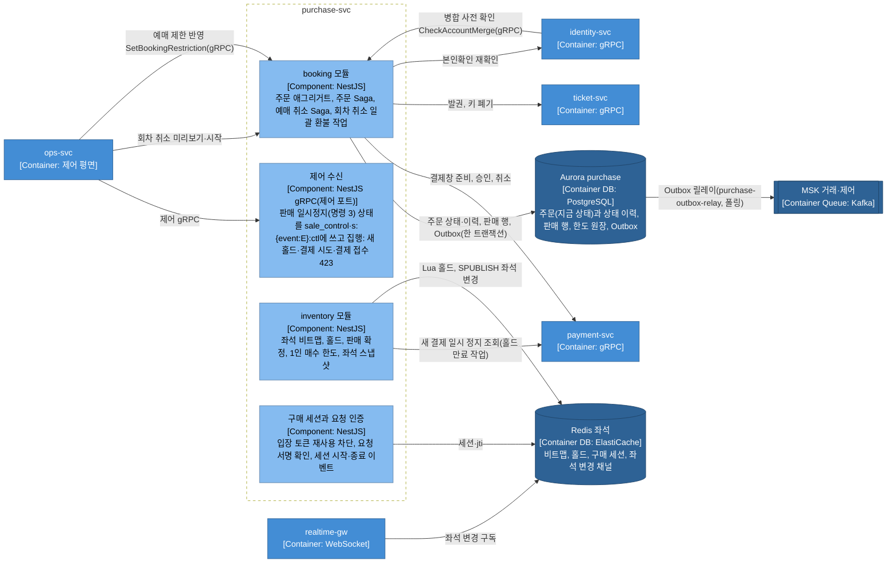

**payment-svc**

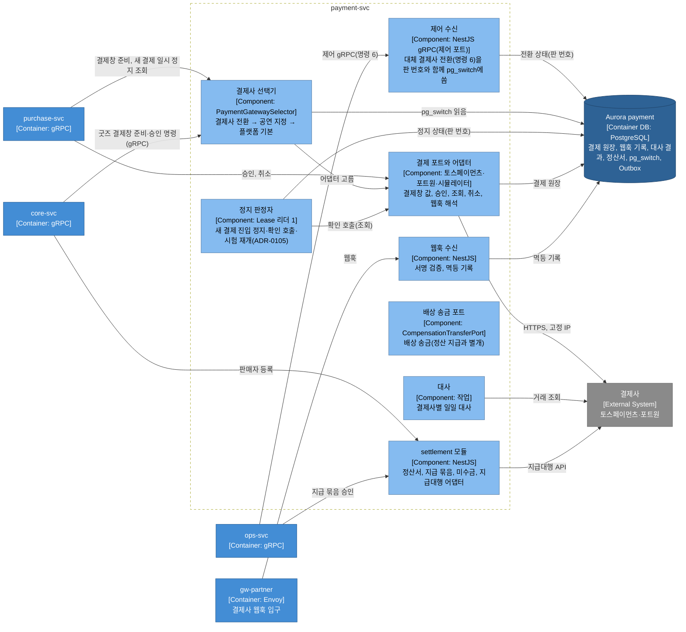

**queue-svc와 admission-ctrl**

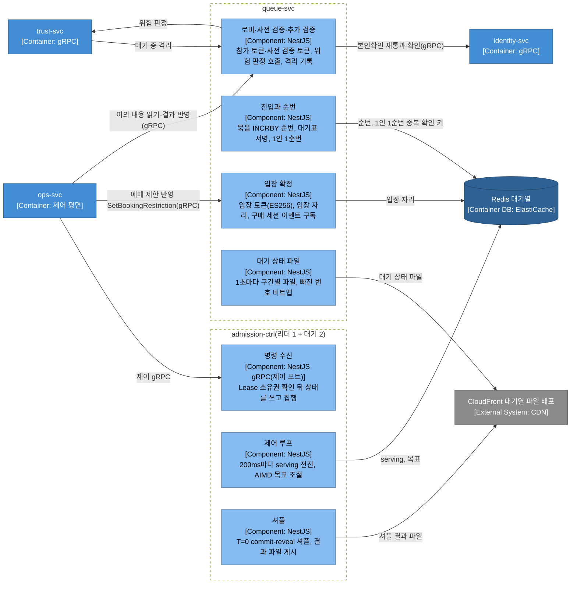

- 셔플 결과 파일은 admission-ctrl의 리더가 만들어 게시한다(docs/features/queue-admission.md §2, 이 문서 §9.4).

**trust-svc**

판정 요청은 점수기 목록 파이프라인 하나로 모이고, 대기 중 재평가는 따로 도는 작업자 `trust-reassess`가 Kafka와 Redis로 센다. 구성 요소 이름과 라벨 반영·허니팟 기록의 두 입구는 상세 설계(docs/features/bot-defense.md)의 추천 적용(2026-10-30)이다. 라벨 반영은 `TrustLabelService/ApplyLabel`이고, 허니팟 기록은 gRPC가 아니라 gw-fan이 넘기는 HTTP 경로다. 둘 다 docs/api/proto/README.md §3·§4에 있다(2026-10-30 확인, 추천 적용 2026-10-30). 같은 날 CS 이의 심사의 판정 근거 읽기 `TrustEvidenceService/GetVerdictEvidence`를 라벨 반영 구성 요소에 더했다(ops-svc만 부른다, docs/features/bot-defense.md §12). 관리 로그인의 사람 확인 토큰은 이 서비스가 아니라 identity-svc가 검증한다(bot-defense §6).

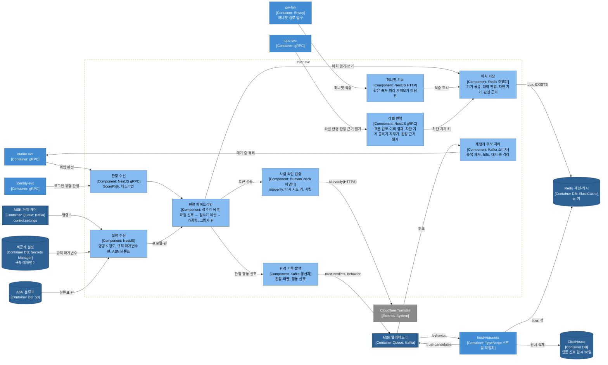

**ops-svc**

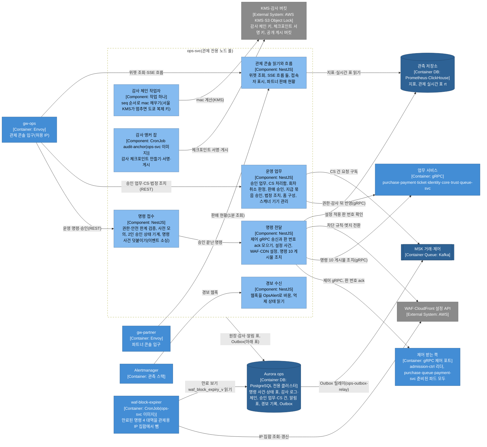

- 구성 요소마다 ops DB로 가는 선을 그리면 선이 엇갈려, 그림에는 묶음 단위 선 하나만 그렸다(docs/planning/03 §5.5). 구성 요소가 ops DB에 쓰고 읽는 것은 아래 표와 같다.

| 구성 요소 | ops DB에 쓰고 읽는 것 | 근거 |
| --- | --- | --- |
| 명령 접수 | 명령 사건 `command_event`(덧붙이기만 한다), 2인 승인 `command_approval`, 명령 상태 표, 감사 체인 행 `audit_chain`(mac은 비운다)을 한 트랜잭션에 쓴다 | docs/features/control-tower.md §4·§7, ADR-0102·0113 |
| 명령 전달 | 받는 쪽이 돌려준 적용 판 번호(ack), 설정 사건 `control.settings`의 Outbox 행 | control-tower §5, ADR-0103·0143 |
| 운영 업무 | 승인 업무 `approval_request`·`approval_vote`, CS 처리함 건 `cs_case`, 법정 조치 기록(`takedown_notice`·`data_request`·`security_incident`·`access_review`)과 그 감사 기록 | docs/features/transfer-refund.md §7, control-tower §9·§13 |
| 관제 콘솔 읽기와 흐름 | SSE 알림 표 `ops_push_event`를 파드마다 읽고, 접속자 표 `ops_presence`에 쓴다 | control-tower §12, ADR-0100 |
| 경보 수신 | 경보 기록 표 `ops_alert_record` | control-tower §8, ADR-0146 |
| 감사 체인 작업자 | `audit_chain`의 빈 mac을 `seq` 순서로 채운다. 가장 오래된 빈 행이 1분 [가정]을 넘으면 SEV2다 | control-tower §7, ADR-0102 |
| 감사 앵커 잡 | 감사 체크포인트 `audit_checkpoint`를 만들어 서명하고 공개 게시 버킷에 쓴다 | control-tower §7, docs/infra-handover.md, ADR-0075 |

- 동시 입장 목표 조정, 입장 일시정지, 판매 일시정지 같은 핵심 명령은 Kafka와 게이트웨이를 거치지 않고 제어 gRPC로 바로 보낸다. 명령의 효력은 메시지가 아니라 받는 쪽이 자기 저장소에 둔 제어 상태와 판 번호(그 범위·종류에서 늘어나기만 하는 수)로 정한다. ops-svc는 ack(받는 쪽이 그 판을 적용했다는 응답)를 모아 명령 상태로 보인다(docs/features/control-tower.md §4·§5, ADR-0102·0103). ops-svc가 모두 멈추면 비상 런북 Job이 같은 제어 포트로 보낸다(같은 문서 §5).
- 감사 체인 작업자는 명령을 쓰는 트랜잭션이 비워 둔 mac을 커밋 뒤에 채운다. 그래서 KMS(암호 키를 안전하게 보관하고 대신 써 주는 클라우드 서비스)가 느리거나 멈춰도 명령은 커밋된다. 다만 mac이 빈 동안의 행은 아직 변조 탐지를 받지 않는다(control-tower §7, ADR-0102).

**identity-svc**

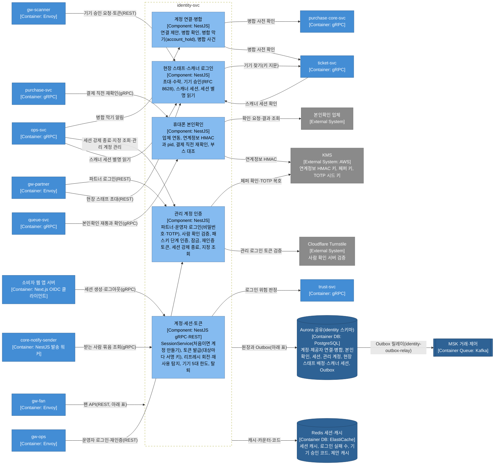

- gw-fan이 넘기는 팬 API는 구성 요소 넷으로 갈라지고, 저장소도 구성 요소 다섯이 함께 쓴다. 선이 엇갈리지 않게 그림에는 묶음 단위 선만 그렸다(docs/planning/03 §5.5). 갈래와 저장소는 아래 표와 같다.

| 구성 요소 | gw-fan이 넘기는 팬 API | identity 스키마와 Redis 세션·캐시 |
| --- | --- | --- |
| 계정·세션·토큰 | 토큰 갱신 `/v1/identity/access-tokens`, 로그인된 기기 `/v1/identity/sessions`, 로그인 수단 `/v1/identity/providers`, 탈퇴 `/v1/identity/account` | `account`·`account_provider`·`session`·`device`·`consent`, 세션 종료 사건 `control.sessions-terminated`의 Outbox, Redis 참조 세션 캐시 |
| 계정 연결·병합 | `/v1/identity/link-proposals/{proposalId}`, `/v1/identity/merge-proposals/{proposalId}`와 그 하위 경로 | `account_merge`·`account_hold`, 병합 사건 `identity.accounts-merged`의 Outbox, Redis 제안 캐시(`id:link:*`·`id:merge:*`) |
| 휴대폰 본인확인 | `/v1/identity/verifications`와 결과 경로, 부스 대조 `/v1/identity/booth-reverifications`, 미성년자 계약 취소 확인 `/v1/identity/minor-contract-checks` | `identity_verification`·`booth_reverification`(연계정보 원문은 두지 않는다) |
| 관리 계정 인증 | 없음(gw-partner·gw-ops로 받는다) | `admin_account`·`admin_passkey`·`admin_recovery_code`, Redis 로그인 실패 수 |
| 현장 스태프·스캐너 로그인 | 초대 수락 `/v1/staff-invitation-lookups`·`/v1/staff-invitation-acceptances`, 스캐너 승인 `/v1/device-approval-lookups`·`/v1/device-approvals` | `staff_assignment`·`scanner_session`, Redis 기기 승인 코드(`id:devauth:*`) |

- 2026-10-30에 이 그림에 선 다섯을 더했다: 알림 발송 워커의 받는 사람 묶음 조회, queue-svc의 본인확인 재통과 확인, ops-svc의 관리 계정 세션 강제 종료·지정 조회, 기기 승인 때 ticket-svc에 기기 찾기, 관리 로그인의 사람 확인 서버 검증(identity-svc가 직접 한다, docs/features/bot-defense.md §6). 호출 계약은 docs/api/proto/README.md §3에 있다(추천 적용 2026-10-30).
- 소셜 로그인의 인가 코드 교환은 소비자 웹 앱 서버가 하고, 제공자 토큰은 identity-svc에 오지 않는다(ADR-0119). 로그인 뒤의 요청은 게이트웨이가 공개키로 토큰을 확인하므로 identity-svc를 거치지 않는다(§3 '인증 담당과 요청 경로'). 근거는 docs/features/identity.md §2·§3이다.
- 패스키(기기 안의 키로 서명해 인증하는 표준 방식)는 TOTP를 대신하지 않고, 위험 명령·2인 승인·정산 계좌 변경 같은 작업의 단계 인증으로 쓴다. 서울 KMS가 응답하지 않으면 페퍼 확인과 TOTP 시드 복호는 도쿄 복제 키로 넘긴다(docs/features/identity.md §6·§10).

**ticket-svc**

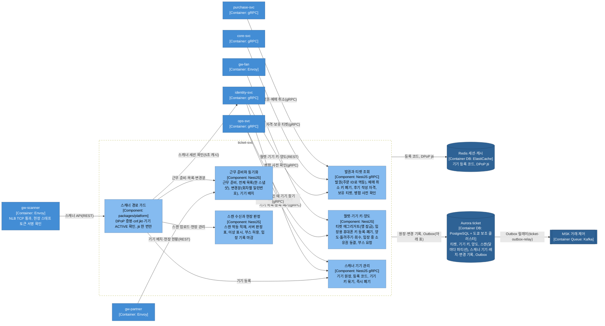

- 구성 요소마다 저장소로 가는 선을 그리면 선이 엇갈려, 그림에는 묶음 단위 선만 그렸다(docs/planning/03 §5.5). 구성 요소가 쓰고 읽는 것은 아래 표와 같다.

| 구성 요소 | 쓰고 읽는 것 | 근거 |
| --- | --- | --- |
| 발권과 티켓 조회 | `ticket`을 주문 ID로 한 번만 만들고, 같은 트랜잭션에 Outbox(`trade.tickets` ISSUED)를 쓴다. 예매 취소면 `device_key`를 폐기하고 `scanner_change`에 적는다 | docs/features/offline-gate.md §2·§5, ADR-0106 |
| 월렛·기기 키·양도 | `ticket` 행 잠금 안에서 양도·돌려주기·회수·취소·스캔 수신 가운데 하나만 성공시킨다. `device_key`, `transfer_offer`, `scanner_change`(키 등록·폐기) | offline-gate §2·§5, docs/features/transfer-refund.md §3·§4 |
| 스캐너 기기 관리 | 기기 원장 `scanner_device`, Redis 등록 코드 `scanner:enroll:{코드 SHA-256}` | offline-gate §6.1, ADR-0148 |
| 스캐너 경로 가드 | DPoP 증명의 `jti`를 Redis `scanner:dpop:{jti}`에 한 번만 넣고(`SET NX`), 기기 상태를 `scanner_device`에서 본다 | offline-gate §6.1, docs/data.md §3 |
| 근무 준비와 동기화 | 기기 배치 `scanner_placement`를 쓴다. 전체 목록은 `scanner_seq.last_seq`와 내용을 한 스냅샷(REPEATABLE READ)으로 읽고, 변경분은 `scanner_change`를 일련번호로 읽는다 | offline-gate §6.2·§6.3, ADR-0086 |
| 스캔 수신과 현장 판정 | `scan_event`(클라이언트 ID로 멱등), `gate_flag`·`gate_flag_scan`, `booth_authorization`, `scanner_change`(입장 상태·이상 표시) | offline-gate §6.5·§7·§9.1, ADR-0051·0086 |

- 스캐너 경로 가드는 `packages/platform`의 공통 가드다. 요청마다 DPoP(요청마다 기기 안의 키로 서명한 짧은 증명을 붙이는 표준, RFC 9449) 증명, 토큰에 묶인 기기 키 지문(`cnf.jkt`), 기기 상태를 확인한다(docs/features/offline-gate.md §6.1). 스캔 업로드는 현장 스태프 토큰 없이 기기 인증만으로도 받는다(같은 문서 §6.5).
- 공연 당일 ticket-svc가 멈춰도 스캐너는 내려받은 목록으로 오프라인 판정을 이어 가고, 기록은 복구 뒤 올린다. 도쿄 보조 클러스터는 티켓 원장의 보존과 복구 기준점이고 당일 조회에는 쓰지 않는다(docs/features/offline-gate.md §9).
- 그림을 처음 그릴 때 호출 계약이 정본에 없던 선이 둘 있었다. ticket-svc → identity-svc 스캐너 세션 확인(docs/features/offline-gate.md §6 흐름도)과 ops-svc → ticket-svc 승인된 양도 회수(docs/features/transfer-refund.md §4)다. 2026-10-30에 호출 계약 초안(`ScannerSessionCheckService/CheckScannerSession`, `TicketReclaimService/ReclaimTicket`)이 docs/api/proto/README.md §3에 생겼고, §3.2 통신 표에도 더했다(추천 적용 2026-10-30).
- 2026-10-30에 identity-svc가 기기 승인 로그인 때 기기 키 지문으로 등록 기기와 상태를 찾는 선(`ScannerDeviceLookupService/GetScannerDeviceByCredential`, docs/features/identity.md §6.1)을 더했다. 기기 원장의 주인이 ticket-svc라 identity-svc가 직접 읽지 않는다(추천 적용 2026-10-30).
- ticket-svc의 Redis 사용(등록 코드, DPoP `jti`)은 세션·캐시 클러스터의 `scanner:enroll:*`·`scanner:dpop:*` 키다(docs/data.md §3). §3.1 서비스 맵의 저장소 칸에도 적었다(추천 적용 2026-10-30).

## 4. API 게이트웨이: 클라이언트 유형별 분리 및 씬 게이트웨이 (ADR-0008)

외부 요청은 **CloudFront(+AWS WAF: 악성 요청을 걸러 내는 웹 방화벽) → NLB(네트워크 부하 분산기) → Envoy Gateway → 백엔드 서비스** 경로로 들어온다. CloudFront(AWS의 CDN) 배포는 일곱이다(www·queue·queue-files·api·partner·console·scanner). 그 가운데 피크가 큰 소비자 트래픽을 받는 셋(공연 페이지 www, 대기열 파일 queue-files, 대기열 API queue)은 배포마다 한도를 따로 두어 미리 올린다(docs/infra.md §4.1, ADR-0058·0144). Envoy Gateway(Envoy는 요청을 받아 안쪽 서비스로 넘기는 프록시 서버)가 L7 리버스 프록시를 혼자 맡으므로, 불필요한 ALB(Application Load Balancer)를 겹쳐 두지 않아 HTTP 프록시를 2중으로 거치는 비용을 없앴다. 유일한 예외로 현장 게이트 스캐너 트래픽은 CloudFront를 거치지 않고 따로 둔 공개 스캐너 NLB(TCP 패스스루)로 `gw-scanner`에 바로 들어온다. 배포 일곱 가운데 scanner 배포는 스캐너 PWA의 정적 화면(`scanner.peaket.example`)만 내고, 스캐너 API(`scanner-api`)는 이 배포를 거치지 않는다(docs/infra.md §4.1, 2026-11-01 정합). CloudFront가 부르는 원본 NLB는 둘이고, 둘 다 사설 서브넷의 VPC 원본이다(docs/infra.md §9, 기술 검토 낮음-009). 팬·파트너 원본 NLB는 gw-queue·gw-fan·gw-partner를, 관제 원본 NLB는 gw-ops만 받는다. 팬 쪽 NLB의 설정 실수나 포화가 관제 입구를 같이 막지 않게 하려고 관제 입구를 따로 뺐다(추천 적용 2026-10-29, ADR-0144 결정 1). 그래서 NLB는 스캐너 NLB까지 셋이다. 게이트웨이가 TLS(통신을 암호화하는 표준) 종단을 직접 하고, 단말기는 기기 키로 요청마다 서명한 DPoP 증명으로 확인한다(하드웨어 키가 필요한 운영 환경은 mTLS 클라이언트 인증서를 선택지로 직접 검증한다, 기술 검토 중간-057). CloudFront 엣지 계층에는 가벼운 엣지 함수(CloudFront Functions 또는 Lambda@Edge)를 두어, 완전 매진 응답과 진입 Degraded Mode(큰 장애 때 핵심을 지키려고 부가 기능을 줄여 버티는 운영 모드)의 도착 시각 쿠키 발급을 대신 맡긴다.

| 게이트웨이 | 담당 클라이언트 및 전담 라우트 | 인증 검증 방식 | 물리적 분리 이유 |
| --- | --- | --- | --- |
| gw-queue | 소비자 웹: 로비 입장(참가 토큰), 사전 검증 토큰 발급, 대기열 진입, 입장 확정, 대기 상태 파일과 셔플 결과 파일의 Origin(CDN 뒤에서 원본 파일을 주는 서버) | 팬 액세스 토큰 (httpOnly 쿠키) + 구매 권한 검증. 단, 정적 대기 상태 파일 경로는 인증 없이 열어 두고 쿠키를 넘기지 않아, CDN이 모든 사용자에게 같은 캐시로 응답한다 | 티켓 오픈 때 초당 20만 건(200,000 RPS)으로 몰리는 요청을 받는다. 대기열 인프라를 따로 늘리고 줄여 구매 계층을 보호한다 |
| gw-fan | 소비자 웹: 좌석 예매(스냅샷 조회, 홀드, 주문 생성, 결제 접수), 좌석 델타 WebSocket, 티켓 월렛과 양도, 굿즈 스토어, 관람 후기(사진 올리기·신고 포함), 고객 문의(ADR-0066), 본인확인(시작·결과), 홈 피드·검색·자동완성(인증 없음, CDN 캐시, ADR-0063·0094), 토큰 갱신, Next.js 앱 서버 프록시 호출, 허니팟 경로 `/_t/*` → `trust-svc`(소비자 웹 배포의 같은 출처 경로, 응답은 늘 204, 추천 적용 2026-10-30, docs/features/bot-defense.md §7) | 팬 액세스 토큰 (httpOnly 쿠키). 구매와 좌석 델타 라우트는 입장 토큰(admission_token)을 필수로 검증한다. 토큰 갱신은 리프레시 토큰 쿠키 전용이다 | 구매 경로는 입장이 허용된 5,000명 규모의 걸러진 트래픽이고, 그 밖의 경로는 평시 트래픽이므로 진입 폭주에서 물리적으로 떼어 놓는다 |
| gw-partner | 파트너 콘솔 UI 호출(공연 등록 같은 파트너 콘솔 API → `core-svc`, 파트너 로그인과 현장 스태프 초대 → `identity-svc`, 기기 배치·현장 현황(`device-placements`·`gate-status`) → `ticket-svc`, 실시간 판매 현황 → `ops-svc`. 경로별 서비스는 §3 ② 그림, identity·ticket 경로는 추천 적용 2026-10-30), 외부 PG사 웹훅 수신 (토스페이먼츠·포트원 웹훅 → `payment-svc`) | 파트너 관리 계정 세션 (MFA 다중 인증 필수). 웹훅 경로는 인증 없이 받되, `payment-svc`가 PG 결제 조회 API로 무결성을 다시 확인한다 | 멀티 테넌트 격리와 보수적인 레이트 리밋(일정 시간에 받는 요청 수의 상한) 정책 적용 |
| gw-ops | 중앙 관제 콘솔 (운영 명령·조회 REST, SSE 흐름 둘(`/v1/ops/live`, `/v1/ops/events/{eventId}/live`. 시간 초과를 끄고 응답을 모으지 않는다), 운영자 로그인 → `identity-svc`, ADR-0100) | 운영자 세션 (MFA 다중 인증) + 사내 허용 IP 대역. 경로는 CloudFront 관제 배포 → 관제 원본 NLB → gw-ops이고, 관제 배포에 연결한 웹 ACL의 맨 앞 규칙이 시청자 IP로 허용 목록을 거른 뒤 gw-ops가 원본 확인 머리와 `CloudFront-Viewer-Address`로 허용 IP를 한 번 더 본다(ADR-0144 결정 2). VPN으로만 닿는 내부 로드 밸런서는 관리 도구(Grafana·ArgoCD·Alertmanager)용이다 | 관제 입구를 사용자 경로와 나눈다. 원본 NLB도 팬 쪽과 따로 둔다(ADR-0144). 프록시 파드는 관제 전용 노드 풀에서 돌아 핫패스 노드의 포화와 떨어진다(ADR-0102) |
| gw-scanner | 현장 게이트 스캐너 PWA 기기 승인 로그인, 근무 준비, 회차 목록·변경분, 스캔 업로드, 현장 관리(CloudFront를 거치지 않는 직접 연결) | 기기 키 DPoP(운영자가 등록한 기기 키로 요청마다 서명한 증명, RFC 9449. 하드웨어 키가 필요한 운영 환경의 선택지는 기기 인증서 mTLS). 게이트웨이에서 TLS를 종단하고 현장 스태프 토큰(현장 스태프 토큰 키만 신뢰)의 서명·`aud`를 확인한다. DPoP 증명·`cnf.jkt`(기기 키 지문)와 세션·기기 상태는 스캐너 경로 공통 가드와 서비스가 요청마다 확인한다(ADR-0051, 추천 적용 2026-10-28, 기술 검토 중간-057) | 공연 당일 현장 입장 트래픽의 안정적 처리 |

- **클라이언트별 게이트웨이(격벽)를 둔 이유**: 범용 API 게이트웨이 하나 대신 클라이언트 경험별 전용 게이트웨이를 두었다. 이유는 격벽(배의 칸막이처럼 장애가 번지는 범위를 칸마다 가두는 것)이다. 게이트웨이는 응답을 조합하지 않으므로(아래 '4대 안티패턴') 샘 뉴먼(Sam Newman)의 BFF(Backends For Frontends, 화면마다 응답을 모아 조합하는 백엔드)가 아니다. 이 문서에서 BFF는 조합을 맡는 앱 서버(소비자 웹·파트너 콘솔의 Next.js 서버)만 가리킨다(추천 적용 2026-10-28, 기술 검토 낮음-005). Envoy Gateway는 Gateway 리소스별로 독립된 Envoy 프록시 파드 풀을 배포한다. 그래서 대기열 게이트웨이에 20만 RPS가 몰려 포화돼도 예매나 관제 게이트웨이의 프록시 파드는 그 부하를 받지 않는다. 같은 클러스터와 네트워크 경로를 함께 쓰는 부분의 간섭은 K1에서 진입 폭주 중 결제 접수 p99와 오류율로 잰다(docs/planning/01 §3.1).

| 게이트웨이가 수행하는 역할 | 구체적 구현 내용 |
| --- | --- |
| 인증 (Authentication) | 클라이언트 쿠키나 Authorization 헤더의 JWT(서명된 정보 묶음 형식의 토큰)를 비대칭 공개키(JWKS 인메모리 캐시)로 상태 없이 검증한다. 게이트웨이는 비밀키를 보관하지 않고 세션 DB도 조회하지 않는다. 만료·종료된 세션은 백엔드 서비스가 Kafka 이벤트를 받아 로컬에서 거부한다. |
| 인가 (Authorization) | 경로 단위로 토큰 대상(`aud`)과 스코프를 검증한다. 대기열과 구매 경로는 `ticket:buy` 권한을 필수로 요구한다. 역할은 토큰에 없고, 서비스의 `RolesGuard`가 요청마다 판정한다(소유자 결정 2026-10-31, ADR-0172). 주문 소유권 대조 같은 세부 비즈니스 인가는 도메인 서비스가 한다. |
| 공통 인프라 정책 | 레이트 리밋(핫패스는 Envoy 로컬 토큰 버킷, 일반 API의 사용자 단위 전역 한도는 Envoy Gateway 전역 레이트 리밋. 아래 '전역 레이트 리밋 서비스', 추천 적용 2026-10-28, 기술 검토 중간-084), CORS(다른 주소에서 온 요청을 브라우저가 허용할지 정하는 규칙) 헤더 제어(게이트웨이마다 허용 출처는 화면 호스트 하나, docs/infra.md §9. 라우트는 openapi에 적힌 메서드만 받으므로, 교차 출처로 부르는 경로의 생성 규칙에는 OPTIONS를 함께 넣어 사전 요청이 라우트에 맞고 CORS 정책이 응답하게 한다. 메서드를 좁힌 라우트에서는 사전 요청이 어느 라우트에도 맞지 않아 CORS 정책이 불리지 않고 404로 끝난다. Envoy Gateway CORS 안내서가 '대상 라우트가 OPTIONS를 받아야 CORS 필터가 동작한다'고 적는다(2026-10-29 확인, https://gateway.envoyproxy.io/docs/tasks/security/cors/ ). 표준 HTTPRoute CORS 필터는 v1.6.0부터 OPTIONS 라우트를 스스로 더하지만, SecurityPolicy에 같은 처리를 더하자는 제안(envoyproxy/gateway 이슈 #7372)은 아직 열려 있다. 그래서 생성 규칙의 OPTIONS는 그대로 두고 D-T42가 실제 동작을 본다, 추천 적용 2026-10-28, 기술 검토 낮음-020), CSRF(사용자가 모르게 다른 사이트가 요청을 보내게 하는 공격) 방어(아래 'CSRF 확인 규칙'), 요청 페이로드 크기 상한 강제, 표준 보안 헤더 주입(HSTS·`nosniff`, docs/infra.md §9). |
| 트래픽 라우팅 | 경로와 호스트 기반 라우팅, Argo Rollouts와 연동한 카나리(Canary) 가중치 분기. |
| 프로토콜 변환 및 헤더 정리 | 외부 클라이언트 헤더를 걸러 내고, 검증된 사용자 식별자(user_id, session_id, scopes, pid)를 내부 헤더로 넣는다. 서비스 메시는 내부 mTLS로 게이트웨이만 이 내부 헤더를 넣을 수 있게 신뢰 경계를 지킨다. |
| 통합 관측성 | 경로별 골든 시그널 수집, 게이트웨이 자체 오버헤드 지연시간 측정(전체 지연 − 업스트림 지연), W3C TraceContext 기반 분산 추적 Trace ID 주입. 클라이언트가 보낸 `traceparent`·`tracestate`·`baggage`는 라우팅·추적 전에 지우고 새 trace를 시작한다(지어낸 trace-id로 수집기 한 곳에 거대한 trace를 쌓는 공격을 막는다, docs/observability.md §6, 추천 적용 2026-10-28, 기술 검토 중간-066). |
| 1차 장애 격리 | 경로별 시간 초과 강제, 동시 요청과 대기 큐가 상한을 초과하면 바로 503 반환(`Retry-After` 헤더 부여), 계속 실패하는 업스트림 파드를 이상치로 제외(Outlier Detection), 빠른 실패(Fail-fast). |

**게이트웨이가 절대 하지 않는 4대 안티패턴**: 데이터베이스와 캐시 직접 접근, 트랜잭션 처리, 비즈니스 규칙 판정, 여러 마이크로서비스 응답 조합(Aggregation). 응답 조합이 필요한 화면은 클라이언트 전용 BFF 앱 서버(소비자 웹 Next.js, 파트너 콘솔 Next.js의 서버 컴포넌트)나 그 화면을 가진 서비스(관제는 ops-svc의 위젯 조회 REST)가 맡는다(ADR-0100). 이전 설계의 비대했던 `edge-api`는 공통 정책과 비즈니스 로직이 섞여 있고 Redis를 직접 다루는 결함이 있어 통째로 폐기했다.

| 게이트웨이에서 이전된 책임 | 이전된 목적지 서비스 | 이전 사유 |
| --- | --- | --- |
| 입장 확정 (입장 토큰 발급, 입장 자리 점유) | `queue-svc` | 비즈니스 상태를 바꾸고, 대기열 저장소에 트랜잭션을 기록해야 한다 |
| 입장 토큰 재사용 차단 (`jti` 무효화) | `purchase-svc` | 예매 세션 상태를 저장하고, 한 번만 쓰이도록 보장해야 한다 |
| 멱등키(Idempotency-Key) 저장 및 대조 | `purchase-svc`, `payment-svc` | 비즈니스 작업과 같은 저장소와 로컬 트랜잭션 안에서 처리되어야 한다 |
| 판매 일시정지(킬스위치) 집행 | `purchase-svc`(새 홀드·결제 시도 시작·결제 접수 423), `admission-ctrl` 리더(범위 안 serving 전진 멈춤), `queue-svc`(대기 상태 파일의 판매 상태 PAUSED) | 핵심 티켓 판매 비즈니스 규칙이다. 판매를 멈춘 채 입장을 들이면 입장한 사람의 차례와 구매 세션 시간이 헛되이 쓰이므로, 범위 안 입장도 멈춘다(추천 적용 2026-10-14, ADR-0062) |
| 구매 세션 요청 인증 확인 | `purchase-svc` (공통 라이브러리) | 쿠키·입장 토큰을 훔친 요청을 막는 소지 증명(요청 서명·일련번호, ADR-0050 결정 8). 봇 방어 수단으로 보지 않는다 |
| 토큰 유효성 검증 및 인프라 레이트 리밋 | API 게이트웨이 | 순수하게 무상태인 공통 인프라 정책이다 |

- **CSRF 확인 규칙(추천 적용 2026-10-15, ADR-0065 결정 5)**: 쿠키로 인증하는 쓰기 요청(POST·PUT·PATCH·DELETE)은 게이트웨이가 `Origin`을 그 게이트웨이의 허용 출처 목록과 대조하고, `Origin`이 없거나 목록에 없으면 403으로 거절한다. 결제사·파트너 웹훅(서명 검증)과 서버 사이 호출은 쿠키를 받지 않으므로 예외다. ADR-0008의 'Origin/Referer 검증'은 이 규칙으로 읽는다. 사전 요청이 생기지 않는 형식으로 받는 대기열 진입·입장 확정(docs/features/queue-admission.md §3)은 이 확인과 본문의 사전 검증 토큰·대기표, `SameSite=Strict` 쿠키가 함께 막는다(ASVS v5.0.0-3.5.1. ASVS는 OWASP가 만든 웹 앱 보안 검증 항목 목록이다).
  - 구현 수단(추천 적용 2026-10-28, 기술 검토 낮음-139): Envoy Gateway SecurityPolicy의 내장 CSRF 필터(`csrf`)를 쓴다. 이 필터는 쓰기 메서드 넷의 `Origin`이 요청 호스트나 `additionalOrigins` 가운데 하나와 같은지만 보고, 없거나 다르면 403을 준다. GET·HEAD는 늘 통과시킨다. 화면 호스트는 API 호스트와 다르므로 게이트웨이마다 허용 출처(화면 호스트 하나)를 `additionalOrigins`에 넣는다. 필터는 스킴을 비교하지 않고 호스트와 포트만 본다(Envoy Gateway API 문서, 2026-10-28 확인). 그래서 화면 호스트는 HSTS로 http 페이지가 열리지 않게 둔다(docs/infra.md §9). 웹훅 경로와 신청 알림 이메일의 한 번 누름 수신 거부(`POST /v1/subscription-opt-outs/{optOutToken}`, 메일 프로그램이 쿠키와 `Origin` 없이 보낸다, docs/features/notify.md §7.4)는 `Origin`이 없으므로 이 정책을 붙이지 않은 경로(HTTPRoute)로 받는다.
  - 이전 규칙의 '`Origin`이 없으면 `Sec-Fetch-Site`가 `same-origin`·`same-site`인지 본다'는 지운다. 내장 필터에는 그 대체 확인이 없고, 화면이 API 호스트로 보내는 쓰기는 모두 교차 출처 `fetch`(CORS 요청)라 지원 브라우저(NFR-019)가 `Origin`을 늘 싣기 때문이다. Fetch 표준은 CORS 요청이면 `Referrer-Policy: no-referrer` 페이지(본인확인 복귀 화면 등)에서도 `Origin`을 실제 출처로 싣고, `null`로 바꾸는 것은 CORS가 아닌 쓰기(양식 전송, `no-cors` 요청)뿐이라고 정한다(2026-10-28 확인). 쿠키로 인증하는 쓰기 경로는 그런 형식을 받지 않는다. 남는 위험: 앞으로 양식 전송으로 받는 쓰기 경로를 만들면 `no-referrer` 페이지에서 403이 난다. 그런 경로는 이 절을 먼저 고친다.
  - 소비자 웹 앱 서버의 로그인 경로(추천 적용 2026-11-03, BUILD_ORDER PRF-020): 로그인 시작·로그아웃·재인증 시작·재인증 결과 받기(docs/features/identity.md §2)는 게이트웨이를 거치지 않는 같은 출처 양식 전송이라 앱 서버가 `Origin`을 소비자 웹 출처와 대조한다. `no-referrer` 화면의 양식 전송은 `Origin: null`이 되므로, 그때만 `Sec-Fetch-Site: same-origin`이면 받는다. 이 머리는 브라우저가 붙이고 스크립트가 바꾸지 못하며, 다른 사이트의 양식과 샌드박스 틀은 `cross-site`라 막힌다. `Origin`도 `Sec-Fetch-Site`도 없으면 거절한다.
- **핫패스(Hot Path)의 Next.js 우회 원칙**: 대기열 진입, 좌석 홀드, 결제 접수처럼 부하가 아주 큰 핫패스 API는 Next.js Route Handler를 절대 거치지 않고 브라우저에서 게이트웨이로 바로 간다. 액세스 토큰은 `httpOnly` 쿠키로 보내고, Envoy Gateway가 쿠키에서 JWT를 직접 꺼내 검증한다. Next.js는 정적 페이지를 그리는 일과 핫패스가 아닌 화면의 데이터 조합에만 쓴다.
- **토큰 서명 및 암호화 체계**: 팬 액세스 토큰(`identity-svc`)과 입장 토큰(`queue-svc`)은 ES256 비대칭 서명을 쓰고, 게이트웨이는 공개키로만 검증한다. 대기표 토큰은 `queue-svc` 혼자 발급하고 검증하므로 HMAC 대칭키를 써서 CPU 오버헤드를 최소로 줄인다(`ADR-0011`).
- **인프라 이중화 및 고가용성**: 각 게이트웨이는 최소 3개의 가용 영역(AZ: 리전 안의 독립된 데이터센터 묶음)에 걸쳐 복제본을 고르게 나눠 배포한다. NLB의 교차 영역 부하 분산(Cross-Zone Load Balancing)을 켜서, AZ 하나에 장애가 나도 트래픽 단절을 막는다. NLB 셋 모두 영역 빼기(zonal shift, 망가진 AZ로 새 연결을 보내지 않게 하는 NLB 기능)를 켜 두고, AZ 하나가 망가졌다고 판단하면 RB-13에서 사람이 그 AZ를 뺀다. 온세일 중에 사람이 모르는 용량 감소가 생기지 않게 자동 영역 빼기(autoshift)는 쓰지 않는다. 대형 온세일 프리워밍 때는 gw-queue·gw-fan(공연 당일은 gw-scanner도)의 복제 수를 '필요 복제 × 1.5 [가정]'으로 AZ 셋에 고르게 둬, AZ 하나를 잃어도 남은 둘이 피크를 받게 한다(추천 적용 2026-10-29, ADR-0144 결정 4). PodDisruptionBudget(PDB) 설정, 요청 수 기반 수평 확장(HPA), 티켓 오픈 전 프리워밍을 필수로 적용한다.
- **전역 레이트 리밋 서비스(추천 적용 2026-10-28, 기술 검토 중간-084)**: 사용자 계정 단위 한도는 Envoy Gateway의 전역 레이트 리밋으로 한다. Envoy가 레이트 리밋 서비스(Envoy 프로젝트의 ratelimit 서버, Envoy Gateway가 배포하고 관리한다)에 gRPC로 묻고, 그 서비스가 카운터를 세션·캐시 Redis에 둔다(Envoy Gateway 문서, 2026-10-28 확인). 이것이 ADR-0008 결정 4의 '전용 레이트 리밋 서비스'다. 이전 문서의 'rate-limit-svc'와 '백엔드 래칫'은 이 배포를 가리키던 말이고, 정의 없이 쓰던 '래칫'은 지운다.
  - 대상: 일반 API 경로만이다(gw-fan의 핫패스 밖 경로, gw-partner). 대기열 진입·좌석 홀드·결제 접수 같은 핫패스는 지금처럼 Envoy 로컬 토큰 버킷만 쓴다. 판정 키는 게이트웨이가 검증한 뒤 넣은 내부 사용자 헤더(계정·테넌트)다. 한도는 docs/api/guidelines.md §6이다. gw-ops는 전역 레이트 리밋에 붙이지 않는다. 이 서비스는 공유 세션·캐시 Redis와 일반 노드 풀에 기대는데, ADR-0102가 관제 평면을 거기서 뗐기 때문이다. gw-ops 경로의 계정당 한도는 gw-ops 로컬 토큰 버킷(내부 사용자 헤더 기준, 파드마다 따로 센다)으로 걸고, 실효 상한은 'gw-ops 파드 수 × 한도'다. 관제 사용자가 적어 이 느슨함을 받아들이고, 정확한 상한이 필요해지면 ops-svc가 ops DB로 센다(추천 적용 2026-10-29, ADR-0145 결정 1).
  - 배치: 일반 노드 풀의 Deployment, 2개 [가정](AZ에 나눔, Envoy Gateway의 `rateLimitDeployment`·PDB 설정). 업무 서비스가 아니라 게이트웨이 부품이라 서비스 10개에는 세지 않는다.
  - 장애 때: 응답을 받지 못하면 열림(통과)이다. Envoy Gateway의 기본값(`failClosed` 끔, 판정 시간 상한 20ms)을 그대로 쓴다. 이때도 게이트웨이 로컬 한도가 마지막을 지키고(docs/data.md §3의 등급 C 카운터), 열림이 이어지면 SEV3(`kind` cause)로 알린다 [가정, wbs 2.11.1에서 확정]. 닫힘(500)을 고르지 않는 것은 일반 API 전체를 레이트 리밋 서비스 하나에 묶지 않으려는 것이다.
  - 버킷은 경로마다 따로다(Envoy Gateway는 정책을 게이트웨이에 걸어도 경로마다 카운터를 둔다). 경로를 묶어 세야 하는 한도(계정당 분당 60회)는 공유 설정(`shared`)으로 한 버킷에 묶는다 [가정, PoC에서 확인].
- **게이트웨이 지연시간 예산**: 게이트웨이 자체 오버헤드는 p99 기준 3ms 이내로 엄격히 관리한다. 공개키 인메모리 캐싱, 핫패스 로컬 레이트 리밋, 업스트림 커넥션 풀 재사용, 요청 본문 무버퍼링 스트리밍으로 지연을 최소로 줄인다.

## 5. 장애 격리, 디스커버리, 제어 평면 요약

- **2단계 장애 격리 아키텍처 (`ADR-0009`)**:
  - **1차 엣지 차단 (Envoy Gateway)**: 경로마다 시간 초과를 둔다. 동시 요청이나 대기 큐가 상한을 초과하면 바로 503과 `Retry-After`를 돌려준다. 연달아 실패하는 파드는 자동으로 퇴출한다(Outlier Detection). 시스템이 과부하이면 핵심이 아닌 경로(관람 후기, 굿즈)부터 단계적으로 막는다.
  - **2차 서비스 내부 차단 (Opossum Circuit Breaker)**: 서비스 간 gRPC 호출, PG 결제 승인, Cloudflare Turnstile(사람 확인 서비스), 본인확인기관, 알림 발송 같은 모든 외부 의존성마다 따로 서킷 브레이커(계속 실패하는 호출을 잠시 끊어 장애가 번지지 않게 하는 장치)와 벌크헤드(Bulkhead)를 둔다.
  - **재시도 예산 및 백프레셔**(백프레셔: 받는 쪽이 밀리면 보내는 쪽을 늦추게 하는 장치): 네트워크 재시도는 서비스 메시(Istio) 한 층에서만, 허용된 예산(최대 1회) 안에서 한다. Istio 기본값(2회)은 아래 '메시 기본값 덮어쓰기'로 바꾼다(ADR-0082). 상태를 바꾸는 업무 요청(홀드, 주문, 결제 접수)은 멱등키가 있어도 게이트웨이 수준에서 함부로 재시도하는 것을 엄격히 금지한다. 같은 요청을 겹쳐 보내는 투기적 재시도(Hedged Request)는 어느 경로에도 쓰지 않는다. 좌석 스냅샷 재요청도 시간 초과 뒤 브라우저가 `Retry-After`와 지터를 지켜 다시 묻는다(ADR-0117). PG 승인 재시도는 업무 흐름(`payment-svc`)에서 10분 데드라인 안에서만 안전하게 한다.
- **서비스 디스커버리 (`ADR-0010`)**: Netflix Eureka 같은 불필요한 별도 디스커버리 서버는 빼고, 쿠버네티스(컨테이너로 만든 앱을 여러 서버에서 실행하고 관리하는 플랫폼) 표준 Service DNS와 EndpointSlice를 쓴다. 내부 gRPC 통신의 L7 부하 분산은 서비스 메시(Istio 앰비언트 모드, ADR-0082)에서 gRPC를 받는 서비스의 웨이포인트가 HTTP/2 스트림 단위로 맡는다. 모든 파드는 `readinessProbe`와 `preStop` 라이프사이클 훅을 갖춘다(프로브 규칙은 아래, ADR-0070). 판매가 열리는 시각 앞뒤의 변경 동결 창(대형·중형은 T-90분~T+60분의 모든 운영 변경, 소형은 T-50분~T+60분의 핫패스 묶음)에는 새 배포를 시작하지 않는다. 진행 중인 카나리 중단, 이전 다이제스트로 되돌리기, 릴리스 플래그(배포한 코드의 공개 여부를 코드 변경 없이 켜고 끄는 설정) 끄기 같은 긴급 변경과 관제 명령은 허용한다(`POL-028`, ADR-0054 결정 13). `admission-ctrl` 리더 노드는 Kubernetes Lease로 선출된다. 리더는 제어 명령을 실행하기 직전 Lease 소유권을 다시 확인하고, 대기열 Redis 쓰기는 리더 세대로 펜싱한다(`ADR-0056`).
- **메시와 앱의 책임 경계(2026-10-22, ADR-0082)**: 운영 설계의 메시는 Istio 앰비언트 모드다. 노드 프록시(ztunnel)가 모든 서비스 사이 연결을 L4 mTLS로 감싼다. 서비스 사이 gRPC를 받는 서비스(§3.2 서비스 간 통신 매트릭스의 gRPC 행에서 받는 쪽)만 서비스 단위 웨이포인트를 둔다. 웨이포인트에는 요청 단위 분산, 재시도, 시간 초과, 연결 상한, 이상 파드 퇴출을 맡긴다. 그 서비스의 L4 정책은 포트마다 따로 둔다(아래 '포트별 허용 표'). 업무 gRPC 포트만 웨이포인트 신원을 받고, 게이트웨이가 바로 보내는 REST 포트와 다른 내부 포트는 각자의 신원을 받는다. 웨이포인트 경로의 p99 증가가 §9.4 기준을 넘는 서비스만 사이드카로 둔다. 게이트웨이는 파드 주소로 바로 보낸다(Envoy Gateway 기본 `routingType: Endpoint`). 그래서 게이트웨이에서 서비스로 가는 구간은 웨이포인트를 지나지 않고, 노드 프록시가 암호화만 더한다. 관제 제어 gRPC 포트의 제어 전용 Service(ADR-0102. 업무 gRPC를 받는 서비스라도 이 Service에는 웨이포인트를 붙이지 않는다)와 스트림 작업자 파드(gRPC를 받지 않는다, ADR-0099)에는 웨이포인트를 두지 않는다. 나누는 기준은 하나다. 메시는 연결과 전송을 맡고, 앱은 업무의 뜻이 담긴 판단을 맡는다.

  포트별 허용 표(추천 적용 2026-10-28, 기술 검토 중간-071): 한 서비스가 업무 gRPC와 게이트웨이 REST를 함께 받으므로(purchase-svc·payment-svc·identity-svc·queue-svc·core-svc·ticket-svc, 그리고 허니팟 경로를 받는 trust-svc. 뒤의 둘은 추천 적용 2026-10-30), '웨이포인트 신원만'을 서비스 전체에 걸면 게이트웨이 요청이 받는 쪽 노드 프록시에서 거절된다. 그래서 받는 쪽 노드 프록시의 L4 인가 정책은 포트(받는 쪽 포트 번호)마다 허용 신원을 둔다. Istio 문서는 웨이포인트를 지난 연결은 받는 쪽에서 웨이포인트의 신원으로 보이므로, 부르는 쪽 신원으로 거르는 정책은 웨이포인트에 붙이라고 한다(2026-10-28 확인). 포트폴리오의 로컬·CI·데모는 메시가 없어 같은 표로 NetworkPolicy를 만든다(신원 대신 파드 라벨). 표와 실제 정책이 같은지는 D-T36이 본다.

  | 받는 포트 | 받는 서비스 | 받는 쪽 노드 프록시가 허용하는 신원 | 웨이포인트가 허용하는 신원 |
  | --- | --- | --- | --- |
  | 업무 gRPC 포트 | §3.2 gRPC 행의 받는 쪽(payment-svc·ticket-svc·trust-svc·queue-svc·identity-svc·core-svc·purchase-svc·image-worker·seatmap-worker) | 그 서비스의 웨이포인트 하나 | §3.2 gRPC 행에서 그 서비스를 부르는 서비스만(예: payment-svc는 purchase-svc·core-svc·ops-svc, image-worker는 core-svc만, identity-svc는 `SessionService`에 소비자 웹 앱 서버만·`IdentityService`에 purchase-svc만(기술 검토 중간-083)·`AccountHoldService`·`ScannerSessionQueryService`에 ops-svc만, purchase-svc·ticket-svc·core-svc는 `AccountMergeCheckService`에 identity-svc만, ticket-svc는 `ScannerDeviceService`에 ops-svc만, core-svc는 `SupportCaseService`·`CatalogAdminService`에 ops-svc만(추천 적용 2026-10-29, ADR-0148). identity-svc는 `ScannerSessionCheckService`에 ticket-svc만·`RecipientQueryService`에 `core-notify-sender`만·`AdminSessionService`·`AdminDesignationService`에 ops-svc만·`ReverificationCheckService`에 queue-svc만, trust-svc는 `TrustService`에 queue-svc·identity-svc만·`TrustLabelService`·`TrustEvidenceService`에 ops-svc만, queue-svc는 `QueueService`에 trust-svc만·`VerificationAppealService`에 ops-svc만, ticket-svc는 `TicketReclaimService`에 ops-svc만·`ScannerDeviceLookupService`에 identity-svc만(추천 적용 2026-10-30, docs/api/proto/README.md §2 '부르는 쪽 확인'). identity-svc는 `AdminAccountService`에 ops-svc만, queue-svc·purchase-svc는 `BookingRestrictionService`에 ops-svc만, core-svc는 `BookingRestrictionViewService`에 ops-svc만, seatmap-worker는 `SeatmapImportService`에 core-svc만(2026-10-30에 더한 넷, 소유자 결정 open-items 73·75번·70번 ②, 허용 목록은 추천 적용 2026-10-30)) |
  | REST 포트 | 게이트웨이 뒤의 서비스 | 그 서비스로 경로를 보내는 게이트웨이(HTTPRoute가 그 서비스를 가리키는 `gw-*`, §4)만. trust-svc의 REST 포트는 gw-fan만 받는다(허니팟 기록 경로 하나, docs/features/bot-defense.md §7, 추천 적용 2026-10-30) | 지나지 않는다 |
  | 제어 gRPC 포트 | admission-ctrl·purchase-svc·queue-svc·payment-svc(명령 6 대체 결제사 전환, ADR-0143) | ops-svc와 비상 런북 Job(`ops-breakglass`)(ADR-0053 결정 11, ADR-0102) | 지나지 않는다(웨이포인트 없는 제어 전용 Service) |
  | 지표 포트(`/metrics`) | 모든 서비스와 작업자 | 클러스터 Prometheus | 지나지 않는다 |

  표에 없는 포트·신원은 기본으로 거절한다(정책이 걸린 파드는 허용 규칙에 맞는 연결만 받는다, Istio 문서). 남는 위험: 허용된 신원을 가진 파드가 탈취되면 그 파드가 허용받은 포트에는 닿는다. 신원은 '어느 서비스가 불렀나'만 알려 주므로 사용자 권한은 앱이 따로 확인한다(아래 표 '서비스 사이 암호화와 신원').

  | 기능 | 메시에 맡김 | 앱에 남김 | 이유 |
  | --- | --- | --- | --- |
  | 재시도 | 서버 앱에 닿지 않은 요청의 전송 재시도 1회, 재시도 예산 안 | 결제 승인 확인 같은 업무 재시도(같은 멱등키, 10분 안), 브라우저의 `Retry-After`와 지터(재시도 시각을 일부러 조금씩 흩뜨리는 것) | 업무 재시도는 결과를 확인하고 다시 묻는 규칙이라 프록시가 모른다. 두 층이 함께 재시도하면 횟수가 곱해진다 |
  | 시간 초과 | 호출 한 번의 상한(안전망) | 남은 시간(데드라인) 계산과 다음 호출로 전달 | 프록시는 들어온 요청과 그 때문에 나간 요청의 관계를 모른다. 같은 이유로 Istio도 추적 헤더 전달을 앱에 맡긴다 |
  | 서킷 브레이커 | 연결·동시 요청 상한, 이상 파드 퇴출 | opossum 차단기와 대체 응답(Degraded), 의존성별 연결 풀 분리(벌크헤드) | 프록시는 막을 때 503만 돌려준다. 대신 보여 줄 것은 앱만 안다 |
  | 부하 분산 | gRPC 요청 단위 분산 | 없다 | 앱이 파드 주소로 보내면 앰비언트에서는 그 서비스의 웨이포인트를 건너뛴다 |
  | 여러 언어 통신 | 언어와 상관없이 같은 암호화·정책 | 계약(protobuf·Avro 스키마), 언어별 SDK의 데드라인·추적 헤더 전달 | 업무 서비스와 스트림 작업자가 모두 Node.js다(ADR-0099). 그래도 언어별 통신 공통 라이브러리는 만들지 않고 메시와 계약에 맡긴다 |
  | 서비스 사이 암호화와 신원 | 파드 사이 mTLS, 서비스 신원 허용 목록(identity-svc `SessionService`, 제어 포트) | 메시 밖 대상의 TLS(Aurora·ElastiCache·MSK·ClickHouse, 결제사·본인확인·알림 같은 외부 API), 사용자 인증·권한(JWT·세션). MSK는 AWS가 운영해 주는 Kafka다 | 메시 밖은 메시가 암호화하지 못한다. 메시 신원은 어느 서비스가 불렀는지만 알려 준다 |
  | 관측 | 서비스 쌍별 요청 수·오류·지연(웨이포인트), 연결 지표(노드 프록시) | OTel SDK(추적 헤더 전달, 업무 속성 스팬), SLO 지표(표준 칸, ADR-0077), 업무 지표 | 메시 지표의 칸은 알파 기능 주석으로만 바꿀 수 있어 SLO 경계와 맞추기 어렵다 |

  앱 코드에는 일반 네트워크 재시도, 클라이언트 쪽 부하 분산, 파드 사이 TLS를 넣지 않는다. 메시와 함께 켜지면 재시도가 곱해진다(두 층이 2회씩이면 한 요청이 최대 9번). 파드 주소로 나누면 웨이포인트를 건너뛴다. 앱 TLS는 메시가 요청 내용을 보지 못하게 한다.

  다시 볼 대안: 앰비언트 L4 + 클라이언트 쪽 gRPC 분산(추천 적용 2026-10-28, 기술 검토 낮음-166). 웨이포인트를 두지 않고 노드 프록시의 L4 mTLS만 쓰며, gRPC 부하 분산은 헤드리스 Service와 grpc-js `round_robin`(채널 설정), 재시도는 gRPC 서비스 설정(JSON)으로 하는 안이다. 포트폴리오 측정용 로컬 오버레이가 이미 이 방식이다(아래 '메시 없는 실행'). 기각 이유를 '분산 코드가 앱으로 돌아온다'만으로 두지 않고, ADR-0010 재검토 때 아래 운영 비용 항목으로 견준다.
  - 웨이포인트 쪽 비용: 웨이포인트 수(gRPC를 받는 서비스마다 하나, AZ 셋·PDB·오토스케일), 웨이포인트의 CPU·메모리, Istio 업그레이드 때 웨이포인트 차례와 영향(docs/devops.md §9.4).
  - 클라이언트 쪽 비용: 새 파드를 알기까지의 지연. grpc-js의 DNS 다시 찾기는 기본 최소 간격이 30초(`grpc.dns_min_time_between_resolutions_ms`)라, 서버 `grpc.max_connection_age_ms`로 연결을 주기적으로 끊어 다시 찾게 해야 한다. 이상 호스트 제외는 grpc-js에 이상 감지 부하 분산 정책(`outlier_detection`, 소스 `load-balancer-outlier-detection.ts`. 기능 자체는 기본으로 들어 있고, 서비스 설정에 적으면 쓴다. 기본 퇴출 30초·최대 10%)이 있다(grpc-node 소스, 2026-10-28 확인). L7 인가 정책(웨이포인트의 부르는 쪽 신원 거르기)은 이 안에서 앱 가드나 노드 프록시의 L4 허용 목록으로 옮겨야 한다.
  - 판단 기준: 같은 시험(메시 정책 시험 D-T36, 롤링 재시작 중 오류율)에서 두 안의 오류율·p99가 같고 웨이포인트 운영 비용이 클라이언트 쪽 설정 비용보다 크면 이 안으로 바꾸는 새 ADR을 쓴다. 헤지 요청은 어느 안이든 쓰지 않는다(ADR-0117).

  메시 기본값 덮어쓰기(방향은 소유자 승인, 값은 추천 적용 2026-10-22):

  | 항목 | Istio 기본(2026-10-22 문서) | 이 설계 |
  | --- | --- | --- |
  | 재시도 | 2회, `connect-failure,refused-stream,unavailable,cancelled`(MeshConfig `defaultHttpRetryPolicy`로 바꿈) | 메시 전체 1회, `connect-failure,refused-stream`(요청이 서버 앱에 닿지 않은 경우). `unavailable`은 읽기 전용 경로에만 더한다. gRPC 상태 코드 문서가 멱등하지 않은 작업의 재시도는 늘 안전하지는 않다고 적기 때문이다 |
  | 재시도 예산 | DestinationRule `retryBudget`, 진행 중 요청의 20% | 10% [가정, wbs 4.6.1에서 확정] |
  | 시간 초과 | 없다 | 호출 경로마다 앱 데드라인 상한보다 조금 길게 둬 앱 데드라인이 먼저 끝나게 한다 |
  | 이상 파드 퇴출 | 설정하지 않으면 없다(설정하면 연속 5xx 5회, 검사 10초, 퇴출 30초, 최대 10%) | 게이트웨이와 같은 원칙이다. 앱의 과부하 거절은 429 `server-busy`라 연속 5xx에 들지 않고, 최대 퇴출 비율은 10%다(추천 적용 2026-10-28, 기술 검토 낮음-140). gRPC의 `RESOURCE_EXHAUSTED`(벌크헤드 가득)가 웨이포인트의 연속 5xx로 세어지는지는 wbs 4.6.1에서 확인한다(ADR-0069) |
  | 부하 분산 | 최소 요청 | 그대로 쓴다. 일관된 해시(ring hash·Maglev)는 핫패스에 쓰지 않는다. 공연 ID로 걸면 인기 공연 하나가 파드 몇 개에 몰린다. 느슨한 고정이라 파드가 늘거나 줄면 깨진다 |
  | mTLS | PeerAuthentication 모드가 없으면 PERMISSIVE(평문도 받는다) | 메시 전체 STRICT, 최소 버전 `TLSV1_3`(`meshConfig.meshMTLS.minProtocolVersion`. 노드 프록시에 걸리는지는 wbs 2.11.2에서 확인한다) |
  | 인증서 | istiod가 자체 서명 루트로 발급한다 | 운영은 오프라인 루트가 발급한 중간 CA를 `cacerts`로 꽂는다. 워크로드 인증서는 노드 프록시가 그 노드 파드의 신원마다 받아 메모리에만 둔다 |
  | 설정 API | VirtualService는 앰비언트에서 알파이고, EnvoyFilter는 웨이포인트에서 지원하지 않는다 | Gateway API(HTTPRoute)와 DestinationRule·AuthorizationPolicy·PeerAuthentication만 쓴다 |
  | 추적 | 제공자를 설정하면 프록시가 스팬을 낸다 | 끈다. 앱 OTel 스팬이 정본이다 |

  웨이포인트의 L7 정책은 웨이포인트를 지난 트래픽에만 걸린다. 업그레이드 순서와 노드 단위 영향은 docs/devops.md §9.4다.
- **메시 없는 실행(2026-10-22, ADR-0082)**: 포트폴리오 기간의 로컬·CI·데모 실행(docs/verification.md §5.1)은 메시 없이 돈다. 예비 공통 코드를 두지 않고 라이브러리 기본 기능과 설정·정책으로 메운다.
  - 재시도: gRPC 라이브러리의 투명 재시도만 남는다. 연결에 오르지 못한 요청과, 서버 라이브러리가 앱에 넘기기 전에 거절한 요청(`REFUSED_STREAM`, GOAWAY 뒤의 스트림)을 설정 없이 다시 보낸다(gRPC A6, grpc-js). 서버가 처리했을 수 있는 실패는 다시 보내지 않으므로 차단기와 대체 응답이 받는다.
  - 부하 분산: 게이트웨이에서 서비스로 가는 구간은 게이트웨이가 요청마다 파드를 고른다. 서비스 사이 gRPC는 Service 이름과 pick_first(기본)를 쓴다. 데모는 서비스마다 1벌이고 측정은 파드 하나로 잰다(ADR-0057). 서비스 사이 gRPC를 여러 벌로 재야 하는 측정에서만 로컬 오버레이 설정으로 헤드리스 Service·`round_robin`·서버 `grpc.max_connection_age_ms`를 켠다(docs/api/guidelines.md §5).
  - 암호화와 호출자 제한: 로컬 클러스터 안은 평문이다(합성 데이터만). 호출자 제한은 NetworkPolicy가 파드 라벨로 대신한다.
  - 롤링 재시작 때 요청을 지키는 것은 우아한 종료와 투명 재시도다. NestJS 종료 설정 두 개는 docs/devops.md §6.4다. 운영 오버레이는 메시가 있어야 배포된다(docs/devops.md §4.3).
- **장애 감지 층(2026-10-22, ADR-0082)**: 앱 수준의 가십·멤버십 감지(서버끼리 생존 소문을 퍼뜨려 고장을 찾는 방식)는 두지 않는다. 감지는 각 층의 제품이 한다. Redis Cluster는 가십으로 서로 확인하고, 마스터 과반이 동의해야 고장으로 확정한다. 장애 조치는 관리형이다. Kafka(KRaft)는 브로커 심장 박동과 펜싱, 쿠버네티스는 노드 Lease 심장 박동과 프로브(컨테이너 상태를 주기적으로 묻는 검사, 아래 '프로브 규칙'), Aurora·ElastiCache는 자동 장애 조치, 게이트웨이와 메시는 이상 파드 퇴출, 리더는 Lease와 세대 펜싱(ADR-0056), 관측 스택 자체는 외부 감시와 데드맨 스위치(docs/observability.md §10)가 맡는다. 쿠버네티스와 다른 두 번째 생존 판단을 두면 둘이 엇갈릴 때 누가 맞는지 정할 수 없고, 리더가 둘이 되는 문제는 감지가 아니라 펜싱으로 막아야 하기 때문이다.
- **제어 평면(Control Plane)의 격리(2026-10-28, ADR-0102·0103)**: 운영 명령이 내려가는 경로는 '운영자 명령 발행 → `ops-svc` 유효성 검증과 명령별 승인(1인 승인 또는 2인 상호 승인, POL-021) → 불변 이벤트 소싱 감사 로그 기록(KMS를 부르지 않고 커밋, 감사 체인은 커밋 뒤 작업자가 잇는다) → 제어 상태 전달 → 집행하는 모든 곳이 판을 적용했다는 ack' 단계를 차례로 거친다. 실제로 떼어 놓은 것과 함께 쓰는 것은 아래와 같다(소유자 승인 '추천안 동의', 세부는 추천 적용).
  - 떼어 놓은 것: Kafka와 게이트웨이·웨이포인트(긴급 명령은 웨이포인트 없는 제어 전용 gRPC 포트로 바로 간다), 핫패스 노드(gw-ops·ops-svc는 관제 전용 노드 풀), identity와 함께 쓰던 Aurora 쓰기 인스턴스(ops 전용 Aurora 클러스터), 공유 세션·캐시 Redis(SSE 알림은 ops DB 표로 나눈다, ADR-0100), KMS·신원 제공자 한쪽의 장애(안전 쪽 명령은 둘 중 하나가 멈춰도 낼 길이 있다, docs/features/control-tower.md §3).
  - 함께 쓰는 것: 같은 EKS 클러스터·리전·VPC, 받는 쪽 노드의 노드 프록시, 받는 프로세스의 이벤트 루프. 그래서 명령의 효력은 받는 쪽 저장소의 제어 상태로 정하고(홀드 Lua가 판매 일시정지 상태를 함께 읽는다), 새로 뜬 파드도 그 상태를 읽어야 준비 상태가 된다(ADR-0103). 클러스터·리전 전체 장애는 함께 받는다.
- **부하 관리 장치와 순서(추천 적용 2026-10-20, ADR-0069)**: 부하를 다루는 자동 장치는 여러 개이고 서로의 신호를 읽는다. 장치끼리 서로를 오해하면 부하를 한쪽으로 몰 수 있다(SRE Workbook 11장의 부하 거절·부하 분산 사례). 그래서 순서와 끄는 법을 한 표로 둔다. 원칙은 세 가지다. 확장이 감축·거절보다 먼저 걸리게 한다. 자동 장치는 입력이 없으면 멈춘다. 긴급 정지는 장치마다 길을 둔다.

  | 장치 | 읽는 것 | 하는 일 | 순서·관계 | 끄는 법 |
  | --- | --- | --- | --- | --- |
  | 프리워밍·KEDA·Karpenter | 크론(T-40분 [가정]), Redis 대기열 길이, Kafka lag, Prometheus(이벤트 루프 지연 p99, 게이트웨이 RPS) | 파드·노드를 늘린다 | 가장 먼저 걸린다. KEDA(대기 작업량 같은 지표로 파드 수를 늘리고 줄이는 도구) 확장 기준을 AIMD 감축 기준보다 낮게 두고 설정 검사로 확인한다 [가정, wbs 4.6.1]. 지표를 3회 [가정] 연속 못 읽으면 지금 복제 수를 유지한다(`fallback`, behavior `currentReplicas`) | RB-30(KEDA `autoscaling.keda.sh/paused-replicas` 패치, 긴급 변경) |
  | 입장 제어 AIMD | 다운스트림 p99·오류율(로컬 Prometheus, 5초 긁기·30초 창 [가정], docs/observability.md §4 '긁기·평가·알림 간격') | 동시 입장 목표를 30초 창 하나가 새로 쌓일 때마다 한 번 선형으로 늘리고(초기 목표의 2% [가정]), 절반으로 줄인다 | 확장으로 못 버틸 때 줄인다. 입력이 없으면 멈춘다. 줄인 뒤에는 감축 확인 시간(최소 35초·최대 2분 [가정]) 동안 다시 줄이지 않는다(추천 적용 2026-10-28, 기술 검토 높음-12) | 명령 1(자동 조절 멈춤 15분), 명령 11 |
  | 에러 버짓 연동 감축 | 10배 소진 경보, 온세일 50% 소진선. 입장 목표가 부하를 정하는 여정(좌석 홀드·좌석 상태 전파·결제 접수·결제 확정)의 것만 읽는다(소유자 승인 2026-10-28 '추천안 동의', ADR-0126) | 목표를 50% 감축하고, 그 뒤 자동 증액을 멈춘다. 50% 소진선 감축은 실행과 함께 콘솔에 장애 심각도 등급 SEV2(숫자가 작을수록 심각하다)로 알린다(ADR-0077). 결제사 쪽 원인이면 콘솔이 '노출 줄이기'로 적는다 | 경보 하나·소진선 하나에 한 번 걸린다. AIMD와 서로의 확인 시간을 막지 않는다. 공연 상세·대기열 진입·대기 상태 전파의 소진은 목표를 바꾸지 않고 아래 그 여정의 장치(진입 Degraded, 클라이언트 폴링 간격, CloudFront `stale-if-error`)가 맡는다 | 명령 11 |
  | 진입 Degraded 자동 전환 | 진입 p99 > 150ms(150ms 넘은 비율 1% 초과로 판정, ADR-0077) 2분 지속 [가정] 또는 대기열 Redis CPU > 75%(바로) | 도착 시각 쿠키 진입으로 바꾼다 | 진입 경로만 바꾼다 | 명령 6 해제 |
  | 게이트웨이 동시 처리·보류 큐 상한 | 프록시 안의 동시 요청 수(지표가 아니다) | 넘치면 바로 503과 `Retry-After`를 돌려준다 | 관측이 멈춰도 동작하는 마지막 보호다 | 설정 배포(정적) |
  | 이상 파드 퇴출 | 파드별 연속 5xx(5회, Envoy Gateway 기본값) | 30초 퇴출, 최대 퇴출 비율 10%(기본값) | Envoy 기본 모드는 앱이 낸 5xx와 연결 실패·시간 초과를 한 통에 센다. 앱이 과부하로 낸 503도 세므로, 거절하는 파드를 빼고 남은 파드로 부하를 몰 수 있다. 그래서 앱이 자기 과부하(연결 풀 대기 초과, 벌크헤드 가득)로 거절할 때는 503 대신 429 `server-busy`와 `Retry-After`로 답해 연속 5xx에 들지 않게 한다. Envoy Gateway 수동 상태 검사에는 상태 코드별 제외가 없고, 분리 모드(`splitExternalLocalOriginErrors`)는 연결 실패·시간 초과를 따로 셀 뿐 앱의 5xx는 계속 연속 5xx로 센다(Envoy·Envoy Gateway 문서, 2026-10-28 확인). 대안은 분리 모드를 켜고 연속 5xx 문턱을 크게 올려 연결 실패·시간 초과로만 퇴출하는 것이다(추천 적용 2026-10-28, 기술 검토 낮음-140). 남는 것: 의존성 장애로 모든 파드가 함께 내는 503(`seat-store-unavailable` 등)은 계속 세어져, 최대 10%의 파드가 30초씩 빠질 수 있다 | 설정 배포 |
  | 서비스 안 서킷 브레이커(opossum) | 의존성 호출 실패 | 바로 대체 응답(Degraded) | 의존성별로 따로 | 자동(반 열림 확인) |
  | 클라이언트 폴링 간격 | 대기 상태 파일 본문의 `pollHintMs`(S3 사본에도 같은 값), 503 응답의 `Retry-After` | 폴링(정해진 간격으로 다시 물어보는 방식) 주기를 늘린다. 브라우저는 그 값을 하한으로 지키고 위쪽으로만 0~20% 흔든다 | 오리진을 보호한다. S3 객체로는 응답 헤더를 줄 수 없어 본문 값이 앞선다(추천 적용 2026-10-28, 기술 검토 중간-032·038) | 본문 값과 503 헤더로만 |

  - 배경 작업(일괄 환불의 새 묶음, 정산 지급 묶음 실행, 파트너 웹훅 재시도, 광고성 알림 묶음, 공연예술통합전산망 재전송, 홈 랭킹 게시)은 대형·중형 온세일 윈도우에 새 묶음을 시작하지 않는다(POL-028). 그 밖의 때는 그중 넷(일괄 환불의 새 묶음, 파트너 웹훅 재시도, 광고성 알림 묶음, 공연예술통합전산망 재전송)을 명령 9의 '배경 작업 멈춤'으로 멈춘다. 정산 지급 묶음은 지급일 기한이 있고, 홈 랭킹 게시는 하루 한 번 올리는 정적 파일이라 묶음에 넣지 않는다(추천 적용 2026-10-20, ADR-0073). SRE Book 1판 22장의 '배치 부하 끄기'다.
  - 명령 11은 입장 제어 자동화만 멈추고 오토스케일(부하에 따라 서버 수를 자동으로 늘리고 줄이는 것)은 멈추지 않는다. 오토스케일이 잘못 움직이면(새 판이 일 없이 CPU를 쓰거나, 실패하는 의존성에 요청이 쌓여 계속 늘리는 경우) RB-30으로 멈춘다. 둘을 함께 쓸 수 있다.
- **상태가 남는 자동 조치와 끝내는 조건(추천 적용 2026-10-21, ADR-0078 결정 2)**: 위 표 밖에도 자동 조치가 있다. 켜진 채로 남아 사용자를 막거나 동작을 바꾸는 조치는 끝이 정해지지 않으면 필요 없어진 뒤에도 남는다. 그래서 조치마다 끝내는 조건(자동 해제 기준, 또는 해제하는 사람과 명령)을 둔다. 한 번 실행하고 끝나는 조치(승인 뒤 발권 재시도(ADR-0106), 상태 미확정 자동 대사)는 대상이 아니다. ops-svc가 받은 알림과 상태로 조치의 시작과 끝을 운영 사건 줄로 남겨 그래프에 보인다(docs/observability.md §7. CloudFront 원본 그룹의 요청별 넘김은 CloudFront 지표로만 본다). 관제 콘솔은 지금 걸린 조치와 풀리는 조건을 SCR-029 '걸린 자동 조치' 위젯과 위 상태 바 '자동 조치 n'으로 보인다(docs/design/d5 §3.3·§7.2).

  | 자동 조치 | 시작 조건 | 알림·효과 확인 | 끝내는 조건 | 정본 |
  | --- | --- | --- | --- | --- |
  | AIMD 감축 | 위 표 | 감축 지표, 감축 확인 시간 | 정상이면 선형 증액으로 돌아온다 | docs/features/queue-admission.md §5 |
  | 에러 버짓 연동 감축 | 위 표(연동 여정 넷만, ADR-0126) | 50% 소진선 감축은 SEV2. 감축하지 않은 다른 여정의 신호는 `admission_budget_signal_ignored_total{journey}`로 센다 | 운영자가 명령 1로 목표를 정할 때까지 자동 증액을 멈춘다 | docs/features/control-tower.md §6 원칙 3 |
  | 진입 Degraded 자동 전환 | 위 표 | 핵심 여정 Degraded 진입 SEV2 | 명령 6 해제 | docs/features/queue-admission.md §9 |
  | 서비스 안 서킷 브레이커 | 의존성 호출 실패 | 결제사면 SEV2 | 반 열림 확인으로 자동 | 위 표 |
  | 결제 신규 진입 일시 정지 | 결제사 서킷 열림(준비된 payment-svc 파드의 절반 이상 [가정])·결제 확정 소요 p99 5초 초과(재시도 큐 건은 뺀 `direct` 경로), 채널 상한 대기로 확정 지연이 완화 SLO를 넘을 때. 결제사마다 정지 판정자(Lease로 뽑은 payment-svc 파드 하나)가 정한다 | SEV2, 재시도 큐 길이, 단계(`payment_new_entry_pause_stage`) | 결제사 장애: 정지 중 확인 호출(1초 1건 [가정])이 3분 [가정] 정상이면 시험 재개(새 결제 시도의 5% [가정])로 가고, 시험 결제의 첫 승인 20건 [가정]이 기준을 넘으면 모두 연다. 채널 상한: 예상 대기가 10초 [가정] 아래로 1분 이어지면 연다. 사람: commander가 명령 6 해제로 바로 연다(1인, 사유·재인증). 연 뒤에도 다시 멈추는 조건은 살아 있다(추천 적용 2026-10-28, ADR-0105) | docs/features/payment.md §9 |
  | 결제사 채널 상한 낮춤 | 첫 승인 호출에서 HTTP 429 수신(같은 멱등키로 다시 보낸 호출과 조회의 429는 그 호출만 늦춘다, 기술 검토 높음-16) | SEV2, 한도 사용률(첫 호출 기준) | 그 회차 동안 유지한다. 다음 회차 값은 R1 검토에서 ADR-0036 추정을 갱신해 정한다 | docs/features/payment.md §9 |
  | 실시간 표 Prometheus 대체 표시 | 신선도 p95(백 번 잰 값 중 아흔다섯 번이 이 값 안에 든다는 뜻)가 5초를 넘는 상태가 3분 넘게 이어질 때 | SEV3, 패널의 대체 표시 | 신선도 p95가 5초 미만으로 5분 [가정] 이어지면 자동 복귀한다 | docs/streaming.md §4.5 |
  | 대기 상태 파일 S3 사본 넘김 | 원본 오류(CloudFront 원본 그룹, 요청마다) | RB-04 경보(대기열 CDN 캐시 오류율) | 다음 요청은 다시 주 원본으로 간다(자동). 명령 6의 S3(AWS의 파일 저장소) 사본 고정은 명령 6을 해제하면 끝난다(RB-04) | docs/infra.md §4 |
  | 카나리 자동 중단 | 카나리 분석 실패, 동결 창 안의 자동 중단 시각(대형·중형 T-45분, 소형 T-15분, POL-028) | SEV2(RB-23) | 자동 재개는 없다. 원인을 고친 판을 다시 승격한다 | docs/devops.md §6·§8 |
  | 일괄 환불 작업 자동 정지 | 결제사 몫마다 1분 창 취소 실패율 5% [가정] 이상(창의 호출 20건 [가정] 이상), 연속 실패 20건 [가정], 그 결제사 서킷 열림이면 그 몫만 멈춘다. 1분 창 업무 거절률 5% [가정] 이상이면 작업 전체를 멈춘다(추천 적용 2026-10-28, 기술 검토 중간-045) | SEV2, 멈춘 지 1시간 [가정]마다 다시 알림 | commander가 재개한다(확정 범위 안, 결제사 몫마다. 결과 모름 건은 조회 먼저). 자동 재개는 없다 | docs/features/transfer-refund.md §5 |
  | 28일 예산 소진 배포 잠금 | 일상 28일 에러 버짓(목표가 허용하는 실패의 총량)을 다 썼을 때. 남은 예산은 클러스터 Prometheus(15일 보존)가 아니라 Mimir `raw`(90일)에서 Mimir 규칙 평가기가 계산한 값 하나로 본다(추천 적용 2026-10-28, 기술 검토 높음-13, docs/observability.md §8) | 배포 파이프라인의 잠금 표시 | 28일 창의 남은 예산이 0보다 커지면 자동 해제한다. commander가 사유를 적고 연장할 수 있다. 잠금 중 긴급 변경은 RB-23을 따른다. 그 값을 읽지 못하거나 낡으면 잠금 상태를 지금대로 유지한다(제어 입력 없음과 같은 원칙) | docs/observability.md §4 |
  | 보류 사건(`held_event`) 적재 | 서비스 소비자가 다시 해도 같은 결과일 실패(검증 실패, 상태 전이 불가, 코드 예외)를 5회 [가정] 겪은 사건. 처리 못 하는 사건은 Kafka 데드 레터 토픽이 아니라 그 서비스 DB의 보류 표 `held_event`로 옮기고, 같은 업무 키의 뒤 사건도 함께 보류한다(ADR-0142). 저장소 연결 실패·시간 초과는 보류하지 않고 그 파티션을 멈춰 기다린다 | 보류 1건 이상이면 결제·주문 토픽은 SEV2, 그 밖은 SEV3 | 원인을 고친 뒤 엔지니어가 RB-11 '보류 사건 다시 처리'로 다시 넣는다(멱등 컨슈머는 이미 반영된 메시지를 건너뛴다). 보류 행은 다시 처리한 뒤 7일 [가정]에 지운다 | docs/infra.md §10 |

- **프로브 규칙(추천 적용 2026-10-20, ADR-0070)**: 프로브도 부하 관리 장치처럼 잘못 쓰면 장애를 키운다. 쿠버네티스 문서는 생존 프로브를 잘못 쓰면 부하 때 재시작이 이어져 연쇄 장애가 난다고 경고한다. AWS Builders' Library 'Implementing health checks'는 공유 의존성 장애처럼 함께 실패하는 이유로 서버를 빼면 자동화가 해를 끼친다고 한다. 공용 시작 코드(`packages/platform`)가 세 프로브를 만든다.
  - 생존(liveness): 이벤트 루프가 응답하는지만 본다. 앱 트래픽과 다른 포트의 `/livez`를 쓰고, 게이트웨이 라우트에는 두지 않는다. 10초마다 묻고 시간 초과는 5초다. 연속 6회 [가정] 실패(약 1분)여야 재시작한다. 서비스 템플릿에서는 서비스와 Outbox 릴레이 프로세스의 관리 포트 `GET /livez`이고, 준비 상태와 의존성을 보지 않는다. 시작 프로브도 같은 경로를 2초마다 30번(최대 60초) 묻는다(추천 적용 2026-11-01, openspec 변경 add-local-cluster-and-relay-deployment, 공용 차트 `deploy/charts/peaket-service`).
  - 준비(readiness): 시작 작업이 끝났고, 종료 중(SIGTERM 뒤)이 아니며, 진단 수집 중(RB-31)이 아닌지만 본다. 시작 작업에는 제어 상태 읽기, 압축 설정 토픽 읽기, 종료 세션 15분 되감기가 들어간다(추천 적용 2026-10-28, ADR-0103). 프로브는 작업이 끝났다는 표시만 보고 의존성을 부르지 않는다(D-T29). 서비스 템플릿에서는 관리 포트의 `GET /ready`가 그 표시이고, 시작 작업이 남으면 503과 남은 작업 이름을 답한다(추천 적용 2026-11-01, openspec 변경 add-maintenance-control-and-consumers). 공유 의존성(DB·Redis·Kafka·결제사·본인확인)과 부하는 보지 않는다. 함께 내려가면 모든 파드가 Service에서 빠지고, 빠른 실패와 대체 경로(좌석 장애 조치 때의 503 `seat-store-unavailable`, 진입 Degraded)도 쓰지 못한다(좌석 DB 정렬 잠금 경로는 2026-10-28에 없앴다, ADR-0121). 과부하는 위 표의 게이트웨이 상한과 앱의 즉시 거절(429 `server-busy`, 위 표 '이상 파드 퇴출' 행)이 맡는다. 숫자도 둔다(추천 적용 2026-10-28, 기술 검토 중간-079): 5초마다 묻고, 시간 초과는 3초, 연속 6회 [가정, wbs 0.3.6에서 확정] 실패(약 30초)여야 준비 상태를 내린다. 쿠버네티스 기본값(10초마다, 시간 초과 1초, 연속 3회. kubernetes/api `core/v1` Probe 필드 설명, 2026-10-28 확인)을 그대로 쓰면, Node 서비스는 준비 프로브 응답도 같은 이벤트 루프가 처리하므로 온세일 중 모든 파드의 이벤트 루프 지연이 1초를 넘는 30초 동안 준비 상태가 함께 내려가 Service에서 모두 빠진다. 프로브가 막으려던 '함께 빠지는' 장애가 이벤트 루프 지연으로 생기는 것이다. 준비 프로브 처리기는 메모리의 상태 표시(시작 작업 끝, 종료 중, 진단 수집 중)만 읽는 가장 가벼운 경로이고, 로그·지표 쓰기와 직렬화를 하지 않는다. 값은 0.3.6에서 온세일 부하 측정의 이벤트 루프 지연 p99를 보고 정한다. 시간 초과는 그 p99보다 넉넉히 길게, '주기 × 연속 횟수'(약 30초)는 KEDA가 이벤트 루프 지연을 보고 파드를 늘리는 시간보다 길게 둔다(D-T19).
  - 시작(startup): 시작이 오래 걸리는 서비스에 두며, 최대 60초 [가정](K9의 파드 확장 60초)다.
  - 의존성 상태는 지표와 경보(의존성 원인 SEV2), T-30분 점검의 저장소 헬스체크가 본다. 새 판의 설정 오류는 카나리 분석이 잡는다. 준비 조건에 공유 의존성 호출이 들어가면 템플릿 시험이 실패한다(docs/devops.md D-T19).
- **시간 초과 기본값(추천 적용 2026-10-20, ADR-0070)**: 느린 의존성을 기다리다 연결과 이벤트 루프가 묶이지 않게 의존성마다 기본값을 둔다. 값은 모두 [가정, wbs 0.3.6·2.11.2에서 확정. 분석 저장소의 네 행(ClickHouse 둘, Mimir, S3)은 4.3.6에서 확정, 추천 적용 2026-10-26, ADR-0089]이고 정적 설정이다(온세일 중 동결, docs/devops.md §5.4). gRPC 데드라인과 외부 HTTP 시간 초과는 위 2단계 장애 격리의 규칙 그대로다. 결제사 승인 호출만은 끊는 시간을 짧게 두지 않고 결제사 권장값을 따른다(아래 결제사 행, 추천 적용 2026-10-28, 기술 검토 높음-16).

  | 대상 | 설정 | 기본값 | 이유 |
  | --- | --- | --- | --- |
  | PostgreSQL 서버(서비스 DB 사용자의 역할 기본값 `ALTER ROLE … SET`) | `statement_timeout`·`idle_in_transaction_session_timeout` | 핫패스 역할(purchase·payment·identity) 1초·10초, 일반 API 역할(ticket·ops·core) 5초·10초, 배치·마감·정산 작업 60초·60초, Outbox 릴레이 역할(`<서비스>_outbox_relay`) 5초·30초(보내는 동안 트랜잭션을 열어 두므로 Kafka 보내기 상한 10초보다 길게, 추천 적용 2026-10-28, ADR-0116) | 서버 쪽 상한은 앱이 떠난 뒤에도 도는 쿼리와, 잠금을 쥔 채 멈춘 트랜잭션을 끊는다. 역할 기본값은 새 세션에만 걸린다. 그래서 PgBouncer 서버 연결이 다시 맺어질 때(최대 1시간)까지 옛 값이 남는다 |
  | 요청별 상한 | 트랜잭션 첫 문장 `SET LOCAL statement_timeout` | 남은 데드라인이 역할 상한보다 짧을 때만 | 트랜잭션이 끝나면 사라지므로 트랜잭션 풀링에서도 쓸 수 있다. 왕복이 늘어나므로 핫패스에 쓸지는 0.3.6에서 재어 보고 정한다 |
  | PgBouncer(ADR-0028) | `query_wait_timeout`, `idle_transaction_timeout`, `query_timeout` | 5초(기본 120초), 가장 긴 `idle_in_transaction_session_timeout` + 5초, 가장 긴 `statement_timeout` + 5초 | 서버 연결을 기다리는 쿼리를 오래 붙잡지 않는다. 뒤의 둘은 네트워크 문제에 대비한 이중 장치다. 인스턴스 전체에 걸리므로 PgBouncer 배치를 정할 때(2.11.2) 함께 정한다 |
  | 앱 연결 풀(node-postgres `pg.Pool`) | `connectionTimeoutMillis`, `idleTimeoutMillis`, `maxLifetimeSeconds` | 핫패스 100ms·일반 1초, 10초(기본값), 30분 | 기본값 0은 꽉 찬 풀에서 끝없이 기다린다. 넘으면 기다리지 않고 429 `server-busy`와 `Retry-After`로 답한다(이상 파드 퇴출에 세어지지 않게 503을 쓰지 않는다, 기술 검토 낮음-140) |
  | Redis(클라이언트 중립 이름: 명령 시간 초과, 핫패스는 연결이 끊긴 동안 명령을 쌓지 않기와 재시도 1회, 추천 적용 2026-10-28, 기술 검토 중간-026) | 기본안 node-redis: `commandOptions.timeout`, 핫패스 `disableOfflineQueue: true`. 클러스터 연결은 시간 초과를 `createCluster({ commandOptions: { timeout } })` 맨 위에 둔다(`defaults` 안이면 클러스터가 명령마다 넘기는 기본 5초에 덮인다). 이 시간 초과는 명령을 소켓에 쓰기 전까지만 들어, 응답 없이 사라진 노드에는 100ms에 실패하지 않는다. 그래서 node-redis 핫패스는 호출 쪽 마감 100ms를 함께 건다(@redis/client 6.3.0, V-T33 ⑤, 2026-11-01, ADR-0176 결정 2). GLIDE: `requestTimeout`, 동시 요청 상한 `inflightRequestsLimit`(기본 1,000, 넘으면 바로 거절). ioredis: `commandTimeout`, 핫패스 `enableOfflineQueue: false`·`maxRetriesPerRequest: 1`. 클라이언트는 §9.4 PoC(V-T33)로 정한다 | 핫패스 100ms·일반 500ms | 두 클라이언트 모두 기본값은 연결이 끊긴 동안 명령을 쌓아 둔다. ioredis는 20번 재시도한 뒤에야 실패시키고, node-redis는 명령 시간 초과 기본값이 5초다(각 문서, 2026-10-28 확인). 바로 실패해야 좌석 장애 조치 동안 503과 `Retry-After`로 빨리 답한다(DB 비상 경로는 2026-10-28에 없앴다, ADR-0121) |
  | 결제사 승인·조회·취소 HTTP(payment-svc 어댑터) | 연결 시간 초과, 읽기 시간 초과, 채널별 동시 승인 호출 상한(벌크헤드) | 3초, 60초 [가정, 계약 때 확인], 채널 추정 상한 × 2초(토스 600건, 포트원 100건, 파드 수로 나눠 건다) | 토스페이먼츠 개발자센터 용어집 '타임아웃'은 결제 처리 API의 읽기 시간 초과를 60초로 두라고 하고, 포트원 V2 REST API 개요는 최소 60초를 권한다(2026-10-28 원문 확인). 짧게 끊어도 결제사는 빨라지지 않고, 끊긴 요청은 결제사 안에서 계속 처리돼 같은 멱등키 재전송·결과 모름 조회·한도 소모를 스스로 만든다. 자원은 동시 승인 호출 상한과 서킷 브레이커가 지키고, 2초는 '임박' 경보(SEV2)와 NFR-006 측정의 기준으로만 쓴다(docs/features/payment.md §2·§9) |
  | 소셜 로그인 공급자 HTTP(웹 앱 서버의 얇은 OIDC 클라이언트가 부르는 토큰 교환·사용자 정보 조회, 추천 적용 2026-11-03, ADR-0180) | 연결 시간 초과, 읽기 시간 초과, 공급자별 동시 호출 상한(벌크헤드, 파드마다) | 2초, 5초 [가정], '그 공급자의 초당 로그인 피크 × 호출 한 건의 평소 p99 0.5초 [가정] × 여유 2배 ÷ 파드 수'. 로비 개방 첫 1분 몰림 약 3,500건 [추정](§9.1)이 한 공급자에 다 오고 파드가 15개면 3,500 × 0.5 × 2 ÷ 15 ≈ 233건이다 [가정, wbs 2.12.1에서 확정] | 사람이 로그인 화면에서 기다리는 호출이라 오래 기다려도 성공이 늘지 않고, 몰릴 때 기다리는 요청이 웹 앱 서버의 연결과 메모리를 채운다. 상한을 넘으면 기다리지 않고 429 `server-busy`와 `Retry-After`로 답한다. 시간 초과 뒤에는 같은 인가 코드로 다시 보내지 않는다. 인가 코드는 한 번만 쓸 수 있기 때문이다(RFC 6749 §4.1.2). 로그인을 처음부터 다시 하게 한다. 본인확인 기관(KMC·NICE) 호출의 값은 기관 규격을 받은 뒤 이 표에 더한다 |
  | 승인 명령 gRPC(purchase-svc·core-svc shop → payment-svc `ConfirmPayment`) | 데드라인 | 200ms [가정] | payment-svc가 승인 명령을 받아 적었다는 답만 기다리고, 승인 결과는 `trade.payments` 사건으로 받는다. 그래서 gRPC 데드라인이 결제사 지연과 묶이지 않는다. 접수되지 않은 명령은 승인 기한 안에서 같은 주문 ID로 다시 보낸다. 결과 사건이 늦으면 아래 결과 당기기 행으로 묻는다 |
  | 결과 당기기 gRPC(purchase-svc → payment-svc `BatchGetPayments`, 추천 적용 2026-10-29, ADR-0140) | 데드라인, 파드마다 동시 요청 수, 한 번에 묻는 건수 | 500ms [가정], 4개 [가정], 최대 100건 [가정] | 결과 사건이 5초 [가정] 안에 오지 않으면 purchase-svc가 payment-svc `BatchGetPayments`로 직접 묻는다(당기기, ADR-0140). 점검은 1초 [가정]마다 돌고 같은 주문은 5초 [가정]에 한 번만 묻는다. payment-svc는 쓰기 인스턴스의 `payment.order_id` 유일 색인으로 읽고(읽기 복제본은 방금 승인한 건을 놓칠 수 있다) 결제사는 부르지 않는다 |
  | Kafka 클라이언트(공용 소비 모듈 `@peaket/stream-worker`, 추천 적용 2026-10-29, ADR-0142 결정 3) | 생산자 전달 상한 `message.timeout.ms`, 소비자 세션 시간 초과 `session.timeout.ms` | Outbox 릴레이 10초(위 PostgreSQL 행의 'Kafka 보내기 상한'), 그 밖의 생산자 5초 [가정], 세션 45초(librdkafka 기본값과 같지만 KafkaJS 호환 설정 묶음은 값이 없으면 30초를 넣으므로 공용 모듈이 직접 넣는다, docs/streaming.md §2.6) | 클라이언트 기본값은 멱등 생산이 꺼져 있고 자동 커밋이 켜져 있는 등 문서의 가정과 달라, 공용 모듈이 필수 설정(docs/streaming.md §2.6)으로 만든다. 텔레메트리 생산자는 버퍼가 차면 새 사건을 버리고 `telemetry_dropped_total{record}`로 센다(ADR-0141 결정 6). 고정 멤버십(`group.instance.id`)은 쓰지 않는다(Deployment 파드는 롤링 때 이름이 바뀌어 효과가 없다). 앱이 값을 덮어쓰면 D-T45가 CI를 실패시킨다(docs/devops.md §6.5) |
  | ClickHouse 리포트 조회(ops-svc·파트너 요약 API, `@clickhouse/client`) | 서버 설정 프로필 `max_execution_time`, 클라이언트 `request_timeout`(클라이언트를 만들 때 정하는 값, 기본 30초) | 10초, 12초. 재시도하지 않는다(화면이 다시 부른다) | 서버가 먼저 쿼리를 끊어 자원을 풀고, 클라이언트는 그 오류를 받는다. 사용자마다 클라이언트를 따로 만들므로 값도 사용자별이다(docs/features/analytics.md §11) |
  | ClickHouse 마감 변환(마감 실행기의 dbt) | dbt-clickhouse 프로필의 `connect_timeout`·`send_receive_timeout`·`retries`, 문장마다 `max_execution_time`, 회차당 실행 시간 상한 | 10초·300초·1회(어댑터 기본값), 300초, 20분(docs/features/analytics.md §4.1). 어댑터의 한 번 재시도 말고는 실행기 안에서 재시도하지 않고, 다음 실행(10분 뒤)이 그 회차를 처음부터 다시 만든다. 같은 회차가 3번 연달아 실패하면 SEV3를 내고 그 회차의 다음 시도 간격을 30분, 60분으로 늘린다 | 모델이 멱등이라 처음부터 다시 만들어도 된다. 간격을 늘려 같은 실패로 클러스터를 계속 두드리지 않는다 |
  | Mimir 조회(마감 실행기의 R0 SLO 결과) | 클라이언트 시간 초과 | 35초(서버 쪽 상한은 Mimir 기본값 `-querier.timeout` 2분이고, 이 값은 `-server.http-write-timeout`(기본 2분)보다 클 수 없다. 요청의 `timeout` 매개변수는 query-frontend가 querier로 보내는 요청을 새로 만들며 넣지 않아 듣지 않는다. 그래서 클라이언트에서 끊는다. 끊으면 query-frontend가 querier 쪽 쿼리의 취소를 보내고, 취소 대기열이 차 있으면 그 쿼리는 2분까지 돌 수 있다. Mimir 3.2.3 소스, 2026-10-30 확인, docs/review/open-items.md 13번). 읽기라 2번까지 다시 묻는다(지수 백오프 2초·8초에 무작위 흔들기를 더한다) | 그래도 실패하면 R0를 '마감 지연'으로 두고 다음 실행이 다시 묻는다(docs/features/analytics.md §4.2) |
  | S3(수집 버킷 읽기, 랭킹 파일 쓰기, 아카이브 내보내기) | AWS SDK 재시도 모드와 최대 시도 수(설정에 적어 둔다) | 표준 모드, 최대 3번 시도, 지수 백오프와 무작위 흔들기. 2026-11에 SDK 기본값(첫 대기 상한, 언어별 기본 모드)이 바뀌어도 그대로 가도록 설정에 못박는다. 앱에서 겹쳐 재시도하지 않는다. 끝내지 못한 멀티파트 업로드는 버킷 수명 규칙 `AbortIncompleteMultipartUpload`로 1일 뒤 지운다 | 쓰기는 같은 키나 같은 `run_id`로 덮어써서 멱등이다. ClickHouse가 직접 S3에 쓰는 아카이브(회차별 Parquet 파일)는 서버의 S3 재시도 설정을 쓰고 덮어쓰지 않는다. 이미 있는 파일에는 쓰기가 실패하므로, 다시 실행하면 행 수와 SHA-256을 확인하고 건너뛴다(추천 적용 2026-10-28, ADR-0115) |

  - 쓰지 않는 것: node-postgres의 `statement_timeout`·`idle_in_transaction_session_timeout` 연결 옵션(시작 매개변수라 PgBouncer가 거절하거나, 무시 목록에 넣으면 조용히 버려진다), 세션 `SET`(트랜잭션 풀링에서 지원하지 않는다), PostgreSQL `idle_session_timeout`(연결 풀과 맞지 않는다고 PostgreSQL 문서가 경고한다).
  - 트랜잭션 범위 설정은 쓴다: 트랜잭션에만 걸 값은 첫 문장에서 `SET LOCAL`로 건다. `SET LOCAL`은 그 트랜잭션이 끝나면 사라져 다음 사용자에게 남지 않는다. 이 규칙을 처음 쓴 좌석 Redis 장애 때의 비상 경로(`SET LOCAL lock_timeout = '100ms'`)는 2026-10-28에 없앴다(ADR-0121). 세션 단위 advisory 잠금과 세션 `SET`을 쓰는 마이그레이션 잡은 PgBouncer를 거치지 않고 직접 붙는다(추천 적용 2026-10-22, ADR-0083).
  - 지표는 `db_pool_wait_timeout_total{service}`, `db_statement_timeout_total{role}`, `redis_command_timeout_total{cluster}`이다. 느린 쿼리를 사람이 끊는 길은 RB-32(docs/infra.md §10)다.

## 6. 기술 스택과 프론트엔드 구조

프론트엔드의 정본은 [frontend.md](frontend.md)다(RADIO 순서의 상세 설계, ADR-0079). 이 절은 요약이다. 경로별 렌더링·캐시·헤더 표, 클라이언트 상태 모델, 브라우저 저장소 규칙, 인터페이스, 성능 예산은 그 문서를 따른다.

### 6.1 기술 스택과 선정 근거

'포트폴리오 범위'는 포트폴리오 기간에 무엇을 실제로 만들어 돌리는지(만든다, 일부만, 설계만)이고, '측정 근거'는 그 선택을 측정으로 판정하는 시험이다. 측정 근거가 없는 선택은 '없음(문서 근거)'으로 적는다(소유자 결정 2026-10-27, 칸은 추천 적용, ADR-0097).

| 기술 영역 | 채택 기술 스택 | 선정 사유 및 기술적 타당성 | 포트폴리오 범위 | 측정 근거 | 관련 결정 기록 |
| --- | --- | --- | --- | --- | --- |
| 백엔드 런타임 | Node.js + NestJS (10개 마이크로서비스) | 모듈 시스템, 의존성 주입(DI), Guard, Interceptor, 멀티 트랜스포터(gRPC, Kafka), 기본 SSE(`@Sse()`)를 기업용 프레임워크 하나에서 지원한다. CQRS 모듈(`@nestjs/cqrs`의 명령·사건 버스)은 쓰지 않는다(추천 적용 2026-10-28, ADR-0113). 요청 맥락 전파는 REQUEST 스코프 대신 Node.js `AsyncLocalStorage`로 해서 오버헤드를 제거한다 | 만든다 | 서비스로 나눈 효과는 세 구성 비교(Q-T3, ADR-0096). NestJS를 고른 것 자체는 없음(문서 근거) | `ADR-0007` |
| 고성능 HTTP 어댑터 | Fastify (HTTP를 받는 모든 NestJS 서비스. 추천 적용 2026-10-28, 기술 검토 낮음-143) | 모든 서비스가 같은 어댑터를 쓴다. 성능 때문이 아니라, 미들웨어·쿠키 파싱·원시 본문(결제 웹훅 서명 검증)·보안 헤더·요청 크기 제한·접근 로그가 어댑터마다 달라 플랫폼 라이브러리(`packages/platform`)를 한 벌만 만들고 시험하려는 것이다. 처리량 차이는 V-T41에서 잰다(2026-11-01 실측(PC): 닫힌 모델 최대 처리량(CPU 1) 좌석 홀드 Express 15,307·Fastify 18,190/s, 대기열 진입 16,095·23,808/s, 오픈 모델 요청당 CPU는 Fastify가 두 경로 모두 약 14% 적다. 그래서 Fastify를 그대로 쓴다. 경로 스키마는 좌석 홀드에서 Zod 파이프보다 요청당 CPU를 7.4% 줄이고 대기열 진입에서는 줄이지 못해, 좌석 홀드만 경로 스키마를 쓰고 대기열 진입은 Zod 파이프로 검사한다, ADR-0176 결정 4). V-T41의 ②가 ①보다 낫지 않으면 어댑터를 모든 서비스에서 함께 다시 고른다(한 벌 원칙은 그대로다). Express 전용 미들웨어가 꼭 필요한 서비스가 생기면 그때 예외로 이 행에 적는다. Fastify는 경로에 JSON Schema를 줄 때만 그 스키마를 미리 컴파일한 검증(Ajv)과 응답 직렬화(fast-json-stringify)를 쓴다(NestJS는 `@RouteSchema()`로 넣는다, Fastify·NestJS 문서 2026-10-28 확인). 그래서 핫패스 경로(입장 확정, 좌석 홀드·해제·연장, 결제 접수. 대기열 진입은 위대로 Zod 파이프다, ADR-0176 결정 4, 2026-11-02 정합 점검)는 계약에서 만든 Zod 스키마를 Zod 4의 `z.toJSONSchema()`로 바꿔 요청·응답 스키마로 넣고, 그 경로에서는 Zod 파이프를 뺀다. 나머지 경로는 Zod 파이프 하나로 검사한다(docs/api/guidelines.md §1, 추천 적용 2026-10-28, 기술 검토 낮음-001). Pino로 로그를 빠르게 남겨, 부하가 아주 큰 핫패스 구간의 HTTP 처리 CPU 오버헤드를 줄인다 | 만든다 | 어댑터·검사 방식 세 구성 비교(V-T41: Express + Zod 파이프, Fastify + Zod 파이프, Fastify + 경로 스키마). 핫패스 지연은 K1·K2의 절대값으로 본다 | `ADR-0023` |
| 비동기 스트림 정책 | async/await 및 Node.js 네이티브 스트림 (RxJS 백엔드 미도입) | 백엔드에서는 NestJS 인터셉터의 Observable 반환부에서만 `timeout`, `catchError`를 최소한으로 쓰고, 핵심 제어 루프는 async/await로 단순하게 만든다. 프론트엔드도 RxJS를 쓰지 않는다(관제 콘솔은 호스트 스트림 어댑터, 기술 검토 낮음-097) | 만든다 | 없음(코드 규칙) | 없음 |
| Redis 클라이언트 | 기본안 node-redis(`redis` 6), Lua 스크립트, 바이너리 직렬화. ioredis·Valkey GLIDE와 PoC로 견준다(추천 적용 2026-10-28, 기술 검토 중간-026) | 같은 이벤트 루프 차례에 낸 명령을 묶어 보내 네트워크 소켓 I/O 시스템 호출을 줄인다(자동 파이프라이닝. node-redis는 기본 동작이고, ioredis는 `enableAutoPipelining`을 켜야 한다). 핵심 좌석 홀드 연산은 원자적(중간 상태 없이 한 번에 끝나는) Lua 스크립트에 맡긴다. ioredis README는 2026-10-27 현재 '최선의 노력으로만 유지하며 새 프로젝트에는 node-redis를 권한다'고 적는다(ioredis 6.0.0은 2026-07-31에 나왔다). 운영 엔진은 ElastiCache Valkey라 Valkey의 공식 클라이언트(Valkey GLIDE)도 후보에 넣는다 | 만든다 | Redis 클라이언트 비교 PoC(V-T33, wbs 0.5.1), Redis 한 키 처리량 PoC, 홀드 지연 K2 | ADR-0176 결정 2(2026-11-01 PoC: 셋 모두 판정 규칙을 다 채우지 못해 판정 보류, 추천은 node-redis, PROGRESS 미해결 OPEN[11]) |
| 데이터 저장소 | Redis Cluster (대기열·좌석·세션 3종), Aurora PostgreSQL, ClickHouse, Kafka (MSK), S3(분석 아카이브는 회차별 Parquet 파일, ADR-0115) | 데이터의 일관성과 조회 특성에 맞춰 저장소를 여럿 쓰는 전략(Polyglot Persistence) ([data.md](data.md)). 유형마다 속성이 다른 상품 정의는 따로 문서 저장소를 두지 않고 PostgreSQL의 JSONB 칸과 코드의 Zod 스키마로 담는다(ADR-0101). 주문·결제·티켓 표는 나누지 않고 보존 기한이 지난 행을 나눠 지운다(ADR-0114). Outbox는 서비스별 폴링 릴레이가 Kafka로 보낸다(ADR-0116) | 일부만. 로컬은 같은 엔진을 컨테이너로 돌리고(Kafka는 Strimzi, S3는 계정 없는 AWS 흉내 서버 moto. 2026-11-01 LocalStack에서 바꿨다), AWS 관리형(Aurora·ElastiCache·MSK)은 설계만이다(docs/infra.md §3) | 좌석 홀드·판매는 K2·K3, 관계형 DB 선택은 문서 비교(ADR-0083). 큰 원장 표의 나눠 지우기는 V-T29, Outbox 릴레이는 V-T27·V-T28, 분석 아카이브는 A-T19. 그 밖의 저장소 선택은 없음(문서 근거) | `ADR-0002`, `ADR-0004`, `ADR-0013`(0101이 대신함), `ADR-0028`, `ADR-0083`, `ADR-0101`, `ADR-0114`, `ADR-0115`, `ADR-0116` |
| ORM (Object-Relational Mapping) | Drizzle ORM (조건까지 타입 검사되는 SQL형 쿼리 도구, 안정판 0.45 계열) | SQL 쿼리의 표현력을 그대로 살리면서 컬럼과 파라미터의 타입 안전성을 컴파일 때 검증한다. 부분 인덱스, 잠금 절(`for('update', { skipLocked: true })`), 트랜잭션 격리 수준을 코드로 직접 제어한다 | 만든다 | 핫패스 트레이스의 ORM 구간 시간(wbs 2.12.1), 실행 계획 회귀 시험(K3, ADR-0086) | `ADR-0037` (`ADR-0035` 대체) |
| 게이트웨이 및 메시 | Envoy Gateway (Gateway API 기반 5종), Istio(앰비언트 모드, gRPC를 받는 서비스만 웨이포인트) | 클라이언트 유형별로 씬 게이트웨이를 나눠 격리한다. 서비스 간 L7 부하 분산과 상호 mTLS 암호화 통신을 보장한다. 포트폴리오 실행(로컬·CI·데모)은 메시 없이 돈다 | 일부만. Envoy Gateway는 만든다. Istio는 설계만이다 | 게이트웨이 장애 차단 임계값 스윕(§9.4), 메시 지연 비교 PoC는 선택(wbs 0.5.2) | §4·§5, `ADR-0008`, `ADR-0010`, `ADR-0082` |
| 클라우드 인프라 | AWS EKS + Karpenter, CloudFront + WAF, NLB, ElastiCache, MSK, Terraform, ArgoCD, KEDA | Kubernetes 기반 오케스트레이션, GitOps(배포 상태를 저장소에 적어 두고 클러스터를 그대로 맞추는 운영 방식)로 하는 카나리 배포(새 버전을 일부 요청에만 먼저 보내 안정판과 비교해 보는 배포), 이벤트에 따른 자동 수평 확장 ([infra.md](infra.md)) | 일부만. ArgoCD·KEDA는 로컬 kind에서 돈다. AWS 자원은 Terraform 코드와 정적 검사까지다(ADR-0057) | 파드 확장 시간은 K9(로컬). 노드 시작과 CDN 동작은 문서 인용, CloudFront 요청 묶기는 선택 보정(docs/verification.md §6) | `ADR-0031`, `ADR-0057`, `ADR-0058` |
| 스트림 처리 | TypeScript 스트림 작업자 넷(원본 적재 `analytics-ingest`, 관제 실시간 원시 적재 `ops-rt`, 봇 대기 중 재평가 `trust-reassess`, 부정 예매 사후 조사 적재 `inv-ingest`(2026-10-31, ADR-0171)) + ClickHouse 조회 시점 집계(매개변수 뷰) + 세션·캐시 Redis(재평가 셈) | 입력은 피크 초당 약 1만 건(시험 3만)이고 상태는 1GB 안이며, 세션 창·CEP는 쓰지 않는다. 그래서 스트림 처리 엔진 없이 원시 사건을 싣고 읽을 때 세면, 판매 숫자가 확정 숫자와 같은 사건·키·SQL에서 나오고 늦은 사건도 버리지 않는다. 업무 서비스와 같은 언어로 규칙을 한 곳에 둔다. 스트리밍 엔진으로 바꿀 조건 넷은 docs/streaming.md §16에 있다 | 만든다 | V-T12~V-T15·V-T19(신선도·누락률·한계), ST-T1~ST-T13 | `ADR-0071`, `ADR-0099` |
| 관측성 플랫폼 | OpenTelemetry, Prometheus, Grafana, Loki, Tempo, Mimir, Pyroscope, Sentry, ClickHouse | 메트릭, 로그, 분산 트레이스(요청 하나가 여러 서비스를 거친 길과 시간을 남긴 기록), 프로파일링을 모두 다루는 관측 체계를 만든다 ([observability.md](observability.md)). 관측 스택은 직접 운영한다. 서울 리전의 AWS 관리형(AMP·AMG)이나 Datadog(관측 기능을 묶어 파는 상용 서비스)으로 바꿀지, Sentry(앱 오류를 모아 알려 주는 서비스)를 클라우드로 쓸지 직접 설치할지는 Phase 4 측정 뒤 미리 정한 규칙으로 판정한다. 선택 근거와 대안 비교는 ADR-0068에 있다. 관제 콘솔은 같은 창고를 읽어 판단 숫자를 직접 그린다. 제어 입력과 실시간 위젯은 어느 후보든 클러스터 안 Prometheus를 읽는다 | 만든다(로컬 관측 스택). 운영 방식은 Phase 4 비교 뒤 판정한다 | 관측 백엔드 비교(wbs 4.8.2), 관제 실시간 표 시험(NFR-009, docs/verification.md §3.7) | `ADR-0067`, `ADR-0068` |
| 전자결제 연동 | 토스페이먼츠(주문서형 결제, 승인 API, 결제 웹훅)·포트원 V2(브라우저 SDK, 수동 승인 API, Standard Webhooks) | 2단계 결제 승인 구조(인증 성공 → 백엔드 승인)를 좌석 확정 Saga와 맞물려 묶는다. 결제 시도마다 결제사를 고르고, 결제 접수 뒤에는 고정한다 | 일부만. 토스페이먼츠 테스트 키와 포트원 테스트 채널로 연동하고, 부하 시험은 결제사 시뮬레이터로 한다(docs/verification.md §3.2) | K7 장애 주입 1만 건, 결제 접수 300 TPS(NFR-005) | `ADR-0015`, `ADR-0029`, `ADR-0044` |
| 봇 방어 및 검증 | Cloudflare Turnstile + `trust-svc` 위험 점수(판정 피처는 요청 때 Redis에서 바로 센다) + 재평가 작업자의 대기 중 재평가(Redis로 세는 여러 계정 사이 패턴, 그림자부터) | 봇 판정을 티켓 오픈 정각보다 앞선 때(T-10분 로비)로 분산해 정각의 시스템 부하를 줄인다. 세션 창·CEP는 동기 판정과 요약값 계약에 맞지 않아 쓰지 않는다 | 만든다. 봇 시험의 사람 확인·본인확인은 시뮬레이터로 한다(wbs 1.2.2) | K6 봇 탐지 평가(ADR-0039·0048) | `ADR-0006`, `ADR-0012`, `ADR-0071`, `ADR-0099` |

#### 일부러 쓰지 않거나 미룬 기술(추천 적용 2026-10-27, ADR-0097)

결정 기록(ADR)이 있는 것만 적는다. '문서 근거로 기각'은 비교 실험 없이 문서의 사실(지원 범위, 라이선스, 쓰기 지연, 운영 부담)로 정했다는 뜻이다. 옛 ADR이 약속했던 확인 실험은 학습 목록 항목을 채우려던 것이라 하지 않는다(ADR-0097).

| 기술 | 결정 | 이유(요지) | 결정 기록 |
| --- | --- | --- | --- |
| Enzyme(React 컴포넌트 시험 도구) | 쓰지 않는다 | React 18·19용 공식 어댑터가 없다 | ADR-0018 |
| Aphrodite·Fela(실행 중에 스타일을 만드는 CSS-in-JS) | 쓰지 않는다(문서 근거로 기각) | 서버 컴포넌트에서 쓸 수 없고, 빌드할 때 CSS를 만드는 Tailwind CSS와 역할이 겹친다 | ADR-0019 |
| Formik + Yup | 쓰지 않는다 | React Hook Form + Zod가 비제어 입력과 화면·서버의 검증 스키마 공유에 유리하다 | ADR-0020 |
| Cassandra | 운영 경로에서 쓰지 않는다(문서 근거로 기각) | 맡기려던 데이터에 실시간 조회 경로가 없고, 이미 운영하는 ClickHouse로 충분하다 | ADR-0004 |
| CockroachDB | 쓰지 않는다(문서 근거로 기각) | 단일 리전이고 쓰기량이 적어 PostgreSQL로 충분하다. 리전 장애를 견디려면 리전이 셋 이상 필요하고 쓰기 지연이 는다 | ADR-0021 |
| MySQL | 쓰지 않는다 | 부분 유니크 인덱스가 없고 잠금 대기의 최소 단위가 1초라, 정본의 판매 확정·잠금 규칙을 그대로 옮길 수 없다 | ADR-0083 |
| MongoDB(문서 형태로 저장하는 데이터베이스, 상품 정의) | 쓰지 않는다(2026-10-28에 뺐다, 바꿀 조건이 있다) | 상품 정의만을 위해 저장소 하나(복제 세트·인증·백업·복원 훈련·경보)를 더 운영하는 대가가 크다. 쓰려던 커뮤니티 오퍼레이터는 폐기됐고 백업은 Enterprise 기능이었다. PostgreSQL JSONB 칸과 코드의 Zod 스키마로 같은 유연성을 내고, 상품·재고·주문이 한 트랜잭션에 든다 | ADR-0013, ADR-0101 |
| BullMQ(Redis 위의 작업 큐) | 쓰지 않는다(2026-10-28에 뺐다) | 알림·파트너 웹훅 발송 작업을 캐시 Redis에 두면 메모리 정리나 장애 조치 때 작업을 잃고, 다시 만들 원본이 없다. 작업과 결과는 core DB 원장에 두고 워커가 `FOR UPDATE SKIP LOCKED`로 가져간다 | ADR-0109 |
| Jotai·Redux Toolkit | 쓰지 않는다 | 네 앱의 전역 UI 상태는 Zustand 하나로 충분하다 | ADR-0092 |
| GraphQL(urql·graphql-ws)·Socket.IO(관제 콘솔) | 쓰지 않는다(바꿀 조건이 있다) | 같은 `ops-api`에 WebSocket 둘을 열던 것을 REST(OpenAPI)와 SSE 흐름 둘로 줄였다. 영속 쿼리만 써서 GraphQL의 필드 고르기 이득이 작고, Socket.IO 기본 보장('많아야 한 번') 때문에 결국 REST로 다시 읽었다. 브라우저에서 서버로 자주 보내는 실시간 입력이 생기면 다시 본다 | ADR-0100 |
| tRPC(파트너 콘솔) | 쓰지 않는다 | REST 작업과 1:1인 껍질이라 계약이 둘이 됐다. orval이 만든 훅으로 `partner-api`를 직접 부르고, 묶는 화면만 서버 컴포넌트가 맡는다 | ADR-0100 |
| NestJS TCP 트랜스포터(제어 채널) | 쓰지 않는다 | 웨이포인트 없는 제어 전용 gRPC도 같은 길(노드 프록시 L4)만 지나고, 데드라인·상태 코드·계약 검사를 그대로 쓴다 | ADR-0102 |
| Elasticsearch·OpenSearch·Algolia | 지금은 쓰지 않는다(바꿀 조건이 있다) | 지금 검색 대상과 양에서는 PostgreSQL 검색 읽기 모델과 메모리 사전으로 충분하다 | ADR-0094 |
| SSE(대기실 상태 갱신) | 쓰지 않는다 | 연결을 붙잡지 않는 적응형 폴링과 CDN의 대기 상태 파일이 100만 명에서도 원 서버 부하를 묶는다 | ADR-0003 |
| Flink(스트림 처리 엔진)와 세션 창·CEP | 쓰지 않는다(바꿀 조건이 있다) | 입력이 초당 약 1만 건(시험 3만)이고 상태가 1GB 안이라, 스트림 작업자와 조회 시점 집계로 같은 정확도를 한 언어로 낸다. 세션 창·CEP는 동기 판정과 요약값 계약에 맞지 않는다. 바꿀 조건이 오면 Flink SQL·관리형 Flink·RisingWave와 다시 비교한다 | ADR-0071, ADR-0099 |
| Kafka Connect ClickHouse 싱크 + 머티리얼라이즈드 뷰 합산 | 쓰지 않는다. 뷰는 중복에 안전한 숫자의 미리 합산에만 쓴다 | 회차별 KMS 가명 처리에 자바 변환기가 필요하고, 데드 레터 토픽이 원문을 한 벌 더 만들며, 뷰는 Kafka 안의 중복을 두 번 더한다 | ADR-0099 |
| RisingWave(스트리밍 데이터베이스) | 지금은 쓰지 않는다(바꿀 조건이 있다) | 운영할 분산 시스템이 하나 더 생기고, KMS 가명 처리를 안에서 할 수 없다 | ADR-0099 |
| 블록체인 네트워크(감사 기록 공개) | 운영하지 않는다 | 솔트를 섞은 머클 체크포인트에 KMS 서명과 OpenTimestamps를 붙이는 것으로 충분하다 | ADR-0075 |
| Datadog 같은 관측 SaaS의 상시 운영 | 지금은 비교만 한다 | 계측은 OpenTelemetry 하나로 하고, 운영 방식은 Phase 4 비교 측정 뒤 미리 정한 규칙으로 판정한다 | ADR-0067, ADR-0068 |
| 서비스 메시(포트폴리오 실행) | 포트폴리오 실행에는 두지 않는다(운영 설계는 Istio 앰비언트) | 로컬·CI·데모에서 메시 아래 동작은 재지 않고 공식 측정을 인용한다 | ADR-0082 |
| 100만 명 전체 실측, 상시 데모 | 하지 않는다 | 요청 요금만으로 지출 상한(5만 원)을 넘는다. 부하 분해와 표시한 외삽으로 증명한다 | ADR-0057 |
| 주문 이벤트 소싱·CQRS·`@nestjs/cqrs` 버스 | 쓰지 않는다(이벤트 소싱은 운영 명령 기록에만, 바꿀 조건이 있다) | 분쟁 증거와 시점 역추적은 같은 트랜잭션에서 덧붙이는 상태 이력으로 채워진다. catalog의 읽기는 캐시와 같은 트랜잭션의 읽기 모델이라 CQRS가 아니다 | ADR-0113 |
| 주문·결제·티켓 표의 월 파티션 | 지금은 나누지 않는다(바꿀 조건이 있다) | 5년치(주문 약 1,700만·티켓 약 3,500만)가 한 표로 감당할 크기이고, 한 달에 지울 행은 정비 시간의 나눠 지우기로 충분하다. 유일 확인 표와 떼어 내는 순서가 없어진다 | ADR-0114 |
| Iceberg 표와 Glue Data Catalog(분석 아카이브) | 쓰지 않는다(2026-10-28에 뺐다, 바꿀 조건이 있다) | 회차마다 한 번 쓰고 ClickHouse 하나가 읽는 작은 집계라 회차별 Parquet 파일로 충분하다. 카탈로그와 정리 작업이 없고, Beta인 Iceberg 쓰기에 기대지 않는다 | ADR-0115 |
| Debezium(Kafka Connect의 CDC Outbox 릴레이) | 쓰지 않는다(2026-10-28에 뺐다, 바꿀 조건이 있다) | Outbox 합계가 초당 수천 건 이하라 서비스별 폴링 릴레이로 지연 예산을 맞추고, 측정한 길과 운영 길이 같아진다. 논리 복제 슬롯의 WAL 보존 위험과 자바 실행 기반이 없어진다 | ADR-0116 |

### 6.2 앱별 프론트엔드 기술 스택

| 클라이언트 앱 | 핵심 프레임워크 및 라이브러리 | 상태 관리 도구 체계 |
| --- | --- | --- |
| 소비자 웹 (`apps/web`) | Next.js 16+ App Router, React 19(화면 라이브러리), TanStack Query, Zustand, XState, React Hook Form + Zod, Serwist 9(월렛 PWA의 서비스 워커), `openid-client` 6(`oauth4webapi` 위, I-T51에서 고름)(소셜 로그인의 얇은 OIDC 클라이언트, ADR-0119), 브라우저 내장 IndexedDB·WebCrypto. 움직임은 CSS의 `transform`·`opacity`로만 해서 애니메이션 라이브러리(Motion)를 쓰지 않고, IndexedDB는 감싸는 라이브러리(Dexie) 없이 쓴다(Dexie는 스캐너만). 정본은 docs/frontend.md §2.3이다(추천 적용 2026-10-28, 기술 검토 낮음-006). 대기실은 프레임워크 없는 경량 페이지다(`apps/web/queue-room`, ADR-0079) | 서버 캐시: TanStack Query, 대기실 폴링: 손으로 쓴 상태표(대기실 경량 페이지), 전역 UI: Zustand, 복잡한 예매 흐름: XState |
| 파트너 콘솔 (`apps/partner`) | Next.js, TanStack Query + `@peaket/api-client`(orval이 만든 훅으로 `partner-api`를 직접 부른다, ADR-0100), Zustand, React Hook Form + Zod, Chart.js(Canvas 그래프), Konva(좌석맵 에디터 편집 캔버스, docs/frontend.md §2.3·§5.6, 기술 검토 중간-016). 에디터·시뮬레이터·그래프는 쓸 때 싣는다(ADR-0091). 순서 바꾸기는 위로·아래로 버튼만 쓰고 끌어 놓기 라이브러리는 쓰지 않는다(추천 적용 2026-10-28, 기술 검토 낮음-098) | 폼/검증: RHF + Zod, 전역 UI와 좌석맵 에디터 문서: Zustand(정규화한 문서와 바뀐 ID 묶음, ADR-0092), 서버 통신: api-client 훅(여러 호출을 묶는 화면만 서버 컴포넌트가 REST를 묶어 읽는다. 내려받기·올리기·토큰 갱신도 `partner-api` 직접, ADR-0100. 판매 현황은 SSE(서버가 브라우저로 한 방향으로 계속 보내는 통신)가 아니라 1분 주기 조회다, 기술 검토 낮음-024) |
| 관제 콘솔 (`apps/console-host`) | Webpack 5 Module Federation 호스트 + 리모트 위젯(계약 `@peaket/console-contract`. 가상 팀의 따로 배포를 보이는 쇼케이스이고, 같은 위젯을 한 앱으로도 빌드해 FE-T29로 견준다, ADR-0100), Zustand + 호스트 스트림 어댑터(작은 유틸 둘), REST(`@peaket/api-client`)와 SSE(EventSource) 흐름 둘, React Router(화면마다 따로 싣는 경로), Chart.js(Canvas 그래프, ADR-0091) | 호스트 상태: Zustand 저장소 하나(원격에는 읽기 전용), 원격 위젯 상태: 원격마다 Zustand 저장소(ADR-0092), 실시간 지표 스트림 결합: 호스트 스트림 어댑터(`latestEvery`·`shareByKey`), 제어 명령: REST(명령 상태·ack·경보·접속자는 늘 여는 SSE 흐름, 위젯 값은 위젯 SSE 흐름, ADR-0100) |
| 게이트 스캐너 (`apps/scanner`) | Vite PWA, mediaDevices, Web Worker(BarcodeDetector, 없으면 zxing-wasm), Dexie (IndexedDB, 브라우저 안에 데이터를 저장하는 곳), Screen Wake Lock, 일회성 Background Sync | 화면 상태: Zustand, 오프라인 검증 큐: Dexie, 변경분 수신: 화면이 켜진 동안 앱 타이머 60초, 업로드: 판정 뒤 바로 보내고 일회성 Background Sync는 재시도용 예비(주기적 백그라운드 동기화는 크롬에서 최소 12시간 간격이라 쓰지 않는다, ADR-0051), 바코드 디코딩: Web Worker |
| 포렌식 리플레이 데모 (`apps/forensics`) | Vite 8 + React 19.3, Web Worker, OffscreenCanvas 2D·WebGL2, apache-arrow, `packages/seatmap` | 사건: 열 배열과 비트마스크 교차 필터(데이터 Worker), 화면: React. 1단계 데모는 합성 데이터만 쓰고 서버가 없다(ADR-0080). 조사·연구 원천은 같은 앱을 운영 모드로 빌드해 관제 콘솔 주소 아래 따로 여는 페이지(`/forensics`)로 둔다(2026-10-31 출시 범위, ADR-0171. 전에는 출시 뒤 선택인 2단계였다, 2026-11-01 정합 점검) |

### 6.3 렌더링 전략 (원문 5장 라우트 표)

| 라우트 경로 | 렌더링 전략 | 채택 사유 및 기술적 기대효과 |
| --- | --- | --- |
| `/`, `/events/[id]` | ISR (Next.js Cache Components의 `use cache` + `cacheLife`·`cacheTag`) | 티켓 오픈 직전 100만 명이 몰려 조회하는 공연 페이지를 엣지 CDN이 99% 이상 흡수한다. 파트너가 정보를 고치면 태그 기반으로 바로 무효화한다. 홈은 공개 홈 피드만 담는다(배너·오픈 예정·판매 중·테마·공연장, 홈 구성 저장·판매 승인·매진 때 태그 무효화). 장르별 랭킹은 하루 1회 게시하는 정적 파일이다. 찜한 공연·오픈 알림 상태 같은 개인 영역은 클라이언트가 따로 받는다. 공연 상세의 후기 요약은 공개 CDN 캐시이고, 후기 전체·쓰기 모달은 클라이언트 요청이다(ADR-0063). 후기 사진은 메타데이터를 지운 파생본만 공연 이미지와 같은 공개 정적 객체로 받는다. 신고·신고 확인 모달은 후기 전체 모달이나 상세의 자리를 바꿔 연다(모달을 겹치지 않는다, ADR-0066) |
| `/search` | 정적 셸 + CSR(브라우저가 그린다. 요청마다 서버가 그리는 SSR(서버에서 화면을 그려 보내는 방식)에서 바꿨다, ADR-0094) | 결과는 브라우저가 검색 API(CDN 캐시)를 불러 그린다. 요청마다 서버가 그리지 않아 오픈 직전 검색이 몰려도 화면 서버로 가지 않는다. 검색 엔진 색인에서 뺀다(noindex. 검색 결과에 가까운 비슷한 페이지는 구글 스팸 정책의 도어웨이 남용 예다). 결과는 페이지 번호(`?q=&page=`) 방식이고 검색어 입력은 전역 머리 하나다. 자동완성은 서버 메모리 사전이 답하고, 정규화한 입력을 키로 CDN에 캐시한다(ADR-0063·0094, docs/features/search.md) |
| `/verify/return` | 서버 처리기(기관이 POST로 보낸 결과 값을 받아 `no-store`로 페이지에 넘긴다) + CSR(브라우저에서 화면을 그리는 방식) | 본인확인기관이 결과를 돌려주는 같은 출처 복귀 화면이다. 팝업이면 결과 코드만 부르는 화면에 알리고 닫힌다. 페이지 이동이면 진행 표시 뒤 `next`로 돌아간다(별도 본인확인 화면은 없다, ADR-0063) |
| `/booking/[eventId]/checkout/return` | 정적 셸 + CSR | 결제사 결제창에서 돌아오는 화면이다(docs/planning/04). 다른 사이트에서 온 첫 이동이라 `SameSite=Strict` 팬 쿠키가 실리지 않는다. 그래서 서버는 쿠키 없이 정적 셸만 내고, 쿠키가 필요한 결제 접수는 화면 스크립트가 같은 사이트 요청으로 한다. 주소의 결제 값은 읽는 즉시 지운다. 같은 규칙을 알림 링크가 여는 양도 받기·소명(예매 제한이나 양도 회수 대상이 된 팬이 사정을 설명하는 절차) 제출·배상금 계좌 입력 화면에도 쓴다(추천 적용 2026-10-15, ADR-0065 결정 8, docs/features/payment.md §7, docs/features/transfer-refund.md §4) |
| `/queue/[eventId]` | 정적 셸(Static Shell) + CSR(프레임워크 없는 대기실 경량 페이지, ADR-0079) | Origin SSR 없이 순수 정적 셸(S3)을 CDN 캐시로 응답해 대규모 트래픽을 흡수한다(K1). React·Next.js 런타임을 싣지 않아 대기실 번들(브라우저가 내려받는 자바스크립트 묶음) 예산(JS 50KB·CSS 10KB)을 지킨다(docs/frontend.md §5.1) |
| `/booking/[eventId]/seats` | CSR (입장 토큰 게이트 검증) | 조작이 많은 캔버스 화면이다. 보안상 비로그인 크롤러의 접근은 불필요하다 |
| `/my/tickets` | 정적 셸 + CSR + PWA 오프라인 캐시(서비스 워커 범위 `/my/tickets/`) | 야외 공연장 현장처럼 네트워크가 불안정한 곳에서도 티켓을 바로 그린다. CSP(페이지가 실행할 수 있는 스크립트의 출처를 정하는 브라우저 규칙)는 캐시 화면 묶음이다(ADR-0079 결정 14·18) |
| `/help/inquiries/new`, `/help/inquiries`, `/help/inquiries/[id]` | CSR (로그인 필요, 서버가 그리는 화면에는 개인 값이 없다) | 문의하기·내 문의 내역·문의 상세 화면이다(SCR-056, FR-069). 본인 문의라 CDN이 캐시하지 않고 SEO가 필요 없다. 답변 알림의 이메일·웹 푸시 링크로 연 첫 탐색에는 `SameSite=Strict` 팬 쿠키가 실리지 않는다. 그래서 서버는 로그인 여부를 정하지 않는다. 화면 스크립트가 같은 사이트 요청으로 문의 API를 부르고, 401이면 로그인(SCR-004) 뒤 같은 주소로 돌아온다(`/booking/[eventId]/checkout/return`과 같은 규칙, ADR-0065 결정 8). 입력 중인 내용은 화면에만 두고 브라우저 저장소에 남기지 않는다. 외부 분석 스크립트를 싣지 않는다(추천 적용 2026-10-19, ADR-0066) |
| `/staff/invitations`, `/staff/approve` | 정적 셸 + CSR (서버에서 그리는 부분은 없다) | 현장 스태프 초대 수락(SCR-050)과 스캐너 승인(SCR-051) 화면이다. 초대 토큰·확인 코드는 URL 조각(`#`)에 담겨 서버가 값을 받지 않는다. 메일 링크나 다른 앱에서 연 첫 탐색에는 `SameSite=Strict` 팬 쿠키가 실리지 않아 서버가 로그인 여부를 정할 수 없다. 화면 스크립트가 조각을 읽은 뒤 바로 주소창에서 지우고, 같은 사이트 요청으로 조회 경로를 부른다(docs/features/identity.md §6.1). CDN이 캐시하는 정적 셸이므로 CSP는 아래 '화면별 CSP'의 캐시 화면과 같은 해시 방식이다(추천 적용 2026-10-15, ADR-0065 결정 10) |
| 파트너 콘솔, 관제 콘솔 | 파트너 콘솔은 요청마다 셸(nonce) + CSR(Client-Side Rendering. 여러 호출을 묶는 화면만 서버 컴포넌트가 첫 화면을 묶어 읽는다), 관제 콘솔은 정적 SPA + CSR(2026-11-01 정합 점검, docs/frontend.md §2.5) | 인증·인가를 거친 사용자만 쓰는 내부 업무 도구라 SEO가 불필요하다. 화면 데이터는 클라이언트가 받지만, HTML은 파트너 콘솔(Next.js 앱 서버)이 요청마다 내므로 nonce CSP를 쓴다. 관제 콘솔은 앱 서버 없는 정적 호스트라 `script-src 'self'`와 해시를 쓴다(아래 '화면별 CSP', ADR-0065 결정 4) |

- **전체 경로 표**: 위 표는 요약이다. 모든 경로의 화면 그리기 방식·캐시·헤더 묶음은 docs/frontend.md §2.5다(굿즈 목록·상세는 ISR, 결제 결과·마이 화면은 요청마다 그리는 셸이고 서버가 쿠키로 로그인 여부를 정하지 않는다, ADR-0079).
- **SEO 표준 준수**: Next.js Metadata API, `next/og` 동적 오픈그래프 생성, schema.org `Event` JSON-LD 구조화 데이터, sitemap.xml, robots.txt, canonical URL, 4개 언어 `hreflang` 태그를 모두 갖춘다. 검색 결과 화면(`/search`)은 색인하지 않는다(noindex, ADR-0094).
- **교차 출처 격리(COOP/COEP)**: Web Worker와 공유 메모리(SharedArrayBuffer)를 쓰려고 두는 교차 출처 격리 헤더는 포렌식 리플레이 페이지에만 둔다. 관제 콘솔 주소 아래 따로 여는 `/forensics`(2026-10-31 출시 범위, ADR-0171)와 1단계 합성 데이터 데모(묶음 G. 공유 시계를 켤 때 쓰는 '있으면 좋은 헤더')다(2026-11-01 정합 점검, docs/frontend.md §2.5·§5.14.1). 좌석맵 라우트는 좌석 상태를 Worker가 메시지로 보내는 한 길이라 COEP를 두지 않고 COOP `same-origin`만 둔다(추천 적용 2026-10-28, 기술 검토 중간-015, docs/frontend.md §5.2). 결제 라우트는 두 결제사(토스페이먼츠·포트원) 결제 UI와 호환되도록 결제사 지침에 따라 헤더 간섭을 막는다. CSP는 두 결제사 SDK와 결제창 출처만 허용한다(`ADR-0044`).
- **화면별 CSP(추천 적용 2026-10-15, ADR-0065 결정 4)**: 모든 화면에 `object-src 'none'`, `base-uri 'none'`, `frame-ancestors 'none'`을 둔다. 스크립트 허용 방식은 화면을 어떻게 그리는지에 따라 나눈다.
  - CDN이 캐시하는 화면(위 표의 `/`·`/events/[id]` ISR, `/search`·`/booking/[eventId]/checkout/return`·`/staff/invitations`·`/staff/approve` 정적 셸)은 Next.js의 해시 방식(SRI)으로 `script-src 'self'`와 스크립트 `integrity`를 쓴다. nonce는 응답마다 달라야 한다. 그래서 nonce를 쓰면 모든 화면이 요청마다 그려져 정적 최적화·ISR·CDN 캐시가 꺼지고, PPR과도 맞지 않는다(Next.js CSP 문서, 2026-03-20 갱신본). 공연 상세를 엣지가 흡수하는 구조(위 표)와 맞지 않아 소비자 웹 전체에는 nonce를 쓰지 않는다. 대기실 경량 페이지(`/queue/[eventId]`)는 인라인 스크립트가 없는 정적 파일이라 `script-src 'self'`만 둔다. 월렛(`/my/tickets`)도 캐시 화면 묶음이다(ADR-0079 결정 14).
  - 요청마다 그리는 화면(좌석·주문·결제, `/my/*`(월렛 셸 제외), 계정 설정, 고객 문의 `/help/inquiries*`(ADR-0066))은 nonce와 `'strict-dynamic'`을 쓴다. 파트너 콘솔(Next.js, 동적 렌더링)도 nonce와 `'strict-dynamic'`이다. 관제 콘솔은 정적 Module Federation 호스트라 `script-src 'self'`(원격 모듈은 같은 출처 `/remotes/`, docs/devops.md §6.6)와 해시를 쓴다. `connect-src`는 `'self'`(같은 출처 `/_t/*`)와 `ops-api`(HTTPS. 관제 실시간은 SSE라 WebSocket 출처가 없다, ADR-0100)다(ADR-0079 결정 14). 스캐너 PWA는 docs/security/asvs/offline-gate.md 3.4.3을 따른다.
  - 스타일은 요소와 속성을 나눈다(추천 적용 2026-10-28, ADR-0111). `<style>` 요소와 스타일시트는 `style-src`(`'self'`, 요청마다 그리는 화면은 nonce도)로만 받는다. 서버가 그린 SEED 부품과 Next.js 이미지 부품(`next/image`)이 HTML `style` 속성으로 내는 값은 캐시 화면·요청마다 그리는 화면에서 `style-src-attr 'unsafe-inline'`으로 받는다. nonce는 속성에 걸리지 않아, 이것이 없으면 서버가 그린 화면에서 SEED의 여백·색 값이 빠지기 때문이다. 스크립트 허용 방식은 그대로이고, PoC(wbs 2.10.1, FE-T30)로 확정한다.
  - 사람 확인 위젯을 싣는 화면은 `https://challenges.cloudflare.com`을 `script-src`·`frame-src`에 더한다(ADR-0065 결정 9, Cloudflare Turnstile 문서). `'strict-dynamic'`이 있는 nonce 화면에서는 브라우저가 `script-src`의 호스트 허용을 무시하므로 위젯 스크립트에 nonce를 붙여 싣는다. 결제 라우트의 결제사 출처는 위 COOP/COEP 항목과 같다(ADR-0044).
  - **남는 한계**: Next.js 해시 방식(SRI)은 실험 기능이다. App Router 전용이고 빌드 때 만든 스크립트만 다룬다(Next.js CSP 문서). 아직 PoC 전이다. 그래서 소비자 웹 핵심 화면(wbs 2.10.1)을 시작하기 전에 PoC로 App Router의 인라인 스크립트까지 덮이는지 확인한다. 덮지 못하면 `'unsafe-inline'`을 쓰지 않고, 캐시 화면의 CSP를 새 ADR(위험 수용 포함)로 다시 정한다. 그때까지 캐시 화면의 CSP는 확정이 아니다. 월렛(`/my/tickets`)은 서비스 워커가 저장한 응답을 오프라인에서 다시 쓴다. 그래서 오프라인에서는 저장 때의 nonce가 되풀이된다. docs/security/asvs/offline-gate.md 3.4.3은 월렛에 해시·자기 출처 허용 목록을 적고 있다. 2026-10-21에 월렛을 캐시 화면 묶음(해시 방식과 `script-src 'self'`)으로 정했다(ADR-0079 결정 14). 소비자 웹은 Next.js Cache Components를 켜므로 PPR(빌드 때 정적 셸을 미리 만들고 바뀌는 부분만 요청 때 채우는 방식)이 기본이 된다. 정적 셸의 스크립트는 nonce를 받지 못해, 요청마다 그리는 화면이라도 정적 셸이 생기면 nonce CSP에 막힌다(Next.js CSP 문서). 그래서 nonce 화면은 따로 루트 레이아웃을 둔 경로 묶음에 모아, 그 레이아웃이 요청의 nonce를 먼저 읽어 정적 셸 없이 그린다. 두 루트 레이아웃 사이를 오가면 페이지 전체를 다시 불러온다(구매 흐름은 이미 그렇다). 이 구조가 도는지는 PoC(wbs 2.10.1, FE-T35) 전이고, 안 되면 nonce 화면을 Cache Components를 끈 별도 Next.js 앱으로 나눈다(docs/frontend.md §2.5, 추천 적용 2026-10-28, 기술 검토 중간-094).
  - **위반 보고**: CSP의 `report-to`(엔드포인트는 `Reporting-Endpoints` 헤더)로 위반을 화면 앱마다 있는 같은 출처 경로 `/_t/csp`(gw-fan 텔레메트리 입구를 거쳐 게이트웨이 수집기로 간다, docs/observability.md §11, ADR-0076·ADR-0079)에 모은다. 모은 위반은 구조화 로그와 지표로 남기고, 급증하면 SEV3다 [가정](docs/observability.md §5).

### 6.4 상태 소유권 매트릭스 (원문 4장)

'애플리케이션 × 상태 종류'마다 전용 도구를 딱 하나만 정해, 상태 관리가 여러 도구로 흩어지는 것을 막는다. 이 규칙은 ESLint import 제한 린트로 강제한다. 전역 UI 상태 도구는 네 앱 모두 Zustand 하나다(소유자 결정 2026-10-27, ADR-0092).

| 상태 분류 | 담당 애플리케이션 | 채택 도구 | 선정 사유 | 탈락 대안 및 기각 사유 |
| --- | --- | --- | --- | --- |
| 서버 상태 캐시 | 소비자 웹 | TanStack Query | 네트워크 요청 중복 제거, 지능형 재시도, `offlineFirst`, React Suspense 기본 지원 | SWR (기능 부족), Redux (반복해 써야 하는 보일러플레이트 코드가 많다) |
| 대기실 실시간 상태 | 대기실 경량 페이지 | 손으로 쓴 상태표(라이브러리는 없다) | React 런타임만으로 대기실 JS 예산 50KB(gzip)를 넘는다(실측(PC) 66.0 KiB). 그래서 프레임워크 없이 상태표와 DOM 갱신으로 적응형 폴링을 구현한다(ADR-0079 결정 2) | SWR·TanStack Query(React 런타임이 필요해 예산을 넘는다) |
| 전역 UI 상태 | 네 앱 모두(소비자 웹·파트너 콘솔·관제 콘솔·스캐너) | Zustand | 번들 크기가 아주 작다(압축 490B, 2026-10-27). 선택자(Selector)로 불필요한 다시 그리기를 막는다. React 수명주기 밖에서 하는 구독을 지원한다. 익히고 지킬 도구가 하나다(ADR-0092) | React Context API (자주 갱신하면 전체를 다시 그리게 된다), 앱마다 다른 도구(Jotai·Redux Toolkit. 익히고 지킬 도구가 셋이 되고, 고른 이유가 지금 설계와 맞지 않는다, ADR-0092) |
| 대규모 세밀 편집 | 파트너 좌석맵 에디터 | Zustand(정규화한 문서 저장소) | 좌석은 캔버스에 그리므로 좌석마다 화면 부품이 없다. 편집 한 번은 저장소를 한 번 바꾸고 바뀐 구역·좌석 ID 묶음을 남기며, 캔버스는 React 밖 구독으로 그 좌석만 다시 그린다(docs/frontend.md §3.9, ADR-0092) | Jotai(`atomFamily`. 원자 단위로 다시 그리는 장점이 캔버스 에디터에서는 작고, 3.0에서 `atomFamily`가 다른 패키지로 옮겨졌다, ADR-0092) |
| 유한 상태 머신 흐름 | 예매 흐름, 소켓 연결, 스캐너 동기화 | XState | 불가능한 상태 전이를 구조적으로 차단하고, 업무 흐름 시각화와 모델 기반 자동화 테스트를 지원한다. 기계마다 `@xstate/graph`로 기계에서 시험 경로를 만들어 모든 전이를 돈다(docs/frontend.md §3.1·FE-T11·FE-T24). 대기실은 번들 예산 때문에 손으로 쓴 상태표다(추천 적용 2026-10-28, 기술 검토 낮음-096) | boolean 플래그 조합 (상태가 폭발하고 버그가 생긴다) |
| 스트림 및 관제 상태 | 중앙 관제 콘솔 | Zustand(호스트 저장소 하나 + 원격마다 저장소) + 호스트 스트림 어댑터(작은 유틸 둘) | 고빈도 지표 스트림은 호스트 스트림 어댑터가 위젯마다 250ms로 묶고(`latestEvery`) 같은 키의 구독을 나눠 써(`shareByKey`) 저장소의 동작으로 쓴다. 여러 흐름을 시간 창으로 합치는 곳이 없어 RxJS는 쓰지 않는다(docs/frontend.md §3.1, 추천 적용 2026-10-28, 기술 검토 낮음-097). 원격은 자기 저장소를 갖고 호스트 상태는 읽기만 해서, 위젯의 결함이 세션·자동 제어 상태를 건드리지 못한다. 개발 빌드에서는 `devtools` 미들웨어로 동작 기록을 본다. 감사 기록과 인시던트(대응이 필요한 장애나 보안 사건) 리플레이의 정본은 서버 감사 로그와 관측 기록이다(control-tower §7, ADR-0079·ADR-0092) | Redux Toolkit(원격 리듀서 끼워 넣기와 정해진 틀은 장점이지만, 원격마다 저장소를 두면 끼워 넣기가 필요 없고 도구가 하나 더 는다, ADR-0092), redux-observable(안정판 3.0이 없다, ADR-0079) |
| 관제 데이터 조회와 실시간 | 관제 콘솔 ↔ `ops-svc` | REST(OpenAPI, `@peaket/api-client`) + SSE 흐름 둘(늘 여는 흐름, 위젯 흐름) | 시스템 전체와 같은 REST·Problem·orval 규칙을 쓴다. 실시간은 SSE 두 흐름이 같이 쓰는 재연결·하트비트·`Last-Event-ID` 규칙 하나다(파트너 판매 현황은 2026-10-28에 SSE에서 1분 주기 조회로 바꿨다, 기술 검토 낮음-024). 위젯마다 다른 모양은 위젯 키별 REST 응답으로 적는다(소유자 승인 2026-10-28 '추천안 동의', ADR-0100) | GraphQL(영속 쿼리만 써서 필드 고르기 이득이 작고 서버·스키마·검사 표면이 남는다), Socket.IO(기본 보장 '많아야 한 번', 파드 사이 전달 어댑터 필요), 둘을 함께(WebSocket 둘, ADR-0100) |
| 파트너 콘솔 통신 | 파트너 콘솔 ↔ `partner-api` | `@peaket/api-client`(orval 생성 TanStack Query 훅). 묶는 화면만 Next.js 서버 컴포넌트 | OpenAPI에서 만든 타입을 화면과 서버가 함께 쓴다. 계약 하나, 실행 정책 하나(재시도·Problem·멱등키). 앱 서버에 업무 로직을 두지 않는다(ADR-0100) | tRPC(REST와 1:1 껍질이라 계약이 둘이 되고 홉이 하나 는다. '별도 API 명세서가 필요 없다'는 OpenAPI가 있는 지금 맞지 않는다, ADR-0100), GraphQL(내부 도구 용도에는 스키마 빌드 오버헤드가 너무 크다) |
| DI 및 환경설정 | 전 애플리케이션 | React Context API | 테마, 언어 로케일처럼 아주 드물게 바뀌는 정적 환경설정을 전파한다 | 자주 바뀌는 상태에 쓰는 것은 엄격히 금지한다 |

### 6.5 토큰 파이프라인 및 프론트엔드 최적화

- **디자인 토큰 파이프라인**(디자인 토큰: 색·글자 크기·간격 같은 디자인 값에 이름을 붙여 정해 둔 것): `docs/design/tokens.json`(W3C 디자인 토큰 커뮤니티 그룹(DTCG) 형식, 당근이 공개한 디자인 시스템 SEED Design 3.0 기반 확장, `ADR-0040`)을 SSOT로 관리한다. 값은 Style Dictionary 5가 2025.10 판의 객체 값을 다 지원할 때까지 이전 초안의 문자열 표기로 적고, 이름에 마침표·중괄호를 쓰지 않으며 명세가 정한 형식만 쓴다. 토큰 CI가 이 규칙과 별칭이 모두 풀리는지를 본다(docs/design/d2 §1, 추천 적용 2026-10-28, 기술 검토 중간-099). Style Dictionary로 CSS 변수, Tailwind v4 `@theme`(중단점은 SEED 값 넷만, 기술 검토 중간-096), TypeScript 상수를 자동 컴파일한다. SEED CSS는 쓰는 부품의 recipe만 층 판으로 싣고, CSS 층 순서는 하나로 정한다(docs/design/d2 §1, 기술 검토 중간-097). `@peaket/ds`는 `@seed-design/react` 위에 피켓 전용 복합 컴포넌트(좌석맵, 대기 패널, 회전 QR, 관제 위젯)를 얹어 만든다. 컴포넌트 목록은 Storybook으로 보이고, 판은 저장소 태그를 따른다(게시하지 않는다, ADR-0165).
- **아키텍처 구조**: Feature-Sliced Design(FSD) 방법론(`app`, `pages`, `widgets`, `features`, `entities`, `shared`)을 쓴다. Next.js 앱은 Next.js 폴더와 이름이 겹치지 않게 `app`·`pages` 층을 `src/_app`·`src/_pages`로 두고, Next.js `app/`에는 다시 내보내기만 둔다. 계층 사이 의존 방향은 FSD 구조 검사 도구 Steiger 하나로 막고, ESLint 가져오기 제한은 앱·패키지 사이 경계만 맡는다(docs/frontend.md §2.2, 추천 적용 2026-10-28, 기술 검토 낮음-098).
- **성능 예산**: 대기실 페이지 번들 크기는 Gzip 기준 JavaScript 50KB 이하, CSS 10KB 미만으로 제한한다(그래서 대기실은 프레임워크 없는 경량 페이지다, ADR-0079 결정 2. 경로별 예산은 docs/frontend.md §5.8). Lighthouse CI 예산을 초과하면 PR(코드 변경을 합쳐 달라는 요청) 병합을 막는다. 큰 좌석맵에는 OffscreenCanvas + Web Worker 그리기, TypedArray 기반 플라이웨이트 패턴, `requestAnimationFrame` 배치 처리, 대기 순번에 따른 청크 미리 받기(Prefetch)를 적용한다. 하루 종일 켜 두는 파트너·관제 콘솔은 화면마다 따로 싣고 무거운 부분은 쓸 때 싣는다. 안 보이는 위젯의 구독은 멈추고, 그래프는 Canvas로 그리며 브라우저가 들고 있는 양에 상한을 둔다. 장시간 시험으로 메모리를 지킨다(docs/frontend.md §5.6·§5.7·§5.8, 추천 적용 2026-10-27, ADR-0091).
- **클라이언트 텔레메트리**: 프레임워크에 묶이지 않는 SDK `@peaket/telemetry`로 Web Vitals와 사용자 조작 지표를 모은다. 모은 값은 같은 출처 `/_t/rum`으로 논블로킹으로 보낸다(화면 배포 넷 모두 gw-fan 텔레메트리 입구로, ADR-0079 결정 13)(`fetch` keepalive·`credentials: 'omit'`, 지원하지 않는 브라우저만 `navigator.sendBeacon`). 게이트웨이가 쿠키 헤더를 지우고 게이트웨이 수집기로 넘긴다. 표본·보호·trace 전파 규칙은 docs/observability.md §11이다(ADR-0076).

## 7. NFR별 대응 표

Degraded Mode(감내 모드)의 완화 한계와 업무 정책(무엇을 포기하고 무엇을 지키는가)은 `docs/planning/03-policies-glossary.md`의 `POL-029`가 정본이다. 이 표는 시스템이 모드를 켜는 조건과 구체적인 엔지니어링 동작을 정한다. 감내 모드 전환은 시스템 기준값에 따른 자동 전환과 관제 콘솔 2인 승인 수동 전환을 모두 지원하고, 감사 로그에 영구 기록된다.

| NFR 식별자 | 목표치 요약 | 정상 모드 대응 전략 | Degraded Mode 발동 조건 → 기술 동작 | 검증 방법 |
| --- | --- | --- | --- | --- |
| NFR-001 대기열 진입 | p99 200ms, 성공률 99.9% @ 200,000 RPS | `gw-queue`는 토큰 검증과 로컬 레이트 리밋만 한다. `queue-svc`는 미리 검증된 토큰을 확인한 뒤 Redis 원자 연산(`SET NX`, 파드별 2ms 묶음 Lua의 `INCRBY`, ADR-0179)과 대기표 HMAC 서명만 한다. 사람 확인 검증은 로비 단계가 대신 맡는다. Fastify를 쓴다. KEDA cron 기반으로 미리 프리워밍한다. 키 하나에 몰리는 병목을 감지하면 파드별 1~2ms 마이크로 배치 `INCRBY`를 적용한다 | 진입 지연시간 p99 > 150ms가 2분 이상 지속되거나 Redis CPU 사용률 > 75%에 도달하면 → CloudFront 엣지 함수가 HMAC 서명된 도착 시각 쿠키를 바로 발급하고, 백엔드 Origin 진입을 고르게 편다(Jitter를 넣고 재시도 간격을 점점 늘리는 백오프 재시도). 진입 확정 p99는 1초로 완화한다 | 로컬 1천·1만·10만 명을 응답 속도와 상관없이 정해진 속도로 계속 도착시키는 k6 오픈 모델 측정과, 진입 용량 설계 식(진입 서버 1대 처리량 × 대수, 상한은 Redis 한 키. 진입 서버 수를 늘려 가며 잰 USL(서버를 늘릴 때 처리량이 덜 늘어나는 모양을 나타낸 식)은 비례 확인용 보조, ADR-0096) 외삽(잰 범위의 결과를 식으로 늘려 그보다 큰 규모의 값을 구한 것, docs/verification.md §3.3), Redis CPU 고갈 주입(로컬 대체 장애) |
| NFR-002 대기 상태 전파 | 입장 임박 p99 3초(소유자 결정 2026-11-04, ADR-0185), 성공률 99.95% | 번호 구간별 대기 상태 정적 파일을 1초 주기로 갱신하고, CloudFront 1초 캐싱과 Origin Shield를 적용한다. 입장 임박 구간 파일은 캐시 만료를 다음 생성 시각에 맞추고(`Expires`, 낡은 값 허용 없음) 0.5초로 폴링해, 단계별 지연 예산(생성 1초 + 캐시 0.1초 + 폴링 0.6초 + 왕복·그리기 0.3초, 그리고 캐시가 만료를 초 단위로 다뤄 더 드는 몫 최대 1초) 안에 둔다(추천 적용 2026-10-28, ADR-0110·0185). 남은 대기 시간에 맞춘 적응형 폴링(0.5초, 5초, 20초)에 ±20% 무작위 지터를 더하고, 대기 상태 파일 본문의 `pollHintMs`(503은 `Retry-After`)로 백프레셔를 건다. 서버가 준 하한은 지키고 위쪽으로만 0~20% 흔든다(추천 적용 2026-10-28, 기술 검토 중간-032·038). 셔플 결과도 정적 파일로 배포한다 | CDN 오류율 > 1%가 1분 이상 지속되거나, 캐시 적중률이 급락해 Origin 트래픽이 폭증하면 → 대기 상태 파일 본문의 `pollHintMs`로 모든 클라이언트의 폴링 주기를 2배로 늘리고(S3 사본에도 같은 값이 실려 원본이 바뀌어도 이어진다, 기술 검토 중간-032), 대기 상태 파일을 S3 정적 저장소 직접 조회 경로로 돌린다. 상태 반영 p99는 5초로 완화한다 | RUM 차례 반영 지연 실측(대기 상태 파일의 밀리초 전진 기록과 대기열 API의 밀리초 서버 시각, CDN 캐시 응답의 `Date`는 쓰지 않음), 로컬 캐시 실측(Q-T47), CDN 장애 카오스 시뮬레이션 |
| NFR-003 좌석 홀드 | p99 50ms, p99.9 150ms, 오버셀링 0건 | Redis Lua 스크립트와 5만석 비트맵(단일 샤드 해시태그 바인딩)을 쓰고, 1인당 매수 한도 검증도 같은 스크립트 안에서 원자적으로 처리한다. 데이터베이스 쓰기를 응답 경로에서 완전히 뺀다. Node.js 이벤트 루프 지연을 p99 20ms 이하로 통제한다. 자동 파이프라이닝을 쓴다. 지연시간 예산: 게이트웨이 3ms + 네트워크 왕복 5ms + 구매 세션 요청 인증 확인 1ms + Redis 왕복(샤드 대기 포함, 다중 좌석 홀드 Lua) 7ms + 직렬화 5ms + 여유 버짓 29ms (`docs/features/seat-hold.md`). 7ms는 스크립트 실행 시간이 아니다. 스크립트 실행 시간과 회차 샤드 CPU의 상한은 §9.4 PoC 통과 기준이다(추천 적용 2026-10-28, 기술 검토 낮음-004) | 좌석 Redis 프라이머리 노드가 장애 조치 중이면 → 그 회차의 구매 요청(새 홀드, 해제·연장, 스냅샷, 주문·결제 접수의 홀드 확인)을 503과 `Retry-After`로 잠시 미룬다. 이미 잡은 홀드와 접수된 결제는 그대로다. admission 제어 루프가 동시 입장 목표를 자동으로 50% 감축한다. 쓰기가 돌아오면 회차 세대를 올려 화면을 다시 맞춘다. 전체 장애면 DB 확정 원장으로 비트맵을 다시 만든 뒤 받는다(RB-06). PostgreSQL 비상 홀드 경로는 두지 않는다(추천 적용 2026-10-28, ADR-0121). 미룬 시간은 30초 이하(NFR-015)이고, 이 503은 가용성의 오류로 센다 | 좌석 1개에 1,000명이 동시에 경합하는 k6(부하 시험 도구) 시험, 불변식 무결성 검사기, 페일오버 주입(운영 설계는 AWS FIS, 포트폴리오 기간은 로컬 주 노드 강제 종료) |
| NFR-004 좌석 상태 전파 | p99 300ms 반영 | 섹션 단위로 채널을 구독하고, 100ms 주기로 바이너리 델타를 묶은 패킷을 보내며(바뀐 것이 있을 때만. 250ms 묶음은 묶음 대기만 p99 약 248ms라 바꿨다, 추천 적용 2026-10-28, ADR-0110), 구역별 일련번호로 빠진 것을 찾고 회차 세대(`seatEpoch`)로 장애 조치 뒤 되돌아간 번호를 가른다(세대가 바뀌면 모든 구역을 스냅샷으로 다시 맞춘다, 추천 적용 2026-10-28, 기술 검토 중간-040). 클라이언트는 Web Worker가 백그라운드에서 디코딩하고 rAF로 동기화한다. Redis 샤드 Pub/Sub를 쓴다 | 델타 반영 지연 p99 > 300ms가 3분 이상 지속되거나 소켓 송신 버퍼가 포화되면 → 배치 전송 주기를 100ms에서 1초로 완화하고, 뷰포트 밖의 보이지 않는 구역은 5초 주기 스냅샷 폴링으로 바꾼다. 반영 p99는 1.5초로 완화한다. 평소에도 좌석이 보이도록 확대한 구역만 구독하고, 나머지 구역 상태는 5초 [가정] 스냅샷으로 갱신한다(ADR-0063) | 변경 시각(홀드 Lua) 기반 종단 간(End-to-End) 지연시간 실측(묶음 대기 포함, WebSocket 왕복으로 맞춘 시계), 망 지연을 넣은 로컬 측정(S-T12) |
| NFR-005 결제 접수 | p99 150ms, 이중 결제 0건 | 좌석 홀드 유효성 검증 + 주문 이벤트 영구 저장 + Saga 오케스트레이션 시작 명령을 PostgreSQL 트랜잭션 하나(Transactional Outbox)로 처리한 뒤 바로 HTTP 202를 돌려준다. PG사 네트워크 호출은 응답 경로에서 완전히 뺀다 | 아래 NFR-006 결제 확정과 연동 | k6 300 TPS 동시 결제 부하 시험 |
| NFR-006 결제 확정 | p99 3초, 승인 뒤 60초 안에 발권되지도 발권 재시도 큐에 들어가지도 않은 결제 0건, 큐의 건은 발권 기한(승인 뒤 30분 [가정]) 안에 발권 또는 보상 | 비동기 분산 Saga 오케스트레이션을 쓴다. PG사 HTTP 통신은 keep-alive를 유지하고, 읽기 시간 초과는 두 결제사 권장대로 60초 [가정, 계약 때 확인]로 둔다. 느린 결제사로부터 자원을 지키는 일은 채널별 동시 승인 호출 상한(벌크헤드)과 서킷 브레이커가 맡는다. 3초 예산(PG 2초 + 내부 처리 1초)은 끊는 값이 아니라 측정과 '임박' 경보의 기준이다(§5 시간 초과 기본값, 기술 검토 높음-16). purchase-svc의 승인 요청은 명령 접수만 기다리고 결과는 `trade.payments`로 받는다. 결과 사건이 5초 [가정] 안에 오지 않으면 purchase-svc가 payment-svc `BatchGetPayments`로 직접 묻는다(당기기, ADR-0140). 그래서 거래 MSK나 payment 릴레이가 멈춰도 결제 확정은 이어지고 확정 지연이 5~10초 [추정] 는다. 주문 Saga 소비자는 파티션 안에서 주문 ID 단위로 동시에 처리해 인기 회차 하나의 결과가 소비자 하나의 차례대로 처리 속도에 묶이지 않는다(ADR-0142). 결제 승인은 되돌리지 않는 고비 단계라, 승인 뒤 발권이 실패하면 결제를 취소하지 않고 같은 주문 ID로 다시 발권한다(ADR-0106). 클라이언트는 롱 폴링(Long polling)으로 최종 확정을 기다린다 | 그 공연 결제사의 서킷 브레이커가 열리거나 결제 확정 소요 p99 > 5초(같은 멱등키 재시도·결과 모름 조회 포함, ADR-0069)를 감지하면 → 같은 멱등키 기반 비동기 재시도 큐(10분 기한)로 옮긴다. 좌석 홀드 TTL을 그 결제의 승인 기한(인증 뒤 10분)까지 자동 연장한다(ADR-0073). 새 결제 진입을 잠시 멈추고, 그동안 주문을 만들고 결제 접수 전인 홀드의 남은 시간을 멈춘다(ADR-0085). 10분을 초과하면 PG 승인을 중단하고 자동 만료한다(무과금 보장). 확정 p99는 60초로 완화한다 | K7 카오스 장애 주입 10,000건 테스트(ticket-svc 5분 중단 포함, P-T1), 결제-발권 배치 대사 검증, 발권 재시도와 기한 시험(P-T39), 결제사 지연 시험(P-T40), 승인 사건을 막은 채 당기기로 확정하는 시험(P-T47), 인기 회차 결제 결과 쏠림 시험(P-T48), Game Day G-31(거래·제어 MSK 전체 정지) |
| NFR-007 공연 상세 페이지 | TTFB p99 150ms, 성공률 99.99% | Next.js Cache Components 정적 셸 + CloudFront Origin Shield, 태그 기반으로 필요할 때 바로 하는(온디맨드) 재검증, WebP/AVIF 이미지와 한글 가변 서브셋 폰트 최적화 | Origin 백엔드 오류율 > 1%가 1분 이상 지속되면 → `stale-if-error` 정책에 따라 마지막 정상 캐시본을 돌려준다. 실시간 잔여석 수치 대신 '판매 중' 고정 기본 문구를 보인다. 캐시 신선도는 최대 10분을 허용한다 | CloudFront 관측 지표(운영 설계). 포트폴리오 기간에는 원 서버를 로컬 캐시 앞에서 실측하고, CloudFront 동작과 한도는 문서를 인용한다. 배포 한도는 45만 [가정]으로 상향을 요청한다(ADR-0057·0058) |
| NFR-008 관제 명령 하달 | 명령 접수 p95 500ms, 전파 p99 3초 | 유효성 검증과 불변 감사 로그 기록 뒤 바로 응답한다(2인 승인 대기 시간은 약속한 서비스 수준을 재는 SLA 측정에서 뺀다). 감사 기록은 KMS를 부르지 않고 커밋하고 체인 mac은 커밋 뒤 작업자가 채운다. ops-svc는 관제 전용 노드 풀과 ops 전용 Aurora에서 돈다. 제어 상태는 웨이포인트 없는 제어 전용 gRPC로 받는 쪽에 보내고, 받는 쪽은 판 번호가 붙은 상태를 자기 저장소에 둔다. 승인 완료 시점부터, 집행하는 모든 곳이 그 판을 적용했다는 ack까지 잰다(ADR-0102·0103) | `ops-svc`가 완전히 마비되면 → 장애 때 따라 하는 비상 런북의 CLI로 같은 제어 gRPC 명령을 받는 서비스(`admission-ctrl` 리더, `purchase-svc`, `queue-svc`, 대체 결제사 전환은 `payment-svc`, ADR-0143)에 직접 넣는다. 주입은 클러스터 안 비상 Job으로 하고, 명령 묶음마다 서로 다른 두 운영자가 KMS(암호 키를 안전하게 보관하고 대신 써 주는 클라우드 서비스) 비대칭 키로 서명하며(명령 3 정지 묶음은 commander 한 명, ADR-0095), 제어 포트에는 메시 신원으로만 접속한다. IAM Identity Center가 멈췄으면 비상 접근 전용 계정(RB-37)으로, 서울 KMS가 멈췄으면 도쿄 복제 키로 서명한다. 명령 묶음과 결과는 감사 앵커 버킷(S3 Object Lock)에 바로 쓰고, ops-svc가 복구된 뒤 감사 체인에 넣는다(`ADR-0053` 결정 11). 전파 p99는 10초로 완화한다 | Game Day(일부러 장애를 내고 대응을 연습하는 날) 비상 관제 시나리오 훈련(G-08 ops-svc 장애, G-27 KMS 정지, G-28 신원 제공자 정지), 받는 쪽 과부하·KMS 정지 중 명령 시험(C-T48·C-T49), 킬스위치 중 확장·재시작(C-T50) |
| NFR-009 관제 실시간 지표 | 관제 실시간 표 지표의 신선도 p95 5초 미만, 데이터 누락률 0.1% 미만 | 관제 실시간 표(상세 퍼널, 판매 누적, 잔여석, 홀드 경합, 봇 잠정, 파트너 판매 현황)는 스트림 작업자 `ops-rt`가 원시 사건을 ClickHouse에 싣고(묶음 0.25초 [가정], 비동기 삽입 반영 최대 0.2초), ops-svc가 0.5초 [가정]마다 SQL로 센다(조회 시점 집계: 누적은 `eventKey`로 중복을 지우고, 속도·비율은 사건 시각의 1초 칸으로). 그 값은 SSE 위젯 흐름으로 보인다(ADR-0100). 신선도는 심장 박동 사건으로 끝에서 끝까지 잰다(docs/streaming.md §4, ADR-0071·0099). 판단·제어 숫자(입장 속도, 입장 전환율, 오류율, 결제 성공률)는 Prometheus가 출처다(observability §8 지표 출처 표) | 심장 박동 신선도 p95 > 5초가 3분 넘게 이어지면 → 관제 실시간 표 패널을 Prometheus 대체 표시로 줄여 바꾼다. 지표 신선도 p99는 60초로 완화한다. 소비 밀림·삽입 재시도·조회 시간은 원인 패널에서 본다 | 로컬에서 초당 3만 건(30,000 events/s)을 한 회차에 몰아 넣는 시험(docs/verification.md §3.7, 실측(PC)) |
| NFR-010 게이트 검표 판정 | p95 150ms, 위조 티켓 통과 0건 | 모바일 단말기 안에서 비대칭 암호 서명을 직접 검증한다(기기 공개키 목록과 폐기 목록은 IndexedDB에 로컬 캐시). Web Worker가 백그라운드에서 QR을 빠르게 디코딩한다 | 판정은 연결과 상관없이 늘 단말기 안에서 하므로 통신망이 끊겨도 바꿀 모드가 없다. 스캔 판정 기록은 로컬 큐에 먼저 쓰고, 온라인이면 판정 뒤 5초 [가정] 묶음으로 바로 올리며, 끊겼다가 돌아오면 바로 보낸다(일회성 Background Sync는 예비). 업로드 지연에는 제한이 없다(2026-11-01 정합 점검, docs/features/offline-gate.md §1·§6.5) | K10 오프라인 비행기 탑승 모드 현장 검표 시험 |
| NFR-011 서비스 기본 SLO | 일반 REST p95 500ms, 내부 gRPC p95 100ms, 핫패스 p99 20ms | 서비스 공통 플랫폼 라이브러리(`packages/platform`)에 시간 초과, 데드라인, 재시도 예산, 지연시간 히스토그램(값을 구간별로 나눠 센 분포 지표)을 기본으로 넣는다. 1차 Envoy Gateway 차단과 2차 Opossum 서킷 브레이커를 연동한다 | 서킷 브레이커가 열리면 → `POL-029` 정책에 정한 여정별 대체 업무 로직(캐시 응답, 무과금 취소 등)을 실행한다 | 자동화 대시보드 및 경보 검증, Game Day 3대 장애 주입 훈련 |
| NFR-012 사용자 체감 성능 | Core Web Vitals (INP ≤ 200ms, LCP ≤ 2.5s, CLS ≤ 0.1, p75 기준)(INP: 조작에 화면이 반응하기까지 걸린 시간, LCP: 화면의 가장 큰 요소가 보이기까지 걸린 시간, CLS: 화면이 갑자기 밀리는 정도) | §6.5 성능 예산 준수, K5 Canvas 좌석맵 최적화, `scheduler.yield()`로 태스크 나누기, 번들 코드 분할과 프리페치, AVIF 이미지, Pretendard 서브셋 | — | Google web-vitals RUM 실측 데이터, Lighthouse CI, Memlab 메모리 누수 자동 검사 |
| NFR-013 시스템 수용 규모 | 동시 대기 100만 명 설계 목표를 부하 분해와 표시한 외삽으로 판정한다(100만 전체 실측은 하지 않는다, ADR-0057). 200만 명은 이론적 수용 구조를 입증한다 | §9 용량 산정, 비트맵/파일 기반 통신 설계 | — | 로컬 1천·1만·10만 명 v0·v1 측정, 진입 용량 설계 식(진입 서버 1대 처리량 × 대수, 상한은 Redis 한 키)과 비례 확인, 설계 식 대조, 외부 한도 대조표(docs/verification.md §3·§4, ADR-0096) |
| NFR-014 가용성 윈도우 | 티켓 온세일 70분 집중 버짓 방어, 28일 기준 99.9% 가용성 | 다중 윈도우 에러 버짓 정책을 세운다([observability.md](observability.md)). 버짓 소진율(Burn rate)을 실시간으로 경보한다. 온세일 경보는 경보 시점의 예산 소모를 30% 이하로 둔다(호출 2분 창 10배, 경고 5분 창 3배, 결제 확정은 임박 원인 경고, ADR-0049) | — | Grafana(지표와 로그를 그래프로 보여 주는 도구) SLO 전용 대시보드로 추적 |
| NFR-015 재해 복구(DR) | AZ 하나에 장애가 나면 RPO 0, RTO 5분 이내(PostgreSQL), Redis RTO 30초 이내다(RPO: 잃어도 되는 데이터의 시간 폭, RTO: 복구까지 걸려도 되는 시간). 리전 전체 장애 때는 티켓 판매를 바로 멈추고, 주문/결제 데이터는 RPO 24시간, RTO 24시간이다 (추천 적용, 2026-10-09) | Aurora Multi-AZ 자동 장애 복구, Redis Cluster 복제와 세대 번호(Epoch) 기반 순번 중복 차단을 쓴다. 좌석 판매는 DB 원장을 최종 진실 공급원으로 삼아 판정하고, 좌석 Redis 장애 조치 동안 그 회차의 구매 요청은 미룬다(ADR-0121). 리전 전체 장애 때는 현장 입장을 단말의 오프라인 판정으로 이어 가고, 다른 리전의 티켓 읽기 복제본(도쿄 보조 클러스터)은 티켓 원장을 RPO 약 1초로 보존하는 복구 기준점으로 쓴다(도쿄에는 그것을 읽을 서비스가 없어 당일 온라인 조회는 하지 않는다, 기술 검토 중간-081). 주문·결제는 교차 리전 스냅샷 복원과 PG 대사를 한다 (`ADR-0031`, [infra.md](infra.md) §6) | 좌석 Redis 페일오버가 나면 → 위 NFR-003 행대로 그 회차의 구매 요청을 미루고(30초 이하), 회복 뒤 세대를 올린다. 전체 장애면 RB-06으로 다시 만든다 | 운영 설계: AWS FIS 기반 Multi-AZ 페일오버 카오스 주입, 분기 1회 교차 리전 복원 훈련. 포트폴리오 기간: 로컬 대체 장애와 복원 리허설, 관리형 장애 조치 시간은 문서 인용(docs/verification.md §5.3) |
| NFR-016 보안 및 암호화 | OWASP ASVS v5.0.0 L2 준수, OWASP Top 10 대응, 모든 구간 전송 암호화(TLS 1.2 이상, 1.3 우선) | §8 보안 절차 준수, 서비스 메시 상호 mTLS, AWS KMS와 Secrets Manager 연동, 구매 세션 소지 증명(ECDH 키 합의, 요청 서명·일련번호), 전송 TLS 1.2 이상·1.3 우선, 대상별 ES256 토큰 서명 키(팬·관리·현장 스태프)와 강제 종료 세션 거부 목록(ADR-0050) | — | 보안 요구사항 추적 매트릭스, Semgrep SAST, OWASP ZAP DAST, Gitleaks CI 검증 |
| NFR-017 감사 로그 무결성 | 운영 명령·시스템 자동 제어 조치·Degraded Mode 전환을 100% 불변으로 기록하고(운영 제어 감사 로그는 영구 보존), 법정 보존 기간(2년/3년/5년)을 지킨다 | `ops-svc` 운영 명령의 이벤트 소싱(덧붙이기만 하는 불변 사건 기록 + 같은 트랜잭션에서 고치는 명령 상태 표, ADR-0113), WORM(Write Once Read Many) 사본, 감사 기록의 키 건 해시 체인(`audit_chain`, KMS HMAC)과 5분 앵커(S3 Object Lock, `ADR-0053`), 서명한 머클 체크포인트의 공개 앵커(매일·회차 마감, 공개 타임스탬프, `ADR-0075`) | — | 검증 잡이 1시간마다 체인을 다시 계산해 앵커와 대조하고, 어긋나면 SEV2다. 외부인은 공개 검증 도구로 체크포인트 사슬·서명·공개 타임스탬프를 확인한다 |
| NFR-018 개인정보 보호 | 법정 개인정보 보존 및 파기 기간 엄격 준수 | [data.md](data.md) §6 정의, 주문·결제·티켓 표는 나누지 않고 보존 기한이 지난 행을 정비 잡이 정비 시간에 나눠 지운다(ADR-0114), ClickHouse 텔레메트리 TTL 30일 파기, 통신비밀보호법 접속기록 3개월 보존 | — | 개인정보 자동 파기 배치 실행 이력 검증 |
| NFR-019 지원 플랫폼 호환성 | 웹 표준 Baseline 'Widely available' 기능을 기본으로 쓴다. 주요 5대 모바일/데스크톱 브라우저의 최신 2개 버전과 iOS/iPadOS 16.4 이상을 지원한다. 인앱 브라우저는 로비 진입 전 외부 브라우저로 바꾸도록 안내한다. 파트너·관제 콘솔은 데스크톱(1280×800 이상 기본 밀도)·태블릿·휴대폰(360px부터, 휴대폰은 보기·승인·안전 쪽 조치 범위)을 지원한다 (추천 적용 2026-10-09, 휴대폰·태블릿은 2026-10-14 소유자 결정 `ADR-0061`) | Playwright 기반 3대 브라우저 엔진(Chromium, WebKit, Firefox) 크로스 브라우징 매트릭스 테스트와 콘솔 휴대폰·태블릿 뷰포트 프로젝트, 점진적 향상(Progressive Enhancement) 기법을 적용한다. 인앱 브라우저를 감지하면 Android는 기본 브라우저로 바로 열고, iOS와 PC 메신저 안 브라우저는 기기의 기본 브라우저(iPhone·iPad는 Safari, Windows는 Edge나 Chrome, Mac은 Safari나 Chrome)로 여는 방법 안내와 [주소 복사](SCR-058, ADR-0063)를 보인다 | — | PR 단위 Playwright E2E 매트릭스 테스트, 정식 릴리스 단위 실기기 3종(iOS Safari, Samsung Internet, 카카오톡 인앱) 수동 검증 |
| NFR-020 웹 접근성 | 웹 접근성 국제 기준인 WCAG 2.2 AA 등급 완전 준수, 자동·수동 검사 위반 0건 | Canvas 좌석맵을 대신하는 화면 낭독기(화면의 글자를 소리로 읽어 주는 프로그램)용 대안 컴포넌트 SeatList를 제공한다. `getSeatProps()`로 접근성 속성을 연결한다. 동적 라이브 영역 알림은 빈도를 스로틀링한다. 색각이상용 패턴을 함께 쓰고, 움직임 축소 설정에 대응한다 | — | axe-core 자동화 접근성 CI 파이프라인, 시각장애인 화면 낭독기(NVDA, VoiceOver) 수동 시나리오 검증 |
| NFR-021 아키텍처 확장성 | 동시 대기 200만 명으로 늘릴 확장 지점 문서화, 1~3년 사업 성장 전망 수용 | §9.2 확장 설계, §9.5 티켓 오픈 간격 제어 규칙, 합산 동시 입장 상한 관리, 셀(Cell) 단위 인프라 확장 구조 마련 | — | 분기별 용량 산정 검토, 연 1회 시스템 아키텍처 한계 분석 |
| NFR-022 봇 탐지 정확도 | 1·2단계 등급별 봇 탐지율 95% 이상, 사람을 봇으로 잘못 잡는 일반 사용자 오탐률 단측 95% 상한 0.5% 이하(출시 전은 '공개 자료 기준': 공개된 실제 사람 기록에서 뽑은 947명, 한 사람에 기록 하나, 행동 신호 점수기 `BehaviorScore` 혼자의 위험 기여가 판정 기준값의 절반 [가정] 이상인 비율, 사람끼리 독립 가정. 탐지율은 출시 첫 판(`BehaviorScore` 가중치 0)의 값도 함께 적는다. 출시 뒤는 '실제 사람 기준': 첫 온세일 그림자 실행과 마감 단계 R2(오픈 + 7일)의 표본 검토 두 묶음(묶음마다 200건 [가정]), 두 구간을 각각 단측 97.5%로 잡은 본페로니 보정(docs/perf-ledger.md §10.6). ADR-0112·0174) | `trust-svc` 점수기 목록 파이프라인(HumanCheck·DeviceTrust·BehaviorScore를 모두 돌려 가중합, 허니팟·차단 기기 목록 같은 확정 신호만 앞에서 끝냄. 확정 신호는 판정을 일찍 끝내는 신호이고 봇 확정 라벨이 아니다(FR-049, ADR-0039, 추천 적용 2026-10-30, docs/features/bot-defense.md §4.3). 높으면 추가 검증 큐로, 기술 검토 낮음-063), 허니팟 트랩 신호, 요청 때 Redis에서 바로 세는 회차별 기기 공유·호스팅 대역 진입 수, 재평가 작업자의 대기 중 재평가(그림자부터, ADR-0071·0099), 차단 기기 목록(기기 가명마다 키 하나, 틀린 '있다'가 없고 이의 인정 때 지운다, 기술 검토 중간-014), 신규 규칙 그림자 실행 | `trust-svc`에 장애가 나면 → 미리 캐시한 규칙과 보수적 레이트 리밋 모드로 바꿔, 모두 그냥 통과시키는 일을 막는다. 축소 운영은 두 층이다: 의존성 일부가 멈추면 trust-svc가 `degraded`로 답하고, trust-svc 전체가 멈추면 queue-svc가 서킷 브레이커를 열고 캐시한 규칙을 쓴다(추천 적용 2026-10-30, docs/features/bot-defense.md §11, ADR-0156 결정 13) | 등급별 오차 행렬(Confusion Matrix)과 3회 적응 라운드 검증(`ADR-0039`·`ADR-0048`, docs/perf-ledger.md §10), 실서비스는 하한 지표(FR-049)로 추적 |
| NFR-023 운영 민첩성 | DORA 5대 핵심 지표 지속 추적과 조직 성숙도 개선, 주입한 장애마다 탐지 시간 60초 이내(최댓값 기준), 긴급 오토스케일링 60초 이내, 보안 사고 모의훈련 연 1회 | 다중 윈도우 번 레이트(에러 버짓을 쓰는 속도) 실시간 알림, KEDA(Redis 대기열 길이, Kafka Lag, Prometheus 지표) + cron 사전 프로비저닝 + Karpenter(필요한 만큼 서버를 붙이고 떼는 도구) 고속 노드 확장 | — | Game Day(로컬 실행·대체 장애·모의 진행, docs/verification.md §5.2), 파드 확장 시간선 로컬 실측과 노드 기동 문서 인용 |
| NFR-024 다국어 국제화 | 한국어(ko), 영어(en), 일본어(ja), 중국어 간체(zh) 4개 국어 완전 지원 | i18next 네임스페이스 분리와 필요할 때 불러오는 동적 import, ICU MessageFormat 표준 복수형 처리, 로케일별 정적 페이지 미리 빌드, 해시 파일명 기반 CDN 무제한 캐싱, 번역 키 누락 CI 검사 | — | 다국어 번들 크기 영향도 측정 |
| NFR-025 데이터 정합성 | 분산 시스템 전체의 업무 불변식(Invariant) 위반 0건 | 대기표 순번과 앞선 대기 인원의 일치, 차례 전 입장 0건(입장 확정 때 순번 ≤ serving 검사, ADR-0049), Lua 스크립트 홀드 한도와 DB 한도 행 일치, 만료 인덱스 정리, 좌석 델타의 구역별 일련번호·회차 세대 동기화(기술 검토 중간-040), Redis 재고 차감과 PostgreSQL 판매 확정의 일치 보장 | — | 백그라운드 데이터 불변식 무결성 검사기, PR 단위 데이터베이스 마이그레이션 diff 검증 |
| NFR-026 분석 마감 품질 | R0 온세일 종료 30분 안 [가정], 확정 단계 판매 좌석·금액 차이 0(퍼널 0.1% [가정] 이내), R3 정산서 0원 차이, 적재 커버리지 100% | 마감 실행기(dbt + 쿠버네티스 Job)가 R0~R3·동결 단계를 돌린다. 같은 지표를 실시간 표와 골드로 두 번 계산해 대조한다(docs/features/analytics.md §7, `ADR-0052`) | 품질 검사가 실패하면 → 그 지표에 걸린 결정 규칙을 '판정 보류'로 두고, 리포트의 데이터 품질 절에 표시한다 | 마감 실행기 단계 기록, dbt 테스트, 오프셋(메시지를 어디까지 읽었는지 나타내는 위치 번호) 대조, 회차 요약의 실시간·정산서 대비 차이 |
| NFR-027 장시간 운영 | 일정 부하 6시간 [가정]에서 GC 뒤 힙·RSS·열린 FD·활성 핸들·DB·Redis 연결 수의 시간당 기울기 시작값의 1% [가정] 이하, 재시작 0, p99 변화 10% [가정] 이내 | 오래 떠 있는 서비스를 로컬에서 하나씩 6시간 돌리는 장시간 시험(docs/verification.md §3.6), 연결 풀 대기 한도·유휴 회수와 Outbox·Redis Stream 정리(§5 시간 초과 기본값, docs/data.md §4, `ADR-0070`) | 운영에서 추세가 한도에 닿을 것으로 보이면 → 자원 누수 의심 SEV3로 알리고, 파드 하나의 진단 증거를 남기고(RB-31) 온세일 윈도우 전에 롤링 재시작한다 | 성능 장부(`kpi: NFR-027`)의 자원 시계열과 기울기, 누수 의심 경보 |
| NFR-028 검색과 자동완성 | 자동완성 원본 p95 50ms [가정]·검색 원본 p95 300ms [가정], 골든 세트 1위 정답률 90% [가정]·3위 안 98% [가정] | 검색 읽기 모델(카탈로그와 같은 트랜잭션)을 읽기 전용 복제본과 검색 전용 연결 묶음으로 읽기, 자동완성 서버 메모리 사전(DB·Redis를 부르지 않음), 정규화·낱자·초성 칸, CDN 캐시 키 정규화, 검색 포트(docs/features/search.md, ADR-0094) | 검색 전용 연결 묶음이 넘치면 → 503을 내고 CDN이 직전 응답(`stale-if-error`)을 낸다. 자동완성 사전 판이 늦으면 → 직전 사전으로 답하고 60초 [가정] 넘으면 SEV3 | gw-fan 경로별 지연 히스토그램, CI 골든 세트 보고(SR-T12), 로컬 k6의 검색 몰림·무작위 입력 시나리오(SR-T13) |

## 8. 품질·보안 절차

### 8.1 글로벌 준수 기준 (원문 §0)

PEAKET의 모든 소프트웨어 산출물은 아래 국제 표준과 법률 규제를 충족해야만 최종 완료(Definition of Done)로 판정된다. 기준마다 '무엇을 충족해야 하는가'와 '충족 여부를 어떻게 증명하는가'를 1:1로 정하고, 형상관리 저장소에 증적을 분명히 남긴다.

| 영역 | 공식 기준 명칭 | 기준 버전 | 적용 범위 | 충족 여부 검증 및 증적 확보 방법 |
| --- | --- | --- | --- | --- |
| 소프트웨어 품질 | ISO/IEC 25010 | 2023 (제2판) | 프로젝트 전체 | 비기능 요구사항을 9대 품질 특성(기능 적합성, 성능 효율성, 호환성, 상호작용 능력, 신뢰성, 보안성, 유지보수성, 유연성, 안전성)으로 분류한다. 특성마다 정량적 KPI(성과를 재는 핵심 지표), SLO, 테스트 케이스를 최소 1개 이상 연결해 검증한다 |
| 소프트웨어 품질 | ISO/IEC 25030 | 2019 (2025년 재확인) | 프로젝트 전체 | 이해관계자 요구사항으로부터 품질 요구사항을 뽑아 ISO 25010 특성으로 분류하고, ISO 25023 측정량과 목표값으로 정의한 뒤 추적 관리한다 (`docs/planning/02-requirements.md §3.1`) |
| 소프트웨어 품질 | ISO/IEC 25023 | 2016 (현행 표준) | 프로젝트 전체 | 품질 특성별 세부 측정량을 고르고 정량적 측정 알고리즘을 세운다. 2016판과 2023판 사이에 이름이 바뀐 특성은 표준 대응표를 유지 관리한다 |
| 애플리케이션 보안 | OWASP Top 10 | 2025 | 프로젝트 전체 최소 기준선 | 10대 웹 취약점 전 항목에 방어 설계와 대응 ASVS 항목을 1:1로 연결한다(아래 'OWASP Top 10:2025 항목별 대응' 표, ADR-0097). CI 파이프라인에서 Semgrep/CodeQL SAST, OWASP ZAP DAST, 의존성 취약점 검사를 하고, POL-041 조치 기한(치명 7일, 높음 30일)을 넘긴 High 이상 취약점이 있으면 운영 승격을 막는다(DAST 야간 점검은 High 이상 0건, ADR-0054) |
| 애플리케이션 보안 | OWASP ASVS | v5.0.0 (기본 L2 등급) | 기능 단위 상세 검증 | 업무 기능마다 ASVS 요구사항 추적 매트릭스를 쓴다(§8.2). 요구사항 식별자는 `v5.0.0-6.8.1`처럼 버전을 밝히는 표준 형식을 따른다 |
| 서비스 운영 | Google SRE Framework | SRE Book(1판 온라인판) / Workbook | 프로젝트 전체 운영 | 모든 마이크로서비스에 Four Golden Signals(지연, 트래픽, 오류, 포화도)를 기본으로 넣는다([observability.md](observability.md) §3). 사용자 여정별 SLI(실제로 재는 서비스 품질 값)/SLO/에러 버짓/Degraded Mode를 세우고, 다중 윈도우 번 레이트 경보(온세일은 경보 시점 예산 소모 30% 이하, ADR-0049), 비상 런북, 책임을 묻지 않는 사후 검토(포스트모템) 문화를 정착시킨다. 지표마다 근거 종류와 출처를 observability §14에 적는다. 관제 설계는 Release It! 2판(안정성 패턴·제어 평면)과 Observability Engineering 2판(넓은 사건·표본·관측 주도 개발)에도 대 본다(참고 기준, ADR-0069). 장애 대응 지침(재시작 전 증거, 프로브, 시간 초과, 처리량 경보, 장시간 시험)도 같은 책의 목록에 대 보았다(ADR-0070) |
| 클라우드 아키텍처 | AWS Well-Architected Framework | 6개 기둥 체계 | 클라우드 인프라 전반 | 아키텍처·인프라 ADR에 영향을 주는 6대 기둥(운영 우수성, 보안, 안정성, 성능 효율성, 비용 최적화, 지속 가능성)의 트레이드오프를 문서로 남기고, Phase가 끝날 때마다 정기 감사를 한다 |
| 소프트웨어 공급망 | SLSA(Supply-chain Levels for Software Artifacts) Build track, NIST SP 800-218(SSDF)는 참고 | SLSA 1.2(Build L3 목표), SSDF 1.1 | 운영에 배포하는 모든 이미지·패키지 | 공용 재사용 워크플로에서 빌드하고(빌드 잡과 서명·게시 잡을 나누고 출시 후보 빌드는 캐시를 쓰지 않는다, 추천 적용 2026-10-28, 기술 검토 중간-062) SBOM(소프트웨어에 들어간 부품 목록, CycloneDX), cosign 키 없는 서명, SLSA 출처 증명(산출물이 어느 커밋에서 어떤 빌드 절차로 만들어졌는지 서명해 남긴 기록)을 붙인다. 클러스터 입장 정책과 운영 승격 게이트가 서명 신원과 출처를 검증한다. 취약점 조치 기한(ASVS 15.1.1)과 액션 SHA 고정은 CI가 강제한다([devops.md](devops.md) §4, `docs/security/asvs/delivery.md`, ADR-0054) |
| 국내 법률 규제 | 개인정보 보호법, 정보통신망법, 「개인정보의 안전성 확보조치 기준」 (고시) | 현행 (고시 제2026-9호) | 프로젝트 전체 개인정보 | 개인정보를 처리하는 모든 기능을 대상으로 개인정보 처리 목록(`docs/security/data-classification.md`)을 작성하고, ASVS 추적 표에 법률 조항 행을 함께 관리한다. 법제처 국가법령정보센터 원문과 100% 대조하고 법률 자문을 거친다 |
| 국내 법률 규제 | 공연법, 공연법 시행령·시행규칙 (암표 부정구매·부정판매 방지, 공연예술통합전산망) | 현행 (2026-08-28 시행본) | 입장권 판매 전 기능 | 판매를 위탁받은 판매자(시행령 §3의3 1호, 해석)와 통신판매중개업자(2호)의 조치 의무(구매자·판매자 본인확인, 암표·부정판매 신고 창구, 형사처벌·과징금 사전 고지, 통보 후 24시간(고시 사항 10시간) 이내 노출 차단 및 결과 회신, 통보받은 게시물과 같은 내용의 게시물 자동 차단)와 신고기관 자료 제출 대응은 `POL-024`에 맞춰 구현한다. 공연정보 1일 전송(법 §4②·③)은 `POL-037`·FR-054에 맞춰 구현한다 |
| 국내 법률 규제 | 전자상거래법·시행령·시행규칙, 「전자상거래 등에서의 소비자보호 지침」(공정위 고시 제2025-8호) | 현행 (2026-07-21 시행본) | 판매·청약·취소·환불·양도·분쟁 처리 전 기능 | PEAKET은 '통신판매업자인 통신판매중개자'로서(통신판매중개자: 직접 팔지 않고 판매자와 구매자의 거래를 알선하는 사업자) 중개자 고지(§20①)·판매자 신원정보(§20②)·분쟁 처리 기한(§20③, 시행령 §25의2의 3·10영업일)·청약철회 환급 3영업일(§18②)을 `POL-037`·`POL-038`·`POL-032`에 대응하고, `docs/security/asvs/transfer-refund.md` 법률 행으로 추적한다(ADR-0045) |
| 국내 법률 규제 | 전자금융거래법 | 2026-12-17 시행 개정법(법률 제21205호) | 판매 대금 수령과 파트너 정산 | 통신판매중개를 하며 부수적으로 하는 정산 대행은 전자지급결제대행에서 빠진다(§2 19호 단서, §3①2호). PEAKET은 정산 지급을 결제사 지급대행으로 해 판매 대금을 받아 두지 않는다(`POL-039`, ADR-0047). 지급 지시의 성격은 해석이고 `docs/security/asvs/settlement.md` 법률 행으로 추적한다 |
| 국내 법률 규제 | 통신비밀보호법, 전기통신사업법 (전기통신사업자 간주, 2026-10-08 결정) | 현행 법령 준수 | 접속기록 보관 및 수사 대응 | 인터넷 로그기록자료와 접속지 추적자료를 3개월 이상 안전하게 분리 보관한다. 수사기관의 통신사실확인자료 제공 요청 처리 절차, 법정 제공 대장 관리, 반기별 통계 보고 체계를 모두 갖춘다 (`POL-025`) |
| 국내 법률 규제 | 정보통신망법 §48의3(침해사고 신고·이용자 통지), 개인정보 보호법 §34(유출등 통지·신고), 「개인정보의 안전성 확보조치 기준」 §8②(접속기록 점검) | 정보통신망법 2026-10-02 시행본(§48의3은 법률 제21500호로 2026-10-01 시행), 개인정보 보호법 2026-09-11 시행본 | 보안 사고 대응, 접속기록 점검 | 침해사고 24시간 신고, 공격으로 2시간 넘게 이어진 장애의 이용자 통지, 유출등 72시간 통지·신고를 관제 법정 기한으로 추적하고(FR-063), 관리 계정 접속기록을 월 1회 점검한다(FR-064). 해당 여부 판단과 기록은 `docs/security/data-classification.md` 19~21번과 ADR-0049에 있다 |
| 국내 관리체계 기준(참고) | ISMS-P 인증기준(정보보호 및 개인정보보호 관리체계 인증 등에 관한 고시 별표 7) | 고시 제2024-8호(2024-07-24 시행) | 운영 통제 | 인증 의무 대상(정보통신서비스 매출 100억 원 이상 또는 전년도 일평균 이용자 100만 명 이상. 이 의무는 ISMS 인증의 것이고 ISMS-P는 고를 수 있다. 2027-07-01부터 개인정보 보호 인증 의무가 생기는 기준은 확인 필요, docs/planning/02 §3.1, 기술 검토 낮음-123)이 되기 전에는 참고 기준이다. 백업·복구와 재해 복구 시험(2.9.3·2.12.1·2.12.2), 시간 동기화(2.9.6), 사고 대응 훈련 연 1회(2.11.4)를 관제 지표와 Game Day로 확인한다(ADR-0049) |

- 법률·규제 항목의 4대 분류 표기(확인됨, 확인 필요, 해석, 간주)와 외부 사실 추정치는 `docs/planning/03-policies-glossary.md`의 `POL-027`에서 자세히 관리한다.
- **OWASP Top 10과 ASVS의 상호보완적 활용 이유**: Top 10은 가장 널리 알려진 10대 위험 영역을 알리는 보안 인식 문서다. 그 자체를 구체적인 엔지니어링 검증 기준으로 삼기에는 추상적이다. 그래서 Top 10은 프로젝트 전체를 넓게 덮도록 보장하는 최소 기준선으로 쓰고, 실제 세부 구현과 자동화 검증은 구체적인 기술 요구사항을 적어 둔 OWASP ASVS v5.0.0 L2를 기준으로 한다.

#### OWASP Top 10:2025 항목별 대응(추천 적용 2026-10-27, ADR-0097)

항목마다 정본의 장치와 그 장치를 검증하는 ASVS 5.0 장을 적는다. 정본에 아직 없는 것은 없다고 적는다. 점검 도구와 운영 승격을 막는 기준은 위 표의 OWASP Top 10 행을 따른다.

| 항목 | 정본의 장치 | 대응 ASVS 5.0 장 |
| --- | --- | --- |
| A01 Broken Access Control(접근 통제 실패) | 주문·티켓 ID는 UUIDv7과 소유자 검증(남의 ID를 넣어 보는 IDOR 막기), 관제 역할별 권한과 2인 승인(docs/planning/03 §3 권한 매트릭스), 파트너 멀티 테넌트 격리(§4 `gw-partner`), 파트너 웹훅 주소의 SSRF(서버가 내부 주소로 요청을 보내게 만드는 공격) 막기(docs/api/guidelines.md §8) | V8 인가, V1.3 새니타이징(SSRF) |
| A02 Security Misconfiguration(보안 설정 오류) | 화면 묶음별 보안 헤더와 CSP(ADR-0065·ADR-0079), 모든 앱의 COOP와 포렌식 리플레이 페이지에만 두는 COEP(교차 출처 격리, §6.3), 분석 수집 S3 버킷의 공개 접근 차단(docs/features/analytics.md), 클러스터에 들어오는 설정을 검사하는 Kyverno 정책(docs/devops.md) | V13 설정, V3 웹 프론트엔드 보안 |
| A03 Software Supply Chain Failures(소프트웨어 공급망 실패) | Renovate(새 패키지 3일 대기), Trivy 이미지·IaC 검사와 SBOM(CycloneDX), cosign 키 없는 서명과 SLSA 출처 증명, GitHub Actions OIDC와 액션 SHA 고정, 취약점 조치 기한(POL-041)(docs/devops.md §4, ADR-0054) | V15.2 보안 아키텍처와 의존성 |
| A04 Cryptographic Failures(암호 실패) | TLS, KMS 봉투 암호화, 구매 세션 소지 증명(ECDH로 만든 공유 비밀로 요청에 서명), 회전 QR 서명 키를 스크립트가 꺼낼 수 없는 WebCrypto 키로 보관(하드웨어 보관은 아님)(docs/security/secrets-and-keys.md, ADR-0050) | V11 암호화, V12 보안 통신 |
| A05 Injection(주입) | Drizzle 매개변수 바인딩, 화면은 사용자 입력을 글자 그대로만 그린다(`dangerouslySetInnerHTML`·`innerHTML`은 공용 ESLint가 막고, 예외는 정화한 공연 설명뿐), CSP와 Trusted Types(보고 모드부터, docs/frontend.md) | V1 인코딩·새니타이징 |
| A06 Insecure Design(안전하지 않은 설계) | 좌석·한정 굿즈 사재기와 홀드 남발 같은 업무 규칙 남용에 1인 매수 한도와 봇 방어(ADR-0039), 규칙 모델 검사(docs/verification.md §2), 신뢰 경계별 STRIDE 위협 모델(docs/security/threat-model.md, 추천 적용 2026-10-28, 기술 검토 중간-065) | V2.3 비즈니스 로직 보안, V2.4 자동화 방지 |
| A07 Authentication Failures(인증 실패) | 팬은 소셜 로그인 전용(비밀번호 없음, ADR-0001), 파트너·운영자는 비밀번호와 TOTP 2차 인증(POL-020), PKCE, 리프레시 토큰 회전과 재사용 탐지, 관리 계정의 유출 비밀번호 검사(HIBP)와 연속 실패 잠금(docs/features/identity.md) | V6 인증, V7 세션 관리, V9 자체 포함 토큰, V10 OAuth·OIDC |
| A08 Software or Data Integrity Failures(소프트웨어·데이터 무결성 실패) | 파트너 웹훅 서명(Standard Webhooks, HMAC-SHA256), 캐시 화면 묶음의 SRI, 서명된 대기표·입장 토큰, 클러스터 입장 정책의 이미지 서명·출처 검증(위 표의 SLSA 행) | V3.6 외부 리소스 무결성, V1.5 안전한 역직렬화, V9 자체 포함 토큰 |
| A09 Security Logging and Alerting Failures(보안 기록·경보 실패) | 관제 명령의 불변 감사 로그와 공개 앵커(ADR-0075), 관리 계정 접속기록 월 1회 점검(FR-064), 침해사고·유출 법정 기한 추적(FR-063), 보안 이벤트 경보(관제 연동) | V16.1~16.4 보안 로깅 |
| A10 Mishandling of Exceptional Conditions(예외 상황 처리 실패) | `trust-svc` 장애 때 캐시한 규칙과 보수적인 레이트 리밋으로 판정을 이어 가는 축소 운영(무조건 통과시키지 않는다), 오류 응답은 Problem 형식(RFC 9457)으로 내부 정보를 드러내지 않는다(docs/api/guidelines.md §2), 예외 경로는 장애 주입 시험(Game Day)으로 검증 | V16.5 오류 처리, V15.3 방어적 코딩 |

### 8.2 기능 개발 절차: 보안 요구사항 추적 파이프라인
1. **요구사항 선정 (구현 전 단계)**: 구현할 기능과 관련된 ASVS 장에서 L1·L2 필수 항목 전체의 적용 여부를 판정한다(L3는 골라서 채택한다). (예: 로그인·회원가입 기능은 V6, V7, V8, V9, V10, V11, V12, V13.3, V14를 모두 다룬다). 개인정보를 수집하거나 저장하면 개인정보 처리 목록에 항목을 먼저 등록한다. 그 기능이 신뢰 경계를 새로 넘거나 새 외부 연동을 더하면 위협 모델(`docs/security/threat-model.md`)의 그 경계 표에 행을 더한다(추천 적용 2026-10-28, 기술 검토 중간-065).
2. **추적 매트릭스 표준 표 형식**: `ASVS ID | 레벨 | 요구사항 요약 | 적용 여부 | 구현 위치 | 테스트 결과 | 미적용 사유` 형식을 엄격히 지킨다.
3. **미적용 사유의 4대 표준 분류**: `해당 없음`, `외부 IdP 위임`(기술적 근거를 적는다), `나중 Phase로 미룸`(반영할 마일스톤을 적는다), `위험 수용`(관련 ADR 문서 링크가 필수다).
4. **테스트 결과 자동화 연동**: 테스트 결과는 손으로 적지 않는다. 자동화 테스트 코드 이름에 `[ASVS v5.0.0-x.y.z]` 태그를 붙이고, CI 파이프라인 빌드 리포트에서 통과 결과와 실행 로그를 자동으로 파싱해 동기화한다. 태그를 붙일 수 있는 검사는 네 가지다: 자동 시험(단위·통합·E2E), 정적 정책 검사(Terraform·쿠버네티스 매니페스트를 규칙으로 보는 conftest·Kyverno 정책 시험 등), doc-check 규칙(문서에 적어야 하는 행), 설정 검사(배포된 헤더·버킷 설정 같은 값을 읽어 보는 검사). 운영·스테이징 설계로만 있는 행(ADR-0057)은 결과를 '설계 검사'로 적고, 운영을 띄우지 않는 동안은 통과로 세지 않는다. 그래서 완료 판정(DoD)에는 '설계 검사' 행 수를 따로 적는다(추천 적용 2026-10-28, 기술 검토 낮음-089).
5. **법률 요구사항 통합**: 관련 국내 법률 조항도 같은 매트릭스 안에 법률 행으로 더해, 한 화면에서 함께 관리한다.

### 8.3 공통 보안 기본 원칙 (구현 관점)

| 보안 기본 규칙 | 구체적 엔지니어링 구현 명세 | 법적 및 기술적 근거 |
| --- | --- | --- |
| 복호화 불가능한 일방향 비밀번호 암호화 저장 | 관리자 비밀번호와 복구 코드는 PBKDF2-HMAC-SHA256 알고리즘(반복 횟수 600,000회 이상, 솔트 16바이트)으로 안전하게 단방향 해싱한다. 단순 SHA-256 해시나 양방향 암호화 저장을 절대 금지한다. bcrypt는 72바이트에서 잘리는 한계 때문에 긴 한글 비밀번호에 부적합해 제외했다. PBKDF(HMAC)는 KISA 검증대상 암호알고리즘 목록에 있고, 600,000회는 OWASP와 ASVS 부록 C의 하한이다(`ADR-0033`). PBKDF2 결과에는 KMS HMAC 페퍼(관리 계정 ID 결합)를 한 번 더 건다. 그래서 DB만 유출되면 오프라인 대입을 할 수 없다(NIST SP 800-63B-4 권장, `ADR-0050`). PHC 문자열 형식에 해시 파라미터와 페퍼 키 버전을 남겨 둔다. 그래서 보안 규격을 올리면 로그인 시점에 무중단으로 점진적 재해싱을 한다. | 개인정보의 안전성 확보조치 기준 고시 §7① 단서, 안내서 82~83쪽, ASVS v5.0.0-11.4.2, 6.2.8, 11.2.2, NIST SP 800-63B-4 3.1.1.2 |
| 개인정보 필드별 차등 암호화 | 주민등록번호 수준의 고유식별정보나 CI 같은 법정 암호화 대상 항목은 데이터베이스 필드 단위로 암호화한다(단순 대조용이면 HMAC 일방향 해시, 원문 복원이 필요하면 AES-256-GCM 기반 AWS KMS 봉투 암호화를 AWS Encryption SDK로 적용). 그 밖의 일반 데이터베이스 저장소는 볼륨 단위 KMS 기본 암호화를 적용한다. 키 목록·교체 주기·사용 범위는 `docs/security/secrets-and-keys.md`를 따른다(`ADR-0050`). TOTP 시드 같은 봉투 암호화 값은 암호화 컨텍스트로 그 행(계정)에 묶는다. 운영 로그·봇 탐지의 식별값은 키를 건 가명으로 남긴다(`ADR-0053`). | 고시 §3, §7①②, ASVS v5.0.0-14.1.1, 11.3.2 |
| 소스코드 내 시크릿 하드코딩 방지 | 모든 서비스 시크릿은 AWS Secrets Manager와 KMS에서 관리하고, External Secrets Operator로 쿠버네티스 시크릿에 주입한다. `.env` 파일은 Git에 커밋하지 않고 `.env.example` 템플릿만 둔다. Gitleaks는 pre-commit 훅과 CI 검사에 필수로 연동한다. pre-commit 훅은 건너뛸 수 있고 Gitleaks는 규칙에 맞는 형식만 찾는다. 그래서 커밋된 비밀이 발견되면 노출된 것으로 보고 폐기·재발급한다(docs/devops.md RB-26). | ASVS v5.0.0-13.3.1, 13.3.2, 11.1.1, 고시 §7⑥ |
| 전송 구간 암호화 강제 | 모든 외부 클라이언트 통신은 HTTPS(HSTS 활성화)로 TLS 1.2 이상만 허용하고 TLS 1.3을 우선한다. TLS 1.2는 ECDHE와 AEAD 스위트만 허용한다. 내부 마이크로서비스 사이 통신은 서비스 메시(Istio 앰비언트, 메시 전체 STRICT, 최소 TLS 1.3)로 상호 mTLS를 강제한다(`ADR-0082`). 포트폴리오의 로컬·CI·데모 실행은 메시 없이 돌아 클러스터 안이 평문이다(docs/verification.md §8). Redis, PostgreSQL, Kafka, ClickHouse 통신도 TLS 전송 암호화와 서비스별 인증(`ADR-0053`)을 적용한다. 서비스가 지원하는 최고 버전을 쓰고(MSK는 TLS 1.2) 평문 폴백을 막는다(Aurora `rds.force_ssl=1`, 클라이언트 `verify-full`). CloudFront에서 원본으로 가는 구간은 HTTPS(최소 TLS 1.2)만 쓰고, 원본 NLB는 사설 서브넷의 CloudFront VPC 원본이라 인터넷에서 바로 닿지 않고, CloudFront 서비스 관리 보안 그룹에서 오는 연결만 받으며, 원본 확인 헤더를 깊이 방어로 한 번 더 본다(`ADR-0053` 상태 줄, 추천 적용 2026-10-28, 기술 검토 낮음-009). 파트너 웹훅 엔드포인트는 `https` 프로토콜만 등록을 허용한다(`ADR-0050` 결정 6). 관리 도구와 운영자 원격 접속의 전송 암호화는 docs/devops.md §10.1을 따른다(`ADR-0089`). | 고시 §7①④, ASVS v5.0.0-12.1.1, 12.2.1, 12.3.1, 12.3.3 |
| SQL Injection 방지를 위한 파라미터 바인딩 강제 | 모든 SQL 쿼리는 Drizzle ORM 빌더나 `sql` 템플릿 리터럴로만 쓴다(`${param}` 문법은 내부에서 `$1` 파라미터 바인딩으로 자동 컴파일된다). 동적 식별자나 정렬 열에 쓰는 `sql.raw()`는 미리 엄격히 정한 허용 목록 검증을 거치도록 강제한다. 함부로 쓴 `sql.raw()` 호출은 Semgrep 커스텀 린트 규칙이 CI에서 빌드를 바로 막는다(`ADR-0037`). | ASVS v5.0.0-1.2.4 |

### 8.4 기능 개발 절차: 운영 확인 계측(관측 주도 개발, ADR-0069)

기능을 만들 때는 보안 추적 표(§8.2)와 같은 때인 구현 착수 전에, 기능 설계서에 '운영 확인' 표를 쓴다. 이는 코드를 쓸 때 계측도 함께 설계하고, 배포한 뒤 그 계측으로 의도대로 도는지 보는 관측 주도 개발의 생각이다(Observability Engineering 2판 9장, 추천 적용 2026-10-20).

1. **표 형식**: `확인할 동작 | 사건·필드(정규 로그 줄, 요청 기록 속성) | SLI(있으면) | 대시보드 패널 | 경보(종류·심각도) | 배포 뒤 확인 방법`.
2. **배포 뒤 확인**: 카나리 분석(docs/devops.md §6.2)이 SLI로 판정하고, 표의 패널을 배포 주석과 함께 본다. 확인할 수 없는 동작은 표에 '확인 불가'와 이유를 적는다.
3. **필드 규칙**: 정규 로그 줄 필드와 카디널리티(지표에 붙는 이름표 값의 가짓수. 많으면 저장 비용이 커진다) 규칙(docs/observability.md §7·§8)을 따른다. 개인 식별자는 가명 참조값만 쓴다.
4. **기존 설계서**: 지금 있는 기능 설계서 9편(docs/features)은 wbs 0.3.5에서 채운다. 새 기능은 이 표가 없으면 구현을 시작하지 않는다.

### 8.5 기능 개발 절차: 가지와 출시(git flow, ADR-0074)

코드 변경은 git flow 가지 규칙을 따른다(소유자 결정 2026-10-20). 자세한 규칙과 강제 장치는 [devops.md](devops.md) §2.2에 있다.

1. **시작**: `develop`에서 작업 가지(`feature/<WBS·이슈 번호>-<요약>`, 버그는 `bugfix/…`)를 만든다. §8.2의 ASVS 추적 표와 §8.4의 운영 확인 표를 먼저 쓰고, 코드는 §8.6의 절차로 만든다.
2. **병합**: `develop`으로 PR을 열고 공용 CI와 가지 규칙 검사를 통과하면 스쿼시로 병합한다. PR 제목은 Conventional Commits 1.0.0을 따르고, 본문에 관련 ID를 적는다. 작업 가지는 하루 한 번 이상 병합하는 것을 목표로 작게 나누고, 미완성 기능은 릴리스 플래그(꺼짐) 뒤로 병합한다.
3. **출시**: 릴리스 봇이 `develop`에서 `release/X.Y.Z`를 자른다(기본 주 1회 [가정]). 출시 후보를 데모에서 검증한 뒤 `main`에 병합 커밋으로 넣고 태그 `vX.Y.Z`를 단다. 운영에는 데모에서 검증한 다이제스트가 다시 빌드 없이 간다.
4. **운영 결함**: SEV1·SEV2의 원인이거나 다음 릴리스까지 기다릴 수 없는 결함만 `main`의 출시 태그에서 `hotfix/X.Y.Z`로 고친다. 변경 동결 창 안에서는 핫픽스(운영에 나간 출시본의 결함을 다음 정기 출시를 기다리지 않고 고치는 새 코드)도 운영에 승격하지 않는다.
5. **예외**: 배포 상태(`deploy/`)는 ArgoCD가 `develop`에서만 읽고, 봇의 승격·달력 PR은 `promote/*`·`calendar/*` 가지에서 `develop`으로 간다(ADR-0169). `peaket`은 원격 저장소를 만들기 전까지 작업 가지·PR 없이 `develop`에 스쿼시 형식 커밋을 바로 쌓고, 원격을 만들면 위 규칙과 규칙 세트를 건다(devops §2.2.5, 추천 적용 2026-10-28, 기술 검토 낮음-162).

### 8.6 기능 개발 절차: 정본 기준 개발(ADR-0178)

코드를 바꿀 때는 정본(`docs/` 아래 문서)을 명세로 읽고 그대로 만든다. 명세를 따로 옮겨 적지 않는다. 2026-10-30부터 쓰던 OpenSpec 사이클(ADR-0167)은 2026-11-02에 뺐다(소유자 결정, ADR-0178). 정본을 옮겨 적은 사본이 정합성을 깨뜨릴 위험만 있고, 구현 전에 그 사본을 사람이 확인하지 않아 얻는 것이 없었기 때문이다. 코드는 `apps/`, `services/`, `packages/`, `data/`, `infra/`, `tools/`, `.github/`의 것이다. 문서만 고치는 일은 지금처럼 문서 점검 도구로 확인한다.

1. **시작 전**: §8.2의 ASVS 추적 표와 §8.4의 운영 확인 표를 쓰고, §8.5대로 작업 가지를 만든다.
2. **절차**:

   | 단계 | 하는 일 | 남기는 곳 |
   | --- | --- | --- |
   | 1. 범위 목록 | 이번에 맞출 정본의 ID를 고른다: 요구사항·정책·화면 번호(FR·NFR·POL·SCR), openapi `operationId`, ASVS 항목, 시험 ID, WBS ID. ID만 적고 정본의 내용(숫자·규칙·상태 값)은 옮겨 적지 않는다. 사본이 없으니 정본과 어긋날 것이 없다 | 루프는 `docs/PROGRESS.md` '다음 할 일'. 커밋 메시지·PR 제목 |
   | 2. 정본 빈칸 먼저 | 범위를 맞추다 정본에 없는 세부가 나오면 코드보다 먼저 정본(바꿀 만한 결정이면 ADR)에 쓴다. 작은 세부는 추천안으로 정하고 '(추천 적용, 날짜)'로 적는다. 방향을 바꾸는 결정은 멈추고 묻는다. 새 기능·외부 연동·저장소를 더하는 단계는 표·키·마이그레이션보다 먼저 §8.7의 실패 목록 셋에 줄을 쓴다(추천 적용 2026-11-03, ADR-0180) | 정본 문서, ADR |
   | 3. 시험 먼저 | 범위의 통과 기준마다 그 ID를 이름에 단 시험을 쓰고 실패를 본다(아래 5) | 시험 코드 |
   | 4. 구현 | 시험을 통과시키고 정리한다 | 코드 |
   | 5. 대조 | 범위의 시험 ID마다 이름에 그 ID를 단 시험이 통과했는지 시험 보고서로 본다(`node tools/ci/trace-check.mjs --ids "<ID,…>" --report <보고서>`, vitest JSON·JUnit XML). 통과한 시험이 없는 ID가 있으면 끝내지 않는다 | 명령 결과를 진행 로그·커밋에 |
   | 6. 브라우저 확인 | 화면이 바뀌는 단계만 한다. 그 단계 범위의 화면 정본(design/d5의 그 화면 절)과 시험 ID의 통과 기준을 대본으로 Claude in Chrome이 하나씩 눌러 본다(아래 6) | `docs/review/browser-check/<단계 ID>.md` |
   | 7. 코드 리뷰와 CI | 새 맥락 코드 리뷰(Claude Code `/code-review`나 리뷰 에이전트, 정확성·보안·회귀)와 공용 CI([devops.md](devops.md) §3). 실제 결함은 재현 시험부터 고친다. 원격 저장소를 만들기 전에는 PR 없이 리뷰 뒤 `develop`에 커밋한다(§8.5의 예외) | 커밋 |

   - **맡기기(소유자 결정 2026-10-30, R-201)**: 1인 기간에는 소유자가 단계 하나를 범위 목록부터 커밋까지 한 번에 맡긴다. AI는 중간에 묻지 않고 1~7단계를 이어서 하고, 결과를 한 번 보고한다. 원격에 올리는 일은 하지 않는다. 다음 경우에만 멈추고 묻는다: 정본에 없고 방향을 바꾸는 결정, 공개 게시와 원격 푸시, 계정·조직·저장소 만들기, 비용이 드는 일, 되돌리기 어려운 일, 보안 규칙에 걸리는 일. 소유자는 커밋과 진행 로그를 보고, 고칠 것은 새 단계로 지시한다.
3. **버그를 찾으면**: 그 버그를 재현하는 시험을 먼저 만들어 실패를 본다. 재현되는 가장 낮은 단계(단위, 통합)에 쓴다. 고친 뒤 통과를 보고 그 시험을 CI에 남긴다. 브라우저 확인에서 찾았으면 대조를 다시 하고, 실패했던 시나리오만 다시 눌러 본다.
4. **정본이 이긴다**: 코드와 정본이 다르면 정본이 이긴다. 정본이 틀렸으면 정본을 먼저 고치고 코드를 맞춘다. 구현한 바깥 행동의 목록은 따로 두지 않는다. 정본과 시험이 그 목록이다.
5. **시험 규칙**:
   - **시험을 먼저 쓴다(TDD 필수, 소유자 결정 2026-10-31)**: 도메인 로직(업무 규칙, 계산, 상태 전이, 권한 판정)은 Red → Green → Refactor로 만든다. 실패하는 시험을 먼저 쓰고 실패를 본 뒤에 구현하고, 통과한 뒤 정리한다. 실패하는 시험 없이 업무 규칙을 더하지 않는다. 인프라·뼈대 작업도 가능하면 빈 시험이 도는 상태까지 만든다.
   - 시험 이름과 커밋 메시지에 요구사항·시험 ID를 단다(예: 시험 `FR073_소명요청_양도잠금`, 커밋 `fix(ticket): … (FR-073, FX-T12)`). 스쿼시 병합의 커밋 메시지는 PR 제목이므로(devops §2.2), PR 제목에도 같은 ID를 단다. 정본에 시험 ID가 있으면 그 ID를 쓴다. 대조(5단계)는 이 이름으로 찾으므로 ID는 묶음(`describe`) 이름이 아니라 시험 이름 자체에 단다(`node --test`의 JUnit 보고서는 묶음 이름을 싣지 않는다).
   - 시험하려고 내부 함수를 공개하지 않는다. 바깥 경계(API, 화면, 이벤트)에서 시험한다. 도메인 모듈이 밖으로 내놓는 공개 함수(계산·상태 전이·권한 판정)도 바깥 경계로 보고, TDD의 단위 시험은 거기서 쓴다.
   - E2E 시험(처음부터 끝까지 실제 브라우저로 돌려 보는 시험)은 기능 단계에서 쓰지 않는다. 화면 묶음을 만든 뒤 따로 쓴다(wbs 2.10.3·4.5.4·7.2.6, [frontend.md](frontend.md) §5.17). 브라우저에서만 재현되는 버그의 재현 시험 한 건은 예외다. CI의 E2E 관문(devops §3.3)은 그대로다.
6. **브라우저 확인의 조건**:
   - 관문이 아니라 참고 증거다. AI가 누를 때마다 결과가 다를 수 있어서, 실패는 재현 시험으로 확인한 뒤 사실로 본다. 단계를 끝내기 전에는 고치지 않은 실패가 없어야 한다.
   - 개발 PC의 로컬 실행에서 합성 데이터와 정본의 대역(시뮬레이터 결제사, 본인확인 모의 기관, 사람 확인 시뮬레이터)으로 한다.
   - 개인 계정으로 로그인하지 않은 시험용 Chrome 프로필에서, 시드 파일의 시험 계정으로 한다. 실제 계정·결제·키는 쓰지 않고 캡차를 풀지 않는다.
   - 패스키 창, 브라우저 엔진별 차이, 부하, 접근성 판정은 다루지 않는다.
   - 화면이 없는 단계는 누르지 않고 기록도 만들지 않는다.
7. **설정 자리**: 브라우저 확인 절차는 `.claude/skills/peaket-browser-check/SKILL.md`, 대조 스크립트는 `tools/ci/trace-check.mjs`(시험 `tools/ci/trace-check.test.mjs`)다. 이 절과 다르면 이 절이 이긴다.
8. **옛 OpenSpec 기록을 읽는 법(추천 적용 2026-11-02, ADR-0178 결정 6)**: 2026-10-30~11-02의 OpenSpec 변경 22개와 확인한 행동 목록(`openspec/specs/`), 설정(`openspec/config.yaml`)은 2026-11-02에 지웠고 git 태그 `archive-openspec`에만 남아 있다. 코드 주석과 문서의 'openspec 변경 `<이름>`'과 그 '결정 N'은 그 태그의 `openspec/changes/archive/<날짜>-<이름>/`(결정 번호는 `design.md`)을 가리킨다. 그 결정이 정본에 없으면 그 코드를 다음에 고칠 때 정본으로 옮긴다. 기술을 고른 이유는 ADR과 정본으로만 댄다.

### 8.7 기능 개발 절차: 실패 목록 먼저(추천 적용 2026-11-03, ADR-0180)

오픈 순간에만 드러나는 문제는 세 갈래다. 같은 데이터를 같은 순간에 고치는 요청(경합), 남의 서버가 늦거나 답하지 않는 것(외부 호출), 숫자로 정해진 한도에 닿는 것(자원 한도)이다. 로컬에서 한 번씩 눌러 보는 개발로는 셋 다 보이지 않는다. 그래서 세 목록을 정본 표로 두고, 기능을 더할 때 데이터 구조보다 먼저 줄을 쓴다.

| 목록 | 정본 자리 | 한 줄에 적는 것 |
| --- | --- | --- |
| 경합: 같은 데이터를 같은 순간에 고치는 곳 | [data.md](data.md) §5 '동시성 제어가 필요한 지점' | 동시성 경합 지점, 제어 메커니즘, 검증 및 보증 수단(시험 ID) |
| 외부 호출과 실패 시 동작 | [api/guidelines.md](api/guidelines.md) §8 외부 연동 표와 §8.1 '외부 호출의 실패 모양과 무게'. 시간 초과 값은 §5 '시간 초과 기본값' 표 | §8 표: 외부 연동 시스템, 프로토콜 및 통신 방식, 장애 및 지연 발생 시 시스템 동작. §8.1 표: 실패 모양(무응답·지연·성공 뒤 응답 유실·거절·한도 초과), 무게(멈추면 무엇이 멈추나), 동작의 정본 |
| 자원 한도 | [verification.md](verification.md) §4(외부)와 §4.1(내부) | 외부 서비스 또는 자원, 한도, 성격(근거의 종류), 설계 피크, 판정(한도의 80% [가정] 기준) |

1. **언제 쓰나**: 새 기능, 새 외부 연동, 새 저장소·연결 풀·큐·키 묶음을 더하는 단계다. §8.6의 '정본 빈칸 먼저'에서 쓴다.
2. **순서**: 표·키·마이그레이션(DB 구조를 바꾸는 스크립트)을 정하기 전에 그 흐름의 경합과 실패를 먼저 적는다. 구조를 먼저 정하면, 나중에 찾은 실패를 이미 배포한 구조를 망가뜨리지 않는 선에서만 고치게 되기 때문이다.
3. **모르는 값**: 값을 모르면 [가정]과 정할 곳(wbs ID)을 적는다. 실패 시 동작을 아직 정하지 못했으면 칸을 비우지 않고 '미정:'과 남은 질문을 적는다(예: '결제사 응답을 기다리다 포기한 뒤 좌석은 어떻게 하나').
4. **이미 있는 기능**: 빈칸은 그 기능을 다음에 고치는 단계에서 채운다.
5. **위협 모델과의 관계**: 새 외부 연동은 위협 모델 표에도 행을 더한다(§8.2). 위협 모델은 공격을 보고, 이 세 목록은 고장과 한도를 본다.

## 9. 용량 산정과 검증 계획

### 9.1 용량 산정 및 병목 해결 설계 (원문 §8)

티케팅 시스템의 진짜 기술적 병목은 데이터베이스 쓰기가 아니라 **'수십만 명이 실시간으로 대기 상태를 조회하는 것', '오픈 정각에 진입이 한꺼번에 몰리는 것', '좌석 변경을 접속한 5,000명 모두에게 보내는 것'**이다. 그래서 핫패스에서 데이터베이스를 완전히 뺐다. 대기열 상태 조회는 번호 구간별로 1초 단위로 미리 만든 정적 파일(100만 명 기준 약 1,000개 파일)로 바꿔, 엣지 CDN이 완전히 대신 응답하게 했다. 실시간 좌석 변경 전송은 비트맵 스냅샷과 바이너리 델타로 압축했다. 핵심 아키텍처 설계는 여기에 집중했다(`C-05` 결정).
- **용량 산정 기본 가정**: 대형 공연장 50,000석 규모, 1인당 최대 4매 예매(완판 때 주문 약 12,500건 ~ 25,000건. 용량 산정과 에러 버짓은 안전을 위해 상한인 25,000건을 기준으로 한다, `C-03` 결정), 티켓 오픈 시점 100만 명 동시 접속 대기, 좌석 선택 단계에 동시에 머무는 인원 5,000명, 1인당 화면에 평균 머무는 시간 3분(180초).

| 트래픽 항목 | 정량적 부하 산정 | 아키텍처 해결 결론 및 최적화 효과 |
| --- | --- | --- |
| 대기열 진입 트래픽 | 오픈 전 사전 로비(T-10분 개방)에서 10분에 걸쳐 인증과 사람 확인을 나눠 받아, 초당 약 1,700명이 들어온다(고르게 온다는 가정이다. 개방 순간 몰림은 표 아래 '로비 참가가 고르게 온다는 가정의 한계'). T=0 오픈 정각 직후에 한꺼번에 몰리는 진입은 새로고침 증폭을 고려해 피크 200,000 RPS를 받도록 설계한다. 이 값은 로비 셔플을 끈 공연의 상한이다(표 아래 'T=0 도착 모델') | 진입 경로는 토큰 서명 검증, Redis 원자 연산(`SET NX`, `INCR`), 대기표 HMAC 서명만 해서 지연시간을 아주 작게 줄인다 |
| 대기열 순번 발급 | 공연별 `INCR` 키 하나에 초당 최대 20만 건의 증가 연산이 몰린다 | 진입 Lua로 단일 스레드 병목이 실측돼(2026-11-03 실측(PC), 초당 약 8만~9만 건에서 샤드 엔진 스레드 94~99%) 파드별 2ms [가정] 마이크로 배치 `INCRBY`로 바꿨다(ADR-0179). 부하는 '파드 수 × 초당 약 500회'로 나뉜다. 파드 사이 순번 편차는 2ms 이내라 공정성에 미치는 영향은 0에 가깝다 |
| 무작위 셔플 결과 전달 | 로비에 머물던 100만 명이 결과 공개 예정 시각 뒤 0~8초 [가정]에 나눠 본인 순번을 1회 확인한다(초당 약 12.5만 건, 약 36 Gbps, 대기열 파일 배포, ADR-0058) | 해시 앞자리 기준으로 여러 파일에 나눠 담은(샤딩) 파일 약 1,000개(각 파일 크기 약 36KB)를 만들어 엣지 CDN에 한꺼번에 게시한다. 백엔드 Origin 쓰기는 단 1회만 일어나고, 개별 DB 조회 트래픽은 0건이다 |
| 대기열 상태 실시간 조회 | 예상 대기 1분 이내 대기자 1,700명(0.5초 주기, ADR-0110), 1~5분 대기자 6,700명(5초 주기), 5분 초과 대기자 99만 명(20초 주기) 폴링 → CDN 유입 요청량 초당 약 54,000건(입장 임박 구간이 1초 주기이던 때는 약 53,000건) | 약 1,000개의 구간 정적 파일을 1초마다 갱신 게시해 백엔드 Origin 요청을 초당 약 1,000건으로 고정한다. 파일 크기는 125바이트 비트맵을 포함해 수백 바이트에 불과하고, 지속적인 WebSocket 연결을 맺지 않는다. CDN 내부 갱신은 엣지 수 × 활성 파일 수 ÷ 1초가 상한(요청 병합·리전 엣지 캐시·Origin Shield)이고, 거리별 TTL을 채택하면 1초 갱신 파일을 수십 개로 줄인다(채택 여부와 매진 감지에 주는 영향은 Phase 2에서 정한다) [보완, queue-admission §4] |
| 결번(빠진 번호) 기록 | 대기 이탈 같은 비정상 이벤트가 생길 때만 1비트를 기록한다 | 클라이언트가 살아 있음을 알리려고 주기적으로 보내는 하트비트를 받는 부하를 제거한다. 125KB 메모리 비트맵을 1초마다 빠르게 훑어 대기 상태 파일을 자동으로 만든다 |
| 좌석 예매 입장 속도 | 입장 자리 5,000명 ÷ 평균 머무는 시간 180초 ≈ 초당 약 28명 신규 입장 허용. 매진까지 입장 3만 명(C-01 상한) 기준 약 18분 걸린다 | 동시 입장 제어 속도가 전체 매진 시간을 정한다. 총 대기자가 10만 명이든 100만 명이든 예매 계층(좌석·주문·결제)의 부하는 입장 속도로 정해진다. 대기 인원에 비례하는 부하는 대기열 진입, CDN 대기 상태 파일 조회, 셔플 결과 조회가 받는다(위 '대기열 상태 실시간 조회' 행) |
| 입장 확정 처리 | 실제로 차례가 와서 좌석맵으로 들어가는 인원만 첫 요청을 보낸다. 평균 초당 약 28건, 매진까지 모두 2.5만~3만 건이다(`C-01` 결정). 1인당 Redis 쓰기가 2~3회라 초당 쓰기 부하는 100건 미만이다 | 구매 세션 시작/종료 이벤트도 초당 약 28건이라 백엔드 부하가 아주 낮다 |
| 전체 매진 공지 전파 | 입장 성공자 약 2.5만~3만 명을 뺀 남은 대기자 약 97만 명에게 바로 매진을 알린다 | CloudFront 엣지 함수가 매진 플래그를 최우선으로 응답한다. 그 뒤 다음 폴링(먼 구간 20초 ±20% 지터의 24초에 생성 주기 1초, 캐시 1초, 낡은 값 허용 2초를 더해 최대 약 28초, NFR-002의 일반 대기자 식, 2026-11-01 정합 점검) 안에 정적 파일로 부하 없이 자연스럽게 나뉘어 퍼진다 |
| 좌석 홀드 | 평시 초당 약 170건, 입장 개시 직후 피크 초당 1,000~2,000건, 인기 구역 1개 좌석당 수십 명 동시 경합 | Redis Lua 스크립트 하나로 5만석 비트맵과 매수 한도를 원자적으로 처리한다. Lua는 샤드에서 하나씩 차례로 돌아 잠금이 없다. 여러 좌석은 판매 확정(Hard Sale)이 PENDING 행을 좌석 ID 순으로 넣어 DB 잠금 순서를 맞춘다(docs/features/seat-hold.md §3·§6, 기술 검토 낮음-068) |
| 좌석 상태 팬아웃 (단순 구현 안티패턴) | 5만석 전체 JSON 데이터(약 2MB)를 5,000명에게 1초마다 모두 보내면 초당 약 10GB/s로 네트워크 대역폭이 폭증한다 | 네트워크 I/O가 포화되어 시스템이 바로 마비된다. 계산만으로 실패가 분명해 v0로도 만들지 않는다. v0는 변경분 JSON을 모든 연결에 보내는 방식이다(§9.3, ADR-0096) |
| 좌석 상태 팬아웃 (PEAKET 최적화) | 관람객이 지금 보고 있는 2~3개 섹션만 골라 구독하고, 100ms 주기로 압축 바이너리 델타를 묶어 보낸다(바뀐 것이 있을 때만, 한 묶음에 그 연결이 구독한 구역을 모두 싣는다, ADR-0110) → 1인당 초당 최대 10개 메시지(200B 이하)라 전체 대역폭은 초당 약 10MB/s 이하로 줄어든다. 구독은 좌석이 보이도록 확대한 구역만 하고, 전체 배치 보기의 구역 상태는 5초 [가정] 스냅샷 재요청(입장 5,000명 기준 초당 약 1,000건, 한 번에 6.25KB 이하)으로 갱신한다. 이 갱신이 초당 최대 약 6MB를 더한다(ADR-0063) | 네트워크 대역폭 소비를 단순히 전체를 모두에게 보내는 방식보다 약 600배(델타만 보면 약 1,000배) 줄인다 |
| Apache Kafka 이벤트 브로커 | 거래 사건 초당 약 6,300건 + 진입 피크 초당 20만 건(queue-svc가 1초 단위로 미리 집계해, 텔레메트리 클러스터는 홀드 시도·판정·사용자 행동 신호(`BehaviorSignal` 초당 약 1,700건)와 합쳐 초당 약 5,600건이다(ADR-0141 결정 6). 관제 실시간 잡의 입력 합계는 약 1만 건이다, docs/streaming.md §11). 브라우저 RUM은 Kafka를 거치지 않는다(ADR-0076) | 토픽을 거래, 텔레메트리, 제어로 나눈다. 거래 토픽에는 `acks=all`과 회차 ID `eventId` 파티션 키를 주고, 텔레메트리에는 배치 압축을 적용한다. 관제 지표는 `queue-svc`에서 1초 단위로 미리 집계한 뒤 보낸다. 대기가 끝날 때 사람마다 한 건씩 매진 순간 한꺼번에 생기는 `QueueEntryRecord`는 queue-svc가 파드마다 초당 2,000건 [가정]으로 나눠 보내고, 버퍼가 차서 버린 수는 `telemetry_dropped_total{record}`로 센다(ADR-0141 결정 6) |
| ClickHouse 시계열 저장소 | 진입, 이탈, 매크로 행위 신호 이벤트를 모은다(하트비트 신호는 뺀다). 피크 때는 대량으로 한꺼번에 삽입한다 | 비동기 일괄 삽입(Async Insert)을 쓴다. 행동 신호 원시 데이터는 30일, 분석 브론즈·실버는 90일, 공연 리포트 골드는 2년, 관제 실시간 원시 표(`rt`)는 판매류·대기열·홀드 400일·판정 90일·심장 박동 7일 [가정] TTL로 자동 파기한다(ADR-0042·0052·0099, docs/features/analytics.md §2·§5). 원본 접속기록은 별도 저장소에 3개월 분리 보관한다 |
| PostgreSQL 데이터베이스 | 최종 판매 확정 초당 약 28건, 결제 접수 피크 300 TPS, 주문 이벤트 및 Outbox 합산 초당 수천 건 이하, 홀드 원장 비동기 초당 약 500건 | Aurora Writer 노드 하나로 수용 가능한 범위로 산정한다(아직 실측 전이며, 부하 시험 결과는 docs/perf-ledger.md에 남긴다). 같은 트랜잭션 안에서 처리하려고 DB 샤딩은 피한다. 주문·결제·티켓 표는 월 단위로 나누지 않고 한 표로 두며, 보존 기한이 지난 행은 정비 잡이 정비 시간에 나눠 지운다(ADR-0114. 잰 값이 필요를 보이면 다시 나눈다). 앞으로 동시에 열리는 대형 공연이 늘면 샤딩 대신 셀(Cell) 단위 인프라 확장을 택한다 (`ADR-0028`) |
| 네트워크 소켓 연결 관리 | 대기실에 머무는 100만 명은 연결을 유지하지 않는 HTTP 폴링 방식을 쓴다. 오래 유지하는 연결은 좌석맵에 머무는 5,000명의 WebSocket으로 한정한다 | 오래 유지하는 연결을 5,000개로 묶어 OS 파일 디스크립터와 로드밸런서 연결이 바닥날 위험을 줄인다. `realtime-gw` 파드를 여러 개로 수평 확장해 안정적으로 받는다 |

**T=0 도착 모델(추천 적용 2026-10-28, 기술 검토 낮음-124)**: 진입 피크는 '오픈 뒤 진입하는 사람 수 × 처음 10초 안에 오는 비율 × 새로고침 배수 ÷ 10초'로 셈한다. 값은 모두 [가정]이다.

| 정렬 설정(ADR-0118) | 로비 참가 비율 | 오픈 뒤 진입 | 처음 10초 안 도착 비율 | 새로고침 배수 | 진입 피크 |
| --- | --- | --- | --- | --- | --- |
| 로비 셔플 끔(오픈 직후 묶음만, 화면 이름 '선착순') | 0%(로비 없음) | 100만 명 | 100% | 2배 | 100만 × 2 ÷ 10초 = 20만 RPS |
| 로비 셔플 켬(기본) | 70% | 30만 명 | 80% | 2배 | 30만 × 0.8 × 2 ÷ 10초 ≈ 4.8만 RPS |

- 로비 참가자는 T=0에 진입 요청을 보내지 않는다. 대신 셔플 결과 파일을 공개 예정 시각 뒤 0~8초 [가정]에 나눠 받는다(위 '무작위 셔플 결과 전달' 행, CDN이 받는다).
- 그래서 NFR-001의 20만 RPS는 로비 셔플을 끈 공연에서 100만 명이 모두 오픈 뒤 10초 안에 오는 경우의 설계 상한이다. 기본 설정은 이보다 작다. 설계는 상한으로 하고, 진입 서버 대수도 상한으로 셈한다.
- 합성 부하 시험(k6 오픈 모델)은 이 모델을 도착 속도 입력으로 쓴다. 사람이 실제로 언제 오는지는 합성 시험으로 알 수 없다. 실제 공연이 생기면 대기 기록(`QueueEntryRecord`의 진입 방식·진입 시각)으로 세 값을 다시 맞추고, 바뀌면 ADR로 남긴다(출시 뒤).
- **로비 참가가 고르게 온다는 가정의 한계**(추천 적용 2026-10-30, docs/features/notify.md §5.4, ADR-0155): 위 표의 '초당 약 1,700명'은 로비 참가가 로비가 열린 10분 동안 고르게 온다고 본 값이다. 공연 상세를 열어 둔 채 로비 개방을 기다리는 사람은 개방 순간 함께 누른다. 그래서 [로비 입장] 버튼을 기기마다 로비 개방 뒤 0~60초 [가정] 사이에 열어(소유자 결정 2026-10-30, open-items 66번, docs/features/queue-admission.md §2 '로비 참가 퍼뜨리기') 그 몰림을 첫 1분에 고르게 편다. 오픈 알림의 로비 열림 푸시는 그 1분이 지난 뒤부터 흩어 보낸다(notify §5.2). 로비 안에서는 언제 들어와도 순번이 같아(POL-004) 버튼이 늦게 열려도 손해가 없다. 남는 한계는 그 1분의 평균이다. 개방 첫 1분에 로비 참가의 30% [가정]가 오면 초당 약 3,500명(100만 × 70% × 30% ÷ 60초)으로 설계값의 두 배쯤이고, 로비 입장의 로그인과 사람 확인 서버 검증(§9.4 'Cloudflare Turnstile 검증 병목')이 그만큼 받는다. §9.4의 대응(로비를 15분 전에 열기)은 이 1분을 줄이지 못한다. 버튼을 거치지 않는 직접 요청도 남는다(막지 않는 이유는 queue-admission §2). 그 1분의 부하와 버튼의 효과는 Q-T57 ②·③으로 재고, ②가 SLO를 넘으면 버튼이 퍼지는 폭(60초)을 늘린다(docs/planning/01 §5.2 '로비 개방 순간 몰림').
- **페이지당 호출 수(추천 적용 2026-11-03, ADR-0180)**: 화면 하나를 열면 브라우저는 API를 여러 번 부른다. 그래서 요청은 '사람 수 × 화면 하나의 호출 수'로 센다. 오픈 직전에 가장 많이 열리는 공연 상세(SCR-002)는 이렇다([frontend.md](frontend.md) §2.5 경로별 표).
  - CDN이 받는 것: 정적 셸(ISR), 공개 회차 요약, 후기 요약이다. 원본에는 다시 만들 때만 간다.
  - 원본까지 오는 것: 개인 영역 다섯 가지(본인확인·사람 확인·찜·알림·예매 제한 상태)는 gw-fan으로, 사전 검증 토큰 갱신(만료 2분 [가정] 전에 한 번)은 gw-queue로 간다(§4 게이트웨이 표). 개인 영역을 몇 번의 호출로 받는지는 공연 상세 계약과 함께 wbs 0.2.3에서 정한다.
  - 셈 식: 원본 요청(초당) = 1초 동안 공연 상세를 새로 여는 사람 수 × 개인 영역 호출 수 + 초당 사전 검증 토큰 갱신 수. CDN이 받는 요청(초당)은 같은 사람 수 × 화면 하나가 CDN에 보내는 요청 수(셸·데이터·정적 파일)로 따로 센다. 지금 적어 둔 값은 오픈 알림을 받고 연 사람 몫의 '초당 수백 건'뿐이다([features/notify.md](features/notify.md) §5.4).
  - NFR-007의 30만 RPS(CDN이 받는 공연 페이지 요청)가 어떤 계산에서 나왔는지는 적혀 있지 않다. wbs 0.5.5에서 CDN 쪽 식으로 근거를 채우고, 외부 한도 대조표([verification.md](verification.md) §4)의 CloudFront 행을 다시 본다.

토스페이먼츠 전자결제 승인 API의 가맹점당 운영 상한은 공식 문서에서 비공개다. 그래서 사전 협의를 전제로 피크 300 TPS로 추정했다(`ADR-0036`). 부하 시험은 PG 시뮬레이터 어댑터로 한다. 추정치가 낮아지는 비상 상황(100 TPS)에서도 결제 큐가 10분 데드라인 안에 비워지는지 Phase 2에 시험한다(`payment P-T22`). 결제사 상한은 두 갈래로 건다(§9.5, 추천 적용 2026-10-28, 기술 검토 중간-027). 첫 물결은 serving 전진 속도를 '승인 상한 ÷ 결제 비율(처음 1.0 [가정])'로 묶어 결제가 들어오는 속도를 직접 제한한다. 정상 상태는 동시 입장을 '승인 상한 × 평균 체류 180초 ÷ 결제 비율 × 안전 계수 0.5 [가정]'으로 묶는다(리틀의 법칙: 안에 머무는 수 = 들어오는 속도 × 머무는 시간). 위 표의 '판매 확정 초당 약 28건'이 정상 상태의 결제 속도이고, 결제 접수 피크 300 TPS는 첫 물결의 상한이다. 추정 300 TPS면 토스 공연은 초당 300번호·2.7만 명이라, 합산 동시 입장 5,000명은 결제사가 아니라 좌석·결제 계층 용량으로 정한 값이다. 포트원이 결제사인 공연은 채널 상한(추정 초당 50건)에 맞춰 초당 50번호·4,500명이다(`ADR-0044`).

외부 한도와 맞춰 보기(docs/verification.md §4): CloudFront 배포 하나의 기본 한도는 초당 요청 25만 건과 전송 150 Gbps다(올려 달라고 요청할 수 있다). 공연 페이지 피크 30만 RPS(NFR-007)는 이것 하나만으로도 한도를 넘는다. 대기열 쪽은 T=0 직후 진입 20만 RPS에 셔플 결과 조회(100만 명 × 약 36 KB, 약 36 GB)와 대기 상태 조회가 한 배포에 겹치면 넘는다. 그래서 배포를 셋(공연 페이지, 대기열 파일, 대기열 API)으로 나누고, 배포마다 설계 피크의 1.5배 [가정] 이상으로 한도를 미리 올린다. 셔플 결과는 공개 예정 시각 뒤 0~8초 [가정]에 나눠 받게 하고, 첫 입장은 그 분산 창 뒤에 시작한다(docs/infra.md §4.1, queue-admission §2·§5, ADR-0058).

T=0 진입 20만 RPS에는 CORS 사전 요청(OPTIONS)이 더해지지 않는다. www에서 `queue` 호스트로 가는 진입과 입장 확정은 사전 요청이 생기지 않는 형식(`text/plain` 본문, safelisted 헤더만)으로 보내기 때문이다. JSON으로 보냈다면 회차마다 주소가 달라 사전 요청 캐시를 미리 데울 수 없다. 그러면 같은 수의 사전 요청과 왕복 한 번이 더해졌을 것이다(추천 적용 2026-10-15, ADR-0065 결정 6, queue-admission §3).

### 9.2 동시 접속 200만 명 확장 시 아키텍처 변경 지점 (이론적 분석)

| 시스템 영역 | 200만 명 유입 시의 예상 부하 | 요구되는 아키텍처 확장 설계 |
| --- | --- | --- |
| 진입 버스트 | 피크 때 약 400,000 RPS로 급증 | 비상 때만 쓰던 'CloudFront 엣지 함수 도착 시각 쿠키 발급' 방식을 정상 경로로 올린다. Origin 백엔드는 고르게 편 속도로만 순번을 최종 확정한다. 엣지 함수 요청도 CloudFront 요청이라 대기열 API 배포의 한도를 60만 [가정]으로 다시 올린다(ADR-0058) |
| 순번 발급 | Redis 키 하나에 초당 40만 회 연산 | 파드별 마이크로 배치 `INCRBY` 방식을 기본 설정으로 강제한다 |
| 대기 상태 실시간 조회 | CDN으로 들어오는 요청 초당 약 10만 건, 대기 상태 파일은 약 2,000개로 늘어난다 | Origin 백엔드 부하는 초당 약 2,000건 수준으로 여전히 가볍다. CDN 트래픽 비용을 줄이려고 뒤쪽 순번 대기자의 최대 폴링 주기를 20초에서 30초로 늘린다 |
| 로비 사람 확인 검증 | Turnstile 서버 검증 초당 약 3,300건 | Turnstile Free 플랜은 검증 요청 수 상한이 없다(확인됨, 2026-10-09). 검증이 늦어지면 로비 여는 시점을 T-10분에서 T-15분으로 앞당겨 부하를 나눈다 |
| 전체 매진 공지 | 남은 대기자 약 197만 명에게 알린다 | 기존 엣지 캐싱과 정적 파일 폴링 방식을 그대로 유지하고 CDN 용량만 비례해 늘린다 |
| 관측성 파이프라인 | 텔레메트리 이벤트와 RUM이 2배로 늘어난다 | 핵심이 아닌 클라이언트 RUM의 표본 수집 비율을 낮춘다. 사용자 단위의 고카디널리티 지표 라벨은 엄격히 막는다 |
| **물리적으로 변경되지 않는 핵심 계층** | **좌석 홀드, 델타 나눠 보내기, 결제 접수, PostgreSQL** | **동시 입장 목표(5,000명)가 뒷단 부하를 정하므로, 입장 속도가 같으면 대기자가 200만 명으로 늘어도 좌석·주문·결제의 부하는 늘지 않는다. 대기 인원에 비례하는 로그인(identity-svc)·봇 판정(trust-svc)·매진 공지는 여기에 들지 않는다(위 행들, 추천 적용 2026-10-28, 기술 검토 낮음-003)** |

여러 공연이 동시에 열리면 공연마다 Redis 키가 해시 태그(`{event:id}`)로 한 슬롯에 모인다. 그 슬롯이 어느 샤드에 놓일지는 태그 값의 해시가 정하므로, 공연마다 서로 다른 샤드로 흩어진다는 보장은 없다. 샤드가 셋이고 회차가 셋이면 모두 다른 샤드에 놓일 확률은 6/27(약 22%)이고, 3년차 '대형 1 + 중형 4'처럼 회차가 다섯이면 샤드 셋 가운데 어딘가는 반드시 겹친다. 그래서 겹친 최악(회차 다섯의 홀드 피크가 한 샤드에 몰린 초당 약 6,000건)을 샤드 하나가 받는지를 PoC 통과 기준으로 둔다(§9.4, 추천 적용 2026-10-28, 기술 검토 낮음-003). 공연이 나뉘어 열리면 초대형 공연 하나에 200만 명이 몰리는 경우보다 진입·대기 상태 조회의 부하를 나누기 쉬운 점은 그대로다.

### 9.3 v0 모놀리스 → v1 마이크로서비스 검증 계획 (원문 §10)

v0는 일부러 망가뜨린 설계가 아니라 '유능한 팀이 처음 만들 법한 단순한 설계'다. v1 합격은 NFR과 K의 절대값으로만 판정하고, v0 대비 비율은 보조 숫자로 적는다(소유자 결정 2026-10-27, K별 v0는 추천 적용, ADR-0096).

v0의 배포 단위는 `services/v0-monolith` 하나다(모듈러 모놀리스, ADR-0007 결정 6). 안의 모듈은 v1 서비스 경계와 같게 나눈다: `queue`(queue-svc·admission-ctrl의 몫, wbs 1.1.1), `inventory`·`booking`(purchase-svc의 몫, wbs 1.1.2), `payment`·`ticket`(wbs 1.1.3). 모듈끼리는 그 모듈의 공개 파일로만 부르고(§3.1 층 규칙), 같은 프로세스 안 함수 호출이다(v1의 합본 비교 (가)와 다르다, ADR-0096 결정 4). 대기열 v0의 동작은 [features/queue-admission.md](features/queue-admission.md) §13이다(추천 적용 2026-11-02, BUILD_ORDER BSL-020). 좌석 v0는 [features/seat-hold.md](features/seat-hold.md) §14, 결제 v0(동기 결제 체인)는 [features/payment.md](features/payment.md) §13, 발권·검표 v0(온라인 전용 검표)는 [features/offline-gate.md](features/offline-gate.md) §13이다(추천 적용 2026-11-02, BUILD_ORDER BSL-030·BSL-040). 결제 v0는 payment-svc 결제 모듈의 결제 포트와 시뮬레이터 어댑터를 그대로 가져다 쓴다. v0 배포(IP 기반 레이트 리밋만 하는 입구와 CPU HPA, K6·K9의 v0)는 [infra.md](infra.md) §3 'v0 배포'다(추천 적용 2026-11-03, BUILD_ORDER BSL-050). 입구는 v0 모놀리스 이미지의 다른 시작 명령이라 배포 단위는 그대로 하나다.

| 검증 KPI | v0 모놀리스(처음 만들 법한 단순한 설계)와 드러날 한계 | v1 마이크로서비스에서 입증할 아키텍처 해결책 |
| --- | --- | --- |
| K1 | 대기 상태 API가 조회마다 Redis `ZRANK`로 앞 인원을 계산해 JSON으로 답한다. 폴링 주기는 v1과 같은 거리별 표(0.5·5·20초, ADR-0110)다 → 원 서버 요청이 대기 인원에 비례해 늘어난다(10만 명이면 초당 약 9,300건, docs/verification.md §3.4) | `INCR` 순번 발급 + 결번 비트맵 + 1초 정적 대기 상태 파일 CDN 캐싱 + 적응형 폴링 + 정적 대기실 셸 분리 |
| K2 | PostgreSQL `SELECT … FOR UPDATE`로 행을 직접 잠가 좌석 홀드 → 경합이 크면 지연 시간이 수 초로 치솟고 잠금 시간 초과가 생긴다 | Redis Lua 스크립트로 여러 좌석을 원자적으로 비트맵 홀드 + 펜싱 토큰(홀드 순서대로 커지는 번호. 늦게 도착한 옛 요청이 최신 값을 덮어쓰지 못하게 막는다) + DB 유니크 인덱스로 최종 검증 |
| K3 | 사용자가 클릭한 순서대로 제각각 DB 행 잠금을 시도한다 → 동시에 경합하는 트랜잭션끼리 서로 엇갈려 잠가 교착 상태(Deadlock)가 생긴다 | 홀드는 Redis Lua로 옮기고, 판매 확정(Hard Sale)은 여러 좌석의 PENDING 행을 좌석 ID 오름차순으로 넣는 규칙 강제, 부분 인덱스와 커버링 인덱스, fillfactor 최적화(좌석 Redis 장애 때의 DB 정렬 잠금 비상 경로와 그 `lock_timeout`은 2026-10-28에 없앴다, ADR-0121) |
| K4 | 바뀐 좌석의 변경분을 JSON으로 연결된 모든 클라이언트에 보낸다(구역 구독·묶어 보내기·바이너리 없음) → 전송량이 연결 수 × 전체 변경 수로 늘어난다. 5만 석 전체 JSON을 매번 보내는 방식은 계산만으로 실패가 분명해 만들지 않는다(§9.1) | 비트맵 스냅샷 1회 전송 + 섹션 단위로 골라 구독 + 100ms 바이너리 델타 묶음(ADR-0110) + 구역별 일련번호와 회차 세대로 다시 맞추기(기술 검토 중간-040) |
| K5 | 메인 스레드에서 Canvas 2D 한 장에 좌석 객체 배열로 그린다(Worker·TypedArray·묶어 그리기 없음) → 확대·이동 때 메인 스레드의 긴 작업이 조작을 막을 수 있다 | OffscreenCanvas + Web Worker에서 그리기, 플라이웨이트 패턴, TypedArray, rAF 배치 처리, 입장이 가까워지면 미리 불러오기 |
| K6 | 단순한 IP 기반 레이트 리밋에만 기댄다 → 분산 프록시를 쓰는 매크로 봇의 유입을 막는 데 실패하고, 일반 사용자를 오탐으로 차단한다 | 사람 확인 분산 챌린지 + 행동 신호 분석 + 기기/네트워크 신뢰도 + 재평가 작업자의 대기 중 재평가(ADR-0071·0099) + 허니팟 트랩 (`ADR-0039`). 구매 세션 소지 증명은 봇 방어 수단으로 보지 않고, K6에서 효과도 재지 않는다. 그 장치를 남길지는 탈취 재현 시험 S-T16으로 정한다(ADR-0050, ADR-0124, 2026-11-01 정합) |
| K7 | 분산 트랜잭션을 동기 HTTP 호출 체인으로 잇는다 → 네트워크가 끊기면 이중 결제나 좌석 누수가 생긴다 | 비동기 Saga 오케스트레이션 + Transactional Outbox + Idempotency-Key + 멱등 컨슈머 + 정기 대사 배치 |
| K8 | 단순한 Grafana 대시보드와 정적 기준값 알림에 기댄다 → 온세일 중 이상 징후 감지에 실패하고 무대책으로 방치된다 | 여러 시간 창의 SLO 번 레이트 실시간 알림, 관제 콘솔 운영 명령, 웨이포인트 없는 제어 전용 gRPC로 가는 긴급 제어 채널(직접 제어 채널, ADR-0102) |
| K9 | 단순한 CPU 사용률 기반 Kubernetes HPA에 기댄다 → 트래픽이 갑자기 치솟으면 파드가 늦게 떠서 장애가 난다 | KEDA로 대기열 길이·Kafka 소비 지연(lag)·이벤트 루프 지연·게이트웨이 RPS에 맞춘 오토스케일링(스트림 작업자는 자동 확장을 끄고 2개로 고정한다, docs/streaming.md §2.2) + cron으로 미리 프로비저닝 + Karpenter 고속 노드 확장 |
| K10 | 인터넷 연결이 늘 이어진다고 가정한 온라인 검표 → 공연장 네트워크가 끊기면 관람객 입장이 모두 멈춘다 | 모바일 기기의 로컬 키로 서명한 Dynamic QR + 단말기 IndexedDB 오프라인 검증 + 연결되면 바로 업로드와 60초 변경분(다른 스캐너 입장 공유, ADR-0051) |

모든 성능 측정은 같은 측정 환경(기본은 로컬 PC의 `local-*` 프로파일, 선택 보정만 클라우드)과 같은 k6 부하 시나리오 스크립트로 v0와 v1을 각각 실행한다. 잰 지표, 스크립트 파일, Git 커밋 해시는 [perf-ledger.md](perf-ledger.md)에 투명하게 기록한다. 부하 시험에는 코디네이티드 오미션(Coordinated Omission) 편향을 막으려고 k6 오픈 모델(Open Model)을 쓴다.

100만 규모의 숫자는 100만 명을 한 번에 돌려서 얻지 않는다. 부하를 대기 인원과 관계있는지에 따라 나눈다. 대기 인원과 무관한 예매 계층은 실제 크기로 잰다. 대기 인원에 비례하는 부하 가운데 진입은 진입 서버 1대의 처리량 × 대수(상한은 Redis 한 키의 처리량)로 짠 설계 식으로 외삽해 '외삽'으로 표시하고, 진입 서버 수를 늘려 가며 잰 USL 확장 곡선은 비례 전제를 확인하는 보조 자료로 쓴다(ADR-0096). CDN 상태 조회는 원 서버 응답만 실측해 설계 식으로 외삽한다. CDN 자체의 동작과 셔플 결과 조회는 외부 한도와 대조해 '문서 인용'으로 표시한다(docs/verification.md §3.1). 규칙의 정확성(차례 전 입장 0, 오버셀 0, 이중 결제 0)은 부하 시험과 따로 규칙 모델 검사, 모델 기반 시험, 장애 기록 검사로 증명한다(docs/verification.md, ADR-0057).

### 9.4 PoC로 먼저 검증할 리스크와 통과 기준 [보완]

| 아키텍처 리스크 | 개념 검증(PoC) 실험 시나리오 | 공식 통과 판정 기준 |
| --- | --- | --- |
| 설계 규칙 모델 검사 | 대기열·입장 제어, 좌석, 결제 명세를 작은 범위에서 빠짐없이 검사한다(`wbs 0.9`, docs/verification.md §2) | 검사한 범위 안에서 안전성 위반이 0이고, 불변식을 일부러 깬 변형에서는 반례가 나온다(검사가 살아 있다는 표시). wbs 0.9.1 `queue`(2026-11-02, docs/verification.md §2.6): 일부러 깬 변형 셋은 반례가 나왔다. 정본 그대로는 장애 전환 뒤 RB-05 전에 들어온 진입이 같은 세대의 번호를 다시 내는 반례가 나와, 정본 그대로는 장애 전환 뒤 RB-05 전에 들어온 진입이 같은 세대의 번호를 다시 내는 반례(OPEN[13])가, 묶음 참가자의 선점 값을 정본대로 두면 장애 전환 없이 같은 사람이 대기표를 하나 더 받는 반례(OPEN[14])가 나와, 두 추천안을 더한 모듈만 위반 0이다 |
| 외부 한도 대조 | CDN 배포별 요청·전송, S3 접두사, KMS, 결제사, 사람 확인의 한도를 설계 피크와 맞춰 본다(`wbs 0.5.5`) | 피크가 한도의 80% [가정]를 넘는 항목마다 문제 대장 행과 대응이 있다(docs/verification.md §4) |
| Redis `INCR` 단일 키 20만 RPS 부하 | 샤드 하나에 직접 `INCR` 연산 vs 파드별 `INCRBY` 마이크로 배치의 성능을 비교한다(PC에서만 실측, 결과는 '실측(PC)') | 마이크로 배치 없이도 200,000 RPS 부하에서 p99 지연 시간 200ms 이내를 유지하면 배치 없는 단순 구조를 채택한다. 초과하면 배치 모드를 적용한다 (`NFR-001`). 2026-11-01 실측(PC, TLS 켬 3회): 묶음 없이 p99 19.7·50.3·42.9ms (중앙값 42.9ms), 파드별 `INCRBY` 2ms 묶음 p99 4.2·4.1·4.1ms. 기준 안이라 묶음 없는 단순 구조를 쓰기로 했다(ADR-0176 결정 1). 한 키 최대 처리량 R은 적어도 초당 49만 건(닫힌 모델, 진입 서버 여섯을 프로세스 여섯으로, TLS 켬 3회 49만 800·49만 7,800·49만 7,500건. 엔진 스레드 CPU 61%라 발생기가 먼저 찼다. TLS 끔 56만 건). 2026-11-03 실측(PC, 진입 Lua `NUMBER`, 진입 서버 넷, TLS 켬 3회 가운데 유효 2회): 샤드 엔진 스레드 CPU 94~99%에서 초당 약 8만~9만 건만 처리했고, 나머지는 100ms 마감을 넘겨 실패했으며 성공한 요청도 p50이 230ms를 넘었다. 그래서 파드별 2ms 묶음 Lua(`NUMBER_BATCH`)로 바꿨다(ADR-0179). 묶음 진입 Lua는 BUILD_ORDER PRF-085에서 같은 기준으로 다시 잰다 |
| 좌석 샤드 하나의 처리량 상한(추천 적용 2026-10-28, 기술 검토 낮음-003·004) | 회차 하나의 비트맵·홀드·한도 키는 한 샤드에 있고, Lua 스크립트는 그 샤드에서 하나씩 차례로 돈다. 그래서 '스크립트 실행 시간 × 초당 홀드 수'가 샤드 하나의 상한을 정한다(초당 2,000건이면 0.5ms짜리 스크립트만으로 샤드가 쉴 틈이 없다). 로컬 Valkey 클러스터(샤드 셋)에서 회차 다섯의 키를 한 샤드에 몰고, 홀드 Lua를 초당 2,000건(한 회차 피크)과 6,000건(3년차 대형 1 + 중형 4가 한 샤드에 겹친 합, §9.2·§9.5)으로 넣는다. 스냅샷 읽기·만료 작업·샤드 Pub/Sub 발행을 함께 돌린다(seat-hold S-T27, `wbs 0.5.1`) | 스크립트 실행 시간 p99 0.3ms 이하 [가정](처음 0.1ms였고 2026-11-04 운영 Lua 실측으로 올렸다, ADR-0188)(명령별 지연 분포 `latency-tracking`과 SLOWLOG로 잰다. 운영 ElastiCache에도 켜 둔다, docs/infra.md §1), 회차 샤드 CPU 50% 이하 [가정](6,000건에서도), 홀드 p99 50ms(NFR-003). 6,000건에서 넘으면 큰 회차의 해시 태그 값을 슬롯 배치표로 골라 서로 다른 주 노드에 두고, 판매 승인 때 같은 샤드에 대형·중형이 겹치는지 확인하는 규칙을 새 ADR로 정한다. 2026-11-01 실측(PC, TLS 켬, PoC 홀드 Lua): ① 한 회차 2,000/s에서 홀드 Lua p99 64~99µs·샤드 엔진 CPU 16~21%, ② 다섯 회차 합 6,000/s 한 샤드에서 68~75µs·36~38%, 홀드 p99(Redis 몫) 5.7ms, 오버셀 0. SLOWLOG 0은 ② 3회 중 1회 넘었다(만료 작업 Lua가 가끔 10ms 남짓, 홀드 Lua는 0건). 그래서 위 배치 규칙을 둔다. 다만 넘은 원인은 만료 Lua이고 회차 하나인 ①에서도 났으므로, 만료 작업은 Lua 한 번에 100석 [가정]으로 하고 운영 Lua로 다시 쟀다(BUILD_ORDER PRF-135)(ADR-0176 결정 3). 2026-11-04 운영 Lua 실측(PC): 6,000건을 한 샤드에 몰면 엔진 CPU 54.7~56.4%로 넘고 나눈 배치는 28.7~30.2%라, 배치 규칙을 필수로 정했다(ADR-0188) |
| 서비스 메시 프록시 지연 오버헤드(선택, ADR-0082) | 같은 시나리오에서 Istio 앰비언트(gRPC를 받는 서비스만 웨이포인트) vs Istio 사이드카의 성능을 비교 측정한다. 하지 않으면 Istio 공식 측정(1.24)을 인용한다 | 웨이포인트 경로의 p99 지연 시간 증가폭이 2ms 이하이면 앰비언트를 쓰고, 넘는 서비스만 사이드카를 쓴다 [가정, PoC에서 확정]. 시험은 docs/verification.md V-T44다(ADR-0147 결정 8) |
| API 게이트웨이 장애 차단 임계값 | Envoy Gateway 연결 상한과 서킷 브레이커 설정값 스윕(Sweep) 시험 | 정상 부하(NFR-001~006) 구간에서 503 에러 0건을 유지한다. 과부하를 주입하면 3ms 이내에 바로 빠른 실패(Fail-fast)를 돌려준다. 시험은 docs/verification.md V-T43이다(ADR-0147 결정 8) |
| 전자결제 승인 상한 및 큐 적체 | PG사 운영 한도는 실측이 불가하므로 가맹점 추정치 300 TPS를 가정한다(`ADR-0036`). Phase 2에서 PG 시뮬레이터로 300 TPS와 100 TPS 부하를 넣어 검증한다 (`wbs 2.12.2`) | 결제 승인 상한이 100 TPS로 묶인 나쁜 조건에서도 대기 큐가 10분 데드라인 안에 안전하게 비워진다. 이중 결제는 0건이고, 기한 초과 건은 무과금으로 자동 만료된다 (`payment P-T22`) |
| Cloudflare Turnstile 검증 병목 | 로비를 열 때 초당 1,700건의 서버 측 검증 요청을 흉내 내 시험한다(고르게 온다는 가정의 값이다. 개방 순간 몰림은 §9.1 '로비 참가가 고르게 온다는 가정의 한계') | 검증 p99 지연 시간이 로비에 머무는 사용자에게 나쁜 영향을 주지 않는다. 지연이 감지되면 로비를 미리 여는 시간을 10분에서 15분으로 늘린다. 시험은 docs/features/queue-admission.md Q-T57이다(ADR-0147 결정 8) |
| Redis 클라이언트 런타임 성능과 유지 상태(추천 적용 2026-10-28, 기술 검토 중간-026) | node-redis(기본안) vs ioredis vs Valkey GLIDE(`@valkey/valkey-glide`)를 같은 시나리오로 비교한다(V-T33, `wbs 0.5.1`). 보는 것: ① 유지 상태(README의 유지 방침, 최근 12개월 릴리스) ② 클러스터(토폴로지 갱신, `MOVED`·`ASK` 다시 보내기, 장애 조치 중 동작) ③ Lua(`EVALSHA`가 `NOSCRIPT`일 때 다시 싣기, 해시 태그 키) ④ 샤드 Pub/Sub(`SSUBSCRIBE`, 슬롯이 옮겨질 때) ⑤ 시간 초과와 오프라인 큐(연결이 끊기면 핫패스 명령이 100ms [가정] 안에 실패) ⑥ 자동 파이프라이닝의 `queue-svc` 처리량·p99·Redis CPU ⑦ OpenTelemetry 자동 계측 | ②~⑤의 동작이 ioredis와 같고 ⑥이 ±10% [가정] 안이면 node-redis로 확정한다. 다르면 다른 쪽이나 Valkey GLIDE를 새 ADR로 정한다. 결과를 지어내지 않고, PoC 전까지 문서의 옵션 이름은 클라이언트 중립으로 쓴다(§5). 2026-11-01 실측(PC): ⑥ 최대 처리량(CPU 1, TLS) node-redis 9.5만·ioredis 16.6만·GLIDE 7.4만/s, ② 슬롯 옮기기 오류 node-redis 0·ioredis 약 150·GLIDE 약 165건, ④ 옮긴 뒤 샤드 구독은 GLIDE만 약 26% 잃음, ⑤ 주 노드가 죽으면 ioredis만 11초 매달리고 응답 없이 사라진 노드에는 node-redis만 100ms에 실패하지 않는다. 셋 모두 규칙을 다 채우지 못해 판정 보류(PROGRESS 미해결 OPEN[11], 추천 node-redis + 호출 쪽 마감·재시도 1회, ADR-0176 결정 2) |
| Kafka 클라이언트 런타임 | 기본 클라이언트는 Confluent 공식 클라이언트 `@confluentinc/kafka-javascript`(KafkaJS 호환 API, librdkafka 기반 네이티브 모듈)다. kafkajs는 마지막 릴리스가 2023-02-27인 위험 구성 요소라 대체안으로만 둔다(추천 적용 2026-10-28, 기술 검토 낮음-152). PoC는 기본 클라이언트가 처리량, 협력적 재조정(cooperativeSticky), OTel 계측(공식 계측 패키지가 없어 `packages/platform`이 스팬을 다는 방식), MSK IAM 인증, 네이티브 모듈 설치(`allowBuilds`·이미지 빌드 단계, docs/devops.md §4.4)를 채우는지 확인한다. MSK IAM은 토큰 함수가 MSK 전용 역할을 고정 세션 이름으로 맡아(docs/devops.md §9.4) 자격 갱신 주기를 넘겨 계속 소비·생산하는지를 본다(docs/streaming.md ST-T14, 기술 검토 높음-26)(`wbs 0.5.1`, ADR-0054 결정 19, docs/devops.md §4.4). 클라이언트 필수 설정(멱등 생산, 동시 요청 5 이하, 파티셔너 `murmur2_random`, 자동 커밋 끔, 협력적 재조정 `cooperative-sticky`, 전달 상한, docs/streaming.md §2.6)이 공용 모듈에서 그대로 걸리는지와 묶음 크기 `js.consumer.max.batch.size`를 정한다(ADR-0142 결정 3). 브로커는 Kafka 3.9.x로 시작하므로(ADR-0141 결정 3), 문서가 Kafka 4.1 문서로 인용한 동작은 3.9 문서에서도 같음을 2026-10-29에 확인했다(docs/devops.md §9.4 'Kafka 판' 행). 같은 시험은 librdkafka 클라이언트가 3.9.x 브로커에서 그 동작을 내는지 본다. 소비자는 이전 방식 그룹 프로토콜(`classic`)을 명시해 쓴다. 새 방식(KIP-848)은 3.9에서 조기 접근이라 운영에 쓰지 않는다(https://kafka.apache.org/39/configuration/broker-configs/). 같은 시험에서 공용 모듈이 세션 45초와 cooperative-sticky를 직접 넣는지도 본다. KafkaJS 호환 설정은 값을 주지 않으면 세션 30초와 round-robin을 넣는다(`@confluentinc/kafka-javascript` 1.11.0 `lib/kafkajs/_consumer.js`, 2026-10-30 확인, 추천 적용). 이 몫은 2026-10-30 로컬 Kafka 3.9.2에서 먼저 확인했다(docs/streaming.md ST-T20: 직접 넣은 값은 cooperative-sticky·세션 45초·Classic으로 동작). 처리량·`acks=all` p99는 PoC 본시험에서 본다. 자격 갱신을 넘는 재인증(ST-T14 ②)은 실제 MSK와 EKS가 있어야 해서 선택 클라우드 보정 `cloud-msk-iam`에서 보고, 보정을 하지 않으면 운영 계정을 준비할 때 본다(docs/verification.md §6, 소유자 결정 2026-10-30, ADR-0154) | 기본 클라이언트가 텔레메트리 피크와 거래 토픽 `acks=all` p99를 함께 만족하고 재인증이 끊기지 않으면 확정한다. 2026-11-01 실측(PC, Kafka 3.9.2 셋·복제 3): 텔레메트리 5,600/s와 거래 300/s를 함께 넣어 거래 `acks=all` p99 7.8·7.9·7.8ms(3회), 생산자 하나 최대 초당 19만 건(묶음 100건), 오류 0. 재인증(ST-T14 ②)은 실제 MSK가 있어야 해 남았으므로 그 몫을 뺀 기준으로 확정한다(ADR-0176 결정 5). 못 채우면 kafkajs와 견줘 새 ADR로 정한다 [가정, PoC에서 확정]. 재인증이 끊기는 클라이언트는 고르지 않는다. 4.1.x로 올리는 것은 같은 시험을 4.1.x에서 통과한 뒤에 한다(ADR-0141 결정 3) |
| 스트림 작업자와 조회 시점 집계 | `ops-rt` 작업자와 `rt` 매개변수 뷰를 로컬에서 돌려, 쓰기 성공 뒤에만 커밋하기·다시 시도 중 파티션 멈춤·롤링 판 올리기·원시 표 다시 채우기(docs/streaming.md §4.7)를 해 본다. MSK IAM 토큰 함수(MSK 전용 역할·고정 세션 이름)가 자격 갱신 주기를 넘겨 이어지는지(ST-T14, 기술 검토 높음-26)와 읽기 전용 루트 파일 시스템도 확인한다(`wbs 4.3.1`, ADR-0099) | 누적이 정답과 같고(ST-T1·T7·T11), 회차당 조회 p95가 0.25초 [가정] 안이다. 넘으면 중복에 안전한 숫자를 미리 합산(docs/streaming.md §4.8)하고, 그래도 넘으면 바꿀 조건 1(§16)로 엔진을 다시 비교한다 |
| 엣지 함수 서명 기능 및 비용 | CloudFront Functions vs Lambda@Edge의 HMAC-SHA256 서명 가능 여부와 실행 비용을 비교한다 | 도착 시각 쿠키에 암호 서명이 가능하고, 완전 매진 플래그를 엣지에서 바로 응답할 수 있음을 검증한다. 시험은 docs/features/queue-admission.md Q-T56이다(ADR-0147 결정 8) |
| 100만 명 대상 무작위 셔플 연산 | `admission-ctrl` 리더 노드 하나에서 Fisher–Yates 셔플 + Redis 파이프라인 기록 + 정적 파일 1,000개 생성과 S3 게시 | 공시한 drand 라운드를 받은 뒤 5초 이내에 셔플 결과 파일 1,000개 게시를 마친다 [가정, PoC에서 확정]. 라운드는 T=0에서 3초 이상 지나서 나오므로 게시 기준은 T=0이 아니다(queue-admission §2) |
| 5만석 캔버스 렌더링 반응성 | Web Worker와 OffscreenCanvas로 좌석맵을 그리는 성능을 실측한다 | 좌석맵 화면에 들어온 뒤 첫 그리기를 1초 이내에 끝낸다. CPU를 4배 느리게 한 스로틀링 환경에서 INP 200ms 이내를 유지한다 |
| 스캐너 기기 자격: 기본 기기 키 DPoP와 선택지 mTLS | 기본안은 기기 키 + DPoP다(추천 적용 2026-10-28, 기술 검토 중간-057). 기본안은 등록·요청 증명·서비스 워커 업로드·폐기 반영을 O-T37로 시험한다. 하드웨어 키가 필요한 운영 환경의 mTLS 선택지는 선택 PoC다: 관리형 Android 기기와 크롬 설치형 PWA에서 관리 앱이 넣은 인증서로, gw-scanner를 `VerifyIfGiven`과 OPTIONS를 뺀 경로의 검증된 인증서 정책으로 두고 접속한다(크롬 정책 `AutoSelectCertificateForUrls`는 Android 143부터이고, 크롬이 프로비저닝한 인증서만 자동 선택한다) (`wbs 5.4.3`, ADR-0051, O-T36) | 기본안: 증명 재사용·주소 불일치·다른 기기 키는 401, 폐기는 다음 요청부터 403. 선택지: 사람에게 인증서 선택 창이 뜨지 않고, 사전 요청은 인증서 없이 통과하며 본 요청과 서비스 워커 업로드에는 인증서가 실린다. 갱신 중 끊김은 0건이고, 폐기는 10초 이내 [가정]에 반영된다. 하나라도 실패하면 mTLS 선택지는 쓰지 않는다 |
| 회전 QR v1 인식률과 키 증명 | QR v1(약 93바이트)과 키 증명을 붙인 QR(약 200바이트)을 관리형 스캐너 카메라로 직사광선 아래나 밝기를 낮춘 화면에서 인식해 본다 (`wbs 5.1.3`) | 인식 실패율과 인식 시간이 판정 p95 150ms(NFR-010)를 해치지 않으면 키 증명을 채택한다 |

### 9.5 1~3년 비즈니스 성장 전망과 복수 공연 동시 오픈 (`NFR-021`) [보완]

플랫폼 트래픽이 계속 대규모로 유지된다는 전제에서 연간 총 티켓 오픈 횟수와 동시 오픈이 겹치는 규모를 예측했다(추천 적용, 2026-10-09, `00-summary §7` 질문 12). 이는 사업 성장 예측치이므로 연 1회 아키텍처를 다시 검토한다.

| 성장 분석 항목 | 1년차 목표 | 2년차 목표 | 3년차 목표 | 정량 산정 근거 |
| --- | --- | --- | --- | --- |
| 대형 공연 (대기 50만 명 이상, 평균 50,000석) | 연간 24회 | 연간 36회 | 연간 48회 | 월 2회 → 월 3회 → 월 4회로 차츰 늘린다 |
| 중형 공연 (대기 10만~50만 명, 평균 15,000석) | 연간 120회 | 연간 180회 | 연간 240회 | 대형 공연의 5배 규모로 편성한다 |
| 소형 공연 (대기 10만 명 미만, 평균 500석) | 연간 2,000회 | 연간 3,000회 | 연간 4,500회 | 매년 1.5배씩 늘어난다 |
| 판매 라이프사이클이 중첩되는 최대 동시 공연 수 | 대형 1개 + 중형 2개 | 대형 1개 + 중형 3개 | 대형 1개 + 중형 4개 | 오픈 간격 규칙(`POL-030`)에 따라 대형 공연은 한 시점에 최대 1개만 허용한다 |
| 플랫폼 전체 합산 최대 동시 대기자 수 | 200만 명 | 250만 명 | 300만 명 | 대형 100만 명 + (중형 50만 명 × 동시 공연 수) |
| 플랫폼 전체 합산 동시 입장 상한 | 10,000명 | 12,500명 | 15,000명 | 대형 5,000명 + (중형 2,500명 × 동시 공연 수). 좌석·결제 계층의 부하 시험을 마친 뒤 적용한다(그 전에는 5,000명). 결제사 상한은 이 합을 묶지 않는다(추정 300 TPS면 정상 상태 2.7만 명, `ADR-0036`). 결제 한도 협의는 첫 물결의 전진 속도를 높인다(추천 적용 2026-10-28, 기술 검토 중간-027) |
| 결제 승인 요구 피크 트래픽 | 300 TPS(정상 약 56) | 300 TPS(정상 약 69) | 300 TPS(정상 약 83) | 정상 상태는 합산 동시 입장 ÷ 평균 체류 180초 × 결제 비율 1.0 [가정]이다. 첫 물결은 같은 결제사 공연들의 전진 속도 합을 '승인 상한 ÷ 결제 비율'로 묶어 그 결제사 상한(토스 추정 300 TPS)을 넘지 않는다. 동시 입장이 늘어도 피크가 비례해 늘지 않는다(`NFR-005`, 추천 적용 2026-10-28, 기술 검토 중간-027) |
| 연간 플랫폼 총 티켓 발권 수 | 400만 장 | 600만 장 | 825만 장 | 연간 공연 수 × 평균 좌석 수 |
| 연간 총 주문 처리 건수 | 200만 건 | 300만 건 | 약 412만 건 | 총 발권 티켓 수 ÷ 1인당 평균 예매 2매 |

| 시스템 도메인 | 장기 성장에 따른 아키텍처 영향도 및 대응 전략 |
| --- | --- |
| 티켓 오픈 진입 버스트 | **오픈 간격 제어 규칙 (`POL-030`)**: 대형 공연끼리는 티켓 오픈 일시를 최소 30분 이상 떼어 핵심 예매 집중 구간(T+0~30분)이 겹치지 않게 한다. 모든 공연은 최소 5분 이상 떼어 T=0 진입이 한꺼번에 몰리는 때가 겹치는 것을 막는다. 따라서 진입 피크의 설계 기준은 공연 하나 기준인 200,000 RPS(`NFR-001`)로 둔다. 한 공연의 진입이 이 산정보다 많으면 기준을 넘을 수 있다. 이때는 진입 과부하 대응(도착 시각 쿠키와 평탄화 큐, docs/features/queue-admission.md §9)이 받는다. 5분 규칙은 파트너 콘솔에 등록할 때 검사한다. 30분 규칙은 판매 승인 때 대형으로 정하거나 승인 뒤 대형으로 올릴 때 검사한다(`FR-022`, ADR-0062·0078). |
| 대기 상태 실시간 조회 | 합산 대기자가 300만 명에 이르러도 대기 상태 파일 수는 약 3,000개 수준이고, CDN 엣지 요청은 초당 약 16만 건으로 나뉜다. 대기열 파일 배포에서 다른 회차의 셔플 결과 조회가 겹치면 초당 약 28.5만 건이 되므로, 그 규모가 되기 전에 이 배포의 한도를 약 43만 [가정]으로 올린다. 오픈 진입은 대기열 API 배포가 따로 받는다(ADR-0058). 백엔드 Origin 요청은 초당 약 3,000건 수준으로 여전히 가볍다. CDN 트래픽 비용은 대기 인원에 정비례하므로 비용 최적화(K9) 예산에 반영한다. |
| 좌석 예매 및 홀드 계층 | 합산 동시 입장이 15,000명으로 늘면 좌석 홀드 피크는 초당 최대 약 6,000건, 최종 판매 확정은 초당 약 83건(1.5만 명 ÷ 평균 체류 180초, 2026-11-01 정합 점검)으로 늘어난다. Aurora Writer 노드 하나로 받는다고 보는 근거는 쓰기량이다. 판매 확정 최대 초당 약 83건, 결제 승인 피크 300 TPS(첫 물결 상한, 정상 약 83건), 주문 이벤트·Outbox 합계 초당 수천 건 이하, 홀드 원장 비동기 쓰기 초당 약 1,500건 [추정](입장 5,000명일 때 약 500건을 비례로 늘린 값)이다(측정 전, K3·V-T27). 좌석 Redis의 키 배치는 Aurora 용량과 관계가 없다. 좌석 Redis는 회차 키가 한 샤드에 겹쳐도 홀드 피크 합(초당 약 6,000건)을 샤드 하나가 받는지를 PoC로 확인한다(§9.4 '좌석 샤드 하나의 처리량 상한', 추천 적용 2026-10-28, 기술 검토 낮음-003). 한계에 이르면 샤딩 대신 셀(Cell) 단위 인프라 확장을 적용한다(`ADR-0028`). |
| 전자결제 승인 계층 | 결제 승인 피크는 동시 입장에 비례하지 않는다(추천 적용 2026-10-28, 기술 검토 중간-027). 같은 결제사를 쓰는 공연들의 serving 전진 속도 합을 '승인 상한 ÷ 결제 비율'로 묶으므로, 첫 물결의 승인 호출이 그 결제사 상한(토스페이먼츠 추정 300 TPS, `ADR-0036`)을 넘지 않는다. 정상 상태의 승인 호출은 합산 동시 입장 ÷ 평균 체류(1.5만 명이면 초당 약 83건)다. 동시 입장 목표 합은 '승인 상한 × 평균 체류 ÷ 결제 비율 × 안전 계수'(추정 기준 토스 2.7만 명, 포트원 채널 하나 4,500명) 안에 둔다. 그래서 성장 전망의 합산 1만~1.5만 명을 묶는 것은 결제사가 아니라 좌석·결제 계층의 용량이다. PG사 계약 협의나 결제 채널을 늘리면 첫 물결의 전진 속도(처음 자리를 채우는 시간)가 빨라진다(`ADR-0029`). 결제사가 둘이므로 두 상한은 결제사별로 지키고, 공연별 결제사 지정으로 두 결제사의 상한을 나눠 쓸 수 있다(`ADR-0044`). 결제 비율·평균 체류·안전 계수는 Phase 2(payment P-T22, wbs 2.3.2)에서 잰 값으로 바꾼다 |
| 장기 데이터베이스 누적 | 3년차 기준 연간 주문이 약 412만 건이면 한 달에 약 34만 행이 쌓인다. 5년 법정 보관 기간을 감안한 누적 데이터 규모는 주문 약 1,700만 건, 티켓 약 3,500만 장 수준이다. 이 규모는 파티션(큰 표를 기간 등으로 나눈 조각) 없이 PostgreSQL 한 표로, 샤딩 없이 수용할 수 있다고 산정한다. 보존 기한이 지난 행은 정비 잡이 나눠 지운다(`ADR-0028`, `ADR-0114`). 5년 누적 예상이 지금의 3배를 넘으면 파티션을 다시 고른다(ADR-0114 결정 6). |
| 관측성 및 텔레메트리 | 텔레메트리 이벤트가 합산 대기자 수에 비례해 최대 3배까지 늘어난다. 핵심이 아닌 지표의 표본 비율을 조정하고, 사용자 단위의 고카디널리티 라벨을 막는 정책으로 인프라를 안정적으로 유지한다(§9.2). |
| 인프라 비용 예측 | 티켓 온세일 1회에 드는 클라우드 비용에 연간 대형 공연 개최 횟수를 곱해 연간 인프라 운영 비용을 자세히 계산한다(K9). |

- **공연 규모 등급(추천 적용 2026-10-21, ADR-0078 결정 1)**: 위 표의 대형·중형·소형은 판매 승인 때 운영자가 정한다. ops-svc의 수요 예측(오픈 알림 구독 수 × 구독 대비 진입 비율. 비율은 구독 수가 비슷한 지난 회차의 실제 값이고 머신러닝이 아니다)이 예상 진입 인원(중앙·상단)과 제안 등급을 낸다. 승인 뒤에는 매일, 그리고 T-30분 점검 때 다시 계산한다. 상단이 등급 상한을 넘으면 '규모 올리기 검토'를 알린다. 규모는 T-30분 점검 전까지 올리기만 한다. R1은 실제 진입 인원으로 정한 실제 등급과 예측 오차(지표 31)를 따로 남긴다(docs/features/analytics.md §6.3).
- **클러스터 규모(추천 적용 2026-10-21, ADR-0078 결정 7)**: 운영 클러스터는 서울 리전의 EKS(AWS가 운영해 주는 쿠버네티스) 하나다. 쿠버네티스 문서(v1.37)가 지원하는 한계는 클러스터당 노드 5,000개, 파드 15만 개, 컨테이너(앱과 실행 환경을 한 묶음으로 만든 실행 단위) 30만 개, 노드당 파드 110개다. 아래 추정 칸은 측정으로 채운다.

  | 항목 | 값 | 채우는 곳 |
  | --- | --- | --- |
  | 피크 노드 수(노드 풀별) | 측정 전 | wbs 2.12.1 성능 장부의 서비스별 피크 복제 수 → wbs 4.8.1 비용 추정 |
  | 피크 파드 수 | 측정 전 | 위와 같다 |
  | 파드 서브넷 IP | 파드 수만으로 정하지 않는다. VPC CNI가 노드마다 IP를 미리 잡아 두는 웜 풀 방식(기본안 접두사 위임, 다른 안 보조 IP)의 식으로 재고, 노드 교체로 잠시 두 벌이 겹치는 몫 30% [가정]를 더한다 | docs/infra.md §1 |
  | 클러스터 하나로 가는 기준 | 노드 1,000개·파드 3만 개 [가정] 이하(공식 한계의 20%) | 넘으면 셀 분리(ADR-0028)와 멀티 클러스터를 새 ADR로 검토한다 |

  업그레이드는 지금처럼 제자리 업그레이드(정비 시간, 스테이징 먼저, RB-29)다. 서비스 메시는 Istio 앰비언트로 정했고, 노드 프록시는 노드 단위로 올린다(ADR-0082, docs/devops.md §9.4).

## 10. 저장소 구성과 가상 팀 거버넌스 (원문 §15)

코드 전부를 모노레포(코드 전부를 저장소 하나에 폴더로 나눠 담는 방식) `peaket` 하나에 두고, 공개하면 안 되는 봇 시뮬레이터만 비공개 `peaket-bots`에 떼어 **저장소 둘**로 둔다(소유자 결정 2026-10-30, `ADR-0169`. 같은 날 처음에는 배포 상태·조직 공용 워크플로·부하 시험 저장소를 따로 둔 4개였다, `ADR-0165`. 그 전의 하이브리드 14개 안 `ADR-0016`을 대체했다). 서비스 하나에 여러 도메인이 묶인 경우(`core-svc` 등)와 가상 팀 경계는 폴더 단위 `CODEOWNERS`로 나눠 관리한다. v0와 v1 모두 같은 저장소에서 만든다. 각 저장소를 따로 두는 이유와 공개 범위는 [devops.md](devops.md) §2.1에 있다.

아래 표의 '전담 가상 조직'은 가상 팀 지도와 소유권 표(문서 산출물)다. 한 사람이 일하므로 콘웨이 법칙이 작동할 실제 소통 구조는 없다. 팀은 팀 토폴로지의 네 유형(스트림 정렬·플랫폼·복잡 하위시스템·지원(enabling), https://teamtopologies.com/key-concepts 2026-10-28 확인)으로 적는다. 스트림 정렬 팀 4개(대기열·구매·발권·커머스), 플랫폼 팀 3개(프론트엔드 플랫폼·플랫폼·데이터), 복잡 하위시스템 팀 1개(봇 탐지), 지원 팀 1개(아키텍처)로 아홉이고, wbs §1의 담당 역할과 같다. 팀 지도는 서비스를 나눈 근거가 아니라 폴더 주인(CODEOWNERS)을 정하는 기준이다(추천 적용 2026-10-28, 기술 검토 낮음-118, ADR-0165).

| 자리 | 관리 대상 프로젝트 및 모듈 | 전담 가상 조직 |
| --- | --- | --- |
| `peaket`의 `apps/`와 화면용 `packages/` (Turborepo + pnpm) | `apps/web`, `apps/partner`, `apps/scanner`, `apps/console-host`, `apps/forensics`, `packages/ds`, `packages/telemetry`, `packages/validation` (Zod + DSL AST), `packages/api-client`, `packages/console-contract`, `packages/seatmap`, `packages/config`(구조는 docs/frontend.md §2.2) | 프론트엔드 플랫폼 팀(플랫폼) |
| `peaket`의 `services/queue-svc`, `services/admission-ctrl`, `apps/widgets/queue` | `queue-svc`, `admission-ctrl`, 관제 콘솔의 대기열 모니터링 원격 위젯 (Module Federation. 같은 소스를 작업 공간 패키지 `@peaket/widget-*`로도 써서 한 앱 기준선을 만든다. 게시하지 않는다, ADR-0100·0165) | 대기열 팀(스트림 정렬) |
| `peaket`의 `services/purchase-svc`, `services/payment-svc`, `services/realtime-gw`, `apps/widgets/purchase` | `purchase-svc` (inventory·booking 모듈), `payment-svc`, `realtime-gw`, 관제 콘솔의 구매 모니터링 원격 위젯(작업 공간 패키지로도 씀, ADR-0100) | 구매 팀(스트림 정렬. 예매·결제) |
| `peaket`의 `services/ticket-svc` | `ticket-svc`, 게이트 스캐너 오프라인 동기화 API | 발권 팀(스트림 정렬) |
| `peaket`의 `services/trust-svc`, `services/trust-reassess` | `trust-svc`, 봇 대기 중 재평가 작업자(`trust-reassess`, TypeScript 스트림 작업자, docs/streaming.md §5) | 봇 탐지 팀(복잡 하위시스템) |
| `peaket`의 `services/identity-svc`, `services/core-svc`, `services/ops-svc` | `identity-svc`, `core-svc` (catalog·notify·shop·review·support), `ops-svc` | 플랫폼 팀(플랫폼. `core-svc`의 shop 모듈 폴더는 커머스 팀(스트림 정렬)이 `CODEOWNERS`로 소유) |
| `peaket`의 `docs/api/`(계약 원본)와 `packages/contracts`(계약에서 만든 코드, Pact 파일) | Protocol Buffers, OpenAPI, AsyncAPI, Apache Avro 스키마 정의 모음 → 언어별 코드 생성(Zod 스키마, TypeScript 타입, gRPC 스텁. 게시하지 않고 작업 공간으로 잇는다), `buf breaking` 호환성 CI 검증(마지막 출시 태그와도 견준다, ADR-0165) | 아키텍처 팀(지원. 계약 내용은 각 팀이 함께 고친다) |
| `peaket`의 `packages/platform` | NestJS 공통 플랫폼 라이브러리 (서비스 템플릿: 서비스 안 구조 기본값의 폴더 뼈대와 층을 거꾸로 부르는 import를 막는 린트 설정(§3.1, 추천 적용 2026-10-28, 기술 검토 낮음-008), 분산 추적 텔레메트리, 인증 Guard, 종료 세션 거부 목록 검증, 멱등성 인터셉터, Transactional Outbox, 서킷 브레이커, 데드라인 전파, 구매 세션 요청 인증 모듈(ADR-0050), 제어 상태 모듈: 시작 작업(제어 상태 읽기, 압축 설정 토픽 읽기, 종료 세션 15분 되감기)과 준비 표시, 2초 [가정] 다시 맞춤, 방송형 토픽을 파드마다 따로 읽는 소비, 제어 gRPC 수신기(판 번호 비교하고 쓰기)(ADR-0102·0103)) | 플랫폼 팀(플랫폼) |
| `peaket`의 `infra/`·`deploy/` | Terraform IaC 코드(`infra/`), Helm 차트와 ArgoCD(저장소의 배포 정의대로 쿠버네티스를 맞추는 배포 도구) 배포 매니페스트, Envoy Gateway 인프라 라우트 설정(`deploy/`, ADR-0169) | 플랫폼 팀(플랫폼, SRE 몫) |
| `peaket`의 `services/analytics-ingest`, `services/ops-rt`, `services/rt-pulse`, `services/close-runner`, `data/` | 스트림 작업자(관제 실시간 원시 적재 `ops-rt`, 분석 원본 적재 `analytics-ingest`, TypeScript, docs/streaming.md)와 `rt` 표·뷰, 심장 박동 발행기 `rt-pulse`, dbt 변환 모델(dbt-clickhouse, 브론즈 → 실버 → 골드, 지표 사전·결정 규칙), 마감 실행기(`close-runner`, 쿠버네티스 CronJob. Airflow는 쓰지 않는다, ADR-0052) | 데이터 팀(플랫폼) |
| `peaket`의 `loadtest/`, 저장소 `peaket-bots`(비공개) | k6 분산 부하 테스트 시나리오와 카오스 엔지니어링 실험 스크립트(`loadtest/`), 매크로 봇 시뮬레이터(`peaket-bots`, POL-026). 성능 원장 문서 [perf-ledger.md](perf-ledger.md), 도구 `tools/perf-ledger`, 실행 폴더 `docs/perf-ledger/runs/`는 공개 `peaket`에 둔다(ADR-0165·0169) | 플랫폼 팀(플랫폼, 시험 도구 몫) |
| `peaket`의 `docs/`(기획 `planning/`, 디자인 `design/`, 설계 문서, 검토 `review/`, WBS `wbs/`, 해설서 `walkthrough/`(규범이 아니다. 2026-11-01 쉬운 설명 `guide/`를 지우고 다시 씀, ADR-0177), 측정 기록 `perf-ledger/`. 2026-10-30에 한 폴더로 모음, ADR-0168. 계약 원본 `docs/api/`는 위 행)와 `tools/`(CI 점검 스크립트 `tools/ci/`는 아래 행) | 기획·디자인·설계·검토·WBS(할 일을 잘게 나눈 작업 목록)·해설서 문서와 문서 점검 도구(`tools/doc-check`) | 아키텍처 팀(지원) |
| `peaket` 뿌리의 작업 공간 설정(`package.json`, `pnpm-workspace.yaml`, `pnpm-lock.yaml`), `.github/`(이 저장소의 워크플로와 CODEOWNERS), CI가 부르는 점검 스크립트 `tools/ci/`, 의존성 갱신 설정 `renovate.json`, CI의 Node 판 `.nvmrc` | pnpm 판과 공급망 설정([devops.md](devops.md) §4.4), CI(같은 문서 §3). 폴더별 주인은 `.github/CODEOWNERS`에 적는다(추천 적용 2026-10-30, ADR-0167의 첫 OpenSpec 변경. `tools/ci/`·`renovate.json`·`.nvmrc`는 추천 적용 2026-10-31, R-202) | 플랫폼 팀(플랫폼) |
| `peaket`의 `.claude/skills/peaket-browser-check`와 `docs/review/browser-check/` | 브라우저 확인 절차와 단계별 결과(§8.6, ADR-0178). 결과 파일은 그 화면을 만든 팀이 쓴다. 2026-11-02까지의 스펙 주도 개발 기록 `openspec/`은 지웠고 git 태그 `archive-openspec`에 남는다 | 아키텍처 팀(지원) |

서버에서 도는 배포 단위(서비스, 스트림 작업자, 작업 이미지)는 위 표에 없는 것도 모두 `services/<이름>`에 두고, 주인은 그 일을 맡은 팀이다(예: 변경 동결 달력 `freeze-calendar`와 증거 수집기 `evidence-collector`는 플랫폼 팀).

저장소는 둘이다. 공개 저장소가 기본이고 합성 봇 시뮬레이터만 담은 `peaket-bots`가 비공개다(POL-026, ADR-0169). GitHub 무료 등급에서는 공개 저장소만 브랜치 보호·규칙 세트·환경 보호 규칙·출처 증명을 쓸 수 있기 때문이다. 가지 규칙(git flow)·커밋·버전 규칙과 GitHub 설정을 코드로 관리하는 방법은 [devops.md](devops.md) §2에 정했다(ADR-0054·0074).

계약 파일(`docs/api/`의 openapi·asyncapi·proto·Avro)이 원본이다(**계약 우선 개발(Contract-First Development)**). 서비스 코드에서 만든 OpenAPI는 CI에서 계약과 견주는 데만 쓴다. 화면과 서버가 함께 쓰는 요청·응답 Zod 스키마도 계약에서 만든다(docs/api/guidelines.md §1, 추천 적용 2026-10-28, 기술 검토 중간-085). 저장소가 하나라 한 PR이 계약과 제공자·소비자 코드를 함께 바꿀 수 있다. 그런데 운영 배포는 배포 단위마다 따로 나가므로, 배포 사이에 옛 판과 새 판이 함께 돈다. 그래서 계약 호환 검사(`buf breaking`, OpenAPI·AsyncAPI 차이, Schema Registry 하위 호환, Pact 기반 프론트-백엔드 계약 테스트)는 대상 가지와 함께 마지막 출시 태그(운영 판)와도 견준다(ADR-0165, devops §3.1). 외부 의존성 판 올림은 Renovate가 맡는다.

저장소 구성은 서비스 분리의 기술 근거가 아니다(서비스 분리 근거는 §3). 2026-10-28까지는 여러 가상 팀이 저장소를 나눠 일하는 거버넌스와 저장소를 건너는 변경을 직접 보이려고 저장소 14개를 두었다(ADR-0016·0128). 2026-10-30에 소유자가 포트폴리오를 읽는 사람이 한곳에서 문서와 코드를 함께 보고 토큰 없이 빌드하도록 모노레포로 정했다(ADR-0165). 독립 배포와 팀 경계는 바뀐 범위만 검사하는 CI, 배포 단위별 이미지, 폴더 단위 CODEOWNERS로 보인다. 잃는 것(저장소를 건너는 변경과 저장소별 권한을 직접 보이는 것)과 되돌릴 조건은 [devops.md](devops.md) §2.1에 있다.

## 11. ADR 목록

2026-10-22 소유자 요청으로 ADR 본문과 상태 줄의 표시 '위임 결정'을 '추천 적용'으로 바꿨다(소유자가 방향만 정하고 맡긴 세부를 제안해 적용한 것, docs/planning/03 용어 사전). ADR 본문을 고치지 않는다는 규칙의 일회성 예외이고, 다른 내용은 바꾸지 않았다(review R-92). 2026-10-26 소유자 요청으로 ADR-0011 본문의 깨진 글자(처음 기록할 때 백틱이 제어 문자로 바뀐 5곳)를 되돌렸다. 이것도 일회성 예외이고 뜻은 바꾸지 않았다(review R-102).

**면접용 핵심 ADR(후보 10건, 추천 적용 2026-10-28, 기술 검토 낮음-117)**: 측정 결과로 맞는지 판가름 나는 결정을 KPI마다 하나씩 골랐다. 0002(대기 순번, K1), 0003(대기 상태 파일과 폴링, K1), 0014(좌석 2단계, K2), 0028(샤딩 배제, K3), 0027(실시간 전송, K4), 0039(봇 평가, K6), 0015(결제 2단계, K7), 0103(제어 상태, K8), 0051(현장 입장, K10), 0057(검증 방법)이다. 핵심 결정이 되려면 대안 비교·측정 근거·되돌릴 조건을 갖추고, 측정한 뒤 그 결과로 상태 줄을 갱신해야 한다(docs/planning/01 §3.3). 2026-10-28 지금은 구현 전이라 갱신한 것이 없다. 후보 가운데 대안 비교·측정 계획·되돌릴 조건 중 빠진 것이 있는 옛 ADR은 측정할 때 상태 줄에 채운다. 아래 표에 따로 표시를 달지 않고 이 목록을 정본으로 둔다(표의 행은 여러 묶음이 함께 고치므로).

ADR 본문의 옛 경로를 읽는 규칙(소유자 결정 2026-10-30, ADR-0168): 2026-10-30 전에 쓴 ADR 본문의 `planning/`·`design/`·`review/`·`wbs/`·`guide/`·`perf-ledger/`·`00-summary.md`·`00-diagnosis.md`는 `docs/` 아래를 뜻한다. 그날 문서를 `docs/` 한 폴더로 모으며 ADR 본문은 링크 주소만 고쳤고(본문을 고치지 않는 규칙의 세 번째 예외, R-198), 글로 쓴 경로는 그대로 두었다. 문서 점검 도구도 ADR 본문의 옛 경로를 이 규칙으로 읽는다.

ADR 본문의 단정 표현을 읽는 규칙(추천 적용 2026-10-28, 기술 검토 낮음-136): ADR-0001~0040 본문의 '원천 차단', '완벽히', '완전히', '근본적으로', '절대적으로 보장' 같은 말은 설계 목표로 읽는다. 무엇을 막고 무엇이 남는지는 각 정본 문서의 '남는 한계'·'한계' 절과 docs/planning/01 §5.2를 본다. 상태 줄이 그 문장을 따로 고쳐 읽게 했으면(과장 표현 정리 R-56, 4차 점검) 상태 줄이 앞선다.

결정이 10개를 넘는 ADR(0050·0051·0053·0054)은 결정마다 지금 유효한 문장이 어디 있는지를 §11.1 '결정별 현재 판' 표로 찾는다. 앞으로는 한 검토에서 나온 결정이라도 주제가 다르면 ADR을 나눠 남긴다(추천 적용 2026-10-28, 기술 검토 낮음-150).

| ADR 번호 | 의사결정 명칭 및 핵심 내용 | 상태 |
| --- | --- | --- |
| 0001 | 팬 계정은 소셜 로그인 단일 요소 인증 + 보완 통제 | 채택. 보완(2026-10-28): 0130·0135 |
| 0002 | 대기열 순번은 INCR + 빠진 번호 비트맵 | 채택(제자리 개정 이력이 있다). 보완: 0062. 보완(2026-10-28): 0110·0129·0137 |
| 0003 | 대기실 상태 갱신은 적응형 폴링, SSE 미사용 | 채택. 보완: 0043·0058·0079·0110. 보완(2026-10-28): 0100·0110·0129·0133 |
| 0004 | Cassandra를 운영 경로에서 제외 | 채택. 보완: 0071·0097·0099. 보완(2026-10-28): 0115·0137 |
| 0005 | 대기열은 서버가 옮기고 입장 확정은 첫 예매 요청으로 | 채택. 보완: 0007·0008·0043·0050·0056·0079·0087·0104. 보완(2026-10-28): 0104 |
| 0006 | 입장권 구매자 본인확인은 모든 정렬 방식에서 순번 전에 | 채택. 보완: 0050·0055·0060·0063·0087 |
| 0007 | 서비스는 부하·가용성·실행 방식 경계로 | 채택. 보완: 0084·0096. 보완(2026-10-28): 0137 |
| 0008 | 게이트웨이는 클라이언트 유형별로 얇게 | 채택. 보완: 0029·0050·0053·0063·0065·0079. gw-ops의 GraphQL·Socket.IO와 BFF 목록은 0100이 REST·SSE로 바꾼다. 보완(2026-10-28): 0100·0102·0131·0133·0137 |
| 0009 | 장애 격리는 2단 차단기와 빨리 실패 | 채택. 보완: 0063·0069·0070·0082·0087. 보완(2026-10-28): 0117·0129·0137 |
| 0010 | 디스커버리는 Service 이름, 메시 요청 단위 분산 | 채택(메시 제품은 0082에서 Istio 앰비언트로 정했다). 보완: 0054·0056·0070·0082. 결정 5의 TCP 제어 명령은 0102가 제어 전용 gRPC로 바꾼다. 보완(2026-10-28): 0102·0128·0137 |
| 0011 | 토큰 수명주기와 로그인 담당 | 채택. 같은 이메일 계정의 연결·병합은 ADR-0038. 보완: 0050·0053·0065·0103. 보완(2026-10-28): 0103·0119·0131 |
| 0012 | 정렬 방식은 공연별 선택, 기본 하이브리드 | 채택. 보완: 0041·0050·0057·0058·0060·0062·0064. 보완(2026-10-28): 0118·0139 |
| 0013 | 상품 정의는 MongoDB | 채택. 보완: 0053. 결정 1·4는 0101이 대신한다(MongoDB를 빼고 PostgreSQL `product` 표로 옮겼다). 보완(2026-10-28): 0101 |
| 0014 | 좌석은 Soft Hold(Redis Lua) + Hard Sale(PostgreSQL 유니크) | 채택(재구성에서 ADR화). 보완: 0050, 2026-10-13 전수 점검(상태 줄)·0083·0085. 보완(2026-10-28): 0121·0133·0134 |
| 0015 | 토스페이먼츠 2단계 승인을 좌석 일관성에 활용 | 채택(재구성). PG 선택 근거와 포트원 호환은 ADR-0029. 보완: 0036·0065·0079·0080·0089. 보완(2026-10-28): 0106·0127·0128 |
| 0016 | 리포는 프론트 모노레포 + 백엔드 폴리레포 + 계약 리포 하이브리드 | 대체됨(2026-10-30, ADR-0165가 대신한다. 저장소 수는 같은 날 0169가 다시 둘로 줄였다). 그 전: 채택(재구성). 보완: 0054. 보완(2026-10-28): 0128 |
| 0017 | ORM은 Drizzle | 대체됨(ADR-0037이 같은 결정을 이어받음). 선택 근거는 ADR-0034 |
| 0018 | Enzyme 기각 | 채택(재구성). 보완: 0097. 보완(2026-10-28): 0128 |
| 0019 | Aphrodite·Fela 문서 분석으로 기각(제목의 'PoC 후 기각'을 고쳐 읽음, 기술 검토 낮음-137) | 채택(재구성). 보완: 0097. 보완(2026-10-28): 0137 |
| 0020 | Formik + Yup 대신 RHF + Zod | 채택(재구성). 보완: 0060·0079. 보완(2026-10-28): 0131. 보완(2026-10-30): 0165·0169 |
| 0021 | CockroachDB 문서 분석으로 기각(제목의 '실험 후 기각'을 고쳐 읽음, 기술 검토 낮음-137) | 채택(재구성). 보완: 0097. 보완(2026-10-28): 0137. 보완(2026-10-29): 0152 |
| 0022 | 관제 제어 평면은 TCP 대역 외 채널 | 채택(재구성). 보완: 0053·0082. 전송은 0102가 제어 전용 gRPC로 바꾸고, ack는 0103이 제어 상태로 바꾼다. 보완(2026-10-28): 0100·0102·0103 |
| 0023 | 핫패스 서비스는 Fastify 어댑터 | 채택(재구성). 보완(2026-10-28): 0128·0133·0137 |
| 0024 | 상태 관리는 앱 × 상태 종류마다 도구 하나 | 채택(재구성). 보완: 0079·0092·0100. 보완(2026-10-28): 0100 |
| 0025 | 회전 QR은 기기 키 서명(TOTP 대신) | 채택(재구성). 보완: 0050·0051 |
| 0026 | Kafka 토픽을 거래·텔레메트리·제어로 분리 | 채택(재구성). 보완: 0052·0054·0071·0076. 보완(2026-10-28): 0128 |
| 0027 | 파트너 실시간 현황은 SSE, 관제는 Socket.IO, 좌석 델타는 WebSocket | 채택(재구성). 보완: 0029·0079. 관제 행은 0100이 SSE로 바꾼다. 보완(2026-10-28): 0100·0133 |
| 0028 | PostgreSQL은 샤딩하지 않고 셀 단위 확장 | 채택(재구성). 보완: 0070·0083·0086. 보완(2026-10-28): 0102·0114·0116·0137 |
| 0029 | 결제는 PG 어댑터로: 토스페이먼츠 기본, 포트원 호환 | 채택(2026-10-09). 결제사 선택과 동시 운영은 ADR-0044. 보완: 0036·0050·0073. 보완(2026-10-28): 0134 |
| 0030 | 현장 스태프는 회차 범위 역할과 기기 승인 로그인 | 채택(2026-10-09). 보완: 0051. 보완(2026-10-31): 0172 |
| 0031 | 환경은 로컬·측정용 스테이징·데모·운영, 리전 장애는 판매 중단과 백업 복원 | 채택(2026-10-09). 보완: 0032·0054·0057(포트폴리오 기간에 스테이징·운영은 설계만 하고, 상시 데모는 없다)·0083. 보완(2026-10-28): 0101·0102·0131·0139. 보완(2026-10-29): 0141·0144 |
| 0032 | 온콜·알림·상태 페이지는 관리형 무료 등급 조합 | 채택(2026-10-09). 보완: 0066. 보완(2026-10-28): 0131·0139 |
| 0033 | 관리 계정 비밀번호 해시는 PBKDF2-HMAC-SHA256 | 채택(2026-10-09). 보완: 0050 |
| 0034 | ORM 선택 근거 보강: SQL에 가까운 타입 검사 쿼리, 성능은 측정 대상 | 대체됨(ADR-0035) |
| 0035 | ORM을 TypeORM으로 바꾼다 | 대체됨(ADR-0037) |
| 0036 | 확인할 수 없는 외부 한도는 추정치로 정하고, 틀려도 금전 안전은 지킨다 | 채택(2026-10-09). 보완: 0044. 보완(2026-10-28): 0129·0134 |
| 0037 | ORM을 Drizzle로 되돌린다: 조건까지 타입 검사되는 SQL형 쿼리 | 채택(2026-10-09). 보완: 0083·0086 |
| 0038 | 같은 이메일 계정의 연결·병합은 기존 제공자 재인증으로만 | 채택(2026-10-10). 보완: 0051·0063. 보완(2026-10-28): 0130 |
| 0039 | 봇 탐지 성능은 등급별 라벨 시험과 신뢰 구간·적응 라운드로 재고, 실서비스는 하한만 | 채택(2026-10-11). 보완: 0048·0071. 보완(2026-10-28): 0136 |
| 0040 | 화면의 시각 토대는 SEED Design(Apache-2.0)으로 하고 브랜드 식별 요소는 피켓 것 | 채택(2026-10-11). 보완: 2026-10-13 전수 점검(상태 줄), 0061·0063·0073. 보완(2026-10-28): 0132. 보완(2026-10-30): 0165 |
| 0041 | 오픈 후 도착 경로는 동시 도착 구간을 묶어 무작위로 세우고, 좌석 자동 배정 선택지와 선착순 경고를 둔다 | 채택(2026-10-11). 보완: 0043·0050·0056·0058·0064·0087. 보완(2026-10-28): 0118·0129·0137 |
| 0042 | ClickHouse는 공연별 사후 분석 저장소로 쓰고 공연 리포트·결정 규칙 표로 비즈니스 결정에 잇는다 | 채택(2026-10-12, 일부 보완 0052). 보완: 0077·0099. 보완(2026-10-28): 0115·0137 |
| 0043 | 좌석 자동 배정 공연은 희망 조건을 대기 중에 미리 받고 차례가 오면 자동으로 배정한다 | 채택(2026-10-12). 보완: 0063·0081. 보완(2026-10-28): 0129 |
| 0044 | 토스페이먼츠·포트원을 함께 운영한다. 결제 시도마다 결제사를 고르고, 결제 접수 뒤에는 고정한다. 장애 전환은 운영자가 승인한다 | 채택(2026-10-13). 보완: 0062·0073·0079·0081. 보완(2026-10-28): 0129·0139 |
| 0045 | PEAKET은 통신판매중개자이고 판매 당사자는 공연을 올린 파트너다. 중개자 고지·판매자 정보·분쟁 처리 기한·공연예술통합전산망 전송을 의무로 하고, 취소·환불 집행 책임은 함께 진다 | 채택(2026-10-13). 보완: 0047·0062·0063·0093. 보완(2026-10-28): 0123 |
| 0046 | 취소·양도·환불은 정책 안이면 자동, 정책 밖이면 승인한다. 양도는 수락형이고 취소·환불은 결제자에게만, 주최 측 귀책 배상은 PEAKET이 먼저 지급한다 | 채택(2026-10-13). 보완: 0050·0051, 2026-10-13 전수 점검(상태 줄, 수락 때 키), 0087·0089. 보완(2026-10-28): 0129·0135 |
| 0047 | 파트너 정산 지급은 결제사 지급대행으로 한다. PEAKET은 판매 대금을 받아 두지 않고, 결제사가 회차가 끝난 뒤 파트너에게 직접 보낸다 | 채택(2026-10-13). 보완: 0050·0053·0062·0066. 보완(2026-10-28): 0108·0129 |
| 0048 | 봇 탐지 평가를 보완한다. 사람 오탐은 미리 정한 고정 표본으로 한 번 판정하고, 12칸 등급표와 1장당 획득 비용 식을 정한다 | 채택(2026-10-13). 보완(2026-10-28): 0112·0137. 2026-10-31 ADR-0174로 일부 바뀜(판정용 사람 모집) |
| 0049 | 온세일 경보를 경보 시점 예산 소모 30% 이하에서 울린다(2분 창 10배). 외부 의존·보안 사고 법정 기한·접속기록 점검·위생 지표와 지표 근거 표를 더한다 | 채택(2026-10-13). 보완: 0054·0057·0058·0069·0070·0073·0078. 보완(2026-10-28): 0127·0130·0131 |
| 0050 | 암호 사용을 바로잡고 키 목록·교체 주기·사용 범위를 정한다. 회전 QR 키가 하드웨어 보관이 아님을 기록하고 재발급을 제한한다. 지연 환급 계좌는 실행 때 받는다. 구매 세션 보호를 소지 증명으로 줄인다. 셔플 비콘이 늦으면 기다린다. 토큰 서명 키를 셋으로 나누고 관리자 비밀번호에 페퍼를 건다 | 채택(2026-10-13). 보완: 0051·0053·0054, 2026-10-13 전수 점검(상태 줄), 0073·0079·0087·0089. 보완(2026-10-28): 0124·0127 |
| 0051 | 현장 입장 과정을 처음부터 끝까지 설계한다. 스캐너 기기는 운영자가 등록하고, 스태프 해제는 서버가 요청마다 확인한다. 다른 스캐너의 입장 기록을 변경분으로 공유한다. 입장 중에는 소유권·키를 바꾸지 않는다. 부스 재발급은 본인확인 대조로 하고, 입장 기록 마감 뒤 환급한다 | 채택(2026-10-13). 보완: 2026-10-13 전수 점검(상태 줄), 0062·0065·0081·0086. 보완(2026-10-28): 0129·0130·0135. 보완(2026-10-31): 0172 |
| 0052 | 분석 저장소를 확정·잠정으로 나눈다(실시간 숫자는 운영 명령·잠정 표시만). 브론즈·실버·골드 층과 스타 스키마, 마감 단계 R0~R3, 지표 사전·결정 규칙·결정 기록으로 자세히 정한다. dbt와 쿠버네티스 Job을 쓰고, 가명정보(추가 정보 없이는 누구인지 알 수 없게 바꾼 정보)는 통계작성(해석)으로 본다 | 채택(2026-10-13). 보완: 0054·0071·0073·0078·0086·0099. 보완(2026-10-28): 0115·0127·0133·0134. 보완(2026-10-31): 0171 |
| 0053 | 암호 보강 제안 18건을 반영한다. 로그·탐지 값은 키를 건 가명으로 바꾼다. 도착 시각 쿠키와 파트너 웹훅은 서명 형식을 정하고, 저장소마다 인증과 저장 암호화를 정한다. 비상 런북은 KMS 2인 서명과 메시 신원을 쓴다. 감사 로그는 키 건 해시 체인과 5분 앵커로 변조를 드러낸다 | 채택(2026-10-13). 보완: 0062·0075·0079·0086·0095·0102. 보완(2026-10-28): 0101·0102·0119·0127·0129·0130·0133. 보완(2026-10-31): 0171·0173 |
| 0054 | 변경은 작게 자주 내보내되 온세일은 규모별 변경 동결 창(달력이 자동으로 거는 동기화 창과 노드 중단 예산)으로 지킨다. 공용 재사용 워크플로, SBOM·서명·SLSA 출처 증명, 다이제스트 승격, 워크로드별 배포(카나리, 리더 인지 롤링과 그림자 계산, 연결 비우기, 세이브포인트), 확장·축소 마이그레이션, 정비 시간과 관리형 유지보수 창 고정 | 채택(2026-10-13). 보완: 0057·0069·0070·0071·0072·0074·0079·0082·0083·0102. 보완(2026-10-28): 0102·0128·0130·0131·0137. 보완(2026-10-30): 0165·0169 |
| 0055 | 주문 생성의 본인확인 재확인은 주문 생성 때 한 번 하고, identity-svc가 응답하지 못하면 토큰의 `ticket:buy`·pid로 판정한다. '무효' 응답과 표시 없는 토큰은 거부하고 대체 판정은 지표와 로그로 남긴다 | 채택(2026-10-13, 추천 적용). 보완(2026-10-28): 0137 |
| 0056 | 입장 제어 리더의 대기열 Redis 쓰기는 리더 세대(Lease `leaseTransitions`)로 펜싱하고 리더 상태(운영자 목표·입장 일시정지·AIMD 현재 목표)를 Redis에 둔다. 입장 확정 때 사람별 입장 키로 1인 1순번을 다시 확인한다 | 채택(2026-10-13, 세부 추천 적용). 보완: 0062·0063·0064·0069·0103. 보완(2026-10-28): 0103·0129 |
| 0057 | 100만은 실측하지 않고 규칙 모델 검사, 부하 분해와 부품별 측정, 설계 식 외삽으로 증명한다(USL은 비례 전제를 확인하는 보조 자료, ADR-0096). 숫자마다 실측·외삽·문서 인용을 표시한다. 운영·스테이징은 설계로만 두고 상시 데모는 두지 않는다(녹화 영상·재현 스크립트, 필요할 때만 임시 실행) | 채택(2026-10-13, 소유자 결정, 세부 추천 적용). 보완: 0058·0080·0082·0096. 보완(2026-10-28): 0110·0132. 보완(2026-10-30): 0154 |
| 0058 | CloudFront 배포를 공연 페이지·대기열 파일·대기열 API로 나누고 배포마다 설계 피크의 1.5배 이상으로 한도를 미리 올린다. 셔플 결과는 공개 예정 시각 뒤 토큰 해시로 정한 0~8초에 나눠 받고 첫 입장은 그 분산 창 뒤에 시작한다. S3에는 회차별 접두사로 쓴다 | 채택(2026-10-13, 소유자 승인, 세부 추천 적용). 보완: 0089·0110. 보완(2026-10-28): 0110·0134 |
| 0059 | 전체 화면설계 기준: 화면을 68개(새 화면 15개)로 넓히고 앱 셸(소비자 웹 일반·집중·스태프, 파트너, 관제, 스캐너)과 재인증·회차 선택·알림 권한 같은 공통 컴포넌트를 둔다. 배치·화면 흐름·알림과 오류 문구·프로토타입 범위는 docs/design/d5-screen-blueprint.md가 맡고, 소셜 로그인 버튼은 제공자 가이드를 따른다 | 채택(2026-10-13, 소유자 요청). 보완: 0060, 2026-10-13 전수 점검(상태 줄), 0062 |
| 0060 | 전체 화면설계의 남은 결정(질문 26): 다른 기기에서는 기존 참가를 취소하고 다시 참가(로비 참가 취소 API), 대기 화면은 앞 인원·예상 대기만, 언어는 주소 접두, 시간 제한 경고와 WCAG 2.2.1 필수 예외(2026-10-28 바로잡음, 기술 검토 낮음-154), 관제 새 메뉴 권한 5행, 수수료율 변경 2인 승인과 판매 승인 때 고정, 프로토타입 A안(Vite + React + SEED + MSW), 쿠키 배너 없음, WBS +25일 | 채택(2026-10-14, 소유자 결정 '추천안대로 가겠습니다'). 보완: 0062·0063·0081·0084. 보완(2026-10-28): 0128·0137·0139. 보완(2026-10-29): 0153 |
| 0061 | 파트너·관제 콘솔을 태블릿(데스크톱과 같은 기능)과 휴대폰(보기, 이미 요청된 일의 승인·반려, 안전 쪽 조치)으로 넓히고 스캐너는 태블릿까지 지원 | 채택(2026-10-14, 소유자 결정 '모두 3가지 크기'). 보완: 0062·0063. 보완(2026-10-28): 0127·0132·0137 |
| 0062 | 화면 시안의 자리 표시 문구와 열린 확인 항목을 결정 52개로 정했다 | 채택(2026-10-14, 소유자 요청 '정해지지 않은것도 일단 합리적으로 정해주세요'·'승인', 추천 적용). 보완: 0064·0066·0073·0079·0078·0095. 보완(2026-10-28): 0107·0108·0126·0130·0137 |
| 0063 | 화면 개편: 홈은 NOL 메인의 섹션 구성(위험 감수), 공연 상세의 상세정보·관람 후기(기대평 없앰), 본인확인 별도 화면 없앰, 대기열 정보 줄이기, 좌석은 전체 배치에서 확대 | 채택(2026-10-14, 소유자 결정과 '적은 대로 진행'). 보완: 0064·0066·0089. 보완(2026-10-28): 0135 |
| 0064 | 판매 종료는 공연 시작 24시간 전이고 사전 셔플 공연도 그때까지 판다 | 채택(2026-10-14, 소유자 결정). 보완(2026-10-28): 0118·0129 |
| 0065 | ASVS V3 판정 뒤 웹 프런트엔드 보안 보강: 화면 호스트, 쿠키 접두사, 보안 헤더, CSP, 사전 요청 없는 T=0 진입, 스캐너 mTLS 경로 CSRF 방어 | 채택(2026-10-15, 추천 적용). 보완: 0076·0079·0081·0087. 보완(2026-10-28): 0111·0119·0130·0132·0135·0137 |
| 0066 | 화면 피드백 12건: 페이지별 보기용 보드, 후기 사진·일반 신고, 문의 화면, 좌석맵 네 단계와 템플릿 10종, 스캐너 로그인 흐름 | 채택(2026-10-19, 소유자 요청, 세부는 추천 적용). 보완: 0087. 보완(2026-10-28): 0130·0137 |
| 0067 | 관제 콘솔은 판단과 조작, Grafana는 원인 분석, Sentry는 오류 관리로 역할을 나눈다. 콘솔은 같은 관측 창고를 읽어 판단 숫자를 직접 그린다. 위젯마다 Grafana·Sentry 링크를 둔다. 서버 Sentry·쿼리 통계·네트워크 통계로 빈칸을 메우고, 직접 운영과 Datadog은 Phase 4에서 재어 본 뒤 미리 정한 규칙으로 고른다 | 채택(2026-10-19, 소유자 승인 '대체로 동의합니다. 반영 해주시고요', 세부는 추천 적용). 보완: 0068·0069·0076·0078·0079. 보완(2026-10-28): 0128·0134·0137·0139 |
| 0068 | 관측 스택 선택 근거를 기준 여섯 가지(PromQL 호환 필수, 폭주 때 저장 구조, 데이터 국내, 운영 부담, 잠김, 장기 조회)로 남기고 대안을 비교한다. 비교 대상은 AWS 관리형, Grafana Cloud, Datadog, Elastic·OpenSearch, ClickHouse 기반, Thanos·VictoriaMetrics다. 제어 입력과 실시간 위젯은 어느 후보든 클러스터 안 Prometheus를 읽는다. Phase 4 비교 측정에 서울 리전 AWS 관리형(AMP·AMG)을 더한다 | 채택(2026-10-20, 소유자 요청, 기준·판정 규칙 정리는 추천 적용). 보완: 0069·0071·0076·0077. 보완(2026-10-28): 0120·0127·0128 |
| 0069 | 관제를 Google SRE·Release It!·Observability Engineering 원칙에 대 보고 보강한다. 자동 제어는 입력이 없으면 멈춰 목표를 유지하고 감축 뒤 확인 시간을 둔다. 부하 관리 장치 표와 오토스케일 정지(RB-30), 경보 묶기·억제·규칙 시험, 인시던트 선언 기준(명령 2·3·6부터)과 탐지 경로, 결제사 두 단계 기준, 위젯의 연결 판단, 명령 4·5 효과 줄, 배경 작업 미루기, 정규 로그 줄·표본 비율·실패 사건 조회 링크, 운영 확인 계측 절차를 정한다 | 채택(2026-10-20, 소유자 승인, 두 질문은 소유자 결정, 세부는 추천 적용). 보완: 0070·0073. 보완(2026-10-28): 0105·0106·0126·0127·0137 |
| 0070 | Release It! 장애 대응 지침에 대 보고 장애 순간의 손잡이를 채운다. 재시작 전 진단 증거(치명 오류 보고서, 주석으로 부르는 파드 하나 수집, 쿠버네티스 이벤트, DB·Redis 순간 상태, 전용 저장소 14일), 프로브 세 종류의 규칙(준비 상태에 공유 의존성을 넣지 않는다), 앱 시간 초과 기본값(DB 역할 기본값, PgBouncer, 풀 대기 한도, Redis 명령 시간 초과)과 느린 쿼리 끊기(RB-32), 처리량 급감 경보(RB-33), 판단 순서 ④⑤ 고침, 장시간 시험(NFR-027)과 자원 누수 의심 경보, Outbox·Redis Stream·CDC(DB의 변경 기록을 읽어 다른 시스템으로 흘려보내는 방식) 슬롯 정리를 정한다 | 채택(2026-10-20, 소유자 승인 '추천대로', 세부는 추천 적용). 보완: 0083·0089. 보완(2026-10-28): 0103·0116·0121·0127·0128·0131·0137 |
| 0071 | Flink 설계를 검증해 자세히 정한다. 정본은 docs/streaming.md(잡 셋: 원본 적재, 관제 실시간 표 `ops-rt`, 봇 대기 중 재평가 `trust-reassess`)다. 실시간 표는 덮어쓰기(누적 + 1초 칸)라 판매 좌석·금액을 확정 숫자와 맞출 수 있다. 빈 파티션은 심장 박동으로 막고, 신선도를 끝에서 끝까지 잰다. 지표 출처 표(판단·제어 숫자는 Prometheus), 봇 판정 피처의 Redis 즉시 계산과 대기 중 재평가(그림자부터, 격리 상한), 텔레메트리 키, 싱크 버림과 커버리지 대조, 커밋 오프셋 재시작, 관리 화면 잠금, 버전 고정(Flink 2.2.x)을 정한다 | 채택(2026-10-20, 소유자 승인 '네 반영, 승인', 봇 탐지는 A안, 세부는 추천 적용). 보완: 0072·0073·0078·0087. Flink 잡·덮어쓰기·워터마크 규칙은 0099가 대신한다. 보완(2026-10-28): 0127·0134 |
| 0072 | Flink 상세 설계: 잡마다 연산자(UID 고정)·상태와 수명·설정 키와 값·표 정의·자원·Kafka 연결(MSK IAM, Confluent 레지스트리)·네트워크 정책을 docs/streaming.md에 적는다. 누적의 버전은 처리 시각, 심장 박동은 같은 연산자를 지나는 `_pulse` 행, 판매 좌석은 좌석 판매 상태 기계(입금 되돌림 포함), 잔여석은 판매 대상 − 판매 좌석이다. 읽지 못한 원본 레코드는 위치만 남기고, 실패 처리 표·세이브포인트 호환 시험·경보·런북 RB-34를 둔다 | 채택(2026-10-20, 소유자 요청 'flink 설계쪽도 구체화', 세부는 추천 적용). 보완: 0073·0084. 0099가 대신한다(판매 좌석 규칙·거절 기록은 이어받음) |
| 0073 | 3차 전수 정합성 점검의 추천 적용: 결제사 장애 때 홀드는 승인 기한까지 연장, 비상 셔플은 RB-35 런북 CLI(commander 두 명 서명), 불변식 SEV1과 RB-36, 28일 빠른 소진 SEV1, G-08~G-10 경보 규칙, 명령 3·11 되돌리기 2인(`REVERT_PENDING`)·ack 시간 초과 10초·명령 5 재평가 모드, 실시간 판매 금액은 승인 금액 합(총액), 주문·티켓 저장 상태 값, POL-027 확인 필요 11건, 법정 접속기록 해시 앵커, 개인정보 목록의 빈 항목 | 채택(2026-10-20, 소유자 요청 '전체 문서의 정합성을 검토하고 안맞으면 고쳐주세요', 추천 적용). 보완: 0075·0076·0080·0085. 보완(2026-10-28): 0106·0127·0128·0131 |
| 0074 | 코드 저장소는 git flow를 따른다(트렁크 기반에서 바꿈): `main`·`develop`과 작업·릴리스·핫픽스 가지, 작업 가지는 스쿼시·릴리스와 핫픽스는 병합 커밋, 릴리스 기본 주 1회, 출시 후보만 데모, `main` 병합 전후 트리 검사로 같은 다이제스트를 운영에 승격, 저장소 태그 `vX.Y.Z`, 규칙 세트와 가지 규칙 검사, GitOps 저장소는 예외 | 채택(2026-10-20, 소유자 결정 'git flow 규칙을 따르겠습니다', 세부는 추천 적용). 보완(2026-10-28): 0137. 보완(2026-10-30): 0165·0169 |
| 0075 | 감사 기록의 공개 앵커: 블록체인 네트워크는 운영하지 않는다. 잎마다 비공개 솔트를 섞은 머클 체크포인트를 매일·회차 마감에 서명해 공개 타임스탬프(OpenTimestamps·비트코인)에 고정하고 게시한다. 누구나 돌리는 검증 도구와 기록 하나의 검증 묶음을 둔다 | 채택(2026-10-21, 소유자 승인 '네 승인', 세부는 추천 적용) |
| 0076 | 관측 아키텍처를 참고 사례와 대조해 보강한다: 수집기를 에이전트(노드마다)·게이트웨이(테일 샘플링, trace ID 부하 분산)·클러스터(쿠버네티스 이벤트) 셋으로 나누고, 지표는 모두 Prometheus가 긁는다. 그 밖에 수집 대상 목록, 같은 출처 브라우저 수집 경로(`/_t/rum`·`/_t/csp`), 로그 표본은 앱에서, 접근 로그 두 갈래는 에이전트에서, 수집기 자체 감시를 정하고, 이상 탐지·자동화는 머신러닝 없이 규칙으로만 한다 | 채택(2026-10-21, 소유자 '승인', 세부는 추천 적용). 보완: 0079·0077·0078·0089. 보완(2026-10-28): 0125·0127·0130 |
| 0077 | 관측 책 대조로 보강한다: 지연 히스토그램은 SLO 기준값을 모두 경계로 품은 표준 칸 목록(템플릿·Envoy 같게, 경보는 경계 칸 비율), Tempo(요청 기록 저장소) 쓰기 경로는 관측 전용 Kafka(세 번째 MSK), Mimir(지표 장기 저장소) 고전 구조·Loki(로그 저장소) 3중 복제와 G-26(관측 스택 AZ 장애), 지표 원본 90일·5분 집계 13개월(테넌트 분리), 용량을 줄이는 자동 보호 조치는 항상 알림, 처리 중 요청 수, 클라이언트·서버 지연 대조, Iceberg 정리(Glue 표 최적화), Loki 라벨·ClickHouse 파트 수 | 채택(2026-10-21, 소유자 승인 '추천대로', 관측 전용 Kafka와 보존 기간은 소유자 결정, 세부는 추천 적용). 보완: 0087. 보완(2026-10-28): 0115·0120·0126·0128 |
| 0078 | AIOps 관점으로 보강한다: 수요 예측(오픈 알림 구독 수 × 구독 대비 진입 비율, 머신러닝이 아니다)과 규모 올리기·사후 대조(지표 31), 상태가 남는 자동 조치의 끝내는 조건 표(대기 상태 파일 S3 우회는 원본 그룹 자동과 명령 6 고정으로 나눈다), 운영 사건 줄 `ops_event`의 그래프 주석과 Tempo 서비스 지도(연결만), 원인 유형 9가지와 런북 색인, 월간 경보 위생 보고, Grafana 조직 분리, 클러스터 규모 기준과 VPC CNI 서브넷, 네임스페이스 지도와 `data`·`observability` 자원 할당량 | 채택(2026-10-21, 소유자 승인 '추천대로', 세부는 추천 적용). 보완: 0082. 보완(2026-10-28): 0105·0127·0137 |
| 0079 | 프론트엔드를 RADIO 틀로 상세 설계한다(정본 docs/frontend.md): 대기실은 프레임워크 없는 경량 페이지, 브라우저 저장소 규칙, 구매 세션 키는 추출 불가 키로 IndexedDB, 303 대신 2xx 본문, 결제창 이동 통일, 좌석 델타·SSE·Socket.IO 계약 초안, 관제 원격 위젯 계약(무결성·대체·계약 판), 화면 묶음별 보안 헤더와 월렛 묶음, 브라우저 지표 입구 하나와 지표 묶음 판 2, 로그아웃 정리, 월렛 서비스 워커 범위, 경로별 성능 예산, FE-T 시험 | 채택(2026-10-21, 소유자 요청을 받은 세션의 작업, 세부는 추천 적용). 보완: 0080·0100·0110. 보완(2026-10-28): 0100·0110·0111·0119·0127·0128·0129·0130·0132·0133·0134·0135 |
| 0080 | 포렌식 리플레이를 두 단계로 줄여 넣는다: 1단계는 합성 데이터만 쓰는 서버 없는 브라우저 데모(`apps/forensics`, 열 배열·비트마스크 교차 필터, 좌석맵 패키지 공유, WebGL2 산점도, DuckDB-WASM·WebGPU 미사용), 2단계 운영 연결은 출시 뒤 선택(가명정보 취급자만, 규칙 개선에만, 법률 검토 뒤) | 채택(2026-10-21, 소유자 승인 '추천대로', 세부는 추천 적용). 보완(2026-10-28): 0131·0134·0137. 보완(2026-10-31): 0171·0173 |
| 0081 | 소유자가 준 REST 설계 기준을 API 규칙(guidelines §10~§12)으로 들이고 기준에 어긋난 64개 작업의 경로를 바꾼다: 동작은 명사 하위 자원(`approvals`·`acceptance` 등), 컬렉션 복수형·싱글턴 단수형, 깊이 2단계(얕은 중첩), 내 항목은 `me`, 페이지 이름 `limit`, 오류 본문은 서비스·게이트웨이·엣지 모두 Problem(정적 파일 404와 기기 승인 OAuth 오류는 예외), 401 `WWW-Authenticate`, 끝 슬래시 404. 커서 기본·`q` 이어 붙이기 안 씀·디버그는 로컬·CI만은 기준과 다르게 정했다 | 채택(2026-10-21, 소유자 요청, 세부는 추천 적용). 보완: 0087. 보완(2026-10-28): 0133·0135 |
| 0082 | 운영 설계의 서비스 메시는 Istio 앰비언트(노드 프록시 L4 mTLS, gRPC를 받는 서비스만 서비스 단위 웨이포인트, 기준을 넘는 서비스만 사이드카)다. Istio 기본값(재시도 2회, 시간 초과 없음, PERMISSIVE)은 설계에 맞게 덮어쓴다. 메시는 연결과 전송을 맡고, 앱은 데드라인·업무 재시도·차단기와 대체 응답·메시 밖 TLS·추적 헤더를 맡는다. 앱에 일반 네트워크 재시도·클라이언트 쪽 분산·파드 사이 TLS를 넣지 않는다. 포트폴리오 실행은 메시 없이 gRPC 투명 재시도·NestJS 우아한 종료·NetworkPolicy로 메우고, 예비 코드는 두지 않는다. 운영 오버레이는 메시가 있어야 배포된다. 파티션 늘리기·리샤딩은 정비 시간에만 한다. 핫패스에 일관된 해시 분산과 앱 수준 가십 감지는 쓰지 않는다. 메시 PoC는 선택이다 | 채택(2026-10-22, 소유자 승인 '추천대로', 값과 세부는 추천 적용). 관제 제어 TCP 포트는 0102가 웨이포인트 없는 제어 gRPC 포트로 바꾼다. 보완(2026-10-28): 0102·0117·0119·0130·0137 |
| 0083 | 관계형 원장 DB는 Aurora PostgreSQL을 유지한다(MySQL 비교: 부분 유니크 인덱스, 밀리초 잠금 대기, 서버 쪽 시간 초과, 트랜잭션 안 DDL, 파티션 표 외래 키). 주문·결제·티켓은 UUIDv7 ID 범위로 월 파티션한다. 파티션 키를 담지 못하는 유일 규칙은 유일 확인 표(`order_idempotency`·`payment_per_order`)가 맡는다. 스캔 기록 기본 키는 `(event_id, id)`, Outbox는 부모 표 이름으로 발행하고, 파티션은 미리 만든다. 비상 경로 잠금 대기는 `SET LOCAL`로 정하고, 마이그레이션 잡은 PgBouncer를 거치지 않는다. `status` 전이는 HOT가 아님을 바로잡고, ticket 교차 리전 복제본은 Global Database 도쿄 보조 클러스터로 둔다 | 채택(2026-10-22, PostgreSQL 유지는 소유자 승인, 값과 세부는 추천 적용). 보완: 0086. 보완(2026-10-28): 0114·0116·0121·0129·0131·0139 |
| 0084 | 문서를 받는 사람별로 보강한다. 문서 폴더를 Git 저장소로 관리하고(`main` 기준점, 기본 가지 `develop`, 줄바꿈 자동 변환 끔), 인프라·관제 인수 문서(docs/infra-handover.md), 내부 gRPC 계약 초안(docs/api/proto/), Avro 스키마 초안(docs/api/avro/), arc42 안내(docs/arc42.md, 2026-10-26 ADR-0090으로 없애고 C4 3단계 그림은 이 문서 §3.3, 대응표는 00-summary §2.1로 옮겼다), 경영진 요약(docs/planning/00-executive-summary.md)을 둔다. 인스턴스 사양·가용성 등급·키 관리 권한·도쿄 전환 준비물, gRPC 상태 코드 규칙, Avro 등록 규칙(TopicRecordNameStrategy, 자동 등록 끔, Outbox `bytea`)은 추천 적용이다. 셔플 결과 파일 게시는 admission-ctrl로 맞추고, C4 1·2단계 그림, 통신 표, 보존 표, 독자 줄을 보강했다 | 채택(2026-10-22, 저장소와 새 문서 종류는 소유자 결정, 값과 규칙은 추천 적용). 보완(2026-10-28): 0116·0122·0137 |
| 0085 | 새 결제 일시 정지(결제사 장애, 채널 호출 상한, 채널 비활성 503) 동안 주문을 만들고 결제 접수 전인 홀드의 남은 시간을 멈추고, 다시 열리면 이어 센다. 멈춘 시간은 일시 정지 시작과 주문 생성 가운데 늦은 때부터 다시 열린 때까지이고, 구매 세션의 최대 체류 시각을 넘기지 않는다. purchase-svc 만료 작업이 1초마다 payment-svc에 묻고(`GetNewPaymentPause`), 503 Problem에 `holdRemainingSeconds`, 결제 시도 응답에 `holdExpiresAt`을 싣는다 | 채택(2026-10-22, 규칙은 소유자 결정, 범위·계산·신호·화면·시험은 추천 적용). 보완(2026-10-28): 0105·0129 |
| 0086 | 쿼리·인덱스 규칙과 실행 계획 진단을 정하고 데이터 설계 패턴 점검의 빈칸을 채운다. 엔진 판(Aurora PostgreSQL 18.6.1 이상, ClickHouse 26.8 LTS, ElastiCache Valkey 8.1 이상 노드 기반), 취소 유일 제약과 결제 표의 회차 칸, 일련번호는 카운터 행, 자식 표 같은 범위 파티션과 회차 범위 파티션, 쿼리-인덱스 표(docs/data.md §5.1), 부분 인덱스 조건은 상수, `auto_explain` 매개변수 값 남기지 않기, ClickHouse 골드 판 바꾸기, 로비 집합 `SSCAN`과 큰 키 `UNLINK`, CHECK·승인 자식 표·판본 표 | 채택(2026-10-22, 반영은 소유자 승인, 값과 세부는 추천 적용). 보완: 0087·0102. 보완(2026-10-28): 0102·0114·0121·0131·0134·0137 |
| 0087 | 4차 전수 정합성 점검의 추천 적용: 정적 파일 404는 Problem 예외, 조건부 필수 값 누락은 422, 정산서 회차 필드 `eventId`, 판매 승인 변경 취소 API, `scan_event` 보존 기산점, 탈퇴 계정의 중복 확인 키 5일 안 삭제, 관리 계정 세션 초과 처리, `/verify/return` 서버 처리기, 키 없는 티켓은 Issued, ASVS 요약은 ID마다 원문 기준 한 문장(doc-check `asvs` 검사) 등 36가지(1부 30가지·2부 6가지. 결정 30은 소유자 결정 질문 45-5 (가)의 실행) | 채택(2026-10-23, 소유자 요청 '안맞는 부분은 모두 고쳐주세요', 추천 적용. ASVS 요약 통일은 소유자 결정 질문 45-5 (가)). 보완: 0088. 보완(2026-10-28): 0106·0117 |
| 0088 | 4차 전수 정합성 점검 3부의 추천 적용: 입장 중인 회차의 티켓이 있으면 계정 병합 차단(`ENTRY_STARTED`), 파트너·관제 이미지 올리기의 `X-Requested-With`, 주문 생성·결제 시도·결제 접수의 415, 다른 기기 로그아웃 전 재인증, 로그인 기록의 인증 방식·인증 요소, 암호 목록 갱신 규칙, GitHub 조직 웹훅 사본 3년 보존, 바뀌지 않는 외부 키 위험 수용(ASVS 13.2.1 부분 적용), 월렛 QR 움직이는 무늬, 앱 개수는 4개와 데모 앱 등 18가지 | 채택(2026-10-26, 소유자 요청 '저번에 못했던 부분 계속 진행', 추천 적용). 보완: 0089. 보완(2026-10-28): 0130·0137 |
| 0089 | 4차 점검에서 남긴 값: 리포트 조회 계정당 30회/분·결정 기록 쓰기 10회/분과 ClickHouse 읽기 사용자 쿼터, 분석 저장소 호출의 시간 초과·재시도, Gradle·PyPI 의존성 고정, 관리 도구 HTTPS·SSO·MFA와 EKS 공개 엔드포인트 허용 대역, 대형·중형 온세일과 겹친 대사는 윈도우 뒤(늦어도 04시), 지연 환급 계좌 `POST /v1/cancellations/{cancellationId}/account`와 환급·배상 계좌 재인증, identity-svc 접속기록 줄의 법정 사본 갈래와 관리 계정 2년 사본, 데이터 분류표·비밀 목록 행, heat 팔레트, CloudFront 지표 YACE 경로, WBS 작업 설명 등 12가지 | 채택(2026-10-26, 소유자 요청 '남긴 것들은 합리적으로 시니어 개발자 관점에서 정해주세요', 추천 적용). 보완(2026-10-28): 0127·0137 |
| 0090 | arc42 안내 문서를 없애고 내용을 제자리로 옮긴다. C4 3단계 그림 3장은 이 문서 §3.3(서비스 맵 바로 뒤)으로, arc42 열두 칸·C4 그림·흐름별 순서도의 위치 표는 00-summary §2.1(문서 지도)로, 남은 일 넷은 docs/review/open-items.md 26~29번으로 옮긴다. ADR-0084의 '대응표 문서 하나만 둔다'를 대체한다 | 채택(2026-10-26, 소유자 결정) |
| 0091 | 콘솔이 켜져 있는 동안의 성능을 정한다: 관제 화면별로 늦게 싣기와 파트너 콘솔의 늦게 싣는 덩어리, 안 보이는 위젯의 구독 멈춤, Canvas 그래프(Chart.js)와 들고 있는 양의 상한, 장시간 시험(FE-T25~FE-T27), docs/design/d2 §3.3의 오류 격리 문장 고침. 숫자는 모두 측정 전 잠정값이다 | 채택(2026-10-27, 소유자 요청 '빠진 다섯 가지와 d2 §3.3 어긋남을 frontend.md에 보강하고, 결정은 새 ADR로 남겨 주세요', 추천 적용). 상태 도구 이름은 0092가, 구독 멈춤의 수단(SSE 위젯 흐름)은 0100이 고침. 보완(2026-10-28): 0100·0133·0135·0137 |
| 0092 | 전역 클라이언트 상태 도구를 네 앱 모두 Zustand 하나로 줄인다(Jotai·Redux Toolkit 뺌). 파트너 좌석맵 에디터는 정규화한 문서 저장소와 바뀐 ID 묶음, 관제는 호스트 저장소 하나와 원격 위젯마다 저장소, 원격에는 읽기 전용 `host` 통로, 동작 이름 규칙 하나, Jotai·Redux 가져오기를 막는 린트. ADR-0024 결정 2의 에디터·관제 칸과 ADR-0079 결정 16·31의 해당 부분을 대체한다 | 채택(2026-10-27, 소유자 결정 '추천대로', 세부는 추천 적용). 보완(2026-10-28): 0100·0135 |
| 0093 | 공연(회차 묶음) `production`을 데이터에 정식으로 두고 공연장 `place`·아티스트 `artist`·다른 이름 `search_alias`를 따로 관리한다. 판매 승인·카드·찜·후기 보기·랭킹은 공연 단위, 대기열·좌석·주문·정산은 회차 단위다. 대표 회차 규칙을 정하고, 공연에 딸린 API 경로(등록·회차 더하기·이미지·좌석맵·판매 승인·찜)를 공연 경로로, 수요 예측·규모 올리기를 회차 경로로 옮긴다 | 채택(2026-10-27, 소유자 결정 '추천대로', 세부는 추천 적용). 보완 대상: 0062·0063·0078. 보완(2026-10-28): 0123·0131 |
| 0094 | 검색을 다시 설계한다. 입력 중 후보 창은 '자동완성', 카탈로그 관계로 고른 것은 '관련 공연'이고, 검색 기록으로 만드는 연관 검색어는 두지 않는다. 결과는 PostgreSQL 검색 읽기 모델(같은 트랜잭션, 읽기 전용 복제본), 자동완성은 서버 메모리 사전(Redis 키 없앰)이고, 둘 다 검색 포트 뒤에 두어 엔진을 바꿀 조건 넷을 정한다. 한글 정규화·낱자·초성·한/영 변환, LIKE 이스케이프, 한글 입력기 규칙, 순위와 동점 깨기, 결과 0건 제안, `/search` 정적 셸과 noindex, NFR-028. Elasticsearch·OpenSearch·Algolia는 기각 | 채택(2026-10-27, 소유자 결정 '추천대로', 세부는 추천 적용). 보완 대상: 0063·0083·0086. 보완(2026-10-28): 0127·0131·0134·0137 |
| 0095 | 판매 일시정지(명령 3)는 commander 한 명이 재인증하고 바로 실행하고, 판매 재개만 2인이다(멈춤은 1인, 재개는 2인). 명령 11과 같은 사후 검토 보고서를 붙이고, 비상 런북의 명령 3 정지 묶음은 commander 한 명이 서명한다. 2인 승인 시연은 서버 검사를 건너뛰지 않고 데모 승인자 계정, 데모 막대 버튼, 데모 오버레이에만 있는 데모 도우미로 한다. ADR-0053 결정 11의 명령 3 서명 수와 ADR-0062 결정 17의 대상을 보완한다 | 채택(2026-10-27, 소유자 결정 '멈춤은 1인, 재개는 2인'·'2인 승인 데모는 추천방식으로', 세부는 추천 적용) |
| 0096 | 핵심 증거의 실험을 다시 짠다. 진입 20만 RPS는 설계 식(진입 서버 1대 처리량 × 대수, 상한은 Redis 한 키 처리량)으로 판단하고, USL은 비례 전제를 확인하는 보조 자료로 내린다. 점마다 호스트 지표를 남기고 호스트가 포화한 점은 뺀다. 서비스 분리 효과는 한 프로세스 합본·역할별 배포·10개 서비스의 세 구성을 같은 자원 합계로 잰다. v1 합격은 NFR·K의 절대값으로만 판정하고, v0는 '유능한 팀이 처음 만들 법한 단순한 설계'로 둔다. ADR-0007 결정 7과 ADR-0057의 외삽 근거를 보완한다 | 채택(2026-10-27, 소유자 결정 '높음-02 추천안대로', 세부는 추천 적용). 보완(2026-10-28): 0110. 보완(2026-10-30): 0165·0169 |
| 0097 | 학습 지도 부록(docs/appendix-learning-map.md)을 설계 근거로 쓰지 않고 없앤다. 기술 스택 표에 포트폴리오 범위와 측정 근거 칸을 두고, 일부러 쓰지 않은 기술(ADR이 있는 것만)과 OWASP Top 10:2025 항목별 대응은 이 문서 §6.1·§8.1에 둔다. 옛 ADR이 약속한 확인 실험 넷은 하지 않는다 | 채택(2026-10-27, 소유자 결정 '색인 문서도 최종적으로는 없애는게 맞습니다', 세부는 추천 적용). 보완: 0098 |
| 0098 | 원문 설계서(archive/)를 지우고 git 태그 `archive-original`로만 남긴다. 문서 19개 머리 '원문 출처' 줄의 원문 링크 68개는 글자로 두고, 원문은 판단 근거로 쓰지 않는다. 원문 대조 점검은 태그에서 읽는다 | 채택(2026-10-27, 소유자 결정 'archive/는 git 태그를 달고 지워 주세요', 세부는 추천 적용) |
| 0099 | Flink를 빼고 TypeScript 스트림 작업자 셋(원본 적재·관제 실시간 원시 적재·봇 대기 중 재평가)과 ClickHouse 조회 시점 집계로 바꾼다. 쓰기 성공 뒤에만 커밋하고 실패한 묶음은 버리지 않는다. 판매 숫자는 원시 사건을 `eventKey`로 중복을 지우고 골드와 같은 규칙의 SQL로 읽을 때 센다. 퍼널의 '처음'은 생산자 표시로, 재평가는 Redis 정렬 집합으로 센다. 대안(Flink·Flink SQL·관리형 Flink·RisingWave·Kafka Connect + 머티리얼라이즈드 뷰·ClickHouse만·Kafka Streams 등)의 트레이드오프 표와 바꿀 조건 넷을 둔다 | 채택(2026-10-27, 소유자 결정 'B안으로 정하고 다른 대안들에 대한 트레이드오프도 표로', 세부는 추천 적용). 보완(2026-10-28): 0116·0127·0134. 보완(2026-10-30): 0165·0169. 보완(2026-10-31): 0171 |
| 0100 | 관제 콘솔 통신을 REST(OpenAPI)와 SSE 흐름 둘(늘 여는 흐름 `/v1/ops/live`, 위젯 흐름)로 줄이고 GraphQL·Socket.IO를 뺀다. 다시 붙기는 `Last-Event-ID`, 파드 사이 전달은 ops DB 알림 표, SSE 경로는 게이트웨이 시간 초과를 끈다. gRPC 관제 지표 서버 스트리밍은 지운다. 파트너 콘솔은 tRPC를 빼고 orval 훅으로 `partner-api`를 직접 부른다. Module Federation은 가상 팀의 따로 배포를 보이는 쇼케이스로 남기고 같은 위젯의 한 앱 빌드와 FE-T29로 견주며 바꿀 조건을 둔다 | 채택(2026-10-28, 소유자 승인 '추천안 동의', 세부는 추천 적용). 0024 결정 2·0027 관제 행·0079 결정 11·12·16의 통로·0091 결정 3의 수단·0092 결정 1·3의 urql·GraphQL·Socket.IO 입력을 대신한다 |
| 0101 | 상품 정의를 MongoDB에서 PostgreSQL core 논리 DB의 `product` 표로 옮기고 MongoDB를 운영 설계에서 뺀다. 공통 칸과 돈은 칸, 유형마다 다른 속성만 `attributes jsonb`(코드의 Zod 스키마로 검사, GIN `jsonb_path_ops`), 유형 목록은 참조 표 `product_type`(새 유형에 DDL 없음), 상품·재고·Outbox는 한 트랜잭션, 주문 항목에 수수료율·옵션 스냅샷. 성공 지표는 '새 상품 유형 추가 리드타임'(V-T26) | 채택(2026-10-28, 소유자 승인 '추천안 동의', 세부는 추천 적용). 0013의 결정 1·4를 대신한다 |
| 0102 | 제어 평면의 '독립'을 실제 의존에 맞춘다. 제어 명령은 웨이포인트 없는 제어 전용 gRPC 단항 호출(`peaket.control.v1.ControlReceiver`, 데드라인 1초 [가정], 명령 ID·판 번호 멱등)로 보내고 NestJS TCP와 프로토콜 비교 시험을 뺀다. 게이트웨이·엣지 집행은 두지 않는다. gw-ops·ops-svc는 관제 전용 노드 풀, ops는 전용 Aurora. 감사 체인 mac은 커밋 뒤 작업자가 채워 KMS가 멈춰도 명령이 커밋되고, 안전 쪽 명령은 KMS·신원 제공자 한쪽이 멈춰도 낼 길(도쿄 복제 키, 비상 접근 전용 계정)이 있다. G-27·G-28, C-T48·C-T49 | 채택(2026-10-28, 소유자 승인 '추천안 동의', 세부는 추천 적용). 0022 결정 1·4, 0053 결정 12·0086의 같은 트랜잭션 mac, 0054 결정 15의 IAM 사용자 금지(비상 계정만 예외)를 바꾼다 |
| 0103 | 제어는 메시지가 아니라 상태다. 받는 쪽이 범위·종류별 현재 상태와 판 번호를 자기 저장소에 둔다(판매 일시정지는 purchase DB `sale_control`과 홀드 Lua가 읽는 좌석 Redis 사본, 대기열은 `q:{event:E}:ctl`·`q:{event:E}:notice`). 파드는 시작할 때 제어 상태·압축 설정 토픽·종료 세션 15분을 읽어야 준비 상태가 되고 2초마다 다시 맞춘다. 방송형 토픽은 파드마다 따로 읽고, `control.settings`는 압축 토픽이다. ack는 '집행하는 모든 곳이 판 N 이상을 적용했다'. C-T50·C-T51·I-T48·D-T29 | 채택(2026-10-28, 소유자 승인 '추천안 동의', 세부는 추천 적용). 0011 결정 2·0022의 ack·0056 결정 4를 넓힌다 |
| 0104 | 입장 제어 루프는 '오는 중'(최근 W초 안에 불렀지만 아직 입장 확정을 보내지 않은 몫)과 곧 입장 대기 수를 빼고 serving을 올린다. 입장 비율은 입장 확정을 요청한 비율(SOON 포함, 불린 지 10~60초)이고, 비율 하한 0.2·serving 증가 속도 상한 초당 1,000번호·W 5초는 [가정]이다. 곧 입장 대기자는 `q:{event:E}:soon`에 모아 낮은 번호부터 들이고, 그동안 15분 만료를 세지 않는다. Q-T46 | 채택(2026-10-28, 소유자 승인 '추천안 동의', 세부는 추천 적용). 0005 결정 3·4·5를 보완한다 |
| 0105 | 결제사 장애로 멈춘 새 결제 진입은 정지 중의 확인 호출(없는 결제 번호 조회 1초 1건 [가정], 3분 정상)과 시험 재개(새 결제 시도의 5% [가정], 첫 승인 20건 [가정])를 거쳐 다시 연다. 채널 상한 대기는 예상 대기 10초 아래 1분이면 연다. commander가 명령 6 해제로 바로 열 수 있다(1인). 재시도 큐 건은 결제 확정 소요 판정에서 뺀다(`path`). 정지 상태는 Lease로 뽑은 판정자 하나가 payment DB에 판 번호로 쓴다. P-T43 | 채택(2026-10-28, 소유자 승인 '추천안 동의', 세부는 추천 적용). 0078 결정 2·0085 결정 4를 보완한다 |
| 0106 | 결제 승인 뒤 발권은 되돌리지 않고 앞으로 다시 한다 — 발권 재시도 큐와 발권 기한, NFR-006 문구 | 채택(2026-10-28, 소유자 승인 '추천안 동의', 세부는 추천 적용). 상태 줄을 덧붙인 ADR: 0015·0069·0073·0087 |
| 0107 | 결제하지 않은 주문을 만료로 끝낸다 — 티켓 주문 EXPIRED와 굿즈 재고 예약 유효 시간 | 채택(2026-10-28, 소유자 승인 '추천안 동의', 세부는 추천 적용). 상태 줄을 덧붙인 ADR: 0062 |
| 0108 | 포트원 콘솔로 한 사람이 돈을 내보내는 길은 사후 대사로 잡는다 — 출금 대사, 파트너 계좌 대조, 잔액 대조, 콘솔 계정 규칙 | 채택(2026-10-28, 소유자 승인 '추천안 동의', 세부는 추천 적용). 상태 줄을 덧붙인 ADR: 0047·0062 |
| 0109 | 알림·파트너 웹훅 발송 작업을 BullMQ(세션·캐시 Redis)에서 core DB 원장(`notification_job`·`webhook_delivery`)으로 옮기고, 워커가 `FOR UPDATE SKIP LOCKED`와 임대 시각으로 가져간다(검토의 안 가). 세션·캐시 Redis의 키를 유실 등급 셋으로 나누고 `maxmemory-policy noeviction`, 모든 캐시 키 TTL, 메모리 경보 70%·85% [가정]를 둔다. 장애 조치·메모리 가득은 G-29로 시험한다 | 채택(2026-10-28, 소유자 승인 '추천안 동의', 세부는 추천 적용) |
| 0110 | NFR-002·NFR-004의 단계별 지연 예산을 두고 목표는 그대로 둔다(NFR-002의 입장 임박 목표는 2026-11-04 p99 3초로 바꿨다, ADR-0185). 입장 임박 구간 파일은 캐시 만료를 다음 생성 시각에 맞추고(`Expires`, 낡은 값 허용 없음) 0.5초로 폴링한다(`cache: "no-store"`). 좌석 델타 묶음은 100ms다. 반영 지연은 밀리초 서버 시각(`servingSteps`·`serverTimeMs`·`maxWaitMs`, WebSocket 왕복 시계)으로 재고, CDN 캐시 응답의 `Date`는 쓰지 않는다. Q-T47·FE-T32·S-T12 | 채택(2026-10-28, 소유자 승인 '추천안 동의', 세부는 추천 적용). 0003·0058·0079를 보완한다 |
| 0111 | 서버가 그린 화면의 SEED 스타일 속성을 화면 CSP에서 받는다 — `style-src-attr 'unsafe-inline'`만 더하고 요소·스크립트 규칙은 그대로 두며, PoC로 확정한다 | 채택(2026-10-28, 소유자 승인 '추천안 동의', 세부는 추천 적용). 상태 줄을 덧붙인 ADR: 0065·0079 |
| 0112 | 사람 오탐 판정의 단위를 사람으로 한다 — 판정 세션은 1인 1세션이고, 나머지 세션은 층별 참고와 사람 안 상관에만 쓴다 | 채택(2026-10-28, 소유자 승인 '추천안 동의', 세부는 추천 적용). 상태 줄을 덧붙인 ADR: 0048. 2026-10-31 ADR-0174로 일부 바뀜(판정 참가자 모집, 배정표, 사람별 세션 파일) |
| 0113 | 주문은 '상태 + 덧붙이기 이력 + Outbox'로 두고, 이벤트 소싱은 운영 명령 기록에만 쓰며, CQRS라는 이름은 쓰지 않는다 | 채택(2026-10-28, 소유자 승인 '추천안 동의', 세부는 추천 적용) |
| 0114 | 주문·결제·티켓과 그 자식 표는 파티션하지 않고, 보존 기한이 지난 행은 정비 잡이 나눠 지운다 — ADR-0028 결정 3 다시 보기 | 채택(2026-10-28, 소유자 승인 '추천안 동의', 세부는 추천 적용). 상태 줄을 덧붙인 ADR: 0028·0083·0086 |
| 0115 | 분석 아카이브는 Iceberg 표 대신 회차별 Parquet 파일로 S3에 두고, ClickHouse `s3()`로 읽는다 — ADR-0052 결정 2의 아카이브 부분 보완 | 채택(2026-10-28, 소유자 승인 '추천안 동의', 세부는 추천 적용). 상태 줄을 덧붙인 ADR: 0004·0042·0052·0077 |
| 0116 | Outbox 릴레이를 모든 환경에서 폴링 릴레이 하나로 정하고 Debezium(Kafka Connect)을 빼며, PgBouncer·Schema Registry를 띄울 곳을 정한다 | 채택(2026-10-28, 소유자 승인 '추천안 동의', 세부는 추천 적용). 상태 줄을 덧붙인 ADR: 0028·0070·0083·0084·0099 |
| 0117 | 헤지 요청을 쓰지 않는다 — 좌석 스냅샷 재요청은 시간 초과와 브라우저의 `Retry-After` 재요청으로 처리한다 | 채택(2026-10-28, 소유자 승인 '추천안 동의', 세부는 추천 적용). 상태 줄을 덧붙인 ADR: 0009·0082·0087 |
| 0118 | 대기열 정렬은 두 설정(로비 셔플·오픈 직후 묶음)으로 정한다 — 세 이름은 고지와 화면에만 남긴다 | 채택(2026-10-28, 소유자 승인 '추천안 동의', 세부는 추천 적용). 상태 줄을 덧붙인 ADR: 0012·0041·0064 |
| 0119 | 로그인 구현을 다시 정한다 — 파트너 로그인은 게이트웨이를 거쳐 identity로, 소셜 로그인은 얇은 OIDC 클라이언트를 기본안으로 두고 Auth.js와 PoC로 견준다 | 채택(2026-10-28, 소유자 승인 '추천안 동의', 세부는 추천 적용). 상태 줄을 덧붙인 ADR: 0011·0053·0065·0079·0082 |
| 0120 | 장기 지표 저장소는 Mimir 고전 구조를 그대로 둔다 — Thanos와 저장량·부품·고가용성으로 견주고, 긴 창 계산과 5분 집계의 자리를 정한다 | 채택(2026-10-28, 소유자 승인 '추천안 동의', 세부는 추천 적용). 상태 줄을 덧붙인 ADR: 0068·0077 |
| 0121 | 좌석 Redis 장애 조치 동안 그 회차의 구매 요청을 잠시 미루고, PostgreSQL 비상 홀드 경로를 없앤다 | 채택(2026-10-28, 소유자 승인 '추천안 동의', 세부는 추천 적용). 상태 줄을 덧붙인 ADR: 0014·0070·0083·0086 |
| 0122 | 회차 판매 상태를 정한다 — 일시 매진과 매진을 나누고, purchase-svc가 판정하며, 좌석이 돌아오면 매진을 푼다 | 채택(2026-10-28, 소유자 승인 '추천안 동의', 세부는 추천 적용) |
| 0123 | 판매 승인에 판매 중지를 둔다 — 승인한 공연을 2인 승인으로 내리고, 판매 재개나 회차 취소로 넘긴다 | 채택(2026-10-28, 소유자 승인 '추천안 동의', 세부는 추천 적용). 상태 줄을 덧붙인 ADR: 0093 |
| 0124 | 구매 세션 소지 증명은 막는 피해를 표로 따지고, 남길지는 탈취 재현 시험(S-T16)으로 정한다 | 채택(2026-10-28, 소유자 승인 '추천안 동의', 세부는 추천 적용). 상태 줄을 덧붙인 ADR: 0050 |
| 0125 | 진입 경로는 머리 표본으로 줄이고, 꼬리 표본 수집기의 크기를 피크로 정하며, 로그와 추적이 같은 문턱으로 표본을 고른다 | 채택(2026-10-28, 소유자 승인 '추천안 동의', 세부는 추천 적용). 상태 줄을 덧붙인 ADR: 0076 |
| 0126 | 에러 버짓 연동 감축은 입장 목표가 부하를 정하는 여정에만 건다 | 채택(2026-10-28, 소유자 승인 '추천안 동의', 세부는 추천 적용). 상태 줄을 덧붙인 ADR: 0062·0069·0077 |
| 0127 | 기술 검토 높음 항목의 문서 수정 묶음 — 관측 간격·28일 버짓·결제사 대기·pid 키·금액 칸·법정 접속기록·날짜별 판매·검색 정규화·MSK IAM·WCAG | 채택(2026-10-28, 소유자 승인 '추천안 동의', 세부는 추천 적용) |
| 0128 | 기술 검토 중간 항목의 문서 수정 묶음 1 — 범위·일정·증거와 기술 선택 | 채택(2026-10-28, 소유자 승인 '추천안 동의', 세부는 추천 적용) |
| 0129 | 기술 검토 중간 항목의 문서 수정 묶음 2 — 대기열·입장 제어·좌석·결제·정산 | 채택(2026-10-28, 소유자 승인 '추천안 동의', 세부는 추천 적용) |
| 0130 | 기술 검토 중간 항목의 문서 수정 묶음 3 — 계정·보안·공급망·개인정보 | 채택(2026-10-28, 소유자 승인 '추천안 동의', 세부는 추천 적용) |
| 0131 | 기술 검토 중간 항목의 문서 수정 묶음 4 — 관측·관제·데이터 계약·스트림 | 채택(2026-10-28, 소유자 승인 '추천안 동의', 세부는 추천 적용) |
| 0132 | 기술 검토 중간 항목의 문서 수정 묶음 5 — 프론트엔드·디자인·기획·정책·guide | 채택(2026-10-28, 소유자 승인 '추천안 동의', 세부는 추천 적용) |
| 0133 | 기술 검토 낮음 항목의 문서 수정 묶음 1 — 범위·아키텍처·인프라·DevOps·API 계약 | 채택(2026-10-28, 소유자 승인 '추천안 동의', 세부는 추천 적용) |
| 0134 | 기술 검토 낮음 항목의 문서 수정 묶음 2 — 데이터·보안·스트림·관측·대기열·좌석·결제·봇 | 채택(2026-10-28, 소유자 승인 '추천안 동의', 세부는 추천 적용) |
| 0135 | 기술 검토 낮음 항목의 문서 수정 묶음 3 — 현장 입장·계정·정산·환불·프론트엔드·화면 | 채택(2026-10-28, 소유자 승인 '추천안 동의', 세부는 추천 적용) |
| 0136 | 기술 검토 낮음 항목의 문서 수정 묶음 4 — 기획·정책·용어·guide | 채택(2026-10-28, 소유자 승인 '추천안 동의', 세부는 추천 적용). 2026-10-31 ADR-0174로 일부 바뀜(낮음-122 확장 프로그램 사람 표본 층) |
| 0137 | 기술 검토 낮음 항목의 문서 수정 묶음 5 — ADR 0001~0094의 낡은 문장과 상태 줄 | 채택(2026-10-28, 소유자 승인 '추천안 동의', 세부는 추천 적용) |
| 0138 | 문서 그림은 mermaid로 두고, 리더기를 mermaid 12(ELK 배치)로 올리며, 줄여 그린 그림과 전이 표로 선 겹침을 줄인다 | 채택(2026-10-28, 소유자 결정 "1~3 모두 진행", 세부는 추천 적용) |
| 0139 | 개인정보 국외 이전 목록을 정본으로 두고, 지점마다 근거(도쿄 사본 3호 가목, 오류 도구는 EU 5호)와 줄이는 방법(엣지 로그 서울 보관·헤더 가림, 웹 푸시 Topic 비식별, 온콜 도구에 이용자 식별값 금지)을 정한다 | 채택(2026-10-28, 소유자 결정 '추천대로 반영', 세부는 추천 적용) |
| 0140 | 결제 결과 사건이 늦으면 purchase-svc가 payment-svc에 직접 묻는다(밀기와 당기기), 거래 MSK 장애 때도 결제 확정이 이어진다 | 채택(2026-10-29, 소유자 결정 "추천대로 반영", 세부는 추천 적용) |
| 0141 | MSK 설정(뒤처진 복제본 대표 선출 끔)·거래·제어 브로커 6대·Kafka 3.9.x로 시작·브로커 경보·도쿄 재구축·텔레메트리 용량 정정 | 채택(2026-10-29, 소유자 결정 "추천대로 반영", 세부는 추천 적용) |
| 0142 | 서비스 소비자의 키 단위 동시 처리, 처리 못 하는 사건은 서비스 DB 보류 표로, Kafka 클라이언트 필수 설정 검사 | 채택(2026-10-29, 소유자 결정 "추천대로 반영", 세부는 추천 적용) |
| 0143 | 대체 결제사 전환은 제어 gRPC로, 나머지 설정형 명령은 적용한 판 번호로 확인, 제어 사건은 Outbox로 | 채택(2026-10-29, 소유자 결정 "추천대로 반영", 세부는 추천 적용) |
| 0144 | 관제 원본 NLB 분리, CloudFront 배포 일곱과 웹 ACL 셋, 게이트웨이 AZ 여유와 영역 빼기, CloudFront 단계 배포, 엣지 오류 SLI, DNS·인증서, RB-40·41과 G-32·33 | 채택(2026-10-29, 소유자 결정 "추천대로 반영", 세부는 추천 적용) |
| 0145 | 상위 설계와 하위 문서 대조에서 나온 API 계약 보완(gw-ops 로컬 한도, 파트너·관제 로그아웃, operationId 이름, 스캐너 최소 판, 온세일 일정 읽기, 텔레메트리 입구, 드문 경로 표시, 경보 라벨, 경보 수신 길) | 채택(2026-10-29, 소유자 요청 "미진한 부분은 보완 다해주세요", 세부는 추천 적용) |
| 0146 | 상위 설계와 하위 문서 대조에서 나온 데이터·보존 보완(멱등 기록 표, 결제 사건 순번 칸, 운영 명령 감사 기록 분류, PostgreSQL 로그 30일, 경보 기록 13개월, 접속기록 DB 사용자, 400일 넘는 판매 기간, 파드 값) | 채택(2026-10-29, 소유자 요청 "미진한 부분은 보완 다해주세요", 세부는 추천 적용) |
| 0147 | 상위 설계와 하위 문서 대조에서 나온 보안·품질 문서 보완(사람의 운영 접근 경계, Renovate 자체 실행, 봇 기준값 매개변수, 재평가 작업자 통제 한 표, 운영 설계만 표시, 품질 목표 행, 증거 수준, PoC 시험 자리) | 채택(2026-10-29, 소유자 요청 "미진한 부분은 보완 다해주세요", 세부는 추천 적용) |
| 0148 | 미뤄 둔 내부 gRPC 계약 초안(스캐너 기기 관리, 계정 병합 사전 확인과 ops 데이터의 병합 막음 알림, 관제의 CS·카탈로그 반영, 이미지 처리) | 채택(2026-10-29, 소유자 요청 "남은것들도 전부 해주세요", 세부는 추천 적용) |
| 0149 | 운영 명령 감사 기록의 사람 칸은 가명 참조와 역할로 적고, 관리 계정 대응은 3년 [가정] 뒤 지운다 | 채택(2026-10-29, 소유자 요청 "남은것들도 전부 해주세요", 세부는 추천 적용) |
| 0150 | 이벤트 스키마에서 늘 값이 있는 칸은 필수로 하고, 사건 종류에 따라 있는 칸만 빈 값을 허용한다 | 채택(2026-10-29, 소유자 결정 "B로 정함", 칸마다의 판정은 추천 적용) |
| 0151 | 품질 목표 다섯의 순서(정확성 > 가용성 > 운영 제어 > 봇 방어 > 반응 속도)와 NFR마다의 품질 시나리오, 대응 뒤 위험 등급, 기술 부채 목록 | 채택(2026-10-29, 소유자 결정 "추천대로", 줄마다의 판정은 추천 적용) |
| 0152 | 2인 승인 대기를 온콜 앱 푸시로도 알리고, 도쿄 파일럿 라이트는 두지 않으며, 원장 RPO는 대사 처리량을 잰 뒤 정하고, Slack은 운영 전환 때 서울 데이터 레지던시로 시작한다(이미 정한 open-items 3·8번은 닫음) | 채택(2026-10-29, 소유자 결정 "추천대로", 보내는 길과 기준 표현은 추천 적용) |
| 0153 | 설계 문서는 실제 값 없이 공개하고(점검 도구 `public` 검사), 클릭 시연은 만들지 않으며, 회차 상세는 저마다 정규 주소를 두고, 아티스트·공연장 둘러보기 페이지는 출시 뒤 정한다 | 채택(2026-10-29, 소유자 결정 "추천대로 가겠습니다", 검사 규칙과 판단 기준 표현은 추천 적용) |
| 0154 | 미룬 문서 가운데 100만 명 시나리오에 닿거나 다른 정본이 기대는 것은 지금 쓰고, 카프카 재인증은 선택 보정에서 확인하며, 네트워크 큐는 튜닝하지 않고 측정 무효 규칙만 두고, 사라진 용어 풀이를 되살린다 | 채택(2026-10-30, 소유자 결정 "추천대로"·"추천대로 가겠습니다", 문서 목록과 규모는 추천 적용) |
| 0155 | 오픈 알림을 세 단계로 나눠 로비가 열린 동안 흩어 보내고, 대량 발송은 조각 원장으로 하며, 웹 푸시 구독·수신 거부·파트너 웹훅의 규칙을 정한다 | 채택(2026-10-30, 추천 적용, ADR-0154 결정 3) |
| 0156 | 봇 탐지는 대기열 경로에서 막지 않고 통과·추가 확인만 내며, 점수기 여섯을 모두 돌리고, 장애 때 두 층으로 축소 운영하고, 이의 제기 경로를 정한다 | 채택(2026-10-30, 추천 적용, ADR-0154 결정 3) |
| 0157 | 관리 계정 로그인에 줄지 않는 실패 누계와 출발지 단위 계수를 두고, 금칙어는 비밀번호 전체로 대조하며, 권한은 데이터·칸 단위 규칙과 토큰 역할로 검사한다 | 채택(2026-10-30, 추천 적용, ADR-0154 결정 3). 결정 8(토큰의 역할·테넌트)은 2026-10-31 ADR-0172가 대신한다 |
| 0158 | 내부 관리계획은 설계본으로 쓰고 사람 칸을 채워 승인한 날부터 시행하며, 접속기록 점검은 바뀐 고시에 따라 계획이 정한 주기(월 1회)로 한다 | 채택(2026-10-30, 추천 적용, 법 해석 6건은 확인 필요, ADR-0154 결정 3) |
| 0159 | 좌석·관제 보안 추적 표를 판정하며 찾은 빈틈을 막는다(입장 토큰의 회차 묶기, 자기 홀드만, 서버의 좌석 확인, 구독 상한, 가져오기 파일과 관제 링크·원본 파일 규칙) | 채택(2026-10-30, 추천 적용, 큰 판단 일곱은 open-items, ADR-0154 결정 3) |
| 0160 | 굿즈 주문 요청 본문은 수령 방식으로 갈리고 판매자 제공 동의를 고지 문안 판과 함께 받으며, 서비스 넷의 C4 3단계 구성 요소를 정한다 | 채택(2026-10-30, 추천 적용, ADR-0154 결정 3) |
| 0161 | 로비 참가 버튼을 기기마다 0~60초 사이에 열고, 방금 놓은 좌석은 30초 동안 다시 잡지 못하며, 예매 제한은 입장 확정과 주문 생성에서 막고, 좌석맵 해석은 따로 뗀 작업이 한다 | 채택(2026-10-30, 소유자 결정 "A B C 는 추천대로", 계산식·단위·전파 길은 추천 적용) |
| 0162 | 수사기관 제공 자료는 commander 승인 뒤에만 추출·제출하고, 1인 기간 자기 점검은 시연에서만 허용하며, 만료 차단은 따로 뗀 작업이 거두고, 정산 화면 권한과 법정 조치 조회를 정한다 | 채택(2026-10-30, 소유자 결정 "A B C 는 추천대로", 흐름·권한·경로 모양은 추천 적용) |
| 0163 | 관리 계정 관리 API를 ops-svc를 거쳐 identity-svc가 처리하게 정하고, 스캐너 승인 화면의 파트너 이름은 회차 공개 요약에서 읽는다 | 채택(2026-10-30, 소유자 결정 "A B C 는 추천대로", 경로 모양과 규칙은 추천 적용) |
| 0164 | openapi 작업마다 허용 역할을 적고 점검 도구가 검사하며, 링크·위치 표시와 차단 조건 목록을 검사하고, 캔버스는 아티팩트를 직접 고치며, 소명은 고객 문의와 같은 길로 받는다 | 채택(2026-10-30, 소유자 결정 "A B C 는 추천대로"·25번 "그대로 연결해서", 표기·검사 규칙·소명 경로는 추천 적용) |
| 0165 | 저장소를 14개에서 4개로 줄인다: 모노레포 `peaket`, `peaket-gitops`, 조직 공용 `.github`, 비공개 `peaket-loadtest`. CI는 바뀐 범위만 고르고, 계약은 운영 판과도 견준다 | 채택(2026-10-30, 소유자 결정 "4개로(추천)", 폴더·CI·계약 호환·권한 경계는 추천 적용). 0016을 대체. 저장소 수(결정 1)는 0169가 대체 |
| 0166 | 5차 정합성 점검(구현 전 마지막 점검)에서 정본끼리 갈린 곳을 정한다: 관리 계정 잠금은 열린 세션을 끝내지 않음, 재초대 종료 사유 ADMIN_FORCE, 시간 잠금 계정의 분실 재초대, 승인 역할별 재인증 요소, 빠진 REST 경로 셋, 예매 제한 판 번호, 이벤트 열거 값, ASVS 판정 통일 | 채택(2026-10-30, 소유자 요청 "구현 전 마지막 점검 합시다", 갈린 곳의 결정은 추천 적용) |
| 0167 | 코드는 OpenSpec 사이클로 만든다: 탐색 → 제안 → 계획 리뷰 → 구현 → 대조(Verify) → Claude in Chrome 브라우저 확인 → 코드 리뷰·CI → 보관. 정본이 이기고, 도메인 로직은 시험 먼저(TDD 필수, 2026-10-31 소유자 결정 'TDD 쓰세요'), 버그는 재현 시험부터, E2E는 따로 | 채택(2026-10-30, 소유자 결정 "네, 써 주세요": 도구·브라우저 확인과 그 자리·Claude in Chrome·E2E 분리. 정본 우선·시험 규칙·결과 파일·시험용 프로필·설정 자리는 추천 적용). 보완(2026-10-31): 소유자 결정 'TDD 쓰세요'(상태 줄) 일부 대체(2026-11-02): 0178(OpenSpec 사이클·설정 자리를 정본 기준 절차로) |
| 0168 | 문서를 `docs/` 한 폴더로 모은다: `planning/`·`design/`·`review/`·`wbs/`·`guide/`·`perf-ledger/`와 요약 둘을 `docs/` 아래로. ADR 본문은 링크 주소만 고치고 글로 쓴 옛 경로는 `docs/` 아래로 읽는다 | 채택(2026-10-30, 소유자 결정 "네, 옮겨요". 옮길 목록·이름 유지·고치는 방법·도구는 추천 적용). 0165 결정 2의 일부를 대체 |
| 0169 | 저장소를 공개 모노레포 `peaket`과 비공개 봇 저장소 `peaket-bots` 둘로 줄인다: 배포 상태는 `deploy/`(ArgoCD는 `develop`에서 읽음), 부하 시험은 `loadtest/`, 빌드·서명 절차는 `peaket`의 재사용 워크플로(SLSA Build L3 목표 유지), 절차 변경 PR은 따로 | 채택(2026-10-30, 소유자 결정 "네, 바꿔요". 폴더·승격 대상 가지·절차 변경 검사·봇 저장소 이름과 시점은 추천 적용). 0165 결정 1을 대체 |
| 0170 | 화면 퍼블리싱을 기능 구현보다 먼저 한다: 목업 데이터로 69개 화면을 그리고 연결은 원래 단계에서 | 채택(2026-10-31, 소유자 요청) |
| 0171 | 사후 포렌식을 출시 범위에 넣는다: 조사·연구 두 갈래, 사람이 결정하는 사후 조치, 묶음 분석에 필요한 수집 보강 | 채택(2026-10-31, 소유자 승인). 보완(2026-10-31): 0173 |
| 0172 | 역할과 테넌트를 토큰에 싣지 않고 서비스가 요청마다 identity에 물어 판정한다(게이트웨이는 대상과 범위만) | 채택(2026-10-31, 소유자 결정) |
| 0173 | 사후 포렌식의 법률 확인 30~37번을 자체 법률 조사로 검토한다: 처리 근거 §15①6, 승인자의 실질 관여, 양도 잠금 14일 상한, 공제 없는 전액 환급, 행동 요약은 계정끼리 견주지 않음, 고소장에 개인정보 없음, 보존 상한 | 채택(2026-10-31, 소유자 결정. 결론과 숫자는 추천 적용, 법률 자문 아님) |
| 0174 | 판정용 사람을 모으지 않는다: 출시 전 사람 오탐은 공개된 실제 사람 기록으로 행동 신호만 재고('공개 자료 기준'), 실제 사람 기준은 출시 뒤 첫 온세일의 그림자 실행(`BehaviorScore` 그림자)과 R2 표본 검토로 확인하며, 개발 중에는 모의 사람으로 리허설한다 | 채택(2026-10-31, 소유자 결정. 세부는 추천 적용, ADR-0048·0112 일부를 바꿈) |
| 0175 | 설계를 처음부터 쌓아 이해하는 해설서를 `docs/walkthrough/`에 새로 둔다: 배우는 순서로 한 걸음에 새 문제 하나(S0~S28), 바탕 지식·분야별 다시 보기·따라가기·결정의 역사를 곁들이고, 규범이 아니며 실측 자리는 `[실측 전]`으로 비워 둔다 | 대체됨(2026-11-01, ADR-0177이 대신한다) |
| 0176 | 기반 PoC 판정(wbs 0.5.1, 실측(PC)): Redis 한 키는 묶음 없이 직접 `INCR`(2026-11-03 ADR-0179가 파드별 묶음으로 바꿈), Redis 클라이언트는 판정 보류(추천 node-redis. 2026-11-02 소유자가 PROGRESS OPEN[11]로 node-redis로 정함), 좌석 샤드는 큰 회차 배치 규칙과 만료 한 번에 100석, HTTP는 Fastify에 좌석 홀드는 경로 스키마·대기열 진입은 Zod 파이프, Kafka는 Confluent 클라이언트 확정 | 채택(2026-11-01, 추천 적용. 목록 행은 2026-11-02 정합 점검으로 더함) |
| 0177 | 해설서(`docs/walkthrough/`)를 면접관 앞에서 설명할 수 있게 다시 짠다: 시스템 디자인 면접 순서로 전체를 한 번에 완성하는 한 판 문서를 뼈대로, 분야 편 23편·결정 카드·DB 설계 편·현황 한 장을 두고, 덮개 표의 빈칸이 0이면 docs 전체를 덮었다고 본다 | 채택(2026-11-01, 소유자 결정. 구성과 틀은 추천 적용) |
| 0178 | OpenSpec을 빼고 정본을 명세로 읽어 개발한다: 범위 목록(정본 ID만) → 정본 빈칸 먼저 → 시험 먼저 → 구현 → 대조(`tools/ci/trace-check.mjs`) → 화면이면 브라우저 확인 → 코드 리뷰·CI. 옛 OpenSpec 기록은 git 태그 `archive-openspec` | 채택(2026-11-02, 소유자 결정 "openspec을 모두 지우고 openspec을 빼고 정본 기준으로 개발 절차를 고칠게요". 범위 목록·대조 스크립트·브라우저 확인 기록 자리·옛 기록 읽는 법은 추천 적용) |
| 0179 | 진입 ②(회차 순번)를 queue-svc 파드마다 2ms·500건 [가정] 모아 묶음 Lua 한 번으로 `INCRBY`한다(ADR-0176 결정 1을 바꿈). 묶음 Lua가 실패하면 그 묶음 모두 503, 받은 범위를 잃으면 빈 번호, 규칙 모델 명세는 그대로 | 채택(2026-11-03, 추천 적용. 목록 행은 2026-11-03 해설서 대조로 더함, R-255) |
| 0180 | 실패 목록 셋(경합·외부 호출·자원 한도)을 정본 표로 둔다: 경합은 data §5, 외부 호출은 api/guidelines §8·§8.1, 자원 한도는 verification §4·§4.1(내부 자원 한도 대조표). 새 기능·외부 연동·저장소를 더하면 표·키·마이그레이션보다 먼저 줄을 쓴다(§8.7). 소셜 로그인 공급자 한도와 동시 호출 상한, 알림 실패는 예매를 되돌리지 않음, 오픈 순간의 목표 셋, 페이지당 호출 수, PgBouncer를 쓰지 못할 때의 연결 관리 대안(data §1.1) | 채택(2026-11-03, 소유자 지시 "빈틈 채워줘"·"pgBouncer를 안쓰는경우 … 대안도 설계에 적어두세요". 자리·칸·규칙·[가정] 값은 추천 적용) |
| 0181 | 대기열 Redis 장애 전환을 세대 키 `q:{event:E}:epoch`(주 노드의 노드 ID와 설정 세대)로 진입 ② Lua 안에서 알아채 RB-05가 끝날 때까지 번호를 내지 않는다(503 `queue-recovering`). 진입 파드가 RB-05를 바로 돌고, 건너뛰는 양은 진입 상한 × 복제 지연 p99.9 × 2에 표시 인원을 더한다(설정 세대가 오른 수를 곱하던 것은 2026-11-04 ADR-0186이 빼고 RB-05 복제 확인으로 바꿈). 잃은 로비·묶음 표시는 되살리지 않고 다시 닫는다 | 채택(2026-11-03, OPEN[13]은 소유자 결정 2026-11-02, 방법·숫자는 추천 적용. 목록 행은 2026-11-03 해설서 대조로 더함, R-255) |
| 0182 | admission-ctrl 리더와 serving 루프의 첫 구현: Lease 15초·갱신 한도 10초 [가정]와 리더 세대, 진행 중인 회차 목록 `q:{admission}:events`, 펜싱 Lua(`BUMP`·`ADVANCE`·`CLOSE`), 첫 전진 문, 리더의 로비·묶음 닫기(세대 키 확인), 복제 확인(`WAIT`) 뒤 묶음 게시 | 채택(2026-11-03, 추천 적용. 목록 행은 2026-11-03 해설서 대조로 더함, R-255) |
| 0183 | 입장 확정의 첫 구현: 회차 확인 → 사람 키 `q:adm` → 입장 Lua → 마무리, `SOON`이면 새로 채운 `q:adm`을 지움, 지금 목표 `targetNow`, 다시 시도 시간 식, 처음 요청 비트맵 `req`, 입장 토큰(ES256) | 채택(2026-11-03, 추천 적용. 목록 행은 2026-11-03 해설서 대조로 더함, R-255) |
| 0184 | 대기열·입장 제어 명세를 구현에 맞춘다(RB-05는 세대 키·설정 세대로 알아채고 잃은 묶음 표시를 다시 닫음, 입장 확정 네 호출, 리더 전진은 다음 유효 번호까지). fast-check 모델 기반 시험을 실제 Valkey 위에서 명세 동작 이름 그대로 돌리고, 명세 이름 목록 CI 검사와 명세가 낸 동작 기록 재생으로 명세와 잇는다. 리더는 회차마다 1초에 한 번 RB-05를 부른다 | 채택(2026-11-04, 추천 적용, BUILD_ORDER PRF-120. 남은 결함(결정 8)은 ADR-0186이 고침) |
| 0185 | NFR-002 입장 임박 대기자의 차례 반영 목표를 p99 2초에서 3초로 바꾼다(소유자 결정 2026-11-04). 로컬 nginx 캐시가 `Expires`를 초 단위로 다뤄 옛 파일을 1초 가까이 더 들어 p99 2.48초가 나왔고(Q-T47), 설계(만료 맞춤·0.5초 폴링)는 그대로 둔다. 로컬 판정은 p99 2.8초, CloudFront가 정확히 만료하면 2초로 다시 조인다 | 채택(2026-11-04, 소유자 결정 "둘 다 추천대로", docs/review/open-items.md 104번 ①) |
| 0186 | RB-05가 건너뛴 뒤 세대 키에 '확인 전' 표시(`pend`)를 두고, 붙은 복제본이 그 쓰기를 받은 것을 같은 연결의 `WAIT`로 확인한 뒤에야 번호를 다시 낸다(진입 ②·리더 닫기는 그동안 `RB05`). 확인은 진입 파드와 리더(1초마다)가 돈다. 설정 세대 곱하기를 빼 건너뛰는 양은 바탕 값 + 잃은 표시 인원이다 | 채택(2026-11-04, 소유자 결정 "둘 다 추천대로", docs/review/open-items.md 105번 ①. 확인 방법의 세부는 추천 적용) |
| 0187 | 규칙 전수 검사를 검사 묶음별 CI 잡으로 나눈다: 검사 목록의 `shard`(같은 묶음끼리 한 잡, 적지 않으면 `default`), 도구의 `--shard`·`--check`·`--out`·`matrix`, 수동 실행 입력 `only`·`java_tool_options`. 대기열은 진입 범위 검사(합의 75%)만 따로 둔다. 증명 범위는 그대로이고 전체 시간은 가장 긴 잡이 정한다. ADR-0184의 명세별 잡 나누기를 넓힌다 | 채택(2026-11-04, 소유자 선택 "5 빼고 1·3부터", 세부는 추천 적용) |

이 목록 끝에 두던 '작성 예정 과제'는 없앴다. 발송 대행사 선정과 휴대폰 본인확인 대행업체 비교는 결정할 때가 구현 직전이라 docs/review/open-items.md 57·58번으로 옮겼다(추천 적용 2026-10-28, 기술 검토 낮음-007). Datadog 등 상용 관측 SaaS 평가는 ADR-0067의 Phase 4 비교 측정(wbs 4.8.2)으로 옮겼다.

### 11.1 결정이 많은 ADR의 결정별 현재 판(추천 적용 2026-10-28, 기술 검토 낮음-150)

ADR 본문은 고치지 않으므로, 결정이 많은 ADR은 뒤의 ADR과 검토가 결정 하나씩을 바꾼 기록이 상태 줄에 쌓인다. 아래 표는 결정마다 지금 유효한 문장을 둔 정본 위치와, 그 결정을 바꾼 기록을 모은다. '바꾼 기록'은 그 ADR 상태 줄에 적힌 것만 옮겼고, 정확한 문장은 상태 줄과 정본을 본다. 상태 줄이 새로 결정을 바꾸면 이 표의 그 행도 함께 고친다.

대상은 처음 넣은 0050·0051·0053·0054와, 결정이 11개 이상이고 상태 줄이 1,000자를 넘는 ADR 21개다(2026-10-28에 넓힘. 이런 ADR에 표가 없으면 doc-check `adr` 검사가 경고한다). 표는 ADR 번호순이다. 정본 위치는 정본(docs·planning·design, ADR과 review 제외)이 'ADR-NNNN 결정 N'을 인용한 곳을 먼저 쓰고, 그런 인용이 없으면 결정 문장이 가리킨 정본 절이나 그 결정의 내용이 적힌 정본 절을 적었다. 'wbs …'는 WBS 작업 번호이고, 'ADR 본문'은 정본에 따로 옮긴 곳이 없어 ADR 본문이 지금 판이라는 뜻이다. 뒤의 ADR이 대신한 결정(예: ADR-0099가 뺀 Flink 결정)은 대신한 내용이 있는 정본 위치를 적는다.

ADR-0008(클라이언트별 얇은 게이트웨이, 결정 11개)

| 결정 | 지금 유효한 문장의 정본 위치 | 바꾼 기록 |
| --- | --- | --- |
| 1 외부 인입 경로(CloudFront → NLB → Envoy Gateway) | docs/architecture.md §4, docs/infra.md §1 | ADR-0050(도착 시각 쿠키는 HMAC 서명 쿠키), 4차 점검 3부(엣지 함수가 최초 방문 쿠키 발급과 대기실 경량 셸도 맡음, 함수 종류는 PoC wbs 0.5.3), ADR-0144 결정 1·4(NLB 셋: 팬·파트너 원본, 관제 원본, 스캐너. 영역 빼기와 게이트웨이 AZ 여유) |
| 2 클라이언트별 게이트웨이 다섯 | docs/architecture.md §3.1·§4 | ADR-0063 결정 3(기대평은 관람 후기로), 4차 점검 3부(gw-partner 웹훅은 서명 확인 없이 payment-svc로, gw-ops에 운영 명령 REST), ADR-0100(gw-ops는 REST와 SSE 흐름 둘), ADR-0102(gw-ops 프록시는 관제 전용 노드 풀), ADR-0130·기술 검토 중간-057(gw-scanner는 기기 키 DPoP 기본, mTLS는 운영 선택지), ADR-0144 결정 2(관제 입구는 관제 배포 웹 ACL 허용 IP → 관제 원본 NLB → gw-ops) |
| 3 게이트웨이 책임 범위 | docs/architecture.md §4 | ADR-0065 결정 5(CSRF는 Origin 허용 목록 → Sec-Fetch-Site → 거절), 기술 검토 낮음-139(CSRF는 Envoy Gateway 필터 그대로), 2026-10-31 ADR-0172(인가는 대상과 범위만 게이트웨이가, 역할과 테넌트는 서비스가 요청마다 판정) |
| 4 게이트웨이가 하지 않는 일 | docs/architecture.md §4, docs/infra.md §4 | ADR-0100(조합은 파트너 앱 서버 컴포넌트와 ops-svc 위젯 REST), 기술 검토 중간-084(전역 한도는 Envoy Gateway 전역 레이트 리밋, 판정 실패는 통과), 낮음-005(게이트웨이는 격벽, BFF는 조합 계층만) |
| 5 edge-api 로직을 서비스로 옮김 | docs/architecture.md §4 | ADR-0050(페이로드 복호화는 구매 세션 요청 인증으로) |
| 6 게이트웨이는 대칭 비밀 키를 두지 않음 | docs/security/secrets-and-keys.md, docs/architecture.md §4 | ADR-0050(게이트웨이별로 믿는 토큰 서명 키를 나눔) |
| 7 본인확인 자격은 토큰 클레임으로 | docs/features/identity.md §5 | — |
| 8 핫패스는 Next.js 서버를 거치지 않음 | docs/architecture.md §4 | — |
| 9 여러 가용 영역 이중화 | docs/infra.md §4·§5 | 2026-10-13 전수 점검(프리워밍 시작을 앞당기고 T-30분 점검이 완료를 판정) |
| 10 프록시 지연 예산 | docs/architecture.md §4, docs/features/seat-hold.md §8 | 4차 점검 3부('페이로드 복호화 5ms'는 '구매 세션 요청 인증 1ms', 남는 4ms는 버퍼) |
| 11 거버넌스 분리(HTTPRoute) | docs/architecture.md §4 | — |

ADR-0044(토스페이먼츠·포트원 동시 운영, 결정 11개)

| 결정 | 지금 유효한 문장의 정본 위치 | 바꾼 기록 |
| --- | --- | --- |
| 1 변환은 어댑터, 고르기는 전략 | docs/features/payment.md §2.1 | — |
| 2 시도마다 고르고 승인 요청 뒤 고정 | docs/features/payment.md §2.2 | — |
| 3 선택 규칙(POL-036) | docs/features/payment.md §2.2, docs/planning/03 POL-036 | 기술 검토 중간-042(기본과 대체는 하위 결제사까지 달라야 함, P-T46) |
| 4 공연별 결제사 지정 | docs/features/payment.md §2.2, docs/planning/03 POL-021 | ADR-0062 결정 33(판매 승인 때 빈 지정은 그때의 플랫폼 기본값으로 저장), 기술 검토 중간-042(하위 결제사가 같은 대체는 명령 12가 거절) |
| 5 장애 때 전환은 운영자 승인 | docs/features/control-tower.md §3, docs/features/payment.md §9 | ADR-0073(명령 6의 2인 상호 승인으로 읽음), ADR-0143 결정 1(대체 결제사 전환은 제어 gRPC로 payment-svc·admission-ctrl에 보내고 payment DB `pg_switch`에 둠) |
| 6 결제사별 동시 입장 목표 상한 | docs/features/queue-admission.md §5, docs/architecture.md §9.5 | 기술 검토 중간-027(첫 물결은 serving 전진 상한, 정상 상태는 체류 기반 상한) |
| 7 결제 접수 계약 | docs/features/payment.md §2.2 | ADR-0081(REST 경로 이름) |
| 8 웹훅·대사·취소의 결제사 확인 | docs/features/payment.md §5·§8 | — |
| 9 화면과 브라우저 보안(결제 프레임) | docs/design/d5 §5.11, docs/design/d2 §2 | 4차 점검 3부(두 결제사 모두 페이지 이동으로 결과 받음, P-T33이 막히면 포트원을 고르지 않음) |
| 10 개인정보(하위 결제사 항목만) | docs/features/payment.md §2.1, docs/planning/03 POL-027, docs/security/data-classification.md '국외 이전 목록'의 수탁자 목록 | ADR-0139 결정 9(수탁자의 국외 재이전을 그 수탁자의 처리방침 링크로 함께 알림) |
| 11 시험 | docs/features/payment.md §11 | — |

ADR-0046(취소·양도·환불 승인, 결정 12개)

| 결정 | 지금 유효한 문장의 정본 위치 | 바꾼 기록 |
| --- | --- | --- |
| 1 정책 안 셀프 취소는 자동 | docs/features/payment.md §4.1, docs/planning/03 POL-032 | — |
| 2 양도는 수락형, 취소는 결제자만 | docs/features/transfer-refund.md §3.1·§4, docs/planning/03 POL-017 | ADR-0051(양도 마감에 입장 시작을 더하고 입장 중 돌려주기·수락·회수를 막음), 2026-10-13 전수 점검(수락하면 보낸 사람 키 폐기, 받는 사람이 등록 버튼으로 새 키), 4차 점검 3부(돌려주기 뒤에도 결제자가 등록 버튼으로 새 키) |
| 3 환불은 결제자의 원결제 수단으로 | docs/features/payment.md §4.1, docs/features/transfer-refund.md §3.1 | — |
| 4 회차 취소는 요청·판정·2인 확정·나눠 실행 | docs/features/transfer-refund.md §5 | 기술 검토 중간-045(결제사 몫마다 기준에 스스로 멈추고 commander가 몫마다 재개) |
| 5 주최 측 귀책 배상은 PEAKET이 먼저 지급 | docs/features/transfer-refund.md §6 | 기술 검토 낮음-088(재원 순서는 회수 순서, 미수금 ID, `CompensationTransferPort`), 낮음-095(배상금은 원 미만 올림, 공제액은 원 미만 버림) |
| 6 예외 환불 두 종류 | docs/features/transfer-refund.md §7.2, docs/features/settlement.md §7 | — |
| 7 탈취로 넘어간 티켓은 2인 승인으로 회수 | docs/features/transfer-refund.md §7.2 | 4차 점검 3부(회수 뒤 결제자가 등록 버튼으로 새 키) |
| 8 가상계좌 환불 계좌는 취소 화면에서 | docs/features/payment.md §6 | 4차 점검 3부(결제사에 바로 요청할 수 있을 때만 받고, 아니면 실행할 때 알림으로 다시 받음), ADR-0089(지연 환급·배상 계좌 입력은 소셜 재인증) |
| 9 취소·양도 남용은 사람이 확인해 제한 | docs/features/transfer-refund.md §7.1·§11 | — |
| 10 CS 처리함 | docs/features/transfer-refund.md §7.1 | — |
| 11 승인 업무 공통 규칙(POL-038) | docs/features/transfer-refund.md §3.2·§7.2, docs/planning/03 POL-038 | — |
| 12 CS 책임자 역할을 더함 | docs/planning/03 §3, docs/features/transfer-refund.md §7.3 | — |

ADR-0047(결제사 지급대행 정산, 결정 11개)

| 결정 | 지금 유효한 문장의 정본 위치 | 바꾼 기록 |
| --- | --- | --- |
| 1 정산 지급은 결제사 지급대행 | docs/features/settlement.md §1·§2 | ADR-0062 결정 48(토스페이먼츠 지급대행 이용료는 공개 안내 있음) |
| 2 판매 승인 때 두 결제사에 모두 등록 | docs/features/settlement.md §3 | — |
| 3 정산서는 회차·결제사 단위(POL-039) | docs/features/settlement.md §4, docs/planning/03 POL-039 | ADR-0062 결정 40(굿즈·부가 상품은 상품 정산서), 기술 검토 중간-043(0 이하 정산서, 판본 다시 계산, 미수금 이동 기록, 불변식 SQL) |
| 4 지급은 회차가 끝난 뒤에만 | docs/features/settlement.md §5.1 | — |
| 5 지급 실행 | docs/features/settlement.md §5.2·§5.3 | ADR-0108(포트원 콘솔 일괄 지급의 사후 통제: 출금 대조, 계좌 대조, 콘솔 계정 규칙) |
| 6 보류 | docs/features/settlement.md §6 | ADR-0062 결정 23(KYC 심사 기간), ADR-0066 결정 12(상호·대표자 변경은 판매자 정보 변경 요청과 운영자 확인), ADR-0108(정산 계좌가 다르면 그 파트너의 포트원 결제분 보류) |
| 7 지급 뒤 환불과 카드 이의제기 | docs/features/settlement.md §7 | 기술 검토 중간-043(미수금은 환불액에서 수수료 몫과 부가세를 뺀 금액) |
| 8 비밀과 보안 | docs/features/settlement.md §8, docs/security/secrets-and-keys.md | ADR-0050('지급 어댑터만'은 'payment-svc가'로, 토스 보안 키는 키 분리의 예외), ADR-0053 결정 3(지급 웹훅 시각 창) |
| 9 PEAKET 몫 | docs/features/settlement.md §14 | 기술 검토 중간-043(정해질 때까지 같은 결제사 정산서에서만 상계, 잔액 대사 §5.5) |
| 10 배상 송금은 따로 | docs/features/transfer-refund.md §6 | — |
| 11 법률 표시 | docs/features/settlement.md §2·§14 | — |

ADR-0050(암호 정정과 키 관리, 결정 10개)

| 결정 | 지금 유효한 문장의 정본 위치 | 바꾼 기록 |
| --- | --- | --- |
| 1 회전 QR 기기 키는 하드웨어에 없다 | docs/features/offline-gate.md §2·§3 | — |
| 2 기기 키 재발급 제한 | docs/features/offline-gate.md §4·§9.1, docs/security/secrets-and-keys.md | ADR-0051(부스 대조를 본인확인 결과 대조로, 예외 통과, 첫 등록 재인증) |
| 3 지연 환급 계좌는 실행할 때 받는다 | docs/features/payment.md §4.1·§6 | ADR-0051 결정 13(환급 시점은 입장 기록 마감 뒤), ADR-0089(SCR-060 새 경로·재인증) |
| 4 키 목록과 교체 주기 | docs/security/secrets-and-keys.md | 4차 점검 3부(입금 콜백 비밀의 수명, 파드 권한은 EKS Pod Identity) |
| 5 연계정보·pid 키 교체 | docs/features/identity.md §5, docs/security/secrets-and-keys.md pid 행 | 기술 검토 높음-18(pid는 정기 교체 없이 의심 때만, 전환 기간에 옛·새 pid 함께) |
| 6 TLS 기준 | docs/security/asvs/ 각 표 V12 | — |
| 7 셔플 비콘은 정한 라운드를 기다린다 | docs/features/queue-admission.md §2·§3, docs/security/asvs/queue-admission.md V11 | ADR-0073(비상 셔플은 런북 RB-35, commander 두 명 서명) |
| 8 구매 세션 소지 증명 | docs/features/seat-hold.md §8, docs/security/secrets-and-keys.md, docs/frontend.md §5.3 | ADR-0079(추출 불가 키를 IndexedDB에, Web Locks), ADR-0124(효과는 탈취 재현 시험 S-T16으로 재고 남길지 정함) |
| 9 고권한 토큰 키 분리와 관리자 페퍼 | docs/features/identity.md §3, docs/security/secrets-and-keys.md | — |
| 10 근거와 표현 정정 | 각 정본 | — |

ADR-0051(현장 입장 과정, 결정 15개)

| 결정 | 지금 유효한 문장의 정본 위치 | 바꾼 기록 |
| --- | --- | --- |
| 1 스캐너 기기 등록·배정 | docs/features/offline-gate.md §6.1 | ADR-0062 결정 27(기기 등록 코드), 4차 점검 3부(인증서 PoC 다섯 항목), 기술 검토 중간-057(기본 기기 자격은 기기 키 + DPoP, mTLS는 선택지), 중간-060(인증서 갱신은 만료 10일 전 [가정]) |
| 2 스태프 초대 수락 조건 | docs/features/identity.md §6.1 | 4차 점검 3부(카카오 검증 이메일 표시는 `is_email_verified`) |
| 3 스캐너 로그인(기기 승인) | docs/features/offline-gate.md §6.2, docs/features/identity.md §6.1 | ADR-0081(REST 경로 이름), 2026-10-31 ADR-0172(스태프 토큰에 역할을 싣지 않음, 대리 승인의 `gate_staff`는 스캐너 세션의 역할) |
| 4 스태프 해제·만료의 서버 확인 | docs/features/offline-gate.md §6.2, docs/features/identity.md §3 | 기술 검토 중간-057 |
| 5 근무 준비와 기기 배치 | docs/features/offline-gate.md §6.2 | — |
| 6 목록·변경분 규격과 입장 상태 공유 | docs/features/offline-gate.md §6.3·§6.4 | ADR-0086(변경 일련번호는 회차별 카운터 행 `scanner_seq`로 매김) |
| 7 QR 형식 버전·키 식별자 | docs/features/offline-gate.md §3 | 기술 검토 낮음-075(QR v1은 base45) |
| 8 서버 입장 판정 표 | docs/features/offline-gate.md §7.1 | — |
| 9 남은 기록의 기기 인증 업로드 | docs/features/offline-gate.md §6.5 | 기술 검토 중간-057 |
| 10 입장 중 소유권·키 동결 | docs/features/offline-gate.md §5, docs/planning/03 POL-032 | 2026-10-13 전수 점검(양도 뒤 새 보유자의 첫 등록에도 적용) |
| 11 현장 예외 절차 | docs/features/offline-gate.md §9.1 | 2026-10-14 프로토타입 점검(예외 통과 사유 다섯), ADR-0062 |
| 12 이상 표시 | docs/features/offline-gate.md §7.2 | 2026-10-13 전수 점검(취소 무효 확정 절차), ADR-0086(이상 표시에 든 스캔은 자식 표 `gate_flag_scan`) |
| 13 입장 기록 마감 | docs/features/offline-gate.md §7.3 | 2026-10-13 전수 점검, 기술 검토 중간-050(회차 취소 일괄 환급은 마감을 기다리지 않음) |
| 14 공연 당일 화면·스캐너 대수·타임라인 | docs/planning/04 F-04 | 기술 검토 낮음-078·079(스캐너 대수는 줄 서는 시간 목표와 도착 몰림을 넣은 어림 식·모의로 고름) |
| 15 근거와 표현 정정 | 각 정본 | — |

ADR-0052(분석 저장소의 층·스타 스키마·마감 단계, 결정 12개)

| 결정 | 지금 유효한 문장의 정본 위치 | 바꾼 기록 |
| --- | --- | --- |
| 1 역할 원칙(확정 숫자와 잠정 숫자) | docs/features/analytics.md §1.2·§4.4 | ADR-0071(실시간 표 `rt`는 덮어쓰기), ADR-0073(실시간 대비 대조의 판매 금액은 승인 금액 합), ADR-0099(실시간 길은 원시 적재 + 조회 시점 집계, 표를 섞지 않는 원칙은 그대로) |
| 2 층(브론즈·실버·골드·아카이브) | docs/features/analytics.md §2 | ADR-0115(아카이브는 회차·표마다 Parquet와 manifest, `archive.<표>` 뷰로 읽음) |
| 3 스타 스키마 | docs/features/analytics.md §5 | 기술 검토 높음-23(날짜별 판매 사실 F15를 더해 사실 표 15개) |
| 4 ELT와 실행(dbt) | docs/features/analytics.md §4.1 | ADR-0086(delete+insert는 실버만, 골드는 `run_id` 판 바꾸기, ClickHouse 26.8 LTS) |
| 5 마감 단계 R0~R3 | docs/features/analytics.md §4.2·§4.3 | 4차 점검 3부(입장 기록 마감이 늦으면 R3는 그 뒤), 기술 검토 높음-23(R3 판매 대금과 전날 판매율은 F15 합) |
| 6 원천과 계약 | docs/features/analytics.md §3 | ADR-0071(텔레메트리 키, 커버리지는 파티션별 오프셋 연속성), 4차 점검 3부(Avro 호환은 BACKWARD_TRANSITIVE), 기술 검토 낮음-042·044~048(수집 버킷 파일은 `s3()`로 검사해 적재), 낮음-026(`schemaVersion`·`OrderEvent.idempotencyKey` 뺌, 중복 제거 키는 `eventKey`), ADR-0150(선택 필드로 더한 칸은 필수·조건부로 다시 정함) |
| 7 지표 사전과 결정 규칙 | docs/features/analytics.md §6 | 4차 점검 3부(ADR-0078로 지표 31개, ops-svc는 지표 뷰와 F11·F12만 읽음), 기술 검토 낮음-042·044~048(비율 규칙은 95% Wilson 구간으로 판정, '경계' 더함) |
| 8 결정 절차(POL-040) | docs/features/analytics.md §10, docs/planning/03 POL-040 | 기술 검토 낮음-042·044~048(같은 규모 기준선은 확정 회차 수로 나눠 판정) |
| 9 개인정보(통계작성 해석) | docs/features/analytics.md §11, docs/planning/03 POL-027, docs/security/data-classification.md 법률 확인 22번 | 기술 검토 낮음-042·044~048(사람 판단 칸의 적은 건수는 합치기, 익명 판단은 법률 검토), 2026-10-31 확인(상업 목적 통계도 통계작성에 든다, 가명정보 처리 가이드라인 p.25, ADR-0171) |
| 10 이름 정리(공연 리포트) | docs/planning/03 POL-030, docs/observability.md §9 | — |
| 11 범위(WBS) | wbs 4.3.2~4.3.7 | — |
| 12 새 식별자 | docs/planning/02 FR-068·NFR-026, docs/planning/03 POL-040 | — |

ADR-0053(암호 보강 18건, 결정 14개)

| 결정 | 지금 유효한 문장의 정본 위치 | 바꾼 기록 |
| --- | --- | --- |
| 1 로그·탐지 값의 가명 키 | docs/observability.md §2, docs/security/secrets-and-keys.md, docs/security/data-classification.md, docs/features/bot-defense.md §3.2 | 4차 점검 3부(대상은 브라우저가 만든 `deviceId`), ADR-0171 결정 4(2026-10-31: 기기 가명은 탐지 가명 키 대신 조사용 가명 키 `inv-ref-key-device`, 탐지 가명 키는 만들지 않음), ADR-0171(2026-10-31: 원문 IP는 법정 접속기록 저장소 말고 회차 단위 조사용 기록에도 둔다, 보존은 ADR-0173 결정 7의 그 회차 공연일 + 30일 [가정]) |
| 2 도착 시각 쿠키 | docs/features/queue-admission.md §9, docs/data.md §3 | 기술 검토 중간-031(100ms [가정] 칸 단위의 순서) |
| 3 토스페이먼츠 지급 웹훅 헤더·시각 창 | docs/features/settlement.md §8 | — |
| 4 파트너 웹훅 Standard Webhooks | docs/api/guidelines.md §8, docs/security/secrets-and-keys.md | — |
| 5 나가는 호출 URL의 개인정보 가림 | docs/features/settlement.md §5.3·§8 | — |
| 6 Kafka 결제 이벤트에서 결제사 참조 뺌 | docs/features/payment.md, docs/api/avro/ | — |
| 7 TOTP 시드 암호문을 계정에 묶음 | docs/security/secrets-and-keys.md | — |
| 8 Auth.js 비밀을 앱별로 | docs/security/secrets-and-keys.md | ADR-0119(소비자 웹의 로그인 진행 쿠키 키 하나, 파트너 콘솔은 비밀 없음) |
| 9 저장소 인증과 저장 암호화 | docs/infra.md §9, docs/security/secrets-and-keys.md | ADR-0101(MongoDB 행 없음), 기술 검토 높음-26(MSK 워크로드별 전용 역할), 중간-064(교대 사용자), 낮음-009(원본 보호 안 나) |
| 10 백업 속 원시 개인정보 | docs/security/data-classification.md '백업 보존 상한과 파기' | 4차 점검 3부, 기술 검토 높음-21(접속기록 Object Lock 사본), 중간-070(백업 보존 상한) |
| 11 비상 런북 2인 서명과 메시 신원 | docs/features/control-tower.md §5, docs/infra.md §9 | ADR-0062 결정 26(명령 형식), ADR-0095(판매 일시정지 정지 묶음은 1인), ADR-0102(제어 gRPC 포트, 비상 접근 계정 RB-37) |
| 12 감사 로그 해시 체인과 외부 앵커 | docs/security/secrets-and-keys.md, docs/features/control-tower.md §7 | ADR-0075(공개 앵커), ADR-0086(번호와 직전 MAC은 머리 행 `audit_chain_head`에서), ADR-0102(체인 확인값은 커밋 뒤 작업자) |
| 13 ASVS 추적 표 보탬 | docs/security/asvs/queue-admission.md V9 | — |
| 14 URL 경로에 두지 않을 값 | docs/api/guidelines.md §9 | — |

ADR-0054(배포·변경 동결, 결정 20개)

| 결정 | 지금 유효한 문장의 정본 위치 | 바꾼 기록 |
| --- | --- | --- |
| 1 원칙 | docs/devops.md §1.2 | ADR-0074('트렁크는 늘 열림'은 '`develop`은 늘 열림') |
| 2 저장소 | docs/devops.md §2.1 | 기술 검토 중간-112(저장소 14개는 거버넌스 목표, 토큰 없는 빌드), ADR-0165(모노레포), ADR-0169(공개 모노레포와 비공개 봇 저장소 둘) |
| 3 CI | docs/devops.md §2.2·§3 | ADR-0074(git flow와 병합 방식), ADR-0165(`peaket`의 `ci.yml` 하나가 바뀐 범위만 고름, 내부 패키지는 게시하지 않음) |
| 4 공급망 | docs/devops.md §4.1~§4.3 | ADR-0082(운영 오버레이의 메시 필수 정책), 기술 검토 중간-062·063(빌드 잡과 게시 잡 분리) |
| 5 환경과 승격 | docs/devops.md §5.1·§5.3 | 2026-10-13 전수 점검(제공자 Pact 검증), ADR-0074 |
| 6 설정 세 종류 | docs/devops.md §5.4 | — |
| 7 워크로드별 배포 | docs/devops.md §6.1~§6.6 | ADR-0071(Flink 업그레이드는 커밋된 오프셋부터, 뒤에 ADR-0099가 뺌), ADR-0082(NestJS 종료 설정), 4차 점검 3부(Next.js 카나리의 남는 한계 읽기), ADR-0099(Flink 대신 스트림 작업자), 기술 검토 중간-002(카나리 최소 표본), 중간-080(리더 교체 횟수와 삭제 비용 주석) |
| 8 되돌리기 | docs/devops.md §6.7 | — |
| 9 데이터 변경 | docs/devops.md §7 | ADR-0083(마이그레이션은 PgBouncer 우회), 기술 검토 낮음-151(자체 실행기 전에 기성 도구 비교, D-T44) |
| 10 변경 동결 창 | docs/devops.md §8.1, docs/planning/03 POL-028 | 4차 점검 3부(소형 핫패스 묶음과 관제 원격 위젯), 추천 적용 2026-10-30(웹 푸시 서비스 워커도 소형 묶음에 든다, docs/frontend.md §5.4) |
| 11 변경 동결 달력 | docs/devops.md §8.2 | ADR-0069(배경 작업 일정기가 같은 온세일 일정으로 새 묶음을 미룸) |
| 12 정비 시간 | docs/devops.md §8.3 | — |
| 13 긴급 변경 | docs/devops.md §8.4 | ADR-0069(긴급 변경에 오토스케일 정지 패치를 더함, RB-30) |
| 14 인프라 코드 | docs/devops.md §9 | ADR-0082(메시 업그레이드 순서) |
| 15 사람의 접근 | docs/devops.md §10 | ADR-0102(비상 접근 전용 계정 하나를 예외로) |
| 16 비용 가드레일 | docs/devops.md §11 | — |
| 17 운영 준비와 검증 | docs/devops.md §12 | ADR-0082(Kafka 파티션 늘리기와 Redis 리샤딩의 정비 시간 분류) |
| 18 관련 정정 | 각 정본 | ADR-0082(메시 비교 끝, Istio 앰비언트) |
| 19 위험 구성 요소 | docs/devops.md §4.4 | ADR-0082(Linkerd 뺌), 기술 검토 낮음-152(기본 Kafka 클라이언트) |
| 20 범위와 새 식별자 | docs/devops.md §14 | ADR-0070(D-T18·D-T19), ADR-0072(D-T20), ADR-0074(시험 범위 D-T26까지), ADR-0082(D-T28까지) |

ADR-0057(100만 검증 전략, 결정 12개)

| 결정 | 지금 유효한 문장의 정본 위치 | 바꾼 기록 |
| --- | --- | --- |
| 1 증명을 규칙과 양으로 나눔 | docs/verification.md §1 | 4차 점검 3부(대기 인원에 비례하는 세 곳과 외삽 방식), ADR-0096(진입 20만 RPS는 설계 식, USL은 보조, v1 합격은 절대값) |
| 2 규칙 모델 검사(Quint) | docs/verification.md §2.1·§2.2·§2.6 | 2026-11-02 wbs 0.9.1 규칙 모델 검사(추천 적용, BUILD_ORDER FND-130: 도구를 Quint 0.33.1과 TLC(Apalache 0.62.4 묶음 안의 것)로 고정하고 판·해시는 `tools/spec-check/fetch-tools.mjs`, PR 시뮬레이션은 검사 모듈마다 1만 회(걸음 40, 고정 시드), 전수 검사는 주 1회와 관련 ADR이 바뀔 때, `queue`의 작은 범위는 진입·리더 두 범위로 나누고 정본 범위 전체는 시뮬레이션으로 봄) |
| 3 모델 기반 시험 | docs/verification.md §2.4 | — |
| 4 장애 주입과 기록 검사 | docs/verification.md §2.5 | — |
| 5 부하 분해 | docs/verification.md §3.1 | ADR-0096(진입 용량은 설계 식과 비례 확인) |
| 6 외삽 규칙 | docs/verification.md §3.3·§3.4 | ADR-0096(USL은 보조 자료, 호스트 포화 점은 뺌) |
| 7 측정 정직성 | docs/verification.md §3.5 | ADR-0154(8번: 커널 연결 대기열 넘침 카운터가 늘면 그 측정은 무효) |
| 8 외부 한도 대조표 | docs/verification.md §4 | 4차 점검 3부(문제 대장은 설계 피크가 한도의 문턱 비율을 넘을 때) |
| 9 표시 규칙 | docs/perf-ledger.md §7, docs/planning/02 §3.1 | — |
| 10 인프라는 설계로만 | docs/verification.md §5 | ADR-0082(포트폴리오 실행에는 서비스 메시를 두지 않음), 기술 검토 중간-102(맥락의 CDN 요청 단가는 HTTPS 단가로, 결론은 그대로) |
| 11 선택 클라우드 보정 | docs/verification.md §6 | ADR-0154(MSK IAM 재인증 확인 `cloud-msk-iam`을 더해 세 가지) |
| 12 데모 | docs/verification.md §7 | ADR-0080(포렌식 리플레이 데모의 공개 위치는 출시 준비 때 소유자가 정함) |

ADR-0060(화면설계의 남은 결정 D1~D15, 결정 15개)

| 결정 | 지금 유효한 문장의 정본 위치 | 바꾼 기록 |
| --- | --- | --- |
| 1 D1 다른 기기·탭에서 대기 중이면 (나) | docs/design/d5 §5.2·§9.2, docs/design/d3 §1 | ADR-0062 결정 30(만료 뒤 재진입은 맨 뒤 순번으로) |
| 2 D2 대기 번호는 보이지 않음 | docs/design/d5 §5.8, docs/features/queue-admission.md §4 | 4차 점검 3부(대기열 화면은 ADR-0063 결정 7의 기본 네 가지) |
| 3 D3 언어 주소 | docs/frontend.md §5.12, docs/design/d5 §3.1 | — |
| 4 D4 시각 표기 | docs/design/d5 §3.1, docs/frontend.md §5.12, docs/planning/02 NFR-024 | — |
| 5 D5 쿠폰을 두지 않음 | docs/design/d2 §3.1 | — |
| 6 D6 팬클럽 선예매 자격은 판매 정책 규칙으로 | docs/design/d5 §5.2·§6.7 | ADR-0062 결정 37(팬클럽 자격은 파트너가 올린 판매 자격 명단으로 판정) |
| 7 D7 시간 제한 경고 둘 | docs/design/d5 §1.7·§5.10, docs/features/seat-hold.md §5 | 기술 검토 낮음-154(WCAG 2.2.1은 실시간 예외가 아니라 필수 예외, 결론 같음) |
| 8 D8 관제 메뉴 권한 | docs/planning/03 §3, docs/design/d5 §7.12 | — |
| 9 D9 수수료율·보증 변경은 2인 승인 | docs/design/d5 §7.13, docs/planning/04 §3.3 | — |
| 10 D10 프로토타입 방식 A | docs/design/d5 §10 | 4차 점검 3부(`prototype/` 폴더는 2026-10-22에 지워 기록으로만 남음), 기술 검토 중간-008(d5 §10은 기록과 앞으로의 시연 계획으로 나눔), ADR-0153(2026-10-29: 클릭 시연은 만들지 않고 실제 앱 녹화와 재현 스크립트로 보인다) |
| 11 D11 쿠키 동의 배너를 두지 않음 | docs/design/d5 §3.1·§5.31 | — |
| 12 D12 소셜 로그인 버튼 | docs/design/d5 §5.4 | ADR-0062 결정 1(네이버 로그인 버튼을 가이드 원문대로 확정) |
| 13 D13 알림 채널 | docs/design/d5 §9.1, docs/api/guidelines.md §8 | ADR-0139 결정 6(웹 푸시 Topic은 무작위·HMAC 값, 본문 RFC 8291 암호화, 국외 이전 여부는 확인 필요라 보수적으로 공개) |
| 14 D14 셔플 발표 지연 문구 | docs/design/d5 §5.7 | — |
| 15 D15 WBS 0.10 | wbs 0.10 | 기술 검토 중간-008(wbs 0.10.4 시연 녹화는 하지 않고 닫음) |

ADR-0062(미정 항목 추천 적용, 결정 52개)

| 결정 | 지금 유효한 문장의 정본 위치 | 바꾼 기록 |
| --- | --- | --- |
| 1 네이버 로그인 버튼(K1) | docs/design/d5 §5.4, docs/design/d2 §5 | — |
| 2 만 14세 확인(K17) | docs/design/d5 §5.5, docs/features/identity.md §5 | — |
| 3 탈퇴 때 티켓·주문 처리(K9) | docs/planning/03 §1.5, docs/design/d5 §5.17 | — |
| 4 휴대폰 승인자의 인증 앱 안내(K21) | docs/design/d5 §3.9 | — |
| 5 부정판매 처벌·과징금 고지(K2) | docs/planning/03 POL-024 | — |
| 6 게시물 노출 제한 고지(K3) | docs/planning/03 POL-024 | — |
| 7 암표 신고 누리집 표기(K4) | docs/planning/03 POL-024, docs/design/d5 §5.16 | ADR-0066(신고 바로가기는 후기마다 일반 [신고] 모달과 목록 위 안내로, 4차 점검 3부가 대상 결정을 7로 바로잡음) |
| 8 휠체어석 기준 검사(FR-023) | docs/design/d5 §6.5, docs/planning/02 FR-023 | ADR-0093(휠체어석 확인은 공연 단위) |
| 9 보안 사고 이용자 통지 문안(FR-063) | docs/features/control-tower.md §9.1 | — |
| 10 판매 당사자와 고지(K5) | docs/features/transfer-refund.md §2.2, docs/planning/04 §3.1 | — |
| 11 결제대금예치 선택권(K16) | docs/planning/03 POL-016, docs/design/d5 §5.15 | — |
| 12 굿즈·부가 상품 취소·반품(K20) | docs/planning/03 §1.4·§2.13 | ADR-0107(굿즈 주문 Created → Expired, 재고 예약 유효 시간) |
| 13 판매자 제3자 제공 동의(K5, SCR-011) | docs/security/data-classification.md '개인정보 상세 목록', docs/planning/04 §3.1 | — |
| 14 부스 재발급 대조 동의(K5) | docs/design/d5 §5.13, docs/features/offline-gate.md §9.1 | — |
| 15 명령 2 입장 일시정지는 10분 뒤 자동 만료(K10) | docs/features/control-tower.md §3, docs/design/d5 §7.3 | — |
| 16 명령 3 판매 일시정지의 범위(K10) | docs/features/control-tower.md §3, docs/features/seat-hold.md §3 | ADR-0095(명령 3은 commander 1인이 바로 실행, 재개만 2인) |
| 17 명령 11 사후 검토 보고서(K10) | docs/features/control-tower.md §3·§6 | ADR-0095(판매 일시정지에도 사후 검토 보고서) |
| 18 대기실 공지 템플릿(명령 7) | docs/design/d5 §7.16 | — |
| 19 파트너 긴급 공지 형식 | docs/design/d5 §7.16, docs/planning/03 POL-022 | — |
| 20 사전 셔플 정렬 방식 고지 | docs/planning/03 POL-004, docs/design/d5 §5.2 | ADR-0064(마지막 문장은 '오픈 후 오신 분은 대기실 참가자 모두의 뒤에 도착 순') |
| 21 회차 취소·연기 안내 이메일 | docs/design/d5 §9.3 | — |
| 22 고객센터 자주 묻는 질문 답변 | docs/design/d5 §5.30 | ADR-0073(미성년자 계약 취소를 더해 5개) |
| 23 토스페이먼츠 셀러 KYC 기간 | docs/features/settlement.md §6 | — |
| 24 포트원 지급 가능 잔액 | docs/features/settlement.md §5.3, docs/design/d5 §7.10 | ADR-0108(입력값을 이체 원장으로 계산한 잔액과 맞추고 작은 값으로 판정) |
| 25 정산서 이의 사유 코드(K22) | docs/features/settlement.md §4.2 | — |
| 26 런북 CLI 형식 | docs/features/control-tower.md §5, docs/infra.md §10 | — |
| 27 스캐너 기기 등록 코드 | docs/features/offline-gate.md §6.1, docs/data.md §3 | 기술 검토 낮음-157(전체 실패가 많아도 등록 경로는 닫지 않고 SEV3 경보만, IP당 실패만 셈), 중간-057(기기 키 + DPoP가 기본이 되어 늘 쓰임) |
| 28 파트너 웹훅 이벤트 | docs/api/guidelines.md §8, docs/design/d5 §6.8 | — |
| 29 추가 검증 통과자의 입장(K6) | docs/features/queue-admission.md §6, docs/data.md §3 | ADR-0079 결정 4(303 대신 200 `VERIFYING`과 201 `verification: REQUIRED`) |
| 30 만료 뒤 같은 회차 재진입(K7) | docs/features/queue-admission.md §4·§11 | ADR-0064(사전 셔플 공연의 예외를 없앰) |
| 31 가상계좌 입금 대기(K8) | docs/planning/03 §2.4 | ADR-0107(결제를 접수하지 않은 주문의 Expired) |
| 32 판매 승인 상태도(K8) | docs/planning/03 §2.14 | ADR-0093(판매 승인 단위는 공연) |
| 33 결제사 지정의 시점과 주체(K11) | docs/features/payment.md §2.2, docs/design/d5 §7.9 | — |
| 34 CS 처리함 건의 기한과 행동(K12) | docs/design/d5 §7.6, docs/features/transfer-refund.md §7.1 | — |
| 35 파트너 내부 역할(K15) | docs/planning/03 §3, docs/design/d5 §6.10 | — |
| 36 추가 검증 설명 요청의 글자 수 | docs/design/d5 §5.9 | — |
| 37 팬클럽 판정 근거와 판매 정책 규칙 문법 | docs/design/d5 §6.7, docs/features/queue-admission.md §3 | — |
| 38 공연 이미지 올리기 기준 | docs/design/d5 §6.4, docs/data.md §2 | — |
| 39 미성년자 계약 취소권 고지(K23) | docs/design/d5 §5.11, docs/planning/03 POL-038 | — |
| 40 굿즈·부가 상품의 정산 단위(K24) | docs/features/settlement.md §4.5 | — |
| 41 현장 스태프 초대 동의의 보유 기간 | docs/design/d5 §5.26 | — |
| 42 예외 통과 사후 검토 표시 | docs/features/offline-gate.md §7.2 | — |
| 43 운영자 목표 유예 중 버짓 연동 감축 | docs/features/control-tower.md §6, docs/planning/03 POL-021 | ADR-0126(좌석 홀드·좌석 상태 전파·결제 접수·결제 확정 여정의 새 경보·새 소진선에만) |
| 44 등록 때 오픈 간격 검사 | docs/architecture.md §9.5, docs/design/d5 §6.4 | ADR-0078 결정 1(승인 뒤 대형으로 올릴 때도 검사, 간격 예외), ADR-0093(30분 규칙은 회차마다) |
| 45 프로토타입이 가정으로 둔 값 다섯 | docs/features/identity.md §6, docs/design/d3 §2 | 기술 검토 중간-052(관리 계정 잠금은 시간 잠금과 보호 잠금으로 나눔) |
| 46 Google 버튼 글꼴과 다국어 버튼 문구 | docs/design/d2 §5, docs/design/d5 §5.4 | — |
| 47 토스페이먼츠 KYC 예고 | docs/features/settlement.md §3·§6 | — |
| 48 토스페이먼츠 지급대행 이용료 | docs/features/settlement.md §14 | — |
| 49 화면 용어(인증 앱) | docs/planning/03 §4, docs/design/d5 §7.1 | — |
| 50 POL-024 머리 문장 | docs/planning/03 POL-024 | — |
| 51 정산 수기 조정 사유 코드 | docs/features/settlement.md §4.3 | — |
| 52 알림 발신 이름·야간·중복 방지 | docs/design/d5 §9.1, docs/features/control-tower.md §9.1 | — |

ADR-0065(ASVS V3 뒤 웹 프런트엔드 보안 보강, 결정 12개)

| 결정 | 지금 유효한 문장의 정본 위치 | 바꾼 기록 |
| --- | --- | --- |
| 1 화면 호스트 | docs/frontend.md §2.1, docs/infra.md §4.1 | — |
| 2 쿠키 이름과 속성 | docs/features/identity.md §3, docs/api/guidelines.md §7 | ADR-0119(Auth.js 쿠키는 로그인 진행 쿠키 `__Host-peaket_oidc` 하나로, 파트너 쿠키는 gw-partner가 줌) |
| 3 보안 헤더 값과 붙이는 곳 | docs/frontend.md §5.14.1, docs/infra.md §9 | — |
| 4 소비자 웹 CSP | docs/architecture.md §6.3, docs/frontend.md §2.5·§6.2 | ADR-0079(화면 묶음 여섯, 모든 화면 `connect-src`에 `'self'`), 4차 점검 3부(위반 보고는 앱마다 같은 출처 `/_t/csp`), ADR-0111(HTML `style` 속성은 `style-src-attr 'unsafe-inline'` 기본안, FE-T30), 기술 검토 중간-094(nonce 화면은 루트 레이아웃을 따로 둔 경로 묶음, FE-T35) |
| 5 CSRF 확인 규칙 하나 | docs/architecture.md §4, docs/api/guidelines.md §9 | ADR-0119(앱 서버 로그인 시작·로그아웃과 파트너 로그인에도 `Origin` 검사, Auth.js CSRF 토큰 쿠키 없음), 기술 검토 낮음-139(Sec-Fetch-Site 단계를 지우고 Envoy Gateway CSRF 필터로) |
| 6 T=0 진입의 CORS 사전 요청을 없앰 | docs/features/queue-admission.md §3, docs/frontend.md §5.9 | — |
| 7 대기열 호스트의 CORS | docs/infra.md §4.1·§9, docs/features/queue-admission.md §3·§4 | — |
| 8 밖에서 돌아오는 첫 요청 | docs/frontend.md §2.5, docs/architecture.md §6.3 | 4차 점검 3부(본인확인 복귀 `/verify/return`은 요청마다 받는 서버 처리기 `no-store`) |
| 9 봇 방어의 브라우저 쪽 빈칸(최초 방문 쿠키) | docs/features/queue-admission.md §7 | — |
| 10 스캐너·현장 스태프 | docs/features/offline-gate.md §6.1·§12 | 기술 검토 중간-057(기본 기기 자격은 기기 키 + DPoP, mTLS는 선택지), 낮음-080(관리형 크롬 URL 허용 목록 정책 이름 확인, 서비스 워커만 PoC 5.4.3) |
| 11 관리 계정 토큰 갱신 | docs/features/identity.md §3·§6 | — |
| 12 그 밖(양도 거절·철회 멱등키, 내려받기 헤더) | docs/api/guidelines.md §9, docs/features/payment.md §7 | — |

ADR-0066(화면 피드백 12건, 결정 12개)

| 결정 | 지금 유효한 문장의 정본 위치 | 바꾼 기록 |
| --- | --- | --- |
| 1 한 페이지 = 한 보드 | docs/design/d5 §11.1 | — |
| 2 카드 안 아이콘 버튼 | docs/design/d5 §5.15, docs/design/d2 §2 | — |
| 3 후기 이름과 사진 | docs/design/d5 §5.16, docs/planning/03 POL-042 | 기술 검토 중간-068(사진 처리는 DB 자격 증명 없는 `image-worker`, 파생본 하나로만 냄), 낮음-158(QR·바코드 거르기를 빼고 사진 칸 안내를 바꿈) |
| 4 일반 [신고] | docs/design/d5 §5.16, docs/planning/03 POL-044 | 기술 검토 중간-069(사전조치의무 대상은 '해당 없음(해석)', 조치의무사업자 여부는 확인 필요) |
| 5 문의 화면 | docs/design/d5 §5.30 | — |
| 6 시스템 안내 | docs/design/d5 §5.33 | — |
| 7 현장 스태프 로그인 | docs/design/d5 §4.5, docs/planning/04 F-09 | — |
| 8 좌석맵 에디터 네 단계 | docs/design/d5 §6.5 | — |
| 9 좌석 템플릿 10종 | docs/design/d5 §6.5 | — |
| 10 현장 운영·정산·상품 페이지 | docs/design/d5 §6.10·§6.11 | 4차 점검 3부(다운로드 이력의 접속기록은 '최소 2년 이상') |
| 11 웹훅의 목적 | docs/planning/02 FR-025, docs/design/d5 §6.8 | — |
| 12 파트너 설정 페이지 | docs/design/d5 §6.1, docs/features/settlement.md §6 | — |

ADR-0069(관제 운영 원칙 보강, 결정 15개)

| 결정 | 지금 유효한 문장의 정본 위치 | 바꾼 기록 |
| --- | --- | --- |
| 1 제어 입력이 없으면 멈추고 목표 유지 | docs/features/queue-admission.md §5, docs/features/control-tower.md §6 | 기술 검토 높음-12(5초 긁기 값을 30초 창으로, 입력 없음 판정은 긁기 간격의 3배 이상, V-T20) |
| 2 감축은 효과를 확인할 시간을 둠 | docs/features/queue-admission.md §5, docs/features/control-tower.md §6 | 기술 검토 높음-12(확인 시간은 인원이 새 목표 아래로 온 뒤 35초 또는 2분, 증액은 30초 창마다 2%), ADR-0126(버짓 연동 감축은 입장 목표가 부하를 정하는 네 여정의 예산으로만, `journey` 라벨) |
| 3 부하 관리 장치 표와 순서 | docs/architecture.md §5 | 기술 검토 낮음-140(과부하 거절은 429 `server-busy`, 최대 퇴출 비율 10%) |
| 4 경보는 회차·여정으로 묶고 하위 알림 억제 | docs/observability.md §5 | ADR-0070(경보 종류 `flow` 더함) |
| 5 경보 규칙과 경로 시험 | docs/verification.md §2.7 | 기술 검토 높음-12(합성 시계열·평가 간격은 운영 값과 같게, SEV1 짧은 창 20초) |
| 6 인시던트 선언·포스트모템 기준 | docs/observability.md §5, docs/features/control-tower.md §8 | ADR-0106('60초 넘은 결제-발권 불일치'는 60초 안에 발권도 재시도 큐도 아닌 결제, 또는 발권 기한 초과) |
| 7 결제사 기준 두 단계 | docs/features/payment.md §9, docs/api/guidelines.md §8 | ADR-0105(`path` 라벨, 전환 검토는 direct p99만), 기술 검토 높음-16(승인 호출은 2초에 끊지 않고 읽기 시간 초과까지 기다림, 임박 경보는 1분 창 p99 2초 초과) |
| 8 판단 위젯마다 연결 판단 | docs/design/d5 §7.2 | — |
| 9 명령 4·5의 효과 줄 | docs/features/control-tower.md §3, docs/planning/03 §1.1 | — |
| 10 배경 작업은 대형·중형 온세일 윈도우에 미룸 | docs/features/control-tower.md §3, docs/architecture.md §5, docs/devops.md §8.2 | 4차 점검 3부(명령 9 묶음은 넷, 정산 지급과 홈 랭킹은 미루기만) |
| 11 요청 하나를 넓은 기록 한 줄로 | docs/observability.md §7, docs/planning/03 §4 | — |
| 12 표본 비율과 경로별 최소 보존 | docs/observability.md §6 | 기술 검토 낮음-161(드문 경로 목록의 경로마다 하위 정책과 초당 스팬 한도) |
| 13 경보에서 실패 사건으로 바로 감 | docs/observability.md §5 | — |
| 14 기능 개발 절차의 운영 확인 계측 | docs/architecture.md §8.4 | — |
| 15 화면 | docs/design/d5 §7.2, docs/design/d3 §3 | — |

ADR-0071(Flink 설계 검증과 구체화, 결정 12개)

| 결정 | 지금 유효한 문장의 정본 위치 | 바꾼 기록 |
| --- | --- | --- |
| 1 스트림 처리 정본은 docs/streaming.md | docs/streaming.md §1 | ADR-0099(Flink 잡 대신 같은 이름의 TypeScript 스트림 작업자 셋) |
| 2 관제 실시간 표는 덮어쓰기 | docs/streaming.md §4.3 | ADR-0072(누적의 버전은 내보낸 처리 시각, 심장 박동은 `_pulse` 행, 잔여석은 판매 대상 − 판매 좌석), ADR-0099(덮어쓰기 대신 원시 사건 + 조회 시점 집계) |
| 3 시간 기준과 빈 파티션 규칙 | docs/streaming.md §3 | ADR-0099(워터마크 규칙은 쓰지 않음) |
| 4 지표 출처 표 | docs/observability.md §8 | ADR-0073(판매 중 탭 퍼널 다섯 단계는 Prometheus 값), 기술 검토 높음-13(에러 버짓은 클러스터 Prometheus와 Mimir `raw`로 나눔) |
| 5 신선도는 심장 박동으로 끝에서 끝까지 | docs/streaming.md §4.5, docs/observability.md §10 | ADR-0072(지연 예산의 최악 합을 다시 어림), ADR-0073(누락률에 거절 수, 판정은 1분 p95 5초 미만), 4차 점검 3부(신선도는 ops-svc가 읽을 때까지, 대체 표시에서 자동 복귀), ADR-0099(지연 예산을 누적·1초 칸으로 다시 어림) |
| 6 봇 탐지 A안(대기 중 재평가) | docs/streaming.md §5 | ADR-0099(재평가는 Redis 정렬 집합으로 셈), 기술 검토 낮음-033(판정 피처 키의 해시 태그는 기기 가명·ASN, 기기 공유 수는 Set) |
| 7 텔레메트리 키 | docs/streaming.md §7 | — |
| 8 싱크 버림과 커버리지 | docs/streaming.md §6.3 | ADR-0099(싱크 버림은 쓰지 않음, 커버리지 대조는 그대로) |
| 9 복구·업그레이드·자원 | docs/streaming.md §8 | ADR-0099(Flink 복구 규칙은 쓰지 않음) |
| 10 실행 기반·보안·버전 | docs/streaming.md §2 | ADR-0099(Flink 실행 기반·버전은 쓰지 않음) |
| 11 검증(관제 실시간 표 시험) | docs/verification.md §3.7 | ADR-0099(시험 기준은 그대로) |
| 12 일정(WBS) | wbs 3.2.2·4.3.1·4.3.4 | — |

ADR-0072(Flink 상세 설계, 결정 11개)

| 결정 | 지금 유효한 문장의 정본 위치 | 바꾼 기록 |
| --- | --- | --- |
| 1 상세 설계는 docs/streaming.md | docs/streaming.md §1·§2 | ADR-0099(Flink 연산자·UID·설정 키·FlinkDeployment는 쓰지 않음) |
| 2 실시간 표의 세부 | docs/streaming.md §4.1·§4.3 | ADR-0073(판매 금액은 승인 금액 합, 누락률에 거절 수), 4차 점검 3부(확정 주문·발권 누적은 지금 유효한 수), ADR-0099(`rt` 덮어쓰기 표는 쓰지 않음) |
| 3 판매 좌석은 좌석 판매 상태 기계로 | docs/streaming.md §4.1·§4.3 | ADR-0099(규칙은 스트림 작업자 설계로 옮김), ADR-0150(`SeatEvent`의 `tierId`·`sectionId`는 필수) |
| 4 입력과 연결 | docs/streaming.md §2.6 | 4차 점검 3부(계약 클래스 역직렬화는 한 종류만 실리는 토픽에만) |
| 5 실행 설정 | docs/streaming.md §2 | ADR-0099(Flink 실행 설정·RocksDB는 쓰지 않음) |
| 6 보안 | docs/streaming.md §2.3 | ADR-0073(파드 사이 통신은 서비스 메시 mTLS), ADR-0099(Flink를 뺌) |
| 7 읽지 못한 레코드 | docs/streaming.md §6.3·§2.4 | ADR-0099(거절 기록은 스트림 작업자 설계로 옮김) |
| 8 정리 규칙 | docs/streaming.md §8 | ADR-0099(체크포인트·세이브포인트는 쓰지 않음) |
| 9 배포·시험 | docs/streaming.md §13 | ADR-0099(세이브포인트 호환 시험은 쓰지 않음, D-T20은 '스트림 작업자 판 올리기') |
| 10 운영 | docs/streaming.md §14 | ADR-0099(경보 SEV3 등급은 그대로, RB-34는 '스트림 작업자 복구') |
| 11 일정(WBS) | wbs 4.3.1·4.3.4 | — |

ADR-0073(3차 전수 정합성 점검의 추천 적용, 결정 32개)

| 결정 | 지금 유효한 문장의 정본 위치 | 바꾼 기록 |
| --- | --- | --- |
| 1 결제사 장애 때 홀드 연장 | docs/features/seat-hold.md §5 | ADR-0085(새 결제 일시 정지 동안 결제 접수 전 홀드의 남은 시간도 멈춤) |
| 2 명령 6 승인 표기 | docs/planning/03 §1.1, docs/features/control-tower.md §3 | — |
| 3 실시간 판매 숫자 정의 | docs/features/analytics.md §4.4, docs/streaming.md §4.1 | — |
| 4 누락률과 판정 경계 | docs/streaming.md §4.5, docs/verification.md §3.7 | — |
| 5 저장 상태 값 | docs/planning/03 §2.4·§2.5, docs/data.md §2 | — |
| 6 결제·좌석 사건의 뜻 | docs/data.md §2 | — |
| 7 승인 업무 재실행 | docs/design/d5 §7.6, docs/features/transfer-refund.md §7.2 | — |
| 8 대기 참여 끝(SaleEnded) | docs/planning/03 §2.1 | — |
| 9 Redis 키 | docs/data.md §3 | — |
| 10 텔레메트리 Kafka는 다른 클러스터 | docs/streaming.md §2.6, docs/infra.md §11 | 4차 점검 3부(`telemetry.rum`은 예약만, 원본은 ClickHouse에 싣지 않음), ADR-0099(소스·IAM·네트워크 정책은 스트림 작업자로) |
| 11 비상 셔플은 런북 RB-35 | docs/infra.md §10, docs/features/control-tower.md §3 | — |
| 12 불변식 경보 RB-36 | docs/observability.md §5, docs/infra.md §10 | ADR-0106(결제-발권 불일치의 뜻, 발권 재시도 큐에 오래 남으면 SEV2), 기술 검토 중간-078(차례 전 입장 1건 이상을 SEV1에 더함) |
| 13 28일 다중 창 경보 | docs/observability.md §4 | — |
| 14 K8 장애 주입과 경보 빈칸 | docs/verification.md §5.2, docs/observability.md §12 | ADR-0099(G-07은 '스트림 작업자 밀림 주입', 탐지 기준은 그대로) |
| 15 관측 스택 전체 장애 때 | docs/features/control-tower.md §1, docs/observability.md §12 | — |
| 16 명령 3·11 되돌리기 | docs/features/control-tower.md §4 | — |
| 17 명령 ack 시간 초과 | docs/features/control-tower.md §4, docs/planning/03 §1.3 | — |
| 18 명령 5의 재평가 모드 | docs/features/queue-admission.md §7, docs/streaming.md §5.6 | — |
| 19 명령 9 묶음 | docs/architecture.md §5, docs/features/control-tower.md §3 | — |
| 20 Go/No-Go 재판정 | docs/features/control-tower.md §2 | — |
| 21 판매 중 탭 숫자 출처 | docs/observability.md §8 | — |
| 22 Flink 내부 통신 | docs/streaming.md §2.3 | ADR-0099(쓸 곳이 없어짐, 작업자 파드는 메시 앰비언트 L4) |
| 23 긴급 변경 허용 목록 | docs/devops.md §8.4, docs/architecture.md §5 | — |
| 24 POL-027 '확인 필요' | docs/planning/03 POL-027, docs/security/data-classification.md '법률 확인 및 해석 결과' | 4차 점검 3부(전기통신사업자 '간주'는 POL-025 수사기관 요청 대응에 씀, ADR-0080으로 12건) |
| 25 법정 접속기록 변조 탐지 | docs/observability.md §7·§9 | ADR-0075(일 앵커 값을 일 감사 체크포인트에 넣음), 기술 검토 높음-21(앵커 대상은 Object Lock 하루 파티션 사본의 SHA-256과 행 수) |
| 26 개인정보 목록의 빈 항목 | docs/security/data-classification.md '개인정보 상세 목록' | 기술 검토 중간-014(차단 기기 목록은 기기 가명마다 키 하나 `tr:block:{deviceRef}`) |
| 27 파트너 실시간 화면 | docs/design/d5 §6.9, docs/features/control-tower.md §11 | — |
| 28 대기 중 재평가 판정의 분석 | docs/features/analytics.md §3.4, docs/streaming.md §5.5 | — |
| 29 ClickHouse 사용자 | docs/streaming.md §2.3, docs/features/analytics.md §11 | — |
| 30 홈·고객센터 화면 | docs/features/analytics.md §8.5, docs/design/d5 §5.1 | — |
| 31 디자인 토큰 | docs/design/tokens.json, docs/design/d3 §0 | — |
| 32 기능 추적 상태 | docs/planning/02 §2 | — |

ADR-0079(프론트엔드 RADIO 상세 설계, 결정 32개)

| 결정 | 지금 유효한 문장의 정본 위치 | 바꾼 기록 |
| --- | --- | --- |
| 1 프론트엔드 정본을 둘로 | docs/frontend.md, docs/security/asvs/frontend.md | — |
| 2 대기실은 프레임워크 없는 경량 페이지 | docs/frontend.md §5.1, docs/architecture.md §6.4 | — |
| 3 대기실 폴링·재시도·시계 | docs/frontend.md §3.3·§5.1 | ADR-0110(시계는 본문 `serverTimeMs`만, 1초 주기는 0.5초, `cache: "no-store"`), 기술 검토 중간-037·038(`Retry-After` 하한 × (1 + U(0, 0.2))) |
| 4 303 대신 2xx 본문으로 추가 검증 | docs/frontend.md §3.2·§4.1, docs/features/queue-admission.md §3 | — |
| 5 브라우저 저장소 규칙 | docs/frontend.md §3.12 | — |
| 6 구매 세션 키는 추출 불가 키로 IndexedDB에 | docs/frontend.md §5.3, docs/features/seat-hold.md §2 | — |
| 7 두 결제사 결제창은 페이지 이동 | docs/features/payment.md §2.2·§7, docs/frontend.md §4.2.3 | — |
| 8 결제 결과 확인 규칙 | docs/frontend.md §3.6, docs/design/d5 §5.12 | 기술 검토 중간-047(롱 폴링 상한과 브라우저 시간 초과를 CloudFront 원본 시간 초과보다 짧게) |
| 9 좌석맵은 Worker가 상태와 그리기 | docs/frontend.md §3.5, docs/features/forensic-replay.md §1.2 | 기술 검토 중간-015(SharedArrayBuffer 길을 빼고 Worker → 메인 스레드 메시지 한 길) |
| 10 좌석 델타 WebSocket 계약 | docs/frontend.md §4.4, docs/features/seat-hold.md §7 | ADR-0110(묶음 간격 100ms, `maxWaitMs`, `TimeSync`, `echoClientTimeMs`) |
| 11 파트너 콘솔의 통신 경계 | docs/frontend.md §4.4 | ADR-0100(tRPC BFF를 빼고 api-client 훅으로 `partner-api` 직접 호출), 기술 검토 낮음-024(파트너 SSE는 1분 주기 REST `live-snapshot`) |
| 12 관제 콘솔의 실시간 계약 | docs/frontend.md §4.4·§5.7, docs/features/identity.md §13 | ADR-0100(Socket.IO·GraphQL 대신 SSE 흐름 둘과 REST 위젯 조회) |
| 13 브라우저 지표 수집 입구 하나 | docs/observability.md §11, docs/architecture.md §6.5 | ADR-0144 결정 1~3(관제 입구 경로: gw-ops 허용 IP는 관제 배포 웹 ACL과 `CloudFront-Viewer-Address`로 확인, `ops-api`는 console 배포) |
| 14 화면 묶음별 보안 헤더 값 | docs/architecture.md §6.3, docs/frontend.md §5.14.1 | ADR-0111(묶음 A·B·E·F에 `style-src-attr 'unsafe-inline'`), 기술 검토 중간-015(COEP `require-corp`를 빼고 COOP만), 중간-094(`(cached)`·`(request)` 경로 묶음, FE-T35), 낮음-098(Trusted Types 보고 모드는 FE-T39 뒤에) |
| 15 브라우저 지표 묶음 판 2와 오류 수집 | docs/observability.md §11, docs/frontend.md §5.16 | ADR-0110(`queue_reflect_ms`는 사람마다 한 번 재고 모두 보냄), 기술 검토 낮음-053(Sentry는 추적 기능 없이 `tracePropagationTargets: []`) |
| 16 관제 원격 위젯 계약 | docs/frontend.md §4.5, docs/features/control-tower.md §12 | ADR-0091(공유 싱글턴 `chart.js`, `collapsed`, 구독 멈춤·재개는 호스트), ADR-0092(읽기 전용 `host`, `zustand`), ADR-0100(원격 통로는 `data`·`live`) |
| 17 로그아웃 정리 규칙 | docs/frontend.md §3.12·§5.14.4 | 기술 검토 중간-067(`Clear-Site-Data`의 `"cookies"`를 빼고 앱마다 `Set-Cookie`로 지움) |
| 18 월렛 서비스 워커의 범위와 갱신 | docs/frontend.md §5.4, docs/features/offline-gate.md §1 | — |
| 19 iOS 7일 삭제 대비 | docs/frontend.md §5.4 | — |
| 20 스캐너의 디코딩·저장·화면 유지 | docs/frontend.md §3.8 | — |
| 21 공용 패키지와 api-client 정책 | docs/frontend.md §2.2·§4.1 | ADR-0080(`packages/seatmap` 더함), 기술 검토 중간-037·038(재시도 지터 규칙), 낮음-098(FSD 층은 `src/_app`·`src/_pages`, 층 규칙은 Steiger), ADR-0165(패키지는 게시하지 않고 `workspace:`로 잇는다, 원격 위젯은 `apps/widgets/<이름>`) |
| 22 공급망과 위험 구성 요소 | docs/frontend.md §5.14.5, docs/devops.md §4.1 | 기술 검토 낮음-053(OTel 브라우저 SDK를 싣지 않음), 낮음-098(`@hello-pangea/dnd`를 쓰지 않음) |
| 23 소스 맵은 오류 도구에만 | docs/frontend.md §5.18, docs/devops.md §4.1 | — |
| 24 경로별 성능 예산 표 | docs/frontend.md §5.8 | ADR-0091(관제 화면·그래프 덩어리와 파트너의 늦게 싣는 덩어리) |
| 25 프론트엔드 시험 ID FE-T | docs/frontend.md §5.17 | ADR-0091(FE-T25~27), ADR-0111(FE-T30), 기술 검토 높음-28(FE-T31) |
| 26 배포와 동결 | docs/devops.md §6.6, docs/frontend.md §5.18 | — |
| 27 Next.js 앱 서버의 실행 자리 | docs/devops.md §5.2, docs/frontend.md §5.18 | — |
| 28 접근성 세부 | docs/frontend.md §5.11, docs/design/d4 §1 | 기술 검토 높음-28(재배치 320 CSS px·글자 200%·글자 간격 등을 더함) |
| 29 다국어 범위 | docs/frontend.md §5.12 | — |
| 30 여러 탭 조정 | docs/frontend.md §4.7·§5.1 | 기술 검토 중간-037·038(폴링 리더는 보이는 탭만, 입장 확정은 리더만) |
| 31 상태 관리 표 | docs/frontend.md §3.1 | ADR-0092(파트너 에디터와 관제도 Zustand) |
| 32 화면이 쓰는 API 계약 보강 | docs/frontend.md §6.2 | ADR-0144 결정 2(관제 게이트웨이가 CloudFront 원본 요청을 받는 길은 관제 원본 NLB, 허용 IP는 웹 ACL과 `CloudFront-Viewer-Address`) |

ADR-0080(포렌식 리플레이 두 단계, 결정 11개)

| 결정 | 지금 유효한 문장의 정본 위치 | 바꾼 기록 |
| --- | --- | --- |
| 1 두 단계로 줄여 넣음 | docs/features/forensic-replay.md §1.1 | 2026-10-31 ADR-0171(소유자 승인): 사후 포렌식이 출시 범위의 필수 기능이 되어 '2단계는 출시 뒤 선택'을 대신한다. 원천은 조사·연구·시험 셋이다 |
| 2 1단계는 서버 없는 정적 앱 | docs/features/forensic-replay.md §3.1·§3.2 | — |
| 3 2단계는 착수 조건 넷을 채운 뒤 | docs/features/forensic-replay.md §6.1 | 2026-10-21 추천 적용(2단계 화면은 콘솔 주소 아래 따로 여는 페이지 `/forensics`, §6.8). 2026-10-31 ADR-0171이 대신한다: 착수 조건 대신 법률 검토(open-items 85번)를 출시 전에 받고, §6.1은 조사·연구 갈래의 전제를 적는다 |
| 4 2단계 결과는 규칙 개선에만 | docs/features/forensic-replay.md §6.3·§6.5 | 기술 검토 중간-093(2단계 내보내기는 행동 요약값·기기 묶음·네트워크 열을 비우고 사건만), 낮음-049~052(내보내기 쿼리의 Arrow 설정, 받기 GET은 메모리에만). 2026-10-31 ADR-0171: 이 규칙은 연구 갈래에만 남고, 개인 조치는 조사 갈래가 사람의 결정으로 한다(POL-046). 내보내기 경로는 `/v1/ops/research-exports`이고(§6.3), 그림자 실행은 연구 갈래가 아니라 trust-svc의 운영 처리다(2026-10-31 ADR-0173 결정 8) |
| 5 좌석맵 렌더러를 공용 패키지로 | docs/frontend.md §2.2, docs/features/forensic-replay.md §3.2 | — |
| 6 무거운 기술은 줄임 | docs/features/forensic-replay.md §3.3 | 기술 검토 낮음-049~052(1단계는 공유 메모리 시계 없이 복사 방식 하나, COEP는 '있으면 좋다') |
| 7 사건 모델과 파일 형식 | docs/features/forensic-replay.md §4.1·§4.2 | 기술 검토 중간-093(2단계는 사건만 냄), 낮음-049~052(좌석 상태 체크포인트는 전체 크기 상한 안의 간격), 추천 적용 2026-10-31(판 2 `peaket-forensics-v2`: 사건 종류 일곱, 열 16개) |
| 8 합성 시나리오 생성기 | docs/features/forensic-replay.md §5 | 기술 검토 중간-092(엔진이 달라도 같은 바이트: 정수 연산과 역누적분포 표, FX-T1은 세 엔진), 낮음-049~052(셋째 프리셋 '사람 흉내 봇') |
| 9 화면과 부품 | docs/features/forensic-replay.md §2, docs/design/d5 SCR-069 | 기술 검토 낮음-165(합성 정답 기준 정밀도·재현율 아래 고정 문구), 낮음-049~052(셋째 프리셋) |
| 10 성능 목표와 시험 | docs/features/forensic-replay.md §7·§8 | — |
| 11 일정(WBS) | wbs 7.7 | 2026-10-31 ADR-0171: 사후 포렌식 전체로 다시 나눈다(BUILD_ORDER FRN-060) |

ADR-0086(쿼리·인덱스 규칙과 데이터 설계 패턴, 결정 11개)

| 결정 | 지금 유효한 문장의 정본 위치 | 바꾼 기록 |
| --- | --- | --- |
| 1 점검 권고를 추천대로 반영 | docs/data.md §5.1 | ADR-0093·0094(판본 표는 `production_revision`, 공연 검색은 검색 읽기 모델), ADR-0121('비상 경로 홀드' 행을 빼고 RB-06 비트맵 다시 만들기 행) |
| 2 엔진 판 고정 | docs/data.md §1 | 기술 검토 중간-091(맥락의 ClickHouse 26.2·26.6 변경 설명을 바로잡음), 낮음-040(PgBouncer 1.26.1 이상, 다이제스트 고정) |
| 3 돈·정합성 제약을 DB에 | docs/data.md §2, docs/features/offline-gate.md §6.3 | ADR-0102(`audit_chain`의 mac은 커밋 뒤 체인 작업자가 채움) |
| 4 파티션 표 운영 규칙 | docs/data.md §2 | ADR-0087(`gate_flag_scan`은 `ticket_id`를 기본 키에 담아 같이 나눔), ADR-0114(① 자식 표를 부모 범위로 나누기는 쓰지 않음, ②~④는 남는 파티션 표에 그대로) |
| 5 커지는 원장 표의 보존과 나누기 | docs/data.md §2, docs/security/data-classification.md | ADR-0087(`scan_event` 5년은 가장 늦은 입장 기록 마감부터), ADR-0114(보존 기한이 지난 행은 정비 잡이 나눠 지움) |
| 6 쿼리·인덱스 규칙 | docs/data.md §5.1 | 기술 검토 낮음-040(`max_prepared_statements` 기능 하한 1.24), 낮음-169(힌트·가상 인덱스는 로컬 측정 환경과 스테이징 진단용만) |
| 7 실행 계획 진단 | docs/data.md §5.2, docs/devops.md §3.3 | 기술 검토 낮음-169(계획 회귀 전체 판은 로컬 측정 PC 야간 작업, CI는 가벼운 판) |
| 8 ClickHouse | docs/features/analytics.md §4.1, docs/streaming.md §2.1·§4.4 | 기술 검토 중간-091(26.3 LTS와 26.8 LTS의 차이는 중복 판정 단위) |
| 9 Redis·ElastiCache | docs/data.md §3, docs/features/seat-hold.md §5 | ADR-0121(큰 컬렉션을 훑지 않는 규칙은 새 세대 키 Lua에도) |
| 10 데이터 설계 패턴 규칙 | docs/data.md §2 | ADR-0087(`gate_flag_scan`의 나누기) |
| 11 하지 않는 것 | ADR 본문, docs/security/internal-management-plan.md §5 | ADR-0158(넘긴 탈퇴 회원 거래기록 분리 보관은 서비스 DB마다 보존 전용 스키마) |

ADR-0088(4차 전수 정합성 점검 3부의 추천 적용, 결정 18개)

| 결정 | 지금 유효한 문장의 정본 위치 | 바꾼 기록 |
| --- | --- | --- |
| 1 입장 중인 회차의 티켓이 있으면 계정 병합을 막음 | docs/features/identity.md §2.1, docs/planning/03 POL-034 | — |
| 2 파트너·관제 이미지 올리기도 `X-Requested-With` | docs/security/asvs/catalog-review.md | — |
| 3 주문·결제는 JSON이 아닌 본문에 415 | docs/api/guidelines.md §9·§12 | — |
| 4 HTTP/2 요청의 길이 대조 | docs/security/asvs/settlement.md | — |
| 5 Fastify를 쓰지 않는 서비스의 응답·요청 검증 | docs/api/guidelines.md §10 | — |
| 6 결제사 응답과 지급 웹훅은 쓰는 필드만 검사 | docs/features/settlement.md §5.2·§8 | — |
| 7 다른 기기의 로그인 세션을 끝내기 전 재인증 | docs/features/identity.md §7, docs/planning/03 POL-019 | — |
| 8 로그인·재인증 기록에 인증 방식과 인증 요소 | docs/features/identity.md §9 | 기술 검토 중간-051('비밀번호와 TOTP, 단계 인증이면 패스키도') |
| 9 암호 목록을 갱신하는 규칙 | docs/security/secrets-and-keys.md '관리 규칙' | — |
| 10 인코딩만 된 값과 로그의 분류 | docs/security/data-classification.md '보호 등급 분류 체계', docs/observability.md §7 | — |
| 11 GitHub 조직 권한 변경 기록의 3년 보존 | docs/devops.md §10.4 | — |
| 12 바뀌지 않는 외부 키는 위험을 줄인 뒤 받아들임 | docs/security/secrets-and-keys.md | 기술 검토 낮음-170(Grafana 주석 토큰을 빼고 배포 주석은 Loki 주석 조회로) |
| 13 월렛 QR 둘레의 움직이는 무늬와 지금 시각 | docs/design/d2 §2 | — |
| 14 입력 신호 끊김 지표의 라벨 | docs/observability.md §3·§5 | — |
| 15 CloudFront 배포별 한도 사용률의 최대값 | docs/features/analytics.md §3.2·§5.2 | — |
| 16 포트원 결과를 리디렉션으로 못 받으면 포트원을 고르지 않음 | docs/features/payment.md §2.2·§11 | — |
| 17 WBS 상위 행의 상태 | wbs §1 | — |
| 18 앱 개수의 표기 | docs/frontend.md | — |

ADR-0089(4차 점검에서 남긴 값 정하기, 결정 12개)

| 결정 | 지금 유효한 문장의 정본 위치 | 바꾼 기록 |
| --- | --- | --- |
| 1 리포트·결정 기록 API의 요청 한도 | docs/api/guidelines.md §6 | — |
| 2 분석 저장소 호출의 시간 초과와 재시도 | docs/architecture.md §5 | open-items 13번(2026-10-30 Mimir 3.2.3 소스 확인, 클라이언트 35초 끊기 유지) |
| 3 Gradle·PyPI 의존성 고정 | docs/devops.md §4.4 | ADR-0099(Gradle 부분은 쓸 곳이 없어짐, dbt `uv.lock`과 npm 레지스트리 고정은 그대로) |
| 4 관리 도구와 원격 접속의 전송 암호화 | docs/devops.md §10.1 | 기술 검토 낮음-171(쿠버네티스 API는 사설 엔드포인트만, 사람은 VPN이나 SSM 포트 포워딩으로) |
| 5 대사 배치와 온세일 | docs/features/payment.md §8 | — |
| 6 지연 환급 계좌 경로와 재인증 | docs/features/payment.md §6, docs/planning/03 POL-019 | — |
| 7 로그인 접속기록 경로와 관리 계정 사본 | docs/observability.md §7, docs/features/control-tower.md §7 | 기술 검토 높음-21(로그인 줄에 일련번호 `seq`, 빈 번호는 SEV2, 잃지 않는 갈래) |
| 8 데이터 분류표의 세 행 | docs/security/data-classification.md, docs/planning/03 POL-027 | — |
| 9 비밀 목록의 세 행 | docs/security/secrets-and-keys.md | — |
| 10 좌석맵 heat 팔레트 | docs/design/d2 §5 | — |
| 11 CloudFront 지표 경로 | docs/observability.md §8 | — |
| 12 WBS 작업 설명 | wbs §6 | — |

ADR-0094(검색 다시 설계, 결정 14개)

| 결정 | 지금 유효한 문장의 정본 위치 | 바꾼 기록 |
| --- | --- | --- |
| 1 이름('자동완성') | docs/features/search.md §1 | — |
| 2 연관·인기 검색어는 두지 않고 관련 공연 | docs/features/search.md §1·§6 | 기술 검토 낮음-173(검색 로그 줄의 이메일·전화·긴 숫자를 가리고, 0건 목록은 여러 번 나온 검색어만) |
| 3 엔진은 안 B(DB 읽기 모델 + 서버 메모리 사전) | docs/features/search.md §2.2·§4.4 | — |
| 4 검색 포트와 바꿀 조건 | docs/features/search.md §7.1 | — |
| 5 검색 대상과 갱신 | docs/features/search.md §2 | 기술 검토 중간-089(지운 표시 표 `search_removal`, 한 읽기 전용 트랜잭션, 1시간 넘은 파드는 통째로 읽음) |
| 6 한글 처리 | docs/features/search.md §3 | 기술 검토 높음-25(정규화 첫 단계는 NFKC 뒤 자모를 호환 자모로 되돌리기) |
| 7 자동완성 | docs/features/search.md §4 | 기술 검토 낮음-036(받은 후보 안에서 거르기는 두 글자 이상·같은 입력 종류·0건 아닐 때만) |
| 8 검색 결과 | docs/features/search.md §5 | — |
| 9 결과 0건과 바로잡기 | docs/features/search.md §5.5 | — |
| 10 관련 공연 | docs/features/search.md §6 | — |
| 11 화면 그리기·캐시·검색 엔진 노출 | docs/features/search.md §7.3, docs/frontend.md §5.15 | ADR-0153(아티스트·공연장 둘러보기 페이지는 출시 뒤 Search Console을 보고 정함) |
| 12 재는 법 | docs/features/search.md §11·§12 | — |
| 13 굿즈는 지금 찾지 않음 | docs/features/search.md §1 | — |
| 14 정본 반영 | docs/features/search.md | — |

ADR-0099(Flink를 빼고 스트림 작업자와 조회 시점 집계, 결정 13개)

| 결정 | 지금 유효한 문장의 정본 위치 | 바꾼 기록 |
| --- | --- | --- |
| 1 Flink를 쓰지 않음(B안) | docs/streaming.md §1·§13·§16 | ADR-0165·0169(작업자 코드는 모노레포 `peaket`의 `services/<작업자 이름>`), 추천 적용 2026-10-31(작업자 넷: 조사 원천 적재 `inv-ingest`, ADR-0171) |
| 2 공용 소비 규칙 | docs/streaming.md §2 | 기술 검토 낮음-152(기본 클라이언트는 Confluent 공식 클라이언트, kafkajs는 대체안), 높음-26(MSK에 IAM으로 붙는 클라이언트는 워크로드별 전용 역할, 못 맡으면 실패), ADR-0116(Debezium 대신 서비스별 폴링 릴레이라 그 규칙의 대상이 바뀜) |
| 3 원본 적재 | docs/streaming.md §6 | — |
| 4 관제 실시간 표는 원시 사건 + 조회 시점 집계 | docs/streaming.md §4 | — |
| 5 퍼널의 '처음' 표시는 생산자가 실음 | docs/streaming.md §4.2 | ADR-0150(`firstInStage`·`firstHeldInSession`은 기본값 false) |
| 6 봇 대기 중 재평가 | docs/streaming.md §5 | 기술 검토 낮음-033(재평가 키의 해시 태그는 기기 가명·지문) |
| 7 신선도와 누락률 | docs/streaming.md §4.5 | — |
| 8 실행 기반과 운영 | docs/streaming.md §2.2·§14 | — |
| 9 바꿀 조건 | docs/streaming.md §16 | — |
| 10 측정 | docs/streaming.md §10·§11, docs/verification.md §3.7 | — |
| 11 보안·데이터 | docs/streaming.md §2.3·§6.2 | — |
| 12 문서와 용어 | docs/streaming.md, docs/planning/03 §4 | — |
| 13 일정(WBS) | wbs 4.3 | — |

## 12. 참고 자료 (원문 §18 전체)

원문 §18의 목록을 충실히 보존하고, 원문 본문과 ADR에서 인용한 핵심 참고 문헌을 빠짐없이 모았다.

> 원문 §18 머리말: **PEAKET의 Soft Hold + Hard Sale은 Hello Interview가 'Great Solution'으로 꼽는 'Redis TTL 락 + DB 최종 판정' 구조를 비트맵, 펜싱 토큰, 동적 델타 팬아웃까지 확장한 형태입니다.** 엔지니어링 면접 및 기술 리뷰에서 표준적 답안에서 출발하여 본 시스템이 어떤 기술적 이유로 더 진보했는지를 명쾌하게 입증할 수 있습니다.

**이 문서가 인용한 핵심 문헌**

- [Taylor Swift | The Eras Tour Onsale Explained](https://business.ticketmaster.com/press-release/taylor-swift-the-eras-tour-onsale-explained/) — Ticketmaster, 2022년 11월 19일. 시스템 요청 35억 건, 오류율, 2차 시장 비율
- [코레일 추석 승차권 예매, 78만명 접속에 최대 2시간 29분 대기](https://www.news33.net/news/articleView.html?idxno=118187) — 창업일보, 2026년 9월 22일. 한국철도공사가 국회의원실에 낸 '2026년 추석 명절 예매 현황': 경부선 KTX 최대 동시접속 약 78.3만 명, 최대 대기 149분, 설 최대 접속 대기자 203만 명, 430만 명 수용 설비
- [임영웅, 9만석 서울 공연 동났다...대기만 16만명](https://v.daum.net/v/20250910101646851) — 2025년 9월 10일 보도. 아레나급 공연의 대기 규모
- [Introducing SafeTix](https://blog.ticketmaster.com/introducing-safetix-ticketmasters-next-gen-encrypted-tickets/) — Ticketmaster Blog, 2019년 5월 22일. 갱신되는 암호화 바코드, 양도할 때 새 티켓 발급
- [Design a Ticket Booking Site Like Ticketmaster](https://www.hellointerview.com/learn/system-design/problem-breakdowns/ticketmaster) — Hello Interview. 홀드 방식 비교, 가상 대기열, 검색, 레벨별 기대치
- [Virtual Waiting Room on AWS: Design considerations (보관본, 2025-10-12)](https://web.archive.org/web/20251012030743/https://docs.aws.amazon.com/solutions/latest/virtual-waiting-room-on-aws/design-considerations.html) — serving 카운터, inlet 전략, 진입 처리량 한도. 원래 페이지는 삭제됐고 [GitHub 저장소](https://github.com/aws-solutions/virtual-waiting-room-on-aws)는 보관 처리됐다
- [Virtual Waiting Room on AWS 배포 템플릿](https://github.com/aws-solutions/virtual-waiting-room-on-aws/blob/main/deployment/virtual-waiting-room-on-aws.json) — 순번 만료 기본 900초(`QueuePositionExpiryPeriod`), 만료 순번만큼 serving 자동 증가는 기본 꺼짐(`IncrSvcOnQueuePositionExpiry`)
- [Heavy throttling of chained JS timers beginning in Chrome 88](https://developer.chrome.com/blog/timer-throttling-in-chrome-88) — Chrome for Developers. 5분 넘게 숨겨진 탭의 연쇄 타이머를 1분에 한 번 실행하는 조건
- [Cloudflare Waiting Room: About](https://developers.cloudflare.com/waiting-room/about/) — 대기 화면 20초 자동 새로고침, FIFO 쿠키
- [Redis Cluster 명세](https://redis.io/docs/latest/operate/oss_and_stack/reference/cluster-spec/) — 비동기 복제와 장애 시 쓰기 유실 가능성, 해시 슬롯·해시 태그
- [Cloudflare Waiting Room: Create scheduled events](https://developers.cloudflare.com/waiting-room/additional-options/create-events/) — 사전 대기열 셔플('lottery')
- [OWASP Top 10:2025](https://top10.owasp.org/2025/)
- [암표, 콘텐츠산업의 IP 가치 훼손](https://www.etnews.com/20260928000070) — 전자신문, 2026년 9월 28일. 2026년 8월 28일 시행 개정 공연법 요약
- [공연법](https://www.law.go.kr/%EB%B2%95%EB%A0%B9/%EA%B3%B5%EC%97%B0%EB%B2%95)·[공연법 시행령](https://www.law.go.kr/%EB%B2%95%EB%A0%B9/%EA%B3%B5%EC%97%B0%EB%B2%95%EC%8B%9C%ED%96%89%EB%A0%B9) — 국가법령정보센터, 2026-08-28 시행본. 부정구매 정의(법 §4의2①1호), 판매자·통신판매중개업자 조치 의무(시행령 §3의3 1호·2호), 신고기관 자료 요청(법 §4의3), 부정판매 과징금(법 §4의4), 공연예술통합전산망 전송(법 §4②·③, 시행령 §3의2, 시행규칙 §2)
- [전자상거래 등에서의 소비자보호에 관한 법률](https://www.law.go.kr/%EB%B2%95%EB%A0%B9/%EC%A0%84%EC%9E%90%EC%83%81%EA%B1%B0%EB%9E%98%EB%93%B1%EC%97%90%EC%84%9C%EC%9D%98%EC%86%8C%EB%B9%84%EC%9E%90%EB%B3%B4%ED%98%B8%EC%97%90%EA%B4%80%ED%95%9C%EB%B2%95%EB%A5%A0)·[시행령](https://www.law.go.kr/%EB%B2%95%EB%A0%B9/%EC%A0%84%EC%9E%90%EC%83%81%EA%B1%B0%EB%9E%98%EB%93%B1%EC%97%90%EC%84%9C%EC%9D%98%EC%86%8C%EB%B9%84%EC%9E%90%EB%B3%B4%ED%98%B8%EC%97%90%EA%B4%80%ED%95%9C%EB%B2%95%EB%A5%A0%EC%8B%9C%ED%96%89%EB%A0%B9)·[시행규칙](https://www.law.go.kr/%EB%B2%95%EB%A0%B9/%EC%A0%84%EC%9E%90%EC%83%81%EA%B1%B0%EB%9E%98%EB%93%B1%EC%97%90%EC%84%9C%EC%9D%98%EC%86%8C%EB%B9%84%EC%9E%90%EB%B3%B4%ED%98%B8%EC%97%90%EA%B4%80%ED%95%9C%EB%B2%95%EB%A5%A0%EC%8B%9C%ED%96%89%EA%B7%9C%EC%B9%99) — 국가법령정보센터, 2026-07-21 시행본. 통신판매중개자의 고지·신원정보·분쟁 처리(§20, 시행령 §25의2, 시행규칙 §11의2), 책임(§20의2·§20의3), 청약철회·환급(§17·§18), 거래기록 보존(시행령 §6)
- [전자상거래 등에서의 소비자보호 지침](https://www.law.go.kr/%ED%96%89%EC%A0%95%EA%B7%9C%EC%B9%99/%EC%A0%84%EC%9E%90%EC%83%81%EA%B1%B0%EB%9E%98%EB%93%B1%EC%97%90%EC%84%9C%EC%9D%98%EC%86%8C%EB%B9%84%EC%9E%90%EB%B3%B4%ED%98%B8%EC%A7%80%EC%B9%A8) — 공정위 고시 제2025-8호(2025-10-24 시행). 통신판매업자인 통신판매중개자의 예시와 판단 기준(Ⅱ.2.라·마·바)
- [전자금융거래법](https://www.law.go.kr/%EB%B2%95%EB%A0%B9/%EC%A0%84%EC%9E%90%EA%B8%88%EC%9C%B5%EA%B1%B0%EB%9E%98%EB%B2%95) — 법률 제21205호(2026-12-17 시행). 통신판매중개에 부수하는 정산 대행의 제외(§2 19호 단서, §3①2호), 정산대상금액 외부관리(§25의4)
- [암표 근절 위한 「공연법 시행령」·「국민체육진흥법 시행령」 개정안, 8월 28일부터 시행](https://www.korea.kr/briefing/pressReleaseView.do?newsId=156775854) — 문화체육관광부 보도자료와 첨부 Q&A, 2026-08-28. 공정한 구입 과정의 기준(Q&A 6번), 신고 경로와 신고기관(24번)
- [선착순 vs. 무작위 - 당신이 생각하는 티켓팅 '공정성'이란?](https://www.stclab.com/blog/ticketing-fairness-pre-waiting-queue) — 에스티씨랩(넷퍼넬), 2026-07-24. 국내 선착순 관행과 사전 대기실(무작위) 옵션
- [대기번호 100만... KTX 추석 예매 '먹통 사태'](https://www.chosun.com/national/transport-environment/2025/09/18/U6RWHLYJWRECNERFTRTUP27KTY/) — 조선일보, 2025-09-18. 선착순 대기열의 민원 사례
- [예매처별 티켓팅 규칙 비교](https://ticketpractice.kr/guide/ticket-platform-rules) — TicketPractice(제3자 정리), 2026-08-25 기준. 국내 4개 예매처 공식 안내에 대기번호 배정 방식이 없다
- [AWS Well-Architected REL03-BP01](https://docs.aws.amazon.com/wellarchitected/latest/reliability-pillar/rel_service_architecture_monolith_soa_microservice.html)·[REL03-BP02](https://docs.aws.amazon.com/wellarchitected/latest/reliability-pillar/rel_service_architecture_business_domains.html) — 워크로드 분할, 가용성 요구별 분리, Death Star 안티패턴, 도메인 중심 서비스와 상태 비공유(ADR-0007)
- Martin Fowler, [Monolith First](https://martinfowler.com/bliki/MonolithFirst.html)(2015)·[Microservice Premium](https://martinfowler.com/bliki/MicroservicePremium.html)(2015)·[Microservice Prerequisites](https://martinfowler.com/bliki/MicroservicePrerequisites.html)(2014) — MSA의 추가 비용, 굵게 시작해 나중에 나누기, 전제조건(ADR-0007)
- Sam Newman, [Backends For Frontends](https://samnewman.io/patterns/architectural/bff/) — 사용자 경험마다 백엔드 하나(ADR-0008)
- [Envoy Gateway 문서](https://gateway.envoyproxy.io/docs/) — 배포 모드(게이트웨이별 전용 프록시), JWT(쿠키 추출), 레이트 리밋, 서킷 브레이커, 장애 파드 제외 기본값(ADR-0008·0009)
- [Envoy 서킷 브레이킹](https://www.envoyproxy.io/docs/envoy/latest/intro/arch_overview/upstream/circuit_breaking)·[장애 호스트 제외](https://www.envoyproxy.io/docs/envoy/latest/intro/arch_overview/upstream/outlier) — 빨리 실패와 백프레셔, 재시도 예산(ADR-0009)
- [Google SRE Book 22장 Addressing Cascading Failures](https://sre.google/sre-book/addressing-cascading-failures/) — 재시도 제한·예산, deadline 전파, 과부하 때 일찍 실패(ADR-0009)
- [AWS API Gateway 한도](https://docs.aws.amazon.com/apigateway/latest/developerguide/limits.html) — 계정·리전당 기본 초당 1만 건(ADR-0008 대안 비교)
- 쿠버네티스 [DNS](https://kubernetes.io/docs/concepts/services-networking/dns-pod-service/)·[Service](https://kubernetes.io/docs/concepts/services-networking/service/)·[gRPC 부하 분산 블로그](https://kubernetes.io/blog/2018/11/07/grpc-load-balancing-on-kubernetes-without-tears/), [Linkerd 부하 분산](https://linkerd.io/2/features/load-balancing/) — 이름 기반 디스커버리, gRPC 요청 단위 분산(ADR-0010)
- Istio [트래픽 관리](https://istio.io/latest/docs/concepts/traffic-management/)·[DestinationRule](https://istio.io/latest/docs/reference/config/networking/destination-rule/)·[앰비언트 개요](https://istio.io/latest/docs/ambient/overview/)·[웨이포인트](https://istio.io/latest/docs/ambient/usage/waypoint/)·[성능](https://istio.io/latest/docs/ops/deployment/performance-and-scalability/), gRPC [재시도 설계 A6](https://github.com/grpc/proposal/blob/master/A6-client-retries.md)·[grpc-js](https://github.com/grpc/grpc-node/blob/master/packages/grpc-js/README.md), [Redis Cluster 명세](https://redis.io/docs/latest/operate/oss_and_stack/reference/cluster-spec/) — 메시 기본값, 메시와 앱의 경계, 메시 없는 실행, 장애 감지 층(ADR-0082)
- [cfaester/enzyme-adapter-react-18](https://github.com/cfaester/enzyme-adapter-react-18) — React 18용 비공식 Enzyme 어댑터
- [Google Core Web Vitals](https://web.dev/articles/vitals)·[FCP](https://web.dev/articles/fcp)·[TTFB](https://web.dev/articles/ttfb), [W3C Long Tasks API](https://w3c.github.io/longtasks/), [W3C WCAG 2.2](https://www.w3.org/TR/WCAG22/) — 섹션 0 지표 초기 목표
- [NIST SP 800-63B-4](https://pages.nist.gov/800-63-4/sp800-63b.html) — 재인증 기준(AAL1·AAL2), 인증 실패 상한(섹션 0·6)
- [Google SRE Book 4장 Service Level Objectives](https://sre.google/sre-book/service-level-objectives/)·[6장 Monitoring Distributed Systems](https://sre.google/sre-book/monitoring-distributed-systems/), [SRE Workbook Alerting on SLOs](https://sre.google/workbook/alerting-on-slos/) — 목표 설정, Four Golden Signals, 번 레이트 알림. 이 장 번호는 1판 온라인판 기준이다(sre.google에 2판 공지가 있음, 2026-10-13 확인)
- 지표 근거 표(docs/observability.md §14, ADR-0049)에 쓴 출처(2026-10-13 열람): [SRE Workbook Implementing SLOs](https://sre.google/workbook/implementing-slos/)(SLI 메뉴, 4주 창), [Example Error Budget Policy](https://sre.google/workbook/error-budget-policy/)(4주 예산 초과 시 동결), [SRE Book 1장 Introduction](https://sre.google/sre-book/introduction/)(장애의 약 70%가 변경), [11장 Being On-Call](https://sre.google/sre-book/being-on-call/)(12시간 교대당 사고 2건), [Incident Metrics in SRE](https://sre.google/resources/practices-and-processes/incident-metrics-in-sre/)(평균 시간 지표의 한계), [The Calculus of Service Availability](https://queue.acm.org/detail.cfm?id=3096459)(ACM Queue 2017, 의존성 가용성), [The USE Method](https://www.brendangregg.com/usemethod.html), [The RED Method](https://grafana.com/blog/the-red-method-how-to-instrument-your-services/), [DORA metrics](https://dora.dev/guides/dora-metrics/), [Web Vitals](https://web.dev/articles/vitals), [OpenTelemetry HTTP metrics](https://opentelemetry.io/docs/specs/semconv/http/http-metrics/), [NN/g Response Times](https://www.nngroup.com/articles/response-times-3-important-limits/), [Prometheus Alerting](https://prometheus.io/docs/practices/alerting/), [AWS Well-Architected OPS04](https://docs.aws.amazon.com/wellarchitected/latest/framework/ops-04.html), [Principles of Chaos Engineering](https://principlesofchaos.org/), [FinOps Unit Economics](https://www.finops.org/framework/capabilities/unit-economics/), [NIST SP 1800-16](https://csrc.nist.gov/pubs/sp/1800/16/final)
- 검증 방법(ADR-0057, 2026-10-13 확인): [How Amazon Web Services Uses Formal Methods](https://cdn.amazon.science/67/f9/92733d574c11ba1a11bd08bfb8ae/how-amazon-web-services-uses-formal-methods.pdf)(CACM 58(4), 2015), [작은 범위 가설](https://people.csail.mit.edu/dnj/publications/issta00.pdf)(ISSTA 2000), [Universal Scalability Law](http://www.perfdynamics.com/Manifesto/USLscalability.html), [CloudFront 할당량](https://docs.aws.amazon.com/AmazonCloudFront/latest/DeveloperGuide/cloudfront-limits.html). 나머지는 docs/verification.md §10
- [ISO/IEC 25030:2019](https://www.iso.org/standard/72116.html)·[ISO/IEC 25023:2016](https://www.iso.org/standard/35747.html) — 품질 요구사항 절차와 측정량(섹션 0)
- [OWASP Password Storage Cheat Sheet](https://cheatsheetseries.owasp.org/cheatsheets/Password_Storage_Cheat_Sheet.html) — argon2id 파라미터(섹션 0)
- [Redis Pub/Sub](https://redis.io/docs/latest/develop/pubsub/)·[ZADD](https://redis.io/docs/latest/commands/zadd/)·[파이프라이닝](https://redis.io/docs/latest/develop/using-commands/pipelining/) — 샤드 Pub/Sub, O(log N), 소켓 I/O 비용(섹션 6, 20장, ADR-0002)
- [Apache Kafka 소개](https://kafka.apache.org/intro) — 파티션 안에서만 순서 보장(섹션 8)
- [WebKit Tracking Prevention](https://webkit.org/tracking-prevention/) — 7일 미사용 사이트 저장소 삭제(섹션 6 오프라인 전략)
- [MDN: Using server-sent events](https://developer.mozilla.org/en-US/docs/Web/API/Server-sent_events/Using_server-sent_events) — HTTP/1.1 연결 수 제한(24장)
- [Fastify](https://github.com/fastify/fastify), [ioredis](https://github.com/redis/ioredis)·[node-redis](https://github.com/redis/node-redis) — 스키마 컴파일 직렬화, 자동 파이프라이닝(16장·20장)
- [OWASP ASVS 5.0.0](https://github.com/OWASP/ASVS/tree/v5.0.0/5.0/en) — 추적 표의 요구사항 원문(V7.4.1 자체 포함 토큰의 세션 종료 해법 등)
- [토스페이먼츠 웹훅 이벤트](https://docs.tosspayments.com/reference/using-api/webhook-events) — 결제창 30분·승인 10분 유효시간, 웹훅 헤더와 서명 범위
- [토스페이먼츠 인증 및 기타 헤더 설정](https://docs.tosspayments.com/reference/using-api/authorization) — 시크릿 키 Basic 인증, 멱등키 규칙
- [CockroachDB: Multi-Region Survival Goals](https://www.cockroachlabs.com/docs/stable/multiregion-survival-goals) — 리전 장애 생존 조건과 쓰기 지연 비용
- [InfoQ: CockroachDB Ends Core Free Edition](https://www.infoq.com/news/2024/09/cockroachdb-license-concerns/) — 2024년 9월 1일, 라이선스 변경
- [YES24 티켓: MD 티켓 오픈 안내](https://m.ticket.yes24.com/Notice/13880) — MD를 티켓과 별개의 사전 예약 오픈으로 판매한 사례
- [Ticketmaster Blog: How VIP Packages and Upgrades Work](https://blog.ticketmaster.com/vip-packages-upgrades-tickets/) — VIP 패키지·업그레이드의 구매 시점과 양도 규칙

**더 읽을 시스템 디자인 자료**

- Alex Xu, Sahn Lam, *System Design Interview Vol. 2* — Hotel Reservation System 장(예약 동시성, 멱등성)
- Martin Kleppmann, *Designing Data-Intensive Applications*, 글 "How to do distributed locking"(Redlock과 펜싱 토큰)
- Google, *The Site Reliability Workbook* — Alerting on SLOs(멀티 윈도우 번 레이트)
- Jeffrey Dean, Luiz André Barroso, "The Tail at Scale"(CACM, 2013)
- Diego Ongaro, John Ousterhout, "In Search of an Understandable Consensus Algorithm"(Raft, 2014)
- Tyler Akidau 외, "The Dataflow Model"(VLDB, 2015)
- "The Google File System"(SOSP, 2003), "Bigtable"(OSDI, 2006)
- Leslie Lamport, "Time, Clocks, and the Ordering of Events in a Distributed System"(1978)
- Matthew Skelton, Manuel Pais, *Team Topologies*

**원문 본문과 ADR에서 인용한 자료**

- [아키텍처 문서](https://github.com/aws-solutions/virtual-waiting-room-on-aws/blob/main/docs/software-architecture.md)
- [TicketNews, Ticketmaster president's queue comments](https://www.ticketnews.com/2026/05/ticketmaster-presidents-queue-comments-open-new-transparency-questions-over-ticket-sales-process/)
- [NLB 문서](https://docs.aws.amazon.com/elasticloadbalancing/latest/network/network-load-balancers.html)
- [ELB 동작](https://docs.aws.amazon.com/elasticloadbalancing/latest/userguide/how-elastic-load-balancing-works.html)
- [opossum](https://github.com/nodeshift/opossum)

**2026-10-09 질문 답변 반영에서 추가한 자료** (모두 같은 날 원문 확인)

- [토스페이먼츠 테스트·라이브 환경](https://docs.tosspayments.com/guides/v2/get-started/environment)·[웹훅](https://docs.tosspayments.com/guides/v2/webhook)·[에러 코드](https://docs.tosspayments.com/reference/error-codes)·[코어 API](https://docs.tosspayments.com/reference) — 테스트 환경 API별 분당 100건, 테스트 코드 헤더, 웹훅 재전송 7회(ADR-0029), 주문번호 재사용 규칙과 거래 조회(ADR-0044)
- 포트원 [수동 승인](https://developers.portone.io/opi/ko/extra/manual-confirm/readme-v2?v=v2)·[웹훅](https://developers.portone.io/opi/ko/integration/webhook/readme-v2?v=v2)·[REST V2 개요](https://developers.portone.io/api/rest-v2/overview?v=v2)·[취소](https://developers.portone.io/opi/ko/integration/cancel/v2/readme?v=v2)·[결제 연동](https://developers.portone.io/opi/ko/integration/start/v2/checkout?v=v2)·[requestPayment 응답 형식](https://developers.portone.io/sdk/ko/v2-sdk/payment-response?v=v2) — 수동 승인 채널, Standard Webhooks 서명, 멱등키 3시간(ADR-0029), 결제 토큰·결제 시도 ID·같은 결제 ID 재시도(ADR-0044)
- [Cloudflare Turnstile plans](https://developers.cloudflare.com/turnstile/plans/)·[Server-side validation](https://developers.cloudflare.com/turnstile/get-started/server-side-validation/) — Free 플랜 검증 요청 수 제한 없음, 토큰 300초·1회 검증
- [RFC 8628 OAuth 2.0 Device Authorization Grant](https://www.rfc-editor.org/rfc/rfc8628) — 기기 승인 로그인 구조와 원격 피싱 대응(§5.4)(ADR-0030)
- [web.dev Baseline](https://web.dev/baseline)·[WebKit: Web Push for Web Apps on iOS and iPadOS](https://webkit.org/blog/13878/web-push-for-web-apps-on-ios-and-ipados/) — 브라우저 기능 기준, iOS 16.4 홈 화면 웹 앱 Web Push(NFR-019)
- [W3C WCAG 2.2 1.4.11 Non-text Contrast](https://www.w3.org/TR/WCAG22/#non-text-contrast) — 비활성 컴포넌트 예외(docs/design/d2 §5)
- [DORA's software delivery performance metrics](https://dora.dev/guides/dora-metrics-four-keys/) — 지표 5개, 지표를 목표로 삼지 말라는 권고(NFR-023)
- [OWASP Password Storage Cheat Sheet](https://cheatsheetseries.owasp.org/cheatsheets/Password_Storage_Cheat_Sheet.html) — 규정 준수가 필요할 때 PBKDF2-HMAC-SHA256 600,000회 이상(ADR-0033)
- [Drizzle ORM 문서](https://orm.drizzle.team/docs/overview)·[Prisma 인덱스](https://www.prisma.io/docs/orm/prisma-schema/data-model/indexes)·[Prisma 7 업그레이드 안내](https://www.prisma.io/docs/orm/more/upgrade-guides/upgrading-versions/upgrading-to-prisma-7)·[TypeORM QueryBuilder](https://typeorm.io/docs/query-builder/select-query-builder) — SQL에 가까운 쿼리·부분 인덱스·잠금 절 지원 비교(ADR-0034)
- [TypeORM 인덱스](https://typeorm.io/docs/indexes)·[IndexOptions 소스](https://github.com/typeorm/typeorm/blob/master/packages/typeorm/src/decorator/options/IndexOptions.ts)·[트랜잭션](https://typeorm.io/docs/transactions)·[마이그레이션](https://typeorm.io/docs/migrations/why)·[릴리스](https://github.com/typeorm/typeorm/releases)·[NestJS 데이터 개요](https://github.com/nestjs/docs.nestjs.com/blob/master/content/data/overview.md) — 잠금 API, 부분 인덱스 `where`, 격리 수준, `synchronize` 주의, 1.x 유지보수, Nest 통합(ADR-0035)
- [Drizzle Query performance](https://orm.drizzle.team/docs/perf-queries)·[Benchmarks](https://orm.drizzle.team/benchmarks)·[`sql` 연산자](https://orm.drizzle.team/docs/sql)·[트랜잭션](https://orm.drizzle.team/docs/transactions)·[인덱스·제약](https://orm.drizzle.team/docs/indexes-constraints)·[v1 업그레이드](https://orm.drizzle.team/docs/upgrade-v1)·[select.ts 소스 0.45.4](https://github.com/drizzle-team/drizzle-orm/blob/0.45.4/drizzle-orm/src/pg-core/query-builders/select.ts)·[릴리스](https://github.com/drizzle-team/drizzle-orm/releases) — 오버헤드 자사 설명, TypeORM 비교 수치 없음, 자동 파라미터화와 `sql.raw()`, 격리 수준, 부분 인덱스, 잠금 API `for()`, 1.0 RC(ADR-0037)
- [OWASP ASVS 5.0.0 V1 Encoding and Sanitization](https://github.com/OWASP/ASVS/blob/v5.0.0_release/5.0/en/0x10-V1-Encoding-and-Sanitization.md) — 1.2.4 파라미터화 쿼리, 컬럼 이름·정렬 열은 바인딩할 수 없다는 주석(§8.3)
- [Standard Webhooks 스펙](https://github.com/standard-webhooks/standard-webhooks/blob/main/spec/standard-webhooks.md)·[포트원 서버 SDK webhook.ts](https://github.com/portone-io/server-sdk/blob/main/javascript/src/webhook.ts) — 포트원 웹훅 서명 헤더 세 개와 허용 시차 5분(ADR-0036)
- [OpenID Connect Core 1.0 §5.7 Claim Stability and Uniqueness](https://openid.net/specs/openid-connect-core-1_0.html#ClaimStability)·[OWASP ASVS 5.0.0 V10 OAuth and OIDC](https://github.com/OWASP/ASVS/blob/v5.0.0_release/5.0/en/0x19-V10-OAuth-and-OIDC.md)·[구글 OpenID Connect](https://developers.google.com/identity/openid-connect/openid-connect)·[카카오 로그인 REST API 사용자 정보](https://developers.kakao.com/docs/latest/ko/kakaologin/rest-api)·[네이버 로그인 회원 프로필 조회](https://developers.naver.com/docs/login/profile/profile.md) — `sub`만 안정된 식별자, 이메일 검증 클레임 유무(ADR-0038)
- [ISO/IEC 25023:2016 OBP 미리보기](https://www.iso.org/obp/ui/en/#iso:std:iso-iec:25023:ed-1:v1:en) — 본문은 1·3·4장과 참고문헌만 공개, 측정량 표 1~25의 제목(docs/quality)
- [Grafana 요금](https://grafana.com/pricing/)·[Grafana OnCall OSS 저장소](https://github.com/grafana/oncall)·[Healthchecks.io 요금](https://healthchecks.io/pricing/)·[Upptime](https://upptime.js.org/) — 관리형 무료 등급 조합(ADR-0032)
- 공정거래위원회 「소비자분쟁해결기준」(고시 제2025-14호, 2025-12-18) 별표 Ⅱ 3.① 공연업 — 예매 취소 공제 기준(POL-032)

**2026-10-11 추가 요청 반영에서 추가한 자료** (모두 같은 날 원문 확인)

- [OWASP Automated Threats to Web Applications](https://owasp.org/www-project-automated-threats-to-web-applications/)·[OAT-005 Scalping](https://owasp.org/www-project-automated-threats-to-web-applications/assets/oats/EN/OAT-005_Scalping)·[OAT-019 Account Creation](https://owasp.org/www-project-automated-threats-to-web-applications/assets/oats/EN/OAT-019_Account_Creation)·[OAT-021 Denial of Inventory](https://owasp.org/www-project-automated-threats-to-web-applications/assets/oats/EN/OAT-021_Denial_of_Inventory) — 봇 등급표의 위협 유형(ADR-0039)
- [OWASP ASVS 5.0.0 V2 Validation and Business Logic](https://github.com/OWASP/ASVS/blob/v5.0.0/5.0/en/0x11-V2-Validation-and-Business-Logic.md)·[V16 Security Logging and Error Handling](https://github.com/OWASP/ASVS/blob/v5.0.0/5.0/en/0x25-V16-Security-Logging-and-Error-Handling.md) — 2.1.3, 2.3.1, 2.3.2, 2.4.1, 2.4.2, 16.1.1, 16.3.3, 16.3.4(docs/security/asvs/bot-defense.md)
- [ISO/IEC TS 4213:2022](https://www.iso.org/standard/79799.html) — 기계학습 분류 성능 측정 방법론. 2025년 재확인, DIS 4213으로 개정 중
- [ISO/IEC 19795-1:2021](https://www.iso.org/standard/73515.html) — 생체인식 오류율 시험·보고 원칙. 고의 우회의 오류율은 범위 밖이다
- [NIST AI 100-2 E2025 Adversarial Machine Learning](https://csrc.nist.gov/pubs/ai/100/2/e2025/final) — 회피 공격 분류(2.2절, NISTAML.022·025)
- [Searles 외, An Empirical Study & Evaluation of Modern CAPTCHAs](https://www.usenix.org/conference/usenixsecurity23/presentation/searles), USENIX Security 2023 — 봇 정답률 85~100%, 사람 50~85%(표 3)
- [Cloudflare Turnstile 개요](https://developers.cloudflare.com/turnstile/)·[위젯 모드](https://developers.cloudflare.com/turnstile/concepts/widget/) — 비대화형 검사, 위험할 때만 체크 상자(용어 '사람 확인'의 근거)
- 문화체육관광부 보도자료 [「매크로 암표 추적, 예매처와 문체부, 경찰이 함께한다」](https://www.mcst.go.kr/site/s_notice/press/pressView.jsp?pSeq=22423)(2026-05-12) — 매크로 부정예매 메커니즘 설명회. 탐지 성능 평가 기준은 확인하지 못했다

**2026-10-11 디자인 토대 결정에서 추가한 자료** (모두 같은 날 원문 확인)

- [SEED Design 저장소](https://github.com/daangn/seed-design)·[문서](https://seed-design.io)·[NOTICE](https://github.com/daangn/seed-design/blob/dev/NOTICE)·[색 역할](https://seed-design.io/foundations/color/color-role)·[타이포그래피](https://seed-design.io/foundations/typography)·[레이아웃](https://seed-design.io/foundations/layout)·[포용적 디자인](https://seed-design.io/foundations/inclusive-design) — Apache-2.0, 토큰 값(`packages/rootage/__generated__`, 색 갱신 26-06-15), APCA 기준, 대시보드 레이아웃 값(ADR-0040)
- [NOL 서비스 이용약관](https://accounts.yanolja.com/policy?type=service) — 제23조(이용자의 의무)④ 제15호·제20호(2026-09-29 시행본, 2026-10-14 원문 확인, docs/design/d1 §3 참고 사이트 이용 규칙)
- [Dembrandt README](https://github.com/dembrandt/dembrandt) — 토큰 추출 도구의 이용 정책(약관이 허용하는 사이트와 자기 소유 사이트만). 피켓 자체 화면의 드리프트 검사 후보

**2026-10-12 CDN 갱신량 질문에서 확인한 자료**

- [CloudFront Origin Shield](https://docs.aws.amazon.com/AmazonCloudFront/latest/DeveloperGuide/origin-shield.html) — 리전 엣지 캐시 위의 추가 캐시 계층, 같은 객체 요청을 모아 origin에는 하나만, origin과 같은 리전의 요청은 Origin Shield를 우회, 별도 요금
- [CloudFront 요청·응답 동작(요청 병합)](https://docs.aws.amazon.com/AmazonCloudFront/latest/DeveloperGuide/RequestAndResponseBehaviorCustomOrigin.html) — 같은 엣지에 같은 객체 요청이 겹치면 첫 요청의 응답을 함께 돌려준다
- [CloudFront 만료 관리(stale-while-revalidate)](https://docs.aws.amazon.com/AmazonCloudFront/latest/DeveloperGuide/Expiration.html) — 만료된 콘텐츠를 주면서 뒤에서 비동기로 갱신
