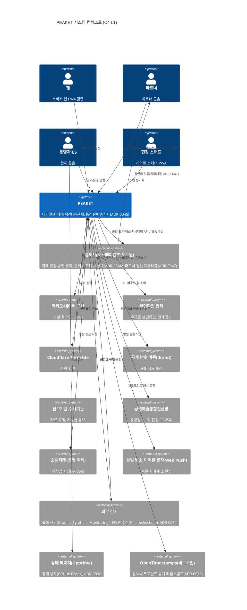
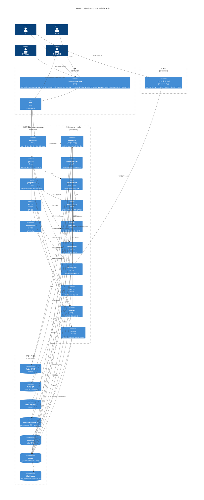

# 시스템 아키텍처

- **독자와 용도**: 백엔드·인프라·프론트엔드 엔지니어가 시스템 경계, 처음부터 끝까지의 요청 경로, 핵심 기술 스택을 고른 근거, 성능이나 보안 같은 품질 요구사항인 비기능 요구사항(NFR)을 기술로 채우는 전략을 확인할 때 기준으로 보는 문서다. 개별 기술 결정의 대안 비교와 트레이드오프는 `docs/adr/`에 있다. 자세한 데이터 스키마(데이터의 구조 정의)는 [data.md](data.md), 클라우드 인프라와 배포 파이프라인은 [infra.md](infra.md), 모니터링과 관측성(지표·로그·요청 기록으로 시스템 안을 들여다보는 능력)은 [observability.md](observability.md), 도메인별 세부 동작 흐름은 `docs/features/`에 자세히 적었다.
- **원문 출처**: 설계서 TL;DR, §0(준수 기준의 검증 방법 및 보안 절차), §2(10대 기술 과제), §3(클라이언트 앱별 기술 스택), §6(아키텍처 도입, 서비스 맵, 분리 기준, API 게이트웨이, 장애 격리, 서비스 디스커버리, 중앙 관제 구조), §8(용량 산정), §9(NFR 달성 설계, 큰 장애 때 핵심을 지키려고 부가 기능을 줄여 버티는 운영 모드인 Degraded Mode, 지연시간 예산 요약), §10(v0 모놀리스와 v1 마이크로서비스 비교), §13·§14(아키텍처 결정과 그 이유를 남긴 기록인 ADR 목록), §15(리포지토리 구조), §18(참고 문헌 전체), 5장(라우트 렌더링 전략), 4장(상태 소유권 매트릭스), 6장(토큰 파이프라인), 16장(Fastify 및 RxJS 정책), 18장(통신 프로토콜), 19장(서비스 메시: 서비스끼리 주고받는 통신을 앱 대신 처리하는 층).
- **기준 기획 버전**: v1.0.
- **표시 규칙**: C4 모델 다이어그램, NFR 대응 표 구조, PoC(본 개발 전에 위험한 부분만 먼저 만들어 확인하는 시험) 통과 기준은 원문에 빠진 것을 정리해 넣은 것이라 모두 [보완]으로 표시한다. 수치는 원문 설계를 이어받았고, 새로 확정한 수치에만 [가정]을 붙인다.

## 1. 핵심 결정과 시스템 컨텍스트

**이 아키텍처의 맨 위에 놓인 핵심 결정은 "좌석 홀드(Soft Hold)는 Redis에서 초고속으로 처리하고, 최종 판매 확정(Hard Sale)은 PostgreSQL에서 엄격한 ACID 트랜잭션으로 보장한다"는 2단계 일관성 모델이다(`ADR-0014`).** 시스템 전체는 데이터가 서로 어긋나지 않게 하는 이 2단계 흐름을 받치도록 설계했다. 백엔드는 NestJS(Node.js 서버 프레임워크)로 만든 마이크로서비스 10개로 이루어진다. 서비스는 단순히 비즈니스 개념이 아니라, 트래픽 부하 수준·요구 가용성(서비스를 멈춤 없이 쓸 수 있는 정도) 등급·런타임 실행 방식이 서로 다른 경계에 따라 나눴다(`ADR-0007`). 외부 클라이언트의 요청은 클라이언트 종류별로 맞춘 씬(Thin) API 게이트웨이 5개(API는 프로그램끼리 요청과 응답을 주고받는 창구, 게이트웨이는 그 앞에 둔 입구 서버)가 나눠 받는다(`ADR-0008`). 개발 초기 v0 단계는 같은 모듈 경계를 공유하는 모듈러 모놀리스로 시작하고, v1 단계에서 실제 분산 서비스로 배포해 아키텍처를 나눈 효과를 숫자로 잰다. 일반 사용자의 예매 진입부터 좌석 홀드(결제하는 동안 다른 사람이 가져가지 못하게 좌석을 잠시 잡아 두는 것) 완료까지는 요청이 가장 많이 지나는 경로인 핫패스(Hot Path)다. 이 구간에는 평소 데이터베이스 쓰기 I/O가 없다. 좌석용 Redis(메모리에 데이터를 두는 빠른 저장소)가 고장 나 예비 쪽으로 넘어가는 페일오버 중에는 관계형 데이터베이스인 PostgreSQL의 정렬 잠금 경로로 홀드를 처리한다(`NFR-015`). DB 쓰기는 결제 접수(주문 이벤트 기록)와 최종 판매 확정 때만 일어난다. 관제 루프는 시스템이 내보내는 운영 신호인 텔레메트리 이벤트를 초 단위로 모으고 집계해 운영자에게 보여 준다. 이상 징후가 생기면 안전 장치(가드레일)를 거쳐 동시 입장 목표를 상황에 맞춰 조절한다.

## 2. 비즈니스 문제별 기술 과제 (원문 §2 '해결할 기술 과제')

| 문제 식별자 | 비즈니스 문제 요약 (`planning/01-overview.md`) | 핵심 기술 해결 과제 | 주된 구현 위치 |
| --- | --- | --- | --- |
| P-01 | 대규모 동시 접속 때의 서버 멈춤 | 가상 대기열 도입, AIMD(정상이면 조금씩 늘리고 나빠지면 크게 줄이는 조절 방식) 적응형 입장 제어, 정적 캐싱을 CDN(사용자 가까운 곳에 파일을 복사해 두고 대신 응답하는 전송망)의 엣지에 대신 맡기기 | `features/queue-admission`, §4, [infra.md](infra.md) |
| P-02 | 동일 좌석 오버셀(같은 좌석이 두 사람 이상에게 팔리는 사고) | 2단계 일관성(Soft Hold + Hard Sale), 분산 Saga 패턴(여러 서비스에 걸친 일을 단계별로 처리하고, 중간에 실패하면 앞 단계를 되돌리는 방식), 멱등성(같은 요청이 여러 번 와도 한 번 처리한 것과 결과가 같은 성질) 보장 | `features/seat-hold`, `features/payment`, `ADR-0014`, `ADR-0015` |
| P-03 | 매크로 부정구매 및 암표 유통 | 행동 기반 봇 탐지 파이프라인, 토큰(권한이나 상태를 증명하려고 주고받는 서명된 문자열)에 단말 식별자 묶기, 구매 세션 소지 증명(요청마다 브라우저가 함께 보내는 작은 값인 쿠키와 입장 토큰의 탈취 대비, 봇 방어 효과는 K6에서 측정, ADR-0050) | `trust-svc`, `ADR-0011`, `features/identity` |
| P-04 | 대기열 순번 불신 및 공정성 시비 | 다시 접속해도 순번 영구 보존, 1인 1순번 원칙(본인확인), 프리큐 순번을 무작위로 섞는 셔플 | `ADR-0002`, `ADR-0006`, `ADR-0012` |
| P-05 | 미결제 좌석 묶임 및 판매 기회 손실 | 짧은 TTL(저장한 값이나 키를 쓸 수 있는 시간)에 따른 자동 홀드 해제, 지연 큐를 쓰는 Outbox(DB를 바꿀 때 보낼 이벤트를 같은 트랜잭션으로 DB 표에 먼저 적어 두고 나중에 보내는 방식), 즉시 재판매 노출 | `features/seat-hold` |
| P-06 | 장애 대응 시의 운영 상황 암전 | SLO(팀이 정한 서비스 품질 목표) 기반 다중 창 알림, 중앙 관제 콘솔, 무중단 운영 명령 전달 | [observability.md](observability.md), `features/control-tower` |
| P-07 | 현장 게이트 네트워크 마비 | 오프라인 PWA(설치형 앱처럼 쓰는 웹 앱) 실행, 회전 Dynamic QR 로컬 검증, 양방향 오프라인 동기화 | `features/offline-gate`, `ADR-0025` |
| P-08 | 정보 취약계층 접근성 및 글로벌 대응 | 4개 국어(ko, en, ja, zh) i18n 지원, Canvas 좌석맵의 웹 접근성 대안 UI | §6 프론트엔드 구조 |
| P-09 | 티켓 외 부가 수익 창출 한계 | 예매와 독립된 굿즈 스토어, 티켓 연동 부가 상품, 인기 MD 오픈에 대기열 재사용 | `core-svc` shop 모듈, `ADR-0013` |

## 3. 도메인 경계와 서비스 분리

**마이크로서비스는 단순한 도메인 개념 단위가 아니라, 트래픽 부하의 규모·요구 가용성 등급·런타임 실행 방식이 크게 다른 경계에 따라 나눈다(`ADR-0007`).** 티켓 오픈 정각의 대기열 진입 트래픽은 초당 20만 건의 요청(200,000 RPS)에 이르지만, 좌석을 잡고 결제를 접수하는 트래픽은 초당 300건의 처리(300 TPS) 수준이다. 진입 구간과 결제 구간의 트래픽 차이가 670배다. 그래서 대기열 진입이 몰려도 결제·발권·중앙 관제·현장 게이트 시스템으로 번져 연쇄 장애를 일으키지 않도록 런타임을 물리적으로 나눠야 한다. 이 분리 기준에 해당하지 않는 도메인은 한 서비스 안의 모듈로 묶는다. 다만 DDD 바운디드 컨텍스트(Bounded Context) 경계를 분명히 지켜, 앞으로 조직이 커지면 바로 독립 서비스로 나눌 수 있게 한다.

- **아키텍처 분리 원칙**: AWS Well-Architected 신뢰성 기둥(REL03-BP01, REL03-BP02)과 마틴 파울러(Martin Fowler)의 마이크로서비스 설계 원칙을 따른다. 자세한 원문 요약과 대안 비교는 `ADR-0007`에 적었다.
- **분리 근거의 투명성**: 1인 개발 환경이므로 콘웨이 법칙(Conway's Law) 같은 조직상의 이점을 분리 근거로 내세우지 않는다. 인프라 운영 복잡도와 클라우드 비용을 최소로 줄이려고 초기 설계의 서비스 14개를 10개로 실용적으로 합쳤다.
- **분리 실효성 검증**: 같은 v1 비즈니스 로직 코드를 한 번에 배포하는 모놀리스로 묶었을 때와 독립 서비스로 나눠 배포했을 때의 성능 차이를 확인한다. 티켓 오픈 때처럼 요청이 한꺼번에 몰리는 부하 환경(K1)에서 결제 접수 p99 지연시간(요청 백 건 중 아흔아홉 건이 이 시간 안에 끝난다는 뜻)을 비교한다.
- **데이터베이스 비공유(Shared-Nothing) 원칙**: 서로 다른 바운디드 컨텍스트에 속한 서비스끼리는 데이터 저장소를 절대 공유하지 않는다. '공유하지 않는다'는 원칙은 다른 컨텍스트의 데이터베이스 테이블이나 Redis 키를 직접 조회·수정하지 않고, 모든 데이터 교환을 전용 gRPC(서비스끼리 함수를 부르듯 빠르게 호출하는 통신 방식) API나 비동기 Kafka(이벤트를 순서대로 쌓아 두고 여러 곳에 나눠 주는 메시지 시스템) 이벤트로만 한다는 뜻이다. 단, 같은 컨텍스트를 런타임 특성 때문에 나눠 배포한 경우(대기열 컨텍스트의 `queue-svc`와 `admission-ctrl`, 좌석 컨텍스트의 `purchase-svc`와 `realtime-gw`)는 같은 저장소를 공유한다. 비용을 줄이려고 물리적 Redis 클러스터나 Aurora(AWS가 운영해 주는 PostgreSQL 호환 데이터베이스) 인스턴스를 여러 컨텍스트가 함께 쓰는 경우에도, 네임스페이스 키 접두사·DB 스키마 분리·전용 IAM/DB 역할로 같은 격리 규칙을 지킨다.

- **인증 담당과 요청 경로**: 계정·세션·토큰 발급·본인확인은 `identity-svc`가 맡는다. 소셜 로그인의 인가 코드 교환은 소비자 웹 앱 서버의 Auth.js가 한다. 제공자 토큰은 `identity-svc`로 보내지 않는다. 로그인 뒤 요청의 토큰은 게이트웨이가 공개키로 확인하므로, 대기열 진입과 좌석 홀드 요청은 `identity-svc`를 거치지 않는다. 주문 생성(결제 직전) 때만 `purchase-svc`가 본인확인 상태를 조회한다(`ADR-0008`, `ADR-0011`). 이 조회에 `identity-svc`가 응답하지 못하면 토큰의 `ticket:buy`·pid로 판정한다(`ADR-0055`). 로그인 흐름은 `docs/features/identity.md` §2에 있다.

### 3.1 서비스 맵

| 서비스명 | 담당 모듈과 핵심 책임 | 전용 저장소 | 내부 아키텍처 스타일 | 통신 프로토콜 | 분리 근거 |
| --- | --- | --- | --- | --- | --- |
| queue-svc | 로비 입장(참가 토큰 발급), 사전 검증 토큰 발급, 대기열 진입, 순번 발급, 결번 비트맵(값마다 한 비트로 줄여 적은 표) 기록, 구간별 대기 상태 파일 생성·게시(셔플 결과 파일은 admission-ctrl이 게시한다, §9.4·queue-admission §2), 입장 확정(입장 토큰 발급과 입장 자리 등록), 구매 세션 수명 주기 이벤트 수신과 입장 자리 반환 처리 | Redis Cluster (대기열 전용) | 헥사고날 (Hexagonal) | REST (`gw-queue` 경유, CDN이 가까운 곳에 복사해 두는 캐시의 원천), gRPC (`trust-svc` 위험 점수 동기 조회), Kafka (텔레메트리 발행, 구매 세션 이벤트 구독), TCP (제어 평면 공지·판매 일시정지 수신) | 큰 진입 부하: 초당 20만 건(200,000 RPS)을 받는다 |
| admission-ctrl | 현재 입장 번호(serving) 증가 제어, 실제 입장 전환율에 따른 AIMD 동시 입장 목표 조절, T=0 무작위 셔플 연산과 셔플 결과 파일 약 1,000개 생성·S3 게시(리더 하나가 혼자 수행), 운영 명령 수신 | Redis Cluster (대기열 클러스터 공유), K8s Lease (리더 선출: 여러 복제 중 일을 맡을 하나를 고르는 것. Lease는 정해진 시간 동안만 유효한 권한) | 결과를 보고 다시 조절하는 제어 루프 (Control Loop) | TCP (제어 평면, 리더만 받는 호출 주소인 Service 엔드포인트), `/metrics` (제어 지표 `admission_*`를 지표를 모아 저장하는 도구인 Prometheus가 긁어 간다. Kafka 발행은 없다, ADR-0076), Prometheus HTTP (하위 서비스 p99와 오류율 관측) | 리더로 뽑힌 노드 하나에서만 실행되어야 하는, 결과를 보고 다시 조절하는 제어 루프 |
| purchase-svc | inventory 모듈(좌석 비트맵 관리, Soft Hold, Hard Sale 확정, 1인당 매수 한도 검증, 어느 시점의 좌석 상태 전체를 찍어 둔 좌석 스냅샷 제공), booking 모듈(주문 애그리거트 관리, 분산 Saga 오케스트레이션), 구매 세션 소유(시작/종료 이벤트 발행), 비상 운영 명령인 판매 일시정지(킬스위치)의 판매 차단 집행(범위 안 회차의 새 홀드·결제 시도 시작·결제 접수 423. 입장 멈춤은 admission-ctrl, 대기 화면의 판매 상태는 queue-svc가 함께 받는다, ADR-0062), 입장 토큰 재사용 차단, 구매 세션 요청 인증(소지 증명) 확인 | Redis (비트맵, 홀드, 세션), PostgreSQL (확정 원장, 매수 한도 행, 주문 이벤트 스토어) | 클린 아키텍처 + DDD, 주문은 Event Sourcing 적용 | REST (`gw-fan` 경유), gRPC (`payment-svc`, `ticket-svc`, `identity-svc` 본인확인 조회), Kafka (Transactional Outbox, Redis Stream 릴레이), TCP (비상 킬스위치 수신) | 입장을 마친 5,000명 규모의 핵심 구매 경로다. 두 모듈은 트래픽 규모와 SLO가 같고 서로 긴밀히 묶여 있어 한 묶음으로 구성했다 |
| payment-svc | 결제사 선택기(결제 시도마다 연동 결제사 토스페이먼츠·포트원 중 선택, 공연별 지정과 장애 전환 반영, ADR-0044)와 결제사 어댑터(결제창 값, 전자결제 승인, 상태 조회, 취소), 웹훅(일이 생기면 상대 서버가 우리 주소를 불러 알려 주는 방식) 이벤트 수신과 무결성 검증, 결제사별 대사, 배상 송금 포트(`PayoutPort`, ADR-0046), 정산서·지급 묶음·미수금(파트너에게서 돌려받을 돈)과 결제사 지급대행(결제사가 PEAKET 대신 파트너 정산 계좌로 판매 대금을 보내는 서비스) 어댑터(ADR-0047) | PostgreSQL (결제 원장) | 헥사고날 (Hexagonal) | gRPC (`purchase-svc`, `core-svc`가 호출), Webhook 수신 (`gw-partner` 경유), Kafka (Transactional Outbox) | 외부 PG사(온라인 결제를 대신 처리해 주는 회사) 장애 격리, 결제 웹훅 수신 격리, 결제사 비밀 키 엄격 격리 |
| ticket-svc | 전자 티켓 발권, 마이 티켓 월렛 조회, 양도 요청·수락·돌려주기·회수(결제자·보유자 구분, ADR-0046), Dynamic QR 검증용 기기 공개키 등록과 폐기 목록 관리, 게이트 스캐너 오프라인 동기화(회차 목록·변경분·입장 상태 공유), 스캔 수신과 서버 입장 판정·이상 표시·입장 기록 마감, 스캐너 기기 기록·배치, 부스 재발급 허용(ADR-0051) | PostgreSQL (티켓 원장, 다른 리전의 읽기 복제본 구성. 리전은 클라우드 데이터센터가 모인 지역, 복제본은 원본을 복사해 두고 읽기를 나눠 받거나 장애 때 대신하는 저장소) | DDD 기반 계층형 | gRPC (`purchase-svc`, `core-svc`가 호출), REST (`gw-fan`, `gw-scanner` 경유), Kafka (발권과 폐기 이벤트 발행) | 다른 가용성 시간대: 공연 당일 현장 입장과 월렛 이용이 몰림 |
| realtime-gw | 좌석 홀드 변경분(델타)을 WebSocket(연결을 열어 둔 채 서버와 브라우저가 주고받는 통신 방식)으로 많은 접속자에게 나눠 보내기 (API 게이트웨이가 아닌 전용 스트리밍 서비스) | 전용 저장소 없음 (좌석 Redis의 Pub/Sub 채널만 실시간 구독) | 여러 연결에 나눠 보내는 무상태 스트리밍 서버 | WebSocket (`gw-fan` 경유), Redis 샤드 Pub/Sub 구독 (`SPUBLISH`) | 오래 유지되는 연결(Long-lived Connection) 수에 비례해 따로 수평 확장 |
| identity-svc | 소셜 계정 식별자 관리, 활성 세션 제어, 액세스/리프레시 토큰 발급과 갱신(구매 권한과 사람 식별 해시 바인딩. 해시는 원래 값으로 되돌릴 수 없게 바꾼 고정 길이 값), 기기 바인딩, 휴대폰 본인확인 연계정보(CI: 본인확인 기관이 주는, 사람마다 하나인 연계 식별값) 관리, 관리 계정 인증(비밀번호 대조, 인증 앱이 시간에 따라 새로 만드는 일회용 코드인 TOTP 검증). 소셜 OAuth(다른 서비스 계정으로 로그인하게 하는 표준) 흐름 자체는 웹 앱 서버의 Auth.js가 맡고, 제공자 토큰은 identity에 도달하지 않는다 | PostgreSQL (identity·ops·core가 Aurora 인스턴스 하나를 DB 스키마와 역할로 나눠 씀), Redis (세션 클러스터 공유) | 계층형 (Layered) | REST (`gw-fan`, `gw-partner`, `gw-ops`, `gw-scanner`(스캐너 기기 승인·토큰) 경유), 메시 mTLS(양쪽이 서로 인증서를 확인하는 암호화 통신) 내부 호출 (웹 화면을 만드는 프레임워크인 Next.js의 앱 서버 → 세션 생성), gRPC (`purchase-svc`의 본인확인 상태 조회), Kafka (세션 종료를 모두에게 알림) | 가장 높은 보안 경계: 연계정보(CI) HMAC(비밀 키로 만든 위조 확인용 값) 키, 토큰 서명 개인키, TOTP 암호화 키 격리, 오픈 직전 로그인 트래픽 집중 |
| trust-svc | 접속 위험 점수 산출, 매크로 봇 판정, 악성 IP/기기 차단 목록 관리, 추가 검증 큐 격리 | Redis (실시간 피처 저장소), ClickHouse (대량 이벤트 집계에 강한 분석용 데이터베이스, 원시 텔레메트리 신호) | 책임 연쇄 파이프라인 (Chain of Responsibility) | gRPC (`queue-svc`, `identity-svc`가 호출. 대기 중 격리는 `queue-svc` `IsolateWaiting`을 호출, ADR-0071), Kafka, Apache Flink(흘러드는 이벤트를 실시간으로 계산하는 스트림 처리 엔진. 대기 중 재평가 잡 `trust-reassess`) | OWASP(웹 보안 기준을 만드는 비영리 단체) A10 원칙을 따른다: 장애 때 무조건 통과가 아니라 캐시 규칙 기반 축소 운영을 강제하고, 탐지 규칙은 따로 자주 배포한다 |
| ops-svc | 운영 명령 전달과 유효성 검증, 불변 감사 로그 기록, 관제 지표 집계 API, 승인 업무·CS 처리함(고객 문의 답변·진행 경과, 게시물 신고 처리 포함, ADR-0066)·회차 취소 판정·판매 승인(ADR-0045·0046) | PostgreSQL (명령 이벤트 스토어), ClickHouse (시계열 관측 읽기 모델) | CQRS + Event Sourcing | GraphQL과 Socket.IO (`gw-ops` 경유), TCP (제어 평면 명령 송신), gRPC (관제 지표 실시간 서버 스트리밍) | 독립 제어 평면: 사용자 요청을 처리하는 데이터 평면이 모두 멈춰도 관제 콘솔은 늘 동작해야 한다 |
| core-svc | catalog 모듈(공연 정보, 공연장 맵(배치·좌석 두 층과 좌석맵 파일 게시, 좌석맵 템플릿 10종 읽기와 템플릿에서 만들기, 템플릿은 배포 때 넣는 읽기 전용 자료, ADR-0066), 가격 등급, 검색·연관 검색어, 홈 피드와 홈 구성(배너·테마), 판매자 신원정보와 판매 승인 상태, 공연예술통합전산망 1일 전송), notify 모듈(이메일, 알림톡, Web Push, 파트너 웹훅 발송 워커), shop 모듈(굿즈, 티켓 연동 부가 상품, 장바구니, MD 주문, 한정 재고), review 모듈(관람 후기와 작성 자격 확인(ticket-svc 조회), 후기 사진(검사·다시 인코딩·QR 코드 거르기·파생본 게시), 게시물 신고 접수와 신고기관 바로가기, 신고 처리 조치(임시조치·노출 차단·불법 촬영물 신고 가림) 반영, 법정 통보 게시물 노출 차단. 기대평은 없앴다, ADR-0063·0066), support 모듈(고객 문의 접수·내 문의 목록·상세·추가 문의, 답변·진행 경과 기록, 문의 닫기와 3년 보존 뒤 파기, ADR-0066) | PostgreSQL, Redis (읽기 모델 캐시, 재고 차감), MongoDB (유형별 상품 정의를 문서 형태로 저장하는 데이터베이스), BullMQ (비동기 큐) | catalog: Layered + CQRS, notify: Layered, shop: Hexagonal + DDD, review: Layered, support: Layered | REST (미리 그려 두고 정해진 주기로 다시 그리는 ISR의 소스, `gw-fan`, `gw-partner` 경유), gRPC (shop → `ticket-svc`, `payment-svc`), Kafka | 트래픽 부하가 비교적 낮고 가용성 요구가 보통이라, 운영 복잡도를 줄이려고 한 서비스로 합쳤다 |

- **고객 문의·게시물 신고와 CS 처리함의 연결(추천 적용 2026-10-19, ADR-0066)**: 팬의 문의(`/v1/inquiries*`)와 후기 신고·사진 올리기(`/v1/reviews/*`)는 `gw-fan` → core-svc(support·review 모듈)만 받는다. ops-svc는 팬 트래픽을 직접 받지 않는 독립 제어 평면으로 둔다. core-svc는 접수를 저장하는 트랜잭션(여러 변경을 한꺼번에 반영하거나 한꺼번에 취소하는 작업 단위)에서 Outbox로 접수 사실(문의·신고 ID, 종류, 기한, 개인정보 없음, asyncapi `support.cases-requested`)을 낸다. ops-svc는 그 이벤트로 CS 처리함 건(`INQUIRY`·`DISPUTE`·`MINOR_CONTRACT_CANCEL`·`CONTENT_REPORT`·`RIGHTS_REQUEST`)을 만든다. 그래서 문의·신고가 몰려도 관제 평면에 팬 요청이 닿지 않고, ops-svc가 멈춰도 접수는 받으며 건 등록은 복구 뒤 이어진다. 담당자의 답변·진행 경과·문의 닫기와 후기 조치(조치 없음·임시조치·노출 차단·해제)는 관제 콘솔 → `gw-ops` → ops-svc가 권한·사유·감사 로그를 처리한 뒤 core-svc 내부 API로 반영한다(홈 구성과 같은 방식). 팬 알림은 core-svc notify 모듈이 보낸다. 데이터는 docs/data.md §2(`inquiry`, `inquiry_message`, `content_report`, `review_image`)에 있다.

### 3.2 서비스 간 통신 매트릭스

| 통신 방식 | 적용 경로 및 구간 | 통신 규칙 및 아키텍처 제약 |
| --- | --- | --- |
| gRPC (동기 RPC) | `purchase-svc` → `payment-svc`(결제창 준비·승인·취소)·`ticket-svc` (단, inventory와 booking은 한 서비스 안이므로 함수를 직접 호출), `core-svc` shop → `ticket-svc`·`payment-svc`, `queue-svc` → `trust-svc` (로비와 사전 검증 때), `trust-svc` → `queue-svc` (대기 중 재평가로 건 격리 `IsolateWaiting`, ADR-0071), `purchase-svc` → `identity-svc` (결제 직전 본인확인 검증), `ops-svc` 관제 지표 서버 스트리밍, `ops-svc` → `payment-svc`(지급 묶음 승인 뒤 지급 요청)·`purchase-svc`(회차 취소 일괄 환불)·`core-svc`(판매 승인 결과, 게시물 조치), `core-svc` → `payment-svc`(판매 승인 때 지급대행 판매자 등록). 호출마다의 요청·응답 모양과 멱등 키는 docs/api/proto/README.md의 초안에 있다(추천 적용 2026-10-22) | Protocol Buffers 기반의 엄격한 스키마 계약을 따른다(`peaket-contracts`, `buf breaking` CI 검증). HTTP/2 다중화 연결, 데드라인(Deadline) 전파. 연결 하나에 요청이 쏠리는 것을 막으려고 서비스 메시 기반 L7 로드밸런싱을 적용한다(`ADR-0010`) |
| Kafka (비동기 이벤트) | 거래 이벤트: 주문·결제·좌석 확정·발권은 PostgreSQL Transactional Outbox 패턴, 좌석 홀드와 세션 이벤트는 Redis Stream 릴레이, `acks=all`, 파티션(토픽을 나눈 칸. 순서는 칸 안에서만 지켜진다) 키는 공연 ID. 대량 텔레메트리: 진입 로그, 사용자 행동 신호, RUM, 토픽(메시지를 종류별로 모아 두는 통로)마다 키는 docs/streaming.md §7(ADR-0026·0071). 제어·보안 이벤트: 운영 파라미터 변경, 세션 강제 종료(모두에게 보냄). 고객 문의·게시물 신고 접수: core-svc Outbox → ops-svc CS 처리함 건 등록(§3.1 아래, ADR-0066) | Apache Avro + Confluent Schema Registry (BACKWARD_TRANSITIVE 호환성 보장, ADR-0054), 멱등 컨슈머(메시지를 읽는 쪽) 구현, 처리에 실패한 메시지를 따로 모아 두는 데드 레터 큐(DLQ)를 갖춘다. 세부 명세는 `docs/api/asyncapi.yaml`을, Avro 스키마 초안과 등록 규칙은 docs/api/avro/README.md를 본다(추천 적용 2026-10-22) |
| Redis 샤드 Pub/Sub | `purchase-svc` → `realtime-gw` 좌석 변경분 델타 전송 (공연과 섹션별 전용 샤드 채널) | 같은 좌석 바운디드 컨텍스트 안에서 빠르게 모두에게 보내는 데만 쓴다 (`SPUBLISH`) |
| TCP (Nest 트랜스포터, 제어 평면) | `ops-svc` → `admission-ctrl` (동시 입장 목표 조절, 입장 일시정지, 판매 일시정지의 범위 안 serving 전진 멈춤, K8s 리더 전용 Service 엔드포인트 타깃), `purchase-svc` (비상 킬스위치를 쿠버네티스에서 앱이 실행되는 가장 작은 단위인 파드 전체에 보냄), `queue-svc` (대기실 긴급 공지, 판매 일시정지 때 대기 상태 파일의 판매 상태). 판매 일시정지(명령 3)는 세 곳이 모두 ack해야 ACKED다(docs/features/control-tower.md §5, 추천 적용 2026-10-14, ADR-0062). 그 밖의 일반 명령은 Kafka 이벤트나 서비스 API를 쓴다 | 주요 데이터 평면(gRPC, Kafka, DB)이 모두 장애에 빠져도 반드시 동작해야 하는 긴급 제어 명령을 위한, 늘 열려 있는 대역 외(Out-of-band) 전용 채널 |
| REST (HTTP/JSON) | 외부 클라이언트 ↔ API 게이트웨이 사이의 통신에만 쓴다. 내부 서비스끼리의 통신에는 REST를 절대 쓰지 않는다 | OpenAPI 3.1 스펙을 따르고(`docs/api/openapi.yaml`), RFC 9457 Problem Details 표준 에러 응답 형식을 쓴다 |
| 메시 mTLS 내부 호출 | 웹과 파트너 앱 서버(Next.js Auth.js) → `identity-svc` 세션 생성과 관리자 자격증명 검증 | 서비스 메시 신원이 인정된 앱 서버 파드일 때만 호출을 받는다 (`ADR-0011`) |

같은 페이로드로 REST(JSON/HTTP 1.1) vs gRPC vs Nest TCP의 p50(요청의 절반이 이 시간 안에 끝난다는 뜻)·p99 지연시간과 CPU 오버헤드를 벤치마크해, 프로토콜을 고른 근거를 숫자로 남긴다(원문 18장. 측정 전이며, 결과는 성능 장부에 적는다).

## 4. API 게이트웨이: 클라이언트 유형별 분리 및 씬 게이트웨이 (ADR-0008)

외부 요청은 **CloudFront(+AWS WAF: 악성 요청을 걸러 내는 웹 방화벽) → NLB → Envoy Gateway → 백엔드 서비스** 경로로 들어온다. 소비자 트래픽은 CloudFront(AWS의 CDN) 배포 셋(공연 페이지, 대기열 파일, 대기열 API)으로 나누고, 배포마다 한도를 따로 두어 미리 올린다(docs/infra.md §4.1, ADR-0058). Envoy Gateway(Envoy는 요청을 받아 안쪽 서비스로 넘기는 프록시 서버)가 L7 리버스 프록시를 혼자 맡으므로, 불필요한 ALB(Application Load Balancer)를 겹쳐 두지 않아 HTTP 프록시를 2중으로 거치는 비용을 없앴다. 유일한 예외로 현장 게이트 스캐너 트래픽은 CloudFront를 거치지 않고 NLB(TCP 패스스루)로 `gw-scanner`에 바로 들어온다. 게이트웨이가 TLS(통신을 암호화하는 표준) 종단을 직접 하고, 단말기의 mTLS 클라이언트 인증서를 직접 검증한다. CloudFront 엣지 계층에는 가벼운 엣지 함수(CloudFront Functions 또는 Lambda@Edge)를 두어, 완전 매진 응답과 진입 Degraded Mode의 도착 시각 쿠키 발급을 대신 맡긴다.

| 게이트웨이 | 담당 클라이언트 및 전담 라우트 | 인증 검증 방식 | 물리적 분리 이유 |
| --- | --- | --- | --- |
| gw-queue | 소비자 웹: 로비 입장(참가 토큰), 사전 검증 토큰 발급, 대기열 진입, 입장 확정, 대기 상태 파일과 셔플 결과 파일의 Origin(CDN 뒤에서 원본 파일을 주는 서버) | 팬 액세스 토큰 (httpOnly 쿠키) + 구매 권한 검증. 단, 정적 대기 상태 파일 경로는 인증 없이 열어 두고 쿠키를 넘기지 않아, CDN이 모든 사용자에게 같은 캐시로 응답한다 | 티켓 오픈 때 초당 20만 건(200,000 RPS)으로 몰리는 요청을 받는다. 대기열 인프라를 따로 늘리고 줄여 구매 계층을 보호한다 |
| gw-fan | 소비자 웹: 좌석 예매(스냅샷 조회, 홀드, 주문 생성, 결제 접수), 좌석 델타 WebSocket, 티켓 월렛과 양도, 굿즈 스토어, 관람 후기(사진 올리기·신고 포함), 고객 문의(ADR-0066), 본인확인(시작·결과), 홈 피드·검색·연관 검색어(인증 없음, CDN 캐시, ADR-0063), 토큰 갱신, Next.js 앱 서버 프록시 호출 | 팬 액세스 토큰 (httpOnly 쿠키). 구매와 좌석 델타 라우트는 입장 토큰(admission_token)을 필수로 검증한다. 토큰 갱신은 리프레시 토큰 쿠키 전용이다 | 구매 경로는 입장이 허용된 5,000명 규모의 걸러진 트래픽이고, 그 밖의 경로는 평시 트래픽이므로 진입 폭주에서 물리적으로 떼어 놓는다 |
| gw-partner | 파트너 콘솔 UI 호출, 외부 PG사 웹훅 수신 (토스페이먼츠·포트원 웹훅 → `payment-svc`) | 파트너 관리 계정 세션 (MFA 다중 인증 필수). 웹훅 경로는 인증 없이 받되, `payment-svc`가 PG 결제 조회 API로 무결성을 다시 확인한다 | 멀티 테넌트 격리와 보수적인 레이트 리밋(일정 시간에 받는 요청 수의 상한) 정책 적용 |
| gw-ops | 중앙 관제 콘솔 (GraphQL 쿼리, Socket.IO 스트리밍, 운영자 로그인 → `identity-svc`) | 운영자 세션 (MFA 다중 인증) + 사내 허용 IP 대역과 전용 VPN 필수 | 큰 장애 때도 관제와 비상 제어가 멈추지 않는 독립 제어 평면 확보 |
| gw-scanner | 현장 게이트 스캐너 PWA 기기 승인 로그인, 근무 준비, 회차 목록·변경분, 스캔 업로드, 현장 관리(CloudFront를 거치지 않는 직접 연결) | 기기 mTLS 상호 인증(운영자가 등록한 기기 인증서, 대안 B는 DPoP 기기 키). 게이트웨이에서 TLS 종단 후 인증서를 검증하고, 현장 스태프 토큰(현장 스태프 토큰 키만 신뢰)의 서명·`aud`·`cnf`(인증서 지문)를 확인한다. 세션·기기 상태는 서비스가 요청마다 확인한다(ADR-0051) | 공연 당일 현장 입장 트래픽의 안정적 처리 |

- **BFF(Backends For Frontends) 패턴 적용 근거**: 샘 뉴먼(Sam Newman)의 원칙에 따라, 범용 API 게이트웨이 하나 대신 클라이언트 경험별 전용 게이트웨이를 두었다. Envoy Gateway는 Gateway 리소스별로 독립된 Envoy 프록시 파드 풀을 배포한다. 그래서 대기열 게이트웨이에 20만 RPS가 몰려 포화돼도 예매나 관제 게이트웨이의 프록시 파드는 그 부하를 받지 않는다. 같은 클러스터와 네트워크 경로를 함께 쓰는 부분의 간섭은 K1에서 진입 폭주 중 결제 접수 p99와 오류율로 잰다(planning/01 §3.1).

| 게이트웨이가 수행하는 역할 | 구체적 구현 내용 |
| --- | --- |
| 인증 (Authentication) | 클라이언트 쿠키나 Authorization 헤더의 JWT(서명된 정보 묶음 형식의 토큰)를 비대칭 공개키(JWKS 인메모리 캐시)로 상태 없이 검증한다. 게이트웨이는 비밀키를 보관하지 않고 세션 DB도 조회하지 않는다. 만료·종료된 세션은 백엔드 서비스가 Kafka 이벤트를 받아 로컬에서 거부한다. |
| 인가 (Authorization) | 경로 단위로 역할과 스코프를 검증한다. 대기열과 구매 경로는 `ticket:buy` 권한을 필수로 요구한다. 주문 소유권 대조 같은 세부 비즈니스 인가는 도메인 서비스가 한다. |
| 공통 인프라 정책 | 레이트 리밋(핫패스는 Envoy 로컬 토큰 버킷, 사용자 단위 전역 한도는 백엔드 래칫), CORS(다른 주소에서 온 요청을 브라우저가 허용할지 정하는 규칙) 헤더 제어(게이트웨이마다 허용 출처는 화면 호스트 하나, docs/infra.md §9), CSRF(사용자가 모르게 다른 사이트가 요청을 보내게 하는 공격) 방어(아래 'CSRF 확인 규칙'), 요청 페이로드 크기 상한 강제, 표준 보안 헤더 주입(HSTS·`nosniff`, docs/infra.md §9). |
| 트래픽 라우팅 | 경로와 호스트 기반 라우팅, Argo Rollouts와 연동한 카나리(Canary) 가중치 분기. |
| 프로토콜 변환 및 헤더 정리 | 외부 클라이언트 헤더를 걸러 내고, 검증된 사용자 식별자(user_id, session_id, scopes, person_hash)를 내부 헤더로 넣는다. 서비스 메시는 내부 mTLS로 게이트웨이만 이 내부 헤더를 넣을 수 있게 신뢰 경계를 지킨다. |
| 통합 관측성 | 경로별 골든 시그널 수집, 게이트웨이 자체 오버헤드 지연시간 측정(전체 지연 − 업스트림 지연), W3C TraceContext 기반 분산 추적 Trace ID 주입. |
| 1차 장애 격리 | 경로별 시간 초과 강제, 동시 요청과 대기 큐가 상한을 초과하면 바로 503 반환(`Retry-After` 헤더 부여), 계속 실패하는 업스트림 파드를 이상치로 제외(Outlier Detection), 빠른 실패(Fail-fast). |

**게이트웨이가 절대 하지 않는 4대 안티패턴**: 데이터베이스와 캐시 직접 접근, 트랜잭션 처리, 비즈니스 규칙 판정, 여러 마이크로서비스 응답 조합(Aggregation). 응답 조합이 필요한 화면은 클라이언트 전용 BFF 앱 서버(소비자 웹 Next.js, 파트너 tRPC, 관제 ops-svc GraphQL)가 맡는다. 이전 설계의 비대했던 `edge-api`는 공통 정책과 비즈니스 로직이 섞여 있고 Redis를 직접 다루는 결함이 있어 통째로 폐기했다.

| 게이트웨이에서 이전된 책임 | 이전된 목적지 서비스 | 이전 사유 |
| --- | --- | --- |
| 입장 확정 (입장 토큰 발급, 입장 자리 점유) | `queue-svc` | 비즈니스 상태를 바꾸고, 대기열 저장소에 트랜잭션을 기록해야 한다 |
| 입장 토큰 재사용 차단 (`jti` 무효화) | `purchase-svc` | 예매 세션 상태를 저장하고, 한 번만 쓰이도록 보장해야 한다 |
| 멱등키(Idempotency-Key) 저장 및 대조 | `purchase-svc`, `payment-svc` | 비즈니스 작업과 같은 저장소와 로컬 트랜잭션 안에서 처리되어야 한다 |
| 판매 일시정지(킬스위치) 집행 | `purchase-svc`(새 홀드·결제 시도 시작·결제 접수 423), `admission-ctrl` 리더(범위 안 serving 전진 멈춤), `queue-svc`(대기 상태 파일의 판매 상태 PAUSED) | 핵심 티켓 판매 비즈니스 규칙이다. 판매를 멈춘 채 입장을 들이면 입장한 사람의 차례와 구매 세션 시간이 헛되이 쓰이므로, 범위 안 입장도 멈춘다(추천 적용 2026-10-14, ADR-0062) |
| 구매 세션 요청 인증 확인 | `purchase-svc` (공통 라이브러리) | 쿠키·입장 토큰을 훔친 요청을 막는 소지 증명(요청 서명·일련번호, ADR-0050 결정 8). 봇 방어 수단으로 보지 않는다 |
| 토큰 유효성 검증 및 인프라 레이트 리밋 | API 게이트웨이 | 순수하게 무상태인 공통 인프라 정책이다 |

- **CSRF 확인 규칙(추천 적용 2026-10-15, ADR-0065 결정 5)**: 쿠키로 인증하는 쓰기 요청(POST·PUT·PATCH·DELETE)은 게이트웨이가 `Origin`을 그 게이트웨이의 허용 출처 목록과 대조한다. `Origin`이 없으면 `Sec-Fetch-Site`가 `same-origin`이나 `same-site`인지 보고, 둘 다 없으면 거절한다. 결제사·파트너 웹훅(서명 검증)과 서버 사이 호출은 쿠키를 받지 않으므로 예외다. ADR-0008의 'Origin/Referer 검증'은 이 규칙으로 읽는다. 사전 요청이 생기지 않는 형식으로 받는 대기열 진입·입장 확정(docs/features/queue-admission.md §3)은 이 확인과 본문의 사전 검증 토큰·대기표, `SameSite=Strict` 쿠키가 함께 막는다(ASVS v5.0.0-3.5.1. ASVS는 OWASP가 만든 웹 앱 보안 검증 항목 목록이다).
- **핫패스(Hot Path)의 Next.js 우회 원칙**: 대기열 진입, 좌석 홀드, 결제 접수처럼 부하가 아주 큰 핫패스 API는 Next.js Route Handler를 절대 거치지 않고 브라우저에서 게이트웨이로 바로 간다. 액세스 토큰은 `httpOnly` 쿠키로 보내고, Envoy Gateway가 쿠키에서 JWT를 직접 꺼내 검증한다. Next.js는 정적 페이지를 그리는 일과 핫패스가 아닌 화면의 데이터 조합에만 쓴다.
- **토큰 서명 및 암호화 체계**: 팬 액세스 토큰(`identity-svc`)과 입장 토큰(`queue-svc`)은 ES256 비대칭 서명을 쓰고, 게이트웨이는 공개키로만 검증한다. 대기표 토큰은 `queue-svc` 혼자 발급하고 검증하므로 HMAC 대칭키를 써서 CPU 오버헤드를 최소로 줄인다(`ADR-0011`).
- **인프라 이중화 및 고가용성**: 각 게이트웨이는 최소 3개의 가용 영역(AZ: 리전 안의 독립된 데이터센터 묶음)에 걸쳐 복제본을 고르게 나눠 배포한다. NLB의 교차 영역 부하 분산(Cross-Zone Load Balancing)을 켜서, AZ 하나에 장애가 나도 트래픽 단절을 막는다. PodDisruptionBudget(PDB) 설정, 요청 수 기반 수평 확장(HPA), 티켓 오픈 전 프리워밍을 필수로 적용한다.
- **게이트웨이 지연시간 예산**: 게이트웨이 자체 오버헤드는 p99 기준 3ms 이내로 엄격히 관리한다. 공개키 인메모리 캐싱, 핫패스 로컬 레이트 리밋, 업스트림 커넥션 풀 재사용, 요청 본문 무버퍼링 스트리밍으로 지연을 최소로 줄인다.

## 5. 장애 격리, 디스커버리, 제어 평면 요약

- **2단계 장애 격리 아키텍처 (`ADR-0009`)**:
  - **1차 엣지 차단 (Envoy Gateway)**: 경로마다 시간 초과를 둔다. 동시 요청이나 대기 큐가 상한을 초과하면 바로 503과 `Retry-After`를 돌려준다. 연달아 실패하는 파드는 자동으로 퇴출한다(Outlier Detection). 시스템이 과부하이면 핵심이 아닌 경로(관람 후기, 굿즈)부터 단계적으로 막는다.
  - **2차 서비스 내부 차단 (Opossum Circuit Breaker)**: 서비스 간 gRPC 호출, PG 결제 승인, Cloudflare Turnstile(사람 확인 서비스), 본인확인기관, 알림 발송 같은 모든 외부 의존성마다 따로 서킷 브레이커(계속 실패하는 호출을 잠시 끊어 장애가 번지지 않게 하는 장치)와 벌크헤드(Bulkhead)를 둔다.
  - **재시도 예산 및 백프레셔**(백프레셔: 받는 쪽이 밀리면 보내는 쪽을 늦추게 하는 장치): 네트워크 재시도는 서비스 메시(Istio) 한 층에서만, 허용된 예산(최대 1회) 안에서 한다. Istio 기본값(2회)은 아래 '메시 기본값 덮어쓰기'로 바꾼다(ADR-0082). 상태를 바꾸는 업무 요청(홀드, 주문, 결제 접수)은 멱등키가 있어도 게이트웨이 수준에서 함부로 재시도하는 것을 엄격히 금지한다. 투기적 재시도(Hedged Request)는 멱등한 읽기 요청(좌석 스냅샷)에만 쓴다. PG 승인 재시도는 업무 흐름(`payment-svc`)에서 10분 데드라인 안에서만 안전하게 한다.
- **서비스 디스커버리 (`ADR-0010`)**: Netflix Eureka 같은 불필요한 별도 디스커버리 서버는 빼고, 쿠버네티스(컨테이너로 만든 앱을 여러 서버에서 실행하고 관리하는 플랫폼) 표준 Service DNS와 EndpointSlice를 쓴다. 내부 gRPC 통신의 L7 부하 분산은 서비스 메시(Istio 앰비언트 모드, ADR-0082)에서 gRPC를 받는 서비스의 웨이포인트가 HTTP/2 스트림 단위로 맡는다. 모든 파드는 `readinessProbe`와 `preStop` 라이프사이클 훅을 갖춘다(프로브 규칙은 아래, ADR-0070). 판매가 열리는 시각 앞뒤로 접속이 몰리는 티켓 온세일 윈도우 중에는 새 배포를 하지 않는다. 진행 중인 카나리 중단, 이전 다이제스트로 되돌리기, 릴리스 플래그(배포한 코드의 공개 여부를 코드 변경 없이 켜고 끄는 설정) 끄기 같은 긴급 변경과 관제 명령은 허용한다(`POL-028`, ADR-0054 결정 13). `admission-ctrl` 리더 노드는 Kubernetes Lease로 선출된다. 리더는 제어 명령을 실행하기 직전 Lease 소유권을 다시 확인하고, 대기열 Redis 쓰기는 리더 세대로 펜싱한다(`ADR-0056`).
- **메시와 앱의 책임 경계(2026-10-22, ADR-0082)**: 운영 설계의 메시는 Istio 앰비언트 모드다. 노드 프록시(ztunnel)가 모든 서비스 사이 연결을 L4 mTLS로 감싼다. 서비스 사이 gRPC를 받는 서비스(§3.2 서비스 간 통신 매트릭스의 gRPC 행에서 받는 쪽)만 서비스 단위 웨이포인트를 둔다. 웨이포인트에는 요청 단위 분산, 재시도, 시간 초과, 연결 상한, 이상 파드 퇴출을 맡긴다. 그 서비스에는 웨이포인트 신원만 받는 L4 정책을 짝으로 둔다. 웨이포인트 경로의 p99 증가가 §9.4 기준을 넘는 서비스만 사이드카로 둔다. 게이트웨이는 파드 주소로 바로 보낸다(Envoy Gateway 기본 `routingType: Endpoint`). 그래서 게이트웨이에서 서비스로 가는 구간은 웨이포인트를 지나지 않고, 노드 프록시가 암호화만 더한다. 관제 제어 TCP 포트(ADR-0022)와 Flink 파드(ADR-0073)에는 웨이포인트를 두지 않는다. 나누는 기준은 하나다. 메시는 연결과 전송을 맡고, 앱은 업무의 뜻이 담긴 판단을 맡는다.

  | 기능 | 메시에 맡김 | 앱에 남김 | 이유 |
  | --- | --- | --- | --- |
  | 재시도 | 서버 앱에 닿지 않은 요청의 전송 재시도 1회, 재시도 예산 안 | 결제 승인 확인 같은 업무 재시도(같은 멱등키, 10분 안), 브라우저의 `Retry-After`와 지터(재시도 시각을 일부러 조금씩 흩뜨리는 것) | 업무 재시도는 결과를 확인하고 다시 묻는 규칙이라 프록시가 모른다. 두 층이 함께 재시도하면 횟수가 곱해진다 |
  | 시간 초과 | 호출 한 번의 상한(안전망) | 남은 시간(데드라인) 계산과 다음 호출로 전달 | 프록시는 들어온 요청과 그 때문에 나간 요청의 관계를 모른다. 같은 이유로 Istio도 추적 헤더 전달을 앱에 맡긴다 |
  | 서킷 브레이커 | 연결·동시 요청 상한, 이상 파드 퇴출 | opossum 차단기와 대체 응답(Degraded), 의존성별 연결 풀 분리(벌크헤드) | 프록시는 막을 때 503만 돌려준다. 대신 보여 줄 것은 앱만 안다 |
  | 부하 분산 | gRPC 요청 단위 분산 | 없다 | 앱이 파드 주소로 보내면 앰비언트에서는 그 서비스의 웨이포인트를 건너뛴다 |
  | 여러 언어 통신 | 언어와 상관없이 같은 암호화·정책 | 계약(protobuf·Avro 스키마), 언어별 SDK의 데드라인·추적 헤더 전달 | 서비스 대부분이 Node.js이고 Flink(Java)가 있다. 언어별 통신 공통 라이브러리는 만들지 않는다 |
  | 서비스 사이 암호화와 신원 | 파드 사이 mTLS, 서비스 신원 허용 목록(identity-svc 내부 엔드포인트, 제어 포트) | 메시 밖 대상의 TLS(Aurora·ElastiCache·MSK·MongoDB·ClickHouse, 결제사·본인확인·알림 같은 외부 API), 사용자 인증·권한(JWT·세션). MSK는 AWS가 운영해 주는 Kafka다 | 메시 밖은 메시가 암호화하지 못한다. 메시 신원은 어느 서비스가 불렀는지만 알려 준다 |
  | 관측 | 서비스 쌍별 요청 수·오류·지연(웨이포인트), 연결 지표(노드 프록시) | OTel SDK(추적 헤더 전달, 업무 속성 스팬), SLO 지표(표준 칸, ADR-0077), 업무 지표 | 메시 지표의 칸은 알파 기능 주석으로만 바꿀 수 있어 SLO 경계와 맞추기 어렵다 |

  앱 코드에는 일반 네트워크 재시도, 클라이언트 쪽 부하 분산, 파드 사이 TLS를 넣지 않는다. 메시와 함께 켜지면 재시도가 곱해진다(두 층이 2회씩이면 한 요청이 최대 9번). 파드 주소로 나누면 웨이포인트를 건너뛴다. 앱 TLS는 메시가 요청 내용을 보지 못하게 한다.

  메시 기본값 덮어쓰기(방향은 소유자 승인, 값은 추천 적용 2026-10-22):

  | 항목 | Istio 기본(2026-10-22 문서) | 이 설계 |
  | --- | --- | --- |
  | 재시도 | 2회, `connect-failure,refused-stream,unavailable,cancelled`(MeshConfig `defaultHttpRetryPolicy`로 바꿈) | 메시 전체 1회, `connect-failure,refused-stream`(요청이 서버 앱에 닿지 않은 경우). `unavailable`은 읽기 전용 경로에만 더한다. gRPC 상태 코드 문서가 멱등하지 않은 작업의 재시도는 늘 안전하지는 않다고 적기 때문이다 |
  | 재시도 예산 | DestinationRule `retryBudget`, 진행 중 요청의 20% | 10% [가정, wbs 4.6.1에서 확정] |
  | 시간 초과 | 없다 | 호출 경로마다 앱 데드라인 상한보다 조금 길게 둬 앱 데드라인이 먼저 끝나게 한다 |
  | 이상 파드 퇴출 | 설정하지 않으면 없다(설정하면 연속 5xx 5회, 검사 10초, 퇴출 30초, 최대 10%) | 게이트웨이와 같은 원칙이다. 과부하 503을 퇴출 계산에서 빼는 설정과 최대 퇴출 비율은 wbs 4.6.1에서 함께 정한다(ADR-0069) |
  | 부하 분산 | 최소 요청 | 그대로 쓴다. 일관된 해시(ring hash·Maglev)는 핫패스에 쓰지 않는다. 공연 ID로 걸면 인기 공연 하나가 파드 몇 개에 몰린다. 느슨한 고정이라 파드가 늘거나 줄면 깨진다 |
  | mTLS | PeerAuthentication 모드가 없으면 PERMISSIVE(평문도 받는다) | 메시 전체 STRICT, 최소 버전 `TLSV1_3`(`meshConfig.meshMTLS.minProtocolVersion`. 노드 프록시에 걸리는지는 wbs 2.11.2에서 확인한다) |
  | 인증서 | istiod가 자체 서명 루트로 발급한다 | 운영은 오프라인 루트가 발급한 중간 CA를 `cacerts`로 꽂는다. 워크로드 인증서는 노드 프록시가 그 노드 파드의 신원마다 받아 메모리에만 둔다 |
  | 설정 API | VirtualService는 앰비언트에서 알파이고, EnvoyFilter는 웨이포인트에서 지원하지 않는다 | Gateway API(HTTPRoute)와 DestinationRule·AuthorizationPolicy·PeerAuthentication만 쓴다 |
  | 추적 | 제공자를 설정하면 프록시가 스팬을 낸다 | 끈다. 앱 OTel 스팬이 정본이다 |

  웨이포인트의 L7 정책은 웨이포인트를 지난 트래픽에만 걸린다. 업그레이드 순서와 노드 단위 영향은 docs/devops.md §9.4다.
- **메시 없는 실행(2026-10-22, ADR-0082)**: 포트폴리오 기간의 로컬·CI·데모 실행(docs/verification.md §5.1)은 메시 없이 돈다. 예비 공통 코드를 두지 않고 라이브러리 기본 기능과 설정·정책으로 메운다.
  - 재시도: gRPC 라이브러리의 투명 재시도만 남는다. 연결에 오르지 못한 요청과, 서버 라이브러리가 앱에 넘기기 전에 거절한 요청(`REFUSED_STREAM`, GOAWAY 뒤의 스트림)을 설정 없이 다시 보낸다(gRPC A6, grpc-js). 서버가 처리했을 수 있는 실패는 다시 보내지 않으므로 차단기와 대체 응답이 받는다.
  - 부하 분산: 게이트웨이에서 서비스로 가는 구간은 게이트웨이가 요청마다 파드를 고른다. 서비스 사이 gRPC는 Service 이름과 pick_first(기본)를 쓴다. 데모는 서비스마다 1벌이고 측정은 파드 하나로 잰다(ADR-0058). 서비스 사이 gRPC를 여러 벌로 재야 하는 측정에서만 로컬 오버레이 설정으로 헤드리스 Service·`round_robin`·서버 `grpc.max_connection_age_ms`를 켠다(docs/api/guidelines.md §5).
  - 암호화와 호출자 제한: 로컬 클러스터 안은 평문이다(합성 데이터만). 호출자 제한은 NetworkPolicy가 파드 라벨로 대신한다.
  - 롤링 재시작 때 요청을 지키는 것은 우아한 종료와 투명 재시도다. NestJS 종료 설정 두 개는 docs/devops.md §6.4다. 운영 오버레이는 메시가 있어야 배포된다(docs/devops.md §4.3).
- **장애 감지 층(2026-10-22, ADR-0082)**: 앱 수준의 가십·멤버십 감지(서버끼리 생존 소문을 퍼뜨려 고장을 찾는 방식)는 두지 않는다. 감지는 각 층의 제품이 한다. Redis Cluster는 가십으로 서로 확인하고, 마스터 과반이 동의해야 고장으로 확정한다. 장애 조치는 관리형이다. Kafka(KRaft)는 브로커 심장 박동과 펜싱, 쿠버네티스는 노드 Lease 심장 박동과 프로브(컨테이너 상태를 주기적으로 묻는 검사, 아래 '프로브 규칙'), Aurora·ElastiCache는 자동 장애 조치, 게이트웨이와 메시는 이상 파드 퇴출, 리더는 Lease와 세대 펜싱(ADR-0056), 관측 스택 자체는 외부 감시와 데드맨 스위치(docs/observability.md §10)가 맡는다. 쿠버네티스와 다른 두 번째 생존 판단을 두면 둘이 엇갈릴 때 누가 맞는지 정할 수 없고, 리더가 둘이 되는 문제는 감지가 아니라 펜싱으로 막아야 하기 때문이다.
- **제어 평면(Control Plane)의 격리**: 운영 명령이 내려가는 경로는 '운영자 명령 발행 → `ops-svc` 유효성 검증 및 2인 승인 → 불변 이벤트 소싱 감사 로그 기록 → 전파 ack 수신' 단계를 차례로 거친다. 사용자 트래픽이 폭주해 데이터 평면이 마비되어도 관제 명령이 멈추지 않도록, 긴급 제어 명령은 TCP 대역 외(Out-of-band) 전용 채널로 보낸다.
- **부하 관리 장치와 순서(추천 적용 2026-10-20, ADR-0069)**: 부하를 다루는 자동 장치는 여러 개이고 서로의 신호를 읽는다. 장치끼리 서로를 오해하면 부하를 한쪽으로 몰 수 있다(SRE Workbook 11장의 부하 거절·부하 분산 사례). 그래서 순서와 끄는 법을 한 표로 둔다. 원칙은 세 가지다. 확장이 감축·거절보다 먼저 걸리게 한다. 자동 장치는 입력이 없으면 멈춘다. 긴급 정지는 장치마다 길을 둔다.

  | 장치 | 읽는 것 | 하는 일 | 순서·관계 | 끄는 법 |
  | --- | --- | --- | --- | --- |
  | 프리워밍·KEDA·Karpenter | 크론(T-40분 [가정]), Redis 대기열 길이, Kafka lag, Prometheus(이벤트 루프 지연 p99, 게이트웨이 RPS) | 파드·노드를 늘린다 | 가장 먼저 걸린다. KEDA(대기 작업량 같은 지표로 파드 수를 늘리고 줄이는 도구) 확장 기준을 AIMD 감축 기준보다 낮게 두고 설정 검사로 확인한다 [가정, wbs 4.6.1]. 지표를 3회 [가정] 연속 못 읽으면 지금 복제 수를 유지한다(`fallback`, behavior `currentReplicas`) | RB-30(KEDA `autoscaling.keda.sh/paused-replicas` 패치, 긴급 변경) |
  | 입장 제어 AIMD | 다운스트림 p99·오류율(로컬 Prometheus) | 동시 입장 목표를 선형으로 늘리고 절반으로 줄인다 | 확장으로 못 버틸 때 줄인다. 입력이 없으면 멈춘다. 줄인 뒤에는 감축 확인 시간(최대 2분 [가정]) 동안 다시 줄이지 않는다 | 명령 1(15분 유예), 명령 11 |
  | 에러 버짓 연동 감축 | 10배 소진 경보, 온세일 50% 소진선 | 목표를 50% 감축하고, 그 뒤 자동 증액을 멈춘다. 50% 소진선 감축은 실행과 함께 콘솔에 장애 심각도 등급 SEV2(숫자가 작을수록 심각하다)로 알린다(ADR-0077) | 경보 하나·소진선 하나에 한 번 걸린다. AIMD와 서로의 확인 시간을 막지 않는다 | 명령 11 |
  | 진입 Degraded 자동 전환 | 진입 p99 > 150ms(150ms 넘은 비율 1% 초과로 판정, ADR-0077) 2분 지속 [가정] 또는 대기열 Redis CPU > 75%(바로) | 도착 시각 쿠키 진입으로 바꾼다 | 진입 경로만 바꾼다 | 명령 6 해제 |
  | 게이트웨이 동시 처리·보류 큐 상한 | 프록시 안의 동시 요청 수(지표가 아니다) | 넘치면 바로 503과 `Retry-After`를 돌려준다 | 관측이 멈춰도 동작하는 마지막 보호다 | 설정 배포(정적) |
  | 이상 파드 퇴출 | 파드별 연속 5xx | 30초 퇴출, 최대 퇴출 비율 상한 | Envoy 기본 모드는 앱이 과부하로 낸 503도 세므로, 거절하는 파드를 빼고 남은 파드로 부하를 몰 수 있다. 과부하 거절을 퇴출 계산에서 빼는 설정(분리 모드 등)은 wbs 4.6.1에서 정한다 [가정] | 설정 배포 |
  | 서비스 안 서킷 브레이커(opossum) | 의존성 호출 실패 | 바로 대체 응답(Degraded) | 의존성별로 따로 | 자동(반 열림 확인) |
  | 클라이언트 폴링 간격 | 응답의 `Retry-After` | 폴링(정해진 간격으로 다시 물어보는 방식) 주기를 늘린다 | 오리진을 보호한다 | 응답 헤더로만 |

  - 배경 작업(일괄 환불의 새 묶음, 정산 지급 묶음 실행, 파트너 웹훅 재시도, 광고성 알림 묶음, 공연예술통합전산망 재전송, 홈 랭킹 게시)은 대형·중형 온세일 윈도우에 새 묶음을 시작하지 않는다(POL-028). 그 밖의 때는 그중 넷(일괄 환불의 새 묶음, 파트너 웹훅 재시도, 광고성 알림 묶음, 공연예술통합전산망 재전송)을 명령 9의 '배경 작업 멈춤'으로 멈춘다. 정산 지급 묶음은 지급일 기한이 있고, 홈 랭킹 게시는 하루 한 번 올리는 정적 파일이라 묶음에 넣지 않는다(추천 적용 2026-10-20, ADR-0073). SRE Book 1판 22장의 '배치 부하 끄기'다.
  - 명령 11은 입장 제어 자동화만 멈추고 오토스케일(부하에 따라 서버 수를 자동으로 늘리고 줄이는 것)은 멈추지 않는다. 오토스케일이 잘못 움직이면(새 판이 일 없이 CPU를 쓰거나, 실패하는 의존성에 요청이 쌓여 계속 늘리는 경우) RB-30으로 멈춘다. 둘을 함께 쓸 수 있다.
- **상태가 남는 자동 조치와 끝내는 조건(추천 적용 2026-10-21, ADR-0078 결정 2)**: 위 표 밖에도 자동 조치가 있다. 켜진 채로 남아 사용자를 막거나 동작을 바꾸는 조치는 끝이 정해지지 않으면 필요 없어진 뒤에도 남는다. 그래서 조치마다 끝내는 조건(자동 해제 기준, 또는 해제하는 사람과 명령)을 둔다. 한 번 실행하고 끝나는 조치(결제-발권 60초 자동 보상, 상태 미확정 자동 대사)는 대상이 아니다. ops-svc가 받은 알림과 상태로 조치의 시작과 끝을 운영 사건 줄로 남겨 그래프에 보인다(docs/observability.md §7. CloudFront 원본 그룹의 요청별 넘김은 CloudFront 지표로만 본다). 관제 콘솔은 지금 걸린 조치와 풀리는 조건을 SCR-029 '걸린 자동 조치' 위젯과 위 상태 바 '자동 조치 n'으로 보인다(design/d5 §3.3·§7.2).

  | 자동 조치 | 시작 조건 | 알림·효과 확인 | 끝내는 조건 | 정본 |
  | --- | --- | --- | --- | --- |
  | AIMD 감축 | 위 표 | 감축 지표, 감축 확인 시간 | 정상이면 선형 증액으로 돌아온다 | docs/features/queue-admission.md §5 |
  | 에러 버짓 연동 감축 | 위 표 | 50% 소진선 감축은 SEV2 | 운영자가 명령 1로 목표를 정할 때까지 자동 증액을 멈춘다 | docs/features/control-tower.md §6 원칙 3 |
  | 진입 Degraded 자동 전환 | 위 표 | 핵심 여정 Degraded 진입 SEV2 | 명령 6 해제 | docs/features/queue-admission.md §9 |
  | 서비스 안 서킷 브레이커 | 의존성 호출 실패 | 결제사면 SEV2 | 반 열림 확인으로 자동 | 위 표 |
  | 결제 신규 진입 일시 정지 | 결제사 서킷 열림·결제 확정 소요 p99 5초 초과, 채널 상한 대기로 확정 지연이 완화 SLO를 넘을 때 | SEV2, 재시도 큐 길이 | 서킷이 닫혀 있고 결제 확정 소요 p99가 5초 아래로 5분 [가정] 이어지면 자동 해제한다 | docs/features/payment.md §9 |
  | 결제사 채널 상한 낮춤 | HTTP 429 수신 | SEV2, 한도 사용률 | 그 회차 동안 유지한다. 다음 회차 값은 R1 검토에서 ADR-0036 추정을 갱신해 정한다 | docs/features/payment.md §9 |
  | 실시간 표 Prometheus 대체 표시 | 신선도 p95(백 번 잰 값 중 아흔다섯 번이 이 값 안에 든다는 뜻)가 5초를 넘는 상태가 3분 넘게 이어질 때 | SEV3, 패널의 대체 표시 | 신선도 p95가 5초 미만으로 5분 [가정] 이어지면 자동 복귀한다 | docs/streaming.md §4.5 |
  | 대기 상태 파일 S3 사본 넘김 | 원본 오류(CloudFront 원본 그룹, 요청마다) | RB-04 경보(대기열 CDN 캐시 오류율) | 다음 요청은 다시 주 원본으로 간다(자동). 명령 6의 S3(AWS의 파일 저장소) 사본 고정은 명령 6을 해제하면 끝난다(RB-04) | docs/infra.md §4 |
  | 카나리 자동 중단 | 카나리 분석 실패, 동결 창 진입 15분 전 | SEV2(RB-23) | 자동 재개는 없다. 원인을 고친 판을 다시 승격한다 | docs/devops.md §6·§8 |
  | 일괄 환불 작업 자동 정지 | 결제사 오류율 급증 | SEV2 | commander가 재개한다(확정 범위 안) | docs/features/transfer-refund.md §5 |
  | 28일 예산 소진 배포 잠금 | 일상 28일 에러 버짓(목표가 허용하는 실패의 총량)을 다 썼을 때 | 배포 파이프라인의 잠금 표시 | 28일 창의 남은 예산이 0보다 커지면 자동 해제한다. commander가 사유를 적고 연장할 수 있다. 잠금 중 긴급 변경은 RB-23을 따른다 | docs/observability.md §4 |
  | 실패 메시지(DLQ) 적재 | 재시도 한도를 넘은 소비 실패 | SEV3(`kind` hygiene) | 원인을 고친 뒤 엔지니어가 RB-11 절차로 다시 넣는다(멱등 컨슈머는 이미 반영된 메시지를 건너뛴다) | docs/infra.md §10 |

- **프로브 규칙(추천 적용 2026-10-20, ADR-0070)**: 프로브도 부하 관리 장치처럼 잘못 쓰면 장애를 키운다. 쿠버네티스 문서는 생존 프로브를 잘못 쓰면 부하 때 재시작이 이어져 연쇄 장애가 난다고 경고한다. AWS Builders' Library 'Implementing health checks'는 공유 의존성 장애처럼 함께 실패하는 이유로 서버를 빼면 자동화가 해를 끼친다고 한다. 공용 시작 코드(`peaket-platform`)가 세 프로브를 만든다.
  - 생존(liveness): 이벤트 루프가 응답하는지만 본다. 앱 트래픽과 다른 포트의 `/livez`를 쓰고, 게이트웨이 라우트에는 두지 않는다. 10초마다 묻고 시간 초과는 5초다. 연속 6회 [가정] 실패(약 1분)여야 재시작한다.
  - 준비(readiness): 시작 작업이 끝났고, 종료 중(SIGTERM 뒤)이 아니며, 진단 수집 중(RB-31)이 아닌지만 본다. 공유 의존성(DB·Redis·Kafka·결제사·본인확인)과 부하는 보지 않는다. 함께 내려가면 모든 파드가 Service에서 빠지고, 대체 경로(좌석 DB 정렬 잠금, 진입 Degraded)도 쓰지 못한다. 과부하는 위 표의 게이트웨이 상한과 앱의 즉시 503이 맡는다.
  - 시작(startup): 시작이 오래 걸리는 서비스에 두며, 최대 60초 [가정](K9의 파드 확장 60초)다.
  - 의존성 상태는 지표와 경보(의존성 원인 SEV2), T-30분 점검의 저장소 헬스체크가 본다. 새 판의 설정 오류는 카나리 분석이 잡는다. 준비 조건에 공유 의존성 호출이 들어가면 템플릿 시험이 실패한다(docs/devops.md D-T19).
- **시간 초과 기본값(추천 적용 2026-10-20, ADR-0070)**: 느린 의존성을 기다리다 연결과 이벤트 루프가 묶이지 않게 의존성마다 기본값을 둔다. 값은 모두 [가정, wbs 0.3.6·2.11.2에서 확정]이고 정적 설정이다(온세일 중 동결, docs/devops.md §5.4). gRPC 데드라인과 외부 HTTP 시간 초과는 위 2단계 장애 격리의 규칙 그대로다.

  | 대상 | 설정 | 기본값 | 이유 |
  | --- | --- | --- | --- |
  | PostgreSQL 서버(서비스 DB 사용자의 역할 기본값 `ALTER ROLE … SET`) | `statement_timeout`·`idle_in_transaction_session_timeout` | 핫패스 역할(purchase·payment·identity) 1초·10초, 일반 API 역할(ticket·ops·core) 5초·10초, 배치·마감·정산 작업 60초·60초 | 서버 쪽 상한은 앱이 떠난 뒤에도 도는 쿼리와, 잠금을 쥔 채 멈춘 트랜잭션을 끊는다. 역할 기본값은 새 세션에만 걸린다. 그래서 PgBouncer 서버 연결이 다시 맺어질 때(최대 1시간)까지 옛 값이 남는다 |
  | 요청별 상한 | 트랜잭션 첫 문장 `SET LOCAL statement_timeout` | 남은 데드라인이 역할 상한보다 짧을 때만 | 트랜잭션이 끝나면 사라지므로 트랜잭션 풀링에서도 쓸 수 있다. 왕복이 늘어나므로 핫패스에 쓸지는 0.3.6에서 재어 보고 정한다 |
  | PgBouncer(ADR-0028) | `query_wait_timeout`, `idle_transaction_timeout`, `query_timeout` | 5초(기본 120초), 가장 긴 `idle_in_transaction_session_timeout` + 5초, 가장 긴 `statement_timeout` + 5초 | 서버 연결을 기다리는 쿼리를 오래 붙잡지 않는다. 뒤의 둘은 네트워크 문제에 대비한 이중 장치다. 인스턴스 전체에 걸리므로 PgBouncer 배치를 정할 때(2.11.2) 함께 정한다 |
  | 앱 연결 풀(node-postgres `pg.Pool`) | `connectionTimeoutMillis`, `idleTimeoutMillis`, `maxLifetimeSeconds` | 핫패스 100ms·일반 1초, 10초(기본값), 30분 | 기본값 0은 꽉 찬 풀에서 끝없이 기다린다. 넘으면 기다리지 않고 503과 `Retry-After`로 답한다 |
  | Redis(ioredis) | `commandTimeout`, 핫패스 `enableOfflineQueue: false`·`maxRetriesPerRequest: 1` | 핫패스 100ms·일반 500ms | 기본값은 연결이 끊긴 동안 명령을 쌓아 두다가 20번 재시도한 뒤에야 실패시킨다. 바로 실패해야 대체 경로(좌석 DB 정렬 잠금)로 간다 |

  - 쓰지 않는 것: node-postgres의 `statement_timeout`·`idle_in_transaction_session_timeout` 연결 옵션(시작 매개변수라 PgBouncer가 거절하거나, 무시 목록에 넣으면 조용히 버려진다), 세션 `SET`(트랜잭션 풀링에서 지원하지 않는다), PostgreSQL `idle_session_timeout`(연결 풀과 맞지 않는다고 PostgreSQL 문서가 경고한다).
  - 트랜잭션 범위 설정은 쓴다: 좌석 Redis 장애 때 비상 경로는 트랜잭션 첫 문장에서 `SET LOCAL lock_timeout = '100ms'` [가정]을 건다. `SET LOCAL`은 그 트랜잭션이 끝나면 사라져 다음 사용자에게 남지 않는다. 세션 단위 advisory 잠금과 세션 `SET`을 쓰는 마이그레이션 잡은 PgBouncer를 거치지 않고 직접 붙는다(추천 적용 2026-10-22, ADR-0083).
  - 지표는 `db_pool_wait_timeout_total{service}`, `db_statement_timeout_total{role}`, `redis_command_timeout_total{cluster}`이다. 느린 쿼리를 사람이 끊는 길은 RB-32(docs/infra.md §10)다.

## 6. 기술 스택과 프론트엔드 구조

프론트엔드의 정본은 [frontend.md](frontend.md)다(RADIO 순서의 상세 설계, ADR-0079). 이 절은 요약이다. 경로별 렌더링·캐시·헤더 표, 클라이언트 상태 모델, 브라우저 저장소 규칙, 인터페이스, 성능 예산은 그 문서를 따른다.

### 6.1 기술 스택과 선정 근거

| 기술 영역 | 채택 기술 스택 | 선정 사유 및 기술적 타당성 | 관련 결정 기록 |
| --- | --- | --- | --- |
| 백엔드 런타임 | Node.js + NestJS (10개 마이크로서비스) | 모듈 시스템, 의존성 주입(DI), Guard, Interceptor, CQRS 모듈, 멀티 트랜스포터(gRPC, TCP, Kafka)를 기업용 프레임워크 하나에서 지원한다. 요청 맥락 전파는 REQUEST 스코프 대신 Node.js `AsyncLocalStorage`로 해서 오버헤드를 제거한다 | 16장, `ADR-0007` |
| 고성능 HTTP 어댑터 | Fastify (`queue-svc`, `purchase-svc`) | 미리 컴파일한 JSON Schema로 빠르게 직렬화·검증하고 Pino로 빠르게 로그를 남겨, 부하가 아주 큰 핫패스 구간의 HTTP 처리 CPU 오버헤드를 아주 작게 줄인다 | `ADR-0023` |
| 비동기 스트림 정책 | async/await 및 Node.js 네이티브 스트림 (RxJS 백엔드 미도입) | 백엔드에서는 NestJS 인터셉터의 Observable 반환부에서만 `timeout`, `catchError`를 최소한으로 쓰고, 핵심 제어 루프는 async/await로 단순하게 만든다. 복잡한 RxJS 스트림 결합은 관제 콘솔 프론트엔드에서만 쓴다 | 16장 |
| Redis 클라이언트 | ioredis (`enableAutoPipelining` 활성화), Lua 스크립트, 바이너리 직렬화 | 네트워크 소켓 I/O 시스템 호출을 크게 줄이려고 자동 파이프라이닝을 켠다. 핵심 좌석 홀드 연산은 원자적(중간 상태 없이 한 번에 끝나는) Lua 스크립트에 맡긴다 | 20장 |
| 데이터 저장소 | Redis Cluster (대기열·좌석·세션 3종), Aurora PostgreSQL, MongoDB, ClickHouse, Kafka (MSK), S3 Iceberg | 데이터의 일관성과 조회 특성에 맞춰 저장소를 여럿 쓰는 전략(Polyglot Persistence) ([data.md](data.md)) | `ADR-0002`, `ADR-0004`, `ADR-0013`, `ADR-0028`, `ADR-0083` |
| ORM (Object-Relational Mapping) | Drizzle ORM (조건까지 타입 검사되는 SQL형 쿼리 도구, 안정판 0.45 계열) | SQL 쿼리의 표현력을 그대로 살리면서 컬럼과 파라미터의 타입 안전성을 컴파일 때 검증한다. 부분 인덱스, 잠금 절(`for('update', { skipLocked: true })`), 트랜잭션 격리 수준을 코드로 직접 제어한다 | `ADR-0037` (`ADR-0035` 대체) |
| 게이트웨이 및 메시 | Envoy Gateway (Gateway API 기반 5종), Istio(앰비언트 모드, gRPC를 받는 서비스만 웨이포인트) | 클라이언트 유형별로 씬 게이트웨이를 나눠 격리한다. 서비스 간 L7 부하 분산과 상호 mTLS 암호화 통신을 보장한다. 포트폴리오 실행(로컬·CI·데모)은 메시 없이 돈다 | §4·§5, `ADR-0008`, `ADR-0010`, `ADR-0082` |
| 클라우드 인프라 | AWS EKS + Karpenter, CloudFront + WAF, NLB, ElastiCache, MSK, Terraform, ArgoCD, KEDA | Kubernetes 기반 오케스트레이션, GitOps(배포 상태를 저장소에 적어 두고 클러스터를 그대로 맞추는 운영 방식)로 하는 카나리 배포(새 버전을 일부 요청에만 먼저 보내 안정판과 비교해 보는 배포), 이벤트에 따른 자동 수평 확장 ([infra.md](infra.md)) | 23장 |
| 관측성 플랫폼 | OpenTelemetry, Prometheus, Grafana, Loki, Tempo, Mimir, Pyroscope, Sentry, Flink, ClickHouse | 메트릭, 로그, 분산 트레이스(요청 하나가 여러 서비스를 거친 길과 시간을 남긴 기록), 프로파일링을 모두 다루는 관측 체계를 만든다 ([observability.md](observability.md)). 관측 스택은 직접 운영한다. 서울 리전의 AWS 관리형(AMP·AMG)이나 Datadog(관측 기능을 묶어 파는 상용 서비스)으로 바꿀지, Sentry(앱 오류를 모아 알려 주는 서비스)를 클라우드로 쓸지 직접 설치할지는 Phase 4 측정 뒤 미리 정한 규칙으로 판정한다. 선택 근거와 대안 비교는 ADR-0068에 있다. 관제 콘솔은 같은 창고를 읽어 판단 숫자를 직접 그린다. 제어 입력과 실시간 위젯은 어느 후보든 클러스터 안 Prometheus를 읽는다 | 26장, `ADR-0067`, `ADR-0068` |
| 전자결제 연동 | 토스페이먼츠(주문서형 결제, 승인 API, 결제 웹훅)·포트원 V2(브라우저 SDK, 수동 승인 API, Standard Webhooks) | 2단계 결제 승인 구조(인증 성공 → 백엔드 승인)를 좌석 확정 Saga와 맞물려 묶는다. 결제 시도마다 결제사를 고르고, 결제 접수 뒤에는 고정한다 | `ADR-0015`, `ADR-0029`, `ADR-0044` |
| 봇 방어 및 검증 | Cloudflare Turnstile + `trust-svc` 위험 점수(판정 피처는 요청 때 Redis에서 바로 센다) + Flink 대기 중 재평가(여러 계정 사이 패턴, 그림자부터) | 봇 판정을 티켓 오픈 정각보다 앞선 때(T-10분 로비)로 분산해 정각의 시스템 부하를 줄인다. 세션 창·CEP는 동기 판정과 요약값 계약에 맞지 않아 쓰지 않는다 | `ADR-0006`, `ADR-0012`, `ADR-0071` |

### 6.2 앱별 프론트엔드 기술 스택

| 클라이언트 앱 | 핵심 프레임워크 및 라이브러리 | 상태 관리 도구 체계 |
| --- | --- | --- |
| 소비자 웹 (`apps/web`) | Next.js 16+ App Router, React 19(화면 라이브러리), TanStack Query, Zustand, XState, Motion, Serwist/Workbox (월렛 PWA), Dexie, WebCrypto. 대기실은 프레임워크 없는 경량 페이지다(`apps/web/queue-room`, ADR-0079) | 서버 캐시: TanStack Query, 대기실 폴링: 손으로 쓴 상태표(대기실 경량 페이지), 전역 UI: Zustand, 복잡한 예매 흐름: XState |
| 파트너 콘솔 (`apps/partner`) | Next.js, tRPC(앱 서버 BFF가 gw-partner REST를 부른다), Jotai 3(`atomFamily`는 `jotai-family`), React Hook Form + Zod, `@hello-pangea/dnd` | 폼/검증: RHF + Zod, 좌석맵의 많은 노드를 세밀하게 편집: Jotai, 서버 통신: tRPC(서버가 브라우저로 한 방향으로 계속 보내는 통신인 SSE·내려받기·올리기·토큰 갱신은 `partner-api` 직접, ADR-0079) |
| 관제 콘솔 (`apps/console-host`) | Webpack 5 Module Federation 호스트 + 리모트 위젯(계약 `@peaket/console-contract`), Redux Toolkit(listener 미들웨어) + RxJS, GraphQL (urql + graphql-ws), Socket.IO | 마이크로 프론트엔드 상태 통합: RTK, 실시간 지표 스트림 결합: RxJS 어댑터, 제어 명령: REST(ack·경보 푸시는 Socket.IO, ADR-0079) |
| 게이트 스캐너 (`apps/scanner`) | Vite PWA, mediaDevices, Web Worker(BarcodeDetector, 없으면 zxing-wasm), Dexie (IndexedDB, 브라우저 안에 데이터를 저장하는 곳), Screen Wake Lock, 일회성 Background Sync | 오프라인 검증 큐: Dexie, 변경분 수신: 화면이 켜진 동안 앱 타이머 60초, 업로드: 판정 뒤 바로 보내고 일회성 Background Sync는 재시도용 예비(주기적 백그라운드 동기화는 크롬에서 최소 12시간 간격이라 쓰지 않는다, ADR-0051), 바코드 디코딩: Web Worker |
| 포렌식 리플레이 데모 (`apps/forensics`) | Vite 8 + React 19.3, Web Worker, OffscreenCanvas 2D·WebGL2, apache-arrow, `packages/seatmap` | 사건: 열 배열과 비트마스크 교차 필터(데이터 Worker), 화면: React. 합성 데이터만 쓰고 서버가 없다(ADR-0080). 2단계(출시 뒤 선택)는 같은 앱을 운영 모드로 빌드해 관제 콘솔 주소 아래 따로 여는 페이지로 둔다 |

### 6.3 렌더링 전략 (원문 5장 라우트 표)

| 라우트 경로 | 렌더링 전략 | 채택 사유 및 기술적 기대효과 |
| --- | --- | --- |
| `/`, `/events/[id]` | ISR (Next.js Cache Components의 `use cache` + `cacheLife`·`cacheTag`) | 티켓 오픈 직전 100만 명이 몰려 조회하는 공연 페이지를 엣지 CDN이 99% 이상 흡수한다. 파트너가 정보를 고치면 태그 기반으로 바로 무효화한다. 홈은 공개 홈 피드만 담는다(배너·오픈 예정·판매 중·테마·공연장, 홈 구성 저장·판매 승인·매진 때 태그 무효화). 장르별 랭킹은 하루 1회 게시하는 정적 파일이다. 찜한 공연·오픈 알림 상태 같은 개인 영역은 클라이언트가 따로 받는다. 공연 상세의 후기 요약은 공개 CDN 캐시이고, 후기 전체·쓰기 모달은 클라이언트 요청이다(ADR-0063). 후기 사진은 메타데이터를 지운 파생본만 공연 이미지와 같은 공개 정적 객체로 받는다. 신고·신고 확인 모달은 후기 전체 모달이나 상세의 자리를 바꿔 연다(모달을 겹치지 않는다, ADR-0066) |
| `/search` | SSR(서버에서 화면을 그려 보내는 방식) + 클라이언트 필터링 | 검색어와 필터 조건에 따라 검색 엔진 최적화(SEO) 랜딩 페이지를 제공한다. 결과는 페이지 번호(`?q=&page=`) 방식이다. 검색어 입력은 전역 머리 하나다. 연관 검색어는 정규화한 입력을 키로 CDN·Redis에 캐시한다(ADR-0063) |
| `/verify/return` | 정적 셸 + CSR(브라우저에서 화면을 그리는 방식) | 본인확인기관이 결과를 돌려주는 같은 출처 복귀 화면이다. 팝업이면 결과 코드만 부르는 화면에 알리고 닫힌다. 페이지 이동이면 진행 표시 뒤 `next`로 돌아간다(별도 본인확인 화면은 없다, ADR-0063) |
| `/booking/[eventId]/checkout/return` | 정적 셸 + CSR | 결제사 결제창에서 돌아오는 화면이다(planning/04). 다른 사이트에서 온 첫 이동이라 `SameSite=Strict` 팬 쿠키가 실리지 않는다. 그래서 서버는 쿠키 없이 정적 셸만 내고, 쿠키가 필요한 결제 접수는 화면 스크립트가 같은 사이트 요청으로 한다. 주소의 결제 값은 읽는 즉시 지운다. 같은 규칙을 알림 링크가 여는 양도 받기·소명(예매 제한이나 양도 회수 대상이 된 팬이 사정을 설명하는 절차) 제출·배상금 계좌 입력 화면에도 쓴다(추천 적용 2026-10-15, ADR-0065 결정 8, docs/features/payment.md §7, docs/features/transfer-refund.md §4) |
| `/queue/[eventId]` | 정적 셸(Static Shell) + CSR(프레임워크 없는 대기실 경량 페이지, ADR-0079) | Origin SSR 없이 순수 정적 셸(S3)을 CDN 캐시로 응답해 대규모 트래픽을 흡수한다(K1). React·Next.js 런타임을 싣지 않아 대기실 번들(브라우저가 내려받는 자바스크립트 묶음) 예산(JS 50KB·CSS 10KB)을 지킨다(docs/frontend.md §5.1) |
| `/booking/[eventId]/seats` | CSR (입장 토큰 게이트 검증) | 조작이 많은 캔버스 화면이다. 보안상 비로그인 크롤러의 접근은 불필요하다 |
| `/my/tickets` | 정적 셸 + CSR + PWA 오프라인 캐시(서비스 워커 범위 `/my/tickets/`) | 야외 공연장 현장처럼 네트워크가 불안정한 곳에서도 티켓을 바로 그린다. CSP(페이지가 실행할 수 있는 스크립트의 출처를 정하는 브라우저 규칙)는 캐시 화면 묶음이다(ADR-0079 결정 14·18) |
| `/help/inquiries/new`, `/help/inquiries`, `/help/inquiries/[id]` | CSR (로그인 필요, 서버가 그리는 화면에는 개인 값이 없다) | 문의하기·내 문의 내역·문의 상세 화면이다(SCR-056, FR-069). 본인 문의라 CDN이 캐시하지 않고 SEO가 필요 없다. 답변 알림의 이메일·웹 푸시 링크로 연 첫 탐색에는 `SameSite=Strict` 팬 쿠키가 실리지 않는다. 그래서 서버는 로그인 여부를 정하지 않는다. 화면 스크립트가 같은 사이트 요청으로 문의 API를 부르고, 401이면 로그인(SCR-004) 뒤 같은 주소로 돌아온다(`/booking/[eventId]/checkout/return`과 같은 규칙, ADR-0065 결정 8). 입력 중인 내용은 화면에만 두고 브라우저 저장소에 남기지 않는다. 외부 분석 스크립트를 싣지 않는다(추천 적용 2026-10-19, ADR-0066) |
| `/staff/invitations`, `/staff/approve` | 정적 셸 + CSR (서버에서 그리는 부분은 없다) | 현장 스태프 초대 수락(SCR-050)과 스캐너 승인(SCR-051) 화면이다. 초대 토큰·확인 코드는 URL 조각(`#`)에 담겨 서버가 값을 받지 않는다. 메일 링크나 다른 앱에서 연 첫 탐색에는 `SameSite=Strict` 팬 쿠키가 실리지 않아 서버가 로그인 여부를 정할 수 없다. 화면 스크립트가 조각을 읽은 뒤 바로 주소창에서 지우고, 같은 사이트 요청으로 조회 경로를 부른다(docs/features/identity.md §6.1). CDN이 캐시하는 정적 셸이므로 CSP는 아래 '화면별 CSP'의 캐시 화면과 같은 해시 방식이다(추천 적용 2026-10-15, ADR-0065 결정 10) |
| 파트너 콘솔, 관제 콘솔 | 완전 CSR (Client-Side Rendering) | 인증·인가를 거친 사용자만 쓰는 내부 업무 도구라 SEO가 불필요하다. 화면 데이터는 클라이언트가 받지만, HTML은 파트너 콘솔(Next.js 앱 서버)이 요청마다 내므로 nonce CSP를 쓴다. 관제 콘솔은 앱 서버 없는 정적 호스트라 `script-src 'self'`와 해시를 쓴다(아래 '화면별 CSP', ADR-0065 결정 4) |

- **전체 경로 표**: 위 표는 요약이다. 모든 경로의 화면 그리기 방식·캐시·헤더 묶음은 docs/frontend.md §2.5다(굿즈 목록·상세는 ISR, 결제 결과·마이 화면은 요청마다 그리는 셸이고 서버가 쿠키로 로그인 여부를 정하지 않는다, ADR-0079).
- **SEO 표준 준수**: Next.js Metadata API, `next/og` 동적 오픈그래프 생성, schema.org `Event` JSON-LD 구조화 데이터, sitemap.xml, robots.txt, canonical URL, 4개 언어 `hreflang` 태그를 모두 갖춘다.
- **교차 출처 격리(COOP/COEP)**: Web Worker와 고성능 버퍼를 쓰려고 두는 교차 출처 격리 헤더는 좌석맵 라우트에만 적용한다. 결제 라우트는 두 결제사(토스페이먼츠·포트원) 결제 UI와 호환되도록 결제사 지침에 따라 헤더 간섭을 막는다. CSP는 두 결제사 SDK와 결제창 출처만 허용한다(`ADR-0044`).
- **화면별 CSP(추천 적용 2026-10-15, ADR-0065 결정 4)**: 모든 화면에 `object-src 'none'`, `base-uri 'none'`, `frame-ancestors 'none'`을 둔다. 스크립트 허용 방식은 화면을 어떻게 그리는지에 따라 나눈다.
  - CDN이 캐시하는 화면(위 표의 `/`·`/events/[id]` ISR, `/verify/return`·`/booking/[eventId]/checkout/return`·`/staff/invitations`·`/staff/approve` 정적 셸)은 Next.js의 해시 방식(SRI)으로 `script-src 'self'`와 스크립트 `integrity`를 쓴다. nonce는 응답마다 달라야 한다. 그래서 nonce를 쓰면 모든 화면이 요청마다 그려져 정적 최적화·ISR·CDN 캐시가 꺼지고, PPR과도 맞지 않는다(Next.js CSP 문서, 2026-03-20 갱신본). 공연 상세를 엣지가 흡수하는 구조(위 표)와 맞지 않아 소비자 웹 전체에는 nonce를 쓰지 않는다. 대기실 경량 페이지(`/queue/[eventId]`)는 인라인 스크립트가 없는 정적 파일이라 `script-src 'self'`만 둔다. 월렛(`/my/tickets`)도 캐시 화면 묶음이다(ADR-0079 결정 14).
  - 요청마다 그리는 화면(`/search` SSR, 좌석·주문·결제, 마이 티켓 등 `/my/*`, 계정 설정, 고객 문의 `/help/inquiries*`(ADR-0066))은 nonce와 `'strict-dynamic'`을 쓴다. 파트너 콘솔(Next.js, 동적 렌더링)도 nonce와 `'strict-dynamic'`이다. 관제 콘솔은 정적 Module Federation 호스트라 `script-src 'self'`(원격 모듈은 같은 출처 `/remotes/`, docs/devops.md §6.6)와 해시를 쓴다. `connect-src`는 `'self'`(같은 출처 `/_t/*`)와 `ops-api`(HTTPS·WebSocket)다(ADR-0079 결정 14). 스캐너 PWA는 docs/security/asvs/offline-gate.md 3.4.3을 따른다.
  - 사람 확인 위젯을 싣는 화면은 `https://challenges.cloudflare.com`을 `script-src`·`frame-src`에 더한다(ADR-0065 결정 9, Cloudflare Turnstile 문서). `'strict-dynamic'`이 있는 nonce 화면에서는 브라우저가 `script-src`의 호스트 허용을 무시하므로 위젯 스크립트에 nonce를 붙여 싣는다. 결제 라우트의 결제사 출처는 위 COOP/COEP 항목과 같다(ADR-0044).
  - **남는 한계**: Next.js 해시 방식(SRI)은 실험 기능이다. App Router 전용이고 빌드 때 만든 스크립트만 다룬다(Next.js CSP 문서). 아직 PoC 전이다. 그래서 소비자 웹 핵심 화면(wbs 2.10.1)을 시작하기 전에 PoC로 App Router의 인라인 스크립트까지 덮이는지 확인한다. 덮지 못하면 `'unsafe-inline'`을 쓰지 않고, 캐시 화면의 CSP를 새 ADR(위험 수용 포함)로 다시 정한다. 그때까지 캐시 화면의 CSP는 확정이 아니다. 월렛(`/my/tickets`)은 서비스 워커가 저장한 응답을 오프라인에서 다시 쓴다. 그래서 오프라인에서는 저장 때의 nonce가 되풀이된다. docs/security/asvs/offline-gate.md 3.4.3은 월렛에 해시·자기 출처 허용 목록을 적고 있다. 2026-10-21에 월렛을 캐시 화면 묶음(해시 방식과 `script-src 'self'`)으로 정했다(ADR-0079 결정 14).
  - **위반 보고**: CSP의 `report-to`(엔드포인트는 `Reporting-Endpoints` 헤더)로 위반을 화면 앱마다 있는 같은 출처 경로 `/_t/csp`(gw-fan 텔레메트리 입구를 거쳐 게이트웨이 수집기로 간다, docs/observability.md §11, ADR-0076·ADR-0079)에 모은다. 모은 위반은 구조화 로그와 지표로 남기고, 급증하면 SEV3다 [가정](docs/observability.md §5).

### 6.4 상태 소유권 매트릭스 (원문 4장)

'애플리케이션 × 상태 종류'마다 전용 도구를 딱 하나만 정해, 상태 관리가 여러 도구로 흩어지는 것을 막는다. 이 규칙은 ESLint import 제한 린트로 강제한다.

| 상태 분류 | 담당 애플리케이션 | 채택 도구 | 선정 사유 | 탈락 대안 및 기각 사유 |
| --- | --- | --- | --- | --- |
| 서버 상태 캐시 | 소비자 웹 | TanStack Query | 네트워크 요청 중복 제거, 지능형 재시도, `offlineFirst`, React Suspense 기본 지원 | SWR (기능 부족), Redux (반복해 써야 하는 보일러플레이트 코드가 많다) |
| 대기실 실시간 상태 | 대기실 경량 페이지 | 손으로 쓴 상태표(라이브러리는 없다) | React 런타임만으로 대기실 JS 예산 50KB(gzip)를 넘는다(실측(PC) 66.0 KiB). 그래서 프레임워크 없이 상태표와 DOM 갱신으로 적응형 폴링을 구현한다(ADR-0079 결정 2) | SWR·TanStack Query(React 런타임이 필요해 예산을 넘는다) |
| 전역 UI 상태 | 소비자 웹 | Zustand | 번들 크기가 아주 작다. 선택자(Selector)로 불필요한 다시 그리기를 막는다. React 수명주기 밖에서 하는 구독을 지원한다 | React Context API (자주 갱신하면 전체를 다시 그리게 된다) |
| 대규모 세밀 편집 | 파트너 좌석맵 에디터 | Jotai (`atomFamily`) | 수천 개의 좌석 노드 가운데 바뀐 좌석 하나만 원자 단위로 다시 그린다 | Zustand (거대한 스토어 하나라 원자 단위의 세밀한 제어에 한계가 있다) |
| 유한 상태 머신 흐름 | 예매 흐름, 소켓 연결, 스캐너 동기화 | XState | 불가능한 상태 전이를 구조적으로 차단하고, 업무 흐름 시각화와 모델 기반 자동화 테스트를 지원한다 | boolean 플래그 조합 (상태가 폭발하고 버그가 생긴다) |
| 스트림 및 관제 상태 | 중앙 관제 콘솔 | Redux Toolkit(listener 미들웨어) + RxJS 어댑터 | 액션 단위로 화면 상태 변화를 추적할 수 있다. 감사 기록과 인시던트(대응이 필요한 장애나 보안 사건) 리플레이의 정본은 서버 감사 로그와 관측 기록이다(control-tower §7, ADR-0079). 고빈도 지표 스트림을 결합하고 스로틀링하기 쉽다. MF 리모트 리듀서의 동적 주입을 지원한다 | Zustand (복잡한 시계열 비동기 스트림 처리에 한계가 있다), redux-observable(안정판 3.0이 없다, ADR-0079) |
| 유연한 데이터 구독 | 관제 콘솔 ↔ `ops-svc` | GraphQL (`urql` + `graphql-ws`) | 위젯마다 필요한 데이터 집계 구조가 다르다. WebSocket 기반 실시간 서브스크립션을 지원한다 | REST (오버페칭/언더페칭이 생기고 실시간 스트림에 한계가 있다) |
| 내부 툴 타입 안전 통신 | 파트너 콘솔 ↔ 파트너 앱 서버(tRPC BFF가 gw-partner REST를 부른다, ADR-0079) | tRPC | 프론트엔드와 백엔드가 TypeScript 정적 타입을 100% 공유한다. 별도 API 명세서 작성이 불필요하다 | GraphQL (내부 도구 용도에는 스키마 빌드 오버헤드가 너무 크다) |
| DI 및 환경설정 | 전 애플리케이션 | React Context API | 테마, 언어 로케일처럼 아주 드물게 바뀌는 정적 환경설정을 전파한다 | 자주 바뀌는 상태에 쓰는 것은 엄격히 금지한다 |

### 6.5 토큰 파이프라인 및 프론트엔드 최적화

- **디자인 토큰 파이프라인**(디자인 토큰: 색·글자 크기·간격 같은 디자인 값에 이름을 붙여 정해 둔 것): `design/tokens.json`(W3C 디자인 토큰 표준 포맷, 당근이 공개한 디자인 시스템 SEED Design 3.0 기반 확장, `ADR-0040`)을 SSOT로 관리한다. Style Dictionary로 CSS 변수, Tailwind v4 `@theme`, TypeScript 상수를 자동 컴파일한다. `@peaket/ds`는 `@seed-design/react` 위에 피켓 전용 복합 컴포넌트(좌석맵, 대기 패널, 회전 QR, 관제 위젯)를 얹어 만든다. 버전은 Storybook과 Changesets로 관리한다.
- **아키텍처 구조**: Feature-Sliced Design(FSD) 방법론(`app`, `pages`, `widgets`, `features`, `entities`, `shared`)을 쓴다. 계층 사이 의존 방향은 Steiger와 ESLint 경계 검사 린트로 강제한다.
- **성능 예산**: 대기실 페이지 번들 크기는 Gzip 기준 JavaScript 50KB 이하, CSS 10KB 미만으로 제한한다(그래서 대기실은 프레임워크 없는 경량 페이지다, ADR-0079 결정 2. 경로별 예산은 docs/frontend.md §5.8). Lighthouse CI 예산을 초과하면 PR(코드 변경을 합쳐 달라는 요청) 병합을 막는다. 큰 좌석맵에는 OffscreenCanvas + Web Worker 그리기, TypedArray 기반 플라이웨이트 패턴, `requestAnimationFrame` 배치 처리, 대기 순번에 따른 청크 미리 받기(Prefetch)를 적용한다.
- **클라이언트 텔레메트리**: 프레임워크에 묶이지 않는 SDK `@peaket/telemetry`로 Web Vitals와 사용자 조작 지표를 모은다. 모은 값은 같은 출처 `/_t/rum`으로 논블로킹으로 보낸다(화면 배포 넷 모두 gw-fan 텔레메트리 입구로, ADR-0079 결정 13)(`fetch` keepalive·`credentials: 'omit'`, 지원하지 않는 브라우저만 `navigator.sendBeacon`). 게이트웨이가 쿠키 헤더를 지우고 게이트웨이 수집기로 넘긴다. 표본·보호·trace 전파 규칙은 docs/observability.md §11이다(ADR-0076).

## 7. NFR별 대응 표

Degraded Mode(기능 축소 모드)의 완화 한계와 업무 정책(무엇을 포기하고 무엇을 지키는가)은 `planning/03-policies-glossary.md`의 `POL-029`가 정본이다. 이 표는 시스템이 모드를 켜는 조건과 구체적인 엔지니어링 동작을 정한다. 기능 축소 모드 전환은 시스템 기준값에 따른 자동 전환과 관제 콘솔 2인 승인 수동 전환을 모두 지원하고, 감사 로그에 영구 기록된다.

| NFR 식별자 | 목표치 요약 | 정상 모드 대응 전략 | Degraded Mode 발동 조건 → 기술 동작 | 검증 방법 |
| --- | --- | --- | --- | --- |
| NFR-001 대기열 진입 | p99 200ms, 성공률 99.9% @ 200,000 RPS | `gw-queue`는 토큰 검증과 로컬 레이트 리밋만 한다. `queue-svc`는 미리 검증된 토큰을 확인한 뒤 Redis 단일 원자 연산(`SET NX`, `INCR`)과 대기표 HMAC 서명만 한다. 사람 확인 검증은 로비 단계가 대신 맡는다. Fastify를 쓴다. KEDA cron 기반으로 미리 프리워밍한다. 키 하나에 몰리는 병목을 감지하면 파드별 1~2ms 마이크로 배치 `INCRBY`를 적용한다 | 진입 지연시간 p99 > 150ms가 2분 이상 지속되거나 Redis CPU 사용률 > 75%에 도달하면 → CloudFront 엣지 함수가 HMAC 서명된 도착 시각 쿠키를 바로 발급하고, 백엔드 Origin 진입을 고르게 편다(Jitter를 넣고 재시도 간격을 점점 늘리는 백오프 재시도). 진입 확정 p99는 1초로 완화한다 | 로컬 1천·1만·10만 명을 응답 속도와 상관없이 정해진 속도로 계속 도착시키는 k6 오픈 모델 측정과, 진입 서버 USL(서버를 늘릴 때 처리량이 덜 늘어나는 모양을 나타낸 식) 외삽(잰 범위의 결과를 식으로 늘려 그보다 큰 규모의 값을 구한 것, docs/verification.md §3.3), Redis CPU 고갈 주입(로컬 대체 장애) |
| NFR-002 대기 상태 전파 | 입장 임박 p99 2초, 성공률 99.95% | 번호 구간별 대기 상태 정적 파일을 1초 주기로 갱신하고, CloudFront 1초 캐싱과 Origin Shield를 적용한다. 남은 대기 시간에 맞춘 적응형 폴링(1초, 5초, 20초)에 ±20% 무작위 지터를 더하고, `Retry-After`로 백프레셔를 건다. 셔플 결과도 정적 파일로 배포한다 | CDN 오류율 > 1%가 1분 이상 지속되거나, 캐시 적중률이 급락해 Origin 트래픽이 폭증하면 → `Retry-After` 헤더로 모든 클라이언트의 폴링 주기를 2배로 강제로 늘리고, 대기 상태 파일을 S3 정적 저장소 직접 조회 경로로 돌린다. 상태 반영 p99는 5초로 완화한다 | RUM 클라이언트 반영 시간 실측, CDN 장애 카오스 시뮬레이션 |
| NFR-003 좌석 홀드 | p99 50ms, p99.9 150ms, 오버셀링 0건 | Redis Lua 스크립트와 5만석 비트맵(단일 샤드 해시태그 바인딩)을 쓰고, 1인당 매수 한도 검증도 같은 스크립트 안에서 원자적으로 처리한다. 데이터베이스 쓰기를 응답 경로에서 완전히 뺀다. Node.js 이벤트 루프 지연을 p99 20ms 이하로 통제한다. 자동 파이프라이닝을 쓴다. 지연시간 예산: 게이트웨이 3ms + 네트워크 왕복 5ms + 구매 세션 요청 인증 확인 1ms + Lua 실행 7ms + 직렬화 5ms + 여유 버짓 29ms (`docs/features/seat-hold.md`) | Redis 프라이머리 노드 페일오버를 감지하면 → PostgreSQL 비상 비관적 정렬 잠금 경로(`SELECT … FOR UPDATE`)로 바로 우회한다. admission 제어 루프가 동시 입장 목표를 자동으로 50% 감축한다. Redis가 복구되면 DB 확정 원장에서 비트맵을 복원한다. 홀드 p99는 300ms로 완화한다 | 좌석 1개에 1,000명이 동시에 경합하는 k6(부하 시험 도구) 시험, 불변식 무결성 검사기, 페일오버 주입(운영 설계는 AWS FIS, 포트폴리오 기간은 로컬 주 노드 강제 종료) |
| NFR-004 좌석 상태 전파 | p99 300ms 반영 | 섹션 단위로 채널을 구독하고, 250ms 주기로 바이너리 델타를 묶은 패킷을 보내며, 버전 벡터로 빠진 것을 찾는다. 클라이언트는 Web Worker가 백그라운드에서 디코딩하고 rAF로 동기화한다. Redis 샤드 Pub/Sub를 쓴다 | 델타 반영 지연 p99 > 300ms가 3분 이상 지속되거나 소켓 송신 버퍼가 포화되면 → 배치 전송 주기를 250ms에서 1초로 완화하고, 뷰포트 밖의 보이지 않는 구역은 5초 주기 스냅샷 폴링으로 바꾼다. 반영 p99는 1.5초로 완화한다. 평소에도 좌석이 보이도록 확대한 구역만 구독하고, 나머지 구역 상태는 5초 [가정] 스냅샷으로 갱신한다(ADR-0063) | 서버 타임스탬프 기반 종단 간(End-to-End) 지연시간 실측 |
| NFR-005 결제 접수 | p99 150ms, 이중 결제 0건 | 좌석 홀드 유효성 검증 + 주문 이벤트 영구 저장 + Saga 오케스트레이션 시작 명령을 PostgreSQL 트랜잭션 하나(Transactional Outbox)로 처리한 뒤 바로 HTTP 202를 돌려준다. PG사 네트워크 호출은 응답 경로에서 완전히 뺀다 | 아래 NFR-006 결제 확정과 연동 | k6 300 TPS 동시 결제 부하 시험 |
| NFR-006 결제 확정 | p99 3초, 60초 초과 미보상 불일치 0건 | 비동기 분산 Saga 오케스트레이션을 쓴다. PG사 HTTP 통신은 keep-alive를 유지하고 시간 초과 데드라인 2초를 강제한다(전체 3초 예산 중 PG 2초 + 내부 처리 1초). 클라이언트는 롱 폴링(Long polling)으로 최종 확정을 기다린다 | 그 공연 결제사의 서킷 브레이커가 열리거나 결제 확정 소요 p99 > 5초(같은 멱등키 재시도·결과 모름 조회 포함, ADR-0069)를 감지하면 → 같은 멱등키 기반 비동기 재시도 큐(10분 기한)로 옮긴다. 좌석 홀드 TTL을 그 결제의 승인 기한(인증 뒤 10분)까지 자동 연장한다(ADR-0073). 신규 결제 접수를 일시정지한다. 10분을 초과하면 PG 승인을 중단하고 자동 만료한다(무과금 보장). 확정 p99는 60초로 완화한다 | K7 카오스 장애 주입 10,000건 테스트, 결제-발권 배치 대사 검증 |
| NFR-007 공연 상세 페이지 | TTFB p99 150ms, 성공률 99.99% | Next.js Cache Components 정적 셸 + CloudFront Origin Shield, 태그 기반으로 필요할 때 바로 하는(온디맨드) 재검증, WebP/AVIF 이미지와 한글 가변 서브셋 폰트 최적화 | Origin 백엔드 오류율 > 1%가 1분 이상 지속되면 → `stale-if-error` 정책에 따라 마지막 정상 캐시본을 돌려준다. 실시간 잔여석 수치 대신 '판매 중' 고정 기본 문구를 보인다. 캐시 신선도는 최대 10분을 허용한다 | CloudFront 관측 지표(운영 설계). 포트폴리오 기간에는 원 서버를 로컬 캐시 앞에서 실측하고, CloudFront 동작과 한도는 문서를 인용한다. 배포 한도는 45만 [가정]으로 상향을 요청한다(ADR-0057·0058) |
| NFR-008 관제 명령 하달 | 명령 접수 p95 500ms, 전파 p99 3초 | 유효성 검증과 불변 감사 로그 기록 뒤 바로 응답한다(2인 승인 대기 시간은 약속한 서비스 수준을 재는 SLA 측정에서 뺀다). TCP 대역 외 채널로 모두에게 보내고, 승인 완료 시점부터 잰다 | `ops-svc`가 완전히 마비되면 → 장애 때 따라 하는 비상 런북의 CLI로 TCP 제어 명령을 대상 서비스(`admission-ctrl` 리더, `purchase-svc`, `queue-svc`)에 직접 넣는다. 주입은 클러스터 안 비상 Job으로 하고, 명령 묶음마다 서로 다른 두 운영자가 KMS(암호 키를 안전하게 보관하고 대신 써 주는 클라우드 서비스) 비대칭 키로 서명하며, 제어 포트에는 메시 신원으로만 접속한다. 명령 묶음과 결과는 감사 앵커 버킷(S3 Object Lock)에 바로 쓰고, ops-svc가 복구된 뒤 감사 체인에 넣는다(`ADR-0053` 결정 11). 전파 p99는 10초로 완화한다 | Game Day(일부러 장애를 내고 대응을 연습하는 날) 비상 관제 시나리오 훈련 |
| NFR-009 관제 실시간 지표 | 관제 실시간 표 지표의 신선도 p95 5초, 데이터 누락율 < 0.1% | 관제 실시간 표(상세 퍼널, 판매 누적, 잔여석, 홀드 경합, 봇 잠정, 파트너 판매 현황)는 Flink `ops-rt`가 누적은 1초마다 덮어쓰고, 속도·비율은 1초 칸(그보다 이른 사건은 다 왔다고 보는 시각인 워터마크의 여유 0.5초, 허용 지연 10초 [가정])으로 센다. 그 값은 Flink 싱크 묶음(0.25초 [가정])과 ClickHouse 비동기 삽입(반영 최대 0.2초)을 거쳐 GraphQL WebSocket 구독으로 보인다. 신선도는 심장 박동 사건으로 끝에서 끝까지 잰다(docs/streaming.md §4, ADR-0071). 판단·제어 숫자(입장 속도, 입장 전환율, 오류율, 결제 성공률)는 Prometheus가 출처다(observability §8 지표 출처 표) | 심장 박동 신선도 p95 > 5초가 3분 이상 지속되면 → 관제 실시간 표 패널을 Prometheus 대체 표시로 줄여 바꾼다. 지표 신선도 p99는 60초로 완화한다. 체크포인트(작업 상태를 주기적으로 저장해 두는 지점) 지연은 원인 패널에서 본다 | 로컬에서 초당 3만 건(30,000 events/s)을 한 회차에 몰아 넣는 시험(docs/verification.md §3.7, 실측(PC)) |
| NFR-010 게이트 검표 판정 | p95 150ms, 위조 티켓 통과 0건 | 모바일 단말기 안에서 비대칭 암호 서명을 직접 검증한다(기기 공개키 목록과 폐기 목록은 IndexedDB에 로컬 캐시). Web Worker가 백그라운드에서 QR을 빠르게 디코딩한다 | 통신망이 완전히 끊기면 → 완전 오프라인 로컬 판정 모드로 바꾼다. 스캔 판정 이벤트를 로컬 큐에 쌓고, 네트워크가 돌아오면 백그라운드에서 한꺼번에 동기화한다. 동기화 지연에는 제한이 없다 | K10 오프라인 비행기 탑승 모드 현장 검표 시험 |
| NFR-011 서비스 기본 SLO | 일반 REST p95 500ms, 내부 gRPC p95 100ms, 핫패스 p99 20ms | 서비스 공통 플랫폼 라이브러리(`peaket-platform`)에 시간 초과, 데드라인, 재시도 예산, 지연시간 히스토그램(값을 구간별로 나눠 센 분포 지표)을 기본으로 넣는다. 1차 Envoy Gateway 차단과 2차 Opossum 서킷 브레이커를 연동한다 | 서킷 브레이커가 열리면 → `POL-029` 정책에 정한 여정별 대체 업무 로직(캐시 응답, 무과금 취소 등)을 실행한다 | 자동화 대시보드 및 경보 검증, Game Day 3대 장애 주입 훈련 |
| NFR-012 사용자 체감 성능 | Core Web Vitals (INP ≤ 200ms, LCP ≤ 2.5s, CLS ≤ 0.1, p75 기준)(INP: 조작에 화면이 반응하기까지 걸린 시간, LCP: 화면의 가장 큰 요소가 보이기까지 걸린 시간, CLS: 화면이 갑자기 밀리는 정도) | §6.5 성능 예산 준수, K5 Canvas 좌석맵 최적화, `scheduler.yield()`로 태스크 나누기, 번들 코드 분할과 프리페치, AVIF 이미지, Pretendard 서브셋 | — | Google web-vitals RUM 실측 데이터, Lighthouse CI, Memlab 메모리 누수 자동 검사 |
| NFR-013 시스템 수용 규모 | 동시 대기 100만 명 설계 목표를 부하 분해와 표시한 외삽으로 판정한다(100만 전체 실측은 하지 않는다, ADR-0057). 200만 명은 이론적 수용 구조를 입증한다 | §9 용량 산정, 비트맵/파일 기반 통신 설계 | — | 로컬 1천·1만·10만 명 v0·v1 측정, 진입 서버 USL 곡선, 설계 식 대조, 외부 한도 대조표(docs/verification.md §3·§4) |
| NFR-014 가용성 윈도우 | 티켓 온세일 70분 집중 버짓 방어, 28일 기준 99.9% 가용성 | 다중 윈도우 에러 버짓 정책을 세운다([observability.md](observability.md)). 버짓 소진율(Burn rate)을 실시간으로 경보한다. 온세일 경보는 경보 시점의 예산 소모를 30% 이하로 둔다(호출 2분 창 10배, 경고 5분 창 3배, 결제 확정은 임박 원인 경고, ADR-0049) | — | Grafana(지표와 로그를 그래프로 보여 주는 도구) SLO 전용 대시보드로 추적 |
| NFR-015 재해 복구(DR) | AZ 하나에 장애가 나면 RPO 0, RTO 5분 이내(PostgreSQL), Redis RTO 30초 이내다(RPO: 잃어도 되는 데이터의 시간 폭, RTO: 복구까지 걸려도 되는 시간). 리전 전체 장애 때는 티켓 판매를 바로 멈추고, 주문/결제 데이터는 RPO 24시간, RTO 24시간이다 (추천 적용, 2026-10-09) | Aurora Multi-AZ 자동 장애 복구, Redis Cluster 복제와 세대 번호(Epoch) 기반 순번 중복 차단을 쓴다. 좌석 홀드는 DB 원장을 최종 진실 공급원으로 삼아 판정한다. 리전 전체 장애 때는 다른 리전의 티켓 읽기 복제본으로 오프라인 게이트 입장을 보장하고, 교차 리전 S3 스냅샷 복원과 PG 대사를 한다 (`ADR-0031`, [infra.md](infra.md) §6) | 좌석 Redis 페일오버가 나면 → 위 NFR-003 행의 비상 DB 잠금 모드로 바꾼다 | 운영 설계: AWS FIS 기반 Multi-AZ 페일오버 카오스 주입, 분기 1회 교차 리전 복원 훈련. 포트폴리오 기간: 로컬 대체 장애와 복원 리허설, 관리형 장애 조치 시간은 문서 인용(docs/verification.md §5.3) |
| NFR-016 보안 및 암호화 | OWASP ASVS v5.0.0 L2 준수, OWASP Top 10 대응, 모든 구간 전송 암호화(TLS 1.2 이상, 1.3 우선) | §8 보안 절차 준수, 서비스 메시 상호 mTLS, AWS KMS와 Secrets Manager 연동, 구매 세션 소지 증명(ECDH 키 합의, 요청 서명·일련번호), 전송 TLS 1.2 이상·1.3 우선, 대상별 ES256 토큰 서명 키(팬·관리·현장 스태프)와 강제 종료 세션 거부 목록(ADR-0050) | — | 보안 요구사항 추적 매트릭스, Semgrep SAST, OWASP ZAP DAST, Gitleaks CI 검증 |
| NFR-017 감사 로그 무결성 | 운영 명령과 업무 거래 이벤트를 100% 영구 기록하고, 법정 보존 기간(2년/3년/5년)을 지킨다 | `ops-svc` 이벤트 소싱 아키텍처(불변 이벤트 스토어 + 주기적 스냅샷), WORM(Write Once Read Many) 사본, 감사 기록의 키 건 해시 체인(`audit_chain`, KMS HMAC)과 5분 앵커(S3 Object Lock, `ADR-0053`), 서명한 머클 체크포인트의 공개 앵커(매일·회차 마감, 공개 타임스탬프, `ADR-0075`) | — | 검증 잡이 1시간마다 체인을 다시 계산해 앵커와 대조하고, 어긋나면 SEV2다. 외부인은 공개 검증 도구로 체크포인트 사슬·서명·공개 타임스탬프를 확인한다 |
| NFR-018 개인정보 보호 | 법정 개인정보 보존 및 파기 기간 엄격 준수 | [data.md](data.md) §6 정의, 월 단위 테이블 파티션으로 안전하게 파기, ClickHouse 텔레메트리 TTL 30일 파기, 통신비밀보호법 접속기록 3개월 보존 | — | 개인정보 자동 파기 배치 실행 이력 검증 |
| NFR-019 지원 플랫폼 호환성 | 웹 표준 Baseline 'Widely available' 기능을 기본으로 쓴다. 주요 5대 모바일/데스크톱 브라우저의 최신 2개 버전과 iOS/iPadOS 16.4 이상을 지원한다. 인앱 브라우저는 로비 진입 전 외부 브라우저로 바꾸도록 안내한다. 파트너·관제 콘솔은 데스크톱(1280×800 이상 기본 밀도)·태블릿·휴대폰(360px부터, 휴대폰은 보기·승인·안전 쪽 조치 범위)을 지원한다 (추천 적용 2026-10-09, 휴대폰·태블릿은 2026-10-14 소유자 결정 `ADR-0061`) | Playwright 기반 3대 브라우저 엔진(Chromium, WebKit, Firefox) 크로스 브라우징 매트릭스 테스트와 콘솔 휴대폰·태블릿 뷰포트 프로젝트, 점진적 향상(Progressive Enhancement) 기법을 적용한다. 인앱 브라우저를 감지하면 Android는 기본 브라우저로 바로 열고, iOS와 PC 메신저 안 브라우저는 기기의 기본 브라우저(iPhone·iPad는 Safari, Windows는 Edge나 Chrome, Mac은 Safari나 Chrome)로 여는 방법 안내와 [주소 복사](SCR-058, ADR-0063)를 보인다 | — | PR 단위 Playwright E2E 매트릭스 테스트, 정식 릴리스 단위 실기기 3종(iOS Safari, Samsung Internet, 카카오톡 인앱) 수동 검증 |
| NFR-020 웹 접근성 | 웹 접근성 국제 기준인 WCAG 2.2 AA 등급 완전 준수, 자동·수동 검사 위반 0건 | Canvas 좌석맵을 대신하는 스크린리더(화면의 글자를 소리로 읽어 주는 프로그램)용 대안 컴포넌트 SeatList를 제공한다. `getSeatProps()`로 접근성 속성을 연결한다. 동적 라이브 영역 알림은 빈도를 스로틀링한다. 색각이상용 패턴을 함께 쓰고, 움직임 축소 설정에 대응한다 | — | axe-core 자동화 접근성 CI 파이프라인, 시각장애인 스크린리더(NVDA, VoiceOver) 수동 시나리오 검증 |
| NFR-021 아키텍처 확장성 | 동시 대기 200만 명으로 늘릴 확장 지점 문서화, 1~3년 사업 성장 전망 수용 | §9.2 확장 설계, §9.5 티켓 오픈 간격 제어 규칙, 합산 동시 입장 상한 관리, 셀(Cell) 단위 인프라 확장 구조 마련 | — | 분기별 용량 산정 검토, 연 1회 시스템 아키텍처 한계 분석 |
| NFR-022 봇 탐지 정확도 | 1·2단계 등급별 봇 탐지율 95% 이상, 사람을 봇으로 잘못 잡는 일반 사용자 오탐률 단측 95% 상한 0.5% 이하(판정용 사람 표본 947개) | `trust-svc` 다단계 책임 연쇄(HumanCheck → DeviceTrust → BehaviorScore → 추가 검증 큐 분기), 허니팟 트랩 신호, 요청 때 Redis에서 바로 세는 회차별 기기 공유·호스팅 대역 진입 수, Flink 대기 중 재평가(그림자부터, ADR-0071), 차단 기기 Bloom filter, 신규 규칙 그림자 실행 | `trust-svc`에 장애가 나면 → 미리 캐시한 규칙과 보수적 레이트 리밋 모드로 바꿔, 모두 그냥 통과시키는 일을 막는다 | 등급별 오차 행렬(Confusion Matrix)과 3회 적응 라운드 검증(`ADR-0039`·`ADR-0048`, docs/perf-ledger.md §10), 실서비스는 하한 지표(FR-049)로 추적 |
| NFR-023 운영 민첩성 | DORA 5대 핵심 지표 지속 추적과 조직 성숙도 개선, 주입한 장애마다 탐지 시간 60초 이내(최댓값 기준), 긴급 오토스케일링 60초 이내, 보안 사고 모의훈련 연 1회 | 다중 윈도우 번 레이트(에러 버짓을 쓰는 속도) 실시간 알림, KEDA(Redis 대기열 길이, Kafka Lag, Prometheus 지표) + cron 사전 프로비저닝 + Karpenter(필요한 만큼 서버를 붙이고 떼는 도구) 고속 노드 확장 | — | Game Day(로컬 실행·대체 장애·모의 진행, docs/verification.md §5.2), 파드 확장 시간선 로컬 실측과 노드 기동 문서 인용 |
| NFR-024 다국어 국제화 | 한국어(ko), 영어(en), 일본어(ja), 중국어 간체(zh) 4개 국어 완전 지원 | i18next 네임스페이스 분리와 필요할 때 불러오는 동적 import, ICU MessageFormat 표준 복수형 처리, 로케일별 정적 페이지 미리 빌드, 해시 파일명 기반 CDN 무제한 캐싱, 번역 키 누락 CI 검사 | — | 다국어 번들 크기 영향도 측정 |
| NFR-025 데이터 정합성 | 분산 시스템 전체의 업무 불변식(Invariant) 위반 0건 | 대기표 순번과 앞선 대기 인원의 일치, 차례 전 입장 0건(입장 확정 때 순번 ≤ serving 검사, ADR-0049), Lua 스크립트 홀드 한도와 DB 한도 행 일치, 만료 인덱스 정리, 버전 벡터 동기화, Redis 재고 차감과 PostgreSQL 판매 확정의 일치 보장 | — | 백그라운드 데이터 불변식 무결성 검사기, PR 단위 데이터베이스 마이그레이션 diff 검증 |
| NFR-026 분석 마감 품질 | R0 온세일 종료 30분 안 [가정], 확정 단계 판매 좌석·금액 차이 0(퍼널 0.1% [가정] 이내), R3 정산서 0원 차이, 적재 커버리지 100% | 마감 실행기(dbt + 쿠버네티스 Job)가 R0~R3·동결 단계를 돌린다. 같은 지표를 실시간 표와 골드로 두 번 계산해 대조한다(docs/features/analytics.md §7, `ADR-0052`) | 품질 검사가 실패하면 → 그 지표에 걸린 결정 규칙을 '판정 보류'로 두고, 리포트의 데이터 품질 절에 표시한다 | 마감 실행기 단계 기록, dbt 테스트, 오프셋(메시지를 어디까지 읽었는지 나타내는 위치 번호) 대조, 회차 요약의 실시간·정산서 대비 차이 |
| NFR-027 장시간 운영 | 일정 부하 6시간 [가정]에서 GC 뒤 힙·RSS·열린 FD·활성 핸들·DB·Redis 연결 수의 시간당 기울기 시작값의 1% [가정] 이하, 재시작 0, p99 변화 10% [가정] 이내 | 오래 떠 있는 서비스를 로컬에서 하나씩 6시간 돌리는 장시간 시험(docs/verification.md §3.6), 연결 풀 대기 한도·유휴 회수와 Outbox·Redis Stream 정리(§5 시간 초과 기본값, docs/data.md §4, `ADR-0070`) | 운영에서 추세가 한도에 닿을 것으로 보이면 → 자원 누수 의심 SEV3로 알리고, 파드 하나의 진단 증거를 남기고(RB-31) 온세일 창 전에 롤링 재시작한다 | 성능 장부(`kpi: NFR-027`)의 자원 시계열과 기울기, 누수 의심 경보 |

## 8. 품질·보안 절차

### 8.1 글로벌 준수 기준 (원문 §0)

PEAKET의 모든 소프트웨어 산출물은 아래 국제 표준과 법률 규제를 충족해야만 최종 완료(Definition of Done)로 판정된다. 기준마다 '무엇을 충족해야 하는가'와 '충족 여부를 어떻게 증명하는가'를 1:1로 정하고, 형상관리 저장소에 증적을 분명히 남긴다.

| 영역 | 공식 기준 명칭 | 기준 버전 | 적용 범위 | 충족 여부 검증 및 증적 확보 방법 |
| --- | --- | --- | --- | --- |
| 소프트웨어 품질 | ISO/IEC 25010 | 2023 (제2판) | 프로젝트 전체 | 비기능 요구사항을 9대 품질 특성(기능 적합성, 성능 효율성, 호환성, 상호작용 능력, 신뢰성, 보안성, 유지보수성, 유연성, 안전성)으로 분류한다. 특성마다 정량적 KPI(성과를 재는 핵심 지표), SLO, 테스트 케이스를 최소 1개 이상 연결해 검증한다 |
| 소프트웨어 품질 | ISO/IEC 25030 | 2019 (2025년 재확인) | 프로젝트 전체 | 이해관계자 요구사항으로부터 품질 요구사항을 뽑아 ISO 25010 특성으로 분류하고, ISO 25023 측정량과 목표값으로 정의한 뒤 추적 관리한다 (`planning/02-requirements.md §3.1`) |
| 소프트웨어 품질 | ISO/IEC 25023 | 2016 (현행 표준) | 프로젝트 전체 | 품질 특성별 세부 측정량을 고르고 정량적 측정 알고리즘을 세운다. 2016판과 2023판 사이에 이름이 바뀐 특성은 표준 대응표를 유지 관리한다 |
| 애플리케이션 보안 | OWASP Top 10 | 2025 | 프로젝트 전체 최소 기준선 | 10대 웹 취약점 전 항목에 방어 설계와 대응 ASVS 항목을 1:1로 연결한다(`docs/appendix-learning-map.md` 31장). CI 파이프라인에서 Semgrep/CodeQL SAST, OWASP ZAP DAST, 의존성 취약점 검사를 하고, POL-041 조치 기한(치명 7일, 높음 30일)을 넘긴 High 이상 취약점이 있으면 운영 승격을 막는다(DAST 야간 점검은 High 이상 0건, ADR-0054) |
| 애플리케이션 보안 | OWASP ASVS | v5.0.0 (기본 L2 등급) | 기능 단위 상세 검증 | 업무 기능마다 ASVS 요구사항 추적 매트릭스를 쓴다(§8.2). 요구사항 식별자는 `v5.0.0-6.8.1`처럼 버전을 밝히는 표준 형식을 따른다 |
| 서비스 운영 | Google SRE Framework | SRE Book(1판 온라인판) / Workbook | 프로젝트 전체 운영 | 모든 마이크로서비스에 Four Golden Signals(지연, 트래픽, 오류, 포화도)를 기본으로 넣는다([observability.md](observability.md) §3). 사용자 여정별 SLI(실제로 재는 서비스 품질 값)/SLO/에러 버짓/Degraded Mode를 세우고, 다중 윈도우 번 레이트 경보(온세일은 경보 시점 예산 소모 30% 이하, ADR-0049), 비상 런북, 블레임리스(비난 없는) 포스트모템 문화를 정착시킨다. 지표마다 근거 종류와 출처를 observability §14에 적는다. 관제 설계는 Release It! 2판(안정성 패턴·제어 평면)과 Observability Engineering 2판(넓은 사건·표본·관측 주도 개발)에도 대 본다(참고 기준, ADR-0069). 장애 대응 지침(재시작 전 증거, 프로브, 시간 초과, 처리량 경보, 장시간 시험)도 같은 책의 목록에 대 보았다(ADR-0070) |
| 클라우드 아키텍처 | AWS Well-Architected Framework | 6개 기둥 체계 | 클라우드 인프라 전반 | 아키텍처·인프라 ADR에 영향을 주는 6대 기둥(운영 우수성, 보안, 안정성, 성능 효율성, 비용 최적화, 지속 가능성)의 트레이드오프를 문서로 남기고, Phase가 끝날 때마다 정기 감사를 한다 |
| 소프트웨어 공급망 | SLSA(Supply-chain Levels for Software Artifacts) Build track, NIST SP 800-218(SSDF)는 참고 | SLSA 1.2(Build L3 목표), SSDF 1.1 | 운영에 배포하는 모든 이미지·패키지 | 공용 재사용 워크플로에서 빌드하고 SBOM(소프트웨어에 들어간 부품 목록, CycloneDX), cosign 키 없는 서명, SLSA 출처 증명(산출물이 어느 커밋에서 어떤 빌드 절차로 만들어졌는지 서명해 남긴 기록)을 붙인다. 클러스터 입장 정책과 운영 승격 게이트가 서명 신원과 출처를 검증한다. 취약점 조치 기한(ASVS 15.1.1)과 액션 SHA 고정은 CI가 강제한다([devops.md](devops.md) §4, `docs/security/asvs/delivery.md`, ADR-0054) |
| 국내 법률 규제 | 개인정보 보호법, 정보통신망법, 「개인정보의 안전성 확보조치 기준」 (고시) | 현행 (고시 제2026-9호) | 프로젝트 전체 개인정보 | 개인정보를 처리하는 모든 기능을 대상으로 개인정보 처리 목록(`docs/security/data-classification.md`)을 작성하고, ASVS 추적 표에 법률 조항 행을 함께 관리한다. 법제처 국가법령정보센터 원문과 100% 대조하고 법률 자문을 거친다 |
| 국내 법률 규제 | 공연법, 공연법 시행령·시행규칙 (암표 부정구매·부정판매 방지, 공연예술통합전산망) | 현행 (2026-08-28 시행본) | 입장권 판매 전 기능 | 판매를 위탁받은 판매자(시행령 §3의3 1호, 해석)와 통신판매중개업자(2호)의 조치 의무(구매자·판매자 본인확인, 암표·부정판매 신고 창구, 형사처벌·과징금 사전 고지, 통보 후 24시간(고시 사항 10시간) 이내 노출 차단 및 결과 회신, 통보받은 게시물과 같은 내용의 게시물 자동 차단)와 신고기관 자료 제출 대응은 `POL-024`에 맞춰 구현한다. 공연정보 1일 전송(법 §4②·③)은 `POL-037`·FR-054에 맞춰 구현한다 |
| 국내 법률 규제 | 전자상거래법·시행령·시행규칙, 「전자상거래 등에서의 소비자보호 지침」(공정위 고시 제2025-8호) | 현행 (2026-07-21 시행본) | 판매·청약·취소·환불·양도·분쟁 처리 전 기능 | PEAKET은 '통신판매업자인 통신판매중개자'로서(통신판매중개자: 직접 팔지 않고 판매자와 구매자의 거래를 알선하는 사업자) 중개자 고지(§20①)·판매자 신원정보(§20②)·분쟁 처리 기한(§20③, 시행령 §25의2의 3·10영업일)·청약철회 환급 3영업일(§18②)을 `POL-037`·`POL-038`·`POL-032`에 대응하고, `docs/security/asvs/transfer-refund.md` 법률 행으로 추적한다(ADR-0045) |
| 국내 법률 규제 | 전자금융거래법 | 2026-12-17 시행 개정법(법률 제21205호) | 판매 대금 수령과 파트너 정산 | 통신판매중개를 하며 부수적으로 하는 정산 대행은 전자지급결제대행에서 빠진다(§2 19호 단서, §3①2호). PEAKET은 정산 지급을 결제사 지급대행으로 해 판매 대금을 받아 두지 않는다(`POL-039`, ADR-0047). 지급 지시의 성격은 해석이고 `docs/security/asvs/settlement.md` 법률 행으로 추적한다 |
| 국내 법률 규제 | 통신비밀보호법, 전기통신사업법 (전기통신사업자 간주, 2026-10-08 결정) | 현행 법령 준수 | 접속기록 보관 및 수사 대응 | 인터넷 로그기록자료와 접속지 추적자료를 3개월 이상 안전하게 분리 보관한다. 수사기관의 통신사실확인자료 제공 요청 처리 절차, 법정 제공 대장 관리, 반기별 통계 보고 체계를 모두 갖춘다 (`POL-025`) |
| 국내 법률 규제 | 정보통신망법 §48의3(침해사고 신고·이용자 통지), 개인정보 보호법 §34(유출등 통지·신고), 「개인정보의 안전성 확보조치 기준」 §8②(접속기록 점검) | 정보통신망법 2026-10-02 시행본(§48의3은 법률 제21500호로 2026-10-01 시행), 개인정보 보호법 2026-09-11 시행본 | 보안 사고 대응, 접속기록 점검 | 침해사고 24시간 신고, 공격으로 2시간 넘게 이어진 장애의 이용자 통지, 유출등 72시간 통지·신고를 관제 법정 기한으로 추적하고(FR-063), 관리 계정 접속기록을 월 1회 점검한다(FR-064). 해당 여부 판단과 기록은 `docs/security/data-classification.md` 19~21번과 ADR-0049에 있다 |
| 국내 관리체계 기준(참고) | ISMS-P 인증기준(정보보호 및 개인정보보호 관리체계 인증 등에 관한 고시 별표 7) | 고시 제2024-8호(2024-07-24 시행) | 운영 통제 | 인증 의무 대상(정보통신서비스 매출 100억 원 이상 또는 전년도 일평균 이용자 100만 명 이상)이 되기 전에는 참고 기준이다. 백업·복구와 재해 복구 시험(2.9.3·2.12.1·2.12.2), 시간 동기화(2.9.6), 사고 대응 훈련 연 1회(2.11.4)를 관제 지표와 Game Day로 확인한다(ADR-0049) |

- 법률·규제 항목의 4대 분류 표기(확인됨, 확인 필요, 해석, 간주)와 외부 사실 추정치는 `planning/03-policies-glossary.md`의 `POL-027`에서 자세히 관리한다.
- **OWASP Top 10과 ASVS의 상호보완적 활용 이유**: Top 10은 가장 널리 알려진 10대 위험 영역을 알리는 보안 인식 문서다. 그 자체를 구체적인 엔지니어링 검증 기준으로 삼기에는 추상적이다. 그래서 Top 10은 프로젝트 전체를 넓게 덮도록 보장하는 최소 기준선으로 쓰고, 실제 세부 구현과 자동화 검증은 구체적인 기술 요구사항을 적어 둔 OWASP ASVS v5.0.0 L2를 기준으로 한다.

### 8.2 기능 개발 절차: 보안 요구사항 추적 파이프라인
1. **요구사항 선정 (구현 전 단계)**: 구현할 기능과 관련된 ASVS 장에서 L1·L2 필수 항목 전체의 적용 여부를 판정한다(L3는 골라서 채택한다). (예: 로그인·회원가입 기능은 V6, V7, V8, V9, V10, V11, V12, V13.3, V14를 모두 다룬다). 개인정보를 수집하거나 저장하면 개인정보 처리 목록에 항목을 먼저 등록한다.
2. **추적 매트릭스 표준 표 형식**: `ASVS ID | 레벨 | 요구사항 요약 | 적용 여부 | 구현 위치 | 테스트 결과 | 미적용 사유` 형식을 엄격히 지킨다.
3. **미적용 사유의 4대 표준 분류**: `해당 없음`, `외부 IdP 위임`(기술적 근거를 적는다), `Phase 이연`(반영할 마일스톤을 적는다), `위험 수용`(관련 ADR 문서 링크가 필수다).
4. **테스트 결과 자동화 연동**: 테스트 결과는 손으로 적지 않는다. 자동화 테스트 코드 이름에 `[ASVS v5.0.0-x.y.z]` 태그를 붙이고, CI 파이프라인 빌드 리포트에서 통과 결과와 실행 로그를 자동으로 파싱해 동기화한다.
5. **법률 요구사항 통합**: 관련 국내 법률 조항도 같은 매트릭스 안에 법률 행으로 더해, 한 화면에서 함께 관리한다.

### 8.3 공통 보안 기본 원칙 (구현 관점)

| 보안 기본 규칙 | 구체적 엔지니어링 구현 명세 | 법적 및 기술적 근거 |
| --- | --- | --- |
| 복호화 불가능한 일방향 비밀번호 암호화 저장 | 관리자 비밀번호와 복구 코드는 PBKDF2-HMAC-SHA256 알고리즘(반복 횟수 600,000회 이상, 솔트 16바이트)으로 안전하게 단방향 해싱한다. 단순 SHA-256 해시나 양방향 암호화 저장을 절대 금지한다. bcrypt는 72바이트에서 잘리는 한계 때문에 긴 한글 비밀번호에 부적합해 제외했다. PBKDF(HMAC)는 KISA 검증대상 암호알고리즘 목록에 있고, 600,000회는 OWASP와 ASVS 부록 C의 하한이다(`ADR-0033`). PBKDF2 결과에는 KMS HMAC 페퍼(관리 계정 ID 결합)를 한 번 더 건다. 그래서 DB만 유출되면 오프라인 대입을 할 수 없다(NIST SP 800-63B-4 권장, `ADR-0050`). PHC 문자열 형식에 해시 파라미터와 페퍼 키 버전을 남겨 둔다. 그래서 보안 규격을 올리면 로그인 시점에 무중단으로 점진적 재해싱을 한다. | 개인정보의 안전성 확보조치 기준 고시 §7① 단서, 안내서 82~83쪽, ASVS v5.0.0-11.4.2, 6.2.8, 11.2.2, NIST SP 800-63B-4 3.1.1.2 |
| 개인정보 필드별 차등 암호화 | 주민등록번호 수준의 고유식별정보나 CI 같은 법정 암호화 대상 항목은 데이터베이스 필드 단위로 암호화한다(단순 대조용이면 HMAC 일방향 해시, 원문 복원이 필요하면 AES-256-GCM 기반 AWS KMS 봉투 암호화를 AWS Encryption SDK로 적용). 그 밖의 일반 데이터베이스 저장소는 볼륨 단위 KMS 기본 암호화를 적용한다. 키 목록·교체 주기·사용 범위는 `docs/security/secrets-and-keys.md`를 따른다(`ADR-0050`). TOTP 시드 같은 봉투 암호화 값은 암호화 컨텍스트로 그 행(계정)에 묶는다. 운영 로그·봇 탐지의 식별값은 키를 건 가명으로 남긴다(`ADR-0053`). | 고시 §3, §7①②, ASVS v5.0.0-14.1.1, 11.3.2 |
| 소스코드 내 시크릿 하드코딩 방지 | 모든 서비스 시크릿은 AWS Secrets Manager와 KMS에서 관리하고, External Secrets Operator로 쿠버네티스 시크릿에 주입한다. `.env` 파일은 Git에 커밋하지 않고 `.env.example` 템플릿만 둔다. Gitleaks는 pre-commit 훅과 CI 검사에 필수로 연동한다. pre-commit 훅은 건너뛸 수 있고 Gitleaks는 규칙에 맞는 형식만 찾는다. 그래서 커밋된 비밀이 발견되면 노출된 것으로 보고 폐기·재발급한다(docs/devops.md RB-26). | ASVS v5.0.0-13.3.1, 13.3.2, 11.1.1, 고시 §7⑥ |
| 전송 구간 암호화 강제 | 모든 외부 클라이언트 통신은 HTTPS(HSTS 활성화)로 TLS 1.2 이상만 허용하고 TLS 1.3을 우선한다. TLS 1.2는 ECDHE와 AEAD 스위트만 허용한다. 내부 마이크로서비스 사이 통신은 서비스 메시(Istio 앰비언트, 메시 전체 STRICT, 최소 TLS 1.3)로 상호 mTLS를 강제한다(`ADR-0082`). 포트폴리오의 로컬·CI·데모 실행은 메시 없이 돌아 클러스터 안이 평문이다(docs/verification.md §8). Redis, PostgreSQL, Kafka, MongoDB, ClickHouse 통신도 TLS 전송 암호화와 서비스별 인증(`ADR-0053`)을 적용한다. 서비스가 지원하는 최고 버전을 쓰고(MSK는 TLS 1.2) 평문 폴백을 막는다(Aurora `rds.force_ssl=1`, 클라이언트 `verify-full`). CloudFront에서 원본으로 가는 구간은 HTTPS(최소 TLS 1.2)만 쓰고, 원본은 CloudFront 관리형 접두사 목록과 원본 확인 헤더로 CloudFront 요청만 받는다(`ADR-0053`). 파트너 웹훅 엔드포인트는 `https` 프로토콜만 등록을 허용한다(`ADR-0050` 결정 6). | 고시 §7①④, ASVS v5.0.0-12.1.1, 12.2.1, 12.3.1, 12.3.3 |
| SQL Injection 방지를 위한 파라미터 바인딩 강제 | 모든 SQL 쿼리는 Drizzle ORM 빌더나 `sql` 템플릿 리터럴로만 쓴다(`${param}` 문법은 내부에서 `$1` 파라미터 바인딩으로 자동 컴파일된다). 동적 식별자나 정렬 열에 쓰는 `sql.raw()`는 미리 엄격히 정한 허용 목록 검증을 거치도록 강제한다. 함부로 쓴 `sql.raw()` 호출은 Semgrep 커스텀 린트 규칙이 CI에서 빌드를 바로 막는다(`ADR-0037`). | ASVS v5.0.0-1.2.4 |

### 8.4 기능 개발 절차: 운영 확인 계측(관측 주도 개발, ADR-0069)

기능을 만들 때는 보안 추적 표(§8.2)와 같은 때인 구현 착수 전에, 기능 설계서에 '운영 확인' 표를 쓴다. 이는 코드를 쓸 때 계측도 함께 설계하고, 배포한 뒤 그 계측으로 의도대로 도는지 보는 관측 주도 개발의 생각이다(Observability Engineering 2판 9장, 추천 적용 2026-10-20).

1. **표 형식**: `확인할 동작 | 사건·필드(정규 로그 줄, 요청 기록 속성) | SLI(있으면) | 대시보드 패널 | 경보(종류·심각도) | 배포 뒤 확인 방법`.
2. **배포 뒤 확인**: 카나리 분석(docs/devops.md §6.2)이 SLI로 판정하고, 표의 패널을 배포 주석과 함께 본다. 확인할 수 없는 동작은 표에 '확인 불가'와 이유를 적는다.
3. **필드 규칙**: 정규 로그 줄 필드와 카디널리티(지표에 붙는 이름표 값의 가짓수. 많으면 저장 비용이 커진다) 규칙(docs/observability.md §7·§8)을 따른다. 개인 식별자는 가명 참조값만 쓴다.
4. **기존 설계서**: 지금 있는 기능 설계서 9편(docs/features)은 wbs 0.3.5에서 채운다. 새 기능은 이 표가 없으면 구현을 시작하지 않는다.

### 8.5 기능 개발 절차: 가지와 출시(git flow, ADR-0074)

코드 변경은 git flow 가지 규칙을 따른다(소유자 결정 2026-10-20). 자세한 규칙과 강제 장치는 [devops.md](devops.md) §2.2에 있다.

1. **시작**: `develop`에서 작업 가지(`feature/<WBS·이슈 번호>-<요약>`, 버그는 `bugfix/…`)를 만든다. §8.2의 ASVS 추적 표와 §8.4의 운영 확인 표를 먼저 쓴다.
2. **병합**: `develop`으로 PR을 열고 공용 CI와 가지 규칙 검사를 통과하면 스쿼시로 병합한다. PR 제목은 Conventional Commits 1.0.0을 따르고, 본문에 관련 ID를 적는다. 작업 가지는 하루 한 번 이상 병합하는 것을 목표로 작게 나누고, 미완성 기능은 릴리스 플래그(꺼짐) 뒤로 병합한다.
3. **출시**: 릴리스 봇이 `develop`에서 `release/X.Y.Z`를 자른다(기본 주 1회 [가정]). 출시 후보를 데모에서 검증한 뒤 `main`에 병합 커밋으로 넣고 태그 `vX.Y.Z`를 단다. 운영에는 데모에서 검증한 다이제스트가 다시 빌드 없이 간다.
4. **운영 결함**: SEV1·SEV2의 원인이거나 다음 릴리스까지 기다릴 수 없는 결함만 `main`의 출시 태그에서 `hotfix/X.Y.Z`로 고친다. 변경 동결 창 안에서는 핫픽스(운영에 나간 출시본의 결함을 다음 정기 출시를 기다리지 않고 고치는 새 코드)도 운영에 승격하지 않는다.
5. **예외**: GitOps 저장소(`peaket-gitops`)는 `main` 하나와 환경 디렉터리를 쓴다.

## 9. 용량 산정과 검증 계획

### 9.1 용량 산정 및 병목 해결 설계 (원문 §8)

티켓팅 시스템의 진짜 기술적 병목은 데이터베이스 쓰기가 아니라 **'수십만 명이 실시간으로 대기 상태를 조회하는 것', '오픈 정각에 진입이 한꺼번에 몰리는 것', '좌석 변경을 접속한 5,000명 모두에게 보내는 것'**이다. 그래서 핫패스에서 데이터베이스를 완전히 뺐다. 대기열 상태 조회는 번호 구간별로 1초 단위로 미리 만든 정적 파일(100만 명 기준 약 1,000개 파일)로 바꿔, 엣지 CDN이 완전히 대신 응답하게 했다. 실시간 좌석 변경 전송은 비트맵 스냅샷과 바이너리 델타로 압축했다. 핵심 아키텍처 설계는 여기에 집중했다(`C-05` 결정).
- **용량 산정 기본 가정**: 대형 공연장 50,000석 규모, 1인당 최대 4매 예매(완판 때 주문 약 12,500건 ~ 25,000건. 용량 산정과 에러 버짓은 안전을 위해 상한인 25,000건을 기준으로 한다, `C-03` 결정), 티켓 오픈 시점 100만 명 동시 접속 대기, 좌석 선택 단계에 동시에 머무는 인원 5,000명, 1인당 화면에 평균 머무는 시간 3분(180초).

| 트래픽 항목 | 정량적 부하 산정 | 아키텍처 해결 결론 및 최적화 효과 |
| --- | --- | --- |
| 대기열 진입 트래픽 | 오픈 전 사전 로비(T-10분 개방)에서 10분에 걸쳐 인증과 사람 확인을 나눠 받아, 초당 약 1,700명이 들어온다. T=0 오픈 정각 직후에 한꺼번에 몰리는 진입은 새로고침 증폭을 고려해 피크 200,000 RPS를 받도록 설계한다 | 진입 경로는 토큰 서명 검증, Redis 원자 연산(`SET NX`, `INCR`), 대기표 HMAC 서명만 해서 지연시간을 아주 작게 줄인다 |
| 대기열 순번 발급 | 공연별 `INCR` 키 하나에 초당 최대 20만 건의 증가 연산이 몰린다 | Redis 단일 스레드 병목이 실측되면 파드별 1~2ms 마이크로 배치 `INCRBY`로 바꿔 부하를 '파드 수 × 초당 500~1,000회'로 나눈다. 파드 사이 순번 편차는 1~2ms 이내라 공정성에 미치는 영향은 0에 가깝다 |
| 무작위 셔플 결과 전달 | 로비에 머물던 100만 명이 결과 공개 예정 시각 뒤 0~8초 [가정]에 나눠 본인 순번을 1회 확인한다(초당 약 12.5만 건, 약 36 Gbps, 대기열 파일 배포, ADR-0058) | 해시 앞자리 기준으로 여러 파일에 나눠 담은(샤딩) 파일 약 1,000개(각 파일 크기 약 36KB)를 만들어 엣지 CDN에 한꺼번에 게시한다. 백엔드 Origin 쓰기는 단 1회만 일어나고, 개별 DB 조회 트래픽은 0건이다 |
| 대기열 상태 실시간 조회 | 분당 1,700명(1초 주기), 1~5분 대기자 6,700명(5초 주기), 5분 이상 대기자 99만 명(20초 주기) 폴링 → CDN 유입 요청량 초당 약 53,000건 | 약 1,000개의 구간 정적 파일을 1초마다 갱신 게시해 백엔드 Origin 요청을 초당 약 1,000건으로 고정한다. 파일 크기는 125바이트 비트맵을 포함해 수백 바이트에 불과하고, 지속적인 WebSocket 연결을 맺지 않는다. CDN 내부 갱신은 엣지 수 × 활성 파일 수 ÷ 1초가 상한(요청 병합·리전 엣지 캐시·Origin Shield)이고, 거리별 TTL을 채택하면 1초 갱신 파일을 수십 개로 줄인다(채택 여부와 매진 감지에 주는 영향은 Phase 2에서 정한다) [보완, queue-admission §4] |
| 결번(빠진 번호) 기록 | 대기 이탈 같은 비정상 이벤트가 생길 때만 1비트를 기록한다 | 클라이언트가 살아 있음을 알리려고 주기적으로 보내는 하트비트를 받는 부하를 제거한다. 125KB 메모리 비트맵을 1초마다 빠르게 훑어 대기 상태 파일을 자동으로 만든다 |
| 좌석 예매 입장 속도 | 입장 자리 5,000명 ÷ 평균 머무는 시간 180초 ≈ 초당 약 28명 신규 입장 허용. 매진까지 입장 3만 명(C-01 상한) 기준 약 18분 걸린다 | 동시 입장 제어 속도가 전체 매진 시간을 정한다. 총 대기자가 10만 명이든 100만 명이든 예매 계층(좌석·주문·결제)의 부하는 입장 속도로 정해진다. 대기 인원에 비례하는 부하는 대기열 진입, CDN 상태 파일 조회, 셔플 결과 조회가 받는다(위 '대기열 상태 실시간 조회' 행) |
| 입장 확정 처리 | 실제로 차례가 와서 좌석맵으로 들어가는 인원만 첫 요청을 보낸다. 평균 초당 약 28건, 매진까지 모두 2.5만~3만 건이다(`C-01` 결정). 1인당 Redis 쓰기가 2~3회라 초당 쓰기 부하는 100건 미만이다 | 구매 세션 시작/종료 이벤트도 초당 약 28건이라 백엔드 부하가 아주 낮다 |
| 전체 매진 공지 전파 | 입장 성공자 약 2.5만~3만 명을 뺀 남은 대기자 약 97만 명에게 바로 매진을 알린다 | CloudFront 엣지 함수가 매진 플래그를 최우선으로 응답한다. 그 뒤 다음 폴링(먼 구간 20초 ±20% 지터에 캐시 1초를 더해 최대 약 25초) 안에 정적 파일로 부하 없이 자연스럽게 나뉘어 퍼진다 |
| 좌석 홀드 | 평시 초당 약 170건, 입장 개시 직후 피크 초당 1,000~2,000건, 인기 구역 1개 좌석당 수십 명 동시 경합 | Redis Lua 스크립트 하나로 5만석 비트맵과 매수 한도를 원자적으로 처리한다. 여러 좌석을 예매할 때는 좌석 ID 정렬 잠금을 적용한다 |
| 좌석 상태 팬아웃 (단순 구현 안티패턴) | 5만석 전체 JSON 데이터(약 2MB)를 5,000명에게 1초마다 모두 보내면 초당 약 10GB/s로 네트워크 대역폭이 폭증한다 | 네트워크 I/O가 포화되어 시스템이 바로 마비된다 (v0 모놀리스에서 재현할 실패 지점) |
| 좌석 상태 팬아웃 (PEAKET 최적화) | 관람객이 지금 보고 있는 2~3개 섹션만 골라 구독하고, 250ms 주기로 압축 바이너리 델타를 묶어 보낸다 → 1인당 초당 약 10개 메시지(200B)라 전체 대역폭은 초당 약 10MB/s로 줄어든다. 구독은 좌석이 보이도록 확대한 구역만 하고, 전체 배치 보기의 구역 상태는 5초 [가정] 스냅샷 재요청(입장 5,000명 기준 초당 약 1,000건, 한 번에 압축 6.25KB 이하)으로 갱신한다. 이 갱신이 초당 최대 약 6MB를 더한다(ADR-0063) | 네트워크 대역폭 소비를 단순히 전체를 모두에게 보내는 방식보다 약 1,000배 줄인다 |
| Apache Kafka 이벤트 브로커 | 거래 이벤트 초당 수백 건 + 진입 피크 초당 20만 건(queue-svc가 1초 단위로 미리 집계해 텔레메트리 토픽에는 초당 약 1만 건, docs/streaming.md §11) + RUM 행동 신호 | 토픽을 거래, 텔레메트리, 제어로 나눈다. 거래 토픽에는 `acks=all`과 공연 ID 파티션 키를 주고, 텔레메트리에는 배치 압축을 적용한다. 관제 지표는 `queue-svc`에서 1초 단위로 미리 집계한 뒤 보낸다 |
| ClickHouse 시계열 저장소 | 진입, 이탈, 매크로 행위 신호 이벤트를 모은다(하트비트 신호는 뺀다). 피크 때는 대량으로 한꺼번에 삽입한다 | 비동기 일괄 삽입(Async Insert)을 쓴다. 행동 신호 원시 데이터는 30일, 분석용 업무 이벤트는 90일, 공연 리포트 마트는 2년 TTL로 자동 파기한다(ADR-0042). 원본 접속기록은 별도 저장소에 3개월 분리 보관한다 |
| PostgreSQL 데이터베이스 | 최종 판매 확정 초당 약 28건, 결제 접수 피크 300 TPS, 주문 이벤트 및 Outbox 합산 초당 수천 건 이하, 홀드 원장 비동기 초당 약 500건 | Aurora Writer 노드 하나로 수용 가능한 범위로 산정한다(아직 실측 전이며, 부하 시험 결과는 docs/perf-ledger.md에 남긴다). 같은 트랜잭션 안에서 처리하려고 DB 샤딩은 피하고, 월 단위 테이블 파티셔닝을 적용한다. 앞으로 동시에 열리는 대형 공연이 늘면 샤딩 대신 셀(Cell) 단위 인프라 확장을 택한다 (`ADR-0028`) |
| 네트워크 소켓 연결 관리 | 대기실에 머무는 100만 명은 연결을 유지하지 않는 HTTP 폴링 방식을 쓴다. 오래 유지하는 연결은 좌석맵에 머무는 5,000명의 WebSocket으로 한정한다 | 오래 유지하는 연결을 5,000개로 묶어 OS 파일 디스크립터와 로드밸런서 연결이 바닥날 위험을 줄인다. `realtime-gw` 파드를 여러 개로 수평 확장해 안정적으로 받는다 |

토스페이먼츠 전자결제 승인 API의 가맹점당 운영 상한은 공식 문서에서 비공개다. 그래서 사전 협의를 전제로 피크 300 TPS로 추정했다(`ADR-0036`). 부하 시험은 PG 시뮬레이터 어댑터로 한다. 추정치가 낮아지는 비상 상황(100 TPS)에서도 결제 큐가 10분 데드라인 안에 비워지는지 Phase 2에 시험한다(`payment P-T22`). 시스템의 합산 동시 입장 상한은 추정한 결제 승인 한도에 맞춰 5,000명으로 정했다(§9.5). 포트원이 결제사인 공연은 채널 상한(추정 초당 50건)에 맞춰 공연별 상한이 약 830명으로 낮아진다(`ADR-0044`).

외부 한도와 맞춰 보기(docs/verification.md §4): CloudFront 배포 하나의 기본 한도는 초당 요청 25만 건과 전송 150 Gbps다(올려 달라고 요청할 수 있다). 공연 페이지 피크 30만 RPS(NFR-007)는 이것 하나만으로도 한도를 넘는다. 대기열 쪽은 T=0 직후 진입 20만 RPS에 셔플 결과 조회(100만 명 × 약 36 KB, 약 36 GB)와 대기 상태 조회가 한 배포에 겹치면 넘는다. 그래서 배포를 셋(공연 페이지, 대기열 파일, 대기열 API)으로 나누고, 배포마다 설계 피크의 1.5배 [가정] 이상으로 한도를 미리 올린다. 셔플 결과는 공개 예정 시각 뒤 0~8초 [가정]에 나눠 받게 하고, 첫 입장은 그 분산 창 뒤에 시작한다(docs/infra.md §4.1, queue-admission §2·§5, ADR-0058).

T=0 진입 20만 RPS에는 CORS 사전 요청(OPTIONS)이 더해지지 않는다. www에서 `queue` 호스트로 가는 진입과 입장 확정은 사전 요청이 생기지 않는 형식(`text/plain` 본문, safelisted 헤더만)으로 보내기 때문이다. JSON으로 보냈다면 회차마다 주소가 달라 사전 요청 캐시를 미리 데울 수 없다. 그러면 같은 수의 사전 요청과 왕복 한 번이 더해졌을 것이다(추천 적용 2026-10-15, ADR-0065 결정 6, queue-admission §3).

### 9.2 동시 접속 200만 명 확장 시 아키텍처 변경 지점 (이론적 분석)

| 시스템 영역 | 200만 명 유입 시의 예상 부하 | 요구되는 아키텍처 확장 설계 |
| --- | --- | --- |
| 진입 버스트 | 피크 때 약 400,000 RPS로 급증 | 비상 때만 쓰던 'CloudFront 엣지 함수 도착 시각 쿠키 발급' 방식을 정상 경로로 올린다. Origin 백엔드는 고르게 편 속도로만 순번을 최종 확정한다. 엣지 함수 요청도 CloudFront 요청이라 대기열 API 배포의 한도를 60만 [가정]으로 다시 올린다(ADR-0058) |
| 순번 발급 | Redis 키 하나에 초당 40만 회 연산 | 파드별 마이크로 배치 `INCRBY` 방식을 기본 설정으로 강제한다 |
| 대기 상태 실시간 조회 | CDN으로 들어오는 요청 초당 약 10만 건, 대기 상태 파일은 약 2,000개로 늘어난다 | Origin 백엔드 부하는 초당 약 2,000건 수준으로 여전히 가볍다. CDN 트래픽 비용을 줄이려고 뒤쪽 순번 대기자의 최대 폴링 주기를 20초에서 30초로 늘린다 |
| 로비 사람 확인 검증 | Turnstile 서버 검증 초당 약 3,300건 | Turnstile Free 플랜은 검증 요청 수 상한이 없다(확인됨, 2026-10-09). 검증이 늦어지면 로비 여는 시점을 T-10분에서 T-15분으로 앞당겨 부하를 나눈다 |
| 전체 매진 공지 | 남은 대기자 약 197만 명에게 알린다 | 기존 엣지 캐싱과 정적 파일 폴링 방식을 그대로 유지하고 CDN 용량만 비례해 늘린다 |
| 관측성 파이프라인 | 텔레메트리 이벤트와 RUM이 2배로 늘어난다 | 핵심이 아닌 클라이언트 RUM의 표본 수집 비율을 낮춘다. 사용자 단위의 고카디널리티 지표 라벨은 엄격히 막는다 |
| **물리적으로 변경되지 않는 핵심 계층** | **좌석 홀드, 델타 나눠 보내기, 결제 접수, PostgreSQL** | **동시 입장 목표(5,000명)가 뒷단 부하를 정하므로, 대기자가 200만 명으로 늘어나도 예매·결제 백엔드는 추가 부하를 단 1%도 받지 않는다** |

여러 공연이 동시에 열리면 공연마다 Redis 키가 해시태그(`{event:id}`)에 따라 서로 다른 샤드로 흩어진다. 그래서 초대형 공연 하나에 200만 명이 몰리는 경우보다 시스템 입장에서 부하를 나누기가 훨씬 쉽다.

### 9.3 v0 모놀리스 → v1 마이크로서비스 검증 계획 (원문 §10)

| 검증 KPI | v0 모놀리스에서 의도적으로 재현할 아키텍처 실패 지점 | v1 마이크로서비스에서 입증할 아키텍처 해결책 |
| --- | --- | --- |
| K1 | 클라이언트별 1초 주기 개별 폴링 + Redis `ZRANK` 순번 계산 + SSR로 대기 페이지를 동적으로 그리기 → 백엔드 Origin 부하가 접속자 수에 정비례해 폭증하고 서버가 바로 멈춘다 | `INCR` 순번 발급 + 결번 비트맵 + 1초 정적 대기 상태 파일 CDN 캐싱 + 적응형 폴링 + 정적 대기실 셸 분리 |
| K2 | PostgreSQL `SELECT … FOR UPDATE`로 행을 직접 잠가 좌석 홀드 → 경합이 크면 지연 시간이 수 초로 치솟고 잠금 시간 초과가 생긴다 | Redis Lua 스크립트로 여러 좌석을 원자적으로 비트맵 홀드 + 펜싱 토큰(홀드 순서대로 커지는 번호. 늦게 도착한 옛 요청이 최신 값을 덮어쓰지 못하게 막는다) + DB 유니크 인덱스로 최종 검증 |
| K3 | 사용자가 클릭한 순서대로 제각각 DB 행 잠금을 시도한다 → 동시에 경합하는 트랜잭션끼리 서로 엇갈려 잠가 교착 상태(Deadlock)가 생긴다 | 좌석 ID 오름차순으로 정렬해 잠그는 규칙 강제, `lock_timeout` 적용, 부분 인덱스와 커버링 인덱스, fillfactor 최적화 |
| K4 | 좌석 상태가 바뀔 때마다 5만석 전체 JSON 데이터를 연결된 모든 클라이언트에 통째로 보낸다 → 네트워크 대역폭이 바로 포화된다 | 비트맵 스냅샷 1회 전송 + 섹션 단위로 골라 구독 + 250ms 바이너리 델타 패킷 + 버전 벡터 동기화 |
| K5 | 50,000개 좌석 노드를 브라우저 메인 스레드에서 직접 SVG DOM으로 그린다 → 프레임 끊김, 브라우저 멈춤, 메모리 고갈 | OffscreenCanvas + Web Worker에서 그리기, 플라이웨이트 패턴, TypedArray, rAF 배치 처리, 입장이 가까워지면 미리 불러오기 |
| K6 | 단순한 IP 기반 레이트 리밋에만 기댄다 → 분산 프록시를 쓰는 매크로 봇의 유입을 막는 데 실패하고, 일반 사용자를 오탐으로 차단한다 | 사람 확인 분산 챌린지 + 행동 신호 분석 + 기기/네트워크 신뢰도 + Flink 대기 중 재평가(ADR-0071) + 허니팟 트랩 (`ADR-0039`). 구매 세션 소지 증명은 봇 방어 수단으로 보지 않고 효과만 잰다(ADR-0050) |
| K7 | 분산 트랜잭션을 동기 HTTP 호출 체인으로 잇는다 → 네트워크가 끊기면 이중 결제나 좌석 누수가 생긴다 | 비동기 Saga 오케스트레이션 + Transactional Outbox + Idempotency-Key + 멱등 컨슈머 + 정기 대사 배치 |
| K8 | 단순한 Grafana 대시보드와 정적 기준값 알림에 기댄다 → 온세일 중 이상 징후 감지에 실패하고 무대책으로 방치된다 | 여러 시간 창의 SLO 번 레이트 실시간 알림, 관제 콘솔 운영 명령, TCP 전용 대역 외 긴급 제어 채널 |
| K9 | 단순한 CPU 사용률 기반 Kubernetes HPA에 기댄다 → 트래픽이 갑자기 치솟으면 파드가 늦게 떠서 장애가 난다 | KEDA로 대기열 큐 길이와 Kafka Lag에 맞춘 오토스케일링 + cron으로 미리 프로비저닝 + Karpenter 고속 노드 확장 |
| K10 | 인터넷 연결이 늘 이어진다고 가정한 온라인 검표 → 공연장 네트워크가 끊기면 관람객 입장이 모두 멈춘다 | 모바일 기기의 로컬 키로 서명한 Dynamic QR + 단말기 IndexedDB 오프라인 검증 + 연결되면 바로 업로드와 60초 변경분(다른 스캐너 입장 공유, ADR-0051) |

모든 성능 측정은 같은 측정 환경(기본은 로컬 PC의 `local-*` 프로파일, 선택 보정만 클라우드)과 같은 k6 부하 시나리오 스크립트로 v0와 v1을 각각 실행한다. 잰 지표, 스크립트 파일, Git 커밋 해시는 [perf-ledger.md](perf-ledger.md)에 투명하게 기록한다. 부하 시험에는 코디네이티드 오미션(Coordinated Omission) 편향을 막으려고 k6 오픈 모델(Open Model)을 쓴다.

100만 규모의 숫자는 100만 명을 한 번에 돌려서 얻지 않는다. 부하를 대기 인원과 관계있는지에 따라 나눈다. 대기 인원과 무관한 예매 계층은 실제 크기로 잰다. 대기 인원에 비례하는 부하 가운데 진입은 1천·1만·10만 명 실측과 USL 확장 곡선으로 외삽해 '외삽'으로 표시한다. CDN 상태 조회는 원 서버 응답만 실측해 설계 식으로 외삽한다. CDN 자체의 동작과 셔플 결과 조회는 외부 한도와 대조해 '문서 인용'으로 표시한다(docs/verification.md §3.1). 규칙의 정확성(차례 전 입장 0, 오버셀 0, 이중 결제 0)은 부하 시험과 따로 규칙 모델 검사, 모델 기반 시험, 장애 기록 검사로 증명한다(docs/verification.md, ADR-0057).

### 9.4 PoC로 먼저 검증할 리스크와 통과 기준 [보완]

| 아키텍처 리스크 | 개념 검증(PoC) 실험 시나리오 | 공식 통과 판정 기준 |
| --- | --- | --- |
| 설계 규칙 모델 검사 | 대기열·입장 제어, 좌석, 결제 명세를 작은 범위에서 빠짐없이 검사한다(`wbs 0.9`, docs/verification.md §2) | 검사한 범위 안에서 안전성 위반이 0이고, 불변식을 일부러 깬 변형에서는 반례가 나온다(검사가 살아 있다는 표시) |
| 외부 한도 대조 | CDN 배포별 요청·전송, S3 접두사, KMS, 결제사, 사람 확인의 한도를 설계 피크와 맞춰 본다(`wbs 0.5.5`) | 피크가 한도의 80% [가정]를 넘는 항목마다 문제 대장 행과 대응이 있다(docs/verification.md §4) |
| Redis `INCR` 단일 키 20만 RPS 부하 | 샤드 하나에 직접 `INCR` 연산 vs 파드별 `INCRBY` 마이크로 배치의 성능을 비교한다(PC에서만 실측, 결과는 '실측(PC)') | 마이크로 배치 없이도 200,000 RPS 부하에서 p99 지연 시간 200ms 이내를 유지하면 배치 없는 단순 구조를 채택한다. 초과하면 배치 모드를 적용한다 (`NFR-001`) |
| 서비스 메시 프록시 지연 오버헤드(선택, ADR-0082) | 같은 시나리오에서 Istio 앰비언트(gRPC를 받는 서비스만 웨이포인트) vs Istio 사이드카의 성능을 비교 측정한다. 하지 않으면 Istio 공식 측정(1.24)을 인용한다 | 웨이포인트 경로의 p99 지연 시간 증가폭이 2ms 이하이면 앰비언트를 쓰고, 넘는 서비스만 사이드카를 쓴다 [가정, PoC에서 확정] |
| API 게이트웨이 장애 차단 임계값 | Envoy Gateway 연결 상한과 서킷 브레이커 설정값 스윕(Sweep) 시험 | 정상 부하(NFR-001~006) 구간에서 503 에러 0건을 유지한다. 과부하를 주입하면 3ms 이내에 바로 빠른 실패(Fail-fast)를 돌려준다 |
| 전자결제 승인 상한 및 큐 적체 | PG사 운영 한도는 실측이 불가하므로 가맹점 추정치 300 TPS를 가정한다(`ADR-0036`). Phase 2에서 PG 시뮬레이터로 300 TPS와 100 TPS 부하를 넣어 검증한다 (`wbs 2.12.2`) | 결제 승인 상한이 100 TPS로 묶인 나쁜 조건에서도 대기 큐가 10분 데드라인 안에 안전하게 비워진다. 이중 결제는 0건이고, 기한 초과 건은 무과금으로 자동 만료된다 (`payment P-T22`) |
| Cloudflare Turnstile 검증 병목 | 로비를 열 때 초당 1,700건의 서버 측 검증 요청을 흉내 내 시험한다 | 검증 p99 지연 시간이 로비에 머무는 사용자에게 나쁜 영향을 주지 않는다. 지연이 감지되면 로비를 미리 여는 시간을 10분에서 15분으로 늘린다 |
| Redis 클라이언트 런타임 성능 | ioredis vs node-redis의 클러스터 모드, Lua 스크립트, 자동 파이프라이닝 성능을 비교한다 | `queue-svc` 처리량, p99 지연 시간, Redis CPU 사용량을 함께 비교해 가장 알맞은 라이브러리를 고른다 |
| Kafka 클라이언트 런타임 | kafkajs vs Confluent 공식 클라이언트(`@confluentinc/kafka-javascript`)의 처리량, 재조정 방식, OTel 계측, MSK IAM 인증을 비교한다(`wbs 0.5.1`, ADR-0054 결정 19, docs/devops.md §4.4) | 텔레메트리 피크와 거래 토픽 `acks=all` p99를 함께 만족하는 쪽을 고른다. 바꾸면 새 ADR로 정한다 [가정, PoC에서 확정] |
| Flink 2.2와 ClickHouse 공식 커넥터 | 제공사가 시험한 Flink는 2.0.0·2.0.1이다. Flink 2.2.x + Kafka 커넥터 5.0.0 + `flink-connector-clickhouse-2.0.0`으로 `ops-rt`를 로컬에서 돌린다. 세이브포인트(업그레이드나 되돌리기 때 일부러 남기는 작업 상태 저장본)로 업그레이드하기와 시작값 다시 만들기(docs/streaming.md §4.7)를 해 본다. MSK IAM 라이브러리의 Pod Identity 자격 증명과 읽기 전용 루트 파일 시스템도 확인한다(`wbs 4.3.1`, ADR-0071·0072) | 덮어쓰기 삽입·버림 지표·체크포인트 복구가 동작하고, 시작값 절차 뒤 누적이 정답과 같다. 안 되면 Flink 1.20 LTS로 내린다 |
| 엣지 함수 서명 기능 및 비용 | CloudFront Functions vs Lambda@Edge의 HMAC-SHA256 서명 가능 여부와 실행 비용을 비교한다 | 도착 시각 쿠키에 암호 서명이 가능하고, 완전 매진 플래그를 엣지에서 바로 응답할 수 있음을 검증한다 |
| 100만 명 대상 무작위 셔플 연산 | `admission-ctrl` 리더 노드 하나에서 Fisher–Yates 셔플 + Redis 파이프라인 기록 + 정적 파일 1,000개 생성과 S3 게시 | 공시한 drand 라운드를 받은 뒤 5초 이내에 셔플 결과 파일 1,000개 게시를 마친다 [가정, PoC에서 확정]. 라운드는 T=0에서 3초 이상 지나서 나오므로 게시 기준은 T=0이 아니다(queue-admission §2) |
| 5만석 캔버스 렌더링 반응성 | Web Worker와 OffscreenCanvas로 좌석맵을 그리는 성능을 실측한다 | 좌석맵 화면에 들어온 뒤 첫 그리기를 1초 이내에 끝낸다. CPU를 4배 느리게 한 스로틀링 환경에서 INP 200ms 이내를 유지한다 |
| 스캐너 PWA의 기기 인증서(mTLS) 사용 | 관리형 Android 기기와 크롬 설치형 PWA에서, 관리 앱이 넣은 인증서로 gw-scanner에 접속한다(크롬 정책 `AutoSelectCertificateForUrls`는 Android 143부터이고, 크롬이 프로비저닝한 인증서만 자동 선택한다) (`wbs 5.4.3`, ADR-0051) | 사람에게 인증서 선택 창이 뜨지 않고, 서비스 워커 업로드에도 인증서가 실린다. 갱신 중 끊김은 0건이고, 폐기는 10초 이내 [가정]에 반영된다. 하나라도 실패하면 기기 키와 DPoP(대안 B)로 바꾼다 |
| 회전 QR v1 인식률과 키 증명 | QR v1(약 93바이트)과 키 증명을 붙인 QR(약 200바이트)을 관리형 스캐너 카메라로 직사광선 아래나 밝기를 낮춘 화면에서 인식해 본다 (`wbs 5.1.3`) | 인식 실패율과 인식 시간이 판정 p95 150ms(NFR-010)를 해치지 않으면 키 증명을 채택한다 |

### 9.5 1~3년 비즈니스 성장 전망과 복수 공연 동시 오픈 (`NFR-021`) [보완]

플랫폼 트래픽이 계속 대규모로 유지된다는 전제에서 연간 총 티켓 오픈 횟수와 동시 오픈이 겹치는 규모를 예측했다(추천 적용, 2026-10-09, `00-summary §7` 질문 12). 이는 사업 성장 예측치이므로 연 1회 아키텍처를 다시 검토한다.

| 성장 분석 항목 | 1년차 목표 | 2년차 목표 | 3년차 목표 | 정량 산정 근거 |
| --- | --- | --- | --- | --- |
| 대형 공연 (대기 50만 명 이상, 평균 50,000석) | 연간 24회 | 연간 36회 | 연간 48회 | 월 2회 → 월 3회 → 월 4회로 차츰 늘린다 |
| 중형 공연 (대기 10만~50만 명, 평균 15,000석) | 연간 120회 | 연간 180회 | 연간 240회 | 대형 공연의 5배 규모로 편성한다 |
| 소형 공연 (대기 10만 명 미만, 평균 500석) | 연간 2,000회 | 연간 3,000회 | 연간 4,500회 | 매년 1.5배씩 늘어난다 |
| 판매 라이프사이클이 중첩되는 최대 동시 공연 수 | 대형 1개 + 중형 2개 | 대형 1개 + 중형 3개 | 대형 1개 + 중형 4개 | 오픈 간격 규칙(`POL-030`)에 따라 대형 공연은 한 시점에 최대 1개만 허용한다 |
| 플랫폼 전체 합산 최대 동시 대기자 수 | 200만 명 | 250만 명 | 300만 명 | 대형 100만 명 + (중형 50만 명 × 동시 공연 수) |
| 플랫폼 전체 합산 동시 입장 상한 | 10,000명 | 12,500명 | 15,000명 | 대형 5,000명 + (중형 2,500명 × 동시 공연 수). PG 승인 한도를 올리는 협의를 마친 뒤 적용한다 (추정 300 TPS로는 5,000명 고정, `ADR-0036`) |
| 결제 승인 요구 피크 트래픽 | 600 TPS | 750 TPS | 900 TPS | 동시에 머무는 5,000명당 결제 피크 300 TPS로 비례해 늘어난다 (`NFR-005`) |
| 연간 플랫폼 총 티켓 발권 수 | 400만 장 | 600만 장 | 825만 장 | 연간 공연 수 × 평균 좌석 수 |
| 연간 총 주문 처리 건수 | 200만 건 | 300만 건 | 약 412만 건 | 총 발권 티켓 수 ÷ 1인당 평균 예매 2매 |

| 시스템 도메인 | 장기 성장에 따른 아키텍처 영향도 및 대응 전략 |
| --- | --- |
| 티켓 오픈 진입 버스트 | **오픈 간격 제어 규칙 (`POL-030`)**: 대형 공연끼리는 티켓 오픈 일시를 최소 30분 이상 떼어 핵심 예매 집중 구간(T+0~30분)이 겹치지 않게 한다. 모든 공연은 최소 5분 이상 떼어 T=0 진입이 한꺼번에 몰리는 때가 겹치는 것을 막는다. 따라서 진입 피크의 설계 기준은 공연 하나 기준인 200,000 RPS(`NFR-001`)로 둔다. 한 공연의 진입이 이 산정보다 많으면 기준을 넘을 수 있다. 이때는 진입 과부하 대응(도착 시각 쿠키와 평탄화 큐, docs/features/queue-admission.md §9)이 받는다. 5분 규칙은 파트너 콘솔에 등록할 때 검사한다. 30분 규칙은 판매 승인 때 대형으로 정하거나 승인 뒤 대형으로 올릴 때 검사한다(`FR-022`, ADR-0062·0078). |
| 대기 상태 실시간 조회 | 합산 대기자가 300만 명에 이르러도 대기 상태 파일 수는 약 3,000개 수준이고, CDN 엣지 요청은 초당 약 16만 건으로 나뉜다. 대기열 파일 배포에서 다른 회차의 셔플 결과 조회가 겹치면 초당 약 28.5만 건이 되므로, 그 규모가 되기 전에 이 배포의 한도를 약 43만 [가정]으로 올린다. 오픈 진입은 대기열 API 배포가 따로 받는다(ADR-0058). 백엔드 Origin 요청은 초당 약 3,000건 수준으로 여전히 가볍다. CDN 트래픽 비용은 대기 인원에 정비례하므로 비용 최적화(K9) 예산에 반영한다. |
| 좌석 예매 및 홀드 계층 | 합산 동시 입장이 15,000명으로 늘면 좌석 홀드 피크는 초당 최대 약 6,000건, 최종 판매 확정은 초당 약 84건으로 늘어난다. 공연별 Redis 키가 서로 다른 샤드로 나뉘므로(`{event:id}`) Aurora Writer 노드 하나로 충분히 수용 가능하다. 한계에 이르면 샤딩 대신 셀(Cell) 단위 인프라 확장을 적용한다(`ADR-0028`). |
| 전자결제 승인 계층 | 결제 승인 피크는 동시 입장에 비례해 최대 900 TPS까지 늘어난다. 합산 동시 입장 상한은 'PG 승인 한도 ÷ 0.06 TPS/명' 공식에 따라 엄격히 통제한다. 토스페이먼츠 기본 추정 한도(300 TPS, `ADR-0036`) 기준에서는 동시 입장 목표를 5,000명으로 고정하고, 겹치는 공연들이 입장 자리를 나눠 쓴다. 앞으로 PG사 계약 협의나 결제 채널을 여럿으로 늘려 한도를 단계적으로 늘린다(`ADR-0029`). 결제사가 둘이므로 상한은 결제사별로도 지킨다. 같은 결제사를 쓰는 공연들의 동시 입장 합은 그 결제사 채널 상한 ÷ 0.06 TPS/명 안에 둔다(추정 기준 토스 5,000명, 포트원 채널 하나 약 830명). 공연별 결제사 지정으로 두 결제사의 상한을 나눠 쓸 수 있다(`ADR-0044`). |
| 장기 데이터베이스 누적 | 3년차 기준 연간 주문이 약 412만 건이면 월 단위 테이블 파티션 하나에 약 34만 행이 쌓인다. 5년 법정 보관 기간을 감안한 누적 데이터 규모는 주문 약 1,700만 건, 티켓 약 3,500만 장 수준이다. 이 규모는 단일 PostgreSQL 테이블 파티셔닝 구조로 샤딩 없이 수용할 수 있다고 산정한다(`ADR-0028`). |
| 관측성 및 텔레메트리 | 텔레메트리 이벤트가 합산 대기자 수에 비례해 최대 3배까지 늘어난다. 핵심이 아닌 지표의 표본 비율을 조정하고, 사용자 단위의 고카디널리티 라벨을 막는 정책으로 인프라를 안정적으로 유지한다(§9.2). |
| 인프라 비용 예측 | 티켓 온세일 1회에 드는 클라우드 비용에 연간 대형 공연 개최 횟수를 곱해 연간 인프라 운영 비용을 자세히 계산한다(K9). |

- **공연 규모 등급(추천 적용 2026-10-21, ADR-0078 결정 1)**: 위 표의 대형·중형·소형은 판매 승인 때 운영자가 정한다. ops-svc의 수요 예측(오픈 알림 구독 수 × 구독 대비 진입 비율. 비율은 구독 수가 비슷한 지난 회차의 실제 값이고 머신러닝이 아니다)이 예상 진입 인원(중앙·상단)과 제안 등급을 낸다. 승인 뒤에는 매일, 그리고 T-30분 점검 때 다시 계산한다. 상단이 등급 상한을 넘으면 '규모 올리기 검토'를 알린다. 규모는 T-30분 점검 전까지 올리기만 한다. R1은 실제 진입 인원으로 정한 실제 등급과 예측 오차(지표 31)를 따로 남긴다(docs/features/analytics.md §6.3).
- **클러스터 규모(추천 적용 2026-10-21, ADR-0078 결정 7)**: 운영 클러스터는 서울 리전의 EKS(AWS가 운영해 주는 쿠버네티스) 하나다. 쿠버네티스 문서(v1.37)가 지원하는 한계는 클러스터당 노드 5,000개, 파드 15만 개, 컨테이너(앱과 실행 환경을 한 묶음으로 만든 실행 단위) 30만 개, 노드당 파드 110개다. 아래 추정 칸은 측정으로 채운다.

  | 항목 | 값 | 채우는 곳 |
  | --- | --- | --- |
  | 피크 노드 수(노드 풀별) | 측정 전 | wbs 2.12.1 성능 장부의 서비스별 피크 복제 수 → wbs 4.8.1 비용 추정 |
  | 피크 파드 수 | 측정 전 | 위와 같다 |
  | 파드 서브넷 IP | 피크 파드 수의 2배 [가정] 이상 | docs/infra.md §1 |
  | 클러스터 하나로 가는 기준 | 노드 1,000개·파드 3만 개 [가정] 이하(공식 한계의 20%) | 넘으면 셀 분리(ADR-0028)와 멀티 클러스터를 새 ADR로 검토한다 |

  업그레이드는 지금처럼 제자리 업그레이드(정비 시간, 스테이징 먼저, RB-29)다. 서비스 메시는 Istio 앰비언트로 정했고, 노드 프록시는 노드 단위로 올린다(ADR-0082, docs/devops.md §9.4).

## 10. 리포지토리 구성과 가상 팀 거버넌스 (원문 §15)

프론트엔드는 모노레포(Monorepo) 하나로, 백엔드 마이크로서비스 도메인은 폴리레포(Polyrepo)로, 서비스 간 인터페이스 계약은 따로 둔 계약 리포지토리로 나누는 **하이브리드 리포지토리 전략(`ADR-0016`)**을 채택한다. 1인 개발이지만, 여러 가상 도메인 팀이 각자 배포 파이프라인을 운영하는 기업 환경을 충실히 재현해 폴리레포의 실제 장단점을 검증한다. v0 단계는 모놀리스 리포지토리 하나로 시작하고, v1 단계에서 아키텍처 경계에 따라 나눠 뽑아낸다. 서비스 하나에 여러 도메인이 묶인 경우(`core-svc` 등)는 GitHub `CODEOWNERS`로 코드 소유권을 가상으로 나눠 관리한다.

| 리포지토리 명칭 | 관리 대상 프로젝트 및 모듈 | 전담 가상 조직 |
| --- | --- | --- |
| peaket-frontend (Turborepo + pnpm) | `apps/web`, `apps/partner`, `apps/scanner`, `apps/console-host`, `packages/ds`, `packages/telemetry`, `packages/validation` (Zod + DSL AST), `packages/api-client`, `packages/console-contract`, `packages/config`(구조는 docs/frontend.md §2.2) | 프론트엔드 플랫폼 팀 |
| peaket-queue | `queue-svc`, `admission-ctrl`, 관제 콘솔의 대기열 모니터링 원격 위젯 (Module Federation) | 대기열 코어 팀 |
| peaket-purchase | `purchase-svc` (inventory·booking 모듈), `payment-svc`, `realtime-gw`, 관제 콘솔의 구매 모니터링 원격 위젯 | 예매 및 결제 팀 |
| peaket-ticket | `ticket-svc`, 게이트 스캐너 오프라인 동기화 API | 티켓 및 발권 팀 |
| peaket-trust | `trust-svc`, Apache Flink 봇 대기 중 재평가 잡(`trust-reassess`, docs/streaming.md §5) | 봇 방어 및 신뢰 팀 (복잡 하위시스템) |
| peaket-core | `identity-svc`, `core-svc` (catalog·notify·shop·review), `ops-svc` | 코어 플랫폼 팀 (shop 모듈은 커머스 팀이 `CODEOWNERS`로 소유) |
| peaket-contracts | Protocol Buffers, OpenAPI, AsyncAPI, Apache Avro 스키마 정의 모음 → 언어별 패키지 자동 배포, `buf breaking` 호환성 CI 검증 | 전사 아키텍처 그룹 (공동 소유) |
| peaket-platform | NestJS 공통 플랫폼 라이브러리 (분산 추적 텔레메트리, 인증 Guard, 종료 세션 거부 목록 검증, 멱등성 인터셉터, Transactional Outbox, 서킷 브레이커, 데드라인 전파, 구매 세션 요청 인증 모듈(ADR-0050)) | 인프라 플랫폼 팀 |
| peaket-infra, peaket-gitops | Terraform IaC 코드, Helm 차트와 ArgoCD(저장소의 배포 정의대로 쿠버네티스를 맞추는 배포 도구) 배포 매니페스트, Envoy Gateway 인프라 라우트 설정 | 클라우드 SRE 팀 |
| peaket-data | Apache Flink 스트리밍 잡(관제 실시간 표 `ops-rt`, 분석 원본 적재 `analytics-ingest`, 실행 기반은 docs/streaming.md)과 심장 박동 발행기 `rt-pulse`, dbt 변환 모델(dbt-clickhouse, 브론즈 → 실버 → 골드, 지표 사전·결정 규칙), 마감 실행기(`close-runner`, 쿠버네티스 CronJob. Airflow는 쓰지 않는다, ADR-0052) | 데이터 엔지니어링 팀 |
| peaket-loadtest(비공개) | k6 분산 부하 테스트 시나리오, 매크로 봇 시뮬레이터, 카오스 엔지니어링 실험 스크립트, 성능 원장([perf-ledger.md](perf-ledger.md)) | 품질 및 플랫폼 팀 |
| peaket-docs | 기획·디자인·설계·검토·WBS(할 일을 잘게 나눈 작업 목록)·쉬운 설명서 문서와 문서 점검 도구(`tools/doc-check`) | 전사 아키텍처 그룹 |
| .github(조직 공용) | 재사용 워크플로(검사·시험·빌드·SBOM·서명·출처 증명·승격), 이슈·PR 양식 | 인프라 플랫폼 팀 |

리포지토리는 14개다. 공개 저장소가 기본이고 합성 봇 시뮬레이터가 있는 `peaket-loadtest`만 비공개다(POL-026). GitHub 무료 등급에서는 공개 저장소만 브랜치 보호·규칙 세트·환경 보호 규칙·출처 증명을 쓸 수 있기 때문이다. 가지 규칙(git flow)·커밋·버전 규칙과 GitHub 설정을 코드로 관리하는 방법은 [devops.md](devops.md) §2에 정했다(ADR-0054·0074).

폴리레포를 운영하면 늘어나는 의존성 관리 부담은 **계약 우선 개발(Contract-First Development)**, Renovate 자동화 봇, 컨트랙트 테스트(Pact 기반 프론트-백엔드 계약 테스트, `buf breaking`, Schema Registry 하위 호환성 검증)로 최소화한다. 여러 리포지토리에 걸친 교차 PR 건수와 변경 리드타임을 재서 ADR에서 사후 평가한다.

## 11. ADR 목록

2026-10-22 소유자 요청으로 ADR 본문과 상태 줄의 표시 '위임 결정'을 '추천 적용'으로 바꿨다(소유자가 방향만 정하고 맡긴 세부를 제안해 적용한 것, planning/03 용어 사전). ADR 본문을 고치지 않는다는 규칙의 일회성 예외이고, 다른 내용은 바꾸지 않았다(review R-92).

| ADR 번호 | 의사결정 명칭 및 핵심 내용 | 상태 |
| --- | --- | --- |
| 0001 | 팬 계정은 소셜 로그인 단일 요소 인증 + 보완 통제 | 채택 |
| 0002 | 대기열 순번은 INCR + 빠진 번호 비트맵 | 채택(제자리 개정 이력이 있다) |
| 0003 | 대기실 상태 갱신은 적응형 폴링, SSE 미사용 | 채택. 보완: 0043·0058·0079 |
| 0004 | Cassandra를 운영 경로에서 제외 | 채택. 보완: 0071 |
| 0005 | 대기열은 서버가 옮기고 입장 확정은 첫 예매 요청으로 | 채택. 보완: 0007·0008·0050·0056 |
| 0006 | 입장권 구매자 본인확인은 모든 정렬 방식에서 순번 전에 | 채택. 보완: 0050·0055·0063 |
| 0007 | 서비스는 부하·가용성·실행 방식 경계로 | 채택 |
| 0008 | 게이트웨이는 클라이언트 유형별로 얇게 | 채택. 보완: 0050·0063·0065 |
| 0009 | 장애 격리는 2단 차단기와 빨리 실패 | 채택. 보완: 0063·0069·0070·0082 |
| 0010 | 디스커버리는 Service 이름, 메시 요청 단위 분산 | 채택(메시 제품은 0082에서 Istio 앰비언트로 정했다). 보완: 0054·0056·0070·0082 |
| 0011 | 토큰 수명주기와 로그인 담당 | 채택. 같은 이메일 계정의 연결·병합은 ADR-0038. 보완: 0050·0053·0065 |
| 0012 | 정렬 방식은 공연별 선택, 기본 하이브리드 | 채택. 보완: 0041·0050·0057·0058·0064 |
| 0013 | 상품 정의는 MongoDB | 채택. 보완: 0053 |
| 0014 | 좌석은 Soft Hold(Redis Lua) + Hard Sale(PostgreSQL 유니크) | 채택(재구성에서 ADR화). 보완: 0050, 2026-10-13 전수 점검(상태 줄) |
| 0015 | 토스페이먼츠 2단계 승인을 좌석 일관성에 활용 | 채택(재구성). PG 선택 근거와 포트원 호환은 ADR-0029. 보완: 0036 |
| 0016 | 리포는 프론트 모노레포 + 백엔드 폴리레포 + 계약 리포 하이브리드 | 채택(재구성). 보완: 0054 |
| 0017 | ORM은 Drizzle | 대체됨(ADR-0037이 같은 결정을 이어받음). 선택 근거는 ADR-0034 |
| 0018 | Enzyme 기각 | 채택(재구성) |
| 0019 | Aphrodite·Fela PoC 후 기각 | 채택(재구성) |
| 0020 | Formik + Yup 대신 RHF + Zod | 채택(재구성). 보완: 0060 |
| 0021 | CockroachDB 실험 후 기각 | 채택(재구성) |
| 0022 | 관제 제어 평면은 TCP 대역 외 채널 | 채택(재구성). 보완: 0053·0082 |
| 0023 | 핫패스 서비스는 Fastify 어댑터 | 채택(재구성) |
| 0024 | 상태 관리는 앱 × 상태 종류마다 도구 하나 | 채택(재구성). 보완: 0079 |
| 0025 | 회전 QR은 기기 키 서명(TOTP 대신) | 채택(재구성). 보완: 0050·0051 |
| 0026 | Kafka 토픽을 거래·텔레메트리·제어로 분리 | 채택(재구성). 보완: 0054·0071 |
| 0027 | 파트너 실시간 현황은 SSE, 관제는 Socket.IO, 좌석 델타는 WebSocket | 채택(재구성). 보완: 0079 |
| 0028 | PostgreSQL은 샤딩하지 않고 셀 단위 확장 | 채택(재구성). 보완: 0070·0083 |
| 0029 | 결제는 PG 어댑터로: 토스페이먼츠 기본, 포트원 호환 | 채택(2026-10-09). 결제사 선택과 동시 운영은 ADR-0044. 보완: 0036·0050 |
| 0030 | 현장 스태프는 회차 범위 역할과 기기 승인 로그인 | 채택(2026-10-09). 보완: 0051 |
| 0031 | 환경은 로컬·측정용 스테이징·데모·운영, 리전 장애는 판매 중단과 백업 복원 | 채택(2026-10-09). 보완: 0054·0057(포트폴리오 기간에 스테이징·운영은 설계만 하고, 상시 데모는 없다) |
| 0032 | 온콜·알림·상태 페이지는 관리형 무료 등급 조합 | 채택(2026-10-09). 보완: 0066 |
| 0033 | 관리 계정 비밀번호 해시는 PBKDF2-HMAC-SHA256 | 채택(2026-10-09). 보완: 0050 |
| 0034 | ORM 선택 근거 보강: SQL에 가까운 타입 검사 쿼리, 성능은 측정 대상 | 대체됨(ADR-0035) |
| 0035 | ORM을 TypeORM으로 바꾼다 | 대체됨(ADR-0037) |
| 0036 | 확인할 수 없는 외부 한도는 추정치로 정하고, 틀려도 금전 안전은 지킨다 | 채택(2026-10-09). 보완: 0044 |
| 0037 | ORM을 Drizzle로 되돌린다: 조건까지 타입 검사되는 SQL형 쿼리 | 채택(2026-10-09) |
| 0038 | 같은 이메일 계정의 연결·병합은 기존 제공자 재인증으로만 | 채택(2026-10-10). 보완: 0063 |
| 0039 | 봇 탐지 성능은 등급별 라벨 시험과 신뢰 구간·적응 라운드로 재고, 실서비스는 하한만 | 채택(2026-10-11). 보완: 0048·0071 |
| 0040 | 화면의 시각 토대는 SEED Design(Apache-2.0)으로 하고 브랜드 식별 요소는 피켓 것 | 채택(2026-10-11). 보완: 2026-10-13 전수 점검(상태 줄), 0063 |
| 0041 | 오픈 후 도착 경로는 동시 도착 구간을 묶어 무작위로 세우고, 좌석 자동 배정 선택지와 선착순 경고를 둔다 | 채택(2026-10-11). 보완: 0043·0050·0056·0058 |
| 0042 | ClickHouse는 공연별 사후 분석 저장소로 쓰고 공연 리포트·결정 규칙 표로 비즈니스 결정에 잇는다 | 채택(2026-10-12, 일부 보완 0052) |
| 0043 | 좌석 자동 배정 공연은 희망 조건을 대기 중에 미리 받고 차례가 오면 자동으로 배정한다 | 채택(2026-10-12). 보완: 0063 |
| 0044 | 토스페이먼츠·포트원을 함께 운영한다. 결제 시도마다 결제사를 고르고, 결제 접수 뒤에는 고정한다. 장애 전환은 운영자가 승인한다 | 채택(2026-10-13). 보완: 0062·0073 |
| 0045 | PEAKET은 통신판매중개자이고 판매 당사자는 공연을 올린 파트너다. 중개자 고지·판매자 정보·분쟁 처리 기한·공연예술통합전산망 전송을 의무로 하고, 취소·환불 집행 책임은 함께 진다 | 채택(2026-10-13). 보완: 0062 |
| 0046 | 취소·양도·환불은 정책 안이면 자동, 정책 밖이면 승인한다. 양도는 수락형이고 취소·환불은 결제자에게만, 주최 측 귀책 배상은 PEAKET이 먼저 지급한다 | 채택(2026-10-13). 보완: 0051, 2026-10-13 전수 점검(상태 줄, 수락 때 키) |
| 0047 | 파트너 정산 지급은 결제사 지급대행으로 한다. PEAKET은 판매 대금을 받아 두지 않고, 결제사가 회차가 끝난 뒤 파트너에게 직접 보낸다 | 채택(2026-10-13). 보완: 0050·0053·0062·0066 |
| 0048 | 봇 탐지 평가를 보완한다. 사람 오탐은 미리 정한 고정 표본으로 한 번 판정하고, 12칸 등급표와 1장당 획득 비용 식을 정한다 | 채택(2026-10-13) |
| 0049 | 온세일 경보를 경보 시점 예산 소모 30% 이하에서 울린다(2분 창 10배). 외부 의존·보안 사고 법정 기한·접속기록 점검·위생 지표와 지표 근거 표를 더한다 | 채택(2026-10-13). 보완: 0057·0069·0070 |
| 0050 | 암호 사용을 바로잡고 키 목록·교체 주기·사용 범위를 정한다. 회전 QR 키가 하드웨어 보관이 아님을 기록하고 재발급을 제한한다. 지연 환급 계좌는 실행 때 받는다. 구매 세션 보호를 소지 증명으로 줄인다. 셔플 비콘이 늦으면 기다린다. 토큰 서명 키를 셋으로 나누고 관리자 비밀번호에 페퍼를 건다 | 채택(2026-10-13). 보완: 0051·0053, 2026-10-13 전수 점검(상태 줄), 0073·0079 |
| 0051 | 현장 입장 과정을 처음부터 끝까지 설계한다. 스캐너 기기는 운영자가 등록하고, 스태프 해제는 서버가 요청마다 확인한다. 다른 스캐너의 입장 기록을 변경분으로 공유한다. 입장 중에는 소유권·키를 바꾸지 않는다. 부스 재발급은 본인확인 대조로 하고, 입장 기록 마감 뒤 환급한다 | 채택(2026-10-13). 보완: 2026-10-13 전수 점검(상태 줄), 0062 |
| 0052 | 분석 저장소를 확정·잠정으로 나눈다(실시간 숫자는 운영 명령·잠정 표시만). 브론즈·실버·골드 층과 스타 스키마, 마감 단계 R0~R3, 지표 사전·결정 규칙·결정 기록으로 자세히 정한다. dbt와 쿠버네티스 Job을 쓰고, 가명정보(추가 정보 없이는 누구인지 알 수 없게 바꾼 정보)는 통계작성(해석)으로 본다 | 채택(2026-10-13). 보완: 0071·0073 |
| 0053 | 암호 보강 제안 18건을 반영한다. 로그·탐지 값은 키를 건 가명으로 바꾼다. 도착 시각 쿠키와 파트너 웹훅은 서명 형식을 정하고, 저장소마다 인증과 저장 암호화를 정한다. 비상 런북은 KMS 2인 서명과 메시 신원을 쓴다. 감사 로그는 키 건 해시 체인과 5분 앵커로 변조를 드러낸다 | 채택(2026-10-13). 보완: 0062·0075 |
| 0054 | 변경은 작게 자주 내보내되 온세일은 규모별 변경 동결 창(달력이 자동으로 거는 동기화 창과 노드 중단 예산)으로 지킨다. 공용 재사용 워크플로, SBOM·서명·SLSA 출처 증명, 다이제스트 승격, 워크로드별 배포(카나리, 리더 인지 롤링과 그림자 계산, 연결 비우기, 세이브포인트), 확장·축소 마이그레이션, 정비 시간과 관리형 유지보수 창 고정 | 채택(2026-10-13). 보완: 0057·0069·0070·0071·0072·0074·0082 |
| 0055 | 주문 생성의 본인확인 재확인은 주문 생성 때 한 번 하고, identity-svc가 응답하지 못하면 토큰의 `ticket:buy`·pid로 판정한다. '무효' 응답과 표시 없는 토큰은 거부하고 대체 판정은 지표와 로그로 남긴다 | 채택(2026-10-13, 추천 적용) |
| 0056 | 입장 제어 리더의 대기열 Redis 쓰기는 리더 세대(Lease `leaseTransitions`)로 펜싱하고 리더 상태(운영자 목표·입장 일시정지·AIMD 현재 목표)를 Redis에 둔다. 입장 확정 때 사람별 입장 키로 1인 1순번을 다시 확인한다 | 채택(2026-10-13, 세부 추천 적용). 보완: 0062·0063·0064 |
| 0057 | 100만은 실측하지 않고 규칙 모델 검사, 부하 분해와 부품별 측정, 설계 식·USL 외삽으로 증명한다. 숫자마다 실측·외삽·문서 인용을 표시한다. 운영·스테이징은 설계로만 두고 상시 데모는 두지 않는다(녹화 영상·재현 스크립트, 필요할 때만 임시 실행) | 채택(2026-10-13, 소유자 결정, 세부 추천 적용). 보완: 0058·0080·0082 |
| 0058 | CloudFront 배포를 공연 페이지·대기열 파일·대기열 API로 나누고 배포마다 설계 피크의 1.5배 이상으로 한도를 미리 올린다. 셔플 결과는 공개 예정 시각 뒤 토큰 해시로 정한 0~8초에 나눠 받고 첫 입장은 그 분산 창 뒤에 시작한다. S3에는 회차별 접두사로 쓴다 | 채택(2026-10-13, 소유자 승인, 세부 추천 적용) |
| 0059 | 전체 화면설계 기준: 화면을 68개(새 화면 15개)로 넓히고 앱 셸(소비자 웹 일반·집중·스태프, 파트너, 관제, 스캐너)과 재인증·회차 선택·알림 권한 같은 공통 컴포넌트를 둔다. 배치·화면 흐름·알림과 오류 문구·프로토타입 범위는 design/d5-screen-blueprint.md가 맡고, 소셜 로그인 버튼은 제공자 가이드를 따른다 | 채택(2026-10-13, 소유자 요청). 보완: 0060, 2026-10-13 전수 점검(상태 줄), 0062 |
| 0060 | 전체 화면설계의 남은 결정(질문 26): 다른 기기에서는 기존 참가를 취소하고 다시 참가(로비 참가 취소 API), 대기 화면은 앞 인원·예상 대기만, 언어는 주소 접두, 시간 제한 경고와 WCAG 2.2.1 실시간 예외, 관제 새 메뉴 권한 5행, 수수료율 변경 2인 승인과 판매 승인 때 고정, 프로토타입 A안(Vite + React + SEED + MSW), 쿠키 배너 없음, WBS +25일 | 채택(2026-10-14, 소유자 결정 '추천안대로 가겠습니다'). 보완: 0062 |
| 0061 | 파트너·관제 콘솔을 태블릿(데스크톱과 같은 기능)과 휴대폰(보기, 이미 요청된 일의 승인·반려, 안전 쪽 조치)으로 넓히고 스캐너는 태블릿까지 지원 | 채택(2026-10-14, 소유자 결정 '모두 3가지 크기'). 보완: 0062·0063 |
| 0062 | 화면 시안의 자리 표시 문구와 열린 확인 항목을 결정 52개로 정했다 | 채택(2026-10-14, 소유자 요청 '정해지지 않은것도 일단 합리적으로 정해주세요'·'승인', 추천 적용). 보완: 0064·0066·0073·0079 |
| 0063 | 화면 개편: 홈은 NOL 메인의 섹션 구성(위험 감수), 공연 상세의 상세정보·관람 후기(기대평 없앰), 본인확인 별도 화면 없앰, 대기열 정보 줄이기, 좌석은 전체 배치에서 확대 | 채택(2026-10-14, 소유자 결정과 '적은 대로 진행'). 보완: 0064·0066 |
| 0064 | 판매 종료는 공연 시작 24시간 전이고 사전 셔플 공연도 그때까지 판다 | 채택(2026-10-14, 소유자 결정) |
| 0065 | ASVS V3 판정 뒤 웹 프런트엔드 보안 보강: 화면 호스트, 쿠키 접두사, 보안 헤더, CSP, 사전 요청 없는 T=0 진입, 스캐너 mTLS 경로 CSRF 방어 | 채택(2026-10-15, 추천 적용). 보완: 0079 |
| 0066 | 화면 피드백 12건: 페이지별 보기용 보드, 후기 사진·일반 신고, 문의 화면, 좌석맵 네 단계와 템플릿 10종, 스캐너 로그인 흐름 | 채택(2026-10-19, 소유자 요청, 세부는 추천 적용) |
| 0067 | 관제 콘솔은 판단과 조작, Grafana는 원인 분석, Sentry는 오류 관리로 역할을 나눈다. 콘솔은 같은 관측 창고를 읽어 판단 숫자를 직접 그린다. 위젯마다 Grafana·Sentry 링크를 둔다. 서버 Sentry·쿼리 통계·네트워크 통계로 빈칸을 메우고, 직접 운영과 Datadog은 Phase 4에서 재 보고 미리 정한 규칙으로 고른다 | 채택(2026-10-19, 소유자 승인 '대체로 동의합니다. 반영 해주시고요', 세부는 추천 적용). 보완: 0068·0069 |
| 0068 | 관측 스택 선택 근거를 기준 여섯 가지(PromQL 호환 필수, 폭주 때 저장 구조, 데이터 국내, 운영 부담, 잠김, 장기 조회)로 남기고 대안을 비교한다. 비교 대상은 AWS 관리형, Grafana Cloud, Datadog, Elastic·OpenSearch, ClickHouse 기반, Thanos·VictoriaMetrics다. 제어 입력과 실시간 위젯은 어느 후보든 클러스터 안 Prometheus를 읽는다. Phase 4 비교 측정에 서울 리전 AWS 관리형(AMP·AMG)을 더한다 | 채택(2026-10-20, 소유자 요청, 기준·판정 규칙 정리는 추천 적용). 보완: 0069·0071 |
| 0069 | 관제를 Google SRE·Release It!·Observability Engineering 원칙에 대 보고 보강한다. 자동 제어는 입력이 없으면 멈춰 목표를 유지하고 감축 뒤 확인 시간을 둔다. 부하 관리 장치 표와 오토스케일 정지(RB-30), 경보 묶기·억제·규칙 시험, 인시던트 선언 기준(명령 2·3·6부터)과 탐지 경로, 결제사 두 단계 기준, 위젯의 연결 판단, 명령 4·5 효과 줄, 배경 작업 미루기, 정규 로그 줄·표본 비율·실패 사건 조회 링크, 운영 확인 계측 절차를 정한다 | 채택(2026-10-20, 소유자 승인, 두 질문은 소유자 결정, 세부는 추천 적용). 보완: 0070 |
| 0070 | Release It! 장애 대응 지침에 대 보고 장애 순간의 손잡이를 채운다. 재시작 전 진단 증거(치명 오류 보고서, 주석으로 부르는 파드 하나 수집, 쿠버네티스 이벤트, DB·Redis 순간 상태, 전용 저장소 14일), 프로브 세 종류의 규칙(준비 상태에 공유 의존성을 넣지 않는다), 앱 시간 초과 기본값(DB 역할 기본값, PgBouncer, 풀 대기 한도, Redis 명령 시간 초과)과 느린 쿼리 끊기(RB-32), 처리량 급감 경보(RB-33), 판단 순서 ④⑤ 고침, 장시간 시험(NFR-027)과 자원 누수 의심 경보, Outbox·Redis Stream·CDC(DB의 변경 기록을 읽어 다른 시스템으로 흘려보내는 방식) 슬롯 정리를 정한다 | 채택(2026-10-20, 소유자 승인 '추천대로', 세부는 추천 적용) |
| 0071 | Flink 설계를 검증해 자세히 정한다. 정본은 docs/streaming.md(잡 셋: 원본 적재, 관제 실시간 표 `ops-rt`, 봇 대기 중 재평가 `trust-reassess`)다. 실시간 표는 덮어쓰기(누적 + 1초 칸)라 판매 좌석·금액을 확정 숫자와 맞출 수 있다. 빈 파티션은 심장 박동으로 막고, 신선도를 끝에서 끝까지 잰다. 지표 출처 표(판단·제어 숫자는 Prometheus), 봇 판정 피처의 Redis 즉시 계산과 대기 중 재평가(그림자부터, 격리 상한), 텔레메트리 키, 싱크 버림과 커버리지 대조, 커밋 오프셋 재시작, 관리 화면 잠금, 버전 고정(Flink 2.2.x)을 정한다 | 채택(2026-10-20, 소유자 승인 '네 반영, 승인', 봇 탐지는 A안, 세부는 추천 적용). 보완: 0072·0073 |
| 0072 | Flink 상세 설계: 잡마다 연산자(UID 고정)·상태와 수명·설정 키와 값·표 정의·자원·Kafka 연결(MSK IAM, Confluent 레지스트리)·네트워크 정책을 docs/streaming.md에 적는다. 누적의 버전은 처리 시각, 심장 박동은 같은 연산자를 지나는 `_pulse` 행, 판매 좌석은 좌석 판매 상태 기계(입금 되돌림 포함), 잔여석은 판매 대상 − 판매 좌석이다. 읽지 못한 원본 레코드는 위치만 남기고, 실패 처리 표·세이브포인트 호환 시험·경보·런북 RB-34를 둔다 | 채택(2026-10-20, 소유자 요청 'flink 설계쪽도 구체화', 세부는 추천 적용). 보완: 0073 |
| 0073 | 3차 전수 정합성 점검의 추천 적용: 결제사 장애 때 홀드는 승인 기한까지 연장, 비상 셔플은 RB-35 런북 CLI(commander 두 명 서명), 불변식 SEV1과 RB-36, 28일 빠른 소진 SEV1, G-08~G-10 경보 규칙, 명령 3·11 되돌리기 2인(`REVERT_PENDING`)·ack 시간 초과 10초·명령 5 재평가 모드, 실시간 판매 금액은 승인 금액 합(총액), 주문·티켓 저장 상태 값, POL-027 확인 필요 11건, 법정 접속기록 해시 앵커, 개인정보 목록의 빈 항목 | 채택(2026-10-20, 소유자 요청 '전체 문서의 정합성을 검토하고 안맞으면 고쳐주세요', 추천 적용). 보완: 0075 |
| 0074 | 코드 저장소는 git flow를 따른다(트렁크 기반에서 바꿈): `main`·`develop`과 작업·릴리스·핫픽스 가지, 작업 가지는 스쿼시·릴리스와 핫픽스는 병합 커밋, 릴리스 기본 주 1회, 출시 후보만 데모, `main` 병합 전후 트리 검사로 같은 다이제스트를 운영에 승격, 저장소 태그 `vX.Y.Z`, 규칙 세트와 가지 규칙 검사, GitOps 저장소는 예외 | 채택(2026-10-20, 소유자 결정 'git flow 규칙을 따르겠습니다', 세부는 추천 적용) |
| 0075 | 감사 기록의 공개 앵커: 블록체인 네트워크는 운영하지 않는다. 잎마다 비공개 솔트를 섞은 머클 체크포인트를 매일·회차 마감에 서명해 공개 타임스탬프(OpenTimestamps·비트코인)에 고정하고 게시한다. 누구나 돌리는 검증 도구와 기록 하나의 검증 묶음을 둔다 | 채택(2026-10-21, 소유자 승인 '네 승인', 세부는 추천 적용) |
| 0076 | 관측 아키텍처를 참고 사례와 대조해 보강한다: 수집기를 에이전트(노드마다)·게이트웨이(테일 샘플링, trace ID 부하 분산)·클러스터(쿠버네티스 이벤트) 셋으로 나누고, 지표는 모두 Prometheus가 긁는다. 그 밖에 수집 대상 목록, 같은 출처 브라우저 수집 경로(`/_t/rum`·`/_t/csp`), 로그 표본은 앱에서, 접근 로그 두 갈래는 에이전트에서, 수집기 자체 감시를 정하고, 이상 탐지·자동화는 머신러닝 없이 규칙으로만 한다 | 채택(2026-10-21, 소유자 '승인', 세부는 추천 적용). 보완: 0079 |
| 0077 | 관측 책 대조로 보강한다: 지연 히스토그램은 SLO 기준값을 모두 경계로 품은 표준 칸 목록(템플릿·Envoy 같게, 경보는 경계 칸 비율), Tempo(요청 기록 저장소) 쓰기 경로는 관측 전용 Kafka(세 번째 MSK), Mimir(지표 장기 저장소) 고전 구조·Loki(로그 저장소) 3중 복제와 G-26(관측 스택 AZ 장애), 지표 원본 90일·5분 집계 13개월(테넌트 분리), 용량을 줄이는 자동 보호 조치는 항상 알림, 처리 중 요청 수, 클라이언트·서버 지연 대조, Iceberg 정리(Glue 표 최적화), Loki 라벨·ClickHouse 파트 수 | 채택(2026-10-21, 소유자 승인 '추천대로', 관측 전용 Kafka와 보존 기간은 소유자 결정, 세부는 추천 적용) |
| 0078 | AIOps 관점으로 보강한다: 수요 예측(오픈 알림 구독 수 × 구독 대비 진입 비율, 머신러닝이 아니다)과 규모 올리기·사후 대조(지표 31), 상태가 남는 자동 조치의 끝내는 조건 표(대기 상태 파일 S3 우회는 원본 그룹 자동과 명령 6 고정으로 나눈다), 운영 사건 줄 `ops_event`의 그래프 주석과 Tempo 서비스 지도(연결만), 원인 유형 9가지와 런북 색인, 월간 경보 위생 보고, Grafana 조직 분리, 클러스터 규모 기준과 VPC CNI 서브넷, 네임스페이스 지도와 `data`·`observability` 자원 할당량 | 채택(2026-10-21, 소유자 승인 '추천대로', 세부는 추천 적용) |
| 0079 | 프론트엔드를 RADIO 틀로 상세 설계한다(정본 docs/frontend.md): 대기실은 프레임워크 없는 경량 페이지, 브라우저 저장소 규칙, 구매 세션 키는 추출 불가 키로 IndexedDB, 303 대신 2xx 본문, 결제창 이동 통일, 좌석 델타·SSE·Socket.IO 계약 초안, 관제 원격 위젯 계약(무결성·대체·계약 판), 화면 묶음별 보안 헤더와 월렛 묶음, 브라우저 지표 입구 하나와 지표 묶음 판 2, 로그아웃 정리, 월렛 서비스 워커 범위, 경로별 성능 예산, FE-T 시험 | 채택(2026-10-21, 소유자 요청을 받은 세션의 작업, 세부는 추천 적용). 보완: 0080 |
| 0080 | 포렌식 리플레이를 두 단계로 줄여 넣는다: 1단계는 합성 데이터만 쓰는 서버 없는 브라우저 데모(`apps/forensics`, 열 배열·비트마스크 교차 필터, 좌석맵 패키지 공유, WebGL2 산점도, DuckDB-WASM·WebGPU 미사용), 2단계 운영 연결은 출시 뒤 선택(가명정보 취급자만, 규칙 개선에만, 법률 검토 뒤) | 채택(2026-10-21, 소유자 승인 '추천대로', 세부는 추천 적용) |
| 0081 | 소유자가 준 REST 설계 기준을 API 규칙(guidelines §10~§12)으로 들이고 기준에 어긋난 64개 작업의 경로를 바꾼다: 동작은 명사 하위 자원(`approvals`·`acceptance` 등), 컬렉션 복수형·싱글턴 단수형, 깊이 2단계(얕은 중첩), 내 항목은 `me`, 페이지 이름 `limit`, 오류 본문은 서비스·게이트웨이·엣지 모두 Problem, 401 `WWW-Authenticate`, 끝 슬래시 404. 커서 기본·`q` 이어 붙이기 안 씀·디버그는 로컬·CI만은 기준과 다르게 정했다 | 채택(2026-10-21, 소유자 요청, 세부는 추천 적용) |
| 0082 | 운영 설계의 서비스 메시는 Istio 앰비언트(노드 프록시 L4 mTLS, gRPC를 받는 서비스만 서비스 단위 웨이포인트, 기준을 넘는 서비스만 사이드카)다. Istio 기본값(재시도 2회, 시간 초과 없음, PERMISSIVE)은 설계에 맞게 덮어쓴다. 메시는 연결과 전송을 맡고, 앱은 데드라인·업무 재시도·차단기와 대체 응답·메시 밖 TLS·추적 헤더를 맡는다. 앱에 일반 네트워크 재시도·클라이언트 쪽 분산·파드 사이 TLS를 넣지 않는다. 포트폴리오 실행은 메시 없이 gRPC 투명 재시도·NestJS 우아한 종료·NetworkPolicy로 메우고, 예비 코드는 두지 않는다. 운영 오버레이는 메시가 있어야 배포된다. 파티션 늘리기·리샤딩은 정비 시간에만 한다. 핫패스에 일관된 해시 분산과 앱 수준 가십 감지는 쓰지 않는다. 메시 PoC는 선택이다 | 채택(2026-10-22, 소유자 승인 '추천대로', 값과 세부는 추천 적용) |
| 0083 | 관계형 원장 DB는 Aurora PostgreSQL을 유지한다(MySQL 비교: 부분 유니크 인덱스, 밀리초 잠금 대기, 서버 쪽 시간 초과, 트랜잭션 안 DDL, 파티션 표 외래 키). 주문·결제·티켓은 UUIDv7 ID 범위로 월 파티션한다. 파티션 키를 담지 못하는 유일 규칙은 유일 확인 표(`order_idempotency`·`payment_per_order`)가 맡는다. 스캔 기록 기본 키는 `(event_id, id)`, Outbox는 부모 표 이름으로 발행하고, 파티션은 미리 만든다. 비상 경로 잠금 대기는 `SET LOCAL`로 정하고, 마이그레이션 잡은 PgBouncer를 거치지 않는다. `status` 전이는 HOT가 아님을 바로잡고, ticket 교차 리전 복제본은 Global Database 도쿄 보조 클러스터로 둔다 | 채택(2026-10-22, PostgreSQL 유지는 소유자 승인, 값과 세부는 추천 적용) |
| 0084 | 문서를 받는 사람별로 보강한다. 문서 폴더를 Git 저장소로 관리하고(`main` 기준점, 기본 가지 `develop`, 줄바꿈 자동 변환 끔), 인프라·관제 인수 문서(docs/infra-handover.md), 내부 gRPC 계약 초안(docs/api/proto/), Avro 스키마 초안(docs/api/avro/), arc42 안내(docs/arc42.md), 경영진 요약(planning/00-executive-summary.md)을 둔다. 인스턴스 사양·가용성 등급·키 관리 권한·도쿄 전환 준비물, gRPC 상태 코드 규칙, Avro 등록 규칙(TopicRecordNameStrategy, 자동 등록 끔, Outbox `bytea`)은 추천 적용이다. 셔플 결과 파일 게시는 admission-ctrl로 맞추고, C4 1·2단계 그림, 통신 표, 보존 표, 독자 줄을 보강했다 | 채택(2026-10-22, 저장소와 새 문서 종류는 소유자 결정, 값과 규칙은 추천 적용) |

작성 예정 과제: Bigtable·Dataflow·GFS/HDFS의 현대적 클라우드 대체, Web Push/알림톡 발송 대행사 선정, 휴대폰 본인확인 대행업체 비교 분석. Datadog 등 상용 관측 SaaS 평가는 ADR-0067의 Phase 4 비교 측정(wbs 4.8.2)으로 옮겼다.

## 12. 참고 자료 (원문 §18 전체)

원문 §18의 목록을 충실히 보존하고, 원문 본문과 ADR에서 인용한 핵심 참고 문헌을 빠짐없이 모았다.

> 원문 §18 머리말: **PEAKET의 Soft Hold + Hard Sale은 Hello Interview가 'Great Solution'으로 꼽는 'Redis TTL 락 + DB 최종 판정' 구조를 비트맵, 펜싱 토큰, 동적 델타 팬아웃까지 확장한 형태입니다.** 엔지니어링 면접 및 기술 리뷰에서 표준적 답안에서 출발하여 본 시스템이 어떤 기술적 이유로 더 진보했는지를 명쾌하게 입증할 수 있습니다.

**이 문서가 인용한 핵심 문헌**

- [Taylor Swift | The Eras Tour Onsale Explained](https://business.ticketmaster.com/press-release/taylor-swift-the-eras-tour-onsale-explained/) — Ticketmaster, 2022년 11월 19일. 시스템 요청 35억 건, 오류율, 2차 시장 비율
- [코레일 추석 승차권 예매, 78만명 접속에 최대 2시간 29분 대기](https://www.news33.net/news/articleView.html?idxno=118187) — 창업일보, 2026년 9월 22일. 한국철도공사가 국회의원실에 낸 '2026년 추석 명절 예매 현황': 경부선 KTX 최대 동시접속 약 78.3만 명, 최대 대기 149분, 설 최대 접속 대기자 203만 명, 430만 명 수용 설비
- [임영웅, 9만석 서울 공연 동났다...대기만 16만명](https://v.daum.net/v/20250910101646851) — 2025년 9월 10일 보도. 아레나급 공연의 대기 규모
- [Introducing SafeTix](https://blog.ticketmaster.com/introducing-safetix-ticketmasters-next-gen-encrypted-tickets/) — Ticketmaster Blog, 2019년 5월 22일. 갱신되는 암호화 바코드, 양도할 때 새 티켓 발급
- [Design a Ticket Booking Site Like Ticketmaster](https://www.hellointerview.com/learn/system-design/problem-breakdowns/ticketmaster) — Hello Interview. 홀드 방식 비교, 가상 대기열, 검색, 레벨별 기대치
- [Virtual Waiting Room on AWS: Design considerations (보관본, 2025-10-12)](https://web.archive.org/web/20251012030743/https://docs.aws.amazon.com/solutions/latest/virtual-waiting-room-on-aws/design-considerations.html) — serving 카운터, inlet 전략, 진입 처리량 한도. 원래 페이지는 삭제됐고 [GitHub 저장소](https://github.com/aws-solutions/virtual-waiting-room-on-aws)는 보관 처리됐다
- [Virtual Waiting Room on AWS 배포 템플릿](https://github.com/aws-solutions/virtual-waiting-room-on-aws/blob/main/deployment/virtual-waiting-room-on-aws.json) — 순번 만료 기본 900초(`QueuePositionExpiryPeriod`), 만료 순번만큼 serving 자동 증가는 기본 꺼짐(`IncrSvcOnQueuePositionExpiry`)
- [Heavy throttling of chained JS timers beginning in Chrome 88](https://developer.chrome.com/blog/timer-throttling-in-chrome-88) — Chrome for Developers. 5분 넘게 숨겨진 탭의 연쇄 타이머를 1분에 한 번 실행하는 조건
- [Cloudflare Waiting Room: About](https://developers.cloudflare.com/waiting-room/about/) — 대기 화면 20초 자동 새로고침, FIFO 쿠키
- [Redis Cluster 명세](https://redis.io/docs/latest/operate/oss_and_stack/reference/cluster-spec/) — 비동기 복제와 장애 시 쓰기 유실 가능성, 해시 슬롯·해시 태그
- [Cloudflare Waiting Room: Create scheduled events](https://developers.cloudflare.com/waiting-room/additional-options/create-events/) — 프리큐 셔플('lottery')
- [OWASP Top 10:2025](https://top10.owasp.org/2025/)
- [암표, 콘텐츠산업의 IP 가치 훼손](https://www.etnews.com/20260928000070) — 전자신문, 2026년 9월 28일. 2026년 8월 28일 시행 개정 공연법 요약
- [공연법](https://www.law.go.kr/%EB%B2%95%EB%A0%B9/%EA%B3%B5%EC%97%B0%EB%B2%95)·[공연법 시행령](https://www.law.go.kr/%EB%B2%95%EB%A0%B9/%EA%B3%B5%EC%97%B0%EB%B2%95%EC%8B%9C%ED%96%89%EB%A0%B9) — 국가법령정보센터, 2026-08-28 시행본. 부정구매 정의(법 §4의2①1호), 판매자·통신판매중개업자 조치 의무(시행령 §3의3 1호·2호), 신고기관 자료 요청(법 §4의3), 부정판매 과징금(법 §4의4), 공연예술통합전산망 전송(법 §4②·③, 시행령 §3의2, 시행규칙 §2)
- [전자상거래 등에서의 소비자보호에 관한 법률](https://www.law.go.kr/%EB%B2%95%EB%A0%B9/%EC%A0%84%EC%9E%90%EC%83%81%EA%B1%B0%EB%9E%98%EB%93%B1%EC%97%90%EC%84%9C%EC%9D%98%EC%86%8C%EB%B9%84%EC%9E%90%EB%B3%B4%ED%98%B8%EC%97%90%EA%B4%80%ED%95%9C%EB%B2%95%EB%A5%A0)·[시행령](https://www.law.go.kr/%EB%B2%95%EB%A0%B9/%EC%A0%84%EC%9E%90%EC%83%81%EA%B1%B0%EB%9E%98%EB%93%B1%EC%97%90%EC%84%9C%EC%9D%98%EC%86%8C%EB%B9%84%EC%9E%90%EB%B3%B4%ED%98%B8%EC%97%90%EA%B4%80%ED%95%9C%EB%B2%95%EB%A5%A0%EC%8B%9C%ED%96%89%EB%A0%B9)·[시행규칙](https://www.law.go.kr/%EB%B2%95%EB%A0%B9/%EC%A0%84%EC%9E%90%EC%83%81%EA%B1%B0%EB%9E%98%EB%93%B1%EC%97%90%EC%84%9C%EC%9D%98%EC%86%8C%EB%B9%84%EC%9E%90%EB%B3%B4%ED%98%B8%EC%97%90%EA%B4%80%ED%95%9C%EB%B2%95%EB%A5%A0%EC%8B%9C%ED%96%89%EA%B7%9C%EC%B9%99) — 국가법령정보센터, 2026-07-21 시행본. 통신판매중개자의 고지·신원정보·분쟁 처리(§20, 시행령 §25의2, 시행규칙 §11의2), 책임(§20의2·§20의3), 청약철회·환급(§17·§18), 거래기록 보존(시행령 §6)
- [전자상거래 등에서의 소비자보호 지침](https://www.law.go.kr/%ED%96%89%EC%A0%95%EA%B7%9C%EC%B9%99/%EC%A0%84%EC%9E%90%EC%83%81%EA%B1%B0%EB%9E%98%EB%93%B1%EC%97%90%EC%84%9C%EC%9D%98%EC%86%8C%EB%B9%84%EC%9E%90%EB%B3%B4%ED%98%B8%EC%A7%80%EC%B9%A8) — 공정위 고시 제2025-8호(2025-10-24 시행). 통신판매업자인 통신판매중개자의 예시와 판단 기준(Ⅱ.2.라·마·바)
- [전자금융거래법](https://www.law.go.kr/%EB%B2%95%EB%A0%B9/%EC%A0%84%EC%9E%90%EA%B8%88%EC%9C%B5%EA%B1%B0%EB%9E%98%EB%B2%95) — 법률 제21205호(2026-12-17 시행). 통신판매중개에 부수하는 정산 대행의 제외(§2 19호 단서, §3①2호), 정산대상금액 외부관리(§25의4)
- [암표 근절 위한 「공연법 시행령」·「국민체육진흥법 시행령」 개정안, 8월 28일부터 시행](https://www.korea.kr/briefing/pressReleaseView.do?newsId=156775854) — 문화체육관광부 보도자료와 첨부 Q&A, 2026-08-28. 공정한 구입 과정의 기준(Q&A 6번), 신고 경로와 신고기관(24번)
- [선착순 vs. 무작위 - 당신이 생각하는 티켓팅 '공정성'이란?](https://www.stclab.com/blog/ticketing-fairness-pre-waiting-queue) — 에스티씨랩(넷퍼넬), 2026-07-24. 국내 선착순 관행과 사전 대기실(무작위) 옵션
- [대기번호 100만... KTX 추석 예매 '먹통 사태'](https://www.chosun.com/national/transport-environment/2025/09/18/U6RWHLYJWRECNERFTRTUP27KTY/) — 조선일보, 2025-09-18. 선착순 대기열의 민원 사례
- [예매처별 티켓팅 규칙 비교](https://ticketpractice.kr/guide/ticket-platform-rules) — TicketPractice(제3자 정리), 2026-08-25 기준. 국내 4개 예매처 공식 안내에 대기번호 배정 방식이 없다
- [AWS Well-Architected REL03-BP01](https://docs.aws.amazon.com/wellarchitected/latest/reliability-pillar/rel_service_architecture_monolith_soa_microservice.html)·[REL03-BP02](https://docs.aws.amazon.com/wellarchitected/latest/reliability-pillar/rel_service_architecture_business_domains.html) — 워크로드 분할, 가용성 요구별 분리, Death Star 안티패턴, 도메인 중심 서비스와 상태 비공유(ADR-0007)
- Martin Fowler, [Monolith First](https://martinfowler.com/bliki/MonolithFirst.html)(2015)·[Microservice Premium](https://martinfowler.com/bliki/MicroservicePremium.html)(2015)·[Microservice Prerequisites](https://martinfowler.com/bliki/MicroservicePrerequisites.html)(2014) — MSA의 추가 비용, 굵게 시작해 나중에 나누기, 전제조건(ADR-0007)
- Sam Newman, [Backends For Frontends](https://samnewman.io/patterns/architectural/bff/) — 사용자 경험마다 백엔드 하나(ADR-0008)
- [Envoy Gateway 문서](https://gateway.envoyproxy.io/docs/) — 배포 모드(게이트웨이별 전용 프록시), JWT(쿠키 추출), 레이트 리밋, 서킷 브레이커, 장애 파드 제외 기본값(ADR-0008·0009)
- [Envoy 서킷 브레이킹](https://www.envoyproxy.io/docs/envoy/latest/intro/arch_overview/upstream/circuit_breaking)·[장애 호스트 제외](https://www.envoyproxy.io/docs/envoy/latest/intro/arch_overview/upstream/outlier) — 빨리 실패와 역압, 재시도 예산(ADR-0009)
- [Google SRE Book 22장 Addressing Cascading Failures](https://sre.google/sre-book/addressing-cascading-failures/) — 재시도 제한·예산, deadline 전파, 과부하 때 일찍 실패(ADR-0009)
- [AWS API Gateway 한도](https://docs.aws.amazon.com/apigateway/latest/developerguide/limits.html) — 계정·리전당 기본 초당 1만 건(ADR-0008 대안 비교)
- 쿠버네티스 [DNS](https://kubernetes.io/docs/concepts/services-networking/dns-pod-service/)·[Service](https://kubernetes.io/docs/concepts/services-networking/service/)·[gRPC 부하 분산 블로그](https://kubernetes.io/blog/2018/11/07/grpc-load-balancing-on-kubernetes-without-tears/), [Linkerd 부하 분산](https://linkerd.io/2/features/load-balancing/) — 이름 기반 디스커버리, gRPC 요청 단위 분산(ADR-0010)
- Istio [트래픽 관리](https://istio.io/latest/docs/concepts/traffic-management/)·[DestinationRule](https://istio.io/latest/docs/reference/config/networking/destination-rule/)·[앰비언트 개요](https://istio.io/latest/docs/ambient/overview/)·[웨이포인트](https://istio.io/latest/docs/ambient/usage/waypoint/)·[성능](https://istio.io/latest/docs/ops/deployment/performance-and-scalability/), gRPC [재시도 설계 A6](https://github.com/grpc/proposal/blob/master/A6-client-retries.md)·[grpc-js](https://github.com/grpc/grpc-node/blob/master/packages/grpc-js/README.md), [Redis Cluster 명세](https://redis.io/docs/latest/operate/oss_and_stack/reference/cluster-spec/) — 메시 기본값, 메시와 앱의 경계, 메시 없는 실행, 장애 감지 층(ADR-0082)
- [cfaester/enzyme-adapter-react-18](https://github.com/cfaester/enzyme-adapter-react-18) — React 18용 비공식 Enzyme 어댑터
- [Google Core Web Vitals](https://web.dev/articles/vitals)·[FCP](https://web.dev/articles/fcp)·[TTFB](https://web.dev/articles/ttfb), [W3C Long Tasks API](https://w3c.github.io/longtasks/), [W3C WCAG 2.2](https://www.w3.org/TR/WCAG22/) — 섹션 0 지표 초기 목표
- [NIST SP 800-63B-4](https://pages.nist.gov/800-63-4/sp800-63b.html) — 재인증 기준(AAL1·AAL2), 인증 실패 상한(섹션 0·6)
- [Google SRE Book 4장 Service Level Objectives](https://sre.google/sre-book/service-level-objectives/)·[6장 Monitoring Distributed Systems](https://sre.google/sre-book/monitoring-distributed-systems/), [SRE Workbook Alerting on SLOs](https://sre.google/workbook/alerting-on-slos/) — 목표 설정, Four Golden Signals, 번 레이트 알림. 이 장 번호는 1판 온라인판 기준이다(sre.google에 2판 공지가 있음, 2026-10-13 확인)
- 지표 근거 표(docs/observability.md §14, ADR-0049)에 쓴 출처(2026-10-13 열람): [SRE Workbook Implementing SLOs](https://sre.google/workbook/implementing-slos/)(SLI 메뉴, 4주 창), [Example Error Budget Policy](https://sre.google/workbook/error-budget-policy/)(4주 예산 초과 시 동결), [SRE Book 1장 Introduction](https://sre.google/sre-book/introduction/)(장애의 약 70%가 변경), [11장 Being On-Call](https://sre.google/sre-book/being-on-call/)(12시간 교대당 사고 2건), [Incident Metrics in SRE](https://sre.google/resources/practices-and-processes/incident-metrics-in-sre/)(평균 시간 지표의 한계), [The Calculus of Service Availability](https://queue.acm.org/detail.cfm?id=3096459)(ACM Queue 2017, 의존성 가용성), [The USE Method](https://www.brendangregg.com/usemethod.html), [The RED Method](https://grafana.com/blog/the-red-method-how-to-instrument-your-services/), [DORA metrics](https://dora.dev/guides/dora-metrics/), [Web Vitals](https://web.dev/articles/vitals), [OpenTelemetry HTTP metrics](https://opentelemetry.io/docs/specs/semconv/http/http-metrics/), [NN/g Response Times](https://www.nngroup.com/articles/response-times-3-important-limits/), [Prometheus Alerting](https://prometheus.io/docs/practices/alerting/), [AWS Well-Architected OPS04](https://docs.aws.amazon.com/wellarchitected/latest/framework/ops-04.html), [Principles of Chaos Engineering](https://principlesofchaos.org/), [FinOps Unit Economics](https://www.finops.org/framework/capabilities/unit-economics/), [NIST SP 1800-16](https://csrc.nist.gov/pubs/sp/1800/16/final)
- 검증 방법(ADR-0057, 2026-10-13 확인): [How Amazon Web Services Uses Formal Methods](https://cdn.amazon.science/67/f9/92733d574c11ba1a11bd08bfb8ae/how-amazon-web-services-uses-formal-methods.pdf)(CACM 58(4), 2015), [작은 범위 가설](https://people.csail.mit.edu/dnj/publications/issta00.pdf)(ISSTA 2000), [Universal Scalability Law](http://www.perfdynamics.com/Manifesto/USLscalability.html), [CloudFront 할당량](https://docs.aws.amazon.com/AmazonCloudFront/latest/DeveloperGuide/cloudfront-limits.html). 나머지는 docs/verification.md §10
- [ISO/IEC 25030:2019](https://www.iso.org/standard/72116.html)·[ISO/IEC 25023:2016](https://www.iso.org/standard/35747.html) — 품질 요구사항 절차와 측정량(섹션 0)
- [OWASP Password Storage Cheat Sheet](https://cheatsheetseries.owasp.org/cheatsheets/Password_Storage_Cheat_Sheet.html) — argon2id 파라미터(섹션 0)
- [Redis Pub/Sub](https://redis.io/docs/latest/develop/pubsub/)·[ZADD](https://redis.io/docs/latest/commands/zadd/)·[파이프라이닝](https://redis.io/docs/latest/develop/using-commands/pipelining/) — 샤드 Pub/Sub, O(log N), 소켓 I/O 비용(섹션 6, 20장, ADR-0002)
- [Apache Kafka 소개](https://kafka.apache.org/intro) — 파티션 안에서만 순서 보장(섹션 8)
- [WebKit Tracking Prevention](https://webkit.org/tracking-prevention/) — 7일 미사용 사이트 저장소 삭제(섹션 6 오프라인 전략)
- [MDN: Using server-sent events](https://developer.mozilla.org/en-US/docs/Web/API/Server-sent_events/Using_server-sent_events) — HTTP/1.1 연결 수 제한(24장)
- [Fastify](https://github.com/fastify/fastify), [ioredis](https://github.com/redis/ioredis)·[node-redis](https://github.com/redis/node-redis) — 스키마 컴파일 직렬화, 자동 파이프라이닝(16장·20장)
- [OWASP ASVS 5.0.0](https://github.com/OWASP/ASVS/tree/v5.0.0/5.0/en) — 추적 표의 요구사항 원문(V7.4.1 자체 포함 토큰의 세션 종료 해법 등)
- [토스페이먼츠 웹훅 이벤트](https://docs.tosspayments.com/reference/using-api/webhook-events) — 결제창 30분·승인 10분 유효시간, 웹훅 헤더와 서명 범위
- [토스페이먼츠 인증 및 기타 헤더 설정](https://docs.tosspayments.com/reference/using-api/authorization) — 시크릿 키 Basic 인증, 멱등키 규칙
- [CockroachDB: Multi-Region Survival Goals](https://www.cockroachlabs.com/docs/stable/multiregion-survival-goals) — 리전 장애 생존 조건과 쓰기 지연 비용
- [InfoQ: CockroachDB Ends Core Free Edition](https://www.infoq.com/news/2024/09/cockroachdb-license-concerns/) — 2024년 9월 1일, 라이선스 변경
- [YES24 티켓: MD 티켓 오픈 안내](https://m.ticket.yes24.com/Notice/13880) — MD를 티켓과 별개의 사전 예약 오픈으로 판매한 사례
- [Ticketmaster Blog: How VIP Packages and Upgrades Work](https://blog.ticketmaster.com/vip-packages-upgrades-tickets/) — VIP 패키지·업그레이드의 구매 시점과 양도 규칙

**더 읽을 시스템 디자인 자료**

- Alex Xu, Sahn Lam, *System Design Interview Vol. 2* — Hotel Reservation System 장(예약 동시성, 멱등성)
- Martin Kleppmann, *Designing Data-Intensive Applications*, 글 "How to do distributed locking"(Redlock과 펜싱 토큰)
- Google, *The Site Reliability Workbook* — Alerting on SLOs(멀티 윈도우 번 레이트)
- Jeffrey Dean, Luiz André Barroso, "The Tail at Scale"(CACM, 2013)
- Diego Ongaro, John Ousterhout, "In Search of an Understandable Consensus Algorithm"(Raft, 2014)
- Tyler Akidau 외, "The Dataflow Model"(VLDB, 2015)
- "The Google File System"(SOSP, 2003), "Bigtable"(OSDI, 2006)
- Leslie Lamport, "Time, Clocks, and the Ordering of Events in a Distributed System"(1978)
- Matthew Skelton, Manuel Pais, *Team Topologies*

**원문 본문과 ADR에서 인용한 자료**

- [아키텍처 문서](https://github.com/aws-solutions/virtual-waiting-room-on-aws/blob/main/docs/software-architecture.md)
- [TicketNews, Ticketmaster president's queue comments](https://www.ticketnews.com/2026/05/ticketmaster-presidents-queue-comments-open-new-transparency-questions-over-ticket-sales-process/)
- [NLB 문서](https://docs.aws.amazon.com/elasticloadbalancing/latest/network/network-load-balancers.html)
- [ELB 동작](https://docs.aws.amazon.com/elasticloadbalancing/latest/userguide/how-elastic-load-balancing-works.html)
- [opossum](https://github.com/nodeshift/opossum)

**2026-10-09 질문 답변 반영에서 추가한 자료** (모두 같은 날 원문 확인)

- [토스페이먼츠 테스트·라이브 환경](https://docs.tosspayments.com/guides/v2/get-started/environment)·[웹훅](https://docs.tosspayments.com/guides/v2/webhook)·[에러 코드](https://docs.tosspayments.com/reference/error-codes)·[코어 API](https://docs.tosspayments.com/reference) — 테스트 환경 API별 분당 100건, 테스트 코드 헤더, 웹훅 재전송 7회(ADR-0029), 주문번호 재사용 규칙과 거래 조회(ADR-0044)
- 포트원 [수동 승인](https://developers.portone.io/opi/ko/extra/manual-confirm/readme-v2?v=v2)·[웹훅](https://developers.portone.io/opi/ko/integration/webhook/readme-v2?v=v2)·[REST V2 개요](https://developers.portone.io/api/rest-v2/overview?v=v2)·[취소](https://developers.portone.io/opi/ko/integration/cancel/v2/readme?v=v2)·[결제 연동](https://developers.portone.io/opi/ko/integration/start/v2/checkout?v=v2)·[requestPayment 응답 형식](https://developers.portone.io/sdk/ko/v2-sdk/payment-response?v=v2) — 수동 승인 채널, Standard Webhooks 서명, 멱등키 3시간(ADR-0029), 결제 토큰·결제 시도 ID·같은 결제 ID 재시도(ADR-0044)
- [Cloudflare Turnstile plans](https://developers.cloudflare.com/turnstile/plans/)·[Server-side validation](https://developers.cloudflare.com/turnstile/get-started/server-side-validation/) — Free 플랜 검증 요청 수 제한 없음, 토큰 300초·1회 검증
- [RFC 8628 OAuth 2.0 Device Authorization Grant](https://www.rfc-editor.org/rfc/rfc8628) — 기기 승인 로그인 구조와 원격 피싱 대응(§5.4)(ADR-0030)
- [web.dev Baseline](https://web.dev/baseline)·[WebKit: Web Push for Web Apps on iOS and iPadOS](https://webkit.org/blog/13878/web-push-for-web-apps-on-ios-and-ipados/) — 브라우저 기능 기준, iOS 16.4 홈 화면 웹 앱 Web Push(NFR-019)
- [W3C WCAG 2.2 1.4.11 Non-text Contrast](https://www.w3.org/TR/WCAG22/#non-text-contrast) — 비활성 컴포넌트 예외(design/d2 §5)
- [DORA's software delivery performance metrics](https://dora.dev/guides/dora-metrics-four-keys/) — 지표 5개, 지표를 목표로 삼지 말라는 권고(NFR-023)
- [OWASP Password Storage Cheat Sheet](https://cheatsheetseries.owasp.org/cheatsheets/Password_Storage_Cheat_Sheet.html) — 규정 준수가 필요할 때 PBKDF2-HMAC-SHA256 600,000회 이상(ADR-0033)
- [Drizzle ORM 문서](https://orm.drizzle.team/docs/overview)·[Prisma 인덱스](https://www.prisma.io/docs/orm/prisma-schema/data-model/indexes)·[Prisma 7 업그레이드 안내](https://www.prisma.io/docs/orm/more/upgrade-guides/upgrading-versions/upgrading-to-prisma-7)·[TypeORM QueryBuilder](https://typeorm.io/docs/query-builder/select-query-builder) — SQL에 가까운 쿼리·부분 인덱스·잠금 절 지원 비교(ADR-0034)
- [TypeORM 인덱스](https://typeorm.io/docs/indexes)·[IndexOptions 소스](https://github.com/typeorm/typeorm/blob/master/packages/typeorm/src/decorator/options/IndexOptions.ts)·[트랜잭션](https://typeorm.io/docs/transactions)·[마이그레이션](https://typeorm.io/docs/migrations/why)·[릴리스](https://github.com/typeorm/typeorm/releases)·[NestJS 데이터 개요](https://github.com/nestjs/docs.nestjs.com/blob/master/content/data/overview.md) — 잠금 API, 부분 인덱스 `where`, 격리 수준, `synchronize` 주의, 1.x 유지보수, Nest 통합(ADR-0035)
- [Drizzle Query performance](https://orm.drizzle.team/docs/perf-queries)·[Benchmarks](https://orm.drizzle.team/benchmarks)·[`sql` 연산자](https://orm.drizzle.team/docs/sql)·[트랜잭션](https://orm.drizzle.team/docs/transactions)·[인덱스·제약](https://orm.drizzle.team/docs/indexes-constraints)·[v1 업그레이드](https://orm.drizzle.team/docs/upgrade-v1)·[select.ts 소스 0.45.4](https://github.com/drizzle-team/drizzle-orm/blob/0.45.4/drizzle-orm/src/pg-core/query-builders/select.ts)·[릴리스](https://github.com/drizzle-team/drizzle-orm/releases) — 오버헤드 자사 설명, TypeORM 비교 수치 없음, 자동 파라미터화와 `sql.raw()`, 격리 수준, 부분 인덱스, 잠금 API `for()`, 1.0 RC(ADR-0037)
- [OWASP ASVS 5.0.0 V1 Encoding and Sanitization](https://github.com/OWASP/ASVS/blob/v5.0.0_release/5.0/en/0x10-V1-Encoding-and-Sanitization.md) — 1.2.4 파라미터화 쿼리, 컬럼 이름·정렬 열은 바인딩할 수 없다는 주석(§8.3)
- [Standard Webhooks 스펙](https://github.com/standard-webhooks/standard-webhooks/blob/main/spec/standard-webhooks.md)·[포트원 서버 SDK webhook.ts](https://github.com/portone-io/server-sdk/blob/main/javascript/src/webhook.ts) — 포트원 웹훅 서명 헤더 세 개와 허용 시차 5분(ADR-0036)
- [OpenID Connect Core 1.0 §5.7 Claim Stability and Uniqueness](https://openid.net/specs/openid-connect-core-1_0.html#ClaimStability)·[OWASP ASVS 5.0.0 V10 OAuth and OIDC](https://github.com/OWASP/ASVS/blob/v5.0.0_release/5.0/en/0x19-V10-OAuth-and-OIDC.md)·[구글 OpenID Connect](https://developers.google.com/identity/openid-connect/openid-connect)·[카카오 로그인 REST API 사용자 정보](https://developers.kakao.com/docs/latest/ko/kakaologin/rest-api)·[네이버 로그인 회원 프로필 조회](https://developers.naver.com/docs/login/profile/profile.md) — `sub`만 안정된 식별자, 이메일 검증 클레임 유무(ADR-0038)
- [ISO/IEC 25023:2016 OBP 미리보기](https://www.iso.org/obp/ui/en/#iso:std:iso-iec:25023:ed-1:v1:en) — 본문은 1·3·4장과 참고문헌만 공개, 측정량 표 1~25의 제목(docs/quality)
- [Grafana 요금](https://grafana.com/pricing/)·[Grafana OnCall OSS 저장소](https://github.com/grafana/oncall)·[Healthchecks.io 요금](https://healthchecks.io/pricing/)·[Upptime](https://upptime.js.org/) — 관리형 무료 등급 조합(ADR-0032)
- 공정거래위원회 「소비자분쟁해결기준」(고시 제2025-14호, 2025-12-18) 별표 Ⅱ 3.① 공연업 — 예매 취소 공제 기준(POL-032)

**2026-10-11 추가 요청 반영에서 추가한 자료** (모두 같은 날 원문 확인)

- [OWASP Automated Threats to Web Applications](https://owasp.org/www-project-automated-threats-to-web-applications/)·[OAT-005 Scalping](https://owasp.org/www-project-automated-threats-to-web-applications/assets/oats/EN/OAT-005_Scalping)·[OAT-019 Account Creation](https://owasp.org/www-project-automated-threats-to-web-applications/assets/oats/EN/OAT-019_Account_Creation)·[OAT-021 Denial of Inventory](https://owasp.org/www-project-automated-threats-to-web-applications/assets/oats/EN/OAT-021_Denial_of_Inventory) — 봇 등급표의 위협 유형(ADR-0039)
- [OWASP ASVS 5.0.0 V2 Validation and Business Logic](https://github.com/OWASP/ASVS/blob/v5.0.0/5.0/en/0x11-V2-Validation-and-Business-Logic.md)·[V16 Security Logging and Error Handling](https://github.com/OWASP/ASVS/blob/v5.0.0/5.0/en/0x25-V16-Security-Logging-and-Error-Handling.md) — 2.1.3, 2.3.1, 2.3.2, 2.4.1, 2.4.2, 16.1.1, 16.3.3, 16.3.4(docs/security/asvs/bot-defense.md)
- [ISO/IEC TS 4213:2022](https://www.iso.org/standard/79799.html) — 기계학습 분류 성능 측정 방법론. 2025년 재확인, DIS 4213으로 개정 중
- [ISO/IEC 19795-1:2021](https://www.iso.org/standard/73515.html) — 생체인식 오류율 시험·보고 원칙. 고의 우회의 오류율은 범위 밖이다
- [NIST AI 100-2 E2025 Adversarial Machine Learning](https://csrc.nist.gov/pubs/ai/100/2/e2025/final) — 회피 공격 분류(2.2절, NISTAML.022·025)
- [Searles 외, An Empirical Study & Evaluation of Modern CAPTCHAs](https://www.usenix.org/conference/usenixsecurity23/presentation/searles), USENIX Security 2023 — 봇 정답률 85~100%, 사람 50~85%(표 3)
- [Cloudflare Turnstile 개요](https://developers.cloudflare.com/turnstile/)·[위젯 모드](https://developers.cloudflare.com/turnstile/concepts/widget/) — 비대화형 검사, 위험할 때만 체크 상자(용어 '사람 확인'의 근거)
- 문화체육관광부 보도자료 [「매크로 암표 추적, 예매처와 문체부, 경찰이 함께한다」](https://www.mcst.go.kr/site/s_notice/press/pressView.jsp?pSeq=22423)(2026-05-12) — 매크로 부정예매 메커니즘 설명회. 탐지 성능 평가 기준은 확인하지 못했다

**2026-10-11 디자인 토대 결정에서 추가한 자료** (모두 같은 날 원문 확인)

- [SEED Design 저장소](https://github.com/daangn/seed-design)·[문서](https://seed-design.io)·[NOTICE](https://github.com/daangn/seed-design/blob/dev/NOTICE)·[색 역할](https://seed-design.io/foundations/color/color-role)·[타이포그래피](https://seed-design.io/foundations/typography)·[레이아웃](https://seed-design.io/foundations/layout)·[포용적 디자인](https://seed-design.io/foundations/inclusive-design) — Apache-2.0, 토큰 값(`packages/rootage/__generated__`, 색 갱신 26-06-15), APCA 기준, 대시보드 레이아웃 값(ADR-0040)
- [NOL 서비스 이용약관](https://accounts.yanolja.com/policy?type=service) — 제23조(이용자의 의무)④ 제15호·제20호(2026-09-29 시행본, 2026-10-14 원문 확인, design/d1 §3 참고 사이트 이용 규칙)
- [Dembrandt README](https://github.com/dembrandt/dembrandt) — 토큰 추출 도구의 이용 정책(약관이 허용하는 사이트와 자기 소유 사이트만). 피켓 자체 화면의 드리프트 검사 후보

**2026-10-12 CDN 갱신량 질문에서 확인한 자료**

- [CloudFront Origin Shield](https://docs.aws.amazon.com/AmazonCloudFront/latest/DeveloperGuide/origin-shield.html) — 리전 엣지 캐시 위의 추가 캐시 계층, 같은 객체 요청을 모아 origin에는 하나만, origin과 같은 리전의 요청은 Origin Shield를 우회, 별도 요금
- [CloudFront 요청·응답 동작(요청 병합)](https://docs.aws.amazon.com/AmazonCloudFront/latest/DeveloperGuide/RequestAndResponseBehaviorCustomOrigin.html) — 같은 엣지에 같은 객체 요청이 겹치면 첫 요청의 응답을 함께 돌려준다
- [CloudFront 만료 관리(stale-while-revalidate)](https://docs.aws.amazon.com/AmazonCloudFront/latest/DeveloperGuide/Expiration.html) — 만료된 콘텐츠를 주면서 뒤에서 비동기로 갱신
