# 데이터 설계

- **독자와 용도**: 백엔드 개발자가 도메인 엔티티, 소유 서비스, 트랜잭션(여러 변경을 한꺼번에 반영하거나 한꺼번에 취소하는 작업 단위) 경계, 동시성 제어 지점, 암호화 정책, 데이터 보존 기간을 파악할 때 보는 기준 문서다. 실제 물리 스키마(데이터의 구조 정의)의 원본은 각 서비스의 마이그레이션 파일(타입 검사가 되는 쿼리 도구 Drizzle, ADR-0037)에 있다. 이 문서는 데이터 아키텍처의 구조와 설계 결정의 맥락을 글로 정리해 둔다.
- **원문 출처**: 설계서 §6 <시스템 아키텍처>, 설계서 §8 <용량 산정 (Back-of-the-envelope)>, 설계서 21장 <DB와 SQL 엔지니어링·튜닝>, 25장, docs/security/data-classification.md, docs/security/secrets-and-keys.md, [ADR-0002](adr/0002-queue-sequence-incr-over-sorted-set.md), [ADR-0013](adr/0013-mongodb-for-product-catalog.md)(ADR-0101이 대신함), [ADR-0014](adr/0014-soft-hold-hard-sale.md), [ADR-0028](adr/0028-postgres-no-sharding-cell-scaling.md).
- **기준 기획 버전**: v1.0.
- **표시 규칙**: ERD의 엔티티와 필드 이름은 원문에 흩어져 있던 표현을 용어 사전의 표준 영문 표기로 하나로 모은 [보완]이다. 필드 세부 명세에는 [가정]이 들어 있으므로, 실제 서비스 마이그레이션을 구현할 때 최종 확정한다.

## 1. 저장소 지도

시스템은 데이터의 성격과 부하 요구치에 따라 4대 저장소 계층을 물리적으로 분리 운영한다:
- **인메모리 계층 (ElastiCache Valkey/Redis)**: 초고속 대기열 상태, 좌석 상태 비트맵, 실시간 쿼터 카운터 관리
- **ACID 관계형 계층 (Aurora PostgreSQL)**: 주문·결제 원장, 티켓 발행 원장, 회원·카탈로그, 굿즈·주차권·패키지 상품 정의(유형마다 다른 속성은 JSONB 칸, 2026-10-28 MongoDB에서 옮김, [ADR-0101](adr/0101-product-catalog-postgres-jsonb-drop-mongodb.md)), 알림·웹훅 발송 원장(ADR-0109), 불변 운영 감사 로그
- **분석 및 이벤트 스트리밍 계층 (Kafka, ClickHouse, S3의 회차별 Parquet 아카이브)**: 대용량 이벤트 파이프라인, 실시간 관제 및 사후 공연 리포트
- **분산 엣지 및 클라이언트 계층 (CloudFront S3, IndexedDB)**: 정적 파일 엣지 캐싱 및 모바일 월렛 오프라인 서명 저장소

| 저장소 | 담는 것 | 소유 | 결정 |
| --- | --- | --- | --- |
| Redis 대기열 클러스터 | 순번 카운터, 1인 1순번 중복 확인 키(pid, 그 대기가 끝날 때나 그 회차의 판매 종료(공연 시작 24시간 전) 때 파기, ADR-0063·ADR-0064), 로비 참가자 목록(참가 토큰을 원래 값으로 되돌릴 수 없게 바꾼 해시, `q:{event:E}:lobby_members`), 셔플 결과(순번을 무작위로 섞은 결과. 해시 → 순번 매핑), 동시 도착 묶음 모으기(`q:{event:E}:batch_members:{batchNo}`), 도착 시각 쿠키(브라우저가 사이트별로 저장했다가 요청마다 함께 보내는 작은 값) 요청 ID(`q:arr:{reqId}:E`, 10분 [가정]), 빠진 번호 비트맵, 입장 자리(Sorted Set), 실시간 입장 인원 카운터, 추가 검증 격리 기록(`q:{event:E}:verify`), 판매 자격 명단 사본(`q:{event:E}:elig:{listKey}`, 판매 기간 끝 + 1일 파기, ADR-0062), 대기실 공지·판매 상태의 제어 상태(`q:{event:E}:notice`, 판 번호 포함, queue-svc, 추천 적용 2026-10-28, ADR-0103) | queue-svc, admission-ctrl (같은 장애 격리 단위) | 대기열 트래픽 폭주가 좌석 예매 같은 다른 핵심 기능의 응답 지연으로 번지지 않도록 물리 인스턴스를 격리한다. 회차 해시 태그(`{event:E}`)는 회차 단위 키(같은 Lua에서 함께 쓰는 순번 카운터·serving·리더 상태·빠진 번호 등)에 붙여 한 샤드에 둔다. 사람·토큰 단위 키(`q:dup`·`q:adm`·`q:lobby:{hash}`·`q:arr`)에는 붙이지 않아 샤드 전체에 고르게 흩는다(§3). |
| Redis 좌석 클러스터 | 좌석마다 한 비트로 줄인 좌석 상태 비트맵, 홀드(결제하는 동안 다른 사람이 가져가지 못하게 좌석을 잠시 잡아 두는 것) 세부 정보(Hash), 펜싱 토큰(홀드 순서대로 커지는 번호. 늦게 도착한 옛 요청이 최신 값을 덮어쓰지 못하게 막는다), 홀드 만료 인덱스(Sorted Set), 사용자별 예매 보유 수, 홀드 요청 멱등키, 입장을 증명하는 서명된 문자열인 입장 토큰의 jti 거부 목록, 구매 세션(클라이언트 임시 ECDH 공개키와 마지막 요청 일련번호 포함), 홀드·세션 이벤트 Stream, 바뀐 좌석만 담은 작은 메시지인 좌석 델타를 모두에게 보내는 채널(샤드 Pub/Sub), 판매 일시정지 제어 상태의 사본(`s:{event:E}:ctl`, 원본은 purchase DB `sale_control`)과 좌석 비트맵이 있는 회차 목록(`s:ctl:events`, 추천 적용 2026-10-28, ADR-0103) | purchase-svc (혼자 쓰기), realtime-gw (델타 채널을 구독해 받기만) | 좌석 예매 트랜잭션 장애가 대기열로 번지지 않도록 독립 클러스터로 나눈다. `{event:id}` 해시 태그를 붙여 한 공연의 비트맵, 홀드 정보, 쿼터 카운터를 같은 샤드에 두고, 이로써 Lua 스크립트의 원자성을 보장한다. |
| Redis 세션·캐시 클러스터 | identity 사용자 세션, 전역 레이트 리밋(일정 시간에 받는 요청 수의 상한) 카운터(Envoy Gateway가 배포한 전역 레이트 리밋 서비스 전용, docs/architecture.md §4, 기술 검토 중간-084), catalog 읽기 모델 캐시(자주 쓰는 값을 가까운 곳에 복사해 둔 것), 웹 앱 서버의 ISR·데이터 캐시(docs/devops.md §6), shop 굿즈 재고 차감 카운터, trust-svc 실시간 행동 피처, 스캐너 로그인 기기 승인 코드(identity), 스캐너 기기 등록 코드(코드의 SHA-256만, ADR-0062)와 스캐너 DPoP 증명 `jti`(10분, 기술 검토 중간-057). 알림·웹훅 발송 작업(BullMQ)은 2026-10-28에 core DB 원장으로 옮겼고(ADR-0109), ops-svc Socket.IO 어댑터 상태는 ADR-0100·0102가 이 클러스터에서 뺐다 | 여러 서비스가 함께 쓴다 | 네임스페이스 키 접두사와 Redis(메모리에 데이터를 두는 빠른 저장소) ACL 기반 사용자 격리를 적용한다. 다른 영역에 속한 키를 허가 없이 서로 읽고 쓰는 것은 금지한다. '데이터 유실 허용' 하나로 묶지 않고, 키마다 유실 등급(A 다시 만든다·B 사람이 다시 한다·C 다른 층이 마지막을 지킨다)을 정한다. 메모리 규칙은 `maxmemory-policy noeviction`과 모든 키 TTL이다(§3 끝 표, 추천 적용 2026-10-28, ADR-0109). |
| Aurora PostgreSQL (purchase) | 주문(지금 상태와 예매자 성명·휴대폰 번호, 반영한 결제 사건 순번), 결제 시도(결제사·결제창 참조), 주문 상태 이력(`order_event`, 상태를 바꾸는 트랜잭션에서 덧붙인다. 이벤트 소싱은 아니다, ADR-0113), 좌석 판매 행(PENDING/SOLD/RETURNED), 1인 예매 한도 원장, 홀드 감사 원장, 예매 취소와 환불 기록, 회차 취소 요청과 일괄 환불 작업 진행, 배상 지급 기록, 판매 일시정지 제어 상태(`sale_control`, 범위마다 한 행과 판 번호, 추천 적용 2026-10-28, ADR-0103), 회차 판매 상태(`event_sale`, 일시 매진·매진 판정과 판 번호, ADR-0122), 처리 못 한 Kafka 사건의 보류 표(`held_event`, §4의 15번, 추천 적용 2026-10-29, ADR-0142), 주문 세 작업 밖의 멱등 기록 표(`idempotency_record`, §2, ADR-0146 결정 1), Outbox(데이터베이스를 바꿀 때 보낼 이벤트를 같은 트랜잭션으로 표에 먼저 적어 두고 나중에 보내는 방식) 테이블 | purchase-svc | 판매 확정(Hard Sale: 판매 행 PENDING 예약), 쿼터 차감, 주문 상태 전이를 하나의 ACID 트랜잭션으로 원자 처리한다(주문 생성과 결제 접수는 그 앞의 따로 된 트랜잭션이다, §4). 샤딩(데이터를 여러 저장소에 나눠 담는 것)은 빼고, 큰 인스턴스 하나를 키우는 스케일업과 수평 읽기 복제로 대응한다(ADR-0028). |
| Aurora PostgreSQL (payment) | PG사(온라인 결제를 대신 처리해 주는 결제사)별 결제 원장(가상계좌 입금 기한·번호는 입금 확정·만료 때 삭제, ADR-0062), 결제 취소 원장, 결제 상태 전이 이벤트, 웹훅(일이 생기면 상대 서버가 우리 주소를 불러 알려 주는 방식) 수신 멱등 기록, 결제사 정산 대사 결과, 정산서·지급 묶음·지급 건·미수금(파트너에게서 돌려받을 돈, ADR-0047), 결제사별 새 결제 진입 정지 상태와 시험 재개 기록(ADR-0105), 대체 결제사 전환 상태(`pg_switch`, 범위(회차 또는 플랫폼, 결제사 지정은 회차 칸이다, ADR-0093)마다 한 행과 판 번호. 제어 gRPC로 받은 명령 6을 판 번호가 지금보다 클 때만 쓰고, 모든 파드가 2초 [가정]마다 다시 읽는다, §4의 3번, 추천 적용 2026-10-29, ADR-0143), 멱등 기록 표(`idempotency_record`, ADR-0146 결정 1), Outbox 테이블 | payment-svc | 결제 비밀 키와 외부 결제 대행사(PG) 통신 장애의 영향을 다른 도메인으로부터 물리적으로 격리한다. |
| Aurora PostgreSQL (ticket, 교차 리전 읽기 복제본 포함) | 티켓 발행 원장(결제자·보유자), 기기 바인딩 공개키와 폐기 목록, 양도 요청과 소유권 양도 이력, 게이트 스캔 이벤트 로그, 스캐너 기기 등록·배치, 회차별 변경 일련번호 기록, 이상 표시, 부스 재발급 허용(ADR-0051), 멱등 기록 표(`idempotency_record`, ADR-0146 결정 1) | ticket-svc | 공연 당일 현장 입장의 가용성(서비스를 멈춤 없이 쓸 수 있는 정도)을 최대한 높이려고, 재해 복구용으로 다른 리전(클라우드 데이터센터가 모인 지역)에 둔 읽기 복제본(아마존이 운영해 주는 관계형 데이터베이스인 Aurora의 Global Database 도쿄 보조 클러스터, 읽기 인스턴스 1대. 관리형 전환으로 쓰기를 옮기지 않는다, 추천 적용 2026-10-22, ADR-0083)을 늘 동기화한다. 복제본은 원본을 복사해 두고 읽기를 나눠 받거나 장애 때 대신하는 저장소다. 티켓 양도와 상태 변경은 행 잠금과 낙관적 락 버전 컬럼을 함께 써서 이중 처리를 막는다. |
| Aurora PostgreSQL (ops 전용 클러스터, 추천 적용 2026-10-28, ADR-0102) | 운영 명령 감사 로그, 이벤트 스토어, 법적 요청 대장, 승인 업무, CS 처리함 건(고객 문의·게시물 신고 건 포함, ADR-0066), 예매 제한과 소명(예매 제한이나 양도 회수 대상이 된 팬이 사정을 설명하는 절차), 결정 기록·가명정보(추가 정보 없이는 누구인지 알 수 없게 바꾼 정보) 처리 기록(ADR-0052), 수요 예측(`demand_forecast`, ADR-0078), 관제 콘솔 SSE 알림 표(`ops_push_event`)와 접속 중 운영자 표(`ops_presence`, ADR-0100), 경보 기록 표(`ops_alert_record`, 13개월 [가정], ADR-0145 결정 9·ADR-0146 결정 5), 멱등 기록 표(`idempotency_record`, ADR-0146 결정 1) | ops-svc | 제어 평면(관제 명령을 받아 전하는 쪽)이 다른 서비스와 쓰기 인스턴스를 함께 쓰지 않게, 쓰기 1 + 읽기 1(다른 AZ), db.r7g.large [가정]의 전용 클러스터로 둔다. 오픈 직전 로그인·토큰 갱신이 공유 클러스터에 몰리는 때에도 명령 접수 p95 500ms(NFR-008)가 그 포화에 묶이지 않게 하려는 것이다. 2026-10-28까지는 아래 공유 클러스터의 논리 DB였다 |
| Aurora PostgreSQL (공유 클러스터: identity·core 개별 논리 DB 및 역할) | 계정, 세션 참조, 기기 바인딩(`device`, 기기 식별자 해시), 법적 동의, 관리자 계정과 그 패스키·비상 복구 코드 해시(`admin_passkey`·`admin_recovery_code`), 부스 본인확인 대조 기록(`booth_reverification`), 현장 스태프 권한 배정, 스캐너 세션; 판매자 신원정보, 판매 승인 상태(공연 단위), 공연예술통합전산망 전송 기록, 공연(회차 묶음)·회차·공연장(실제 장소)·아티스트·다른 이름(ADR-0093)·좌석 배치(공연장 캔버스·무대·구역 도형과 좌석 좌표)·좌석맵 템플릿 10종(`venue` TEMPLATE 행, 배포 때 넣는다, ADR-0066)·가격 티어·판매 정책, 판매 자격 명단(판매 기간 끝 + 1일 파기, ADR-0062), 굿즈·부가 상품 정의(`product`·`product_type`, 유형마다 다른 속성은 `attributes jsonb`, ADR-0101), 굿즈 주문과 재고 확정(택배 주문의 수령인 성명·연락처·배송 주소 포함), 찜(`wish`, 공연 단위)과 Web Push 구독(`push_subscription`), 관람 후기(`review`)와 후기 사진 기록(`review_image`, 파생본 키만)·게시물 신고(`content_report`), 후기 조치 기록(`takedown_action`, 후기 모듈), 고객 문의(`inquiry`·`inquiry_message`, support 모듈, ADR-0066), 홈 구성(배너·테마, ADR-0063), 검색 읽기 모델(`search_document`·`search_term`·`search_version`, ADR-0094), 알림 구독과 웹훅 엔드포인트(`webhook_endpoint`), 알림 발송 작업(`notification_job`, 보낼 때까지만)과 발송 기록(`notification_delivery`, 90일 [가정], ADR-0062), 파트너 웹훅 발송 원장(`webhook_delivery`, 끝난 뒤 30일 [가정], ADR-0109), core 멱등 기록 표(`idempotency_record`, ADR-0146 결정 1) | identity-svc, core-svc | 운영 비용을 아끼려고 물리 클러스터는 함께 쓰되, 서비스별로 독립된 논리 데이터베이스와 전용 DB 계정을 따로 둔다. 논리 DB끼리의 교차 참조와 외래키 조인은 금지한다. ops 논리 DB는 2026-10-28에 ops 전용 클러스터로 옮겼다(ADR-0102). 다른 논리 DB를 가리키는 ops의 칸은 지금처럼 외래키 없이 ID만 둔다. |
| ClickHouse | 대규모 분석 전용 저장소(분석 저장소, ADR-0042·0052): 브론즈(이벤트·스냅샷 원본, 가명 처리만, 적재 뒤 90일), 실버(중복 제거·정리된 가명 사건과 구매 세션 누적 스냅샷, 90일), 골드(스타 스키마 집계·지표 뷰, 사람 단위 행 없음, 2년), 실시간 표 `rt`(스트림 작업자 `ops-rt`가 싣는 원시 사건. 누적과 1초 칸은 읽을 때 센다. 관제·파트너 판매 현황의 잠정 숫자, 판매류·대기열·홀드 400일·판정 90일·심장 박동 7일 [가정], docs/streaming.md §4.3), trust-svc 원시 탐지 신호(보관 기간 TTL 30일, 적재는 재평가 작업자 `trust-reassess`), 접속기록 저장소(별도 논리 DB, 보존 3개월. 원문 미기재 저장소를 분석용 데이터베이스 ClickHouse 안의 독립 DB로 확정, 추천 적용 2026-10-09) | peaket-data(적재 잡·마감 실행기), ops-svc(골드 지표 뷰·rt 읽기), trust-svc, identity와 API 게이트웨이(프로그램 요청이 들어오는 입구 서버)의 로그 파이프라인 | 런타임 하트비트(살아 있음을 알리려고 주기적으로 보내는 신호) 부하를 제거하고, 비동기 마이크로 배치로 모아 한꺼번에 넣는다. 잠정 숫자(rt)와 확정 숫자(골드)는 다른 표에 두고, 확정 숫자의 중복 제거는 dbt SQL로 한다(docs/features/analytics.md §2·§5.5). |
| Kafka | 토픽(메시지를 종류별로 모아 두는 통로): 핵심 거래 이벤트, 분산 텔레메트리(시스템이 내보내는 지표·로그·요청 기록 같은 운영 신호), 설정형 제어 사건(`control.settings`)과 세션 종료 사건(`control.sessions-terminated`). 판매 일시정지·입장 제어 같은 핵심 제어 명령과 대체 결제사 전환은 Kafka를 거치지 않고 제어 gRPC로 간다(ADR-0102·0143) | 발행 서비스별 독립 파티셔닝 | 도메인별로 토픽을 나누고, 전송 신뢰성 수준(at-least-once)을 차등 적용한다(ADR-0026). 데이터 토픽을 두는 클러스터는 둘이다. 거래·제어 클러스터와 텔레메트리 클러스터는 물리적으로 다른 MSK(아마존이 대신 운영해 주는 이 메시지 시스템) 클러스터다(ADR-0026 결정 2). 요청 기록(Tempo 쓰기 경로)만 싣는 관측 전용 셋째 클러스터도 있지만(ADR-0077) 이 문서의 데이터를 두지 않으므로 docs/observability.md §1에서 다룬다. 운영 MSK는 모두 셋이다(docs/infra.md §1, 추천 적용 2026-10-28, 기술 검토 낮음-034). |
| S3 (분석 아카이브·수집·리포트·백업 버킷) | 개인을 식별할 수 없는 집계 지표(원시 행동 신호 표본은 두지 않는다, ADR-0004 상태 줄), 동결된 회차 골드의 영구 아카이브(회차·표마다 Parquet 파일 하나와 manifest. Iceberg 표·Glue 카탈로그는 2026-10-28에 뺐다, ClickHouse `s3()`로 읽는다, ADR-0042·0052·0115), 분석 수집 버킷(기준 자료·운영 기록 코드·비용 파일, 개인정보 없음)과 공연 리포트 파일 버킷, 정기 백업 스냅샷(어느 시점의 전체 상태를 찍어 둔 것) | 데이터 엔지니어링 팀 | 분석 레이크와 리포트 버킷에는 원시 개인정보 저장을 금지하고, 장기 분석과 감사 추적을 위한 데이터 레이크로 쓴다. 저장소 백업은 별도 백업 버킷(SSE-KMS, 백업 역할만 읽는다)에 두고, 원시 IP가 든 ClickHouse 백업은 7일 [가정]만 둔다(ADR-0053). 법정 접속기록만 하루 파티션 사본을 따로 접속기록 사본 버킷(S3 Object Lock 준수 모드)에 그 날짜의 3개월 보존 + 7일 [가정] 둔다(추천 적용 2026-10-28, 기술 검토 높음-21, §6). |
| S3 공개 정적 객체(CDN 원본) | 회차별 좌석맵 파일(공연장 캔버스·무대 도형, 구역 도형·라벨 위치·등급, 좌석 좌표, 배치 버전이 이름에 든다), 장르별 랭킹 파일(매일 1개), 공연 포스터·상세 이미지와 홈 배너 이미지 파생본(폭 320·640·960·1,280px [가정] × AVIF·WebP), 후기 사진 파생본(목록 240px·보기 긴 변 1,280px [가정] × WebP, ADR-0066), 매진 페이지와 대기 상태 파일의 대체 경로 | core-svc catalog(좌석맵 파일 게시, 공연 이미지·배너 파생본 게시), core-svc review(후기 사진 파생본 게시·삭제), peaket-data(랭킹 파일 게시 잡), queue-svc(대체 경로). 파생본을 만드는 것은 이미지 처리 작업 `image-worker`다. 비공개 준비 위치에 쓰고, core-svc가 결과를 확인한 뒤 여기로 게시한다 | 개인정보를 담지 않는 공개 파일만 둔다. 이미지 파생본은 올릴 때 한 번 만들고, 화면은 `srcset`으로 폭을 고르며 AVIF를 먼저, WebP로 대체한다. 화면 앱 서버의 이미지 최적화는 쓰지 않는다(docs/frontend.md §5.14.1, 추천 적용 2026-10-28, 기술 검토 중간-068). 좌석맵 파일은 배치를 바꾸면 새 이름으로 내고 옛 이름의 파일은 바꾸지 않으므로, CDN(사용자 가까운 곳에 파일을 복사해 두고 대신 응답하는 전송망)에 오래 캐시한다(추천 적용 2026-10-14, ADR-0063). 후기 사진은 원본을 비공개 격리 위치에 받아 검사하고 다시 인코딩해, 메타데이터(촬영 위치 포함)를 지운 파생본만 여기에 둔다. 원본은 바로 지운다. 후기를 지우면 파생본을 지운다. 후기를 가리면 파생본을 공개 위치에서 내려 비공개로 두고(다시 보이게 하면 되돌린다), 두 경우 모두 CDN을 무효화한다(추천 적용 2026-10-19, ADR-0066). |
| 클라이언트 로컬 저장소 (IndexedDB·Cache API) | 모바일 월렛 티켓 서명 데이터, WebCrypto 기기 개인키(`extractable=false`. 스크립트가 꺼낼 수 없을 뿐, 하드웨어에 보관하는 것은 아니다, ADR-0050), 현장 스캐너 회차 목록(티켓별 구역·좌석 표시·상태·유효 키·입장 상태, 개인정보 없음), 폐기 keyId 캐시, 오프라인 스캔 이벤트 로컬 큐, 현장 스태프 토큰, 좌석맵 파일 캐시(배치 버전이 키), 최근 검색어(이 기기에만, localStorage), 대기 화면에서 처음 받은 앞 인원(sessionStorage, ADR-0063) | 클라이언트 애플리케이션 | 기기 서명용 개인키는 서버로 보내지 않고, 브라우저 프로필 안의 데이터 저장소인 IndexedDB에만 둔다. |

엔진 판(추천 적용 2026-10-22, ADR-0086): Aurora PostgreSQL 18.x(18.6.1 이상), ClickHouse 26.8 LTS, ElastiCache Valkey 8.1 이상 노드 기반 클러스터 모드다. 문서의 기능 설명(스킵 스캔, `EXPLAIN ANALYZE`, 슬롯별 지표 등)은 이 판을 기준으로 한다. 앱과 Aurora 사이의 연결 풀 PgBouncer는 1.26.1 이상이다. 트랜잭션 풀링에서 prepared statement(미리 분석해 이름을 붙여 둔 쿼리)를 받는 기능은 1.21.0에 생겼고, `DEALLOCATE ALL`·`DISCARD ALL` 처리는 1.22.0에, `max_prepared_statements` 기본값 200은 1.24.0에 들어왔다. 그래서 기능만 보면 1.24가 하한이다. 1.26.1(2026-10-14)은 `auth_file`의 SCRAM 인증 중 둘째 시작 메시지로 다른 사용자로 로그인할 수 있던 결함(CVE-2026-107350, 1.17.0~1.26.0)을 고쳤고, 이 설계는 `auth_file`로 인증하므로 1.26.1을 최소 판으로 둔다(PgBouncer 변경 기록, 2026-10-28 확인). 이미지는 판 이름표와 다이제스트로 고정한다(docs/devops.md §4.4, 추천 적용 2026-10-28, 기술 검토 낮음-040).

## 2. ERD (PostgreSQL 주요 엔티티)

ERD는 한 그림에 담으면 mermaid의 그림 글자 수 한도(그림 하나에 50,000자)를 넘어 그려지지 않아서, 업무 묶음별로 일곱 그림으로 나눈다(2026-10-28, planning/03 §5.5, ADR-0138). 표마다 컬럼은 한 그림에만 적는다. 다른 그림에서 컬럼을 적은 표는 이름만 있는 상자로 보인다. 관계선은 '여럿' 쪽 표가 있는 그림에 둔다. 표가 실제로 어느 DB에 있는지는 §1 저장소 지도가 정본이다.

**① 계정과 관리 계정**

다른 그림에서 컬럼을 적은 표: `event`, `promoter`, `scanner_device`.

```mermaid
erDiagram
    account ||--o{ session : has
    account ||--o{ device : binds
    account ||--o{ consent : gives
    account ||--o| identity_verification : "verified_by (ci_hmac)"
    account ||--|{ account_provider : "로그인 수단 1개 이상"
    account ||--o{ account_merge : "대표 계정"
    account ||--o{ account_hold : "병합 막는 건(ADR-0148)"
    admin_account }o--|| promoter : "belongs_to (partner only)"
    admin_account ||--o{ admin_passkey : "단계 인증 패스키(기술 검토 중간-051)"
    admin_account ||--o{ admin_recovery_code : "비상 복구 코드"
    account ||--o{ booth_reverification : "부스 본인확인 대조"
    account ||--o{ staff_assignment : "회차 역할"
    event ||--o{ staff_assignment : ""
    staff_assignment ||--o{ scanner_session : ""
    scanner_device ||--o{ scanner_session : ""
    account {
        uuid id PK
        text status "ACTIVE|WITHDRAWAL_PENDING|MERGED|DELETED. WITHDRAWAL_PENDING은 탈퇴 유예(결제 결과 대기·가상계좌 지연 환급 동안, 탈퇴 요청 202). 새 예매·주문·양도 요청은 409이고 로그인·환불 계좌 입력·알림만 허용(planning/03 §1.5 ⑧, 추천 적용 2026-10-20, ADR-0073)"
        uuid merged_into_account_id "MERGED일 때 대표 계정"
        text nickname
        text email
        text phone "optional"
        text member_code "UNIQUE, 계정마다 매기는 회원 코드(SCR-017 ⑦, 판매 자격 명단·양도 받는 사람 찾기)"
        text saved_booker_name "optional, 저장된 예매자 성명(SCR-017 ⑦)"
        text saved_booker_phone "optional, 저장된 예매자 휴대폰 번호(SCR-017 ⑦)"
        bool age_verified "14세 이상 확인 여부만"
        timestamptz created_at
        timestamptz deleted_at
    }
    identity_verification {
        uuid account_id PK
        bytea ci_hmac "UNIQUE, KMS HMAC(조회는 보존 중인 모든 키 버전으로)"
        int ci_hmac_key_version
        bytea pid "HMAC(pid 키, ci_hmac), 계정의 첫 본인확인 때 한 번 계산. 다시 본인확인해도 그대로(ADR-0050, 기술 검토 높음-18)"
        int pid_key_version
        bytea pid_prev "optional, pid 키 전환 기간에만 두는 옛 pid. 전환이 끝나면 지운다(docs/features/identity.md §5)"
        timestamptz verified_at
        text source_record "출처·시기·목적·대상, 1년 이상"
    }
    account_provider {
        uuid account_id FK
        text provider
        text provider_user_id "UNIQUE (provider, provider_user_id)"
        timestamptz linked_at
    }
    account_merge {
        uuid id PK
        uuid primary_account_id FK
        uuid merged_account_id FK
        text merged_provider "흡수 계정이 쓰던 제공자"
        jsonb moved_summary "항목별 개수"
        timestamptz requested_at
        timestamptz confirmed_at
        timestamptz completed_at
    }
    account_hold {
        uuid account_id FK
        text kind "VERIFICATION_APPEAL|DISPUTE|APPEAL. ops-svc가 이의 제기·소명 건을 열고 닫을 때 SetAccountHold로 알린다(추천 적용 2026-10-29, ADR-0148 결정 5)"
        uuid source_ref "UNIQUE, ops 건 ID(멱등)"
        text state "OPEN|CLOSED. CLOSED 행은 30일 [가정] 남겨 늦게 온 열림을 무시하고 그 뒤 지운다"
        bigint source_version "ops 건 상태의 판 번호. 저장한 판보다 클 때만 반영"
        timestamptz updated_at
    }
    consent {
        uuid id PK
        uuid account_id FK
        text kind "TERMS|PRIVACY_REQUIRED|PRIVACY_PHONE|MARKETING. 가입 화면(SCR-005 ②·③)과 계정 설정(SCR-017 ④)의 동의만 둔다. 예매·굿즈 택배 주문과 현장 스태프 배정의 동의는 그 기록의 consent_version과 시각으로 남긴다(추천 적용 2026-10-26, ADR-0089)"
        text notice_version "동의한 고지 문안의 판. 새 판에 다시 동의하면 행을 더한다"
        text channels "MARKETING만. 수신 채널(planning/03 §1.2)"
        timestamptz agreed_at "선택 동의(PRIVACY_PHONE·MARKETING)를 철회하면 그 종류의 행을 지운다. 탈퇴하면 모두 지우고, 병합되면 흡수 계정의 행을 지운다(POL-034)"
    }
    session {
        uuid id PK
        uuid account_id FK
        uuid device_id FK
        bytea refresh_hash "SHA-256"
        uuid refresh_family
        bytea prev_refresh_hash "바로 앞 리프레시 토큰의 SHA-256. 응답을 잃은 뒤의 재시도를 가린다(docs/features/identity.md §3, 기술 검토 중간-053)"
        timestamptz rotated_at "마지막 회전 시각. 바로 앞 토큰을 받아 주는 유예 30초 [가정]의 기준"
        bool refresh_used "지금 리프레시 토큰이 한 번이라도 쓰였는지. 쓰였으면 바로 앞 토큰은 탈취로 본다"
        timestamptz absolute_expires_at
        timestamptz idle_expires_at
        timestamptz terminated_at
    }
    device {
        uuid id PK
        uuid account_id FK
        bytea device_hash "기기 식별자의 단방향 SHA-256. 기기 연결 해제·회원 탈퇴 때 행을 지운다(docs/security/data-classification.md)"
        timestamptz bound_at
    }
    admin_account {
        uuid id PK
        text role "partner_admin|partner_member|viewer|operator|commander|cs_agent|cs_lead"
        uuid promoter_id "partner_admin·partner_member만. core 논리 DB라 외래키 없음"
        text email
        text password_phc "pbkdf2-sha256, 600000회 이상, KMS 페퍼 버전 포함(ADR-0033, ADR-0050)"
        bytea totp_seed_enc "AES-256-GCM"
        int failed_attempts "비밀번호·TOTP·복구 코드 연속 실패 수, 성공하면 0"
        text lock_kind "NONE|TIMED|PROTECT(없음·시간 잠금·보호 잠금, docs/features/identity.md §6, 기술 검토 중간-052)"
        timestamptz locked_until "TIMED만. 15분, 24시간 안에 다시 잠기면 1시간"
        jsonb recent_lock_at "24시간 안의 잠금 시각 목록. 24시간 안 잠금 횟수를 센다"
        timestamptz locked_at "마지막으로 잠긴 시각(감사·화면 표시용)"
    }
    admin_passkey {
        bytea credential_id PK "WebAuthn 자격 ID"
        uuid admin_account_id FK
        bytea public_key "공개키라 평문, 무결성만 지킨다. 등록 해제 때 지운다(P3)"
        bigint sign_count "인증기가 알린 서명 횟수(동기화 패스키는 0일 수 있다)"
        timestamptz created_at
    }
    admin_recovery_code {
        uuid id PK
        uuid admin_account_id FK
        text code_phc "PBKDF2-HMAC-SHA256 솔트 해시와 KMS HMAC 페퍼(ADR-0050). 한 번 쓰거나 다시 발급하면 바로 지운다(P1)"
        timestamptz created_at
    }
    booth_reverification {
        uuid id PK
        uuid account_id FK
        uuid ticket_id "ticket 논리 DB라 외래키 없음"
        bool ci_matched "ci_hmac이 일치했는지. 연계정보 원문은 받자마자 버린다"
        timestamptz verified_at "회차 종료 뒤 1년 [가정] 보존(data-classification)"
    }
    staff_assignment {
        uuid id PK
        uuid account_id "수락한 PEAKET 계정, UNIQUE(event_id, account_id)"
        uuid event_id "회차"
        text role "gate_staff|gate_lead"
        text invite_email "수락·만료 시 파기"
        bytea invite_token_hash "32바이트 난수의 SHA-256(ADR-0051)"
        timestamptz invite_expires_at "24시간"
        uuid invited_by "파트너 관리 계정"
        timestamptz valid_from "입장 시작 3시간 전"
        timestamptz valid_until "공연 종료(event.ends_at) 2시간 뒤"
        text status "INVITED|ASSIGNED|REVOKED|ENDED|EXPIRED. planning/03 §2.7의 OnDuty는 저장하지 않고 ASSIGNED이면서 지금이 valid_from과 valid_until 사이인 것으로 계산한다(추천 적용 2026-10-20, ADR-0073)"
        timestamptz accepted_at "초대 수락 시각. 수집·이용 동의와 파트너 제공 동의(SCR-050 ③·④)를 받은 일시다"
        text consent_version "두 동의에 보인 고지 문안의 판. 배정 원장과 같이 회차 종료 1년 뒤 파기(ADR-0089)"
    }
    scanner_session {
        uuid id PK "CSPRNG 128비트 이상"
        uuid staff_assignment_id FK
        uuid scanner_device_id "ticket 논리 DB라 외래키 없음"
        uuid approved_by_session "승인한 휴대폰 세션"
        text role "gate_staff|gate_lead, 대리 승인이면 gate_staff"
        bool proxy "책임자 대리 승인"
        timestamptz approved_at
        timestamptz expires_at "역할 유효 끝"
        timestamptz last_seen_at
        timestamptz terminated_at "교대·해제·폐기·만료"
    }
```

**② 공연·회차·좌석 배치와 판매자**

다른 그림에서 컬럼을 적은 표: `admin_account`.

```mermaid
erDiagram
    promoter ||--o{ production : organizes
    production ||--|{ event : "회차(ADR-0093)"
    place ||--o{ production : "공연장(실제 장소)"
    production ||--o{ production_artist : ""
    artist ||--o{ production_artist : ""
    production ||--o| search_document : "검색 읽기 모델(ADR-0094)"
    venue ||--o{ section : has
    promoter ||--o{ venue : "배치본 소유(LAYOUT)"
    venue ||--o{ event : "회차가 쓰는 배치본"
    section ||--o{ seat : has
    event ||--o{ price_tier : defines
    event ||--o{ event_seat_price : "maps seat to tier"
    seat ||--o{ event_seat_price : ""
    production ||--o{ home_banner : "배너 대상"
    home_theme ||--o{ home_theme_item : ""
    production ||--o{ home_theme_item : ""
    admin_account ||--o{ home_banner : "작성자"
    admin_account ||--o{ home_theme : "작성자"
    event ||--o{ kopis_report : "1일 전송(FR-054)"
    production ||--o{ sale_eligibility_list : "판매 자격 명단(팬클럽 선예매)"
    sale_eligibility_list ||--o{ sale_eligibility_member : ""
    production ||--o{ production_revision : "판매 승인 판본(ADR-0086·0093)"
    promoter ||--o{ promoter_contract : "계약 조건과 유효 기간(ADR-0086)"
    promoter ||--o{ seller_profile_change : "판매자 정보 변경 요청(ADR-0086)"
    event {
        uuid id PK
        uuid production_id FK "공연(회차 묶음, ADR-0093). 한 공연의 회차는 모두 같은 배치본(venue_id)을 쓴다"
        uuid promoter_id FK "공연의 파트너와 같은 값(테넌트 검사용 사본)"
        uuid venue_id FK
        timestamptz open_at "오픈 시각(오픈 간격 규칙)"
        timestamptz entry_opens_at "입장 시작"
        timestamptz starts_at "공연 시작. 판매 종료 = starts_at - 24시간, 칸 없이 계산(ADR-0064)"
        timestamptz ends_at "공연 종료 예정, 파트너 필수 입력(ADR-0051)"
        timestamptz entry_closed_at "입장 기록 마감"
        bool reentry_allowed "입장 정책, 기본 false"
        int lobby_minutes "default 10"
        bool lobby_shuffle "로비 셔플, 기본 true(ADR-0118)"
        bool open_batch "오픈 직후 동시 도착 묶음, 기본 true. CHECK(lobby_shuffle OR open_batch). 이름(HYBRID·PREQUEUE_SHUFFLE·FIFO)은 두 값에서 계산(ADR-0118)"
        text seat_assignment "PICK|AUTO"
        int per_person_limit
        jsonb sale_policy "DSL AST(문법 1판: design/d5 §6.7, 추천 적용 2026-10-14, ADR-0062)"
        text pg_primary "TOSS|PORTONE, 결제사 지정(POL-036). 판매 승인 뒤에는 비지 않음(비었으면 승인 때 플랫폼 기본값 저장, ADR-0062)"
        text pg_fallback "TOSS|PORTONE|NULL"
        text status "SCHEDULED|CANCELLED|POSTPONED. 기본은 SCHEDULED(이름은 추천 적용 2026-10-20, ADR-0073), 회차 취소 요청이 확정되면 CANCELLED, 연기가 확정되면 POSTPONED(바뀐 starts_at·ends_at을 따른다, planning/03 §2.11). 판매 승인은 공연의 sale_review 칸이고(ADR-0093), 판매 상태(판매 전·판매 중·판매 종료)는 이 칸이 아니라 open_at·starts_at으로 계산한다(ADR-0064)"
        text scale "LARGE|MEDIUM|SMALL, 공연 규모(architecture §9.5). 공연의 판매 승인 때 회차마다 정하고 T-30분 점검 전까지 올리기만 한다. 승인 전 NULL(ADR-0062·0078·0093)"
        int commission_rate_bp "판매 승인 때 promoter 값으로 고정한 중개수수료율(만분율, ADR-0060). 승인은 공연 단위라 그 공연의 회차에 같은 값을 쓴다(ADR-0093)"
    }
    production {
        uuid id PK
        uuid promoter_id FK "파트너(판매자)"
        uuid place_id FK "공연장(실제 장소, ADR-0093)"
        text title "공연명 1~100자 [가정]"
        text genre "장르 정본 목록: 콘서트|뮤지컬|연극|클래식|페스티벌|팬미팅|기타. SCR-021 1단계·검색 필터·홈 장르 바로가기·장르별 랭킹이 같은 값을 쓴다(추천 적용 2026-10-14, ADR-0063. 회차에서 옮김, ADR-0093)"
        text age_rating "관람 연령"
        int running_minutes "러닝타임(분)"
        text description "공연 설명 글(정화한 서식, CMP-070)"
        jsonb kopis_fields "공연예술통합전산망 항목 가운데 공연에 딸린 것(명칭·종류, 관람 가능 연령, 출연진·제작진 등)"
        text sale_review "DRAFT|SUBMITTED|APPROVED|REJECTED|SUSPENDED, 판매 승인(POL-037, planning/03 §2.14). 공연마다 하나(ADR-0093). SUSPENDED는 운영자의 판매 중지(2인 승인, 비공개·새 판매 막음·판 티켓 유지, 추천 적용 2026-10-28, ADR-0123)"
        timestamptz sale_approved_at "마지막 판매 승인 시각. NULL이면 비공개"
        jsonb pending_revision "재승인 대기 변경분(회차 추가 포함). 승인 때 공개본에 반영(ADR-0062, 공연으로 옮김 ADR-0093)"
        jsonb accessible_seating_check "판매 승인 요청 때 서버가 다시 센 휠체어석 수·기준 수·위치 확인 좌석 수·온라인 판매 휠체어석 수와 파트너 확인·부족 이유(FR-023, ADR-0062)"
        timestamptz created_at
    }
    production_artist {
        uuid production_id PK
        uuid artist_id PK
        int sort_order "보이는 순서"
    }
    artist {
        uuid id PK
        text name "대표 이름(활동명). 판매 승인 때 운영자가 기존 아티스트에 잇거나 새로 만든다(ADR-0093)"
        uuid created_by "만든 관리 계정"
        timestamptz created_at
    }
    place {
        uuid id PK
        text name "공연장 이름"
        text address "도로명 주소(SCR-002 장소 섹션)"
        text region "시·도"
        text status "ACTIVE|CLOSED"
        uuid created_by "만든 관리 계정(운영자, 감사 로그)"
    }
    search_alias {
        uuid id PK
        text target_kind "PRODUCTION|ARTIST|PLACE"
        uuid target_id "대상 ID(종류가 여럿이라 외래키 없음)"
        text alias "다른 이름 1~100자 [가정]. 검색에만 쓰고 화면 이름은 바꾸지 않는다"
        text source "PARTNER(공연 등록, 공연당 5개 [가정])|OPERATOR(판매 승인 화면)"
        uuid created_by
        text reason "운영자가 더하고 지울 때 사유(감사 로그)"
        timestamptz removed_at
    }
    search_document {
        uuid production_id PK "검색 읽기 모델의 공연 한 줄(ADR-0094). 카탈로그와 같은 트랜잭션에서 고친다. 지우면 같은 트랜잭션에서 search_removal에 적는다"
        text title
        text genre
        uuid place_id
        jsonb artist_ids "아티스트 ID 목록"
        uuid representative_event_id "대표 회차(ADR-0093 결정 8)"
        timestamptz next_open_at
        uuid next_open_event_id "공연 카드의 오픈 알림 대상"
        text sale_status "UPCOMING|ON_SALE|SOLD_OUT|ENDED. 공연 단위로 회차 판매 상태(purchase-svc event_sale, EventSaleChanged)를 모은 값이고, 일시 매진(ALL_HELD) 회차는 ON_SALE로 센다(planning/03 §2.15, ADR-0122)"
        date period_start "첫 회차 시작(KST 날짜)"
        date period_end "마지막 회차 종료(KST 날짜)"
        timestamptz sale_ends_at "마지막 회차의 판매 종료"
        int min_price
        bigint interest "관심도: 오픈 전은 다음 오픈 회차의 오픈 알림 신청 수, 그 밖은 최근 7일 확정 판매 매수"
        bigint updated_version
    }
    search_term {
        uuid id PK
        text kind "PRODUCTION|ARTIST|PLACE"
        uuid target_id
        text display_name "화면 이름"
        text alias_of "다른 이름이면 원래 이름, 아니면 NULL"
        text norm "정규화한 값(NFKC 뒤 자모를 호환 자모로 되돌림·소문자·제로폭과 한글 채움 문자 지움·공백 정리, search §3.1)"
        text norm_nospace "띄어쓰기 없앤 값. text_pattern_ops B-tree"
        text jamo "낱자(호환 자모). text_pattern_ops B-tree"
        text chosung "초성. text_pattern_ops B-tree"
        bigint updated_version "지우면 같은 트랜잭션에서 search_removal에 적는다"
    }
    search_removal {
        bigint version PK "지운 판(search_version과 같은 트랜잭션에서 받는다). 자동완성 사전이 바뀐 줄과 함께 읽는다(기술 검토 중간-089)"
        text kind PK "DOCUMENT|TERM"
        uuid target_id PK "공연 ID 또는 search_term ID"
        timestamptz removed_at "하루 [가정] 지나면 1분 정리 작업이 지운다"
    }
    search_version {
        bigint version "검색 읽기 모델(search_document·search_term·search_removal)을 바꾸는 트랜잭션마다 UPDATE … RETURNING으로 1 올린다. 시퀀스 금지(ADR-0086). 자동완성 사전이 10초 [가정]마다 판·바뀐 줄·지운 표시를 한 읽기 전용 트랜잭션에서 읽는다(ADR-0094, search §2.3)"
    }
    venue {
        uuid id PK
        text name
        text kind "TEMPLATE(공연장 틀)|LAYOUT(틀을 복제한 공연용 배치본)"
        uuid template_venue_id "LAYOUT일 때 복제한 틀"
        uuid promoter_id "LAYOUT일 때 배치본을 가진 파트너. TEMPLATE은 NULL"
        int canvas_width "공연장 좌표계 폭(좌석맵 에디터 배치 층의 캔버스)"
        int canvas_height
        jsonb stage_shapes "무대·통로 등 판매하지 않는 도형 목록(종류 RECT|POLYGON|SECTOR|ARC_BAND, 공연장 좌표계 꼭짓점, 이름)"
        int layout_version "배치본을 저장할 때마다 올린다. 좌석맵 파일 이름에 든다"
        timestamptz geometry_locked_at "이 배치본을 쓰는 회차 중 가장 이른 오픈 시각. 그 뒤 도형·좌표·좌석 추가·삭제 잠금"
        text template_code "TEMPLATE만. ARENA-END|ARENA-THRUST|ARENA-CENTER|DOME|STADIUM|THEATER-L|THEATER-M|THEATER-S|HALL|FLAT(좌석맵 템플릿 10종, ADR-0066). TEMPLATE의 name은 템플릿 이름이고 특정 공연장 이름을 쓰지 않는다"
        text template_family "TEMPLATE만. ARENA|DOME|STADIUM|THEATER|HALL|FLAT"
        jsonb variants "TEMPLATE만. 고를 수 있는 것(돌출 길이, 그라운드 구역 수, 오케스트라 피트 있음·없음, 합창석 판매 여부, 블록 수)의 키·값 범위·기본값"
        int default_capacity "TEMPLATE만. 기본 좌석 수 [가정]. 파트너가 목표 좌석 수로 바꾼다"
        int template_version "TEMPLATE만. 템플릿 판. 배포 때 올리고 이미 복제한 배치본은 바뀌지 않는다"
        bool published "TEMPLATE만. 파트너 템플릿 목록에 보이는지"
        text schematic_key "TEMPLATE만. 개략도(SVG) 파일 키. 템플릿과 함께 배포 때 넣는다"
    }
    section {
        uuid id PK
        uuid venue_id FK
        text name "구역 이름"
        text level "층"
        jsonb shape "공연장 좌표계 다각형 꼭짓점 목록. 사각형·부채꼴도 저장 때 다각형으로 바꾸고 그린 도구 값은 editor_meta에 둔다"
        jsonb editor_meta "에디터 도구 값(도형 도구의 원래 매개변수, 행 배치 도구의 행 수·좌석 수·간격·곡률·번호 규칙)과 좌석 채우기 규칙(방식 좌석 수·행 × 좌석, 목표 수, 행 모양 직선·곡선, 좌석 간격·행 간격, 세로 통로 수·폭, 행 이름 숫자·알파벳, 첫 번호, 번호 방향, 값은 [가정] 기본값, ADR-0066). 팬 화면은 쓰지 않는다"
        int label_x "구역 라벨 위치(공연장 좌표계)"
        int label_y
        text default_tier "구역 기본 등급. 회차의 판매 등급은 event_seat_price가 정한다"
        text gate_zone "기본 입장 게이트 구역"
    }
    home_banner {
        uuid id PK
        uuid production_id "대상 공연(판매 승인된 공연만, ADR-0093). 누르면 대표 회차 상세"
        text image_key "운영자가 올린 가로형 배너 원본 키. 공개는 메타데이터를 지운 파생본만"
        text alt_text "대체 텍스트, 필수"
        int sort_order
        timestamptz display_from "노출 시작"
        timestamptz display_until "노출 끝"
        uuid created_by "작성 운영자 관리 계정 ID"
        uuid updated_by
        timestamptz updated_at
    }
    home_theme {
        uuid id PK
        text name "테마 이름"
        int sort_order
        timestamptz display_from
        timestamptz display_until
        uuid created_by "작성 운영자 관리 계정 ID"
        uuid updated_by
        timestamptz updated_at
    }
    home_theme_item {
        uuid theme_id FK
        uuid production_id "판매 승인된 공연만(ADR-0093)"
        int sort_order
    }
    promoter {
        uuid id PK
        text legal_name "상호(판매자 신원정보, POL-037)"
        text representative "대표자"
        text address
        text phone
        text email
        text business_reg_no "사업자등록번호"
        text mail_order_report_no "통신판매업 신고번호 또는 면제 근거"
        timestamptz verified_at "판매 승인 때 사업자 진위 확인"
        text toss_seller_id "토스페이먼츠 지급대행 셀러(ADR-0047)"
        text toss_seller_status "APPROVAL_REQUIRED|PARTIALLY_APPROVED|KYC_REQUIRED|APPROVED"
        text portone_partner_id "포트원 파트너"
        text payout_bank_code "정산 은행"
        text payout_account_last4 "끝 4자리만, 계좌번호 저장 안 함"
        timestamptz payout_account_changed_at "변경 뒤 3영업일 지급 보류"
        int commission_rate_bp "계약 중개수수료율(만분율). 지금 계약값이고, 판매 승인 때 event.commission_rate_bp로 복사한다(ADR-0060)"
    }
    seat {
        uuid id PK
        uuid section_id FK
        text row_label
        int number
        bool wheelchair
        text gate_zone
        int x "좌석 중심 x(공연장 좌표계)"
        int y "좌석 중심 y"
    }
    kopis_report {
        date report_date
        uuid event_id
        text payload_hash "대사 완료 원장 대조 해시"
        text status "SENT|FAILED|RETRYING"
        timestamptz sent_at
    }
    sale_eligibility_list {
        uuid id PK
        uuid production_id "판매 승인 단위인 공연(ADR-0093). 명단은 그 공연의 회차 판매 정책이 쓴다"
        text key "영문 소문자·숫자·하이픈 3~32자, 규칙의 buyer.lists 값"
        text name "표시 이름"
        int member_count
        bytea file_sha256 "올린 파일의 SHA-256(파일은 저장하지 않음)"
        timestamptz locked_at "판매 시작 24시간 전 [가정]에 잠금"
        timestamptz destroy_due_at "판매 기간 끝 + 1일 [가정], 추천 적용 2026-10-14, ADR-0062"
    }
    sale_eligibility_member {
        uuid list_id FK
        uuid account_id "회원 코드를 바꾼 계정, 판매 기간 끝 + 1일 [가정]에 파기"
    }
    production_revision {
        uuid production_id PK
        int revision_no PK
        jsonb approved_content "판매 승인한 내용"
        uuid approved_by
        timestamptz approved_at
    }
    promoter_contract {
        uuid promoter_id
        int commission_rate_bp
        tstzrange valid_during "UNIQUE (promoter_id, valid_during WITHOUT OVERLAPS), btree_gist(ADR-0086)"
        uuid approval_id "계약 조건 변경 승인 업무"
    }
    seller_profile_change {
        uuid id PK
        uuid promoter_id
        jsonb changes "바꿀 항목과 새 값, 근거 서류 참조(파일 없음)"
        text status "IN_REVIEW|APPLIED|REJECTED(openapi SellerChangeRequestState)"
        timestamptz requested_at
        timestamptz decided_at
    }
```

**③ 주문과 좌석 판매**

다른 그림에서 컬럼을 적은 표: `account`, `event`.

```mermaid
erDiagram
    account ||--o{ purchase_order : places
    event ||--o{ purchase_order : for
    purchase_order ||--o{ order_item : contains
    purchase_order ||--o{ order_event : "상태 이력(같은 트랜잭션에서 덧붙임, ADR-0113)"
    purchase_order ||--o{ order_idempotency : "멱등키(주문 생성·결제 시도·결제 접수, 멱등 기록 표, 기술 검토 중간-046)"
    event ||--o{ seat_sale : "부분 UNIQUE(event_id, seat_id), 활성 PENDING·SOLD만"
    event ||--o{ seat_hold : "홀드 원장(릴레이가 비동기 적재, 전체 장애 뒤 다시 만들기의 입력, ADR-0121)"
    purchase_order ||--o{ seat_sale : reserves
    account ||--o{ purchase_quota : "per event"
    purchase_order ||--o{ payment_attempt : "결제 시도(활성 1건)"
    purchase_order ||--o| ticket_issue_job : "발권 재시도 큐(승인 뒤 발권 전까지, ADR-0106)"
    purchase_order ||--o{ order_cancellation : "티켓 단위 취소"
    event ||--o{ event_cancellation_request : "회차 취소 요청(ADR-0046)"
    event ||--|| event_sale : "회차 판매 상태(purchase, ADR-0122)"
    purchase_order ||--o{ compensation : "배상(주최 측 귀책·공연 내용 변경)"
    event_cancellation_request ||--o{ order_cancellation : "일괄 환불 취소(ADR-0086)"
    event_cancellation_request ||--o{ event_cancellation_approval : "판정자 외 승인(ADR-0086)"
    event_cancellation_request ||--o{ event_refund_pg_part : "일괄 환불의 결제사 몫(기술 검토 중간-045)"
    purchase_order {
        uuid id PK "UUIDv7(시간순). 표는 나누지 않고 보존 기한이 지난 행을 ID 범위로 나눠 지운다(ADR-0114)"
        uuid account_id
        uuid event_id
        text status "CREATED|AUTHENTICATED|ACCEPTED|RESERVED|AWAITING_DEPOSIT|APPROVED|UNKNOWN|CONFIRMED|FAILED|COMPENSATED|PARTIALLY_REFUNDED|REFUNDED|EXPIRED(planning/03 §2.4, payment §3). EXPIRED는 결제를 접수하지 않고 끝난 주문(ADR-0107). trade.orders의 DEPOSIT_REVERSED·EVENT_CANCELLATION_CONFIRMED·COMPENSATION_PAID·ISSUE_DELAYED는 사건이라 저장 값이 아니다"
        int amount "서버 계산"
        int event_seq "상태 이력 order_event의 마지막 번호. 주문 전이 함수가 상태를 바꾸는 UPDATE에서 1 올려 이력 번호로 쓴다(빈틈 없음, ADR-0113)"
        bigint payment_event_seq "NOT NULL DEFAULT 0. 반영한 마지막 결제 사건(payment_event.seq)의 순번. 결제 결과 반영은 주문 전이 함수 안에서 WHERE payment_event_seq < 받은 순번으로 한다. 사건과 결과 당기기(ADR-0140) 어느 길로 와도 두 번 반영하지 않는다(ADR-0146 결정 2)"
        text buyer_name "예매자 성명(주문 생성 필수 값). 거래기록 5년, 탈퇴 회원은 분리 보관(docs/security/data-classification.md)"
        text buyer_phone "예매자 휴대폰 번호. buyer_name과 같은 보존"
        text idempotency_key "사본. 멱등 확인은 order_idempotency(계정 × 작업 범위, 기술 검토 중간-046)"
        text consent_version "판매자 제공 동의(SCR-011 ③)와 판매 조건 동의(POL-004)에 보인 고지 문안의 판. 두 동의는 주문 생성의 필수 값이라 동의 일시는 created_at이다. 주문 원장과 함께 보존(ADR-0089)"
        timestamptz created_at
    }
    order_idempotency {
        uuid account_id PK "부른 계정. 키 범위는 계정 × 작업이라 다른 계정의 같은 키는 다른 행이다(guidelines §4, 추천 적용 2026-10-28, 기술 검토 중간-046)"
        text operation PK "CREATE_ORDER|START_PAYMENT|ACCEPT_PAYMENT(주문 생성·결제 시도 시작·결제 접수)"
        text idempotency_key PK "클라이언트 Idempotency-Key, 파티션하지 않음"
        bytea request_hash "요청 지문(메서드·실제 경로·본문 바이트의 SHA-256). 같은 키에 지문이 다르면 422 idempotency-key-reused"
        uuid order_id
        uuid result_id "다시 돌려줄 응답의 대상(결제 시도 ID. 주문 생성·결제 접수는 비움)"
        timestamptz created_at "24시간 [가정] 뒤 정비 시간에 지움"
    }
    order_event {
        uuid order_id PK
        int seq PK "주문마다 1부터 빈틈 없이 늘어난다. purchase_order.event_seq와 같은 UPDATE에서 매긴다(ADR-0113)"
        text from_status "이전 상태(첫 행은 비움)"
        text to_status "새 상태"
        text cause "전이 원인(요청·결제 결과·만료·취소 등)"
        text actor "행위자(팬 계정, 관리 계정, 시스템 작업)"
        timestamptz occurred_at
    }
    seat_sale {
        uuid event_id PK
        uuid seat_id PK
        uuid order_id PK "기본 키 (event_id, seat_id, order_id)(ADR-0086)"
        text status "PENDING|SOLD|RETURNED"
        timestamptz reserved_at
        timestamptz pending_until "가상계좌 PENDING 기한(입금 기한 + 10분 [가정]), 쓸기 작업의 안전망(ADR-0086)"
    }
    seat_hold {
        uuid event_id PK "회차 ID 범위 월 파티션(ADR-0086)"
        uuid seat_id PK
        uuid account_id
        bigint fencing_token PK "기본 키 (event_id, seat_id, fencing_token)(ADR-0086)"
        text status "HELD|RELEASED|EXPIRED, HELD는 (event_id, seat_id) 유일 부분 인덱스"
        timestamptz expires_at
    }
    purchase_quota {
        uuid account_id PK
        uuid event_id PK "기본 키 (account_id, event_id)(ADR-0086)"
        int used
        int limit_count
    }
    sale_control {
        text scope PK "PLATFORM 또는 회차 ID(ADR-0103)"
        boolean paused "판매 일시정지(명령 3) 여부"
        boolean suspended "판매 중지(planning/03 §2.14, ADR-0123)로 막았는지. paused와 따로 두고 하나라도 참이면 막는다. 명령 3 재개는 paused만, 판매 재개는 suspended만 바꾼다"
        uuid suspension_ref "판매 중지·재개 승인 업무 ID(suspended를 바꾼 판)"
        bigint version "판 번호. 지금 값보다 클 때만 쓴다(비교하고 쓰기)"
        uuid command_id "그 판을 낸 운영 명령"
        timestamptz changed_at
    }
    event_sale {
        uuid event_id PK "회차. 회차 판매 상태의 원본(planning/03 §2.15, 추천 적용 2026-10-28, ADR-0122)"
        text status "UPCOMING|ON_SALE|ALL_HELD|SOLD_OUT|ENDED. 바뀔 때 같은 트랜잭션의 Outbox로 trade.seats EventSaleChanged"
        bigint version "판 번호. 바뀔 때마다 1 올리고 조건부로 쓴다"
        int sellable_seats "판매 대상 좌석 수"
        int available "마지막 판정의 가용 좌석"
        int held "마지막 판정의 홀드 수"
        int paying "마지막 판정의 결제 중 판매 예약(승인 결과를 기다리는 PENDING. 입금 대기·결과 모름은 넣지 않음)"
        timestamptz first_sold_out_at "처음 SOLD_OUT이 된 시각(분석의 매진 시각)"
        int reopen_count "매진이 풀린 횟수"
        timestamptz changed_at
    }
    payment_attempt {
        uuid id PK
        uuid order_id "활성(READY·ACCEPTED) 부분 유니크"
        text pg "TOSS|PORTONE|SIMULATOR"
        text pg_order_ref "토스 orderId 또는 포트원 paymentId"
        text status "READY|ACCEPTED|SUPERSEDED|EXPIRED. READY는 만든 지 40분 [가정](결제창 인증 유효 30분 + 승인 기한 10분) 지나면 EXPIRED(ADR-0107)"
        timestamptz created_at
    }
    ticket_issue_job {
        uuid order_id PK "발권할 주문. 승인 결과를 받은 트랜잭션(seat_sale SOLD, 주문 APPROVED)에서 넣고, 발권(CONFIRMED)·보상(COMPENSATED)과 같은 트랜잭션에서 지운다(ADR-0106)"
        uuid event_id
        int attempts "발권 시도 수"
        timestamptz next_attempt_at "다음 시도 시각. 1초에서 두 배씩 최대 60초 간격 [가정]. 다시 보내도 결과가 같은 오류면 비워 자동 재시도를 멈춘다"
        timestamptz issue_due_at "발권 기한 = 결제 승인 + 30분 [가정]. 넘기면 SEV1과 CS 처리함 TICKET_NOT_ISSUED"
        text last_error "마지막 gRPC 상태 코드"
        timestamptz created_at "60초 [가정] 넘게 남으면 SEV2와 trade.orders ISSUE_DELAYED"
    }
    order_cancellation {
        uuid id PK
        uuid order_id FK "기본 키는 id. 주문 표를 나누지 않아 부모 ID를 기본 키에 담지 않는다(ADR-0114)"
        uuid ticket_id "(order_id, ticket_id) 진행 중 취소 1건 유일(VOIDED 제외, ADR-0086)"
        uuid event_cancellation_request_id "회차 취소 일괄 환불이면 그 요청, 아니면 NULL(ADR-0086)"
        text reason "USER|EVENT_CANCELLED|EVENT_POSTPONED|ACCOUNT_WITHDRAWAL|EXCEPTION|MINOR_CONTRACT_CANCEL(공제 없이 전액, POL-038 ⑧)"
        uuid approval_id "예외 환불 승인 업무(있을 때)"
        int days_before "공연일까지 남은 날"
        bool within_24h "비영업일 제외"
        int deduction_bp "공제율 기준점(1% = 100, 10% = 1000). 소수 numeric을 쓰지 않는다(추천 적용 2026-10-28, 기술 검토 낮음-095)"
        int deduction_amount "⌊티켓 금액 × deduction_bp ÷ 10000⌋. 원 미만 버림(POL-032)"
        int refund_amount "티켓 금액 − deduction_amount. 공용 함수 한 곳에서만 계산"
        text status "REQUESTED|REFUND_PENDING|REFUNDED|VOIDED"
    }
    event_cancellation_request {
        uuid id PK
        uuid event_id
        uuid promoter_id
        text kind "CANCEL|POSTPONE"
        text partner_reason
        text fault "ORGANIZER|FORCE_MAJEURE|CONTENT_CHANGE(귀책 판정)"
        uuid judged_by "commander"
        jsonb dry_run "대상 주문 수, 환급·배상 총액, 결제사별 건수"
        text status "REQUESTED|JUDGED|PENDING_APPROVAL|APPROVED|RUNNING|PAUSED|REFUND_WINDOW|COMPLETED|REJECTED. PAUSED는 결제사 몫이 모두 멈췄거나 작업 전체를 멈춘 때(planning/03 §2.11). REFUND_WINDOW는 연기 확정 뒤 바뀐 공연 시작 전까지 환급 신청을 받는 때(기술 검토 중간-044)"
        int done_count
        int failed_count
    }
    event_refund_pg_part {
        uuid request_id PK "회차 취소 요청"
        text pg PK "TOSS|PORTONE|SIMULATOR. 일괄 환불 작업의 결제사 몫(추천 적용 2026-10-28, 기술 검토 중간-045)"
        text state "RUNNING|PAUSED|COMPLETED"
        text pause_reason "AUTO_FAILURE_RATE|AUTO_CONSECUTIVE_FAILURES|AUTO_CIRCUIT_OPEN|AUTO_REJECT_RATE|MANUAL. PAUSED일 때만"
        uuid paused_by "수동 일시정지한 commander(자동이면 NULL)"
        timestamptz paused_at "다시 알림(1시간 [가정]마다)의 기준"
        uuid resumed_by
        text reason "정지·재개 사유(감사 로그와 같은 값)"
    }
    compensation {
        uuid id PK
        uuid order_id
        uuid event_id
        int base_amount "실제 결제 금액"
        int amount "10%"
        uuid receivable_id "이 배상금을 돌려받을 미수금(partner_receivable, 원인 COMPENSATION_ADVANCE). 상계·보증·청구로 어떻게 돌려받았는지는 미수금 이동 기록 하나에만 둔다. 예전 funding(OFFSET|GUARANTEE|ADVANCE) 칸은 지웠다(추천 적용 2026-10-28, 기술 검토 낮음-088)"
        text status "ACCOUNT_PENDING|REQUESTED|PAID|FAILED"
        text account_last4 "끝 4자리만, 계좌번호 저장 안 함"
        text payout_ref
    }
    order_item {
        uuid order_id PK "기본 키 (order_id, line_no). 표는 나누지 않는다(ADR-0114)"
        int line_no PK
        uuid seat_id
        text tier "등급"
        int unit_price "주문 때 가격 스냅샷, 티켓 단위 환급 계산의 기준"
        uuid ticket_id "발권 뒤 채움, ticket DB라 외래 키 없음"
    }
    event_cancellation_approval {
        uuid request_id PK
        uuid approver_id PK
        uuid judged_by "판정자. CHECK (approver_id <> judged_by)"
        timestamptz approved_at
    }
```

**④ 결제와 정산**

다른 그림에서 컬럼을 적은 표: `promoter`, `purchase_order`.

```mermaid
erDiagram
    promoter ||--o{ settlement_statement : ""
    settlement_statement ||--o{ payout : ""
    settlement_statement ||--o{ statement_dispute : "이의 제기"
    settlement_statement ||--o{ statement_adjustment : "수기 조정"
    payout_batch ||--o{ payout : ""
    promoter ||--o{ partner_receivable : ""
    partner_receivable ||--o{ receivable_movement : "상계·충당·회수·되돌림(덧붙이기만)"
    settlement_statement ||--o{ receivable_movement : "상계한 정산서"
    purchase_order ||--o| payment : paid_by
    payment ||--o{ payment_event : ""
    payment ||--o{ webhook_receipt : "dedup key(PG별)"
    payment_entry_pause ||--o{ payment_entry_trial : "시험 재개로 받은 결제(ADR-0105)"
    payment ||--o{ payment_cancel : "부분·전액 취소"
    payment {
        uuid id PK "UUIDv7(시간순). 표는 나누지 않는다(ADR-0114)"
        uuid order_id "UNIQUE. 승인 요청은 주문당 한 번(ADR-0114)"
        uuid event_id "회차. 결제를 만들 때 주문에서 복사, 바뀌지 않음. 정산 합계와 결제 사건의 회차(ADR-0086)"
        uuid attempt_id
        text pg "TOSS|PORTONE|SIMULATOR(결제 시도에서 고정)"
        text pg_payment_ref "토스 paymentKey 또는 포트원 paymentId"
        text pg_confirm_token "포트원 paymentToken, 결과 확정 시 삭제"
        bytea deposit_secret_hash "토스 가상계좌 입금 콜백 secret의 SHA-256, 입금 확정·만료 시 삭제(ADR-0050, 가상계좌 번호와 같은 수명)"
        int amount
        text status "ACCEPTED|AWAITING_DEPOSIT|APPROVED|UNKNOWN|FAILED|PARTIAL_CANCELED|CANCELED"
        timestamptz deposit_due_at "가상계좌 입금 기한(결제사에 보낸 값, ADR-0062)"
        text virtual_account_no "결제사가 발급한 가상계좌 번호, 필드 암호화(P1 기준), 입금 확정·만료 때 삭제"
        text virtual_account_bank "가상계좌 은행, 입금 확정·만료 때 삭제"
        text idempotency_key "confirm-{orderId}"
        timestamptz authenticated_at "10분 deadline 기준"
        timestamptz created_at
        timestamptz approved_at "승인(가상계좌는 입금 확인) 시각, 정산 기간 판정(ADR-0086)"
        timestamptz status_changed_at "마지막 상태 전이 시각, 상태 불명 1시간 쓸기 기준(ADR-0086)"
    }
    payment_event {
        uuid payment_id PK
        bigint seq PK "결제마다 늘어나기만 하는 순번. 기본 키 (payment_id, seq). trade.payments eventSeq와 BatchGetPayments의 event_seq가 이 값이다(ADR-0140)"
        uuid event_key "중복 제거 키(UUID). 같은 사건을 다시 보내면 같은 값(trade.payments eventKey)"
        text type "결제 상태 전이 사건의 종류(trade.payments type과 같은 값)와 내부 표시(CONFIRM_SENT 등)"
        bool exported "밖으로 내보내는 사건인지. CONFIRM_SENT 같은 내부 표시는 내보내지 않는다(docs/features/payment.md §4.2 5번)"
        timestamptz occurred_at
    }
    payment_entry_pause {
        text pg PK "TOSS|PORTONE|SIMULATOR(새 결제 진입 정지 상태, ADR-0105)"
        text channel PK "채널 상한 때문에 멈추면 채널, 결제사 장애면 ALL"
        text stage "OPEN|PROBING|TRIAL(열림, 확인 호출, 시험 재개)"
        text reason "PG_FAILURE|CHANNEL_WAIT"
        text actor "SYSTEM 또는 명령 6 해제를 낸 commander 계정"
        timestamptz since "이번 정지 시작 시각(GetNewPaymentPause의 paused_since)"
        bigint version "판 번호. 읽은 판이 그대로일 때만 쓴다(옛 판정자의 늦은 쓰기 거절)"
    }
    payment_entry_trial {
        uuid order_id PK "시험 재개로 받은 결제 시도의 주문"
        text pg
        timestamptz admitted_at
        text first_result "APPROVED|DECLINED|FAILED|UNKNOWN(첫 승인 호출, 재시도 큐 건 제외)"
        timestamptz first_result_at "판정자가 20건을 센다. 회차 판매 종료 뒤 지운다"
    }
    payment_cancel {
        uuid id PK
        uuid payment_id FK
        int amount
        text idempotency_key "cancel-{cancellationId}"
        text status "REQUESTED|CANCEL_PENDING|CANCELED|FAILED"
        timestamptz created_at
        timestamptz canceled_at "결제사 취소 완료 시각(ADR-0086)"
    }
    settlement_statement {
        uuid id PK
        uuid promoter_id
        text kind "EVENT|PRODUCT(티켓 회차 정산서, 굿즈·부가 상품 상품 정산서, ADR-0062)"
        uuid event_id "회차(상품 정산서는 null). 옛 이름 performance_id를 다른 표와 맞춤(ADR-0086)"
        text pg "TOSS|PORTONE"
        text pg_store "STANDARD|ESCROW(토스페이먼츠만)"
        date period_start "상품 정산서의 주 시작(KST)"
        date period_end
        bigint gross_amount "판매 대금"
        bigint refund_amount
        bigint commission_amount "중개수수료"
        bigint commission_vat
        bigint offset_amount "미수금 상계(그 판의 receivable_movement OFFSET 합과 같다)"
        bigint payout_amount
        int revision "판본. 회차 취소·연기 환급이나 승인된 수기 판단으로 다시 계산하면 1 올린 새 판을 만든다(기술 검토 중간-043)"
        uuid supersedes_id "이 판이 대신한 옛 판"
        jsonb excluded_payments "대사 불일치로 이번 계산에서 뺀 결제 ID 목록"
        text status "CALCULATED|NOTIFIED|DISPUTED|CONFIRMED|HELD|SCHEDULED|FAILED|PAID|CARRIED_OVER|SUPERSEDED. SUPERSEDED는 새 판으로 바뀐 옛 판(금액은 알린 그대로)"
        text hold_reason "KYC|ACCOUNT_CHANGE|BALANCE|ACCOUNT_MISMATCH|SALE_SUSPENDED. ACCOUNT_MISMATCH는 포트원 파트너 정산 계좌가 PEAKET 기록과 다름(ADR-0108). SALE_SUSPENDED는 그 회차의 공연이 판매 중지됨(ADR-0123)"
        timestamptz dispute_due_at "통지 뒤 2영업일"
        date payout_date "회차 정산서는 회차 종료 뒤 5영업일, 상품 정산서는 계산일 뒤 4영업일"
    }
    statement_dispute {
        uuid id PK
        uuid statement_id
        text reason_code "GROSS_AMOUNT|REFUND_AMOUNT|COMMISSION|OFFSET|OTHER"
        text detail "2,000자"
        uuid submitted_by
        timestamptz submitted_at
        text result "ADJUSTED|DISMISSED"
        timestamptz resolved_at
    }
    statement_adjustment {
        uuid id PK
        uuid statement_id
        uuid approval_id "수기 조정 승인 업무"
        text reason_code "GROSS_AMOUNT|REFUND_AMOUNT|COMMISSION|OFFSET|OTHER|LEDGER_ERROR|CONTRACT_CORRECTION|AGREED_DEDUCTION"
        uuid dispute_id "이의 인정이면"
        bigint amount "+ 지급 늘림 / − 줄임"
        text evidence_note "2,000자"
        timestamptz applied_at
    }
    payout_batch {
        uuid id PK
        text pg
        text pg_store "STANDARD|ESCROW(토스페이먼츠만)"
        date payout_date
        bigint total_amount
        int statement_count
        uuid approval_id "지급 묶음 승인(2인)"
        text portone_bulk_payout_id "포트원 콘솔 실행 기록"
        bigint pg_balance_krw "묶음 때 본 결제사 잔액"
        text pg_balance_source "PG_API|OPERATOR_CONSOLE"
        timestamptz pg_balance_observed_at
        uuid pg_balance_observed_by "OPERATOR_CONSOLE일 때 입력한 operator"
        bigint pg_balance_ledger_krw "포트원만. 이체 원장으로 계산한 잔액. 입력값과 다르면 작은 값으로 판정(ADR-0108)"
        text status "PREPARED|PENDING_APPROVAL|APPROVED|SUBMITTED|COMPLETED|PARTIAL_FAILED"
    }
    payout {
        uuid id PK
        uuid batch_id
        uuid statement_id
        int seq
        bigint amount "10억 원 미만"
        text ref_payout_id UK "정산서 ID-순번, 멱등"
        text pg_payout_id
        text status "REQUESTED|IN_PROGRESS|COMPLETED|FAILED|CANCELED"
        text error_code
        text pg_transfer_id "포트원만. 출금 대사로 찾은 이체 ID(ADR-0108)"
        text transfer_check "MATCHED|MISMATCH|MISSING(포트원 출금 대사 결과, ADR-0108)"
        timestamptz transfer_checked_at
    }
    partner_receivable {
        uuid id PK
        uuid promoter_id
        text cause "REFUND_AFTER_PAYOUT|CHARGEBACK|COMPENSATION_ADVANCE|NEGATIVE_STATEMENT. NEGATIVE_STATEMENT는 감액 수기 조정으로 지급액이 0 아래가 된 정산서(기술 검토 중간-043)"
        text pg "돈이 빠진 결제사 TOSS|PORTONE. 이 미수금은 같은 결제사 정산서에서만 상계한다. COMPENSATION_ADVANCE는 null(결제사 무관)"
        uuid event_id "원래 회차(상품 환급은 null)"
        uuid statement_id "원래 정산서"
        int commission_rate_bp "원래 회차·주문 항목의 고정 수수료율"
        bigint refund_amount "환불액(환불·이의제기 원인만)"
        bigint commission_share "뺀 수수료 몫(원 미만 버림)"
        bigint commission_vat_share "뺀 수수료 몫의 부가세(원 미만 버림). amount = refund_amount − commission_share − commission_vat_share"
        bigint amount
        bigint remaining "amount − receivable_movement 합. 같은 트랜잭션에서 함께 고치고 불변식 검사가 본다"
        text status "OPEN|OFFSET|GUARANTEE|BILLED|CLOSED|WRITTEN_OFF"
        text source_ref
    }
    receivable_movement {
        uuid id PK
        uuid receivable_id
        uuid statement_id "상계한 정산서(상계·되돌림만)"
        text kind "OFFSET|GUARANTEE|COLLECTED|WRITE_OFF|REVERSAL"
        bigint amount "양수. REVERSAL은 되돌린 금액"
        uuid reverses_id "되돌린 이동 기록(REVERSAL만)"
        timestamptz created_at "덧붙이기만 하고 고치거나 지우지 않는다(추천 적용 2026-10-28, 기술 검토 중간-043)"
    }
    reconciliation_run {
        uuid id PK
        text pg "TOSS|PORTONE"
        date recon_date "대사한 거래 날짜(KST)"
        text status "RUNNING|DONE|FAILED"
        int matched_count
        int mismatch_count "어긋난 건은 UNKNOWN 해소로 넘김"
        timestamptz finished_at "정산은 판매 기간의 모든 날짜가 DONE인지 먼저 확인(ADR-0086)"
    }
```

**⑤ 티켓과 현장 입장**

다른 그림에서 컬럼을 적은 표: `event`, `order_item`, `promoter`.

```mermaid
erDiagram
    order_item ||--o| ticket : issues
    ticket ||--o{ device_key : "public keys, revoked_at"
    ticket ||--o{ transfer_offer : "양도 요청"
    ticket ||--o{ scan_event : ""
    scanner_device ||--o{ scan_event : ""
    promoter ||--o{ scanner_device : "배정 파트너"
    event ||--o{ scanner_placement : "기기 배치(ADR-0051)"
    scanner_device ||--o{ scanner_placement : ""
    event ||--o{ scanner_change : "회차별 변경 일련번호"
    ticket ||--o{ gate_flag : "이상 표시"
    ticket ||--o{ booth_authorization : "부스 재발급 허용"
    ticket ||--o{ ticket_addon : ""
    event ||--|| scanner_seq : "회차별 변경 일련번호 카운터(ADR-0086)"
    gate_flag ||--o{ gate_flag_scan : "이상 표시에 든 스캔(ADR-0086)"
    ticket {
        uuid id PK "UUIDv7(시간순). 표는 나누지 않는다(ADR-0114)"
        uuid account_id "보유자"
        uuid payer_account_id "결제자(주문에서 복사, 바뀌지 않음)"
        uuid event_id
        uuid seat_id
        text gate_zone
        text status "ISSUED|ACTIVE|TRANSFER_PENDING|CANCEL_REQUESTED|REFUNDED|FLAGGED|VOIDED(가상계좌 입금 오류). planning/03 §2.5의 Reissued·Transferred는 상태가 아니라 사건이고, ScannedIn·ScannedOut은 이 칸이 아니라 판정 표가 갱신하는 입장 상태다(§4 14)"
        int version "바꿀 때마다 1 올림. 사람이 화면에서 읽고 나중에 저장하는 흐름(CS·관리 화면)의 본 판 비교용. 한 요청 안의 경합(양도·취소·회수·스캔)은 행 잠금이 맡는다(기술 검토 낮음-071)"
    }
    transfer_offer {
        uuid id PK
        uuid ticket_id FK
        uuid from_account_id "보낸 사람(결제자)"
        uuid to_account_id "받는 사람(본인확인 회원)"
        text status "OFFERED|ACCEPTED|REJECTED|WITHDRAWN|EXPIRED|RECLAIMED"
        text withdraw_reason "SENDER|ACCOUNT_DELETED|DEPOSIT_ERROR|EVENT_CANCELLED|EVENT_POSTPONED. 뒤의 셋은 시스템 철회(기술 검토 중간-044)"
        timestamptz expires_at "48시간과 양도 마감 중 이른 때"
        timestamptz decided_at
    }
    device_key {
        uuid id PK
        uuid ticket_id FK
        bytea key_id "공개키 SPKI SHA-256 앞 8바이트, QR v1(ADR-0051)"
        bytea public_key "ECDSA P-256"
        text reason "ISSUE|REISSUE|TRANSFER|BOOTH(ADR-0050)"
        timestamptz registered_at
        timestamptz revoked_at
    }
    scan_event {
        uuid id PK "클라이언트 생성, 멱등. 기본 키는 (event_id, id)(ADR-0083)"
        uuid event_id PK "회차, 파티션 키"
        uuid ticket_id FK
        uuid scanner_device_id FK
        uuid scanner_session_id "그 시각의 세션"
        uuid staff_account_id "서버가 세션으로 정함, 1년 뒤 삭제"
        text direction "IN|OUT"
        text method "QR|OVERRIDE|VERIFY"
        text result "PASS|REJECT|CHECK"
        text reason "사유 코드(offline-gate §6.5)"
        text gate_zone
        bytea key_id
        timestamptz qr_ts
        timestamptz scanned_at_device "보정 시각"
        int clock_offset_ms
        bigint known_seq "판정 때 반영한 서버 변경 일련번호"
        bigint device_seq "기기 일련번호"
        timestamptz received_at
        text flag "NONE|DUPLICATE|NO_EXIT|AFTER_CANCEL|OUT_OF_SESSION|AFTER_CLOSE|TIME_UNCERTAIN"
    }
    scanner_device {
        uuid id PK
        uuid promoter_id "배정 파트너"
        text name "예: 동문-03"
        text status "ACTIVE|REVOKED|RETIRED"
        text credential_type "DEVICE_KEY(기본, DPoP)|MTLS_CERT(운영 선택지)"
        bytea credential_thumbprint "기기 키 JWK 지문(jkt) 또는 인증서 지문"
        timestamptz cert_expires_at "MTLS_CERT일 때만"
        uuid enrolled_by "operator"
        timestamptz enrolled_at
        timestamptz revoked_at
        text revoke_reason
    }
    scanner_placement {
        uuid event_id
        uuid scanner_device_id
        text gate_zone
        text mode "IN|OUT, OUT은 재입장 허용 회차만"
        uuid set_by "파트너 또는 gate_lead"
        timestamptz set_at
    }
    scanner_change {
        uuid event_id
        bigint seq "회차별 서버 일련번호"
        text kind "KEY_REGISTERED|KEY_REVOKED|TICKET_STATUS|SCAN_STATE|POLICY|PLACEMENT|FLAG|SESSION_TERMINATED"
        jsonb payload "개인정보 없음, 판 번호 v(ADR-0086)"
        timestamptz created_at
    }
    gate_flag {
        uuid id PK
        uuid event_id
        uuid ticket_id FK
        text kind "DUPLICATE|NO_EXIT|AFTER_CANCEL|OUT_OF_SESSION|AFTER_CLOSE|OVERRIDE_REVIEW"
        text awareness "CONCURRENT|KNOWN, 중복 입장일 때. 이 표시에 든 스캔 기록은 자식 표 gate_flag_scan(ADR-0086)"
        text status "OPEN|OK|SUSPECT|UNDETERMINED"
        uuid resolved_by "gate_lead 또는 CS"
        timestamptz resolved_at
        text note "개인정보 금지"
    }
    booth_authorization {
        uuid id PK
        uuid ticket_id FK
        bytea booth_code_hash "8자 코드의 SHA-256"
        uuid reverification_id "identity 부스 본인확인 대조"
        text status "PENDING|ALLOWED|USED|EXPIRED"
        uuid allowed_by "gate_lead"
        timestamptz allowed_at
        timestamptz expires_at "허용 뒤 10분"
    }
    scanner_seq {
        uuid event_id PK
        bigint last_seq "변경을 적는 트랜잭션에서 UPDATE … RETURNING으로 올림. 시퀀스 금지(ADR-0086)"
    }
    gate_flag_scan {
        uuid ticket_id "gate_flag의 티켓(보존 삭제 때 티켓으로 찾는다). 기본 키는 (flag_id, scan_event_id)(ADR-0114)"
        uuid flag_id PK
        uuid event_id
        uuid scan_event_id PK
    }
```

**⑥ 굿즈·알림·후기·문의**

다른 그림에서 컬럼을 적은 표: `account`, `cs_case`, `event`, `production`, `promoter`, `purchase_order`.

```mermaid
erDiagram
    account ||--o{ wish : "찜(공연 단위, ADR-0093)"
    production ||--o{ wish : ""
    account ||--o{ push_subscription : "Web Push 구독"
    account ||--o{ merch_order : ""
    promoter ||--o{ merch_order : "판매자(POL-037)"
    merch_order ||--o{ merch_order_item : "price snapshot"
    product_stock ||--o{ merch_order_item : confirms
    promoter ||--o{ product : "판매자(상품 빌더, ADR-0101)"
    product_type ||--o{ product : "유형(배포 때 넣는 행)"
    product ||--o| product_stock : "한정 수량"
    product ||--o{ merch_order_item : "주문 항목(같은 core 논리 DB)"
    promoter ||--o{ webhook_endpoint : "파트너 웹훅 주소"
    webhook_endpoint ||--o{ webhook_delivery : "발송 원장(ADR-0109)"
    account ||--o{ notification_job : "보낼 알림(ADR-0109)"
    event ||--o{ review : "관람 후기(쓰기는 회차, 보기는 공연 단위로 모음)"
    account ||--o{ review : writes
    purchase_order ||--o{ review : "작성 자격 근거(결제자 주문)"
    review ||--o{ review_image : "후기 사진(최대 3장 [가정], ADR-0066)"
    account ||--o{ review_image : "올린 계정(붙이기 전 review_id NULL)"
    review ||--o{ content_report : "게시물 신고(target_kind REVIEW, 계정당 한 번)"
    account ||--o{ content_report : "신고한 계정"
    content_report }o--o| cs_case : "같은 후기의 신고는 한 건(논리 DB가 달라 외래키 없음)"
    account ||--o{ inquiry : "고객 문의(ADR-0066)"
    inquiry ||--|{ inquiry_message : "기록(첫 문의·추가 문의·진행 경과·답변)"
    inquiry }o--o| cs_case : "CS 처리함 건(외래키 없음)"
    account ||--o{ notification_delivery : "알림 발송 기록(90일)"
    account ||--o{ notification_subscription : "오픈·취소표 알림 신청"
    event ||--o{ notification_subscription : ""
    review {
        uuid id PK
        uuid event_id FK "회차. 작성 자격을 회차로 판정한다"
        uuid account_id "작성 계정(identity 논리 DB라 외래키 없음). DELETED가 아닌 행에서 (event_id, account_id) 유일"
        uuid basis_order_id "작성 자격 근거 주문(그 회차 티켓의 결제자 주문, purchase 논리 DB라 외래키 없음)"
        smallint rating "별점 1~5, 필수"
        text body "NFC 정규화 뒤 grapheme 10~1,000자 [가정]"
        text status "VISIBLE|HIDDEN|DELETED. DELETED면 본문·별점·사진 키·계정 ID를 바로 비운다(ADR-0086). HIDDEN 사유는 takedown_action(통보·같은 내용·권리 침해 임시조치·신고 처리 노출 차단·불법 촬영물 신고 가림, ADR-0066)"
        timestamptz created_at
        timestamptz updated_at
        timestamptz deleted_at
    }
    review_image {
        uuid id PK
        uuid review_id "붙인 후기. 붙이기 전 NULL(ADR-0066)"
        uuid account_id "올린 계정. 자기 후기에만 붙인다"
        text status "UPLOADED|SCANNING|READY|REJECTED|DELETED"
        text reject_reason "UNSUPPORTED_TYPE|TOO_LARGE|TOO_SMALL|MALWARE"
        text alt_text "사진 설명(대체 텍스트), 선택, 100자 [가정]. 비우면 '후기 사진 1/3'으로 읽는다"
        int width
        int height
        smallint sort "후기 안 순서(0~2)"
        text thumb_key "목록 파생본(240px [가정]) 키"
        text view_key "보기 파생본(긴 변 1,280px [가정]) 키. 원본 키는 두지 않는다(파생본을 만든 뒤 원본을 지운다)"
        timestamptz created_at
        timestamptz attached_at
        timestamptz deleted_at "붙이지 않은 사진은 올린 뒤 24시간 [가정]에 지운다"
    }
    content_report {
        uuid id PK
        text target_kind "REVIEW(ADR-0066)"
        uuid target_id "신고한 게시물. (target_id, reporter_account_id) 유일"
        uuid reporter_account_id "신고한 계정. 글쓴이·다른 팬·파트너에게 보이지 않는다"
        text category "SCALPING|MACRO|ABUSE|RIGHTS|ILLEGAL_FILMING|SPAM|OFF_TOPIC|OTHER(사유 8종, POL-044)"
        text detail "자세한 내용 0~500자 [가정]. RIGHTS를 본인이 신고하거나 OTHER면 필수"
        bool rights_holder "RIGHTS일 때 권리를 침해받은 본인인지(정보통신망법 §44의2① 삭제 요청)"
        text notify_channel "APP|EMAIL|NULL. 처리 결과를 받을 곳(본인 요청이면 필수)"
        text status "RECEIVED|IN_REVIEW|RESOLVED"
        text outcome "NO_ACTION|TEMP_BLOCKED|BLOCKED"
        uuid case_id "CS 처리함 건(같은 후기의 신고는 한 건, ops 논리 DB라 외래키 없음)"
        timestamptz created_at
        timestamptz resolved_at
        timestamptz purge_at "처리 뒤 1년 [가정]"
    }
    inquiry {
        uuid id PK
        text number "접수 번호 Q-YYMM-NNNN [가정](예 Q-2610-0042, ADR-0066)"
        uuid account_id "문의한 계정. 본인만 본다"
        text category "문의 유형 11종(openapi InquiryCategory)"
        text order_ref "관련 주문(이 계정의 예매번호·굿즈 주문번호, 선택)"
        text title "5~50자 [가정]"
        text status "RECEIVED|IN_PROGRESS|ANSWERED|CLOSED"
        uuid case_id "CS 처리함 건(ops 논리 DB라 외래키 없음)"
        timestamptz created_at
        timestamptz answered_at
        timestamptz fan_viewed_at "팬이 상세를 마지막으로 연 시각. 그 뒤의 답변·진행 경과가 '새 답변'"
        timestamptz closed_at "답변 뒤 14일 [가정] 동안 추가 문의가 없거나 담당자가 닫을 때"
        timestamptz purge_at "닫힌 뒤 3년(전자상거래법 시행령 §6①4호)"
    }
    inquiry_message {
        uuid id PK
        uuid inquiry_id FK
        text author_kind "FAN|AGENT|SYSTEM. AGENT는 '피켓 고객센터'로만 보이고 담당자 개인 식별자는 ops-svc 감사 기록에만 둔다"
        text kind "MESSAGE|PROGRESS|ANSWER"
        text body "2,000자까지(팬 글은 10자 이상 [가정]), 첨부 없음"
        timestamptz created_at
    }
    merch_order {
        uuid id PK "UUIDv7"
        uuid account_id
        uuid promoter_id "판매자(상품을 등록한 파트너, POL-037)"
        text fulfillment "DELIVERY|PICKUP|WALLET, 수령 방식. 한 주문은 한 판매자·한 수령 방식(POL-016)"
        text status "CREATED|AWAITING_DEPOSIT|PAID|EXPIRED|FAILED(planning/03 §2.13). EXPIRED는 입금 기한 경과와 재고 예약 만료(ADR-0107)"
        timestamptz stock_reserved_until "재고 예약 만료 시각 = 주문 + 15분 [가정], 결제 접수 때 승인 기한(인증 + 10분)까지 늘린다. 지나도 결제가 끝나지 않으면 EXPIRED로 바꾸고 Redis 재고를 돌린다(§3 굿즈 재고 예약 키, ADR-0107)"
        text pg_store "STANDARD|ESCROW, 결제 상점(굿즈 택배만 에스크로 상점, POL-014)"
        bool escrow "구매자가 결제대금예치를 골랐는지"
        text consent_version "택배(DELIVERY) 주문만. 판매자 제공 동의(SCR-015 ⑨)에 보인 고지 문안의 판. 동의 일시는 created_at(ADR-0089)"
        text recipient_name "DELIVERY만. 수령인 성명. 대금결제·재화 공급 기록으로 5년(docs/security/data-classification.md '굿즈 배송지')"
        text recipient_phone "DELIVERY만. 수령인 연락처"
        text delivery_address "DELIVERY만. 배송 주소. 판매자에게는 제공 동의 범위 안에서 준다(ADR-0062)"
        timestamptz purchase_confirmed_at "에스크로 구매 확정(결제사 상태, 3영업일 무선택이면 자동)"
        timestamptz created_at
    }
    merch_order_item {
        uuid id PK
        uuid order_id FK
        uuid product_id FK "product.id(같은 core 논리 DB, ADR-0101)"
        int quantity
        int unit_price "주문 시점 가격 스냅샷"
        int commission_rate_bp "주문 때 상품의 고정 수수료율(만분율)을 복사. 상품 정산의 계산 값(ADR-0101)"
        jsonb option_snapshot "주문 때 고른 옵션과 상품 이름·유형·스키마 판(ADR-0013 결정 3)"
        text status "READY|SHIPPED|DELIVERED|PICKED_UP|LOCKED|RETURN_REQUESTED|RETURN_RECEIVED|DISPUTED|CANCELLED|REFUNDED(planning/03 §2.13)"
        text tracking_no "송장(택배사·번호, 판매자 등록)"
        timestamptz delivered_at "배송 완료 기록, 택배 반품 기한의 기준(POL-016 §1.4)"
        timestamptz picked_up_at "교환권 확인(현장 수령), 반품 기한의 기준"
        text return_reason "CHANGE_OF_MIND|DEFECT_OR_MISMATCH(단순 변심, 상품 이상·설명과 다름)"
        text return_tracking_no "반품 송장(선택)"
        timestamptz return_received_at "판매자 도착 확인(부가 상품은 CS 확인)"
        text reject_reason "판매자 거절 사유(전자상거래법 §17②1·2호)와 근거"
        timestamptz settle_eligible_at "정산 기준일(POL-039 ②, ADR-0062)"
        uuid statement_id "들어간 상품 정산서"
    }
    product {
        uuid id PK "UUIDv7(ADR-0101)"
        uuid promoter_id "판매자(상품을 등록한 파트너, POL-037)"
        text type FK "product_type.code. CHECK 목록 대신 외래 키(새 유형에 DDL 없음)"
        int schema_version "그 유형 속성 스키마(Zod)의 판"
        text name
        text status "DRAFT|PUBLISHED|HIDDEN. 판매 전·판매 중·품절은 판매 기간·재고로 계산"
        int price "원, CHECK (price >= 0)"
        int shipping_fee "편도 배송비, 택배를 켤 때 필수(ADR-0062)"
        int return_shipping_fee "단순 변심 반품 배송비(편도, ADR-0062)"
        jsonb return_address "반품 받을 주소(판매자가 정함)"
        int limited_qty "한정 수량, NULL이면 한정 아님. 재고는 product_stock"
        bool transferable
        bool ticket_linked "CHECK (ticket_linked = (linked_event_id IS NOT NULL))"
        uuid linked_event_id "티켓 연동 부가 상품의 연결 회차"
        timestamptz sale_starts_at
        timestamptz sale_ends_at
        int commission_rate_bp "처음 게시할 때 그 파트너의 계약 수수료율로 고정(ADR-0062). CHECK (status = 'DRAFT' OR commission_rate_bp IS NOT NULL)"
        jsonb attributes "유형마다 다른 속성(옵션 규격·혜택 목록 등). Zod로 검사, GIN jsonb_path_ops"
        int version "낙관적 잠금"
        timestamptz published_at "처음 게시한 시각"
        timestamptz updated_at
    }
    product_type {
        text code PK "MERCH|PARKING|VIP|FAST_LANE 등. 배포 때 넣는 읽기 전용 행"
        int latest_schema_version
        bool enabled
    }
    webhook_endpoint {
        uuid id PK
        uuid promoter_id
        text url "https만(FR-025)"
        text secret_ref "Secrets Manager의 엔드포인트별 서명 비밀(whsec_) 위치"
        text_array event_types "구독한 이벤트 type(ADR-0062)"
        text status "ACTIVE|DISABLED"
    }
    webhook_delivery {
        uuid endpoint_id PK
        text event_key PK "webhook-id(사건 키, 재전송에도 같음). (endpoint_id, event_key) 유일"
        text event_type
        jsonb payload "thin 본문 {type, timestamp, data}. 개인정보 없음"
        text status "PENDING|RETRYING|SUCCEEDED|DEAD(DLQ)"
        int attempt_count
        timestamptz next_attempt_at "부분 인덱스 WHERE status IN ('PENDING','RETRYING')"
        timestamptz lease_until "워커가 맡은 동안의 임대 끝(ADR-0109)"
        int last_http_status
        timestamptz created_at
        timestamptz finished_at "SUCCEEDED·DEAD가 된 시각. 30일 [가정] 뒤 지움"
    }
    notification_job {
        text dedup_key PK "notification_dedup과 같은 중복 키"
        text kind
        text target_ref
        uuid account_id
        text channel
        jsonb vars "문구 변수만. 받는 주소·전화번호·본문 없음"
        text status "PENDING|RETRYING|DEAD"
        int attempt_count
        timestamptz next_attempt_at "시각을 잡은 안내와 60초 모으기도 이 값으로 미룬다"
        timestamptz lease_until
        timestamptz expires_at "알림이 쓸모 있는 기한(지나면 보내지 않고 EXPIRED로 기록)"
    }
    notification_delivery {
        text dedup_key PK "종류:대상:사건·버전:계정:채널"
        text kind
        text target_ref
        uuid account_id
        text channel "EMAIL|WEB_PUSH|ALIMTALK|SMS|CONSOLE"
        text status
        timestamptz sent_at PK "월 파티션 키. 기본 키 (dedup_key, sent_at), 중복 막기는 notification_dedup(ADR-0086)"
        text provider_message_id "받는 주소·전화번호·본문은 넣지 않음, 90일 [가정] 뒤 파기(design/d5 §9.1.1, ADR-0062)"
    }
    notification_subscription {
        uuid id PK
        uuid account_id "identity 논리 DB라 외래키 없음. 병합 때 대표 계정으로 옮기고, 같은 회차·종류가 겹치면 하나만 남긴다(POL-034)"
        uuid event_id "회차"
        text kind "OPEN|CANCELLATION. (account_id, event_id, kind) 유일. 다시 신청하면 그 행을 ACTIVE로 되돌리고 sent_count를 0으로 한다"
        bool night_push "밤(21:00~08:00 KST)에도 웹 푸시를 받을지, 기본 false(design/d5 §9.1.1)"
        int sent_count "취소표 알림을 보낸 횟수. 상한(design/d5 §9.1.1)에 이르면 ENDED"
        text status "ACTIVE|ENDED. ENDED는 취소표 알림만 쓴다. 끄면 행을 지우고, 오픈 알림 신청은 그 회차의 open_at이 지나면 지운다(오픈 30분 전 구독 수는 수요 예측이 남긴다, ADR-0078)"
        text end_reason "SENT_MAX|BOOKED|SALE_ENDED"
        timestamptz created_at
        timestamptz ended_at "남은 행은 그 회차의 ends_at이 지나면 지우고, 탈퇴하면 바로 지운다(추천 적용 2026-10-26, ADR-0089)"
    }
    notification_dedup {
        text dedup_key PK "종류:대상:사건·버전:계정:채널"
        timestamptz created_at "7일 [가정] 뒤 지움(ADR-0086)"
    }
    wish {
        uuid account_id PK "identity 논리 DB라 외래키 없음. 병합 때 대표 계정으로 옮긴다(§4의 9번)"
        uuid production_id PK "공연. 기본 키 (account_id, production_id)"
        timestamptz created_at "찜한 최근 순 목록의 기준. 해제·회원 탈퇴 때 행을 지운다(data-classification '관심 공연 찜하기 내역')"
    }
    push_subscription {
        uuid id PK
        uuid account_id "identity 논리 DB라 외래키 없음"
        text endpoint "브라우저 푸시 서비스 주소. UNIQUE"
        bytea p256dh "구독의 암호화 공개키"
        bytea auth_secret "구독의 인증 비밀값"
        timestamptz created_at "푸시 수신 해제·회원 탈퇴 때 행을 지운다(data-classification 'Web Push 구독 정보')"
    }
```

**⑦ 운영·CS·감사·법적 요청**

다른 그림에서 컬럼을 적은 표: `account`, `admin_account`, `event`, `review`.

```mermaid
erDiagram
    takedown_notice ||--o{ takedown_action : "외래키 없음(ops와 core 논리 DB)"
    review ||--o{ takedown_action : ""
    cs_case |o--o{ takedown_action : "신고 처리 조치(외래키 없음)"
    admin_account ||--o{ command_actor : "사람 대응(3년, ADR-0149)"
    data_request ||--o{ provision_ledger : ""
    security_incident ||--o{ incident_filing : "의무별 신고·통지"
    access_review ||--o{ access_finding : ""
    admin_account ||--o{ access_finding : "점검 대상"
    verification_case }o--|| account : ""
    admin_account ||--o{ approval_request : "요청자·승인자"
    cs_case |o--o{ approval_request : "건에서 생성"
    account ||--o{ booking_restriction : "예매 제한"
    account ||--o{ appeal : "소명"
    event ||--o{ decision_record : "결정 기록(ADR-0052)"
    admin_account ||--o{ decision_record : "결정자"
    event ||--o{ pseudonymization_log : "가명정보 처리 기록"
    event ||--o{ demand_forecast : "수요 예측(ADR-0078)"
    approval_request ||--o{ approval_vote : "승인(ADR-0086)"
    command_event ||--o{ command_approval : "명령 승인(ADR-0086)"
    takedown_action {
        uuid id PK
        uuid notice_id "takedown_notice(NOTICE·SAME_CONTENT일 때). ops 논리 DB라 외래키 없음(추천 적용 2026-10-23)"
        uuid review_id FK
        text reason "NOTICE|SAME_CONTENT|RIGHTS_TEMP|POLICY|FILMING_HOLD. 같은 내용 차단은 공연법 시행령 §3의3 2호 마목(POL-024). RIGHTS_TEMP는 권리 침해 삭제 요청의 임시조치(정보통신망법 §44의2④·§44의3), POLICY는 게시물 신고 처리의 노출 차단, FILMING_HOLD는 불법 촬영물 신고를 받아 확인할 때까지 바로 가림(POL-044, ADR-0066)"
        text content_fingerprint "NFKC 정규화 뒤 공백·문장부호를 뺀 본문의 SHA-256"
        uuid case_id "신고 처리 조치의 CS 처리함 건(RIGHTS_TEMP·POLICY·FILMING_HOLD, ops 논리 DB라 외래키 없음). 신고자 정보는 넣지 않는다"
        timestamptz hidden_at
        timestamptz ends_at "RIGHTS_TEMP의 끝 시각(hidden_at + 30일 이내). 지나면 다시 보인다"
        timestamptz restored_at "통보 철회 때 같은 notice_id 전체 복원, 신고 처리 조치는 해제 때"
    }
    command_event {
        uuid command_id
        int seq
        text type
        uuid actor_ref "기록마다 새 무작위 참조. 관리 계정 ID는 command_actor에만(추천 적용 2026-10-29, ADR-0149)"
        text actor_role "viewer|operator|commander|system(그때의 역할)"
        text reason
        jsonb dry_run
        timestamptz acked_at
    }
    audit_chain {
        bigint seq PK "빈틈 없는 번호"
        text record_type
        uuid record_id
        bytea record_sha256 "기록 정규화 값의 SHA-256"
        bytea mac "HMAC(감사 체인 키, PEAKET-audit-v1, seq, 직전 mac, 기록 해시). 커밋 때는 비우고 체인 작업자가 seq 순서로 채운다. 빈 행은 부분 인덱스 WHERE mac IS NULL(ADR-0102)"
        bytea leaf_salt "잎 솔트 32바이트 난수, 비공개, 기록 파기 때 함께 파기(ADR-0075)"
        timestamptz created_at
    }
    audit_checkpoint {
        bigint no PK "체크포인트 번호"
        bigint first_seq
        bigint last_seq
        int leaf_count
        bytea merkle_root "RFC 9162 머클 트리 해시(잎은 PEAKET-audit-leaf-v1, seq, 기록 해시, 잎 솔트)"
        bytea prev_checkpoint_hash
        bytea access_log_day_anchor "일 체크포인트에만"
        jsonb closed_events "회차 마감 체크포인트에만"
        bytea checkpoint_hash "RFC 8785 정규화 JSON의 SHA-256"
        bytea signature "체크포인트 서명 키(KMS ECDSA P-256)"
        text ots_state "PENDING|COMPLETE"
        bytea ots_proof
        timestamptz created_at
        timestamptz published_at
    }
    data_request {
        uuid id PK
        text requester "agency|police"
        text kind "report|cdr|subscriber"
        bool legal_basis_checked
        timestamptz submitted_at
        timestamptz retain_until "7y or 1y"
    }
    security_incident {
        uuid id PK
        text kind "INTRUSION|PERSONAL_DATA|PERSONAL_DATA_POSSIBLE (FR-063)"
        timestamptz aware_at "인지 시각, 모든 기한의 기준"
        int affected_count "유출등 대상 수, 모르면 null"
        bool sensitive_or_unique "민감정보·고유식별정보 포함"
        bool external_access "외부 불법 접근"
        timestamptz outage_started_at "공격으로 생긴 장애 시작, 관제 지표가 채움"
        timestamptz outage_ended_at
        uuid decided_by "해당 판단 commander"
        text status "OPEN|CLOSED"
    }
    incident_filing {
        uuid id PK
        uuid incident_id FK
        text duty "KISA_REPORT_24H|ADDITIONAL_24H|USER_NOTICE|RELIEF_14D|SUBJECT_NOTICE_72H|PIPC_REPORT_72H|POSSIBILITY_NOTICE_72H|NOT_LEAKED_NOTICE"
        timestamptz due_at
        timestamptz done_at
        text channel "기관·방법(서면, 전자우편, 홈페이지 게시 등)"
        text summary "신고·통지 내용 요약, 개인정보 원문 없음"
    }
    access_review {
        uuid id PK
        text period "YYYY-MM, 월 1회 정기 점검(FR-064)"
        uuid reviewer "개인정보 보호책임자가 지정한 commander"
        timestamptz due_at "월말"
        timestamptz completed_at
    }
    access_finding {
        uuid id PK
        uuid review_id FK
        text rule "REPEAT_DOWNLOAD|BULK_DOWNLOAD|OFF_HOURS|OUTSIDE_IP|OUT_OF_SCOPE"
        uuid subject_account_id "점검 대상 관리 계정, 점검자 본인이면 다른 commander만 종결"
        timestamptz detected_at
        text reason "확인한 사유(소명)"
        text action "NONE|REPORTED|RECALLED|DELETED|ACCESS_REVOKED|INCIDENT"
        timestamptz closed_at
    }
    verification_case {
        uuid id PK
        uuid account_id
        text reason_category
        text status
        text appeal_result
    }
    approval_request {
        uuid id PK
        text kind "SYSTEM_FAULT_REFUND|DISCRETIONARY_WAIVER|TRANSFER_RECLAIM|BOOKING_RESTRICTION|PAYOUT_BATCH|SETTLEMENT_ADJUSTMENT|COMMANDER_ROLE_CHANGE|CONTRACT_TERMS_CHANGE|MINOR_CONTRACT_CANCEL|SALE_SUSPENSION|SALE_RESUMPTION. 뒤의 둘은 공연 판매 중지·재개(대상 공연 ID, ADR-0123)"
        text target_ref
        bigint amount "원 단위. 지급 묶음 합계를 담으므로 bigint(추천 적용 2026-10-28, 기술 검토 높음-20)"
        text reason_code
        text reason_text
        text evidence_checked "확인한 증빙 종류만(내용·파일 없음)"
        uuid requested_by
        int required_approvals "1|2(POL-038). 승인은 자식 표 approval_vote(ADR-0086)"
        text status "REQUESTED|PENDING_APPROVAL|APPROVED|REJECTED|ESCALATED|EXECUTING|DONE|FAILED|WITHDRAWN|EXPIRED. FAILED는 원인을 고친 뒤 승인자가 같은 approve를 다시 부르면(재인증) EXECUTING으로 다시 실행(추천 적용 2026-10-20, ADR-0073). WITHDRAWN은 승인 전 요청자 철회, EXPIRED는 대상 상태가 바뀌었거나 처리 기한(due_at)이 지나 시스템이 끝냄(planning/03 §2.10·POL-038 공통, 추천 적용 2026-10-28, 기술 검토 낮음-087)"
        text close_reason "WITHDRAWN의 요청자 사유, EXPIRED의 TARGET_CHANGED|DEADLINE_PASSED(낮음-087)"
        timestamptz due_at "종류별 만료 시각(POL-038 공통). 정하지 않은 종류는 요청 뒤 5영업일 [가정]"
    }
    cs_case {
        uuid id PK
        text kind "UNKNOWN_PAYMENT|REFUND_FAILED|FLAGGED|REFUND_ACCOUNT_PENDING|COMPENSATION_PENDING|ABUSE_FLAG|DISPUTE|JUDGEMENT_PENDING|STATEMENT_DISPUTE|SELLER_KYC_REQUIRED|PAYOUT_ERROR|PAYOUT_FAILED|PAYOUT_DELAYED|PORTONE_PAYOUT_EXECUTION|SCANNER_UNREPORTED|KOPIS_REPORT_FAILED|VERIFICATION_APPEAL|APPROVAL_EXECUTION_FAILED|RETURN_DELAYED|MINOR_CONTRACT_CANCEL|INQUIRY|CONTENT_REPORT|RIGHTS_REQUEST|TICKET_NOT_ISSUED|PORTONE_LEDGER_MISMATCH|PG_BALANCE_MISMATCH. INQUIRY는 고객 문의, CONTENT_REPORT는 게시물 신고, RIGHTS_REQUEST는 권리 침해 삭제 요청(ADR-0066). TICKET_NOT_ISSUED는 결제 뒤 미발권(발권 기한 초과 또는 다시 보내도 같은 오류, ADR-0106). PORTONE_LEDGER_MISMATCH는 포트원 원장 불일치(지급과 이어지지 않거나 다른 출금, 콘솔에서 바뀐 파트너 정산 계좌, 이체 원장과 다른 잔액 입력, ADR-0108). PG_BALANCE_MISMATCH는 결제사·상점별 지급대행 잔액 대사 차이(docs/features/settlement.md §5.5, 기술 검토 중간-043)"
        text target_ref "문의 건은 inquiry ID, 신고 건은 신고된 후기 ID, 포트원 원장 불일치는 포트원 이체 ID·파트너 ID·지급 묶음 ID"
        timestamptz progress_due_at "분쟁 진행 경과 3영업일, 미보고 스캐너 파트너 확인 요청 1영업일"
        timestamptz result_due_at "분쟁 결과 10영업일, 환급 3영업일, 추가 검증 이의 결과 10영업일, 현장 건 3영업일, 배상 대기 10영업일(design/d5 §7.6, 수치 [가정], ADR-0062). 문의 답변 3영업일, 게시물 신고 결과 3영업일, 권리 침해 삭제 요청과 불법 촬영물 사유 신고의 판단 1영업일(수치 [가정], ADR-0066)"
        text status "OPEN|IN_PROGRESS|RESOLVED. CONTENT_REPORT·RIGHTS_REQUEST·PORTONE_LEDGER_MISMATCH는 열린 건에서 (kind, target_ref) 유일(ADR-0086, ADR-0108)"
        timestamptz next_due_at "진행 경과 기한과 결과 기한 중 이른 것, STORED 생성 열. 처리함 목록 순서(ADR-0086)"
        uuid assignee
    }
    booking_restriction {
        uuid id PK
        uuid account_id
        text reason_code
        uuid confirmed_by "cs_lead"
        timestamptz starts_at
        timestamptz ends_at
        timestamptz appeal_due_at "1일 이상"
        text status "ACTIVE|LIFTED|EXPIRED"
    }
    appeal {
        uuid id PK
        text kind "RESTRICTION|RECLAIM"
        uuid target_id
        uuid account_id
        text body "보존 기한 뒤 파기"
        timestamptz submitted_at
        text result
    }
    decision_record {
        uuid id PK
        uuid event_id "계기가 된 회차(core 논리 DB라 외래키 없음)"
        text trigger_rule "걸린 결정 규칙(planning/01 §3.2)"
        text trigger_stage "R0|R1|R2|R3"
        text kind "OPERATING_DEFAULT|PRODUCT|SALES_POLICY|BOT_POLICY|PARTNER_RECOMMENDATION|TARGET"
        text summary "분석 요약, 개인정보 금지"
        text decision
        text evidence_strength "WEAK|MEDIUM|STRONG"
        jsonb expected_effect "지표, 목표 값, 확인할 회차 수"
        text revert_condition
        text ref "ADR·POL 번호나 설정 변경 ID"
        text partner_response "ACCEPTED|DECLINED|NONE"
        text status "AWAITING_CHECK|CHECKED|WITHDRAWN"
        text check_result "MET|NOT_MET|INCONCLUSIVE"
        uuid decided_by "identity 논리 DB라 외래키 없음"
        timestamptz decided_at
    }
    demand_forecast {
        uuid id PK
        uuid event_id "core 논리 DB라 외래키 없음"
        timestamptz computed_at
        text trigger "SALE_REVIEW|DAILY|T_MINUS_30"
        int subscribers "오픈 알림 구독 수(core-svc가 넘긴 수, 계정 없음)"
        numeric ratio_median "구독 대비 진입 비율 중앙값"
        numeric ratio_upper "75번째 백분위"
        int sample_count "비율에 쓴 지난 회차 수. 10 미만이면 기본 비율"
        int expected_median
        int expected_upper
        text suggested_scale "LARGE|MEDIUM|SMALL"
    }
    pseudonymization_log {
        uuid id PK
        uuid event_id "처리한 회차"
        text purpose "통계작성(공연 리포트·결정 규칙)"
        text items "pid, 계정 ID, 대기 참여·입장 토큰(jti)·로그인 세션·구매 세션·주문·티켓·홀드 ID"
        text key_version "분석 가명 키 버전"
        jsonb usage "이용 내역: 적재 건수, 마감 단계, 실버 조회 요약"
        timestamptz processed_from
        timestamptz destroy_due_at "적재 뒤 90일"
        timestamptz destroyed_at
    }
    audit_chain_head {
        int id PK "한 행"
        bigint last_seq "audit_chain 번호를 같은 트랜잭션에서 올림(ADR-0086)"
        bigint mac_seq "mac을 채운 마지막 seq. 체인 작업자만 올린다(ADR-0102)"
        bytea last_mac "mac_seq 행의 mac. 기록 트랜잭션은 읽지 않는다(ADR-0102)"
    }
    ops_push_event {
        bigint seq PK "늘어나기만 하는 순번. SSE 이벤트 id이고 다시 붙기(Last-Event-ID)의 기준(ADR-0100)"
        text kind "command|approval|alert|autoAction(명령 상태, 승인 대기, 경보 수신, 자동 조치의 시작·끝)"
        uuid event_id "회차. 회차와 무관하면 NULL"
        text roles "받을 역할"
        jsonb body "본문. 원래 기록과 같은 트랜잭션으로 쓴다"
        timestamptz created_at "1시간 [가정] 지나면 정비 작업이 지운다"
    }
    ops_presence {
        uuid account_ref PK "운영자 계정 참조"
        uuid event_id PK "보고 있는 회차. 기본 키 (account_ref, event_id)라 두 회차를 보면 두 행"
        text role
        text screen "보고 있는 화면"
        timestamptz last_seen_at "흐름을 든 파드가 15초 [가정]마다 고쳐 쓴다. 45초 [가정] 안의 행만 접속 중이다"
    }
    ops_alert_record {
        uuid id PK "UUIDv7. ops-svc가 Alertmanager 웹훅(메시 신원 alertmanager만)으로 받은 경보(ADR-0145 결정 9)"
        text alert_id "OpsAlert alertId = Alertmanager 경보 지문. (alert_id, starts_at) 유일"
        text status "FIRING|RESOLVED"
        text severity "SEV1|SEV2|SEV3"
        text kind "경보 종류(docs/observability.md §5)"
        uuid event_id "회차(있을 때)"
        text journey "여정 라벨(ADR-0145 결정 8)"
        text dependency "원인 의존성 라벨"
        text runbook_url "비었으면 ops_alert_runbook_missing_total을 올린다"
        text folded_under "억제한 상위 경보의 alertId. Alertmanager 경보 목록 API를 30초 [가정]마다 읽어 채운다"
        timestamptz starts_at
        timestamptz ends_at
        timestamptz received_at "13개월 [가정] 뒤 정비 시간에 지운다. 월 경보 위생 보고·분기 탐지 경로 집계·분석 마감 R0~R3을 덮는 길이다(ADR-0146 결정 5)"
    }
    approval_vote {
        uuid request_id PK
        uuid approver_id PK "UNIQUE (request_id, approver_id)"
        uuid requester_id "CHECK (approver_id <> requester_id)"
        timestamptz approved_at
    }
    command_approval {
        uuid command_id PK
        uuid approver_ref PK "가명 참조(ADR-0149)"
        text approver_role
        uuid requester_ref "가명 참조"
        timestamptz approved_at
    }
    command_actor {
        uuid actor_ref PK
        uuid command_id "UNIQUE (command_id, admin_account_id): 같은 사람 두 번·요청자 본인 승인 금지(ADR-0086의 검사를 옮김)"
        text side "REQUESTER|APPROVER"
        uuid admin_account_id
        timestamptz recorded_at "3년 [가정] 뒤 행을 지운다. 기록·체인은 고치지 않는다(ADR-0149)"
        uuid delete_hold_ref "optional, 삭제 보류 근거 건 ID(수사 요청·진행 중 분쟁)"
    }
```

`event` 테이블의 행 하나는 자기 좌석 재고를 가진 회차 하나를 나타낸다. 이 단위는 Redis의 `{event:E}` 키 샤딩 단위와 같다. 같은 공연에 회차가 여럿이면 회차별로 따로 `event` 행을 만든다. `seat_sale` 테이블의 유니크 제약은 활성 상태(PENDING·SOLD)에만 적용되는 부분 유니크 인덱스(`UNIQUE (event_id, seat_id) WHERE status IN ('PENDING','SOLD')`)다. 그래서 예매 취소로 `RETURNED` 상태가 된 좌석은 이력 행을 남기면서도 재판매를 허용한다.

큰 원장 표의 보존 삭제(추천 적용 2026-10-28, ADR-0114. 2026-10-22 ADR-0083의 월 파티션을 다시 봤다): 주문(`purchase_order`)·결제(`payment`)·티켓(`ticket`)과 그 자식 표는 나누지 않는다. 5년 누적(주문 약 1,700만·티켓 약 3,500만)이 한 표로 감당할 크기이기 때문이다. 유일 규칙은 보통 UNIQUE로 건다(주문당 결제 1건은 `payment.order_id` UNIQUE). 주문 멱등키는 멱등 기록 표 `order_idempotency`가 맡는다(계정 × 작업 범위, 기술 검토 중간-046).

**서비스마다 둔 멱등 기록 표(추천 적용 2026-10-29, ADR-0146 결정 1)**: openapi가 `Idempotency-Key`를 요구하는 쓰기는 29곳이다. 그 가운데 홀드(좌석 Redis `s:{event:E}:idem:*`, §3)와 주문 세 작업(`order_idempotency`) 밖의 작업은 요청을 받아 자기 DB의 상태를 바꾸는 서비스가 그 DB의 `idempotency_record`에 남긴다. 칸은 `account_ref`(부른 팬 계정이나 관리 계정), `operation`, `idempotency_key`, `request_hash`(메서드·실제 경로·본문 바이트의 SHA-256), `result_ref`(다시 돌려줄 응답의 대상), `created_at`이고, 기본 키는 앞의 셋이다. `operation`은 그 서비스 작업 목록으로 `CHECK`한다. 키와 지문은 대상 행을 바꾸는 같은 트랜잭션에 적는다. 그래야 처음 커밋한 결과만 같은 상태 코드와 본문으로 돌려주고, 같은 키에 본문이 다르면 422로 가린다(docs/api/guidelines.md §4). 대상 표의 자연 유일 제약(예: 진행 중 취소 1건)만으로는 다른 본문을 가릴 수 없다. 24시간 [가정] 뒤 정비 시간에 지운다(`(created_at)` 인덱스, §5.1). Redis에만 두지 않는 것은 재시작·장애 조치 때 기록을 잃으면 같은 요청을 두 번 처리할 수 있기 때문이다. purchase의 `order_idempotency`는 같은 꼴이라 이름을 그대로 둔다. 다른 서비스로 넘기는 호출은 gRPC 멱등 키를 따로 싣는다(docs/api/proto/README.md).

| 서비스 DB | 이 표에 남기는 작업 |
| --- | --- |
| ticket | 양도 요청·수락·거절·철회, 받은 티켓을 결제자에게 돌려주기 |
| purchase | 예매 취소, 지연 환급 계좌 입력, 배상금 계좌 입력(주문 생성·결제 시도 시작·결제 접수는 `order_idempotency`) |
| core | 티켓 연동 부가 상품 주문, 굿즈 주문, 후기 쓰기, 후기 신고, 문의 접수·추가 문의, 파트너의 회차 더하기·판매자 정보 변경 요청 |
| payment | 파트너의 정산서 이의 제기 |
| ops | 운영 명령, 문의 답변·진행 경과, 승인 업무 요청, 회차 취소 요청(파트너 요청과 운영자 요청), 정산서 수기 조정 요청, 지급 묶음 확인 요청, 결정 기록 |

작업마다 받는 서비스는 각 기능 문서의 흐름을 따른 것이고, 구현 때 openapi 작업 설명에 받는 서비스를 적어 맞춘다 [가정, wbs 0.3.2].

- 보존 기한이 지난 행은 정비 잡이 정비 시간(04:00~06:00)에 ID 순으로 1만 건 [가정]씩 나눠 지운다. ID가 시간순(서버가 만든 UUIDv7)이라 `id < <기한 경계>` 범위로 기본 키를 탄다.
- 한 묶음은 한 트랜잭션이다. 자식 행을 먼저, 부모 행을 나중에 지운다. 외래 키에는 연쇄 삭제를 걸지 않는다. 묶음 사이에 0.5초 [가정] 쉰다.
- 읽기 복제본 지연이 1초 [가정]를 넘거나 쓰기 인스턴스 CPU가 경보 기준을 넘으면 그날 밤은 멈추고 다음 정비 시간에 이어 한다. 그달 몫을 정비 시간 안에 다 못 지우면 SEV3(`kind` hygiene), 보존 기한 뒤 5일 [가정] 안에 못 지우면 SEV2(`kind` legal)다.
- 큰 삭제 뒤 인덱스가 30% [가정] 넘게 부풀면 정비 시간에 `REINDEX CONCURRENTLY`를 한다.
- 비용(시간·잠금·WAL 양·복제 지연·인덱스 크기)은 V-T29로 잰다. 잰 값이 필요를 보이면(한 달치가 정비 시간의 절반을 넘는 등) 파티션을 다시 고른다(ADR-0114 결정 6).

파티션 표 규칙(추천 적용 2026-10-22, ADR-0083. 대상 표는 2026-10-28에 줄였다, ADR-0114): 파티션을 쓰는 표는 Outbox(ID 범위 일 파티션, ADR-0116), `scan_event`·`seat_hold`·`scanner_change`(회차 ID 범위 월 파티션), `notification_delivery`(발송 시각 월 파티션)다. 파티션 표(큰 표를 기간 등으로 나눈 부분인 파티션으로 쪼갠 표)의 기본 키와 유일 규칙은 파티션 키 열을 모두 담는다(PostgreSQL 18). ID 범위의 경계는 한국 시각 그날·그달 0시의 유닉스 밀리초를 앞 48비트에 두고 나머지를 0으로 채운 UUID다(PostgreSQL은 `uuid`를 바이트 순서로 비교한다). 위 보존 삭제의 기한 경계도 같은 방식으로 만든다. 회차로 나누는 `scan_event`의 기본 키는 `(event_id, id)`다. 다음 파티션은 정비 잡이 미리 만들고(월 파티션 3개월·Outbox 일 파티션 7일 앞 [가정, wbs 0.3.2에서 확정]), 미리 만든 수가 월 2개·일 3개 [가정]보다 적으면 SEV2(`kind` hygiene) 경보를 낸다. 기본(DEFAULT) 파티션은 두지 않는다. Drizzle 0.45.4에는 파티션 선언 기능이 없으므로, 부모 표와 첫 파티션은 손으로 쓴 SQL 마이그레이션 파일로 만든다.

파티션 표 운영 규칙(추천 적용 2026-10-22, ADR-0086):

- **가리키는 행이 남은 파티션은 떼어 내지 못한다.** 파티션을 떼어 낼 때 그 범위를 가리키는 행이 남아 있으면 PostgreSQL이 오류를 낸다(18 소스 확인). 그래서 떼어 내기 전에 그 범위를 가리키는 행을 먼저 지운다. 떼어 내기가 오류로 끝나면 정비 잡이 SEV3로 알리고 다음 정비 시간에 다시 한다. 주문·결제·티켓의 자식 표를 부모와 같은 범위로 나누던 규칙(ADR-0086 결정 4 ①)은 부모를 나누지 않게 되어 쓰지 않는다(ADR-0114).
- **회차 기준 표는 회차 ID 범위로 나눈다.** `scan_event`·`seat_hold`·`scanner_change`는 회차 ID(UUIDv7)의 범위로 한 달씩 나눈다(회차를 만든 달). 회차마다 파티션 하나면 1년에 약 2,100~4,800개가 생겨(docs/architecture.md §9.5 연간 공연 수) 계획 시간과 메모리가 늘기 때문이다. `scan_event`의 5년 보존은 파티션 달이 아니라 그 파티션에 든 회차들의 입장 기록 마감 가운데 가장 늦은 때부터 센다(공연은 회차를 만든 달보다 몇 달 뒤일 수 있다). 티켓 행은 그 티켓을 가리키는 `scan_event` 파티션을 지운 뒤에 나눠 지운다(추천 적용 2026-10-23, 나눠 지우기는 2026-10-28 ADR-0114).
- **부모 표 통계**: PostgreSQL 자동 청소는 파티션 부모 표의 ANALYZE를 하지 않는다(18 문서). 정비 잡이 새 파티션을 만든 직후와 매일 한 번 부모 표에 `ANALYZE`를 돌린다.
- **인덱스 만들기**: 부모 표에는 `CREATE INDEX CONCURRENTLY`를 쓸 수 없다(18 문서). 파티션마다 동시 생성을 하고, 부모에 `CREATE INDEX … ON ONLY`로 만든 뒤 `ALTER INDEX … ATTACH PARTITION`으로 붙인다(docs/devops.md §7.2).
- **커지는 원장 표의 보존**(기간은 [가정, wbs 0.3.2에서 확정]): `order_event`·`payment_event`는 부모와 같은 5년이고, 부모와 같은 묶음에서 나눠 지운다(ADR-0114). `seat_hold`는 회차 판매 종료 + 90일 [가정] 뒤 지운다(홀드 사건은 분석 브론즈에도 90일 있다). `scanner_change`는 입장 기록 마감 + 1년 [가정] 뒤 지운다(개인정보 없음, 현장 스태프 배정 기록과 같은 기간). `scan_event`는 지금처럼 5년이다(docs/security/data-classification.md). `notification_delivery`는 `sent_at` 범위로 한 달씩 나누고 기본 키를 `(dedup_key, sent_at)`으로 바꾼다. 중복 막기는 7일 [가정] 보존하는 유일 확인 표 `notification_dedup`이 맡고, 90일 파기는 파티션째 지우기가 된다.

기본 키·유일·검사 규칙(추천 적용 2026-10-22, ADR-0086):

- **기본 키**: `purchase_quota (account_id, event_id)`, `seat_sale (event_id, seat_id, order_id)`, `seat_hold (event_id, seat_id, fencing_token)`, `order_event (order_id, seq)`, `payment_event (payment_id, seq)`(ADR-0146 결정 2), `order_item (order_id, line_no)`.
- **이중 환급 막기**: `order_cancellation`에 `UNIQUE (order_id, ticket_id) WHERE status <> 'VOIDED'`를 건다. 티켓은 주문 하나에 속하므로 '티켓당 진행 중 취소 하나'와 같다. 팬 취소와 일괄 환불 작업은 `INSERT … ON CONFLICT DO NOTHING`으로 넣고, 이미 있으면 그 취소를 이어서 처리한다. 결제사 멱등키 `cancel-{cancellationId}`가 취소 행마다 다르기 때문에 이 제약이 마지막 방어선이다.
- **순서가 중요한 일련번호**: DB 시퀀스로 매기지 않는다. 같은 트랜잭션에서 카운터 행을 `UPDATE … RETURNING`으로 올려 매기므로 번호 순서와 커밋 순서가 같다. 스캐너 변경은 `scanner_seq`, 감사 체인은 `audit_chain_head`다.
- **허용 값 검사(공통 코드)**: 상태·종류 칸마다 `CHECK (… IN (…))`를 둔다. enum 타입은 있는 값을 뺄 수 없어(18 문서) 쓰지 않는다. 허용 값의 원본은 서비스 코드의 상수 목록 하나이고, openapi·Avro 열거형, Drizzle 타입, CHECK가 같은지 CI가 본다. 부분 유니크 인덱스는 정확한 문자열(`'PENDING'`, `'SOLD'`)에 기대므로 이 검사가 오버셀 방어선의 앞을 지킨다. 예외는 상품 유형 `product.type` 하나다. 이 칸은 참조 표 `product_type`을 가리키는 외래 키로 지킨다. 새 상품 유형을 CHECK 목록에 더하면 그것이 DDL이 되기 때문이다(추천 적용 2026-10-28, ADR-0101).
- **금액 칸 자료형(추천 적용 2026-10-28, 기술 검토 높음-20)**: 금액은 모두 원 단위 정수다. 결제 한 건에 딸린 금액(주문·결제·결제 취소 금액, 주문 취소의 환급, 배상, 상품·좌석 가격)은 `int`(약 21억 4,748만 원까지)로 둔다. 여러 건을 모은 금액(정산서 항목, 수기 조정, 지급 묶음 합계, 지급 건, 미수금, 결제사 잔액)과 그런 금액을 담는 승인 업무 금액(`approval_request.amount`)은 `bigint`로 둔다. 큰 공연 하나의 정산서만으로도 `int`를 넘기 때문이다(25억 원 정산서, docs/features/settlement.md J-T4). openapi는 `bigint` 칸에 `format: int64`를 붙인다. 앱은 `bigint` 칸을 Drizzle `mode: 'number'`로 받는다. JavaScript 숫자는 2^53 − 1(약 9,007조)까지 정확하고, Drizzle 문서도 2^31을 넘고 2^53보다 작은 값에 이 방식을 권한다(2026-10-28 확인). 금액에는 값을 32비트로 자르는 비트 연산을 쓰지 않는다.
- **종류별 필수 칸(상속관계)**: 한 표에 여러 종류를 담는 표는 종류마다 필수 칸을 검사한다. 예: `CHECK ((kind = 'TEMPLATE') = (template_code IS NOT NULL))`, `CHECK (kind <> 'LAYOUT' OR promoter_id IS NOT NULL)`(`venue`), `CHECK ((kind = 'EVENT') = (event_id IS NOT NULL))`(`settlement_statement`), `CHECK ((role IN ('partner_admin','partner_member')) = (promoter_id IS NOT NULL))`(`admin_account`).
- **다형 참조의 중복 막기**: `cs_case`에 `UNIQUE (kind, target_ref) WHERE status <> 'RESOLVED' AND kind IN ('CONTENT_REPORT','RIGHTS_REQUEST','PORTONE_LEDGER_MISMATCH')`를 건다. ops-svc는 신고 이벤트를 `INSERT … ON CONFLICT DO NOTHING`으로 받아, 같은 후기의 신고가 건 둘로 생기지 않는다. 포트원 원장 불일치도 같은 방식이라 30분마다 대사해도 같은 이체·파트너의 건이 하나다(추천 적용 2026-10-28, ADR-0108). 다른 논리 DB를 가리키는 ID(`review.basis_order_id`, `content_report.case_id`, `inquiry.case_id`, `cs_case.target_ref`)는 하루 한 번 고아 행(가리키는 대상이 없는 행) 수를 세어 지표로 낸다.
- **승인자는 자식 표**: 2인 승인의 '같은 사람 두 번 금지·요청자 본인 금지'(§5)를 DB가 지키도록, 승인을 JSON 배열 대신 자식 표(`approval_vote`·`command_approval`·`event_cancellation_approval`)에 두고 `UNIQUE (요청 ID, 승인자)`와 요청자(판정자)와 다른지 검사하는 CHECK를 건다. 운영 명령은 기록의 사람 칸이 가명 참조라, 이 검사를 대응 표 `command_actor`의 `UNIQUE (command_id, admin_account_id)`가 한다(추천 적용 2026-10-29, ADR-0149). 이상 표시에 든 스캔 기록도 자식 표 `gate_flag_scan`에 둔다.
- **판본 이력**: 판매 승인한 공연의 승인 판본은 `production_revision`(회차 단위 `event_revision`에서 공연 단위로 바꿈, ADR-0093), 파트너 계약 조건(수수료율)은 `promoter_contract`(유효 기간이 겹치지 않게 기간 키 `UNIQUE (promoter_id, valid_during WITHOUT OVERLAPS)`, `btree_gist` 확장 필요), 판매자 정보 변경 요청은 `seller_profile_change`에 남긴다. 지금 값은 `production`·`event`·`promoter`에 있다.
- **계정 병합 사슬**: 병합할 때 흡수 계정을 가리키던 계정도 새 대표 계정을 가리키게 고쳐, `merged_into_account_id`가 한 단계만 이어지게 한다.

복사한 칸 목록(역정규화, 추천 적용 2026-10-22, ADR-0086): 다른 표의 값을 복사해 둔 칸과 맞추는 방법이다.

| 칸 | 원본 | 복사 시점 | 바뀌는가 | 맞추는 방법 |
| --- | --- | --- | --- | --- |
| `ticket.payer_account_id` | 주문의 계정 | 발권 | 바뀌지 않음 | 없음(그 시점 값) |
| `ticket.event_id`·`seat_id` | 주문 항목 | 발권 | 바뀌지 않음 | 없음 |
| `ticket.gate_zone` | 좌석 값이 있으면 `seat.gate_zone`, 없으면 `section.gate_zone` | 발권 | 오픈 뒤 바꿀 수 있음 | ticket-svc가 티켓 값을 고치고 `scanner_change`로 알린다 |
| `event.commission_rate_bp` | `promoter.commission_rate_bp`(`promoter_contract`) | 판매 승인 | 바뀌지 않음 | 없음(ADR-0060) |
| `merch_order_item.unit_price`·`order_item.unit_price` | 상품·등급 가격 | 주문 | 바뀌지 않음 | 없음 |
| `product.commission_rate_bp` | `promoter.commission_rate_bp`(`promoter_contract`) | 상품을 처음 게시할 때 | 바뀌지 않음 | 없음(ADR-0062) |
| `merch_order_item.commission_rate_bp`·`option_snapshot` | `product.commission_rate_bp`, 고른 옵션과 `product.name`·`type`·`schema_version` | 주문 | 바뀌지 않음 | 없음. 상품 정산은 이 칸으로 계산한다(ADR-0101) |
| `payment.event_id` | 주문의 회차 | 결제를 만들 때 | 바뀌지 않음 | 없음 |
| `purchase_order.idempotency_key` | `order_idempotency` | 주문 생성 | 바뀌지 않음 | 같은 트랜잭션에서 함께 넣는다 |
| `review.basis_order_id`, `content_report.case_id`, `inquiry.case_id` | 다른 논리 DB의 주문·처리함 건 | 쓸 때·이벤트 받을 때 | 바뀌지 않음 | 외래 키 없음. 하루 한 번 고아 행 수 지표 |
| `settlement_statement`의 금액 항목 | 대사가 끝난 결제·취소 원장 | 정산서 계산 | 수기 조정만 | 조정은 `statement_adjustment`에 남긴다 |
| `sale_eligibility_list.member_count` | `sale_eligibility_member` | 명단 올리기 | 잠금 전까지 | 올릴 때마다 다시 센다 |
| `event_cancellation_request.done_count`·`failed_count` | `order_cancellation` | 작업 묶음마다 | 계속 바뀜 | 화면용 값이다. 진행률의 원본은 `order_cancellation`을 요청별 상태로 묶어 센 값이다 |

회차의 판매 종료는 공연 시작 24시간 전이다(소유자 결정 2026-10-14, ADR-0064). 새 칸을 두지 않고 `starts_at - interval '24 hours'`로 계산한다(추천 적용 2026-10-14, ADR-0064). 대기열 진입·입장 확정(queue-svc), 좌석 홀드·주문 생성(purchase-svc), 취소표 알림 신청, 홈·검색의 판매 상태와 남은 판매 기간(core-svc catalog), 대기열 회차 키의 TTL이 모두 이 한 식을 쓴다. 회차가 연기되면 바뀐 `starts_at`을 따른다. 판매 종료 뒤에는 그 회차의 새 홀드·주문(판매 종료 전 홀드의 주문은 제외)을 받지 않는다. 그래서 판매 종료 뒤 취소로 `RETURNED`가 된 좌석은 다시 팔지 않고 빈 좌석으로 남는다(ADR-0064 남는 한계). 예매 취소 기한(`starts_at`, POL-032)과 양도 마감은 이 식과 별개다.

좌석맵은 두 층으로 저장한다(추천 적용 2026-10-14, ADR-0063). 배치 층은 `venue`의 캔버스 크기·무대 도형과 `section`의 도형(공연장 좌표계 다각형)·라벨 위치·기본 등급이다. 좌석 층은 `seat`의 열·번호·속성과 좌표(x·y)다. 팬 화면은 전체 배치를 먼저 그리고, 확대하면 그 범위 구역의 좌석을 그린다(docs/features/seat-hold.md §10). 회차별 좌석맵 파일은 이 두 층과 등급(`event_seat_price`)을 한 파일에 싣고 `layout_version`을 이름에 넣는다. 좌석 인덱스는 구역마다 좌석이 비트맵 인덱스의 한 범위를 차지하도록 매기고, 그 범위를 파일에 적는다. 그러면 브라우저가 스냅샷 비트맵에서 구역별 남은 좌석을 셀 수 있다.

좌석맵의 소유 단위(추천 적용 2026-10-14, ADR-0063): `venue`의 TEMPLATE 행은 공연장 틀이다. 파트너가 공연(`production`, 같은 공연의 회차 묶음, ADR-0093)의 좌석맵을 만들 때 틀을 복제해 그 공연용 배치본(LAYOUT 행, 자기 `section`·`seat`, `layout_version`)을 만든다. 같은 공연의 회차들은 같은 배치본을 가리키고(`event.venue_id`), 편집은 그 배치본에만 미친다. 틀을 고쳐도 이미 만든 배치본은 바뀌지 않고, 다른 파트너의 배치본은 보이지도 고쳐지지도 않는다. 판매 승인 뒤 배치본을 바꾸면 그 공연이 다시 승인 대기 상태가 된다(planning/03 §2.14, 지금 규칙). 배치본을 쓰는 회차 중 하나라도 오픈(판매 시작)하면(`geometry_locked_at`) 도형·좌표·좌석 추가·삭제는 바꾸지 않는다. 기존 좌석의 속성 변경(판매 제외 등)만 지금 규칙대로 받는다. 좌석 ID와 비트맵 인덱스가 판매·홀드 기록과 이어져 있기 때문이다.

좌석맵 템플릿(소유자 요청 2026-10-19, 목록과 세부는 추천 적용 2026-10-19, ADR-0066): 국내에서 흔한 공연장 모양 10종(실내 아레나 엔드 스테이지·돌출 무대·센터 무대, 돔 구장, 종합운동장, 대극장(3층), 중극장(2층), 소극장, 콘서트홀(합창석), 평면 블록)을 `venue` TEMPLATE 행으로 둔다. 기본 좌석 수는 모두 [가정]이고 파트너가 바꾼다. 템플릿은 저장소의 정적 파일(`seed/seatmap-templates/*.json`, 예정)을 배포 때 넣는다. 파트너는 읽기만 하고, 운영자 편집 화면은 없다(바꿀 때는 배포한다). [템플릿에서 만들기]는 고른 템플릿의 도형(변형 반영)과 구역별 채우기 규칙(목표 좌석 수를 구역 비율대로 나눈 값, `section.editor_meta`)을 그 공연의 배치본(LAYOUT)으로 복제한다. 이미 좌석이 있는 배치본은 바꾸겠다는 확인(`replace`) 없이는 덮어쓰지 않고, 오픈 뒤 잠긴 배치본(`geometry_locked_at`)은 바꾸지 않는다. 자동 채우기 계산은 에디터(브라우저)가 한다. 서버는 저장할 때 좌석이 구역 도형 안에 있는지, 같은 구역·열·번호가 겹치지 않는지 다시 검사한다. 좌석끼리 겹치거나(중심 사이가 좌석 간격의 절반보다 가까움 [가정]) 구역 도형 밖에 있으면 경고만 한다. 템플릿은 흔한 모양을 본뜬 출발점이고 실제 공연장의 배치도가 아니다. 실제 공연장 배치도는 공연장이 준 공식 자료와 허락이 있어야 쓸 수 있으므로 넣지 않는다. 특정 공연장 이름과 다른 예매처·공연장 누리집의 배치도는 쓰지 않는다. 스탠딩(정리번호 입장) 구역은 범위 밖이라 플로어는 지정석이다(ADR-0051).

관람 후기(`review`)에는 기대평 종류를 두지 않는다(소유자 결정 2026-10-14, ADR-0063). 작성 자격은 그 회차의 `event.ends_at`이 지났고, 그 회차 티켓의 결제자이며, 취소·환불·무효가 아닌 티켓이 하나 이상 남은 계정이다. 양도받은 보유자는 쓰지 않는다. 한 계정은 한 회차에 후기 하나이고, 고치거나 지울 수 있다. 별점이 낮다는 이유로 숨기지 않는다(ADR-0063). core-svc review 모듈은 후기를 쓸 때마다 ticket-svc에 결제자 티켓을 물어 확인하고(논리 DB 간 조인 금지), 확인한 주문을 `basis_order_id`로 남긴다. 취소된 회차(`status` CANCELLED)에는 쓸 수 없고, 연기된 회차는 바뀐 `ends_at`을 따른다. 공개 응답의 작성자 표시는 닉네임 첫 글자와 '**'(예: '김**'), 관람 회차 일시뿐이다. 이메일·전화번호·실명·계정 ID는 싣지 않고, 본인 후기인지는 `mine` 불리언으로만 알린다. 계정 병합 때 두 계정이 같은 회차에 후기를 하나씩 가지고 있으면, 대표 계정 후기만 남기고 흡수 계정 후기는 DELETED로 바꾼다(병합 영향 요약에 보인다)(추천 적용 2026-10-14, ADR-0063). 후기 목록과 요약(평균 별점·후기 수)은 그 회차가 속한 공연의 모든 회차 후기를 모아 보이고, 후기마다 관람 회차 일시를 보인다. 쓰기 자격과 '한 계정 한 회차 하나'는 회차 단위 그대로다(추천 적용 2026-10-27, ADR-0093).

후기 사진(`review_image`, 소유자 요청 2026-10-19, 세부는 추천 적용 2026-10-19, ADR-0066): 한 후기에 사진은 최대 3장 [가정]이다. 형식·크기는 공연 이미지와 같은 기준(JPEG·PNG·WebP, 한 장 10MB, 긴 변 20,000px·4,000만 화소 상한, ADR-0062 결정 38)에 짧은 변 320px 이상 [가정]을 더한다. 팬이 사진을 먼저 올리면(`review_id` NULL), 후기를 쓰거나 고치는 본문에서 자기 사진만 붙인다. core-svc review 모듈은 원본을 디코딩하지 않고 비공개 격리 위치에 받아, 이미지 처리 작업 `image-worker`(DB 자격 증명이 없는 별도 배포, docs/security/asvs/catalog-review.md 5.4.3, 추천 적용 2026-10-28, 기술 검토 중간-068)에 맡긴다. `image-worker`가 확장자·매직 바이트·디코딩·악성 코드 검사 결과를 확인한다. QR 코드·바코드는 자동으로 거르지 않는다(거절 사유 `CODE_DETECTED`는 2026-10-28에 뺐다, 기술 검토 낮음-158, POL-042). 검사를 통과하면 다시 인코딩해 메타데이터(촬영 위치 포함)를 지운 파생본 2종(목록 240px, 보기 긴 변 1,280px [가정])만 공개 정적 객체로 내고, 원본은 바로 지운다. 후기에 붙이지 않은 사진은 24시간 [가정] 뒤 지운다. 후기를 지우면 사진도 지우고, 후기를 가리면 사진도 가린다. QR·바코드가 든 사진은 신고로만 처리한다(POL-042).

게시물 신고(`content_report`, 소유자 요청 2026-10-19, 세부는 추천 적용 2026-10-19, ADR-0066, POL-044): 후기마다(내 후기 제외) [신고]로 사유 8종 중 하나와 자세한 내용(0~500자 [가정])을 받는다. 같은 후기는 계정당 한 번(`(target_id, reporter_account_id)` 유일)이고, 하루 10건 [가정]까지다. core-svc review 모듈이 신고를 받아 같은 후기의 신고를 CS 처리함 건 하나로 모으고, 신고 수와 사유별 수를 센다. 건 종류는 `CONTENT_REPORT`(결과 3영업일 [가정])다. 개인정보 노출·명예훼손을 이유로 권리를 침해받은 본인이 요청하면 `RIGHTS_REQUEST`(정보통신망법 §44의2 삭제 요청, 1영업일 [가정], '지체 없이')다. 음란물·불법 촬영물 사유가 들어오면 확인할 때까지 바로 가리고(`takedown_action` `FILMING_HOLD`), 1영업일 [가정] 안에 판단한다. CS 담당자의 처리는 조치 없음·임시조치(최대 30일, `RIGHTS_TEMP`)·노출 차단(`POLICY`)과 해제다. 결과는 신고자에게 알린다. 임시조치·노출 차단은 글쓴이에게 조치 사실과 사유 종류만 알리고, 신고자를 밝히지 않는다. 임시조치나 노출 차단을 한 후기 자리에는 그 사실을 보인다(§44의2② 후단 공시). 피켓에 보낸 신고는 신고기관에 자동으로 전달되지 않는다. 신고 기록은 처리가 끝나고 1년 [가정] 뒤 지운다.

고객 문의(`inquiry`·`inquiry_message`, 추천 적용 2026-10-19, ADR-0066): core-svc의 support 모듈이 가진다(팬 경로 `gw-fan`). 문의 본문은 첫 `inquiry_message`(FAN·MESSAGE)이고, 추가 문의·진행 경과·답변이 같은 기록에 시간 순서대로 쌓인다. 첨부 파일은 받지 않는다. 접수하면 CS 처리함 건을 만든다. 유형 '공연(판매자) 관련 분쟁'은 지금처럼 `DISPUTE`(진행 경과 3영업일·결과 10영업일), '미성년자 계약 취소'는 지금처럼 `MINOR_CONTRACT_CANCEL`(design/d5 §7.6)이다. 그 밖의 유형은 `INQUIRY`(답변 3영업일 [가정])다. ops-svc는 팬 요청을 직접 받지 않는다(독립 제어 평면). 접수 사실은 core-svc가 Outbox 이벤트(asyncapi `support.cases-requested`, 본문 없음)로 넘기고, ops-svc가 그것으로 건을 만든다. 담당자의 답변·진행 경과는 ops-svc가 권한과 감사 로그를 처리한 뒤 core-svc support 모듈의 내부 API로 넣고 팬에게 알린다(docs/architecture.md §3.1). 담당자는 '피켓 고객센터'로만 보이고, 담당자 개인 식별자는 ops-svc 감사 기록에만 둔다. 문의는 본인만 본다. 없는 문의와 남의 문의는 똑같이 404다. 계정당 하루 10건 [가정]까지 접수한다. '새 답변' 표시는 팬이 상세를 마지막으로 연 시각(`fan_viewed_at`) 뒤의 답변·진행 경과로 정한다. 답변 뒤 14일 [가정] 동안 추가 문의가 없으면 닫히고, 닫힌 뒤 3년(전자상거래법 시행령 §6①4호. 일반 문의까지 소비자 불만·분쟁 처리 기록으로 보는 것은 해석, POL-027) 뒤 지운다.

홈 구성(`home_banner`, `home_theme`, `home_theme_item`)은 운영자가 관제 콘솔 [홈 구성](SCR-068 탭)에서 쓰고, core-svc catalog가 홈 피드에 싣는다. 대상은 판매 승인된 공연뿐이다. 노출 기간 밖이거나 판매 승인이 취소된 공연은 피드에서 빠진다. 저장은 ops-svc가 권한(operator 1인)과 감사 로그를 처리한 뒤 core-svc 내부 API로 반영한다(추천 적용 2026-10-14, ADR-0063). 장르별 랭킹은 저장하지 않고, 분석 저장소가 매일 계산해 정적 파일로 낸다(docs/features/analytics.md §8.5).

상품 정의(소유자 승인 2026-10-28, 세부는 추천 적용, ADR-0101): 굿즈와 티켓 연동 부가 상품은 core 논리 DB의 `product` 표에 한 행씩 둔다. 2026-10-28까지는 MongoDB(문서 형태로 저장하는 데이터베이스)의 `products` 컬렉션이었다(ADR-0013).

- **공통 칸과 속성 칸**: 유형(`type`: MERCH·PARKING·VIP·FAST_LANE 등), 판매자, 이름, 게시 상태, 가격, 판매 기간, 배송비(`shipping_fee`, 판매자가 정하는 편도), 반품 조건(단순 변심 반품 배송비 `return_shipping_fee`(편도)와 반품 받을 주소 `return_address`. 취소·반품 기준 자체는 PEAKET 공통이라 상품마다 두지 않는다, planning/03 POL-016 §1.4, 추천 적용 2026-10-14, ADR-0062), 양도 가능 여부(`transferable`), 티켓 연동 여부(`ticket_linked`)와 연결 회차, 한정 수량(`limited_qty`), 중개수수료율(`commission_rate_bp`: 상품을 처음 게시할 때 그 파트너의 계약 수수료율로 고정, 추천 적용 2026-10-14, ADR-0062)은 칸이다. 돈은 모두 정수 칸이다. 유형마다 다른 것(옵션 규격, VIP 혜택 목록, 주차권 차량 규칙 등)만 `attributes jsonb`에 둔다.
- **유형별 스키마**: 유형마다 Zod 스키마를 `@peaket/validation`의 상품 유형 묶음에 판(`schema_version`)으로 둔다. 상품 빌더 화면(SCR-023)과 shop 모듈이 같은 스키마로 저장 전에 검사한다. 유형 목록은 참조 표 `product_type`의 행이고, 행은 배포 때 넣는다(좌석맵 템플릿과 같다). 새 유형은 스키마 파일·화면 설정·행 하나로 끝나며 DDL(표 구조를 바꾸는 SQL)은 없다.
- **DB가 검사하는 것**: 금액과 수수료율 범위, `attributes`가 JSON 객체인지, 티켓 연동이면 연결 회차가 있는지, 게시한 상품에 수수료율이 있는지만 CHECK로 지킨다. 매일 한 번 [가정] 속성 검증 잡이 모든 상품을 그 판의 스키마로 다시 검사하고, 실패가 1건이라도 있으면 SEV3(`kind` hygiene)다.
- **거르기**: `attributes`에 GIN 인덱스(값 안의 키·값마다 색인을 만드는 인덱스, 연산자 묶음 `jsonb_path_ops`)를 하나 두고 `attributes @> $1`로 거른다. JSON 값은 매개변수로 넘기고, 경로나 키 이름을 SQL에 이어 붙이지 않는다(ADR-0037). 자주 거르는 속성이 생기면 생성 열이나 표현식 인덱스로 올린다.
- **쓰기와 전파**: 상품을 만들거나 고치거나 게시 상태를 바꿀 때 상품 행, 처음 만들 때의 한정 수량 재고 행(`product_stock`), Outbox 행을 한 트랜잭션으로 쓴다. 수정은 `version`으로 낙관적 잠금을 걸고, 속성을 통째로 다시 검사해 쓴다. Outbox 사건으로 웹 앱 서버가 `product:{id}` 태그를 무효화해 상품 화면을 다시 그린다(공연 정보의 태그 무효화와 같은 길). 사건이 늦어도 ISR 300초(docs/frontend.md §3)가 안전망이다.
- **주문과 정산**: 주문 항목(`merch_order_item`)은 `product.id`를 외래 키로 가리키고, 주문 때 가격·수수료율·고른 옵션을 복사한다. 상품 정산은 다른 논리 DB를 읽지 않고 이 복사한 칸으로 계산한다(docs/features/settlement.md §4.5).

## 3. Redis 키 설계 (원문 §6 'Redis 구성')

| 키 (예시) | 자료구조 | 용도 | 비고 |
| --- | --- | --- | --- |
| `q:{event:E}:seq` | 문자열 (`INCR` / `INCRBY`) | 대기열 순번 발급 카운터 | 회차 해시 태그는 이 카운터처럼 같은 Lua에서 함께 쓰는 회차 단위 키에 붙인다. 사람·토큰 단위 키(`q:dup`·`q:adm`·`q:lobby:{hash}`·`q:arr`)에는 붙이지 않아 샤드 전체에 고르게 흩는다(§1). 장애 전환 직후에는 복제 지연 중에 잃었을 수 있는 최대 발급량(장애 직전 초당 발급 × 측정한 복제 지연 p99.9 × 2 [가정])을 건너뛰고, 대기표에 세대 번호를 새긴다. 건너뛴 구간은 아래 `q:{event:E}:skipped`에 남긴다(추천 적용 2026-10-28, 기술 검토 중간-030). |
| `q:{event:E}:skipped` | List | 장애 전환 때 건너뛴 번호 구간(줄마다 `{시작}:{끝}:{그때까지의 세대}`) | RB-05 작업이 카운터 전진과 같은 Lua에서 한 줄을 더한다. 대기표 세대 번호는 이 목록의 줄 수 + 1이다. 대기 상태 파일 생성은 이 구간을 빠진 번호로 세고, serving 전진과 입장 비율은 이 구간을 건너뛴다. 입장 확정은 이 구간의 번호라도 대기표 세대가 그 구간의 세대 이하이면 빠진 번호로 보지 않는다(장애 전에 받은 진짜 대기자). 장애 전환마다 한 줄이라 보통 0~2줄이다. 수명은 `q:dup`과 같다(추천 적용 2026-10-28, 기술 검토 중간-030, docs/features/queue-admission.md §3) |
| `q:dup:{pid}:E` | 문자열 (`SET NX`) | 1인 1순번 중복 발급 검증(로비 참가 1인 1장 포함) | 사람(pid) 식별자를 기준으로 전체 샤드에 고르게 나눠 둔다. '중복 확인 키 잡기(순번 선점) → 순번 발급 → 순번 기록' 순서로 실행된다. 진입의 선점 값은 `PENDING:{요청 ID}`(수명 10초 [가정])이고, 순번을 기록할 때 `{번호}:{세대}:{요청 ID}`로 바꾸며 수명을 아래 판매 종료 TTL로 늘린다. 같은 요청 ID로 다시 오면 이어서 처리하고(기록이 끝났으면 같은 번호의 대기표를 다시 준다), 수명이 지난 `PENDING`은 다른 요청이 새로 잡을 수 있다. 그래서 선점 직후 파드가 멈춰도 그 사람이 '이미 대기 중'에 갇히지 않는다(추천 적용 2026-10-28, 기술 검토 중간-035, docs/features/queue-admission.md §3). 그 대기가 끝날 때 지우고, 남은 키는 그 회차의 판매 종료(공연 시작 24시간 전 = `starts_at` - 24시간, ADR-0064)에 맞춘 TTL로 자동 파기된다(탈퇴 계정 키도 표준 개인정보 보호지침 §10①에 따라 5일 이내 삭제). 판매는 온세일(판매가 열리는 시각 앞뒤로 접속이 몰리는 기간) 윈도우가 아니라 판매 종료나 매진까지 이어지므로, 윈도우 끝에 묶지 않는다(추천 적용 2026-10-14, ADR-0063 결정 11). 대기 취소·로비 참가 취소 때(ADR-0060)와 만료된 대기표의 입장 확정(410) 때 지워서 같은 사람이 다시 참가할 수 있게 한다. 입장 확정(ADMITTED) 때도 지운다(그 뒤에는 `q:adm`이 다시 줄 서기를 막는다). 진입 Lua는 같은 Redis 해시 슬롯에 있는 그 사람의 `q:adm`이 있으면 선점하지 않고 409 `ALREADY_ADMITTED`로 거절한다(추천 적용 2026-10-14, ADR-0062). pid 키 전환 기간에는 옛 pid와 새 pid의 키가 해시 슬롯이 달라, 같은 Lua를 옛 pid 쪽부터 차례로 두 번 부르고 순번도 두 키에 기록한다(docs/features/queue-admission.md §3, 추천 적용 2026-10-28, 기술 검토 높음-18). |
| `q:lobby:{hash}` | 문자열 | 참가 토큰 해시 → 순번 매핑 (셔플 결과) | 특정 공연 태그 없이 토큰 해시를 기준으로 샤드 전체에 나눠 둔다(최대 100만 건 수준). |
| `q:{event:E}:lobby_members` | Set | 로비 참가자 목록(참가 토큰 해시) | 로비 입장 때 `SADD`, 로비 참가 취소 때 `SREM`을 한다(ADR-0060). 로비 1인 1장 선점은 `q:dup:{pid}:E`가 맡는다. T=0에 리더가 목록을 고정해 셔플 전 배열(해시 오름차순)과 머클 루트를 만든다(최대 100만 건 수준). 셔플 결과를 담는 `q:lobby:{hash}`와는 다른 키다. 수명은 `q:dup`과 같다(그 회차 판매 종료 TTL, 추천 적용 2026-10-20, ADR-0073). T=0에 고정한 목록은 `SMEMBERS`로 한 번에 읽지 않고 `SSCAN … COUNT 1000` [가정]으로 나눠 읽으며, 같은 원소가 두 번 올 수 있어 받는 쪽에서 중복을 지운다. `SMEMBERS`는 O(N)으로 응답을 한 번에 돌려주고, 일반 클라이언트 출력 버퍼에는 기본 상한이 없다(Redis 문서). 판매 종료 정비 잡이 이 키를 `UNLINK`로 먼저 지우고, TTL은 안전망으로 남긴다(추천 적용 2026-10-22, ADR-0086). |
| `q:{event:E}:removed` | 비트맵 (125KB) | 이탈하거나 취소해 빠진 번호의 비트맵 | 백그라운드 워커가 1초 주기로 스캔해 CDN 정적 구간 캐시 파일을 만든다. 추가 검증을 통과해 돌아온 번호도 비트를 끄지 않는다(입장 확정은 `q:{event:E}:verify`로 예외 처리한다, ADR-0062). |
| `q:{event:E}:slots` | Sorted Set (점수 = 만료 타임스탬프) | 입장 자리 관리 | 처음 진입하면 사용 기한 5분을 준다. 구매 세션 시작 이벤트를 받으면 최대 체류 시한으로 갱신하고, 세션 종료 이벤트를 받으면 바로 지운다. 만료된 입장 자리는 `ZREMRANGEBYSCORE` 명령으로 한꺼번에 정리한다. |
| `q:{event:E}:admitted` | 카운터 | 누적·실시간 입장 인원 계측 | 예매 단계로 통과한 사용자 수를 실시간으로 추적한다. |
| `q:{event:E}:serving` | 문자열 | 현재 입장 번호(serving) | admission-ctrl 리더만, 리더 세대를 확인하는 Lua로 이 값을 앞으로 옮긴다(ADR-0056). |
| `q:{event:E}:serving_log` | 정렬 집합(점수 = 그 1초 칸의 마지막 serving, 멤버 = 칸의 시각(초)) | 차례가 온 시각 기록(serving이 어떤 번호를 언제 넘었는지) | 리더가 serving을 올리는 같은 Lua에서 1초 칸마다 한 항목을 넣거나 점수를 고친다(`ZADD`, 전진이 있던 칸만). 입장 확정 Lua는 `ZRANGE … 내 번호 +inf BYSCORE LIMIT 0 1`로 내 번호 이상인 첫 기록의 칸을 차례 시각으로 쓰고, 15분 판정과 사람별 대기 기록(`QueueEntryRecord`의 차례가 온 시각)에 쓴다. 정밀도는 1초다. 항목은 serving이 움직인 1초 칸마다 하나라 온세일 첫 1시간에 많아야 3,600개이고, 그 뒤에는 새 도착으로 serving이 움직일 때만 는다. 수명은 그 회차 판매 종료 + 1일 TTL이다(추천 적용 2026-10-28, 기술 검토 중간-029, docs/features/queue-admission.md §5·§6) |
| `q:{event:E}:calls` | 정렬 집합(점수로 정렬되는 집합. 점수 = 그 전진의 마지막 번호) | serving 전진 기록(값은 전진 시각(밀리초)과 그 전진에서 부른 유효 번호 수) | 리더가 serving을 올리는 같은 Lua에서 쓴다(리더 세대 확인, ADR-0056). 입장 확정 Lua는 번호가 든 전진을 `ZRANGE … BYSCORE LIMIT 0 1`로 찾는다. 루프는 이 기록으로 '오는 중'과 입장 비율을 계산하고, 60초보다 오래된 기록을 지운다(최대 약 300개). 수명은 `q:dup`과 같다(추천 적용 2026-10-28, ADR-0104) |
| `q:{event:E}:call_req` | Hash | 전진마다 처음 온 입장 확정 요청 수 | 필드는 `q:{event:E}:calls`의 값(전진)이고, 값은 그 전진의 번호 가운데 처음 요청한 번호 수다(바로 ADMITTED가 되었거나 처음 `SOON`을 받은 때 한 번만 센다). `calls`와 함께 지운다(추천 적용 2026-10-28, ADR-0104) |
| `q:{event:E}:soon`, `q:{event:E}:soon_at` | 정렬 집합 둘(점수 = 순번 / 마지막 시도 시각) | 곧 입장 대기열(자리가 없어 `SOON`을 받은 대기표·참가 토큰의 해시) | 입장 확정은 '빈자리 수 > `soon`에서 내 번호보다 작은 번호의 수'일 때만 자리를 주고, 자리를 주면 두 집합에서 뺀다. 안내한 다시 시도 시각 + 3초 [가정] 동안 다시 오지 않은 항목은 리더가 `soon_at`으로 찾아 뺀다. `SOON`이 드물어 작다. 수명은 `q:dup`과 같다(추천 적용 2026-10-28, ADR-0104) |
| `q:{event:E}:leader` | 문자열 | 리더 세대(펜싱 토큰) | 리더가 Lease(정해진 시간 동안만 유효한 권한. 갱신하지 않으면 다른 쪽이 가져간다)를 얻을 때 올린 `leaseTransitions`의 최댓값이다. 리더가 쓸 때마다 같은 Lua에서 이 값과 비교해, 낮은 세대의 쓰기는 `FENCED`로 거절한다(ADR-0056). |
| `q:{event:E}:ctl` | Hash | 리더 상태 | 운영자가 정한 동시 입장 목표와 수동 고정 만료 시각, 입장 일시정지와 만료 시각, 판매 일시정지(명령 3, 만료 없음), 판매 중지 여부(`suspended`, 회차 범위, 판매 일시정지와 따로 두고 하나라도 참이면 serving 전진을 멈춘다, ADR-0123), 대체 결제사 전환과 그 판 번호(동시 입장 목표 상한을 다시 계산하는 입력, ADR-0143 결정 1), AIMD(정상이면 조금씩 늘리고 나빠지면 크게 줄이는 조절 방식)의 현재 목표, 제어 입력 없음 상태와 시작 시각(ADR-0069)을 담는다. 새 리더는 이 값으로 시작한다(ADR-0056, 판매 일시정지는 ADR-0062). |
| `q:{event:E}:batch_done` | Hash | 카운터 전진 표시: 로비 '목록 고정 완료'(필드 `lobby`)와 '묶음 n 닫힘'(필드 `{batchNo}`). 값은 그 몫의 첫 번호와 크기 | 로비 몫은 T=0 목록 고정 때, 묶음 몫은 구간이 닫히는 순간(셔플을 기다리지 않는다) 그 필드를 `HSETNX`로 남기는 일과 카운터 전진을 같은 Lua에서 해서 몫마다 한 번만 전진한다(ADR-0056). 진입 Lua는 같은 슬롯에서 필요한 표시를 본 뒤에만 `INCR`하고, 표시가 없으면 그 일을 먼저 한다. 리더가 늦거나 멈춰도 오픈 뒤 첫 번호가 로비·묶음 몫보다 앞서지 않는다. 표시가 선 뒤에는 그 목록(`lobby_members`·`batch_members`)에 더하거나 빼지 않는다. 장애 전환으로 사라지면 리더가 같은 값으로 다시 쓰고 카운터는 표시의 끝보다 작을 때만 올린다(추천 적용 2026-10-28, 기술 검토 중간-028, docs/features/queue-admission.md §3). |
| `q:{event:E}:batch_members:{batchNo}` | Set | 동시 도착 구간 묶음 모으기(사전 검증 토큰 해시) | 오픈 직후 N초(2초 [가정]) 안에 들어온 묶음 대상 진입을 `INCR` 대신 `SADD`로 모은다(ADR-0041). 구간이 닫히면 카운터를 묶음 크기만큼 바로 전진하고 닫힘 표시를 남긴다(`q:{event:E}:batch_done`, 기술 검토 중간-028). 리더는 닫힌 목록을 묶음 셔플과 머클 루트에 쓴다. 수명은 `q:dup`과 같다(추천 적용 2026-10-20, ADR-0073). |
| `q:{admission}:leader`, `q:{admission}:ctl` | 문자열, Hash | 회차와 무관한 리더 세대와 상태(자동 제어 긴급 정지, 전체 범위 판매 일시정지) | 회차별 키와 같은 방식으로 쓴다(ADR-0056, 판매 일시정지는 ADR-0062). |
| `q:{event:E}:notice` | Hash | 대기 화면에 싣는 제어 상태(queue-svc): 판매 상태(판매 중·일시정지), 판매 중지 여부(`suspended`, ADR-0123), 대기실 공지 템플릿과 표시 범위, 판 번호, 명령 ID. 회차 판매 상태(`saleState`: ON_SALE·ALL_HELD·SOLD_OUT·ENDED와 `EventSaleChanged`의 판 번호)와 매진을 받은 때의 마지막 발급 번호(`soldOutLastSeq`)도 둔다(추천 적용 2026-10-28, ADR-0122) | 제어 gRPC를 받은 queue-svc 파드가 판 번호가 지금 값보다 클 때만 쓴다(비교하고 쓰기). 대기 상태 파일을 만드는 작업이 1초마다 읽어 파일에 넣는다. 범위가 전체면 회차 자리에 `PLATFORM`을 쓴 키(`q:{event:PLATFORM}:notice`)에 두고, 파일 생성 작업은 두 키를 함께 읽어 하나라도 일시정지면 일시정지로 쓰고, `paused`·`suspended` 중 하나라도 참이면 `PAUSED`로 쓴다(ADR-0123). queue-svc의 ack는 이 키에 판이 선 것이다. 수명은 회차 판매 종료 + 1일 [가정] TTL이다(추천 적용 2026-10-28, ADR-0103) |
| `q:adm:{pid}:E` | 문자열 (Lua 확인·기록) | 입장 확정 때 1인 1순번을 다시 확인 | 값은 입장한 대기표(로비 진입자는 참가 토큰)의 해시다. 키가 비어 있으면 지금 입장 확정하는 대기표의 해시를 넣고 통과시킨다. 같은 대기표면 통과시키고, 다른 대기표면 409 `DUPLICATE_ADMISSION`으로 거절한 뒤 거절한 대기표의 번호를 빠진 번호(1인 1순번 위반 무효화, POL-002)로 기록한다. `q:dup`과 같은 분산 규칙(사람 식별자 기준)을 따른다. 수명은 그 회차의 판매 종료(공연 시작 24시간 전 = `starts_at` - 24시간)에 맞춘 TTL이다(입장 뒤 판매가 끝날 때까지 다시 줄 서기를 막는다. 판매 종료 뒤에는 진입과 입장 확정을 410 `sale-ended`로 받지 않으므로 이 키가 더 필요 없다. 탈퇴 계정은 5일 이내 삭제, ADR-0056, 판매가 윈도우로 끝나지 않는 것은 ADR-0063 결정 11, 판매 종료 시각은 ADR-0064). pid 키 전환 기간에는 `q:dup`처럼 옛 pid 쪽부터 두 키를 확인하고 기록한다(docs/features/queue-admission.md §6, 추천 적용 2026-10-28, 기술 검토 높음-18). |
| `q:arr:{reqId}:E` | 문자열 (`SET NX`) | 도착 시각 쿠키(`__Host-peaket_arr`)에 담긴 CloudFront(AWS의 CDN) 요청 ID를 한 번만 받기 | 진입이 Degraded일 때 queue-svc가 쿠키의 MAC·회차·시각·sid를 확인한 뒤, 요청 ID로 이 키를 먼저 차지한다. 키가 이미 있으면 쿠키를 무시하고 일반 진입으로 처리한다(ADR-0053 결정 2). 키는 요청 ID를 기준으로 샤드 전체에 흩는다. 수명은 쿠키 수명과 같은 10분 [가정, Phase 2 2.2.3에서 확정](추천 적용 2026-10-20, ADR-0073). |
| `q:{event:E}:arr_slots` | Hash | 진입 Degraded의 도착 시각 칸(100ms [가정])마다 미리 뗀 번호 구간: `next`(아직 떼지 않은 첫 칸), 칸마다 `{k}:base`·`{k}:size`·`{k}:used`, `closed_upto`(이 칸까지 닫음) | 쿠키를 확인한 진입 Lua가 같은 회차 슬롯에서 칸 k까지 아직 떼지 않은 칸을 차례로 떼고(카운터를 칸 크기만큼 전진), 칸 k의 `used`를 1 올려 구간 안 번호를 준다. 구간이 찼거나 칸이 닫혔으면 카운터 끝의 `INCR`로 준다. 리더가 1초마다 칸 끝 + 10초 [가정]가 지난 칸을 닫고, 쓰지 않은 번호를 빠진 번호 비트맵에 켠다. Degraded가 끝나면 더 떼지 않는다. 수명은 `q:dup`과 같다(추천 적용 2026-10-28, 기술 검토 중간-031, docs/features/queue-admission.md §9) |
| `q:{event:E}:verify` | Hash | 추가 검증으로 격리한 기록 | 필드는 대기표(로비 진입자는 참가 토큰)의 해시이고, 값은 `VERIFYING`·`PASSED`·`REJECTED`와 시각이다. 격리할 때 쓰고, 통과하거나 이의가 인정되면 `PASSED`로, 기각되면 `REJECTED`로 바꾼다. 복귀한 대기표가 대기를 취소하거나 1인 1순번을 어기면 지운다. 입장 확정은 빠진 번호라도 `PASSED`면 받는다. 수명은 `q:dup`과 같다(추천 적용 2026-10-14, ADR-0062) |
| `q:{event:E}:elig:{listKey}` | Set | 판매 자격 명단의 대기열 사본(사람 식별자) | 로비·진입 때 자격을 확인한다. 수명은 판매 기간 끝 + 1일 TTL이다(추천 적용 2026-10-14, ADR-0062) |
| `s:{event:E}:bitmap` | 비트맵 (6.25KB) | 공연장 좌석의 홀드 상태 비트맵 | Lua 스크립트로 여러 좌석의 홀드 여부를 1회 왕복 안에 원자적으로(중간 상태 없이 한 번에) 검사하고 설정한다. |
| `s:{event:E}:auto:{tier}:{n}`, `s:{event:E}:auto_cur`, `s:{event:E}:auto_back:{tier}` | 문자열(후보의 첫 좌석 인덱스를 고정 길이로 이은 값), Hash(등급·매수별 커서), 정렬 집합(돌아온 좌석, 점수 = 선호 순위) | 좌석 자동 배정 공연의 연석 후보 목록과 찾기 상태 | 판매를 열 때 등급·매수(1~4)마다 선호 순서로 만든다. 자동 배정 Lua가 비트맵과 같은 슬롯에서 커서부터 후보를 한 번에 32개 [가정]까지 보고, 빈 블록을 찾으면 그 자리에서 홀드한다. 홀드가 풀린 좌석은 `auto_back`에 넣고 다음 요청이 먼저 본다. 커서는 빨리 찾기 위한 표시이고 맞는지는 비트가 지킨다. 크기는 5만 석이면 1MB [가정] 이하다. 수명은 회차 판매 종료 + 1일 [가정] TTL이다(추천 적용 2026-10-28, 기술 검토 중간-034, docs/features/seat-hold.md §3) |
| `s:{event:E}:hold:{seat}` | Hash | 좌석별 홀드 상세(소유자, 펜싱 토큰, 만료 시각, 주문 생성 시각, 구매 세션의 최대 체류 시각, 정지 때 남은 시간. 뒤의 셋은 새 결제 일시 정지 동안 남은 시간을 멈추고 다시 여는 계산에 쓴다, ADR-0085, 기술 검토 중간-041) | 특정 좌석의 임시 홀드를 누가 가졌는지와 펜싱 토큰을 확인한다. |
| `s:{event:E}:expiry` | Sorted Set | 홀드 만료 시간 인덱스 | purchase-svc 안의 타이머 워커가 이 인덱스를 정해진 간격으로 다시 확인하는 폴링 방식으로 만료된 좌석을 찾아 원자적으로 회수한다(BullMQ 미사용). 새 결제 일시 정지 중인 회차의 주문 뒤 홀드는 이 인덱스에서 빼 `s:{event:E}:paused`로 옮기므로 앞줄에 남지 않는다. 다시 열리면 200개 [가정]씩 Lua 한 번에 새 만료 시각으로 되돌린다(docs/features/seat-hold.md §5, ADR-0085, 추천 적용 2026-10-28, 기술 검토 중간-041). |
| `s:{event:E}:ordered` | Sorted Set(점수 = 주문 생성 시각) | 주문을 만들고 결제 접수 전인 홀드 | 주문 생성 때 홀드 Hash를 고치는 같은 Lua가 넣고, 결제 접수·해제·만료·회수 Lua가 뺀다. 새 결제 일시 정지가 시작되면 만료 작업이 주문 생성 시각 순으로 200개 [가정]씩 읽어 정지 대상을 찾는다(큰 집합을 Lua 하나로 훑지 않는다, ADR-0086 결정 9). 수명은 `s:{event:E}:stream`과 같다(추천 적용 2026-10-28, 기술 검토 중간-041) |
| `s:{event:E}:paused` | Sorted Set(점수 = 그 구매 세션의 최대 체류 시각) | 새 결제 일시 정지로 남은 시간을 멈춘 홀드 | 정지 동안 만료 작업은 점수가 지난 것(최대 체류 시각에 닿은 홀드)만 회수한다. 다시 열리거나 일시 정지 답이 10초 [가정] 넘게 없으면 200개씩 Lua 한 번에 '지금 + 남은 시간'(최대 체류 시각을 넘지 않는다)으로 `s:{event:E}:expiry`에 되돌린다. 수명은 `s:{event:E}:stream`과 같다(추천 적용 2026-10-28, 기술 검토 중간-041) |
| `s:{event:E}:ctl` | Hash | 그 회차에 걸린 판매 일시정지(명령 3)의 사본: 회차 범위 정지와 전체 범위 정지 각각의 정지 여부·판 번호·명령 ID, 그리고 판매 중지 여부(`suspended`, 회차 범위만, ADR-0123) | 원본은 purchase DB `sale_control`이다. 홀드 Lua가 비트맵과 같은 샤드에서 이 키를 함께 읽어, 둘 중 하나라도 정지면 423 Locked로 거절한다. purchase-svc가 판 번호가 지금 값보다 클 때만 쓰고(비교하고 쓰기), 2초 [가정]마다 원본대로 다시 쓴다. 그래서 지워지거나 장애 조치로 잃어도 다시 선다(C-T50). 좌석 Redis 장애 전환 중에는 파드 메모리 상태로 확인한다(추천 적용 2026-10-28, ADR-0103) |
| `s:ctl:events` | Set | 좌석 비트맵이 있는 회차 목록 | 전체 범위 정지를 그 회차들의 `s:{event:E}:ctl`에 쓰려고 둔다. 회차의 좌석 비트맵을 처음 만들 때는 이 목록에 먼저 넣고, 그다음 `sale_control`의 전체 범위 상태를 읽어 사본을 쓴다. 전체 정지는 `sale_control`의 전체 범위 행을 먼저 쓰고, 그다음 목록을 돌며 사본을 쓴다. 그래서 둘이 함께 일어나도 어느 한쪽이 정지를 본다. 판매 종료 정비 잡이 그 회차를 뺀다(추천 적용 2026-10-28, ADR-0103) |
| `shop:{product:P}:resv`, `shop:{product:P}:resv_qty` | Sorted Set(점수 = 예약 만료 시각), Hash(주문 ID → 수량) | 굿즈 한정 재고 예약과 만료 인덱스 | 굿즈 재고 차감 카운터와 같은 해시 슬롯(상품 해시 태그)에 둔다. 주문 생성 Lua가 재고를 깎으면서 둘에 예약을 넣는다. core-svc shop의 만료 작업이 1초 [가정]마다 `ZRANGE … BYSCORE … LIMIT 0 n`으로 지난 예약을 찾는다. 먼저 PostgreSQL에서 주문을 조건부로 EXPIRED로 바꾸고(상태 CREATED이고 `stock_reserved_until`이 지났을 때만), 바뀐 주문만 Lua 하나로 예약을 지우며 재고를 돌린다. 예약이 이미 없으면 돌리지 않아 두 번 돌리지 않는다. 결제 접수 때 점수를 승인 기한으로 늘리고, 승인되면 예약만 지운다(planning/03 §2.13, 추천 적용 2026-10-28, ADR-0107) |
| `s:{event:E}:quota:{account}` | 문자열 | 계정별 실시간 좌석 보유 수 | 쿼터를 원자적으로 차감하려고 좌석 비트맵과 같은 샤드에서 같은 Lua 스크립트로 처리한다. |
| `s:{event:E}:idem:{account}:{key}` | Hash | 홀드 요청의 멱등성(같은 요청이 여러 번 와도 한 번 처리한 것과 결과가 같은 성질)을 지키는 키. 값은 요청 지문(좌석·희망 조건 본문의 SHA-256)과 처음 응답(holdId·만료 시각·펜싱 토큰·연장 가능 여부) | 좌석 비트맵과 같은 회차 샤드에 둬서, 홀드 Lua가 좌석을 잡는 같은 원자 연산에서 확인하고 적는다. 같은 키·같은 지문이면 처음 응답을 돌려주고, 지문이 다르면 아무 좌석도 잡지 않고 422 `idempotency-key-reused`다. 홀드를 잡을 때만 적고(경합·한도 실패는 적지 않는다), 수명은 홀드 TTL(7분)이다. 영구 보관하는 주문·결제 멱등키는 PostgreSQL `order_idempotency`에 기록한다(추천 적용 2026-10-28, 기술 검토 중간-046. 이전 키 `s:idem:{key}`는 해시 태그가 멱등키라 Lua 밖에서 확인했다) |
| `s:jti:{jti}` | 문자열 (`SET NX`) | 대기열 입장 토큰의 재사용을 막고 세션에 묶기 | 토큰이 1회만 쓰였는지 확인한 뒤 구매 세션 ID와 서로 묶는다. |
| `s:session:{sid}` | Hash | 구매 세션 메타데이터(유휴 만료 시한, 단말 임시 ECDH 공개키, 마지막 요청 일련번호, 기기 식별값 `deviceId`). 요청 서명 확인과 일련번호 갱신은 한 번의 원자 연산으로 한다(ADR-0050 결정 8) | 결제 완료 때까지 유지되는 런타임 세션 상태를 저장한다. |
| `s:{event:E}:stream` | Stream | 홀드 획득·해제·만료(HELD·RELEASED·EXPIRED), 구매 세션 시작·종료 이벤트(Redis 메모리 안의 Outbox) | 릴레이 워커가 비동기로 읽어 Kafka 토픽으로 보낸다. Kafka 전송 확인을 받은 항목까지 `XACK`한 뒤 `XTRIM … MINID`(Redis 6.2·Valkey부터)로 지운다. 키는 회차 판매 종료 + 1일 [가정] TTL로 지운다(추천 적용 2026-10-20, ADR-0070). |
| `s:{event:E}:sec:{section}` | 샤드 Pub/Sub 채널 | 구역별 좌석 홀드 상태의 바뀐 부분(델타)을 구독자 모두에게 보내기 | 그 구역을 보고 있는 클라이언트가 접속한 realtime-gw 파드(쿠버네티스에서 앱이 실행되는 가장 작은 단위)만 골라서 구독한다. 메시지마다 회차 세대와 구역별 일련번호를 싣는다(기술 검토 중간-040). |
| `s:{event:E}:secver` | Hash | 구역별 일련번호(필드 = 구역, 값 = 마지막 번호) | 홀드·해제·만료·판매 반영 Lua가 바꾼 구역의 번호를 1 올리고, 그 번호를 델타에 싣는다. 쓰는 쪽이 Lua 하나뿐이라 버전 벡터가 아니라 구역별 일련번호다. 장애 조치로 마지막 증가를 잃을 수 있어, 비교는 같은 세대 안에서만 한다(추천 적용 2026-10-28, 기술 검토 중간-040) |
| `s:{event:E}:epoch` | Hash | 회차 세대(`seatEpoch`)와 그 세대를 연 주 노드. 이 키가 있어야 좌석 저장소가 준비된 것이다 | 비트맵을 처음 만들거나 다시 만들 때 마지막에 쓴다. 홀드·해제·연장·만료 Lua와 스냅샷이 함께 읽고, 키가 없으면 좌석을 잡거나 읽지 않는다(503 `seat-store-unavailable`). 파드가 그 회차 슬롯의 주 노드가 바뀐 것을 보면 Lua 하나로 '저장된 주 노드와 다를 때만 세대 = max(세대 + 1, Redis `TIME`의 초)'로 올린다. 그래서 여러 파드가 불러도 한 번만 오르고, 복제되지 못한 올리기를 잃어도 되돌아가지 않는다. 수명은 `s:{event:E}:stream`과 같다(추천 적용 2026-10-28, ADR-0121) |
| `id:devauth:{device_code}` [보완] | Hash | 현장 스캐너 모바일 기기의 간편 승인 정보(user_code 8자, 단말 기기 식별자, 배정 파트너, 승인 상태, 승인 계정 ID, 선택한 배정, 대리 승인 여부) | 세션·캐시 클러스터에 저장한다. 유효 수명은 5분 [가정, wbs 5.5.2에서 확정]이고, 모바일 승인이 끝나거나 만료되면 바로 지운다(ADR-0030·0051). 승인 실패 횟수를 세는 키는 `id:devauth:fail:{account}`(10분), 코드 발급 횟수를 세는 키는 `id:devauth:issue:{device}`(1시간)다 |
| `scanner:enroll:{코드 SHA-256}` | 문자열 | 스캐너 기기 등록 코드(12자 `XXXX-XXXX-XXXX`) → 기기 ID | 값은 기기 ID다. TTL은 10분 [가정, wbs 5.4.3에서 확정]이다. 등록되면 바로 지우고, 새 코드를 만들면 이전 키를 지운다. 기기 승인 코드와 같은 방식으로 세션·캐시 클러스터에 둔다. 기기 자격의 기본안(기기 키 + DPoP)이라 늘 쓴다(추천 적용 2026-10-14, ADR-0062. 기본안은 2026-10-28 기술 검토 중간-057) |
| `scanner:dpop:{jti}` | 문자열(`SET NX`) | 스캐너 DPoP 증명의 `jti`를 한 번만 받기 | 값은 기기 ID다. TTL은 10분 [가정, wbs 5.4.3에서 확정]이다(`iat` 창 ±5분보다 길게). 이미 있으면 다시 보낸 증명으로 보고 401로 거부한다. 세션·캐시 클러스터에 둔다(docs/features/offline-gate.md §6.1, 추천 적용 2026-10-28, 기술 검토 중간-057) |
| `tr:devshare:{deviceRef}:E` | Set | 회차별 기기 공유 수(그 기기 가명으로 사전 검증한 서로 다른 pid 수) | 세션·캐시 클러스터에 두고 trust-svc가 쓴다. 사전 검증 때 Lua 하나로, 원소가 상한 20개 [가정]보다 적을 때만 `SADD`하고 `SCARD`로 센다. 상한에 닿으면 더 넣지 않아 키 하나가 상한보다 크게 자라지 않고, 위험 점수는 상한 이상을 같게 본다. 수명은 10분 [가정]이다. 판정 문턱이 작은 정수(재평가 R1은 5명)라, 2026-10-20에 정한 HyperLogLog(서로 다른 값의 수를 작은 메모리로 어림하는 자료형) 대신 정확히 세는 Set을 쓴다. pid는 본인확인을 거쳐야 생겨 기기 하나에 붙는 수가 적으므로 메모리도 작다. 해시 태그는 기기 가명이다. 이 키는 다른 회차 단위 키와 한 Lua에서 함께 쓰지 않으므로, 회차 태그를 붙여 한 회차의 기기 키를 모두 한 샤드에 모으지 않는다(`q:dup`과 같은 규칙, 추천 적용 2026-10-28, 기술 검토 낮음-033). 앞서 통과한 사람은 재평가 작업자의 대기 중 재평가가 다시 본다(추천 적용 2026-10-20, ADR-0071, docs/streaming.md §5.5) |
| `tr:ra:dev:{deviceRef}:E`·`tr:ra:fp:{지문}:E` | 정렬 집합(점수로 정렬되는 집합) | 대기 중 재평가의 R1(기기 공유 소급)·R2(행동 요약값 복제): pid → 받은 시각(ms) | 세션·캐시 클러스터에 두고 재평가 작업자 `trust-reassess`가 쓴다. Lua 스크립트 하나로 넣기·10분보다 오래된 것 지우기·세기·문턱 판단을 한다. 수명은 10분 [가정]이다. 문턱을 넘은 뒤에는 더 넣지 않아, 키 하나가 문턱(5·20)보다 크게 자라지 않는다(추천 적용 2026-10-27, ADR-0099, docs/streaming.md §5.8). 해시 태그는 기기 가명·지문이라 아래 넘음 표시 키와 같은 슬롯이고, 한 회차의 키가 한 샤드에 몰리지 않는다(추천 적용 2026-10-28, 기술 검토 낮음-033) |
| 위 두 키 뒤에 `:over`를 붙인 키 | 문자열 | 넘음 표시. 값은 표시를 켠 메시지의 (파티션, 오프셋)이다 | 수명 10분이다. 표시를 켠 메시지를 다시 읽으면(후보를 내기 전에 작업자가 죽은 경우) 후보 전체를 다시 낸다(docs/streaming.md §5.8) |
| `tr:asnhost:{asn}:E:{10초 칸}` | 문자열 (`INCR`) | 호스팅·프록시 대역 ASN의 10초 진입 수 | 두는 곳과 쓰는 곳은 위와 같다. 해시 태그는 ASN이다(위와 같은 이유, 기술 검토 낮음-033). 만료는 30초 [가정]이다. 통신사 대역은 세지 않는다(신호가 약하고 한 키에 요청이 몰린다, ADR-0071) |
| `tr:block:{deviceRef}` | 문자열 | 차단 기기 목록: 악성 봇으로 확정된 기기 가명(탐지 가명). 값은 등재 사유 코드·확정 출처(봇 표본 검토·사후 라벨·운영 명령)·등재 시각이다 | 세션·캐시 클러스터에 두고 trust-svc만 쓴다. TTL은 등재 뒤 90일 [가정]이다(data-classification). 회차를 넘어 쓰므로 해시 태그를 붙이지 않고 샤드 전체에 흩는다. 사전 검증 때 `EXISTS`로 본다. CS가 이의를 인정하면 trust-svc가 `DEL`로 바로 지운다(docs/features/queue-admission.md §7). 확정된 기기는 많아야 수만 개 [추정]라 수 MB다. 2026-10-20의 Bloom filter와 30일 단위 필터 묶음 회전은 쓰지 않는다(추천 적용 2026-10-28, 기술 검토 중간-014) |
| `id:link:{proposal_id}` [보완] | Hash | 소셜 가입 때 기존 계정에 연결하자고 제안하는 임시 세션(새 제공자, sub, 검증 이메일, 대상 계정 ID, 브라우저 지문, 인증 실패 횟수) | 세션·캐시 클러스터에 저장한다. 유효 수명은 10분이다. 1회성 토큰으로 한 번만 쓰이고, 연결을 마치거나 만료되면 바로 지운다(POL-034). |
| `id:merge:{proposal_id}` [보완] | Hash | 본인인증으로 확인한 계정 병합 제안 세션(대표 계정 ID, 흡수 계정 ID, 옮길 항목의 통계 요약, 병합을 막는 사유) | 세션·캐시 클러스터에 저장한다. 유효 수명은 10분이며, 사용자의 최종 승인을 확인한 직후 지운다(POL-034). |

- 클러스터 환경에서 표준 Pub/Sub을 쓰면 발행한 모든 메시지가 전체 클러스터 노드(클러스터를 이루는 각 서버)로 복제되어 네트워크 부담이 크게 늘어난다. 그래서 Redis 7.0의 샤드 Pub/Sub(`SPUBLISH`)을 필수로 쓰고, 트래픽을 대상 샤드 노드에만 가둔다. 앱의 Redis 클라이언트는 샤드 Pub/Sub 구독을 지원해야 한다. 기본안 node-redis는 `sSubscribe`·`sPublish`를 쓰고 슬롯이 옮겨지면 `sharded-channel-moved` 사건을 낸다. ioredis는 클러스터 연결에 `shardedSubscribers: true`를 켜야 `ssubscribe`를 쓸 수 있다(각 문서, 2026-10-28 확인). 클라이언트는 docs/architecture.md §9.4 PoC(V-T33)로 정한다(추천 적용 2026-10-28, 기술 검토 중간-026).
- Redis의 마스터-복제본 동기화는 기본이 비동기다. 그래서 장애 조치(Failover) 때 아직 복제되지 못한 쓰기가 사라질 수 있다(Redis Cluster 아키텍처의 한계). 대기열 순번 발급은 세대 번호 체계로 이 오차를 흡수한다(1인 1순번은 입장 확정 때 사람별 입장 키로 다시 확인한다, ADR-0056). 좌석 홀드가 빠지는 경우는 관계형 데이터베이스의 마지막 트랜잭션 검증 단계에서 무결성을 지키도록 설계한다. 좌석 샤드가 장애 조치 중이면 그 회차의 구매 요청을 503으로 미루고(PostgreSQL로 홀드를 주는 비상 경로는 없다), 되돌아갔을 수 있는 구역별 일련번호는 회차 세대(`s:{event:E}:epoch`)로 가른다(추천 적용 2026-10-28, ADR-0121).
- Sorted Set 자료구조는 데이터가 작고 원소 하나하나의 시간순 정렬이 필수인 곳(입장 자리, 홀드 만료 인덱스, 지연 큐)에만 쓴다. 수백만 건의 대기열 순번 정렬에는 절대 쓰지 않는다(ADR-0002: `ZRANK` 연산은 CDN 캐싱이 불가능하고, 키 하나에 초당 수십만 조회가 몰리면 CPU 병목을 일으킨다).
- Redis에는 보조 인덱스와 실행 계획이 없다. 기본 키(키 이름)로만 찾고, 순서가 필요한 조회는 정렬 집합을 손으로 만든 인덱스로 쓴다(Redis 문서). 만료 정렬 집합은 `ZRANGE … BYSCORE … LIMIT 0 n`처럼 건너뛰기를 0으로 두고 읽는다. 건너뛰기가 크면 O(N)까지 커진다. `ZRANGEBYSCORE`는 사용 중단 예정이라 쓰지 않는다(추천 적용 2026-10-22, ADR-0086).
- Lua 스크립트는 도는 동안 그 샤드의 다른 명령을 모두 막는다. ElastiCache의 스크립트 시간 상한(`lua-time-limit` 5,000ms)은 바꿀 수 없고, 넘으면 `SCRIPT KILL` 뒤 노드를 강제로 다시 시작할 수 있다(AWS 문서). 그래서 스크립트는 요청 좌석 수만큼의 O(1)·O(log N) 작업만 하고 큰 컬렉션을 훑지 않는다. 첫 줄에 `#!lua`를 두고 쓰는 키를 모두 `KEYS`로 넘긴다. `#!` 줄이 없으면 선언하지 않은 다른 슬롯 키에 접근해도 바로 막히지 않고, 키가 다른 노드로 옮겨질 때 실패한다(Redis 문서, 추천 적용 2026-10-22, ADR-0086).
- **회차 해시 태그와 샤드 배치(추천 적용 2026-10-28, 기술 검토 낮음-003)**: `{event:E}` 해시 태그는 한 회차의 키를 한 슬롯에 모을 뿐, 그 슬롯이 어느 샤드에 놓일지는 태그 값의 해시가 정한다. 그래서 동시에 파는 회차 여럿이 좌석 클러스터의 한 샤드에 겹칠 수 있다(샤드 셋에 회차 다섯이면 반드시 겹친다). 키 이름은 바꾸지 않고, 겹친 최악(3년차 회차 다섯의 홀드 피크 합 초당 약 6,000건)을 샤드 하나가 받는지를 PoC로 확인한다(seat-hold S-T27, docs/architecture.md §9.4). 넘으면 큰 회차의 해시 태그 값을 슬롯 배치표로 골라 서로 다른 주 노드에 두는 규칙을 새 ADR로 정한다.
- 큰 키(로비 집합, 묶음 집합)는 판매 종료 정비 잡이 `UNLINK`로 지운다. `UNLINK`는 메모리를 다른 스레드에서 돌려받아 주 스레드를 막지 않는다. TTL로 지울 때 막는지는 엔진 설정에 달렸고, ElastiCache Valkey 8은 그 값을 밝히지 않는다(추천 적용 2026-10-22, ADR-0086).

**세션·캐시 클러스터의 키별 유실 등급과 메모리 규칙(추천 적용 2026-10-28, ADR-0109)**: 이 클러스터는 '데이터 유실 허용' 하나로 묶지 않는다. 키마다 잃었을 때 무엇이 일어나고 무엇이 마지막을 지키는지 정한다. 매개변수 그룹은 `maxmemory-policy noeviction`이다(ElastiCache 기본값 `volatile-lru`를 바꾼다). 메모리가 차면 키를 지우지 않고, 메모리를 더 쓰는 명령이 오류를 낸다(Valkey 문서). 조용히 지워 한도가 풀리거나 로그인이 끊기는 것보다 오류로 바로 보이는 쪽을 고른 것이다. 그래서 모든 키에 TTL을 두고, 캐시 값에는 크기 상한(ISR 항목 1MB [가정])을 둔다. 메모리 사용률이 70% [가정]를 넘으면 SEV3, 85% [가정]를 넘으면 SEV2다(docs/observability.md §5). 새 키는 등급·TTL·크기 상한을 이 표에 먼저 적고 쓴다.

| 키 묶음 | 등급 | 지워지거나 장애 조치로 잃으면 | 마지막을 지키는 것 | 메모리가 차서 쓰기가 실패하면 |
| --- | --- | --- | --- | --- |
| catalog 읽기 모델 캐시, 웹 앱 서버의 ISR·데이터 캐시 | A 다시 만든다 | 원본을 다시 읽는다 | 원본 DB와 원 서버 | 캐시가 없는 것으로 보고 원본을 읽는다. 화면은 그대로다 |
| identity 사용자 세션 | B 사람이 다시 한다 | 리프레시 토큰으로 다시 받는다 | identity DB의 세션 참조와 리프레시 토큰 | 새 로그인은 Problem 503과 `Retry-After`로 다시 하게 한다 |
| 계정 연결·병합 제안(`id:link:*`·`id:merge:*`, 10분) | B | 처음부터 다시 한다 | — | 다시 하라고 알린다 |
| 관리 계정 로그인 실패 횟수(계정별과 계정·출발지 묶음별)와 출발지 묶음 잠금 시각(identity, docs/features/identity.md §6·§11, 기술 검토 중간-052). 키 이름과 TTL은 wbs 3.5.1에서 정한다 [가정] | C 다른 층이 지킨다 | 세던 실패 횟수가 0으로 돌아가고 출발지 묶음 잠금이 풀린다. 사람 확인 전까지의 시도를 몇 번 더 받는다 | identity DB `admin_account`의 계정 잠금(`lock_kind`·`locked_until`)과 24시간 안 잠금 횟수, 로그인 실패율 급증 경보 | 실패를 세지 못하면 그 로그인 시도를 받지 않고 Problem 503과 `Retry-After`로 다시 하게 한다 [가정] |
| 스캐너 기기 승인·등록 코드(`id:devauth:*`·`scanner:enroll:*`) | B | 코드를 다시 받는다 | 기기 등록·배정 원장(DB) | 다시 받으라고 알린다 |
| 스캐너 DPoP 증명 `jti`(`scanner:dpop:*`) | C | 10분 안의 같은 증명을 다시 받을 수 있다 | `iat` ±5분 창, TLS, 요청마다 하는 기기·세션 상태 확인, 업로드의 클라이언트 ID 멱등 | 키가 없는 것으로 보고 받는다(경보 없음) |
| trust-svc 판정 피처와 대기 중 재평가 키(`tr:devshare:*`·`tr:asnhost:*`·`tr:ra:*`, 기술 검토 낮음-033) | B | 최대 10분의 문맥을 잃는다(ADR-0099) | 사전 검증 규칙과 게이트웨이 한도 | 그 신호 없이 판정한다(축소 운영과 같다, POL-006) |
| 차단 기기 목록(`tr:block:*`, 90일 [가정], 기술 검토 중간-014) | C 다른 층이 지킨다 | 확정된 봇 기기의 차단 신호를 잃는다. 다시 확정되면 다시 오른다 | 사람 확인·휴대폰 본인확인·1인 1순번·대기 중 재평가 | 새로 확정한 기기를 올리지 못하고 그 신호 없이 판정한다 |
| 전역 레이트 리밋 카운터(Envoy Gateway 전역 레이트 리밋 서비스) | C 다른 층이 지킨다 | 그 창의 한도가 풀린다 | 게이트웨이 파드의 로컬 토큰 버킷(docs/api/guidelines.md §6) | 로컬 한도로 버틴다 |
| 굿즈 재고 차감 카운터와 재고 예약(`shop:{product:P}:resv`·`resv_qty`, ADR-0107) | C | 판매 가능 수가 틀린다 | `product_stock`과 예약 중인 주문으로 다시 만들고, PostgreSQL 조건부 갱신(`stock >= quantity`)이 초과 판매를 막는다 | 주문을 받지 않고 다시 하라고 알린다 |
| (이 클러스터에 두지 않는다) 알림·파트너 웹훅 발송 작업, ops-svc의 파드 사이 전달 | — | — | core DB 발송 원장(ADR-0109), ops DB(ADR-0100·0102) | — |

## 4. 데이터별 일관성 선택과 트랜잭션 경계

표의 둘째 칸은 그 데이터가 요구하는 일관성이다. '강함'은 읽는 쪽이 늘 마지막으로 확정된 값을 본다는 뜻이고, '최종적'은 잠시 옛 값이 보여도 곧 같아진다는 뜻이다. 전에 이 칸에 붙였던 CP·AP는 네트워크가 끊겼을 때 저장소가 일관성과 가용성 가운데 무엇을 지키는지를 가리키는 말이라 데이터마다 붙이면 뜻이 흐려져 뺐다. Redis로 먼저 거르고 PostgreSQL이 마지막에 지키는 데이터는 '빠른 판정 + 최종 확정'으로 적는다(추천 적용 2026-10-28, 기술 검토 낮음-035).

| 데이터 | 일관성 요구 | 채택 사유 | 저장소 및 제어 경계 |
| --- | --- | --- | --- |
| 판매 확정 (SOLD) | 강한 일관성 | 같은 좌석이 두 사람 이상에게 팔리는 초과 판매(오버셀)는 돈 손실과 법적 분쟁을 부르므로 절대 허용할 수 없다. | PostgreSQL 활성 상태 부분 유니크 인덱스 `UNIQUE (event_id, seat_id) WHERE status IN ('PENDING','SOLD')`(§2)와 트랜잭션 격리 |
| 좌석 홀드(Hold) | 빠른 판정(Redis 원자 연산) + 최종 확정(PostgreSQL 제약) | 홀드 응답 지연시간은 p99 50ms(p99: 요청 백 건 중 아흔아홉 건이 이 시간 안에 끝난다는 뜻)를 보장해야 한다. 메모리 저장소의 페일오버(고장 난 쪽 대신 예비 쪽으로 넘기는 것) 때문에 빠진 홀드는 DB 트랜잭션에서 흡수한다. | Redis Lua 스크립트, 펜싱 토큰 검증. 마지막 확정은 판매 확정 행의 부분 유니크 인덱스가 지킨다. `WAIT` 복제 대기는 쓸지와 시간 초과를 PoC로 정한다(docs/features/seat-hold.md §13). 써도 Redis가 강한 일관성 저장소가 되지는 않고, 장애 조치 때 잃는 쓰기를 줄일 뿐이다(Redis `WAIT` 문서, ADR-0014 상태 줄) |
| 1인당 구매 매수 제한 | 빠른 판정(Redis 원자 연산) + 최종 확정(PostgreSQL 제약) | 매크로와 부정 구매를 막는 공정 예매의 핵심 규칙이다. | Redis Lua 원자 카운터(홀드와 같은 원자 처리) + PostgreSQL 쿼터 행 조건부 갱신 |
| 대기 순번 노출 | 최종적 일관성 | 클라이언트 폴링 주기(1~20초) 정도로 순번이 잠시 늦게 보이는 것은 사용자 경험과 사업에 무해하다. | CDN 엣지(사용자 가까이에 둔 서버) 캐싱 + 클라이언트 적응형 폴링 |
| 공연 메타데이터 | 최종적 일관성 | 쓰기는 매우 드물고 읽기 트래픽이 훨씬 많은 도메인이다. | Next.js(웹 화면을 만드는 프레임워크) ISR(미리 그려 두고 정해진 주기로 다시 그리는 방식) 캐시 + Redis 읽기 모델 캐시 |
| 홈 피드·장르별 랭킹·후기 요약·검색·자동완성 | 최종적 일관성 | 공개 표시용이라 수십 초~하루의 지연이 판매에 영향을 주지 않는다. 랭킹은 하루 1회 확정 숫자로 낸다. 검색 읽기 모델은 카탈로그와 같은 트랜잭션에서 고치므로, 판매 승인이 취소된 공연은 읽기 전용 복제본 지연과 CDN 무효화 시간 안에 검색에서 빠진다(ADR-0094). | 홈 ISR·CDN 캐시, 랭킹 정적 파일(매일 10:00 [가정]), 후기 요약 CDN 캐시, 검색 CDN 캐시(30초 [가정]), 자동완성 서버 메모리 사전(판 확인 10초 [가정])과 CDN 캐시(60초 [가정])(ADR-0063·0094) |
| 관람 후기 작성 | 쓸 때 자격을 다시 확인 | 자격(결제자·취소 아님·공연 종료 뒤)은 ticket-svc의 현재 상태로 정한다. | core-svc review 트랜잭션 + ticket-svc 조회, 계정·회차 유일 부분 인덱스 |
| 게시물 신고·고객 문의의 CS 처리함 건 | 접수는 강한 일관성, 건 등록은 최종적 일관성 | 접수는 core-svc가 확정한다. 건 등록이 늦거나 ops-svc가 멈춰도 접수는 받는다. 같은 후기 신고는 계정당 하나다. | core-svc 트랜잭션(신고 유일 인덱스, 문의·첫 기록) + Outbox → ops-svc `cs_case`(ADR-0066) |
| 결제 원장 | 강한 일관성 + 멱등성 | 이중 승인과 결제 누락을 막아야 한다. | PostgreSQL ACID 트랜잭션 + `Idempotency-Key` 헤더 |
| 티켓 소유권 (양도 요청·수락·돌려주기·회수·취소) | 강한 일관성 (행 잠금 + 버전 컬럼) | 같은 티켓을 두 번 양도하는 사기와, 양도·취소·스캔이 동시에 부딪치는 경합을 막아야 한다. | PostgreSQL 비관적 행 잠금(한 요청 안의 경합) + 버전 칸 비교(사람이 화면에서 읽고 나중에 저장하는 CS·관리 흐름, 기술 검토 낮음-071)(+ 다른 리전에 둔 읽기 복제본) |
| 예매 취소 및 환불 원장 | 강한 일관성 + 멱등성 | 이중 환불 지급과 정산 불일치를 방지해야 한다. | PostgreSQL (purchase·payment) 트랜잭션 + `cancel-{cancellationId}` 멱등키 |
| 정산서·지급(결제사 지급대행) | 강한 일관성 + 멱등성 | 지급한 돈은 결제사가 되돌려 주지 않는다. 그래서 중복 지급과, 같은 미수금을 두 번 상계(줄 돈에서 받을 돈을 빼고 남는 만큼만 주고받는 것)하는 일을 막아야 한다. | PostgreSQL(payment) 트랜잭션, `ref_payout_id` 유일 제약, 결제사 멱등키(ADR-0047) |
| 관제 및 통계 지표 | 최종적 일관성 (초 단위 지연 허용) | 시스템 모니터링과 실시간 관제는 통계적 근사치로 충분히 판단이 가능하다. | 스트림 작업자 → ClickHouse 원시 표와 조회 시점 집계, Prometheus(지표를 모아 저장하는 도구) |
| 현장 게이트 스캔 로그 | 오프라인 우선 로컬 일관성, 나중에 최종적으로 맞춤 | 네트워크 장애나 통신이 끊긴 상황에서도 게이트 입장이 계속되어야 한다. | 클라이언트 IndexedDB 로컬 기록 → 기기 인증 업로드 → 서버 판정 표(두 칸 버전 벡터: 서버 변경 일련번호, 기기 일련번호) → `scanner_change`로 다른 스캐너에 입장 상태 공유(ADR-0051) |
| 상품 카탈로그 정의 | 저장은 강한 일관성, 화면 반영은 최종적 일관성 | 상품과 한정 수량 재고는 함께 맞아야 한다. 새 상품을 등록하거나 고친 뒤 화면에 수 초 늦게 퍼지는 것은 운영에 지장이 없다. | PostgreSQL(core) 트랜잭션 하나에 상품 행·재고 행·Outbox, Outbox 사건으로 `product:{id}` 태그 무효화(ADR-0101) |
| 한정 굿즈 재고 | 빠른 판정(Redis 원자 연산) + 최종 확정(PostgreSQL 제약) | 한정판 굿즈의 초과 주문을 방지해야 한다. 결제하지 않은 주문이 재고를 오래 묶지 않아야 한다. | Redis 원자적 재고 선차감과 재고 예약(유효 시간 15분 [가정], 만료 쓸기로 반환, ADR-0107) + 주문 확정 때 PostgreSQL 조건부 갱신 |

트랜잭션 경계(원칙: ACID 트랜잭션 하나는 한 서비스의 한 데이터베이스 안으로 한정한다):
1. **주문 생성 및 결제 접수 (purchase)**: 주문을 만들 때는 주문 레코드 생성, 주문 멱등키 행(`order_idempotency`, ADR-0083) 등록, 주문 상태 이력 첫 행(번호 1) 기록, Outbox 메시지 적재를 DB 트랜잭션 하나로 커밋하고 201을 돌려준다. 주문 상태는 주문 전이 함수 하나로만 바꾼다. 상태를 바꾸는 조건부 UPDATE가 `event_seq`를 1 올리고, 그 번호로 `order_event`를 덧붙이고, Outbox 행을 마지막에 넣는다. 주문은 이벤트 소싱이 아니라 '상태 + 덧붙이기 이력'이다. 정비 잡이 매일 마지막 이력과 지금 상태가 같은지 검사하고, 어긋나면 SEV3다(추천 적용 2026-10-28, ADR-0113). 결제를 접수할 때는 결제 참조 저장, 주문 이벤트(ACCEPTED) 기록, Saga(여러 서비스에 걸친 일을 단계별로 처리하고, 중간에 실패하면 앞 단계를 되돌리는 방식) 오케스트레이션 시작 명령, Outbox 메시지 적재를 DB 트랜잭션 하나로 커밋하고, 바로 HTTP 202 Accepted 응답을 돌려준다(docs/features/payment.md §2). 결제 시도를 만들 때는 이전 READY 시도를 SUPERSEDED로 바꾸는 전이를, 결제를 접수할 때는 활성 시도를 ACCEPTED로 바꾸는 전이를 같은 트랜잭션에 넣는다(활성 시도 부분 유니크, ADR-0044).
2. **판매 확정(Hard Sale, purchase)**: `seat_sale` 테이블에 PENDING 상태 행을 넣어 부분 유니크 제약으로 좌석을 사전 예약한다. `purchase_quota`를 조건부로 갱신하고, 주문 상태 전이 이벤트를 원자적으로 기록한다. 결제 승인이 실패하거나 결제 제한 시간이 지나면 PENDING 행을 지우고 해제 이벤트를 발행한다. 가상계좌는 승인 응답이 입금 대기면 PENDING을 입금 기한 + 10분 [가정]까지 두고, 입금이 확인되면 SOLD로 바꾼다. 입금 오류로 결제사가 입금을 되돌리면 SOLD를 PENDING으로 되돌린다(planning/03 §2.3·§2.4, 추천 적용 2026-10-14, ADR-0062). 승인 결과(`trade.payments` APPROVED)를 받으면 `seat_sale` SOLD, 주문 APPROVED, `ticket_issue_job` 행, Outbox를 트랜잭션 하나로 쓴 뒤 발권을 부른다. 결과 사건이 5초 [가정] 안에 오지 않으면 purchase-svc가 payment-svc `BatchGetPayments`로 직접 묻고(당기기, ADR-0140), 답에 실린 결제 상태와 마지막 결제 사건의 `eventKey`·순번을 사건과 같은 처리기로 같은 트랜잭션에 반영한다. 이미 반영한 순번 이하는 건너뛰므로, 사건이 뒤늦게 와도 두 번 반영되지 않는다(추천 적용 2026-10-29, docs/features/payment.md §2). 반영한 순번은 `purchase_order.payment_event_seq`에 두고, 반영 UPDATE를 `WHERE payment_event_seq < $seq` 조건으로 한다(ADR-0146 결정 2). 발권에 성공하면 주문 CONFIRMED와 `ticket_issue_job` 삭제를 트랜잭션 하나로 쓴다. 승인 뒤에는 결제를 취소하지 않고 이 행으로 발권을 다시 시도한다(추천 적용 2026-10-28, ADR-0106). 결제를 접수하지 않은 CREATED·AUTHENTICATED 주문은 구매 세션 종료·홀드 해제·결제 시도 만료가 모두 끝나면, 상태가 그대로일 때만 바꾸는 조건부 UPDATE로 EXPIRED와 Outbox를 트랜잭션 하나로 쓴다(추천 적용 2026-10-28, ADR-0107).
3. **결제 승인 처리 (payment)**: `payment` 레코드 상태 전이, `payment_event` 기록, Outbox 적재를 트랜잭션 하나로 처리한다. 주문당 결제 1건은 `payment.order_id`의 유일 제약이 지킨다(결제 표를 나누지 않아 직접 걸 수 있다. 2026-10-22~10-28에는 파티션 때문에 따로 둔 `payment_per_order` 표가 맡았다, ADR-0114). 외부 PG사 웹훅을 받을 때는 `webhook_receipt` 테이블에 PG사별 고유 식별자(PEAKET이 연동하는 결제사인 토스는 `transmission_id`, 포트원은 Standard Webhooks 규격의 사건 키 `webhook-id`, 기술 검토 낮음-070)로 유니크 제약을 걸어, 같은 식별자로 다시 온 웹훅은 한 번만 처리한다. 토스 문서는 재전송 때 전송 ID가 같은지 밝히지 않는다. 그래서 식별자가 다른 중복이 와도, 결제 상태는 단건 조회 API 결과로만 바꾼다는 규칙 때문에 결과가 바뀌지 않는다(docs/features/payment.md §5). 웹훅이 들어온 경로의 결제사와 결제 기록의 결제사가 다르면 반영하지 않는다(ADR-0044). 결과 당기기(`BatchGetPayments`)는 쓰기 인스턴스에서 `payment.order_id` 유일 인덱스로 읽는다. 읽기 복제본은 복제가 늦으면 방금 승인한 건을 놓치므로 쓰지 않는다(추천 적용 2026-10-29, ADR-0140). 대체 결제사 전환(명령 6)은 제어 gRPC로 받아 `pg_switch`에 판 번호가 지금보다 클 때만 쓰는 조건부 UPDATE 하나다. 모든 파드가 2초 [가정]마다 다시 읽어 맞추고, 새 파드는 이 표를 읽어야 준비 상태가 된다(추천 적용 2026-10-29, ADR-0143 결정 1).
4. **티켓 발권 및 키 바인딩 (ticket)**: `ticket` 엔티티는 발권 때 만들고, 첫 `device_key`는 팬이 '입장용 휴대폰 등록'을 누를 때 등록한다(ADR-0051). 키를 등록하거나 폐기할 때는 같은 트랜잭션에서 `scanner_change`에 변경을 적는다. 티켓 양도 트랜잭션은 `SELECT … FOR UPDATE`로 행을 잠그고 `version` 낙관적 잠금을 쓴다. 보유자 변경과 기존 기기 키의 `revoked_at` 설정은 트랜잭션 하나로 끝낸다. 새 보유자의 공개키는 그 뒤 '입장용으로 등록'(reason `TRANSFER`)으로 따로 등록한다(ADR-0051 결정 10).
5. **굿즈 주문 및 재고 확정 (core shop)**: Redis에서 남은 재고를 원자적으로 차감한 뒤, 결제 승인 직전에 PostgreSQL `product_stock` 테이블을 조건부로 갱신(`stock >= quantity`)하고 `merch_order` 레코드를 만든다. 주문을 만들 때(CREATED) 같은 Lua가 재고 예약(§3 `shop:{product:P}:resv`, 유효 시간 15분 [가정])을 함께 넣고, `merch_order.stock_reserved_until`에 같은 시각을 적는다. 예약이 지나도록 결제가 끝나지 않으면 만료 작업이 주문을 조건부로 EXPIRED로 바꾼 뒤 Redis 재고만 돌린다(PostgreSQL 재고는 승인 직전에만 깎으므로 돌릴 것이 없다). 같은 계정은 같은 상품에 결제하지 않은 주문을 하나만 [가정] 둔다(추천 적용 2026-10-28, ADR-0107).
6. **운영 제어 명령 (ops)**: `command_event` 테이블에 명령 이벤트를 덧붙이기만 하는 append-only 방식으로 기록한다. 명령의 상태는 그 명령의 사건으로 정한다(이벤트 소싱). 콘솔 목록·검색에 쓰는 지금 상태는 같은 트랜잭션에서 고치는 명령 상태 표에 두고, 이 표는 사건에서 다시 만들 수 있는 사본이다(지금까지 '주기적 상태 스냅샷'이라 적은 것, 추천 적용 2026-10-28, ADR-0113). 이 기록은 불변 감사 로그와 같은 저장소에 영구 보존된다. 같은 트랜잭션에서 `audit_chain`에 체인 행(빈틈 없는 번호, 기록 종류·ID, 기록 해시)을 더하고, 키 건 해시인 mac은 비운 채 커밋한다. 빈틈 없는 번호는 같은 트랜잭션에서 머리 행 `audit_chain_head`를 `UPDATE … RETURNING`으로 올려 얻는다(DB 시퀀스는 빈틈이 생기고 커밋 순서와 어긋날 수 있다, 추천 적용 2026-10-22, ADR-0086). 기록 트랜잭션은 KMS를 부르지 않아, KMS가 늦거나 멈춰도 명령이 커밋된다. 체인 작업자 하나(ops-svc 안에서 Lease로 고른 하나)가 커밋 뒤 `seq` 순서로 mac을 채운다. 가장 오래된 빈 행이 1분 [가정]을 넘으면 SEV2이고, 서울 KMS가 응답하지 않으면 도쿄의 다중 리전 복제 키로 계산한다(같은 키 재료라 mac이 같다, 추천 적용 2026-10-28, ADR-0102). 명령의 2인 승인은 자식 표 `command_approval`에 둔다. 그리고 5분마다 mac을 채운 마지막 값을 S3(AWS의 파일 저장소) Object Lock에 앵커로 남겨, 명령 기록을 고치거나 지우면 검증에서 드러나게 한다(ADR-0053). 행마다 비공개 잎 솔트를 함께 쓴다. 매일과 회차 마감 때 감사 체크포인트(`audit_checkpoint`)를 만들어 서명하고, 공개 타임스탬프에 고정해 게시한다(ADR-0075). 입장 일시정지 연장(`EXTENDED`)과 명령 11 사후 검토(`POST_REVIEW_SUBMITTED`·`POST_REVIEW_CONFIRMED`)는 같은 command_id의 이벤트로 더한다(추천 적용 2026-10-14, ADR-0062).
7. **트랜잭셔널 아웃박스 릴레이**: 모든 환경(로컬·v0·운영)의 Outbox 릴레이는 서비스마다 둔 폴링 릴레이 하나다(Outbox 표를 짧은 주기로 읽어 Kafka로 보내는 작은 작업자). Debezium(DB 변경 기록을 읽어 Kafka로 보내는 도구)을 쓰던 운영의 CDC(DB의 변경 기록을 읽어 다른 시스템으로 흘려보내는 방식) 릴레이는 2026-10-28에 뺐다. 측정한 길과 운영 길을 같게 하고 복제 슬롯과 자바 실행 기반을 없애려는 것이다(추천 적용 2026-10-28, ADR-0116). Redis 메모리에서 생긴 원본 이벤트(좌석 홀드, 구매 세션 시작과 종료)는 Redis Stream 전용 릴레이 워커가 Kafka 토픽으로 넘긴다. 보내는 규칙과 정리 규칙(정리는 추천 적용 2026-10-20, ADR-0070. 2026-10-28 ADR-0116으로 고쳤다):
   - **배치**: Outbox를 쓰는 서비스(purchase·payment·ticket·identity·core·ops)마다 Deployment `<서비스>-outbox-relay`(서비스와 같은 이미지, 복제 2)를 두고, 쿠버네티스 Lease로 하나만 보낸다. 그 서비스가 Outbox로 내는 토픽의 MSK 쓰기 권한은 릴레이 역할에 주고 요청 처리 파드의 역할에는 주지 않는다(같은 토픽에 Redis Stream 릴레이도 쓰는 `trade.seats`는 그 릴레이 역할에도 준다). DB에는 PgBouncer를 거쳐 역할 `<서비스>_outbox_relay`(Outbox 읽기와 `sent_at` 고치기만)로 붙는다.
   - **제어 사건도 Outbox로(추천 적용 2026-10-29, ADR-0143 결정 3)**: 설정형 명령의 `control.settings`는 ops-svc Outbox(ops DB)로, 세션 종료의 `control.sessions-terminated`는 identity-svc Outbox(identity DB)로 보낸다. 릴레이가 100ms [가정]마다 읽으므로 평소 지연은 거의 그대로다. Kafka가 멈춘 동안 낸 명령과 종료 세션은 표에 남았다가 돌아오면 이어 나간다. 받는 쪽은 `expiresAt`이 지난 설정을 무시한다(지금 규칙). 잃지 않게 될 뿐, Kafka가 멈춘 동안 늦어지는 것은 그대로다.
   - **순서**: Outbox 행에 보내는 순서 칸 `seq`(DB 시퀀스)를 두고, Outbox 행은 트랜잭션의 마지막 문장으로 넣는다. 같은 주문·좌석을 바꾸는 트랜잭션은 앞 트랜잭션이 커밋한 뒤에야 그 행을 잡으므로(조건부 UPDATE, 부분 유일 인덱스) 뒤 사건의 `seq`가 늘 크다. 서로 관계없는 사건 사이의 순서는 쓰는 곳이 없다.
   - **한 묶음**: 리더가 100ms [가정]마다(밀린 행이 있으면 쉬지 않고) 트랜잭션 하나에서 `SELECT … WHERE sent_at IS NULL ORDER BY seq LIMIT 500 FOR UPDATE`로 읽고, `seq` 순서로 Kafka에 보내 모든 확인(`acks=all`)을 기다린 뒤, `sent_at`을 적고 커밋한다. `SKIP LOCKED`는 쓰지 않는다. 리더가 바뀌는 순간 옛 리더가 잡은 앞 묶음을 건너뛰고 뒤 사건을 먼저 보낼 수 있기 때문이다. 생산자는 같은 파티션 안 순서를 지키는 멱등 생산자다. 실패하면 되돌리고 0.1초에서 5초 [가정]까지 늘려 가며 다시 한다. 보낸 뒤 표시하기 전에 멈추면 같은 행이 다시 나가고, 받는 쪽이 `eventKey`로 지운다(ADR-0026).
   - Outbox 행의 `payload` 열은 `bytea`다. 서비스가 공용 Avro 인코더로 Confluent 형식 바이트(맨 앞 1바이트 0, 스키마 ID 4바이트, Avro 바이너리)를 만들어 넣는다. 스키마 ID는 등록 Job이 쓴 ConfigMap `schema-ids`에서 읽고, 트랜잭션 안에서도 밖에서도 레지스트리를 부르지 않는다. 그래서 레지스트리가 멈춰도 주문·결제 쓰기가 막히지 않는다(docs/api/avro/README.md §3 '생산자 스키마 ID', 추천 적용 2026-10-28, 기술 검토 중간-088). 릴레이는 그 바이트를 바꾸지 않고 그대로 Kafka 값으로 보낸다(추천 적용 2026-10-22, 2026-10-28 ADR-0116). 그래서 릴레이도 레지스트리를 부르지 않는다.
   - **정리**: Outbox 표는 ID(UUIDv7) 범위로 하루씩 나눈다(기본 키 `id`, 7일 앞까지 미리 만들어 둔다, ADR-0083). 보내지 않은 행은 부분 인덱스 `(seq) WHERE sent_at IS NULL`로 찾는다. `sent_at`을 적으면 행이 이 인덱스에서 빠지므로 HOT 갱신이 아니지만, 죽은 행은 파티션째 지워져 쌓이지 않는다. 3일 [가정] 지난 파티션은 정비 시간(04:00~06:00)에 떼어 내 지운다. 지우기 전에 그 파티션에 보내지 않은 행이 없는지 보고, 있으면 지우지 않고 SEV2다.
   - **지표·경보**: `outbox_relay_lag_seconds{service}`(가장 오래 기다린 보내지 않은 행의 나이, 두 복제 모두 5초마다 잰다)가 5초 [가정]를 1분 넘게 넘거나 리더가 1분 넘게 없으면 SEV2(`kind` cause)다(숫자가 작을수록 심각한 등급, docs/observability.md §5, RB-39). Debezium을 빼면서 복제 슬롯 WAL·비활성 경보, `max_slot_wal_keep_size` 확인(ADR-0083 결정 7), `publish.via.partition.root`(ADR-0083), 하트비트용 대리 변환기(ADR-0084)는 쓰지 않게 됐다.
   - **바꿀 조건**: V-T27에서 결제 길의 릴레이 지연 p99가 200ms [가정]를 넘거나, 설계 피크의 2배 [가정]에서 릴레이가 DB 쓰기 인스턴스 CPU를 5%p [가정] 넘게 올리면, 논리 복제를 읽는 릴레이(Debezium 등)를 다시 비교한다(ADR-0116 결정 6).
   - **MSK 인증**: Outbox 릴레이는 서비스와 같은 JavaScript 토큰 함수로 붙는다(역할 세션 이름 `<서비스>-outbox-relay-<환경>`, docs/streaming.md §2.6). MSK에 IAM으로 붙는 자바 클라이언트(직접 띄운 Schema Registry)는 자바 `aws-msk-iam-auth`(2.3.9)로 IAM 인증을 한다. 값은 `security.protocol=SASL_SSL`, `sasl.mechanism=AWS_MSK_IAM`, `sasl.client.callback.handler.class=software.amazon.msk.auth.iam.IAMClientCallbackHandler`, `sasl.jaas.config=software.amazon.msk.auth.iam.IAMLoginModule required awsRoleArn="<워크로드 MSK 전용 역할>" awsRoleSessionName="<워크로드>-<환경>" awsStsRegion="ap-northeast-2" awsAddDefaultProviders="false";`다(추천 적용 2026-10-28, 기술 검토 높음-26, 규칙은 docs/devops.md §9.4). 이 규칙을 처음 적용하던 Debezium의 Kafka Connect는 2026-10-28에 빠졌다(ADR-0116).
     - 이유: EKS Pod Identity(쿠버네티스 파드에 AWS 권한을 주는 기능) 자격을 그대로 쓰면 자격이 갱신될 때 세션 이름이 바뀌어, 재인증(연결을 유지한 채 새 토큰으로 다시 인증하는 것) 때 'Cannot change principals during re-authentication'으로 연결이 끊긴다. `awsAddDefaultProviders`의 기본값(true)에서는 역할을 못 맡으면 기본 자격으로 넘어간다(2.3.9부터 경고만 남긴다). `awsStsRegion`은 STS(임시 자격을 내주는 AWS 서비스)를 서울 지역 내부망 엔드포인트로 부르게 한다(aws-msk-iam-auth README·v2.3.9 릴리스 노트, 2026-10-28 확인).
     - Schema Registry는 직접 띄우고(배치는 docs/api/avro/README.md §3 '저장소', 추천 적용 2026-10-28, 기술 검토 중간-088), 스키마를 Kafka 토픽(`_schemas`)에 저장하므로 그 Kafka 연결에도 같은 규칙을 쓴다. 레지스트리는 `kafkastore.`로 시작하는 설정을 앞말을 떼고 스키마 저장용 생산자·소비자와 리더 선출 클라이언트에 그대로 넘긴다(레지스트리 소스 `KafkaStore`·`KafkaGroupLeaderElector`, 2026-10-28 확인). 그래서 값은 위와 같고 이름 앞에 `kafkastore.`를 붙인다(`kafkastore.security.protocol=SASL_SSL`, `kafkastore.sasl.mechanism=AWS_MSK_IAM`, `kafkastore.sasl.client.callback.handler.class=…`, `kafkastore.sasl.jaas.config=… awsRoleSessionName="schema-registry-<환경>" …`). 레지스트리 이미지에는 `aws-msk-iam-auth` jar를 넣는다.
     - 자격 갱신 주기를 넘겨 이어지는지는 실제 MSK와 EKS에서만 확인된다 [확인 필요, review/open-items.md 42번].
   - 연결 풀의 유휴 연결 회수와 DB·Redis 시간 초과 기본값은 docs/architecture.md §5 '시간 초과 기본값'을 따른다. 세션 `idle_session_timeout`은 연결 풀과 맞지 않아 쓰지 않는다.
8. **예매 취소 오케스트레이션 (purchase → ticket → payment)**: purchase 서비스가 `order_cancellation` 등록, 주문 이벤트 기록, Outbox 적재를 트랜잭션 하나로 한다. 같은 티켓에 진행 중인 취소가 이미 있으면 유일 제약(§2)에 걸리므로 새 행을 만들지 않고 그 취소를 이어서 처리한다(추천 적용 2026-10-22, ADR-0086). 이어 ticket 서비스가 티켓 키를 폐기하고 상태를 바꾼다(행 잠금 + 버전 검증). 그 뒤 purchase 서비스가 `seat_sale`을 RETURNED 상태로 바꾸고, 쿼터를 되돌리고, Redis 비트맵을 복원한다. 마지막으로 payment 서비스가 PG사 결제 취소 API를 부르고 `payment_cancel`을 기록한다. 단, 현장 입장이 시작된 뒤 접수된 취소 건은 악의적으로 입장한 뒤 환불받는 일을 막으려고, 마지막 결제 취소 단계를 입장 기록 마감(docs/features/offline-gate.md §7.3) 뒤로 미룬다(POL-032, ADR-0051 결정 13).
9. **계정 병합 오케스트레이션 (identity → 각 분산 서비스)**: identity 서비스가 흡수 대상 계정 상태를 MERGED로 바꾸고, 소셜 로그인 제공자 연결(`account_provider`)을 옮기고, `account_merge` 이력 기록과 Outbox 메시지 발행을 트랜잭션 하나로 끝낸다. 그 뒤 각 분산 서비스는 `identity.accounts-merged` 이벤트를 받아 자기 데이터를 두 종류로 나눠 처리한다(추천 적용 2026-10-28, 기술 검토 중간-054). ① 지금의 소유·상태 값(core의 찜·오픈 알림 구독, 배송지)은 `account_id`를 대표 계정 ID로 멱등하게 고친다(`merge_id` 멱등키). ② 사건·원장·법정 보존 기록(purchase의 주문·`order_event`·굿즈 주문·주문 취소, payment의 결제 원장·`payment_event`·정산, ticket의 스캔 기록, 접속기록)은 원래 `account_id`를 고치지 않는다. 덧붙이기만 하는 사건 기록이라는 전제와 5년 보존 기록(전자상거래법 §6), 봇·부정 조사의 '실제로 산 계정'을 지키려는 것이다. 대신 그 서비스가 자기 DB의 대응표 `merged_account(absorbed_account_id PK, representative_account_id, merged_at)`를 이 이벤트로 채우고, '내 주문' 조회와 소유 확인을 `account_id = ANY(대표 계정 + 흡수 계정 ID들)`로 한다. 흡수 계정은 본인확인 전 계정이라 티켓·관람 후기가 없으므로 ticket-svc의 소유권 이전·기기 키 폐기 단계는 두지 않는다. identity가 병합 제안을 만들 때와 확정하기 바로 앞에 purchase-svc·ticket-svc·core-svc의 `CheckAccountMerge`로 막는 사유를 묻는다. 흡수 계정의 티켓·후기가 0이 아니면 불변식 위반으로 막고(POL-034), 한 곳이라도 1초 [가정] 안에 답하지 않으면 확정하지 않는다. ops 데이터의 이의 제기·소명 계류는 ops-svc가 알려 둔 `account_hold`로 본다. 병합 뒤 1인 한도 검사는 `merged_account`로 계정 묶음을 함께 센다(추천 적용 2026-10-29, ADR-0148).
10. **양도 수락·돌려주기·회수 (ticket)**: 티켓 행을 잠근 상태에서 양도 요청 상태와 기한을 다시 확인한다. 그리고 보유자 변경, 이전 키 폐기, `transfer_offer` 상태 전이, Outbox 적재를 트랜잭션 하나로 처리한다(ADR-0046). 새 보유자의 키는 등록 버튼으로만 따로 만든다(ADR-0051 결정 10).
11. **승인 업무 실행 (ops → purchase·ticket·payment)**: ops 서비스가 `approval_request` 상태를 EXECUTING으로 바꾸고, 감사 이벤트와 Outbox를 같은 트랜잭션에 쓴다. 대상 서비스는 승인 ID를 멱등키로 쓰므로 다시 전달돼도 한 번만 반영된다. 실패하면 Failed 상태와 CS 처리함 건이 남는다. 원인을 고친 뒤 승인자가 같은 approve를 다시 부르면(재인증) 같은 승인 ID로 다시 실행하고, 새 경로는 두지 않는다(추천 적용 2026-10-20, ADR-0073).
12. **일괄 환불 작업 (purchase → payment)**: 주문마다 `order_cancellation`을 만들고 `cancel-{cancellationId}`로 결제사 취소를 호출한다. 대상 주문은 회차의 환급 대상 주문을 주문 ID 커서로 500개씩 [가정] 고른다(§5.1). 취소 행은 `event_cancellation_request_id`를 담아 `INSERT … ON CONFLICT DO NOTHING`으로 넣는다. 작업이 멈췄다가 다시 시작돼도 '티켓당 진행 중 취소 하나' 유일 제약(§2) 때문에 취소 행과 멱등키가 둘 생기지 않아 환급이 중복되지 않는다. 진행률의 원본은 `order_cancellation`을 요청별 상태로 묶어 센 값이고, `event_cancellation_request`의 진행 수와 실패 수는 작업자가 묶음마다 한 번 올리는 화면용 값이다(추천 적용 2026-10-22, ADR-0086).
13. **정산서 확정과 지급 요청 (payment)**: 정산서 확정, 미수금 상계(행 잠금), 지급 건 생성(`ref_payout_id` 유일), Outbox 적재를 트랜잭션 하나로 처리한다. 결제사 지급 요청은 승인된 지급 묶음만 같은 멱등키로 보낸다. 오류 응답이 와도 키를 바꿔 다시 보내지 않는다. 상태는 서명을 확인한 웹훅과 단건 조회(토스페이먼츠) 또는 지급 내역 조회(포트원)로만 바꾼다(ADR-0047).
14. **스캔 수신과 입장 판정 (ticket)**: 업로드된 스캔 기록마다 클라이언트 ID로 멱등하게 저장한다. 티켓 행을 잠근 상태에서 판정 표(offline-gate §7.1)를 적용해 입장 상태를 갱신하고, 이상 표시(`gate_flag`, 든 스캔은 `gate_flag_scan`)와 변경 기록(`scanner_change`, 회차별 일련번호)을 같은 트랜잭션에 쓴다. 일련번호는 같은 트랜잭션에서 `scanner_seq` 행을 `UPDATE … RETURNING`으로 올려 받는다. 그래서 번호 순서가 커밋 순서와 같다(추천 적용 2026-10-22, ADR-0086). 스캐너 전체 목록은 REPEATABLE READ 트랜잭션 하나에서 `scanner_seq.last_seq`와 내용(티켓·유효 키·폐기 keyId·입장 상태)을 함께 읽어 만든다. 따로 읽으면 그 사이에 커밋된 변경이 목록에도 변경분에도 빠진다(docs/features/offline-gate.md §6.3, O-T38, 추천 적용 2026-10-28, 기술 검토 중간-058). 세션이 유효한지는 identity의 세션 시각으로 판정한다. 입장 기록 마감은 별도 작업으로 `event.entry_closed_at`을 정하고, 취소 접수된 티켓의 환급·이상 표시를 Outbox로 넘긴다(ADR-0051).
15. **처리 못 한 사건의 보류 (Kafka를 소비하는 각 서비스, 추천 적용 2026-10-29, ADR-0142)**: 처리 못 하는 사건은 Kafka 데드 레터 토픽이 아니라 그 서비스 DB의 보류 표 `held_event`로 옮기고, 같은 업무 키의 뒤 사건도 함께 보류한다(ADR-0142). 서비스 소비자(purchase-svc 주문 Saga·홀드 원장 적재, core-svc 알림 등)는 파티션 안에서 업무 키(주문 ID 등) 단위로 동시에 처리하고, 앞 사건이 모두 끝난 위치까지만 커밋한다.
   - **표 정의**: `held_event`는 그 사건을 소비한 서비스의 DB에 하나씩 둔다. 칸은 토픽·파티션·오프셋·`eventKey`·업무 키·오류 요약과 사건 값이다. 사건 값이 그대로 들어가므로 그 서비스 DB와 같은 암호화·보호 등급으로 다룬다(docs/security/data-classification.md).
   - **넣기**: 다시 해도 같은 결과일 실패(검증 실패, 상태 전이 불가, 코드 예외)를 5회 [가정] 겪은 사건을 `held_event`에 넣는다. 그 뒤로 같은 업무 키의 사건이 오면 처리하지 않고 같은 표에 넣는다. 보류 행을 넣는 트랜잭션이 커밋된 뒤에 그 위치를 커밋하므로, 멈췄다 다시 받아도 `eventKey`로 걸러 두 번 넣지 않는다. 저장소 연결 실패·시간 초과는 보류하지 않고 그 파티션을 멈춰 기다린다(스트림 작업자와 같은 규칙, docs/streaming.md).
   - **다시 처리와 정리**: 보류가 1건이라도 있으면 결제·주문 토픽은 SEV2, 그 밖은 SEV3다. 원인을 고친 뒤 RB-11 '보류 사건 다시 처리'로 업무 키마다 들어온 순서대로 다시 넣고, 다시 처리한 행은 7일 [가정] 뒤 지운다(Kafka 보관과 같다).

## 5. 동시성 제어가 필요한 지점

| 동시성 경합 지점 | 제어 메커니즘 | 검증 및 보증 수단 |
| --- | --- | --- |
| 동일 인기 좌석에 대해 1,000명의 사용자가 동시 홀드 시도 | Redis Lua 스크립트로 비트맵을 원자적으로 검사·설정, 단조 증가(계속 커지기만 하는) 펜싱 토큰 발급. Lua는 샤드에서 하나씩 차례로 돌아 잠금이 없고, 여러 좌석의 좌석 ID 정렬은 판매 확정(Hard Sale)의 DB 삽입 순서용이다(docs/features/seat-hold.md §3, 기술 검토 낮음-068) | K2 불변식 자동 검사기 |
| 계정 병합 처리 도중 해당 계정의 동시 로그인 및 신규 주문 인입 | 흡수 대상 계정의 행을 비관적으로 잠그고(`FOR UPDATE`) MERGED 상태를 확인한다. 진행 중인 활성 구매 세션이나 결제 대기 주문이 있으면 병합 요청을 거부한다. 서비스별 데이터 이전은 고유 `merge_id` 멱등키로 제어한다 | identity 통합 테스트 (I-T31·I-T32) |
| 동일 사용자가 여러 브라우저 탭 및 기기에서 동시 홀드를 시도하여 1인 예매 한도 초과 | 같은 Lua 스크립트 트랜잭션 안에서 현재 보유 수와 요청 수량의 합을 검사, 판매 확정(Hard Sale) 때 쿼터 원장 행을 조건부로 갱신(`used + qty <= limit`) | K2 카오스 검증 ('1인 예매 한도 초과 0건' 달성) |
| 오픈 직후 대기열 순번 발급 트래픽 초당 20만 건 폭주 | Redis 키 하나에 `INCR` 연산을 쓴다. 한계에 닿으면 파드 단위로 1~2ms 동안 요청을 모아 `INCRBY`로 한꺼번에 올리는 배치 방식을 쓴다 | K1 벤치마크, PoC(본 개발 전에 위험한 부분만 먼저 만들어 확인하는 시험) 실측 평가 |
| 1인 1순번 보장 및 중복 발급 차단 | `SET NX`로 중복 확인 키 잡기 → 순번 카운터 증가 → 계정별 순번 기록, 이 3단계를 차례로 실행한다. 한 번에 묶어 원자적으로 실행하지 않는다. 중복 확인 키 `q:dup:{pid}:E`와 순번 카운터 `q:{event:E}:seq`는 해시 슬롯(Redis 클러스터가 키를 나눠 두는 칸. MULTI나 Lua 하나는 한 칸의 키만 다룬다)이 달라 한 번에 묶을 수 없다. Redis 파이프라인은 여러 명령을 한 번에 보낼 뿐 원자적이지 않다. 번호를 발급한 뒤 기록하기 전에 실패한 번호는 빠진 번호 비트맵으로 보정한다(queue-admission §3, 기술 검토 중간-108). 선점 값은 `PENDING:{요청 ID}`와 짧은 수명(10초 [가정])으로 먼저 쓰고, 순번을 기록할 때 값을 순번으로·수명을 판매 종료로 바꾼다. 같은 요청 ID의 재시도와 수명이 지난 `PENDING`은 이어서 처리하므로, 선점 직후 파드가 멈춰도 같은 사람이 '이미 대기 중'에 갇혀 맨 뒤로 밀리지 않는다. 다만 발급과 기록 사이에 파드가 멈춘 번호는 그 번호를 아는 곳이 없어 바로 보정하지 못하고, 아무도 갖지 않은 번호로 남는다(작은 오차, 추천 적용 2026-10-28, 기술 검토 중간-035). 장애 전환으로 중복 확인 키가 사라져 나간 두 번째 순번은 입장 확정 때 사람별 입장 키로 막는다(ADR-0056) | K1 순번 연속성 및 오차율 계측, Q-T31, Q-T53 |
| 동시 입장 목표 제어 | admission-ctrl 리더 파드만 serving 번호를 앞으로 옮기고, 200ms 주기로 활성 구매 세션의 빈자리를 다시 계산한다. 빈자리에서 곧 입장 대기 수와 '오는 중'(최근에 불렀지만 아직 오지 않은 몫)을 뺀 만큼만 부른다. 빈자리가 다 차면 클라이언트에 '곧 입장' 대기 상태를 돌려주고, 곧 입장 대기열(`q:{event:E}:soon`)의 낮은 번호부터 자리를 준다(입장 확정 Lua 하나에서 빈자리 수와 앞 번호 수를 견준다, ADR-0104) | ADR-0005, ADR-0104 |
| 컨트롤러 이중화 시 리더 중복 발생 (두 파드가 동시에 serving 번호를 갱신하는 스플릿 브레인) | Kubernetes Lease로 분산 리더 선출(여러 복제 중 일을 맡을 하나를 고르는 것)을 한다. 제어 명령을 실행하기 직전에 Lease 갱신 상태를 다시 확인한다. 대기열 Redis에 쓸 때마다 리더 세대(Lease `leaseTransitions`)를 확인해 옛 리더의 쓰기를 거절한다(ADR-0056) | 리더 강제 종료 카오스 실험, Q-T30 |
| Redis 마스터 장애 조치(Failover) 직후 복제 누락으로 인한 순번 중복 발급 위험 | 새로 승격한 마스터에서 카운터 값을 넉넉한 안전 여유(장애 직전 초당 발급 × 복제 지연 p99.9 × 2 [가정])만큼 한꺼번에 앞으로 옮기고, 발급하는 대기표에 새 세대 번호를 붙인다. 건너뛴 구간은 `q:{event:E}:skipped`에 남겨, 앞 인원과 입장 비율에서는 빠진 번호로 세고 입장 확정에서는 옛 세대 대기표를 받는다(추천 적용 2026-10-28, 기술 검토 중간-030) | FIS (AWS Fault Injection Simulator) 장애 주입 시험(포트폴리오 기간에는 로컬 Redis 주 노드 강제 종료, docs/verification.md §5.3) |
| 동일 주문에 대한 결제 승인 중복 호출 | 결제 대행사를 부를 때 `Idempotency-Key: confirm-{orderId}` 헤더를 보낸다. 승인 결과를 모르면 UNKNOWN 상태로 바꾸고, 나중에 결제 단건 조회 API 결과로 상태를 맞춘다 | K7 결제 무결성 검증 |
| 결제 대행사 웹훅의 중복 및 역순 도달 | PG사별 결제 식별자로 `webhook_receipt` 유니크 제약을 건다(토스 `transmission_id`, 포트원 `webhook-id`. Standard Webhooks 규격의 재전송에도 같은 사건 키다, 기술 검토 낮음-070). 중복을 거른 뒤에도 상태는 조회 API 결과로만 바꾼다 | K7, 결제 단위 테스트 (P-T17) |
| 알림·파트너 웹훅 발송 작업을 여러 워커가 동시에 가져감, 같은 사건의 재전달 | 같은 사건은 `notification_dedup`·`webhook_delivery`의 유일 제약(`INSERT … ON CONFLICT DO NOTHING`)으로 한 행만 만든다. 워커는 짧은 트랜잭션에서 `FOR UPDATE SKIP LOCKED`로 고른 행에 임대 시각(`lease_until`)을 쓰고 커밋한 뒤 보낸다. 잠금을 쥔 채 바깥 호출을 하지 않는다. 보내다 죽으면 임대가 끝난 뒤 다른 워커가 같은 `webhook-id`로 다시 보낸다(적어도 한 번, ADR-0109) | V-T24, G-29 |
| 동일 티켓에 대한 이중 양도 사기, 양도 수락과 기한 만료·철회의 경합 | PostgreSQL `SELECT … FOR UPDATE` 행 잠금 안에서 상태와 기한을 다시 확인한다. `version` 칸 비교는 CS·관리 화면처럼 사람이 읽고 나중에 저장하는 흐름에만 쓴다(기술 검토 낮음-071) | E2E 동시성 시나리오 테스트 |
| 동일 티켓에 대한 취소, 양도, 게이트 스캔이 동시 경합 | 비관적 행 잠금으로 데이터베이스에서 처리 순서를 정한다(버전 칸은 사람이 화면에서 읽고 저장하는 흐름용, 기술 검토 낮음-071). 입장 시작부터 마감까지는 돌려주기·양도 수락·회수를 금지한다(ADR-0051). 오프라인 스캔이 늦게 올라오면 '취소 뒤 입장' 이상 표시를 남긴다 | E2E, 현장 오프라인 테스트 (O-T16, O-T22) |
| 취소 처리 중복 및 이중 환불 발생 | `cancel-{cancellationId}` 멱등키를 쓴다. 포트원은 남은 취소 가능 금액이 맞는지 미리 확인한다. 응답이 시간 초과되면 3시간 안에는 같은 멱등키로 다시 보낸다. 3시간이 지난 뒤 다시 보낼 때는 결제 상태를 먼저 단건 조회해 그전 상태를 확인한다(docs/api/guidelines.md §4) | 결제 단위 테스트 (P-T21) |
| 같은 승인 업무에 승인 두 번, 요청자 본인 승인 | 자식 표 `approval_vote`의 `UNIQUE (request_id, approver_id)`와 `CHECK (approver_id <> requester_id)`(§2, ADR-0086), 상태 전이에 버전을 쓴다 | R-T7(요청자 본인 승인). 같은 승인자 두 번은 `approval_vote` 유일 제약 |
| 같은 미수금을 두 정산서가 동시에 상계, 같은 정산서의 지급 요청 중복 | `partner_receivable` 행 잠금(`FOR UPDATE`) 안에서 남은 금액을 확인하고 상계한다. 상계는 같은 트랜잭션에서 `receivable_movement`에 한 행을 덧붙이고 `remaining`을 '금액 − 이동 기록 합'으로 고친다(추천 적용 2026-10-28, 기술 검토 중간-043). 정산서당 지급 묶음은 하나이고 `ref_payout_id`에 유일 제약을 건다. 결제사 멱등키는 고정한다 | J-T5·J-T11·J-T24 |
| 오프라인 단절 상황에서 복제 티켓의 중복 입장 시도 | 티켓별로 지정한 게이트 구역으로 통제한다(사전 예방). 변경분으로 입장 상태를 공유한다(온라인 스캐너는 두 번째 입장을 거부한다). 업로드된 뒤 서버 판정 표로 중복 입장에 이상 표시를 한다. 올라오지 않은 기록은 찾지 못한다(ADR-0051) | K10 오프라인 정합성 검증 (O-T2, O-T23) |
| 다중 좌석 판매 확정(Hard Sale) 때 DB 트랜잭션 간 데드락 발생 | 여러 좌석의 PENDING 행을 좌석 고유 ID 오름차순으로 넣는다. 좌석 Redis 장애 때의 비상 우회 경로(정렬 잠금과 `SET LOCAL lock_timeout = '100ms'`, ADR-0083)는 2026-10-28에 없앴다. 장애 조치 동안은 그 회차의 구매 요청을 503으로 미룬다(추천 적용 2026-10-28, ADR-0121) | K3 판매 확정과 v0 행 잠금 홀드 스트레스 테스트(S-T10) |
| 좌석 상태 전이(`seat_hold`·`seat_sale`) UPDATE 과다로 인한 성능 저하 | `seat_hold`·`seat_sale`의 `status` 전이는 부분 유니크 인덱스의 조건 열을 바꾸므로 HOT(Heap-Only Tuples) 갱신이 되지 않는다(PostgreSQL 18 `relcache.c`가 인덱스 조건 열을 HOT를 막는 열에 넣는다). `fillfactor`는 인덱스 밖 열만 바꾸는 갱신(`purchase_quota.used` 등)에 쓴다. `seat_hold`는 표별 `autovacuum_vacuum_scale_factor`를 0.02 [가정](기본 0.2)로 낮춰 청소를 앞당긴다(추천 적용 2026-10-22, ADR-0083) | K3 데이터베이스 부하 튜닝(죽은 행 수·인덱스 크기) |

데이터베이스 인덱스는 다음을 표준으로 만든다. 활성 판매의 유일 부분 인덱스 `seat_sale (event_id, seat_id) WHERE status IN ('PENDING','SOLD')`(§2), 홀드 원장의 활성 홀드 유일 부분 인덱스 `seat_hold (event_id, seat_id) WHERE status = 'HELD'`, 회차·좌석별 등급 정본 `event_seat_price (event_id, seat_id)` 기본 키(2026-10-28 좌석 Redis 장애 때의 비상 홀드 경로를 없애 잠금 대상이 아니다, ADR-0121), 검색 읽기 모델 `search_term`의 띄어쓰기 없앤 값·낱자·초성에 둔 앞부분 일치용 B-tree 인덱스(`text_pattern_ops`)다(ADR-0094). 트랜잭션 격리 수준 실험(READ COMMITTED, REPEATABLE READ, SERIALIZABLE 환경에서 쓰기 스큐 재현)으로, 애플리케이션 계층의 비즈니스 로직에만 기대지 않고 데이터베이스의 물리 유니크 제약을 마지막 안전 방어선으로 둔 설계가 타당함을 보인다.

- 알려진 한계(2026-10-22, ADR-0083)와 바꾼 것(2026-10-27, ADR-0094): `pg_trgm`은 3글자 조각을 뽑지 못하는 패턴이면 인덱스 전체를 훑고, DB 문자 분류 설정(LC_CTYPE)이 C면 한글을 단어 글자로 보지 않는다(PostgreSQL 18 소스 `ts_locale.c`). 짧은 한글 이름의 오타에도 약하다('루멘'과 '루맨'의 유사도 0.2, 기본 기준 0.3). 그래서 검색은 pg_trgm을 쓰지 않고, 앱이 미리 계산한 정규화·낱자·초성 칸의 앞부분 일치로 찾는다(docs/features/search.md §2.2). 중간 일치는 행이 수만 개라 훑기로 하고, NFR-028을 넘으면 두 글자 조각 확장(pg_bigm, Aurora PostgreSQL 18.3~18.6 지원, 2026-10-22 확인, ADR-0086)을 먼저 넣는다. DB를 만들 때 LC_CTYPE을 C·POSIX로 두지 않고, 조각 확장을 넣으면 한글 조각이 나오는지 시험한다(search SR-T7). 검색 질의는 읽기 전용 복제본과 검색 전용 연결 묶음으로 보내 같은 클러스터의 로그인 쓰기를 지킨다(ADR-0094).
- 엔진 판(추천 적용 2026-10-22, ADR-0086): Aurora PostgreSQL 18.x, 18.6.1 이상이다. 이 절의 스킵 스캔, EXPLAIN 출력, `uuidv7()`, 기간 키는 18에 기댄다.

### 5.1 쿼리-인덱스 표

쿼리별 인덱스와 기대 실행 계획의 정본이다(추천 적용 2026-10-22, ADR-0086). 인덱스는 책 뒤의 찾아보기처럼 행을 빨리 찾게 하는 구조이고, 실행 계획은 DB가 쿼리를 처리할 순서와 방법을 세운 계획이다. 기대 계획은 모두 측정 전이다. 합성 데이터(5년치 주문 약 1,700만 건·티켓 약 3,500만 장, 대형 회차 5만 석, docs/architecture.md §9.5)로 `EXPLAIN (ANALYZE, BUFFERS)`를 떠서 확인한다. 새 쿼리는 이 표에 한 줄을 더하고, PR에 그 결과를 붙인다. '정본'은 앞의 인덱스 표준, '새로'는 이 표에서 더한 것이다.

| 쿼리(서비스) | SQL 꼴 | 인덱스 | 기대 계획(측정 전) | 진단 |
| --- | --- | --- | --- | --- |
| 좌석 비트맵 다시 만들기(purchase, RB-06) | 회차의 활성 판매(`seat_sale` PENDING·SOLD)와 만료 전 활성 홀드(`seat_hold` HELD, `expires_at > now()`)를 회차로 읽기. 2026-10-28 비상 홀드 경로(좌석 ID 순 `FOR UPDATE`)를 없애 그 쿼리와 만료 쓸기 인덱스 `seat_hold (expires_at) WHERE status = 'HELD'`는 만들지 않는다(추천 적용 2026-10-28, ADR-0121) | `seat_sale`·`seat_hold` 활성 부분 유일(회차 범위) | 부분 인덱스의 `Index Scan`(회차 하나, 만 건 단위) | 다시 만들기 시간, 읽은 행 수 |
| 판매 확정·결제 접수(purchase) | 멱등 기록 표·주문·`seat_sale` INSERT, `purchase_quota` 조건부 UPDATE, 결제 시도 전이 | 정본 멱등 기록 표, 활성 부분 유일 둘. 새로 `purchase_quota` 기본 키 | 표에 바로 INSERT(주문 표는 나누지 않는다, ADR-0114), `Update → Index Scan using purchase_quota_pkey`(HOT 갱신) | 유일 위반(23505) 수를 표별 지표로, `n_tup_hot_upd / n_tup_upd` |
| 결제 결과 조회(purchase·payment) | `WHERE id = $1`, `payment WHERE order_id = $1`, 결과 당기기 `payment WHERE order_id = ANY($1)`(주문 최대 100개 [가정], 쓰기 인스턴스, ADR-0140) | 기본 키, `payment (order_id)` 유일 인덱스(ADR-0114) | `Index Scan`(표를 나누지 않아 가지치기가 필요 없다) | 계획 시간(`track_planning`), long polling 동안 트랜잭션을 열지 않음. 당기기가 쓰기 인스턴스 CPU를 5%p [가정] 넘게 올리면 읽기 복제본 + 순번 확인으로 바꾼다(ADR-0140 되돌릴 조건) |
| 마이 티켓(ticket) | `WHERE account_id = $1 AND id < $2 ORDER BY id DESC LIMIT 50` | 새로 `ticket (account_id, id)` | `Limit → Index Scan Backward`(표를 나누지 않아 인덱스 하나만 찾는다, ADR-0114) | 실행 시간, 계획 시간 |
| 스캐너 패키지(ticket) | 회차의 티켓 + 유효 기기 키 | 새로 `ticket (event_id) INCLUDE (seat_id, gate_zone, status, version)`, `device_key (ticket_id) INCLUDE (key_id, public_key) WHERE revoked_at IS NULL` | `Nested Loop Left Join`, 안쪽 Index Only Scan(loops ≈ 5만) | 안쪽 노드의 loops·Buffers(합계)·Heap Fetches, 맞춤 계획 강제(§5.2) |
| 변경분(ticket) | `WHERE event_id = $1 AND seq > $2 ORDER BY seq LIMIT 5000` | 새로 `scanner_change` 기본 키 `(event_id, seq)` | `Limit → Index Scan`(정렬 없음) | 실행 시간 |
| 후기 자격(ticket) | 결제자의 그 회차 티켓 | 새로 `ticket (payer_account_id, event_id)` | Index Scan | 실행 시간 |
| 회차 취소 일괄 환불(purchase) | `WHERE event_id = $1 AND status IN (<환급 대상 상태>) AND id > $2 ORDER BY id LIMIT 500` | 새로 `purchase_order (event_id, id) WHERE status IN (<환급 대상 상태>)`(상태 목록은 SQL과 글자까지 같게), `order_cancellation (event_cancellation_request_id, status)`, 취소 유일(§2) | `Limit → Index Only Scan`, 진행률은 `GroupAggregate` | 묶음 실행 시간, 재시작 때 유일 충돌 수, 맞춤 계획 강제 |
| 정산 합계(payment) | 회차·결제사별 승인 금액 합, 취소 금액 합 | 새로 `payment (event_id, pg) INCLUDE (amount, status, approved_at)`, `payment_cancel (payment_id) INCLUDE (amount, status)` | `GroupAggregate → Index Only Scan` | 배치 역할 상한 60초 대비 시간, Heap Fetches |
| 미수금 상계(payment) | `WHERE promoter_id = $1 AND status = 'OPEN' AND (pg = $2 OR pg IS NULL) ORDER BY id FOR UPDATE`(결제사에서 빠진 돈의 미수금은 같은 결제사 정산서에서만, 기술 검토 중간-043) | 새로 `partner_receivable (promoter_id, id) WHERE status = 'OPEN'` | `LockRows → Index Scan`(파트너 한 명의 열린 미수금은 적어 결제사 조건은 거르기로 충분하다) | 잠금 대기 |
| CS 처리함(ops) | `WHERE status <> 'RESOLVED' AND next_due_at < … AND (next_due_at, id) > ($1, $2) ORDER BY next_due_at, id LIMIT 50`(종류 필터는 문장을 따로 만든다) | 새로 `cs_case (next_due_at, id) WHERE status <> 'RESOLVED'`, 다형 참조 유일(§2) | `Limit → Index Scan`, 종류는 Filter | `Rows Removed by Filter`가 결과의 10배를 넘으면 `(kind, next_due_at, id)`를 더한다 |
| 후기 목록·요약(core) | 회차의 후기 커서 목록, 평균 별점·후기 수 | 새로 `review (event_id, created_at, id) WHERE status <> 'DELETED'`, `review (event_id) INCLUDE (rating) WHERE status = 'VISIBLE'` | 목록은 `Limit → Index Scan Backward`, 요약은 `Aggregate → Index Only Scan`. 별점 순은 정렬을 받아들인다 | Heap Fetches, CDN 캐시 적중률 |
| 내 문의(core) | `WHERE account_id = $1 ORDER BY created_at DESC LIMIT 20 OFFSET $2` | 새로 `inquiry (account_id, created_at)` | `Limit → Index Scan Backward`(계정당 행이 적어 OFFSET 비용이 작다) | 실행 시간 |
| 공연 검색(core, 읽기 전용 복제본) | `search_term`에서 이름(공연명·아티스트·공연장·다른 이름)의 앞부분(`LIKE '…%'`, 이스케이프)·중간 일치를 찾아 공연으로 묶고, `search_document`에서 장르·일정·상태·공연장·아티스트로 거른 뒤 정확도·오픈 임박·인기 순과 공연 ID로 정렬, `LIMIT 20 OFFSET` | `search_term (norm_nospace·jamo·chosung text_pattern_ops)` B-tree, 중간 일치는 훑기(NFR-028을 넘으면 pg_bigm GIN), `search_document` 정렬 열 | 앞부분은 `Index Scan`(범위 조건), 중간 일치는 `Seq Scan`(행 수만 개), 공연 묶기는 `HashAggregate`, 정렬은 `Sort`(top-N) | 쪽당 시간, 중간 일치 비율, `Rows Removed by Filter`, 두 글자 검색어 시간(ADR-0094) |
| 자동완성 사전 증분 갱신(core, 읽기 전용 복제본, 10초 [가정]마다) | 한 읽기 전용 트랜잭션(`REPEATABLE READ`)에서 `search_version`을 먼저 읽고, `search_term`·`search_document`의 `updated_version > $지난판`과 `search_removal`의 `version > $지난판`을 읽는다(docs/features/search.md §2.3, 추천 적용 2026-10-28, 기술 검토 중간-089) | 두 표의 `(updated_version)` B-tree, `search_removal` 기본 키(판이 앞) | 세 쿼리 모두 `Index Scan`(범위 조건). 바뀐 줄이 없으면 빈 결과 | 갱신 한 번의 시간, 읽은 줄 수, `search_dictionary_drift_entries` |
| 상태 쓸기 작업(각 서비스) | `WHERE status = '<대기 상태>' AND <기한> < now() ORDER BY <기한> LIMIT n` | 새로 대기 상태만 담은 부분 인덱스: `payment (status_changed_at) WHERE status = 'UNKNOWN'`, `payment (deposit_due_at) WHERE status = 'AWAITING_DEPOSIT'`, `seat_sale (pending_until) WHERE status = 'PENDING'`, `transfer_offer (expires_at) WHERE status = 'OFFERED'`, `(purge_at) WHERE purge_at IS NOT NULL`, `order_idempotency (created_at)`, 서비스마다 둔 `idempotency_record (created_at)`(ADR-0146 결정 1), Outbox `(seq) WHERE sent_at IS NULL`(모든 환경의 폴링 릴레이, ADR-0116), `ticket_issue_job (next_attempt_at)`(발권 재시도, 행이 적은 작은 표, ADR-0106), `merch_order (stock_reserved_until) WHERE status = 'CREATED'`(굿즈 재고 예약 만료의 안전망, ADR-0107) | `Limit → Index Scan`(끝난 행은 인덱스에 없다) | 한 번에 찾은 행 수, 부분 인덱스 크기 추이 |
| 주문 만료 안전망(purchase) | `WHERE id >= $1 AND id < $2 AND status IN ('CREATED','AUTHENTICATED') ORDER BY id LIMIT 500`($1·$2는 '만든 지 1일~90분 [가정]'을 UUIDv7 경계로 바꾼 값) | 새 인덱스 없음(정본 기본 키). 쓰기가 많은 `purchase_order`에 인덱스를 더하지 않는다 | `Limit → Index Scan using purchase_order_pkey`, 상태는 Filter | `Rows Removed by Filter`, 한 번에 끝낸 수(ADR-0107) |

- 외래 키를 참조하는 쪽 열에는 인덱스를 둔다. PostgreSQL은 자동으로 만들지 않고(18 문서), 보존 기한이 지난 행의 나눠 지우기(§2, ADR-0114), 부모 행 삭제, 파티션 떼어 내기가 이 인덱스로 자식 행을 찾는다.
- 쓰기가 많은 표(`seat_hold`, `seat_sale`, `purchase_order`, `payment`, Outbox)는 인덱스를 아낀다. 인덱스마다 INSERT·UPDATE 비용이 늘고, 인덱스가 걸린 칸을 바꾸면 HOT 갱신이 되지 않는다.
- 커버링 인덱스(`INCLUDE`)는 잘 바뀌지 않는 표(티켓, 기기 키, 스캔 기록, 후기)에 둔다. 가시성 맵(페이지의 모든 행이 모두에게 보이는지 적은 비트)이 켜진 페이지만 표를 건너뛰기 때문이다(18 문서).

### 5.2 실행 계획 규칙과 진단

추천 적용 2026-10-22, ADR-0086.

- **부분 인덱스 조건은 상수로**: 부분 인덱스는 계획을 세울 때 쿼리 조건과 맞춰 보므로, `$1` 같은 매개변수로 쓴 조건은 부분 인덱스를 쓰지 못한다(18 문서). Drizzle은 값을 자리표시자로 바꾸므로 상태 값(`'HELD'` 등)은 `sql` 상수 조각으로 쓴다. PR 검토 때 `EXPLAIN (GENERIC_PLAN)`으로 일반 계획에서도 쓰이는지 본다.
- **식 인덱스**: 함수가 모두 IMMUTABLE이어야 한다. `timestamptz - interval`은 STABLE이라 판매 종료(`starts_at - 24시간`, ADR-0064)는 식 인덱스로 만들 수 없다. `starts_at > now() + interval '24 hours'`처럼 열을 그대로 두고 비교한다. 생성 열에 인덱스가 필요하면 STORED로 만든다(18의 기본인 가상 생성 열은 인덱스를 만들 수 없다).
- **커서 목록**: `(<등호 열>, 정렬값, id)` 인덱스와 `(정렬값, id) < ($1, $2)` 행 값 비교로 읽는다. 행 값 비교는 왼쪽부터 처음 다른 칸에서 결과가 정해지고 NULL이 섞이면 NULL이므로, 커서 정렬 칸은 NOT NULL이다. 방향이 섞인 정렬은 정렬을 받아들인다. 파티션 표를 파티션 키 순서로 읽으면 따로 정렬하지 않는다(12부터).
- **일반 계획과 맞춤 계획**: prepared statement는 처음 5번 맞춤 계획을 쓴 뒤 일반 계획과 비교한다(18 문서). 회차 크기(500석~5만 석)에 따라 좋은 계획이 달라, 회차 단위 일괄 작업(일괄 환불 대상 고르기, 스캐너 패키지, 정산 합계)은 트랜잭션 첫 문장에 `SET LOCAL plan_cache_mode = force_custom_plan`을 둔다. 앱의 prepared statement는 PgBouncer 트랜잭션 풀링을 지나므로 PgBouncer 1.21.0 이상에서만 서버 연결이 바뀌어도 깨지지 않는다. 판은 §1 끝 엔진 판 줄(1.26.1 이상)을 따른다(기술 검토 낮음-040).
- **통계**: ANALYZE가 열마다 가장 흔한 값 목록과 히스토그램 경계를 모은다(기본 100칸). 측정에서 추정 행 수가 크게 틀릴 때만 열마다 칸을 늘리거나 확장 통계(`CREATE STATISTICS`)를 더한다. 파티션 부모 표는 정비 잡이 ANALYZE한다(§2).
- **정렬·해시 메모리**: 배치·마감·정산 DB 역할만 `work_mem`을 64MB [가정]로 올린다(역할 기본값). 핫패스 역할은 기본 4MB다. 쿼리 하나가 정렬·해시 여러 개를 쓰면 각각 이만큼 쓸 수 있어 전체 기본값을 키우지 않는다.
- **힌트와 인덱스 숨기기**: PostgreSQL에는 옵티마이저 힌트와 인덱스 숨기기가 없다. `pg_hint_plan`(Aurora 18: 1.8.0)과 가상 인덱스 `hypopg`(1.4.2)는 진단용으로 로컬 측정 환경과 스테이징(띄울 때)에만 설치하고 운영·데모에는 넣지 않는다. 포트폴리오 기간에는 스테이징을 띄우지 않으므로(ADR-0057) 실제로는 로컬 측정 환경의 PostgreSQL 이미지에 Aurora와 같은 판의 두 확장을 더해 쓴다(추천 적용 2026-10-28, 기술 검토 낮음-169). 인덱스를 지우기 전에는 `idx_scan`·`last_idx_scan`을 보고, 힌트로 '없을 때' 계획을 확인한 뒤 정비 시간에 `DROP INDEX CONCURRENTLY`를 한다. Aurora 쿼리 계획 관리(`apg_plan_mgmt`)는 K3 측정 뒤 대형 회차 핵심 쿼리에만 검토한다.
- **실행 계획 읽는 순서**: ① 추정 행 수와 실제 행 수(10배 넘게 다르면 통계부터 의심) ② `Buffers`의 `read`(18부터 ANALYZE에 자동) ③ `loops`(시간·행 수는 반복 한 번의 평균이고, Buffers·Index Searches는 반복의 합계) ④ `Rows Removed by Filter`·`by Index Recheck` ⑤ Index Only Scan의 `Heap Fetches` ⑥ `Subplans Removed`(파티션 가지치기) ⑦ 계획 시간 ⑧ 일반 계획.
- **진단 설정**(docs/observability.md §8): `pg_stat_statements.track_planning` 켬, `auto_explain`(500ms [가정] 넘는 쿼리 10% [가정] 표본, 매개변수 값은 남기지 않음), `log_temp_files` 10MB [가정], `log_lock_waits` 켬. 정비 잡이 매일 `pg_stat_user_tables`·`pg_stat_user_indexes` 스냅샷을 남긴다(큰 표 순차 스캔, `idx_scan = 0` 인덱스, 죽은 행 수, HOT 비율).
- **계획 회귀 시험**(실행 장소는 추천 적용 2026-10-28, 기술 검토 낮음-169): §5.1 쿼리의 `EXPLAIN (FORMAT JSON)`을 떠서 금지 노드(큰 표의 순차 스캔 등)와 비용 변화를 비교한다(wbs 2.12.1). 합성 5년치(주문 약 1,700만·티켓 약 3,500만과 자식 표, 인덱스 포함 수십 GB [추정])는 GitHub 호스트 러너의 디스크(SSD 14GB, GitHub 문서 2026-10-28 확인)에 들어가지 않아 두 판으로 나눈다.
  - 전체 판: 로컬 측정 PC(메모리 32GB)의 야간 작업이 5년치 데이터로 돌린다. 금지 노드와 직전 기준 대비 비용 변화를 보고, 결과(계획 JSON과 판정)를 성능 장부에 남긴다. 출시 후보를 자를 때 마지막 결과의 날짜와 통과 여부를 변경 기록에 붙인다.
  - 가벼운 판(CI, DB 스키마를 바꾸는 PR마다): 축소 데이터(1/100 [가정])에서 `enable_seqscan`을 끈 채 §5.1 쿼리마다 기대한 인덱스를 쓰는지만 본다. 인덱스가 빠지거나 조건과 맞지 않는 변경을 잡는 검사다. 축소 데이터에서는 작은 표를 훑는 계획이 맞을 수 있어 비용 비교는 하지 않는다. 5년치에서 뜬 통계를 축소 데이터에 얹는 안(PostgreSQL 18의 `pg_dump --statistics-only`와 `pg_restore_relation_stats`)은 쓰지 않는다. 플래너가 표의 실제 페이지 수에 통계의 행 밀도를 곱해 행 수를 다시 어림하므로, 작은 표에서는 큰 표의 계획이 나오지 않는다(PostgreSQL 18 소스 `table_block_relation_estimate_size`, 2026-10-28 확인).

## 6. 개인정보·민감 정보의 암호화와 보존·파기

이 절의 원본 정책은 `docs/security/data-classification.md`(보호 등급 P1~P3 체계, 항목별 등급·보존 시한·법적 근거)와 `docs/security/secrets-and-keys.md`(암호화 키 수명 주기)에 적혀 있다. 이 절은 각 데이터 항목의 저장 암호화 방식과 보존·파기 수명 주기를 요약한다.

| 데이터 항목 | 저장 암호화 방식 | 법적 보존 시한 및 파기 정책 |
| --- | --- | --- |
| 관리자 계정 비밀번호, 비상 복구 코드 | PBKDF2-HMAC-SHA256 결과에, KMS(암호 키를 안전하게 보관하고 대신 써 주는 클라우드 서비스)의 비밀 키로 만든 위조 확인용 값인 HMAC 페퍼(관리 계정 ID 결합)를 건 PHC 문자열이다. 반복 횟수는 600,000회 이상이다. 문자열에 알고리즘 파라미터와 페퍼 키 버전이 들어 있어, 나중에 방식을 바꿀 때 로그인 시점에 다시 해시하는 점진적 재해시를 지원한다(ADR-0033, ADR-0050). 페퍼 키는 다중 리전 키라, 서울 KMS가 응답하지 않으면 도쿄 복제 키로 확인한다(추천 적용 2026-10-28, ADR-0102) | 관리자 계정을 삭제하면 바로 파기. 비상 복구 코드는 한 번 쓰거나 다시 발급할 때도 바로 파기 |
| MFA TOTP 시드 | AES-256-GCM 기반 AWS KMS 봉투 암호화를 쓴다(인증 때 복호화 필요). 서울 KMS가 응답하지 않으면 도쿄의 다중 리전 복제 키로 복호한다(추천 적용 2026-10-28, ADR-0102) | MFA 등록을 해제하거나 계정을 삭제하면 바로 파기 |
| 세션 토큰, 리프레시 토큰 | 데이터베이스에는 원문 저장을 금지하고 SHA-256 단방향 해시값만 저장한다(원문은 HttpOnly 세큐어 쿠키로 단말에 보관) | 세션이 만료되거나 직접 로그아웃하면 바로 삭제 |
| 본인확인 연계정보 (CI) | 연계정보(본인확인 기관이 주는, 사람마다 하나인 연계 식별값)는 AWS KMS HMAC 키로 만든 HMAC-SHA256 해시값과 키 버전으로 저장한다(본인확인 때 보존 중인 모든 키 버전으로 중복 조회). pid는 별도 KMS HMAC 키로 본인확인 때 한 번 계산해 키 버전과 함께 저장한다. 발급하는 JWT(서명된 정보 묶음 형식의 토큰) 액세스 토큰에는 이 pid만 넣는다(ADR-0050) | 회원이 탈퇴하면 바로 영구 파기한다(재가입을 막으려는 보관은 일체 금지, POL-033). 단, 본인인증 수집 출처·일시·목적·대상자 메타데이터는 1년 이상 보존한다 |
| 일반 개인정보 (성명, 전화번호, 이메일, 배송지 주소 등 P2 등급) | 스토리지 레벨 AWS KMS 암호화(EBS/RDS KMS 암호화)를 쓴다. 애플리케이션 로그를 남길 때는 pino redact로 마스킹을 강제한다 | 주문·결제 기록은 전자상거래법에 따라 5년, 소비자 불만 및 분쟁 해결 기록은 3년 보존한다. 회원이 탈퇴하면 운영 DB에서 분리해 보관하고, 법정 시한이 되면 영구 파기한다 |
| 시스템 접속기록 (접속 일시, 접속 IP 주소, 단말기 정보) | 전용 접속기록 저장소에 스토리지 암호화를 쓴다. 하루 단위 해시 앵커(그날 접속기록 파일 목록과 SHA-256을 감사 앵커 버킷 S3 Object Lock에 남긴다)로 변조를 찾는다(추천 적용 2026-10-20, ADR-0073). 표는 ClickHouse ReplicatedMergeTree, `PARTITION BY toYYYYMMDD(ts)`(일 해시 앵커·3개월 보존과 맞아 파티션 약 92개), `ORDER BY (ts)`, 원문 IP 조회용 bloom filter 건너뛰기 색인 [가정, 4.1.4]이고, 쓰기는 에이전트 수집기의 clickhouse 내보내기이고, 원천은 게이트웨이 접근 로그와 identity-svc의 접속기록 줄(로그인·재인증·로그아웃·토큰 갱신) 둘이다(ADR-0076 결정 7, ADR-0077 결정 8, ADR-0089). 관리 계정의 줄은 ops-svc가 매일 감사 저장소로 옮겨 최소 2년 둔다. 이 읽기는 행 정책(행마다 보이는 조건을 거는 기능)으로 관리 계정 줄만 보이는 전용 사용자로 한다(docs/features/control-tower.md §7). 들어오는 길은 '잃지 않는 갈래'(읽은 위치 저장, 디스크 큐, 끝없는 재시도, 원천 건수 대조)이고, identity-svc 줄에는 파드별 일련번호 `seq`를 싣는다(docs/observability.md §7). 하루 파티션마다 Parquet 사본을 접속기록 사본 버킷(S3 Object Lock 준수 모드)에 내보내, 7일 백업이 덮지 못하는 3개월 안의 날짜를 되살린다(RB-38). 이 DB에는 넣는 사용자와 읽는 사용자만 두고, 지우기·표 바꾸기는 마이그레이션 역할만 한다(추천 적용 2026-10-28, 기술 검토 높음-21). 사용자는 넣는 `al_ingest`(INSERT만), 관리 계정 줄 읽기 `al_admin_reader`(행 정책), 수사 대응 읽기 `al_investigation`(개인 계정, POL-025)이다 [가정](docs/security/secrets-and-keys.md, 추천 적용 2026-10-29, ADR-0146 결정 6) | 최소 3개월 보존 (통신비밀보호법 시행령 §41②2호 준용, 전기통신사업자 간주 POL-025). 하루 사본은 그 날짜의 3개월 보존이 끝난 뒤 7일 [가정]까지 두고 수명 주기 규칙으로 지운다 |
| 보안 사고·신고·통지 기록, 접속기록 점검 기록 (`security_incident`, `incident_filing`, `access_review`, `access_finding`) | ops-svc 감사 저장소, 스토리지 암호화와 WORM 사본 | 관리 계정 접속기록과 같이 2년 이상 보존한다 [가정, wbs 7.4.1 내부 관리계획 작성에서 확정]. 개인정보 원문은 넣지 않고 대상 수와 요약만 남긴다(ADR-0049) |
| 사용자 행동 신호 원시 데이터 | ClickHouse 시계열 테이블에 TTL 적용 | 수집 후 30일이 지나면 자동 파기한다. S3 장기 보존 영역에는 식별자가 없는 비식별 집계 데이터만 옮긴다 |
| 봇 의심 판정 라벨 (허니팟 적중, 표본 검토, 사후 이상 탐지 라벨) | ClickHouse 시계열 테이블에 TTL 적용 | 30일이 지나면 세션 ID를 완전히 지우고, 봇 탐지 등급별 통계 집계치만 보존한다(FR-049) |
| 분석 저장소 가명 사건 (브론즈·실버: 순번·입장·홀드·주문·결제·발권·봇 판정 사건) | ClickHouse 분석 DB 전용 TTL을 쓴다. 식별값은 적재 때 회차별 가명(HMAC, 분석 가명 키)으로 바꾸고, 이름·연락처·연계정보·IP·결제 토큰은 싣지 않는다. 가명 키는 KMS에 두고 원본 적재 작업만 쓴다(ADR-0052) | 가명정보 처리 기간 90일(개인정보 보호법 §28의4②)이 지나면 파기한다. 2년 보존하는 골드와 영구 보존하는 아카이브(회차별 Parquet 파일, ADR-0115)에는 사람 단위 행을 두지 않는다(ADR-0042·0052) |
| 가명정보 처리 기록 (`pseudonymization_log`) | ops-svc 감사 저장소, 스토리지 암호화와 WORM 사본. 개인정보 원문은 넣지 않고 목적·항목·회차·키 버전·이용 내역만 남긴다 | 가명정보를 파기한 날부터 3년 이상(개인정보 보호법 §28의4③, 시행령 §29의5②) |
| 결정 기록 (`decision_record`) | ops-svc 논리 DB, 스토리지 레벨 암호화. 분석 요약에 개인정보를 쓰지 않는다 | 결정이 유효한 동안 유지하고, 철회·대체된 기록은 5년 [가정] 뒤 파기한다(자체 기준, POL-040) |
| 수사기관 제공 대장 및 통신자료 요청서 | 감사 로그 전용 저장소(WORM 사본과 키 건 해시 체인으로 변조를 찾는다, ADR-0053) | 통신사실확인자료 제공 대장은 7년 보존, 통신이용자정보 제공 대장은 1년 보존 |
| 관리자 계정 접속 로그 및 시스템 권한 변경 이력 | 감사 로그 전용 저장소 | 관리자 접속 기록은 최소 2년 이상, 관리자 권한 부여·회수 이력은 3년 이상 보존 |
| 운영 명령 감사 기록 (`command_event`·`command_approval`: 명령 ID, 종류, 요청자·승인자 관리 계정 ID, 사유, 재인증·서명, 시각, 자동 제어 조치·Degraded 전환) | ops 전용 Aurora의 불변 감사 저장소(키 건 해시 체인, 감사 앵커 버킷 S3 Object Lock 사본, ADR-0053·0075), 스토리지 레벨 암호화(P2) | 영구 보존한다(운영 제어 감사 로그, NFR-017). 기록의 요청자·승인자 칸은 처음부터 가명 참조와 역할 이름이고, 관리 계정 ID는 대응 표 `command_actor`에만 둔다. 대응 행은 3년 [가정] 뒤 지우고(삭제 보류가 걸린 행은 그 건이 끝날 때까지 둔다), 기록·체인·체크포인트는 고치지 않는다(추천 적용 2026-10-29, ADR-0149). 3년이 법에 맞는지는 확인 필요다(POL-027, 법률 검토 wbs 7.4.1) |
| 감사 기록 잎 솔트(`audit_chain.leaf_salt`)와 공개 감사 체크포인트(`audit_checkpoint`) | 잎 솔트는 감사 저장소(스토리지 암호화)에만 둔다. 체크포인트에는 해시·번호·건수·시각·서명·공개 타임스탬프 증명만 담고, 공개 게시 버킷(S3 Object Lock 컴플라이언스 7년)에 게시한다(ADR-0075) | 잎 솔트는 그 감사 기록과 같은 보존 기간이 지나면 기록과 함께 파기한다. 체크포인트는 7년 보존한다 |
| 주민등록번호, 신용카드 번호, 은행 계좌번호, 생체 인식 정보 | 주민등록번호·신용카드 번호·생체 인식 정보는 받지 않는다. 은행 계좌번호는 환불·배상·정산 때 받아 결제사·송금 요청에 바로 넘기고 저장하지 않는다(아래 '환불·배상·정산 계좌' 행). 결제사가 입금용으로 발급한 가상계좌 번호는 이용자의 계좌가 아니다. 이 번호는 아래 '가상계좌 입금 안내' 행을 따른다 | 일체 저장하지 않는다 |
| 모바일 월렛 기기 개인키 | 클라이언트 브라우저의 WebCrypto API로 만든 추출 불가(non-exportable) 키로 브라우저 프로필에 저장한다(하드웨어 보관 아님, ADR-0050 결정 1). 서버에는 단말 공개키만 등록한다 | 티켓 재발급, 양도, 돌려주기, 회수, 예매 취소 때 바로 폐기 목록에 올린다. 재발급은 입장 시작 전이면 재인증 뒤 티켓당 24시간에 1회, 입장 시작 뒤면 현장 부스에서만 한다 |
| 현장 스태프 초대 이메일 | 별도 필드 암호화 없이 스토리지 레벨 암호화(P2)를 쓴다 | 초대를 수락하거나 초대 유효기간이 끝나면 바로 영구 파기 |
| 현장 스태프 권한 배정 이력 (계정 ID, 할당 역할, 유효 시간대) | 스토리지 레벨 암호화(P2)를 쓴다 | 그 공연 회차가 끝난 때부터 1년간 보존한다(현장 스캔과 입장 분쟁의 소명에 대응하려는 자체 기준). 스캔 기록 속 스태프 계정 ID도 같은 1년 뒤 지운다(ADR-0051) |
| 부스 본인확인 대조 기록 (계정 ID, 티켓 ID, 일치 여부, 시각) | 스토리지 레벨 암호화(P2). 연계정보 원문은 받자마자 버리고 `ci_hmac` 대조 결과만 남긴다 | 공연 회차 종료 뒤 1년 [가정] (부스 재발급 분쟁 소명용 자체 기준) |
| 예매 취소 및 환불 집행 기록 | 스토리지 레벨 암호화(P2)를 쓴다 | 전자상거래법 시행령 §6①2·3에 따라 계약·청약철회 및 대금결제에 관한 기록으로 5년간 보존한다 |
| 환불·배상·정산 계좌 | 저장하지 않는다. 결제사 취소·송금·지급대행(결제사가 PEAKET 대신 파트너 정산 계좌로 판매 대금을 보내는 서비스) 등록 요청에 바로 넘기고, 은행·끝 4자리와 결과만 남긴다(POL-014, POL-039) | 끝 4자리와 송금 결과는 배상 지급 기록으로 5년 보존한다 |
| 가상계좌 입금 안내 (`payment.deposit_due_at`·`virtual_account_bank`·`virtual_account_no`) | 결제사가 입금용으로 발급한 번호이고 이용자의 은행 계좌번호가 아니다. 필드 암호화(AES-256-GCM, 보수적으로 P1 기준)를 쓰고, 원문 로그는 금지한다 | 입금이 확정되거나 입금 기한이 지나면 삭제한다(입금 secret 해시와 같은 수명, ADR-0050 결정 4, 추천 적용 2026-10-14, ADR-0062) |
| 판매 자격 명단 (`sale_eligibility_list`·`sale_eligibility_member`, 대기열 Redis 사본) | 스토리지 레벨 암호화(P2). 올린 파일은 저장하지 않고, 회원 코드를 계정 ID로 바꾼 집합만 둔다. 감사 로그에는 올린 계정·시각·건수·파일 SHA-256만 남긴다 | 판매 기간 끝 + 1일 [가정]에 DB·Redis에서 파기한다(추천 적용 2026-10-14, ADR-0062) |
| 미성년자 계약 취소 확인 기록 | 스토리지 레벨 암호화(P2). 계정 ID·주문 ID·확인 방법·결과(계약 당시 만 19세 미만 여부)·확인 일시·확인한 서류 종류와 확인자만 남긴다. 생년월일·연계정보·서류 사본은 저장하지 않는다 | 취소 기록과 함께 5년(전자상거래법 시행령 §6①2호, 추천 적용 2026-10-14, ADR-0062) |
| 알림 발송 기록 (`notification_delivery`) | 스토리지 레벨 암호화(P2). 중복 키·종류·대상 ID·계정 ID·채널·상태·시각·발송 대행 메시지 ID만 둔다. 받는 주소·전화번호·본문은 넣지 않는다 | 90일 [가정] 뒤 파기한다. 법정 통지를 보낸 사실은 그 건의 처리 기록에 따로 남는다(추천 적용 2026-10-14, ADR-0062). 발송 시각으로 달마다 나눠 파티션째 지우고, 중복 막기는 7일 [가정] 보존하는 `notification_dedup`이 맡는다(추천 적용 2026-10-22, ADR-0086) |
| 알림 발송 작업 (`notification_job`)과 파트너 웹훅 발송 원장 (`webhook_delivery`) | 스토리지 레벨 암호화. 알림 작업에는 문구 변수만 두고 받는 주소·전화번호·본문은 넣지 않는다(보낼 때 읽는다). 웹훅 원장의 본문은 thin 본문(개인정보·계정 ID·좌석 번호 없음, ADR-0062)이다 | 알림 작업은 보내거나 기한이 지나면 같은 트랜잭션에서 지우고 결과는 `notification_delivery`에 남긴다. 웹훅 원장은 성공·최종 실패 뒤 30일 [가정]에 정비 시간의 묶음 삭제로 지운다(추천 적용 2026-10-28, ADR-0109) |
| 오픈 알림·취소표 알림 신청 (`notification_subscription`: 계정 ID, 회차, 종류, 밤 웹 푸시 여부, 보낸 횟수, 상태) | 스토리지 레벨 암호화(P2). 받는 주소는 두지 않는다. 수요 예측에는 회차별 구독 수만 넘긴다(계정 없음, ADR-0078) | 끄면 바로 지운다. 오픈 알림 신청은 그 회차의 오픈 시각(`open_at`)이 지나면 지우고, 끝난 취소표 알림 신청과 남은 신청은 그 회차의 공연 종료 예정 시각(`ends_at`)이 지나면 지운다. 회원이 탈퇴하면 바로 파기한다(추천 적용 2026-10-26, ADR-0089) |
| 홀드 원장 (`seat_hold`: 회차, 좌석, 계정 ID, 펜싱 토큰, 상태, 만료 시각) | 스토리지 레벨 암호화(P2) | 회차 판매 종료 + 90일 [가정] 뒤 회차 범위 파티션째 지운다. 홀드 사건은 분석 브론즈에도 가명으로 90일 있다(자체 기준, 추천 적용 2026-10-22, ADR-0086). docs/security/data-classification.md 행은 법적 근거와 함께 wbs 7.4.1 내부 관리계획에서 더한다 |
| 정산서(옛 판 포함)·지급 묶음·지급 건·미수금·미수금 이동 기록 | 스토리지 레벨 암호화(P2) | 전자상거래법 시행령 §6①3호의 대금결제 기록으로 5년 보존한다(ADR-0047) |
| 관람 후기 (`review`: 작성 계정, 회차, 자격 근거 주문, 별점, 본문) | 스토리지 레벨 암호화(P2). 공개 응답에는 닉네임 첫 글자와 '**', 관람 회차 일시, 별점, 본문만 싣는다(추천 적용 2026-10-14, ADR-0063) | 작성자가 지우거나 회원이 탈퇴하면 파기한다. 행은 DELETED로 바꾸며 본문·별점·사진 키·계정 ID를 바로 비우고, 신고 기록이 가리키는 후기 ID·회차·상태·시각만 남긴다. 그 행도 신고 기록 보존이 끝나면 지운다(추천 적용 2026-10-22, ADR-0086). 통보에 따라 숨긴 후기의 법정 차단 조치 증적(`takedown_action`)은 3년 보존한다 |
| 후기 사진 (`review_image`: 파생본 2종, 사진 설명) | 공개 데이터. 원본은 비공개 격리 위치에서 검사하고 다시 인코딩한 뒤 바로 지우며, 원본 키를 두지 않는다. 파생본은 메타데이터(촬영 위치 포함)를 지운 공개 정적 객체다(추천 적용 2026-10-19, ADR-0066). QR·바코드 자동 거르기는 두지 않는다(기술 검토 낮음-158) | 후기와 수명이 같다(후기를 지우면 함께 지우고, 가리면 함께 가린다). 붙이지 않은 사진은 24시간 [가정] 뒤 삭제한다 |
| 게시물 신고 (`content_report`: 신고 계정, 사유, 자세한 내용, 권리 침해 본인 여부, 결과 받을 곳) | 스토리지 레벨 암호화(P2)를 쓰고, 로그에 내용 출력을 금지한다. 신고자는 글쓴이·다른 팬·파트너에게 보이지 않는다. 신고 처리 조치(`takedown_action`)에는 신고자 정보를 넣지 않는다 | 처리가 끝나고 1년 [가정] 뒤 파기한다(자체 기준, 추천 적용 2026-10-19, ADR-0066) |
| 고객 문의 (`inquiry`·`inquiry_message`: 문의한 계정, 유형, 관련 주문, 제목, 내용, 추가 문의, 답변·진행 경과) | 스토리지 레벨 암호화(P2)를 쓰고, 로그에 내용 출력을 금지한다. 첨부 파일은 받지 않고, 민감한 내용과 계좌번호는 적지 않아도 된다고 화면에서 안내한다. 담당자 개인 식별자는 ops-svc 감사 기록에만 둔다 | 닫힌 뒤 3년이 지나면 자동 파기한다(전자상거래법 시행령 §6①4호의 소비자 불만·분쟁 처리 기록. 일반 문의까지 이 기록으로 보는 것은 해석, POL-027, 추천 적용 2026-10-19, ADR-0066) |
| 홈 구성 (`home_banner`·`home_theme`, 배너 이미지) | 스토리지 레벨 암호화. 이용자 개인정보는 없고, 작성한 운영자의 관리 계정 ID만 남는다. 출연자 사진이 든 배너는 docs/security/data-classification.md의 '홈 배너 이미지와 대체 텍스트, 공연 포스터·상세 이미지' 행과 법률 질문 23번을 따른다 | 노출 기간이 끝나고 30일 [가정] 뒤 이미지 파생본을 지운다. 구성 변경 이력은 감사 로그(관리 계정 작업, 2년 이상)에 남는다(추천 적용 2026-10-14, ADR-0063) |
| 승인 업무·CS 처리함 기록(요청자, 승인자, 사유 코드, 확인한 증빙 종류) | 감사 로그 전용 저장소 | 분쟁 처리 기록으로 3년 보존한다(전자상거래법 시행령 §6①4호. 중개자는 자기 시스템으로 처리한 기록을 보존한다, 같은 항 단서). 증빙 내용과 진단서는 저장하지 않는다 |
| 예매 제한 기록 (`booking_restriction`: 계정 ID, 사유 코드, 확인한 CS 책임자, 시작·끝, 소명 기한, 상태) | 스토리지 레벨 암호화(P2). 사유는 코드만 두고, 연계정보·pid는 넣지 않는다(탈퇴 뒤 다시 가입한 계정에는 제한이 이어지지 않는다) | 제한이 끝나거나(해제·만료) 회원이 탈퇴한 날부터 3년 뒤 파기한다(승인 업무·CS 처리함 기록, 소명 본문과 같은 분쟁 처리 기록 기준, 전자상거래법 시행령 §6①4호, 추천 적용 2026-10-26, ADR-0089) |
| 소명 본문 | 스토리지 레벨 암호화(P2)를 쓴다 | 처리를 마치고 3년(분쟁 처리 기록과 같은 기준)이 지나면 자동 파기한다(웹 보안 단체가 만든 웹 앱 보안 검증 항목 목록인 ASVS의 14.2.7) |
| 판매자 신원정보(파트너 사업자) | 스토리지 레벨 암호화(P2). 개인사업자 대표자 성명은 개인정보로 다룬다 | 파트너 계약 종료 뒤 5년(계약 기록) |
| 계정 연동 및 계정 병합 기록 (대표·흡수 계정 ID, 연동 제공자 유형, 이관 항목 통계, 승인 일시) | 스토리지 레벨 암호화(P2)를 쓴다 | 대표 계정이 남아 있는 동안 유지한다. 대표 계정이 탈퇴하면 계정 원장과 함께 파기한다(자체 기준). 흡수된 계정의 원본 이메일과 닉네임은 병합이 끝나는 즉시 영구 파기한다(POL-034) |
| 법적 동의 기록 (`consent`, 주문·굿즈 주문·현장 스태프 배정의 `consent_version`) | 스토리지 레벨 암호화(P2). 동의 종류·고지 문안의 판·동의 일시만 두고, 문안은 판마다 따로 보관한다 | 법정 보존 기간이 따로 없어 그 동의로 처리하는 기록과 같은 수명으로 둔다. 가입 때 동의는 회원이 탈퇴하면 파기하고(선택 동의는 철회할 때), 주문·굿즈 주문의 동의는 그 기록과 함께 5년, 현장 스태프의 동의는 배정 원장과 같이 회차 종료 1년 뒤 파기한다(추천 적용 2026-10-26, ADR-0089) |

개인정보와 거래 데이터는 법정 보존 시한이 되면 정비 잡의 나눠 지우기(주문·결제·티켓과 그 자식 표. 표를 나누지 않고 기한이 지난 행을 UUIDv7 ID 범위로 1만 건 [가정]씩, 자식 행부터 지운다, §2, ADR-0114), PostgreSQL 파티션째 지우기(Outbox·`scan_event`·`seat_hold`·`scanner_change`·`notification_delivery`, ADR-0086. 주문 멱등키 표 `order_idempotency`의 행은 24시간 [가정] 뒤 지운다, ADR-0083), ClickHouse TTL 자동 만료, 정기 배치 작업의 다단계 파기 파이프라인으로 파기한다. 파기 결과는 별도의 법정 파기 관리 대장에 영구 기록한다(FR-044).

