# 데이터 설계

- **독자와 용도**: 백엔드 개발자가 도메인 엔티티, 소유 서비스, 트랜잭션(여러 변경을 한꺼번에 반영하거나 한꺼번에 취소하는 작업 단위) 경계, 동시성 제어 지점, 암호화 정책, 데이터 보존 기간을 파악할 때 보는 기준 문서다. 실제 물리 스키마(데이터의 구조 정의)의 원본은 각 서비스의 마이그레이션 파일(타입 검사가 되는 쿼리 도구 Drizzle, ADR-0037)에 있다. 이 문서는 데이터 아키텍처의 구조와 설계 결정의 맥락을 글로 정리해 둔다.
- **원문 출처**: 설계서 §6 <시스템 아키텍처>, 설계서 §8 <용량 산정 (Back-of-the-envelope)>, 설계서 21장 <DB와 SQL 엔지니어링·튜닝>, 25장, docs/security/data-classification.md, docs/security/secrets-and-keys.md, [ADR-0002](adr/0002-queue-sequence-incr-over-sorted-set.md), [ADR-0013](adr/0013-mongodb-for-product-catalog.md)(ADR-0101이 대신함), [ADR-0014](adr/0014-soft-hold-hard-sale.md), [ADR-0028](adr/0028-postgres-no-sharding-cell-scaling.md).
- **기준 기획 버전**: v1.0.
- **표시 규칙**: ERD의 엔티티와 필드 이름은 원문에 흩어져 있던 표현을 용어 사전의 표준 영문 표기로 하나로 모은 [보완]이다. 필드 세부 명세에는 [가정]이 들어 있으므로, 실제 서비스 마이그레이션을 구현할 때 최종 확정한다.

## 1. 저장소 지도

시스템은 데이터의 성격과 부하 요구치에 따라 4대 저장소 계층을 물리적으로 분리 운영한다:
- **인메모리 계층 (ElastiCache Valkey/Redis)**: 초고속 대기열 상태, 좌석 상태 비트맵, 실시간 쿼터 카운터 관리
- **ACID 관계형 계층 (Aurora PostgreSQL)**: 주문·결제 원장, 티켓 발행 원장, 회원·카탈로그, 굿즈·주차권·패키지 상품 정의(유형마다 다른 속성은 JSONB 칸, 2026-10-28 MongoDB에서 옮김, [ADR-0101](adr/0101-product-catalog-postgres-jsonb-drop-mongodb.md)), 알림·웹훅 발송 원장(ADR-0109), 불변 운영 감사 로그
- **분석 및 이벤트 스트리밍 계층 (Kafka, ClickHouse, S3의 회차별 Parquet 아카이브)**: 대용량 이벤트 파이프라인(Kafka는 이벤트를 순서대로 쌓아 두고 여러 곳에 나눠 주는 메시지 시스템), 실시간 관제 및 사후 공연 리포트
- **분산 엣지 및 클라이언트 계층 (CloudFront S3, IndexedDB)**: 정적 파일 엣지 캐싱 및 모바일 월렛 오프라인 서명 저장소

| 저장소 | 담는 것 | 소유 | 결정 |
| --- | --- | --- | --- |
| Redis 대기열 클러스터 | 순번 카운터, 1인 1순번 중복 확인 키(pid, 그 대기가 끝날 때나 그 회차의 판매 종료(공연 시작 24시간 전) 때 파기, ADR-0063·ADR-0064), 로비 참가자 목록(참가 토큰을 원래 값으로 되돌릴 수 없게 바꾼 해시, `q:{event:E}:lobby_members`), 셔플 결과(순번을 무작위로 섞은 결과. 해시 → 순번 매핑), 동시 도착 묶음 모으기(`q:{event:E}:batch_members:{batchNo}`), 도착 시각 쿠키(브라우저가 사이트별로 저장했다가 요청마다 함께 보내는 작은 값) 요청 ID(`q:arr:{reqId}:E`, 10분 [가정]), 빠진 번호 비트맵, 입장 자리(Sorted Set), 실시간 입장 인원 카운터, 추가 검증 격리 기록(`q:{event:E}:verify`), 판매 자격 명단 사본(`q:{event:E}:elig:{listKey}`, 판매 기간 끝 + 1일 파기, ADR-0062), 대기실 공지·판매 상태의 제어 상태(`q:{event:E}:notice`, 판 번호 포함, queue-svc, 추천 적용 2026-10-28, ADR-0103), 봇 판정 이의 제기 임시 보관(`q:appeal:{pid}:E`, 판매 종료 + 7일 [가정], 추천 적용 2026-10-30, docs/features/bot-defense.md §12), 예매 제한의 대기열 사본(`q:rst:{account}`, 원본은 ops DB `booking_restriction`, 소유자 결정 2026-10-30, open-items 75번), 부정 예매 이의 인정 뒤 우선 구매 권리의 대기열 사본(`q:prio:{account}:E`, ops-svc가 보내고 수명은 권리 만료와 같다, ADR-0171. 2026-11-02 정합 점검, §3) | queue-svc, admission-ctrl (같은 장애 격리 단위) | 대기열 트래픽 폭주가 좌석 예매 같은 다른 핵심 기능의 응답 지연으로 번지지 않도록 물리 인스턴스를 격리한다. 회차 해시 태그(`{event:E}`)는 회차 단위 키(같은 Lua에서 함께 쓰는 순번 카운터·serving·리더 상태·빠진 번호 등)에 붙여 한 샤드에 둔다. 사람·토큰 단위 키(`q:dup`·`q:adm`·`q:lobby:{hash}`·`q:arr`)에는 붙이지 않아 샤드 전체에 고르게 흩는다(§3). |
| Redis 좌석 클러스터 | 좌석마다 한 비트로 줄인 좌석 상태 비트맵, 홀드(결제하는 동안 다른 사람이 가져가지 못하게 좌석을 잠시 잡아 두는 것) 세부 정보(Hash), 펜싱 토큰(홀드 순서대로 커지는 번호. 늦게 도착한 옛 요청이 최신 값을 덮어쓰지 못하게 막는다), 홀드 만료 인덱스(Sorted Set), 사용자별 예매 보유 수, 홀드 요청 멱등키, 입장을 증명하는 서명된 문자열인 입장 토큰의 jti 거부 목록, 구매 세션(클라이언트 임시 ECDH 공개키와 마지막 요청 일련번호, 묶인 회차와 그 세션의 holdId 목록 포함. 회차·holdId 목록은 추천 적용 2026-10-30, docs/features/seat-hold.md §2·§3), 홀드·세션 이벤트 Stream, 바뀐 좌석만 담은 작은 메시지인 좌석 델타를 모두에게 보내는 채널(샤드 Pub/Sub), 판매 일시정지 제어 상태의 사본(`s:{event:E}:ctl`, 원본은 purchase DB `sale_control`)과 좌석 비트맵이 있는 회차 목록(`s:ctl:events`, 추천 적용 2026-10-28, ADR-0103), 계정이 방금 놓은 좌석(`s:{event:E}:rel:{account}`, 30초 [가정], open-items 67번)과 예매 제한의 구매 사본(`s:rst:{account}`, open-items 75번)(소유자 결정 2026-10-30) | purchase-svc (혼자 쓰기), realtime-gw (델타 채널을 구독해 받기만) | 좌석 예매 트랜잭션 장애가 대기열로 번지지 않도록 독립 클러스터로 나눈다. `{event:id}` 해시 태그를 붙여 한 회차의 비트맵, 홀드 정보, 쿼터 카운터를 같은 샤드에 두고(2026-11-01 정합 점검, ADR-0093 '회차'), 이로써 Lua 스크립트의 원자성을 보장한다. |
| Redis 세션·캐시 클러스터 | identity 사용자 세션, 전역 레이트 리밋(일정 시간에 받는 요청 수의 상한) 카운터(Envoy Gateway가 배포한 전역 레이트 리밋 서비스 전용, docs/architecture.md §4, 기술 검토 중간-084), catalog 읽기 모델 캐시(자주 쓰는 값을 가까운 곳에 복사해 둔 것), 웹 앱 서버의 ISR·데이터 캐시(docs/devops.md §6), shop 굿즈 재고 차감 카운터, trust-svc 실시간 행동 피처와 기기 신뢰 이력·허니팟 적중 표시·판정 근거 키(`tr:devacct`·`tr:devhist`·`tr:hp`·`tr:vb`, 추천 적용 2026-10-30, docs/features/bot-defense.md §3.2), 스캐너 로그인 기기 승인 코드(identity), 스캐너 기기 등록 코드(코드의 SHA-256만, ADR-0062)와 스캐너 DPoP 증명 `jti`(10분, 기술 검토 중간-057), core-svc support의 예매 제한 화면용 사본(`sup:rst:{account}`, 집행에는 쓰지 않는다, 추천 적용 2026-10-30)과 부정 예매 소명 요청의 화면용 사본(`sup:far:{account}`, 추천 적용 2026-10-31, ADR-0171. 2026-11-02 정합 점검, §3). 알림·웹훅 발송 작업(BullMQ)은 2026-10-28에 core DB 원장으로 옮겼고(ADR-0109), ops-svc Socket.IO 어댑터 상태는 ADR-0100·0102가 이 클러스터에서 뺐다 | 여러 서비스가 함께 쓴다 | 네임스페이스 키 접두사와 Redis(메모리에 데이터를 두는 빠른 저장소) ACL 기반 사용자 격리를 적용한다. 다른 영역에 속한 키를 허가 없이 서로 읽고 쓰는 것은 금지한다. '데이터 유실 허용' 하나로 묶지 않고, 키마다 유실 등급(A 다시 만든다·B 사람이 다시 한다·C 다른 층이 마지막을 지킨다)을 정한다. 메모리 규칙은 `maxmemory-policy noeviction`과 모든 키 TTL이다(§3 끝 표, 추천 적용 2026-10-28, ADR-0109). |
| Aurora PostgreSQL (purchase) | 주문(지금 상태와 예매자 성명·휴대폰 번호, 반영한 결제 사건 순번), 결제 시도(결제사·결제창 참조), 주문 상태 이력(`order_event`, 상태를 바꾸는 트랜잭션에서 덧붙인다. 이벤트 소싱은 아니다, ADR-0113), 좌석 판매 행(PENDING/SOLD/RETURNED), 1인 예매 한도 원장, 홀드 감사 원장, 예매 취소와 환불 기록, 회차 취소 요청과 일괄 환불 작업 진행, 배상 지급 기록, 판매 일시정지 제어 상태(`sale_control`, 범위마다 한 행과 판 번호, 추천 적용 2026-10-28, ADR-0103), 회차 판매 상태(`event_sale`, 일시 매진·매진 판정과 판 번호, ADR-0122), 부정 예매 이의 인정 뒤의 우선 구매 권리(`priority_grant`, 추천 적용 2026-10-31, ADR-0171), 처리 못 한 Kafka 사건의 보류 표(`held_event`, §4의 15번, 추천 적용 2026-10-29, ADR-0142), 주문 세 작업 밖의 멱등 기록 표(`idempotency_record`, §2, ADR-0146 결정 1), Outbox(데이터베이스를 바꿀 때 보낼 이벤트를 같은 트랜잭션으로 표에 먼저 적어 두고 나중에 보내는 방식) 테이블 | purchase-svc | 판매 확정(Hard Sale: 판매 행 PENDING 예약), 쿼터 차감, 주문 상태 전이를 하나의 ACID 트랜잭션으로 원자 처리한다(주문 생성과 결제 접수는 그 앞의 따로 된 트랜잭션이다, §4). 샤딩(데이터를 여러 저장소에 나눠 담는 것)은 빼고, 큰 인스턴스 하나를 키우는 스케일업과 수평 읽기 복제로 대응한다(ADR-0028). |
| Aurora PostgreSQL (payment) | PG사(온라인 결제를 대신 처리해 주는 결제사)별 결제 원장(가상계좌 입금 기한·번호는 입금 확정·만료 때 삭제, ADR-0062), 결제 취소 원장, 결제 상태 전이 이벤트, 웹훅(일이 생기면 상대 서버가 우리 주소를 불러 알려 주는 방식) 수신 멱등 기록, 결제사 정산 대사 결과, 정산서·지급 묶음·지급 건·미수금(파트너에게서 돌려받을 돈, ADR-0047), 결제사별 새 결제 진입 정지 상태와 시험 재개 기록(ADR-0105), 대체 결제사 전환 상태(`pg_switch`, 범위(회차 또는 플랫폼, 결제사 지정은 회차 칸이다, ADR-0093)마다 한 행과 판 번호. 제어 gRPC로 받은 명령 6을 판 번호가 지금보다 클 때만 쓰고, 모든 파드가 2초 [가정]마다 다시 읽는다, §4의 3번, 추천 적용 2026-10-29, ADR-0143), 결제사 채널의 낮춘 호출 상한(`payment_channel_limit`)과 포트원 채널의 관측 하위 결제사(`payment_pg_channel_observed`, 추천 적용 2026-11-10, BUILD_ORDER PRF-203), 멱등 기록 표(`idempotency_record`, ADR-0146 결정 1), Outbox 테이블 | payment-svc | 결제 비밀 키와 외부 결제 대행사(PG) 통신 장애의 영향을 다른 도메인으로부터 물리적으로 격리한다. |
| Aurora PostgreSQL (ticket, 교차 리전 읽기 복제본 포함) | 티켓 발행 원장(결제자·보유자), 기기 바인딩 공개키와 폐기 목록, 양도 요청과 소유권 양도 이력, 게이트 스캔 이벤트 로그, 스캐너 기기 등록·배치, 회차별 변경 일련번호 기록, 이상 표시, 부스 재발급 허용(ADR-0051), 멱등 기록 표(`idempotency_record`, ADR-0146 결정 1), Outbox 테이블(§4의 7, 2026-11-02 정합 점검) | ticket-svc | 티켓 원장을 잃지 않으려고, 재해 복구용으로 다른 리전(클라우드 데이터센터가 모인 지역)에 둔 읽기 복제본(아마존이 운영해 주는 관계형 데이터베이스인 Aurora의 Global Database 도쿄 보조 클러스터, 읽기 인스턴스 1대. 관리형 전환으로 쓰기를 옮기지 않는다, 추천 적용 2026-10-22, ADR-0083)을 늘 동기화한다. 복제본은 원본을 복사해 두고 읽기를 나눠 받거나 장애 때 대신하는 저장소다. 이 복제본은 티켓 원장의 보존(RPO 약 1초)과 복구 기준점이다. 도쿄에는 이것을 읽을 서비스가 없어, 리전 장애 당일 현장 입장은 스캐너의 오프라인 판정으로만 이어 간다(2026-11-01 정합 점검, ADR-0083 상태 줄, 기술 검토 중간-081, docs/infra.md §6). 티켓 양도와 상태 변경은 행 잠금으로 이중 처리를 막는다. 버전 칸 비교는 사람이 화면에서 읽고 나중에 저장하는 CS·관리 흐름에만 쓴다(2026-11-01 정합 점검, 기술 검토 낮음-071). |
| Aurora PostgreSQL (ops 전용 클러스터, 추천 적용 2026-10-28, ADR-0102) | 운영 명령 감사 로그, 이벤트 스토어, 법적 요청 대장, 승인 업무, CS 처리함 건(고객 문의·게시물 신고 건 포함, ADR-0066), 예매 제한(`booking_restriction`. 대상이 된 팬이 사정을 설명하는 소명 글은 core DB `appeal`에 두고, 소명 대상은 예매 제한·양도 회수·부정 예매 사건이다, 2026-11-02 정합 점검, §2 '소명'), 봇 판정 이의 심사 기록(`verification_case`, 2026-11-02 정합 점검, docs/features/bot-defense.md §12·§14), 부정 예매 사후 조사(기록 고정 `fraud_snapshot`, 후보 계산 시도 `fraud_cluster_run`, 후보 묶음 `fraud_cluster`·`fraud_cluster_member`, 사건 `fraud_case`·`fraud_case_event`, 사건 연결 그림의 점 `fraud_graph_node`(이 줄의 `fraud_cluster_run`·`fraud_graph_node`는 2026-11-02 정합 점검, §2 '조사 모듈 표'), 외부 게시물 `external_post`, 증거 묶음 `evidence_bundle`·`evidence_custody_log`, 추천 적용 2026-10-31, ADR-0171), 결정 기록·가명정보(추가 정보 없이는 누구인지 알 수 없게 바꾼 정보) 처리 기록(ADR-0052), 수요 예측(`demand_forecast`, ADR-0078), 관제 콘솔 SSE 알림 표(`ops_push_event`)와 접속 중 운영자 표(`ops_presence`, ADR-0100), 경보 기록 표(`ops_alert_record`, 13개월 [가정], ADR-0145 결정 9·ADR-0146 결정 5), 멱등 기록 표(`idempotency_record`, ADR-0146 결정 1), Outbox 테이블(§4의 7, 2026-11-02 정합 점검) | ops-svc | 제어 평면(관제 명령을 받아 전하는 쪽)이 다른 서비스와 쓰기 인스턴스를 함께 쓰지 않게, 쓰기 1 + 읽기 1(다른 AZ), db.r7g.large [가정]의 전용 클러스터로 둔다. 오픈 직전 로그인·토큰 갱신이 공유 클러스터에 몰리는 때에도 명령 접수 p95 500ms(NFR-008)가 그 포화에 묶이지 않게 하려는 것이다. 2026-10-28까지는 아래 공유 클러스터의 논리 DB였다 |
| Aurora PostgreSQL (공유 클러스터: identity·core 개별 논리 DB 및 역할) | 계정, 세션 참조, 기기 바인딩(`device`, 기기 가명 `device_ref`. 2026-10-31에 SHA-256 해시에서 조사용 가명으로 바꿨다, 추천 적용 2026-10-31, ADR-0171), 조사용 연락처 가명(`account_contact_ref`)과 같은 본인확인 시도 기록(`identity_conflict_attempt`, 추천 적용 2026-10-31, ADR-0171), 법적 동의, 관리자 계정과 그 패스키·비상 복구 코드 해시(`admin_passkey`·`admin_recovery_code`), 관리 계정 지정 기록(`admin_designation`: 접속기록 점검자·가명정보 취급자, 추천 적용 2026-10-30, docs/security/authz-matrix.md §3.1·§3.7. 부정 거래 조사관은 추천 적용 2026-10-31, ADR-0171), 부스 본인확인 대조 기록(`booth_reverification`), 현장 스태프 권한 배정, 스캐너 세션; 판매자 신원정보, 판매 승인 상태(공연 단위), 공연예술통합전산망 전송 기록, 공연(회차 묶음)·회차·공연장(실제 장소)·아티스트·다른 이름(ADR-0093)·좌석 배치(공연장 캔버스·무대·구역 도형과 좌석 좌표)·좌석맵 템플릿 10종(`venue` TEMPLATE 행, 배포 때 넣는다, ADR-0066)·가격 티어·판매 정책, 판매 자격 명단(판매 기간 끝 + 1일 파기, ADR-0062), 굿즈·부가 상품 정의(`product`·`product_type`, 유형마다 다른 속성은 `attributes jsonb`, ADR-0101), 굿즈 주문과 재고 확정(택배 주문의 수령인 성명·연락처·배송 주소 포함), 현장 수령 시간대(`pickup_slot` [가정], 추천 적용 2026-10-30, docs/api/openapi.yaml `MerchOrderCreatePickup`), 찜(`wish`, 공연 단위)과 Web Push 구독(`push_subscription`), 관람 후기(`review`)와 후기 사진 기록(`review_image`, 파생본 키만)·게시물 신고(`content_report`), 후기 조치 기록(`takedown_action`, 후기 모듈), 고객 문의(`inquiry`·`inquiry_message`, support 모듈, ADR-0066), 소명(`appeal`, support 모듈, 추천 적용 2026-10-30), 홈 구성(배너·테마, ADR-0063), 검색 읽기 모델(`search_document`·`search_term`·`search_version`, ADR-0094), 알림 구독(오픈·취소표 알림 신청 `notification_subscription`)과 웹훅 엔드포인트(`webhook_endpoint`), 알림 발송 작업(`notification_job`, 보낼 때까지만)과 발송 기록(`notification_delivery`, 90일 [가정], ADR-0062)과 알림 중복 막기 키(`notification_dedup`, 7일 [가정], ADR-0086), 부정 예매 소명 알림을 마지막으로 보낸 상태(`fraud_appeal_notice`, 추천 적용 2026-10-31, ADR-0171)(`notification_subscription`·`notification_dedup`·`fraud_appeal_notice` 이름은 2026-11-02 정합 점검, §2 ⑥), 파트너 웹훅 발송 원장(`webhook_delivery`, 끝난 뒤 30일 [가정], ADR-0109), 알림 대량 발송과 조각(`notification_broadcast`·`notification_broadcast_chunk`, 끝난 뒤 30일 [가정], 추천 적용 2026-10-30, docs/features/notify.md §4.2), core 멱등 기록 표(`idempotency_record`, ADR-0146 결정 1), identity·core 각 Outbox 테이블(§4의 7, 2026-11-02 정합 점검) | identity-svc, core-svc | 운영 비용을 아끼려고 물리 클러스터는 함께 쓰되, 서비스별로 독립된 논리 데이터베이스와 전용 DB 계정을 따로 둔다. 논리 DB끼리의 교차 참조와 외래키 조인은 금지한다. ops 논리 DB는 2026-10-28에 ops 전용 클러스터로 옮겼다(ADR-0102). 다른 논리 DB를 가리키는 ops의 칸은 지금처럼 외래키 없이 ID만 둔다. |
| ClickHouse | 대규모 분석 전용 저장소(분석 저장소, ADR-0042·0052): 브론즈(이벤트·스냅샷 원본, 가명 처리만, 적재 뒤 90일), 실버(중복 제거·정리된 가명 사건과 구매 세션 누적 스냅샷, 90일), 골드(스타 스키마 집계·지표 뷰, 사람 단위 행 없음, 2년), 실시간 표 `rt`(스트림 작업자 `ops-rt`가 싣는 원시 사건. 누적과 1초 칸은 읽을 때 센다. 관제·파트너 판매 현황의 잠정 숫자, 판매류·대기열·홀드 400일·판정 90일·심장 박동 7일 [가정], docs/streaming.md §4.3), trust-svc 원시 탐지 신호(보관 기간 TTL 30일, 적재는 재평가 작업자 `trust-reassess`), 부정 예매 조사 저장소(별도 DB `inv`, 실명 계정·원문 IP를 담는 조사 갈래, 그 회차 공연일 + 30일 [가정](파기 작업 `inv-partition-purge`, ADR-0173), 적재는 `inv-ingest`. 분석 저장소와 법정 접속기록과 따로 둔다, 아래 '부정 예매 사후 조사의 표', 추천 적용 2026-10-31, ADR-0171), 접속기록 저장소(별도 논리 DB, 보존 3개월. 원문 미기재 저장소를 분석용 데이터베이스 ClickHouse 안의 독립 DB로 확정, 추천 적용 2026-10-09) | 데이터 작업(적재 작업자 `analytics-ingest`·`ops-rt`, 마감 실행기 `close-runner`), ops-svc(골드 지표 뷰·rt 읽기), trust-svc, identity와 API 게이트웨이(프로그램 요청이 들어오는 입구 서버)의 로그 파이프라인 | 런타임 하트비트(살아 있음을 알리려고 주기적으로 보내는 신호) 부하를 제거하고, 비동기 마이크로 배치로 모아 한꺼번에 넣는다. 잠정 숫자(rt)와 확정 숫자(골드)는 다른 표에 두고, 확정 숫자의 중복 제거는 dbt SQL로 한다(docs/features/analytics.md §2·§5.5). |
| Kafka | 토픽(메시지를 종류별로 모아 두는 통로): 핵심 거래 이벤트, 분산 텔레메트리(시스템이 내보내는 지표·로그·요청 기록 같은 운영 신호), 설정형 제어 사건(`control.settings`)과 세션 종료 사건(`control.sessions-terminated`). 판매 일시정지·입장 제어 같은 핵심 제어 명령과 대체 결제사 전환은 Kafka를 거치지 않고 제어 gRPC로 간다(ADR-0102·0143) | 발행 서비스별 독립 파티셔닝 | 도메인별로 토픽을 나누고, 전송 신뢰성 수준(at-least-once)을 차등 적용한다(ADR-0026). 데이터 토픽을 두는 클러스터는 둘이다. 거래·제어 클러스터와 텔레메트리 클러스터는 물리적으로 다른 MSK(아마존이 대신 운영해 주는 이 메시지 시스템) 클러스터다(ADR-0026 결정 2). 요청 기록(Tempo 쓰기 경로)만 싣는 관측 전용 셋째 클러스터도 있지만(ADR-0077) 이 문서의 데이터를 두지 않으므로 docs/observability.md §1에서 다룬다. 운영 MSK는 모두 셋이다(docs/infra.md §1, 추천 적용 2026-10-28, 기술 검토 낮음-034). |
| S3 (분석 아카이브·수집·리포트·백업 버킷) | 개인을 식별할 수 없는 집계 지표(원시 행동 신호 표본은 두지 않는다, ADR-0004 상태 줄), 동결된 회차 골드의 영구 아카이브(회차·표마다 Parquet 파일 하나와 manifest. Iceberg 표·Glue 카탈로그는 2026-10-28에 뺐다, ClickHouse `s3()`로 읽는다, ADR-0042·0052·0115), 분석 수집 버킷(기준 자료·운영 기록 코드·비용 파일, 개인정보 없음)과 공연 리포트 파일 버킷, 정기 백업 스냅샷(어느 시점의 전체 상태를 찍어 둔 것) | 데이터 엔지니어링 팀 | 분석 레이크와 리포트 버킷에는 원시 개인정보 저장을 금지하고, 장기 분석과 감사 추적을 위한 데이터 레이크로 쓴다. 저장소 백업은 별도 백업 버킷(SSE-KMS, 백업 역할만 읽는다)에 두고, 원시 IP가 든 ClickHouse 백업은 7일 [가정]만 둔다(ADR-0053). 법정 접속기록만 하루 파티션 사본을 따로 접속기록 사본 버킷(S3 Object Lock 준수 모드)에 그 날짜의 3개월 보존 + 7일 [가정] 둔다(추천 적용 2026-10-28, 기술 검토 높음-21, §6). |
| S3 공개 정적 객체(CDN 원본) | 회차별 좌석맵 파일(공연장 캔버스·무대 도형, 구역 도형·라벨 위치·등급, 좌석 좌표, 배치 버전이 이름에 든다), 장르별 랭킹 파일(매일 1개), 공연 포스터·상세 이미지와 홈 배너 이미지 파생본(폭 320·640·960·1,280px [가정] × AVIF·WebP), 후기 사진 파생본(목록 240px·보기 긴 변 1,280px [가정] × WebP, ADR-0066), 매진 페이지와 대기 상태 파일의 대체 경로 | core-svc catalog(좌석맵 파일 게시, 공연 이미지·배너 파생본 게시), core-svc review(후기 사진 파생본 게시·삭제), 랭킹 파일 게시 잡 `ranking-publisher`, queue-svc(대체 경로). 파생본을 만드는 것은 이미지 처리 작업 `image-worker`다. 비공개 준비 위치에 쓰고, core-svc가 결과를 확인한 뒤 여기로 게시한다 | 개인정보를 담지 않는 공개 파일만 둔다. 이미지 파생본은 올릴 때 한 번 만들고, 화면은 `srcset`으로 폭을 고르며 AVIF를 먼저, WebP로 대체한다. 화면 앱 서버의 이미지 최적화는 쓰지 않는다(docs/frontend.md §5.14.1, 추천 적용 2026-10-28, 기술 검토 중간-068). 좌석맵 파일은 배치를 바꾸면 새 이름으로 내고 옛 이름의 파일은 바꾸지 않으므로, CDN(사용자 가까운 곳에 파일을 복사해 두고 대신 응답하는 전송망)에 오래 캐시한다(추천 적용 2026-10-14, ADR-0063). 후기 사진은 원본을 비공개 격리 위치에 받아 검사하고 다시 인코딩해, 메타데이터(촬영 위치 포함)를 지운 파생본만 여기에 둔다. 원본은 바로 지운다. 후기를 지우면 파생본을 지운다. 후기를 가리면 파생본을 공개 위치에서 내려 비공개로 두고(다시 보이게 하면 되돌린다), 두 경우 모두 CDN을 무효화한다(추천 적용 2026-10-19, ADR-0066). |
| 클라이언트 로컬 저장소 (IndexedDB·Cache API) | 모바일 월렛 티켓 서명 데이터, WebCrypto 기기 개인키(`extractable=false`. 스크립트가 꺼낼 수 없을 뿐, 하드웨어에 보관하는 것은 아니다, ADR-0050), 현장 스캐너 회차 목록(티켓별 구역·좌석 표시·상태·유효 키·입장 상태, 개인정보 없음), 폐기 keyId 캐시, 오프라인 스캔 이벤트 로컬 큐, 현장 스태프 토큰, 좌석맵 파일(배치 버전이 이름에 든 `immutable` 파일이라 IndexedDB·Cache API가 아니라 브라우저 HTTP 캐시에 둔다, 2026-11-02 정합 점검, docs/frontend.md §3.2·§3.12), 최근 검색어(이 기기에만, localStorage), 대기 화면에서 처음 받은 앞 인원(sessionStorage, ADR-0063) | 클라이언트 애플리케이션 | 기기 서명용 개인키는 서버로 보내지 않고, 브라우저 프로필 안의 데이터 저장소인 IndexedDB에만 둔다. |

엔진 판(추천 적용 2026-10-22, ADR-0086): Aurora PostgreSQL 18.x(18.6.1 이상), ClickHouse 26.8 LTS, ElastiCache Valkey 8.1 이상 노드 기반 클러스터 모드다. 문서의 기능 설명(스킵 스캔, `EXPLAIN ANALYZE`, 슬롯별 지표 등)은 이 판을 기준으로 한다. 앱과 Aurora 사이의 연결 풀 PgBouncer는 1.26.1 이상이다. 트랜잭션 풀링에서 prepared statement(미리 분석해 이름을 붙여 둔 쿼리)를 받는 기능은 1.21.0에 생겼고, `DEALLOCATE ALL`·`DISCARD ALL` 처리는 1.22.0에, `max_prepared_statements` 기본값 200은 1.24.0에 들어왔다. 그래서 기능만 보면 1.24가 하한이다. 1.26.1(2026-10-14)은 `auth_file`의 SCRAM 인증 중 둘째 시작 메시지로 다른 사용자로 로그인할 수 있던 결함(CVE-2026-107350, 1.17.0~1.26.0)을 고쳤고, 이 설계는 `auth_file`로 인증하므로 1.26.1을 최소 판으로 둔다(PgBouncer 변경 기록, 2026-10-28 확인). 이미지는 판 이름표와 다이제스트로 고정한다(docs/devops.md §4.4, 추천 적용 2026-10-28, 기술 검토 낮음-040).

### 1.1 DB 연결 관리와 PgBouncer를 쓰지 못할 때의 대안(추천 적용 2026-11-03, ADR-0180)

PostgreSQL은 연결 하나마다 서버 프로세스 하나를 띄우고 그만큼 메모리를 쓴다. 그래서 Aurora의 연결 상한(`max_connections`)은 인스턴스 메모리에 비례하고, 앱 서버를 늘리는 만큼 연결을 늘릴 수 없다. 한도와 셈은 docs/verification.md §4.1의 'Aurora 연결 수' 행이다.

- **기본안(지금 결정)**: 서비스 DB마다 공용 PgBouncer(연결을 모아 나눠 쓰게 하는 중개기)를 트랜잭션 풀링(트랜잭션이 끝날 때마다 DB 연결을 다른 요청에 넘기는 방식)으로 둔다(ADR-0028 결정 4, ADR-0116 결정 7). 앱 파드가 늘어도 DB에 닿는 연결은 PgBouncer가 여는 수로 묶인다.
- **PgBouncer를 쓰지 못하는 경우**: PgBouncer에 피할 수 없는 결함이 나오거나, 관리형 서비스만 쓰기로 해 직접 띄우는 부품을 줄여야 하거나, PgBouncer 한 프로세스가 코어 하나만 쓰는 한계에 닿는 경우다. 그때는 아래 대안을 이 순서로 본다.

| 대안 | 어떻게 연결 수를 지키나 | 낫는 점 | 걸리는 점 | 고를 때 |
| --- | --- | --- | --- | --- |
| ① 앱 연결 풀만 쓰고 연결 예산을 고정한다 | 서비스마다 '최대 파드 수 × 파드의 풀 크기 ≤ DB 연결 상한의 80% [가정] − 예비(Outbox 릴레이·작업·관리 연결)'를 지키게, 풀 크기와 KEDA 최대 복제 수(`maxReplicaCount`)를 함께 정한다. 같은 예산을 서비스 DB 사용자마다 `ALTER ROLE … CONNECTION LIMIT`로도 건다 | 부품과 거치는 단계가 하나 줄어 장애 지점이 준다. 핫패스가 DB를 쓰지 않아(좌석 홀드는 Redis Lua, §5) DB를 쓰는 파드가 적다. 세션 기능(세션 `SET`, prepared statement)을 제약 없이 쓸 수 있다 | 연결 상한을 한곳이 아니라 여러 설정(풀 크기·최대 복제 수·역할 한도)이 나눠 지킨다. 파드를 늘릴수록 파드당 풀이 작아져, 늘릴 수 있는 크기가 DB 연결로 묶인다. 쉬는 연결도 DB 메모리를 쓴다. 장애 조치 뒤 모든 파드가 한꺼번에 다시 붙는다 | 먼저 고른다. 비용이 들지 않고, 예매 계층의 DB 쓰기는 앱 서버 대수가 아니라 입장 속도가 정하기 때문이다(docs/verification.md §4.1 'DB 쓰기 처리량') |
| ② Amazon RDS Proxy(AWS가 운영하는 연결 풀) | 앱은 프록시 주소로 붙고, 프록시가 트랜잭션마다 DB 연결을 다시 쓴다. 프록시가 여는 연결은 `MaxConnectionsPercent`(DB `max_connections`에 대한 비율)로 묶는다 | 직접 운영하지 않는다. 연결 상한을 다시 한곳에서 지킨다 | 세션 상태를 바꾸는 쿼리를 만나면 그 DB 연결을 한 클라이언트에 묶는 고정(pinning)이 생겨 다시 쓰기가 줄어든다. PostgreSQL에서는 `SET`, `PREPARE`·`EXECUTE`·`DEALLOCATE`, 임시 표·시퀀스, 커서 선언, `LISTEN`, `nextval`·`setval`, 세션 advisory 잠금, 16KB를 넘는 문장이 고정을 부른다. 트랜잭션 advisory 잠금은 고정하지 않는다(AWS 'Avoiding pinning an RDS Proxy', 2026-11-03 확인). 그래서 요청별 상한의 `SET LOCAL`(docs/architecture.md §5 시간 초과 기본값)이 고정을 부르는지 [확인 필요]와 prepared statement 사용(§5.2)을 먼저 점검해야 한다. 요금은 DB 인스턴스의 vCPU 시간으로 내고 서울 단가는 [확인 필요]다. 로컬(kind)에서 같은 것을 돌릴 수 없어 로컬과 운영이 달라진다 | ①의 예산으로는 파드 수가 모자라거나, 장애 조치 뒤 다시 붙는 몰림이 문제일 때 |
| ③ 다른 연결 풀러(PgCat·Odyssey처럼 여러 스레드로 도는 풀러) | PgBouncer 자리에 그대로 둔다 | 여러 코어를 쓴다. 배치와 연결 상한 식은 지금과 같다 | 운영 기록과 문서가 PgBouncer보다 적다. 시간 초과 설정 이름이 달라 docs/architecture.md §5 표와 시험을 다시 써야 한다 | PgBouncer의 코어 하나 한계나 그 제품의 결함이 원인일 때 |
| ④ DB 쪽 한도를 키운다 | 더 큰 인스턴스로 바꾸거나(연결 상한이 메모리에 비례한다), 읽기를 읽기 복제본으로 더 보낸다(ADR-0028 결정 4) | 앱을 바꾸지 않는다 | 비용이 는다. 쓰기 연결은 쓰기 인스턴스 하나에 모인다 | ①~③과 함께 쓰는 보조 수단 |

- **①을 고를 때 함께 할 것**:
  - 다시 붙기: 장애 조치 뒤 연결은 지수 간격과 지터(시각을 일부러 조금씩 흩뜨리는 것)로 다시 붙는다. 연결 수명 30분(`maxLifetimeSeconds`, docs/architecture.md §5)으로 연결을 고르게 갈아 끼운다.
  - 시간 초과: 앱 풀의 연결 대기 상한(핫패스 100ms·일반 1초, 넘으면 429 `server-busy`)은 그대로다. PgBouncer 행의 `query_wait_timeout`은 이 대기 상한이 대신한다. 서버 쪽 상한은 지금처럼 역할 기본값(`ALTER ROLE … SET`)으로 둔다.
  - 계산 예(모두 [가정]): purchase DB(db.r7g.xlarge)의 연결 상한은 약 3,600보다 작고 [추정], 그 80%는 약 2,800이다. purchase-svc 최대 40개 × 풀 20개 = 800, Outbox 릴레이 2개 × 풀 2개 = 4, 작업·관리 예비 50이면 약 850으로 예산 안이다. payment DB(db.r7g.large, 약 1,800보다 작음 [추정])는 payment-svc 최대 12개 × 풀 32개(핫패스 16, 일반 4, 승인 실행기 8, 웹훅 4, 모두 [가정]) = 384이다. 실제 최대 복제 수와 풀 크기는 wbs 2.11.2·2.12.1에서 정한다.
  - 감시: DB 연결 수(CloudWatch `DatabaseConnections`)가 상한의 80%를 넘으면 문제 대장에 올린다.
- **어느 대안이든 같은 것**: 연결 수를 작게 지키는 첫째 장치는 구조다. 핫패스에서 DB를 빼고(좌석 Redis Lua, 대기열 Redis), 예매 계층의 쓰기를 입장 속도로 묶는다(docs/architecture.md §9.1). 위 대안은 그다음 장치다.
- **바꿀 때**: 기본안을 바꾸면 ADR로 남기고 docs/architecture.md §5 시간 초과 표, docs/verification.md §4.1, docs/infra-handover.md §3.2를 함께 고친다.

## 2. ERD (PostgreSQL 주요 엔티티)

ERD는 한 그림에 담으면 mermaid의 그림 글자 수 한도(그림 하나에 50,000자)를 넘어 그려지지 않아서, 업무 묶음별로 일곱 그림으로 나눈다(2026-10-28, docs/planning/03 §5.5, ADR-0138). 표마다 컬럼은 한 그림에만 적는다. 다른 그림에서 컬럼을 적은 표는 이름만 있는 상자로 보인다. 관계선은 '여럿' 쪽 표가 있는 그림에 둔다. 표가 실제로 어느 DB에 있는지는 §1 저장소 지도가 정본이다. 두 표가 §1에서 다른 DB에 있으면 그 관계선은 외래키가 아니라 ID만 담는 연결이다. 선에 '외래키 없음'이 적혀 있지 않아도 같다(2026-11-02 정합 점검, §1 공유 클러스터 행). 관계선에만 나오고 어느 그림에도 칸을 적지 않은 표가 셋 있다: ④ `webhook_receipt`, ⑤ `ticket_addon`, ⑥ `product_stock`. 이 세 표의 칸은 아직 정하지 않았다(docs/review/open-items.md 101번, 2026-11-02 정합 점검). ② `price_tier`는 칸을 적었고, `event_seat_price`는 지금 만들지 않아 그림에서 뺐다(추천 적용 2026-11-10, ADR-0260 결정 2). 그림에 없는 표와 보기도 있다: 대체 결제사 전환 상태 `pg_switch`와 회차 지정 사본 `event_pg_config`(payment DB, §1·§4의 3과 '결제사 선택 표', 추천 적용 2026-11-09, BUILD_ORDER PRF-190), 명령 상태 표와 만료 차단 정리 작업이 읽는 읽기 전용 보기 `waf_block_expiry_v`(ops DB, §4의 6, docs/features/control-tower.md §5·§7, ADR-0113·0162), Outbox 표(§4의 7), 멱등 기록 표 `idempotency_record`(아래 '서비스마다 둔 멱등 기록 표'), 처리 못 한 사건의 보류 표 `held_event`(Kafka를 소비하는 서비스의 DB마다, §4의 15), 계정 병합 대응표 `merged_account`(§4의 9 ②의 기록을 가진 서비스의 DB마다)(2026-11-02 정합 점검).

**① 계정과 관리 계정**

다른 그림에서 컬럼을 적은 표: `event`, `promoter`, `scanner_device`.

```mermaid
erDiagram
    account ||--o{ session : has
    session ||--o{ session_create_key : "세션 생성 멱등 키(10분, 추천 적용 2026-11-03)"
    session ||--o{ refresh_token_hash : "발급한 리프레시 토큰 해시(재사용 탐지, 추천 적용 2026-11-03)"
    account ||--o{ device : binds
    account ||--o{ account_contact_ref : "조사용 연락처 가명(추천 적용 2026-10-31, ADR-0171)"
    account ||--o{ identity_conflict_attempt : "같은 본인확인 시도(추천 적용 2026-10-31, ADR-0171)"
    account ||--o{ reauth_token_use : "쓴 재인증 토큰(탈퇴, 추천 적용 2026-11-04)"
    account ||--o{ consent : gives
    account ||--o| identity_verification : "verified_by (ci_hmac)"
    account ||--o{ verification_attempt : "본인확인 건(추천 적용 2026-11-03)"
    account |o--o{ restricted_ci_hold : "부정 예매 이용 제한의 연계정보 HMAC 보관(추천 적용 2026-10-31, ADR-0171 결정 5)"
    account ||--|{ account_provider : "로그인 수단 1개 이상"
    account ||--o{ account_merge : "대표 계정"
    account ||--o{ account_hold : "병합 막는 건(ADR-0148)"
    admin_account }o--|| promoter : "belongs_to (partner only)"
    admin_account ||--o{ admin_passkey : "단계 인증 패스키(기술 검토 중간-051)"
    admin_account ||--o{ admin_recovery_code : "비상 복구 코드"
    admin_account ||--o{ admin_designation : "지정(접속기록 점검자·가명정보 취급자, 추천 적용 2026-10-30. 부정 거래 조사관, 추천 적용 2026-10-31)"
    admin_account ||--o{ admin_login_step : "1단계를 통과한 로그인(TOTP를 기다림, 추천 적용 2026-11-05)"
    admin_account ||--o{ admin_security_notice : "보낼 보안 알림(추천 적용 2026-11-05)"
    admin_account ||--o{ admin_session : "관리 계정 로그인 세션(추천 적용 2026-11-05)"
    admin_account ||--o{ admin_unlock_link : "본인 해제 링크(추천 적용 2026-11-05)"
    admin_account ||--o{ admin_known_source : "익숙한 출발지(추천 적용 2026-11-05)"
    admin_account ||--o{ admin_account_request : "관리 계정 관리 호출의 멱등 기록(추천 적용 2026-11-05)"
    admin_session ||--o{ admin_refresh_token_hash : "발급한 관리 리프레시 토큰 해시(추천 적용 2026-11-05)"
    admin_session ||--o{ admin_reauth : "발급한 관리 재인증 토큰(추천 적용 2026-11-05, BOT-122)"
    account ||--o{ booth_reverification : "부스 본인확인 대조"
    account ||--o{ staff_assignment : "회차 역할"
    event ||--o{ staff_assignment : ""
    staff_assignment ||--o{ scanner_session : ""
    scanner_device ||--o{ scanner_session : ""
    account {
        uuid id PK
        text status "ACTIVE|WITHDRAWAL_PENDING|MERGED|DELETED. WITHDRAWAL_PENDING은 탈퇴 유예(결제 결과 대기·가상계좌 지연 환급 동안, 탈퇴 요청 202). 새 예매·주문·양도 요청은 409이고 로그인·환불 계좌 입력·알림만 허용(docs/planning/03 §1.5 ⑧, 추천 적용 2026-10-20, ADR-0073)"
        uuid merged_into_account_id "MERGED일 때 대표 계정"
        text nickname
        text nickname_key "UNIQUE(비어 있으면 제외), 닉네임의 전각·반각처럼 모양만 다른 글자를 한 모양으로 맞추고(유니코드 NFKC 정규화) 대소문자를 없앤 키. 중복 판정에만 쓴다. 닉네임을 지울 때 함께 지운다(추천 적용 2026-11-09, ADR-0203 결정 2, ADR-0235)"
        text email
        bool email_verified "계정을 만들 때 제공자가 준 이메일 검증 여부(네이버는 false). 가입 때 연결 제안의 대상은 true인 계정뿐이다(추천 적용 2026-11-04, BUILD_ORDER BOT-040)"
        text phone "optional"
        text member_code "UNIQUE, 계정마다 매기는 회원 코드(SCR-017 ⑦, 판매 자격 명단·양도 받는 사람 찾기)"
        text saved_booker_name "optional, 저장된 예매자 성명(SCR-017 ⑦)"
        text saved_booker_phone "optional, 저장된 예매자 휴대폰 번호(SCR-017 ⑦)"
        bool age_verified "14세 이상 확인 여부만"
        text closure_reason "optional, WITHDRAWAL_PENDING의 정리 사유. UNDER_14는 본인확인 결과 만 14세 미만이라 탈퇴와 같은 절차로 정리 중(추천 적용 2026-11-04, BUILD_ORDER BOT-020)"
        timestamptz closure_started_at "optional, 정리를 시작한 시각. 만 14세 미만 정리는 10분 [가정]이 지난 뒤 처음 도는 정비(하루 한 번)가 끝낸다(추천 적용 2026-11-04, BUILD_ORDER BOT-030)"
        text locale "ko|en|ja|zh, 알림 문구 언어(NFR-024). 가입·로그인 때 화면의 로케일(주소 접두)로 쓰고 없으면 ko [가정]. 알림 받는 사람 묶음 조회 BatchGetRecipients의 locale(추천 적용 2026-10-30, docs/features/notify.md §2.1 E6)"
        timestamptz created_at
        timestamptz deleted_at
    }
    identity_verification {
        uuid account_id PK
        bytea ci_hmac "UNIQUE, KMS HMAC(조회는 보존 중인 모든 키 버전으로)"
        int ci_hmac_key_version
        bytea pid "HMAC(pid 키, ci_hmac), 계정의 첫 본인확인 때 한 번 계산. 다시 본인확인해도 그대로(ADR-0050, 기술 검토 높음-18)"
        int pid_key_version
        bytea pid_prev "optional, pid 키 전환 기간에만 두는 옛 pid. 전환이 끝나면 지운다(docs/features/identity.md §5, 전환 기록은 pid_key_rotation)"
        timestamptz verified_at
        text source_record "출처·시기·목적·대상, 1년 이상"
    }
    verification_attempt {
        uuid id PK "본인확인 건(verificationId). 시작 응답이 준다(openapi VerificationStart, docs/features/identity.md §5 '본인확인 시험 어댑터와 첫 구현', 추천 적용 2026-11-03)"
        uuid account_id FK "시작한 계정. 다른 계정의 결과 확정·조회는 404"
        text purpose "FIRST|REVERIFY|MINOR_CONTRACT"
        text next "결과를 보인 뒤 돌아갈 같은 출처 경로(safeNext 규칙)"
        text status "PENDING|VERIFIED|CANCELLED|FAILED|DUPLICATE_ACCOUNT|PROVIDER_DOWN(결과 경로에서 기관 장애·KMS 장애를 만난 건, 추천 적용 2026-11-04, BUILD_ORDER BOT-010)|UNDER_14(만 14세 미만, 연계정보 처리 기록이라 1년 [가정] 남긴다, BUILD_ORDER BOT-020)"
        uuid session_id "optional, 시작한 세션. 고위험 재인증의 재통과 확인에 쓴다(추천 적용 2026-11-04, BUILD_ORDER BOT-020)"
        boolean person_mismatch "기본 false. 본인확인한 계정의 재확인(REVERIFY)에서 다른 사람으로 확정되어 실패한 건이면 true다. 추가 검증 재통과 확인 CheckReverification의 PERSON_MISMATCH가 이 칸을 본다. 연계정보·HMAC은 남기지 않는다. 마이그레이션 services/identity-svc/migrations/0030_verification_attempt_person_mismatch.sql(추천 적용 2026-11-10, BUILD_ORDER BOT-090, ADR-0259)"
        timestamptz expires_at "시작 + 10분 [가정]. 지나면 결과를 받지 않는다"
        timestamptz created_at
        timestamptz completed_at "확정 시각. 결과는 1일 [가정] 조회하고 지운다"
    }
    account_provider {
        uuid account_id FK
        text provider
        text provider_user_id "UNIQUE (provider, provider_user_id)"
        timestamptz linked_at
        timestamptz last_login_at "optional, 이 (제공자, sub)로 로그인 세션을 만든 마지막 시각(SCR-040 '최근 로그인', 추천 적용 2026-11-04, BUILD_ORDER BOT-041)"
    }
    account_merge {
        uuid id PK
        uuid primary_account_id FK
        uuid merged_account_id FK
        text merged_provider "흡수 계정이 쓰던 제공자"
        jsonb moved_summary "항목별 개수"
        timestamptz requested_at
        timestamptz confirmed_at
        timestamptz completed_at
    }
    account_hold {
        uuid account_id FK
        text kind "VERIFICATION_APPEAL|DISPUTE|APPEAL. ops-svc가 이의 제기·소명 건을 열고 닫을 때 SetAccountHold로 알린다(추천 적용 2026-10-29, ADR-0148 결정 5)"
        uuid source_ref "UNIQUE, ops 건 ID(멱등)"
        text state "OPEN|CLOSED. CLOSED 행은 30일 [가정] 남겨 늦게 온 열림을 무시하고 그 뒤 지운다"
        bigint source_version "ops 건 상태의 판 번호. 저장한 판보다 클 때만 반영"
        timestamptz updated_at
    }
    consent {
        uuid id PK
        uuid account_id FK
        text kind "TERMS|PRIVACY_REQUIRED|PRIVACY_PHONE|MARKETING. 가입 화면(SCR-005 ②·③)과 계정 설정(SCR-017 ④)의 동의만 둔다. 예매·굿즈 택배 주문과 현장 스태프 배정의 동의는 그 기록의 consent_version과 시각으로 남긴다(추천 적용 2026-10-26, ADR-0089)"
        text notice_version "동의한 고지 문안의 판. 그 문안이 있는 문서의 시행일이다(TERMS는 이용약관, PRIVACY_REQUIRED·PRIVACY_PHONE은 개인정보 처리방침, MARKETING은 가입 화면 문구 [가정], ADR-0235 결정 4). 새 판에 다시 동의하면 행을 더한다"
        text channels "MARKETING만. 수신 채널(docs/planning/03 §1.2)"
        timestamptz agreed_at "선택 동의(PRIVACY_PHONE·MARKETING)를 철회하면 그 종류의 행을 지운다. 탈퇴하면 모두 지우고, 병합되면 흡수 계정의 행을 지운다(POL-034)"
    }
    session {
        uuid id PK
        uuid account_id FK
        uuid device_id FK
        bytea refresh_hash "SHA-256"
        uuid refresh_family
        bytea prev_refresh_hash "바로 앞 리프레시 토큰의 SHA-256. 응답을 잃은 뒤의 재시도를 가린다(docs/features/identity.md §3, 기술 검토 중간-053)"
        timestamptz rotated_at "마지막 회전 시각. 바로 앞 토큰을 받아 주는 유예 30초 [가정]의 기준"
        bool refresh_used "지금 리프레시 토큰이 한 번이라도 쓰였는지. 쓰였으면 바로 앞 토큰은 탈취로 본다"
        timestamptz absolute_expires_at
        timestamptz idle_expires_at
        timestamptz terminated_at
        text terminated_reason "optional, 끝난 까닭(asyncapi SessionTerminated.reason). 끝난 시각과 같은 트랜잭션에 적는다. 갱신 401의 ended로 보인다. 이 칸 전에 끝난 세션은 비어 있다(추천 적용 2026-11-09, ADR-0235)"
        text login_verdict "ALLOW|CHALLENGE|UNKNOWN, 로그인 때 trust-svc ScoreRisk(LOGIN) 판정. UNKNOWN은 trust-svc가 답하지 않음(서킷 열림·데드라인). 양도·환급·배상 계좌 입력에서 재인증이 '요청만 함'일 때 쓴다(docs/features/identity.md §7, 추천 적용 2026-10-30)"
        text login_verdict_reason "optional, CHALLENGE일 때의 사유 범주 코드(trust.proto ReasonCategory, 점수 원값 없음)"
        timestamptz login_verdict_at
        text device_label "optional, 화면용 기기 이름 '브라우저 · 운영체제'(로그인한 기기 목록 SCR-017). 로그인 때 User-Agent에서 정해진 낱말만 뽑는다. 원문·판 번호는 두지 않는다. 40자 이하(CHECK). 세션이 끝나면 같은 트랜잭션에서 비우고, 유휴 만료로 끝난 세션의 값은 정비 session-label-expired가 그 세션의 절대 만료 뒤에 비운다(부분 인덱스 (absolute_expires_at) WHERE device_label IS NOT NULL. docs/features/identity.md §8 '로그인한 기기와 다른 세션 끝내기의 첫 구현', 추천 적용 2026-11-05, ADR-0209)"
        timestamptz last_active_at "optional, 마지막 활동: 로그인과 토큰 갱신(회전) 때 지금 시각. 실제 활동과 최대 15분(액세스 토큰 수명) 차이 난다. 이 칸이 생기기 전(마이그레이션 0028)의 세션은 rotated_at, 없으면 login_verdict_at(로그인 시각)으로 대신한다(추천 적용 2026-11-05, ADR-0209)"
    }
    refresh_token_hash {
        bytea hash PK "발급한 리프레시 토큰의 SHA-256. 예전 토큰이 다시 오면 그 패밀리를 찾아 재사용 탐지를 한다(docs/features/identity.md §3 '토큰 수명주기 구현', 추천 적용 2026-11-03)"
        uuid session_id FK
        uuid refresh_family
        timestamptz issued_at
        timestamptz expires_at "그 세션의 절대 만료. 세션이 끝나면(로그아웃·만료·재사용 탐지) 그 세션의 행을 바로 지우고, 이 시각은 지우기를 놓친 행의 마지막 한도다(§6, 2026-11-03 바로잡음, R-255)"
    }
    session_create_key {
        text key PK "웹 앱 서버가 보낸 CreateSession 멱등 키(로그인 진행 쿠키 state를 앱 서버 키로 HMAC한 값). 10분 [가정] 기억한다(docs/features/identity.md §2, 추천 적용 2026-11-03)"
        text provider "요청 지문: 같은 키에 다른 제공자·provider_user_id가 오면 ALREADY_EXISTS"
        text provider_user_id
        uuid session_id FK
        bool new_account "처음 응답의 new_account. 같은 키로 다시 오면 같은 값을 준다"
        timestamptz created_at "10분이 지난 행은 쓰지 않고 지운다"
    }
    device {
        uuid id PK
        uuid account_id FK
        text device_ref "기기 가명 invRef(device, deviceId): 키 판 접두어(k1. 등) + base64url(HMAC-SHA256(device 라벨 키, deviceId)), docs/security/secrets-and-keys.md. 로그인 때 라벨 키를 받지 못하면 그 로그인의 기기 행을 쓰지 않고 세션은 만든다(새 기기 알림은 보낸다, docs/features/identity.md §10). trust-svc의 deviceRef와 같은 값이다(기기 키 통일). 2026-10-30까지는 단방향 SHA-256 device_hash였다. 원문 deviceId는 두지 않는다. 기기 연결 해제·회원 탈퇴 때 행을 지운다(docs/security/data-classification.md, 추천 적용 2026-10-31, ADR-0171 결정 4). 계정 병합 때는 흡수 계정의 행을 대표 계정으로 옮기고, 흡수 행의 device_ref나 device_ref_prev가 대표 계정 행의 device_ref나 device_ref_prev(빈 값 빼고)와 같으면 같은 기기로 보고 흡수 쪽 행을 지운다. 흡수 행만 새 판이면(흡수 행의 device_ref_prev가 대표 행의 device_ref) 대표 행이 행 ID 그대로 흡수 행의 device_ref·device_ref_prev를 이어받은 뒤 흡수 행을 지운다(docs/features/identity.md §9.1 '병합 때 기기 행', 소유자 결정 2026-11-05, OPEN[22] 추천 적용)"
        text device_ref_prev "키 회전의 이음 기간에만: 로그인 때 옛 판으로 구한 같은 기기의 값. 이음 기간이 끝날 때 옛 판 → 새 판 대응을 조사 저장소에 한 번 넘긴 뒤 지운다(docs/security/secrets-and-keys.md 회전 절차, 추천 적용 2026-10-31, ADR-0171)"
        timestamptz bound_at
    }
    account_contact_ref {
        uuid account_id PK
        text kind PK "PHONE|EMAIL. 기본 키 (account_id, kind)"
        text ref "invRef(contact, 정규화한 값), 키 판 접두어 포함(docs/security/secrets-and-keys.md). 계산하지 못하면 행을 쓰지 않고 identity-svc 작업이 원문으로 다시 계산한다. 휴대폰은 본인확인 번호를 E.164로, 이메일은 로그인 이메일을 소문자·앞뒤 빈칸 제거로 맞춘다. 원문은 이 표에 두지 않는다. 부정 예매 후보 묶음의 연락처 신호(FR-072)에만 쓰고 조사 적재가 BatchGetInvestigationRefs로 읽는다(추천 적용 2026-10-31, ADR-0171)"
        text ref_prev "키 회전의 이음 기간에만: 같은 원문을 옛 판으로 구한 값. 이음 기간이 끝나고 대응을 조사 저장소에 넘긴 뒤 지운다(docs/security/secrets-and-keys.md 회전 절차 ④⑧, 추천 적용 2026-11-05, BUILD_ORDER BOT-046)"
        timestamptz updated_at "번호·이메일이 바뀌면 다시 계산한다. 탈퇴 때 지운다"
    }
    identity_conflict_attempt {
        uuid id PK
        uuid attempted_account_id "본인확인을 시도한 계정"
        uuid existing_account_id "그 연계정보로 이미 본인확인한 계정"
        timestamptz attempted_at "본인확인 409(이미 다른 계정에서 본인확인) 때 남긴다. 1년 [가정] 뒤 지운다. 명의 대여·사들인 계정 후보의 연결 신호이고 사람이 확인한 라벨이 아니다(추천 적용 2026-10-31, ADR-0171)"
    }
    pid_key_rotation {
        int to_version PK "새 pid 키 판. pid 키 전환마다 한 줄(추천 적용 2026-11-04, docs/features/identity.md §5 'pid 키 전환의 첫 구현', BUILD_ORDER BOT-025)"
        timestamptz started_at
        timestamptz transition_ends_at "전환 끝 시각(운영자가 정한 --until). 이 전에는 pid_prev를 지우지 않는다"
        timestamptz moved_at "optional, 모든 본인확인 기록의 옛 pid를 pid_prev로 옮긴 시각"
        timestamptz finished_at "optional, pid_prev를 지우고 닫은 시각. 닫지 않은 줄은 하나만 둔다"
    }
    reauth_token_use {
        uuid jti PK "한 번 쓴 재인증 토큰의 jti(탈퇴를 실행할 때, docs/features/identity.md §8 '탈퇴의 첫 구현', 추천 적용 2026-11-04, BUILD_ORDER BOT-030)"
        uuid account_id
        timestamptz used_at
        timestamptz expires_at "토큰 만료. 지난 줄은 정비가 지운다"
    }
    restricted_ci_hold {
        bytea ci_hmac "부정 예매 이용 제한(booking_restriction 사유 FRAUD)을 받거나 그 사건의 소명 요청을 받은 사람의 연계정보 HMAC(identity_verification.ci_hmac과 같은 값). 다시 가입한 계정에 잇는 대조값(인덱스). 기본 키는 멱등 키 (source_account_id, fraud_case_id)다(추천 적용 2026-11-04, BUILD_ORDER BOT-035). ops-svc의 SetRestrictedCiHold(identity.proto)로 소명 요청 때(CASE_OPEN)와 제한을 걸기 전에(RESTRICTED) 만든다(추천 적용 2026-10-31, ADR-0171 결정 5, POL-046 ⑥)"
        int ci_hmac_key_version "연계정보 HMAC 키 판. 다시 가입한 계정의 본인확인 때 보존 중인 모든 판으로 견준다"
        uuid fraud_case_id PK "제한을 정한 부정 예매 사건(ops 논리 DB라 외래키 없음)"
        text state "CASE_OPEN|RESTRICTED. CASE_OPEN은 소명 요청 뒤 결정 전(탈퇴해도 보관만 하고 다시 가입한 계정을 막지 않는다), RESTRICTED는 이용 제한 중. 제한 없이 끝나거나 풀리면(RELEASED) 행을 지운다(추천 적용 2026-10-31, ADR-0171)"
        timestamptz until "행을 지울 끝 시각(두 상태 모두 NOT NULL). CASE_OPEN은 그 회차 공연일 + 30일 [가정](그때까지 제한이 걸리지 않으면 지운다), RESTRICTED는 이용 제한 끝이고 건 날 + 1년 [가정]을 넘지 않는다(넘는 제한은 조치 요청이 422 restriction-too-long). 이 시각이 지나면 정비 작업이 행을 지운다(추천 적용 2026-10-31, ADR-0173)"
        uuid source_account_id PK "제한을 받은 계정. 탈퇴해도 이 행은 until까지 남는다(POL-033의 예외, 법률 확인 36번)"
        uuid carried_account_id "같은 연계정보로 다시 가입해 제한을 이은 계정. 상태가 RESTRICTED인 동안 그 계정의 토큰에는 until까지 ticket:buy를 싣지 않는다. CASE_OPEN이면 적어만 두고 막지 않는다(추천 적용 2026-10-31, ADR-0173)"
        bigint version "SetRestrictedCiHold.version. 더 클 때만 반영하고, 같은 판·같은 내용의 재전송은 OK다. RELEASED가 오면 행을 지운다"
    }
    admin_account {
        uuid id PK
        text role "partner_admin|partner_member|viewer|operator|commander|cs_agent|cs_lead"
        uuid promoter_id "partner_admin·partner_member만. core 논리 DB라 외래키 없음. 초대 때 정하고 바꾸지 않는다(추천 적용 2026-10-30)"
        text status "INVITED|ACTIVE|INVITE_EXPIRED|REMOVED(docs/planning/03 §2.7의 Invited·ActiveAdmin·InviteExpired·Removed. 잠금은 lock_kind로 따로 둔다. 관리 계정 관리 API openapi /v1/ops/admin-accounts, open-items 73번, 추천 적용 2026-10-30)"
        text email "업무용 이메일. 삭제하지 않은 계정 사이에서 UNIQUE(한 사람에 계정 하나, 고시 제5조 제4항). 삭제 때 바로 파기(docs/security/data-classification.md)"
        text display_name "표시 이름(업무에서 부르는 이름이나 별명, 30자 [가정]). 초대 때 받는다. 관제·파트너 화면의 담당자·내려받은 사람·팀 계정 이름(SCR-020 ⑨, SCR-045, 명단 다운로드 이력)에 쓴다. 팬에게는 보이지 않는다. 삭제 때 email과 함께 바로 파기하고, 그 뒤 기록에는 '삭제된 계정'으로 보인다(추천 적용 2026-10-30)"
        bytea invite_token_hash "초대·재초대 링크 토큰(32바이트 난수)의 SHA-256. 수락·새 재초대·만료 때 지운다(추천 적용 2026-10-30)"
        timestamptz invite_expires_at "보낸 때부터 24시간"
        timestamptz last_login_at "마지막 로그인 성공 시각. SCR-064 계정 표와 SCR-020 팀 계정의 마지막 접속(추천 적용 2026-10-30)"
        timestamptz removed_at "삭제 시각. 삭제하면 email·display_name·password_phc·totp_seed_enc와 패스키·복구 코드, 마지막 접속·유출 대조·실패 수·잠금 칸을 바로 지우고 ID·역할·삭제 시각만 남긴다(파트너사 ID는 역할 묶음 제약 때문에 남는다, BOT-150). 행은 권한 부여·변경·말소 내역과 같이 3년 뒤 지운다(고시 제5조 제3항, 추천 적용 2026-10-30)"
        bigint version "판. 역할 변경의 If-Match와 ETag(docs/api/guidelines.md §12, 추천 적용 2026-10-30)"
        text password_phc "pbkdf2-sha256, 600000회 이상, KMS 페퍼 버전 포함(ADR-0033, ADR-0050)"
        bytea totp_seed_enc "AES-256-GCM. KMS 데이터 키 봉투 암호화, 암호화 컨텍스트 {purpose: peaket-admin-totp-v1, accountId}. 꼴은 docs/features/identity.md §6 '관리 계정 TOTP와 로그인 2단계의 첫 구현'(추천 적용 2026-11-05, BOT-120)"
        bytea totp_pending_enc "등록 중인 TOTP 시드(같은 꼴). 등록 확인 때 totp_seed_enc로 옮기고 지운다(추천 적용 2026-11-05)"
        bigint totp_last_step "마지막으로 받은 TOTP 시간 칸(유닉스 초 / 30). 그 칸 이하는 다시 받지 않는다(같은 코드 재사용 막기, 추천 적용 2026-11-05)"
        int failed_attempts "계정 실패 수: 비밀번호·TOTP·복구 코드가 틀릴 때 센다(잠긴 동안 거절한 시도는 세지 않는다). 로그인 성공·시간 잠금을 걸 때·본인 해제 때 0. 3 [가정]이면 사람 확인, 5면 시간 잠금. 출발지가 든 값(묶음 실패 수 등)은 Redis에 둔다(docs/security/auth-controls.md §3.1, 추천 적용 2026-10-30)"
        int second_factor_failures "2단계 실패 수: 비밀번호가 맞은 뒤나 해제 링크에서 TOTP·복구 코드가 틀릴 때 센다. 로그인 성공만 0(시간 잠금·본인 해제로는 0이 되지 않는다). 5 [가정]면 보호 잠금(auth-controls §3.1·§3.2, 추천 적용 2026-10-30)"
        int password_failure_total "비밀번호 연속 실패 누계: 비밀번호가 틀릴 때 센다(잠긴 동안 거절한 시도는 세지 않는다). 비밀번호와 2단계를 모두 통과한 로그인만 0. 50 [가정]이면 알림, 100이면 보호 잠금(NIST SP 800-63B-4 §3.2.2 상한, auth-controls §3.1, 추천 적용 2026-10-30)"
        timestamptz breach_checked_at "마지막으로 유출 비밀번호 목록과 대조한 시각. 로그인에 성공할 때 30일 [가정]이 지났으면 다시 본다(auth-controls §4.3 8, 추천 적용 2026-10-30)"
        bool password_change_required "비밀번호 바꾸기 필요 표시. 비밀번호만 맞은 로그인이나 유출 목록 적중 때 켠다. 켜져 있으면 다음 세션은 비밀번호 바꾸기와 로그아웃만 한다. 이미 열린 세션도 다음 토큰 갱신부터 같다(BOT-130). 바꾸면 끈다(auth-controls §3.5, 추천 적용 2026-10-30)"
        text lock_kind "NONE|TIMED|PROTECT(없음·시간 잠금·보호 잠금, docs/security/auth-controls.md §3.2, 기술 검토 중간-052)"
        timestamptz locked_until "TIMED면 잠금이 풀리는 시각(15분, 풀린 뒤 24시간 안에 다시 잠기면 1시간). 본인 해제 때는 푼 시각을 남긴다(반복 잠금 기준, BOT-121)"
        jsonb recent_lock_at "24시간 안의 잠금 시각 목록. 24시간 안 잠금 횟수를 센다"
        timestamptz locked_at "마지막으로 잠긴 시각(감사·화면 표시용)"
        text lock_reason "FAILED_ATTEMPTS|SECOND_FACTOR_FAILURES|PASSWORD_FAILURE_TOTAL. 잠근 까닭(계정 실패 수 5, 2단계 실패 수 5, 비밀번호 연속 실패 누계 100). 관제 화면의 잠김 상세에만 쓰고 계정 주인에게는 알리지 않는다(추천 적용 2026-10-30)"
        timestamptz created_at "행을 만든 때(초대 때, 추천 적용 2026-11-05, BUILD_ORDER BOT-110)"
        timestamptz updated_at "행을 마지막으로 고친 때(추천 적용 2026-11-05)"
    }
    admin_login_step {
        uuid id PK
        uuid admin_account_id FK
        bytea token_hash "1단계 통과 토큰(32바이트 난수)의 SHA-256. 2단계(TOTP) 요청 본문의 loginStep과 견준다"
        text aud "partner|ops. 다른 콘솔 경로에서 쓰지 못한다"
        text pair_ref "출발지 묶음 해시(SHA-256(IP ‖ 0x00 ‖ 기기 식별값) 앞 16바이트 16진수). 2단계 실패와 성공을 같은 묶음에 센다"
        timestamptz created_at "비밀번호가 맞은 때. 10분 [가정] 안에 2단계를 끝내지 않으면 비밀번호만 맞은 로그인 알림(BOT-121)"
        timestamptz expires_at "만든 때 + 5분 [가정]"
        timestamptz used_at "2단계에서 쓴 때(한 번만)"
        bool known_source "1단계 통과 때 그 묶음이 30일 [가정] 안에 성공한 익숙한 출발지였는지(BOT-123)"
        timestamptz password_only_noticed_at "비밀번호만 맞은 로그인으로 알린 때(BOT-123). 알림 찾기는 만든 지 10분~1일 10분 [가정]의 쓰이지 않은 익숙하지 않은 행만 본다(부분 색인 admin_login_step_password_only_idx). 정비 admin-login-step-expired가 만든 지 2일 [가정] 지난 행을 지운다(2026-11-05)"
    }
    admin_refresh_token_hash {
        bytea hash PK "발급한 관리 리프레시 토큰의 SHA-256(로그인 때 준 첫 토큰 포함). 예전 토큰이 다시 오면 그 패밀리를 끝낸다(docs/features/identity.md §6 BOT-130)"
        uuid admin_session_id FK "세션을 지우면 함께 지운다"
        uuid refresh_family
        timestamptz issued_at
        timestamptz expires_at "그 세션의 절대 만료. 지나면 매일 정비가 지운다"
    }
    admin_account_request {
        text request_id PK "ops-svc 감사 기록 ID(AdminAccountService 바꾸는 호출의 request_id). 같은 값이 다시 오면 처리하지 않고 적은 결과를 준다(docs/features/identity.md §6 BOT-150)"
        text kind "INVITE|CHANGE_ROLE|REINVITE|REMOVE|DESIGNATE|REVOKE_DESIGNATION(지정, BOT-151)"
        uuid admin_account_id "대상 계정(초대는 만든 계정). 외래키 없음(삭제한 계정 행도 남는다)"
        text result "AdminAccountResult 이름(OK, ROLE_NOT_ALLOWED 등)"
        timestamptz created_at "30일 [가정] 지나면 매일 정비가 지운다"
    }
    admin_known_source {
        uuid admin_account_id PK "FK. 계정을 지우면 함께 지운다"
        text pair_ref PK "출발지 묶음 해시(admin_login_step.pair_ref와 같다)"
        timestamptz last_success_at "비밀번호와 2단계를 모두 통과한 마지막 때. 30일 [가정] 지나면 매일 정비가 지운다(docs/security/auth-controls.md §3.1, BOT-123)"
    }
    admin_unlock_link {
        uuid id PK
        uuid admin_account_id FK
        bytea token_hash "해제 링크 토큰(32바이트 난수)의 SHA-256. 원문은 메일 본문에만 있다"
        int code_failures "이 링크에서 틀린 인증 앱 코드·복구 코드 수. 3 [가정]이면 무효"
        timestamptz created_at
        timestamptz expires_at "만든 때 + 30분 [가정]"
        timestamptz used_at "본인 해제에 쓴 때(한 번만)"
        timestamptz revoked_at "새 링크를 만들어 무효가 된 때"
    }
    admin_session {
        uuid id PK "액세스 토큰의 sid"
        uuid admin_account_id FK
        text aud "partner|ops"
        bytea refresh_hash "지금 리프레시 토큰의 SHA-256"
        bytea prev_refresh_hash "바로 앞 리프레시 토큰의 SHA-256(응답을 잃은 재시도, BOT-130)"
        timestamptz rotated_at "마지막 회전 시각. 바로 앞 토큰을 받아 주는 유예 30초 [가정]의 기준"
        bool refresh_used "팬 session과 같은 칸(회전마다 false)"
        uuid refresh_family
        text pair_ref "로그인한 출발지 묶음 해시(admin_login_step과 같다)"
        timestamptz created_at
        timestamptz absolute_expires_at "만든 때 + 24시간(POL-019)"
        timestamptz idle_expires_at "마지막 활동 + 1시간(POL-019). 토큰 갱신이 늦춘다(BOT-130)"
        timestamptz terminated_at
        text termination_reason "LOGOUT|DEVICE_LIMIT|ADMIN_FORCE|REFRESH_REUSE|DELETE|ROLE_CHANGED|PASSWORD_CHANGED(asyncapi SessionTerminated.reason)"
    }
    admin_security_notice {
        uuid id PK
        uuid admin_account_id FK
        text kind "TIMED_LOCK|PASSWORD_FAILURE_NOTICE|MULTI_SOURCE_ALERT|PROTECT_LOCK(docs/security/auth-controls.md §3.4)|SESSION_LIMIT(동시 세션 2개를 넘어 가장 오래 쓰지 않은 세션을 끝냄, POL-019, BOT-120)|UNLOCK_LINK(해제 링크 다시 받기)|UNLOCKED(본인 해제, BOT-121)|PASSWORD_ONLY_LOGIN(비밀번호만 맞은 로그인, BOT-123)|INVITATION(초대·재초대 링크, 보낼 때 토큰을 만든다, BOT-150)|PASSKEY_ADDED·PASSKEY_REMOVED(패스키를 등록·지움, BOT-122)"
        timestamptz created_at "사건 시각. 셈과 같은 트랜잭션으로 적는다"
        timestamptz sent_at "업무 이메일로 보낸 때(또는 보낼 것이 없어 닫은 때). identity의 발송 고리가 메일 포트로 보낸다(BOT-121, 발송 대행은 [가정])"
        int attempts "보내지 못한 횟수(BOT-121)"
        timestamptz next_attempt_at "다음에 해 볼 때(1분부터 두 배씩, 최대 1시간 [가정]). 앞의 실패 행이 뒤의 알림을 막지 않게 한다"
    }
    admin_passkey {
        uuid id PK "경로의 passkeyId(자격 ID는 길어 경로에 쓰지 않는다, 추천 적용 2026-11-05, BUILD_ORDER BOT-122, ADR-0206)"
        uuid admin_account_id FK "계정 행을 지우는 일은 없다. 삭제·재초대(CREDENTIAL_LOST·PROTECT_LOCK) 트랜잭션이 행을 지운다"
        bytea credential_id "WebAuthn 자격 ID(1~1023바이트). 모든 계정 사이에서 UNIQUE(남의 자격을 다시 등록하지 못한다)"
        bytea public_key "COSE 꼴 공개키(COSE: 키를 CBOR라는 이진 꼴로 적는 표준, RFC 9052. 인증기가 등록 때 이 꼴로 보낸다). 공개키라 평문, 무결성만 지킨다. 등록 해제 때 지운다(P3)"
        bigint sign_count "인증기가 알린 서명 횟수(동기화 패스키는 0일 수 있다). 둘 다 0이면 받고, 받은 값이 크면 받아 적고, 그 밖은 거절한다(읽은 값과 같을 때만 고친다, docs/features/identity.md §6 '관리 계정 패스키의 첫 구현')"
        text_array transports "인증기가 알린 전송 방식(internal·hybrid·usb·nfc·ble 등). 확인 옵션의 allowCredentials에 싣는다"
        text device_type "singleDevice|multiDevice(여러 기기에 동기화되는 패스키인지)"
        bool backed_up "백업 상태(BS 표시). 확인할 때마다 고친다"
        uuid aaguid "인증기 모델 번호. 표시·감사용(증명은 받지 않는다, ADR-0206 결정 1)"
        text name "이름표(1~30자 [가정], 사용자가 정한다. 없으면 '패스키')"
        timestamptz created_at
        timestamptz last_used_at "마지막으로 재인증에 쓴 때"
    }
    admin_reauth {
        uuid jti PK "발급한 관리 재인증 토큰의 jti(docs/features/identity.md §6 '관리 계정 패스키의 첫 구현', 추천 적용 2026-11-05, BUILD_ORDER BOT-122)"
        uuid admin_account_id FK
        uuid admin_session_id FK "토큰의 sid"
        text aud "partner|ops"
        text act "작업 묶음(docs/security/authz-matrix.md §6 '작업 묶음 act의 값')"
        text_array factors "확인한 요소(password·totp·passkey 차례). 재인증 기록(I-T53 ③)"
        uuid passkey_id "passkey로 확인했으면 쓴 패스키(외래키 없음: 패스키를 지워도 기록은 남는다)"
        timestamptz issued_at "90일 [가정] 지나면 매일 정비 admin-reauth-expired가 지운다. 법정 접속기록은 접속기록 저장소 단계(FR-045)가 따로 옮긴다"
        timestamptz expires_at "발급 + 5분"
        timestamptz used_at "identity가 직접 받는 묶음(ACCOUNT_SECURITY)에 쓴 때(한 번만). 다른 묶음의 한 번 쓰기는 받는 서비스가 본다"
    }
    admin_recovery_code {
        uuid id PK
        uuid admin_account_id FK
        text code_phc "PBKDF2-HMAC-SHA256 솔트 해시와 KMS HMAC 페퍼(ADR-0050). 한 번 쓰거나 다시 발급하면 바로 지운다(P1)"
        timestamptz created_at
    }
    admin_designation {
        uuid id PK "지정 기록(추천 적용 2026-10-30, docs/security/authz-matrix.md §3.1·§3.7)"
        uuid admin_account_id FK "commander 계정만. 예외로 FRAUD_INVESTIGATOR는 commander와 cs_lead 계정에 줄 수 있다(추천 적용 2026-10-31, ADR-0171 결정 7). 역할이 그 지정을 받을 수 있는 역할이 아니게 되면 같은 트랜잭션에서 revoked_at을 채운다"
        text kind "ACCESS_REVIEWER|PSEUDONYM_HANDLER|FRAUD_INVESTIGATOR(접속기록 점검자·가명정보 취급자·부정 거래 조사관). 살아 있는 행은 (admin_account_id, kind)마다 하나. 한 계정에 FRAUD_INVESTIGATOR와 PSEUDONYM_HANDLER가 함께 살아 있지 않게 identity-svc가 지정할 때 막는다(designation-conflict, 조사·연구 두 갈래를 잇지 않는다). 그 검사와 넣기는 대상 admin_account 행을 SELECT ... FOR UPDATE로 잠근 트랜잭션 안에서 해, 같은 순간의 두 요청 가운데 하나만 성공한다. 같은 잠금 안에서 함께 둘 수 없는 다른 종류를 지난 90일 [가정] 안에 거둔 행(revoked_at)이 있어도 막는다(냉각 기간, 추천 적용 2026-10-31, ADR-0171)"
        text basis "지정 근거(개인정보 보호책임자의 지정 문서 번호 등, SCR-064 ⑤). 개인정보 원문은 넣지 않는다"
        uuid designated_by "지정한 관리 계정"
        timestamptz designated_at
        timestamptz revoked_at "해제 시각. ops-svc는 요청마다 identity-svc에 살아 있는(revoked_at이 빈) 지정을 묻는다(캐시 5초 [가정], identity.proto 초안 `AdminDesignationService.GetAdminDesignations`, 추천 적용 2026-10-30). 해제한 행은 3년 뒤 지운다(권한 부여·변경·말소 내역, 고시 제5조 제3항)"
    }
    booth_reverification {
        uuid id PK
        uuid account_id FK
        uuid ticket_id "ticket 논리 DB라 외래키 없음"
        bool ci_matched "ci_hmac이 일치했는지. 연계정보 원문은 받자마자 버린다"
        timestamptz verified_at "회차 종료 뒤 1년 [가정] 보존(data-classification)"
    }
    staff_assignment {
        uuid id PK
        uuid account_id "수락한 PEAKET 계정, UNIQUE(event_id, account_id)"
        uuid event_id "회차"
        text role "gate_staff|gate_lead"
        text invite_email "수락·만료 시 파기"
        bytea invite_token_hash "32바이트 난수의 SHA-256(ADR-0051)"
        timestamptz invite_expires_at "24시간"
        uuid invited_by "파트너 관리 계정"
        timestamptz valid_from "입장 시작 3시간 전"
        timestamptz valid_until "공연 종료(event.ends_at) 2시간 뒤"
        text status "INVITED|ASSIGNED|REVOKED|ENDED|EXPIRED. docs/planning/03 §2.7의 OnDuty는 저장하지 않고 ASSIGNED이면서 지금이 valid_from과 valid_until 사이인 것으로 계산한다(추천 적용 2026-10-20, ADR-0073)"
        timestamptz accepted_at "초대 수락 시각. 수집·이용 동의와 파트너 제공 동의(SCR-050 ③·④)를 받은 일시다"
        text consent_version "두 동의에 보인 고지 문안의 판. 배정 원장과 같이 회차 종료 1년 뒤 파기(ADR-0089)"
    }
    scanner_session {
        uuid id PK "CSPRNG 128비트 이상"
        uuid staff_assignment_id FK
        uuid scanner_device_id "ticket 논리 DB라 외래키 없음"
        uuid approved_by_session "승인한 휴대폰 세션"
        text role "gate_staff|gate_lead, 대리 승인이면 gate_staff"
        bool proxy "책임자 대리 승인"
        timestamptz approved_at
        timestamptz expires_at "역할 유효 끝"
        timestamptz last_seen_at
        timestamptz terminated_at "교대·해제·폐기·만료"
    }
```

**② 공연·회차·좌석 배치와 판매자**

다른 그림에서 컬럼을 적은 표: `admin_account`.

```mermaid
erDiagram
    promoter ||--o{ production : organizes
    production ||--|{ event : "회차(ADR-0093)"
    place ||--o{ production : "공연장(실제 장소)"
    production ||--o{ production_artist : ""
    production ||--o{ production_image : "포스터 1장·상세 0~10장(ADR-0062 결정 38, ADR-0257)"
    artist ||--o{ production_artist : ""
    production ||--o| search_document : "검색 읽기 모델(ADR-0094)"
    venue ||--o{ section : has
    promoter ||--o{ venue : "배치본 소유(LAYOUT)"
    venue ||--o{ event : "회차가 쓰는 배치본"
    section ||--o{ seat : has
    venue ||--o{ price_tier : "가격 등급(배치본 단위 = 공연 단위, ADR-0260)"
    production ||--o{ home_banner : "배너 대상"
    home_theme ||--o{ home_theme_item : ""
    production ||--o{ home_theme_item : ""
    admin_account ||--o{ home_banner : "작성자"
    admin_account ||--o{ home_theme : "작성자"
    event ||--o{ kopis_report : "1일 전송(FR-054)"
    production ||--o{ sale_eligibility_list : "판매 자격 명단(팬클럽 선예매)"
    sale_eligibility_list ||--o{ sale_eligibility_member : ""
    production ||--o{ production_revision : "판매 승인 판본(ADR-0086·0093)"
    promoter ||--o{ promoter_contract : "계약 조건과 유효 기간(ADR-0086)"
    promoter ||--o{ seller_profile_change : "판매자 정보 변경 요청(ADR-0086)"
    event {
        uuid id PK
        uuid production_id FK "공연(회차 묶음, ADR-0093). 한 공연의 회차는 모두 같은 배치본(venue_id)을 쓴다"
        uuid promoter_id FK "공연의 파트너와 같은 값(테넌트 검사용 사본)"
        uuid venue_id FK "공연의 배치본. 배치본을 만들기 전(위저드 3단계 전)에는 NULL이고, 배치본 단계가 그 공연의 모든 회차에 같은 값을 넣는다(ADR-0198 결정 4)"
        timestamptz open_at "오픈 시각(오픈 간격 규칙)"
        timestamptz entry_opens_at "입장 시작"
        timestamptz starts_at "공연 시작. 판매 종료 = starts_at - 24시간, 칸 없이 계산(ADR-0064)"
        timestamptz ends_at "공연 종료 예정, 파트너 필수 입력(ADR-0051)"
        timestamptz entry_closed_at "입장 기록 마감"
        bool reentry_allowed "입장 정책, 기본 false"
        int lobby_minutes "default 10"
        bool lobby_shuffle "로비 셔플, 기본 true(ADR-0118)"
        bool open_batch "오픈 직후 동시 도착 묶음, 기본 true. CHECK(lobby_shuffle OR open_batch). 이름(HYBRID·PREQUEUE_SHUFFLE·FIFO)은 두 값에서 계산(ADR-0118)"
        text seat_assignment "PICK|AUTO"
        int per_person_limit
        jsonb sale_policy "DSL AST(문법 1판: docs/design/d5 §6.7, 추천 적용 2026-10-14, ADR-0062)"
        text pg_primary "TOSS|PORTONE, 결제사 지정(POL-036). 판매 승인 뒤에는 비지 않음(비었으면 승인 때 플랫폼 기본값 저장, ADR-0062)"
        text pg_fallback "TOSS|PORTONE|NULL"
        text status "SCHEDULED|CANCELLED|POSTPONED. 기본은 SCHEDULED(이름은 추천 적용 2026-10-20, ADR-0073), 회차 취소 요청이 확정되면 CANCELLED, 연기가 확정되면 POSTPONED(바뀐 starts_at·ends_at을 따른다, docs/planning/03 §2.11). 판매 승인은 공연의 sale_review 칸이고(ADR-0093), 판매 상태(판매 전·판매 중·판매 종료)는 이 칸이 아니라 open_at·starts_at으로 계산한다(ADR-0064)"
        text scale "LARGE|MEDIUM|SMALL, 공연 규모(architecture §9.5). 공연의 판매 승인 때 회차마다 정하고 T-30분 점검 전까지 올리기만 한다. 승인 전 NULL(ADR-0062·0078·0093)"
        int commission_rate_bp "판매 승인 때 promoter 값으로 고정한 중개수수료율(만분율, ADR-0060). 승인은 공연 단위라 그 공연의 회차에 같은 값을 쓴다(ADR-0093)"
    }
    production {
        uuid id PK
        uuid promoter_id FK "파트너(판매자)"
        uuid place_id FK "공연장(실제 장소, ADR-0093). 새 공연장 요청이면 판매 승인 때 운영자가 잇거나 만들 때까지 NULL이다. requested_place와 꼭 하나만 찬다. 승인 이력이 있으면 늘 찬다(ADR-0198 결정 4)"
        text title "공연명 1~100자 [가정]"
        text genre "장르 정본 목록: 콘서트|뮤지컬|연극|클래식|페스티벌|팬미팅|기타. SCR-021 1단계·검색 필터·홈 장르 바로가기·장르별 랭킹이 같은 값을 쓴다(추천 적용 2026-10-14, ADR-0063. 회차에서 옮김, ADR-0093)"
        text age_rating "관람 연령"
        int running_minutes "러닝타임(분)"
        text description "공연 설명 글(정화한 서식, CMP-070)"
        jsonb kopis_fields "공연예술통합전산망 항목 가운데 공연에 딸린 것(명칭·종류, 관람 가능 연령, 출연진·제작진 등)"
        text sale_review "DRAFT|SUBMITTED|APPROVED|REJECTED|SUSPENDED, 판매 승인(POL-037, docs/planning/03 §2.14). 공연마다 하나(ADR-0093). SUSPENDED는 운영자의 판매 중지(2인 승인, 비공개·새 판매 막음·판 티켓 유지, 추천 적용 2026-10-28, ADR-0123)"
        timestamptz sale_approved_at "마지막 판매 승인 시각. NULL이면 비공개"
        jsonb pending_revision "재승인 대기 변경분(회차 추가 포함). 승인 때 공개본에 반영(ADR-0062, 공연으로 옮김 ADR-0093). 승인 뒤 더한 회차는 addedEvents에 회차 ID(배치본이 있으면 venueId도, ADR-0260 결정 8)와 함께 두고 event 행으로 넣지 않는다. production·event 행은 늘 마지막 승인 내용이다(ADR-0198 결정 3)"
        jsonb requested_place "새 공연장 요청(이름·주소). 판매 승인 때 운영자가 기존 공연장에 잇거나 새로 만들고 비운다(ADR-0093 결정 3, ADR-0198 결정 4)"
        jsonb requested_artists "새 아티스트 이름 요청(이름과 보이는 순서). 기존 아티스트는 production_artist로 잇는다. 판매 승인 때 운영자가 잇거나 만들고 비운다(ADR-0093 결정 4, ADR-0198 결정 4)"
        jsonb accessible_seating_check "판매 승인 요청 때 서버가 다시 센 휠체어석 수·기준 수·위치 확인 좌석 수·온라인 판매 휠체어석 수와 파트너 확인·부족 이유(FR-023, ADR-0062)"
        timestamptz created_at
    }
    production_image {
        uuid id PK "서버가 만든 이미지 ID(UUIDv7). 원본 키·파생본 경로는 이 값으로만 만든다(원본 파일 이름은 버린다, ADR-0257)"
        uuid production_id FK
        uuid promoter_id FK "테넌트(행 보안, 공연의 promoter_id와 같다)"
        text kind "POSTER|DETAIL. 공연마다 POSTER는 하나(부분 유일 인덱스)"
        text alt "대체 텍스트 1~300자(필수)"
        int display_order "상세 이미지 순서 0~9(포스터는 0). 지우거나 옮기면 0부터 빈틈 없이 다시 매긴다"
        int width "image-worker가 디코딩한 원본 폭(px). core-svc가 범위를 다시 본다"
        int height
        int version "고치기 If-Match의 판(1부터)"
        timestamptz created_at
        timestamptz updated_at
    }
    production_artist {
        uuid production_id PK
        uuid artist_id PK
        int sort_order "보이는 순서"
    }
    artist {
        uuid id PK
        text name "대표 이름(활동명). 판매 승인 때 운영자가 기존 아티스트에 잇거나 새로 만든다(ADR-0093)"
        uuid created_by "만든 관리 계정"
        timestamptz created_at
    }
    place {
        uuid id PK
        text name "공연장 이름"
        text address "도로명 주소(SCR-002 장소 섹션)"
        text region "시·도"
        text status "ACTIVE|CLOSED"
        uuid created_by "만든 관리 계정(운영자, 감사 로그)"
    }
    search_alias {
        uuid id PK
        text target_kind "PRODUCTION|ARTIST|PLACE"
        uuid target_id "대상 ID(종류가 여럿이라 외래키 없음)"
        text alias "다른 이름 1~100자 [가정]. 검색에만 쓰고 화면 이름은 바꾸지 않는다"
        text source "PARTNER(공연 등록, 공연당 5개 [가정])|OPERATOR(판매 승인 화면)"
        uuid created_by
        text reason "운영자가 더하고 지울 때 사유(감사 로그)"
        timestamptz removed_at
    }
    search_document {
        uuid production_id PK "검색 읽기 모델의 공연 한 줄(ADR-0094). 카탈로그와 같은 트랜잭션에서 고친다. 지우면 같은 트랜잭션에서 search_removal에 적는다"
        text title
        text genre
        uuid place_id
        jsonb artist_ids "아티스트 ID 목록"
        uuid representative_event_id "대표 회차(ADR-0093 결정 8)"
        timestamptz next_open_at
        uuid next_open_event_id "공연 카드의 오픈 알림 대상"
        text sale_status "UPCOMING|ON_SALE|SOLD_OUT|ENDED. 공연 단위로 회차 판매 상태(purchase-svc event_sale, EventSaleChanged)를 모은 값이고, 일시 매진(ALL_HELD) 회차는 ON_SALE로 센다(docs/planning/03 §2.15, ADR-0122)"
        date period_start "첫 회차 시작(KST 날짜)"
        date period_end "마지막 회차 종료(KST 날짜)"
        timestamptz sale_ends_at "마지막 회차의 판매 종료"
        int min_price
        bigint interest "관심도: 오픈 전은 다음 오픈 회차의 오픈 알림 신청 수, 그 밖은 최근 7일 확정 판매 매수"
        bigint updated_version
    }
    search_term {
        uuid id PK
        text kind "PRODUCTION|ARTIST|PLACE"
        uuid target_id
        text display_name "화면 이름"
        text alias_of "다른 이름이면 원래 이름, 아니면 NULL"
        text norm "정규화한 값(NFKC 뒤 자모를 호환 자모로 되돌림·소문자·제로폭과 한글 채움 문자 지움·공백 정리, search §3.1)"
        text norm_nospace "띄어쓰기 없앤 값. text_pattern_ops B-tree"
        text jamo "낱자(호환 자모). text_pattern_ops B-tree"
        text chosung "초성. text_pattern_ops B-tree"
        bigint updated_version "지우면 같은 트랜잭션에서 search_removal에 적는다"
    }
    search_removal {
        bigint version PK "지운 판(search_version과 같은 트랜잭션에서 받는다). 자동완성 사전이 바뀐 줄과 함께 읽는다(기술 검토 중간-089)"
        text kind PK "DOCUMENT|TERM"
        uuid target_id PK "공연 ID 또는 search_term ID"
        timestamptz removed_at "하루 [가정] 지나면 1분 정리 작업이 지운다"
    }
    search_version {
        bigint version "검색 읽기 모델(search_document·search_term·search_removal)을 바꾸는 트랜잭션마다 UPDATE … RETURNING으로 1 올린다. 시퀀스 금지(ADR-0086). 자동완성 사전이 10초 [가정]마다 판·바뀐 줄·지운 표시를 한 읽기 전용 트랜잭션에서 읽는다(ADR-0094, search §2.3)"
    }
    venue {
        uuid id PK "LAYOUT은 공연 ID에서 정한 UUIDv5(첫 저장이 회차에 잇기 전에 실패해도 다음 저장이 같은 행의 판 차례를 잇는다, ADR-0260 결정 15)"
        text name "TEMPLATE의 이름. LAYOUT은 비워 둔다"
        text kind "TEMPLATE(공연장 틀)|LAYOUT(틀을 복제한 공연용 배치본)"
        uuid template_venue_id "LAYOUT일 때 복제한 틀"
        uuid promoter_id "LAYOUT일 때 배치본을 가진 파트너(테넌트, 행 보안). TEMPLATE은 NULL"
        int canvas_width "공연장 좌표계 폭(좌석맵 에디터 배치 층의 캔버스)"
        int canvas_height
        jsonb stage_shapes "무대·통로 등 판매하지 않는 도형 목록(종류 RECT|POLYGON|SECTOR|ARC_BAND, 공연장 좌표계 꼭짓점, 이름)"
        int layout_version "행(section·seat·price_tier·캔버스·무대)에 있는 배치의 판. 승인 이력이 없으면 마지막 저장, 있으면 마지막 승인. 좌석맵 파일 이름에 든다. 0은 아직 저장한 배치가 없음(ADR-0260 결정 5)"
        int version_seq "마지막으로 잡은 판 번호. 저장마다 1 올려 잡고 다시 쓰지 않는다(실패하거나 진 저장의 번호는 빈 번호로 남는다, ADR-0260 결정 5)"
        int published_version "행 판의 팬 좌석맵 파일을 공개 위치에 게시했으면 그 판(= layout_version), 아니면 NULL. 판매 승인(LCH-080)·회차 더하기가 게시 여부를 다시 계산하지 않고 읽는다(ADR-0260 결정 6, 추천 적용 2026-11-10 리뷰)"
        jsonb pending_layout "승인 이력이 있는 공연의 재승인 대기 배치 문서(SeatMapLayout과 가격 등급, 판, 준비 위치에 팬 파일을 썼는지 staged). 판매 승인(LCH-080)이 행으로 옮기고 준비 위치 파일을 공개 위치로 옮긴 뒤 비운다(ADR-0260 결정 6·9, 추천 적용 2026-11-10 리뷰). 오픈 뒤 잠금은 칸 없이 계산한다(승인 이력 + 이 배치본을 쓰는 취소되지 않은 회차의 open_at ≤ 지금, 결정 7)"
        text template_code "TEMPLATE만. ARENA-END|ARENA-THRUST|ARENA-CENTER|DOME|STADIUM|THEATER-L|THEATER-M|THEATER-S|HALL|FLAT(좌석맵 템플릿 10종, ADR-0066). TEMPLATE의 name은 템플릿 이름이고 특정 공연장 이름을 쓰지 않는다"
        text template_family "TEMPLATE만. ARENA|DOME|STADIUM|THEATER|HALL|FLAT"
        jsonb variants "TEMPLATE만. 고를 수 있는 것(돌출 길이, 그라운드 구역 수, 오케스트라 피트 있음·없음, 합창석 판매 여부, 블록 수)의 키·값 범위·기본값"
        int default_capacity "TEMPLATE만. 기본 좌석 수 [가정]. 파트너가 목표 좌석 수로 바꾼다"
        int template_version "TEMPLATE만. 템플릿 판. 배포 때 올리고 이미 복제한 배치본은 바뀌지 않는다"
        bool published "TEMPLATE만. 파트너 템플릿 목록에 보이는지"
        text schematic_key "TEMPLATE만. 개략도(SVG) 파일 키. 템플릿과 함께 배포 때 넣는다"
    }
    section {
        uuid venue_id PK "배치본(또는 TEMPLATE) 행"
        text section_key PK "계약의 sectionId. 판 해석 키 조각 꼴(영문·숫자·_·-, 1~64자)이어야 한다(ADR-0260 결정 2, 추천 적용 2026-11-10 리뷰)"
        uuid promoter_id "테넌트(행 보안, 배치본의 promoter_id와 같다). TEMPLATE은 NULL"
        int sort_order "구역 차례(0부터). 색인 차례와 같다"
        int seat_index_from "이 구역 좌석의 비트맵 색인 범위 시작. 첫 구역 0, 다음 구역은 앞 구역 끝 + 1(빈틈 없음, ADR-0260 결정 3)"
        int seat_index_to "범위 끝(포함). 좌석이 없는 구역은 둘 다 NULL"
        text name "구역 이름"
        text level "층"
        jsonb shape "공연장 좌표계 다각형 꼭짓점 목록. 사각형·부채꼴도 저장 때 다각형으로 바꾸고 그린 도구 값은 editor_meta에 둔다"
        jsonb editor_meta "에디터 도구 값(도형 도구의 원래 매개변수, 행 배치 도구의 행 수·좌석 수·간격·곡률·번호 규칙)과 좌석 채우기 규칙(방식 좌석 수·행 × 좌석, 목표 수, 행 모양 직선·곡선, 좌석 간격·행 간격, 세로 통로 수·폭, 행 이름 숫자·알파벳, 첫 번호, 번호 방향, 값은 [가정] 기본값, ADR-0066). 팬 화면은 쓰지 않는다"
        int label_x "구역 라벨 위치(공연장 좌표계)"
        int label_y
        text default_tier "구역 기본 등급. 회차의 판매 등급은 event_seat_price가 정한다"
        text gate_zone "기본 입장 게이트 구역"
    }
    home_banner {
        uuid id PK
        uuid production_id "대상 공연(판매 승인된 공연만, ADR-0093). 누르면 대표 회차 상세"
        text image_key "운영자가 올린 가로형 배너 원본 키. 공개는 메타데이터를 지운 파생본만"
        text alt_text "대체 텍스트, 필수"
        text title "배너의 핵심 문구 1~40자 [가정], 선택. 화면이 HTML 글자로 보인다(이미지 안 글자로 넣지 않는다, d5 §5.1, ADR-0199 결정 5)"
        text subtitle "둘째 줄 1~80자 [가정], 선택"
        int sort_order
        timestamptz display_from "노출 시작"
        timestamptz display_until "노출 끝"
        uuid created_by "작성 운영자 관리 계정 ID"
        uuid updated_by
        timestamptz updated_at
    }
    home_theme {
        uuid id PK
        text name "테마 이름"
        int sort_order
        timestamptz display_from
        timestamptz display_until
        uuid created_by "작성 운영자 관리 계정 ID"
        uuid updated_by
        timestamptz updated_at
    }
    home_theme_item {
        uuid theme_id FK
        uuid production_id "판매 승인된 공연만(ADR-0093)"
        int sort_order
    }
    promoter {
        uuid id PK
        text legal_name "상호(판매자 신원정보, POL-037)"
        text representative "대표자"
        text address
        text phone
        text email
        text business_reg_no "사업자등록번호"
        text mail_order_report_no "통신판매업 신고번호"
        text exemption_basis "신고 면제 사유(신고번호가 없을 때, openapi SellerInfo.exemptionBasis, 2026-11-09 HOT-306)"
        timestamptz verified_at "판매 승인 때 사업자 진위 확인"
        text toss_seller_id "토스페이먼츠 지급대행 셀러(ADR-0047)"
        text toss_seller_status "APPROVAL_REQUIRED|PARTIALLY_APPROVED|KYC_REQUIRED|APPROVED"
        text portone_partner_id "포트원 파트너"
        text payout_bank_code "정산 은행"
        text payout_account_last4 "끝 4자리만, 계좌번호 저장 안 함"
        timestamptz payout_account_changed_at "변경 뒤 3영업일 지급 보류"
        int commission_rate_bp "계약 중개수수료율(만분율). 지금 계약값이고, 판매 승인 때 event.commission_rate_bp로 복사한다(ADR-0060)"
    }
    seat {
        uuid venue_id PK
        uuid seat_key PK "계약의 seatId. 판매·홀드 기록의 좌석 ID(소문자 UUID, docs/features/seat-hold.md §5 '좌석 ID 글')와 같은 값이라 저장마다 행을 바꿔 넣어도 그대로다. 서버가 정한다(이 배치본에 이미 있는 UUID는 그대로, 아니면 새 UUIDv7, ADR-0260 결정 2, 추천 적용 2026-11-10 리뷰)"
        text section_key FK "(venue_id, section_key) → section"
        uuid promoter_id "테넌트(행 보안). TEMPLATE은 NULL"
        int seat_index "비트맵 색인. 배치본 안에서 유일하고 구역 범위 안에서 구역 안 차례와 같다(ADR-0260 결정 3)"
        text row_label "UNIQUE (venue_id, section_key, row_label, number)"
        int number
        text tier_id "좌석 등급. 없으면 구역 default_tier. 가격 등급에 있어야 한다(ADR-0260 결정 4)"
        bool unavailable "판매 제외"
        bool wheelchair
        text gate_zone
        int x "좌석 중심 x(공연장 좌표계)"
        int y "좌석 중심 y"
    }
    price_tier {
        uuid venue_id PK "배치본. 같은 공연의 회차는 같은 배치본이라 공연 단위다(ADR-0093 결정 1, ADR-0260 결정 2)"
        text tier_id PK "등급 ID(좌석의 tier_id, 팬 파일 tiers, 대기 상태 파일 soldOutTiers와 같은 값). 30자, 제어 문자 없음"
        uuid promoter_id "테넌트(행 보안)"
        text name "등급 이름 1~30자(예: R석)"
        int price "정가(원) 1~10,000,000 [가정]"
        int display_order "보이는 순서(0부터 빈틈 없이). 팬 파일 tiers 차례와 공연 상세 priceTiers 차례"
    }
    kopis_report {
        date report_date
        uuid event_id
        text payload_hash "대사 완료 원장 대조 해시"
        text status "SENT|FAILED|RETRYING"
        timestamptz sent_at
    }
    sale_eligibility_list {
        uuid id PK
        uuid production_id "판매 승인 단위인 공연(ADR-0093). 명단은 그 공연의 회차 판매 정책이 쓴다"
        text key "영문 소문자·숫자·하이픈 3~32자, 규칙의 buyer.lists 값"
        text name "표시 이름"
        int member_count
        bytea file_sha256 "올린 파일의 SHA-256(파일은 저장하지 않음)"
        timestamptz locked_at "판매 시작 24시간 전 [가정]에 잠금"
        timestamptz destroy_due_at "판매 기간 끝 + 1일 [가정], 추천 적용 2026-10-14, ADR-0062"
    }
    sale_eligibility_member {
        uuid list_id FK
        uuid account_id "회원 코드를 바꾼 계정, 판매 기간 끝 + 1일 [가정]에 파기"
    }
    production_revision {
        uuid production_id PK
        int revision_no PK
        jsonb approved_content "판매 승인한 내용"
        uuid approved_by
        timestamptz approved_at
    }
    promoter_contract {
        uuid promoter_id
        int commission_rate_bp
        tstzrange valid_during "UNIQUE (promoter_id, valid_during WITHOUT OVERLAPS), btree_gist(ADR-0086)"
        uuid approval_id "계약 조건 변경 승인 업무"
    }
    seller_profile_change {
        uuid id PK
        uuid promoter_id
        jsonb changes "바꿀 항목과 새 값, 근거 서류 참조(파일 없음)"
        text status "IN_REVIEW|APPLIED|REJECTED(openapi SellerChangeRequestState)"
        timestamptz requested_at
        timestamptz decided_at
    }
```



**③ 주문과 좌석 판매**

다른 그림에서 컬럼을 적은 표: `account`, `event`.

```mermaid
erDiagram
    account ||--o{ purchase_order : places
    event ||--o{ purchase_order : for
    purchase_order ||--o{ order_item : contains
    purchase_order ||--o{ order_event : "상태 이력(같은 트랜잭션에서 덧붙임, ADR-0113)"
    purchase_order ||--o{ order_idempotency : "멱등키(주문 생성·결제 시도·결제 접수, 멱등 기록 표, 기술 검토 중간-046)"
    event ||--o{ seat_sale : "부분 UNIQUE(event_id, seat_id), 활성 PENDING·SOLD만"
    event ||--o{ seat_hold : "홀드 원장(릴레이가 비동기 적재, 전체 장애 뒤 다시 만들기의 입력, ADR-0121)"
    event ||--o{ priority_grant : "우선 구매 권리(추천 적용 2026-10-31, ADR-0171)"
    purchase_order ||--o{ seat_sale : reserves
    account ||--o{ purchase_quota : "per event"
    purchase_order ||--o{ payment_attempt : "결제 시도(활성 1건)"
    purchase_order ||--o| ticket_issue_job : "발권 재시도 큐(승인 뒤 발권 전까지, ADR-0106)"
    purchase_order ||--o| ticket_void_job : "티켓 무효 큐(입금 오류 되돌림 뒤)"
    purchase_order ||--o| order_saga_job : "주문 Saga 작업(결제 접수부터 결과 반영·실패 해제까지, PRF-165)"
    purchase_order ||--o{ order_cancellation : "티켓 단위 취소"
    event ||--o{ event_cancellation_request : "회차 취소 요청(ADR-0046)"
    event ||--|| event_sale : "회차 판매 상태(purchase, ADR-0122)"
    purchase_order ||--o{ compensation : "배상(주최 측 귀책·공연 내용 변경)"
    event_cancellation_request ||--o{ order_cancellation : "일괄 환불 취소(ADR-0086)"
    event_cancellation_request ||--o{ event_cancellation_approval : "판정자 외 승인(ADR-0086)"
    event_cancellation_request ||--o{ event_refund_pg_part : "일괄 환불의 결제사 몫(기술 검토 중간-045)"
    purchase_order {
        uuid id PK "UUIDv7(시간순). 표는 나누지 않고 보존 기한이 지난 행을 ID 범위로 나눠 지운다(ADR-0114)"
        uuid account_id
        uuid event_id
        text status "CREATED|AUTHENTICATED|ACCEPTED|RESERVED|AWAITING_DEPOSIT|APPROVED|UNKNOWN|CONFIRMED|FAILED|COMPENSATED|PARTIALLY_REFUNDED|REFUNDED|EXPIRED(docs/planning/03 §2.4, payment §3). EXPIRED는 결제를 접수하지 않고 끝난 주문(ADR-0107). trade.orders의 DEPOSIT_REVERSED·EVENT_CANCELLATION_CONFIRMED·COMPENSATION_PAID·ISSUE_DELAYED는 사건이라 저장 값이 아니다"
        int amount "서버 계산"
        int event_seq "상태 이력 order_event의 마지막 번호. 주문 전이 함수가 상태를 바꾸는 UPDATE에서 1 올려 이력 번호로 쓴다(빈틈 없음, ADR-0113)"
        bigint payment_event_seq "NOT NULL DEFAULT 0. 반영한 마지막 결제 사건(payment_event.seq)의 순번. 결제 결과 반영은 주문 전이 함수 안에서 WHERE payment_event_seq < 받은 순번으로 한다. 사건과 결과 당기기(ADR-0140) 어느 길로 와도 두 번 반영하지 않는다(ADR-0146 결정 2)"
        text buyer_name "예매자 성명(주문 생성 필수 값). 거래기록 5년, 탈퇴 회원은 보존 전용 스키마 retention.order_buyer로 옮기고 이 칸을 비운다(§6, 추천 적용 2026-10-30)"
        text buyer_phone "예매자 휴대폰 번호. buyer_name과 같은 보존"
        text idempotency_key "사본. 멱등 확인은 order_idempotency(계정 × 작업 범위, 기술 검토 중간-046)"
        text consent_version "판매자 제공 동의(SCR-011 ③)와 판매 조건 동의(POL-004)에 보인 고지 문안의 판. 두 동의는 주문 생성의 필수 값이라 동의 일시는 created_at이다. 주문 원장과 함께 보존(ADR-0089)"
        text seat_assignment "PICK|AUTO. 주문 사건마다 싣는 좌석 고르기 방식(ADR-0150, 추천 적용 2026-11-05, BUILD_ORDER PRF-160)"
        text failure_reason "FAILED일 때만. SEAT_TAKEN|QUOTA_EXCEEDED|STALE_GEN|EXPIRED|STORE_GONE(Saga 1단계, 추천 적용 2026-11-05, BUILD_ORDER PRF-165)과 결제 쪽 사유(PRF-163)"
        int seat_gen "결제 접수 때 적은 좌석 Redis 다시 만들기 판 번호(명세 accept). 판매 예약은 이 번호가 seat_rebuild의 지금 번호와 같을 때만 커밋한다(OPEN[15], PRF-165)"
        timestamptz pinned_at "Saga 묶기가 OK인 뒤 적는 시각(판 번호 seat_gen과 같은 UPDATE). 다시 만들기가 결제 접수한 묶인 주문의 좌석을 되살리는 근거(PRF-167)"
        uuid hold_id "주문을 만든 홀드(UNIQUE: 한 홀드에 주문 하나, 겹치면 409 hold-already-ordered). 실패 해제·다시 만들기가 주문 기준으로 쓴다(추천 적용 2026-11-05, BUILD_ORDER PRF-161)"
        text purchase_session_id "주문을 만든 구매 세션. 결제 시도·접수가 '이 구매 세션의 주문'을 가린다(PRF-161, 사건에는 CREATED에만 싣는다). 인덱스 purchase_order_session_idx (purchase_session_id)로 세션이 끝날 때 그 세션의 열린 주문을 찾는다(마이그레이션 0011, 추천 적용 2026-11-09, BUILD_ORDER PRF-172)"
        timestamptz created_at
    }
    order_idempotency {
        text account_ref PK "부른 계정 ID. 키 범위는 계정 × 작업이라 다른 계정의 같은 키는 다른 행이다(guidelines §4, 추천 적용 2026-10-28, 기술 검토 중간-046). 칸은 서비스마다 둔 멱등 기록 표와 같은 꼴이다(packages/platform idempotencyRecordTable, 추천 적용 2026-11-05, BUILD_ORDER PRF-160)"
        text operation PK "CREATE_ORDER|START_PAYMENT|ACCEPT_PAYMENT(주문 생성·결제 시도 시작·결제 접수)"
        uuid idempotency_key PK "클라이언트 Idempotency-Key(소문자로 맞춘 v4), 파티션하지 않음"
        bytea request_hash "요청 지문(메서드·실제 경로·본문 바이트의 SHA-256). 같은 키에 지문이 다르면 422 idempotency-key-reused"
        text result_ref "다시 돌려줄 응답의 대상(주문 생성·결제 접수는 주문 ID, 결제 시도 시작은 결제 시도 ID). 업무 쓰기를 커밋할 때 채운다"
        timestamptz created_at "24시간 [가정] 뒤 정비 시간에 지움"
    }
    order_event {
        uuid order_id PK
        int seq PK "주문마다 1부터 빈틈 없이 늘어난다. purchase_order.event_seq와 같은 UPDATE에서 매긴다(ADR-0113)"
        text from_status "이전 상태(첫 행은 비움)"
        text to_status "새 상태"
        text cause "전이 원인. 전이 번호 T1~T26(payment §3 전이 표, 추천 적용 2026-11-05, BUILD_ORDER PRF-160)"
        text actor "행위자. account:<계정 ID>(팬)|admin:<관리 계정 ID>|system:<작업 이름>(추천 적용 2026-11-05)"
        timestamptz occurred_at
    }
    seat_sale {
        uuid event_id PK
        uuid seat_id PK
        uuid order_id PK "기본 키 (event_id, seat_id, order_id)(ADR-0086)"
        uuid account_id "주문한 계정. 한도를 되돌릴 때 넘겨받은 계정과 대조한다(추천 적용 2026-11-04, BUILD_ORDER PRF-140 ① 리뷰)"
        text status "PENDING|SOLD|RETURNED"
        timestamptz reserved_at
        timestamptz pending_until "가상계좌 PENDING 기한(입금 기한 + 10분 [가정]), 쓸기 작업의 안전망(ADR-0086)"
    }
    seat_hold {
        uuid event_id PK "회차 ID 범위 월 파티션(ADR-0086)"
        uuid seat_id PK
        uuid account_id
        bigint fencing_token PK "기본 키 (event_id, seat_id, fencing_token)(ADR-0086)"
        text status "HELD|RELEASED|EXPIRED, HELD는 (event_id, seat_id) 유일 부분 인덱스"
        text kind "FAN|PRIORITY. PRIORITY는 우선 구매 보류(부정 예매 이의가 인정된 팬 몫으로 좌석을 48시간 [가정] 잡아 둠, docs/features/seat-hold.md §5 '우선 구매 보류', 추천 적용 2026-10-31, ADR-0171). 구매 세션이 없고 7분 만료 인덱스에 넣지 않는다"
        uuid priority_grant_id "kind PRIORITY일 때 priority_grant.id"
        timestamptz held_at "좌석을 잡은 시각(SeatEvent HELD의 occurredAt = 홀드 Lua의 Redis TIME). 홀드 원장 적재가 채운다. 부정 예매 사후 조사의 동시 홀드 판정과 리플레이에 쓴다(추천 적용 2026-10-31, ADR-0171 결정 4)"
        timestamptz expires_at
    }
    priority_grant {
        uuid id PK "우선 구매 권리 하나(POL-046 ⑦, 추천 적용 2026-10-31, ADR-0171). 부정 예매 표 취소의 이의가 인정된 계정에 ops-svc가 GrantPriorityPurchase로 만든다. 그 사건에 그 계정의 이용 제한이 있었으면 풀기(LIFT_RESTRICTION)가 끝난(Done) 뒤에 연다. 표를 무상으로 되살리지 않고, 원래 가격·취소 수수료 없이 다시 살 기회를 준다"
        uuid event_id
        uuid account_id "원래 결제자"
        uuid fraud_case_id "되돌림을 정한 사건(ops 논리 DB라 외래키 없음)"
        uuid cancelled_ticket_id "되돌리는 취소한 표(ticket 논리 DB라 외래키 없음). UNIQUE: 표마다 권리 하나"
        text grant_kind "SAME_SEAT|SAME_TIER(같은 좌석이 아직 팔리지 않았으면 그 좌석, 팔렸으면 같은 등급의 남은 좌석)"
        uuid seat_id "잡아 둔 좌석(seat_hold kind PRIORITY)"
        uuid tier_id
        int price "원래 표의 가격(원). 이 값으로 주문을 만든다"
        text status "OFFERED|USED|EXPIRED|WITHDRAWN. USED는 결제 완료 때다. 결제가 실패하면 OFFERED 그대로이고 기한 안에서 다시 시도한다"
        timestamptz expires_at "연 때(created_at)부터 48시간 [가정]과 입장 시작 가운데 이른 때"
        uuid active_order_id "진행 중인 주문(결제 전·결제 중). 한 권리에 하나만이고 있으면 새 주문은 409. 결제 실패·만료로 끝나면 비운다"
        uuid used_order_id "USED일 때 결제를 마친 주문"
        timestamptz created_at
    }
    purchase_quota {
        uuid account_id PK
        uuid event_id PK "기본 키 (account_id, event_id)(ADR-0086)"
        int used
        int limit_count
    }
    sale_control {
        text scope PK "PLATFORM 또는 회차 ID(ADR-0103)"
        boolean paused "판매 일시정지(명령 3) 여부"
        boolean suspended "판매 중지(docs/planning/03 §2.14, ADR-0123)로 막았는지. paused와 따로 두고 하나라도 참이면 막는다. 명령 3 재개는 paused만, 판매 재개는 suspended만 바꾼다"
        uuid suspension_ref "판매 중지·재개 승인 업무 ID(suspended를 바꾼 판)"
        bigint version "판 번호. 지금 값보다 클 때만 쓴다(비교하고 쓰기)"
        uuid command_id "그 판을 낸 운영 명령"
        timestamptz changed_at
    }
    event_sale {
        uuid event_id PK "회차. 회차 판매 상태의 원본(docs/planning/03 §2.15, 추천 적용 2026-10-28, ADR-0122)"
        text status "UPCOMING|ON_SALE|ALL_HELD|SOLD_OUT|ENDED. 바뀔 때 같은 트랜잭션의 Outbox로 trade.seats EventSaleChanged"
        text previous_status "바뀌기 전 상태. 같은 판을 다시 낼 때 그 판의 값으로 싣는다. 첫 행은 비움(추천 적용 2026-11-09, BUILD_ORDER PRF-144)"
        bigint version "판 번호. 바뀔 때마다 1 올리고 조건부로 쓴다"
        int sellable_seats "판매 대상 좌석 수"
        int available "마지막 판정의 가용 좌석"
        int held "마지막 판정의 홀드 수"
        int paying "마지막 판정의 결제 중 판매 예약(승인 결과를 기다리는 PENDING. 입금 대기·결과 모름은 넣지 않음)"
        text sold_out_tiers "매진인 등급 ID 배열(text[], 기본 빈 배열). 집합이 바뀌면 판 번호를 올린다(추천 적용 2026-11-09, BUILD_ORDER PRF-144, ADR-0214 결정 3)"
        timestamptz open_at "UPCOMING이면 오픈 시각(LCH-080이 쓴다). 그 밖에는 비움(추천 적용 2026-11-09, BUILD_ORDER PRF-144)"
        timestamptz first_sold_out_at "처음 SOLD_OUT이 된 시각(분석의 매진 시각)"
        int reopen_count "매진이 풀린 횟수"
        timestamptz changed_at
        timestamptz counted_at "셈(available·held·paying)을 쓴 시각. 지금 − 이 값 ≥ 5초 [가정]이면 같은 판을 다시 낸다(추천 적용 2026-11-09, BUILD_ORDER PRF-144)"
    }
    payment_attempt {
        uuid id PK
        uuid order_id "활성(READY·ACCEPTED) 부분 유니크"
        text pg "TOSS|PORTONE|SIMULATOR"
        text pg_order_ref "토스 orderId 또는 포트원 paymentId"
        text pg_payment_key "토스 paymentKey(결제 접수 때 저장, 승인 명령이 접수되거나 과금 없이 끝나면 지움, 추천 적용 2026-11-05, BUILD_ORDER PRF-162)"
        text pg_tx_id "포트원 txId(같은 수명)"
        text pg_payment_token "포트원 paymentToken(같은 수명, 로그·사건·응답에 싣지 않는다, ADR-0044)"
        timestamptz authenticated_at "결제창 인증 완료(접수) 시각. 승인 기한(인증 + 10분)의 기준"
        timestamptz accepted_at "결제 접수 시각"
        text status "READY|ACCEPTED|SUPERSEDED|EXPIRED. READY는 만든 지 40분 [가정](결제창 인증 유효 30분 + 승인 기한 10분) 지나면 EXPIRED(ADR-0107)"
        timestamptz created_at
    }
    ticket_issue_job {
        uuid order_id PK "발권할 주문. 승인 결과를 받은 트랜잭션(seat_sale SOLD, 주문 APPROVED)에서 넣고, 발권(CONFIRMED)·보상(COMPENSATED)과 같은 트랜잭션에서 지운다(ADR-0106)"
        uuid event_id
        int attempts "발권 시도 수"
        bigint issue_generation "NOT NULL DEFAULT 0. 이 발권을 낳은 승인 사건의 순번(IssueTickets issue_generation, 재발권이 앞 세대와 멱등 충돌하지 않게, 추천 적용 2026-11-09, BUILD_ORDER HOT-152)"
        timestamptz next_attempt_at "다음 시도 시각. 1초에서 두 배씩 최대 60초 간격 [가정]. 다시 보내도 결과가 같은 오류면 비워 자동 재시도를 멈춘다"
        timestamptz issue_due_at "발권 기한 = 결제 승인 + 30분 [가정]. 넘기면 SEV1과 CS 처리함 TICKET_NOT_ISSUED"
        text last_error "마지막 gRPC 상태 코드"
        timestamptz created_at "60초 [가정] 넘게 남으면 SEV2와 trade.orders ISSUE_DELAYED"
        timestamptz lease_until "실행기가 잡은 동안의 임대 끝(잡을 때 지금 + 30초 [가정], 다시 보낼 실패면 비운다). 널 허용(추천 적용 2026-11-05, BUILD_ORDER PRF-170)"
        timestamptz delayed_at "ISSUE_DELAYED를 낸 시각. 한 번만 내려고 적는다. 널 허용"
        timestamptz overdue_at "발권 기한 넘김 신호(SEV1)를 낸 시각. 한 번만 내려고 적는다. 널 허용"
    }
    ticket_void_job {
        uuid order_id PK "입금 오류 되돌림(T21) 트랜잭션이 넣는다. 무효 호출이 끝나면 지운다(추천 적용 2026-11-09, BUILD_ORDER HOT-152)"
        bigint issue_generation "무효로 할 발권 세대(되돌림 직전의 payment_event_seq)"
        int attempts "무효 호출 시도 수"
        timestamptz next_attempt_at "다음 시도 시각(1초에서 두 배씩 최대 60초 [가정]). 다시 보내도 결과가 같은 오류면 비워 자동 재시도를 멈춘다"
        timestamptz lease_until "실행기가 잡은 동안의 임대 끝. 널 허용"
        text last_error "마지막 gRPC 상태 코드"
        timestamptz created_at
    }
    order_saga_job {
        uuid order_id PK "결제 접수 트랜잭션이 RESERVE로 넣는다(PRF-162). 승인·실패 반영이나 실패 해제가 끝나면 지운다(PRF-163·165). 승인 명령 접수 뒤와 UNKNOWN·입금 대기 반영 뒤에는 AWAIT로 남는다(PRF-171). 칸은 §4 여섯·일곱·열한 번째 마이그레이션"
        uuid event_id
        text step "RESERVE|CONFIRM|AWAIT|RELEASE. AWAIT는 승인 명령이 접수돼 결과를 기다리는 행이다. Saga 실행기는 고르지 않고 결과 당기기가 고른다(추천 적용 2026-11-06, BUILD_ORDER PRF-171)"
        int attempts
        timestamptz next_attempt_at "다음 실행 시각(쓸기 색인)"
        timestamptz lease_until "실행기가 잡은 동안의 임대 끝. 널 허용"
        timestamptz created_at
        timestamptz confirm_sent_at "승인 명령을 처음 보내기 직전에 적은 시각. 있으면 purchase가 혼자 T11을 하지 않는다(PRF-165). 널 허용"
        timestamptz pull_next_at "결과 당기기의 다음 점검 시각. 고를 때 지금 + 5초 [가정]를 쓴다. 널 허용(추천 적용 2026-11-06, BUILD_ORDER PRF-171)"
    }
    order_cancellation {
        uuid id PK
        uuid order_id FK "기본 키는 id. 주문 표를 나누지 않아 부모 ID를 기본 키에 담지 않는다(ADR-0114)"
        uuid ticket_id "(order_id, ticket_id) 진행 중 취소 1건 유일(VOIDED 제외, ADR-0086)"
        uuid event_cancellation_request_id "회차 취소 일괄 환불이면 그 요청, 아니면 NULL(ADR-0086)"
        uuid fraud_case_id "reason FRAUD일 때 그 부정 예매 사건(ops 논리 DB라 외래키 없음, 추천 적용 2026-10-31, ADR-0171)"
        text reason "USER|EVENT_CANCELLED|EVENT_POSTPONED|ACCOUNT_WITHDRAWAL|EXCEPTION|MINOR_CONTRACT_CANCEL(공제 없이 전액, POL-038 ⑧)|FRAUD(승인된 부정 예매 취소, 운영자 취소. 취소 수수료 공제는 법률 확인 33번이 정할 때까지 하지 않는다, POL-046 ⑤, 추천 적용 2026-10-31, ADR-0171)"
        uuid approval_id "예외 환불 승인 업무(있을 때)"
        int days_before "공연일까지 남은 날"
        bool within_24h "비영업일 제외"
        int deduction_bp "공제율 기준점(1% = 100, 10% = 1000). 소수 numeric을 쓰지 않는다(추천 적용 2026-10-28, 기술 검토 낮음-095)"
        int deduction_amount "⌊티켓 금액 × deduction_bp ÷ 10000⌋. 원 미만 버림(POL-032)"
        int refund_amount "티켓 금액 − deduction_amount. 공용 함수 한 곳에서만 계산"
        text status "REQUESTED|REFUND_PENDING|REFUNDED|VOIDED"
    }
    event_cancellation_request {
        uuid id PK
        uuid event_id
        uuid promoter_id
        text kind "CANCEL|POSTPONE"
        text partner_reason
        text fault "ORGANIZER|FORCE_MAJEURE|CONTENT_CHANGE(귀책 판정)"
        uuid judged_by "commander"
        jsonb dry_run "대상 주문 수, 환급·배상 총액, 결제사별 건수"
        text status "REQUESTED|JUDGED|PENDING_APPROVAL|APPROVED|RUNNING|PAUSED|REFUND_WINDOW|COMPLETED|REJECTED. PAUSED는 결제사 몫이 모두 멈췄거나 작업 전체를 멈춘 때(docs/planning/03 §2.11). REFUND_WINDOW는 연기 확정 뒤 바뀐 공연 시작 전까지 환급 신청을 받는 때(기술 검토 중간-044)"
        int done_count
        int failed_count
    }
    event_refund_pg_part {
        uuid request_id PK "회차 취소 요청"
        text pg PK "TOSS|PORTONE|SIMULATOR. 일괄 환불 작업의 결제사 몫(추천 적용 2026-10-28, 기술 검토 중간-045)"
        text state "RUNNING|PAUSED|COMPLETED"
        text pause_reason "AUTO_FAILURE_RATE|AUTO_CONSECUTIVE_FAILURES|AUTO_CIRCUIT_OPEN|AUTO_REJECT_RATE|MANUAL. PAUSED일 때만"
        uuid paused_by "수동 일시정지한 commander(자동이면 NULL)"
        timestamptz paused_at "다시 알림(1시간 [가정]마다)의 기준"
        uuid resumed_by
        text reason "정지·재개 사유(감사 로그와 같은 값)"
    }
    compensation {
        uuid id PK
        uuid order_id
        uuid event_id
        int base_amount "실제 결제 금액"
        int amount "10%"
        uuid receivable_id "이 배상금을 돌려받을 미수금(partner_receivable, 원인 COMPENSATION_ADVANCE). 상계·보증·청구로 어떻게 돌려받았는지는 미수금 이동 기록 하나에만 둔다. 예전 funding(OFFSET|GUARANTEE|ADVANCE) 칸은 지웠다(추천 적용 2026-10-28, 기술 검토 낮음-088)"
        text status "ACCOUNT_PENDING|REQUESTED|PAID|FAILED"
        text account_last4 "끝 4자리만, 계좌번호 저장 안 함"
        text payout_ref
    }
    order_item {
        uuid order_id PK "기본 키 (order_id, line_no). 표는 나누지 않는다(ADR-0114)"
        int line_no PK
        uuid seat_id
        text tier "등급 ID(주문 사건 items의 tierId)"
        text section_id "구역 ID(주문 사건 items의 sectionId, ADR-0150, 추천 적용 2026-11-05, BUILD_ORDER PRF-160)"
        int unit_price "주문 때 가격 스냅샷, 티켓 단위 환급 계산의 기준"
        uuid ticket_id "발권 뒤 채움, ticket DB라 외래 키 없음"
    }
    event_cancellation_approval {
        uuid request_id PK
        uuid approver_id PK
        uuid judged_by "판정자. CHECK (approver_id <> judged_by)"
        timestamptz approved_at
    }
```



**④ 결제와 정산**

다른 그림에서 컬럼을 적은 표: `promoter`, `purchase_order`.

```mermaid
erDiagram
    promoter ||--o{ settlement_statement : ""
    settlement_statement ||--o{ payout : ""
    settlement_statement ||--o{ statement_dispute : "이의 제기"
    settlement_statement ||--o{ statement_adjustment : "수기 조정"
    settlement_statement ||--o{ statement_source : "계산 원본 목록(판이 쓴 승인·환급)"
    payout_batch ||--o{ payout : ""
    promoter ||--o{ partner_receivable : ""
    partner_receivable ||--o{ receivable_movement : "상계·충당·회수·되돌림(덧붙이기만)"
    settlement_statement ||--o{ receivable_movement : "상계한 정산서"
    purchase_order ||--o| payment : paid_by
    payment ||--o{ payment_event : ""
    payment_entry_pause ||--o{ payment_entry_trial : "시험 재개로 받은 결제(ADR-0105)"
    payment ||--o{ payment_cancel : "부분·전액 취소"
    payment ||--o| payment_confirm_job : "승인 명령(추천 적용 2026-11-09, BUILD_ORDER PRF-180)"
    payment {
        uuid id PK "UUIDv7(시간순). 표는 나누지 않는다(ADR-0114)"
        uuid order_id "UNIQUE. 승인 요청은 주문당 한 번(ADR-0114)"
        uuid event_id "회차. 결제를 만들 때 주문에서 복사, 바뀌지 않음. 정산 합계와 결제 사건의 회차(ADR-0086)"
        uuid attempt_id
        int attempt_no "같은 주문의 결제 시도 순번(1부터). 승인 명령이 싣고 온 값이고 결제 사건 attemptNo가 쓴다(추천 적용 2026-11-09, BUILD_ORDER PRF-180)"
        text pg "TOSS|PORTONE|SIMULATOR(결제 시도에서 고정)"
        text pg_payment_ref "토스 paymentKey 또는 포트원 paymentId"
        text pg_confirm_token "포트원 paymentToken, 결과 확정 시 삭제"
        text pg_tx_id "포트원 결제 시도 ID(txId). 승인 본문의 검증값이자 조회 답 대조값, 토스·시뮬레이터는 비움(추천 적용 2026-11-09, BUILD_ORDER HOT-140, 코드 리뷰)"
        bytea deposit_secret_hash "토스 가상계좌 입금 콜백 secret의 SHA-256. 입금 오류 통보를 대조하려고 입금 확정(T16)에는 지우지 않고 회차가 끝날 때까지 둔다. 기한 경과·실패(T17)면 지운다(ADR-0050, 추천 적용 2026-11-09, BUILD_ORDER HOT-152. 회차 종료 뒤 지우는 작업은 HOT-153)"
        int amount
        text status "ACCEPTED|AWAITING_DEPOSIT|APPROVED|UNKNOWN|FAILED|PARTIAL_CANCELED|CANCELED"
        timestamptz deposit_due_at "가상계좌 입금 기한(결제사에 보낸 값, ADR-0062)"
        timestamptz entry_opens_at "회차의 입장 시작 시각(승인 명령이 싣는다, 선택). 입금 오류 되돌림의 새 기한을 입장 24시간 전으로 자른다(추천 적용 2026-11-09, BUILD_ORDER PRF-190, 마이그레이션 0009)"
        boolean virtual_account_allowed "이 회차에서 가상계좌를 내도 되는가(승인 명령이 싣는다, 비면 지금처럼 받는다). 거짓인데 승인 답이 입금 대기면 입금 전 취소로 끝낸다(POL-014, 추천 적용 2026-11-09, 마이그레이션 0012, BUILD_ORDER HOT-358 리뷰)"
        timestamptz deposit_notified_at "입금 완료 통보를 처음 받은 시각. 입금 대기 행은 짧은 간격 조회의 기준이고 입금 확정·만료 때 삭제, FAILED 행은 늦은 입금 확인을 건 표시(추천 적용 2026-11-09, BUILD_ORDER HOT-151, 코드 리뷰)"
        text virtual_account_no "결제사가 발급한 가상계좌 번호, 필드 암호화(P1 기준), 입금 확정·만료 때 삭제"
        text virtual_account_bank "가상계좌 은행, 입금 확정·만료 때 삭제"
        text idempotency_key "confirm-{orderId}"
        text payment_method_ref "결제 수단 연결값(조사용 가명, 약한 값). 승인 응답의 카드 정보에 BIN이 있을 때 payment-svc가 invRef(pay, BIN 6자리·보이는 끝자리·발급사 코드·카드 종류를 이은 값)(키 판 접두어 포함)로 계산해 PaymentEvent에 싣는다. 가린 카드 번호 원문은 두지 않는다(docs/features/payment.md, 추천 적용 2026-10-31, ADR-0171 결정 4)"
        text card_bin "카드 번호 앞 6자리. payment_method_ref와 함께 있거나 함께 빈다(라벨 키를 받지 못해 연결값을 계산하지 못하면 둘 다 비우고 PaymentEvent.refMissing이 true다, 추천 적용 2026-10-31, ADR-0171)"
        timestamptz authenticated_at "10분 deadline 기준"
        timestamptz created_at
        timestamptz approved_at "승인(가상계좌는 입금 확인) 시각, 정산 기간 판정(ADR-0086)"
        timestamptz status_changed_at "마지막 상태 전이 시각, 상태 불명 1시간 쓸기 기준(ADR-0086)"
        text failure_category "분석용 실패 범주 여섯 값. FAILED일 때만 채운다. ConfirmPayment 재전송의 답과 BatchGetPayments가 읽는다(추천 적용 2026-11-09, BUILD_ORDER PRF-181)"
        timestamptz next_query_at "다음 단독 조회 시각. status가 UNKNOWN이나 AWAITING_DEPOSIT이면 NULL일 수 없다(CHECK, AWAITING_DEPOSIT은 입금 기한 + 10분 [가정], 기한을 모르면 지금 + 1시간 [가정], 추천 적용 2026-11-09, BUILD_ORDER HOT-151). UNKNOWN을 쓸 때 지금 + 5초 [가정], 잡을 때 지금 + max(실제 간격, 15초 [가정]), 답을 본 뒤 그대로 둘 때 실제 간격(조회 횟수로 5초에서 두 배 최대 60초 [가정]). 잡기 부분 인덱스 payment_query_due_idx(추천 적용 2026-11-09, BUILD_ORDER PRF-182, 코드 리뷰)"
        int query_attempts "NOT NULL DEFAULT 0. UNKNOWN 조회 실행기가 잡은 횟수. 다음 간격을 정한다(추천 적용 2026-11-09, BUILD_ORDER PRF-182)"
        timestamptz query_touched_at "웹훅 조회 신호를 쓰거나 실행기가 잡은 마지막 시각. 결제별 최소 간격 5초 [가정]의 기준(추천 적용 2026-11-09, BUILD_ORDER HOT-150, 코드 리뷰)"
        timestamptz overdue_at "UNKNOWN이 1시간 [가정] 넘었다고 처음 알린 시각. 두 번 알리지 않는다(추천 적용 2026-11-09, BUILD_ORDER PRF-182). 입금 오류를 1시간 [가정] 확인하지 못한 SEV1에도 같은 칸을 쓰고 되돌림 통보를 처음 받을 때 비운다(추천 적용 2026-11-09, BUILD_ORDER HOT-152, 코드 리뷰)"
        timestamptz anomaly_logged_at "조회 답의 금액·주문 어긋남이나 결제사 쪽 취소 상태를 SEV1로 처음 알린 시각. 결제마다 한 번만 낸다. 널 허용(추천 적용 2026-11-09, BUILD_ORDER PRF-182, 코드 리뷰)"
    }
    payment_event {
        uuid payment_id PK
        bigint seq PK "결제마다 늘어나기만 하는 순번. 기본 키 (payment_id, seq). trade.payments eventSeq와 BatchGetPayments의 event_seq가 이 값이다(ADR-0140)"
        uuid event_key "중복 제거 키(UUID). 같은 사건을 다시 보내면 같은 값(trade.payments eventKey)"
        text type "결제 상태 전이 사건의 종류(trade.payments type과 같은 값)와 내부 표시(CONFIRM_SENT 등)"
        bool exported "밖으로 내보내는 사건인지. CONFIRM_SENT 같은 내부 표시는 내보내지 않는다(docs/features/payment.md §4.2 5번)"
        timestamptz occurred_at
    }
    payment_confirm_job {
        uuid payment_id PK "FK payment. 승인 명령 하나(추천 적용 2026-11-09, BUILD_ORDER PRF-180). 끝난 명령은 행을 지운다"
        text pg "NOT NULL, CHECK 결제사 셋. 접수 때 원장의 pg를 그대로 쓴다(추천 적용 2026-11-09, BUILD_ORDER PRF-183, 코드 리뷰)"
        timestamptz next_attempt_at "NOT NULL. 다음 시도 시각. 잡기 인덱스 (pg, next_attempt_at, payment_id)"
        text lease_owner "실행기가 잡은 파드. 널 허용"
        timestamptz lease_until "잡은 동안의 임대 끝. 널 허용"
        int attempts "NOT NULL DEFAULT 0, 0 이상. 결제사 답(처리 중·한도 초과)으로 다시 미룬 횟수. 잡기·어댑터 없음·읽기 실패로는 오르지 않는다(추천 적용 2026-11-09, BUILD_ORDER PRF-181, 코드 리뷰)"
        timestamptz queued_at "널 허용. 여유 부족으로 처음 미뤄진 시각(잡을 때 때가 된 지 1초 [가정] 넘었거나 서킷으로 미룸). 있으면 경로 지표의 retry_queue다(추천 적용 2026-11-09, BUILD_ORDER PRF-200, 마이그레이션 0010)"
        timestamptz created_at "NOT NULL DEFAULT now()"
    }
    webhook_receipt {
        text pg PK "TOSS|PORTONE|SIMULATOR. CHECK 결제사 셋(추천 적용 2026-11-09, BUILD_ORDER HOT-150). 먼저 온 웹훅을 받아야 해서 payment와 관계선·외래 키를 두지 않는다(§4 웹훅 수신 기록)"
        text dedup_key PK "결제사별 중복 제거 키(포트원 PORTONE:{webhook-id}, 토스 TOSS:{전송 ID}, 토스 입금 통보 TOSS:deposit:{transactionKey}:{status}:{createdAt})"
        uuid payment_id "찾은 원장 행. 못 찾았거나 경로의 결제사와 다르면 널"
        timestamptz received_at "NOT NULL. 받은 지 7일 [가정]이면 정비 일이 지운다"
    }
    payment_entry_pause {
        text pg PK "TOSS|PORTONE|SIMULATOR(새 결제 진입 정지 상태, ADR-0105)"
        text channel PK "채널 상한 때문에 멈추면 채널, 결제사 장애면 ALL. 지금은 ALL만이다(CHECK, 채널별 정지를 쓰는 단계가 풀어 준다, 추천 적용 2026-11-09, BUILD_ORDER PRF-200). 채널 상한 정지(CHANNEL_WAIT)도 결제사마다 이 ALL 행 하나에 쓴다(추천 적용 2026-11-09, BUILD_ORDER PRF-202)"
        text stage "OPEN|PROBING|TRIAL(열림, 확인 호출, 시험 재개)"
        text reason "PG_FAILURE|CHANNEL_WAIT"
        text actor "SYSTEM 또는 명령 6 해제를 낸 commander 계정"
        timestamptz since "NOT NULL. 이번 정지 시작 시각(GetNewPaymentPause의 paused_since). 정지를 푼 뒤에도 마지막 값을 둔다(추천 적용 2026-11-09, BUILD_ORDER PRF-200)"
        timestamptz trial_started_at "널 허용. 시험 재개를 시작한 시각(10분 [가정] 예외의 기준, 추천 적용 2026-11-09, BUILD_ORDER PRF-200)"
        timestamptz reopened_at "널 허용. 마지막으로 모두 연 시각. 다시 멈추는 p99를 이 시각 뒤의 표본만 보려고 둔다(ADR-0105 결정 6, 추천 적용 2026-11-09, BUILD_ORDER PRF-202, 마이그레이션 0011)"
        bigint version "판 번호. 읽은 판이 그대로일 때만 쓴다(옛 판정자의 늦은 쓰기 거절)"
    }
    payment_entry_trial {
        uuid order_id PK "시험 재개로 받은 결제 시도의 주문"
        text pg
        timestamptz admitted_at
        text first_result "APPROVED|DECLINED|FAILED|UNKNOWN(첫 승인 호출, 재시도 큐 건 제외)"
        timestamptz first_result_at "판정자가 20건을 센다. 행은 admitted_at 7일 [가정] 뒤 지운다(추천 적용 2026-11-09, BUILD_ORDER PRF-200, 코드 리뷰)"
        int first_call_ms "널 허용, 0 이상. 첫 승인 호출에 걸린 시간(5초 [가정] 안 결론을 잰다, 추천 적용 2026-11-09, BUILD_ORDER PRF-200)"
        timestamptz first_call_at "널 허용. 첫 승인 호출을 시작한 시각. 판정자가 이 순서로 앞 20건 [가정]을 센다(느린 호출이 표본에서 빠지지 않게, 추천 적용 2026-11-09, BUILD_ORDER PRF-202, 코드 리뷰, 마이그레이션 0011)"
    }
    payment_channel_limit {
        text pg PK "TOSS|PORTONE|SIMULATOR. 첫 승인 호출 429로 낮춘 결제사 채널 상한을 모든 파드가 따르게 둔다(docs/features/payment.md §2 '낮춘 상한의 유지·전파·회복', 추천 적용 2026-11-10, BUILD_ORDER PRF-203, 마이그레이션 0013)"
        text channel PK "지금은 ALL만이다(CHECK, 정지 표와 같은 꼴)"
        int ratio_percent "NOT NULL, 25~99(CHECK). 처음 상한(파드당) 대비 퍼센트"
        timestamptz lowered_at "NOT NULL. 마지막으로 낮춘 시각(쓴 파드의 벽시계). 5초 [가정] 쿨다운과 낮추기 전에 나간 호출의 429 무시를 파드 사이에서도 이 값으로 본다"
        timestamptz expires_at "NOT NULL, lowered_at보다 뒤(CHECK). lowered_at + 70분 [추측]. 이 시각부터 처음 상한이다"
        bigint version "NOT NULL, 1 이상(CHECK). 판 번호. 읽은 판이 그대로일 때만 쓴다"
        timestamptz updated_at "NOT NULL. 마지막으로 쓴 시각"
    }
    payment_pg_channel_observed {
        text channel_key PK "포트원 채널 키(추천 적용 2026-11-10, BUILD_ORDER PRF-203, 마이그레이션 0013)"
        text pg_provider "NOT NULL. 결제 답의 channel.pgProvider로 본 하위 결제사(설정과 다른 관측만 쓰고 설정과 같은 답은 덮지 않는다). 빼기 ①②의 재료(docs/features/payment.md §2.2 '대체 후보에서 빼기'·'응답 대조')"
        timestamptz observed_at "NOT NULL. 마지막으로 쓴 시각"
    }
    payment_cancel {
        uuid id PK
        uuid payment_id FK
        int amount
        text idempotency_key "cancel-{cancellationId}"
        text status "REQUESTED|CANCEL_PENDING|CANCELED|FAILED"
        timestamptz created_at
        timestamptz canceled_at "결제사 취소 완료 시각(ADR-0086)"
    }
    settlement_statement {
        uuid id PK
        uuid promoter_id
        text kind "EVENT|PRODUCT(티켓 회차 정산서, 굿즈·부가 상품 상품 정산서, ADR-0062)"
        uuid event_id "회차(상품 정산서는 null). 옛 이름 performance_id를 다른 표와 맞춤(ADR-0086)"
        text pg "TOSS|PORTONE"
        text pg_store "STANDARD|ESCROW(토스페이먼츠만)"
        date period_start "상품 정산서의 주 시작(KST)"
        date period_end
        bigint gross_amount "판매 대금"
        bigint refund_amount
        bigint commission_amount "중개수수료"
        bigint commission_vat
        bigint offset_amount "미수금 상계(그 판의 receivable_movement OFFSET 합과 같다)"
        bigint payout_amount
        int revision "판본. 회차 취소·연기 환급이나 승인된 수기 판단으로 다시 계산하면 1 올린 새 판을 만든다(기술 검토 중간-043)"
        uuid supersedes_id "이 판이 대신한 옛 판"
        jsonb excluded_payments "대사 불일치로 이번 계산에서 뺀 결제 ID 목록"
        text status "CALCULATED|NOTIFIED|DISPUTED|CONFIRMED|HELD|SCHEDULED|FAILED|PAID|CARRIED_OVER|SUPERSEDED. SUPERSEDED는 새 판으로 바뀐 옛 판(금액은 알린 그대로)"
        text hold_reason "KYC|ACCOUNT_CHANGE|BALANCE|ACCOUNT_MISMATCH|SALE_SUSPENDED. ACCOUNT_MISMATCH는 포트원 파트너 정산 계좌가 PEAKET 기록과 다름(ADR-0108). SALE_SUSPENDED는 그 회차의 공연이 판매 중지됨(ADR-0123)"
        timestamptz dispute_due_at "통지 뒤 2영업일"
        date payout_date "회차 정산서는 회차 종료 뒤 5영업일, 상품 정산서는 계산일 뒤 4영업일"
    }
    statement_source {
        uuid statement_id PK "정산서 판(settlement_statement.id). 판마다 따로 두고, 옛 판(SUPERSEDED)의 목록도 그대로 남는다"
        uuid source_id PK "GROSS는 payment.id, REFUND는 payment_cancel.id"
        text kind "GROSS|REFUND(판매 대금에 넣은 승인, 환급에 넣은 취소·환불)"
        uuid payment_id "그 결제(REFUND도 원래 결제)"
        bigint amount "그 판이 센 금액. GROSS 합 = gross_amount, REFUND 합 = refund_amount. 계산 트랜잭션에서 정산서 행과 함께 넣고 고치지 않는다. 정산 돈 불변식 M4·M5가 본다(docs/features/settlement.md §4.1 '계산 원본 목록', docs/verification.md §2.5, 추천 적용 2026-11-02)"
    }
    statement_dispute {
        uuid id PK
        uuid statement_id
        text reason_code "GROSS_AMOUNT|REFUND_AMOUNT|COMMISSION|OFFSET|OTHER"
        text detail "2,000자"
        uuid submitted_by
        timestamptz submitted_at
        text result "ADJUSTED|DISMISSED"
        timestamptz resolved_at
    }
    statement_adjustment {
        uuid id PK
        uuid statement_id
        uuid approval_id "수기 조정 승인 업무"
        text reason_code "GROSS_AMOUNT|REFUND_AMOUNT|COMMISSION|OFFSET|OTHER|LEDGER_ERROR|CONTRACT_CORRECTION|AGREED_DEDUCTION"
        uuid dispute_id "이의 인정이면"
        bigint amount "+ 지급 늘림 / − 줄임"
        text evidence_note "2,000자"
        timestamptz applied_at
    }
    payout_batch {
        uuid id PK
        text pg
        text pg_store "STANDARD|ESCROW(토스페이먼츠만)"
        date payout_date
        bigint total_amount
        int statement_count
        uuid approval_id "지급 묶음 승인(2인)"
        text portone_bulk_payout_id "포트원 콘솔 실행 기록"
        bigint pg_balance_krw "묶음 때 본 결제사 잔액"
        text pg_balance_source "PG_API|OPERATOR_CONSOLE"
        timestamptz pg_balance_observed_at
        uuid pg_balance_observed_by "OPERATOR_CONSOLE일 때 입력한 operator"
        bigint pg_balance_ledger_krw "포트원만. 이체 원장으로 계산한 잔액. 입력값과 다르면 작은 값으로 판정(ADR-0108)"
        text status "PREPARED|PENDING_APPROVAL|APPROVED|SUBMITTED|COMPLETED|PARTIAL_FAILED"
    }
    payout {
        uuid id PK
        uuid batch_id
        uuid statement_id
        int seq
        bigint amount "10억 원 미만"
        text ref_payout_id UK "정산서 ID-순번, 멱등"
        text pg_payout_id
        text status "REQUESTED|IN_PROGRESS|COMPLETED|FAILED|CANCELED"
        text error_code
        text pg_transfer_id "포트원만. 출금 대사로 찾은 이체 ID(ADR-0108)"
        text transfer_check "MATCHED|MISMATCH|MISSING(포트원 출금 대사 결과, ADR-0108)"
        timestamptz transfer_checked_at
    }
    partner_receivable {
        uuid id PK
        uuid promoter_id
        text cause "REFUND_AFTER_PAYOUT|CHARGEBACK|COMPENSATION_ADVANCE|NEGATIVE_STATEMENT. NEGATIVE_STATEMENT는 감액 수기 조정으로 지급액이 0 아래가 된 정산서(기술 검토 중간-043)"
        text pg "돈이 빠진 결제사 TOSS|PORTONE. 이 미수금은 같은 결제사 정산서에서만 상계한다. COMPENSATION_ADVANCE는 null(결제사 무관)"
        uuid event_id "원래 회차(상품 환급은 null)"
        uuid statement_id "원래 정산서"
        int commission_rate_bp "원래 회차·주문 항목의 고정 수수료율"
        bigint refund_amount "환불액(환불·이의제기 원인만)"
        bigint commission_share "뺀 수수료 몫(원 미만 버림)"
        bigint commission_vat_share "뺀 수수료 몫의 부가세(원 미만 버림). amount = refund_amount − commission_share − commission_vat_share"
        bigint amount
        bigint remaining "amount − receivable_movement 합. 같은 트랜잭션에서 함께 고치고 불변식 검사가 본다"
        text status "OPEN|OFFSET|GUARANTEE|BILLED|CLOSED|WRITTEN_OFF"
        text source_ref
    }
    receivable_movement {
        uuid id PK
        uuid receivable_id
        uuid statement_id "상계한 정산서(상계·되돌림만)"
        text kind "OFFSET|GUARANTEE|COLLECTED|WRITE_OFF|REVERSAL"
        bigint amount "양수. REVERSAL은 되돌린 금액"
        uuid reverses_id "되돌린 이동 기록(REVERSAL만)"
        timestamptz created_at "덧붙이기만 하고 고치거나 지우지 않는다(추천 적용 2026-10-28, 기술 검토 중간-043)"
    }
    reconciliation_run {
        uuid id PK
        text pg "TOSS|PORTONE"
        date recon_date "대사한 거래 날짜(KST)"
        text status "RUNNING|DONE|FAILED"
        int matched_count
        int mismatch_count "어긋난 건은 UNKNOWN 해소로 넘김"
        timestamptz finished_at "정산은 판매 기간의 모든 날짜가 DONE인지 먼저 확인(ADR-0086)"
        text owner "지금 도는 실행의 소유자(파드, 추천 적용 2026-11-09, BUILD_ORDER HOT-153, 코드 리뷰)"
        int generation "시작마다 1 오른다. 커서·건수·끝내기 쓰기의 조건이다(옛 실행의 쓰기를 거절한다, 추천 적용 2026-11-09, BUILD_ORDER HOT-153, 코드 리뷰)"
        text stage "LISTING|COMPARING|LEDGER|PULLING(대사 단계, 추천 적용 2026-11-09, BUILD_ORDER HOT-153)"
        text pg_cursor "결제사 조회의 다음 커서. 멈추면 이어 한다"
        text compare_after "맞추기 단계의 다음 결제 참조"
        timestamptz ledger_after_at "원장 쪽 단계의 다음 행(승인 시각)"
        uuid ledger_after_id "원장 쪽 단계의 다음 행(ID)"
        int listed_count "결제사에서 받은 거래 수"
        timestamptz started_at
    }
    reconciliation_seen {
        uuid run_id PK "대사 실행(추천 적용 2026-11-09, BUILD_ORDER HOT-153). 작업 표라 실행이 끝나면 지우고, 정비 일 reconciliation-seen-delete가 끝난 실행과 7일 기간을 넘긴 실행의 남은 행을 지운다(추천 적용 2026-11-09, BUILD_ORDER HOT-153, 코드 리뷰)"
        text payment_ref PK "결제사의 결제 참조"
        text order_ref "결제사가 준 주문 참조"
        text pg_status "대상 날짜 안의 마지막 거래의 상태. 여백의 줄은 대상 날짜 안의 줄이 없을 때만 남고 존재 확인에만 쓴다(추천 적용 2026-11-09, BUILD_ORDER HOT-153, 코드 리뷰)"
        int amount
        timestamptz seen_at "그 거래의 시각"
    }
    reconciliation_diff {
        uuid id PK "불일치 기록(추천 적용 2026-11-09, BUILD_ORDER HOT-153)"
        uuid run_id "찾아낸 실행"
        text pg "UNIQUE(pg, payment_ref, kind)로 건마다 한 번만 쓴다"
        text order_ref "주문 ID(결제사 답의 값은 원문이다)"
        text payment_ref
        text kind "PG_APPROVED_NO_LEDGER|PG_MISMATCH|AMOUNT_MISMATCH|ORDER_MISMATCH|LEDGER_APPROVED_PG_NOT_PAID|LEDGER_APPROVED_NO_PG_RECORD|LEDGER_FAILED_PG_APPROVED|PARTIAL_CANCELED_AT_PG|LEDGER_CANCELED_PG_APPROVED|UNKNOWN_HANDED_OFF|UNKNOWN_CANCELED_CLOSED|UNREADABLE(못 읽는 줄, 추천 적용 2026-11-09, BUILD_ORDER HOT-153, 코드 리뷰)"
        text ledger_status "원장 상태(없으면 널)"
        text pg_status
        int ledger_amount
        int pg_amount
        text state "OPEN|HANDED_OFF|CLOSED(처리 상태. CLOSED는 원장을 닫은 UNKNOWN_CANCELED_CLOSED뿐이다)"
        timestamptz created_at
    }
```



**⑤ 티켓과 현장 입장**

다른 그림에서 컬럼을 적은 표: `event`, `order_item`, `promoter`.

```mermaid
erDiagram
    order_item ||--o| ticket : issues
    ticket ||--o{ device_key : "public keys, revoked_at"
    ticket ||--o{ transfer_offer : "양도 요청"
    event ||--o{ fraud_transfer_lock : "부정 예매 양도 잠금의 계정 단위 기록(추천 적용 2026-10-31, ADR-0171)"
    ticket ||--o{ scan_event : ""
    scanner_device ||--o{ scan_event : ""
    promoter ||--o{ scanner_device : "배정 파트너"
    event ||--o{ scanner_placement : "기기 배치(ADR-0051)"
    scanner_device ||--o{ scanner_placement : ""
    event ||--o{ scanner_change : "회차별 변경 일련번호"
    ticket ||--o{ gate_flag : "이상 표시"
    ticket ||--o{ booth_authorization : "부스 재발급 허용"
    ticket ||--o{ ticket_addon : ""
    event ||--|| scanner_seq : "회차별 변경 일련번호 카운터(ADR-0086)"
    gate_flag ||--o{ gate_flag_scan : "이상 표시에 든 스캔(ADR-0086)"
    ticket {
        uuid id PK "UUIDv7(시간순). 표는 나누지 않는다(ADR-0114)"
        uuid account_id "보유자"
        uuid payer_account_id "결제자(주문에서 복사, 바뀌지 않음)"
        uuid event_id
        uuid seat_id
        text gate_zone
        text status "ISSUED|ACTIVE|TRANSFER_PENDING|CANCEL_REQUESTED|REFUNDED|FLAGGED|VOIDED(가상계좌 입금 오류). docs/planning/03 §2.5의 Reissued·Transferred는 상태가 아니라 사건이고, ScannedIn·ScannedOut은 이 칸이 아니라 판정 표가 갱신하는 입장 상태다(§4 14)"
        uuid fraud_lock_case_id "부정 예매 양도 잠금(POL-046 ③). 빈 값이면 잠금 없음. 소명을 요청한 사건 ID(ops 논리 DB라 외래키 없음)이고, 있으면 양도 요청을 409 transfer-locked로 막는다. 돌려주기와 입장은 막지 않는다(돌아온 표는 그 계정이 결제한 표라 잠긴 채로 남는다(추천 적용 2026-10-31, ADR-0173)). 잠금은 사건 계정이 그 회차에서 결제한 표 전부에 걸리고(fraud_transfer_lock), 잠금 뒤에 산 표도 발권 때 잠긴다. 풀리는 때는 그 계정에 대해 소명 인정, 사건 CLEARED, 조치 실행 끝(취소된 표 말고 남은 표), 조사관이 계정을 뺌, 입장 시작, 그 계정 대상 조치 요청의 반려·만료(다른 열린 조치 요청이 없을 때), 최대 기한(fraud_transfer_lock.expires_at) 가운데 먼저 오는 때다(입장 시작과 최대 기한은 ticket-svc가 스스로 푼다, 추천 적용 2026-10-31, ADR-0171 결정 3, ADR-0173 결정 3)"
        bigint fraud_lock_version "잠금을 바꾼 사건 상태의 판(SetTransferLock.version). 같은 case_id 안에서만 견주고, 그 사건의 저장한 판보다 클 때만 바꾼다. 다른 사건의 잠금이 걸린 표는 판을 견주지 않고 그대로 둔다"
        int version "바꿀 때마다 1 올림. 사람이 화면에서 읽고 나중에 저장하는 흐름(CS·관리 화면)의 본 판 비교용. 한 요청 안의 경합(양도·취소·회수·스캔)은 행 잠금이 맡는다(기술 검토 낮음-071)"
    }
    transfer_offer {
        uuid id PK
        uuid ticket_id FK
        uuid from_account_id "보낸 사람(결제자)"
        uuid to_account_id "받는 사람(본인확인 회원)"
        text status "OFFERED|ACCEPTED|REJECTED|WITHDRAWN|EXPIRED|RECLAIMED"
        text withdraw_reason "SENDER|ACCOUNT_DELETED|DEPOSIT_ERROR|EVENT_CANCELLED|EVENT_POSTPONED|FRAUD_LOCK. SENDER 말고 다섯은 시스템 철회(기술 검토 중간-044. FRAUD_LOCK도 시스템이 철회한다, docs/features/transfer-refund.md §4.1, 2026-11-02 정합 점검). FRAUD_LOCK은 부정 예매 양도 잠금을 걸 때의 철회(추천 적용 2026-10-31, ADR-0171)"
        timestamptz expires_at "48시간과 양도 마감 중 이른 때"
        timestamptz decided_at
    }
    fraud_transfer_lock {
        uuid case_id PK "부정 예매 사건(ops 논리 DB라 외래키 없음)"
        uuid event_id PK
        uuid account_id PK "기본 키 (case_id, event_id, account_id). 잠긴 계정. 이 계정이 이 회차에서 결제한 표는 지금 표와 앞으로 발권할 표 모두 잠긴다"
        bool locked "false면 풀림(행은 지우지 않는다)"
        bigint version "SetTransferLock.version. 같은 case_id 안에서만 견준다"
        timestamptz expires_at "잠금 최대 기한(SetTransferLock.expires_at = 그 계정의 첫 소명 요청 + 14일 [가정], 연장 없음). 계정마다 따로이고(이 행이 계정 단위), 처음 잠글 때 정하고 더 큰 판으로 다시 잠가도 바꾸지 않는다. 한 요청에 처음 잠그는 계정과 다시 요청받은 계정이 섞이면 계정마다 자기 값을 둔다(ops DB fraud_cluster_member.lock_expires_at과 같은 값). ticket-svc가 min(expires_at, 입장 시작)에 스스로 locked를 false로 바꾼다(추천 적용 2026-10-31, ADR-0173)"
        timestamptz changed_at "행은 풀려도 지우지 않는다. 보존은 그 사건이 끝난 때(closed_at)와 그 회차 공연일 + 30일 [가정] 가운데 늦은 때까지이고, 그 뒤 정비 작업이 지운다(§6, 추천 적용 2026-10-31, ADR-0171. 기준일은 (추천 적용 2026-10-31, ADR-0173))"
    }
    device_key {
        uuid id PK
        uuid ticket_id FK
        bytea key_id "공개키 SPKI SHA-256 앞 8바이트, QR v1(ADR-0051)"
        bytea public_key "ECDSA P-256"
        text reason "ISSUE|REISSUE|TRANSFER|BOOTH(ADR-0050)"
        timestamptz registered_at
        timestamptz revoked_at
    }
    scan_event {
        uuid id PK "클라이언트 생성, 멱등. 기본 키는 (event_id, id)(ADR-0083)"
        uuid event_id PK "회차, 파티션 키"
        uuid ticket_id FK
        uuid scanner_device_id FK
        uuid scanner_session_id "그 시각의 세션"
        uuid staff_account_id "서버가 세션으로 정함, 1년 뒤 삭제"
        text direction "IN|OUT"
        text method "QR|OVERRIDE|VERIFY"
        text result "PASS|REJECT|CHECK"
        text reason "사유 코드(offline-gate §6.5)"
        text gate_zone
        bytea key_id
        timestamptz qr_ts
        timestamptz scanned_at_device "보정 시각"
        int clock_offset_ms
        bigint known_seq "판정 때 반영한 서버 변경 일련번호"
        bigint device_seq "기기 일련번호"
        timestamptz received_at
        text flag "NONE|DUPLICATE|NO_EXIT|AFTER_CANCEL|OUT_OF_SESSION|AFTER_CLOSE|TIME_UNCERTAIN"
    }
    scanner_device {
        uuid id PK
        uuid promoter_id "배정 파트너"
        text name "예: 동문-03"
        text status "ACTIVE|REVOKED|RETIRED"
        text credential_type "DEVICE_KEY(기본, DPoP)|MTLS_CERT(운영 선택지)"
        bytea credential_thumbprint "기기 키 JWK 지문(jkt) 또는 인증서 지문"
        timestamptz cert_expires_at "MTLS_CERT일 때만"
        uuid enrolled_by "operator"
        timestamptz enrolled_at
        timestamptz revoked_at
        text revoke_reason
    }
    scanner_placement {
        uuid event_id
        uuid scanner_device_id
        text gate_zone
        text mode "IN|OUT, OUT은 재입장 허용 회차만"
        uuid set_by "파트너 또는 gate_lead"
        timestamptz set_at
    }
    scanner_change {
        uuid event_id
        bigint seq "회차별 서버 일련번호"
        text kind "KEY_REGISTERED|KEY_REVOKED|TICKET_STATUS|SCAN_STATE|POLICY|PLACEMENT|FLAG|SESSION_TERMINATED"
        jsonb payload "개인정보 없음, 판 번호 v(ADR-0086)"
        timestamptz created_at
    }
    gate_flag {
        uuid id PK
        uuid event_id
        uuid ticket_id FK
        text kind "DUPLICATE|NO_EXIT|AFTER_CANCEL|OUT_OF_SESSION|AFTER_CLOSE|OVERRIDE_REVIEW"
        text awareness "CONCURRENT|KNOWN, 중복 입장일 때. 이 표시에 든 스캔 기록은 자식 표 gate_flag_scan(ADR-0086)"
        text status "OPEN|OK|SUSPECT|UNDETERMINED"
        uuid resolved_by "gate_lead 또는 CS"
        timestamptz resolved_at
        text note "개인정보 금지"
    }
    booth_authorization {
        uuid id PK
        uuid ticket_id FK
        bytea booth_code_hash "8자 코드의 SHA-256"
        uuid reverification_id "identity 부스 본인확인 대조"
        text status "PENDING|ALLOWED|USED|EXPIRED"
        uuid allowed_by "gate_lead"
        timestamptz allowed_at
        timestamptz expires_at "허용 뒤 10분"
    }
    scanner_seq {
        uuid event_id PK
        bigint last_seq "변경을 적는 트랜잭션에서 UPDATE … RETURNING으로 올림. 시퀀스 금지(ADR-0086)"
    }
    gate_flag_scan {
        uuid ticket_id "gate_flag의 티켓(보존 삭제 때 티켓으로 찾는다). 기본 키는 (flag_id, scan_event_id)(ADR-0114)"
        uuid flag_id PK
        uuid event_id
        uuid scan_event_id PK
    }
```



**⑥ 굿즈·알림·후기·문의**

다른 그림에서 컬럼을 적은 표: `account`, `cs_case`, `event`, `production`, `promoter`, `purchase_order`.

```mermaid
erDiagram
    account ||--o{ wish : "찜(공연 단위, ADR-0093)"
    production ||--o{ wish : ""
    account ||--o{ push_subscription : "Web Push 구독"
    account ||--o{ merch_order : ""
    promoter ||--o{ merch_order : "판매자(POL-037)"
    merch_order ||--o{ merch_order_item : "price snapshot"
    product_stock ||--o{ merch_order_item : confirms
    promoter ||--o{ product : "판매자(상품 빌더, ADR-0101)"
    product_type ||--o{ product : "유형(배포 때 넣는 행)"
    product ||--o| product_stock : "한정 수량"
    product ||--o{ merch_order_item : "주문 항목(같은 core 논리 DB)"
    product ||--o{ pickup_slot : "현장 수령 시간대 [가정]"
    pickup_slot |o--o{ merch_order : "고른 시간대(PICKUP만)"
    promoter ||--o{ webhook_endpoint : "파트너 웹훅 주소"
    webhook_endpoint ||--o{ webhook_delivery : "발송 원장(ADR-0109)"
    account ||--o{ notification_job : "보낼 알림(ADR-0109)"
    event ||--o{ notification_broadcast : "대량 발송(추천 적용 2026-10-30)"
    notification_broadcast ||--|{ notification_broadcast_chunk : "신청 ID 범위 조각"
    event ||--o{ review : "관람 후기(쓰기는 회차, 보기는 공연 단위로 모음)"
    account ||--o{ review : writes
    purchase_order ||--o{ review : "작성 자격 근거(결제자 주문)"
    review ||--o{ review_image : "후기 사진(최대 3장 [가정], ADR-0066)"
    account ||--o{ review_image : "올린 계정(붙이기 전 review_id NULL)"
    review ||--o{ content_report : "게시물 신고(target_kind REVIEW, 계정당 한 번)"
    account ||--o{ content_report : "신고한 계정"
    content_report }o--o| cs_case : "같은 후기의 신고는 한 건(논리 DB가 달라 외래키 없음)"
    account ||--o{ inquiry : "고객 문의(ADR-0066)"
    inquiry ||--|{ inquiry_message : "기록(첫 문의·추가 문의·진행 경과·답변)"
    inquiry }o--o| cs_case : "CS 처리함 건(외래키 없음)"
    account ||--o{ appeal : "소명(support 모듈, 추천 적용 2026-10-30)"
    appeal }o--o| cs_case : "CS 처리함 건 APPEAL(외래키 없음)"
    account ||--o{ notification_delivery : "알림 발송 기록(90일)"
    account ||--o{ notification_subscription : "오픈·취소표 알림 신청"
    event ||--o{ notification_subscription : ""
    review {
        uuid id PK
        uuid event_id FK "회차. 작성 자격을 회차로 판정한다"
        uuid account_id "작성 계정(identity 논리 DB라 외래키 없음). DELETED가 아닌 행에서 (event_id, account_id) 유일"
        uuid basis_order_id "작성 자격 근거 주문(그 회차 티켓의 결제자 주문, purchase 논리 DB라 외래키 없음)"
        smallint rating "별점 1~5, 필수"
        text body "NFC 정규화 뒤 grapheme 10~1,000자 [가정]"
        text status "VISIBLE|HIDDEN|DELETED. DELETED면 본문·별점·사진 키·계정 ID를 바로 비운다(ADR-0086). HIDDEN 사유는 takedown_action(통보·같은 내용·권리 침해 임시조치·신고 처리 노출 차단·불법 촬영물 신고 가림, ADR-0066)"
        timestamptz created_at
        timestamptz updated_at
        timestamptz deleted_at
    }
    review_image {
        uuid id PK
        uuid review_id "붙인 후기. 붙이기 전 NULL(ADR-0066)"
        uuid account_id "올린 계정. 자기 후기에만 붙인다"
        text status "UPLOADED|SCANNING|READY|REJECTED|DELETED"
        text reject_reason "UNSUPPORTED_TYPE|TOO_LARGE|TOO_SMALL|MALWARE"
        text alt_text "사진 설명(대체 텍스트), 선택, 100자 [가정]. 비우면 '후기 사진 1/3'으로 읽는다"
        int width
        int height
        smallint sort "후기 안 순서(0~2)"
        text thumb_key "목록 파생본(240px [가정]) 키"
        text view_key "보기 파생본(긴 변 1,280px [가정]) 키. 원본 키는 두지 않는다(파생본을 만든 뒤 원본을 지운다)"
        timestamptz created_at
        timestamptz attached_at
        timestamptz deleted_at "붙이지 않은 사진은 올린 뒤 24시간 [가정]에 지운다"
    }
    content_report {
        uuid id PK
        text target_kind "REVIEW(ADR-0066)"
        uuid target_id "신고한 게시물. (target_id, reporter_account_id) 유일"
        uuid reporter_account_id "신고한 계정. 글쓴이·다른 팬·파트너에게 보이지 않는다"
        text category "SCALPING|MACRO|ABUSE|RIGHTS|ILLEGAL_FILMING|SPAM|OFF_TOPIC|OTHER(사유 8종, POL-044)"
        text detail "자세한 내용 0~500자 [가정]. RIGHTS를 본인이 신고하거나 OTHER면 필수"
        bool rights_holder "RIGHTS일 때 권리를 침해받은 본인인지(정보통신망법 §44의2① 삭제 요청)"
        text notify_channel "APP|EMAIL|NULL. 처리 결과를 받을 곳(본인 요청이면 필수)"
        text status "RECEIVED|IN_REVIEW|RESOLVED"
        text outcome "NO_ACTION|TEMP_BLOCKED|BLOCKED"
        uuid case_id "CS 처리함 건(같은 후기의 신고는 한 건, ops 논리 DB라 외래키 없음)"
        timestamptz created_at
        timestamptz resolved_at
        timestamptz purge_at "처리 뒤 1년 [가정]"
    }
    inquiry {
        uuid id PK
        text number "접수 번호 Q-YYMM-NNNN [가정](예 Q-2610-0042, ADR-0066)"
        uuid account_id "문의한 계정. 본인만 본다"
        text category "문의 유형 12종(openapi InquiryCategory. RESALE_POST_REPORT 외부 되팔이 게시물 신고는 추천 적용 2026-10-31, ADR-0173)"
        text order_ref "관련 주문(이 계정의 예매번호·굿즈 주문번호, 선택)"
        text title "5~50자 [가정]"
        text status "RECEIVED|IN_PROGRESS|ANSWERED|CLOSED"
        uuid case_id "CS 처리함 건(ops 논리 DB라 외래키 없음)"
        timestamptz created_at
        timestamptz answered_at
        timestamptz fan_viewed_at "팬이 상세를 마지막으로 연 시각. 그 뒤의 답변·진행 경과가 '새 답변'"
        timestamptz closed_at "답변 뒤 14일 [가정] 동안 추가 문의가 없거나 담당자가 닫을 때"
        timestamptz purge_at "닫힌 뒤 3년(전자상거래법 시행령 §6①4호)"
    }
    inquiry_message {
        uuid id PK
        uuid inquiry_id FK
        text author_kind "FAN|AGENT|SYSTEM. AGENT는 '피켓 고객센터'로만 보이고 담당자 개인 식별자는 ops-svc 감사 기록에만 둔다"
        text kind "MESSAGE|PROGRESS|ANSWER"
        text body "2,000자까지(팬 글은 10자 이상 [가정]), 첨부 없음"
        timestamptz created_at
    }
    appeal {
        uuid id PK
        uuid account_id "소명한 계정. 본인만 본다"
        text kind "RESTRICTION|RECLAIM|FRAUD_CASE(예매 제한·양도 회수·부정 예매 소명. FRAUD_CASE는 추천 적용 2026-10-31, ADR-0171)"
        uuid target_id "예매 제한 ID(ops DB booking_restriction.id), 양도 회수 승인 업무 ID, 또는 부정 예매 사건 ID(ops DB fraud_case.id). 다른 논리 DB라 외래키 없음"
        text body "2,000자까지. 보존 기한 뒤 파기"
        text status "SUBMITTED|DECIDED|INVALID(대상 아님·기한 경과로 닫힘)"
        text result "LIFTED|KEPT|NOT_RECLAIMED|RECLAIMED|ACCEPTED|REJECTED. 뒤의 둘은 부정 예매 소명의 인정·불인정(추천 적용 2026-10-31, ADR-0171). ops-svc가 support 내부 API로 적는다"
        uuid case_id "CS 처리함 건(ops 논리 DB라 외래키 없음)"
        timestamptz submitted_at
        timestamptz decided_at
    }
    merch_order {
        uuid id PK "UUIDv7"
        uuid account_id
        uuid promoter_id "판매자(상품을 등록한 파트너, POL-037)"
        text fulfillment "DELIVERY|PICKUP|WALLET, 수령 방식. 한 주문은 한 판매자·한 수령 방식(POL-016)"
        text status "CREATED|AWAITING_DEPOSIT|PAID|EXPIRED|FAILED(docs/planning/03 §2.13). EXPIRED는 입금 기한 경과와 재고 예약 만료(ADR-0107)"
        timestamptz stock_reserved_until "재고 예약 만료 시각 = 주문 + 15분 [가정], 결제 접수 때 승인 기한(인증 + 10분)까지 늘린다. 지나도 결제가 끝나지 않으면 EXPIRED로 바꾸고 Redis 재고를 돌린다(§3 굿즈 재고 예약 키, ADR-0107)"
        text pg_store "STANDARD|ESCROW, 결제 상점(굿즈 택배만 에스크로 상점, POL-014)"
        bool escrow "구매자가 결제대금예치를 골랐는지"
        text consent_version "택배(DELIVERY) 주문만. 판매자 제공 동의(SCR-015 ⑨)에 보인 고지 문안의 판. 동의 일시는 created_at(ADR-0089)"
        text recipient_name "DELIVERY만. 수령인 성명. 대금결제·재화 공급 기록으로 5년(docs/security/data-classification.md '굿즈 배송지')"
        text recipient_phone "DELIVERY만. 수령인 연락처"
        text delivery_address "DELIVERY만. 배송 주소. 우편번호(5자리)·기본 주소·상세 주소를 이 한 칸에 함께 담는다(openapi MerchDelivery, 추천 적용 2026-10-30). 판매자에게는 제공 동의 범위 안에서 준다(ADR-0062)"
        uuid pickup_slot_id "PICKUP만. 고른 현장 수령 시간대(pickup_slot.id). CHECK ((fulfillment = 'PICKUP') = (pickup_slot_id IS NOT NULL)) [가정](openapi MerchOrderCreatePickup의 pickupSlotId, 추천 적용 2026-10-30)"
        timestamptz purchase_confirmed_at "에스크로 구매 확정(결제사 상태, 3영업일 무선택이면 자동)"
        timestamptz created_at
    }
    merch_order_item {
        uuid id PK
        uuid order_id FK
        uuid product_id FK "product.id(같은 core 논리 DB, ADR-0101)"
        int quantity
        int unit_price "주문 시점 가격 스냅샷"
        int commission_rate_bp "주문 때 상품의 고정 수수료율(만분율)을 복사. 상품 정산의 계산 값(ADR-0101)"
        jsonb option_snapshot "주문 때 고른 옵션과 상품 이름·유형·스키마 판(ADR-0013 결정 3)"
        text status "READY|SHIPPED|DELIVERED|PICKED_UP|LOCKED|RETURN_REQUESTED|RETURN_RECEIVED|DISPUTED|CANCELLED|REFUNDED(docs/planning/03 §2.13)"
        text tracking_no "송장(택배사·번호, 판매자 등록)"
        timestamptz delivered_at "배송 완료 기록, 택배 반품 기한의 기준(POL-016 §1.4)"
        timestamptz picked_up_at "교환권 확인(현장 수령), 반품 기한의 기준"
        text return_reason "CHANGE_OF_MIND|DEFECT_OR_MISMATCH(단순 변심, 상품 이상·설명과 다름)"
        text return_tracking_no "반품 송장(선택)"
        timestamptz return_received_at "판매자 도착 확인(부가 상품은 CS 확인)"
        text reject_reason "판매자 거절 사유(전자상거래법 §17②1·2호)와 근거"
        timestamptz settle_eligible_at "정산 기준일(POL-039 ②, ADR-0062)"
        uuid statement_id "들어간 상품 정산서"
    }
    product {
        uuid id PK "UUIDv7(ADR-0101)"
        uuid promoter_id "판매자(상품을 등록한 파트너, POL-037)"
        text type FK "product_type.code. CHECK 목록 대신 외래 키(새 유형에 DDL 없음)"
        int schema_version "그 유형 속성 스키마(Zod)의 판"
        text name
        text status "DRAFT|PUBLISHED|HIDDEN. 판매 전·판매 중·품절은 판매 기간·재고로 계산"
        int price "원, CHECK (price >= 0)"
        int shipping_fee "편도 배송비, 택배를 켤 때 필수(ADR-0062)"
        int return_shipping_fee "단순 변심 반품 배송비(편도, ADR-0062)"
        jsonb return_address "반품 받을 주소(판매자가 정함)"
        int limited_qty "한정 수량, NULL이면 한정 아님. 재고는 product_stock"
        bool transferable
        bool ticket_linked "CHECK (ticket_linked = (linked_event_id IS NOT NULL))"
        uuid linked_event_id "티켓 연동 부가 상품의 연결 회차"
        timestamptz sale_starts_at
        timestamptz sale_ends_at
        int commission_rate_bp "처음 게시할 때 그 파트너의 계약 수수료율로 고정(ADR-0062). CHECK (status = 'DRAFT' OR commission_rate_bp IS NOT NULL)"
        jsonb attributes "유형마다 다른 속성(옵션 규격·혜택 목록 등). Zod로 검사, GIN jsonb_path_ops"
        int version "낙관적 잠금"
        timestamptz published_at "처음 게시한 시각"
        timestamptz updated_at
    }
    pickup_slot {
        uuid id PK "현장 수령 시간대. 최소한만 둔 [가정] 엔터티이고 굿즈 상세 설계 때 다듬는다(추천 적용 2026-10-30)"
        uuid product_id FK "이 시간대에 받을 수 있는 상품(openapi '그 상품의 수령 시간대')"
        uuid event_id "받는 회차(공연 당일 현장 수령, FR-015). catalog 회차라 같은 core 논리 DB"
        timestamptz starts_at
        timestamptz ends_at "마지막 시간대가 끝날 때까지 받지 않으면 다음 영업일에 취소·전액 환급(docs/planning/03 '미수령', POL-016)"
        bool ticket_holders_only "티켓 소지자 전용 시간대. 참이면 그 공연 티켓을 가진 계정만 고른다(구매 자격이 아니라 혜택, FR-015). 아니면 422 pickup-slot-unavailable"
    }
    product_type {
        text code PK "MERCH|PARKING|VIP|FAST_LANE 등. 배포 때 넣는 읽기 전용 행"
        int latest_schema_version
        bool enabled
    }
    webhook_endpoint {
        uuid id PK
        uuid promoter_id
        text url "https만(FR-025)"
        text secret_ref "Secrets Manager의 엔드포인트별 서명 비밀(whsec_) 위치"
        text_array event_types "구독한 이벤트 type(ADR-0062)"
        text status "ACTIVE|DISABLED"
        text disabled_reason "PARTNER|FAILING. FAILING은 5일 [가정] 동안 성공 없이 DEAD 50건 [가정] 넘음(추천 적용 2026-10-30, docs/features/notify.md §9)"
        text secret_prev_ref "비밀을 바꾼 뒤 24시간 함께 서명하는 옛 비밀 위치(ADR-0053, 추천 적용 2026-10-30)"
        timestamptz secret_prev_until "옛 비밀 서명을 그만 붙이는 시각"
        int version "PATCH의 If-Match 판(guidelines §12)"
    }
    webhook_delivery {
        uuid endpoint_id PK
        text event_key PK "webhook-id(사건 키, 재전송에도 같음). (endpoint_id, event_key) 유일"
        uuid id "UNIQUE. 다시 보내기 경로의 deliveryId(추천 적용 2026-10-30)"
        text event_type
        jsonb payload "thin 본문 {type, timestamp, data}. 개인정보 없음"
        text status "PENDING|RETRYING|SUCCEEDED|DEAD(DLQ)"
        int attempt_count
        timestamptz next_attempt_at "부분 인덱스 WHERE status IN ('PENDING','RETRYING')"
        timestamptz lease_until "워커가 맡은 동안의 임대 끝(ADR-0109)"
        int last_http_status
        text last_error "응답이 없을 때의 분류(TIMEOUT·TLS·DNS_BLOCKED·REDIRECT 등). 응답 본문은 두지 않음(추천 적용 2026-10-30)"
        timestamptz created_at
        timestamptz finished_at "SUCCEEDED·DEAD가 된 시각. 30일 [가정] 뒤 지움"
    }
    notification_job {
        text dedup_key PK "notification_dedup과 같은 중복 키"
        text kind
        text target_ref
        uuid account_id
        text channel
        jsonb vars "문구 변수만. 받는 주소·전화번호·본문 없음"
        text status "PENDING|RETRYING|DEAD"
        int attempt_count
        timestamptz next_attempt_at "시각을 잡은 안내와 60초 모으기도 이 값으로 미룬다"
        timestamptz lease_until
        timestamptz expires_at "알림이 쓸모 있는 기한(지나면 보내지 않고 EXPIRED로 기록)"
    }
    notification_delivery {
        text dedup_key PK "종류:대상:사건·버전:계정:채널"
        text kind
        text target_ref
        uuid account_id
        text channel "EMAIL|WEB_PUSH|ALIMTALK|SMS|CONSOLE"
        text status
        timestamptz sent_at PK "월 파티션 키. 기본 키 (dedup_key, sent_at), 중복 막기는 notification_dedup(ADR-0086)"
        text provider_message_id "받는 주소·전화번호·본문은 넣지 않음, 90일 [가정] 뒤 파기(docs/design/d5 §9.1.1, ADR-0062)"
    }
    notification_subscription {
        uuid id PK
        uuid account_id "identity 논리 DB라 외래키 없음. 병합 때 대표 계정으로 옮기고, 같은 회차·종류가 겹치면 하나만 남긴다(POL-034)"
        uuid event_id "회차"
        text kind "OPEN|CANCELLATION. (account_id, event_id, kind) 유일. 다시 신청하면 그 행을 ACTIVE로 되돌리고 sent_count를 0으로 한다"
        bool night_push "밤(21:00~08:00 KST)에도 웹 푸시를 받을지, 기본 false(docs/design/d5 §9.1.1)"
        int sent_count "취소표 알림을 보낸 횟수. 상한(docs/design/d5 §9.1.1)에 이르면 ENDED"
        text status "ACTIVE|ENDED. ENDED는 취소표 알림만 쓴다. 끄면 행을 지우고, 오픈 알림 신청은 그 회차의 open_at이 지나면 지운다(오픈 30분 전 구독 수는 수요 예측이 남긴다, ADR-0078)"
        text end_reason "SENT_MAX|BOOKED|SALE_ENDED"
        timestamptz created_at
        timestamptz ended_at "남은 행은 그 회차의 ends_at이 지나면 지우고, 탈퇴하면 바로 지운다(추천 적용 2026-10-26, ADR-0089)"
    }
    notification_dedup {
        text dedup_key PK "종류:대상:사건·버전:계정:채널"
        timestamptz created_at "7일 [가정] 뒤 지움(ADR-0086)"
    }
    fraud_appeal_notice {
        uuid account_id PK "부정 예매 소명 알림을 마지막으로 보낸 상태(추천 적용 2026-10-31, ADR-0171, FRN-070, docs/features/notify.md §4.5). identity 논리 DB라 외래키 없음"
        uuid case_id PK "기본 키 (account_id, case_id). ops DB fraud_case.id"
        bigint version "반영한 SetFraudAppealView 판. 더 큰 판만 알림 판단을 한다"
        text appeal_state "마지막으로 알린 소명 상태"
        text objection_state "마지막으로 알린 이의 상태"
        int notified_cancelled_count "알린 취소 티켓 수"
        int notified_excluded_count "HOLDER만. 알린 '취소 대상에서 빠진' 표 수(SetFraudAppealView.excluded_ticket_ids의 수). 이 수나 notified_cancelled_count가 늘면 FRAUD_HOLDER_RESULT를 보낸다(추천 적용 2026-10-31, ADR-0173)"
        timestamptz notified_restricted_until "알린 이용 제한 끝"
        jsonb notified_grant_ids "알린 우선 구매 권리 ID"
        bool notified_lock_active "PAYER만. 마지막으로 알린 양도 잠금 상태. SetFraudAppealView.lock_active가 true에서 false로 바뀌면 FRAUD_TRANSFER_LOCK_RELEASED를 보내고 false로 적는다. 입장 시작 뒤이거나 locked_ticket_ids(풀려도 목록은 남는다)가 모두 cancelled_ticket_ids에 들면 보내지 않고 false로만 적는다. HOLDER 사본은 lock_active가 늘 false라 이 칸을 쓰지 않는다(추천 적용 2026-10-31, ADR-0173)"
        text party "PAYER|HOLDER(SetFraudAppealView.party). HOLDER의 첫 판은 FRAUD_HOLDER_NOTICE, 받은 표가 취소되었거나 취소 대상에서 빠지면 FRAUD_HOLDER_RESULT를 보낸다(추천 적용 2026-10-31, ADR-0173)"
        timestamptz updated_at "사건이 끝나고 이의 창이 닫힌 뒤 30일 [가정]에 지운다. 탈퇴하면 바로 지운다"
    }
    wish {
        uuid account_id PK "identity 논리 DB라 외래키 없음. 병합 때 대표 계정으로 옮긴다(§4의 9번)"
        uuid production_id PK "공연. 기본 키 (account_id, production_id)"
        timestamptz created_at "찜한 최근 순 목록의 기준. 같은 찜을 다시 보내도 처음 시각을 그대로 둔다. 해제·회원 탈퇴 때 행을 지운다(data-classification '관심 공연 찜하기 내역', ADR-0198 결정 5)"
    }
    push_subscription {
        uuid id PK
        uuid account_id "identity 논리 DB라 외래키 없음"
        text endpoint "브라우저 푸시 서비스 주소. UNIQUE"
        bytea endpoint_hash "UNIQUE. SHA-256(endpoint). 해제 경로의 subscriptionKey(추천 적용 2026-10-30, docs/features/notify.md §3.4)"
        text service "FCM|MOZILLA|APPLE|WNS. 등록 때 endpoint 호스트 허용 목록으로 정함(추천 적용 2026-10-30)"
        bytea p256dh "구독의 암호화 공개키"
        bytea auth_secret "구독의 인증 비밀값"
        timestamptz expires_at "브라우저가 준 expirationTime. 없으면 NULL"
        timestamptz created_at "푸시 수신 해제·로그아웃·404·410 응답·VAPID 키 불일치 403·계정당 10개 [가정] 초과(가장 오래 쓰지 않은 것)·회원 탈퇴 때 행을 지운다(data-classification 'Web Push 구독 정보', docs/features/notify.md §3.4·§12)"
        timestamptz bound_at "마지막으로 이 계정에 묶은 시각(로그인마다 다시 묶음). 계정당 10개 [가정]를 넘으면 가장 오래된 행부터 지움"
    }
    notification_broadcast {
        uuid id PK "한 회차·단계·판의 대량 발송 하나(추천 적용 2026-10-30, docs/features/notify.md §4.2)"
        uuid event_id "회차. (event_id, phase, version) 유일"
        text phase "OPEN_EMAIL|OPEN_VERIFY_PUSH|OPEN_LOBBY_PUSH|CANCEL_PUSH|CANCEL_EMAIL"
        text version "오픈 알림은 open_at과 로비 리드로 만든 판, 취소표는 차례 번호"
        timestamptz window_start
        timestamptz window_end
        timestamptz expires_at "쓸모 기한. 남은 TTL 60초 [가정] 미만인 조각은 EXPIRED"
        uuid id_upper "계획 때의 마지막 신청 ID. 그 뒤 신청은 낱건으로 보냄"
        text status "SCHEDULED|RUNNING|DONE|CANCELLED"
        bigint target_count
        bigint sent_count
        bigint skipped_count "밤 규칙·계정 상태로 건너뜀"
        bigint failed_count
        bigint expired_count
        timestamptz finished_at "끝난 뒤 30일 [가정]에 조각과 함께 지움"
    }
    notification_broadcast_chunk {
        uuid broadcast_id PK
        int chunk_no PK
        uuid id_from "신청 ID 범위 [id_from, id_to), 500개 [가정]"
        uuid id_to
        timestamptz slot_at "보낼 시각. 창 시작 + HMAC(발송 키, 발송 ID·조각 번호) mod 창 길이. 부분 인덱스 WHERE status IN ('PENDING','RUNNING')"
        text status "PENDING|RUNNING|DONE|EXPIRED|CANCELLED"
        timestamptz lease_until "임대 2분 [가정](ADR-0109)"
        int attempt_count
        uuid sent_upto "마지막으로 보낸 신청 ID(체크포인트, 100개 [가정]마다)"
        int sent_count
        int skipped_count
        int failed_count
        int gone_count "404·410으로 지운 웹 푸시 구독 수"
    }
```

**⑦ 운영·CS·감사·법적 요청**

다른 그림에서 컬럼을 적은 표: `account`, `admin_account`, `event`, `review`.

```mermaid
erDiagram
    takedown_notice ||--o{ takedown_action : "외래키 없음(ops와 core 논리 DB)"
    review ||--o{ takedown_action : ""
    cs_case |o--o{ takedown_action : "신고 처리 조치(외래키 없음)"
    admin_account ||--o{ command_actor : "사람 대응(3년, ADR-0149)"
    data_request ||--o{ provision_ledger : ""
    takedown_notice {
        uuid id PK "칸은 openapi ComplianceNotice와 같다(추천 적용 2026-10-30)"
        text requester "AGENCY|POLICE"
        text agency_name
        timestamptz received_at "공문 접수 시각. 처리 기한은 여기서 센다"
        text deadline "H24|H10"
        timestamptz due_at
        jsonb review_ids "통보에 적힌 후기 ID 목록"
        text summary
        text status "OPEN|TAKEN_DOWN|WITHDRAWN"
        timestamptz taken_down_at
        timestamptz withdrawn_at
    }
    provision_ledger {
        uuid id PK "칸은 openapi DataRequestSubmissionCreate와 같다(추천 적용 2026-10-30)"
        uuid request_id FK
        timestamptz submitted_at "기관에 낸 시각"
        text recipient "받은 기관과 부서"
        text channel "낸 방법"
        bytea file_sha256 "data_request.submission_sha256과 같아야 한다"
        timestamptz retain_until "제공한 날부터 7y(통신사실확인자료) or 1y(통신이용자정보)"
    }
    data_request ||--o{ data_request_approval : "추출·제출 승인(추천 적용 2026-10-30)"
    security_incident ||--o{ incident_filing : "의무별 신고·통지"
    access_review ||--o{ access_finding : ""
    admin_account ||--o{ access_finding : "점검 대상"
    admin_account ||--o{ admin_data_access : "열람·내려받기 기록(추천 적용 2026-10-30)"
    verification_case }o--|| account : ""
    admin_account ||--o{ approval_request : "요청자·승인자"
    cs_case |o--o{ approval_request : "건에서 생성"
    account ||--o{ booking_restriction : "예매 제한"
    event ||--o{ decision_record : "결정 기록(ADR-0052)"
    admin_account ||--o{ decision_record : "결정자"
    event ||--o{ pseudonymization_log : "가명정보 처리 기록"
    event ||--o{ demand_forecast : "수요 예측(ADR-0078)"
    approval_request ||--o{ approval_vote : "승인(ADR-0086)"
    approval_request ||--o{ approval_summary_view : "승인 자격자의 사건 요약 첫 열람(추천 적용 2026-10-31, ADR-0173)"
    event ||--o{ fraud_snapshot : "기록 고정(추천 적용 2026-10-31, ADR-0171)"
    event ||--o{ fraud_cluster_run : "후보 계산 실행"
    fraud_cluster_run ||--o{ fraud_cluster : "그 실행의 묶음"
    fraud_cluster ||--|{ fraud_cluster_member : ""
    fraud_cluster ||--o| fraud_case : "사건(묶음마다 하나)"
    fraud_case ||--o{ fraud_case_event : "사건 기록"
    fraud_case ||--o{ fraud_graph_node : "연결 그래프 점의 무작위 ID 대응표(추천 적용 2026-10-31, ADR-0171)"
    fraud_case |o--o{ approval_request : "FRAUD_ACTION(target_ref)"
    event ||--o{ external_post : "외부 게시물"
    fraud_case ||--o{ evidence_bundle : "증거 묶음"
    evidence_bundle ||--o{ evidence_custody_log : "관리 연속성"
    admin_account ||--o{ fraud_case : "담당 조사관"
    command_event ||--o{ command_approval : "명령 승인(ADR-0086)"
    takedown_action {
        uuid id PK
        uuid notice_id "takedown_notice(NOTICE·SAME_CONTENT일 때). ops 논리 DB라 외래키 없음(추천 적용 2026-10-23)"
        uuid review_id FK
        text reason "NOTICE|SAME_CONTENT|RIGHTS_TEMP|POLICY|FILMING_HOLD. 같은 내용 차단은 공연법 시행령 §3의3 2호 마목(POL-024). RIGHTS_TEMP는 권리 침해 삭제 요청의 임시조치(정보통신망법 §44의2④·§44의3), POLICY는 게시물 신고 처리의 노출 차단, FILMING_HOLD는 불법 촬영물 신고를 받아 확인할 때까지 바로 가림(POL-044, ADR-0066)"
        text content_fingerprint "NFKC 정규화 뒤 공백·문장부호를 뺀 본문의 SHA-256"
        uuid case_id "신고 처리 조치의 CS 처리함 건(RIGHTS_TEMP·POLICY·FILMING_HOLD, ops 논리 DB라 외래키 없음). 신고자 정보는 넣지 않는다"
        timestamptz hidden_at
        timestamptz ends_at "RIGHTS_TEMP의 끝 시각(hidden_at + 30일 이내). 지나면 다시 보인다"
        timestamptz restored_at "통보 철회 때 같은 notice_id 전체 복원, 신고 처리 조치는 해제 때"
    }
    command_event {
        uuid command_id
        int seq
        text type
        uuid actor_ref "기록마다 새 무작위 참조. 관리 계정 ID는 command_actor에만(추천 적용 2026-10-29, ADR-0149)"
        text actor_role "viewer|operator|commander|system(그때의 역할)"
        text reason
        jsonb dry_run
        timestamptz acked_at
    }
    audit_chain {
        bigint seq PK "빈틈 없는 번호"
        text record_type
        uuid record_id
        bytea record_sha256 "기록 정규화 값의 SHA-256"
        bytea mac "HMAC(감사 체인 키, PEAKET-audit-v1, seq, 직전 mac, 기록 해시). 커밋 때는 비우고 체인 작업자가 seq 순서로 채운다. 빈 행은 부분 인덱스 WHERE mac IS NULL(ADR-0102)"
        bytea leaf_salt "잎 솔트 32바이트 난수, 비공개, 기록 파기 때 함께 파기(ADR-0075)"
        timestamptz created_at
    }
    audit_checkpoint {
        bigint no PK "체크포인트 번호"
        bigint first_seq
        bigint last_seq
        int leaf_count
        bytea merkle_root "RFC 9162 머클 트리 해시(잎은 PEAKET-audit-leaf-v1, seq, 기록 해시, 잎 솔트)"
        bytea prev_checkpoint_hash
        bytea access_log_day_anchor "일 체크포인트에만"
        jsonb closed_events "회차 마감 체크포인트에만"
        bytea checkpoint_hash "RFC 8785 정규화 JSON의 SHA-256"
        bytea signature "체크포인트 서명 키(KMS ECDSA P-256)"
        text ots_state "PENDING|COMPLETE"
        bytea ots_proof
        timestamptz created_at
        timestamptz published_at
    }
    data_request {
        uuid id PK
        text requester "AGENCY|POLICE"
        text kind "REPORT|CDR|SUBSCRIBER"
        bool legal_basis_checked
        text status "RECEIVED|REFUSED|PENDING_APPROVAL|APPROVED|EXTRACTED|SUBMITTED. 전이는 docs/features/control-tower.md §9 '자료 요청의 상태' P1~P8(open-items 68번, 추천 적용 2026-10-30)"
        jsonb extraction_scope "추출 요청의 항목·기간·사유와 항목별 행 수. 대상자는 요청서 그대로"
        uuid extraction_requested_by "추출을 요청한 관리 계정(operator 이상)"
        timestamptz approval_expires_at "요청 뒤 24시간 [가정]과 제출 기한 가운데 이른 때"
        bytea submission_sha256 "승인 뒤 만든 제출 파일의 SHA-256. 제출 기록의 값과 같아야 한다"
        timestamptz submitted_at
        timestamptz retain_until "7y or 1y. 제출을 기록하면 제공한 날부터 다시 센다"
    }
    data_request_approval {
        uuid id PK
        uuid request_id FK
        uuid requester_id "추출을 요청한 관리 계정"
        uuid decider_id "결정한 commander. CHECK (decider_id <> requester_id), 만료는 null"
        text decision "APPROVED|REJECTED_REVISE|REJECTED_DECLINE|EXPIRED"
        text reason "거부 사유(거부면 필수)"
        timestamptz decided_at
    }
    security_incident {
        uuid id PK
        text kind "INTRUSION|PERSONAL_DATA|PERSONAL_DATA_POSSIBLE (FR-063)"
        timestamptz aware_at "인지 시각, 모든 기한의 기준"
        int affected_count "유출등 대상 수, 모르면 null"
        bool sensitive_or_unique "민감정보·고유식별정보 포함"
        bool external_access "외부 불법 접근"
        timestamptz outage_started_at "공격으로 생긴 장애 시작, 관제 지표가 채움"
        timestamptz outage_ended_at
        uuid decided_by "해당 판단 commander"
        text decision "APPLICABLE|UNDECIDED|NOT_APPLICABLE. 해당함·판단이 서지 않음이면 신고·통지로 간다(control-tower §9.1 보내는 규칙 6, 추천 적용 2026-10-30)"
        timestamptz decided_at
        text status "OPEN|CLOSED"
    }
    incident_filing {
        uuid id PK
        uuid incident_id FK
        text duty "KISA_REPORT_24H|ADDITIONAL_24H|USER_NOTICE|RELIEF_14D|SUBJECT_NOTICE_72H|PIPC_REPORT_72H|POSSIBILITY_NOTICE_72H|NOT_LEAKED_NOTICE"
        timestamptz due_at
        timestamptz done_at
        text channel "기관·방법(서면, 전자우편, 홈페이지 게시 등)"
        text summary "신고·통지 내용 요약, 개인정보 원문 없음"
    }
    access_review {
        uuid id PK
        text period "YYYY-MM, 점검을 하는 달(그달 말일까지 마친다). 월 1회 정기 점검(FR-064, docs/security/internal-management-plan.md §4.1, 추천 적용 2026-10-30)"
        timestamptz window_from "대상 기간의 시작 = 지난 정기 점검을 시작한 때(계획 §4.1, 빈틈 없이)"
        timestamptz window_to "대상 기간의 끝 = 이번 점검을 시작한 때"
        uuid reviewer "개인정보 보호책임자가 지정한 commander(admin_designation ACCESS_REVIEWER)"
        timestamptz due_at "그달 말일"
        timestamptz completed_at
    }
    access_finding {
        uuid id PK
        uuid review_id FK
        text rule "REPEAT_DOWNLOAD|BULK_DOWNLOAD|OFF_HOURS|OUTSIDE_IP|OUT_OF_SCOPE|INV_CASE_VOLUME|INV_EXPORT_VOLUME|MANUAL_REVIEW. MANUAL_REVIEW는 정기 점검에서 사람이 찾은 이상 건(예: 사유·인시던트 번호가 없는 운영 접근, 계획 §4.3 4, 추천 적용 2026-10-30). INV_*는 부정 거래 조사 화면의 대량 조회·내보내기(계획 §4.2, 추천 적용 2026-10-31, ADR-0171)"
        uuid subject_account_id "점검 대상 관리 계정, 점검자 본인이면 다른 commander만 종결"
        timestamptz detected_at
        text reason "확인한 사유(소명)"
        text action "NONE|REPORTED|RECALLED|DELETED|ACCESS_REVOKED|INCIDENT"
        bool self_review_demo "시연 데이터(데모 환경)에서 점검자 본인이 종결한 '자기 점검(시연)'. 스테이징·운영에서는 늘 false(open-items 69번, 추천 적용 2026-10-30)"
        timestamptz closed_at
    }
    admin_data_access {
        uuid id PK "관리 계정의 개인정보 열람·내려받기 기록(ops-svc 감사 저장소, docs/features/control-tower.md §7). 이름은 [가정](추천 적용 2026-10-30, docs/security/internal-management-plan.md §4.5)"
        uuid admin_account_id "관리 계정(관리자 접속기록, 2년 이상)"
        text actor_role "그때의 역할"
        text action "VIEW_UNMASKED|DOWNLOAD|DATA_EXPORT(가린 값 열기·명단 내려받기·법정 자료 추출)"
        text target_kind "ATTENDEE_LIST|SHIPPING_LIST|FAN_PROFILE|DATA_REQUEST 등"
        uuid event_id "명단 재현 조건 ①: 회차(명단일 때)"
        jsonb filter "명단 재현 조건 ②: 거른 조건(상태·구역·등급 등). 개인정보 원문은 넣지 않는다"
        timestamptz occurred_at "명단 재현 조건 ③: 시각. 세 조건과 주문 상태 이력으로 그때의 명단을 다시 만든다(계획 §4.5)"
        text reason "사유(먼저 적어야 연다)"
        int target_count "대상 건수"
        text format "CSV|XLSX|PDF"
        text source_ip "접속지 정보"
    }
    verification_case {
        uuid id PK
        uuid account_id
        text reason_category
        text status
        text appeal_result
    }
    approval_request {
        uuid id PK
        text kind "SYSTEM_FAULT_REFUND|DISCRETIONARY_WAIVER|TRANSFER_RECLAIM|BOOKING_RESTRICTION|PAYOUT_BATCH|SETTLEMENT_ADJUSTMENT|COMMANDER_ROLE_CHANGE|CONTRACT_TERMS_CHANGE|MINOR_CONTRACT_CANCEL|SALE_SUSPENSION|SALE_RESUMPTION|FRAUD_ACTION. FRAUD_ACTION은 부정 예매 조치이고 target_ref는 fraud_case ID, 만료(due_at)는 표 취소가 취소 마감 시각, 이용 제한 걸기·풀기가 POL-038 공통의 요청 뒤 5영업일 [가정]이다(POL-038 ⑪, 추천 적용 2026-10-31, ADR-0171). 뒤의 둘은 공연 판매 중지·재개(대상 공연 ID, ADR-0123)"
        text target_ref
        text fraud_action "FRAUD_ACTION만. CANCEL_TICKETS|RESTRICT|LIFT_RESTRICTION(표 취소와 환급, 이용 제한 걸기, 풀기). 그 밖의 종류는 NULL(openapi ApprovalRequest.fraudAction, 추천 적용 2026-10-31, ADR-0171)"
        text requested_role "COMMANDER_ROLE_CHANGE만. 승인되면 대상 관리 계정(target_ref)에 줄 역할(commander, 또는 commander에서 내릴 때의 viewer|operator|cs_agent|cs_lead). 그 밖의 종류는 NULL(openapi ApprovalRequest.requestedRole, open-items 73번, 추천 적용 2026-10-30)"
        bigint amount "원 단위. 지급 묶음 합계를 담으므로 bigint(추천 적용 2026-10-28, 기술 검토 높음-20)"
        text reason_code
        text reason_text
        text evidence_checked "확인한 증빙 종류만(내용·파일 없음)"
        uuid requested_by
        int required_approvals "1|2(POL-038). 승인은 자식 표 approval_vote(ADR-0086)"
        text status "REQUESTED|PENDING_APPROVAL|APPROVED|REJECTED|ESCALATED|EXECUTING|DONE|FAILED|WITHDRAWN|EXPIRED. FAILED는 원인을 고친 뒤 승인자가 같은 approve를 다시 부르면(재인증) EXECUTING으로 다시 실행(추천 적용 2026-10-20, ADR-0073). WITHDRAWN은 승인 전 요청자 철회, EXPIRED는 대상 상태가 바뀌었거나 처리 기한(due_at)이 지나 시스템이 끝냄(docs/planning/03 §2.10·POL-038 공통, 추천 적용 2026-10-28, 기술 검토 낮음-087)"
        text close_reason "WITHDRAWN의 요청자 사유, EXPIRED의 TARGET_CHANGED|DEADLINE_PASSED(낮음-087)"
        timestamptz due_at "종류별 만료 시각(POL-038 공통). 정하지 않은 종류는 요청 뒤 5영업일 [가정]"
    }
    approval_summary_view {
        uuid approval_id PK "승인 업무(approval_request.id). 기본 키 (approval_id, admin_account_id). 승인자마다 사건 요약을 처음 연 시각을 따로 둔다(추천 적용 2026-10-31, ADR-0173)"
        uuid admin_account_id PK "상세(fraudCaseSummary가 붙은 GET)를 연 관리 계정"
        timestamptz first_viewed_at "처음 연 시각. 다시 열어도 바꾸지 않는다. FRAUD_ACTION 상세를 열 때 쓴다. 상세 응답의 summaryViewedAt은 부른 계정 자신의 이 값이고, 자기 행이 없는 승인자가 승인하면 409 fraud-summary-not-viewed다(openapi ApprovalRequest.summaryViewedAt, POL-038 ⑪, 자동화된 결정 안내서 pp.7–8의 개입 과정 기록, 추천 적용 2026-10-31, ADR-0173)"
    }
    cs_case {
        uuid id PK
        text kind "UNKNOWN_PAYMENT|REFUND_FAILED|FLAGGED|REFUND_ACCOUNT_PENDING|COMPENSATION_PENDING|ABUSE_FLAG|DISPUTE|JUDGEMENT_PENDING|STATEMENT_DISPUTE|SELLER_KYC_REQUIRED|PAYOUT_ERROR|PAYOUT_FAILED|PAYOUT_DELAYED|PORTONE_PAYOUT_EXECUTION|SCANNER_UNREPORTED|KOPIS_REPORT_FAILED|VERIFICATION_APPEAL|APPROVAL_EXECUTION_FAILED|RETURN_DELAYED|MINOR_CONTRACT_CANCEL|INQUIRY|CONTENT_REPORT|RIGHTS_REQUEST|TICKET_NOT_ISSUED|PORTONE_LEDGER_MISMATCH|PG_BALANCE_MISMATCH|APPEAL|FRAUD_OBJECTION_COMPENSATION. FRAUD_OBJECTION_COMPENSATION은 부정 예매 이의 보상(이의가 인정된 표 취소에서 같은 좌석도 같은 등급 남은 좌석도 없어 우선 구매를 줄 수 없을 때 ops-svc가 만든다. 처리는 cs_lead, 3영업일 [가정], POL-046 ⑦, 추천 적용 2026-10-31, ADR-0171). APPEAL은 소명(예매 제한·양도 회수 대상 팬의 사정 설명. core-svc support 모듈이 받아 건을 요청한다, 추천 적용 2026-10-30). INQUIRY는 고객 문의, CONTENT_REPORT는 게시물 신고, RIGHTS_REQUEST는 권리 침해 삭제 요청(ADR-0066). TICKET_NOT_ISSUED는 결제 뒤 미발권(발권 기한 초과 또는 다시 보내도 같은 오류, ADR-0106). PORTONE_LEDGER_MISMATCH는 포트원 원장 불일치(지급과 이어지지 않거나 다른 출금, 콘솔에서 바뀐 파트너 정산 계좌, 이체 원장과 다른 잔액 입력, ADR-0108). PG_BALANCE_MISMATCH는 결제사·상점별 지급대행 잔액 대사 차이(docs/features/settlement.md §5.5, 기술 검토 중간-043)"
        text target_ref "문의 건은 inquiry ID, 신고 건은 신고된 후기 ID, 소명 건은 appeal ID(core 논리 DB), 포트원 원장 불일치는 포트원 이체 ID·파트너 ID·지급 묶음 ID"
        timestamptz progress_due_at "분쟁 진행 경과 3영업일, 미보고 스캐너 파트너 확인 요청 1영업일"
        timestamptz result_due_at "분쟁 결과 10영업일, 환급 3영업일, 추가 검증 이의 결과 10영업일, 현장 건 3영업일, 배상 대기 10영업일(docs/design/d5 §7.6, 수치 [가정], ADR-0062). 문의 답변 3영업일, 게시물 신고 결과 3영업일, 권리 침해 삭제 요청과 불법 촬영물 사유 신고의 판단 1영업일(수치 [가정], ADR-0066)"
        text status "OPEN|IN_PROGRESS|RESOLVED. CONTENT_REPORT·RIGHTS_REQUEST·PORTONE_LEDGER_MISMATCH는 열린 건에서 (kind, target_ref) 유일(ADR-0086, ADR-0108)"
        timestamptz next_due_at "진행 경과 기한과 결과 기한 중 이른 것, STORED 생성 열. 처리함 목록 순서(ADR-0086). 두 기한이 모두 없는 종류의 값은 정하지 않았다(open-items 93번, §5.2 커서 정렬 칸 NOT NULL, 2026-11-01 정합 점검)"
        uuid assignee
        bigint version "건 상태의 판 번호. 상태·결과가 바뀔 때마다 1 오른다. identity.proto SetAccountHold의 source_version, queue.proto ResolveVerificationAppeal의 case_version, trust.proto ApplyLabel의 source_version(CS 처리함 건일 때)이 이 값이다(추천 적용 2026-10-30)"
    }
    booking_restriction {
        uuid id PK
        uuid account_id
        text reason_code "사유 코드. FRAUD는 부정 예매 이용 제한이고 걸기·풀기가 모두 POL-038 ⑪의 2인 승인이다(POL-046 ⑥, 추천 적용 2026-10-31, ADR-0171)"
        uuid fraud_case_id "reason_code FRAUD일 때 그 사건"
        uuid confirmed_by "cs_lead. FRAUD면 승인한 commander"
        timestamptz starts_at
        timestamptz ends_at
        timestamptz appeal_due_at "1일 이상"
        text status "ACTIVE|LIFTED|EXPIRED"
        bigint version "판 번호. 계정마다 늘어나기만 한다(새 제한의 판은 그 계정의 앞선 제한보다 크다). SetBookingRestriction·SetBookingRestrictionView가 싣고, 계정 단위 사본(q:rst·s:rst·sup:rst)이 이 값으로 늦게 온 것을 거른다(추천 적용 2026-10-30)"
    }
    decision_record {
        uuid id PK
        uuid event_id "계기가 된 회차(core 논리 DB라 외래키 없음)"
        text trigger_rule "걸린 결정 규칙(docs/planning/01 §3.2)"
        text trigger_stage "R0|R1|R2|R3"
        text kind "OPERATING_DEFAULT|PRODUCT|SALES_POLICY|BOT_POLICY|PARTNER_RECOMMENDATION|TARGET"
        text summary "분석 요약, 개인정보 금지"
        text decision
        text evidence_strength "WEAK|MEDIUM|STRONG"
        jsonb expected_effect "지표, 목표 값, 확인할 회차 수"
        text revert_condition
        text ref "ADR·POL 번호나 설정 변경 ID"
        text partner_response "ACCEPTED|DECLINED|NONE"
        text status "AWAITING_CHECK|CHECKED|WITHDRAWN"
        text check_result "MET|NOT_MET|INCONCLUSIVE"
        uuid decided_by "identity 논리 DB라 외래키 없음"
        timestamptz decided_at
    }
    demand_forecast {
        uuid id PK
        uuid event_id "core 논리 DB라 외래키 없음"
        timestamptz computed_at
        text trigger "SALE_REVIEW|DAILY|T_MINUS_30"
        int subscribers "오픈 알림 구독 수(core-svc가 넘긴 수, 계정 없음)"
        numeric ratio_median "구독 대비 진입 비율 중앙값"
        numeric ratio_upper "75번째 백분위"
        int sample_count "비율에 쓴 지난 회차 수. 10 미만이면 기본 비율"
        int expected_median
        int expected_upper
        text suggested_scale "LARGE|MEDIUM|SMALL"
    }
    pseudonymization_log {
        uuid id PK
        uuid event_id "처리한 회차"
        text purpose "STATISTICS|SCIENTIFIC_RESEARCH. STATISTICS는 통계작성(공연 리포트·결정 규칙), SCIENTIFIC_RESEARCH는 과학적 연구(연구 갈래 내보내기, 봇 판정 규칙의 탐지율·사람 오탐률 개선). 두 목적은 다른 줄로 남기고 처리 기간도 따로 센다(가명정보 처리 가이드라인 p.32, 법률 확인 31번(추천 적용 2026-10-31, ADR-0173))"
        text items "pid, 계정 ID, 대기 참여·입장 토큰(jti)·로그인 세션·구매 세션·주문·티켓·홀드 ID"
        text key_version "분석 가명 키 버전"
        jsonb usage "이용 내역: 적재 건수, 마감 단계, 실버 조회 요약"
        timestamptz processed_from
        timestamptz destroy_due_at "적재 뒤 90일"
        timestamptz destroyed_at
    }
    audit_chain_head {
        int id PK "한 행"
        bigint last_seq "audit_chain 번호를 같은 트랜잭션에서 올림(ADR-0086)"
        bigint mac_seq "mac을 채운 마지막 seq. 체인 작업자만 올린다(ADR-0102)"
        bytea last_mac "mac_seq 행의 mac. 기록 트랜잭션은 읽지 않는다(ADR-0102)"
    }
    ops_push_event {
        bigint seq PK "늘어나기만 하는 순번. SSE 이벤트 id이고 다시 붙기(Last-Event-ID)의 기준(ADR-0100)"
        text kind "command|approval|alert|autoAction(명령 상태, 승인 대기, 경보 수신, 자동 조치의 시작·끝)"
        uuid event_id "회차. 회차와 무관하면 NULL"
        text roles "받을 역할"
        jsonb body "본문. 원래 기록과 같은 트랜잭션으로 쓴다"
        timestamptz created_at "1시간 [가정] 지나면 정비 작업이 지운다"
    }
    ops_presence {
        uuid account_ref PK "운영자 계정 참조"
        uuid event_id PK "보고 있는 회차. 기본 키 (account_ref, event_id)라 두 회차를 보면 두 행"
        text role
        text screen "보고 있는 화면"
        timestamptz last_seen_at "흐름을 든 파드가 15초 [가정]마다 고쳐 쓴다. 45초 [가정] 안의 행만 접속 중이다"
    }
    ops_alert_record {
        uuid id PK "UUIDv7. ops-svc가 Alertmanager 웹훅(메시 신원 alertmanager만)으로 받은 경보(ADR-0145 결정 9)"
        text alert_id "OpsAlert alertId = Alertmanager 경보 지문. (alert_id, starts_at) 유일"
        text status "FIRING|RESOLVED"
        text severity "SEV1|SEV2|SEV3"
        text kind "경보 종류(docs/observability.md §5)"
        uuid event_id "회차(있을 때)"
        text journey "여정 라벨(ADR-0145 결정 8)"
        text dependency "원인 의존성 라벨"
        text runbook_url "비었으면 ops_alert_runbook_missing_total을 올린다"
        text folded_under "억제한 상위 경보의 alertId. Alertmanager 경보 목록 API를 30초 [가정]마다 읽어 채운다"
        timestamptz starts_at
        timestamptz ends_at
        timestamptz received_at "13개월 [가정] 뒤 정비 시간에 지운다. 월 경보 위생 보고·분기 탐지 경로 집계·분석 마감 R0~R3을 덮는 길이다(ADR-0146 결정 5)"
    }
    approval_vote {
        uuid request_id PK
        uuid approver_id PK "UNIQUE (request_id, approver_id)"
        uuid requester_id "CHECK (approver_id <> requester_id)"
        timestamptz approved_at
        text reason "승인자가 직접 적은 판단 이유(1~1000자, openapi ApprovalDecisionBody.reason). FRAUD_ACTION이면 NOT NULL(추천 적용 2026-10-31, ADR-0173)"
        jsonb exclude_account_ids "FRAUD_ACTION만. 승인자가 요청 범위에서 뺀 계정 ID. 실행은 요청 범위에서 이것을 덜고 하며, 뺀 계정·표는 그 요청에서 반려한 것으로 본다(추천 적용 2026-10-31, ADR-0173)"
        jsonb exclude_ticket_ids "FRAUD_ACTION의 CANCEL_TICKETS만. 승인자가 뺀 표 ID(추천 적용 2026-10-31, ADR-0173)"
    }
    command_approval {
        uuid command_id PK
        uuid approver_ref PK "가명 참조(ADR-0149)"
        text approver_role
        uuid requester_ref "가명 참조"
        timestamptz approved_at
    }
    fraud_snapshot {
        uuid event_id PK "기록 고정(추천 적용 2026-10-31, ADR-0171 결정 6). 온세일 윈도우가 끝나면(T+60분) ops-svc 조사 모듈이 그 회차 조사 저장소 inv의 행을 정해진 순서로 읽어 해시를 남긴다"
        int version PK "기본 키 (event_id, version). 판매 종료까지 다시 고정할 때마다 오른다(새 구매·양도를 더한 판). 지난 판은 지우지 않는다"
        timestamptz frozen_at
        bytea inv_hash "판 해시 SHA-256(판 문자열 ‖ 회차 ‖ 판 ‖ 직전 판 해시 ‖ 표 넷의 해시). 계산법은 docs/features/forensic-replay.md §6.7.2"
        jsonb table_hashes "표마다의 해시(inv_request·inv_step·inv_behavior·inv_link → 16진수 SHA-256). 다시 계산이 어긋나면 어느 표인지 바로 안다"
        bytea prev_hash "직전 판의 inv_hash. 판 1은 NULL"
        jsonb row_counts "표마다 행 수"
        timestamptz range_from "이 판에 든 행의 적재 시각(ingested_at) 하한(초과). 판 1은 NULL, 판 N은 직전 판의 frozen_at"
        bool late "'늦은 적재' 표시. 조사 적재가 따라오지 못해 30분 [가정] 기다린 뒤 고정했으면 true(늦게 들어온 행은 다음 판)"
    }
    fraud_cluster {
        uuid id PK "부정 예매 후보 묶음(FR-072). 후보는 조치가 아니다"
        uuid event_id
        int generation "후보 계산 판. 첫 계산이 1"
        text rule_version "후보 규칙과 점수의 판(docs/features/forensic-replay.md)"
        text score_band "HIGH|MEDIUM|LOW. 점수 원값은 두지 않는다"
        int account_count
        int purchase_count "묶음 계정이 산 표 수(취소 제외)"
        int limit_per_person "그 회차 1인 매수 한도(계산 때 복사)"
        jsonb shared_attributes "공유 속성 종류 목록(openapi FraudLinkKind)"
        jsonb signals "근거 신호 목록(openapi FraudSignal)"
        int snapshot_version "계산에 쓴 fraud_snapshot 판(fraud_cluster_run과 같다)"
        timestamptz created_at
    }
    fraud_cluster_run {
        uuid event_id PK
        int generation PK "후보 계산 판. 같은 입력(고정 판·규칙 판)의 시도는 같은 판이다"
        int attempt PK "기본 키 (event_id, generation, attempt). 판마다 1부터. 자동 다시 시도와 조사관의 다시 돌리기가 새 시도 행이라 실패 이력이 남는다(추천 적용 2026-10-31, FRN-070)"
        text trigger "SCHEDULED(온세일 윈도우 끝)|SNAPSHOT(새 기록 고정 판)|AUTO_RETRY|MANUAL(다시 돌리기)"
        text failure_reason "FAILED일 때 오류 범주(조사 원천 읽기 실패, 시간 초과, 그 밖). 원문 오류는 로그에만"
        int snapshot_version "입력: 기록 고정 판"
        text rule_version "입력: 후보 규칙과 점수의 판"
        bytea result_fingerprint "결과 지문 SHA-256: 묶음을 가장 작은 계정 ID 순으로, 묶음 안 계정과 신호를 정렬해 적은 RFC 8785 JSON의 해시. 같은 입력으로 다시 돌리면 같아야 한다(FX-T11, docs/features/forensic-replay.md §6.7.3)"
        int cluster_count "후보로 올린 묶음 수"
        text status "RUNNING|DONE|FAILED"
        timestamptz started_at
        timestamptz finished_at
    }
    fraud_cluster_member {
        uuid cluster_id PK
        uuid account_id PK "기본 키 (cluster_id, account_id). identity 논리 DB라 외래키 없음"
        jsonb signals "그 계정의 근거 신호"
        int ticket_count
        text added_by "SYSTEM|INVESTIGATOR"
        timestamptz removed_at "조사관이 묶음에서 뺀 시각. 행은 지우지 않는다. 이유는 fraud_case_event"
        jsonb appeal_reason_categories "이 계정에 보낸 소명 요청의 사유 범주"
        timestamptz appeal_requested_at
        timestamptz appeal_due_at
        timestamptz lock_expires_at "그 계정의 양도 잠금 최대 기한(그 계정의 첫 소명 요청 + 14일 [가정], 연장 없음). 처음 잠글 때 정하고 소명을 다시 요청해도 바꾸지 않는다. 잠근 적이 없으면 비운다. openapi FraudClusterMember.lockExpiresAt이고, ops-svc 스케줄러가 이 시각에 팬 화면용 사본의 잠금 상태를 풀림으로 보낸다(ticket DB fraud_transfer_lock.expires_at과 같은 값, 추천 적용 2026-10-31, ADR-0173)"
        text appeal_result "NOT_REQUESTED|PENDING|SUBMITTED|ACCEPTED|REJECTED|EXPIRED. 계정별 소명 결과. PENDING 요청했고 제출 전, SUBMITTED 제출했고 판단 전(판단 전까지 조치 대상이 아니다), EXPIRED 기한까지 제출하지 않음(그 하나의 뜻). 사건의 appealOutcome은 이 칸으로 센다"
        timestamptz action_notified_at "조치 결과를 이 계정에 알린 시각. 이의 창은 이때부터 30일 [가정]이다"
        text objection_result "NONE|SUBMITTED|ACCEPTED|REJECTED. 계정별 이의(추천 적용 2026-10-31, ADR-0171). openapi `objectionStatus`·core.proto `objection_state`와 같은 이름이다. 사건이 OBJECTED인 것은 SUBMITTED인 계정이 하나라도 있다는 뜻이다"
        timestamptz objection_received_at
        text objection_decision_reason
        uuid objection_decided_by
        timestamptz objection_decided_at
        uuid objection_appeal_id "이의로 접수된 소명(core DB appeal.id)"
        text appeal_decision_reason "판단 이유(조사관이 적음)"
        uuid appeal_decided_by
        timestamptz appeal_decided_at
        uuid appeal_id "팬이 낸 소명(core DB appeal.id, 다른 논리 DB라 외래키 없음)"
    }
    fraud_case {
        uuid id PK "부정 예매 사건(FR-073, POL-046)"
        uuid event_id
        uuid cluster_id "UNIQUE. 묶음마다 사건 하나"
        text status "INVESTIGATING|APPEAL_PENDING|DECISION_PENDING|ACTIONED|CLEARED|OBJECTED|REVERSED(상태 모형은 docs/features/forensic-replay.md)"
        text reason_category "MACRO_BOT|QUEUE_BYPASS|CAPTCHA_BYPASS|ACCOUNT_LENDING|LIMIT_EVASION(POL-046 ①)"
        uuid assignee_id "담당 조사관(FRAUD_INVESTIGATOR 지정 계정)"
        timestamptz appeal_due_at "소명 기한(3일 [가정], 24시간 [가정] 아래로 내리지 않음)"
        timestamptz cancel_deadline_at "취소 마감 = 판매 종료 − 재판매 준비 2시간 [가정](POL-046 ⑤). 만들 때 계산하고, 회차 시각이 바뀌면 다시 계산한다"
        uuid approval_id "진행 중이거나 마지막 FRAUD_ACTION 승인 업무"
        text investigator_opinion "승인자가 사건 요약에서 읽는 조사관 의견"
        text outcome_label "BOT|HUMAN|NONE. 닫을 때 정한 정답 라벨(ADR-0171 결정 6). 연구 갈래에는 회차 집계만 넘긴다"
        bigint version "판. PATCH의 If-Match와 SetTransferLock.version"
        timestamptz created_at
        timestamptz closed_at
    }
    fraud_case_event {
        uuid case_id PK
        int seq PK "기본 키 (case_id, seq). 고치거나 지우지 않는다"
        text kind "CREATED|MEMBER_ADDED|MEMBER_REMOVED|NOTE|APPEAL_REQUESTED|LOCK_APPLIED|LOCK_RELEASED|APPEAL_RECEIVED|APPEAL_DECIDED|ACTION_REQUESTED|ACTION_APPROVED|ACTION_REJECTED|ACTION_EXPIRED|ACTIONED|OBJECTED|OBJECTION_DECIDED|PRIORITY_GRANTED|COMPENSATION_CASE_CREATED|REVERSED|CLEARED|EVIDENCE_CREATED. OBJECTED는 계정 하나의 이의 접수, OBJECTION_DECIDED는 계정 하나의 이의 결정(인정·기각과 이유), PRIORITY_GRANTED는 취소한 표 하나의 우선 구매 부여(권리 ID), COMPENSATION_CASE_CREATED는 보상 건 생성(CS 처리함 건 ID)이다(추천 적용 2026-10-31, ADR-0171)"
        uuid actor_id "관리 계정. 시스템이면 NULL"
        jsonb detail "대상 계정·티켓, 이유. 연락처·IP 원문은 넣지 않는다. kind별로 더 싣는 것(추천 적용 2026-10-31, ADR-0173): APPEAL_REQUESTED는 대상 계정·사유 범주·기한·잠금 최대 기한과 함께 알린 받은 사람(계정 ID와 그 사람이 가진 표), APPEAL_RECEIVED는 party(PAYER|HOLDER. HOLDER는 보유자 진술이고 계정 단위 소명 판단이 없다), LOCK_RELEASED는 풀린 계정과 releaseReason(APPEAL_ACCEPTED|CASE_CLEARED|ACTION_DONE|MEMBER_REMOVED|ENTRY_STARTED|ACTION_CLOSED|MAX_DEADLINE. ACTION_CLOSED는 조치 요청의 반려·만료와 승인자가 범위에서 뺀 경우), ACTION_APPROVED는 승인자의 판단 이유·뺀 계정·표(approval_vote의 같은 값)와 그 승인자의 요약 첫 열람 시각(approval_summary_view.first_viewed_at)"
        timestamptz occurred_at
    }
    fraud_graph_node {
        uuid case_id PK
        uuid node_id PK "기본 키 (case_id, node_id). 사건마다 서버가 만든 무작위 값(UUIDv4). 계정 ID·가명·IP·ASN에서 계산하지 않는다(키 없는 해시 금지). openapi FraudCaseGraph의 nodeId와 선의 from·to가 이 값이다"
        text kind "ACCOUNT|DEVICE|PAYMENT_METHOD|CONTACT|IP|ASN"
        text ref_value "점의 실제 값: 계정 ID, 조사용 가명(키 판 접두어 포함), ASN 번호. IP 점은 비운다"
        text source_request_id "IP 점만: 그 IP가 든 inv_request 한 줄의 request_id. 원문 IP는 이 표에 두지 않고, 원문 열기(ip-reveals) 때 inv_reader로 그 행에서 읽는다"
        timestamptz created_at "그래프를 처음 만들 때. 같은 사건의 같은 값은 같은 node_id를 다시 쓴다. 사건 기록과 같이 지운다"
    }
    external_post {
        uuid id PK "외부 되팔이 게시물 수집본의 메타데이터(FR-072). 자동 수집은 하지 않는다"
        uuid event_id
        text url
        text site "주소의 호스트"
        timestamptz captured_at
        text source "REPORT|MANUAL"
        uuid report_case_id "REPORT일 때 CS 처리함 건(문의 유형 RESALE_POST_REPORT의 INQUIRY 건만, 아니면 등록이 422). 신고자 정보는 이 표에 두지 않는다(추천 적용 2026-10-31, ADR-0173)"
        text claimed_seats "게시물이 말하는 좌석(적힌 그대로)"
        timestamptz posted_at "게시 시각(게시물 화면에 보일 때만, 없으면 NULL. openapi ExternalPost.postedAt(추천 적용 2026-10-31, ADR-0173))"
        jsonb mask_regions "보기용 사본에서 칠한 자리(조사관이 고른 상자 목록, 캡처 크기에 대한 비율 x·y·w·h, openapi MaskRegion). OCR은 쓰지 않는다. 원본 캡처는 바꾸지 않는다(추천 적용 2026-10-31, ADR-0173)"
        text capture_key "증거 버킷의 객체 키(원본은 S3, 격리 버킷에서 악성 코드 검사 뒤 옮김)"
        bytea capture_sha256
        text scan_status "PENDING|CLEAN|THREAT"
        jsonb matched_ticket_ids "좌석 대조로 맞은 티켓"
        uuid registered_by
        timestamptz created_at
    }
    evidence_bundle {
        uuid id PK "증거 묶음(FR-074). 조사 저장소와 따로 두고 분쟁·수사가 끝날 때까지 보존한다"
        uuid case_id
        text status "BUILDING|SEALED|DISPOSED"
        bytea snapshot_hash "fraud_snapshot.inv_hash"
        bytea manifest_sha256 "목록 파일(파일 이름·SHA-256·크기)의 해시. SEALED부터"
        jsonb queries "쓴 질의와 그 판"
        text s3_prefix "증거 버킷(S3 Object Lock: 객체마다 법적 보존, 버킷 기본 보존 준수 모드 30일 [가정], docs/infra.md §9, 추천 적용 2026-10-31)"
        text hold_reason "DISPUTE|INVESTIGATION|OBJECTION"
        uuid hold_end_requested_by "분쟁·수사 보존의 끝을 요청한 조사관(추천 적용 2026-10-31, ADR-0171)"
        timestamptz hold_end_requested_at
        text hold_end_basis "끝의 근거(문서 번호 등, 개인정보 없음)"
        uuid hold_end_confirmed_by "확인한 commander. 요청자와 달라야 한다(검사 제약)"
        timestamptz hold_ended_at "보존 끝을 확인한 시각. DISPUTE·INVESTIGATION은 요청자가 아닌 commander가 확인해야 채워지고, OBJECTION은 이의 창이 끝나면 시스템이 채운다. 이 시각 + 30일 [가정] 뒤 파기 작업(법적 보존 풀기와 지우기를 할 수 있는 유일한 신원)이 파기하고 DISPOSED로 바꾼다(2026-11-02 정합 점검, docs/features/forensic-replay.md §6.7.6)"
        uuid created_by
        timestamptz created_at
    }
    evidence_custody_log {
        uuid bundle_id PK
        int seq PK "기본 키 (bundle_id, seq). 고치거나 지우지 않는다"
        text action "CREATED|SEALED|VIEWED|EXPORTED|HOLD_CHANGED|HOLD_END_REQUESTED|HOLD_ENDED|DISPOSED. HOLD_CHANGED는 보존 이유 바꾸기(이의 기간 → 분쟁·수사, 새 이유는 reason에), HOLD_END_REQUESTED는 조사관의 보존 끝 요청, HOLD_ENDED는 다른 commander의 확인으로 hold_ended_at을 채운 일이다(추천 적용 2026-10-31, ADR-0171)"
        uuid actor_id
        text reason "내보내기는 필수"
        text export_kind "AUTHORITY|PROMOTER|COMPLAINT(EXPORTED만. COMPLAINT는 고소·고발용 ComplaintPacket, 추천 적용 2026-10-31, ADR-0173 결정 6)"
        uuid data_request_id "AUTHORITY일 때 접수된 기관 요청(data_request)"
        bytea prev_hash "앞 행의 row_hash"
        bytea row_hash "SHA-256(prev_hash ‖ 이 행). 끊기거나 바뀌면 검증에서 드러난다(관리 연속성)"
        timestamptz occurred_at
    }
    command_actor {
        uuid actor_ref PK
        uuid command_id "UNIQUE (command_id, admin_account_id): 같은 사람 두 번·요청자 본인 승인 금지(ADR-0086의 검사를 옮김)"
        text side "REQUESTER|APPROVER"
        uuid admin_account_id
        timestamptz recorded_at "3년 [가정] 뒤 행을 지운다. 기록·체인은 고치지 않는다(ADR-0149)"
        uuid delete_hold_ref "optional, 삭제 보류 근거 건 ID(수사 요청·진행 중 분쟁)"
    }
```

`event` 테이블의 행 하나는 자기 좌석 재고를 가진 회차 하나를 나타낸다. 이 단위는 Redis의 `{event:E}` 키 샤딩 단위와 같다. 같은 공연에 회차가 여럿이면 회차별로 따로 `event` 행을 만든다. `seat_sale` 테이블의 유니크 제약은 활성 상태(PENDING·SOLD)에만 적용되는 부분 유니크 인덱스(`UNIQUE (event_id, seat_id) WHERE status IN ('PENDING','SOLD')`)다. 그래서 예매 취소로 `RETURNED` 상태가 된 좌석은 이력 행을 남기면서도 재판매를 허용한다.

큰 원장 표의 보존 삭제(추천 적용 2026-10-28, ADR-0114. 2026-10-22 ADR-0083의 월 파티션을 다시 봤다): 주문(`purchase_order`)·결제(`payment`)·티켓(`ticket`)과 그 자식 표는 나누지 않는다. 5년 누적(주문 약 1,700만·티켓 약 3,500만)이 한 표로 감당할 크기이기 때문이다. 유일 규칙은 보통 UNIQUE로 건다(주문당 결제 1건은 `payment.order_id` UNIQUE). 주문 멱등키는 멱등 기록 표 `order_idempotency`가 맡는다(계정 × 작업 범위, 기술 검토 중간-046).

**서비스마다 둔 멱등 기록 표(추천 적용 2026-10-29, ADR-0146 결정 1)**: openapi가 `Idempotency-Key`를 요구하는 쓰기는 50곳이다(2026-11-05 다시 셈. 공연 등록이 더해졌다, ADR-0198). 그 가운데 홀드(좌석 Redis `s:{event:E}:idem:*`, §3)와 주문 세 작업(`order_idempotency`) 밖의 작업은 요청을 받아 자기 DB의 상태를 바꾸는 서비스가 그 DB의 `idempotency_record`에 남긴다. 칸은 `account_ref`(부른 팬 계정이나 관리 계정), `operation`, `idempotency_key`, `request_hash`(메서드·실제 경로·본문 바이트의 SHA-256), `result_ref`(다시 돌려줄 응답의 대상), `created_at`이고, 기본 키는 앞의 셋이다. 칸의 형은 `account_ref text`, `operation text`, `idempotency_key uuid`(소문자로 맞춘 v4), `request_hash bytea`(32바이트), `result_ref text`(커밋할 때 채운다), `created_at timestamptz`(주입한 시계)이고, 서비스는 `packages/platform`의 `idempotencyRecordTable(작업 목록)`으로 같은 정의를 만든다(추천 적용 2026-11-01). `operation`은 그 서비스 작업 목록으로 `CHECK`한다. 키와 지문은 대상 행을 바꾸는 같은 트랜잭션에 적는다. 그래야 처음 커밋한 결과만 같은 상태 코드와 본문으로 돌려주고, 같은 키에 본문이 다르면 422로 가린다(docs/api/guidelines.md §4). 대상 표의 자연 유일 제약(예: 진행 중 취소 1건)만으로는 다른 본문을 가릴 수 없다. 24시간 [가정] 뒤 정비 시간에 지운다(`(created_at)` 인덱스, §5.1). Redis에만 두지 않는 것은 재시작·장애 조치 때 기록을 잃으면 같은 요청을 두 번 처리할 수 있기 때문이다. purchase의 `order_idempotency`는 같은 꼴이라 이름을 그대로 둔다. 다른 서비스로 넘기는 호출은 gRPC 멱등 키를 따로 싣는다(docs/api/proto/README.md).

| 서비스 DB | 이 표에 남기는 작업 |
| --- | --- |
| ticket | 양도 요청·수락·거절·철회, 받은 티켓을 결제자에게 돌려주기 |
| purchase | 예매 취소, 지연 환급 계좌 입력, 배상금 계좌 입력(주문 생성·결제 시도 시작·결제 접수는 `order_idempotency`) |
| core | 티켓 연동 부가 상품 주문, 굿즈 주문, 후기 쓰기, 후기 신고, 문의 접수·추가 문의, 파트너의 공연 등록·회차 더하기·판매자 정보 변경 요청 |
| payment | 파트너의 정산서 이의 제기 |
| ops | 운영 명령, 문의 답변·진행 경과, 승인 업무 요청, 회차 취소 요청(파트너 요청과 운영자 요청), 정산서 수기 조정 요청, 지급 묶음 확인 요청, 결정 기록 |

작업마다 받는 서비스는 각 기능 문서의 흐름을 따른 것이고, 구현 때 openapi 작업 설명에 받는 서비스를 적어 맞춘다 [가정, wbs 0.3.2].

- 보존 기한이 지난 행은 정비 잡이 정비 시간(04:00~06:00)에 ID 순으로 1만 건 [가정]씩 나눠 지운다. ID가 시간순(서버가 만든 UUIDv7)이라 `id < <기한 경계>` 범위로 기본 키를 탄다.
- 한 묶음은 한 트랜잭션이다. 자식 행을 먼저, 부모 행을 나중에 지운다. 외래 키에는 연쇄 삭제를 걸지 않는다. 묶음 사이에 0.5초 [가정] 쉰다.
- 읽기 복제본 지연이 1초 [가정]를 넘거나 쓰기 인스턴스 CPU가 경보 기준을 넘으면 그날 밤은 멈추고 다음 정비 시간에 이어 한다. 그달 몫을 정비 시간 안에 다 못 지우면 SEV3(`kind` hygiene), 보존 기한 뒤 5일 [가정] 안에 못 지우면 SEV2(`kind` legal)다.
- 큰 삭제 뒤 인덱스가 30% [가정] 넘게 부풀면 정비 시간에 `REINDEX CONCURRENTLY`를 한다.
- 비용(시간·잠금·WAL 양·복제 지연·인덱스 크기)은 V-T29로 잰다. 잰 값이 필요를 보이면(한 달치가 정비 시간의 절반을 넘는 등) 파티션을 다시 고른다(ADR-0114 결정 6).

파티션 표 규칙(추천 적용 2026-10-22, ADR-0083. 대상 표는 2026-10-28에 줄였다, ADR-0114): 파티션을 쓰는 표는 Outbox(ID 범위 일 파티션, ADR-0116), `scan_event`·`seat_hold`·`scanner_change`(회차 ID 범위 월 파티션), `notification_delivery`(발송 시각 월 파티션)다. 파티션 표(큰 표를 기간 등으로 나눈 부분인 파티션으로 쪼갠 표)의 기본 키와 유일 규칙은 파티션 키 열을 모두 담는다(PostgreSQL 18). ID 범위의 경계는 한국 시각 그날·그달 0시의 유닉스 밀리초를 앞 48비트에 두고 나머지를 0으로 채운 UUID다(PostgreSQL은 `uuid`를 바이트 순서로 비교한다). 위 보존 삭제의 기한 경계도 같은 방식으로 만든다. 회차로 나누는 `scan_event`의 기본 키는 `(event_id, id)`다. 다음 파티션은 정비 잡이 미리 만들고(월 파티션 3개월·Outbox 일 파티션 7일 앞 [가정]. Outbox 7일은 2026-11-01 BUILD_ORDER FND-080에서 확정), 미리 만든 수가 월 2개·일 3개 [가정]보다 적으면 SEV2(`kind` hygiene) 경보를 낸다. 기본(DEFAULT) 파티션은 두지 않는다. Drizzle 0.45.4에는 파티션 선언 기능이 없으므로, 부모 표는 손으로 쓴 SQL 마이그레이션 파일로 만든다. 첫 파티션부터는 정비 함수(`packages/platform`의 Outbox `ensureOutboxPartitions`, 월 파티션 `ensureMonthlyPartitions`)가 마이그레이션 직후와 매일 만든다(월 파티션도 같게 한 것은 추천 적용 2026-11-01, openspec 변경 add-maintenance-control-and-consumers). 날짜를 박은 첫 파티션은 배포 날짜와 어긋나 첫 쓰기가 실패하기 때문이다. 부모를 오래 막는 `CREATE TABLE … PARTITION OF` 대신 따로 만든 표를 `ATTACH PARTITION`으로 붙이고(부모에는 `SHARE UPDATE EXCLUSIVE`만 건다, PostgreSQL 18 문서 §5.12.2.2), 지울 때는 `DETACH PARTITION … CONCURRENTLY` 뒤 `DROP TABLE`이다. 정비 문장은 잠금 기다림 2초 [가정]로 묶고, 정비 잡은 마이그레이션처럼 PgBouncer를 거치지 않고 직접 붙는다(추천 적용 2026-11-01, openspec 변경 add-idempotency-and-outbox). 정비 잡은 서비스별 Outbox 릴레이 프로세스 안에서 Lease 리더가 돈다. 10분 [가정]마다 깨어나 '매일' 일(파티션 미리 만들기·부모 표 `ANALYZE`·통계 스냅샷)은 한국 시각 하루에 한 번, '정비 시간' 일(지난 파티션·멱등 기록·다시 처리한 보류 행·보존 기한이 지난 행 지우기, 부푼 인덱스 다시 만들기)은 04:00~06:00 안에서 하루에 한 번 성공할 때까지 하고, 일마다 마지막 성공 시각(`maintenance_task_last_success_timestamp_seconds`)을 낸다. 월 파티션 이름은 `<표>_pYYYYMM`(경계는 한국 시각 그달 1일 0시)이고, 지우기는 표마다 넘긴 조건(`scan_event`는 그 파티션 회차들의 입장 기록 마감 가운데 가장 늦은 때 + 5년 등)이 참인 지난 달 파티션만 한다(추천 적용 2026-11-01, openspec 변경 add-maintenance-control-and-consumers).

파티션 표 운영 규칙(추천 적용 2026-10-22, ADR-0086):

- **가리키는 행이 남은 파티션은 떼어 내지 못한다.** 파티션을 떼어 낼 때 그 범위를 가리키는 행이 남아 있으면 PostgreSQL이 오류를 낸다(18 소스 확인). 그래서 떼어 내기 전에 그 범위를 가리키는 행을 먼저 지운다. 떼어 내기가 오류로 끝나면 정비 잡이 SEV3로 알리고 다음 정비 시간에 다시 한다. 주문·결제·티켓의 자식 표를 부모와 같은 범위로 나누던 규칙(ADR-0086 결정 4 ①)은 부모를 나누지 않게 되어 쓰지 않는다(ADR-0114).
- **회차 기준 표는 회차 ID 범위로 나눈다.** `scan_event`·`seat_hold`·`scanner_change`는 회차 ID(UUIDv7)의 범위로 한 달씩 나눈다(회차를 만든 달). 회차마다 파티션 하나면 1년에 약 2,100~4,800개가 생겨(docs/architecture.md §9.5 연간 공연 수) 계획 시간과 메모리가 늘기 때문이다. `scan_event`의 5년 보존은 파티션 달이 아니라 그 파티션에 든 회차들의 입장 기록 마감 가운데 가장 늦은 때부터 센다(공연은 회차를 만든 달보다 몇 달 뒤일 수 있다). 티켓 행은 그 티켓을 가리키는 `scan_event` 파티션을 지운 뒤에 나눠 지운다(추천 적용 2026-10-23, 나눠 지우기는 2026-10-28 ADR-0114).
- **부모 표 통계**: PostgreSQL 자동 청소는 파티션 부모 표의 ANALYZE를 하지 않는다(18 문서). 정비 잡이 새 파티션을 만든 직후와 매일 한 번 부모 표에 `ANALYZE`를 돌린다.
- **인덱스 만들기**: 부모 표에는 `CREATE INDEX CONCURRENTLY`를 쓸 수 없다(18 문서). 파티션마다 동시 생성을 하고, 부모에 `CREATE INDEX … ON ONLY`로 만든 뒤 `ALTER INDEX … ATTACH PARTITION`으로 붙인다(docs/devops.md §7.2).
- **커지는 원장 표의 보존**(기간은 [가정, wbs 0.3.2에서 확정]): `order_event`·`payment_event`는 부모와 같은 5년이고, 부모와 같은 묶음에서 나눠 지운다(ADR-0114). `seat_hold`는 회차 판매 종료 + 90일 [가정] 뒤 지운다(홀드 사건은 분석 브론즈에도 90일 있다). `scanner_change`는 입장 기록 마감 + 1년 [가정] 뒤 지운다(개인정보 없음, 현장 스태프 배정 기록과 같은 기간). `scan_event`는 지금처럼 5년이다(docs/security/data-classification.md). `notification_delivery`는 `sent_at` 범위로 한 달씩 나누고 기본 키를 `(dedup_key, sent_at)`으로 바꾼다. 중복 막기는 7일 [가정] 보존하는 유일 확인 표 `notification_dedup`이 맡고, 90일 파기는 파티션째 지우기가 된다.

기본 키·유일·검사 규칙(추천 적용 2026-10-22, ADR-0086):

- **기본 키**: `purchase_quota (account_id, event_id)`, `seat_sale (event_id, seat_id, order_id)`, `seat_hold (event_id, seat_id, fencing_token)`, `order_event (order_id, seq)`, `payment_event (payment_id, seq)`(ADR-0146 결정 2), `order_item (order_id, line_no)`.
- **이중 환급 막기**: `order_cancellation`에 `UNIQUE (order_id, ticket_id) WHERE status <> 'VOIDED'`를 건다. 티켓은 주문 하나에 속하므로 '티켓당 진행 중 취소 하나'와 같다. 팬 취소와 일괄 환불 작업은 `INSERT … ON CONFLICT DO NOTHING`으로 넣고, 이미 있으면 그 취소를 이어서 처리한다. 결제사 멱등키 `cancel-{cancellationId}`가 취소 행마다 다르기 때문에 이 제약이 마지막 방어선이다.
- **순서가 중요한 일련번호**: DB 시퀀스로 매기지 않는다. 같은 트랜잭션에서 카운터 행을 `UPDATE … RETURNING`으로 올려 매기므로 번호 순서와 커밋 순서가 같다. 스캐너 변경은 `scanner_seq`, 감사 체인은 `audit_chain_head`다.
- **허용 값 검사(공통 코드)**: 상태·종류 칸마다 `CHECK (… IN (…))`를 둔다. enum 타입은 있는 값을 뺄 수 없어(18 문서) 쓰지 않는다. 허용 값의 원본은 서비스 코드의 상수 목록 하나이고, openapi·Avro 열거형, Drizzle 타입, CHECK가 같은지 CI가 본다. 부분 유니크 인덱스는 정확한 문자열(`'PENDING'`, `'SOLD'`)에 기대므로 이 검사가 오버셀 방어선의 앞을 지킨다. 예외는 상품 유형 `product.type` 하나다. 이 칸은 참조 표 `product_type`을 가리키는 외래 키로 지킨다. 새 상품 유형을 CHECK 목록에 더하면 그것이 DDL이 되기 때문이다(추천 적용 2026-10-28, ADR-0101).
- **금액 칸 자료형(추천 적용 2026-10-28, 기술 검토 높음-20)**: 금액은 모두 원 단위 정수다. 결제 한 건에 딸린 금액(주문·결제·결제 취소 금액, 주문 취소의 환급, 배상, 상품·좌석 가격)은 `int`(약 21억 4,748만 원까지)로 둔다. 여러 건을 모은 금액(정산서 항목, 수기 조정, 지급 묶음 합계, 지급 건, 미수금, 결제사 잔액)과 그런 금액을 담는 승인 업무 금액(`approval_request.amount`)은 `bigint`로 둔다. 큰 공연 하나의 정산서만으로도 `int`를 넘기 때문이다(25억 원 정산서, docs/features/settlement.md J-T4). openapi는 `bigint` 칸에 `format: int64`를 붙인다. 앱은 `bigint` 칸을 Drizzle `mode: 'number'`로 받는다. JavaScript 숫자는 2^53 − 1(약 9,007조)까지 정확하고, Drizzle 문서도 2^31을 넘고 2^53보다 작은 값에 이 방식을 권한다(2026-10-28 확인). 금액에는 값을 32비트로 자르는 비트 연산을 쓰지 않는다.
- **종류별 필수 칸(상속관계)**: 한 표에 여러 종류를 담는 표는 종류마다 필수 칸을 검사한다. 예: `CHECK ((kind = 'TEMPLATE') = (template_code IS NOT NULL))`, `CHECK (kind <> 'LAYOUT' OR promoter_id IS NOT NULL)`(`venue`), `CHECK ((kind = 'EVENT') = (event_id IS NOT NULL))`(`settlement_statement`), `CHECK ((role IN ('partner_admin','partner_member')) = (promoter_id IS NOT NULL))`(`admin_account`).
- **다형 참조의 중복 막기**: `cs_case`에 `UNIQUE (kind, target_ref) WHERE status <> 'RESOLVED' AND kind IN ('CONTENT_REPORT','RIGHTS_REQUEST','PORTONE_LEDGER_MISMATCH')`를 건다. ops-svc는 신고 이벤트를 `INSERT … ON CONFLICT DO NOTHING`으로 받아, 같은 후기의 신고가 건 둘로 생기지 않는다. 포트원 원장 불일치도 같은 방식이라 30분마다 대사해도 같은 이체·파트너의 건이 하나다(추천 적용 2026-10-28, ADR-0108). 다른 논리 DB를 가리키는 ID(`review.basis_order_id`, `content_report.case_id`, `inquiry.case_id`, `cs_case.target_ref`)는 하루 한 번 고아 행(가리키는 대상이 없는 행) 수를 세어 지표로 낸다.
- **승인자는 자식 표**: 2인 승인의 '같은 사람 두 번 금지·요청자 본인 금지'(§5)를 DB가 지키도록, 승인을 JSON 배열 대신 자식 표(`approval_vote`·`command_approval`·`event_cancellation_approval`)에 두고 `UNIQUE (요청 ID, 승인자)`와 요청자(판정자)와 다른지 검사하는 CHECK를 건다. 운영 명령은 기록의 사람 칸이 가명 참조라, 이 검사를 대응 표 `command_actor`의 `UNIQUE (command_id, admin_account_id)`가 한다(추천 적용 2026-10-29, ADR-0149). 이상 표시에 든 스캔 기록도 자식 표 `gate_flag_scan`에 둔다.
- **판본 이력**: 판매 승인한 공연의 승인 판본은 `production_revision`(회차 단위 `event_revision`에서 공연 단위로 바꿈, ADR-0093), 파트너 계약 조건(수수료율)은 `promoter_contract`(유효 기간이 겹치지 않게 기간 키 `UNIQUE (promoter_id, valid_during WITHOUT OVERLAPS)`, `btree_gist` 확장 필요), 판매자 정보 변경 요청은 `seller_profile_change`에 남긴다. 지금 값은 `production`·`event`·`promoter`에 있다.
- **계정 병합 사슬**: 병합할 때 흡수 계정을 가리키던 계정도 새 대표 계정을 가리키게 고쳐, `merged_into_account_id`가 한 단계만 이어지게 한다.

복사한 칸 목록(역정규화, 추천 적용 2026-10-22, ADR-0086): 다른 표의 값을 복사해 둔 칸과 맞추는 방법이다.

| 칸 | 원본 | 복사 시점 | 바뀌는가 | 맞추는 방법 |
| --- | --- | --- | --- | --- |
| `ticket.payer_account_id` | 주문의 계정 | 발권 | 바뀌지 않음 | 없음(그 시점 값) |
| `ticket.event_id`·`seat_id` | 주문 항목 | 발권 | 바뀌지 않음 | 없음 |
| `ticket.gate_zone` | 좌석 값이 있으면 `seat.gate_zone`, 없으면 `section.gate_zone` | 발권 | 오픈 뒤 바꿀 수 있음 | ticket-svc가 티켓 값을 고치고 `scanner_change`로 알린다 |
| `event.commission_rate_bp` | `promoter.commission_rate_bp`(`promoter_contract`) | 판매 승인 | 바뀌지 않음 | 없음(ADR-0060) |
| `merch_order_item.unit_price`·`order_item.unit_price` | 상품·등급 가격 | 주문 | 바뀌지 않음 | 없음 |
| `product.commission_rate_bp` | `promoter.commission_rate_bp`(`promoter_contract`) | 상품을 처음 게시할 때 | 바뀌지 않음 | 없음(ADR-0062) |
| `merch_order_item.commission_rate_bp`·`option_snapshot` | `product.commission_rate_bp`, 고른 옵션과 `product.name`·`type`·`schema_version` | 주문 | 바뀌지 않음 | 없음. 상품 정산은 이 칸으로 계산한다(ADR-0101) |
| `payment.event_id` | 주문의 회차 | 결제를 만들 때 | 바뀌지 않음 | 없음 |
| `purchase_order.idempotency_key` | `order_idempotency` | 주문 생성 | 바뀌지 않음 | 같은 트랜잭션에서 함께 넣는다 |
| `review.basis_order_id`, `content_report.case_id`, `inquiry.case_id` | 다른 논리 DB의 주문·처리함 건 | 쓸 때·이벤트 받을 때 | 바뀌지 않음 | 외래 키 없음. 하루 한 번 고아 행 수 지표 |
| `settlement_statement`의 금액 항목 | 대사가 끝난 결제·취소 원장 | 정산서 계산 | 수기 조정만 | 조정은 `statement_adjustment`에 남긴다 |
| `sale_eligibility_list.member_count` | `sale_eligibility_member` | 명단 올리기 | 잠금 전까지 | 올릴 때마다 다시 센다 |
| `event_cancellation_request.done_count`·`failed_count` | `order_cancellation` | 작업 묶음마다 | 계속 바뀜 | 화면용 값이다. 진행률의 원본은 `order_cancellation`을 요청별 상태로 묶어 센 값이다 |

회차의 판매 종료는 공연 시작 24시간 전이다(소유자 결정 2026-10-14, ADR-0064). 새 칸을 두지 않고 `starts_at - interval '24 hours'`로 계산한다(추천 적용 2026-10-14, ADR-0064). 대기열 진입·입장 확정(queue-svc), 좌석 홀드·주문 생성(purchase-svc), 취소표 알림 신청, 홈·검색의 판매 상태와 남은 판매 기간(core-svc catalog), 대기열 회차 키의 TTL이 모두 이 한 식을 쓴다. 회차가 연기되면 바뀐 `starts_at`을 따른다. 판매 종료 뒤에는 그 회차의 새 홀드·주문(판매 종료 전 홀드의 주문은 제외)을 받지 않는다. 그래서 판매 종료 뒤 취소로 `RETURNED`가 된 좌석은 다시 팔지 않고 빈 좌석으로 남는다(ADR-0064 남는 한계). 예매 취소 기한(`starts_at`, POL-032)과 양도 마감은 이 식과 별개다.

좌석맵은 두 층으로 저장한다(추천 적용 2026-10-14, ADR-0063). 배치 층은 `venue`의 캔버스 크기·무대 도형과 `section`의 도형(공연장 좌표계 다각형)·라벨 위치·기본 등급이다. 좌석 층은 `seat`의 열·번호·속성과 좌표(x·y)다. 팬 화면은 전체 배치를 먼저 그리고, 확대하면 그 범위 구역의 좌석을 그린다(docs/features/seat-hold.md §10). 회차별 좌석맵 파일은 이 두 층과 등급(좌석의 `tier_id`, 차례는 가격 등급 `price_tier`의 보이는 순서)을 한 파일에 싣고 판을 이름에 넣는다(추천 적용 2026-11-10, ADR-0260 결정 6). 좌석 인덱스는 구역마다 좌석이 비트맵 인덱스의 한 범위를 차지하도록 매기고, 그 범위를 파일에 적는다. 그러면 브라우저가 스냅샷 비트맵에서 구역별 남은 좌석을 셀 수 있다.

좌석맵의 소유 단위(추천 적용 2026-10-14, ADR-0063): `venue`의 TEMPLATE 행은 공연장 틀이다. 파트너가 공연(`production`, 같은 공연의 회차 묶음, ADR-0093)의 좌석맵을 만들 때 틀을 복제해 그 공연용 배치본(LAYOUT 행, 자기 `section`·`seat`, `layout_version`)을 만든다. 같은 공연의 회차들은 같은 배치본을 가리키고(`event.venue_id`), 편집은 그 배치본에만 미친다. 틀을 고쳐도 이미 만든 배치본은 바뀌지 않고, 다른 파트너의 배치본은 보이지도 고쳐지지도 않는다. 판매 승인 뒤 배치본을 바꾸면 그 공연이 다시 승인 대기 상태가 된다(docs/planning/03 §2.14, 지금 규칙). 배치본을 쓰는 회차 중 하나라도 오픈(판매 시작)하면 도형·좌표·좌석 추가·삭제는 바꾸지 않는다. 기존 좌석의 속성 변경(판매 제외 등)만 지금 규칙대로 받는다. 잠금은 칸 없이 계산하고(승인 이력 + 취소되지 않은 회차의 `open_at` ≤ 지금), 잠긴 뒤 받는 속성은 좌석의 판매 제외·휠체어석·게이트와 구역의 게이트다(추천 적용 2026-11-10, ADR-0260 결정 7). 승인 이력이 있는 공연의 배치 변경은 행을 그대로 두고 `venue.pending_layout`에 둔다(결정 9). 좌석 ID와 비트맵 인덱스가 판매·홀드 기록과 이어져 있기 때문이다.

좌석맵 템플릿(소유자 요청 2026-10-19, 목록과 세부는 추천 적용 2026-10-19, ADR-0066): 국내에서 흔한 공연장 모양 10종(실내 아레나 엔드 스테이지·돌출 무대·센터 무대, 돔 구장, 종합운동장, 대극장(3층), 중극장(2층), 소극장, 콘서트홀(합창석), 평면 블록)을 `venue` TEMPLATE 행으로 둔다. 기본 좌석 수는 모두 [가정]이고 파트너가 바꾼다. 템플릿은 저장소의 정적 파일(`seed/seatmap-templates/*.json`, 예정)을 배포 때 넣는다. 파트너는 읽기만 하고, 운영자 편집 화면은 없다(바꿀 때는 배포한다). [템플릿에서 만들기]는 고른 템플릿의 도형(변형 반영)과 구역별 채우기 규칙(목표 좌석 수를 구역 비율대로 나눈 값, `section.editor_meta`)을 그 공연의 배치본(LAYOUT)으로 복제한다. 이미 좌석이 있는 배치본은 바꾸겠다는 확인(`replace`) 없이는 덮어쓰지 않고, 오픈 뒤 잠긴 배치본(ADR-0260 결정 7)은 바꾸지 않는다. 자동 채우기 계산은 에디터(브라우저)가 한다. 서버는 저장할 때 좌석이 구역 도형 안에 있는지, 같은 구역·열·번호가 겹치지 않는지 다시 검사한다. 좌석끼리 겹치거나(중심 사이가 좌석 간격의 절반보다 가까움 [가정]) 구역 도형 밖에 있으면 경고만 한다. 템플릿은 흔한 모양을 본뜬 출발점이고 실제 공연장의 배치도가 아니다. 실제 공연장 배치도는 공연장이 준 공식 자료와 허락이 있어야 쓸 수 있으므로 넣지 않는다. 특정 공연장 이름과 다른 예매처·공연장 누리집의 배치도는 쓰지 않는다. 스탠딩(정리번호 입장) 구역은 범위 밖이라 플로어는 지정석이다(ADR-0051).

관람 후기(`review`)에는 기대평 종류를 두지 않는다(소유자 결정 2026-10-14, ADR-0063). 작성 자격은 그 회차의 `event.ends_at`이 지났고, 그 회차 티켓의 결제자이며, 취소·환불·무효가 아닌 티켓이 하나 이상 남은 계정이다. 양도받은 보유자는 쓰지 않는다. 한 계정은 한 회차에 후기 하나이고, 고치거나 지울 수 있다. 별점이 낮다는 이유로 숨기지 않는다(ADR-0063). core-svc review 모듈은 후기를 쓸 때마다 ticket-svc에 결제자 티켓을 물어 확인하고(논리 DB 간 조인 금지), 확인한 주문을 `basis_order_id`로 남긴다. 취소된 회차(`status` CANCELLED)에는 쓸 수 없고, 연기된 회차는 바뀐 `ends_at`을 따른다. 공개 응답의 작성자 표시는 닉네임 첫 글자와 '**'(예: '김**'), 관람 회차 일시뿐이다. 이메일·전화번호·실명·계정 ID는 싣지 않고, 본인 후기인지는 `mine` 불리언으로만 알린다. 계정 병합 때 흡수 계정에 후기가 있으면 병합을 막는다(불변식 위반, POL-034, §4의 9. 2026-10-14의 '흡수 계정 후기는 DELETED로 바꾼다'(ADR-0063)를 고쳤다, 2026-11-02 정합 점검, ADR-0148 결정 3). 후기 목록과 요약(평균 별점·후기 수)은 그 회차가 속한 공연의 모든 회차 후기를 모아 보이고, 후기마다 관람 회차 일시를 보인다. 쓰기 자격과 '한 계정 한 회차 하나'는 회차 단위 그대로다(추천 적용 2026-10-27, ADR-0093).

후기 사진(`review_image`, 소유자 요청 2026-10-19, 세부는 추천 적용 2026-10-19, ADR-0066): 한 후기에 사진은 최대 3장 [가정]이다. 형식·크기는 공연 이미지와 같은 기준(JPEG·PNG·WebP, 한 장 10MB, 긴 변 20,000px·4,000만 화소 상한, ADR-0062 결정 38)에 짧은 변 320px 이상 [가정]을 더한다. 팬이 사진을 먼저 올리면(`review_id` NULL), 후기를 쓰거나 고치는 본문에서 자기 사진만 붙인다. core-svc review 모듈은 원본을 디코딩하지 않고 비공개 격리 위치에 받아, 이미지 처리 작업 `image-worker`(DB 자격 증명이 없는 별도 배포, docs/security/asvs/catalog-review.md 5.4.3, 추천 적용 2026-10-28, 기술 검토 중간-068)에 맡긴다. `image-worker`가 확장자·매직 바이트·디코딩·악성 코드 검사 결과를 확인한다. QR 코드·바코드는 자동으로 거르지 않는다(거절 사유 `CODE_DETECTED`는 2026-10-28에 뺐다, 기술 검토 낮음-158, POL-042). 검사를 통과하면 다시 인코딩해 메타데이터(촬영 위치 포함)를 지운 파생본 2종(목록 240px, 보기 긴 변 1,280px [가정])만 공개 정적 객체로 내고, 원본은 바로 지운다. 후기에 붙이지 않은 사진은 24시간 [가정] 뒤 지운다. 후기를 지우면 사진도 지우고, 후기를 가리면 사진도 가린다. QR·바코드가 든 사진은 신고로만 처리한다(POL-042).

게시물 신고(`content_report`, 소유자 요청 2026-10-19, 세부는 추천 적용 2026-10-19, ADR-0066, POL-044): 후기마다(내 후기 제외) [신고]로 사유 8종 중 하나와 자세한 내용(0~500자 [가정])을 받는다. 같은 후기는 계정당 한 번(`(target_id, reporter_account_id)` 유일)이고, 하루 10건 [가정]까지다. core-svc review 모듈이 신고를 받아 같은 후기의 신고를 CS 처리함 건 하나로 모으고, 신고 수와 사유별 수를 센다. 건 종류는 `CONTENT_REPORT`(결과 3영업일 [가정])다. 개인정보 노출·명예훼손을 이유로 권리를 침해받은 본인이 요청하면 `RIGHTS_REQUEST`(정보통신망법 §44의2 삭제 요청, 1영업일 [가정], '지체 없이')다. 음란물·불법 촬영물 사유가 들어오면 확인할 때까지 바로 가리고(`takedown_action` `FILMING_HOLD`), 1영업일 [가정] 안에 판단한다. CS 담당자의 처리는 조치 없음·임시조치(최대 30일, `RIGHTS_TEMP`)·노출 차단(`POLICY`)과 해제다. 결과는 신고자에게 알린다. 임시조치·노출 차단은 글쓴이에게 조치 사실과 사유 종류만 알리고, 신고자를 밝히지 않는다. 임시조치나 노출 차단을 한 후기 자리에는 그 사실을 보인다(§44의2② 후단 공시). 피켓에 보낸 신고는 신고기관에 자동으로 전달되지 않는다. 신고 기록은 처리가 끝나고 1년 [가정] 뒤 지운다.

고객 문의(`inquiry`·`inquiry_message`, 추천 적용 2026-10-19, ADR-0066): core-svc의 support 모듈이 가진다(팬 경로 `gw-fan`). 문의 본문은 첫 `inquiry_message`(FAN·MESSAGE)이고, 추가 문의·진행 경과·답변이 같은 기록에 시간 순서대로 쌓인다. 첨부 파일은 받지 않는다. 접수하면 CS 처리함 건을 만든다. 유형 '공연(판매자) 관련 분쟁'은 지금처럼 `DISPUTE`(진행 경과 3영업일·결과 10영업일), '미성년자 계약 취소'는 지금처럼 `MINOR_CONTRACT_CANCEL`(docs/design/d5 §7.6)이다. 그 밖의 유형은 `INQUIRY`(답변 3영업일 [가정])다. ops-svc는 팬 요청을 직접 받지 않는다(독립 제어 평면). 접수 사실은 core-svc가 Outbox 이벤트(asyncapi `support.cases-requested`, 본문 없음)로 넘기고, ops-svc가 그것으로 건을 만든다. 담당자의 답변·진행 경과는 ops-svc가 권한과 감사 로그를 처리한 뒤 core-svc support 모듈의 내부 API로 넣고 팬에게 알린다(docs/architecture.md §3.1). 담당자는 '피켓 고객센터'로만 보이고, 담당자 개인 식별자는 ops-svc 감사 기록에만 둔다. 문의는 본인만 본다. 없는 문의와 남의 문의는 똑같이 404다. 계정당 하루 10건 [가정]까지 접수한다. '새 답변' 표시는 팬이 상세를 마지막으로 연 시각(`fan_viewed_at`) 뒤의 답변·진행 경과로 정한다. 답변 뒤 14일 [가정] 동안 추가 문의가 없으면 닫히고, 닫힌 뒤 3년(전자상거래법 시행령 §6①4호. 일반 문의까지 소비자 불만·분쟁 처리 기록으로 보는 것은 해석, POL-027) 뒤 지운다.

소명(`appeal`, 추천 적용 2026-10-30): 예매 제한이나 양도 회수, 부정 예매 사건의 대상이 된 팬의 사정 설명(`POST /v1/appeals`)도 문의와 같은 길로 support 모듈이 받아 core DB에 둔다. 소명의 대상(ops DB `booking_restriction`, 양도 회수 승인 업무 `approval_request`, 부정 예매 사건 `fraud_case`. 부정 예매 사건은 2026-11-02 정합 점검, ⑥ `appeal.kind` FRAUD_CASE, ADR-0171)은 ops 논리 DB에 있어 `target_id`는 외래키 없이 ID만 둔다. 접수하면 같은 트랜잭션의 Outbox로 `support.cases-requested`(kind `APPEAL`, 본문 없음)를 내고, ops-svc가 CS 처리함 건 `APPEAL`을 만든 뒤 support 내부 API로 대상 ID·계정을 읽어 원본과 맞춘다. 대상이 그 계정의 것이 아니거나 기한이 지났으면 ops-svc가 그 소명을 `INVALID`로 닫게 하고 팬에게 알린다. 결과(`result`)도 ops-svc가 support 내부 API로 적는다. 본문의 보존과 파기는 §6의 '소명 본문' 행과 보존 전용 스키마 표를 따른다.

홈 구성(`home_banner`, `home_theme`, `home_theme_item`)은 운영자가 관제 콘솔 [홈 구성](SCR-068 탭)에서 쓰고, core-svc catalog가 홈 피드에 싣는다. 대상은 판매 승인된 공연뿐이다. 노출 기간 밖이거나 판매 승인이 취소된 공연은 피드에서 빠진다. 저장은 ops-svc가 권한(operator 1인)과 감사 로그를 처리한 뒤 core-svc 내부 API로 반영한다(추천 적용 2026-10-14, ADR-0063). 장르별 랭킹은 저장하지 않고, 분석 저장소가 매일 계산해 정적 파일로 낸다(docs/features/analytics.md §8.5).

상품 정의(소유자 승인 2026-10-28, 세부는 추천 적용, ADR-0101): 굿즈와 티켓 연동 부가 상품은 core 논리 DB의 `product` 표에 한 행씩 둔다. 2026-10-28까지는 MongoDB(문서 형태로 저장하는 데이터베이스)의 `products` 컬렉션이었다(ADR-0013).

- **공통 칸과 속성 칸**: 유형(`type`: MERCH·PARKING·VIP·FAST_LANE 등), 판매자, 이름, 게시 상태, 가격, 판매 기간, 배송비(`shipping_fee`, 판매자가 정하는 편도), 반품 조건(단순 변심 반품 배송비 `return_shipping_fee`(편도)와 반품 받을 주소 `return_address`. 취소·반품 기준 자체는 PEAKET 공통이라 상품마다 두지 않는다, docs/planning/03 POL-016 §1.4, 추천 적용 2026-10-14, ADR-0062), 양도 가능 여부(`transferable`), 티켓 연동 여부(`ticket_linked`)와 연결 회차, 한정 수량(`limited_qty`), 중개수수료율(`commission_rate_bp`: 상품을 처음 게시할 때 그 파트너의 계약 수수료율로 고정, 추천 적용 2026-10-14, ADR-0062)은 칸이다. 돈은 모두 정수 칸이다. 유형마다 다른 것(옵션 규격, VIP 혜택 목록, 주차권 차량 규칙 등)만 `attributes jsonb`에 둔다.
- **유형별 스키마**: 유형마다 Zod 스키마를 `@peaket/validation`의 상품 유형 묶음에 판(`schema_version`)으로 둔다. 상품 빌더 화면(SCR-023)과 shop 모듈이 같은 스키마로 저장 전에 검사한다. 유형 목록은 참조 표 `product_type`의 행이고, 행은 배포 때 넣는다(좌석맵 템플릿과 같다). 새 유형은 스키마 파일·화면 설정·행 하나로 끝나며 DDL(표 구조를 바꾸는 SQL)은 없다.
- **DB가 검사하는 것**: 금액과 수수료율 범위, `attributes`가 JSON 객체인지, 티켓 연동이면 연결 회차가 있는지, 게시한 상품에 수수료율이 있는지만 CHECK로 지킨다. 매일 한 번 [가정] 속성 검증 잡이 모든 상품을 그 판의 스키마로 다시 검사하고, 실패가 1건이라도 있으면 SEV3(`kind` hygiene)다.
- **거르기**: `attributes`에 GIN 인덱스(값 안의 키·값마다 색인을 만드는 인덱스, 연산자 묶음 `jsonb_path_ops`)를 하나 두고 `attributes @> $1`로 거른다. JSON 값은 매개변수로 넘기고, 경로나 키 이름을 SQL에 이어 붙이지 않는다(ADR-0037). 자주 거르는 속성이 생기면 생성 열이나 표현식 인덱스로 올린다.
- **쓰기와 전파**: 상품을 만들거나 고치거나 게시 상태를 바꿀 때 상품 행, 처음 만들 때의 한정 수량 재고 행(`product_stock`), Outbox 행을 한 트랜잭션으로 쓴다. 수정은 `version`으로 낙관적 잠금을 걸고, 속성을 통째로 다시 검사해 쓴다. Outbox 사건으로 웹 앱 서버가 `product:{id}` 태그를 무효화해 상품 화면을 다시 그린다(공연 정보의 태그 무효화와 같은 길). 사건이 늦어도 ISR 300초(docs/frontend.md §3)가 안전망이다.
- **주문과 정산**: 주문 항목(`merch_order_item`)은 `product.id`를 외래 키로 가리키고, 주문 때 가격·수수료율·고른 옵션을 복사한다. 상품 정산은 다른 논리 DB를 읽지 않고 이 복사한 칸으로 계산한다(docs/features/settlement.md §4.5).

**부정 예매 사후 조사의 표(추천 적용 2026-10-31, ADR-0171 결정 2·4·5)**: 판매가 끝난 뒤 실제 기록으로 부정 예매(약관이 정하는 매크로·대기열 우회·보안문자 우회·명의 대여·매수 제한 회피, POL-046)를 묶어 찾고 사람이 소명·2인 승인을 거쳐 조치하는 데 쓰는 표다. 조사 갈래(실명 계정·주문·결제·접속)와 연구 갈래(분석 저장소의 회차 가명 사건)를 잇는 키, 한 화면에서 같이 보는 동선, 서로 옮기는 파일을 두지 않는다(결정 2).

- **ops DB(PostgreSQL)의 조사 모듈 표**: `fraud_snapshot`·`fraud_cluster_run`·`fraud_cluster`·`fraud_cluster_member`·`fraud_case`·`fraud_case_event`·`fraud_graph_node`·`external_post`·`evidence_bundle`·`evidence_custody_log`(칸은 위 ⑦ 그림). 사건 상태 모형·후보 규칙·해시 계산법은 docs/features/forensic-replay.md가, 조사 API는 openapi `/v1/ops/fraud-*`·`/v1/ops/external-posts`·`/v1/ops/evidence-bundles`가 정본이다. 외부 게시물 캡처와 증거 묶음 파일은 S3 증거 버킷에 둔다(버킷 설정은 docs/infra.md §9 '증거 버킷', 키는 docs/security/secrets-and-keys.md '증거 저장소 KMS 키', 항목별 보호는 docs/security/data-classification.md가 정본이다, 2026-10-31 FRN-040).
- **다른 서비스 DB에 더한 칸**: identity `device.device_ref`(기기 키 통일)·`account_contact_ref`·`identity_conflict_attempt`, ticket `ticket.fraud_lock_case_id`·`fraud_lock_version`·`fraud_transfer_lock`, purchase `seat_hold.held_at`·`order_cancellation.reason` FRAUD, payment `payment.payment_method_ref`·`card_bin`, ops `admin_designation.kind` FRAUD_INVESTIGATOR·`approval_request.kind` FRAUD_ACTION·`booking_restriction.reason_code` FRAUD, core `appeal.kind` FRAUD_CASE.
- **조사 저장소(ClickHouse DB `inv`)**: 분석 저장소(`bronze`·`silver`·`gold`)·관제 실시간 표(`rt`)·법정 접속기록 DB와 따로 둔 데이터베이스다. 적재는 `inv-ingest`(docs/streaming.md §6.4)만 한다. 모든 표는 회차로 나누고(`PARTITION BY event_id`), 행마다 `retain_until`(그 회차 공연일 + 30일 [가정], 법률 확인 36번)을 싣는다. 판매일과 공연일이 멀어도 판매 때 행동과 공연 날 양도·입장을 잇게 하려는 기간이다(결정 5). 기준을 공연 전체의 종료일이 아니라 그 회차 공연일로 둔 것은 긴 공연에서 보존이 몇 달씩 늘어나지 않게 하려는 것이다(추천 적용 2026-10-31, ADR-0173). 지우기는 ops-svc 파기 작업 `inv-partition-purge`가 맡는다. 하루 한 번 [가정] `retain_until`이 지난 회차를 찾아 그 회차 파티션을 표마다 `DROP PARTITION`으로 지우고, 지운 회차·표·행 수·시각을 운영 사건 줄 `ops_event`(`INV_PARTITION_PURGE`, docs/observability.md §7)와 파기 감사 로그(FR-044, docs/security/data-classification.md)에 남긴다. 이 기록은 ops DB 사용자 `ops_purge_writer`(파기 감사 로그에 INSERT만. `ops_event`는 DB 표가 아니라 로그 줄로 남긴다)로 쓴다(추천 적용 2026-10-31, ADR-0173). 실패하면 다음 실행이 다시 지우고 경보를 낸다(docs/observability.md). `TTL retain_until DELETE`는 보조다. TTL은 백그라운드 병합 때 지워져 지우는 때가 보장되지 않기 때문이다(ADR-0173 결정 7(추천 적용 2026-10-31, ADR-0173)). 공연 날짜가 바뀌면 정비 잡이 그 파티션의 `retain_until`을 고친다. 한 번에 남는 파티션은 판매 중이거나 공연일 30일 안인 회차뿐이라 수백 개 [추정]다.

| 표 | 한 행 | 칸(중복을 지우는 정렬 키는 굵게) |
| --- | --- | --- |
| `inv_request` | 조사 경로를 지난 요청 하나(asyncapi `InvestigationRequest`) | `ts`, `ingested_at`, **`request_id`**, `event_id`, `journey_id`(요청에 `jny`가 있을 때만), `gateway`, `route_kind`, `status`, `account_id`, `pid`, `ip`(원문, `IPv6` 형에 IPv4는 매핑 주소로), `asn`, `net_class`(HOSTING·PROXY·OTHER, ASN 분류표로 적재 때 채움), `ja4`, `edge_bot_labels`(`Array(String)`), `device_ref`(요청에 기기 정보가 없어 적재 때는 비고 읽을 때 `inv_link`로 잇는다), `retain_until` |
| `inv_step` | 여정의 단계 사건 하나 | `ts`, `ingested_at`, `event_id`, `journey_id`, `step`(QUEUE_ENTER·ADMIT·HOLD_TRY·HOLD_END·PAY_TRY·ORDER·SALE·TRANSFER·ENTRY_SCAN·CANCEL), **`source_key`**(원천의 `eventKey`와 단계), `pid`, `account_id`, `queue_entry_id`, `purchase_session_id`, `order_id`, `ticket_id`, `seat_ids`(`Array(String)`), `held_at`, `result`(원천의 결과·종류 코드), `verify_route`(QUEUE_ENTER만), `payment_method_ref`·`card_bin`(PAY_TRY만), `ref_missing`(원천 사건의 `refMissing`, 2026-10-31), `retain_until` |
| `inv_behavior` | 화면별 행동 요약 하나(asyncapi `BehaviorSignal`) | `ts`, `ingested_at`, `event_id`, `journey_id`, **`event_key`**, `pid`, `screen`(LOBBY·EVENT_DETAIL·SEAT·PAYMENT), `device_ref`, `ref_missing`(원천 사건의 `refMissing`, 2026-10-31), `net_class`, `asn`, 요약 칸(openapi `BehaviorSummary`와 같은 이름, 원시 좌표 없음), `retain_until` |
| `inv_link` | 여정·사람·계정과 연결 값 하나의 짝 | `event_id`, **`kind`**(PID·ACCOUNT·DEVICE·CONTACT·PAYMENT_METHOD·IDENTITY_CONFLICT)·**`value`**(가명이나 ID), **`account_id`**·**`pid`**·**`journey_id`**(정렬 키에 넣어, 다른 계정이 같은 기기 가명을 써도 행이 합쳐지지 않는다. 모르는 칸은 빈 값으로 둔다, 추천 적용 2026-10-31, ADR-0171), `source`(원천 토픽이나 `identity`), `first_seen_at`·`last_seen_at`, `ingested_at`, `retain_until` |

- 표 엔진은 `ReplicatedReplacingMergeTree`이고 정렬 키는 `(event_id, 굵은 칸)`이다. 적어도 한 번 전달로 다시 들어온 행을 키로 지운다.
- **조사용 가명 값의 모양과 키 판(추천 적용 2026-10-31, ADR-0171)**: `device_ref`·`contactRef`·`payment_method_ref` 같은 조사용 가명은 모두 `invRef(라벨, 값)` 문자열이다. 앞에 키 판 접두어(`k1.`처럼 `k` + 판 번호 + `.`)가 붙고 뒤는 base64url(패딩 없음) HMAC 값이다. 계산법과 라벨별 KMS 키(`inv-ref-key-device`·`inv-ref-key-contact`·`inv-ref-key-pay`)는 docs/security/secrets-and-keys.md '조사용 가명 키'가 정본이다. 키 판 칸을 따로 두지 않고 이 접두어로 판을 가린다. 같은 대상인지 견줄 때는 같은 판끼리 견준다. 회전 전 기록과의 연결은 identity-svc가 기기·연락처의 옛 판 → 새 판 대응을 이음 기간이 끝날 때 한 번 넘기고, 조사 적재가 그 대응으로 `inv_link`에 새 판 행을 더해 잇는다(원문은 넘기지 않는다). 결제 수단 연결값은 이을 길이 없어 회전 시각 앞뒤로 끊긴다(같은 문서 '회전 절차', 추천 적용 2026-10-31, ADR-0171).
- **계산하지 못한 칸(추천 적용 2026-10-31, ADR-0171)**: 생산자가 라벨 키를 받지 못해 조사용 가명을 비운 사건은 `refMissing`이 참이다. 조사 적재는 그 표시를 `ref_missing`으로 옮기고 값을 나중에 채우지 않는다(원문을 들고 기다리지 않는다). 판정 기록·주문 사건의 빈 값은 `inv_link` 행을 만들지 않는다. 그 수는 생산자의 `inv_ref_missing_total`로 본다(docs/observability.md §5).
- **적재 시각과 고정 해시(추천 적용 2026-10-31, ADR-0171)**: 행마다 `ingested_at`(`inv-ingest`가 그 행을 넣은 시각, `DateTime64(3)`)을 둔다. `ts`는 사건 시각이라, 고정 뒤에 늦게 들어온 옛 시각의 행을 `ts`로 거르면 지난 판의 해시가 바뀐다. 그래서 판의 범위는 적재 시각으로 정한다. 판 1은 `ingested_at` ≤ 고정 시각인 행, 판 N은 직전 판 고정 시각 < `ingested_at` ≤ 이번 고정 시각인 행이다(`fraud_snapshot.range_from`). 같은 키의 중복은 적재 시각이 가장 이른 행 하나만 그 키의 행으로 본다. 표 엔진의 판 칸은 적재 시각을 거꾸로 센 값(`ingest_rank` = UInt64 최댓값 − 적재 시각 밀리초)이라 합칠 때도 가장 이른 행이 남고, 해시는 합쳐지기 전에도 같은 답을 내도록 키마다 `argMin(…, ingested_at)`으로 읽는다. 그래서 고정 뒤에 다시 들어온 중복 행이나 늦은 행은 지난 판의 해시를 바꾸지 않고, 늦은 새 행은 다음 판에 들어간다. 해시 계산법(RFC 8785 직렬화, 판 사슬)은 docs/features/forensic-replay.md §6.7.2가 정본이다.
- **DB 사용자(추천 적용 2026-10-31)**: `inv_ingest`(적재 작업자, `inv` 표에 `INSERT`만), `inv_reader`(ops-svc 조사 모듈, `inv`에 `SELECT`만), `inv_purger`(파기 작업 `inv-partition-purge`만, `inv` 표의 `ALTER TABLE … DROP PARTITION`과 파티션 목록 읽기만. 조사 모듈과 다른 배포의 작업으로 돌고 이 비밀과 ops DB 사용자 `ops_purge_writer`(파기 감사 로그(FR-044)에 INSERT만. `ops_event`는 DB 표가 아니라 로그 줄로 남긴다. 읽기·고치기·지우기와 다른 ops 표 권한이 없다)의 비밀만 받는다(추천 적용 2026-10-31, ADR-0173)), 마이그레이션 역할(표 만들기·바꾸기·TTL. 보존 기간을 늘리는 변경은 법률 확인 36번의 결과로만 한다). 분석 사용자(`bronze_writer`·`an_forensic_reader` 등)와 `rt_writer`·`trust_raw_writer`·접속기록 사용자는 `inv`에 아무 권한이 없고, `inv_ingest`·`inv_reader`도 다른 데이터베이스에 권한이 없다. 연구 갈래 내보내기는 ops-svc의 다른 배포(`ops-research`, 따로 둔 IAM 역할)가 맡고 `an_forensic_reader`의 비밀만 받는다. 조사 모듈이 도는 ops-svc 배포는 `inv_reader`의 비밀만 받는다. 그래서 한 파드가 두 저장소의 자격을 함께 갖지 않는다(docs/infra.md §9, 추천 적용 2026-10-31, ADR-0171). 같은 사람이 두 지정을 함께 갖지 않는 규칙(`admin_designation`)과 함께 두 갈래를 나눈다. 읽기는 모두 관리 계정 접속기록(2년)과 대량 조회 점검(FR-064)에 남는다(docs/observability.md §7).
- **원문 IP의 자리**: 원문 IP는 법정 접속기록 DB(수사·신고기관 대응 목적, 3개월)와 `inv_request`(부정 예매 조사 목적, 그 회차 공연일 + 30일 [가정](추천 적용 2026-10-31, ADR-0173)) 두 곳에만 있다. 둘 사이에 복사하지 않고 같은 요청은 `request_id`로 대조만 한다. 이 '두 곳'은 서비스가 적재해 조회하는 저장소를 센 것이다. 엣지 웹 방화벽이 남기는 AWS WAF 로그(서울 S3, 90일 [가정], docs/security/data-classification.md 'AWS WAF 로그' 행)와 조치한 사건의 증거 묶음(증거 버킷, `inv_request`에서 사건 계정의 여정만 옮긴다, docs/features/forensic-replay.md §6.7.6)에도 원문 IP가 든다(2026-11-02 정합 점검). ADR-0053 결정 1의 '원문 IP는 법정 접속기록에만'을 ADR-0171 결정 1이 대신한다.

## 3. Redis 키 설계 (원문 §6 'Redis 구성')

| 키 (예시) | 자료구조 | 용도 | 비고 |
| --- | --- | --- | --- |
| `q:{event:E}:seq` | 문자열 (`INCR` / `INCRBY`) | 대기열 순번 발급 카운터 | 회차 해시 태그는 이 카운터처럼 같은 Lua에서 함께 쓰는 회차 단위 키에 붙인다. 사람·토큰 단위 키(`q:dup`·`q:adm`·`q:lobby:{hash}`·`q:arr`)에는 붙이지 않아 샤드 전체에 고르게 흩는다(§1). 장애 전환 직후에는 복제 지연 중에 잃었을 수 있는 최대 발급량(장애 직전 초당 발급 × 측정한 복제 지연 p99.9 × 2 [가정])을 건너뛰고, 대기표에 세대 번호를 새긴다. 건너뛴 구간은 아래 `q:{event:E}:skipped`에 남긴다(추천 적용 2026-10-28, 기술 검토 중간-030). |
| `q:{event:E}:skipped` | List | 장애 전환 때 건너뛴 번호 구간(줄마다 `{시작}:{끝}:{그때까지의 세대}`) | RB-05 작업(진입 파드가 부르는 RB-05 Lua, ADR-0181)이 카운터 전진과 같은 Lua에서 한 줄을 더한다. 대기표 세대 번호는 이 목록의 줄 수 + 1이다. 대기 상태 파일 생성은 이 구간을 빠진 번호로 세고, serving 전진과 입장 비율은 이 구간을 건너뛴다. 입장 확정은 이 구간의 번호라도 대기표 세대가 그 구간의 세대 이하이면 빠진 번호로 보지 않는다(장애 전에 받은 진짜 대기자). 장애 전환마다 한 줄이라 보통 0~2줄이다. 수명은 `q:dup`과 같다(추천 적용 2026-10-28, 기술 검토 중간-030, docs/features/queue-admission.md §3) |
| `q:{event:E}:epoch` | Hash | 대기열 세대 키: `node`(이 회차 키를 쓴 주 노드의 표지 `{CLUSTER MYID}:{cluster_my_epoch}`, 단일 노드는 `standalone`), `chk`(진입 ②가 마지막으로 설정 세대까지 견준 초. 같은 초 안에는 노드 ID만 본다), `pend`(RB-05가 건너뛰고 아직 복제를 확인하지 않음, `1`), `wait`(확인이 `WAIT` 앞에 쓴 서버 시각) | 일정 사본 읽기 Lua와 진입 ② 묶음 Lua가 없으면 쓰고, 진입 ②는 지금 노드 표지와 다르면 장애 전환이라 번호를 내지 않는다. RB-05 Lua가 건너뛰고 `skipped`에 한 줄을 더한 뒤 지금 표지로 바꾸며 `pend`를 쓴다. 진입 ②와 리더의 닫기는 `pend`가 있어도 번호를 내지 않는다. RB-05를 부른 쪽이 붙은 복제본에 닿은 것을 `WAIT`로 확인한 뒤 `pend`·`wait`을 지운다(소유자 결정 2026-11-04, ADR-0186. 처음의 설정 세대 곱하기는 뺐다). 수명은 순번 카운터와 같다(판매 종료 + 1일). 좌석의 `s:{event:E}:epoch`(ADR-0121)와 같은 생각이다(추천 적용 2026-11-03, ADR-0181) |
| `q:{event:E}:cfg` | Hash | 회차 일정·정렬 설정 사본: `opensAtMs`(오픈 시각), `startsAtMs`(공연 시작 시각), `lobbyShuffle`·`openBatch`(`1`·`0`), `batchWindowMs`(선택, 오픈 직후 묶음 구간 길이 1~60,000밀리초, 없으면 2초 [가정]), `lobbyMinutes`(선택, 로비를 여는 분 0~60, `event.lobby_minutes`의 사본, 없거나 범위 밖이면 10분 [가정], 추천 적용 2026-11-09, ADR-0231), `layoutVersion`(선택, 그 회차의 지금 좌석맵 판 번호, 게시한 판이라 1 ~ 2^32 − 1의 정수 글이다. 0은 게시하지 않는 초안이라 받지 않는다(openapi `SeatMapLayout.layoutVersion`). 대기 상태 파일의 `seatmapLayoutPath`를 만든다. 없거나 모양이 틀리면 그 칸만 빼고 일정은 그대로 쓴다, 추천 적용 2026-11-06, ADR-0219 결정 7), `pgKey`·`pgTps`(선택, 그 회차의 결제사 묶음 이름과 승인 상한(초당 건수, 1 이상 정수). 입장 제어 리더가 결제사 상한을 계산할 때 읽는다. 없거나 틀리면 결제사 상한을 걸지 않는다, 추천 적용 2026-11-09, ADR-0226), `rev`(판 번호) | 판매 승인(BUILD_ORDER LCH-080)이 쓰고 queue-svc가 읽는다. 진입 경로가 공연 DB에 기대지 않게 대기열 Redis에 둔다. 쓰는 쪽은 `rev`가 지금 값보다 클 때만 바꾼다. queue-svc는 파드 메모리에 1초 [가정] 둔다. 키가 없으면 그 회차의 대기열이 열리지 않은 것이다(404 `queue-not-found`). 수명은 판매 종료(`starts_at` − 24시간) + 1일 [가정]이다. 판매 종료 뒤 하루는 진입·입장 확정에 410 `sale-ended`를 줄 수 있게 남긴다(추천 적용 2026-11-03, docs/features/queue-admission.md §3 '첫 구현의 세부') |
| `q:dup:{pid}:E` | 문자열 (`SET NX`) | 1인 1순번 중복 발급 검증(로비 참가 1인 1장 포함) | 사람(pid) 식별자를 기준으로 전체 샤드에 고르게 나눠 둔다. 로비 참가는 `PENDING:{요청 ID}`(10초 [가정])로 선점한 뒤 `LOBBY:{토큰 해시}:{요청 ID}`(수명 판매 종료)로 바꾼다(2026-11-09 HOT-040, ADR-0231). '중복 확인 키 잡기(순번 선점) → 순번 발급 → 순번 기록' 순서로 실행된다. 진입의 선점 값은 `PENDING:{요청 ID}`(수명 10초 [가정])이고, 순번을 기록할 때 `{번호}:{세대}:{요청 ID}:{jny}:{vr}:{대기표 해시}`로 바꾸며(대기표 해시는 2026-11-09에 더했다. 대기표 없이 오는 대기 취소가 `soon`·`verify`의 칸을 찾는 값이다. 해시가 없는 옛 다섯 칸 값도 읽는다, ADR-0233)(동시 도착 묶음에 넣으면 묶음 기록 `BATCH:1:{토큰 해시}:{요청 ID}:{jny}:{vr}`로 바꾸고 수명을 판매 종료로 늘린다, OPEN[14] 추천 적용 2026-11-02)(`jny`·`vr`은 응답을 잃은 재시도가 처음 대기표를 그대로 받게 함께 둔다, 추천 적용 2026-11-03) 수명을 아래 판매 종료 TTL로 늘린다. 같은 요청 ID로 다시 오면 이어서 처리하고(기록이 끝났으면 같은 번호의 대기표를 다시 준다), 수명이 지난 `PENDING`은 다른 요청이 새로 잡을 수 있다. 그래서 선점 직후 파드가 멈춰도 그 사람이 '이미 대기 중'에 갇히지 않는다(추천 적용 2026-10-28, 기술 검토 중간-035, docs/features/queue-admission.md §3). 그 대기가 끝날 때 지우고, 남은 키는 그 회차의 판매 종료(공연 시작 24시간 전 = `starts_at` - 24시간, ADR-0064)에 맞춘 TTL로 자동 파기된다(탈퇴 계정 키도 표준 개인정보 보호지침 §10①에 따라 5일 이내 삭제: identity의 탈퇴 사건 `identity.accounts-withdrawn`을 받은 queue-svc가 진행 중인 회차마다 이 키와 `q:adm`의 만료를 탈퇴 + 5일로 당긴다(`PEXPIREAT … LT`), 추천 적용 2026-11-04, docs/features/queue-admission.md §3 '탈퇴 계정의 사람 키'). 판매는 온세일(판매가 열리는 시각 앞뒤로 접속이 몰리는 기간) 윈도우가 아니라 판매 종료나 매진까지 이어지므로, 윈도우 끝에 묶지 않는다(추천 적용 2026-10-14, ADR-0063 결정 11). 대기 취소·로비 참가 취소 때는 값을 `LEAVING:{요청 ID}:{원래 기록}`(취소 중)으로 잡았다가 `LEFT:{요청 ID}`(취소 끝, 수명 그대로)로 바꾼다. `LEFT`는 다른 요청 ID에게 빈 키와 같아 다시 참가할 수 있고, 같은 요청 ID의 재전송에는 새 번호를 주지 않는다(ADR-0060·0233). 만료된 대기표의 입장 확정(410) 때는 지워서 같은 사람이 다시 참가할 수 있게 한다. 입장 확정(ADMITTED) 때도 지운다(그 뒤에는 `q:adm`이 다시 줄 서기를 막는다). 진입 Lua는 같은 Redis 해시 슬롯에 있는 그 사람의 `q:adm`이 있으면 선점하지 않고 409 `ALREADY_ADMITTED`로 거절한다(추천 적용 2026-10-14, ADR-0062). pid 키 전환 기간에는 옛 pid와 새 pid의 키가 해시 슬롯이 달라, 같은 Lua를 옛 pid 쪽부터 차례로 두 번 부르고 순번도 두 키에 기록한다(docs/features/queue-admission.md §3, 추천 적용 2026-10-28, 기술 검토 높음-18). |
| `q:lobby:{hash}` | 문자열 | 참가 토큰 해시 → `{번호}:{세대}` (셔플 결과, 2026-11-09 HOT-040, ADR-0231) | 특정 공연 태그 없이 토큰 해시를 기준으로 샤드 전체에 나눠 둔다(최대 100만 건 수준). `q:batch:{hash}`와 같은 꼴이다. 수명은 판매 종료다. 입장 확정이 먼저 읽고, 없으면 회차 슬롯에서 `pub:lobby`와 `lobby_members`를 본다. |
| `q:{event:E}:shuffle` | Hash | 셔플 커밋 공시 기록(2026-11-09 HOT-040, ADR-0231): 구간(`lobby`·`1`)마다 `commit:{구간}`(16진 64자), `round:{구간}`(공시 drand 라운드), `sealed:{구간}`(KMS로 봉인한 시드, base64), `at:{구간}`(공시 시각 밀리초, Redis `TIME`), 멈춤 표시 `stop:{구간}`(`{시각}:{이유}`, 이유는 beacon·stale_round·late_commit·no_commit·late_root·members_changed·unauthorized·seed_unavailable. 모양이 틀린 값도 멈춘 것으로 읽는다), 게시 때 받은 비콘 `beacon:{구간}`·`sig:{구간}`(16진, HOT-050), 공개한 시드 `seed:{구간}`(16진)·`seedAt:{구간}`(밀리초, 오픈 60분 뒤 admission-ctrl이 쓴다, ADR-0232), 공통 칸 `chain`(`quicknet`)·`algo`(`v1`). RB-35(HOT-041, ADR-0239): `waitUntil:{구간}`(더 기다리기의 끝, 밀리초), `emergency:{구간}`(JSON: 시각·멈춤 이유·공개 사유·서명 묶음 원문 `signed`), `recommit:{구간}`(JSON 배열: 다시 공시한 시각·이전 라운드·새 라운드·공개 사유·서명 묶음 원문 `signed`), 전달 칸 `rb35:pending:{구간}`(서명한 묶음), 처리 표시 `rb35:done:{명령 ID}`·`rb35:result:{명령 ID}` | 구간별 칸은 Lua 한 번에 비어 있을 때만 함께 쓰고 바꾸지 않는다. 예외로 RB-35의 적용 Lua만 `round:{구간}`을 바꾸고 `stop:{구간}`을 지운다(지금의 값이 서명 묶음과 같을 때만). queue-svc 일꾼이 공시 때가 지나면 쓰고(모든 파드가 돌아도 먼저 쓴 값 하나다), 참가 응답이 없으면 그 자리에서 쓴다. admission-ctrl이 시드를 풀어 커밋과 대조한 뒤 셔플에 쓴다. `stop:{구간}`은 RB-35 CLI만 지운다. 수명은 다른 회차 키와 같다(판매 종료 + 1일). |
| `q:{event:E}:lobby_members` | Set | 로비 참가자 목록(참가 토큰 해시) | 로비 입장 때 `SADD`, 로비 참가 취소 때 `SREM`을 한다(ADR-0060). 목록을 고정한 뒤(`batch_done`의 `lobby`가 선 뒤)의 취소는 목록을 바꾸지 않고 `verify`에 `ORPHAN`을 적는다(ADR-0233). 로비 1인 1장 선점은 `q:dup:{pid}:E`가 맡는다. T=0에 리더가 목록을 고정해 셔플 전 배열(해시 오름차순)과 머클 루트를 만든다(최대 100만 건 수준). 셔플 결과를 담는 `q:lobby:{hash}`와는 다른 키다. 수명은 `q:dup`과 같다(그 회차 판매 종료 TTL, 추천 적용 2026-10-20, ADR-0073). T=0에 고정한 목록은 `SMEMBERS`로 한 번에 읽지 않고 `SSCAN … COUNT 1000` [가정]으로 나눠 읽으며, 같은 원소가 두 번 올 수 있어 받는 쪽에서 중복을 지운다. `SMEMBERS`는 O(N)으로 응답을 한 번에 돌려주고, 일반 클라이언트 출력 버퍼에는 기본 상한이 없다(Redis 문서). 판매 종료 정비 잡이 이 키를 `UNLINK`로 먼저 지우고, TTL은 안전망으로 남긴다(추천 적용 2026-10-22, ADR-0086). |
| `q:{event:E}:removed` | 비트맵 (125KB) | 이탈하거나 취소해 빠진 번호의 비트맵 | queue-svc 파드가 켠 회차마다 매초 경계에 0번째 바이트부터 `seq`가 든 바이트까지 읽어(GETRANGE, 바이트로 받음) 구간 대기 상태 파일을 만든다(추천 적용 2026-11-03, docs/features/queue-admission.md §4 '대기 상태 파일의 첫 구현'). 번호 n은 비트 n(바이트 안 높은 비트부터, `SETBIT {번호} 1`)이다. 추가 검증을 통과해 돌아온 번호도 비트를 끄지 않는다(입장 확정은 `q:{event:E}:verify`로 예외 처리한다, ADR-0062). |
| `q:{event:E}:slots` | Sorted Set (점수 = 만료 타임스탬프) | 입장 자리 관리 | 처음 진입하면 사용 기한 5분을 준다. 구매 세션 시작 이벤트를 받으면 최대 체류 시한으로 갱신하고, 세션 종료 이벤트를 받으면 바로 지운다. 만료된 입장 자리는 `ZREMRANGEBYSCORE` 명령으로 한꺼번에 정리한다. 멤버는 입장 토큰 jti다. 시작 이벤트는 자리가 남아 있을 때만 점수를 올린다(`ZADD XX GT`, 회수된 자리를 늦게 온 사건이 되살리지 않게). 수명은 회차 키와 같다(판매 종료 + 1일, 추천 적용 2026-11-03, ADR-0183) |
| `q:{event:E}:admitted` | 카운터 | 누적·실시간 입장 인원 계측 | 예매 단계로 통과한 사용자 수를 실시간으로 추적한다. |
| `q:{event:E}:slot_of` | Hash | 대기표(로비 진입자는 참가 토큰) 해시 → 그 대기표가 받은 입장 자리 jti | 입장 확정 Lua가 자리를 잡을 때 쓰고, 같은 대기표가 다시 오면 그 jti의 자리가 만료 전일 때 같은 jti를 다시 주며 첫 사용 기한을 지금 + 5분으로 올린다(응답을 잃은 재시도·동시 요청에 자리를 둘 주지 않는다). 입장한 대기표마다 한 칸이다. 수명은 회차 키와 같다(판매 종료 + 1일, 추천 적용 2026-11-03, ADR-0183). 자리를 처음 잡을 때 그 시각을 `<대기표 해시>:at` 칸에 함께 두고, 같은 jti를 다시 줄 때 돌려줘 입장 토큰의 만료를 첫 발급과 같게 한다(추천 적용 2026-11-05, HOT-010, ADR-0214 결정 8) |
| `q:{event:E}:req` | 비트맵 | 입장 확정을 처음 요청한 번호(비트 n = 번호 n) | 입장 확정 Lua가 처음 요청을 셀 때 켠다(`SETBIT`이 0을 돌려줄 때만 `call_req`에 센다). 곧 입장에서 빠진 뒤 다시 온 요청을 두 번 세지 않게 한다. 건너뛴 구간의 옛 세대 번호는 켜지 않는다. 수명은 판매 종료다(추천 적용 2026-11-03, ADR-0183) |
| `q:{event:E}:admits` | Hash | 최근 입장 속도(1초 칸 16개를 돌려 쓰는 고리. 필드 = 초 % 16, 값 = `{초}:{입장 수}`) | 입장 확정 Lua가 ADMITTED 때 그 초 칸을 올리고, `SOON` 때 지난 10초를 더해 `retryAfterSeconds`의 '최근 자리가 비는 속도'로 쓴다. 칸이 16개라 크기가 늘지 않는다. 수명은 회차 키와 같다(판매 종료 + 1일, 추천 적용 2026-11-03, ADR-0183) |
| `q:{event:E}:serving` | 문자열 | 현재 입장 번호(serving) | admission-ctrl 리더만, 리더 세대를 확인하는 Lua로 이 값을 앞으로 옮긴다(ADR-0056). |
| `q:{event:E}:serving_log` | 정렬 집합(점수 = 그 1초 칸의 마지막 serving, 멤버 = 칸의 시각(초)) | 차례가 온 시각 기록(serving이 어떤 번호를 언제 넘었는지) | 리더가 serving을 올리는 같은 Lua에서 1초 칸마다 한 항목을 넣거나 점수를 고친다(`ZADD`, 전진이 있던 칸만). 입장 확정 Lua는 `ZRANGE … 내 번호 +inf BYSCORE LIMIT 0 1`로 내 번호 이상인 첫 기록의 칸을 차례 시각으로 쓰고, 15분 판정과 사람별 대기 기록(`QueueEntryRecord`의 차례가 온 시각)에 쓴다. 정밀도는 1초다. 항목은 serving이 움직인 1초 칸마다 하나라 온세일 첫 1시간에 많아야 3,600개이고, 그 뒤에는 새 도착으로 serving이 움직일 때만 는다. 수명은 그 회차 판매 종료 + 1일 TTL이다(추천 적용 2026-10-28, 기술 검토 중간-029, docs/features/queue-admission.md §5·§6) |
| `q:{event:E}:calls` | 정렬 집합(점수로 정렬되는 집합. 점수 = 그 전진의 마지막 번호) | serving 전진 기록(값은 `{전진 시각(밀리초)}:{그 전진에서 부른 유효 번호 수}`, 추천 적용 2026-11-03) | 리더가 serving을 올리는 같은 Lua에서 쓴다(리더 세대 확인, ADR-0056). 입장 확정 Lua는 번호가 든 전진을 `ZRANGE … BYSCORE LIMIT 0 1`로 찾는다. 루프는 이 기록으로 '오는 중'과 입장 비율을 계산하고, 60초보다 오래된 기록을 지운다(최대 약 300개). 대기 상태 파일은 끝 50개를 읽어 최근 5초의 전진을 입장 임박 구간 파일의 `servingSteps`로 싣는다. 수명은 `q:dup`과 같다(추천 적용 2026-10-28, ADR-0104) |
| `q:{event:E}:call_req` | Hash | 전진마다 처음 온 입장 확정 요청 수 | 필드는 `q:{event:E}:calls`의 값(전진)이고, 값은 그 전진의 번호 가운데 처음 요청한 번호 수다(바로 ADMITTED가 되었거나 처음 `SOON`을 받은 때 한 번만 센다). `calls`와 함께 지운다(추천 적용 2026-10-28, ADR-0104) |
| `q:{event:E}:soon`, `q:{event:E}:soon_at` | 정렬 집합 둘(점수 = 순번 / 마지막 시도 시각) | 곧 입장 대기열(자리가 없어 `SOON`을 받은 대기표·참가 토큰의 해시) | 입장 확정은 '빈자리 수 > `soon`에서 내 번호보다 작은 번호의 수'일 때만 자리를 주고, 자리를 주면 두 집합에서 뺀다. 안내한 다시 시도 시각 + 3초 [가정] 동안 다시 오지 않은 항목은 리더가 `soon_at`으로 찾아 뺀다. `SOON`이 드물어 작다. 수명은 `q:dup`과 같다(추천 적용 2026-10-28, ADR-0104). 처음 `SOON` 시각은 `q:{event:E}:soon_first`(Hash, 필드 = 해시, 값 = 밀리초, 수명 같음)에 비었을 때만 두어 `admission_soon_wait_seconds`를 재고, ADMITTED 때와 리더가 낡은 항목을 뺄 때 함께 지운다(추천 적용 2026-11-03, ADR-0183). 대기 취소도 세 키에서 함께 뺀다(추천 적용 2026-11-09, ADR-0233) |
| `q:{event:E}:leader` | 문자열 | 리더 세대(펜싱 토큰) | 리더가 Lease(정해진 시간 동안만 유효한 권한. 갱신하지 않으면 다른 쪽이 가져간다)를 얻을 때 올린 `leaseTransitions` + 1(리더 세대, 처음 만든 Lease의 첫 리더가 1)의 최댓값이다(ADR-0182 결정 1). 리더가 쓸 때마다 같은 Lua에서 이 값과 비교해, 낮은 세대의 쓰기는 `FENCED`로 거절한다(ADR-0056). |
| `q:{event:E}:ctl` | Hash | 리더 상태 | 운영자가 정한 동시 입장 목표와 수동 고정 만료 시각, 입장 일시정지와 만료 시각, 판매 일시정지(명령 3, 만료 없음), 판매 중지 여부(`suspended`, 회차 범위, 판매 일시정지와 따로 두고 하나라도 참이면 serving 전진을 멈춘다, ADR-0123), 대체 결제사 전환과 그 판 번호(동시 입장 목표 상한을 다시 계산하는 입력, ADR-0143 결정 1), AIMD(정상이면 조금씩 늘리고 나빠지면 크게 줄이는 조절 방식)의 현재 목표, 제어 입력 없음 상태와 시작 시각(ADR-0069)을 담는다. 새 리더는 이 값으로 시작한다(ADR-0056, 판매 일시정지는 ADR-0062). 필드 이름(추천 적용 2026-11-03, ADR-0182): 운영자 목표 `target`과 수동 고정 만료 `targetUntil`(밀리초), 입장 일시정지 `admitPaused`와 그 만료 `admitPausedUntil`(밀리초, 없으면 만료 없음), 판매 일시정지 `paused`, 판매 중지 `suspended`(`1`·`0`). 셋 가운데 하나라도 참이면 serving 전진이 0이다. 지금 쓰는 목표 `targetNow`는 결제사·합산 나누기까지 끝난 값이다. 리더가 `ADVANCE` 주기마다 쓰고, 입장 확정이 빈자리를 셀 때 읽는다(없으면 5,000, 추천 적용 2026-11-03, ADR-0183). AIMD의 자기 목표는 아래 `aimdTarget`이고 `targetNow`를 시작 값으로 쓰지 않는다(ADR-0226 결정 3). 자동 제어 칸(추천 적용 2026-11-09, ADR-0226). 리더가 `ADVANCE` Lua 안에서 쓴다: `aimdTarget`(결제사·합산 나누기 전의 AIMD 목표), `aimdChangeAt`(마지막 증액·감축의 표본 시각), `aimdDecAt`·`aimdDecTo`(AIMD 감축 시각과 그때의 새 목표, 감축 확인 시간의 기준), `aimdSample`(마지막으로 판단한 표본 시각), `inputStale`(`1`·`0`)·`inputStaleAt`·`inputFreshAt`·`inputStaleKinds`(입력 없음과 그 시작 시각, 돌아오기 시작한 시각, 없는 입력 이름들), `aimdRecoveredAt`(입력 없음이 끝난 시각, 복귀 확인 기준), `budgetHoldAt`(에러 버짓 연동 감축 시각), `budgetSeen`(켜짐을 본 신호, JSON 배열), `seatStoreDown`(`1`·`0`), `seatStoreCutAt`, `budgetHoldCutAt`(좌석 홀드 여정 감축 시각), `manualEndedAt`(버짓 감축으로 끝난 자동 조절 멈춤의 시각), `lastDecrease`(JSON: 사유·여정·전후 목표·노출 줄이기 표시). 운영자 쪽 칸(쓰는 코드는 OPS-300·OPS-310): `aimdResumeAt`(자동 조절 복귀 확인 시각, 밀리초), `pgKey`·`pgTps`(명령 6 대체 결제사 전환으로 `cfg`의 같은 칸을 덮는다). 없거나 뜻이 틀린 칸은 없는 것으로 본다. 시간 칸은 모두 밀리초이고 빈 글자는 없는 것과 같다. |
| `q:{event:E}:batch_done` | Hash | 카운터 전진 표시: 로비 '목록 고정 완료'(필드 `lobby`)와 '묶음 n 닫힘'(필드 `{batchNo}`). 값은 그 몫의 첫 번호와 크기(`{첫 번호}:{크기}:{세대}`, 추천 적용 2026-11-03). 묶음 결과를 게시하면 `pub:{batchNo}`에 게시 시각(밀리초), `root:{batchNo}`에 참가자 머클 루트(16진)를 쓴다. 머클 루트는 목록을 고정하고 복제를 확인한 뒤 비콘을 기다리기 전에 `root:{구간}`과 `rootAt:{구간}`(저장소 시각 밀리초)으로 먼저 쓴다(`HSETNX`, 게시는 이 값을 바꾸지 않는다, HOT-050, ADR-0232 결정 5). 로비 셔플 결과의 게시 시각은 `pub:lobby`이고(로비 결과 게시 단계가 쓴다), 게시 전 복제 확인은 `wait:{batchNo}`에 확인한 시각을 쓴다(추천 적용 2026-11-03, ADR-0182). 결과 키를 잃은 참가자를 본 진입은 `repair:{batchNo}`에 처음 청한 시각을 `HSETNX`로 쓰고, admission-ctrl이 같은 결과를 다시 쓴 뒤 지운다. 목록을 고정한 뒤의 취소는 `verify`에 `ORPHAN`을 쓰는 Lua에서 `orphan:{구간}`을 함께 쓴다. 묶음 게시는 이 칸이 없으면 돌릴 번호를 찾지 않는다(추천 적용 2026-11-09, ADR-0233) | 로비 몫은 T=0 목록 고정 때, 묶음 몫은 구간이 닫히는 순간(셔플을 기다리지 않는다) 그 필드를 `HSETNX`로 남기는 일과 카운터 전진을 같은 Lua에서 해서 몫마다 한 번만 전진한다(ADR-0056). 진입 Lua는 같은 슬롯에서 필요한 표시를 본 뒤에만 `INCR`하고, 표시가 없으면 그 일을 먼저 한다. 리더가 늦거나 멈춰도 오픈 뒤 첫 번호가 로비·묶음 몫보다 앞서지 않는다. 표시가 선 뒤에는 그 목록(`lobby_members`·`batch_members`)에 더하거나 빼지 않는다. 장애 전환으로 사라지면 되살리지 않는다. RB-05가 그 표시의 몫(인원)까지 건너뛴 뒤 다음 진입이나 리더가 새 카운터 위에서 다시 닫는다(2026-11-03 ADR-0181 결정 5·ADR-0182 결정 6이 2026-10-28 '같은 값으로 다시 쓴다'를 바꿈, 기술 검토 중간-028, docs/features/queue-admission.md §3). 게시 표시 `pub:{batchNo}`·`root:{batchNo}`는 비어 있을 때만 쓴다(두 번째 게시가 게시 시각을 늦춰 분산 창을 다시 닫지 않게, ADR-0182). |
| `q:batch:{hash}` | 문자열 | 동시 도착 묶음 결과: 사전 검증 토큰 해시 → `{번호}:{세대}` | admission-ctrl이 묶음 결과를 게시할 때 쓴다. 결과 뒤 같은 진입 요청 ID로 다시 온 진입이 이 값을 먼저 보고 대기표를 준다. 게시 표시보다 먼저 쓰므로 있으면 그 번호다. 장애 전환으로 잃으면 진입이 다시 쓰기를 청한다(`q:{event:E}:batch_done`의 `repair`). 회차 태그 없이 토큰 해시를 기준으로 샤드 전체에 나눠 둔다(`q:lobby:{hash}`와 같음). 수명은 판매 종료다(추천 적용 2026-11-03, docs/features/queue-admission.md §3 '묶음의 첫 구현') |
| `q:{event:E}:batch_members:{batchNo}` | Set | 동시 도착 구간 묶음 모으기(사전 검증 토큰 해시) | 오픈 직후 N초(2초 [가정]) 안에 들어온 묶음 대상 진입을 `INCR` 대신 `SADD`로 모은다(ADR-0041). 구간이 닫히면 카운터를 묶음 크기만큼 바로 전진하고 닫힘 표시를 남긴다(`q:{event:E}:batch_done`, 기술 검토 중간-028). 리더는 닫힌 목록을 묶음 셔플과 머클 루트에 쓴다. admission-ctrl은 `SSCAN`(COUNT 1,000)으로 나눠 읽는다(한 번에 다 읽으면 그동안 회차 샤드가 막힌다). 진입은 결과 키가 없을 때 이 목록으로 잃은 `SADD`(목록에 없음)와 잃은 결과 키(목록에 있음)를 가른다. 구간이 닫히기 전의 대기 취소는 `SREM`으로 빼고, 닫힌 뒤의 취소는 목록을 바꾸지 않고 `verify`에 `ORPHAN`을 적는다(추천 적용 2026-11-09, ADR-0233). 수명은 `q:dup`과 같다(추천 적용 2026-10-20, ADR-0073). |
| `q:{admission}:leader`, `q:{admission}:ctl` | 문자열, Hash | 회차와 무관한 리더 세대와 상태(자동 제어 긴급 정지, 전체 범위 판매 일시정지). 자동 제어 긴급 정지(명령 11) 칸 이름은 `autoStopped`(`1`이면 정지, 추천 적용 2026-11-09, ADR-0226. 쓰는 코드는 OPS-300) | 회차별 키와 같은 방식으로 쓴다(ADR-0056, 판매 일시정지는 ADR-0062). |
| `q:{admission}:events` | Sorted Set (점수 = 회차 키 수명, 판매 종료 + 1일 = 공연 시작 시각) | 진행 중인 회차 목록(admission-ctrl 리더가 볼 회차) | queue-svc가 회차 일정 사본을 읽을 때(파드마다 1초 [가정]에 한 번) `ZADD GT`로 넣고, 리더가 점수가 지난 회차를 지운다. 판매 승인(BUILD_ORDER LCH-080)이 생기면 일정 사본을 쓸 때 함께 넣는다(추천 적용 2026-11-03, ADR-0182) |
| `q:{event:E}:notice` | Hash | 대기 화면에 싣는 제어 상태(queue-svc): 판매 상태(판매 중·일시정지), 판매 중지 여부(`suspended`, ADR-0123), 대기실 공지 템플릿과 표시 범위, 판 번호, 명령 ID. 회차 판매 상태(`saleState`: ON_SALE·ALL_HELD·SOLD_OUT·ENDED와 `EventSaleChanged`의 판 번호)와 매진을 받은 때의 마지막 발급 번호(`soldOutLastSeq`)도 둔다(추천 적용 2026-10-28, ADR-0122) | 제어 gRPC를 받은 queue-svc 파드가 판 번호가 지금 값보다 클 때만 쓴다(비교하고 쓰기). 대기 상태 파일을 만드는 작업이 1초마다 읽어 파일에 넣는다. 범위가 전체면 회차 자리에 `PLATFORM`을 쓴 키(`q:{event:PLATFORM}:notice`)에 두고, 파일 생성 작업은 두 키를 함께 읽어 하나라도 일시정지면 일시정지로 쓰고, `paused`·`suspended` 중 하나라도 참이면 `PAUSED`로 쓴다(ADR-0123). queue-svc의 ack는 이 키에 판이 선 것이다. 수명은 회차 판매 종료 + 1일 [가정] TTL이다(추천 적용 2026-10-28, ADR-0103). 칸 이름(추천 적용 2026-11-05, HOT-010, ADR-0214): 제어 받는 쪽이 `paused`·`suspended`(`1`이면 참)·`banner`(공지 배너 글)·`version`(제어 판 번호)·`commandId`를 쓰고, `EventSaleChanged` 처리기가 `saleState`·`saleVersion`(그 사건의 판 번호)·`soldOutTiers`(등급 ID JSON 배열)·`soldOutLastSeq`를 쓴다. 처리기는 회차 슬롯 Lua 하나로 `saleVersion`보다 큰 판만 쓰고, `SOLD_OUT` 판이면 같은 Lua에서 `seq`를 읽어 `soldOutLastSeq`로 둔다(매진이 풀려도 지우지 않는다). 일정 사본이 없으면 수명은 지금 + 2일 [가정]이다. 남은 좌석 수 칸(추천 적용 2026-11-06, HOT-011, ADR-0219 결정 5·6): 같은 처리기가 같은 Lua에서 `remainingSeats`(사건의 `available`)·`seatsAtMs`(사건의 `countedAt`, 유닉스 밀리초)·`avgTicketsPerOrder`(사건에 없으면 칸을 지운다)를 쓴다. 판 번호가 `saleVersion` 이상이고 `countedAt`이 `seatsAtMs`보다 늦을 때만 쓴다(`countedAt`이 queue-svc 시계보다 5초 [가정] 넘게 앞서면 쓰지 않는다). 대기 상태 파일은 `seatsAtMs`가 생성 시각에서 30초 [가정] 안이고 5초 넘게 앞서지 않을 때만 두 칸을 싣는다. 상태 조회 Degraded 칸(추천 적용 2026-11-09, HOT-020, ADR-0223 결정 8): 명령 6이 `stateDegraded`(`1`이면 켬, 회차나 전체 범위)를 쓰고, 파일 생성이 읽어 `pollHintMs`를 거리별 주기의 2배로 싣는다 |
| `q:{held:<토픽>}:keys`·`q:{held:<토픽>}:p:<파티션>`·`q:{held:<토픽>}:all`·`q:{held:<토픽>}:r:<파티션>:<오프셋>`·`q:{held:<토픽>}:v:<파티션>:<오프셋>`·`q:{held:<토픽>}:e:<eventKey>` | Sorted Set·Sorted Set·Sorted Set·Hash·문자열·문자열 | queue-svc Kafka 소비자의 보류 사건(DB 보류 표 `held_event`를 대신한다, 추천 적용 2026-11-05, HOT-010, ADR-0214) | 토픽마다 한 슬롯이다. `keys`·`p:`는 보류 중인 업무 키(점수 = 넣은 시각), `all`은 보류 기록 위치(개수 상한을 센다)이고, `r:`은 위치·`eventKey`·업무 키·오류 요약·Kafka 키·레코드 시각·머리·넣은 시각, `v:`는 사건 값(바이트를 base64로), `e:`는 같은 `eventKey`를 두 번 넣지 않는 표시다. 넣기와 '그 키가 아직 보류 중이면 넣기'는 Lua 하나다. 보류 표시와 값은 다시 처리할 때까지 둔다(저절로 지우지 않는다, ADR-0142). `r:`과 업무 키 목록의 업무 키·Kafka 키(탈퇴 사건이면 계정 ID)도 그 키의 뒤 사건을 막는 데 필요해 함께 둔다(계정 ID는 내부 ID이고 identity도 탈퇴 계정 행을 그 ID로 남긴다). `identity.accounts-withdrawn`만 값(`v:`)을 min(`purgeBy`, `withdrawnAt` + 5일, 지금 + 7일 [가정])까지 두고 머리를 싣지 않으며, 그 시각들을 읽지 못하면 값 없이 위치만 둔다(pid가 실려 있다). 토픽마다 1만 건 [가정]을 넘으면 넣지 않고 일시 실패로 돌려준다 |
| `q:{wdr}:due`·`q:{wdr}:leased`·`q:{wdr}:all`·`q:{wdr}:n`·`q:{wdr}:v:<eventKey>` | Sorted Set·Sorted Set·Sorted Set·Hash·문자열 | 때(`withdrawnAt` + 15분)를 기다리는 탈퇴 사건(추천 적용 2026-11-05, HOT-010, ADR-0214 결정 7) | 한 슬롯이다(탈퇴는 드물다). `due`는 꺼낼 수 있는 eventKey(점수 = 처리할 때), `leased`는 빌려 간 eventKey(점수 = 빌림 끝), `all`은 처리하지 못한 모든 eventKey(점수 = 처리할 때, 경보와 되돌리기), `n`은 꺼낸 횟수, `v:`는 pid·`purgeBy`·처리할 때의 JSON이고 수명은 `purgeBy`(지금 + 5일을 넘지 않게 자름)다. queue-svc 처리기가 때가 안 된 사건을 넣고(같은 eventKey는 한 번만), 모든 파드의 반복이 때가 된 것을 빌려(60초 [가정], 다시 나올 때마다 두 배, 1시간까지) 꺼내 만료를 당긴 뒤 지운다. 값이 있으면 `purgeBy`가 지났어도 처리하고, 값이 사라졌을 때만 항목을 지운다. 장애 전환으로 이 키를 잃으면 그 토픽의 그룹 위치를 되돌려 다시 읽는다(ADR-0214 결정 7) |
| `q:adm:{pid}:E` | 문자열 (Lua 확인·기록) | 입장 확정 때 1인 1순번을 다시 확인 | 값은 입장한 대기표(로비 진입자는 참가 토큰)의 해시다. 키가 비어 있으면 지금 입장 확정하는 대기표의 해시를 넣고 통과시킨다. 같은 대기표면 통과시키고, 다른 대기표면 409 `DUPLICATE_ADMISSION`으로 거절한 뒤 거절한 대기표의 번호를 빠진 번호(1인 1순번 위반 무효화, POL-002)로 기록한다. PRF-110부터 값은 `{대기표 해시}:{요청 표지}`다(요청 표지는 입장 확정 요청마다 새로 만드는 값으로, `SOON` 되돌리기가 같은 대기표의 다른 요청이 다시 쓴 값을 지우지 않게 가린다). 입장 확정이 곧 입장(`SOON`)이면 그 요청이 채운 값이 그대로일 때만 지우고, ADMITTED면 값이 없거나 같은 대기표일 때 다시 쓴다. 대기표가 받은 자리의 jti는 회차 슬롯 `q:{event:E}:slot_of`에 둔다(추천 적용 2026-11-03, ADR-0183). `q:dup`과 같은 분산 규칙(사람 식별자 기준)을 따른다. 수명은 그 회차의 판매 종료(공연 시작 24시간 전 = `starts_at` - 24시간)에 맞춘 TTL이다(입장 뒤 판매가 끝날 때까지 다시 줄 서기를 막는다. 판매 종료 뒤에는 진입과 입장 확정을 410 `sale-ended`로 받지 않으므로 이 키가 더 필요 없다. 탈퇴 계정은 5일 이내 삭제(`q:dup`과 같은 길, 2026-11-04), ADR-0056, 판매가 윈도우로 끝나지 않는 것은 ADR-0063 결정 11, 판매 종료 시각은 ADR-0064). pid 키 전환 기간에는 `q:dup`처럼 옛 pid 쪽부터 두 키를 확인하고 기록한다(docs/features/queue-admission.md §6, 추천 적용 2026-10-28, 기술 검토 높음-18). |
| `q:arr:{reqId}:E` | 문자열 (`SET NX`) | 도착 시각 쿠키(`__Host-peaket_arr`)에 담긴 CloudFront(AWS의 CDN) 요청 ID를 한 번만 받기 | 진입이 Degraded일 때 queue-svc가 쿠키의 MAC·회차·시각·sid를 확인한 뒤, 요청 ID로 이 키를 먼저 차지한다. 키가 이미 있으면 쿠키를 무시하고 일반 진입으로 처리한다(ADR-0053 결정 2). 값은 진입 요청 ID이고, 같은 진입 요청 ID의 다시 보내기는 받아 준다(HOT-020, ADR-0223 결정 5). 키는 요청 ID를 기준으로 샤드 전체에 흩는다. 수명은 쿠키 수명과 같은 10분 [가정, Phase 2 2.2.3에서 확정](추천 적용 2026-10-20, ADR-0073). |
| `q:{event:E}:arr_slots` | Hash | 진입 Degraded의 도착 시각 칸(100ms [가정])마다 미리 뗀 번호 구간: `next`(아직 떼지 않은 첫 칸), `first`(처음 뗀 칸), `gen`(뗀 때의 세대), 칸마다 `{k}:base`·`{k}:size`·`{k}:used`, `closed_upto`(이 칸까지 닫음), `lost_upto`(장애 전환으로 이 칸까지는 `used`를 믿지 못해 돌려주지 않는다, ADR-0223), `gap_from`·`gap_to`(칸 떼기를 다시 시작할 때 건너뛴 빈 칸의 범위, 칸 기록이 없어 리더가 훑지 않는다), `cw`·`cn`(칸 떼기 시간 창의 번호와 그 창에서 뗀 번호 수, ADR-0243) | 쿠키를 확인한 진입 Lua가 같은 회차 슬롯에서 칸 k까지 아직 떼지 않은 칸을 차례로 떼고(카운터를 칸 크기만큼 전진), 칸 k의 `used`를 1 올려 구간 안 번호를 준다. 구간이 찼거나 칸이 닫혔으면 카운터 끝의 `INCR`로 준다. 리더가 1초마다 칸 끝 + 20초 [가정]가 지난 칸을 닫고, 쓰지 않은 번호를 빠진 번호 비트맵에 켠다. 세대가 바뀐 칸은 돌려주지 않고 기록만 지운다. Degraded가 끝나면 더 떼지 않는다(떼기는 닫히지 않은 칸의 쿠키가 올 때만 일어난다). 수명은 `q:dup`과 같다(추천 적용 2026-10-28, 기술 검토 중간-031, docs/features/queue-admission.md §9, 첫 구현 §4 HOT-020 절, ADR-0223) |
| `q:{event:E}:mirror` | 문자열 (`SET NX PX`) | 대기 상태 파일의 S3 사본을 이번 초에 쓰는 파드 하나 고르기 | 파일을 만드는 queue-svc 파드가 매초 경계마다 `SET NX PX 900 [가정]`으로 잡고, 잡은 파드만 S3에 쓴다(ADR-0223 결정 9). 회차 슬롯이라 같은 샤드에서 끝난다 |
| `q:{event:E}:verify` | Hash | 추가 검증으로 격리한 기록 | 필드는 대기표(로비 진입자는 참가 토큰)의 해시이고, 값은 `VERIFYING`·`PASSED`·`BLOCKED`와 시각(로비 목록을 고정한 뒤의 되돌리기와 목록을 고정한 뒤의 취소가 남긴 주인 없는 자리는 `ORPHAN:{시각}`이고 게시 때 `VERIFYING`·`BLOCKED`처럼 그 번호를 빠진 번호로 돌린다. 묶음 참가자의 취소는 사전 검증 토큰 해시가 필드다, 2026-11-09 HOT-040·HOT-060, ADR-0231·0233), 격리 때 이용자에게 보인 사유 범주(trust.proto `ReasonCategory`. 실시간 판정은 `ScoreRiskResponse.reason`, 재평가 격리는 패턴에서 정한 값)다(사유 범주는 추천 적용 2026-10-30). 격리할 때 쓰고, 통과하거나 이의가 인정되면 `PASSED`로, 기각되면 `BLOCKED`로 바꾼다. 기각 값은 대기 참여의 빠진 사유(asyncapi `removeReason` `BLOCKED`)·검증 경로(`verifyRoute`)·queue.proto와 같은 이름으로 맞췄다(이전 이름 `REJECTED`, 추천 적용 2026-10-30, docs/features/bot-defense.md §12). `VERIFYING`의 시각은 추가 검증을 시작한 때라, 본인확인 재통과 확인(identity.proto `CheckReverification`의 `not_before`)에 쓴다. 복귀한 대기표가 대기를 취소하거나 1인 1순번을 어기면 지운다(1인 1순번 위반은 `PASSED`뿐 아니라 `VERIFYING`인 칸도 지운다, 추천 적용 2026-11-10, BUILD_ORDER BOT-090, ADR-0259, queue-admission §7). 입장 확정은 빠진 번호라도 `PASSED`면 받는다. 수명은 `q:dup`과 같다(추천 적용 2026-10-14, ADR-0062) |
| `q:appeal:{pid}:E` | Hash | 봇 판정 이의 제기의 임시 보관: 이의 ID(queue-svc가 접수 때 만드는 UUID, `CaseRequested.sourceId`), 계정 ID, 대기표(로비 진입자는 참가 토큰)의 해시, 격리 때 이용자에게 보인 사유 범주(trust.proto `ReasonCategory` 이름, `CaseRequested.category`), 이의 글(NFC 정규화 뒤 0~1,000자, 비우면 설명 요구), 처리함 건 요청의 `eventKey`, 접수 시각, 결과를 반영한 건 ID·판 번호. 칸 이름(추천 적용 2026-11-10, BUILD_ORDER BOT-090, ADR-0259): `id`(이의 ID)·`acc`(계정)·`th`(대기표 해시)·`cat`(사유 범주)·`txt`(이의 글)·`ek`(`eventKey`)·`at`(접수 시각)·`exp`(만료 시각, 판매 종료 + 7일)·`sent`(건 요청 발행이 확인된 보낸 표시, `1`)·`cid`·`cv`·`res`(반영한 건 ID·판 번호·결과 `APPLIED`·`NOT_ISOLATED`)·`ap`(반영한 이의 결과 `ACCEPTED`·`REJECTED`. 상태 읽기의 `passedVia`가 이 칸으로 이의 인정 통과를 가린다)·`pc`·`pv`·`po`(결과 반영 진행 표지: 반영 중인 건 ID·판 번호·결과 `ACCEPTED`·`REJECTED`. 회차 쓰기 뒤 결과를 올리며 지운다). queue.proto 두 호출은 이의 ID만 받으므로 이의 ID로 찾는 색인 `q:appealid:{appealId}`(문자열, 값 = 회차 ID와 pid, 같은 수명)를 같은 처리에서 함께 쓴다(추천 적용 2026-10-30) | queue-svc는 DB가 없어 이의 글을 여기에 두고 `support.cases-requested`에 `VERIFICATION_APPEAL` 건 요청을 보낸 뒤 202로 답한다. 보내기에 실패하면 503과 `Retry-After`다. ops-svc가 건을 만든 뒤 queue-svc 내부 호출로 내용을 읽어 ops DB `verification_case`로 옮긴다. 한 대기 참여에 한 번이라 `HSETNX`로 처음 것만 둔다. 수명은 그 회차 판매 종료 + 7일 [가정]이다. 사람 식별값을 기준으로 샤드 전체에 흩는다(`q:dup`과 같은 규칙). ops-svc가 옮기기 전에 키를 잃으면 건만 남고 이의 글은 없어진다(남는 한계). 건 종류는 asyncapi `CaseRequested.kind`의 `VERIFICATION_APPEAL`, 내용 읽기·결과 반영은 queue.proto `VerificationAppealService`다(추천 적용 2026-10-30, docs/features/bot-defense.md §12) |
| `q:appealcase:{caseId}` | String | 처리함 건 ID에서 이의 ID를 찾는 색인(값 = 이의 ID, 추천 적용 2026-11-10, BUILD_ORDER BOT-090, ADR-0259) | queue.proto `ResolveVerificationAppeal`은 같은 건 ID에 다른 이의 ID가 오면 `ALREADY_EXISTS`로 답해야 한다. 첫 결과 반영 때 `SET NX`로 쓰고, 판 번호와 반영한 결과는 `q:appeal`에 둔다. 수명은 `q:appeal`과 같다(판매 종료 + 7일 [가정]). 건 ID를 기준으로 샤드 전체에 흩는다 |
| `q:vsub:{pid}:E` | String | 한 대기 참여의 추가 검증 제출(`challengeToken`) 수(추천 적용 2026-11-10, BUILD_ORDER BOT-090, ADR-0259) | 제출마다 trust-svc 사람 확인 검증을 부르므로 10분에 5회 [가정]까지만 받는다. 첫 제출에 10분 수명으로 만들고 `INCR`로 센다. 넘으면 429와 `Retry-After`(남은 수명)다. 이의는 `HSETNX` 한 번이라 세지 않는다. 사람 식별값을 기준으로 샤드 전체에 흩는다(`q:dup`과 같은 규칙). 게이트웨이 한도(HOT-400)와 따로다 |
| `q:prio:{account}:E` | Hash | 우선 구매 권리의 대기열 사본: 권리 ID, 만료 시각, 상태(OFFERED·WITHDRAWN. queue.proto `PriorityGrantState`와 같다. WITHDRAWN은 ops-svc가 만료 전에 거둔 권리다. 결제를 마친 권리(priority_grant USED)는 사본이 OFFERED여도 purchase-svc가 그 권리의 홀드·주문을 409로 막는다), 판 번호 | 대기열 클러스터. ops-svc의 `SetPriorityGrant`(queue.proto)를 받아 판 번호가 클 때만 쓴다. 입장 확정이 `priorityGrantId`로 오면 이 사본을 읽어, 그 계정의 OFFERED 권리이고 만료 전이면 대기 번호 없이 새 여정 ID(`jny`)와 입장 토큰(클레임 `prio`)을 준다. 입장 자리 수에는 세지 않는다. 결제가 실패하면 같은 권리로 다시 입장할 수 있고, 한 번만 사게 하는 것은 purchase-svc의 `priority_grant.status`가 지킨다. 수명은 권리 만료와 같다(추천 적용 2026-10-31, ADR-0171) |
| `q:rst:{account}` | Hash | 예매 제한의 대기열 사본: 상태(ACTIVE·LIFTED), 끝 시각(없으면 비움), 제한 ID, 판 번호 | 원본은 ops DB `booking_restriction`이다. ops-svc의 `SetBookingRestriction`을 받은 queue-svc가 판 번호가 지금 값보다 클 때만 쓴다. 입장 확정이 Lua 전에 따로 읽어, ACTIVE이고 끝 시각 전이면 403 `booking-restricted`로 거절한다. 키가 없으면 제한이 없는 것으로 본다. 계정 단위라 회차 태그를 붙이지 않고 샤드 전체에 흩는다(`q:dup`과 같은 규칙). 수명은 ACTIVE면 끝 시각 + 1일(끝이 없으면 30일 [가정]), LIFTED면 30일 [가정]이다(늦게 온 작은 판을 무시하려고 남긴다). 잃어도 ops-svc 작업 워커가 10분 [가정]마다 ACTIVE인 제한을 다시 보내 다시 선다(소유자 결정 2026-10-30, open-items 75번, 세부는 추천 적용 2026-10-30, docs/features/queue-admission.md §6) |
| `q:{event:E}:elig:{listKey}` | Set | 판매 자격 명단의 대기열 사본(사람 식별자) | 로비·진입 때 자격을 확인한다. 수명은 판매 기간 끝 + 1일 TTL이다(추천 적용 2026-10-14, ADR-0062) |
| `s:{event:E}:bitmap` | 비트맵 (6.25KB) | 공연장 좌석의 홀드 상태 비트맵 | Lua 스크립트로 여러 좌석의 홀드 여부를 1회 왕복 안에 원자적으로(중간 상태 없이 한 번에) 검사하고 설정한다. 비트 위치는 좌석 색인이다. 수명은 판매 종료 + 1일 [가정]이고 홀드 Lua가 건다(추천 적용 2026-11-04, docs/features/seat-hold.md §3 '키 수명'). |
| `s:{event:E}:auto:{tier}:{n}`, `s:{event:E}:auto_cur`, `s:{event:E}:auto_back:{tier}` | 문자열(후보의 첫 좌석 인덱스를 고정 길이로 이은 값), Hash(등급·매수별 커서), 정렬 집합(돌아온 좌석, 점수 = 선호 순위) | 좌석 자동 배정 공연의 연석 후보 목록과 찾기 상태 | 판매를 열 때 등급·매수(1~4)마다 선호 순서로 만든다. 자동 배정 Lua가 비트맵과 같은 슬롯에서 커서부터 후보를 한 번에 32개 [가정]까지 보고, 빈 블록을 찾으면 그 자리에서 홀드한다. 홀드가 풀린 좌석은 `auto_back`에 넣고 다음 요청이 먼저 본다. 커서는 빨리 찾기 위한 표시이고 맞는지는 비트가 지킨다. 크기는 5만 석이면 1MB [가정] 이하다. 수명은 회차 판매 종료 + 1일 [가정] TTL이다(추천 적용 2026-10-28, 기술 검토 중간-034, docs/features/seat-hold.md §3) |
| `s:{event:E}:hold:{seat}` | Hash | 좌석별 홀드 상세(소유자, holdId, 펜싱 토큰, 만료 시각, 주문 생성 시각, 구매 세션의 최대 체류 시각, 정지 때 남은 시간, 마지막으로 되돌린 시각 `thawAt`. 뒤의 넷은 새 결제 일시 정지 동안 남은 시간을 멈추고 다시 여는 계산에 쓴다. `thawAt`은 같은 정지 안에서 되돌렸다 다시 멈출 때 남은 시간이 부풀지 않게 한다, ADR-0085·0254, 기술 검토 중간-041) | 특정 좌석의 임시 홀드를 누가 가졌는지와 펜싱 토큰을 확인한다. holdId는 purchase-svc가 Lua 전에 만들어 홀드 Lua가 함께 적는다. 해제·연장 Lua는 이 Hash의 holdId와 소유 계정이 요청과 같을 때만 바꾼다. 남의 holdId와 없는 holdId는 같은 404다(추천 적용 2026-10-30, docs/features/seat-hold.md §3). 만료 Lua는 `holdId`·`fence`·`owner`가 앱이 먼저 읽은 값과 같고 `exp`가 Lua의 지금 이하일 때만 이 키를 지운다. 칸이 일부만 있거나, `exp`가 10진 정수 글이 아니거나, `fence`가 앞 0이 없는 양의 정수 글(`^[1-9]%d*$`)이 아니거나 2^53 − 1(9007199254740991)을 넘으면 그 좌석만 망가진 좌석으로 건너뛴다(15자리 이하는 통과, 16자리는 문자열 비교로 그 값 이하일 때만 통과, 17자리 이상은 넘음. 추천 적용 2026-11-04, BUILD_ORDER PRF-135, seat-hold §5 '운영 만료 Lua와 1초 반복'). `{seat}`은 좌석 색인(10진 글)이다. 홀드 Lua가 쓰는 칸 이름(추천 적용 2026-11-04, BUILD_ORDER PRF-130): `holdId`, `owner`(소유 계정 ID), `psid`(구매 세션 ID), `fence`(펜싱 토큰, 10진 글), `heldAt`(잡은 시각), `exp`(만료 시각. 시각은 모두 epoch 밀리초), `kind`(`FAN`·`PRIORITY`, 홀드 Lua는 `FAN`), `ext`(연장한 횟수, 홀드 Lua는 `0`). 주문 생성 시각은 `ordAt`, 구매 세션의 최대 체류 시각은 `maxStay`, 정지 때 남은 시간(밀리초)은 `rem`이고 멈춘 동안에만 있다(추천 적용 2026-11-09, BUILD_ORDER HOT-070, ADR-0254). 우선 구매 권리 ID의 칸 이름은 그 일을 만드는 단계에서 이 줄에 더한다. 수명은 판매 종료 + 1일 [가정]이고 홀드 Lua가 건다(seat-hold §3 '키 수명') |
| `s:{event:E}:fence` | 문자열(10진 정수) | 회차의 펜싱 토큰 카운터: 그 회차에서 마지막으로 낸 펜싱 토큰 | 비트맵과 같은 회차 슬롯이다. 토큰을 내는 Lua(홀드, 자동 배정, 판매 예약 앞의 좌석 묶기)가 `KEYS`로 받아 토큰 = max(이 값 + 1, Redis `TIME`의 마이크로초)로 내고, 이 키에 그 값을 쓴다. 키가 없으면 0으로 본다. 주 노드 승격이나 전체 유실로 값이 되돌아가거나 없어져도 새 토큰은 그때의 Redis 시각 이상이라, 이미 낸 토큰이 다시 나오지 않는다(노드 시계가 크게 뒤로 어긋나지 않는다는 전제, ADR-0121 결정 5와 같다). 그래서 다시 만들기(RB-06)는 이 키를 쓰지 않는다. 값은 약 1.7 × 10^15라 Lua에서 `string.format('%.0f', x)`로 글로 바꿔 쓴다. 수명은 판매 종료 + 1일 [가정]이고 홀드 Lua가 건다(소유자 결정 2026-11-02, PROGRESS OPEN[16] 추천안. 키 이름·수명은 추천 적용 2026-11-04, docs/features/seat-hold.md §3) |
| `s:{event:E}:expiry` | Sorted Set(멤버 = 좌석 색인(10진 글), 점수 = 만료 시각(epoch 밀리초)) | 홀드 만료 시간 인덱스 | purchase-svc 안의 타이머 워커가 이 인덱스를 정해진 간격으로 다시 확인하는 폴링 방식으로 만료된 좌석을 찾아 원자적으로 회수한다(BullMQ 미사용). 새 결제 일시 정지 중인 회차의 주문 뒤 홀드는 이 인덱스에서 빼 `s:{event:E}:paused`로 옮기므로 앞줄에 남지 않는다. 다시 열리면 200개 [가정]씩 Lua 한 번에 새 만료 시각으로 되돌린다(docs/features/seat-hold.md §5, ADR-0085, 추천 적용 2026-10-28, 기술 검토 중간-041). 홀드 Lua가 좌석마다 넣는다. 만료 Lua는 푼 좌석과 고아 멤버(홀드 Hash 없이 남은 좌석)를 뺀다. 앱이 먼저 `ZRANGE … -inf {지금} BYSCORE LIMIT 0 100`으로 읽고, Lua 한 번에 100석 [가정]까지 푼다(추천 적용 2026-11-04, BUILD_ORDER PRF-135, seat-hold §5). 수명은 판매 종료 + 1일 [가정]이고 홀드 Lua가 건다(추천 적용 2026-11-04, seat-hold §3 '키 수명'). |
| `s:{event:E}:sweep` | 문자열(값 = 파드 ID) | 그 회차의 만료 작업 임대(정해진 시간 동안만 그 일을 맡는 권한): 1초 만료 반복을 그 회차에서 돌릴 파드 하나 | purchase-svc의 모든 파드가 1초마다 `s:ctl:events`를 읽고, 회차 설정이 있는 회차마다 이 키를 잡은 파드만 그 회차의 만료를 돈다. 수명은 3초 [가정]이고, 파드가 죽으면 3초 안에 다른 파드가 잡는다. 비트맵과 같은 회차 슬롯이고, 임대 잡기 전용 작은 Lua가 이 키 하나만 다룬다. 값이 내 파드 ID면 `PEXPIRE`로 늘리고, 키가 없으면 `SET … NX PX 3000`으로 잡고, 남의 것이면 0을 돌려준다(추천 적용 2026-11-04). 파드 ID는 `HOSTNAME` 앞 57자 + `-` + 16진 6자리이고, 모양이 틀리면 UUID다(추천 적용 2026-11-04). 두 파드가 잠깐 함께 돌아도 만료 Lua의 펜싱 확인(`ZMSCORE`와 Hash 대조)이 같은 홀드를 두 번 풀지 않는다(추천 적용 2026-11-04, BUILD_ORDER PRF-135, docs/features/seat-hold.md §5 '운영 만료 Lua와 1초 반복') |
| `s:{event:E}:ordered` | Sorted Set(점수 = 주문 생성 시각) | 주문을 만들고 결제 접수 전인 홀드 | 주문 생성 때 홀드 Hash를 고치는 같은 Lua가 넣고, 결제 접수·해제·만료·회수 Lua가 뺀다. 새 결제 일시 정지가 시작되면 만료 작업이 주문 생성 시각 순으로 200개 [가정]씩 읽어 정지 대상을 찾는다(큰 집합을 Lua 하나로 훑지 않는다, ADR-0086 결정 9). 수명은 `s:{event:E}:stream`과 같다(추천 적용 2026-10-28, 기술 검토 중간-041). 멤버는 좌석 색인(10진 글)이다. 옮기기 Lua가 `paused`로 옮기면 여기서 빠지고 되돌리기 Lua가 다시 넣는다(점수는 `ordAt`, 다음 정지 때 또 멈추게. 추천 적용 2026-11-09, BUILD_ORDER HOT-070, ADR-0254) |
| `s:{event:E}:paused` | Sorted Set(멤버 = 좌석 색인, 점수 = 그 구매 세션의 최대 체류 시각) | 새 결제 일시 정지로 남은 시간을 멈춘 홀드 | 정지 동안 만료 작업은 점수가 지난 것(최대 체류 시각에 닿은 홀드)만 회수한다. 다시 열리거나 일시 정지 답이 10초 [가정] 넘게 없으면 200개씩 Lua 한 번에 '지금 + 남은 시간'(최대 체류 시각을 넘지 않는다)으로 `s:{event:E}:expiry`에 되돌린다. 수명은 `s:{event:E}:stream`과 같다(추천 적용 2026-10-28, 기술 검토 중간-041) |
| `s:{event:E}:ctl` | Hash | 그 회차에 걸린 판매 일시정지(명령 3)의 사본: 회차 범위 정지와 전체 범위 정지 각각의 정지 여부·판 번호·명령 ID, 그리고 판매 중지 여부(`suspended`, 회차 범위만, ADR-0123) | 원본은 purchase DB `sale_control`이다. 홀드 Lua가 비트맵과 같은 샤드에서 이 키를 함께 읽어, 둘 중 하나라도 정지면 423 Locked로 거절한다. purchase-svc가 판 번호가 지금 값보다 클 때만 쓰고(비교하고 쓰기), 2초 [가정]마다 원본대로 다시 쓴다. 그래서 지워지거나 장애 조치로 잃어도 다시 선다(C-T50). 좌석 Redis 장애 전환 중에는 파드 메모리 상태로 확인한다(추천 적용 2026-10-28, ADR-0103). 칸 이름(임시안, 추천 적용 2026-11-04): 회차 범위는 `paused`(판매 일시정지)·`suspended`(판매 중지)(`1`·`0`)와 그 행의 판 번호 `rev`·명령 ID `cmd`·판매 중지 승인 업무 ID `suspRef`, 전체 범위는 `allPaused`(`1`·`0`)·`allRev`·`allCmd`다(`sale_control`의 회차 행과 PLATFORM 행). 쓰는 쪽은 범위마다 판 번호가 지금 값보다 클 때만 그 범위의 칸을 바꾼다. 홀드 Lua는 `paused`·`allPaused`·`suspended` 가운데 하나라도 `1`이면 423 `sale-paused`이고, 키나 칸이 없으면 정지가 아닌 것으로 본다(2초 다시 맞춤이 다시 세운다) |
| `s:ctl:events` | Set | 좌석 비트맵이 있는 회차 목록 | 전체 범위 정지를 그 회차들의 `s:{event:E}:ctl`에 쓰려고 둔다. 회차의 좌석 비트맵을 처음 만들 때는 이 목록에 먼저 넣고, 그다음 `sale_control`의 전체 범위 상태를 읽어 사본을 쓴다. 전체 정지는 `sale_control`의 전체 범위 행을 먼저 쓰고, 그다음 목록을 돌며 사본을 쓴다. 그래서 둘이 함께 일어나도 어느 한쪽이 정지를 본다. 판매 종료 정비 잡이 그 회차를 뺀다(추천 적용 2026-10-28, ADR-0103). 1초 만료 반복도 이 목록으로 회차를 고른다. 회차 ID 모양(`KEY_PART`)이 아닌 값은 거르고 로그에 남긴다(경고는 파드마다 60초에 한 줄까지, 추천 적용 2026-11-04, docs/features/seat-hold.md §5). 할 일(추천 적용 2026-11-04, BUILD_ORDER PRF-135가 PRF-140에 넘긴 것): 회차를 빼는 때는 판매 종료 + 홀드 최대 수명 뒤여야 한다. 판매 종료 직후에 빼면 만료 반복이 그 회차를 읽지 않아 마지막 홀드가 만료되지 않는다 |
| `shop:{product:P}:resv`, `shop:{product:P}:resv_qty` | Sorted Set(점수 = 예약 만료 시각), Hash(주문 ID → 수량) | 굿즈 한정 재고 예약과 만료 인덱스 | 세션·캐시 클러스터에 둔다(2026-11-02 정합 점검, §1, ADR-0109). 굿즈 재고 차감 카운터와 같은 해시 슬롯(상품 해시 태그)에 둔다. 주문 생성 Lua가 재고를 깎으면서 둘에 예약을 넣는다. core-svc shop의 만료 작업이 1초 [가정]마다 `ZRANGE … BYSCORE … LIMIT 0 n`으로 지난 예약을 찾는다. 먼저 PostgreSQL에서 주문을 조건부로 EXPIRED로 바꾸고(상태 CREATED이고 `stock_reserved_until`이 지났을 때만), 바뀐 주문만 Lua 하나로 예약을 지우며 재고를 돌린다. 예약이 이미 없으면 돌리지 않아 두 번 돌리지 않는다. 결제 접수 때 점수를 승인 기한으로 늘리고, 승인되면 예약만 지운다(docs/planning/03 §2.13, 추천 적용 2026-10-28, ADR-0107) |
| `s:{event:E}:quota:{account}` | 문자열 | 계정별 실시간 좌석 보유 수 | 쿼터를 원자적으로 차감하려고 좌석 비트맵과 같은 샤드에서 같은 Lua 스크립트로 처리한다. 값은 표준 10진 정수(글이 `0`이거나, 첫 자리가 1~9이고 18자리 이하인 수. Redis `INCRBY`가 앞 0과 int64 밖의 값을 받지 않는다)이고 홀드 Lua가 `INCRBY`로 올린다. 만료 Lua는 푼 좌석 수만큼 내리고, 0 이하가 되면 지우며(`DEL`) 아니면 `SET … KEEPTTL`로 써서 수명을 지우지 않는다. 값이 표준 10진 정수가 아니면 홀드 Lua는 쓰기 전에 거절하고(`PEAKET_CORRUPT_KEY`) 만료 Lua는 그 계정의 좌석만 건너뛰고 `corrupt`로 센다(추천 적용 2026-11-04, BUILD_ORDER PRF-135, seat-hold §3 '쓰기 전 지킴'·§5). 수명은 판매 종료 + 1일 [가정]이고 홀드 Lua가 건다(추천 적용 2026-11-04, seat-hold §3 '키 수명'). |
| `s:{event:E}:prio` | Sorted Set(멤버 = 좌석 색인, 점수 = 만료 시각(ms)) | 우선 구매 보류의 만료 인덱스. 우선 구매 보류는 7분 만료 인덱스(`s:{event:E}:expiry`)가 아니라 여기에 둔다. 홀드 Hash는 일반 홀드와 같은 키이고 `kind` PRIORITY·권리 ID·소유 계정을 적는다 | 좌석 클러스터의 회차 슬롯. purchase-svc의 우선 구매 Lua(비트 설정·Hash·이 집합을 한 번에)가 쓰고, 만료 작업이 1분 [가정]마다 지난 것을 푼다(해제 Lua와 같다. 방금 놓은 좌석 키에는 넣지 않는다). 수명은 권리 만료(48시간 [가정]과 입장 시작 가운데 이른 때)다(docs/features/seat-hold.md §5 '우선 구매 보류', 추천 적용 2026-10-31, ADR-0171) |
| `s:{event:E}:rel:{account}` | Sorted Set(멤버 = 좌석 색인, 점수 = 다시 잡을 수 있는 시각(밀리초)) | 그 계정이 방금 놓은 좌석(직접 해제·만료·자동 배정 반납) | 해제·만료 Lua가 비트를 끄는 같은 원자 연산에서 넣고, 점수는 Lua 안의 Redis `TIME` + 30초 [가정]다. 넣을 때 점수가 지난 멤버를 지우고, 키 수명은 마지막으로 넣은 때부터 30초다. 만료 Lua는 계정마다 `ZREMRANGEBYSCORE … -inf 지금` → 푼 좌석마다 `ZADD 지금 + 30초 {좌석 색인}` → `PEXPIRE 30000` 차례로 쓴다(추천 적용 2026-11-04, BUILD_ORDER PRF-135). 홀드 Lua는 요청 좌석의 점수가 지금보다 크면 아무것도 잡지 않고 409 `seat-recently-released`다. 자동 배정 Lua는 이 좌석이 든 후보를 그 계정에게만 건너뛴다. 비트맵과 같은 회차 슬롯이다. 멤버는 1인 한도(4매)와 30초 안의 해제 수만큼이라 작다(소유자 결정 2026-10-30, open-items 67번, 세부는 추천 적용 2026-10-30, docs/features/seat-hold.md §5) |
| `s:{event:E}:idem:{account}:{key}` | Hash | 홀드 요청의 멱등성(같은 요청이 여러 번 와도 한 번 처리한 것과 결과가 같은 성질)을 지키는 키. 칸은 `fp`(요청 지문. 직접 선택은 본문 전체가 아니라 정렬한 좌석 ID 목록의 SHA-256 16진이다, docs/features/seat-hold.md §3 '멱등키'. 희망 조건의 지문은 wbs 2.5.4에서 정한다)와 `resp`(처음 응답. 글 `{holdId}:{heldAt}:{exp}:{fencingToken}`이고 시각은 epoch 밀리초, 토큰은 10진 글이다. 연장 가능 여부는 처음 응답이라 늘 참이어서 싣지 않는다)다(추천 적용 2026-11-04) | 좌석 비트맵과 같은 회차 샤드에 둬서, 홀드 Lua가 좌석을 잡는 같은 원자 연산에서 확인하고 적는다. 같은 키·같은 지문이면 처음 응답을 돌려주고, 지문이 다르면 아무 좌석도 잡지 않고 422 `idempotency-key-reused`다. 홀드를 잡을 때만 적고(경합·한도 실패는 적지 않는다), 수명은 홀드 TTL(7분)이다. 영구 보관하는 주문·결제 멱등키는 PostgreSQL `order_idempotency`에 기록한다(추천 적용 2026-10-28, 기술 검토 중간-046. 이전 키 `s:idem:{key}`는 해시 태그가 멱등키라 Lua 밖에서 확인했다) |
| `s:jti:{jti}` | 문자열 | 대기열 입장 토큰의 재사용을 막는 표지 | 구매 세션을 여는 Lua가 표지가 없을 때 같은 원자 연산 안에서 만든다(값은 만든 시각 ms, `SET … PXAT`). 같은 `jti`로 다시 받을 수 있는 가장 늦은 입장 토큰의 `exp` + 60초 [가정]에 지우도록 수명을 건다(queue-svc는 자리가 살아 있는 동안 같은 `jti`로 입장 토큰을 다시 주고 그 `exp`는 새 `iat` + 최대 체류라서 가장 늦은 `exp`는 `exp` + (`exp` − `iat`)다). 더 늦은 `exp`의 토큰으로 다시 열면(REPLAY) 수명을 그 토큰의 같은 값 + 60초까지 늘린다(줄이지 않는다). 그래서 다시 받은 토큰이 유효한 동안은 세션이 끝나 지워져도 표지가 남아 같은 `jti`로 새 세션을 열지 못한다. 표지와 세션 상태를 함께 쓸 때는 오류가 날 수 있는 세션 상태를 먼저 써서, 세션 키의 형이 틀려 오류가 나도 표지만 남지 않는다(PRF-136 리뷰). 구매 세션 ID가 입장 토큰의 `jti`와 같고 해시 태그도 같은 `{jti}`라 `s:session:{jti}`와 같은 슬롯이다(추천 적용 2026-11-04, BUILD_ORDER PRF-136, docs/features/seat-hold.md §2). |
| `s:session:{jti}` | Hash | 구매 세션 메타데이터(유휴 만료 시한, 단말 임시 ECDH 공개키, 마지막 요청 일련번호, 기기 식별값 `deviceId`, 회차 ID, 여정 ID `journeyId`(입장 토큰의 `jny`, 2026-10-31), 이 세션이 잡은 홀드 목록(holdId마다 그 회차·좌석 목록), 좌석 화면 행동 요약을 냈다는 표시 `bs`(2026-11-09, ADR-0249)). 요청 서명 확인과 일련번호 갱신은 한 번의 원자 연산으로 한다(ADR-0050 결정 8) | 결제 완료 때까지 유지되는 런타임 세션 상태를 저장한다. 구매 세션은 회차 하나에 묶인다. purchase-svc는 세션을 열 때 입장 토큰의 회차를 적고, 주소에 회차가 있는 요청마다 주소의 회차와 다시 대조한다(다르면 403). 주소에 회차가 없는 주문·결제는 본문의 holdId와 주소의 주문이 이 세션의 것인지 보고, 아니면 404다(추천 적용 2026-10-30). 홀드를 만들면 holdId와 좌석 목록을 더하고, 해제·연장은 이 목록에 있는 holdId만 찾는다(추천 적용 2026-10-30, docs/features/seat-hold.md §2·§3, docs/security/asvs/seat-hold.md 8.2.2). 키 이름의 `{jti}`는 구매 세션 ID이자 입장 토큰의 `jti`다. 칸 이름(임시안, 추천 적용 2026-11-04, BUILD_ORDER PRF-136): `acct`(계정 ID), `login`(로그인 세션 ID, 입장 토큰의 `sid`), `event`(회차 ID), `jny`(여정 ID), `cpk`(클라이언트 임시 공개키, 비압축 점 65바이트의 base64url), `seq`(마지막 요청 일련번호, 앞 0 없는 10진 정수, 처음 `0`), `idle`(유휴 시한 ms), `started`(연 시각 ms, 저장소 `TIME`), `max`(최대 체류 시각 ms, 처음 연 입장 토큰의 `exp`이고 같은 `jti`로 다시 받은 토큰의 더 늦은 `exp`로 바꾸지 않는다)이고, 우선 구매 입장이면 `prio`(권리 ID)가 더해진다. `pay`는 주문을 만든 뒤 결제가 끝날 때까지 `1`이다(Paying. 유휴 시한을 세지 않는다. 지우면 Active, 추천 적용 2026-11-04, BUILD_ORDER PRF-138). `sev`는 SESSION_STARTED를 `s:{event:E}:stream`에 더한 뒤 따로 쓰는 표시 `1`이다(없으면 아직. 열기의 REPLAY가 이 표시가 없고 연 지 1초 [가정]가 지났으면 시작 사건을 한 번 더 더한다). 키 수명은 처음 `exp` + 60초 [가정]까지다. `seq`는 구매 세션 요청 인증이 Lua 한 번으로 올린다(마지막 번호보다 클 때만, 이때 `idle`을 지금 + 5분 [가정]으로 다시 쓴다). 홀드 목록은 `h:{holdId}` 칸(그 홀드의 좌석 ID들을 쉼표로 이은 글)이고 첫 홀드 표시 `fh`(처음 한 번 `1`)와 함께 홀드 Lua가 좌석을 잡은 뒤 작은 Lua 한 번(`HSETNX` 포함)이 더한다(추천 적용 2026-11-04, PRF-137. 지우는 일은 wbs 2.5.2). 기기 식별값 `deviceId`는 어느 머리에서 받는지 정본에 없어 아직 쓰지 않는다. 요청 인증 키는 저장하지 않고 요청마다 `cpk`와 서버 ECDH 개인키로 다시 계산한다 |
| `s:rst:{account}` | Hash | 예매 제한의 구매 사본(상태 `st`·끝 시각 `until`(유닉스 밀리초, 비면 끝 없음)·제한 ID `rid`·판 번호 `ver`, `q:rst:{account}`와 같은 모양. 칸 이름은 추천 적용 2026-11-05, BUILD_ORDER PRF-161) | ops-svc의 `SetBookingRestriction`을 받은 purchase-svc가 판 번호가 클 때만 쓴다. 주문 생성이 Lua 전에 따로 읽어, ACTIVE이고 끝 시각 전이면 403 `booking-restricted`로 주문을 만들지 않고 그 구매 세션의 홀드를 푼다. 계정 단위라 회차 태그 없이 흩는다. 수명과 다시 보내기는 `q:rst:{account}`와 같다(소유자 결정 2026-10-30, open-items 75번, 세부는 추천 적용 2026-10-30, docs/features/queue-admission.md §6, docs/features/payment.md §2) |
| `sup:far:{account}` | Hash(필드 = 사건 ID) | 부정 예매 소명 요청의 화면용 사본: 갈래(PAYER 결제자·HOLDER 받은 사람, HOLDER는 사유 범주 없이 가진 사건 표 ID와 취소 대상에서 빠진 표 ID만), 회차, 사유 범주, 소명 기한, 이의 창 끝(조치 결과 통지 + 30일 [가정])과 이의 상태, 잠긴 티켓 ID(잠금이 풀려도 목록은 남긴다. 풀렸는지는 잠금 여부로만 안다), 잠금 최대 기한과 잠금 여부(HOLDER는 늘 풀림이고 기한이 없다)(추천 적용 2026-10-31, ADR-0173), 소명 상태(OPEN·SUBMITTED·ACCEPTED·REJECTED·EXPIRED. EXPIRED는 기한까지 제출하지 않음), 우선 구매 권리(권리 ID·좌석 표시·가격·기한·상태), 조치 결과(취소한 티켓 ID, 이용 제한 끝)와 이의 결과의 이유(2026-10-31 FRN-070), 판 번호. 알림 판단은 이 키가 아니라 core DB `fraud_appeal_notice`와 견준다(docs/features/notify.md §4.5) | 세션·캐시 클러스터에 두고 core-svc support 모듈이 쓴다. ops-svc의 `SetFraudAppealView`(core.proto)를 받아 필드마다 판 번호가 클 때만 쓰고, 팬의 `GET /v1/fraud-appeal-requests`와 소명 제출(`POST /v1/appeals` kind FRAUD_CASE)의 기한 확인에 쓴다. 조치 전의 소명은 소명 기한으로, 조치 뒤의 이의는 이의 창으로 본다. 필드 수명은 결정된 뒤 30일 [가정]이고, ops-svc 작업 워커가 10분 [가정]마다 열린 요청을 같은 판으로 다시 보낸다(`sup:rst`와 같은 규칙, 추천 적용 2026-10-31, ADR-0171) |
| `sup:rst:{account}` | Hash | 예매 제한의 화면용 사본(상태·사유 코드·시작·끝 시각·소명 기한·제한 ID·판 번호) | 세션·캐시 클러스터에 두고 core-svc support 모듈이 쓴다. ops-svc의 `SetBookingRestrictionView`(core.proto)를 받아 판 번호가 클 때만 쓰고, 팬의 `GET /v1/booking-restrictions/me`에 답한다. 집행에는 쓰지 않는다(집행은 `q:rst`·`s:rst`). 키가 없으면 제한 없음으로 답한다. 수명과 다시 보내기는 `q:rst:{account}`와 같다(추천 적용 2026-10-30, docs/design/d5 §1.6 21번) |
| `s:{event:E}:stream` | Stream | 홀드 획득·해제·만료(HELD·RELEASED·EXPIRED), 구매 세션 시작·종료 이벤트(Redis 메모리 안의 Outbox) | 릴레이 워커가 비동기로 읽어 Kafka 토픽으로 보낸다. Kafka 전송 확인을 받은 항목까지 `XACK`한 뒤 `XTRIM … MINID`(Redis 6.2·Valkey부터)로 지운다. 키는 회차 판매 종료 + 1일 [가정] TTL로 지운다(추천 적용 2026-10-20, ADR-0070). 이 TTL은 홀드 Lua와 만료 Lua가 같은 규칙으로 건다(seat-hold §3 '키 수명'·§5). 릴레이의 소비자 그룹·보내는 규칙은 §4 '홀드 원장 적재와 Stream 릴레이'(PRF-141). HELD 사건의 칸(임시안, 추천 적용 2026-11-04): 좌석마다 항목 하나이고, `type`(`HELD`), `seatIdx`(좌석 색인), `seatId`·`tierId`·`sectionId`(좌석·등급·구역 ID), `holdId`, `holdKind`(`FAN`), `purchaseSessionId`, `accountId`(소유 계정), `fencingToken`(10진 글), `sectionVersion`(올린 뒤의 구역 일련번호), `seatEpoch`(회차 세대), `occurredAtMs`(잡은 시각), `expiresAtMs`(만료 시각. 둘 다 epoch 밀리초)다. `MAXLEN`을 쓰지 않는다(지우기는 위 `XTRIM … MINID`). EXPIRED 사건의 칸(추천 적용 2026-11-04, BUILD_ORDER PRF-135): 만료 Lua가 푼 좌석마다 항목 하나이고, 칸 이름은 HELD와 같다. `type`(`EXPIRED`), `seatIdx`(좌석 색인), `seatId`·`tierId`·`sectionId`(입력값의 좌석·등급·구역 ID), `holdId`(홀드 Hash의 `holdId`), `holdKind`(Hash의 `kind`. 7분 만료 인덱스에는 `FAN`만 든다), `purchaseSessionId`(Hash의 `psid`), `accountId`(Hash의 `owner`), `fencingToken`(그 홀드의 토큰, Hash의 `fence`. 새 토큰을 내지 않는다), `sectionVersion`(올린 뒤의 구역 일련번호), `seatEpoch`(회차 세대), `occurredAtMs`(푼 시각, 만료 Lua의 `TIME`), `expiresAtMs`(Hash의 `exp`. 둘 다 epoch 밀리초)다. 릴레이(wbs 2.5.3)가 이 칸을 asyncapi `SeatEvent`로 옮긴다(`eventId`는 키의 회차, `occurredAt`은 ISO 8601). SESSION_STARTED 사건의 칸(임시안, 추천 적용 2026-11-04, BUILD_ORDER PRF-136): 구매 세션을 새로 만든 뒤 따로 더하는 항목 하나이고(더하기가 실패했거나 `sev` 표시가 실패한 채 응답을 잃은 재시도가 같은 항목을 한 번 더 더할 수 있다. 같은 사건은 `eventKey`가 같아 받는 쪽이 거른다), `type`(`SESSION_STARTED`), `purchaseSessionId`·`admissionJti`(둘 다 입장 토큰의 `jti`), `journeyId`, `startedAtMs`(세션을 연 저장소 시각), `maxStayUntilMs`(입장 토큰 `exp`)다. 값은 모두 글이고 `MAXLEN`을 쓰지 않는다. 이 항목이 스트림을 처음 만들 수 있어, 더하는 Lua가 수명이 없거나 입장 토큰 `exp` + 1일 [가정]보다 이르면 그 시각까지 늘린다(홀드·만료 Lua가 건 더 늦은 수명은 둔다). asyncapi `PurchaseSessionStarted`로 바꾸는 법: `eventId`는 키의 회차, `purchaseSessionId`·`admissionJti`·`journeyId`는 그대로, `startedAt`·`maxStayUntil`은 밀리초까지 쓴 ISO 8601 UTC 글, `eventKey`는 `SHA-256("PurchaseSessionStarted:" + purchaseSessionId)`의 앞 16바이트를 UUID 버전 8(RFC 9562 사용자 정의)·변형 비트로 맞춘 UUID 글이다(같은 사건을 다시 보내면 같은 값, ADR-0052). 바꾸는 함수는 이 단계에 있고, Stream을 읽어 Kafka로 내는 릴레이는 PRF-141이다(2026-11-04 PRF-140을 나누며 고침). SESSION_ENDED 사건의 칸(임시안, 추천 적용 2026-11-04, BUILD_ORDER PRF-138): 구매 세션을 끝낸 뒤 따로 더하는 항목 하나이고, `type`(`SESSION_ENDED`), `purchaseSessionId`·`admissionJti`(둘 다 입장 토큰의 `jti`), `reason`(`COMPLETED`·`LEFT`·`IDLE`·`MAX_STAY`), `endedAtMs`(끝낸 시각)다. 정리 반복이 끝낸 것(IDLE·MAX_STAY)은 좌석 Redis의 시각(`TIME`)이고, 나가기·결제 확정(LEFT·COMPLETED)은 끝내는 파드의 주입 시계다. 값은 모두 글이고 `MAXLEN`을 쓰지 않으며, 더하는 Lua가 `s:{event:E}:sessions`에서 그 세션을 빼고, 스트림 수명이 없거나 끝낸 시각 + 1일 [가정]보다 이르면 그 시각까지 늘린다(더 늦은 수명은 둔다). asyncapi `PurchaseSessionEnded`로 바꾸는 법: `eventId`는 키의 회차, `purchaseSessionId`·`admissionJti`·`reason`은 그대로, `endedAt`은 밀리초까지 쓴 ISO 8601 UTC 글, `eventKey`는 `SHA-256("PurchaseSessionEnded:" + purchaseSessionId)`의 앞 16바이트를 UUID 버전 8로 맞춘 UUID 글이다(세션 하나는 한 번만 끝나므로 같은 사건을 다시 보내면 같은 값) |
| `s:{event:E}:failed:{holdId}` | 글 | 실패 해제한 홀드의 표시(값 1, 수명 10분 [가정], 추천 적용 2026-11-05, BUILD_ORDER PRF-165) | 실패 해제 Lua가 남기고 묶기 Lua가 보면 거절한다. 마감을 넘겨 늦게 실행된 묶기가 풀린 좌석을 다시 잡지 않게 한다(docs/features/payment.md §2 'Saga 1단계의 첫 구현') |
| `s:{event:E}:sec:{section}` | 샤드 Pub/Sub 채널 | 구역별 좌석 홀드 상태의 바뀐 부분(델타)을 구독자 모두에게 보내기 | 그 구역을 보고 있는 클라이언트가 접속한 realtime-gw 파드(쿠버네티스에서 앱이 실행되는 가장 작은 단위)만 골라서 구독한다. 메시지마다 회차 세대와 구역별 일련번호를 싣는다(기술 검토 중간-040). `{section}`은 구역 색인(10진)이다. 메시지(`SPUBLISH`, 임시안, 추천 적용 2026-11-04)는 칸을 빈칸 하나로 이은 글 `1 {seatEpoch} {sectionIndex} {sectionVersion} {changedAtMs} {seatOffset}:{state} …`이다. 맨 앞 `1`은 메시지 판, `changedAtMs`는 바꾼 Lua의 Redis `TIME`(epoch 밀리초), `seatOffset`은 그 구역 `seatIndexRange.from`에서의 거리, `state`는 0 가능·1 다른 분 선택·2 판매(docs/frontend.md §4.4.1과 같은 값)다. Lua 한 번에 바뀐 구역마다 메시지 하나를 보낸다. realtime-gw는 이 글을 묶음에 옮기기만 하고 좌석맵을 읽지 않는다 |
| `s:{event:E}:salesweep` | 문자열(값 = 파드 ID) | 그 회차의 판매 상태 판정 임대: 1초 [가정] 판정을 그 회차에서 돌릴 파드 하나(추천 적용 2026-11-09, BUILD_ORDER PRF-144, ADR-0122) | `s:{event:E}:sweep`과 같은 임대 잡기 Lua로 잡고 수명도 3초 [가정]로 같다. 파드가 죽으면 3초 안에 다른 파드가 잡는다. 비트맵과 같은 회차 슬롯이다. 두 파드가 잠깐 함께 돌아도 `event_sale`의 판 번호 조건부 UPDATE가 한 파드만 이기게 한다(docs/features/seat-hold.md §4 '판정의 첫 구현') |
| `s:{event:E}:sessions` | Sorted Set(멤버 = 구매 세션 ID jti, 점수 = 다음에 볼 시각(epoch ms)) | 유휴 시한·최대 체류에 닿은 구매 세션을 찾는 정리 색인(BUILD_ORDER PRF-138) | 세션을 새로 열고 시작 사건을 더하는 Lua가 같은 슬롯이라 `ZADD NX`로 넣는다(점수 = min(최대 체류, 시작 + 5분 [가정])). 세션 키가 `{jti}` 슬롯이라 요청마다 고치지 않고, 점검 반복(1초 [가정])이 점수가 지금 이하인 멤버를 열어 보고 살아 있으면 다음 점검 시각으로 다시 놓는다(`ZADD XX`). 끝난 세션은 `SESSION_ENDED`를 더하는 Lua가 `ZREM`으로 뺀다. 세션이 이미 없으면(키 수명으로 사라짐) 점검이 뺀다. 수명은 `s:{event:E}:stream`과 같다. 멤버 수는 그 회차에서 열린 구매 세션 수를 넘지 않는다(추천 적용 2026-11-04, docs/features/seat-hold.md §2 '구매 세션 종료와 정리') |
| `s:{event:E}:secver` | Hash | 구역별 일련번호(필드 = 구역, 값 = 마지막 번호) | 홀드·해제·만료·판매 반영 Lua가 바꾼 구역의 번호를 1 올리고, 그 번호를 델타에 싣는다. 쓰는 쪽이 Lua 하나뿐이라 버전 벡터가 아니라 구역별 일련번호다. 장애 조치로 마지막 증가를 잃을 수 있어, 비교는 같은 세대 안에서만 한다(추천 적용 2026-10-28, 기술 검토 중간-040). 필드는 구역 색인(10진 글)이다. 수명은 `s:{event:E}:stream`과 같고 홀드 Lua와 만료 Lua가 건다(임시안, 추천 적용 2026-11-04). 값은 표준 10진 정수 글이다(글이 `0`이거나, 첫 자리가 1~9이고 18자리 이하인 수. `quota`와 같다). 홀드·만료 Lua는 쓰기 전에 이번에 올릴 구역 칸의 값을 본다. 표준 10진 정수가 아니면 홀드 Lua는 아무것도 쓰지 않고 `PEAKET_CORRUPT_KEY`이고, 만료 Lua는 그 구역의 좌석만 건너뛰고 `corrupt`로 센다(`HINCRBY`가 쓰기 도중에 실패해 일부만 쓰이지 않게, 추천 적용 2026-11-04, BUILD_ORDER PRF-135, seat-hold §3 '쓰기 전 지킴'·§5) |
| `s:{event:E}:epoch` | Hash | 회차 세대(`seatEpoch`)와 그 세대를 연 주 노드. 이 키가 있어야 좌석 저장소가 준비된 것이다 | 비트맵을 처음 만들거나 다시 만들 때 마지막에 쓴다. 홀드·해제·연장·만료 Lua와 스냅샷이 함께 읽고, 키가 없으면 좌석을 잡거나 읽지 않는다(503 `seat-store-unavailable`). 좌석을 쓰는 Lua와 세대 올리기 감시가 그 Lua가 도는 노드의 표지를 견줘 '저장된 주 노드와 다를 때만 세대 = max(세대 + 1, Redis `TIME`의 초)'로 올린다(ADR-0210, 설정 세대까지는 `chk` 칸으로 회차마다 1초에 한 번). 그래서 여러 파드가 불러도 한 번만 오르고, 복제되지 못한 올리기를 잃어도 되돌아가지 않는다. 수명은 `s:{event:E}:stream`과 같다(추천 적용 2026-10-28, ADR-0121). 칸 이름(임시안, 추천 적용 2026-11-04): `epoch`(세대 `seatEpoch`, 10진 정수)와 `node`(그 세대를 쓴 Lua가 돈 노드의 표지 `CLUSTER MYID:cluster_my_epoch`, 단일 노드는 `standalone`. 모양은 대기열 `q:{event:E}:epoch`의 `node`와 같다. 판매 열기·다시 만들기·세대 올리기가 같은 표지를 쓴다, 추천 적용 2026-11-05, BUILD_ORDER PRF-168)와 `chk`(표지의 설정 세대까지 마지막으로 견준 Redis `TIME` 초, 쓰는 Lua가 회차마다 1초에 한 번만 `CLUSTER INFO`를 부르게 한다, ADR-0210)·`bumps`(장애 조치 뒤 세대를 올린 누적 수, 쓰는 Lua와 세대 올리기 Lua가 올릴 때 1씩 더한다. 감시 반복이 차이로 지표를 낸다). Lua는 `epoch` 칸이 없으면 준비되지 않은 것으로 본다 |
| `id:devauth:{device_code}` [보완] | Hash | 현장 스캐너 모바일 기기의 간편 승인 정보(user_code 8자, 단말 기기 식별자, 배정 파트너, 승인 상태, 승인 계정 ID, 선택한 배정, 대리 승인 여부) | 세션·캐시 클러스터에 저장한다. 유효 수명은 5분 [가정, wbs 5.5.2에서 확정]이고, 모바일 승인이 끝나거나 만료되면 바로 지운다(ADR-0030·0051). 승인 실패 횟수를 세는 키는 `id:devauth:fail:{account}`(10분), 코드 발급 횟수를 세는 키는 `id:devauth:issue:{device}`(1시간)다 |
| `scanner:enroll:{코드 SHA-256}` | 문자열 | 스캐너 기기 등록 코드(12자 `XXXX-XXXX-XXXX`) → 기기 ID | 값은 기기 ID다. TTL은 10분 [가정, wbs 5.4.3에서 확정]이다. 등록되면 바로 지우고, 새 코드를 만들면 이전 키를 지운다. 기기 승인 코드와 같은 방식으로 세션·캐시 클러스터에 둔다. 기기 자격의 기본안(기기 키 + DPoP)이라 늘 쓴다(추천 적용 2026-10-14, ADR-0062. 기본안은 2026-10-28 기술 검토 중간-057) |
| `scanner:dpop:{jti}` | 문자열(`SET NX`) | 스캐너 DPoP 증명의 `jti`를 한 번만 받기 | 값은 기기 ID다. TTL은 10분 [가정, wbs 5.4.3에서 확정]이다(`iat` 창 ±5분보다 길게). 이미 있으면 다시 보낸 증명으로 보고 401로 거부한다. 세션·캐시 클러스터에 둔다(docs/features/offline-gate.md §6.1, 추천 적용 2026-10-28, 기술 검토 중간-057) |
| `tr:devshare:{deviceRef}:E` | Set | 회차별 기기 공유 수(그 기기 가명으로 로비 입장·사전 검증 판정을 받은 서로 다른 pid 수) | 세션·캐시 클러스터에 두고 trust-svc가 쓴다. 로비 입장·사전 검증 때(추천 적용 2026-10-30, docs/features/bot-defense.md §3.1·§4.1) Lua 하나로, 원소가 상한 20개 [가정]보다 적을 때만 `SADD`하고 `SCARD`로 센다. 사람 확인 결과와 상관없이 넣는다(2026-11-09, BUILD_ORDER BOT-060, ADR-0251). 상한에 닿으면 더 넣지 않아 키 하나가 상한보다 크게 자라지 않고, 위험 점수는 상한 이상을 같게 본다. 수명은 첫 원소를 넣을 때 10분 [가정]으로 정하고 뒤 원소가 늘리지 않는다. 판정 문턱이 작은 정수(재평가 R1은 5명)라, 2026-10-20에 정한 HyperLogLog(서로 다른 값의 수를 작은 메모리로 어림하는 자료형) 대신 정확히 세는 Set을 쓴다. pid는 본인확인을 거쳐야 생겨 기기 하나에 붙는 수가 적으므로 메모리도 작다. 해시 태그는 기기 가명이다. 이 키는 다른 회차 단위 키와 한 Lua에서 함께 쓰지 않으므로, 회차 태그를 붙여 한 회차의 기기 키를 모두 한 샤드에 모으지 않는다(`q:dup`과 같은 규칙, 추천 적용 2026-10-28, 기술 검토 낮음-033). 앞서 통과한 사람은 재평가 작업자의 대기 중 재평가가 다시 본다(추천 적용 2026-10-20, ADR-0071, docs/streaming.md §5.5) |
| `tr:ra:dev:{deviceRef}:E`·`tr:ra:fp:{지문}:E` | 정렬 집합(점수로 정렬되는 집합) | 대기 중 재평가의 R1(기기 공유 소급)·R2(행동 요약값 복제): pid → 받은 시각(ms) | 세션·캐시 클러스터에 두고 재평가 작업자 `trust-reassess`가 쓴다. Lua 스크립트 하나로 넣기·10분보다 오래된 것 지우기·세기·문턱 판단을 한다. 수명은 10분 [가정]이다. 문턱을 넘은 뒤에는 더 넣지 않아, 키 하나가 문턱(5·20)보다 크게 자라지 않는다(추천 적용 2026-10-27, ADR-0099, docs/streaming.md §5.8). 해시 태그는 기기 가명·지문이라 아래 넘음 표시 키와 같은 슬롯이고, 한 회차의 키가 한 샤드에 몰리지 않는다(추천 적용 2026-10-28, 기술 검토 낮음-033) |
| 위 두 키 뒤에 `:over`를 붙인 키 | 문자열 | 넘음 표시. 값은 표시를 켠 메시지의 (파티션, 오프셋)이다 | 수명 10분이다. 표시를 켠 메시지를 다시 읽으면(후보를 내기 전에 작업자가 죽은 경우) 후보 전체를 다시 낸다(docs/streaming.md §5.8) |
| `tr:asnhost:{asn}:E:{10초 칸}` | 문자열 (`INCR`) | 호스팅·프록시 대역 ASN의 10초 진입 수 | 세션·캐시 클러스터에 두고 trust-svc가 쓴다(`tr:devshare`와 같다, 2026-11-02 정합 점검, docs/streaming.md §5.5). 해시 태그는 ASN이다(`tr:devshare`와 같은 이유, 기술 검토 낮음-033). 만료는 30초 [가정]이고 칸의 첫 진입에만 정한다. 분류표에 있는 ASN만 키가 된다(2026-11-09, BUILD_ORDER BOT-060, ADR-0251). 통신사 대역은 세지 않는다(신호가 약하고 한 키에 요청이 몰린다, ADR-0071) |
| `tr:block:{deviceRef}` | 문자열 | 차단 기기 목록: 사람이 확인해 악성 봇으로 확정한 기기 가명(deviceRef. 2026-10-31부터 탐지 가명 키 대신 조사용 가명 키로 만든다, ADR-0171). 값은 등재 사유 코드·확정 출처·등재 시각이다. 확정 출처는 사람이 확정한 것만이다: 봇 판정 표본 검토(SCR-067)의 '봇' 판정, CS가 확인한 부정구매 신고, 승인되어 실행된 부정 예매 조치(표 취소·이용 제한, trust.proto `LABEL_SOURCE_FRAUD_ACTIONED`). 외부 게시물 대조는 근거 신호일 뿐이라 올리지 않는다(추천 적용 2026-10-31, ADR-0171). 추가 검증 실패·허니팟(사람에게 보이지 않게 화면에서 숨긴 링크) 적중·재평가 후보 같은 자동 신호만으로는 올리지 않는다. 지금까지 적었던 '운영 명령'은 운영 명령 12종에 맞는 명령이 없어, 그 명령이 생길 때까지 출처로 쓰지 않는다(추천 적용 2026-10-30, docs/features/bot-defense.md §9) | 세션·캐시 클러스터에 두고 trust-svc만 쓴다. ops-svc의 라벨 반영 호출을 받아 trust-svc가 쓴다(bot-defense §9·§12). TTL은 등재 뒤 90일 [가정]이다(data-classification). 회차를 넘어 쓴다. 해시 태그는 기기 가명이라(같은 기기의 판 가드 `tr:blkv`·이어 달기 `tr:refnext`와 같은 칸, 2026-11-10) 기기마다 샤드에 흩어진다. 값에는 건 ID도 있다(부정 예매 이의 인정이 같은 사건이 올린 키인지 본다, 2026-11-10). 로비 입장·사전 검증 때 `EXISTS`로 본다. CS가 이의를 인정하면 trust-svc가 `DEL`로 바로 지운다(docs/features/queue-admission.md §7). 표본 검토에서 '사람'으로 다시 판정된 기기도 지운다(bot-defense §9). 확정된 기기는 많아야 수만 개 [추정]라 수 MB다. 2026-10-20의 Bloom filter와 30일 단위 필터 묶음 회전은 쓰지 않는다(추천 적용 2026-10-28, 기술 검토 중간-014) |
| `tr:devacct:{deviceRef}` | Sorted Set(점수는 마지막으로 본 시각) | 기기 신뢰 이력 ①: 그 기기 가명으로 사람 확인을 통과한 본인확인 계정(pid). '한 기기의 여러 계정' 신호다 | 세션·캐시 클러스터에 두고 trust-svc가 쓴다. 지난 30일만 세고 쓸 때 30일 지난 사람을 지운다(2026-11-09, ADR-0248). 원소 상한 20개 [가정], 키 수명 30일이다. 해시 태그는 기기 가명이고 회차를 넘어 쓴다. queue-admission §7 '기기 신뢰도'(그 기기에서 인증된 계정 수, 보존 30일)를 담는 키다(추천 적용 2026-10-30, docs/features/bot-defense.md §3.2) |
| `tr:pidnew:{pid}:{일}` | String 카운터 | pid 하나가 그날 기기 집합에 새로 넣은 기기 수(상한은 비공개 설정, 2026-11-09, ADR-0248) | 세션·캐시 클러스터, 수명 2일이다 |
| `tr:devhist:{deviceRef}` | Hash(날짜 칸 `sent:{일}` 등) | 기기 신뢰 이력 ②: 그 기기의 지난 30일 추가 검증 보냄·통과·실패 수(날짜 칸으로 나눠 지난 30일만 더한다, 2026-11-09) | 위와 같은 클러스터·해시 태그, 수명 30일이다. 기기 100만 개면 `tr:devacct`와 합쳐 약 200MB [추정]다(추천 적용 2026-10-30, bot-defense §3.2) |
| `tr:hp:{pid}` | 문자열 | 허니팟 적중 표시. 값은 적중 시각과 회차다 | 세션·캐시 클러스터에 두고 trust-svc의 허니팟 기록 처리기가 로그인한 요청의 적중에만 쓴다. 수명 24시간 [가정]이다. 그 사람의 다음 로비 입장·사전 검증에서 `EXISTS`로 보고 확정 신호로 쓴다. 이미 판정을 통과해 기다리는 사람은 이것만으로 격리하지 않는다. 해시 태그는 pid다(추천 적용 2026-10-30, bot-defense §7) |
| `tr:hp:{pid}:ev` | 정렬 집합(점수는 기록한 시각) | 그 사람이 지난 24시간 허니팟 판정 기록을 낸 회차들 | 허니팟 기록 처리기가 Lua 한 번으로 24시간 지난 칸을 지우고 세고 넣는다. pid당 20개 [가정]까지이고 처음 넣었을 때만 판정 기록을 낸다. 수명 24시간 [가정]. 회차 값은 소문자 UUID 꼴만 받는다(2026-11-09, ADR-0249) |
| `tr:vb:{pid}:E` | 문자열 | 판정 근거 키. `CHALLENGE` 판정과 재평가 격리에만 쓴다. 값은 판정 키(`TrustVerdict.eventKey`), 기기 가명, 확정 신호 근거(차단 목록·허니팟), 사유 범주, 프로필 판, 판정 시각, 판정 출처(`source`: 재평가 격리만 `REASSESS`로 쓰고, 칸이 없으면 실시간 판정이다. 추천 적용 2026-11-10, BUILD_ORDER BOT-090, ADR-0259)다 | 세션·캐시 클러스터에 두고 trust-svc가 쓴다. 수명 30일 [가정]이다. 이의 처리(CS 화면의 사유 범주·확정 신호 여부)와 이의 인정 때 지울 차단 기기 키를 찾는 데 쓴다. 해시 태그는 pid다. 추가 검증으로 보낸 판정만 남기므로 대형 온세일에서도 많아야 수만 건 [추정]이다(추천 적용 2026-10-30, bot-defense §3.2·§12) |
| `tr:lbl:{source_ref}` | Hash | 라벨 반영(`ApplyLabel`)의 멱등 기록: 라벨마다(부정 예매 출처 둘은 (pid, 출처), 나머지는 건 ID 하나) 판 번호·라벨·진행 상태(시작함·끝남)·차단 목록 결과·찾은 기기 가명, 처음 받은 사람·회차의 해시. 칸 이름은 라벨 ID(건 ID·pid·출처)의 SHA-256 앞 32자라 pid 원문이 없다 | 세션·캐시 클러스터에 두고 trust-svc가 쓴다. 판을 Lua 한 번으로 견주고 잡는다(같은 건 ID에 다른 출처면 거절). 해시 태그는 건 ID다. 수명은 마지막으로 쓴 뒤 90일 [가정](차단 키 수명과 같다). 표본 검토·CS 건·부정 예매 사건 수만큼이라 작다(추천 적용 2026-11-10, BUILD_ORDER BOT-065, docs/features/bot-defense.md §9 '첫 구현') |
| `tr:blkv:{deviceRef}` | Hash | 차단 키의 판 가드: 그 기기의 차단 키를 바꾼 라벨(칸 이름은 라벨 ID의 해시)마다 마지막으로 반영한 판과 그때의 결과, 그리고 부정 예매 사건(사건 ID의 해시)마다 그 기기로 아직 조치 상태인 계정 수 | `tr:block`과 같은 해시 태그라 차단 키를 바꾸는 Lua 한 번에서 판을 보고 함께 쓴다. 늦게 온 옛 판이 새 판의 결과를 덮지 않게 한다. 수명은 마지막으로 쓴 뒤 90일 [가정]이다(추천 적용 2026-11-10, BOT-065) |
| `tr:refnext:{옛 판 deviceRef}` | 문자열 | 기기 라벨 키 회전의 이어 달기: 옛 판 기기 가명 → 새 판 기기 가명 | 이음 기간에 옛 판 키를 새 판으로 옮긴 판정이 쓴다. 수명은 이음 끝까지다. 라벨 반영이 옛 판 기기 가명만 아는 판정 근거로 와도 새 판 차단 키를 바꾸게 한다(추천 적용 2026-11-10, BOT-065, docs/features/bot-defense.md §4.10) |
| `id:link:{proposal_id}` [보완] | Hash | 소셜 가입 때 기존 계정에 연결하자고 제안하는 임시 세션(새 제공자, sub, 검증 이메일, 대상 계정 ID, 보일 기존 제공자, 브라우저 묶음 값의 SHA-256(2026-11-04 '브라우저 지문'을 이렇게 정함), 인증 실패 횟수, 만든 시각, 새 계정 만들기에 쓴 멱등 키(`usedKey`, 쓴 뒤에만). docs/features/identity.md §2.1 '가입 때 연결 제안의 첫 구현') | 세션·캐시 클러스터에 저장한다. 유효 수명은 10분이다. 1회성 토큰으로 한 번만 쓰이고, 연결을 마치거나 만료되면 바로 지운다(POL-034). 새 계정 만들기는 지우지 않고 `usedKey`를 적어 남은 수명 동안 같은 키의 다시 보내기만 받는다(2026-11-05). |
| `id:nick:{session_id}` | String(정수) | 닉네임 확인의 세션별 요청 수(1분 [가정], 추천 적용 2026-11-09, ADR-0235 결정 5). 닉네임 원문은 두지 않는다 | 닉네임 확인(`POST /v1/identity/nickname-checks`)이 쓴다. 수명 1분이다 |
| `id:merge:{proposal_id}` [보완] | Hash | 본인인증으로 확인한 계정 병합 제안 세션(대표 계정 ID, 흡수 계정 ID, 옮길 항목의 통계 요약, 병합을 막는 사유(같은 종류의 로그인 수단으로 막으면 겹친 종류도, 소유자 결정 2026-11-05, OPEN[21] 추천 적용). 제안한 계정·세션, 추가하려던 제공자와 sub, 남는 계정의 본인확인 여부(화면 문구, BOT-043), 상태 PROPOSED·BLOCKED, 불변식 위반 표시, 만든 시각도, 2026-11-04 BOT-042, docs/features/identity.md §2.1 '계정 병합의 첫 구현') | 세션·캐시 클러스터에 저장한다. 유효 수명은 10분이며, 사용자의 최종 승인을 확인한 직후 지운다(POL-034). |
| `id:wa:reg:{등록 ID의 SHA-256}`·`id:wa:rea:{재인증 단계의 SHA-256}` | 문자열(JSON) | 관리 계정 패스키 챌린지(32바이트 난수). 등록은 계정·세션·콘솔, 재인증은 여기에 작업 묶음·확인한 요소(password·totp)와 허용한 패스키 ID 목록을 함께 둔다(추천 적용 2026-11-05, BUILD_ORDER BOT-122, docs/features/identity.md §6 '관리 계정 패스키의 첫 구현', ADR-0206) | 세션·캐시 클러스터에 둔다. 수명은 5분 [가정]이다. 확인할 때 `GETDEL`로 꺼내며 지워 맞든 틀리든 한 번만 쓴다. 한 키만 다뤄 해시 태그를 두지 않는다. 값은 1KB [가정] 안팎이다 |

- 클러스터 환경에서 표준 Pub/Sub을 쓰면 발행한 모든 메시지가 전체 클러스터 노드(클러스터를 이루는 각 서버)로 복제되어 네트워크 부담이 크게 늘어난다. 그래서 Redis 7.0의 샤드 Pub/Sub(`SPUBLISH`)을 필수로 쓰고, 트래픽을 대상 샤드 노드에만 가둔다. 앱의 Redis 클라이언트는 샤드 Pub/Sub 구독을 지원해야 한다. 기본안 node-redis는 `sSubscribe`·`sPublish`를 쓰고 슬롯이 옮겨지면 `sharded-channel-moved` 사건을 낸다. ioredis는 클러스터 연결에 `shardedSubscribers: true`를 켜야 `ssubscribe`를 쓸 수 있다(각 문서, 2026-10-28 확인). 클라이언트는 docs/architecture.md §9.4 PoC(V-T33)로 정한다(추천 적용 2026-10-28, 기술 검토 중간-026).
- Redis의 마스터-복제본 동기화는 기본이 비동기다. 그래서 장애 조치(Failover) 때 아직 복제되지 못한 쓰기가 사라질 수 있다(Redis Cluster 아키텍처의 한계). 대기열 순번 발급은 세대 번호 체계로 이 오차를 흡수한다(1인 1순번은 입장 확정 때 사람별 입장 키로 다시 확인한다, ADR-0056). 좌석 홀드가 빠지는 경우는 관계형 데이터베이스의 마지막 트랜잭션 검증 단계에서 무결성을 지키도록 설계한다. 좌석 샤드가 장애 조치 중이면 그 회차의 구매 요청을 503으로 미루고(PostgreSQL로 홀드를 주는 비상 경로는 없다), 되돌아갔을 수 있는 구역별 일련번호는 회차 세대(`s:{event:E}:epoch`)로 가른다(추천 적용 2026-10-28, ADR-0121).
- Sorted Set 자료구조는 데이터가 작고 원소 하나하나를 점수 순서로 찾아야 하는 곳에만 쓴다. 점수는 시각(입장 자리, 홀드 만료 인덱스, 지연 큐)이거나, 작은 집합의 번호·순위(곧 입장 대기열 `soon`, serving 전진 기록 `calls`·`serving_log`, 자동 배정의 돌아온 좌석 `auto_back`)다(2026-11-01 정합 점검, 위 키 표). 수백만 건의 대기열 순번 정렬에는 절대 쓰지 않는다(ADR-0002: `ZRANK` 연산은 CDN 캐싱이 불가능하고, 키 하나에 초당 수십만 조회가 몰리면 CPU 병목을 일으킨다).
- Redis에는 보조 인덱스와 실행 계획이 없다. 기본 키(키 이름)로만 찾고, 순서가 필요한 조회는 정렬 집합을 손으로 만든 인덱스로 쓴다(Redis 문서). 만료 정렬 집합은 `ZRANGE … BYSCORE … LIMIT 0 n`처럼 건너뛰기를 작게 두고 읽는다(그 틱에서 풀지 못하고 남긴 좌석 수만큼만 건너뛴다, 한 틱 최대 2,000 [가정], 추천 적용 2026-11-09, ADR-0254). 건너뛰기가 크면 O(N)까지 커진다. `ZRANGEBYSCORE`는 사용 중단 예정이라 쓰지 않는다(추천 적용 2026-10-22, ADR-0086).
- Lua 스크립트는 도는 동안 그 샤드의 다른 명령을 모두 막는다. ElastiCache의 스크립트 시간 상한(`lua-time-limit` 5,000ms)은 바꿀 수 없고, 넘으면 `SCRIPT KILL` 뒤 노드를 강제로 다시 시작할 수 있다(AWS 문서). 그래서 스크립트는 요청 좌석 수만큼의 O(1)·O(log N) 작업만 하고 큰 컬렉션을 훑지 않는다. 첫 줄에 `#!lua`를 두고 쓰는 키를 모두 `KEYS`로 넘긴다. `#!` 줄이 없으면 선언하지 않은 다른 슬롯 키에 접근해도 바로 막히지 않고, 키가 다른 노드로 옮겨질 때 실패한다(Redis 문서, 추천 적용 2026-10-22, ADR-0086).
  - **자동 배정 Lua의 예외(추천 적용 2026-10-30, docs/features/seat-hold.md §3 '한 번에 찾고 잡는다')**: 자동 배정 Lua(기술 검토 중간-034, 2026-10-28)는 후보 목록·커서·돌아온 좌석·1인 한도·방금 놓은 좌석 키(`s:{event:E}:auto:{tier}:{n}`·`auto_cur`·`auto_back:{tier}`·`quota:{account}`·`rel:{account}`)를 요청의 등급·매수·계정으로 정해 `KEYS`로 넘긴다. 하지만 찾은 좌석의 홀드 Hash `s:{event:E}:hold:{seat}`는 스크립트가 빈 블록을 찾은 뒤에야 좌석이 정해져 미리 넘길 수 없다. 그래서 이 키 하나만 스크립트 안에서 만들고, 이름은 넘겨받은 비트맵 키의 해시 태그 `{event:E}`를 그대로 붙여서만 만든다. 같은 슬롯이라 다른 노드의 키에 닿지 않는다. Redis 문서는 스크립트 안에서 만든 키 이름을 쓰지 말라고 권하고(키 이름은 모두 입력으로 넘긴다, redis.io 'Scripting with Lua'·'Lua API', 2026-10-30 확인), 그 까닭은 클러스터에서 키가 있는 노드를 미리 알 수 있게 하려는 것이다. 슬롯을 옮기는 일(샤드 추가·슬롯 이동)은 정비 시간에만 하므로(docs/devops.md §12.1) 그동안 이 Lua가 옮겨지는 중인 홀드 Hash에 닿을 때 어떻게 실패하는지는 [확인 필요]로 남긴다. 이 예외 밖의 Lua는 지금처럼 모든 키를 `KEYS`로 넘긴다.
- **회차 해시 태그와 샤드 배치(추천 적용 2026-10-28, 기술 검토 낮음-003)**: `{event:E}` 해시 태그는 한 회차의 키를 한 슬롯에 모을 뿐, 그 슬롯이 어느 샤드에 놓일지는 태그 값의 해시가 정한다. 그래서 동시에 파는 회차 여럿이 좌석 클러스터의 한 샤드에 겹칠 수 있다(샤드 셋에 회차 다섯이면 반드시 겹친다). 겹친 최악(3년차 회차 다섯의 홀드 피크 합 초당 약 6,000건)을 샤드 하나가 받는지를 PoC로 확인했다(seat-hold S-T27, docs/architecture.md §9.4). 2026-11-01 PoC에서 SLOWLOG 기준을 넘어, 큰 회차의 해시 태그 값을 슬롯 배치표로 골라 서로 다른 주 노드에 두는 규칙을 ADR-0176 결정 3으로 두었다(아래).
  - **큰 회차 배치 규칙(ADR-0176 결정 3, 세부는 추천 적용 2026-11-04, BUILD_ORDER PRF-135)**: 판매 승인 업무(BUILD_ORDER LCH-080)가 아직 없어, 지금은 순수 함수(같은 입력에 늘 같은 답을 내고 바깥을 바꾸지 않는 함수)와 그 시험만 둔다. 고른 태그를 키 이름에 넣는 운영 경로는 판매 열기 운영 경로(LCH-080)와 함께 만든다.
    - **슬롯 계산 `slotOf(key)`**: Redis Cluster 규칙대로 CRC16(XMODEM) mod 16384다. 해시 태그 규칙을 따른다. 키에 `{`가 있고 그 뒤에 `}`가 있으며 둘 사이가 비어 있지 않으면, 첫 `{`와 그다음 첫 `}` 사이만 센다.
    - **태그 고르기**: 큰 회차(아래 대형)만 태그를 `event:E:k`로 바꾼다. k는 그 태그의 슬롯이 목표 주 노드의 슬롯 범위에 드는 가장 작은 0 이상 정수다. 작은 회차는 `event:E` 그대로다. 회차 ID 모양(`^[A-Za-z0-9_-]{1,64}$`, 코드 이름 `KEY_PART`)에 `:`가 없어, `event:E:k`가 다른 회차의 태그와 섞이지 않는다.
    - **겹침 확인 `checkPlacement({ slotRanges, target, others })`**: `slotRanges`는 `[{ from, to, node }]`(주 노드마다 맡은 슬롯 범위)이고, `target`과 `others`의 회차마다 `{ eventId, tag, seats, saleFrom, saleTo }`다. 회차의 주 노드는 `slotOf(tag)`가 드는 범위의 `node`다. 판매 구간(`saleFrom`~`saleTo`)이 겹치는 회차끼리 같은 주 노드에서 본다. 대형(좌석 3만 석 이상 [가정])은 주 노드 혼자여야 하고, 중형(1만 석 이상 [가정])은 주 노드마다 2개 [가정]까지다. 결과는 `{ ok, conflicts: [{ node, events, rule }] }`다(`rule`은 어긴 규칙).
    - **알아 둘 것(추천 적용 2026-11-04)**: 태그를 고르는 것은 대형뿐이다. 그래서 중형이 대상인 위반은 태그로 고칠 수 없고, 판매 승인에서 판매 일정을 옮겨 풀어야 한다. 중형 수는 '대상과 판매 구간이 겹치는 회차'를 모두 세는 보수적 계산이다(그 회차들끼리는 서로 겹치지 않아도 함께 센다).
    - **필수 규칙으로 확정(2026-11-04, ADR-0188)**: 운영 Lua로 다시 잰 S-T27에서 회차 다섯을 한 샤드에 몰면 샤드 엔진 CPU가 54.7~56.4%로 기준 50%를 넘었고, 나눈 배치는 샤드마다 28.7~30.2%였다. 그래서 이 규칙은 선택이 아니라 판매 승인의 필수 확인이다(어기면 승인하지 않는다).
    - 여기의 대형·중형은 좌석 수로 나눈 배치 규칙의 말이다. 대기 인원으로 나누는 공연 규모 등급(docs/architecture.md §9.5, ADR-0078)과 기준이 다르다.
- 큰 키(로비 집합, 묶음 집합)는 판매 종료 정비 잡이 `UNLINK`로 지운다. `UNLINK`는 메모리를 다른 스레드에서 돌려받아 주 스레드를 막지 않는다. TTL로 지울 때 막는지는 엔진 설정에 달렸고, ElastiCache Valkey 8은 그 값을 밝히지 않는다(추천 적용 2026-10-22, ADR-0086).

**세션·캐시 클러스터의 키별 유실 등급과 메모리 규칙(추천 적용 2026-10-28, ADR-0109)**: 이 클러스터는 '데이터 유실 허용' 하나로 묶지 않는다. 키마다 잃었을 때 무엇이 일어나고 무엇이 마지막을 지키는지 정한다. 매개변수 그룹은 `maxmemory-policy noeviction`이다(ElastiCache 기본값 `volatile-lru`를 바꾼다). 메모리가 차면 키를 지우지 않고, 메모리를 더 쓰는 명령이 오류를 낸다(Valkey 문서). 조용히 지워 한도가 풀리거나 로그인이 끊기는 것보다 오류로 바로 보이는 쪽을 고른 것이다. 그래서 모든 키에 TTL을 두고, 캐시 값에는 크기 상한(ISR 항목 1MB [가정])을 둔다. '모든 키에 TTL'은 이 클러스터의 규칙이다. 대기열·좌석 클러스터도 `noeviction`이지만 회차와 무관한 키(`q:{admission}:*`, `s:ctl:events`)처럼 TTL을 두지 않는 키가 있어, 키마다 위 키 표의 수명을 따른다(2026-11-01 정합 점검, ADR-0109 결정 5). 메모리 사용률이 70% [가정]를 넘으면 SEV3, 85% [가정]를 넘으면 SEV2다(docs/observability.md §5). 새 키는 등급·TTL·크기 상한을 이 표에 먼저 적고 쓴다.

| 키 묶음 | 등급 | 지워지거나 장애 조치로 잃으면 | 마지막을 지키는 것 | 메모리가 차서 쓰기가 실패하면 |
| --- | --- | --- | --- | --- |
| catalog 읽기 모델 캐시, 웹 앱 서버의 ISR·데이터 캐시 | A 다시 만든다 | 원본을 다시 읽는다 | 원본 DB와 원 서버 | 캐시가 없는 것으로 보고 원본을 읽는다. 화면은 그대로다 |
| identity 사용자 세션 | B 사람이 다시 한다 | 리프레시 토큰으로 다시 받는다 | identity DB의 세션 참조와 리프레시 토큰 | 새 로그인은 Problem 503과 `Retry-After`로 다시 하게 한다 |
| 계정 연결·병합 제안(`id:link:*`·`id:merge:*`, 10분) | B | 처음부터 다시 한다 | — | 다시 하라고 알린다 |
| 닉네임 확인 요청 수(`id:nick:*`, 1분 [가정], 추천 적용 2026-11-09, ADR-0235) | A | 숫자가 사라지면 처음부터 다시 센다. 닿지 못하는 동안은 세지 않고 통과시킨다(참고용이고 확정은 가입 마무리의 409다) | — | 없다 |
| 관리 계정 패스키 챌린지(`id:wa:*`, 5분 [가정], 추천 적용 2026-11-05, BOT-122) | B | 패스키 등록이나 재인증을 처음부터 다시 한다 | 확인은 챌린지가 있어야만 통과하므로, 잃으면 막히는 쪽이다 | 503 `admin-login-unavailable`과 `Retry-After`로 다시 하게 한다 |
| 관리 계정 로그인의 출발지가 든 값: 계정 × 출발지 묶음 실패 수와 묶음 잠금, 계정의 출발지 수, 출발지의 계정 수와 출발지 경보(identity, docs/security/auth-controls.md §3.1, 기술 검토 중간-052). 계정에 묶인 값(계정 실패 수·2단계 실패 수·비밀번호 연속 실패 누계)은 여기 두지 않고 identity DB `admin_account`에 둔다(추천 적용 2026-10-30, auth-controls §3.1). 키는 `id:alf:*`이고 이름과 TTL은 docs/features/identity.md §6 '관리 계정 로그인 1단계와 실패 제한의 첫 구현'에 있다(추천 적용 2026-11-05, BUILD_ORDER BOT-111). 없는 이메일의 가짜 상태(`id:alf:{a:g:…}:state`, 30일 [가정])와 한 대상의 처리 중 임대(`…:busy`, 10초)도 여기 든다 | C 다른 층이 지킨다 | 묶음 실패 수와 출발지 계수가 처음부터 다시 세어지고 묶음 잠금·출발지 경보가 풀린다. 그동안 출발지 단위 통제가 잠시 약해진다(auth-controls §3.7) | identity DB `admin_account`의 계정 실패 수·2단계 실패 수·비밀번호 연속 실패 누계와 잠금(`lock_kind`·`locked_until`), 24시간 안 잠금 기록, 전체 실패율 경보 | 실패를 세지 못하면 그 로그인 시도를 받지 않고 Problem 503과 `Retry-After`로 다시 하게 한다 [가정] |
| 스캐너 기기 승인·등록 코드(`id:devauth:*`·`scanner:enroll:*`) | B | 코드를 다시 받는다 | 기기 등록·배정 원장(DB) | 다시 받으라고 알린다 |
| 스캐너 DPoP 증명 `jti`(`scanner:dpop:*`) | C | 10분 안의 같은 증명을 다시 받을 수 있다 | `iat` ±5분 창, TLS, 요청마다 하는 기기·세션 상태 확인, 업로드의 클라이언트 ID 멱등 | 키가 없는 것으로 보고 받는다(경보 없음) |
| trust-svc 판정 피처와 대기 중 재평가 키(`tr:devshare:*`·`tr:asnhost:*`·`tr:ra:*`, 기술 검토 낮음-033) | B | 최대 10분의 문맥을 잃는다(ADR-0099) | 사전 검증 규칙과 게이트웨이 한도 | 그 신호 없이 판정한다(축소 운영과 같다, POL-006) |
| 차단 기기 목록(`tr:block:*`, 90일 [가정], 기술 검토 중간-014) | C 다른 층이 지킨다 | 확정된 봇 기기의 차단 신호를 잃는다. 다시 확정되면 다시 오른다 | 사람 확인·휴대폰 본인확인·1인 1순번·대기 중 재평가 | 새로 확정한 기기를 올리지 못하고 그 신호 없이 판정한다 |
| 기기 신뢰 이력·허니팟 적중 표시·판정 근거 키(`tr:devacct:*`·`tr:devhist:*` 30일, `tr:hp:*` 24시간 [가정], `tr:vb:*` 30일 [가정], 추천 적용 2026-10-30, docs/features/bot-defense.md §3.2) | C 다른 층이 지킨다 | 기기 이력(최대 30일)과 허니팟 적중을 잃어 그 신호 없이 판정한다(값 없음, bot-defense §4.4). 판정 근거 키를 잃으면 이의는 처리함 건의 사유 범주로 판단하고, 지울 차단 기기 키는 행동 신호 원시 표에서 찾는다(bot-defense §12) | 사람 확인·휴대폰 본인확인·1인 1순번·대기 중 재평가, ops DB `verification_case` | 그 신호 없이 판정한다(축소 운영과 같다, POL-006) |
| 전역 레이트 리밋 카운터(Envoy Gateway 전역 레이트 리밋 서비스) | C 다른 층이 지킨다 | 그 창의 한도가 풀린다 | 게이트웨이 파드의 로컬 토큰 버킷(docs/api/guidelines.md §6) | 로컬 한도로 버틴다 |
| 굿즈 재고 차감 카운터와 재고 예약(`shop:{product:P}:resv`·`resv_qty`, ADR-0107) | C | 판매 가능 수가 틀린다 | `product_stock`과 예약 중인 주문으로 다시 만들고, PostgreSQL 조건부 갱신(`stock >= quantity`)이 초과 판매를 막는다 | 주문을 받지 않고 다시 하라고 알린다 |
| (이 클러스터에 두지 않는다) 알림·파트너 웹훅 발송 작업, ops-svc의 파드 사이 전달 | — | — | core DB 발송 원장(ADR-0109), ops DB(ADR-0100·0102) | — |

## 4. 데이터별 일관성 선택과 트랜잭션 경계

표의 둘째 칸은 그 데이터가 요구하는 일관성이다. '강함'은 읽는 쪽이 늘 마지막으로 확정된 값을 본다는 뜻이고, '최종적'은 잠시 옛 값이 보여도 곧 같아진다는 뜻이다. 전에 이 칸에 붙였던 CP·AP는 네트워크가 끊겼을 때 저장소가 일관성과 가용성 가운데 무엇을 지키는지를 가리키는 말이라 데이터마다 붙이면 뜻이 흐려져 뺐다. Redis로 먼저 거르고 PostgreSQL이 마지막에 지키는 데이터는 '빠른 판정 + 최종 확정'으로 적는다(추천 적용 2026-10-28, 기술 검토 낮음-035).

| 데이터 | 일관성 요구 | 채택 사유 | 저장소 및 제어 경계 |
| --- | --- | --- | --- |
| 판매 확정 (SOLD) | 강한 일관성 | 같은 좌석이 두 사람 이상에게 팔리는 초과 판매(오버셀)는 돈 손실과 법적 분쟁을 부르므로 절대 허용할 수 없다. | PostgreSQL 활성 상태 부분 유니크 인덱스 `UNIQUE (event_id, seat_id) WHERE status IN ('PENDING','SOLD')`(§2)와 트랜잭션 격리 |
| 좌석 홀드(Hold) | 빠른 판정(Redis 원자 연산) + 최종 확정(PostgreSQL 제약) | 홀드 응답 지연시간은 p99 50ms(p99: 요청 백 건 중 아흔아홉 건이 이 시간 안에 끝난다는 뜻)를 보장해야 한다. 메모리 저장소의 페일오버(고장 난 쪽 대신 예비 쪽으로 넘기는 것) 때문에 빠진 홀드는 DB 트랜잭션에서 흡수한다. | Redis Lua 스크립트, 펜싱 토큰 검증. 마지막 확정은 판매 확정 행의 부분 유니크 인덱스가 지킨다. `WAIT` 복제 대기는 쓸지와 시간 초과를 PoC로 정한다(docs/features/seat-hold.md §13). 써도 Redis가 강한 일관성 저장소가 되지는 않고, 장애 조치 때 잃는 쓰기를 줄일 뿐이다(Redis `WAIT` 문서, ADR-0014 상태 줄) |
| 1인당 구매 매수 제한 | 빠른 판정(Redis 원자 연산) + 최종 확정(PostgreSQL 제약) | 매크로와 부정 구매를 막는 공정 예매의 핵심 규칙이다. | Redis Lua 원자 카운터(홀드와 같은 원자 처리) + PostgreSQL 쿼터 행 조건부 갱신 |
| 대기 순번 노출 | 최종적 일관성 | 클라이언트 폴링 주기(0.5~20초. 차례가 1분 안인 구간은 0.5초, ADR-0110) 정도로 순번이 잠시 늦게 보이는 것은 사용자 경험과 사업에 무해하다. | CDN 엣지(사용자 가까이에 둔 서버) 캐싱 + 클라이언트 적응형 폴링 |
| 공연 메타데이터 | 최종적 일관성 | 쓰기는 매우 드물고 읽기 트래픽이 훨씬 많은 도메인이다. | Next.js(웹 화면을 만드는 프레임워크) ISR(미리 그려 두고 정해진 주기로 다시 그리는 방식) 캐시 + Redis 읽기 모델 캐시 |
| 홈 피드·장르별 랭킹·후기 요약·검색·자동완성 | 최종적 일관성 | 공개 표시용이라 수십 초~하루의 지연이 판매에 영향을 주지 않는다. 랭킹은 하루 1회 확정 숫자로 낸다. 검색 읽기 모델은 카탈로그와 같은 트랜잭션에서 고치므로, 판매 승인이 취소된 공연은 읽기 전용 복제본 지연과 CDN 무효화 시간 안에 검색에서 빠진다(ADR-0094). | 홈 ISR·CDN 캐시, 랭킹 정적 파일(매일 10:00 [가정]), 후기 요약 CDN 캐시, 검색 CDN 캐시(30초 [가정]), 자동완성 서버 메모리 사전(판 확인 10초 [가정])과 CDN 캐시(60초 [가정])(ADR-0063·0094) |
| 관람 후기 작성 | 쓸 때 자격을 다시 확인 | 자격(결제자·취소 아님·공연 종료 뒤)은 ticket-svc의 현재 상태로 정한다. | core-svc review 트랜잭션 + ticket-svc 조회, 계정·회차 유일 부분 인덱스 |
| 게시물 신고·고객 문의의 CS 처리함 건 | 접수는 강한 일관성, 건 등록은 최종적 일관성 | 접수는 core-svc가 확정한다. 건 등록이 늦거나 ops-svc가 멈춰도 접수는 받는다. 같은 후기 신고는 계정당 하나다. | core-svc 트랜잭션(신고 유일 인덱스, 문의·첫 기록) + Outbox → ops-svc `cs_case`(ADR-0066) |
| 결제 원장 | 강한 일관성 + 멱등성 | 이중 승인과 결제 누락을 막아야 한다. | PostgreSQL ACID 트랜잭션 + `Idempotency-Key` 헤더 |
| 티켓 소유권 (양도 요청·수락·돌려주기·회수·취소) | 강한 일관성 (행 잠금 + 버전 컬럼) | 같은 티켓을 두 번 양도하는 사기와, 양도·취소·스캔이 동시에 부딪치는 경합을 막아야 한다. | PostgreSQL 비관적 행 잠금(한 요청 안의 경합) + 버전 칸 비교(사람이 화면에서 읽고 나중에 저장하는 CS·관리 흐름, 기술 검토 낮음-071)(+ 다른 리전에 둔 읽기 복제본) |
| 예매 취소 및 환불 원장 | 강한 일관성 + 멱등성 | 이중 환불 지급과 정산 불일치를 방지해야 한다. | PostgreSQL (purchase·payment) 트랜잭션 + `cancel-{cancellationId}` 멱등키 |
| 정산서·지급(결제사 지급대행) | 강한 일관성 + 멱등성 | 지급한 돈은 결제사가 되돌려 주지 않는다. 그래서 중복 지급과, 같은 미수금을 두 번 상계(줄 돈에서 받을 돈을 빼고 남는 만큼만 주고받는 것)하는 일을 막아야 한다. | PostgreSQL(payment) 트랜잭션, `ref_payout_id` 유일 제약, 결제사 멱등키(ADR-0047) |
| 관제 및 통계 지표 | 최종적 일관성 (초 단위 지연 허용) | 시스템 모니터링과 실시간 관제는 통계적 근사치로 충분히 판단이 가능하다. | 스트림 작업자 → ClickHouse 원시 표와 조회 시점 집계, Prometheus(지표를 모아 저장하는 도구) |
| 현장 게이트 스캔 로그 | 오프라인 우선 로컬 일관성, 나중에 최종적으로 맞춤 | 네트워크 장애나 통신이 끊긴 상황에서도 게이트 입장이 계속되어야 한다. | 클라이언트 IndexedDB 로컬 기록 → 기기 인증 업로드 → 서버 판정 표(두 칸 버전 벡터: 서버 변경 일련번호, 기기 일련번호) → `scanner_change`로 다른 스캐너에 입장 상태 공유(ADR-0051) |
| 상품 카탈로그 정의 | 저장은 강한 일관성, 화면 반영은 최종적 일관성 | 상품과 한정 수량 재고는 함께 맞아야 한다. 새 상품을 등록하거나 고친 뒤 화면에 수 초 늦게 퍼지는 것은 운영에 지장이 없다. | PostgreSQL(core) 트랜잭션 하나에 상품 행·재고 행·Outbox, Outbox 사건으로 `product:{id}` 태그 무효화(ADR-0101) |
| 한정 굿즈 재고 | 빠른 판정(Redis 원자 연산) + 최종 확정(PostgreSQL 제약) | 한정판 굿즈의 초과 주문을 방지해야 한다. 결제하지 않은 주문이 재고를 오래 묶지 않아야 한다. | Redis 원자적 재고 선차감과 재고 예약(유효 시간 15분 [가정], 만료 쓸기로 반환, ADR-0107) + 주문 확정 때 PostgreSQL 조건부 갱신 |

트랜잭션 경계(원칙: ACID 트랜잭션 하나는 한 서비스의 한 데이터베이스 안으로 한정한다):
1. **주문 생성 및 결제 접수 (purchase)**: 주문을 만들 때는 주문 레코드 생성, 주문 멱등키 행(`order_idempotency`, ADR-0083) 등록, 주문 상태 이력 첫 행(번호 1) 기록, Outbox 메시지 적재를 DB 트랜잭션 하나로 커밋하고 201을 돌려준다. 주문 상태는 주문 전이 함수 하나로만 바꾼다. 상태를 바꾸는 조건부 UPDATE가 `event_seq`를 1 올리고, 그 번호로 `order_event`를 덧붙이고, Outbox 행을 마지막에 넣는다. 주문은 이벤트 소싱이 아니라 '상태 + 덧붙이기 이력'이다. 정비 잡이 매일 마지막 이력과 지금 상태가 같은지 검사하고, 어긋나면 SEV3다(추천 적용 2026-10-28, ADR-0113). 결제를 접수할 때는 결제 참조 저장, 주문 이벤트(ACCEPTED) 기록, Saga(여러 서비스에 걸친 일을 단계별로 처리하고, 중간에 실패하면 앞 단계를 되돌리는 방식) 오케스트레이션 시작 명령, Outbox 메시지 적재를 DB 트랜잭션 하나로 커밋하고, 바로 HTTP 202 Accepted 응답을 돌려준다(docs/features/payment.md §2). 결제 시도를 만들 때는 이전 READY 시도를 SUPERSEDED로 바꾸는 전이를, 결제를 접수할 때는 활성 시도를 ACCEPTED로 바꾸는 전이를 같은 트랜잭션에 넣는다(활성 시도 부분 유니크, ADR-0044).
2. **판매 확정(Hard Sale, purchase)**: `seat_sale` 테이블에 PENDING 상태 행을 넣어 부분 유니크 제약으로 좌석을 사전 예약한다. `purchase_quota`를 조건부로 갱신하고, 주문 상태 전이 이벤트를 원자적으로 기록한다. 결제 승인이 실패하거나 결제 제한 시간이 지나면 PENDING 행을 지우고 해제 이벤트를 발행한다. 가상계좌는 승인 응답이 입금 대기면 PENDING을 입금 기한 + 10분 [가정]까지 두고, 입금이 확인되면 SOLD로 바꾼다. 입금 오류로 결제사가 입금을 되돌리면 SOLD를 PENDING으로 되돌린다(docs/planning/03 §2.3·§2.4, 추천 적용 2026-10-14, ADR-0062). 승인 결과(`trade.payments` APPROVED)를 받으면 `seat_sale` SOLD, 주문 APPROVED, `ticket_issue_job` 행, Outbox를 트랜잭션 하나로 쓴 뒤 발권을 부른다. 결과 사건이 5초 [가정] 안에 오지 않으면 purchase-svc가 payment-svc `BatchGetPayments`로 직접 묻고(당기기, ADR-0140), 답에 실린 결제 상태와 마지막 결제 사건의 `eventKey`·순번을 사건과 같은 처리기로 같은 트랜잭션에 반영한다. 이미 반영한 순번 이하는 건너뛰므로, 사건이 뒤늦게 와도 두 번 반영되지 않는다(추천 적용 2026-10-29, docs/features/payment.md §2). 반영한 순번은 `purchase_order.payment_event_seq`에 두고, 반영 UPDATE를 `WHERE payment_event_seq < $seq` 조건으로 한다(ADR-0146 결정 2). 발권에 성공하면 주문 CONFIRMED와 `ticket_issue_job` 삭제를 트랜잭션 하나로 쓴다. 승인 뒤에는 결제를 취소하지 않고 이 행으로 발권을 다시 시도한다(추천 적용 2026-10-28, ADR-0106). 결제를 접수하지 않은 CREATED·AUTHENTICATED 주문은 구매 세션 종료·홀드 해제·결제 시도 만료가 모두 끝나면, 상태가 그대로일 때만 바꾸는 조건부 UPDATE로 EXPIRED와 Outbox를 트랜잭션 하나로 쓴다(추천 적용 2026-10-28, ADR-0107).
3. **결제 승인 처리 (payment)**: `payment` 레코드 상태 전이, `payment_event` 기록, Outbox 적재를 트랜잭션 하나로 처리한다. 주문당 결제 1건은 `payment.order_id`의 유일 제약이 지킨다(결제 표를 나누지 않아 직접 걸 수 있다. 2026-10-22~10-28에는 파티션 때문에 따로 둔 `payment_per_order` 표가 맡았다, ADR-0114). 외부 PG사 웹훅을 받을 때는 `webhook_receipt` 테이블에 PG사별 고유 식별자(PEAKET이 연동하는 결제사인 토스는 `transmission_id`, 포트원은 Standard Webhooks 규격의 사건 키 `webhook-id`, 기술 검토 낮음-070)로 유니크 제약을 걸어, 같은 식별자로 다시 온 웹훅은 한 번만 처리한다. 토스 문서는 재전송 때 전송 ID가 같은지 밝히지 않는다. 그래서 식별자가 다른 중복이 와도, 결제 상태는 단건 조회 API 결과로만 바꾼다는 규칙 때문에 결과가 바뀌지 않는다(docs/features/payment.md §5). 웹훅이 들어온 경로의 결제사와 결제 기록의 결제사가 다르면 반영하지 않는다(ADR-0044). 결과 당기기(`BatchGetPayments`)는 쓰기 인스턴스에서 `payment.order_id` 유일 인덱스로 읽는다. 읽기 복제본은 복제가 늦으면 방금 승인한 건을 놓치므로 쓰지 않는다(추천 적용 2026-10-29, ADR-0140). 대체 결제사 전환(명령 6)은 제어 gRPC로 받아 `pg_switch`에 판 번호가 지금보다 클 때만 쓰는 조건부 UPDATE 하나다. 모든 파드가 2초 [가정]마다 다시 읽어 맞추고, 새 파드는 이 표를 읽어야 준비 상태가 된다(추천 적용 2026-10-29, ADR-0143 결정 1).
4. **티켓 발권 및 키 바인딩 (ticket)**: `ticket` 엔티티는 발권 때 만들고, 첫 `device_key`는 팬이 '입장용 휴대폰 등록'을 누를 때 등록한다(ADR-0051). 키를 등록하거나 폐기할 때는 같은 트랜잭션에서 `scanner_change`에 변경을 적는다. 티켓 양도 트랜잭션은 `SELECT … FOR UPDATE`로 행을 잠근다. `version` 칸 비교는 사람이 화면에서 읽고 나중에 저장하는 CS·관리 흐름에만 쓴다(2026-11-01 정합 점검, 기술 검토 낮음-071). 보유자 변경과 기존 기기 키의 `revoked_at` 설정은 트랜잭션 하나로 끝낸다. 새 보유자의 공개키는 그 뒤 '입장용으로 등록'(reason `TRANSFER`)으로 따로 등록한다(ADR-0051 결정 10).
5. **굿즈 주문 및 재고 확정 (core shop)**: Redis에서 남은 재고를 원자적으로 차감한 뒤, 결제 승인 직전에 PostgreSQL `product_stock` 테이블을 조건부로 갱신(`stock >= quantity`)하고 `merch_order` 레코드를 만든다. 주문을 만들 때(CREATED) 같은 Lua가 재고 예약(§3 `shop:{product:P}:resv`, 유효 시간 15분 [가정])을 함께 넣고, `merch_order.stock_reserved_until`에 같은 시각을 적는다. 예약이 지나도록 결제가 끝나지 않으면 만료 작업이 주문을 조건부로 EXPIRED로 바꾼 뒤 Redis 재고만 돌린다(PostgreSQL 재고는 승인 직전에만 깎으므로 돌릴 것이 없다). 같은 계정은 같은 상품에 결제하지 않은 주문을 하나만 [가정] 둔다(추천 적용 2026-10-28, ADR-0107).
6. **운영 제어 명령 (ops)**: `command_event` 테이블에 명령 이벤트를 덧붙이기만 하는 append-only 방식으로 기록한다. 명령의 상태는 그 명령의 사건으로 정한다(이벤트 소싱). 콘솔 목록·검색에 쓰는 지금 상태는 같은 트랜잭션에서 고치는 명령 상태 표에 두고, 이 표는 사건에서 다시 만들 수 있는 사본이다(지금까지 '주기적 상태 스냅샷'이라 적은 것, 추천 적용 2026-10-28, ADR-0113). 이 기록은 불변 감사 로그와 같은 저장소에 영구 보존된다. 같은 트랜잭션에서 `audit_chain`에 체인 행(빈틈 없는 번호, 기록 종류·ID, 기록 해시)을 더하고, 키 건 해시인 mac은 비운 채 커밋한다. 빈틈 없는 번호는 같은 트랜잭션에서 머리 행 `audit_chain_head`를 `UPDATE … RETURNING`으로 올려 얻는다(DB 시퀀스는 빈틈이 생기고 커밋 순서와 어긋날 수 있다, 추천 적용 2026-10-22, ADR-0086). 기록 트랜잭션은 KMS를 부르지 않아, KMS가 늦거나 멈춰도 명령이 커밋된다. 체인 작업자 하나(ops-svc 안에서 Lease로 고른 하나)가 커밋 뒤 `seq` 순서로 mac을 채운다. 가장 오래된 빈 행이 1분 [가정]을 넘으면 SEV2이고, 서울 KMS가 응답하지 않으면 도쿄의 다중 리전 복제 키로 계산한다(같은 키 재료라 mac이 같다, 추천 적용 2026-10-28, ADR-0102). 명령의 2인 승인은 자식 표 `command_approval`에 둔다. 그리고 5분마다 mac을 채운 마지막 값을 S3(AWS의 파일 저장소) Object Lock에 앵커로 남겨, 명령 기록을 고치거나 지우면 검증에서 드러나게 한다(ADR-0053). 행마다 비공개 잎 솔트를 함께 쓴다. 매일과 회차 마감 때 감사 체크포인트(`audit_checkpoint`)를 만들어 서명하고, 공개 타임스탬프에 고정해 게시한다(ADR-0075). 입장 일시정지 연장(`EXTENDED`)과 명령 11 사후 검토(`POST_REVIEW_SUBMITTED`·`POST_REVIEW_CONFIRMED`)는 같은 command_id의 이벤트로 더한다(추천 적용 2026-10-14, ADR-0062). 만료 차단 정리 작업 `waf-block-expirer`는 명령 상태 표를 직접 읽지 않고 읽기 전용 보기 `waf_block_expiry_v` 하나만 읽는다. 이 보기는 명령 4 행의 명령 ID·대역·만료 시각·상태만 보이고, 그 작업의 DB 사용자 `waf_block_expirer`는 이 보기의 SELECT 권한만 가진다(명령 상태 표·`command_event`·감사 체인의 읽기·쓰기 권한 없음). 보기와 사용자 이름은 추천 적용 2026-10-30이다(소유자 결정 2026-10-30, open-items 70번 ①, docs/features/control-tower.md §5, docs/infra.md §1 ②).
7. **트랜잭셔널 아웃박스 릴레이**: 모든 환경(로컬·v0·운영)의 Outbox 릴레이는 서비스마다 둔 폴링 릴레이 하나다(Outbox 표를 짧은 주기로 읽어 Kafka로 보내는 작은 작업자). Debezium(DB 변경 기록을 읽어 Kafka로 보내는 도구)을 쓰던 운영의 CDC(DB의 변경 기록을 읽어 다른 시스템으로 흘려보내는 방식) 릴레이는 2026-10-28에 뺐다. 측정한 길과 운영 길을 같게 하고 복제 슬롯과 자바 실행 기반을 없애려는 것이다(추천 적용 2026-10-28, ADR-0116). Redis 메모리에서 생긴 원본 이벤트(좌석 홀드, 구매 세션 시작과 종료)는 Redis Stream 전용 릴레이 워커가 Kafka 토픽으로 넘긴다. 보내는 규칙과 정리 규칙(정리는 추천 적용 2026-10-20, ADR-0070. 2026-10-28 ADR-0116으로 고쳤다):
   - **배치**: Outbox를 쓰는 서비스(purchase·payment·ticket·identity·core·ops)마다 Deployment `<서비스>-outbox-relay`(서비스와 같은 이미지, 복제 2)를 두고, 쿠버네티스 Lease로 하나만 보낸다. 그 서비스가 Outbox로 내는 토픽의 MSK 쓰기 권한은 릴레이 역할에 주고 요청 처리 파드의 역할에는 주지 않는다(같은 토픽에 Redis Stream 릴레이도 쓰는 `trade.seats`는 그 릴레이 역할에도 준다). DB에는 PgBouncer를 거쳐 역할 `<서비스>_outbox_relay`(Outbox 읽기와 `sent_at` 고치기만)로 붙는다.
   - **제어 사건도 Outbox로(추천 적용 2026-10-29, ADR-0143 결정 3)**: 설정형 명령의 `control.settings`는 ops-svc Outbox(ops DB)로, 세션 종료의 `control.sessions-terminated`는 identity-svc Outbox(identity DB)로 보낸다. 릴레이가 100ms [가정]마다 읽으므로 평소 지연은 거의 그대로다. Kafka가 멈춘 동안 낸 명령과 종료 세션은 표에 남았다가 돌아오면 이어 나간다. 받는 쪽은 `expiresAt`이 지난 설정을 무시한다(지금 규칙). 잃지 않게 될 뿐, Kafka가 멈춘 동안 늦어지는 것은 그대로다.
   - **순서**: Outbox 행에 보내는 순서 칸 `seq`(DB 시퀀스)를 두고, Outbox 행은 트랜잭션의 마지막 문장으로 넣는다. 같은 주문·좌석을 바꾸는 트랜잭션은 앞 트랜잭션이 커밋한 뒤에야 그 행을 잡으므로(조건부 UPDATE, 부분 유일 인덱스) 뒤 사건의 `seq`가 늘 크다. 서로 관계없는 사건 사이의 순서는 쓰는 곳이 없다.
   - **한 묶음**: 리더가 100ms [가정]마다(밀린 행이 있으면 쉬지 않고) 트랜잭션 하나에서 `SELECT … WHERE sent_at IS NULL ORDER BY seq LIMIT 500 FOR UPDATE`로 읽고, `seq` 순서로 Kafka에 보내 모든 확인(`acks=all`)을 기다린 뒤, `sent_at`을 적고 커밋한다. `SKIP LOCKED`는 쓰지 않는다. 리더가 바뀌는 순간 옛 리더가 잡은 앞 묶음을 건너뛰고 뒤 사건을 먼저 보낼 수 있기 때문이다. 생산자는 같은 파티션 안 순서를 지키는 멱등 생산자다. 실패하면 되돌리고 0.1초에서 5초 [가정]까지 늘려 가며 다시 한다. 보낸 뒤 표시하기 전에 멈추면 같은 행이 다시 나가고, 받는 쪽이 `eventKey`로 지운다(ADR-0026).
   - **칸(추천 적용 2026-11-01, openspec 변경 add-idempotency-and-outbox)**: `id uuid`(UUIDv7, 주입한 시계, 기본 키·파티션 키), `seq bigint`(시퀀스 `outbox_seq`), `topic text`, `msg_key text`, `payload bytea`, `headers jsonb`(W3C 추적 머리), `sent_at timestamptz`. 만든 시각 칸은 따로 두지 않는다(ID 앞 48비트가 만든 시각이고, 지연 지표도 그것으로 잰다). 서비스는 `writeOutbox(tx, 시계, 메시지들)`로 넣는다.
   - Outbox 행의 `payload` 열은 `bytea`다. 서비스가 공용 Avro 인코더로 Confluent 형식 바이트(맨 앞 1바이트 0, 스키마 ID 4바이트, Avro 바이너리)를 만들어 넣는다. 스키마 ID는 등록 Job이 쓴 ConfigMap `schema-ids`에서 읽고, 트랜잭션 안에서도 밖에서도 레지스트리를 부르지 않는다. 그래서 레지스트리가 멈춰도 주문·결제 쓰기가 막히지 않는다(docs/api/avro/README.md §3 '생산자 스키마 ID', 추천 적용 2026-10-28, 기술 검토 중간-088). 릴레이는 그 바이트를 바꾸지 않고 그대로 Kafka 값으로 보낸다(추천 적용 2026-10-22, 2026-10-28 ADR-0116). 그래서 릴레이도 레지스트리를 부르지 않는다.
   - **정리**: Outbox 표는 ID(UUIDv7) 범위로 하루씩 나눈다(기본 키 `id`, 7일 앞까지 미리 만들어 둔다, ADR-0083). 보내지 않은 행은 부분 인덱스 `(seq) WHERE sent_at IS NULL`로 찾는다. `sent_at`을 적으면 행이 이 인덱스에서 빠지므로 HOT 갱신이 아니지만, 죽은 행은 파티션째 지워져 쌓이지 않는다. 3일 [가정] 지난 파티션은 정비 시간(04:00~06:00)에 떼어 내 지운다. 지우기 전에 그 파티션에 보내지 않은 행이 없는지 보고, 있으면 지우지 않고 SEV2다. 릴레이가 5초마다 `outbox_partitions_ahead_days`(내일부터 이어서 미리 만든 날 수, 3 [가정]보다 적으면 SEV2 hygiene)와 `outbox_partitions_overdue`(지울 날에서 하루 더 지나도 남은 파티션 수, 0보다 크면 SEV2)를 낸다(추천 적용 2026-11-01).
   - **지표·경보**: `outbox_relay_lag_seconds{service}`(가장 오래 기다린 보내지 않은 행의 나이, 두 복제 모두 5초마다 잰다)가 5초 [가정]를 1분 넘게 넘거나 리더가 1분 넘게 없으면 SEV2(`kind` cause)다(숫자가 작을수록 심각한 등급, docs/observability.md §5, RB-39). Debezium을 빼면서 복제 슬롯 WAL·비활성 경보, `max_slot_wal_keep_size` 확인(ADR-0083 결정 7), `publish.via.partition.root`(ADR-0083), 하트비트용 대리 변환기(ADR-0084)는 쓰지 않게 됐다.
   - **바꿀 조건**: V-T27에서 결제 길의 릴레이 지연 p99가 200ms [가정]를 넘거나, 설계 피크의 2배 [가정]에서 릴레이가 DB 쓰기 인스턴스 CPU를 5%p [가정] 넘게 올리면, 논리 복제를 읽는 릴레이(Debezium 등)를 다시 비교한다(ADR-0116 결정 6).
   - **MSK 인증**: Outbox 릴레이는 서비스와 같은 JavaScript 토큰 함수로 붙는다(역할 세션 이름 `<서비스>-outbox-relay-<환경>`, docs/streaming.md §2.6). MSK에 IAM으로 붙는 자바 클라이언트(직접 띄운 Schema Registry)는 자바 `aws-msk-iam-auth`(2.3.9)로 IAM 인증을 한다. 값은 `security.protocol=SASL_SSL`, `sasl.mechanism=AWS_MSK_IAM`, `sasl.client.callback.handler.class=software.amazon.msk.auth.iam.IAMClientCallbackHandler`, `sasl.jaas.config=software.amazon.msk.auth.iam.IAMLoginModule required awsRoleArn="<워크로드 MSK 전용 역할>" awsRoleSessionName="<워크로드>-<환경>" awsStsRegion="ap-northeast-2" awsAddDefaultProviders="false";`다(추천 적용 2026-10-28, 기술 검토 높음-26, 규칙은 docs/devops.md §9.4). 이 규칙을 처음 적용하던 Debezium의 Kafka Connect는 2026-10-28에 빠졌다(ADR-0116).
     - 이유: EKS Pod Identity(쿠버네티스 파드에 AWS 권한을 주는 기능) 자격을 그대로 쓰면 자격이 갱신될 때 세션 이름이 바뀌어, 재인증(연결을 유지한 채 새 토큰으로 다시 인증하는 것) 때 'Cannot change principals during re-authentication'으로 연결이 끊긴다. `awsAddDefaultProviders`의 기본값(true)에서는 역할을 못 맡으면 기본 자격으로 넘어간다(2.3.9부터 경고만 남긴다). `awsStsRegion`은 STS(임시 자격을 내주는 AWS 서비스)를 서울 지역 내부망 엔드포인트로 부르게 한다(aws-msk-iam-auth README·v2.3.9 릴리스 노트, 2026-10-28 확인).
     - Schema Registry는 직접 띄우고(배치는 docs/api/avro/README.md §3 '저장소', 추천 적용 2026-10-28, 기술 검토 중간-088), 스키마를 Kafka 토픽(`_schemas`)에 저장하므로 그 Kafka 연결에도 같은 규칙을 쓴다. 레지스트리는 `kafkastore.`로 시작하는 설정을 앞말을 떼고 스키마 저장용 생산자·소비자와 리더 선출 클라이언트에 그대로 넘긴다(레지스트리 소스 `KafkaStore`·`KafkaGroupLeaderElector`, 2026-10-28 확인). 그래서 값은 위와 같고 이름 앞에 `kafkastore.`를 붙인다(`kafkastore.security.protocol=SASL_SSL`, `kafkastore.sasl.mechanism=AWS_MSK_IAM`, `kafkastore.sasl.client.callback.handler.class=…`, `kafkastore.sasl.jaas.config=… awsRoleSessionName="schema-registry-<환경>" …`). 레지스트리 이미지에는 `aws-msk-iam-auth` jar를 넣는다.
     - 자격 갱신 주기를 넘겨 이어지는지는 실제 MSK와 EKS에서만 확인된다 [확인 필요, docs/review/open-items.md 42번].
   - 연결 풀의 유휴 연결 회수와 DB·Redis 시간 초과 기본값은 docs/architecture.md §5 '시간 초과 기본값'을 따른다. 세션 `idle_session_timeout`은 연결 풀과 맞지 않아 쓰지 않는다.
8. **예매 취소 오케스트레이션 (purchase → ticket → payment)**: purchase 서비스가 `order_cancellation` 등록, 주문 이벤트 기록, Outbox 적재를 트랜잭션 하나로 한다. 같은 티켓에 진행 중인 취소가 이미 있으면 유일 제약(§2)에 걸리므로 새 행을 만들지 않고 그 취소를 이어서 처리한다(추천 적용 2026-10-22, ADR-0086). 이어 ticket 서비스가 티켓 키를 폐기하고 상태를 바꾼다(행 잠금 + 버전 검증). 그 뒤 purchase 서비스가 `seat_sale`을 RETURNED 상태로 바꾸고, 쿼터를 되돌리고, Redis 비트맵을 복원한다. 마지막으로 payment 서비스가 PG사 결제 취소 API를 부르고 `payment_cancel`을 기록한다. 단, 현장 입장이 시작된 뒤 접수된 취소 건은 악의적으로 입장한 뒤 환불받는 일을 막으려고, 마지막 결제 취소 단계를 입장 기록 마감(docs/features/offline-gate.md §7.3) 뒤로 미룬다(POL-032, ADR-0051 결정 13).
9. **계정 병합 오케스트레이션 (identity → 각 분산 서비스)**: identity 서비스가 흡수 대상 계정 상태를 MERGED로 바꾸고, 소셜 로그인 제공자 연결(`account_provider`)을 옮기고, 기기 행(`device`)을 옮기고(대표 계정에 같은 기기가 이미 있으면 흡수 쪽 행을 지운다. 흡수 쪽만 키 회전의 새 판이면 대표 행이 그 새 판 값을 이어받는다, 소유자 결정 2026-11-05, OPEN[22] 추천 적용), `account_merge` 이력 기록과 Outbox 메시지 발행을 트랜잭션 하나로 끝낸다. 두 계정에 같은 종류의 다른 로그인 수단이 있으면 옮기지 않고 막는다(`SAME_PROVIDER_KIND`, 소유자 결정 2026-11-05, OPEN[21] 추천 적용). 그 뒤 각 분산 서비스는 `identity.accounts-merged` 이벤트를 받아 자기 데이터를 두 종류로 나눠 처리한다(추천 적용 2026-10-28, 기술 검토 중간-054). ① 지금의 소유·상태 값(core의 찜·오픈 알림 구독, 배송지)은 `account_id`를 대표 계정 ID로 멱등하게 고친다(`merge_id` 멱등키). ② 사건·원장·법정 보존 기록(purchase의 주문·`order_event`·주문 취소, core의 굿즈 주문(`merch_order`는 core 논리 DB에 있다, §1, 2026-11-01 정합 점검), payment의 결제 원장·`payment_event`·정산, ticket의 스캔 기록, 접속기록)은 원래 `account_id`를 고치지 않는다. 덧붙이기만 하는 사건 기록이라는 전제와 5년 보존 기록(전자상거래법 §6), 봇·부정 조사의 '실제로 산 계정'을 지키려는 것이다. 대신 그 서비스가 자기 DB의 대응표 `merged_account(absorbed_account_id PK, representative_account_id, merged_at)`를 이 이벤트로 채우고, '내 주문' 조회와 소유 확인을 `account_id = ANY(대표 계정 + 흡수 계정 ID들)`로 한다. 흡수 계정은 본인확인 전 계정이라 티켓·관람 후기가 없으므로 ticket-svc의 소유권 이전·기기 키 폐기 단계는 두지 않는다. identity가 병합 제안을 만들 때와 확정하기 바로 앞에 purchase-svc·ticket-svc·core-svc의 `CheckAccountMerge`로 막는 사유를 묻는다. 흡수 계정의 티켓·후기가 0이 아니면 불변식 위반으로 막고(POL-034), 한 곳이라도 1초 [가정] 안에 답하지 않으면 확정하지 않는다. ops 데이터의 이의 제기·소명 계류는 ops-svc가 알려 둔 `account_hold`로 본다. 병합 뒤 1인 한도 검사는 `merged_account`로 계정 묶음을 함께 센다(추천 적용 2026-10-29, ADR-0148).
10. **양도 수락·돌려주기·회수 (ticket)**: 티켓 행을 잠근 상태에서 양도 요청 상태와 기한을 다시 확인한다. 그리고 보유자 변경, 이전 키 폐기, `transfer_offer` 상태 전이, Outbox 적재를 트랜잭션 하나로 처리한다(ADR-0046). 새 보유자의 키는 등록 버튼으로만 따로 만든다(ADR-0051 결정 10).
11. **승인 업무 실행 (ops → purchase·ticket·payment)**: ops 서비스가 `approval_request` 상태를 EXECUTING으로 바꾸고, 감사 이벤트와 Outbox를 같은 트랜잭션에 쓴다. 대상 서비스는 승인 ID를 멱등키로 쓰므로 다시 전달돼도 한 번만 반영된다. 실패하면 Failed 상태와 CS 처리함 건이 남는다. 원인을 고친 뒤 승인자가 같은 approve를 다시 부르면(재인증) 같은 승인 ID로 다시 실행하고, 새 경로는 두지 않는다(추천 적용 2026-10-20, ADR-0073).
12. **일괄 환불 작업 (purchase → payment)**: 주문마다 `order_cancellation`을 만들고 `cancel-{cancellationId}`로 결제사 취소를 호출한다. 대상 주문은 회차의 환급 대상 주문을 주문 ID 커서로 500개씩 [가정] 고른다(§5.1). 취소 행은 `event_cancellation_request_id`를 담아 `INSERT … ON CONFLICT DO NOTHING`으로 넣는다. 작업이 멈췄다가 다시 시작돼도 '티켓당 진행 중 취소 하나' 유일 제약(§2) 때문에 취소 행과 멱등키가 둘 생기지 않아 환급이 중복되지 않는다. 진행률의 원본은 `order_cancellation`을 요청별 상태로 묶어 센 값이고, `event_cancellation_request`의 진행 수와 실패 수는 작업자가 묶음마다 한 번 올리는 화면용 값이다(추천 적용 2026-10-22, ADR-0086).
13. **정산서 확정과 지급 요청 (payment)**: 정산서 확정, 미수금 상계(행 잠금), 지급 건 생성(`ref_payout_id` 유일), Outbox 적재를 트랜잭션 하나로 처리한다. 결제사 지급 요청은 승인된 지급 묶음만 같은 멱등키로 보낸다. 오류 응답이 와도 키를 바꿔 다시 보내지 않는다. 상태는 서명을 확인한 웹훅과 단건 조회(토스페이먼츠) 또는 지급 내역 조회(포트원)로만 바꾼다(ADR-0047).
14. **스캔 수신과 입장 판정 (ticket)**: 업로드된 스캔 기록마다 클라이언트 ID로 멱등하게 저장한다. 티켓 행을 잠근 상태에서 판정 표(offline-gate §7.1)를 적용해 입장 상태를 갱신하고, 이상 표시(`gate_flag`, 든 스캔은 `gate_flag_scan`)와 변경 기록(`scanner_change`, 회차별 일련번호)을 같은 트랜잭션에 쓴다. 일련번호는 같은 트랜잭션에서 `scanner_seq` 행을 `UPDATE … RETURNING`으로 올려 받는다. 그래서 번호 순서가 커밋 순서와 같다(추천 적용 2026-10-22, ADR-0086). 스캐너 전체 목록은 REPEATABLE READ 트랜잭션 하나에서 `scanner_seq.last_seq`와 내용(티켓·유효 키·폐기 keyId·입장 상태)을 함께 읽어 만든다. 따로 읽으면 그 사이에 커밋된 변경이 목록에도 변경분에도 빠진다(docs/features/offline-gate.md §6.3, O-T38, 추천 적용 2026-10-28, 기술 검토 중간-058). 세션이 유효한지는 identity의 세션 시각으로 판정한다. 입장 기록 마감은 별도 작업으로 `event.entry_closed_at`을 정하고, 취소 접수된 티켓의 환급·이상 표시를 Outbox로 넘긴다(ADR-0051).
15. **처리 못 한 사건의 보류 (Kafka를 소비하는 각 서비스, 추천 적용 2026-10-29, ADR-0142)**: 처리 못 하는 사건은 Kafka 데드 레터 토픽이 아니라 그 서비스 DB의 보류 표 `held_event`로 옮기고, 같은 업무 키의 뒤 사건도 함께 보류한다(ADR-0142). 서비스 소비자(purchase-svc 주문 Saga·홀드 원장 적재, core-svc 알림 등)는 파티션 안에서 업무 키(주문 ID 등) 단위로 동시에 처리하고, 앞 사건이 모두 끝난 위치까지만 커밋한다.
   - **표 정의**: `held_event`는 그 사건을 소비한 서비스의 DB에 하나씩 둔다. 칸은 토픽·파티션·오프셋·`eventKey`·업무 키·오류 요약과 사건 값이다. 칸 이름은 `topic`·`partition`·`kafka_offset`·`event_key`·`business_key`·`error`·`msg_key`(Kafka 키)·`record_at`(레코드 시각)·`value`(bytea)·`headers`(추적 머리)·`held_at`·`reprocessed_at`이고, 다시 처리 때 Kafka 키와 시각을 그대로 넘긴다. 유일 `(topic, partition, kafka_offset)`과 `(topic, event_key)`(값이 있을 때)로 두 번 넣지 않고, 보류 중인 키는 부분 인덱스 `(topic, business_key, partition, kafka_offset) WHERE reprocessed_at IS NULL`로 찾는다. 앞 사건이 보류된 키의 뒤 사건은 '아직 보류 중인지 보고 넣기'를 업무 키 잠금(`pg_advisory_xact_lock`) 아래 한 트랜잭션에서 하고, 다시 처리도 끝내기 전에 같은 잠금 아래에서 남은 행을 다시 본다. 다시 처리가 끝난 직후 뒤 사건이 들어와 키가 다시 보류되는 겨룸을 막는다(서비스 뼈대 마이그레이션 0003, 추천 적용 2026-11-01, 코드 리뷰). 사건 값이 그대로 들어가므로 그 서비스 DB와 같은 암호화·보호 등급으로 다룬다(docs/security/data-classification.md).
   - **넣기**: 다시 해도 같은 결과일 실패(검증 실패, 상태 전이 불가, 코드 예외)를 5회 [가정] 겪은 사건을 `held_event`에 넣는다. 그 뒤로 같은 업무 키의 사건이 오면 처리하지 않고 같은 표에 넣는다. 보류 행을 넣는 트랜잭션이 커밋된 뒤에 그 위치를 커밋하므로, 멈췄다 다시 받아도 `eventKey`로 걸러 두 번 넣지 않는다. 저장소 연결 실패·시간 초과는 보류하지 않고 그 파티션을 멈춰 기다린다(스트림 작업자와 같은 규칙, docs/streaming.md).
   - **다시 처리와 정리**: 보류가 1건이라도 있으면 결제·주문 토픽은 SEV2, 그 밖은 SEV3다. 원인을 고친 뒤 RB-11 '보류 사건 다시 처리'로 업무 키마다 들어온 순서대로 다시 넣고, 다시 처리한 행은 7일 [가정] 뒤 지운다(Kafka 보관과 같다).

**purchase DB의 좌석 표 마이그레이션(추천 적용 2026-11-04, BUILD_ORDER PRF-140 ①, ADR-0086·ADR-0083)**: purchase-svc의 첫 마이그레이션이 `seat_sale`·`purchase_quota`·`seat_hold` 셋을 만든다.
- `seat_sale (event_id uuid, seat_id uuid, order_id uuid, account_id uuid, status text, reserved_at timestamptz, pending_until timestamptz)`: 기본 키 `(event_id, seat_id, order_id)`, `account_id`는 주문한 계정(한도를 되돌리는 연산이 대조한다), `status`는 `PENDING`·`SOLD`·`RETURNED`만(`CHECK`), 활성 상태 유일 부분 인덱스 `UNIQUE (event_id, seat_id) WHERE status IN ('PENDING','SOLD')`. `reserved_at`은 기본 `now()`다.
- `purchase_quota (account_id uuid, event_id uuid, used int, limit_count int)`: 기본 키 `(account_id, event_id)`, `CHECK (used >= 0 AND limit_count >= 0 AND used <= limit_count)`. 한도를 넘는 갱신은 이 제약이 막는다(docs/features/seat-hold.md §6의 `reserve`).
- `seat_hold (event_id uuid, seat_id uuid, account_id uuid, fencing_token bigint, status text, kind text, priority_grant_id uuid, held_at timestamptz, expires_at timestamptz)`: `PARTITION BY RANGE (event_id)`, 기본 키 `(event_id, seat_id, fencing_token)`, `status`는 `HELD`·`RELEASED`·`EXPIRED`, `kind`는 `FAN`·`PRIORITY`(기본 `FAN`), 활성 홀드 유일 부분 인덱스 `UNIQUE (event_id, seat_id) WHERE status = 'HELD'`. 부모 표는 손으로 쓴 SQL 마이그레이션이 만들고(Drizzle 0.45.4에는 파티션 선언이 없다), `DEFAULT` 파티션은 두지 않는다(위 '파티션 표 규칙'). 첫 월 파티션은 마이그레이션 직후 `scripts/migrate.mjs`가 `ensureMonthlyPartitions(spec: seat_hold, uuidv7)`로 만든다(이번 달부터 3개월 앞, 운영 실행기와 매일 정비 잡은 BAS-060·wbs 2.11). 파티션이 없는 달의 회차로 쓰면 삽입이 실패하는 것이 정본 동작이다. 적재(PRF-141)가 이 표를 채운다. Drizzle 표 정의는 부모 표 모양만 적고 파티션 선언은 마이그레이션 SQL에만 있다.
- 마이그레이션 실행은 `scripts/migrate.mjs`(identity-svc와 같은 방식, 실행기는 BAS-060)다. 표 정의는 `src/modules/inventory/adapters/db/schema.ts`(Drizzle)다.
- 아래 §5의 저장 매개변수(`purchase_quota`의 `fillfactor`, `seat_hold`의 `autovacuum_vacuum_scale_factor` 0.02 [가정])는 이 마이그레이션에 넣지 않았다. 파티션 부모에는 저장 매개변수를 걸 수 없고 `ensureMonthlyPartitions`의 `CREATE TABLE … LIKE`도 옮기지 않으므로, 파티션을 만들 때 거는 일과 `fillfactor` 값은 측정과 함께 BAS-060·wbs 2.11에서 정한다.

**홀드 원장 적재와 Stream 릴레이(추천 적용 2026-11-04, BUILD_ORDER PRF-141, ADR-0142)**: 규칙의 정본은 docs/features/seat-hold.md §6 '홀드 원장 적재의 첫 구현'이다. 저장소 쪽 요점만 적는다.
- `s:{event:E}:stream`의 소비자 그룹은 `stream-relay` 하나, 소비자 이름은 `relay` 하나다(리더 하나가 읽는다). Stream이 없는 회차에 그룹을 만들려고 키를 새로 만들지 않는다(`MKSTREAM`을 쓰지 않는다. 쓰면 수명이 없는 키가 생긴다).
- purchase DB 두 번째 마이그레이션이 보류 표 `held_event`와 정비 통계 `stat_snapshot`을 만든다(platform 템플릿 0003과 같다).
- `seat_hold` 적재는 기본 키 `(event_id, seat_id, fencing_token)`로 멱등이고, 좌석의 HELD 행은 부분 유일 인덱스로 하나다. 새 HELD가 오면 같은 좌석의 낮은 토큰 HELD 행을 먼저 끝 상태로 바꾼 뒤 넣어 인덱스와 부딪히지 않는다.

**좌석 묶기·실패 해제·판 번호(소유자 결정 2026-11-02 OPEN[15], 세부 추천 적용 2026-11-04, BUILD_ORDER PRF-142)**: 규칙의 정본은 docs/features/seat-hold.md §6 '좌석 묶기와 실패 해제의 첫 구현'이다. 키 쪽 요점만 적는다.
- 홀드 Hash `s:{event:E}:hold:{seatIdx}`에 `pin` 칸(`1`이면 결제가 끝날 때까지 묶음, 만료 인덱스에 없다)을 더한다. 묶기 Lua가 빈 좌석을 다시 잡을 때도 홀드 Lua와 같은 칸을 쓴다.
- 세대 키 `s:{event:E}:epoch`에 `gen` 칸(다시 만들기 판 번호, 판매 열기가 `1`로 둔다)을 더한다. 칸이 없으면 `1`로 본다.
- 묶기·실패 해제 Lua는 회차 슬롯의 키만 쓴다(비트맵, 만료 인덱스, 보유 수, Stream, 세대 키, 구역 일련번호, fence, 홀드 Hash). 회차 목록 `s:ctl:events`에서 빼는 연산은 다른 슬롯이라 Stream 확인(회차 슬롯) 뒤 `SREM`(목록 슬롯)을 따로 보낸다.

**다시 만들기 표와 원장 칸(추천 적용 2026-11-04, BUILD_ORDER PRF-143)**: purchase DB 세 번째 마이그레이션이 다음을 더한다. 규칙의 정본은 docs/features/seat-hold.md §6 '다시 만들기(RB-06)의 첫 구현'이다.
- `seat_rebuild (event_id uuid PK, gen int NOT NULL DEFAULT 1 CHECK (gen >= 1), holder text, lease_until timestamptz)`: 회차마다 한 행. 다시 만들기 판 번호와 다시 만들기 임대다.
- `seat_hold`에 `hold_id uuid`·`purchase_session_id text`(널 허용): 홀드 원장 적재가 SeatEvent의 holdId·purchaseSessionId를 쓴다. 다시 만들기가 되살린 홀드 Hash의 holdId·psid로 쓴다.
- 좌석 Redis 회차 슬롯의 새 키 `s:{event:E}:rebuild`(글, 다시 만들기 시도의 판 번호, 수명 판매 종료 + 1일): 다시 만들기의 첫 Lua가 쓰고 그 뒤 Lua들이 대조한다(앞 시도·늦은 파드의 쓰기를 막는 펜싱).

**주문 표 마이그레이션(추천 적용 2026-11-05, BUILD_ORDER PRF-160, ADR-0113·ADR-0114)**: purchase DB 네 번째 마이그레이션이 주문 저장소의 표를 만든다. 전이 규칙의 정본은 docs/features/payment.md §3 '주문 저장소의 첫 구현'이다.
- `purchase_order`: 위 칸 그대로이고 `status`는 열세 값만(`CHECK`), `amount >= 0`, `event_seq >= 1`, `payment_event_seq >= 0`, `seat_assignment`는 `PICK`·`AUTO`다. 표는 나누지 않는다(ADR-0114). 새 인덱스는 두지 않는다(쓰기가 많은 표, §5.1).
- `order_item (order_id, line_no)` 기본 키, `unit_price >= 0`, 같은 주문의 좌석 중복을 막는 `UNIQUE (order_id, seat_id)`. `order_event (order_id, seq)` 기본 키, `seq >= 1`, `from_status`·`to_status`는 주문 상태 열세 값만(`CHECK`), `occurred_at`의 BRIN 인덱스(`autosummarize = on`. 덧붙이기만 하는 표라 시각 순으로 쌓여 작은 BRIN으로 '전날 이력'을 찾는다, 매일 검사, §5.1). 두 표는 주문에 외래 키를 건다(보존 삭제는 자식부터, ADR-0114).
- 지연 제약 트리거 `order_status_has_event`(`AFTER INSERT OR UPDATE OF status, event_seq ON purchase_order DEFERRABLE INITIALLY DEFERRED`): 커밋 때 (주문, `event_seq`, `status`)와 같은 `order_event` 행이 없으면 실패한다(이력 없이 상태만 바꾸는 길을 막는다, 추천 적용 2026-11-05, payment §3).
- `order_idempotency`: packages/platform의 `idempotencyRecordTable(작업 셋, 'order_idempotency')`로 만든다(위 ERD).
- `payment_attempt`: `pg`는 `TOSS`·`PORTONE`·`SIMULATOR`, `status`는 `READY`·`ACCEPTED`·`SUPERSEDED`·`EXPIRED`, 활성 시도 유일 부분 인덱스 `UNIQUE (order_id) WHERE status IN ('READY','ACCEPTED')`, 외래 키 조회·주문의 시도 목록용 일반 인덱스 `(order_id)`(부분 인덱스는 상태 조건이 없는 외래 키 점검에 쓰이지 않아 주문을 지울 때마다 표를 다 훑었다, 2026-11-05 코드 리뷰). 결제 접수가 저장할 결제 참조 칸은 PRF-162가 더한다.
- Outbox 부모 표: platform 템플릿 `0002_outbox.sql`과 같다(일 파티션은 `ensureOutboxPartitions`가 만든다).
- 발권 재시도 큐 `ticket_issue_job`은 승인 결과를 반영하는 PRF-163이 더한다.
- 다섯 번째 마이그레이션(0004, BUILD_ORDER PRF-161)이 `purchase_order`에 `hold_id uuid NOT NULL`(유일 인덱스 `purchase_order_hold_key`)과 `purchase_session_id text NOT NULL`을 더한다(주문 표가 비어 있는 단계라 기본값 없이 더한다).
- 여섯 번째 마이그레이션(0005, BUILD_ORDER PRF-162): `payment_attempt`에 결제 참조 칸 다섯(`pg_payment_key`·`pg_tx_id`·`pg_payment_token`·`authenticated_at`·`accepted_at`, 널 허용), `purchase_order.seat_gen int`(널 허용, 접수 때 채움), Saga 작업 표 `order_saga_job (order_id uuid PK FK, event_id uuid, step text, attempts int, next_attempt_at timestamptz, lease_until timestamptz, created_at timestamptz)`(`ticket_issue_job`과 같은 꼴, 쓸기 색인 `(next_attempt_at)`). `step`은 PRF-165가 값 목록을 정한다(접수는 `RESERVE`로 넣는다).
- 일곱 번째 마이그레이션(0006, BUILD_ORDER PRF-165): `purchase_order.failure_reason text`(널 허용), `order_saga_job.step`의 값 `RESERVE`·`CONFIRM`·`RELEASE`(CHECK), `order_saga_job.confirm_sent_at timestamptz`(승인 명령을 처음 보내기 직전에 적는다. 있으면 purchase가 혼자 T11을 하지 않는다).
- 여덟 번째 마이그레이션(0007, BUILD_ORDER PRF-163): 발권 재시도 큐 `ticket_issue_job`(위 ERD 칸 그대로, 쓸기 색인 `(next_attempt_at)`). `purchase_order.failure_reason`에 결제 쪽 사유(사건의 `failureCategory`)가 들어온다.
- 아홉 번째 마이그레이션(0008, BUILD_ORDER PRF-167): `purchase_order.pinned_at timestamptz`(널 허용). Saga 묶기가 OK인 뒤 판 번호와 같은 UPDATE로 적고, 다시 만들기가 결제 접수한 묶인 주문의 좌석을 되살리는 근거로 쓴다(docs/features/seat-hold.md §6 '주문 기준 되살리기').
- 열 번째 마이그레이션(0009, 추천 적용 2026-11-05, BUILD_ORDER PRF-170): `ticket_issue_job`에 `lease_until`·`delayed_at`·`overdue_at`(모두 `timestamptz`, 널 허용)을 더한다. 발권 실행기의 잡기(임대)와 `ISSUE_DELAYED`·발권 기한 넘김 신호를 한 번만 내는 표시다(docs/features/payment.md §2 '발권 호출과 재시도 큐의 첫 구현'). 새 인덱스는 두지 않는다(§5.1).
- 열한 번째 마이그레이션(0010, 추천 적용 2026-11-06, BUILD_ORDER PRF-171): `order_saga_job.step` CHECK에 `AWAIT`(승인 명령이 접수돼 결과를 기다림)를 더하고, `order_saga_job.pull_next_at timestamptz`(결과 당기기의 다음 점검 시각, 널 허용)를 더한다. 승인 명령이 접수된 작업 행을 지우지 않고 `AWAIT`로 남겨, 결과 당기기가 '접수했는데 결과가 아직 없는 주문'을 이 작은 표에서 찾는다(docs/features/payment.md §2 '결제 결과 당기기의 첫 구현'). 새 인덱스는 두지 않는다(§5.1).
- 열두 번째 마이그레이션(0011, 추천 적용 2026-11-09, BUILD_ORDER PRF-172): `purchase_order_session_idx ON purchase_order (purchase_session_id)`를 더한다. 구매 세션이 끝날 때 그 세션의 열린 주문을 찾는 인덱스다(docs/features/payment.md §2 '결제하지 않은 주문 만료의 첫 구현'). 주문 표에 인덱스를 두지 않는 원칙의 예외이고, 까닭과 대가는 §5.1이다.
- 열세 번째 마이그레이션(0012, 추천 적용 2026-11-09, BUILD_ORDER PRF-144): `event_sale`(회차마다 한 행. 판 번호 `version`은 1 이상, `status`·`previous_status`는 다섯 상태만 `CHECK`, 좌석 수 칸과 `reopen_count`는 0 이상)을 만들고 `seat_sale_pending_idx ON seat_sale (event_id, reserved_at) WHERE status = 'PENDING'`을 더한다(`reserved_at`까지 둔 것은 추천 적용 2026-11-09, BUILD_ORDER PRF-144, 코드 리뷰). 정본 칸에 `previous_status`·`sold_out_tiers`·`open_at`·`counted_at`을 더한 까닭은 같은 판을 다시 낼 때 그 판의 값이 필요하기 때문이다(docs/features/seat-hold.md §4 '판정의 첫 구현'). 인덱스의 까닭과 대가는 §5.1이다.
- 마이그레이션 SQL은 `pnpm --filter @peaket/purchase-svc db:generate`(`scripts/db-generate.mjs`가 `tsconfig.drizzle.json`으로 drizzle-kit을 띄운다. 표 정의가 `@peaket/platform`의 `idempotencyRecordTable`을 가져와, 원본 경로를 읽으면 실패하므로 빌드된 패키지를 읽는다)로 만들고, 파티션·BRIN·트리거처럼 Drizzle 0.45가 나타내지 못하는 문장은 손으로 덧붙인다.

**결제 표 마이그레이션(추천 적용 2026-11-09, BUILD_ORDER PRF-180, ADR-0114)**: payment DB의 첫 마이그레이션(`services/payment-svc/migrations/0000_payment.sql`)이 승인 명령 접수의 표를 만든다. 접수 규칙의 정본은 docs/features/payment.md §2 '승인 명령 접수의 첫 구현'이다.
- `payment`: 위 ERD 칸 그대로이고 `status`는 일곱 값만, `pg`는 셋만(`CHECK`), `amount > 0`, `attempt_no >= 1`, `order_id` 유일(주문당 결제 1건)이다. `payment_method_ref`와 `card_bin`은 함께 있거나 함께 빈다(`CHECK`). 승인 답을 쓰는 트랜잭션에서 승인일 때만 채운다(docs/features/payment.md §2.1 '결제 수단 연결값의 첫 구현', 추천 적용 2026-11-09, BUILD_ORDER HOT-145). `event_id`·`attempt_id`·`pg_payment_ref`·`idempotency_key`·`authenticated_at`·`status_changed_at`은 `NOT NULL`이다(승인 명령이 그 값을 싣고 온다). 표는 나누지 않는다(ADR-0114).
- `payment_event`: 기본 키 `(payment_id, seq)`, `seq >= 1`, 결제에 외래 키를 건다. 접수의 내부 표시 행(`ACCEPTED`, `exported = false`)이 순번 1이다.
- `payment_confirm_job`: 위 ERD 칸, 잡기 인덱스 `payment_confirm_job_next_idx (next_attempt_at)`(0003이 채널별 색인으로 바꾼다, 아래 '승인 명령의 결제사 칸'), 결제에 외래 키를 건다. `order_saga_job`과 같은 꼴이고 끝난 명령은 행을 지워 작은 표로 둔다.
- Outbox 부모 표: platform 템플릿 `0002_outbox.sql`과 같은 문장을 `0000`에 손으로 덧붙였다(일 파티션은 `ensureOutboxPartitions`가 만든다).
- 다른 표(`payment_cancel` 등)와 §5.1의 쓸기·정산 인덱스는 그것을 쓰는 단계가 더한다. 사건 소비자가 아직 없어 `held_event`도 두지 않는다.
- 마이그레이션 SQL은 `pnpm --filter @peaket/payment-svc db:generate`(purchase-svc와 같은 `scripts/db-generate.mjs`)로 만들었다.
- `failure_category`(추천 적용 2026-11-09, BUILD_ORDER PRF-181): 두 번째 마이그레이션(`services/payment-svc/migrations/0001_payment_failure_category.sql`)이 `payment`에 `text`(널 허용) 칸과 여섯 값 `CHECK`(`payment_failure_category_check`)를 더한다. 값은 `FAILED`일 때만 채운다. 표가 아직 배포되지 않아 행이 없으므로 제약을 나눠 검증하지 않는다.
- UNKNOWN 조회 칸(추천 적용 2026-11-09, BUILD_ORDER PRF-182): 세 번째 마이그레이션(`services/payment-svc/migrations/0002_payment_unknown_query.sql`)이 `payment`에 `next_query_at`(`timestamptz`, 널 허용)·`query_attempts`(`int NOT NULL DEFAULT 0`)·`overdue_at`·`anomaly_logged_at`(`timestamptz`, 널 허용)을 더하고 부분 인덱스 `payment_unknown_query_idx ON payment (next_query_at) WHERE status = 'UNKNOWN'`과 `payment_unknown_status_changed_idx ON payment (status_changed_at) WHERE status = 'UNKNOWN'`(끝난 행은 인덱스에 없다), CHECK `status <> 'UNKNOWN' OR next_query_at IS NOT NULL`(`payment_unknown_next_query_check`, 잡히지 않은 채 남는 UNKNOWN을 막는다, 추천 적용 2026-11-09, BUILD_ORDER PRF-182, 코드 리뷰)을 만든다. 표가 아직 배포되지 않아 행이 없으므로 기존 행을 채우는 문장이 없다.
- 승인 명령의 결제사 칸(추천 적용 2026-11-09, BUILD_ORDER PRF-183, 코드 리뷰): 네 번째 마이그레이션(`services/payment-svc/migrations/0003_payment_confirm_job_pg.sql`)이 `payment_confirm_job`에 `pg`(`text NOT NULL`, CHECK `payment_confirm_job_pg_check` 결제사 셋)를 더하고 잡기 인덱스를 `payment_confirm_job_claim_idx (pg, next_attempt_at, payment_id)`로 바꾼다(`payment_confirm_job_next_idx`는 지운다). 표가 아직 배포되지 않아 행이 없으므로 기본값도 기존 행을 채우는 문장도 없다.
- 결제 시도 ID 칸(추천 적용 2026-11-09, BUILD_ORDER HOT-140, 코드 리뷰): 다섯 번째 마이그레이션(`services/payment-svc/migrations/0004_payment_pg_tx_id.sql`)이 `payment`에 `pg_tx_id`(`text`, 비울 수 있음, 포트원 `txId`)를 더한다. 포트원 승인 본문의 검증값이고 조회 답이 이 시도의 것인지 대조한다. 비밀이 아니므로 결과가 정해져도 지우지 않는다.
- 웹훅 수신 기록(추천 적용 2026-11-09, BUILD_ORDER HOT-150): 여섯 번째 마이그레이션(`services/payment-svc/migrations/0005_payment_webhook_receipt.sql`)이 `webhook_receipt`(기본 키 `(pg, dedup_key)`, CHECK `webhook_receipt_pg_check` 결제사 셋, 지우기 인덱스 `webhook_receipt_received_at_idx (received_at)`)를 만들고 `payment`에 참조로 원장을 찾는 인덱스 `payment_pg_ref_idx (pg, pg_payment_ref)`를 더한다. 웹훅은 승인 명령보다 먼저 올 수 있어 `payment_id`에 외래 키를 걸지 않고 ERD에서도 관계선을 뺐다. 표가 아직 배포되지 않아 행이 없으므로 인덱스를 `CONCURRENTLY`로 만들지 않는다. 같은 마이그레이션이 조회 신호의 결제별 최소 간격을 재는 `payment.query_touched_at`(비울 수 있음, 기본값 없음)을 더한다(추천 적용 2026-11-09, BUILD_ORDER HOT-150, 코드 리뷰).
- 입금 오류 되돌림과 입금 전 취소(추천 적용 2026-11-09, BUILD_ORDER HOT-152): 여덟 번째 마이그레이션(`services/payment-svc/migrations/0007_payment_deposit_reversal.sql`)이 `payment_query_due_idx`를 `status IN ('UNKNOWN', 'AWAITING_DEPOSIT') OR (status IN ('FAILED', 'APPROVED') AND next_query_at IS NOT NULL)`로 다시 만들고(되돌림 확인을 건 승인 행도 잡는다) CHECK `payment_failure_category_check`에 `DEPOSIT_CANCELED`를 더한다. 열네 번째 purchase 마이그레이션(`services/purchase-svc/migrations/0013_ticket_void_job.sql`)이 `ticket_issue_job.issue_generation`(`bigint NOT NULL DEFAULT 0`)과 `ticket_void_job`(위 ERD 칸 그대로, 쓸기 색인 `(next_attempt_at)`)을 더한다.
- 결제사 선택 표(추천 적용 2026-11-09, BUILD_ORDER PRF-190): 열 번째 마이그레이션(`services/payment-svc/migrations/0009_payment_pg_selection.sql`)이 두 표와 `payment.entry_opens_at`(널 가능)을 더한다. 규칙의 정본은 docs/features/payment.md §2.2 '선택기의 첫 구현'이다.
- 새 결제 진입 정지 표와 승인 경로 칸(추천 적용 2026-11-09, BUILD_ORDER PRF-200): 열한 번째 마이그레이션(`services/payment-svc/migrations/0010_payment_entry_pause.sql`)이 `payment_entry_pause`(기본 키 `(pg, channel)`, CHECK 결제사 셋·`channel = 'ALL'`·`stage` 셋·`reason` 둘·`version >= 1`)와 `payment_entry_trial`(기본 키 `order_id`, CHECK 결제사 셋·`first_result` 넷·`first_call_ms >= 0`, 인덱스 `payment_entry_trial_pg_admitted_idx (pg, admitted_at)`)을 만들고, `payment_confirm_job.queued_at`(널 허용)을 더한다(리뷰 고침으로 결과 모름을 거친 건은 늘 `retry_queue`가 되어 `payment` 표에 칸을 더하지 않는다, 추천 적용 2026-11-09, BUILD_ORDER PRF-200, 코드 리뷰). 두 표는 이 단계에서 표만 두고 쓰는 코드는 다음 단계(PRF-201·PRF-202)다. 칸의 정본은 §2 ERD이고, 규칙은 docs/features/payment.md §9, §2 '결제사 서킷의 첫 구현'이다.
- 정지 판정자의 다시 연 시각(추천 적용 2026-11-09, BUILD_ORDER PRF-202): 열두 번째 마이그레이션(`services/payment-svc/migrations/0011_payment_entry_pause_reopened.sql`)이 `payment_entry_pause.reopened_at`(널 허용)과 `payment_entry_trial.first_call_at`(널 허용, 코드 리뷰)을 더한다. 다시 연 뒤의 p99 창을 `reopened_at`에서 재고(ADR-0105 결정 6), 시험 재개의 표본을 `first_call_at` 순서로 센다. 규칙은 docs/features/payment.md §2 '정지 판정자의 첫 구현'이다.
  - `pg_switch`: `scope text` 기본 키('PLATFORM' 또는 소문자 UUID 회차, CHECK), `active boolean NOT NULL`, `from_pg text`(전환해 떠나는 결제사, 비면 어느 기준이든), `to_pg text`(옮겨 갈 결제사, 비면 미리 지정한 대체), `version bigint NOT NULL`(1 이상), `changed_at timestamptz NOT NULL`. 두 결제사 칸은 CHECK 결제사 셋이다. 쓰기는 판 번호가 지금보다 클 때만이다.
  - `event_pg_config`: `event_id uuid` 기본 키, `pg_primary text NOT NULL`, `pg_fallback text`, `updated_at timestamptz NOT NULL`. CHECK 결제사 셋, 기본과 대체가 다름. core-svc 회차 칸(`event.pg_primary`·`pg_fallback`)의 사본이고 설정 사건 소비자는 OPS-290이다. 행이 없으면 플랫폼 기본을 쓴다. 쓰는 쓰임새는 `AssignEventPg`(하위 결제사 규칙을 지난 지정만, `updated_at`이 표의 값보다 늦을 때만 쓰는 조건부 UPSERT, 추천 적용 2026-11-10, BUILD_ORDER PRF-203)다.
- 낮춘 채널 상한과 관측 하위 결제사(추천 적용 2026-11-10, BUILD_ORDER PRF-203): 열네 번째 마이그레이션(`services/payment-svc/migrations/0013_payment_channel_limit.sql`)이 `payment_channel_limit`(기본 키 `(pg, channel)`, CHECK 결제사 셋·`channel = 'ALL'`·`ratio_percent` 25~99·`expires_at > lowered_at`·`version >= 1`)과 `payment_pg_channel_observed`(기본 키 `channel_key`)를 만든다. 두 표 모두 행이 결제사 셋·채널 키 몇 개뿐이라 다른 인덱스를 두지 않는다. 칸의 정본은 §2 ERD ④이고, 규칙은 docs/features/payment.md §2 '낮춘 상한의 유지·전파·회복'과 §2.2 '하위 결제사 검사의 첫 구현'이다.
- 대사(추천 적용 2026-11-09, BUILD_ORDER HOT-153): 아홉 번째 마이그레이션(`services/payment-svc/migrations/0008_payment_reconciliation.sql`)이 `reconciliation_run`(결제사·대상 날짜 유일, 칸은 ERD), 작업 표 `reconciliation_seen`, 불일치 기록 `reconciliation_diff`(UNIQUE `(pg, payment_ref, kind)`, CHECK 세 가지)를 더하고, `payment`에 부분 인덱스 `payment_recon_approved_idx (pg, approved_at, id) WHERE status = 'APPROVED'`와 `payment_deposit_hash_idx (approved_at) WHERE deposit_secret_hash IS NOT NULL`을 더한다. payment 표가 아직 배포되지 않아 인덱스를 CONCURRENTLY로 만들지 않는다.
- 단독 조회 잡기 넓히기(추천 적용 2026-11-09, BUILD_ORDER HOT-151): 일곱 번째 마이그레이션(`services/payment-svc/migrations/0006_payment_query_due.sql`)이 부분 인덱스 `payment_unknown_query_idx`를 지우고 `payment_query_due_idx ON payment (next_query_at) WHERE status IN ('UNKNOWN', 'AWAITING_DEPOSIT') OR (status = 'FAILED' AND next_query_at IS NOT NULL)`을 만들며(늦은 입금 확인을 건 `FAILED` 행도 잡는다, 코드 리뷰), CHECK `payment_unknown_next_query_check`를 `payment_next_query_check`(`status NOT IN ('UNKNOWN', 'AWAITING_DEPOSIT') OR next_query_at IS NOT NULL`)로 바꾸고, 칸 `deposit_notified_at`(`timestamptz`, 널 허용, 코드 리뷰)을 더한다. 입금 대기의 조회 시각이 이 칸 하나라서 입금 기한 전용 인덱스 `payment (deposit_due_at)`은 만들지 않는다. 가상계좌 칸은 첫 마이그레이션에 이미 있다. 표가 아직 배포되지 않아 행이 없으므로 인덱스를 `CONCURRENTLY`로 만들지 않고 기존 행을 채우는 문장이 없다.

## 5. 동시성 제어가 필요한 지점

| 동시성 경합 지점 | 제어 메커니즘 | 검증 및 보증 수단 |
| --- | --- | --- |
| 동일 인기 좌석에 대해 1,000명의 사용자가 동시 홀드 시도 | Redis Lua 스크립트로 비트맵을 원자적으로 검사·설정, 단조 증가(계속 커지기만 하는) 펜싱 토큰 발급. Lua는 샤드에서 하나씩 차례로 돌아 잠금이 없고, 여러 좌석의 좌석 ID 정렬은 판매 확정(Hard Sale)의 DB 삽입 순서용이다(docs/features/seat-hold.md §3, 기술 검토 낮음-068) | K2 불변식 자동 검사기 |
| 좌석 스냅샷을 읽는 동안 홀드·해제·만료가 비트맵과 구역 일련번호를 바꿔, 비트맵은 새것인데 번호는 옛것(또는 반대)인 스냅샷이 나감(추천 적용 2026-11-04, ADR-0180, BUILD_ORDER PRF-137) | 스냅샷은 읽기 Lua 한 번(`SNAPSHOT_LUA`)으로 세대 키·비트맵 바이트·구역 일련번호를 한 원자 연산에서 읽는다. 홀드·해제·만료 Lua가 같은 슬롯에서 차례로 돌므로 읽는 중간 상태가 없다. 클라이언트는 받은 구역 일련번호보다 큰 델타만 적용한다(docs/features/seat-hold.md §7) | S-T13(갭 자가 치유), S-T26 ③(스냅샷), PRF-137의 스냅샷 읽기 시험 |
| 같은 구매 세션의 첫 직접 선택 홀드가 겹쳐 좌석 행동 요약을 두 번 냄(추천 적용 2026-11-09, BUILD_ORDER BOT-055, ADR-0249) | 세션 상태의 표시 `bs`를 `HSETNX`로 한 번만 잡고(세션이 없으면 만들지 않는 Lua 한 번), 잡은 쪽만 `BehaviorSignal`을 낸다. 응답을 기다리지 않고 실패해도 홀드를 막지 않는다 | purchase-svc 시험(B-T19 ①, 같은 세션 겹침), 저장소 계약 사례 |
| 한 기기의 판정이 겹쳐 `tr:devshare` 원소가 상한 20을 넘거나 몰린 여러 계정이 같은 수를 읽음(추천 적용 2026-11-09, BUILD_ORDER BOT-060, ADR-0251) | 넣기·세기·상한 확인을 키 하나의 Lua 한 번으로 한다. 슬롯을 넘지 않는다 | trust-svc 통합 시험(같은 기기 41명 동시 판정 뒤 원소 20, B-T22) |
| 한 기기의 판정이 겹쳐 `tr:devacct` 원소가 상한 20을 넘음(추천 적용 2026-11-09, BUILD_ORDER BOT-050, ADR-0248) | 넣기·30일 지난 사람 지우기·상한 확인을 Lua 한 번으로 한다(이미 있는 pid는 상한과 관계없이 시각만 고친다) | trust-svc 통합 시험(같은 기기 25명 판정 뒤 원소 20) |
| 같은 라벨(건 ID)의 반영이 판을 달리해 겹치거나, 옛 판 호출이 늦게 다시 와 새 판의 차단 키 결과를 덮음(추천 적용 2026-11-10, BUILD_ORDER BOT-065) | 멱등 기록(`tr:lbl`)의 판을 Lua 한 번으로 견주고 잡은 뒤, 차단 키를 바꾸는 Lua가 같은 슬롯의 판 가드(`tr:blkv`)에서 더 큰 판이 반영됐으면 건너뛴다. 두 키는 해시 태그가 달라 한 Lua로 묶지 못한다. 그사이 키 회전이 그 기기를 새 판으로 옮겼으면(같은 슬롯의 `tr:refnext`) 차단 키 Lua가 바꾸지 않고 '옮겨짐'을 돌려줘 새 판 값으로 다시 한다 | trust-svc 통합 시험(판이 다른 두 호출을 겹쳐 보낸 뒤 큰 판의 결과, 차단 키를 바꾼 뒤 끊고 다시 보내기, 라벨 도중 회전, B-T27 ⑥⑦) |
| 키 회전 이음에서 같은 기기의 판정이 겹쳐 옛 판 키를 두 번 옮기거나 새 판 키를 덮거나, 옮기는 사이 라벨 반영이 옛 판 차단 키를 지움(추천 적용 2026-11-10, BOT-065) | 새 판 키가 없을 때만 `RESTORE`하고(그사이 생겼으면 `BUSYKEY`로 건너뜀), 옛 판 키는 읽은 때와 같을 때만 지운다. 다르면 되살린 새 판 키를 되돌리고 실패로 본다. 판정의 쓰기는 새 판 값에만 하고, 라벨 반영은 이어 달기가 있으면 새 판 값으로 한다 | trust-svc 통합 시험(B-T26 ⑦⑪, 같은 기기 동시 판정과 옮기는 도중의 이의 인정) |
| RB-35 묶음 적용과 게시가 겹침, 같은 묶음을 두 번 적용(추천 적용 2026-11-09, BUILD_ORDER HOT-041, ADR-0239) | 적용 Lua 한 번이 `rb35:done:{명령 ID}` 없음·게시 표시 없음·비콘 기록 없음(더 기다리기는 비콘을 기록한 구간도 받는다)·`stop:{구간}`·커밋·라운드가 묶음과 같음을 함께 보고 쓴다. 먼저 적용한 묶음이 상태를 바꾸면 뒤 묶음은 거절된다. 게시는 비콘을 결과보다 먼저, 공시 라운드가 같고 비상 표시가 없을 때만 기록해(Lua) 적용과 겹치면 둘 중 하나만 이긴다 | `services/admission-ctrl/test-int/rb35-store.int.test.ts` |
| 셔플 공시 기록을 리더가 바뀌거나 두 번 게시해 다시 씀(머클 루트 먼저 공시, 비콘 기록, 시드 공개. 추천 적용 2026-11-09, ADR-0180, ADR-0232, BUILD_ORDER HOT-050) | 세 값 모두 칸이 비어 있을 때만 쓰는 한 Lua(`HSETNX`)다. 공시한 머클 루트와 게시 때 다시 센 루트가 다르면 게시를 멈춘다. 시드 공개는 그 구간의 게시 표시가 선 뒤에만 한다 | Q-T6, admission-ctrl `test-int/batch-store.int.test.ts`·`test/seed-reveal.test.ts` |
| 구매 세션 종료(나가기·결제 확정·유휴·최대 체류)가 같은 세션의 요청 확인·일련번호 올리기·주문 생성(Paying 표시)과 겹침, 같은 세션을 정리 반복이 둘 이상의 파드에서 점검(추천 적용 2026-11-04, ADR-0180, BUILD_ORDER PRF-138) | 끝내는 연산·유휴/최대 체류 점검·Paying 표시는 모두 jti 슬롯의 Lua 한 번이라 세션 상태를 읽고 바꾸는 사이가 없다. 일련번호 올리기 Lua는 세션이 없으면 거짓이라 끝난 세션의 요청은 401이다. 정리 점검은 회차별 임대(`s:{event:E}:sesweep`)를 잡은 파드 하나만 돌고, 임대가 겹쳐도 점검이 멱등이다(이미 없으면 GONE). 끝낸 뒤 사건을 더하지 못하면 최대 체류 시각의 입장 자리 정리가 덮는다 | S-T33 ⑥(LEFT 뒤 같은 대기표 재입장), Q-T11(자리 즉시 비움), PRF-138의 종료·점검 시험 |
| 계정 병합 처리 도중 해당 계정의 동시 로그인 및 신규 주문 인입 | 흡수 대상 계정의 행을 비관적으로 잠그고(`FOR UPDATE`) MERGED 상태를 확인한다. 진행 중인 활성 구매 세션이나 결제 대기 주문이 있으면 병합 요청을 거부한다. 서비스별 데이터 이전은 고유 `merge_id` 멱등키로 제어한다 | identity 통합 테스트 (I-T31·I-T32) |
| 팬의 원격 로그아웃·로그인 수단 바꾸기(추천 적용 2026-11-05, ADR-0180, ADR-0209, BUILD_ORDER BOT-044): 다른 기기 로그아웃이 그 기기의 토큰 갱신·새 로그인과 겹침, 두 탭이 같은 기기를 동시에 끔, 로그인 수단 추가·해제가 다른 기기의 로그인과 겹침 | 원격 로그아웃과 로그인 수단 바꾸기는 계정 행을 먼저 잠그고(`FOR UPDATE`) 그 계정의 살아 있는 세션 행을 `FOR UPDATE`로 읽은 뒤 끝낸다. 로그인(CreateSession)도 계정을 잠근 뒤 세션을 만들므로, 겹친 로그인은 끝낸 뒤에 만들어져 살아남거나(바꾸기 뒤의 새 로그인) 앞서 만들어져 함께 끝난다. 갱신은 세션 행을 `FOR UPDATE`로 잡고 끝난 세션이면 401이다. 세션 끝내기는 `terminated_at IS NULL`일 때만 바꾸므로 두 탭이 같은 기기를 끄면 사건은 한 번이다. 뒤 쪽은 목록에서 이미 빠져 404 `session-not-found`이고 재인증 토큰은 되돌려 쓰지 않는다. 잠금 차례는 늘 계정 → 세션이라 교착이 없다 | identity 단위·통합 시험(I-T74 ②④⑥, I-T75. 동시에 두 요청을 겹치는 시험은 없고, 차례로 두 번 끄면 뒤 쪽이 404인지를 본다) |
| 가입 마무리(추천 적용 2026-11-09, ADR-0180, ADR-0203, ADR-0235, BUILD_ORDER BOT-047): 같은 계정이 두 번 보냄(여러 탭), 두 사람이 같은 닉네임을 동시에 고름 | 계정 행을 먼저 잠그고(`FOR UPDATE`) 가입을 마쳤는지 본다. 뒤에 온 요청은 앞이 커밋한 뒤 이미 마친 상태를 보고 409 `signup-already-completed`다. 닉네임은 그 키의 잠금(`pg_advisory_xact_lock`)으로 한 번에 하나씩 처리하고 잠근 뒤 키가 있는지 본다. 그래서 겹치면 뒤쪽이 409 `nickname-taken`을 받는다(UNIQUE 위반으로 트랜잭션이 깨지지 않는다). 잠금 차례는 늘 계정 → 닉네임 키다. `nickname_key`의 UNIQUE는 마지막 방어선이다 | identity 통합 시험(I-T79 동시 두 번, I-T80 동시 같은 닉네임) |
| 관리 계정 패스키: 같은 챌린지·같은 서명을 두 요청이 동시에 내거나, 같은 계정에 패스키 등록이 동시에 오거나, 재인증 토큰 하나로 패스키 등록·지우기를 동시에 부름(추천 적용 2026-11-05, ADR-0180, BUILD_ORDER BOT-122) | 챌린지는 Redis `GETDEL`로 꺼내 하나만 받는다. 서명 횟수는 읽은 값과 같을 때만 고친다(`UPDATE … WHERE sign_count = 읽은 값`). 동기화 패스키처럼 0인 채면 챌린지가 한 번만 쓰여 막는다. 등록은 `admin_account` 행을 `FOR UPDATE`로 잠근 뒤 10개 상한을 세고 넣으며, 자격 ID는 고유 색인이 둘째 넣기를 막는다. 재인증 토큰은 `admin_reauth.used_at`을 조건부로 적어 한 번만 받는다. 지우기도 계정 행을 잠근 뒤 '마지막 하나'를 센다 | identity 단위·통합 시험(`admin-passkey.test.ts`·`admin-passkey.int.test.ts`, I-T53) |
| 남은 좌석 수를 숫자 하나에 두고 예매마다 1씩 빼면, 모든 예매가 그 한 칸 앞에 줄 서고, 동시에 고칠 때 두 장이 팔렸는데 하나만 줄어드는 갱신 유실이 생긴다(추천 적용 2026-11-03, ADR-0180) | 그런 숫자를 두지 않는다. 남은 좌석은 판매 대상 좌석 수에서 좌석 비트맵의 켜진 비트 수(잡히거나 팔린 좌석)를 빼서 그때그때 센다. 회차 판매 상태(`event_sale`)는 예매마다 빼는 값이 아니라 1초 [가정]마다 한 파드가 세어 판 번호 조건으로 쓴다(§2, docs/features/seat-hold.md §4). 좌석맵에는 구역마다 숫자 대신 대략의 남은 상태(많음·적음·매진)를 보인다(FR-009) | 회차 판매 상태 판정 S-T25, 좌석 샤드 처리량 S-T27, K2 불변식 자동 검사 |
| 두 파드가 같은 회차의 판매 상태를 함께 판정해 판 번호가 거꾸로 가거나 같은 전이를 두 번 냄(추천 적용 2026-11-09, BUILD_ORDER PRF-144, ADR-0122) | 회차 임대(`s:{event:E}:salesweep`)를 잡은 파드 하나만 판정한다. 임대가 잠깐 겹쳐도 `event_sale` 쓰기가 판 번호 조건부 UPDATE라 진 쪽은 0행이고 이번 틱을 끝낸다 | 회차 판매 상태 판정 S-T25 ⑦ |
| 결제 진행과 매진 판정의 틈: 홀드를 묶어 만료 인덱스에서 뺀 뒤 판매 예약(PENDING)을 넣는 트랜잭션이 끝나기 전에는 가용·홀드·결제 중이 모두 0으로 보여 거짓 매진이 날 수 있음(추천 적용 2026-11-09, BUILD_ORDER PRF-144, ADR-0122) | 회차 전체가 '셋 다 0' 후보일 때만 활성 판매 행 수(`seat_sale` PENDING·SOLD)를 읽어 판매 대상 − 가용(곧 켜진 비트 수)과 같을 때만 비었다고 본다. 다르면 그 틱은 비지 않은 것으로 친다 | 회차 판매 상태 판정 S-T25 ⑪ |
| 동일 사용자가 여러 브라우저 탭 및 기기에서 동시 홀드를 시도하여 1인 예매 한도 초과 | 같은 Lua 스크립트 트랜잭션 안에서 현재 보유 수와 요청 수량의 합을 검사, 판매 확정(Hard Sale) 때 쿼터 원장 행을 조건부로 갱신(`used + qty <= limit_count`, 칸 이름은 §2 `purchase_quota`, 2026-11-01 정합 점검) | K2 카오스 검증 ('1인 예매 한도 초과 0건' 달성) |
| 로비 참가가 T=0 목록 고정과 겹침, 같은 사람의 두 탭이 동시에 참가(추천 적용 2026-11-09, ADR-0180, ADR-0231, BUILD_ORDER HOT-040) | 참가자 넣기 Lua가 서버 시각(`TIME`)과 `batch_done`의 `lobby` 표시를 같은 Lua에서 본 뒤 `SADD`한다. 표시가 선 뒤에는 넣지 않아 목록이 바뀌지 않는다. 사람 슬롯은 진입과 같은 선점으로 한 요청만 지나간다 | Q-T52 ⑤, Q-T55 ② |
| 대기 취소·로비 참가 취소가 목록 고정·결과 게시·입장 확정·다시 참가와 겹침(추천 적용 2026-11-09, ADR-0180, ADR-0233, BUILD_ORDER HOT-060) | 목록을 고정했는지 보는 일과 목록에서 빼는 일이 한 Lua이고, 번호 돌리기와 곧 입장 대기열에서 빼기도 한 Lua다. 취소는 주인 없는 자리 표시를 쓴 뒤 결과 키를 읽고 게시는 결과 키를 쓴 뒤 표시를 읽어, 어떻게 겹쳐도 둘 중 하나가 번호를 돌린다. 사람 키를 읽은 값과 같을 때만 '취소 중'으로 잡은 뒤 회차 슬롯의 일을 하므로 늦은 취소가 다시 참가한 자리를 건드리지 않는다. 묶음→번호 변환과 겹치면 다시 읽어 잡는다. 진입은 추가 검증 표시를 쓴 뒤 사람 키를 다시 읽는다 | Q-T68 |
| 추가 검증 제출·이의 접수·이의 결과 반영이 대기 취소·입장 확정·1인 1순번 판정과 겹침(추천 적용 2026-11-10, BUILD_ORDER BOT-090, ADR-0259) | ① 같은 대기 참여의 `verify` 칸을 통과·결과 반영·대기 취소·입장 확정이 동시에 바꾸면, 회차 슬롯 Lua가 지금 값이 `VERIFYING`일 때만 바꾸고 대기 취소는 `VERIFYING`·`PASSED`만 지운다. ② 같은 사람의 이의 두 요청이 겹치면 `q:appeal`의 `HSETNX` 하나만 남고 둘 다 같은 202(처음 이의 ID·접수 시각)를 받는다. ③ 결과 반영의 사람 슬롯 기록(판 번호, `q:appeal`)과 회차 슬롯 쓰기(`verify`)는 슬롯이 달라 한 Lua로 묶지 못한다. 회차 쓰기를 먼저 하고 사람 슬롯의 판 번호를 뒤에 올려, 중간에 끊겨도 다시 보낸 호출이 같은 결과를 낸다(회차 값이 이미 바뀌었으면 `NOT_ISOLATED`나 같은 결과). 건 ID → 이의 ID 색인 `q:appealcase`는 첫 반영 때 `SET NX`로 잡는다. ④ 통과(`PASSED`)와 1인 1순번 위반 판정이 겹치면 사람 슬롯 `q:adm`이 먼저 정하고, 위반이면 회차 슬롯에서 그 대기표의 `verify` 칸을 지운다 | queue-svc 단위·통합 시험(실제 Valkey): Q-T34 ④⑥⑦⑧, B-T10 ①④⑤ |
| 오픈 직후 대기열 순번 발급 트래픽 초당 20만 건 폭주 | Redis 키 하나를 queue-svc 파드마다 2ms [가정]·500건 [가정]까지 요청을 모아 진입 Lua 한 번으로 `INCRBY`해 올린다(2026-11-03, ADR-0179). 순수 `INCR`은 묶음 없이도 기준 안이었지만, 표시 확인까지 하는 진입 Lua를 요청마다 부르면 샤드 스레드가 찼다 | K1 벤치마크, PoC(본 개발 전에 위험한 부분만 먼저 만들어 확인하는 시험) 실측 평가(2026-11-01 실측(PC): 순수 `INCR`은 묶음 없이 기준 안, ADR-0176 결정 1. 2026-11-03 실측(PC): 진입 Lua 직접 호출은 초당 약 8만~9만 건에서 샤드 엔진 스레드 94~99%라 묶음으로 바꿈, ADR-0179. 묶음 진입 Lua는 BUILD_ORDER PRF-085에서 잰다) |
| 회차 판매 상태 받기(추천 적용 2026-11-05, ADR-0180, ADR-0214, BUILD_ORDER HOT-010): 같은 회차의 `EventSaleChanged`가 뒤바뀐 차례로 오거나 두 번 옴, 매진 판과 같은 순간의 진입 번호 내기, 처리기와 제어 받는 쪽이 같은 `notice`를 씀 | 판 번호 비교와 쓰기, 매진 판의 `seq` 읽기를 회차 슬롯 Lua 하나로 한다(`saleVersion`보다 큰 판만). 진입 ②는 판매 상태 확인과 `INCRBY`를 같은 회차 슬롯 Lua에서 해, 매진 판이 선 뒤에는 번호를 내지 않는다(그 앞에 낸 번호는 `soldOutLastSeq` 안이라 입장 확정이 410으로 끝낸다). 처리기와 제어 받는 쪽은 서로 다른 칸만 쓴다(판 번호도 따로). 모양이 틀린 사건은 회차 키와 다른 `bad:<회차 ID>` 키로 보류해 뒤 정상 판을 막지 않는다 | Q-T51(판 번호 차례, 매진 뒤 진입·입장 확정 410), queue-svc `test-int/sale-state.int.test.ts` |
| 엣지 매진 표시(추천 적용 2026-11-06, ADR-0180, ADR-0219, BUILD_ORDER HOT-011): 소비자 재조정 동안 두 파드가 같은 회차의 켬·끔을 겹쳐 씀, 늦게 쓴 옛 켬이 새 끔을 덮음, 같은 판을 5초마다 다시 받음 | 값에 `notice`의 판 번호를 함께 두고, 끈 값도 지우지 않고 남긴다. 저장된 판보다 작은 판은 쓰지 않고 '저장된 판이 더 큼'을 돌려준다. `notice`의 판보다 큰 저장값은 앞선 회차로 따로 세어 경보한다. 실제 어댑터는 저장소 전체의 ETag(저장소가 바뀔 때마다 바뀌는 판 표시)를 읽고 `IfMatch`(그 판일 때만 쓰라는 조건)로 쓴다. 그래서 다른 회차의 쓰기끼리도 조건 실패(412)가 날 수 있고, 마감 2초 안에서 판 표시를 다시 읽어 3번 [가정]까지 다시 쓴다(HOT-012). 파드는 마지막으로 쓴 값을 60초 [가정] 두고 같은 값이면 쓰지 않으며, 60초가 지나면 다시 써서 겹침으로 남은 옛 값을 1분 안에 바로잡는다. 남은 좌석 수 칸은 판매 상태와 같은 회차 슬롯 Lua에서 판 번호와 셈 시각을 견주고 쓴다 | Q-T63, Q-T64, queue-svc `test/edge-sale-flags.test.ts`·`test-int/sale-state.int.test.ts` |
| 탈퇴 사건의 처리할 때 집합(추천 적용 2026-11-05, ADR-0180, ADR-0214 결정 7, BUILD_ORDER HOT-010): 여러 파드의 반복이 같은 때 된 항목을 함께 집음, 처리 도중 파드가 멈춤, 같은 탈퇴 사건을 다시 받음 | 빌리기는 Lua 하나다(빌림이 끝난 항목을 되돌린 뒤 때가 된 항목을 꺼내 빌린 집합으로 옮긴다. 빌린 항목은 훑는 범위에서 빠진다). 처리를 마치면 항목·빌림·값을 Lua 하나로 지운다. 마치지 못하면 빌림(60초 [가정])이 끝난 뒤 다시 나온다. 만료 당기기(`PEXPIREAT … LT`)는 다시 해도 결과가 같다. 넣기는 값 `SET NX`·집합 `ZADD NX`라 다시 받아도 한 번이다 | I-T27(빌린 동안 다른 파드가 집지 않음, 빌림이 끝나면 다시 나옴), queue-svc `test-int/withdrawn-keys.int.test.ts` |
| 1인 1순번 보장 및 중복 발급 차단 | `SET NX`로 중복 확인 키 잡기 → 순번 카운터 증가 → 계정별 순번 기록, 이 3단계를 차례로 실행한다. 한 번에 묶어 원자적으로 실행하지 않는다. 중복 확인 키 `q:dup:{pid}:E`와 순번 카운터 `q:{event:E}:seq`는 해시 슬롯(Redis 클러스터가 키를 나눠 두는 칸. MULTI나 Lua 하나는 한 칸의 키만 다룬다)이 달라 한 번에 묶을 수 없다. Redis 파이프라인은 여러 명령을 한 번에 보낼 뿐 원자적이지 않다. 번호를 발급한 뒤 기록하기 전에 실패한 번호는 빠진 번호 비트맵으로 보정한다(queue-admission §3, 기술 검토 중간-108). 선점 값은 `PENDING:{요청 ID}`와 짧은 수명(10초 [가정])으로 먼저 쓰고, 순번을 기록할 때 값을 순번으로·수명을 판매 종료로 바꾼다. 같은 요청 ID의 재시도와 수명이 지난 `PENDING`은 이어서 처리하므로, 선점 직후 파드가 멈춰도 같은 사람이 '이미 대기 중'에 갇혀 맨 뒤로 밀리지 않는다. 다만 발급과 기록 사이에 파드가 멈춘 번호는 그 번호를 아는 곳이 없어 바로 보정하지 못하고, 아무도 갖지 않은 번호로 남는다(작은 오차, 추천 적용 2026-10-28, 기술 검토 중간-035). 장애 전환으로 중복 확인 키가 사라져 나간 두 번째 순번은 입장 확정 때 사람별 입장 키로 막는다(ADR-0056) | K1 순번 연속성 및 오차율 계측, Q-T31, Q-T53 |
| 입장 제어 리더의 자동 제어 기억과 운영자 명령이 같은 `q:{event:E}:ctl`을 쓴다 | 자동 제어 칸(`aimdTarget` 등)은 리더만 세대 확인 `ADVANCE` Lua 안에서 쓴다. 운영자 칸(`target`·`targetUntil`·`aimdResumeAt`·`pgKey`·`pgTps`)은 명령을 받는 쪽만 쓴다. 칸 이름이 겹치지 않아 서로 덮어쓰지 않는다(ADR-0226) | Q-T42, Q-T30 |
| 동시 입장 목표 제어 | admission-ctrl 리더 파드만 serving 번호를 앞으로 옮기고, 200ms 주기로 활성 구매 세션의 빈자리를 다시 계산한다. 빈자리에서 곧 입장 대기 수와 '오는 중'(최근에 불렀지만 아직 오지 않은 몫)을 뺀 만큼만 부른다. 빈자리가 다 차면 클라이언트에 '곧 입장' 대기 상태를 돌려주고, 곧 입장 대기열(`q:{event:E}:soon`)의 낮은 번호부터 자리를 준다(입장 확정 Lua 하나에서 빈자리 수와 앞 번호 수를 견준다, ADR-0104) | ADR-0005, ADR-0104 |
| 컨트롤러 이중화 시 리더 중복 발생 (두 파드가 동시에 serving 번호를 갱신하는 스플릿 브레인) | Kubernetes Lease로 분산 리더 선출(여러 복제 중 일을 맡을 하나를 고르는 것)을 한다. 제어 명령을 실행하기 직전에 Lease 갱신 상태를 다시 확인한다. 대기열 Redis에 쓸 때마다 리더 세대(Lease `leaseTransitions`)를 확인해 옛 리더의 쓰기를 거절한다(ADR-0056) | 리더 강제 종료 카오스 실험, Q-T30 |
| Redis 마스터 장애 조치(Failover) 직후 복제 누락으로 인한 순번 중복 발급 위험 | 새로 승격한 마스터에서 카운터 값을 넉넉한 안전 여유(장애 직전 초당 발급 × 복제 지연 p99.9 × 2 [가정])만큼 한꺼번에 앞으로 옮기고, 발급하는 대기표에 새 세대 번호를 붙인다. 건너뛴 구간은 `q:{event:E}:skipped`에 남겨, 앞 인원과 입장 비율에서는 빠진 번호로 세고 입장 확정에서는 옛 세대 대기표를 받는다(추천 적용 2026-10-28, 기술 검토 중간-030) | FIS (AWS Fault Injection Simulator) 장애 주입 시험(포트폴리오 기간에는 로컬 Redis 주 노드 강제 종료, docs/verification.md §5.3) |
| 동일 주문에 대한 결제 승인 중복 호출 | 결제 대행사를 부를 때 `Idempotency-Key: confirm-{orderId}` 헤더를 보낸다. 승인 결과를 모르면 UNKNOWN 상태로 바꾸고, 나중에 결제 단건 조회 API 결과로 상태를 맞춘다 | K7 결제 무결성 검증 |
| 결제 대행사 웹훅의 중복 및 역순 도달 | PG사별 결제 식별자로 `webhook_receipt` 유니크 제약을 건다(토스 `transmission_id`, 포트원 `webhook-id`. Standard Webhooks 규격의 재전송에도 같은 사건 키다, 기술 검토 낮음-070). 중복을 거른 뒤에도 상태는 조회 API 결과로만 바꾼다 | K7, 결제 단위 테스트 (P-T17) |
| 같은 키의 웹훅이 같은 순간에 여럿 옴, 웹훅의 조회 신호가 돌고 있는 단독 조회와 겹침(추천 적용 2026-11-09, BUILD_ORDER HOT-150, ADR-0180) | 수신 기록을 `INSERT … ON CONFLICT (pg, dedup_key) DO NOTHING`으로 넣어 한 요청만 행을 넣고, 0행을 받은 쪽은 조회 신호를 내지 않는다. 수신 기록과 조회 신호는 한 트랜잭션이다(신호를 쓰지 못하면 수신 기록도 남지 않아 결제사의 재전송이 다시 신호를 낸다). 조회 신호는 `status = 'UNKNOWN' AND next_query_at > 지금 AND 직전 신호·잡기로부터 5초 [가정] 지남` 조건부 UPDATE다(추천 적용 2026-11-09, BUILD_ORDER HOT-150, 코드 리뷰). 조회가 도는 중에 신호가 쓰이면 그 조회의 간격 쓰기가 0행이 되고 다음 틱에 한 번 더 물을 뿐이며, 답 반영은 `status = 'UNKNOWN'` 조건이라 결과가 두 번 쓰이지 않는다 | P-T17(같은 키 중복 조회 1번), payment-svc `test-int/payment-webhook.int.test.ts`(동시 같은 키 20개) |
| 토스 입금 통보의 위조와 재전송, 입금 통보의 조회 신호가 입금 기한 조회와 겹침(추천 적용 2026-11-09, BUILD_ORDER HOT-151, ADR-0180) | `secret`의 SHA-256을 `deposit_secret_hash`와 상수 시간으로 맞춘 뒤에만 수신 기록을 쓰므로 위조가 `{pg}:deposit:{transactionKey}:{status}:{createdAt}` 키(뒤 칸은 추천 적용 2026-11-09, BUILD_ORDER HOT-152, 코드 리뷰)를 먼저 차지하지 못한다. 수신 기록과 조회 신호는 한 트랜잭션이다. 조회 신호·잡기·답 반영은 UNKNOWN과 같은 규칙을 `AWAITING_DEPOSIT`에도 쓴다. 답 반영은 `payment` 행을 `FOR UPDATE`로 잠근 뒤 잡을 때의 상태일 때만 원장·사건·Outbox를 쓰므로 겹친 쪽은 0건을 쓴다 | P-T9·P-T36, payment-svc `test-int/payment-deposit.int.test.ts` |
| 알림·파트너 웹훅 발송 작업을 여러 워커가 동시에 가져감, 같은 사건의 재전달 | 같은 사건은 `notification_dedup`·`webhook_delivery`의 유일 제약(`INSERT … ON CONFLICT DO NOTHING`)으로 한 행만 만든다. 워커는 짧은 트랜잭션에서 `FOR UPDATE SKIP LOCKED`로 고른 행에 임대 시각(`lease_until`)을 쓰고 커밋한 뒤 보낸다. 잠금을 쥔 채 바깥 호출을 하지 않는다. 보내다 죽으면 임대가 끝난 뒤 다른 워커가 같은 `webhook-id`로 다시 보낸다(적어도 한 번, ADR-0109) | V-T24, G-29 |
| 동일 티켓에 대한 이중 양도 사기, 양도 수락과 기한 만료·철회의 경합 | PostgreSQL `SELECT … FOR UPDATE` 행 잠금 안에서 상태와 기한을 다시 확인한다. `version` 칸 비교는 CS·관리 화면처럼 사람이 읽고 나중에 저장하는 흐름에만 쓴다(기술 검토 낮음-071) | E2E 동시성 시나리오 테스트 |
| 동일 티켓에 대한 취소, 양도, 게이트 스캔이 동시 경합 | 비관적 행 잠금으로 데이터베이스에서 처리 순서를 정한다(버전 칸은 사람이 화면에서 읽고 저장하는 흐름용, 기술 검토 낮음-071). 입장 시작부터 마감까지는 돌려주기·양도 수락·회수를 금지한다(ADR-0051). 오프라인 스캔이 늦게 올라오면 '취소 뒤 입장' 이상 표시를 남긴다 | E2E, 현장 오프라인 테스트 (O-T16, O-T22) |
| 취소 처리 중복 및 이중 환불 발생 | `cancel-{cancellationId}` 멱등키를 쓴다. 포트원은 남은 취소 가능 금액이 맞는지 미리 확인한다. 응답이 시간 초과되면 3시간 안에는 같은 멱등키로 다시 보낸다. 3시간이 지난 뒤 다시 보낼 때는 결제 상태를 먼저 단건 조회해 그전 상태를 확인한다(docs/api/guidelines.md §4) | 결제 단위 테스트 (P-T21) |
| 같은 승인 업무에 승인 두 번, 요청자 본인 승인 | 자식 표 `approval_vote`의 `UNIQUE (request_id, approver_id)`와 `CHECK (approver_id <> requester_id)`(§2, ADR-0086), 상태 전이에 버전을 쓴다 | R-T7(요청자 본인 승인). 같은 승인자 두 번은 `approval_vote` 유일 제약 |
| 같은 미수금을 두 정산서가 동시에 상계, 같은 정산서의 지급 요청 중복 | `partner_receivable` 행 잠금(`FOR UPDATE`) 안에서 남은 금액을 확인하고 상계한다. 상계는 같은 트랜잭션에서 `receivable_movement`에 한 행을 덧붙이고 `remaining`을 '금액 − 이동 기록 합'으로 고친다(추천 적용 2026-10-28, 기술 검토 중간-043). 정산서당 지급 묶음은 하나이고 `ref_payout_id`에 유일 제약을 건다. 결제사 멱등키는 고정한다 | J-T5·J-T11·J-T24 |
| 오프라인 단절 상황에서 복제 티켓의 중복 입장 시도 | 티켓별로 지정한 게이트 구역으로 통제한다(사전 예방). 변경분으로 입장 상태를 공유한다(온라인 스캐너는 두 번째 입장을 거부한다). 업로드된 뒤 서버 판정 표로 중복 입장에 이상 표시를 한다. 올라오지 않은 기록은 찾지 못한다(ADR-0051) | K10 오프라인 정합성 검증 (O-T2, O-T23) |
| 다중 좌석 판매 확정(Hard Sale) 때 DB 트랜잭션 간 데드락 발생 | 여러 좌석의 PENDING 행을 좌석 고유 ID 오름차순으로 넣는다. 좌석 Redis 장애 때의 비상 우회 경로(정렬 잠금과 `SET LOCAL lock_timeout = '100ms'`, ADR-0083)는 2026-10-28에 없앴다. 장애 조치 동안은 그 회차의 구매 요청을 503으로 미룬다(추천 적용 2026-10-28, ADR-0121) | K3 판매 확정과 v0 행 잠금 홀드 스트레스 테스트(S-T10) |
| 결제 접수 `reserve`(추천 적용 2026-11-04, ADR-0180, BUILD_ORDER PRF-140 ①): 같은 좌석을 두 주문이 동시에 `PENDING`으로 넣음, 같은 계정의 주문 둘(여러 탭)이 한도 행 하나를 동시에 올림, 같은 주문의 `markSold`와 `releasePending`(승인 성공 응답과 승인 기한 만료)이 겹침 | 좌석은 활성 상태 부분 유일 인덱스에 `INSERT … ON CONFLICT DO NOTHING RETURNING`으로 넣는다. 먼저 넣은 쪽이 아직 커밋하지 않았으면 뒤 쪽은 그 결과를 기다린 뒤 판정한다(커밋되면 경합, 되돌려지면 얻는다). 돌려받지 못한 좌석은 SEAT_TAKEN이고 트랜잭션 전체를 되돌린다. 한도 행은 `ON CONFLICT DO UPDATE … WHERE used + n <= limit` 한 문장이라 읽고 쓰는 사이가 없고, 같은 계정의 주문은 그 행의 쓰기 잠금에서 줄을 선다. 한도 행을 먼저, 좌석을 정렬 순서로 잠가 순환 대기가 없다. `markSold`와 `releasePending`은 바꿀 행을 좌석 ID 순으로 먼저 잠그고(`SELECT … ORDER BY seat_id FOR UPDATE`) 상태 조건(`status = 'PENDING'`)을 잠근 뒤 다시 평가하므로 둘 중 하나만 효과가 있고, 지는 쪽은 0행이다(한도는 `releasePending`이 지운 행 수만큼만 되돌린다). 커밋 응답을 잃은 `reserve` 재시도는 같은 계정·주문의 활성 행이 모두 있으면 아무것도 바꾸지 않는다. 트랜잭션은 모두 READ COMMITTED를 직접 고른다(서버 기본값이 REPEATABLE READ여도 한도 행 경쟁이 40001로 끝나지 않는다). 유일 위반(23505)을 예외로 받지 않고 `DO NOTHING`으로 받아 트랜잭션이 중단되지 않는다 | S-T7·S-T8·S-T10·S-T11(실제 PostgreSQL 통합 시험) |
| 홀드 원장 적재(추천 적용 2026-11-04, ADR-0180, BUILD_ORDER PRF-141): 같은 좌석의 홀드 사건이 뒤바뀐 차례로 오거나(끝 사건이 HELD보다 먼저, 옛 홀드의 HELD가 새 홀드 뒤에) 두 번 옴, 릴레이 리더가 바뀌는 동안 두 파드가 같은 항목을 보냄 | 업무 키(`회차 ID:좌석 ID`)마다 받은 차례로 하나씩 처리하고(키 단위 소비자, ADR-0142), 행 키에 펜싱 토큰을 넣어 옛 토큰 사건은 자기 행만 바꾼다. 새 HELD는 같은 좌석의 낮은 토큰 HELD 행을 끝 상태로 바꾼 뒤 넣어 HELD 하나 규칙(부분 유일 인덱스)을 지키고, 늦게 온 끝 사건이 바른 상태로 고친다. 다시 받은 사건은 기본 키 `ON CONFLICT`가 거른다. 릴레이는 확인받은 항목만 지우므로 리더가 바뀌면 같은 항목이 두 번 나갈 수 있고(적어도 한 번), 위 멱등이 받아 낸다 | S-T5·S-T35, 적재 처리기 통합 시험(실제 PostgreSQL), 릴레이 통합 시험(실제 Valkey·Kafka) |
| 결제 접수 뒤 좌석 묶기(추천 적용 2026-11-04, ADR-0180, BUILD_ORDER PRF-142): 묶기와 같은 좌석의 만료·다른 사람의 홀드가 겹침, 같은 주문의 묶기가 두 번 옴, 실패 해제가 남의 새 홀드를 풂 | 묶기·실패 해제·홀드·만료는 모두 같은 회차 슬롯의 Lua라 샤드에서 하나씩 차례로 돈다. 묶기는 판정을 모두 먼저 하고 쓰기를 마지막에 한꺼번에 해(하나라도 남의 좌석이면 아무것도 쓰지 않는다) 만료가 사이에 끼지 못하고, 묶은 좌석은 만료 인덱스에서 빠져 만료가 건드리지 않는다. 실패 해제는 홀드 Hash의 `holdId`·`owner`가 같은 좌석만 푼다. 다시 만든 뒤의 빈 좌석은 판 번호가 같을 때만 다시 잡는다 | `specs/seat.qnt`의 `inv_noOversell`·`inv_quotaNotExceeded`·`inv_staleSalesBounded`, 묶기·실패 해제 Lua 통합 시험(실제 Valkey) |
| 다시 만들기(RB-06, 추천 적용 2026-11-04, ADR-0180, BUILD_ORDER PRF-143): 두 파드가 같은 회차를 함께 다시 만듦, 다시 만드는 동안 판매 예약이 커밋됨, 다시 만들기와 판매 열기가 둘 다 세대 키를 씀 | `seat_rebuild` 회차 행 하나를 임대로 잡는 한 문장(`ON CONFLICT … DO UPDATE … WHERE lease_until이 비었거나 지남 RETURNING gen`)이 판 번호를 올려 커밋한다. 임대를 못 잡은 쪽은 BUSY로 끝난다. 판 번호를 커밋한 뒤 판매 행을 읽으므로, 그 전에 커밋된 판매는 읽히고 그 뒤의 판매 예약은 판 번호가 달라 묶기부터 다시 한다(PRF-160). 좌석 Redis 쓰기 Lua는 세대 키가 이미 있으면 아무것도 쓰지 않는다. 판매 열기는 판매 시작 전에만 부른다 | `specs/seat.qnt`의 `rebuild`·`inv_noOversell`·`inv_staleSalesBounded`, 다시 만들기 통합 시험(실제 PostgreSQL·Valkey, S-T26 ④) |
| 릴레이 리더 넘김(추천 적용 2026-11-05, ADR-0180, BUILD_ORDER PRF-164): 옛 리더가 Lease를 잃은 줄 모르고 도는 동안(Lease 12초) 새 리더도 Outbox 릴레이·좌석 Stream 릴레이·다시 만들기 반복·정비 일을 돈다 | 반복마다 받는 쪽이 견딘다. Outbox는 적어도 한 번 보내기(받는 쪽이 `eventKey`로 거름). 좌석 Stream 릴레이는 같은 그룹·같은 소비자 이름이라 둘이 같은 항목을 보내거나 서로 다른 항목을 한 파티션에 차례가 바뀐 채 보낼 수 있다. 원장 적재는 다시 받은 사건을 기본 키로 거르고, 끝 사건이 HELD보다 먼저 와도 토큰 키로 바른 상태를 만든다(seat-hold §6 '적재 소비자'). 겹침은 릴레이가 묶음마다 리더를 다시 봐서 묶음 하나와 그 보내기 시간까지다. 다시 만들기는 회차 임대(`seat_rebuild`)와 판 번호 펜싱(위 행), 회차 목록 빼기는 빼고 다시 보고 되돌리기, 주문 이력 검사는 읽기만 한다. 반복은 틱마다 리더 확인을 다시 본다 | 플랫폼 릴레이 프로세스 시험(리더만 돈다, 넘기기), purchase 릴레이 조립 통합 시험(리더가 아닌 복제는 반복을 돌지 않음) |
| 주문 상태 전이(추천 적용 2026-11-05, ADR-0180, BUILD_ORDER PRF-160): 같은 주문의 두 전이가 겹침(승인 결과와 승인 기한 만료, 같은 결제 사건이 사건 길과 당기기로 두 번 옴), 이력 번호를 두 트랜잭션이 같이 매김 | 상태 바꾸기는 주문 전이 함수의 조건부 UPDATE 하나(`WHERE id = $1 AND status = <출발>`)다. 같은 행을 바꾸는 트랜잭션은 행 쓰기 잠금에서 줄을 서고, 뒤 쪽은 앞 쪽이 커밋한 뒤 조건을 다시 평가해 0행이 되므로 하나만 효과가 있다. 이력 번호는 같은 UPDATE가 `event_seq`를 1 올려 얻으므로 빈틈도 겹침도 없고 커밋 순서와 같다. 이력 없이 상태만 바꾼 트랜잭션은 지연 제약 트리거가 커밋 때 막는다. 결제 결과는 `payment_event_seq < 받은 순번` 조건을 같은 UPDATE에 두어 늦게 온 같은 사건을 거른다(ADR-0146 결정 2). Outbox 행은 마지막 문장이다(ADR-0116 결정 3) | 주문 저장소 통합 시험(실제 PostgreSQL 18, 같은 주문에 전이 둘을 동시에), P-T13(이력 역추적), 매일 상태·이력 검사 |
| 홀드 해제·연장·만료·묶기가 겹침(추천 적용 2026-11-09, ADR-0254, BUILD_ORDER HOT-070) | 넷 모두 회차 슬롯의 Lua 한 번이고 `holdId`·`owner`로 대조한다. 먼저 돈 쪽이 Hash를 지우거나 `pin`을 세우므로 뒤 쪽은 404·409·건너뜀으로 끝난다. 묶인 홀드는 해제·연장되지 않는다 | S-T29, S-T33, HOT-070 통합 시험 |
| 새 결제 일시 정지의 옮기기·되돌리기가 해제·만료·묶기와 겹침, 파드 교체(추천 적용 2026-11-09, ADR-0254, BUILD_ORDER HOT-070) | 회차 임대를 잡은 파드만 돌고, 임대가 넘어가도 Lua가 Hash를 다시 읽어 판단한다(옮긴 좌석은 `ordered`에 없고, 되돌린 좌석은 `paused`에 없어 두 번 돌아도 같다). 옮기기가 끝나기 전의 회수는 만료 Lua가 정지 시작 시각으로 건너뛴다. 되돌리기는 연속 두 번 열림 또는 답 없음 10초 [가정] 뒤다 | S-T23, HOT-070 통합 시험 |
| 주문 생성(추천 적용 2026-11-05, ADR-0180, BUILD_ORDER PRF-161): 같은 홀드로 주문 둘이 겹침(여러 탭, 다른 멱등 키), 같은 멱등 키의 요청이 겹침, 주문을 만드는 사이에 홀드가 끝남 | 한 홀드에 주문 하나는 `purchase_order.hold_id` 유일 인덱스가 정한다. 뒤 쪽 트랜잭션은 앞 쪽이 커밋할 때까지 유일 확인에서 기다리고, 커밋되면 23505로 끝나 409 `hold-already-ordered`다. 같은 멱등 키는 `order_idempotency`의 키 행이 트랜잭션의 첫 쓰기라 뒤 쪽이 기다렸다가 처음 결과를 다시 돌려준다(guidelines §4). 홀드 확인은 읽기 Lua 한 번이라 커밋 전에 홀드가 끝날 수 있고, 그 주문은 결제를 접수하지 않으면 만료(T5)로 끝난다(ADR-0107) | 주문 생성 통합 시험(실제 PostgreSQL·Valkey, 같은 홀드 두 주문 동시), P-T45 |
| 결제 접수(추천 적용 2026-11-05, ADR-0180, BUILD_ORDER PRF-162): 같은 주문을 두 탭이 동시에 접수, 같은 멱등 키가 겹침, 접수와 주문 만료가 겹침 | 잠금 차례는 늘 '주문 행 → 결제 시도 행'이다(결제 시도 시작·만료도 같은 차례, 거꾸로 잡으면 교착). 주문 CREATED → AUTHENTICATED(T3)가 첫 조건부 UPDATE라 같은 주문의 두 트랜잭션은 주문 행 쓰기 잠금에서 줄을 서고, 뒤 쪽은 0행이 되어 409 `payment-already-accepted`로 트랜잭션째 되돌린다. 만료(T5)가 먼저 커밋되면 접수의 T3가 0행이라 409 `order-expired`다. 그 뒤 시도 READY → ACCEPTED가 0행이면 그사이 시도가 대체·만료된 것이라 409 `payment-attempt-mismatch`다. READ COMMITTED를 직접 고른다(REPEATABLE READ면 뒤 쪽이 40001로 끝난다). Saga 작업 행은 주문 ID 기본 키라 둘이 될 수 없다 | 결제 접수 통합 시험(실제 PostgreSQL, 두 탭 동시), P-T23 |
| Saga 1단계(추천 적용 2026-11-05, ADR-0180, BUILD_ORDER PRF-165): 두 파드가 같은 작업 행을 함께 집음, 판매 예약과 다시 만들기가 겹침, 실패 해제 뒤 늦은 묶기 | 작업 행은 짧은 트랜잭션의 `FOR UPDATE SKIP LOCKED`로 골라 임대 시각을 쓰고 커밋한 뒤 돌린다. 임대가 끝나기 전에는 다른 파드가 집지 않고, 같은 단계를 두 번 돌아도 주문 전이가 조건부라 하나만 효과가 있다. 판매 예약과 실패 기록은 둘 다 작업 행(`WHERE step = 기대 단계`)을 먼저 잡고 주문 행을 잡아 교착이 없고, 다른 실행이 이미 끝낸 작업이면 0행이라 늦은 실행이 T11을 쓰지 못한다. 판매 예약은 `seat_rebuild` 회차 행을 `FOR SHARE`로 잠근 채 판 번호를 견주므로, 다시 만들기의 판 번호 올리기(그 행의 갱신)와 차례가 정해진다(OPEN[15]). 실패 해제가 남긴 실패 표시를 묶기가 같은 회차 슬롯 Lua에서 보므로 늦은 묶기는 아무것도 쓰지 않는다 | Saga 1단계 통합 시험(실제 PostgreSQL·Valkey), 좌석 모델 기반 시험(V-T40 ④, 늦은 묶기 재현 시험) |
| 입금 오류 되돌림의 통보·조회·사건이 겹침, 재입금과 재발권(추천 적용 2026-11-09, BUILD_ORDER HOT-152) | 통보는 토스 경로면 `deposit_secret_hash` 대조를 지난 뒤에만 수신 기록을 쓰고 조회를 건다(서명 없는 위조가 키를 차지하지 못한다). 조회 잡기는 `FOR UPDATE SKIP LOCKED`, 답 반영은 `payment` 행 `FOR UPDATE` 뒤 상태가 `APPROVED`일 때만 쓴다. 주문 쪽 T21은 `payment_event_seq < 순번`과 출발 `CONFIRMED`를 함께 본다. 출발 상태가 아니면 전이하지 않고 보류(SEV1)다. 판매 행은 좌석 ID 순으로 잠가 `SOLD` → `PENDING`이고 바뀐 수가 좌석 수와 다르면 되돌린다. 재발권은 새 `issue_generation`이라 앞 세대의 멱등 기록과 부딪치지 않는다 | P-T36, payment-svc `test-int/payment-deposit.int.test.ts`, purchase-svc `test-int/payment-results.int.test.ts` |
| 대사와 승인·조회가 겹침, 대사 프로세스가 멈춤(추천 적용 2026-11-09, BUILD_ORDER HOT-153) | 대사 실행은 결제사·대상 날짜로 유일하고 Lease 리더 하나만 돌지만 단계 커서로 이어 한다. 리더가 바뀌는 순간 옛 실행이 겹치지 않게 시작마다 세대를 올리고 커서·건수·끝내기는 세대를 조건으로 쓴다(코드 리뷰). 불일치 기록은 UNIQUE `(pg, payment_ref, kind)`와 `ON CONFLICT DO NOTHING`이라 같은 건의 SEV1이 한 번이다. 묶음 처리 차례는 불일치 쓰기 → 조회 넘기기·닫기 → 커서와 건수 쓰기이고, 뒤 단계 앞에서 멈추면 그 묶음을 다시 해도 같은 결과다(닫기는 `FOR UPDATE`로 `UNKNOWN`일 때만 쓴다). 작업 표는 대상 날짜마다의 거래를 다시 받아도 결제 참조 기본 키가 같은 줄을 덮는다. 조회 넘기기는 `UNKNOWN`·`AWAITING_DEPOSIT` 행의 `next_query_at`만 당긴다(더 이른 시각은 건드리지 않는다) | 문장 시간 한도 5초 [가정], READ COMMITTED |
| 결제 시도 시작(추천 적용 2026-11-09, BUILD_ORDER PRF-191): 같은 주문의 두 탭이 동시에 시작, 시작과 접수·만료가 겹침, 같은 멱등 키가 겹침 | `PrepareCheckout`은 트랜잭션 밖이다. 트랜잭션의 첫 쓰기는 멱등 키 행이고 다음이 주문 T2의 조건부 UPDATE라 같은 주문의 트랜잭션은 주문 행 쓰기 잠금에서 줄을 선다(잠금 차례 '주문 행 → 결제 시도 행', 접수·만료와 같다). 두 탭은 차례대로 둘 다 성공하고 뒤 쪽이 앞 쪽의 READY를 SUPERSEDED로 바꿔 활성 시도는 하나다. 접수가 먼저 커밋되면 T2가 0행이라 409 `payment-already-accepted`, 시작이 먼저면 접수의 시도 UPDATE가 0행이라 409 `payment-attempt-mismatch`, 만료가 먼저면 409 `order-expired`다. 3회 상한은 주문 행을 잡은 뒤 세므로 상한을 넘어 들어가지 못한다. 활성 시도 부분 유일 인덱스의 23505는 마지막 안전망이다(409 `payment-already-accepted`). 같은 키는 멱등 키 행에서 기다렸다가 처음 시도로 재생한다. READ COMMITTED를 직접 고른다 | 결제 시도 통합 시험(실제 PostgreSQL, 두 탭 동시·접수와 경합·재생), P-T23·P-T25·P-T27 |
| 두 파드가 같은 결제사 채널의 상한을 같은 때 낮춤, 늦게 끝난 표 읽기가 옛 판을 가져옴, 같은 채널의 관측 하위 결제사를 두 파드가 함께 씀(추천 적용 2026-11-10, ADR-0180, BUILD_ORDER PRF-203) | 낮추기 쓰기는 읽은 판 번호 조건의 UPDATE(그 파드가 아는 행이 없으면 판 번호 1의 `INSERT … ON CONFLICT DO NOTHING`) 한 문장이라 겨루면 한쪽이 0행이다. 진 쪽은 행을 다시 읽어, 살아 있는 행이 이번 값 이하이거나 이번 낮춤 앞 5초 [가정] 안에 낮춘 것이거나 그 429를 받은 호출이 시작된 뒤에 낮춘 것이면 쓰지 않는다(한 번만 낮춘다). 아니면 2번 [가정] 더 해 본다. 파드의 1초 읽기는 판 번호가 지금보다 작은 행을 버린다. 관측 값 쓰기는 `ON CONFLICT (channel_key) DO UPDATE … WHERE pg_provider IS DISTINCT FROM excluded.pg_provider` 한 문장이라 같은 값을 다시 쓰지 않는다 | P-T34(통합: 동시 낮추기 한 번, 옛 판 번호의 쓰기 0행, 쿨다운과 낮추기 전 호출 무시), P-T46 ④ |
| 전환 켜짐과 결제창 준비가 겹침(추천 적용 2026-11-09, BUILD_ORDER PRF-190) | 전환 쓰기는 `ON CONFLICT (scope) DO UPDATE … WHERE pg_switch.version < excluded.version` 한 문장이라 늦게 온 옛 판은 0행이다. 결제창 준비는 읽기뿐이라 잠그지 않고, 전환이 파드에 닿기까지 1초 [가정] 늦을 수 있다(그동안 연 결제창은 §2.2의 전환 순간 한계와 같다) | 통합 시험 판 번호 재전송, 명세 `toggleSwitch` |
| 결제 결과 반영(추천 적용 2026-11-05, ADR-0180, BUILD_ORDER PRF-163): 같은 결제 사건이 사건 길과 당기기로 두 번 옴, 결과가 Saga CONFIRM 실행과 겹침, 같은 주문의 사건이 뒤바뀐 차례로 옴 | 같은 주문의 사건은 키 단위 처리기가 차례대로 하나씩 처리한다(ADR-0142). 반영 UPDATE의 `payment_event_seq < 순번` 조건이 다시 온 사건과 낮은 순번을 거른다(ADR-0146 결정 2). 승인·실패 트랜잭션은 Saga와 같은 잠금 차례(작업 행 → 주문 행)로 작업 행을 먼저 잡고 승인은 곧바로 주문 행을 `FOR NO KEY UPDATE`로 잠그므로(뒤의 결제 시도·판매 행 쓰기 차례가 실패 쓰기와 달라도 교착이 없다), 겹친 CONFIRM 실행은 작업 행이 바뀌어 0행이 되고 물러난다 | 결과 반영 통합 시험(실제 PostgreSQL, 같은 사건 두 번·뒤바뀐 차례·CONFIRM과 겹침), P-T15 |
| 발권 재시도 큐를 두 파드가 함께 잡음(추천 적용 2026-11-05, ADR-0180, BUILD_ORDER PRF-170): 같은 큐 행을 두 실행기가 고름, 임대가 끝난 뒤 늦게 온 발권 답과 새 시도가 겹침, 발권 답과 보상이 겹침 | 잠금 차례는 '큐 행 → 주문 행'이다(성공 반영과 `ISSUE_DELAYED`가 큐 행을 먼저 잠근다. 보상(PRF-173)도 큐 행을 먼저 잠그고 지운 뒤 주문을 바꿔야 서로 기다리지 않는다, 2026-11-05 코드 리뷰). 잡기는 Saga 작업 행과 같은 꼴이다. 짧은 트랜잭션에서 `FOR UPDATE SKIP LOCKED`로 고른 행에 `lease_until`(지금 + 30초 [가정])을 쓰고 커밋한 뒤 잠금 밖에서 ticket-svc를 부르므로, 임대가 끝나기 전에는 다른 파드가 그 행을 집지 않는다. 임대가 끝나 두 파드가 같은 주문을 부르게 돼도 `IssueTickets`가 주문 ID로 멱등이라 티켓은 한 번만 생긴다. 성공 쓰기의 T18은 출발 상태가 APPROVED일 때만 바꾸는 조건부 갱신이라, 둘째 답이나 보상 뒤에 온 답은 상태를 바꾸지 않고 큐 행만 지운다(명세 `issueAck`). `ISSUE_DELAYED`·기한 넘김은 `delayed_at`·`overdue_at`을 같은 트랜잭션에 적어 다음 틱에 다시 고르지 않고, `ISSUE_DELAYED`의 `eventKey`가 주문마다 고정이라 두 파드가 함께 내도 받는 쪽이 한 번만 처리한다 | 발권 실행기 통합 시험(실제 PostgreSQL), P-T15(발권 gRPC 중복 전달), P-T39 |
| 결과 당기기를 두 파드가 함께 잡음(추천 적용 2026-11-06, ADR-0180, BUILD_ORDER PRF-171): 같은 작업 행을 두 파드의 당기기가 고름, 당기기와 늦게 온 결과 사건이 같은 결과를 함께 반영하려 함, 당기기가 고른 `CONFIRM` 행을 Saga 실행기도 다시 돌림 | 짧은 트랜잭션에서 `FOR UPDATE SKIP LOCKED`로 고른 행에 `pull_next_at`(지금 + 5초 [가정])을 쓰고 커밋한 뒤 잠금 밖에서 `BatchGetPayments`를 부르므로, 다음 점검 시각 전에는 다른 파드가 그 행을 고르지 않는다(ADR-0140 결정 1). 두 길로 온 같은 결과는 사건과 같은 반영 함수가 같은 순번을 걸러(`payment_event_seq < 순번`, ADR-0146 결정 2) 한 번만 반영한다. 반영의 승인·실패 트랜잭션은 작업 행을 먼저 잡으므로(작업 행 → 주문 행) 겹친 Saga `CONFIRM` 실행은 0행이 되어 물러난다(위 결과 반영 행과 같다) | 결과 당기기 통합 시험(실제 PostgreSQL), P-T15(사건·당기기 두 길의 중복), P-T47 |
| 주문 만료(추천 적용 2026-11-09, BUILD_ORDER PRF-172): 만료와 결제 접수가 겹침, 세 사건의 고리와 안전망이 같은 주문을 함께 판정함, READY 결제 시도의 만료와 결제 접수가 겹침 | 만료 판정은 주문 행을 `FOR UPDATE`로 잠근 뒤 상태와 결제 시도를 다시 보고, 상태가 CREATED·AUTHENTICATED일 때만 바뀌는 조건부 전이 T5·T6으로 끝낸다. 결제 접수(T3·T4)도 주문 행을 먼저 잠그므로 둘 중 하나만 이긴다(잠금 차례 '주문 행 → 결제 시도 행', 위 결제 접수 행). 접수가 이기면 만료는 `NOT_OPEN`으로 끝나고, 만료가 이기면 접수는 409 `order-expired`다(PRF-162). 같은 주문을 여러 번 판정해도 조건부 전이라 하나만 효과가 있다. READY 만료는 결제 시도 행만 바꾸는 조건부 UPDATE 한 문장이라 주문 행을 쥐지 않고, 그 뒤 판정이 '주문 행 → 결제 시도 행' 차례로 다시 잡는다. 시도가 먼저 만료되면 접수의 READY → ACCEPTED가 0행이라 409 `payment-attempt-mismatch`다. Redis 읽기는 트랜잭션을 열기 전에 한다(DB 잠금을 쥔 채 Redis를 부르지 않는다) | P-T41 ③(만료 직전 접수)·④(사건 유실 뒤 안전망), 만료 판정 통합 시험(실제 PostgreSQL) |
| UNKNOWN 조회 실행기(추천 적용 2026-11-09, BUILD_ORDER PRF-182, ADR-0180): 두 파드가 같은 UNKNOWN을 잡음, 조회 뒤 답 반영과 다른 쓰기가 겹침 | 짧은 트랜잭션에서 `status = 'UNKNOWN' AND next_query_at <= 지금`인 행을 `FOR UPDATE SKIP LOCKED`로 고르고 `next_query_at`을 먼저 민 뒤 커밋하므로 살아 있는 간격 안에는 한 파드만 조회한다(조회 중에 파드가 죽어도 간격이 지나면 다시 잡힌다). 답 반영은 `payment` 행을 `FOR UPDATE`로 잠근 뒤 `status = 'UNKNOWN'`일 때만 원장·사건·Outbox를 한 트랜잭션에 쓰므로 겹친 쪽은 0건을 쓴다. 답을 본 뒤의 간격 쓰기는 `next_query_at`이 잡을 때 쓴 값일 때만 쓴다. 1시간 표시는 `FOR UPDATE SKIP LOCKED`와 `overdue_at IS NULL`로, SEV1 표시는 `anomaly_logged_at IS NULL` 조건의 UPDATE로 한 번만 난다(추천 적용 2026-11-09, BUILD_ORDER PRF-182, 코드 리뷰) | 통합 시험(실제 PostgreSQL + 시뮬레이터: 두 실행기가 UNKNOWN 하나를 한 번만 조회, 두 실행기가 겹쳐도 1시간 표시 행마다 한 번, SEV1 한 줄, 실제 프로세스를 강제 종료한 뒤 새 프로세스가 승인 1건에 이름, P-T3·P-T24) |
| 승인 실행기(추천 적용 2026-11-09, BUILD_ORDER PRF-181, ADR-0180): 두 파드가 같은 승인 명령을 잡음, 처리 중 재전송과 늦게 온 답이 겹침, 임대가 끝난 뒤 앞 파드의 답과 다음 실행기의 `UNKNOWN`이 겹침 | 짧은 트랜잭션에서 `FOR UPDATE SKIP LOCKED`로 고른 행에 임대(`lease_owner`·`lease_until`, 지금 + 75초 [가정])를 쓰고 커밋한 뒤 잠금 밖에서 결제사를 부르므로 살아 있는 임대의 행은 한 파드만 돈다. `CONFIRM_SENT`는 `payment` 행 → 명령 행 차례로 잠그고 자기 임대일 때만 커밋한다(임대를 잃었으면 부르지 않는다. 표시가 이미 있는 재전송도 호출 앞에서 같은 확인을 거친다, 추천 적용 2026-11-09, BUILD_ORDER PRF-181, 코드 리뷰). 답 반영은 `payment` 행을 `FOR UPDATE`로 잠근 뒤 `status = 'ACCEPTED'`일 때만 원장·이력·Outbox를 쓰고 명령 행을 지우므로(잠금 차례는 `payment` → 명령 행) 겹친 쪽은 0건을 쓰고 명령 행만 치운다. 앞 소유자가 있고 `CONFIRM_SENT`가 있는 행은 결제사를 다시 부르지 않고 `UNKNOWN`으로 끝내고, 멱등키 `confirm-{orderId}`가 결제사 쪽 이중 승인을 막는다. 잡기는 명령 행의 결제사 칸으로 채널의 행만 골라 명령 행만 잠근다(잠금 차례는 그대로다. 기한 지난 행만 잡는 길은 `payment`와 조인해 기한을 보되 `FOR UPDATE OF j`로 명령 행만 잠근다, 추천 적용 2026-11-09, BUILD_ORDER PRF-183, 코드 리뷰) | P-T6·P-T24 통합 시험(실제 PostgreSQL + 시뮬레이터: 두 파드가 하나만 잡음, 임대가 끊긴 잔해를 시계로 만들어 다른 실행기가 잡아도 승인 호출이 더 나가지 않음). 프로세스를 실제로 강제 종료하는 시험은 PRF-182의 P-T24 몫이다(추천 적용 2026-11-09, BUILD_ORDER PRF-181, 코드 리뷰) |
| 승인 명령 접수(추천 적용 2026-11-09, BUILD_ORDER PRF-180, ADR-0180): 같은 주문의 `ConfirmPayment` 두 개가 겹침(Saga가 데드라인 뒤 다시 보냄, 두 파드), 한 주문을 다른 결제사로 부름 | `INSERT payment … ON CONFLICT (order_id) DO NOTHING`의 유일 제약이 하나만 받는다. 뒤 쪽은 앞 쪽이 커밋할 때까지 유일 확인에서 기다리고, 커밋되면 0행이라 있는 행을 읽어 같은 답을 준다. 원장·이력 첫 행·승인 명령은 한 트랜잭션이라 진 쪽은 아무것도 쓰지 않는다. 있는 행의 시도·결제사·금액이 요청과 다르면 `FAILED_PRECONDITION`으로 거절하고 SEV2 로그를 남긴다(결제사를 바꾸지 않는다) | P-T53(실제 PostgreSQL로 동시 두 요청 → 원장 1행·승인 명령 1행과 같은 답, 다른 결제사 거절) |
| 좌석 상태 전이(`seat_hold`·`seat_sale`) UPDATE 과다로 인한 성능 저하 | `seat_hold`·`seat_sale`의 `status` 전이는 부분 유니크 인덱스의 조건 열을 바꾸므로 HOT(Heap-Only Tuples) 갱신이 되지 않는다(PostgreSQL 18 `relcache.c`가 인덱스 조건 열을 HOT를 막는 열에 넣는다). `fillfactor`는 인덱스 밖 열만 바꾸는 갱신(`purchase_quota.used` 등)에 쓴다. `seat_hold`는 표별 `autovacuum_vacuum_scale_factor`를 0.02 [가정](기본 0.2)로 낮춰 청소를 앞당긴다(추천 적용 2026-10-22, ADR-0083) | K3 데이터베이스 부하 튜닝(죽은 행 수·인덱스 크기) |
| 같은 공연의 이미지를 두 요청이 함께 올리거나 고침(추천 적용 2026-11-10, BUILD_ORDER HOT-190, ADR-0257): 상세 이미지 9장일 때 두 장이 함께 와 11장이 됨, 포스터 두 장이 함께 와 포스터가 둘이 됨, 순서 고치기와 지우기가 겹쳐 순서에 빈틈·겹침이 생김, 같은 이미지를 두 사람이 고쳐 한쪽 변경이 사라짐 | 올리기·고치기·지우기는 공연 행을 `SELECT … FOR NO KEY UPDATE`로 잡은 트랜잭션 안에서(등록 경로와 같은 잠금. 공연 행끼리는 줄을 세우고 찜·회차의 외래키 잠금은 막지 않는다) 장수를 세고 순서를 다시 매긴다. 공연마다 포스터 하나는 부분 유일 인덱스(`kind = 'POSTER'`)가 한 번 더 막는다. 고치기는 `If-Match`의 `version`을 대조한다(412). 처리(디코딩)는 잠금 밖에서 먼저 하고, 잠금 안에서는 장수·순서만 다시 본다 | core-svc 통합 시험(이미지 올리기 동시 요청, 실제 PostgreSQL. `[ASVS v5.0.0-2.3.2]` 태그) |
| 같은 공연의 좌석맵을 두 요청이 함께 저장함, 저장과 회차 더하기가 겹침, 저장 중에 회차 오픈 시각이 지남(추천 적용 2026-11-10, BUILD_ORDER HOT-240, ADR-0260 결정 5·7·8): 진 저장이 같은 판 번호로 이긴 저장의 팬 파일을 덮어씀(받아 둔 장기 캐시가 틀린 색인을 냄), 첫 배치본을 만드는 동안 더한 회차의 `venue_id`가 비어 남음, 잠금 판정 뒤 오픈한 회차의 도형이 바뀜 | 판 번호는 다시 쓰지 않는다. 트랜잭션 ①이 공연 행을 `SELECT … FOR NO KEY UPDATE`로 잡고(등록·회차 더하기·이미지와 같은 잠금) `If-Match`와 잠금을 본 뒤 `venue.version_seq + 1`을 새 판으로 잡아 커밋한다. 팬 파일은 잠금 밖에서 그 새 판 이름으로만 쓴다. 트랜잭션 ②가 공연 행을 다시 잡고 지금 판이 그대로일 때만 행(또는 `pending_layout`)을 바꾸고, 첫 배치본이면 모든 회차의 `venue_id`를 채운다. 잠금은 결정 7대로 본다: 잠겼으면 승인된 판과 견줘 받는 속성(좌석의 판매 제외·휠체어석·게이트, 구역의 게이트)만 바뀐 저장만 받고, 잠금 판정은 ②의 쓰기 뒤 커밋 바로 앞에 회차를 다시 읽어 한다. 아니면 412·409이고 그 판의 파일을 지운다(커밋 결과를 모르면 지우지 않고 `seatmap_commit_unknown`을 남긴다). 파일은 트랜잭션을 연 채 쓰지 않는다: ① 뒤에 더한 회차가 있으면 ②를 되돌리고 그 회차의 파일을 잠금 밖에서 쓴 뒤 ②를 다시 한다(최대 2번 [가정], 그래도 늘면 503 `Retry-After: 1` [가정]). 회차 더하기는 회차 ID를 먼저 만들어 잠금 밖에서 게시한 판(`published_version`·`pending_layout.staged`)의 파일을 쓰고, 공연 행 잠금 안에서 게시한 판이 그대로인지 다시 본 뒤 넣는다(바뀌었으면 되돌리고 다시) (추천 적용 2026-11-10, 리뷰) | S-T38 ③④⑤ core-svc 통합 시험(실제 PostgreSQL, 동시 저장 둘, 두 트랜잭션 사이에 끼워 넣은 저장·회차 더하기·오픈 시각 넘기기. `[ASVS v5.0.0-2.2.3]` 태그) |

데이터베이스 인덱스는 다음을 표준으로 만든다. 활성 판매의 유일 부분 인덱스 `seat_sale (event_id, seat_id) WHERE status IN ('PENDING','SOLD')`(§2), 홀드 원장의 활성 홀드 유일 부분 인덱스 `seat_hold (event_id, seat_id) WHERE status = 'HELD'`, 회차·좌석별 등급 정본 `event_seat_price (event_id, seat_id)` 기본 키(지금은 표를 만들지 않고 배치본 좌석의 `tier_id`를 쓴다, ADR-0260 결정 2. 2026-10-28 좌석 Redis 장애 때의 비상 홀드 경로를 없애 잠금 대상이 아니다, ADR-0121), 검색 읽기 모델 `search_term`의 띄어쓰기 없앤 값·낱자·초성에 둔 앞부분 일치용 B-tree 인덱스(`text_pattern_ops`)다(ADR-0094). 트랜잭션 격리 수준 실험(READ COMMITTED, REPEATABLE READ, SERIALIZABLE 환경에서 쓰기 스큐 재현)으로, 애플리케이션 계층의 비즈니스 로직에만 기대지 않고 데이터베이스의 물리 유니크 제약을 마지막 안전 방어선으로 둔 설계가 타당함을 보인다.

- 알려진 한계(2026-10-22, ADR-0083)와 바꾼 것(2026-10-27, ADR-0094): `pg_trgm`은 3글자 조각을 뽑지 못하는 패턴이면 인덱스 전체를 훑고, DB 문자 분류 설정(LC_CTYPE)이 C면 한글을 단어 글자로 보지 않는다(PostgreSQL 18 소스 `ts_locale.c`). 짧은 한글 이름의 오타에도 약하다('루멘'과 '루맨'의 유사도 0.2, 기본 기준 0.3). 그래서 검색은 pg_trgm을 쓰지 않고, 앱이 미리 계산한 정규화·낱자·초성 칸의 앞부분 일치로 찾는다(docs/features/search.md §2.2). 중간 일치는 행이 수만 개라 훑기로 하고, NFR-028을 넘으면 두 글자 조각 확장(pg_bigm, Aurora PostgreSQL 18.3~18.6 지원, 2026-10-22 확인, ADR-0086)을 먼저 넣는다. DB를 만들 때 LC_CTYPE을 C·POSIX로 두지 않고, 조각 확장을 넣으면 한글 조각이 나오는지 시험한다(search SR-T7). 검색 질의는 읽기 전용 복제본과 검색 전용 연결 묶음으로 보내 같은 클러스터의 로그인 쓰기를 지킨다(ADR-0094).
- 엔진 판(추천 적용 2026-10-22, ADR-0086): Aurora PostgreSQL 18.x, 18.6.1 이상이다. 이 절의 스킵 스캔, EXPLAIN 출력, `uuidv7()`, 기간 키는 18에 기댄다.

### 5.1 쿼리-인덱스 표

쿼리별 인덱스와 기대 실행 계획의 정본이다(추천 적용 2026-10-22, ADR-0086). 인덱스는 책 뒤의 찾아보기처럼 행을 빨리 찾게 하는 구조이고, 실행 계획은 DB가 쿼리를 처리할 순서와 방법을 세운 계획이다. 기대 계획은 모두 측정 전이다. 합성 데이터(5년치 주문 약 1,700만 건·티켓 약 3,500만 장, 대형 회차 5만 석, docs/architecture.md §9.5)로 `EXPLAIN (ANALYZE, BUFFERS)`를 떠서 확인한다. 새 쿼리는 이 표에 한 줄을 더하고, PR에 그 결과를 붙인다. '정본'은 앞의 인덱스 표준, '새로'는 이 표에서 더한 것이다.

| 쿼리(서비스) | SQL 꼴 | 인덱스 | 기대 계획(측정 전) | 진단 |
| --- | --- | --- | --- | --- |
| 좌석 비트맵 다시 만들기(purchase, RB-06) | 회차의 활성 판매(`seat_sale` PENDING·SOLD)와 만료 전 활성 홀드(`seat_hold` HELD, `expires_at > now()`)를 회차로 읽기. 2026-10-28 비상 홀드 경로(좌석 ID 순 `FOR UPDATE`)를 없애 그 쿼리와 만료 쓸기 인덱스 `seat_hold (expires_at) WHERE status = 'HELD'`는 만들지 않는다(추천 적용 2026-10-28, ADR-0121) | `seat_sale`·`seat_hold` 활성 부분 유일(회차 범위) | 부분 인덱스의 `Index Scan`(회차 하나, 만 건 단위) | 다시 만들기 시간, 읽은 행 수 |
| 판매 확정·결제 접수(purchase) | 멱등 기록 표·주문·`seat_sale` INSERT, `purchase_quota` 조건부 UPDATE, 결제 시도 전이 | 정본 멱등 기록 표, 활성 부분 유일 둘. 새로 `purchase_quota` 기본 키 | 표에 바로 INSERT(주문 표는 나누지 않는다, ADR-0114), `Update → Index Scan using purchase_quota_pkey`(HOT 갱신) | 유일 위반(23505) 수를 표별 지표로, `n_tup_hot_upd / n_tup_upd` |
| 결제 결과 조회(purchase·payment) | `WHERE id = $1`, `payment WHERE order_id = $1`, 결과 당기기 `payment WHERE order_id = ANY($1)`(주문 최대 100개 [가정], 쓰기 인스턴스, ADR-0140) | 기본 키, `payment (order_id)` 유일 인덱스(ADR-0114) | `Index Scan`(표를 나누지 않아 가지치기가 필요 없다) | 계획 시간(`track_planning`), long polling 동안 트랜잭션을 열지 않음. 당기기가 쓰기 인스턴스 CPU를 5%p [가정] 넘게 올리면 읽기 복제본 + 순번 확인으로 바꾼다(ADR-0140 되돌릴 조건) |
| 승인 명령 접수(payment, 추천 적용 2026-11-09, BUILD_ORDER PRF-180) | `INSERT INTO payment … ON CONFLICT (order_id) DO NOTHING RETURNING id`, 처음이면 `payment_event`·`payment_confirm_job` INSERT, 0행이면 `payment WHERE order_id = $1` | `payment (order_id)` 유일 인덱스, 잡기 `payment_confirm_job (pg, next_attempt_at, payment_id)`(실행기가 쓴다, PRF-181·PRF-183) | 표에 바로 INSERT(표를 나누지 않는다, ADR-0114) | 다시 받은 수(`payment_confirm_commands_total{outcome="replayed"}`), 실행 시간 |
| 승인 명령 잡기(payment, 추천 적용 2026-11-09, BUILD_ORDER PRF-181) | 100ms [가정]마다 어댑터가 있는 결제사 채널마다 `with picked as (select payment_id, lease_owner from payment_confirm_job where pg = $5 and next_attempt_at <= $1 and (lease_until is null or lease_until < $1) order by next_attempt_at, payment_id limit $2 for update skip locked) update payment_confirm_job j set lease_owner = $3, lease_until = $4 from picked p where j.payment_id = p.payment_id returning j.*, p.lease_owner as previous_owner`(채널의 여유만큼, 어댑터가 없는 채널은 1초 [가정]에 한 번 채널마다 8건 [가정]까지, 추천 적용 2026-11-09, BUILD_ORDER PRF-183. `attempts`는 잡을 때 올리지 않고 처리 중·한도 초과로 다시 미룰 때 올린다, 추천 적용 2026-11-09, BUILD_ORDER PRF-181, 코드 리뷰. 때가 된 지 1초 [가정] 넘은 행은 같은 문장에서 `queued_at`을 처음 한 번 적는다, 추천 적용 2026-11-09, BUILD_ORDER PRF-200). 기한 지난 행은 틱마다 채널당 50건 [가정]까지 따로 잡는다: 그 채널의 앞쪽 500행 [가정]을 고른 뒤 `payment`와 조인해 `authenticated_at <= 지금 − 기한`인 행만 `for update of j skip locked`로 잠근다(추천 적용 2026-11-09, BUILD_ORDER PRF-183, 코드 리뷰) | `payment_confirm_job_claim_idx (pg, next_attempt_at, payment_id)`(기한 지난 행은 `payment` 기본 키도) | `Limit → LockRows → Index Scan` | 잡은 행 수, 실행 시간, `payment_confirm_in_flight`, `payment_pg_saturated_total{reason}` |
| 승인 명령 읽기와 답 반영(payment, 추천 적용 2026-11-09, BUILD_ORDER PRF-181) | 읽기 `select … , exists (select 1 from payment_event e where e.payment_id = p.id and e.type = 'CONFIRM_SENT') from payment p where p.id = $1`. 답 반영 `select … from payment where id = $1 for update` → `select coalesce(max(seq), 0) + 1 from payment_event where payment_id = $1` → `insert payment_event` → `update payment` → `delete from payment_confirm_job where payment_id = $1` → Outbox(문장 시간 한도 5초 [가정]) | `payment` 기본 키, `payment_event` 기본 키 `(payment_id, seq)`(결제 한 건의 이력은 몇 줄뿐이다) | `Index Scan`, `Index Only Scan Backward`(`max`) | 실행 시간, `payment_confirm_write_failures_total` |
| 단독 조회 잡기(payment, 추천 적용 2026-11-09, BUILD_ORDER PRF-182·HOT-151) | 1초 [가정]마다 `select … from payment where status in ('UNKNOWN', 'AWAITING_DEPOSIT') and next_query_at <= $1 order by next_query_at limit $2 for update skip locked`, 같은 트랜잭션에서 행마다 `next_query_at`·`query_attempts` UPDATE | `payment_query_due_idx (next_query_at) WHERE status IN ('UNKNOWN', 'AWAITING_DEPOSIT')` | `Limit → LockRows → Index Scan`(끝난 행은 인덱스에 없다) | 잡은 행 수, 실행 시간, `payment_unknown_in_flight` |
| 되돌림 확인 잡기(payment, 추천 적용 2026-11-09, BUILD_ORDER HOT-152) | 단독 조회 잡기와 같은 문장과 인덱스(`payment_query_due_idx`)다. `APPROVED` 행은 되돌림 통보를 받은 동안만 `next_query_at`이 차 있어 인덱스에 들어간다 | `payment_query_due_idx` | `Limit → LockRows → Index Scan` | `payment_unknown_query_total{outcome}`의 `deposit_reversed`·`reversal_waiting`·`reversal_unconfirmed` |
| 티켓 무효 큐(purchase, 추천 적용 2026-11-09, BUILD_ORDER HOT-152) | 잡기(1초 [가정]마다): `WHERE next_attempt_at <= now() AND (lease_until IS NULL OR lease_until < now()) LIMIT 20 FOR UPDATE SKIP LOCKED` | `ticket_void_job_next_attempt_idx (next_attempt_at)` | `Limit → LockRows → Index Scan` | `ticket_void_attempts_total{result}` |
| UNKNOWN 1시간 표시(payment, 추천 적용 2026-11-09, BUILD_ORDER PRF-182, 코드 리뷰) | 1분 [가정]마다 `with picked as (select id from payment where status = 'UNKNOWN' and status_changed_at < $1 and overdue_at is null order by status_changed_at limit 100 for update skip locked) update payment … returning order_id` | `payment_unknown_status_changed_idx (status_changed_at) WHERE status = 'UNKNOWN'` | `Limit → LockRows → Index Scan`(끝난 행은 인덱스에 없다) | 표시한 행 수(`payment_unknown_overdue_total`), 실행 시간 |
| 결제 결과 당기기 서버(payment, 추천 적용 2026-11-09, BUILD_ORDER PRF-180, ADR-0140) | `select … from payment p left join lateral (select event_key, seq from payment_event e where e.payment_id = p.id and e.exported and e.type <> 'RESOLVED' order by e.seq desc limit 1) ev on true where p.order_id = any($1)`(주문 최대 100개 [가정], 쓰기 인스턴스, 문장 시간 한도 400ms [가정]) | `payment (order_id)` 유일 인덱스, `payment_event` 기본 키 `(payment_id, seq)` | `Nested Loop Left Join`(바깥 `Index Scan`, 안쪽 `Limit → Index Scan Backward`) | 안쪽 loops·Buffers, 실행 시간 |
| 결제창 준비의 선택 읽기(payment, 추천 적용 2026-11-09, BUILD_ORDER PRF-190) | 한 문장: `select … from (select 1) one left join event_pg_config c on c.event_id = $1 left join pg_switch e on e.scope = $1 left join pg_switch p on p.scope = 'PLATFORM'`(문장 시간 한도가 읽기 전체에 걸린다, 추천 적용 2026-11-09, BUILD_ORDER PRF-190, 코드 리뷰) | 기본 키 둘. 새 인덱스 없음 | 회차마다 파드당 1초 [가정]에 한 번(메모리 캐시) | 행이 늘어도 회차 수만큼이고 결제사 호출이 없다 |
| 낮춘 채널 상한 읽기·쓰기와 관측 하위 결제사(payment, 추천 적용 2026-11-10, BUILD_ORDER PRF-203) | 파드마다 1초 [가정] `select pg, ratio_percent, lowered_at, expires_at, version from payment_channel_limit where channel = 'ALL'`(문장 한도 150ms [가정]), 낮출 때만 `update … where pg = $1 and channel = 'ALL' and version = $2`(또는 `insert … on conflict do nothing`). 관측 표는 전환으로 포트원을 고른 결제창 준비, 전환 대상이 포트원이고 기준 결제사가 정지인 회차를 본 정지 조회, 포트원 답의 관측기가 1초 [가정] 캐시로 `select channel_key, pg_provider from payment_pg_channel_observed`, 쓰기는 설정과 다른 관측 값이 표의 값과 다를 때만(추천 적용 2026-11-10, BUILD_ORDER PRF-203, 코드 리뷰) | 기본 키. 새 인덱스 없음 | 행이 셋 이하라 `Seq Scan`이어도 된다 | 행 수가 결제사·채널 키 수에 묶여 커지지 않는다 |
| 웹훅 수신의 원장 찾기와 수신 기록(payment, 추천 적용 2026-11-09, BUILD_ORDER HOT-150) | 찾기는 한 문장이다(문장 수가 토스 응답 기한 안의 시간 예산을 정한다, 코드 리뷰): `select … from payment where order_id = $1 or (pg = any($2) and pg_payment_ref = $3) order by case when order_id = $1 then 0 else 1 end, case when pg = any($4) then 0 else 1 end limit 1`. 다음 `insert into webhook_receipt … on conflict (pg, dedup_key) do nothing returning 1`(서명 없는 경로에서 못 찾았으면 쓰지 않는다. 입금 통보는 `secret` 대조를 지난 뒤에만 쓴다(추천 적용 2026-11-09, BUILD_ORDER HOT-151)), UNKNOWN이면 `update payment set next_query_at = $1, query_touched_at = $1 where id = $2 and status = 'UNKNOWN' and next_query_at > $1 and (query_touched_at is null or query_touched_at <= $3) returning id` | `payment_order_id_key`, 새로 `payment_pg_ref_idx (pg, pg_payment_ref)`, `webhook_receipt` 기본 키 | `Bitmap Or`(주문 인덱스와 참조 인덱스) 또는 참조만 있으면 `Index Scan`(`pg` 값마다 한 번) | 실행 시간, `webhook_receipt` 행 수 |
| 웹훅 수신 기록 지우기(payment, 추천 적용 2026-11-09, BUILD_ORDER HOT-150) | 정비 시간에 `delete from webhook_receipt where received_at <= $1 and (pg, dedup_key) in (select pg, dedup_key from webhook_receipt where received_at <= $1 order by received_at limit 10000)`를 1만 건보다 적게 지워질 때까지. 묶음 사이 0.5초 [가정], 묶음 전마다 정비 시간 끝·지키는 선을 본다(§2 규칙, 추천 적용 2026-11-09, BUILD_ORDER HOT-150, 코드 리뷰) | 새로 `webhook_receipt_received_at_idx (received_at)` | `Limit → Index Scan` | 지운 행 수, 정비 일 실패 수 |
| 대사 실행 찾기·시작(payment, 추천 적용 2026-11-09, BUILD_ORDER HOT-153) | `insert into reconciliation_run … on conflict (pg, recon_date) do update` 한 문장. 끝내지 못한 날짜는 `recon_date >= $1 and status <> 'DONE'` | UNIQUE `reconciliation_run_pg_date_key` | 결제사마다 하루 한 번 | 실행 표의 `status` |
| 대사 맞추기 묶음(payment, 추천 적용 2026-11-09, BUILD_ORDER HOT-153) | `select … from reconciliation_seen s left join lateral (select … from payment p where p.pg = any($names) and p.pg_payment_ref = s.payment_ref order by case when p.pg = $pg then 0 else 1 end limit 1) l on true where s.run_id = $1 and s.payment_ref > $2 and s.at >= $3 and s.at < $4 order by s.payment_ref limit $5` | PK `reconciliation_seen`, `payment_pg_ref_idx` | 묶음 1,000건 [가정]을 묶음마다 한 문장 | 지표 `payment_reconciliation_last_duration_seconds` |
| 대사 원장 쪽 묶음(payment, 추천 적용 2026-11-09, BUILD_ORDER HOT-153, 코드 리뷰) | `with page as (select … from payment p where p.status = 'APPROVED' and p.pg = $1 and (p.approved_at, p.id) > ($2, $3) and p.approved_at >= $4 and p.approved_at < $5 and exists (실행의 세대가 그대로) order by p.approved_at, p.id limit $6) select page.*, exists (select 1 from reconciliation_seen s where s.run_id = $7 and s.payment_ref = page.pg_payment_ref) as seen from page`. 승인 행을 먼저 잘라 읽고 그 묶음만 작업 표와 견준다 | 부분 인덱스 `payment_recon_approved_idx`, PK `reconciliation_seen` | 결제사마다 하루치 승인 행을 건수에 비례해 한 번 훑는다. 문장 시간 한도 5초 [가정] | 같은 지표 |
| 입금 secret 해시 지우기(payment, 추천 적용 2026-11-09, BUILD_ORDER HOT-153) | 정비 시간에 `update payment set deposit_secret_hash = null where id in (select id from payment where deposit_secret_hash is not null and approved_at <= $1 order by approved_at limit $2 for update skip locked)` | 부분 인덱스 `payment_deposit_hash_idx` | 플랫폼 `deleteInBatches` 규칙으로 나눠 비운다 | 정비 일 지표 |
| 마이 티켓(ticket) | `WHERE account_id = $1 AND id < $2 ORDER BY id DESC LIMIT 50` | 새로 `ticket (account_id, id)` | `Limit → Index Scan Backward`(표를 나누지 않아 인덱스 하나만 찾는다, ADR-0114) | 실행 시간, 계획 시간 |
| 스캐너 패키지(ticket) | 회차의 티켓 + 유효 기기 키 | 새로 `ticket (event_id) INCLUDE (seat_id, gate_zone, status, version)`, `device_key (ticket_id) INCLUDE (key_id, public_key) WHERE revoked_at IS NULL` | `Nested Loop Left Join`, 안쪽 Index Only Scan(loops ≈ 5만) | 안쪽 노드의 loops·Buffers(합계)·Heap Fetches, 맞춤 계획 강제(§5.2) |
| 변경분(ticket) | `WHERE event_id = $1 AND seq > $2 ORDER BY seq LIMIT 5000` | 새로 `scanner_change` 기본 키 `(event_id, seq)` | `Limit → Index Scan`(정렬 없음) | 실행 시간 |
| 후기 자격(ticket) | 결제자의 그 회차 티켓 | 새로 `ticket (payer_account_id, event_id)` | Index Scan | 실행 시간 |
| 회차 취소 일괄 환불(purchase) | `WHERE event_id = $1 AND status IN (<환급 대상 상태>) AND id > $2 ORDER BY id LIMIT 500` | 새로 `purchase_order (event_id, id) WHERE status IN (<환급 대상 상태>)`(상태 목록은 SQL과 글자까지 같게), `order_cancellation (event_cancellation_request_id, status)`, 취소 유일(§2) | `Limit → Index Only Scan`, 진행률은 `GroupAggregate` | 묶음 실행 시간, 재시작 때 유일 충돌 수, 맞춤 계획 강제 |
| 정산 합계(payment) | 회차·결제사별 승인 금액 합, 취소 금액 합 | 새로 `payment (event_id, pg) INCLUDE (amount, status, approved_at)`, `payment_cancel (payment_id) INCLUDE (amount, status)` | `GroupAggregate → Index Only Scan` | 배치 역할 상한 60초 대비 시간, Heap Fetches |
| 미수금 상계(payment) | `WHERE promoter_id = $1 AND status = 'OPEN' AND (pg = $2 OR pg IS NULL) ORDER BY id FOR UPDATE`(결제사에서 빠진 돈의 미수금은 같은 결제사 정산서에서만, 기술 검토 중간-043) | 새로 `partner_receivable (promoter_id, id) WHERE status = 'OPEN'` | `LockRows → Index Scan`(파트너 한 명의 열린 미수금은 적어 결제사 조건은 거르기로 충분하다) | 잠금 대기 |
| CS 처리함(ops) | `WHERE status <> 'RESOLVED' AND next_due_at < … AND (next_due_at, id) > ($1, $2) ORDER BY next_due_at, id LIMIT 50`(종류 필터는 문장을 따로 만든다) | 새로 `cs_case (next_due_at, id) WHERE status <> 'RESOLVED'`, 다형 참조 유일(§2) | `Limit → Index Scan`, 종류는 Filter | `Rows Removed by Filter`가 결과의 10배를 넘으면 `(kind, next_due_at, id)`를 더한다 |
| 후기 목록·요약(core) | 회차의 후기 커서 목록, 평균 별점·후기 수 | 새로 `review (event_id, created_at, id) WHERE status <> 'DELETED'`, `review (event_id) INCLUDE (rating) WHERE status = 'VISIBLE'` | 목록은 `Limit → Index Scan Backward`, 요약은 `Aggregate → Index Only Scan`. 별점 순은 정렬을 받아들인다 | Heap Fetches, CDN 캐시 적중률 |
| 내 문의(core) | `WHERE account_id = $1 ORDER BY created_at DESC LIMIT 20 OFFSET $2` | 새로 `inquiry (account_id, created_at)` | `Limit → Index Scan Backward`(계정당 행이 적어 OFFSET 비용이 작다) | 실행 시간 |
| 공연 검색(core, 읽기 전용 복제본) | `search_term`에서 이름(공연명·아티스트·공연장·다른 이름)의 앞부분(`LIKE '…%'`, 이스케이프)·중간 일치를 찾아 공연으로 묶고, `search_document`에서 장르·일정·상태·공연장·아티스트로 거른 뒤 정확도·오픈 임박·인기 순과 공연 ID로 정렬, `LIMIT 20 OFFSET` | `search_term (norm_nospace·jamo·chosung text_pattern_ops)` B-tree, 중간 일치는 훑기(NFR-028을 넘으면 pg_bigm GIN), `search_document` 정렬 열 | 앞부분은 `Index Scan`(범위 조건), 중간 일치는 `Seq Scan`(행 수만 개), 공연 묶기는 `HashAggregate`, 정렬은 `Sort`(top-N) | 쪽당 시간, 중간 일치 비율, `Rows Removed by Filter`, 두 글자 검색어 시간(ADR-0094) |
| 자동완성 사전 증분 갱신(core, 읽기 전용 복제본, 10초 [가정]마다) | 한 읽기 전용 트랜잭션(`REPEATABLE READ`)에서 `search_version`을 먼저 읽고, `search_term`·`search_document`의 `updated_version > $지난판`과 `search_removal`의 `version > $지난판`을 읽는다(docs/features/search.md §2.3, 추천 적용 2026-10-28, 기술 검토 중간-089) | 두 표의 `(updated_version)` B-tree, `search_removal` 기본 키(판이 앞) | 세 쿼리 모두 `Index Scan`(범위 조건). 바뀐 줄이 없으면 빈 결과 | 갱신 한 번의 시간, 읽은 줄 수, `search_dictionary_drift_entries` |
| 상태 쓸기 작업(각 서비스) | `WHERE status = '<대기 상태>' AND <기한> < now() ORDER BY <기한> LIMIT n` | 새로 대기 상태만 담은 부분 인덱스: `payment (next_query_at) WHERE status IN ('UNKNOWN', 'AWAITING_DEPOSIT')`(단독 조회 실행기가 잡는 인덱스, 입금 기한 조회도 이 인덱스다, 추천 적용 2026-11-09, BUILD_ORDER PRF-182·HOT-151), `payment (status_changed_at) WHERE status = 'UNKNOWN'`(1시간 표시. 그 실행기가 잡기와 별개로 1분 [가정]마다 돈다, 추천 적용 2026-11-09, BUILD_ORDER PRF-182, 코드 리뷰), `seat_sale (pending_until) WHERE status = 'PENDING'`, `transfer_offer (expires_at) WHERE status = 'OFFERED'`, `(purge_at) WHERE purge_at IS NOT NULL`, `order_idempotency (created_at)`, 서비스마다 둔 `idempotency_record (created_at)`(ADR-0146 결정 1), Outbox `(seq) WHERE sent_at IS NULL`(모든 환경의 폴링 릴레이, ADR-0116), `ticket_issue_job (next_attempt_at)`(발권 재시도, 행이 적은 작은 표, ADR-0106), `merch_order (stock_reserved_until) WHERE status = 'CREATED'`(굿즈 재고 예약 만료의 안전망, ADR-0107) | `Limit → Index Scan`(끝난 행은 인덱스에 없다) | 한 번에 찾은 행 수, 부분 인덱스 크기 추이 |
| 알림 발송 워커(core, 추천 적용 2026-10-30, docs/features/notify.md §4) | 낱건: `WHERE status IN ('PENDING','RETRYING') AND next_attempt_at <= now() AND (lease_until IS NULL OR lease_until < now()) ORDER BY next_attempt_at LIMIT 50 FOR UPDATE SKIP LOCKED`(ADR-0109). 대량 발송: 같은 꼴로 `notification_broadcast_chunk`의 `slot_at`을 `LIMIT 1`, 조각 범위의 신청은 `WHERE event_id = $1 AND kind = $2 AND status = 'ACTIVE' AND id > $sent_upto AND id < $id_to ORDER BY id LIMIT 100`(읽기 전용 복제본), 그 계정들의 구독은 `push_subscription WHERE account_id = ANY($1)` | 새로 `notification_job (next_attempt_at) WHERE status IN ('PENDING','RETRYING')`, `notification_broadcast_chunk (slot_at) WHERE status IN ('PENDING','RUNNING')`, `notification_subscription (event_id, kind, id)`, `push_subscription (account_id)`. `webhook_delivery`의 부분 인덱스는 정본(§2) | `LockRows → Limit → Index Scan`(끝난 행은 인덱스에 없다), 신청 범위는 `Limit → Index Scan`(범위 조건) | 한 번에 고른 행 수, 잠금 대기, 조각 하나의 처리 시간(N-T6) |
| 주문 만료 안전망(purchase) | 10분 [가정]마다 `WHERE id >= $1 AND id < $2 AND status IN ('CREATED','AUTHENTICATED') ORDER BY id LIMIT 500`($1·$2는 '만든 지 1일~90분 [가정]'을 UUIDv7 경계로 바꾼 값). 고른 주문마다 `OrderExpiry.check`를 부른다. 하루가 넘은 열린 주문은 읽지 않고 경고와 지표로 남긴다(추천 적용 2026-11-09, BUILD_ORDER PRF-172) | 새 인덱스 없음(정본 기본 키). 이 훑기를 위해 쓰기가 많은 `purchase_order`에 인덱스를 더하지 않는다 | `Limit → Index Scan using purchase_order_pkey`, 상태는 Filter | `Rows Removed by Filter`, 한 번에 끝낸 수(ADR-0107), `purchase_order_open_stale` |
| 결제 시도 READY 만료(purchase) | 10분 [가정]마다 `payment_attempt WHERE id >= $1 AND id < $2 AND status = 'READY' ORDER BY id LIMIT 500`인 행을 `EXPIRED`로 바꾼다($1·$2는 '만든 지 1일~40분 [가정]'을 UUIDv7 경계로 바꾼 값, 조건부 UPDATE, 결제 시도 행만). 바뀐 시도의 주문마다 `OrderExpiry.check`를 부른다(추천 적용 2026-11-09, BUILD_ORDER PRF-172) | 새 인덱스 없음(기본 키). `payment_attempt.id`가 UUIDv7이어야 범위가 맞는다(결제 시도를 만드는 PRF-191이 그렇게 넣는다) | `Limit → Index Scan using payment_attempt_pkey`, 상태는 Filter | `Rows Removed by Filter`, 한 번에 바꾼 수 |
| 회차 판매 상태 판정(purchase, 추천 적용 2026-11-09, BUILD_ORDER PRF-144) | 회차마다 1초 [가정]: 행 읽기 `event_sale WHERE event_id = $1`. 결제 중 `seat_sale s JOIN purchase_order o ON o.id = s.order_id JOIN order_item i ON i.order_id = s.order_id AND i.seat_id = s.seat_id WHERE s.event_id = $1 AND s.status = 'PENDING' AND o.status = 'RESERVED' AND s.reserved_at > $2 GROUP BY i.tier`. 가용·홀드·결제 중이 모두 0인 틱만 활성 행 수 `seat_sale WHERE event_id = $1 AND status IN ('PENDING','SOLD')`. 평균은 1분 [가정]에 한 번 `seat_sale WHERE event_id = $1 AND status = 'SOLD'`의 좌석 수·주문 수 | 새로 `seat_sale_pending_idx ON seat_sale (event_id, reserved_at) WHERE status = 'PENDING'`(마이그레이션 0012. `reserved_at`까지 두어 승인 기한 조건을 인덱스로 거르고 입금 대기·결과 모름으로 오래 남은 PENDING을 틱마다 읽지 않는다, 추천 적용 2026-11-09, BUILD_ORDER PRF-144, 코드 리뷰). 활성 행 수와 평균은 `seat_sale_active_key`, 행 읽기는 `event_sale` 기본 키. `seat_sale`의 `status` UPDATE는 이미 활성 유일 부분 인덱스 때문에 HOT 갱신(인덱스를 고치지 않는 갱신)이 아니라 이 인덱스로 HOT을 더 잃지 않는다 | 결제 중은 `Nested Loop`의 바깥이 `Index Scan using seat_sale_pending_idx`(`Index Cond`에 `reserved_at`), 활성 행 수는 `Aggregate → Index Only Scan using seat_sale_active_key` | 틱 안에 끝나는 실행 시간, 인덱스 크기 추이 |
| 만료 고리의 열린 주문 찾기(purchase) | 구매 세션 종료: `purchase_order WHERE purchase_session_id = $1 AND status IN ('CREATED','AUTHENTICATED')`. 홀드 만료: 고리 한 번에 `purchase_order WHERE hold_id = ANY($1) AND status IN ('CREATED','AUTHENTICATED')` 한 문장(추천 적용 2026-11-09, BUILD_ORDER PRF-172) | 새로 `purchase_order_session_idx ON purchase_order (purchase_session_id)`(마이그레이션 0011). 홀드 쪽은 `purchase_order_hold_key`. 주문 표에 인덱스를 두지 않는 원칙의 예외다. 구매 세션으로 주문을 찾을 길이 달리 없다. 조건 없는 인덱스로 둔 까닭: `status`를 조건에 넣은 부분 인덱스는 주문의 상태를 바꾸는 UPDATE를 모두 HOT 갱신에서 빼므로(결제 완료까지 전이 약 5번, 2026-11-09 코드 리뷰) 쓰기 비용이 더 크다. `purchase_session_id`는 바뀌지 않아 주문을 넣을 때 항목이 하나 늘 뿐이다 | 둘 다 `Index Scan` | 실행 시간, 인덱스 크기 추이 |
| 매일 주문 상태·이력 검사(purchase, 추천 적용 2026-11-05, BUILD_ORDER PRF-160, ADR-0113) | 전날(한국 시각) `order_event.occurred_at` 범위의 주문 ID를 한 번에 모으기(`SELECT DISTINCT order_id … WHERE occurred_at >= $1 AND occurred_at < $2`), 그 ID를 1,000건 [가정]씩 이력 행 수·마지막 번호·마지막 도착 상태와 `purchase_order.status`·`event_seq` 견주기. 묶음마다 `ORDER BY order_id LIMIT`로 범위를 다시 훑으면 기본 키 색인을 처음부터 타 비용이 표 전체에 비례했다(2026-11-05 코드 리뷰 실측: 397만 행에서 16배) | 새로 `order_event USING brin (occurred_at)`. 나머지는 정본 기본 키 `order_event (order_id, seq)`·`purchase_order_pkey` | `Bitmap Heap Scan`(BRIN) → `HashAggregate`, 주문별 `Index Scan using order_event_pkey` | 한 번에 본 주문 수, 어긋난 주문 수(`order_history_mismatch`), 실행 시간 |
| 다시 만들기의 주문 근거(purchase, 추천 적용 2026-11-05, BUILD_ORDER PRF-167) | 판매 주문: `purchase_order WHERE id = ANY($1)`(1,000개씩), 묶인 주문: `order_saga_job j JOIN purchase_order o ON o.id = j.order_id WHERE j.event_id = $1 AND j.step = 'RESERVE' AND o.status = 'ACCEPTED' AND o.pinned_at IS NOT NULL`, 원장 대조: `seat_hold WHERE event_id = $1 AND hold_id = ANY($2)` | 새 인덱스 없음(주문 기본 키, 작은 표 `order_saga_job`, `seat_hold` 파티션의 기본 키·활성 유일) | 주문 표는 `Index Scan using purchase_order_pkey`(Seq Scan 없음) | 실행 시간(전체 유실 뒤 회차마다 한 번), 한 번에 읽은 주문 수 |
| 발권 재시도 큐(purchase, 추천 적용 2026-11-05, BUILD_ORDER PRF-170) | 잡기(1초 [가정]마다): `WHERE next_attempt_at <= now() AND (lease_until IS NULL OR lease_until < now()) AND NOT EXISTS (그 주문의 ticket_void_job 행) LIMIT 50 FOR UPDATE SKIP LOCKED`(`NOT EXISTS`는 `ticket_void_job` 기본 키로 본다, 추천 적용 2026-11-09, BUILD_ORDER HOT-152, 코드 리뷰). `ISSUE_DELAYED`(같은 틱): `WHERE created_at <= now() - interval '60 seconds' AND delayed_at IS NULL LIMIT 100`. 기한 넘김(같은 틱): `WHERE issue_due_at <= now() AND overdue_at IS NULL`. 게이지(10초 [가정]마다): 다시 보낼 행·멈춘 행 수와 가장 오래된 `created_at`을 한 질의로 | 새 인덱스 없음. 잡기는 정본 `ticket_issue_job (next_attempt_at)`을 탄다(멈춘 행은 `next_attempt_at`이 비어 범위 밖이다). 나머지 셋은 표를 훑는다. 큐에는 승인 뒤 발권 전인 진행 중 행만 있어 작은 표다. 평소에는 승인 커밋 뒤 곧바로 발권해 행이 1초 안팎만 남으므로 수백 행 아래다 [추정] | 잡기는 `LockRows → Limit → Index Scan`, 나머지는 `Seq Scan`(작은 표) | 한 번에 고른 행 수, 질의 시간. ticket-svc가 멈추면 행이 승인 수만큼 쌓인다(승인 초당 300건 [가정] × 5분이면 약 9만 행 [추정]). 그때 `ISSUE_DELAYED`·기한 넘김 질의의 훑기가 틱(1초)을 압박하면 부분 인덱스 `(created_at) WHERE delayed_at IS NULL`·`(issue_due_at) WHERE overdue_at IS NULL`을 더한다 |
| 결제 시도 시작(purchase, 추천 적용 2026-11-09, BUILD_ORDER PRF-191) | 트랜잭션 밖 `SELECT count(*) FROM payment_attempt WHERE order_id = $1`, 주문·항목 읽기(`purchase_order WHERE id = $1`), 재생의 `payment_attempt WHERE id = $1`. 트랜잭션 안 주문 T2 조건부 UPDATE, 같은 세기, `UPDATE payment_attempt SET status = 'SUPERSEDED' WHERE order_id = $1 AND status = 'READY'`, INSERT | 새 인덱스 없음. 시도는 주문마다 많아야 3행이라 `payment_attempt (order_id)` 일반 인덱스로 충분하다 | `Index Scan using payment_attempt_order_id_idx`, `Index Scan using purchase_order_pkey` | 주문당 시도 행 수가 3을 넘으면 코드 결함이다. 유일 위반(23505) 수 |
| 결과 당기기 대상(purchase, 추천 적용 2026-11-06, BUILD_ORDER PRF-171) | 잡기(1초 [가정]마다): `order_saga_job WHERE step IN ('CONFIRM','AWAIT') AND confirm_sent_at IS NOT NULL AND confirm_sent_at <= now() - interval '5 seconds' AND (pull_next_at IS NULL OR pull_next_at <= now()) LIMIT 100 FOR UPDATE SKIP LOCKED`, 같은 트랜잭션에서 고른 행에 `pull_next_at = now() + interval '5 seconds'`. 반영 앞에 그 주문의 ACCEPTED 결제 시도를 읽는다 | 새 인덱스 없음. 작업 표에는 결제 접수부터 결과 반영까지 진행 중인 주문만 있어 작은 표다(주문 표에 색인을 더하지 않으려고 이 표에서 찾는다). 평소에는 결과 사건이 1초 안에 와 `AWAIT` 행이 곧 지워지므로 수백 행 아래다 [추정]. 다만 입금 대기·UNKNOWN 주문의 `AWAIT` 행은 며칠 남을 수 있어, `AWAIT`로 바꿀 때 Saga의 `next_attempt_at`을 무한대(`infinity`)로 두어 Saga 잡기의 `next_attempt_at` 차례 앞을 막지 않게 한다(2026-11-06 코드 리뷰). 결제 시도는 정본 `payment_attempt (order_id)`를 탄다 | 잡기는 `LockRows → Limit → Seq Scan`(작은 표, 쓸기 색인 `(next_attempt_at)`은 쓰지 않는다), 결제 시도는 `Index Scan` | 한 번에 고른 행 수, 질의 시간. 사건 길만 멈추면 당기기가 맞추는 동안의 행만 남는다(승인 초당 300건 [가정] × 수 초, 수천 행 [추정]). 당기기도 실패하면(사건 길과 payment-svc가 함께 멈춤) 결제 접수 수만큼 쌓인다(초당 300건 [가정] × 5분이면 약 9만 행 [추정]). 그때 훑기가 틱(1초)을 압박하면 부분 인덱스 `(confirm_sent_at) WHERE step IN ('CONFIRM','AWAIT')`를 더한다 |

- 외래 키를 참조하는 쪽 열에는 인덱스를 둔다. PostgreSQL은 자동으로 만들지 않고(18 문서), 보존 기한이 지난 행의 나눠 지우기(§2, ADR-0114), 부모 행 삭제, 파티션 떼어 내기가 이 인덱스로 자식 행을 찾는다.
- 쓰기가 많은 표(`seat_hold`, `seat_sale`, `purchase_order`, `payment`, Outbox)는 인덱스를 아낀다. 인덱스마다 INSERT·UPDATE 비용이 늘고, 인덱스가 걸린 칸을 바꾸면 HOT 갱신이 되지 않는다.
- 커버링 인덱스(`INCLUDE`)는 잘 바뀌지 않는 표(티켓, 기기 키, 스캔 기록, 후기)에 둔다. 가시성 맵(페이지의 모든 행이 모두에게 보이는지 적은 비트)이 켜진 페이지만 표를 건너뛰기 때문이다(18 문서).

### 5.2 실행 계획 규칙과 진단

추천 적용 2026-10-22, ADR-0086.

- **서비스 템플릿의 DB 설정(추천 적용 2026-11-01, openspec 변경 `add-service-structure-and-request-checks`)**: `packages/platform`의 `createDatabase({ url, profile, max, applicationName })`가 node-postgres 풀과 Drizzle(SQL형 빌더, 스키마를 넘기지 않아 Relational Queries를 쓰지 않는다)을 묶는다. 풀 대기 한도는 핫패스 100ms·일반 1초, 쉬는 연결 10초, 연결 수명 30분이고, 풀 대기 초과는 429 `server-busy`다(docs/architecture.md §5). 연결 시작 매개변수로 `statement_timeout`을 보내지 않는다. 트랜잭션 도우미 `transaction(fn, { isolationLevel, accessMode, tenantId, statementTimeoutMs })`는 첫 문장에서 `set_config(…, true)`로 테넌트·문장 시간 초과를 건다. Drizzle 쿼리 오류는 메시지에 매개변수 값을 싣지만, 정규 로그 줄과 디버그 정보에는 쿼리 틀과 DB 오류 코드만 남긴다(ASVS v5.0.0-16.2.5). 서비스 뼈대(`packages/platform/template/`)는 표 정의를 `adapters/db/schema.ts`, 마이그레이션 SQL을 `migrations/`에 둔다.
- **부분 인덱스 조건은 상수로**: 부분 인덱스는 계획을 세울 때 쿼리 조건과 맞춰 보므로, `$1` 같은 매개변수로 쓴 조건은 부분 인덱스를 쓰지 못한다(18 문서). Drizzle은 값을 자리표시자로 바꾸므로 상태 값(`'HELD'` 등)은 `sql` 상수 조각으로 쓴다. PR 검토 때 `EXPLAIN (GENERIC_PLAN)`으로 일반 계획에서도 쓰이는지 본다.
- **식 인덱스**: 함수가 모두 IMMUTABLE이어야 한다. `timestamptz - interval`은 STABLE이라 판매 종료(`starts_at - 24시간`, ADR-0064)는 식 인덱스로 만들 수 없다. `starts_at > now() + interval '24 hours'`처럼 열을 그대로 두고 비교한다. 생성 열에 인덱스가 필요하면 STORED로 만든다(18의 기본인 가상 생성 열은 인덱스를 만들 수 없다).
- **커서 목록**: `(<등호 열>, 정렬값, id)` 인덱스와 `(정렬값, id) < ($1, $2)` 행 값 비교로 읽는다. 행 값 비교는 왼쪽부터 처음 다른 칸에서 결과가 정해지고 NULL이 섞이면 NULL이므로, 커서 정렬 칸은 NOT NULL이다. 방향이 섞인 정렬은 정렬을 받아들인다. 파티션 표를 파티션 키 순서로 읽으면 따로 정렬하지 않는다(12부터).
- **일반 계획과 맞춤 계획**: prepared statement는 처음 5번 맞춤 계획을 쓴 뒤 일반 계획과 비교한다(18 문서). 회차 크기(500석~5만 석)에 따라 좋은 계획이 달라, 회차 단위 일괄 작업(일괄 환불 대상 고르기, 스캐너 패키지, 정산 합계)은 트랜잭션 첫 문장에 `SET LOCAL plan_cache_mode = force_custom_plan`을 둔다. 앱의 prepared statement는 PgBouncer 트랜잭션 풀링을 지나므로 PgBouncer 1.21.0 이상에서만 서버 연결이 바뀌어도 깨지지 않는다. 판은 §1 끝 엔진 판 줄(1.26.1 이상)을 따른다(기술 검토 낮음-040).
- **통계**: ANALYZE가 열마다 가장 흔한 값 목록과 히스토그램 경계를 모은다(기본 100칸). 측정에서 추정 행 수가 크게 틀릴 때만 열마다 칸을 늘리거나 확장 통계(`CREATE STATISTICS`)를 더한다. 파티션 부모 표는 정비 잡이 ANALYZE한다(§2).
- **정렬·해시 메모리**: 배치·마감·정산 DB 역할만 `work_mem`을 64MB [가정]로 올린다(역할 기본값). 핫패스 역할은 기본 4MB다. 쿼리 하나가 정렬·해시 여러 개를 쓰면 각각 이만큼 쓸 수 있어 전체 기본값을 키우지 않는다.
- **힌트와 인덱스 숨기기**: PostgreSQL에는 옵티마이저 힌트와 인덱스 숨기기가 없다. `pg_hint_plan`(Aurora 18: 1.8.0)과 가상 인덱스 `hypopg`(1.4.2)는 진단용으로 로컬 측정 환경과 스테이징(띄울 때)에만 설치하고 운영·데모에는 넣지 않는다. 포트폴리오 기간에는 스테이징을 띄우지 않으므로(ADR-0057) 실제로는 로컬 측정 환경의 PostgreSQL 이미지에 Aurora와 같은 판의 두 확장을 더해 쓴다(추천 적용 2026-10-28, 기술 검토 낮음-169). 인덱스를 지우기 전에는 `idx_scan`·`last_idx_scan`을 보고, 힌트로 '없을 때' 계획을 확인한 뒤 정비 시간에 `DROP INDEX CONCURRENTLY`를 한다. Aurora 쿼리 계획 관리(`apg_plan_mgmt`)는 K3 측정 뒤 대형 회차 핵심 쿼리에만 검토한다.
- **실행 계획 읽는 순서**: ① 추정 행 수와 실제 행 수(10배 넘게 다르면 통계부터 의심) ② `Buffers`의 `read`(18부터 ANALYZE에 자동) ③ `loops`(시간·행 수는 반복 한 번의 평균이고, Buffers·Index Searches는 반복의 합계) ④ `Rows Removed by Filter`·`by Index Recheck` ⑤ Index Only Scan의 `Heap Fetches` ⑥ `Subplans Removed`(파티션 가지치기) ⑦ 계획 시간 ⑧ 일반 계획.
- **진단 설정**(docs/observability.md §8): `pg_stat_statements.track_planning` 켬, `auto_explain`(500ms [가정] 넘는 쿼리 10% [가정] 표본, 매개변수 값은 남기지 않음), `log_temp_files` 10MB [가정], `log_lock_waits` 켬. 정비 잡이 매일 `pg_stat_user_tables`·`pg_stat_user_indexes` 스냅샷을 남긴다(큰 표 순차 스캔, `idx_scan = 0` 인덱스, 죽은 행 수, HOT 비율). 스냅샷은 서비스 DB의 `stat_snapshot` 표(찍은 시각·종류·표와 인덱스 이름, 스캔·행·갱신·HOT 갱신 수와 크기)에 하루 한 벌 두고 90일 [가정] 뒤 지운다(추천 적용 2026-11-01).
- **계획 회귀 시험**(실행 장소는 추천 적용 2026-10-28, 기술 검토 낮음-169): §5.1 쿼리의 `EXPLAIN (FORMAT JSON)`을 떠서 금지 노드(큰 표의 순차 스캔 등)와 비용 변화를 비교한다(wbs 2.12.1). 합성 5년치(주문 약 1,700만·티켓 약 3,500만과 자식 표, 인덱스 포함 수십 GB [추정])는 GitHub 호스트 러너의 디스크(SSD 14GB, GitHub 문서 2026-10-28 확인)에 들어가지 않아 두 판으로 나눈다.
  - 전체 판: 로컬 측정 PC(메모리 32GB)의 야간 작업이 5년치 데이터로 돌린다. 금지 노드와 직전 기준 대비 비용 변화를 보고, 결과(계획 JSON과 판정)를 성능 장부에 남긴다. 출시 후보를 자를 때 마지막 결과의 날짜와 통과 여부를 변경 기록에 붙인다.
  - 가벼운 판(CI, DB 스키마를 바꾸는 PR마다): 축소 데이터(1/100 [가정])에서 `enable_seqscan`을 끈 채 §5.1 쿼리마다 기대한 인덱스를 쓰는지만 본다. 인덱스가 빠지거나 조건과 맞지 않는 변경을 잡는 검사다. 축소 데이터에서는 작은 표를 훑는 계획이 맞을 수 있어 비용 비교는 하지 않는다. 5년치에서 뜬 통계를 축소 데이터에 얹는 안(PostgreSQL 18의 `pg_dump --statistics-only`와 `pg_restore_relation_stats`)은 쓰지 않는다. 플래너가 표의 실제 페이지 수에 통계의 행 밀도를 곱해 행 수를 다시 어림하므로, 작은 표에서는 큰 표의 계획이 나오지 않는다(PostgreSQL 18 소스 `table_block_relation_estimate_size`, 2026-10-28 확인).

## 6. 개인정보·민감 정보의 암호화와 보존·파기

이 절의 원본 정책은 `docs/security/data-classification.md`(보호 등급 P1~P3 체계, 항목별 등급·보존 시한·법적 근거)와 `docs/security/secrets-and-keys.md`(암호화 키 수명 주기)에 적혀 있다. 이 절은 각 데이터 항목의 저장 암호화 방식과 보존·파기 수명 주기를 요약한다.

| 데이터 항목 | 저장 암호화 방식 | 법적 보존 시한 및 파기 정책 |
| --- | --- | --- |
| 관리자 계정 비밀번호, 비상 복구 코드 | PBKDF2-HMAC-SHA256 결과에, KMS(암호 키를 안전하게 보관하고 대신 써 주는 클라우드 서비스)의 비밀 키로 만든 위조 확인용 값인 HMAC 페퍼(관리 계정 ID 결합)를 건 PHC 문자열이다. 반복 횟수는 600,000회 이상이다. 문자열에 알고리즘 파라미터와 페퍼 키 버전이 들어 있어, 나중에 방식을 바꿀 때 로그인 시점에 다시 해시하는 점진적 재해시를 지원한다(ADR-0033, ADR-0050). 페퍼 키는 다중 리전 키라, 서울 KMS가 응답하지 않으면 도쿄 복제 키로 확인한다(추천 적용 2026-10-28, ADR-0102) | 관리자 계정을 삭제하면 바로 파기. 비상 복구 코드는 한 번 쓰거나 다시 발급할 때도 바로 파기 |
| MFA TOTP 시드 | AES-256-GCM 기반 AWS KMS 봉투 암호화를 쓴다(인증 때 복호화 필요). 서울 KMS가 응답하지 않으면 도쿄의 다중 리전 복제 키로 복호한다(추천 적용 2026-10-28, ADR-0102) | MFA 등록을 해제하거나 계정을 삭제하면 바로 파기 |
| 세션 토큰, 리프레시 토큰 | 데이터베이스에는 원문 저장을 금지하고 SHA-256 단방향 해시값만 저장한다(원문은 HttpOnly 세큐어 쿠키로 단말에 보관) | 세션이 만료되거나 직접 로그아웃하면 바로 삭제 |
| 본인확인 연계정보 (CI) | 연계정보(본인확인 기관이 주는, 사람마다 하나인 연계 식별값)는 AWS KMS HMAC 키로 만든 HMAC-SHA256 해시값과 키 버전으로 저장한다(본인확인 때 보존 중인 모든 키 버전으로 중복 조회). pid는 별도 KMS HMAC 키로 본인확인 때 한 번 계산해 키 버전과 함께 저장한다. 발급하는 JWT(서명된 정보 묶음 형식의 토큰) 액세스 토큰에는 이 pid만 넣는다(ADR-0050) | 회원이 탈퇴하면 바로 영구 파기한다(재가입 자체를 막으려는 보관은 하지 않는다, POL-033). 예외는 부정 예매 소명 요청이나 이용 제한 중에 탈퇴한 사람의 CI HMAC 하나다. 이 값은 `restricted_ci_hold`에 남기고, 제한이 걸리면 제한 끝까지(1년 [가정]을 넘지 않는다), 걸리지 않으면 그 회차 공연일 + 30일 [가정]에 지운다(아래 '이용 제한(부정 예매) 중 탈퇴한 사람의 CI HMAC' 행, 2026-11-01 정합 점검, ADR-0171 결정 5). 단, 본인인증 수집 출처·일시·목적·대상자 메타데이터는 1년 이상 보존한다 |
| 일반 개인정보 (성명, 전화번호, 이메일, 배송지 주소 등 P2 등급) | 스토리지 레벨 AWS KMS 암호화(EBS/RDS KMS 암호화)를 쓴다. 애플리케이션 로그를 남길 때는 pino redact로 마스킹을 강제한다 | 주문·결제 기록은 전자상거래법에 따라 5년, 소비자 불만 및 분쟁 해결 기록은 3년 보존한다. 회원이 탈퇴하면 그 기록의 개인 식별 칸을 서비스 DB마다 둔 보존 전용 스키마로 옮겨 분리해 보관하고(아래 '탈퇴 회원 거래 기록의 보존 전용 스키마', 표준 개인정보 보호지침 제11조의 '물리적 또는 기술적 방법'), 법정 시한이 되면 영구 파기한다 |
| 시스템 접속기록 (접속 일시, 접속 IP 주소, 단말기 정보) | 전용 접속기록 저장소에 스토리지 암호화를 쓴다. 하루 단위 해시 앵커(그날 접속기록 파일 목록과 SHA-256을 감사 앵커 버킷 S3 Object Lock에 남긴다)로 변조를 찾는다(추천 적용 2026-10-20, ADR-0073). 표는 ClickHouse ReplicatedMergeTree, `PARTITION BY toYYYYMMDD(ts)`(일 해시 앵커·3개월 보존과 맞아 파티션 약 92개), `ORDER BY (ts)`, 원문 IP 조회용 bloom filter 건너뛰기 색인 [가정, 4.1.4]이고, 쓰기는 에이전트 수집기의 clickhouse 내보내기이고, 원천은 게이트웨이 접근 로그와 identity-svc의 접속기록 줄(로그인·재인증·로그아웃·토큰 갱신) 둘이다(ADR-0076 결정 7, ADR-0077 결정 8, ADR-0089). 관리 계정의 줄은 ops-svc가 매일 감사 저장소로 옮겨 최소 2년 둔다. 이 읽기는 행 정책(행마다 보이는 조건을 거는 기능)으로 관리 계정 줄만 보이는 전용 사용자로 한다(docs/features/control-tower.md §7). 들어오는 길은 '잃지 않는 갈래'(읽은 위치 저장, 디스크 큐, 끝없는 재시도, 원천 건수 대조)이고, identity-svc 줄에는 파드별 일련번호 `seq`를 싣는다(docs/observability.md §7). 하루 파티션마다 Parquet 사본을 접속기록 사본 버킷(S3 Object Lock 준수 모드)에 내보내, 7일 백업이 덮지 못하는 3개월 안의 날짜를 되살린다(RB-38). 이 DB에는 넣는 사용자와 읽는 사용자만 두고, 지우기·표 바꾸기는 마이그레이션 역할만 한다(추천 적용 2026-10-28, 기술 검토 높음-21). 사용자는 넣는 `al_ingest`(INSERT만), 관리 계정 줄 읽기 `al_admin_reader`(행 정책), 수사 대응 읽기 `al_investigation`(개인 계정, POL-025)이다 [가정](docs/security/secrets-and-keys.md, 추천 적용 2026-10-29, ADR-0146 결정 6) | 최소 3개월 보존 (통신비밀보호법 시행령 §41②2호 준용, 전기통신사업자 간주 POL-025). 하루 사본은 그 날짜의 3개월 보존이 끝난 뒤 7일 [가정]까지 두고 수명 주기 규칙으로 지운다 |
| 보안 사고·신고·통지 기록, 접속기록 점검 기록 (`security_incident`, `incident_filing`, `access_review`, `access_finding`) | ops-svc 감사 저장소, 스토리지 암호화와 WORM 사본 | 관리 계정 접속기록과 같이 2년 이상 보존한다 [가정, docs/security/internal-management-plan.md §4.5가 받아 쓴다]. 매일 이상 탐지 규칙과 시작값은 같은 계획 §4.2다(추천 적용 2026-10-30). 개인정보 원문은 넣지 않고 대상 수와 요약만 남긴다(ADR-0049) |
| 사용자 행동 신호 원시 데이터 | ClickHouse 시계열 테이블에 TTL 적용 | 수집 후 30일이 지나면 자동 파기한다. S3 장기 보존 영역에는 식별자가 없는 비식별 집계 데이터만 옮긴다 |
| 봇 의심 판정 라벨 (허니팟 적중, 표본 검토, 사후 이상 탐지 라벨) | ClickHouse 시계열 테이블에 TTL 적용 | 표본 검토 원장(세션 ID와 판정 플래그)은 30일이 지나면 세션 ID를 완전히 지우고, 봇 탐지 등급별 통계 집계치만 보존한다(FR-049). 같은 판정 사건의 사본인 관제 실시간 표 `rt.verdict`(판정 종류만 두고 세션 ID가 없다)와 분석 저장소의 실버 `slv_trust_label`(회차별 가명)은 90일이다(docs/features/bot-defense.md §14, docs/features/analytics.md §5.4, 2026-11-02 정합 점검) |
| 분석 저장소 가명 사건 (브론즈·실버: 순번·입장·홀드·주문·결제·발권·봇 판정 사건) | ClickHouse 분석 DB 전용 TTL을 쓴다. 식별값은 적재 때 회차별 가명(HMAC, 분석 가명 키)으로 바꾸고, 이름·연락처·연계정보·IP·결제 토큰은 싣지 않는다. 가명 키는 KMS에 두고 원본 적재 작업만 쓴다(ADR-0052) | 가명정보 처리 기간 90일(개인정보 보호법 §28의4②)이 지나면 파기한다. 2년 보존하는 골드와 영구 보존하는 아카이브(회차별 Parquet 파일, ADR-0115)에는 사람 단위 행을 두지 않는다(ADR-0042·0052) |
| 가명정보 처리 기록 (`pseudonymization_log`) | ops-svc 감사 저장소, 스토리지 암호화와 WORM 사본. 개인정보 원문은 넣지 않고 목적·항목·회차·키 버전·이용 내역만 남긴다. 목적은 통계작성(`STATISTICS`)과 과학적 연구(`SCIENTIFIC_RESEARCH`, 연구 갈래)를 다른 줄로 남긴다(추천 적용 2026-10-31, ADR-0173) | 가명정보를 파기한 날부터 3년 이상(개인정보 보호법 §28의4③, 시행령 §29의5②) |
| 결정 기록 (`decision_record`) | ops-svc 논리 DB, 스토리지 레벨 암호화. 분석 요약에 개인정보를 쓰지 않는다 | 결정이 유효한 동안 유지하고, 철회·대체된 기록은 5년 [가정] 뒤 파기한다(자체 기준, POL-040) |
| 수사기관 제공 대장 및 통신자료 요청서 | 감사 로그 전용 저장소(WORM 사본과 키 건 해시 체인으로 변조를 찾는다, ADR-0053) | 통신사실확인자료 제공 대장은 7년 보존, 통신이용자정보 제공 대장은 1년 보존 |
| 관리자 계정 접속 로그 및 시스템 권한 변경 이력 | 감사 로그 전용 저장소. 개인정보 열람·내려받기 기록(`admin_data_access`, §2 ⑦)에는 사유·대상 건수와 함께 명단을 다시 만들 수 있는 조건(회차 ID, 거른 조건, 시각)을 남긴다. 여러 사람이 든 명단에서 '처리한 정보주체 정보'를 사람마다 적어야 하는지 정해지기 전까지의 방법이다(고시 제2조 제3호, [확인 필요], 추천 적용 2026-10-30, docs/security/internal-management-plan.md §4.5). 접속기록 점검자·가명정보 취급자의 지정·해제(`admin_designation`)도 권한 변경 이력이다 | 관리자 접속 기록은 최소 2년 이상, 관리자 권한 부여·회수 이력(지정·해제 포함)은 3년 이상 보존 |
| 운영 명령 감사 기록 (`command_event`·`command_approval`: 명령 ID, 종류, 요청자·승인자의 가명 참조와 역할 이름(관리 계정 ID는 대응 표 `command_actor`에만, ADR-0149. 2026-10-30에 이 칸의 '관리 계정 ID'를 맞췄다, docs/features/control-tower.md §13), 사유, 재인증·서명, 시각, 자동 제어 조치·Degraded 전환) | ops 전용 Aurora의 불변 감사 저장소(키 건 해시 체인, 감사 앵커 버킷 S3 Object Lock 사본, ADR-0053·0075), 스토리지 레벨 암호화(P2) | 영구 보존한다(운영 제어 감사 로그, NFR-017). 기록의 요청자·승인자 칸은 처음부터 가명 참조와 역할 이름이고, 관리 계정 ID는 대응 표 `command_actor`에만 둔다. 대응 행은 3년 [가정] 뒤 지우고(삭제 보류가 걸린 행은 그 건이 끝날 때까지 둔다), 기록·체인·체크포인트는 고치지 않는다(추천 적용 2026-10-29, ADR-0149). 3년이 법에 맞는지는 확인 필요다(POL-027, 법률 검토 wbs 7.4.1) |
| 감사 기록 잎 솔트(`audit_chain.leaf_salt`)와 공개 감사 체크포인트(`audit_checkpoint`) | 잎 솔트는 감사 저장소(스토리지 암호화)에만 둔다. 체크포인트에는 해시·번호·건수·시각·서명·공개 타임스탬프 증명만 담고, 공개 게시 버킷(S3 Object Lock 컴플라이언스 7년)에 게시한다(ADR-0075) | 잎 솔트는 그 감사 기록과 같은 보존 기간이 지나면 기록과 함께 파기한다. 체크포인트는 7년 보존한다 |
| 주민등록번호, 신용카드 번호, 은행 계좌번호, 생체 인식 정보 | 주민등록번호·신용카드 번호·생체 인식 정보는 받지 않는다. 은행 계좌번호는 환불·배상·정산 때 받아 결제사·송금 요청에 바로 넘기고 저장하지 않는다(아래 '환불·배상·정산 계좌' 행). 결제사가 입금용으로 발급한 가상계좌 번호는 이용자의 계좌가 아니다. 이 번호는 아래 '가상계좌 입금 안내' 행을 따른다 | 일체 저장하지 않는다 |
| 모바일 월렛 기기 개인키 | 클라이언트 브라우저의 WebCrypto API로 만든 추출 불가(non-exportable) 키로 브라우저 프로필에 저장한다(하드웨어 보관 아님, ADR-0050 결정 1). 서버에는 단말 공개키만 등록한다 | 티켓 재발급, 양도, 돌려주기, 회수, 예매 취소 때 바로 폐기 목록에 올린다. 재발급은 입장 시작 전이면 재인증 뒤 티켓당 24시간에 1회, 입장 시작 뒤면 현장 부스에서만 한다 |
| 현장 스태프 초대 이메일 | 별도 필드 암호화 없이 스토리지 레벨 암호화(P2)를 쓴다 | 초대를 수락하거나 초대 유효기간이 끝나면 바로 영구 파기 |
| 현장 스태프 권한 배정 이력 (계정 ID, 할당 역할, 유효 시간대) | 스토리지 레벨 암호화(P2)를 쓴다 | 그 공연 회차가 끝난 때부터 1년간 보존한다(현장 스캔과 입장 분쟁의 소명에 대응하려는 자체 기준). 스캔 기록 속 스태프 계정 ID도 같은 1년 뒤 지운다(ADR-0051) |
| 부스 본인확인 대조 기록 (계정 ID, 티켓 ID, 일치 여부, 시각) | 스토리지 레벨 암호화(P2). 연계정보 원문은 받자마자 버리고 `ci_hmac` 대조 결과만 남긴다 | 공연 회차 종료 뒤 1년 [가정] (부스 재발급 분쟁 소명용 자체 기준) |
| 예매 취소 및 환불 집행 기록 | 스토리지 레벨 암호화(P2)를 쓴다 | 전자상거래법 시행령 §6①2·3에 따라 계약·청약철회 및 대금결제에 관한 기록으로 5년간 보존한다 |
| 환불·배상·정산 계좌 | 저장하지 않는다. 결제사 취소·송금·지급대행(결제사가 PEAKET 대신 파트너 정산 계좌로 판매 대금을 보내는 서비스) 등록 요청에 바로 넘기고, 은행·끝 4자리와 결과만 남긴다(POL-014, POL-039) | 끝 4자리와 송금 결과는 배상 지급 기록으로 5년 보존한다 |
| 가상계좌 입금 안내 (`payment.deposit_due_at`·`virtual_account_bank`·`virtual_account_no`) | 결제사가 입금용으로 발급한 번호이고 이용자의 은행 계좌번호가 아니다. 필드 암호화(AES-256-GCM, 보수적으로 P1 기준)를 쓰고, 원문 로그는 금지한다 | 입금이 확정되거나 입금 기한이 지나면 삭제한다(입금 secret 해시와 같은 수명, ADR-0050 결정 4, 추천 적용 2026-10-14, ADR-0062) |
| 판매 자격 명단 (`sale_eligibility_list`·`sale_eligibility_member`, 대기열 Redis 사본) | 스토리지 레벨 암호화(P2). 올린 파일은 저장하지 않고, 회원 코드를 계정 ID로 바꾼 집합만 둔다. 감사 로그에는 올린 계정·시각·건수·파일 SHA-256만 남긴다 | 판매 기간 끝 + 1일 [가정]에 DB·Redis에서 파기한다(추천 적용 2026-10-14, ADR-0062) |
| 미성년자 계약 취소 확인 기록 | 스토리지 레벨 암호화(P2). 계정 ID·주문 ID·확인 방법·결과(계약 당시 만 19세 미만 여부)·확인 일시·확인한 서류 종류와 확인자만 남긴다. 생년월일·연계정보·서류 사본은 저장하지 않는다 | 취소 기록과 함께 5년(전자상거래법 시행령 §6①2호, 추천 적용 2026-10-14, ADR-0062) |
| 알림 발송 기록 (`notification_delivery`) | 스토리지 레벨 암호화(P2). 중복 키·종류·대상 ID·계정 ID·채널·상태·시각·발송 대행 메시지 ID만 둔다. 받는 주소·전화번호·본문은 넣지 않는다 | 90일 [가정] 뒤 파기한다. 법정 통지를 보낸 사실은 그 건의 처리 기록에 따로 남는다(추천 적용 2026-10-14, ADR-0062). 발송 시각으로 달마다 나눠 파티션째 지우고, 중복 막기는 7일 [가정] 보존하는 `notification_dedup`이 맡는다(추천 적용 2026-10-22, ADR-0086) |
| 알림 발송 작업 (`notification_job`)과 파트너 웹훅 발송 원장 (`webhook_delivery`) | 스토리지 레벨 암호화. 알림 작업에는 문구 변수만 두고 받는 주소·전화번호·본문은 넣지 않는다(보낼 때 읽는다). 웹훅 원장의 본문은 thin 본문(개인정보·계정 ID·좌석 번호 없음, ADR-0062)이다 | 알림 작업은 보내거나 기한이 지나면 같은 트랜잭션에서 지우고 결과는 `notification_delivery`에 남긴다. 웹훅 원장은 성공·최종 실패 뒤 30일 [가정]에 정비 시간의 묶음 삭제로 지운다(추천 적용 2026-10-28, ADR-0109) |
| 알림 대량 발송 (`notification_broadcast`·`notification_broadcast_chunk`) | 스토리지 레벨 암호화. 회차·단계·판·창·신청 ID 범위·합계만 두고 계정 ID·받는 주소·본문은 넣지 않는다 | 발송이 끝난 뒤 30일 [가정]에 정비 시간의 묶음 삭제로 조각과 함께 지운다(추천 적용 2026-10-30, docs/features/notify.md §12) |
| 오픈 알림·취소표 알림 신청 (`notification_subscription`: 계정 ID, 회차, 종류, 밤 웹 푸시 여부, 보낸 횟수, 상태) | 스토리지 레벨 암호화(P2). 받는 주소는 두지 않는다. 수요 예측에는 회차별 구독 수만 넘긴다(계정 없음, ADR-0078) | 끄면 바로 지운다. 오픈 알림 신청은 그 회차의 오픈 시각(`open_at`)이 지나면 지우고, 끝난 취소표 알림 신청과 남은 신청은 그 회차의 공연 종료 예정 시각(`ends_at`)이 지나면 지운다. 회원이 탈퇴하면 바로 파기한다(추천 적용 2026-10-26, ADR-0089) |
| 홀드 원장 (`seat_hold`: 회차, 좌석, 계정 ID, 펜싱 토큰, 상태, 만료 시각) | 스토리지 레벨 암호화(P2) | 회차 판매 종료 + 90일 [가정] 뒤 회차 범위 파티션째 지운다. 홀드 사건은 분석 브론즈에도 가명으로 90일 있다(자체 기준, 추천 적용 2026-10-22, ADR-0086). docs/security/data-classification.md '홀드 원장'·'좌석 홀드와 구매 세션의 Redis 키' 행에 법적 근거와 함께 더했다(추천 적용 2026-10-30, docs/security/internal-management-plan.md §2 제13호) |
| 정산서(옛 판 포함)·지급 묶음·지급 건·미수금·미수금 이동 기록 | 스토리지 레벨 암호화(P2) | 전자상거래법 시행령 §6①3호의 대금결제 기록으로 5년 보존한다(ADR-0047) |
| 관람 후기 (`review`: 작성 계정, 회차, 자격 근거 주문, 별점, 본문) | 스토리지 레벨 암호화(P2). 공개 응답에는 닉네임 첫 글자와 '**', 관람 회차 일시, 별점, 본문만 싣는다(추천 적용 2026-10-14, ADR-0063) | 작성자가 지우거나 회원이 탈퇴하면 파기한다. 행은 DELETED로 바꾸며 본문·별점·사진 키·계정 ID를 바로 비우고, 신고 기록이 가리키는 후기 ID·회차·상태·시각만 남긴다. 그 행도 신고 기록 보존이 끝나면 지운다(추천 적용 2026-10-22, ADR-0086). 통보에 따라 숨긴 후기의 법정 차단 조치 증적(`takedown_action`)은 3년 보존한다 |
| 후기 사진 (`review_image`: 파생본 2종, 사진 설명) | 공개 데이터. 원본은 비공개 격리 위치에서 검사하고 다시 인코딩한 뒤 바로 지우며, 원본 키를 두지 않는다. 파생본은 메타데이터(촬영 위치 포함)를 지운 공개 정적 객체다(추천 적용 2026-10-19, ADR-0066). QR·바코드 자동 거르기는 두지 않는다(기술 검토 낮음-158) | 후기와 수명이 같다(후기를 지우면 함께 지우고, 가리면 함께 가린다). 붙이지 않은 사진은 24시간 [가정] 뒤 삭제한다 |
| 게시물 신고 (`content_report`: 신고 계정, 사유, 자세한 내용, 권리 침해 본인 여부, 결과 받을 곳) | 스토리지 레벨 암호화(P2)를 쓰고, 로그에 내용 출력을 금지한다. 신고자는 글쓴이·다른 팬·파트너에게 보이지 않는다. 신고 처리 조치(`takedown_action`)에는 신고자 정보를 넣지 않는다 | 처리가 끝나고 1년 [가정] 뒤 파기한다(자체 기준, 추천 적용 2026-10-19, ADR-0066) |
| 고객 문의 (`inquiry`·`inquiry_message`: 문의한 계정, 유형, 관련 주문, 제목, 내용, 추가 문의, 답변·진행 경과) | 스토리지 레벨 암호화(P2)를 쓰고, 로그에 내용 출력을 금지한다. 첨부 파일은 받지 않고, 민감한 내용과 계좌번호는 적지 않아도 된다고 화면에서 안내한다. 담당자 개인 식별자는 ops-svc 감사 기록에만 둔다 | 닫힌 뒤 3년이 지나면 자동 파기한다(전자상거래법 시행령 §6①4호의 소비자 불만·분쟁 처리 기록. 일반 문의까지 이 기록으로 보는 것은 해석, POL-027, 추천 적용 2026-10-19, ADR-0066) |
| 홈 구성 (`home_banner`·`home_theme`, 배너 이미지) | 스토리지 레벨 암호화. 이용자 개인정보는 없고, 작성한 운영자의 관리 계정 ID만 남는다. 출연자 사진이 든 배너는 docs/security/data-classification.md의 '홈 배너 이미지와 대체 텍스트, 공연 포스터·상세 이미지' 행과 법률 질문 23번을 따른다 | 노출 기간이 끝나고 30일 [가정] 뒤 이미지 파생본을 지운다. 구성 변경 이력은 감사 로그(관리 계정 작업, 2년 이상)에 남는다(추천 적용 2026-10-14, ADR-0063) |
| 승인 업무·CS 처리함 기록(요청자, 승인자, 사유 코드, 확인한 증빙 종류) | 감사 로그 전용 저장소 | 분쟁 처리 기록으로 3년 보존한다(전자상거래법 시행령 §6①4호. 중개자는 자기 시스템으로 처리한 기록을 보존한다, 같은 항 단서). 증빙 내용과 진단서는 저장하지 않는다 |
| 예매 제한 기록 (`booking_restriction`: 계정 ID, 사유 코드, 확인한 CS 책임자, 시작·끝, 소명 기한, 상태) | 스토리지 레벨 암호화(P2). 사유는 코드만 두고, 연계정보·pid는 넣지 않는다(탈퇴 뒤 다시 가입한 계정에는 제한이 이어지지 않는다. 예외로 사유 `FRAUD`의 부정 예매 이용 제한은 제한 중에 탈퇴하면 아래 `restricted_ci_hold` 행으로 이어진다, POL-033의 예외, POL-046 ⑥, 2026-11-02 정합 점검, docs/security/data-classification.md '예매 제한 기록' 행) | 제한이 끝나거나(해제·만료) 회원이 탈퇴한 날부터 3년 뒤 파기한다(승인 업무·CS 처리함 기록, 소명 본문과 같은 분쟁 처리 기록 기준, 전자상거래법 시행령 §6①4호, 추천 적용 2026-10-26, ADR-0089) |
| 부정 예매 조사 저장소 (ClickHouse `inv`: 요청 기록의 원문 IP·ASN·JA4·끝단 봇 라벨, 여정 단계, 화면별 행동 요약, 계정·기기·연락처·결제 수단 연결) | 스토리지 레벨 암호화, `inv_ingest`(쓰기)·`inv_reader`(읽기)와 파기 작업의 `inv_purger`(보존이 끝난 회차 파티션 지우기)만 접근(위 '부정 예매 사후 조사의 표', 2026-11-01 정합 점검, ADR-0173) | 그 회차 공연일 + 30일 [가정](법률 확인 36번)에 ops-svc 파기 작업 `inv-partition-purge`가 회차 파티션을 지우고 결과를 남긴다. ClickHouse TTL은 보조다(추천 적용 2026-10-31, ADR-0173). 조치한 건은 증거 묶음으로 따로 떼어 둔다(추천 적용 2026-10-31, ADR-0171 결정 5) |
| 부정 예매 사건 기록 (`fraud_cluster`·`fraud_cluster_member`·`fraud_case`·`fraud_case_event`·`fraud_snapshot`) | ops-svc 논리 DB, 스토리지 레벨 암호화. 사건 기록에는 연락처·IP 원문을 넣지 않는다 | 후보 묶음과 사건이 없는 회차의 고정 기록은 조사 저장소와 같이 그 회차 공연일 + 30일 [가정](추천 적용 2026-10-31, ADR-0173). 사건은 닫힌 뒤 3년 [가정](분쟁 처리 기록과 같은 기준, 법률 확인 36번). 증거 묶음보다 긴 까닭: 사건 기록에는 연락처·IP 원문 없이 판단과 이유만 남아 분쟁 처리 기록 기준을 따르고, 증거 묶음은 원문 IP가 든 조사 기록이라 짧게 둔다(추천 적용 2026-10-31, ADR-0173) |
| 외부 되팔이 게시물 수집본 (`external_post`, S3 캡처) | 격리 버킷에서 악성 코드 검사 뒤 증거 버킷(스토리지 암호화, 객체마다 법적 보존) | 사건에 쓰이지 않은 게시물은 그 회차 공연일 + 30일 [가정](추천 적용 2026-10-31, ADR-0173)에 파기 작업이 법적 보존을 풀고 캡처와 메타데이터를 지운다. 사건에 쓰인 것은 그 증거 묶음과 같다(추천 적용 2026-10-31, ADR-0171) |
| 우선 구매 권리 (`priority_grant`, 대기열 사본 `q:prio`) | 스토리지 레벨 암호화, 계정 ID·사건 ID·좌석·가격 | 쓰인 권리(USED)는 그 주문과 함께 5년(전자상거래법 시행령 제6조 제1항 제3호). 쓰이지 않고 끝난 권리(EXPIRED·WITHDRAWN)는 그 사건이 끝난 뒤 3년 [가정](분쟁 처리 기록과 같은 기준). 대기열 사본은 기한이 지나면 TTL로 지운다(추천 적용 2026-10-31, ADR-0171) |
| 증거 묶음 (`evidence_bundle`·`evidence_custody_log`, S3 파일) | 증거 버킷(S3 Object Lock: 객체마다 법적 보존, 버킷 기본 보존 준수 모드 30일 [가정], 증거 저장소 KMS 키, docs/infra.md §9·docs/security/secrets-and-keys.md, 추천 적용 2026-10-31)과 관리 연속성 해시 체인 | 분쟁·수사·이의가 끝났다고 기록한 뒤 30일 [가정]에 파기한다. 이의 기간이 지나도록 분쟁·수사가 없으면 조치한 날 + 1년 [가정]이다. 분쟁·수사의 끝은 조사관이 요청하고 요청자가 아닌 commander가 확인해야 기록된다(추천 적용 2026-10-31, ADR-0171 결정 5·8). 사건 기록(닫힌 뒤 3년)보다 짧은 까닭은 원문 IP가 든 조사 기록이라서다(ADR-0173 결정 7) |
| 조사용 연락처 가명·같은 본인확인 시도 (`account_contact_ref`, `identity_conflict_attempt`) | 원문 없이 HMAC 값만(`inv-ref-key`) | 연락처 가명은 번호·이메일이 바뀌면 다시 계산하고 탈퇴 때 지운다. 시도 기록은 1년 [가정] 뒤 지운다 |
| 이용 제한(부정 예매) 중 탈퇴한 사람의 CI HMAC (`restricted_ci_hold`) | 연계정보 HMAC 값만(identity DB, P1 칸과 같은 접근 통제) | ops-svc가 `SetRestrictedCiHold`로 소명 요청 때 CASE_OPEN, 제한을 걸기 전에 RESTRICTED로 만들고, 탈퇴해도 제한 끝(`until`)까지 남겨 같은 연계정보로 다시 가입한 계정에 제한을 잇는다(그 계정에 `ticket:buy`를 싣지 않는다). 부정 예매 이용 제한은 건 날 + 1년 [가정]을 넘지 못하므로 RESTRICTED 보관도 1년을 넘지 않는다. CASE_OPEN 행도 끝이 있어, 제한이 걸리지 않으면 그 회차 공연일 + 30일 [가정]에 지운다(추천 적용 2026-10-31, ADR-0173). 제한 없이 그 계정의 사건 몫이 끝나거나(RELEASED), 제한이 끝나거나 풀리면 지운다(identity.proto `RestrictedCiHoldService`, POL-046 ⑥, POL-033의 예외, 법률 확인 36번, 추천 적용 2026-10-31, ADR-0171 결정 5). 그 밖의 쓰임은 없다 |
| 부정 예매 양도 잠금 기록 (`fraud_transfer_lock`) | 계정 ID와 사건 ID뿐, 스토리지 레벨 암호화 | 사건이 끝난 때(`closed_at`)와 그 회차 공연일 + 30일 [가정] 가운데 늦은 때까지 두고 지운다(추천 적용 2026-10-31, ADR-0171. 기준일은 (추천 적용 2026-10-31, ADR-0173)) |
| 소명 본문 | 스토리지 레벨 암호화(P2)를 쓴다 | 처리를 마치고 3년(분쟁 처리 기록과 같은 기준)이 지나면 자동 파기한다(웹 보안 단체가 만든 웹 앱 보안 검증 항목 목록인 ASVS의 14.2.7) |
| 판매자 신원정보(파트너 사업자) | 스토리지 레벨 암호화(P2). 개인사업자 대표자 성명은 개인정보로 다룬다 | 파트너 계약 종료 뒤 5년(계약 기록) |
| 계정 연동 및 계정 병합 기록 (대표·흡수 계정 ID, 연동 제공자 유형, 이관 항목 통계, 승인 일시) | 스토리지 레벨 암호화(P2)를 쓴다 | 대표 계정이 남아 있는 동안 유지한다. 대표 계정이 탈퇴하면 계정 원장과 함께 파기한다(자체 기준). 흡수된 계정의 원본 이메일과 닉네임은 병합이 끝나는 즉시 영구 파기한다(POL-034) |
| 법적 동의 기록 (`consent`, 주문·굿즈 주문·현장 스태프 배정의 `consent_version`) | 스토리지 레벨 암호화(P2). 동의 종류·고지 문안의 판·동의 일시만 두고, 문안은 판마다 따로 보관한다 | 법정 보존 기간이 따로 없어 그 동의로 처리하는 기록과 같은 수명으로 둔다. 가입 때 동의는 회원이 탈퇴하면 파기하고(선택 동의는 철회할 때), 주문·굿즈 주문의 동의는 그 기록과 함께 5년, 현장 스태프의 동의는 배정 원장과 같이 회차 종료 1년 뒤 파기한다(추천 적용 2026-10-26, ADR-0089) |

**탈퇴 회원 거래 기록의 보존 전용 스키마(추천 적용 2026-10-30, docs/security/internal-management-plan.md §5)**: 법령 때문에 지우지 않는 탈퇴 회원의 주문·결제 기록(5년)과 소비자 불만·분쟁 처리 기록(3년)은 다른 개인정보와 나눠 둔다(개인정보 보호법 제21조 제3항). 표준 개인정보 보호지침 제11조 제1항은 그 방법을 '물리적 또는 기술적 방법으로 분리'라고 정한다(2026-10-30 국가법령정보센터 원문 확인). 기록을 가진 서비스 DB마다 보존 전용 스키마(DB 안에서 표를 묶는 이름 공간) `retention` [가정]을 둔다. 탈퇴 처리 잡이 한 트랜잭션에서 그 회원 기록의 개인 식별 칸을 아래 표로 옮기고 원래 칸을 비운다. 원래 행에는 주문 ID·금액·상태처럼 정산·대사(두 기록을 맞대어 어긋난 곳을 찾는 일)에 필요한 칸만 남는다.

| 서비스 DB | 보존 전용 표 [가정] | 옮기는 칸 | 보존 기한(정본) |
| --- | --- | --- | --- |
| purchase | `retention.order_buyer` | `purchase_order.buyer_name`·`buyer_phone` | 주문과 같은 5년(data-classification '예매자 성명 및 휴대폰 번호') |
| identity | `retention.verification_record` | `identity_verification.source_record`·`verified_at`(연계정보 HMAC·pid는 옮기지 않는다) | 처리한 날의 달력 1년 뒤(연계정보 처리 기록, docs/features/identity.md §5 법적 안전조치. 그보다 오래된 기록은 옮기지 않는다, 추천 적용 2026-11-04, BUILD_ORDER BOT-030) |
| core | `retention.merch_order_recipient` | `merch_order.recipient_name`·`recipient_phone`·`delivery_address` | 5년(data-classification '굿즈 배송지') |
| core | `retention.inquiry_text` | `inquiry.title`, 팬이 쓴 `inquiry_message.body` | 닫힌 뒤 3년(data-classification '고객 문의') |
| core | `retention.appeal_body` | `appeal.body` | 처리를 마치고 3년(data-classification '소명 본문'). 소명은 2026-10-30에 core-svc support 모듈로 옮겼다(추천 적용 2026-10-30) |
| payment·ticket | 두지 않는다 | 이름·연락처·글 칸이 없다(계정 ID·금액·상태만) | — |

- 표마다 칸은 원래 행의 ID(기본 키), 옮긴 칸, 옮긴 시각, 지울 시각이다. 보존 기한이 지나면 정비 잡이 이 표에서 지운다(아래 문단의 파기 경로).
- 서비스 역할(앱의 DB 사용자)은 이 스키마를 읽지 못한다. 읽는 역할은 DB마다 하나(`<서비스>_retention_reader` [가정])이고, 분쟁·소비자 불만 처리와 수사기관 요청(POL-025) 때 사유를 적고 쓴다. 그 접근은 내부 관리계획 §4의 접속기록 점검 대상이다.
- 계정 ID처럼 여러 표를 잇는 칸을 원래 행에 둘지 옮길지는 탈퇴 처리 잡을 만들 때 정한다 [가정]. 지금은 원래 행에 둔다. identity의 계정 행과 프로필은 탈퇴 때 지워지므로 계정 ID만으로는 사람을 다시 찾지 못하지만, 같은 사람의 기록을 잇는 값이라 P2로 다룬다.
- 같은 클러스터 안의 스키마·역할 분리가 '기술적 방법'으로 충분한지는 [확인 필요](POL-027, 법률 검토 wbs 7.4.1)다. 법률 검토가 물리적 분리를 요구하면 보존 전용 클러스터로 옮긴다(계획 §5).

개인정보와 거래 데이터는 법정 보존 시한이 되면 정비 잡의 나눠 지우기(주문·결제·티켓과 그 자식 표. 표를 나누지 않고 기한이 지난 행을 UUIDv7 ID 범위로 1만 건 [가정]씩, 자식 행부터 지운다, §2, ADR-0114), PostgreSQL 파티션째 지우기(Outbox·`scan_event`·`seat_hold`·`scanner_change`·`notification_delivery`, ADR-0086. 주문 멱등키 표 `order_idempotency`의 행은 24시간 [가정] 뒤 지운다, ADR-0083), ClickHouse TTL 자동 만료, 정기 배치 작업의 다단계 파기 파이프라인으로 파기한다. 파기 결과는 파기 감사 로그(FR-044, ops 전용 클러스터와 S3 Object Lock 사본)에 남긴다. 복원할 때 파기를 다시 적용하는 데 쓰는 대상 ID는 40일 [가정] 뒤 지우고, 그 뒤에는 파기한 사실(종류·건수·시각)만 감사 기록으로 남긴다(2026-11-02 정합 점검, docs/security/data-classification.md '백업 보존 상한과 파기').

