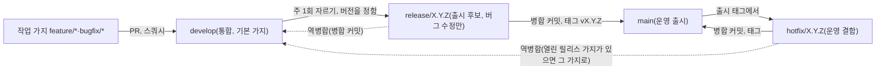
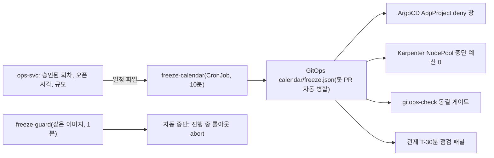

# DevOps 상세 설계: 저장소·CI·공급망·승격·배포·변경 관리

- **독자와 용도**: 플랫폼 엔지니어와 각 서비스 담당이 코드가 저장소에서 운영 환경까지 가는 길(저장소, 코드를 올릴 때마다 자동으로 검사하고 빌드하는 CI, 공급망 증명, 환경 승격, 워크로드별 배포와 되돌리기, 데이터 변경, 변경 동결과 정비 시간, 인프라 코드, 사람의 운영 접근, 비용 상한 장치, 전달 지표)을 구현하고 운영할 때 읽는 기준 문서다. 배포 구성도·환경 정의·가용성(서비스를 멈춤 없이 쓸 수 있는 정도)·백업은 [infra.md](infra.md), SLO(팀이 정한 서비스 품질 목표)·경보·Game Day(일부러 장애를 내고 대응을 연습하는 날)는 [observability.md](observability.md), 운영 명령은 [features/control-tower.md](features/control-tower.md), 비밀과 키 목록은 [security/secrets-and-keys.md](security/secrets-and-keys.md)가 정본이다. 보안 요구사항 추적은 [security/asvs/delivery.md](security/asvs/delivery.md)다.
- **원문 출처**: 설계서 §15 <리포지토리와 가상 팀 구조>, 설계서 19장 <MSA, Kubernetes와 CNCF 생태계>, 설계서 23장 <AWS DevOps>, [ADR-0054](adr/0054-delivery-pipeline-change-freeze-and-safe-deploys.md), [ADR-0074](adr/0074-git-flow-branching-release-and-hotfix.md). 원문에는 절차가 없어 이 문서의 규칙은 대부분 [보완]이다.
- **기준 기획 버전**: v1.0.
- **표시 규칙**: 2026-10-13 DevOps 검토(소유자 요청 '상세설계까지')에서 정한 규칙은 추천 적용(2026-10-13)이다. 측정으로 정할 값만 [가정, Phase N …에서 확정]으로 적는다. 외부 제품·표준 사실은 2026-10-13에 원문으로 확인했고, 출처는 §16에 있다. 가지 규칙(§2.2)의 git flow는 소유자 결정(2026-10-20, ADR-0074)이고, 이 프로젝트에 맞춘 세부 규칙은 추천 적용(2026-10-20)이다. git flow 원문과 GitHub 규칙 세트 등은 2026-10-20에 확인했다(§16). 늘 켜 두는 데모 환경은 두지 않는다(질문 24 결론, ADR-0057).

## 1. 범위와 원칙

DevOps 파이프라인은 신뢰할 수 있는 코드 변경이 운영 환경까지 무중단으로 안전하게 전달되도록 엔지니어링 규율을 표준화한다:
- **코드 및 브랜치 거버넌스 (Git Flow)**: `main`(운영 정본), `develop`(통합 개발), 릴리스 브랜치 격리를 통한 출시 안정성 확보([ADR-0074](adr/0074-git-flow-branching-release-and-hotfix.md))
- **공급망 무결성 (Build Once, Deploy Anywhere)**: 한 번 빌드한 불변 컨테이너 이미지 다이제스트를 모든 환경에 동일하게 승격
- **선언형 GitOps와 무중단 배포**: ArgoCD 기반 지속적 일치(GitOps: 저장소에 적어 둔 배포 상태대로 클러스터를 맞추는 운영 방식), 온세일 변경 동결(Change Freeze) 창 엄수([ADR-0054](adr/0054-delivery-pipeline-change-freeze-and-safe-deploys.md))

### 1.1 이 문서가 정하는 것

| 영역 | 이 문서 | 함께 보는 정본 |
| --- | --- | --- |
| 저장소·가지 규칙(git flow)·버전·GitHub 설정 | §2 | ADR-0165, ADR-0074, architecture §10 |
| CI 단계·필수 검사·시험 배치 | §3 | architecture §8.2(웹 앱 보안 검증 항목 목록인 ASVS의 태그) |
| 공급망 보안(SBOM·서명·출처 증명·의존성) | §4 | asvs/delivery.md |
| 환경 승격·배포 상태(`deploy/`)·설정 종류 | §5 | infra §3(환경 4종) |
| 워크로드별 배포 전략과 되돌리기 | §6 | infra §8(무중단 원칙), ADR-0010 |
| 데이터 변경(스키마·키·이벤트) | §7 | data.md, api/guidelines.md §1 |
| 변경 동결 창·정비 시간·긴급 변경 | §8 | POL-028, POL-041 |
| 인프라 코드·플랫폼 수명주기 | §9 | infra §1·§9 |
| 사람의 운영 접근과 감사 | §10 | NFR-017, secrets-and-keys |
| 비용 상한 장치 | §11 | infra §11, 성능 장부 |
| 변경 위험·운영 준비·런북·Game Day | §12 | infra §10, observability §12 |
| 전달 지표(DORA 5종) | §13 | NFR-023, observability §14 |
| 시험 포인트 D-T1~D-T48 | §14 | — |
| 알려진 한계 | §15 | docs/planning/01 §5.2 |

### 1.2 원칙

| 원칙 | 뜻 | 근거 |
| --- | --- | --- |
| 작게 자주, 되돌릴 수 있게 | 작업 묶음은 몇 시간에서 이틀 크기로 하고, `develop` 병합은 하루 한 번 이상 한다. 운영에는 릴리스(기본 주 1회 [가정])와 핫픽스(운영에 나간 출시본의 결함을 다음 정기 출시를 기다리지 않고 고치는 새 코드)로 내보낸다(§2.2) | DORA 'Working in small batches', AWS Well-Architected OPS05-BP09 |
| 가지는 git flow | 출시 단위로 묶어 내보내고(릴리스 가지), 운영 결함은 다음 기능과 섞지 않고 고친다(핫픽스 가지). 운영에는 데모에서 검증한 출시 후보만, 다시 빌드하지 않고 그대로 간다(§2.2.4) | 소유자 결정 2026-10-20(ADR-0074), Driessen 'A successful Git branching model'(2010) |
| 한 번 만들어 같은 길로 | 한 번 빌드한 이미지 다이제스트를 모든 환경에 같은 절차로 승격한다 | DORA 'Deployment automation', OPS05-BP10 |
| 원하는 상태는 Git에 선언 | 선언형, 버전 관리·불변, 클러스터 안 에이전트가 끌어오기, 계속 맞추기 | OpenGitOps 1.0.0 네 원칙 |
| 사람 승인보다 동료 검토와 자동 검사 | 외부 승인 위원회 대신 동료 검토와 자동 검사를 쓰고, 위험이 큰 변경만 추가로 확인한다(§12.1) | DORA 'Streamlining change approval': 무거운 외부 승인은 성과를 낮추고 변경 실패율을 낮추지 않는다 |
| 배포와 공개를 나눔 | 미완성 기능은 릴리스 플래그(배포한 코드의 공개 여부를 코드 변경 없이 켜고 끄는 설정) 뒤에 병합하고 따로 공개한다(§5.4) | DORA 'Working in small batches'(dark launch, feature toggle) |
| 온세일 중에는 바꾸지 않음 | 온세일(판매가 열리는 시각 앞뒤로 접속이 몰리는 기간) 앞뒤로 운영 변경을 멈춘다. 코드 병합(`develop`·릴리스·`main`)과 출시 태그는 멈추지 않는다 | SRE Book 1장(장애 약 70%가 변경에서 나온다는 구글 관찰), DORA 'Trunk-based development'(코드 동결이 없는 방식) |
| 밀폐 빌드와 증명 | 같은 리비전은 어디서 빌드해도 결과가 같다. 도구 버전을 고정하고, 산출물에 서명과 출처 증명(어느 커밋에서 어떤 빌드 절차로 만들어졌는지 서명해 남긴 기록)을 붙인다 | SRE Book 8장 'Hermetic Builds', SLSA 1.2 Build track |
| 정직한 1인 운영 | 가상 팀의 '2인'은 실제로는 한 사람이다. 사람 검토를 자동 검사로 대신하는 곳을 §15에 적는다 | 소유자 요청(한계 기록, 2026-10-11) |

## 2. 저장소와 브랜치

### 2.1 저장소 둘과 공개 범위

GitHub 조직 계정(무료 등급) 아래 저장소 둘을 둔다(소유자 결정 2026-10-30, ADR-0169. 처음에는 넷이었다, ADR-0165). 문서·코드·배포 상태·부하 시험은 모두 공개 모노레포(코드 전부를 저장소 하나에 폴더로 나눠 담는 방식) `peaket`에 두고, 공개하면 안 되는 봇 시뮬레이터만 비공개 `peaket-bots`에 둔다. architecture §10의 목록과 같다. 운영 계정을 실제로 만들면(wbs 2.11.2) 실제 값이 든 인수 문서·런북 부록과 운영 이슈(경보 위생 보고, observability §5)를 둘 비공개 운영 저장소가 하나 더 생긴다(아래 '설계 문서의 공개 범위', ADR-0153). 그 전 데모의 경보 위생 보고는 합성 데이터라 `peaket`의 Issues에 올린다.

| 저장소 | 공개 | 담는 것 | 배포 대상 | 따로 두는 이유 |
| --- | --- | --- | --- | --- |
| `peaket` | 공개 | 문서(`docs/` 한 폴더, ADR-0168), 계약 원본(`docs/api/`), 화면 앱(`apps/`), 서버와 작업자(`services/`), 공용 패키지(`packages/`), dbt 모델(`data/`), 인프라 코드(`infra/`), 배포 상태(`deploy/`, §5.2), 부하 시험(`loadtest/`), 빌드·서명 절차(`.github/workflows/`, §3.1), 점검 도구(`tools/`), 스펙 주도 개발 기록(`openspec/`, architecture §8.6) | 서비스 이미지 10개, 마이그레이션 잡, 작업·스트림 작업자 이미지(§4.1), 앱 서버 이미지 2개(web, partner), 정적 자산, 설치형 앱처럼 쓰는 웹 앱인 PWA 2개(web의 지갑, scanner), 관제 콘솔 MF 호스트와 원격 위젯 둘(§6.6), dbt 이미지, AWS·GitHub 설정. 배포 상태는 Argo CD가 `develop`의 `deploy/`에서 끌어간다 | — |
| `peaket-bots` | **비공개** | 합성 봇 시뮬레이터(봇 등급표 1~3단계의 봇 코드) | 운영으로 배포하지 않는다 | 봇 코드는 공개하지 않는다(POL-026). 공개 저장소 안에서 폴더 하나만 숨길 수는 없다. wbs 1.2.2에서 봇 시뮬레이터를 처음 만들 때 만든다 |

- **`peaket`의 폴더(추천 적용 2026-10-30, ADR-0165·0169)**: 폴더별 내용과 가상 팀은 architecture §10 표다. 서버에서 도는 배포 단위(서비스, 스트림 작업자, 작업 이미지)는 모두 `services/<이름>`에 둔다. 코드 주인은 뿌리의 `.github/CODEOWNERS`가 폴더 단위로 가상 팀 아홉에 나눈다. 계약 원본은 설계 문서 자리(`docs/api/`)에 그대로 두고, 계약에서 만든 코드(Zod 스키마, TypeScript 타입, gRPC 스텁)와 Pact 파일은 `packages/contracts`가 갖는다.
- **공개 기본(추천 적용, 2026-10-13)**: GitHub 무료 등급에서 브랜치 보호·규칙 세트는 공개 저장소에만 있다. 비공개 저장소의 환경(environment)에는 유료 등급이, 환경 보호 규칙(필수 검토자)에는 Enterprise가 필요하다. 코드 스캐닝은 공개 저장소에서 무료이고, 출처 증명(artifact attestation)은 공개 저장소만 모든 등급에서 쓸 수 있다. 호스트 러너 사용은 공개 저장소에서 무료이고, 비공개는 월 2,000분을 넘으면 과금된다(2026-10-13 GitHub 문서). 포트폴리오를 공개하려는 목적과도 맞는다.
- **`peaket`의 줄바꿈(추천 적용 2026-10-28, 기술 검토 낮음-168)**: 텍스트 파일은 모두 LF로 둔다. 코드를 함께 담은 뒤에도 같다(ADR-0165). `.gitattributes`는 `* text=auto eol=lf`로 하고, 그림·PDF 같은 바이너리 형식은 `binary`로 적는다. 2026-10-22에 만든 기준점 커밋(c037a15)은 그대로 두고, 섞여 있던 CRLF 파일(2026-10-28 기준 15개)은 줄바꿈만 바꾸는 정리 커밋 하나로 LF로 바꾼다. 그 커밋에는 내용 수정을 섞지 않는다. 줄바꿈을 그대로 두는 지금 설정(`* -text`)은 스크립트로 고칠 때마다 파일별 줄바꿈을 지켜야 하고, 실수하면 파일 전체가 바뀐 것처럼 보이는 함정이 남는다.
- **비공개 예외**: `peaket-bots`는 합성 봇 시뮬레이터만 담아 비공개다(POL-026: 3단계 봇 코드는 무력화 형태로도 공개하지 않는다). k6 부하 시나리오와 카오스 실험은 공개 `peaket`의 `loadtest/`에 둔다. 봇 저장소는 운영으로 배포하지 않으므로 브랜치 보호가 없어도 운영 경로에 영향이 없다. 봇 실행 결과는 공개 성능 장부(`docs/perf-ledger/`)에 남는다. 봇 탐지 규칙의 기준값과 가중치는 `services/trust-svc` 코드가 아니라 비공개 설정(Secrets Manager 매개변수)으로 둔다.
- **공개 저장소에 넣지 않는 것**: 비밀 값, 운영 데이터, 운영 계정의 내부 엔드포인트(API를 부르는 주소) 목록. 저장소에는 비밀의 경로(이름)만 둔다(ExternalSecret).
- **설계 문서의 공개 범위(소유자 결정 2026-10-29, ADR-0153)**: 인프라 인수 문서(docs/infra-handover.md), 런북, 위협 모델을 포함한 설계 문서 묶음은 공개한다. 설계를 공개해도 안전해야 한다는 원칙(보안은 숨김이 아니라 키·권한·통제에 둔다)을 따르고, 봇 판정 기준값처럼 알려지면 효과가 줄어드는 값만 비공개 설정에 둔다(위 '비공개 예외'). 문서에는 실제 계정 번호, 공인 IP, 실제 도메인을 쓰지 않고 자리표시값(`peaket.example`, 문서용 대역)만 쓴다. 문서 점검 도구의 `public` 검사가 이를 막는다(tools/doc-check/README.md). 운영 계정을 실제로 만들 때(wbs 2.11.2) 실제 값이 들어가는 인수 문서·런북의 부록(계정 번호, 실제 주소, 비상 연락처)은 비공개 운영 저장소에 두고, 공개 문서는 자리표시값 판을 그대로 둔다.
- **모노레포로 바꾼 이유(소유자 결정 2026-10-30, ADR-0165)**: 저장소 경계는 서비스를 나눈 기술 근거가 아니다. 서비스 분리는 부하 규모·가용성 등급·실행 방식의 차이로 정했다(architecture §3, ADR-0007). 2026-10-28에는 저장소 14개를 '여러 가상 팀이 저장소를 나눠 일하는 거버넌스와 저장소를 건너는 변경을 직접 보이려는 포트폴리오 목표'로 두었다(ADR-0016·0128). 그런데 한 사람이 일하므로 가상 팀 경계 뒤에 실제 소통 구조가 없다. 모노레포로도 바뀐 범위만 검사하기, 서비스별 이미지, 폴더 단위 코드 주인으로 독립 배포와 팀 경계를 보일 수 있다. 그래서 읽는 사람이 한곳에서 문서와 코드를 함께 보고 토큰 없이 빌드하는 쪽을 골랐다. 잃는 것은 저장소를 건너는 변경과 저장소별 권한을 직접 보이는 것이다. 되돌릴 조건: 실제 팀이 생겨 팀마다 저장소 권한을 나눠야 하면 그 팀의 폴더를 저장소로 떼는 새 ADR을 쓴다. git flow(ADR-0074)는 어느 쪽이든 그대로다.
- **저장소를 둘로 줄인 이유(소유자 결정 2026-10-30, ADR-0169)**: 처음에는 빌드·서명 절차(`.github`), 배포 상태(`peaket-gitops`), 부하 시험(`peaket-loadtest`)을 따로 두었다(ADR-0165). 다시 보니 앞의 둘은 실서비스에서 힘을 갖는 이유였다. GitHub 문서는 재사용 워크플로로 빌드하면 SLSA Build L3에 이를 수 있다고 하고 다른 저장소를 요구하지 않는다(2026-10-30 확인). 절차의 판을 코드와 따로 고정하는 보호는 따로 검토할 사람이 있어야 생기는데 혼자서는 형식뿐이다. 늘 켜 둔 운영 환경이 없어(ADR-0057) 설정 저장소를 떼는 이점도 작다. 포트폴리오를 읽는 사람은 저장소를 오가지 않는다. 그래서 공개하면 안 되는 봇 코드만 떼었다. 잃는 것과 메우는 장치(절차 변경 PR을 따로 하는 검사, §2.2.6)는 ADR-0169에 있다. 되돌릴 조건: 실제 운영이나 실제 팀이 생기면 빌드 절차와 배포 상태를 다시 저장소로 뗀다.
- **공개 재현 경로(추천 적용 2026-10-30, ADR-0165)**: `peaket` 하나를 받아 `pnpm install --frozen-lockfile`과 빌드·시험을 토큰 없이 한다. 내부 패키지(`@peaket/*`)는 게시하지 않고 `workspace:` 프로토콜로 잇기 때문이다(§4.4). GitHub Packages는 공개 패키지도 설치할 때 접근 토큰이 필요해(GitHub Docs, 2026-10-27·10-28 확인), 저장소 14개일 때는 공개 저장소를 모아 잇는 작업 공간 스크립트가 따로 있어야 했다. 이제 그 스크립트는 없다. 비공개 `peaket-bots`는 빌드에 필요 없다.
- **운영 판과의 호환 검사 시연(추천 적용 2026-10-30, ADR-0165)**: 계약을 깨는 변경과 그 제공자·소비자 코드를 한 PR에 넣는다. 같은 커밋끼리의 검사는 통과하지만, 마지막 출시 태그(운영 판)와 견주는 `contract-check`(§3.1)가 막는 과정을 녹화와 재현 스크립트로 보인다(wbs 0.4.3, docs/verification.md §7). 저장소가 하나여도 운영 배포는 배포 단위마다 따로 나가서, 배포 사이에 옛 판과 새 판이 함께 돈다는 것을 보이려는 시연이다.

### 2.2 가지 규칙(git flow)과 커밋·버전

코드를 담는 저장소는 git flow(Vincent Driessen, 2010)를 따른다(소유자 결정 2026-10-20, ADR-0074). 이 절의 세부 규칙은 이 프로젝트의 CI·환경 승격·변경 동결에 맞춘 추천 적용(2026-10-20)이다. 배포 상태(`deploy/`)의 승격 PR과 비공개 봇 저장소는 §2.2.5의 표를 따른다(ADR-0169).



#### 2.2.1 가지 종류

| 가지 | 이름 | 만드는 곳 | 병합하는 곳 | 수명 | 병합 방식 |
| --- | --- | --- | --- | --- | --- |
| 운영 출시 | `main` | — | — | 영구. 모든 커밋이 출시본이고 태그가 붙는다 | 릴리스·핫픽스 가지만 병합 커밋으로 받는다 |
| 통합 | `develop` | `main`에서 한 번 | — | 영구. 저장소의 기본 가지 | 작업 가지는 스쿼시로, 역병합은 병합 커밋으로 받는다 |
| 작업 | `feature/<ID>-<요약>`, `bugfix/<ID>-<요약>` | `develop`. 버그 수정은 열린 릴리스·핫픽스 가지에서도 만든다 | 나온 가지 | `develop`에 하루 한 번 이상 병합하는 것을 목표로 작게 나눈다. 3일 [가정, Phase 4 운영 리허설에서 확정]을 넘기면 CI가 경고한다 | 스쿼시 |
| 릴리스 | `release/X.Y.Z` | `develop` | `main`, 그다음 `develop`(역병합) | 저장소마다 하나(`peaket`에서는 시스템 전체에 하나, ADR-0165). 3영업일 [가정, Phase 4 운영 리허설에서 확정] 안에 마무리한다 | 병합 커밋(`--no-ff`) |
| 핫픽스 | `hotfix/X.Y.Z` | `main`의 출시 태그 | `main`, 그다음 `develop`(열린 릴리스 가지가 있으면 그 가지) | 저장소마다 하나(`peaket`에서는 시스템 전체에 하나). 몇 시간~1일 | 병합 커밋(`--no-ff`) |
| 역병합 | `merge/<원천>-to-<대상>`(예: `merge/release-1.5.0-to-develop`) | 마무리 때 릴리스 봇이 후보 커밋에서 | 대상 가지 | 역병합 PR 하나. 충돌이 나면 이 가지에서 사람이 푼다. 릴리스 가지를 머리로 쓰면 `main` 병합 때 저장소 설정(`delete_branch_on_merge`)이 그 가지를 지워 역병합 PR이 닫힐 수 있어서 따로 만든다(추천 적용 2026-10-31, openspec 변경 `add-release-workflows`) | 병합 커밋 |

- `<ID>`는 WBS(할 일을 잘게 나눈 작업 목록)의 작업 번호나 이슈 번호다(예: `feature/2.5.4-auto-assign`). 원문은 이름 예로 `release-*`·`hotfix-*`를 썼다. PEAKET은 이름 앞에 종류 접두사(`feature/`, `bugfix/`, `release/`, `hotfix/`, `merge/`)를 붙여, 가지 규칙 검사(§2.2.6)가 가지 종류를 알아보게 한다.
- 원문은 작업 가지도 `--no-ff`로 병합한다. PEAKET은 작업 가지만 스쿼시로 바꿨다. 원문이 `--no-ff`로 얻으려던 것(기능 하나의 커밋을 묶어 보이고 통째로 되돌리기)은 스쿼시 커밋 하나와 PR 기록이 맡는다. PR 제목(Conventional Commits)은 버전 계산과 변경 기록의 단위가 된다. 릴리스·핫픽스·역병합은 원문대로 병합 커밋으로 한다. 스쿼시하면 `main`과 `develop`의 이력이 갈라져 다음 병합이 충돌한다.
- Renovate가 여는 의존성 PR(`renovate/*`)은 작업 가지로 보고 `develop`에 스쿼시로 넣는다.
- 미완성 기능은 릴리스 플래그를 꺼 둔 채로 `develop`에 병합한다(§5.4). 열린 작업 가지는 가상 팀마다 3개 이하로 둔다 [가정]. 팀은 PR이 바꾼 파일의 CODEOWNERS 주인으로 센다(ADR-0165). 가지 규칙 검사(`branch-policy`)가 작업 가지 PR마다 같은 저장소에서 열린 작업 가지 PR(`feature/*`·`bugfix/*`, 포크 PR은 빼고)을 GitHub API로 읽어 팀마다 세고, 이번 PR이 바꾼 파일의 팀 가운데 3개를 넘는 팀이 있으면 경고만 한다(실패시키지 않는다). PR 하나가 여러 팀의 파일을 바꾸면 팀마다 센다. 이름을 바꾼 파일은 옛 경로의 팀에도 센다. 팀은 GitHub처럼 대상 가지의 CODEOWNERS로 정한다. API를 읽지 못하면 그 사실을 경고하고 넘어가고, 세지 못하는 CODEOWNERS 패턴 꼴(`*`, `/경로`, `/경로/`, `/경로/**` 밖)도 경고한다. 이 단계는 넘어지거나 시간 제한(2분 [가정])에 걸려도 필수 검사를 막지 않는다(추천 적용 2026-11-04, FND-160).

#### 2.2.2 릴리스

1. **자르기**: `develop`에 출시할 변경이 있으면 릴리스 봇이 기본 주 1회 [가정, Phase 4 운영 리허설에서 확정] `release/X.Y.Z`를 만든다. 급한 기능은 정기 주기가 아닐 때도 자른다. 버전은 이때 정한다(§2.2.5. 원문도 릴리스 가지를 시작할 때 번호를 붙인다). 첫 커밋은 뿌리 `package.json`의 버전 올림(`chore(release): X.Y.Z`)이다. 변경 기록은 파일로 두지 않고 릴리스 PR 본문에 붙이고, 마무리 때 다시 만들어 GitHub Release에 붙인다. 그래야 릴리스 가지에 들어온 버그 수정까지 담기고, 시작 때 담을 수정이 없는 핫픽스도 같은 길로 간다(추천 적용 2026-10-31, `add-release-workflows`). 예약 실행은 월요일 10:00 KST다(요일·시각은 추천 적용 2026-10-31). 출시할 변경이 없거나 이미 열린 릴리스 가지가 있으면 아무것도 만들지 않는다.
2. **안정화**: 릴리스 가지는 버그 수정(`bugfix/*` 스쿼시)과 출시 메타데이터만 받는다. 기능은 다음 릴리스로 간다. 그동안 `develop`은 다음 기능을 계속 받는다. 코드 동결은 없다.
3. **출시 후보**: 릴리스 가지의 끝 커밋마다 후보 이미지를 빌드하고 서명해 데모로 승격한다(§5.3). 데모 카나리 통과와 체류(데모에 올린 채 지켜보는 시간) 1시간 [가정]은 GitHub 배포 상태로 남는다.
4. **마무리**: 릴리스 가지에서 `main`으로 가는 PR을 병합 커밋으로 병합한다. 필수 조건은 공용 CI, 가지 규칙 검사, 병합 결과 트리 검사(§2.2.4), 데모 배포 성공(규칙 세트)이다. 1인 기간에는 소유자가 마무리 워크플로를 실행한다.
5. **태그와 역병합**: 릴리스 봇이 `main`의 병합 커밋에 주석 태그 `vX.Y.Z`를 달고 GitHub Release를 만든다. 여기에는 변경 기록, 서비스별 후보 다이제스트, SBOM(소프트웨어에 들어간 부품 목록) 요약을 담는다. 이어서 운영 승격 PR(§5.3)과, `develop`으로 가는 역병합 PR(병합 커밋)을 연다. 충돌이 나면 `merge/*` 가지에서 사람이 푼다. 끝나면 릴리스 가지를 지운다.
6. **포기**: 3영업일 [가정] 안에 출시할 수 없으면 릴리스 가지를 닫는다. 이미 고친 버그는 `develop`으로 역병합하고, 다음 주기에 다시 자른다.

#### 2.2.3 핫픽스

- **쓰는 때**: 운영에 나간 출시본의 결함이 SEV1·SEV2(장애 심각도 등급. 숫자가 작을수록 심각하다)의 원인일 때, 또는 commander가 다음 정기 릴리스까지 기다릴 수 없다고 판단할 때다(원문: 운영 버전의 심각한 결함을 바로 고칠 때). 그 밖의 수정은 `develop`으로 간다.
- **순서**: `main`의 출시 태그에서 `hotfix/X.Y.(Z+1)` → 버전 올림 → 수정(`bugfix/*` 스쿼시) → 출시 후보 빌드·데모 → `main` 병합 커밋과 태그 → 운영 승격 PR → 역병합. 열린 릴리스 가지가 있으면 `develop`이 아니라 그 릴리스 가지로 역병합한다(원문의 예외 규칙. 릴리스가 끝날 때 `develop`에도 들어간다).
- **변경 동결 창**: 창 안에서는 핫픽스도 운영에 승격하지 않는다(§8.4. 핫픽스는 긴급 변경이 아니다). 창 안에서는 되돌리기와 릴리스 플래그 끄기로 버틴다. 핫픽스는 만들어 데모 검증까지 해 두고, 창이 끝나면 승격한다.
- **되돌리기와의 관계**: 되돌리기(이전 다이제스트, §6.7)는 가지 작업이 아니라 GitOps 되돌리기다. `main`의 태그는 그대로 두고, 되돌린 출시본은 GitHub Release에 '철회'로 적는다. 고친 판은 핫픽스나 다음 릴리스로 낸다.

#### 2.2.4 병합 결과 트리 검사(같은 산출물 유지)

운영에는 데모에서 검증한 후보 다이제스트를 다시 빌드하지 않고 올린다(§1.2 '한 번 만들어 같은 길로'). 그런데 git flow는 `main`에 병합 커밋을 새로 만들기 때문에 커밋 SHA가 후보와 달라진다. 그래서 내용(트리)이 같은지를 본다.

- **병합 전(필수 검사)**: `git merge-tree --write-tree origin/main <후보 커밋>`이 충돌 없이 끝나야 하고(종료 코드 0), 결과 트리가 후보 커밋의 트리와 같아야 한다. 다르면 `main`에 후보에 없는 변경이 있다는 뜻이다(예: 릴리스 가지로 역병합하지 않은 핫픽스). 그 변경을 릴리스 가지에 넣고 새 후보를 다시 검증한다.
- **병합 뒤(릴리스 봇)**: PR 병합은 GitHub가 한다. 그래서 `main` 병합 커밋의 트리가 후보 커밋의 트리와 같은지 다시 확인한 뒤에만 태그와 운영 승격 PR을 만든다. 다르면 멈추고 SEV3로 알린다.
- **기록**: GitHub Release와 승격 PR에 태그 커밋, 후보 커밋, 트리 해시(내용을 원래 값으로 되돌릴 수 없게 바꾼 고정 길이 값), 서비스별 다이제스트를 함께 적는다. 출처 증명(§4.2)은 후보 커밋을 가리킨다.

#### 2.2.5 커밋·버전·저장소별 적용

| 항목 | 규칙 | 근거 |
| --- | --- | --- |
| 커밋 메시지 | Conventional Commits 1.0.0(`feat`, `fix`, `!`)을 따른다. 스쿼시 커밋 메시지는 PR 제목이다. PR 본문에는 관련 ID를 적는다: FR(기능 요구사항)·NFR(성능·보안 같은 품질 요구사항)·POL·ADR(결정과 그 이유를 남긴 기록)·WBS·ASVS | — |
| 버전 | 모든 저장소가 SemVer 2.0.0을 따른다. `peaket`의 판은 시스템 전체의 출시 판이다(ADR-0165). 버전은 릴리스를 자를 때, 지난 태그 뒤의 커밋 형식으로 정한다: `!`·`BREAKING CHANGE`는 MAJOR, `feat`는 MINOR, `fix`와 그 밖의 형식은 PATCH를 올린다. 운영 출시 전에는 0.y.z로 둔다(호환을 깨는 변경도 y만 올린다). 운영 출시 때 1.0.0으로 올린다 | Conventional Commits 1.0.0, SemVer 2.0.0 |
| 태그 | `main` 병합 커밋에 다는 주석 태그 `vX.Y.Z`. 릴리스 봇만 만들고, 만든 태그는 옮기거나 지우지 않는다(태그 규칙 세트) | §2.2.6 |
| 내부 패키지 | `packages/*`(platform, contracts, ds 등)와 관제 위젯 패키지는 게시하지 않는다. 쓰는 쪽은 `workspace:` 프로토콜로 잇고, 판은 저장소 태그를 따른다. 그래서 Changesets는 쓰지 않는다(ADR-0165) | §4.4 |
| 서비스 식별 | 이미지 태그는 `sha-<커밋 40자>`이다. 배포 매니페스트는 다이제스트(`@sha256:…`)로 고정한다. 사람이 읽는 버전은 저장소 태그이고, GitHub Release와 승격 PR 제목에 적는다. 출시 후보는 마지막 출시 태그 뒤에 바뀐 배포 단위만 새 이미지로 만든다. 바뀌지 않은 배포 단위는 직전 다이제스트를 그대로 둔다(ADR-0165) | §5.3 |
| 프론트엔드 빌드 식별 | 출시 후보를 빌드한 커밋 SHA를 빌드 ID로 쓰고, Next.js(웹 화면을 만드는 프레임워크)의 `deploymentId`로도 쓴다 | §6.6 |
| 변경 기록 | 릴리스마다 지난 태그부터 쌓인 커밋으로 변경 기록을 만들어 GitHub Release와 승격 PR에 붙인다. PR 제목의 범위(`feat(queue): …`)에 가상 팀 이름을 적어, 변경 기록을 팀·배포 단위별로 묶는다(ADR-0165) | §5.3 |

| 저장소 | 적용 |
| --- | --- |
| `peaket`(서비스, 화면, 공용 패키지, 데이터) | 위 규칙을 전부 따른다. 바뀐 배포 단위는 한 릴리스로 함께 나간다. 승격은 배포 단위마다 차례로 한다(한 환경에 카나리 하나, §5.3) |
| `peaket`의 `infra/` | 같은 저장소의 같은 출시를 따른다. 비운영 환경에는 `develop`에 병합한 뒤, 운영에는 `main`에 병합한 뒤 적용한다(§9.3) |
| `peaket`의 `.github/workflows/` | 같은 저장소의 같은 출시를 따른다. 공용 절차(재사용 워크플로)는 같은 저장소 안 경로로 부른다. 절차를 바꾸는 PR에는 다른 코드 변경을 섞지 않는다(§2.2.6 가지 규칙 검사, ADR-0169) |
| `peaket`의 문서 | 같은 규칙을 따른다. 새 결정·요구사항은 `feat`, 정정은 `fix`로 적는다(범위는 `docs`). 기획 버전(review §9의 판정)은 저장소 태그와 별개다. 예외(추천 적용 2026-10-28, 기술 검토 낮음-162): 원격 저장소(`peaket`)를 만들기 전까지는 작업 가지·PR 없이 `develop`에 스쿼시 형식 커밋(작업 하나에 커밋 하나, Conventional Commits 제목, 본문에 관련 ID)을 바로 쌓는다. 원격이 없어 PR을 열 곳과 규칙 세트(§2.2.6)를 걸 곳이 없고, 여러 작업 세션이 한 작업 트리를 함께 써서 가지를 바꾸면 다른 세션이 고치던 파일이 섞이기 때문이다. 원격을 만든 날부터 위 규칙과 규칙 세트를 그대로 건다 |
| `peaket`의 `loadtest/` | 같은 저장소의 같은 출시를 따른다. 운영으로 배포하지 않는다 |
| `peaket`의 `deploy/`(배포 상태, ADR-0169) | Argo CD는 `develop`의 `deploy/`만 읽는다. 바꿀 때는 작업 가지나 봇의 `promote/*`·`calendar/*` 가지에서 `develop`으로 PR을 연다. `develop`에 병합하는 것이 곧 배포이고, 환경 승격은 환경 디렉터리의 다이제스트가 맡는다. 릴리스 가지와 `main`에 따라가는 `deploy/`는 그때의 사본일 뿐 읽지 않는다. 그래야 같은 환경의 원하는 상태가 두 벌이 되지 않는다 |
| `peaket-bots`(비공개) | `main` 하나를 쓴다. 무료 등급의 비공개 저장소에는 규칙 세트가 없고 운영으로 배포하지 않는다(§15) |

#### 2.2.6 강제 장치

- **규칙 세트**(§2.3에서 Terraform으로 관리한다. 무료 등급에서는 공개 저장소만 쓸 수 있다):
  - `main`: PR 필수, 허용 병합 방식은 병합 커밋만, 필수 검사(공용 CI, 가지 규칙 검사, 병합 결과 트리 검사), 병합 전 데모 배포 성공 요구, 강제 푸시·삭제 금지. 데모 환경(클라우드)이 없는 기간에는 데모 배포 성공 요구를 걸지 않는다(소유자 결정 2026-11-03, FND-160). 클라우드 비용 없이 가는 동안 데모에 배포하는 길이 없어, 걸면 `main` 병합과 첫 릴리스가 막히기 때문이다. 데모 환경이 생기면 다시 건다(Terraform 값 `main_required_deployments`).
  - `develop`: PR 필수, 허용 병합 방식은 스쿼시와 병합 커밋, 필수 검사, 강제 푸시·삭제 금지. 선형 이력 요구는 쓰지 않는다(역병합이 병합 커밋이다). 조직 관리자(1인 기간에는 소유자 한 사람)는 이 규칙을 우회해 바로 푸시할 수 있다(소유자 결정 2026-11-03, FND-160). 루프와 병렬 세션이 `develop`에 바로 커밋하고 소유자가 시킬 때 푸시하는 지금 방식을 유지하려는 것이고, 다른 사람의 직접 푸시는 막는다. 그래서 1인 기간의 `develop`에서는 PR·필수 검사가 소유자의 푸시를 막지 않는다. 사람이 늘면 이 우회를 거두고 PR로 바꾼다.
  - `release/*`·`hotfix/*`: 릴리스 봇만 만든다. PR 필수, 강제 푸시 금지.
  - 태그 `v*`: 만들기·바꾸기·지우기는 릴리스 봇만 한다.
  - 1인 기간의 필수 승인 수는 0이다(§2.3).
  - 필수 검사의 이름(추천 적용 2026-10-30, ADR-0167의 첫 OpenSpec 변경): 공용 CI는 `ci-summary`, 가지 규칙 검사는 `branch-policy`, 병합 결과 트리 검사(§2.2.4)는 `merge-tree`다. `develop`은 앞의 둘을, `main`은 셋을 요구한다. 규칙 세트는 이 이름으로 검사를 기다리므로 wbs 0.1.2의 잡 이름은 이것과 같아야 한다. 필수 검사는 GitHub Actions 앱(ID 15368, 2026-10-30 확인)에서 온 것만 받는다. 상태를 쓸 권한이 있는 다른 앱이 같은 이름의 검사를 '통과'로 찍지 못하게 하려는 것이다(R-200). 코드는 `infra/modules/github`다.
  - Terraform GitHub 제공자는 v6.10.0부터 규칙 세트의 허용 병합 방식(`allowed_merge_methods`)을 다룬다. 그래서 그 이상 판으로 고정한다(2026-10-20 릴리스 노트 확인).
- **가지 규칙 검사**(`branch-policy`, 필수 검사): PR이 보내는 가지(머리 가지)의 종류와 대상 가지가 허용된 쌍인지 본다. 허용하는 쌍: 작업 가지와 `renovate/*` → `develop`, 봇의 승격·달력 가지 `promote/*`·`calendar/*` → `develop`(ADR-0169), `bugfix/*` → 열린 `release/*`·`hotfix/*`, `release/*` → `main`·`develop`, `hotfix/*` → `main`·`develop`·열린 `release/*`, `merge/*` → `develop`·`release/*`. 그 밖의 쌍이면 검사가 실패한다. 빌드·서명 절차(`.github/workflows/`)를 바꾸는 PR은 그 밖의 경로를 함께 바꾸면 실패한다(절차 변경은 따로, 추천 적용 2026-10-30, ADR-0169). 같은 저장소의 `release/*`·`hotfix/*`·`merge/*`가 보내는 PR은 이미 병합된 변경을 옮길 뿐이라, 보호 가지(`main`·`develop`·`release/*`·`hotfix/*`)에 아직 없는 새 커밋이 바꾼 파일만 본다(병합 커밋은 손으로 고친 파일만). 전부 보면 지난 출시 뒤 워크플로가 한 번이라도 바뀐 릴리스 PR이 늘 실패한다. 포크에서 온 PR은 가지 이름과 상관없이 바뀐 파일 전부를 본다(추천 적용 2026-10-31, `add-release-workflows`, 코드 리뷰). 절차의 판을 코드와 따로 고정하던 별도 저장소(ADR-0165)를 대신해, 절차 변경이 코드 변경에 묻혀 들어가지 않게 하려는 것이다. 작업 가지가 3일 [가정]을 넘기거나 한 가상 팀의 열린 작업 가지가 3개를 넘으면 경고한다(팀은 PR이 바꾼 파일의 CODEOWNERS 주인으로 센다, ADR-0165).
- **PR 제목 형식 검사**(`branch-policy`의 한 단계, 필수 검사, 추천 적용 2026-10-28, 기술 검토 낮음-017): 스쿼시 커밋 메시지가 PR 제목이고, 버전 계산과 변경 기록이 그 제목을 읽는다(§2.2.1·§2.2.5). 그래서 제목 형식이 틀리면 판 계산이 조용히 틀린다. 검사는 셋을 본다. ① 형식: Conventional Commits 1.0.0의 `<종류>[(범위)][!]: <설명>`이다. ② 허용 종류: `feat`, `fix`, `perf`, `refactor`, `docs`, `test`, `build`, `ci`, `chore`, `style`, `revert`다(명세는 `feat`·`fix` 밖의 종류도 허용하고 `@commitlint/config-conventional`의 목록을 예로 든다, 2026-10-28 확인). ③ 호환을 깨는 변경 표시: PR 본문에 `BREAKING CHANGE:` 꼬리말이 있으면 제목에도 `!`가 있어야 한다. 버전 계산이 제목만 읽어도 MAJOR(운영 출시 전에는 y)를 놓치지 않게 하려는 것이다. 제목을 고치면 검사가 다시 돈다(`pull_request`의 `edited` 사건). 릴리스 봇의 PR은 `chore(release): X.Y.Z`처럼 같은 형식의 제목을 쓰고, Renovate는 `semanticCommits: "enabled"`와 `config:recommended`의 머리말 규칙으로 `chore(deps): …`(운영 의존성은 `fix(deps): …`) 제목을 만든다(Renovate 문서와 프리셋 소스, 2026-10-31 확인). 설정은 뿌리의 `renovate.json`이다. 시험은 D-T41이다.
- **병합 방식 실수**: 규칙 세트는 병합 방식을 대상 가지마다 정한다. 그래서 `develop`에 작업 가지를 병합 커밋으로 넣는 실수는 막지 못한다. 역병합은 봇만 한다. 주간 점검은 `develop`의 병합 커밋 가운데 두 번째 부모가 릴리스·핫픽스·역병합 가지가 아닌 것을 찾아 경고한다. 구현(추천 적용 2026-11-04, FND-160): `branch-weekly.yml`이 매주 월요일 09:00 KST [가정](릴리스 자르기 1시간 전)와 수동 실행으로 돈다. 필수 검사 `branch-policy`와 다른 파일에 둔다. 같은 파일에 두면 수동 실행이 PR 머리 커밋에 '건너뜀' `branch-policy`를 붙여 필수 검사가 통과로 바뀔 수 있다. 지난 8일 [가정](주 1회 점검이 빈틈 없이 겹치게)의 `develop` 첫 부모 이력에서 병합 커밋을 고르고, 들어온 가지는 GitHub API의 그 커밋에 연결된 병합 PR의 머리 가지로, PR이 없으면 병합 커밋 제목(`Merge pull request #N from …`, `Merge branch '…'`)으로 정한다. `release/*`·`hotfix/*`·`merge/*`가 아니면 경고하고, 들어온 가지를 알 수 없어도 경고한다. 결과는 잡 요약에 표로 남기고, 경고가 있어도 잡은 실패시키지 않는다(이력을 읽지 못해 점검 자체가 돌지 못하면 실패한다). 조직 관리자 우회로 바로 올린 선형 커밋(1인 기간, 위 `develop` 규칙 세트)은 병합 커밋이 아니라 보지 않는다. 관리자가 로컬에서 만든 병합 커밋(가지 합치기, `git pull`의 `Merge branch 'develop' of …`)은 PR이 없어 제목으로 정하므로 경고된다. 원격을 만들기 전에 합친 두 커밋(2026-10-31)도 수동 실행의 기간에 들면 경고된다.
- **릴리스 봇**: GitHub 앱이다(가지·태그 만들기, PR 만들기·병합). 규칙 세트 우회 목록에는 이 앱만 둔다(위 `develop`의 조직 관리자 우회는 예외다). 앱의 개인 키는 GitHub `release` 환경의 비밀로 둔다. 그 환경은 `develop`·`release/*`·`hotfix/*`·`main`에서 도는 공용 워크플로만 쓴다([secrets-and-keys](security/secrets-and-keys.md)).
- **도구**: git-flow 명령줄 도구는 쓰지 않는다. 가지 작업은 공용 워크플로 `release.yml`이 PR로 한다. 규칙은 규칙 세트와 필수 검사로 강제한다.
- **기본 가지와 예약 작업**: 기본 가지는 `develop`이다. 예약 워크플로는 기본 가지의 최신 커밋에서만 돈다(GitHub 문서). 그래서 운영 상태를 보는 예약 작업(IaC 드리프트 점검)은 `main`을 직접 지정해 체크아웃한다(§9.3).

### 2.3 GitHub 설정의 코드화

`infra/stacks/global/github`(`peaket`의 Terraform GitHub 제공자 스택)가 다음을 관리한다: 저장소 둘(§2.1, ADR-0169)의 생성과 공개 범위, 기본 가지(`develop`. 비공개 `peaket-bots`는 `main`), 규칙 세트(§2.2.6: `main`·`develop`·릴리스·핫픽스 가지와 `v*` 태그), CODEOWNERS 검토 요구, 환경(`demo`, `staging`, `prod`, 릴리스 봇의 `release`)과 보호 규칙, 릴리스 봇 GitHub 앱의 설치 범위, Actions 허용 목록과 SHA 고정 요구, 워크플로 토큰(워크플로가 권한을 증명할 때 쓰는 문자열)의 기본 권한(읽기 전용), 조직의 OIDC 주체 사용자화(`include_claim_keys`: `repo`, `context`, `job_workflow_ref`. §4.5, ADR-0165·0169). 손으로 바꾼 설정은 매일 하는 드리프트 점검(§9.3)이 잡아낸다.

- 1인 기간에는 필수 승인 수를 0으로 둔다. GitHub에서는 PR 작성자가 자기 PR을 승인할 수 없다. 대신 필수 검사가 병합을 막는다. 가상 팀이 실제 팀이 되면 CODEOWNERS 승인을 1명 이상으로 올린다(ADR-0054 되돌릴 조건).
- **팀 목록은 한 곳에 둔다(추천 적용 2026-10-30, ADR-0167의 첫 OpenSpec 변경)**: 가상 팀 아홉의 목록은 `infra/stacks/global/github/teams.json`이다. Terraform이 이 목록으로 GitHub 팀을 만들고, `tools/ci/check-codeowners.mjs`가 `.github/CODEOWNERS`의 팀이 모두 이 목록에 있는지, 첫 규칙 줄이 기본값 `*`인지, 같은 경로가 두 번 없는지 본다. 조직 이름은 `peaket`이다(소유자 결정 2026-10-30, 조직은 아직 만들지 않음).

## 3. CI

### 3.1 공용 재사용 워크플로

공용 절차는 `peaket`의 `.github/workflows/`에 재사용 워크플로(`workflow_call`)로 두고, `ci.yml`·`release.yml`이 같은 저장소 안 경로로 부른다(소유자 결정 2026-10-30, ADR-0169. 처음에는 조직 공용 `.github` 저장소에 두고 커밋 SHA로 고정해 불렀다, ADR-0165). 빌드를 재사용 워크플로 안에서 하므로 출처 증명의 서명자는 그 워크플로다. GitHub 문서는 이렇게 하면 SLSA v1 Build L3에 이를 수 있다고 하고, 재사용 워크플로가 다른 저장소에 있기를 요구하지 않는다(2026-10-30 확인, §4.2). 검사 기준을 한곳에 모으는 효과는 그대로다(SRE Book 8장 '정책과 절차의 강제'). 절차를 바꾸는 PR은 다른 코드 변경을 섞을 수 없다(§2.2.6 가지 규칙 검사).

`peaket`에서는 `peaket`의 `.github/workflows/ci.yml` 하나가 모든 PR에서 돈다(추천 적용 2026-10-30, ADR-0165). 경로 필터로 건너뛴 워크플로는 필수 검사가 '대기'로 남아 PR 병합을 막기 때문이다(GitHub 워크플로 문법 문서, 2026-10-30 확인).

1. 첫 잡 `changes`가 바뀐 범위를 고른다. 자바스크립트 작업 공간(`apps/`, `services/`, `packages/`)은 Turborepo `--affected`로 고른다. 현재 가지에서 바뀐 패키지와 그것에 기대는 패키지가 고른 범위다(Turborepo 문서, 2026-10-30 확인). 그 밖의 경로(`docs/`, `docs/api/`, `data/`, `infra/`, `deploy/`, `loadtest/`, `tools/`)는 `git diff --name-only`를 읽는 저장소 안 스크립트(`tools/ci/changes.mjs`)로 고른다. 제3자의 '바뀐 파일' 액션은 쓰지 않는다(§4.5의 tj-actions 사고).
2. 넓게 쓰이는 것이 바뀌면 범위를 넓힌다. `packages/platform`·`packages/contracts`·`docs/api/`·잠금 파일·`ci.yml`이 바뀌면 그것에 기대는 배포 단위를 모두 돌린다. 범위를 고르지 못하면(스크립트 오류) 전체를 돈다.
3. 고른 범위에 따라 아래 공용 워크플로를 부르는 유형별 잡(§3.2)이 돈다. 마지막 잡 `ci-summary`(`if: always()`)는 앞의 잡이 하나라도 실패하거나 취소되면 실패한다. 규칙 세트의 필수 검사는 `ci-summary`와 `branch-policy` 둘이다.
4. 시험: D-T47.
5. 지금 있는 것(추천 적용 2026-10-31, openspec 변경 `add-ci-foundation`, R-202): `ci.yml`의 잡은 `changes`, `docs-check`, `tools-check`, `iac-check`, `ci-summary`다. 판단은 모두 `tools/ci/*.mjs`가 하고 시험이 함께 있다(tools/ci/README.md). 범위 잡은 `changes` 잡이 실패해도 돈다(범위를 고르지 못하면 전체를 돈다). 옮긴 파일은 옛 경로와 새 경로를 함께 세고, 지운 파일이 있으면 링크가 깨질 수 있어 문서 범위도 켠다. 대상 가지를 바꾸면(`edited`) 범위를 다시 고른다. 문서 점검이 읽는 파일(`tools/`와 점으로 시작하는 폴더 밖의 `.md`·`.yaml`·`.json`·`.csv`)은 어디에 있든 문서 범위에 든다. 화면·서비스·계약·데이터 잡은 그 코드가 생기는 변경에서 더한다. 자바스크립트 작업 공간 잡 `node`(`ci-node.yml`)는 2026-11-01에 더했다(openspec 변경 `add-service-template`, 아래 표). 계약에서 만든 코드(`packages/contracts`)와 그 생성물 차이 검사(`pnpm --filter @peaket/contracts gen:check`, 같은 검사가 그 패키지의 시험에도 있다)는 2026-11-01에 생겼고(openspec 변경 `add-contracts-package`), CI의 계약 잡 `contract-check`(`contract-check.yml`)가 2026-11-01에 그 검사를 부르게 됐다(wbs 0.2.1 ②, BUILD_ORDER FND-040). 로컬 kind 클러스터 시험 잡 `kind`(`ci-kind.yml`)는 2026-11-01에 더했다(openspec 변경 add-local-cluster-and-relay-deployment, 아래 표). 규칙 모델 검사 잡 `spec-check`(`spec-check.yml`)는 2026-11-02에 더했다(FND-130, 아래 표). 그래서 지금 `ci.yml`의 잡은 `changes`, `docs-check`, `tools-check`, `contract-check`, `node`, `kind`, `spec-check`, `iac-check`, `ci-summary` 아홉이다(2026-11-01 정합 점검, .github/workflows/ci.yml). 그 뒤 이미지 빌드 시험 `image`(BSL-050), 부하 시험 점검 `loadtest-check`(BSL-060), 화면 잡 `web`(`ci-web.yml`, 2026-11-04, BAS-170)을 더했다.

| 워크플로 | 하는 일 | 쓰는 곳 |
| --- | --- | --- |
| `ci-node.yml` | 잠금 파일대로 고정 설치, 린트(서비스는 서비스 템플릿의 층 의존 방향 규칙 포함, architecture §3.1, 추천 적용 2026-10-28, 기술 검토 낮음-008)·타입 검사, 단위 시험, 통합 시험, ASVS 태그 보고(시험이 남긴 보고서—vitest JSON `test-report.json`·통합 `test-report-int.json`, `node --test` JUnit `test-report.xml`—를 `tools/ci/asvs-report.mjs`가 모아 ASVS 추적 표의 행마다 결과를 작업 요약에 쓴다. 판정은 시험이 하므로 막지 않는다. 보고서는 turbo test 작업의 outputs라 캐시가 시험을 건너뛰어도 돌아온다. 두 값은 test 작업의 env라 캐시 판정에 든다. 바뀐 패키지만 도는 실행(`--affected`)에서는 돌지 않은 패키지의 행과 다른 워크플로의 시험(tools·loadtest)이 '미실행'으로 보이고, 요약 첫머리에 읽은 보고서 수를 적는다, 2026-11-05 BOT-160·162). 통합 시험은 관계형 데이터베이스 PostgreSQL, Valkey, 메시지 시스템 Kafka를 실제 컨테이너(앱과 실행 환경을 한 묶음으로 만든 실행 단위)로 띄워서 한다. 지금 있는 것(2026-11-01, openspec 변경 `add-service-template`): 잠금 파일대로 설치하고 Turborepo로 타입 검사·단위 시험·빌드를 돈다. 넓게 쓰이는 것(위 2번)이 바뀌었거나 범위를 고르지 못했으면 전체, 아니면 바뀐 패키지와 그것에 기대는 패키지만 돈다(`--affected`, 기준은 `TURBO_SCM_BASE`로 PR 대상 가지의 기준 커밋·푸시의 앞 커밋, 이력은 모두 받는다). 린트(서비스 안 구조의 층 의존 방향, 뿌리 `pnpm lint`)와 서비스 템플릿의 컨테이너 통합 시험(실제 PostgreSQL 18을 `docker run`으로 띄운다, `pnpm --filter @peaket/platform test:integration`)은 늘 돈다(2026-11-01, openspec 변경 `add-service-structure-and-request-checks`). identity-svc의 PostgreSQL 저장소 시험(`pnpm --filter @peaket/identity-svc test:integration`, 같은 멱등 키의 세션 생성이 겹쳐 오는 경우 I-T50 ①)도 늘 돈다(추천 적용 2026-11-03, BUILD_ORDER PRF-020). 뿌리 `eslint.config.mjs`와 `packages/config`가 바뀌면 전체를 돈다. | `services/`, `packages/`, `apps/` |
| `ci-kind.yml` | 로컬과 같은 스크립트(`tools/local/`)로 kind 클러스터(Strimzi Kafka 3.9.1, PostgreSQL 18, 계정 없는 AWS 흉내 서버)를 띄워, 도구 받기·Strimzi 설치 파일 고치기·공용 차트 렌더 시험, AWS 흉내 서버의 기능 확인, Outbox 릴레이 리더 이어받기(V-T28 ①의 kind 부분)를 돈다. 무거워서(약 10분 [가정]) 바뀐 범위 `kind`(클러스터 정의·공용 차트·클러스터 도구, 서비스 이미지에 드는 것 전부: 플랫폼 패키지와 서비스 뼈대·공용 설정 패키지·작업 공간 파일)일 때와 `develop` 푸시에서만 돈다. 비밀이 필요 없어 포크 PR에서도 돈다(2026-11-01, openspec 변경 add-local-cluster-and-relay-deployment). 화면 E2E(Playwright 3엔진)는 그 시험이 생기는 단계에서 더한다 | `deploy/local`·`deploy/charts`, `tools/local`, 릴레이를 쓰는 `services/` |
| `security-scan.yml` | gitleaks CLI(비밀 탐지), Semgrep(직접 만든 규칙: `sql.raw()`를 허용 목록 밖에서 부르는 곳, 프로토타입 오염 위험 패턴 등), CodeQL(공개 저장소), 의존성 취약점·라이선스 검사, OpenSSF Scorecard(주 1회) | `peaket` 전체, 비공개 `peaket-bots`(gitleaks·의존성 검사만, CodeQL은 공개 저장소 무료) |
| `build-image.yml` | 두 잡으로 나눈다(추천 적용 2026-10-28, 기술 검토 중간-062). ① 빌드 잡: 다단계 빌드(기본 이미지 다이제스트 고정)로 OCI 묶음(이미지를 파일 하나로 담은 꾸러미)과 다이제스트만 만든다. 서명 신원을 받는 OIDC 토큰, 레지스트리 쓰기, 출처 증명 권한이 없다. ② 게시 잡: 저장소 코드를 체크아웃하거나 실행하지 않는다. 빌드 잡이 넘긴 묶음의 다이제스트를 다시 계산해 맞춘 뒤 CycloneDX SBOM과 이미지 취약점 검사, 레지스트리 푸시(운영 설계의 ECR은 신원 확인 표준인 OIDC로 받은 단기 자격 증명, 포트폴리오 기간의 GHCR은 워크플로 토큰, §4.1), cosign 키 없는 서명, SLSA 출처 증명을 한다. 게시 잡은 빌드 잡과 필수 검사가 모두 통과해야 시작한다. 다중 아키텍처(추천 적용 2026-10-28, 기술 검토 낮음-167): 운영 노드가 Graviton(arm64)이고 로컬 kind·데모는 x86(amd64)이라 두 플랫폼을 다 만든다. 빌드 잡은 플랫폼마다 따로 돌아, amd64는 `ubuntu-24.04`, arm64는 `ubuntu-24.04-arm` 호스트 러너에서 에뮬레이션 없이 빌드한다(공개 저장소는 두 러너 모두 무료, GitHub 문서 2026-10-28 확인). 게시 잡은 두 묶음으로 이미지 인덱스(플랫폼별 이미지를 묶은 목록) 하나를 만든다. SBOM·취약점 검사는 플랫폼 이미지마다 하고, 서명은 인덱스와 플랫폼 이미지 모두에(cosign `--recursive`), 출처 증명은 인덱스 다이제스트에 한다. 승격과 배포 매니페스트는 인덱스 다이제스트로 고정하고, 노드가 자기 플랫폼 이미지를 고른다. 지금 있는 것(추천 적용 2026-11-03, BUILD_ORDER BSL-050): ① 빌드 잡만 있다. 입력은 Dockerfile 경로와 이미지 이름이다. 플랫폼마다(amd64는 `ubuntu-24.04`, arm64는 `ubuntu-24.04-arm`) 저장소 안 스크립트 `tools/ci/image-build.mjs`가 BuildKit(다이제스트로 고정한 이미지의 `docker-container` 빌더)으로 빌드해 OCI 묶음과 다이제스트를 만든다. 출처 증명과 SBOM은 게시 잡이 붙이므로 빌드 잡에서는 끈다(`--provenance=false`, `--sbom=false`). 같은 러너에서 그 이미지를 네트워크 없이 띄워 스모크한다: 그 플랫폼의 Node가 돌고 이미지 안의 네이티브 모듈(`.node`)이 모두 열리는지 본다(`tools/ci/image-smoke.mjs`). 묶음과 다이제스트는 잡 산출물로 남긴다. 빌드 잡의 권한은 `contents: read`뿐이고, 레지스트리 로그인·푸시·서명·출처 증명 단계와 비밀 값(`secrets.`·`secrets: inherit`)이 없어야 한다(워크플로 검사, D-T32 ①). 이름이 같은 빌더가 이미 있어도 고정한 BuildKit 이미지가 아니면 지우고 다시 만든다. ② 게시 잡(이미지 인덱스, SBOM·취약점 검사, 푸시, 서명, 출처 증명)은 wbs 0.1.5에서 더한다. `ci.yml`의 잡 `image`가 바뀐 범위 `image`(이미지가 있는 배포 단위와 그 Dockerfile이 담는 패키지, 작업 공간 파일, `.dockerignore`, 이 워크플로와 그 스크립트)일 때 이미지 셋(`services/v0-monolith`, `services/pg-simulator`, 서비스 뼈대 `packages/platform/template`)을 푸시 없이 빌드한다(§3.2 '이미지 빌드 시험') | `services/`, `apps/`(앱 서버), `data/`(dbt 이미지) |
| `migration-check.yml` | 마이그레이션 SQL 검사(Squawk), 빈 DB에 전체 적용, 직전 운영 스키마(데이터의 구조 정의)에 새 마이그레이션 적용, N-1 시험(§7.3) | DB를 가진 서비스(`services/`) |
| `contract-check.yml` | `buf lint`·`buf breaking`, OpenAPI·AsyncAPI 차이 검사(`oasdiff breaking`·`asyncapi diff`, 깨짐 기준은 docs/api/guidelines.md §1, 기술 검토 낮음-019), Avro 호환 검사(지난 출시 태그의 스키마를 모두 올린 로컬 레지스트리 컨테이너에서 BACKWARD_TRANSITIVE. 운영·데모 레지스트리에는 닿지 않는다)와 열거 규칙 검사(맨 앞 `UNRECOGNIZED`와 기본값, 기호 지우기 금지), 필수 여부 검사(asyncapi와 avsc의 필수 목록·기본값·조건부 칸의 `x-present-when`이 같은지, 조건이 그 메시지의 필수 열거 칸과 그 기호를 가리키는지, ADR-0150), Pact 검증(§3.3). `buf breaking`·OpenAPI·AsyncAPI 차이·Pact는 대상 가지와 함께 마지막 출시 태그(운영 판)와도 견준다. 저장소가 하나라 한 PR이 계약과 제공자·소비자를 함께 바꿔도 같은 커밋끼리는 통과하지만, 운영에는 배포 단위가 따로 나가 옛 판과 새 판이 함께 돌기 때문이다(ADR-0165, D-T48). 서비스에서는 `@nestjs/swagger`로 만든 OpenAPI 문서를 CI 안에서만 파일로 뽑아(실행 중인 서비스는 문서 경로를 내지 않는다) `docs/api/openapi.yaml`과 견주고, 어긋나면 PR을 실패시킨다(경로·메서드·매개변수·요청과 응답 본문의 모양만 견준다. D-T38). 프론트엔드에서는 orval 생성물(타입·호출 함수·Zod 스키마)을 다시 만들어 차이가 없는지 본다(추천 적용 2026-10-28, 기술 검토 중간-085·087·088). 지금 있는 것(2026-11-01, openspec 변경 `add-contract-breaking-check`, R-220): 계약 생성물 차이(`gen:check`)·계약 패키지 시험, OpenAPI·AsyncAPI 깨짐 검사(`tools/ci/contract-breaking.mjs`, 두 도구는 다이제스트 고정 이미지를 네트워크 없이 돌림. AsyncAPI 메시지 본문은 oasdiff로 견줌), 깨짐 예외 목록(`docs/api/breaking/`)과 `breaking-approved` 라벨 규칙, 서비스 OpenAPI 차이(D-T38) 비교 본체(2026-11-01, openspec 변경 `add-service-template`, `tools/ci/service-openapi.mjs`). 서비스는 `package.json`의 `peaket.contractOperations`에 맡는 계약 작업을 `"<메서드> <경로>"`로 적고, `openapi:emit`(환경 변수 `OPENAPI_OUT`의 경로에 `@peaket/platform`의 `emitOpenApi`로 문서를 쓴다)으로 뽑은 문서를 그 작업만 견준다. 목록이 없거나, 목록의 작업이 계약·서비스 문서에 없거나, 서비스 문서의 작업이 목록·계약에 없으면 실패한다. 매개변수(위치·이름·필수·모양), 요청 본문(필수·내용 형식·모양), 2xx 상태 모음과 그 본문, 서비스가 적은 4xx·5xx(계약에 있어야 하고 본문을 적으면 모양이 같아야 한다)를 본다. 계약의 4xx·5xx를 서비스가 적지 않은 것은 괜찮다(게이트웨이와 공용 필터가 낸다). 모양은 `$ref`를 풀어 형(OpenAPI 3.0 `nullable`은 null 형)·칸·필수·배열 원소·열거·조합만 보고 설명·예시·형식·길이·범위는 보지 않는다. 요청에서는 읽기 전용 칸을, 응답에서는 쓰기 전용 칸을 뺀다(OpenAPI `readOnly`·`writeOnly`). 같은 뜻의 다른 표기는 같은 모양으로 읽는다: 3.1 형 배열과 3.0 `nullable`, Zod가 내는 null 조각이 낀 `anyOf`, 하나짜리 `allOf`, `oneOf`와 `anyOf`, 값 목록 union과 열거 하나, 형만 있는 스칼라 union과 형 배열, 숫자 열거의 형은 값으로 읽기(값이 모두 정수면 `integer`). 계약의 모든 작업을 계약 Zod(`@peaket/platform`의 `contractSchema`, 기본 입력 기준)로 바꾼 문서는 이 비교에서 계약과 같아야 하고, 그것을 플랫폼 시험(`contract-sweep.test.ts`)이 지킨다. 남은 차이는 생성 Zod가 실제로 다른 한 곳뿐이다(BUILD_ORDER BAS-040). 계약 잡은 서비스와 그것이 기대는 패키지를 빌드한 뒤 문서를 뽑는다(추천 적용 2026-11-01, 코드 리뷰 반영). buf·Avro·Pact는 그 계약을 쓰는 코드가 생기는 단계에서 더한다 | `docs/api/`, `packages/contracts`, 계약을 쓰는 `services/`·`apps/` |
| `iac-check.yml` | `terraform fmt`·`validate`, tflint, IaC 보안 검사(Trivy 설정 검사), 읽기 전용 역할로 돌리는 plan, Infracost 비용 차이 댓글. 지금은 `fmt`·`validate`만 하고 나머지는 클라우드 스택을 만드는 변경에서 더한다(R-202) | `infra/` |
| `gitops-check.yml` | HTTPRoute 생성 대조(고정한 계약 판의 openapi에서 게이트웨이별 라우트 규칙(경로 틀과 메서드, 교차 출처 경로의 OPTIONS)을 다시 만들어 저장소의 생성 파일과 다르면 실패, D-T42, 추천 적용 2026-10-28, 기술 검토 낮음-020), 매니페스트를 최종 형태로 만들어 스키마 검사(kubeconform), Kyverno(쿠버네티스에 들어오는 설정을 규칙으로 검사하는 도구) 정책 시험, 이미지 서명·출처 증명 검증, 변경 동결 게이트(§8.2), ArgoCD(저장소의 배포 정의대로 쿠버네티스를 맞추는 배포 도구) 차이 미리보기 | `deploy/` |
| `promote.yml` | 승격 PR 만들기(데모: 출시 후보 다이제스트, 운영: 출시 태그의 후보 다이제스트. 변경 기록과 SBOM 요약을 붙인다). 되돌리기 모드는 직전 승격 PR을 거꾸로 만든 긴급 라벨 PR을 연다(§6.7 6번, 기술 검토 낮음-018) | `peaket`의 후보 빌드 뒤와 `main` 병합 뒤 |
| `branch-policy.yml` | 가지 규칙 검사(머리 가지 종류와 대상 가지의 쌍), PR 제목 형식 검사(Conventional Commits 형식·허용 종류·`!`와 `BREAKING CHANGE` 꼬리말의 일치, 기술 검토 낮음-017), 작업 가지의 나이·개수 경고, 빌드·서명 절차 변경 PR에 다른 경로가 섞였는지(ADR-0169). 작업 가지 수 경고는 GitHub API가 있어야 해 원격을 만든 뒤 더했다(2026-11-04, FND-160, `tools/ci/branch-watch.mjs count`, 잡 권한 `contents: read`·`pull-requests: read`). 병합 방식 주간 점검은 `branch-weekly.yml`이다 | `peaket`의 모든 PR |
| `branch-weekly.yml` | `develop` 병합 방식 주간 점검(§2.2.6, D-T49, `tools/ci/branch-watch.mjs weekly`). 경고와 잡 요약 표만 남기고, 이력을 읽지 못할 때만 실패한다. 잡 권한은 `contents: read`·`pull-requests: read`다(2026-11-04, FND-160) | 매주 월요일 09:00 KST 예약 실행과 수동 실행 |
| `merge-tree.yml` | 병합 결과 트리 검사(필수 검사 `merge-tree`, §2.2.4). 대상은 실행하는 때의 `origin/main`이다. 같은 스크립트(`tools/ci/check-merge-tree.mjs`)를 `release.yml`이 마무리 직전에 다시 부른다. PR이 열린 뒤 `main`이 움직여도 앞선 결과가 낡지 않게 하려는 것이다(R-202) | `main`으로 가는 PR |
| `spec-check.yml` | 규칙 모델 검사(docs/verification.md §2.2, wbs 0.9.1). `pr`: 명세·검사 도구가 바뀐 PR에서 형식 검사와 검사 모듈마다 시뮬레이션 1만 회(고정 시드). `full`: TLC 전수 검사(주 1회 월요일 03:00 KST, 검사 목록 `specs/specs.json`이 적은 관련 ADR이 바뀐 PR, 범위를 고르지 못했을 때). 지켜져야 할 모듈은 위반이 없고 TLC가 끝까지 돌아야, 일부러 깬 변형은 노린 불변식의 반례가 나와야 통과한다. 도구(Quint, Apalache 묶음 안의 TLC, Quint 평가기)는 고정 판·고정 해시로 받고(`tools/spec-check/fetch-tools.mjs`) Java는 Temurin 21이다. 전수 검사 결과는 내려받을 묶음으로 남긴다(2026-11-02, openspec 변경 `add-queue-model-checking`) | `specs/`, `tools/spec-check/`, 검사 목록이 적은 ADR |
| `tools-check.yml` | 점검 스크립트 시험(`node --test`)과 저장소 규칙 검사: 워크플로 규칙(§4.5), CODEOWNERS와 팀 목록(§2.3), `workspace:` 표기(§4.4)(추천 적용 2026-10-31, R-202). 성능 장부 도구의 명령줄 시험과 `collect.py --selftest`(추천 적용 2026-11-02, BSL-080). 실제 워크플로를 YAML로 읽는 시험이 있어 잠금 파일대로 의존성을 설치한 뒤 돈다(2026-11-03 첫 원격 CI에서 고침) | `tools/`, `.github/`, `infra/`, 작업 공간의 `package.json` |
| `perf-nightly.yml` | 야간 축소 성능 상대 비교(§3.3 '축소 성능 시험의 판정', D-T40). 매일 03:00 KST [가정]와 수동 실행. `loadtest/nightly/config.json`이 없으면 건너뛴다. 기준값을 넘거나 실행이 실패하면 SEV3 이슈를 연다(잡 권한 `contents: read`·`issues: write`)(추천 적용 2026-11-02, BSL-080) | 예약 실행(`develop`) |
| `loadtest-check.yml` | 부하 시험 점검(추천 적용 2026-11-03, BUILD_ORDER BSL-060): 시나리오가 함께 쓰는 계산과 실행 도구의 시험(`node --test "loadtest/test/*.test.mjs"`)과 시나리오 형식 검사(고정한 k6 이미지로 `k6 inspect`). `ci.yml`이 바뀐 범위에 `loadtest`가 있을 때 부른다. 클러스터를 띄우는 리허설은 이 PC에서만 한다(docs/verification.md §3.9) | `peaket`의 `loadtest/` |
| `release.yml` | 릴리스·핫픽스 시작(버전 계산, 변경 기록, 마지막 출시 태그 뒤 바뀐 배포 단위 목록), 병합 결과 트리 검사, 마무리(태그, GitHub Release, 운영 승격 PR, 역병합 PR, 가지 삭제)(§2.2.2~§2.2.4). 지금 있는 것(추천 적용 2026-10-31, openspec 변경 `add-release-workflows`): 잡 `start`(주 1회 예약과 수동 `start-release`·`start-hotfix`)와 `finish`(수동). 판단은 `tools/ci/release-plan.mjs`가 하고, 가지·커밋·태그·PR은 릴리스 봇 설치 토큰(`actions/create-github-app-token`, `release` 환경의 변수 `RELEASE_BOT_CLIENT_ID`와 비밀 `RELEASE_BOT_PRIVATE_KEY`, 권한은 contents·pull-requests·workflows 쓰기)으로 GitHub API를 불러 만든다. workflows 권한은 워크플로가 바뀐 커밋에 가지·태그를 만들 때 GitHub가 요구해서 둔다. 체크아웃에 자격 증명을 남기지 않는다. 마무리 순서: 병합 직전 트리 검사 → `--match-head-commit`으로 병합 커밋 병합 → 두 번째 부모와 트리 확인 → 주석 태그·GitHub Release(변경 기록, 바뀐 배포 단위, 태그 커밋·후보 커밋·트리 해시) → `merge/*` 역병합 PR(핫픽스를 열린 릴리스로 보낼 때는 판 줄이 충돌하지 않게 대상의 판으로 맞춘 커밋을 얹는다) → 남은 릴리스 가지 지우기. 단계마다 이미 한 일은 건너뛰어, `main` 병합 뒤 어느 단계에서 멈춰도 같은 입력으로 다시 돌리면 병합된 PR의 병합 커밋에서 이어 간다. 판이 겹치지 않게, 릴리스는 열린 핫픽스보다 큰 판을 받고 핫픽스는 같은 판의 릴리스가 열려 있으면 열지 않는다(코드 리뷰, 추천 적용 2026-10-31). 운영 승격 PR은 `deploy/`·`promote.yml`이 생기는 wbs 0.4.4에서, 서비스별 다이제스트·SBOM 요약은 이미지 빌드가 생기는 변경에서 더한다. 배포 단위는 `services/<이름>`, `apps/<이름>`(위젯은 `apps/widgets/<이름>`), `data/dbt_project.yml`이 있을 때의 `data`이고, `packages/`·`docs/api/`·뿌리 작업 공간 파일·`.nvmrc`·`build-image.yml`이 바뀌면 자바스크립트 배포 단위를 모두 고른다 | `peaket` |
| `docs-check.yml` | 문서 점검 도구의 시험(`python -m unittest`, tools/doc-check/README.md, 추천 적용 2026-11-01), `python tools/doc-check/check_all.py`(링크 검사 포함). OpenSpec 검증은 2026-11-02에 뺐다(ADR-0178) | `peaket`의 문서와 `docs/api/`, `tools/doc-check/` |
| `build-remote.yml` | 관제 원격 위젯 빌드, size-limit, 무결성 해시(sha384), console 배포 S3 업로드(§6.6, docs/frontend.md §5.18) | `apps/widgets/queue`, `apps/widgets/purchase` |
| `ci-web.yml` | 화면 잡(§3.2 '프론트엔드'). 지금 있는 것(추천 적용 2026-11-04, BUILD_ORDER BAS-170): ① `tokens`: 토큰 생성물 차이와 토큰 형식 검사·대비 계산(`pnpm --filter @peaket/ds test`, docs/frontend.md FE-T44·FE-T45) ② `visual`: 시각 회귀(FE-T40). 대기실 셸을 빌드해 판을 고정한 Playwright 컨테이너(`mcr.microsoft.com/playwright:v1.64.1-noble`, 다이제스트 고정)에서 저장소의 기준 이미지와 견주고, 다르면 차이 그림을 산출물로 남긴다 ③ `seed-css`: SEED CSS 층 검사(FE-T36). 앱 다섯을 `PEAKET_POC=seed-css`로 빌드해 같은 컨테이너에서 첫 화면 CSS와 탐침 화면을 세 엔진으로 보고, 크기 표를 잡 요약과 산출물로 남긴다. 브라우저 검사 도구는 뿌리 작업 공간과 따로 둔 `tools/web-checks/`(자기 잠금 파일)다. `ci.yml`의 잡 `web`이 바뀐 범위 `web`(화면 앱·`packages/ds`·`packages/config`, 토큰·d2·docs/frontend.md, `tools/web-checks/`, 이 워크플로, 작업 공간 파일)일 때 부른다. ④ `budgets`(2026-11-04 BAS-220): 운영 빌드로 대기실 FE-T1(size-limit), 경로별 첫 JS, Lighthouse 적재 지표(같은 컨테이너의 Chromium), 올릴 파일 목록(허용 확장자·소스 맵 링크 0)과 앱별 정적 자산 SBOM을 보고 산출물로 남긴다(docs/frontend.md §5.8·§5.18·§5.14.5). ⑤ `queue-room`(2026-11-06 HOT-347, ADR-0217): 운영 빌드에 출처만 검사용 가짜 API로 바꾼 대기실 빌드를 같은 출처 검사 틀로 띄워 같은 컨테이너의 세 엔진으로 FE-T3·FE-T15·FE-T4 브라우저 칸을 보고, 실패하면 결과 폴더를 산출물로 남긴다. axe·Storybook은 그 도구가 생기는 단계(BAS-180)에서 더한다. `ci-node.yml`의 Turborepo 캐시는 GitHub Actions 캐시에 둔다(docs/frontend.md §5.18) | `apps/`, `packages/ds`, `packages/config` |

- gitleaks는 MIT 라이선스인 CLI를 직접 쓴다. 공식 `gitleaks-action`은 v2부터 독자 사용권이어서 조직 저장소에서는 사용권 키가 필요하다(2026-10-13 확인).
- Trivy는 이미지·IaC 검사와 SBOM 생성에 쓴다. 다만 2026-03-19 `trivy-action`·`setup-trivy` 태그 탈취 사고(CVE-2026-33634)를 교훈 삼아, 액션 대신 다이제스트를 고정한 실행 이미지나 검증된 바이너리를 쓴다(§4.5).

### 3.2 유형별 필수 검사

`peaket`에서는 유형을 저장소가 아니라 바뀐 범위(§3.1)로 고른다. 한 PR이 여러 유형을 건드리면 그 유형의 검사가 모두 돈다. 태그·운영 승격 PR·역병합 PR은 저장소 하나에 한 번이다(ADR-0165).

| CI 유형 | PR 필수 검사 | `develop` 병합 뒤 | 릴리스·핫픽스 가지(출시 후보) | `main` 병합 뒤 |
| --- | --- | --- | --- | --- |
| 서비스(NestJS) | `ci-node`, `security-scan`, `migration-check`(DB가 있으면), `contract-check`, 이미지 빌드 시험(푸시 없이), `branch-policy` | 같은 검사, E2E(CI의 kind), 야간 축소 성능 시험 | 이미지 빌드·서명·출처 증명·푸시, 데모 승격 PR | 태그, 운영 승격 PR(후보 다이제스트), 역병합 PR |
| 프론트엔드(Turborepo) | 바뀐 앱·패키지만 골라(`turbo run --affected`) 린트·타입·단위 시험(Vitest, jsdom)과 실제 브라우저 Web API 시험(Vitest 브라우저 모드 + Playwright 공급자, 세 엔진. 도구 표는 docs/frontend.md §5.17, 추천 적용 2026-10-28, 기술 검토 중간-020), Storybook과 axe 접근성 검사, Lighthouse CI 예산(architecture §6.5), Playwright 3엔진(CI의 kind 클러스터, 합성 데이터), `contract-check`(Pact 소비자), `security-scan`, `branch-policy` | E2E(CI의 kind) | 앱 서버 이미지와 정적 자산 업로드(§6.6), 데모 승격 PR | 태그, 운영 승격 PR, 역병합 PR |
| 라이브러리(`packages/*`의 platform, ds, telemetry, validation, api-client, console-contract) | `ci-node`, `security-scan`, 공개 API(다른 프로그램이 불러 쓰는 창구)의 타입 선언 차이(기대는 배포 단위가 함께 시험 범위에 드는지 보이려고), `branch-policy` | — | — | 게시하지 않는다. 쓰는 쪽은 `workspace:`로 잇는다(ADR-0165) |
| 계약(`docs/api/`, `packages/contracts`) | `buf breaking`, OpenAPI·AsyncAPI 차이, Avro 호환(대상 가지와 마지막 출시 태그 둘 다와 견준다), 생성 코드 차이, 소비자 Pact 파일 형식, 제공자 Pact 검증(같은 실행 안), `security-scan`, `branch-policy` | 같은 검사 | — | 개발자 포털 정적 사이트 빌드·게시(openapi·asyncapi에서 웹훅과 오류 `type` 문서만, docs/api/guidelines.md §1, 추천 적용 2026-10-28, 기술 검토 중간-085), 태그, 역병합 PR. 계약 패키지는 게시하지 않는다(ADR-0165) |
| 데이터(`data/`, 스트림 작업자 `services/analytics-ingest`·`services/ops-rt`) | 스트림 작업자 단위·통합 시험과 `rt` 뷰 정답 시험(docs/streaming.md §13), dbt `build`(대량 이벤트 집계에 강한 분석용 데이터베이스인 ClickHouse의 시험용 컨테이너와 고정 시드), 이벤트 계약 대조, `security-scan`, `branch-policy` | 같은 검사 | 이미지 빌드·서명, 데모 승격 PR | 태그, 운영 승격 PR, 역병합 PR |
| IaC(`infra/`) | `iac-check`(plan·보안 검사·비용), `security-scan`, `branch-policy` | 비운영 apply(§9.3) | 운영 plan 검토 | 운영 apply(prod 환경 승인, 정비 시간, 동결 창 밖), 태그, 역병합 PR |
| 배포 상태(`deploy/`, ADR-0169) | `gitops-check`, `security-scan`, `branch-policy`. 경보 규칙·Alertmanager 설정이 바뀌면 `alert-check`도 돈다(`promtool test rules`, `amtool config routes test`, 경보 주석 검사, docs/verification.md §2.7, ADR-0069). 이미지는 빌드하지 않는다 | ArgoCD가 `develop`의 `deploy/`를 끌어간다 | — | — |
| 부하 시험(`loadtest/`, ADR-0169) | 린트, 시나리오 형식 검사(`loadtest-check`), `security-scan`, `branch-policy` | 야간 축소 성능 시험(§3.3) | — | 태그 |
| 문서(`peaket`의 문서 폴더) | `docs-check`, `security-scan`, `branch-policy` | — | — | 태그, 역병합 PR |

### 3.3 시험 배치

| 시험 | 어디서 | 언제 | 통과 기준 |
| --- | --- | --- | --- |
| 단위 | CI 러너 | PR | 실패 0 |
| 통합(실제 저장소 컨테이너) | CI 러너 | PR | 실패 0 |
| 계약(buf, OpenAPI·AsyncAPI 차이, Avro, Pact) | CI | PR, 운영 승격 전 | 실패 0 |
| 마이그레이션(빈 DB, 직전 스키마, N-1) | CI | PR | 실패 0, Squawk 오류 0 |
| 계획 회귀 가벼운 판(축소 데이터, `enable_seqscan` 끔, docs/data.md §5.2) | CI 러너 | DB 스키마·쿼리를 바꾸는 PR | §5.1 쿼리마다 기대한 인덱스를 씀(추천 적용 2026-10-28, 기술 검토 낮음-169) |
| 계획 회귀 전체 판(합성 5년치, docs/data.md §5.2) | 로컬 측정 PC(메모리 32GB). 5년치가 호스트 러너 디스크(SSD 14GB)에 들어가지 않는다 | 야간(측정 PC의 예약 작업), 출시 후보를 자르기 전 마지막 결과 | 금지 노드 0, 비용 변화는 성능 장부에 기록(추천 적용 2026-10-28, 기술 검토 낮음-169) |
| E2E(Playwright 3엔진) | CI의 kind 클러스터 | 프론트엔드 PR, `develop` 병합 뒤, 출시 후보 | 실패 0 |
| 브라우저 확인(AI가 Claude in Chrome으로 그 단계의 화면 정본과 시험 ID 통과 기준을 눌러 봄, architecture §8.6) | 개발 PC(로컬 실행, 합성 데이터, 시뮬레이터) | 화면이 바뀌는 단계마다 대조 뒤 | 관문이 아니다. 실패는 재현 시험으로 확인한 뒤 고친다(ADR-0167·0178) |
| 축소 성능(k6, 1/100 규모) | CI 러너(같은 실행 안의 상대 비교), 측정 PC(절대값) | 핫패스(요청이 가장 많이 지나는 경로) 서비스의 `develop` 야간, 출시 후보 | CI: 같은 러너에서 기준판과 새 판을 번갈아 잰 p99(요청 백 건 중 아흔아홉 건이 끝나는 시간) 비율이 A/A 잡음 폭으로 정한 기준 안. 측정 PC: p99가 직전 기준 대비 +20% 이내 [가정, Phase 1 1.4.1에서 확정]. 아래 '축소 성능 시험의 판정' |
| 승격 뒤 스모크 | 데모 | 승격 때 | 실패 0이면 카나리를 이어 간다 |
| DAST(ZAP 기준선 점검) | 데모(출시 후보), CI의 kind(`develop`) | 출시 후보마다, 야간 | High 이상 0(wbs 3.6.1) |
| 규모별 부하·카오스·Game Day | 로컬 측정 환경(`local-*`). 클라우드는 선택 사항인 보정에만 쓴다(ADR-0057) | 측정 캠페인 | 성능 장부(docs/perf-ledger.md), docs/verification.md |

- **축소 성능 시험의 판정(추천 적용 2026-10-28, 기술 검토 낮음-016)**: GitHub 호스트 러너는 실행마다 다른 가상 머신이라 벽시계 시간의 잡음이 크다(지속 벤치마크 도구 Bencher의 문서도 일반 CI 환경의 시간 측정은 잡음이 크고 고르지 않다고 적는다. 업체 문서라 보조 근거다). 그래서 날짜가 다른 두 실행의 p99를 견주어 판정하지 않는다.
  - CI(야간·출시 후보): 한 잡 안에서 기준판(직전 출시 태그의 이미지)과 새 판(그날 `develop` 이미지나 출시 후보)을 같은 러너에서 번갈아(기준·새·기준·새…, 판마다 5번 [가정]) 돌린다. 판마다 p99의 중앙값을 내고, 새 판 ÷ 기준판의 비율로 판정한다. 같은 러너·같은 시간대라 러너 사이의 차이가 비율에서 빠진다.
  - 기준값: 1.4.1에서 같은 판끼리 번갈아 잰 A/A 실행을 10번 [가정] 돌려 비율의 잡음 폭(가장 큰 벗어남)을 잰 뒤, 그 폭 바깥을 실패로 정한다. 정하기 전에는 경고만 하고 병합·승격을 막지 않는다.
  - 측정 PC: 날짜 사이의 절대값 비교(직전 기준 대비 +20% [가정])는 성능 장부의 측정 PC(`local-*` 프로파일, docs/perf-ledger.md §4)에서 잰 값으로만 하고 장부에 남긴다. 측정 PC는 자체 호스트 러너가 아니라(§4.5) 측정 캠페인과 출시 후보 전 측정 때 사람이 돌린다.
  - 구현(추천 적용 2026-11-02, BUILD_ORDER BSL-080): 워크플로 `perf-nightly.yml`이 매일 03:00 KST [가정]와 수동 실행으로 돈다. 설정 파일 `loadtest/nightly/config.json`(k6 시나리오, 판마다 실행 수, 기준판·새 판을 올리고 두 주소를 JSON 한 줄로 내는 준비 명령)이 없으면 '설정 없음'으로 건너뛴다. 있으면 `tools/perf-ledger/nightly.py run`이 준비 명령을 부른 뒤 k6를 기준·새·기준·새… 순으로 판마다 5번 돌려 p99를 모으고, `nightly.py compare`가 판별 중앙값의 비율(새 ÷ 기준)을 기준값 파일 `loadtest/nightly/threshold.json`의 `max_ratio`와 견준다. k6가 시나리오 기준을 넘어 종료 코드 99로 끝나도 요약이 있으면 견준다(크게 나빠진 밤일수록 이 경우다). `max_ratio`가 비어 있으면 경고만 하고 성공으로 끝난다. 넘거나 비교 전에 실행이 실패하면(준비 명령·k6·입력, 종료 코드 2) 잡이 실패하고 같은 제목의 SEV3 이슈(`sev3` 라벨)를 열거나, 이미 열려 있으면 댓글을 단다. 준비 명령과 k6 실행 전체에 기한(`--deadline-s 7000`)을 두어 잡 시간 제한(150분)보다 먼저 끝나게 하므로, 멈춘 k6도 잡 취소가 아니라 실패와 알림으로 끝난다. 기준값은 A/A 실행 10번(이보다 적으면 거부)의 비율을 `nightly.py aa-threshold`가 모아 1 + 가장 큰 벗어남으로 쓴다. k6는 `loadtest/poc/stack.mjs`와 같은 다이제스트 고정 이미지로 돌린다. 설정에 k6 명령(`k6`, 인자 목록)이 있으면 그 명령을 쓴다.
  - 준비 명령과 실행(추천 적용 2026-11-03, BUILD_ORDER BSL-090): `loadtest/nightly/config.json`의 시나리오는 `v0-queue.js`이고 1/100 규모다(대기자 1,000명, 진입 100/s, 입장 초당 2명, 예열 10초·본구간 30초 [가정]). 발생기는 CPU 1개·메모리 1GiB(`--cpus 1 --memory-mi 1024`) 하나다. 실행 도구의 기본 발생기(CPU 4개, 요청 = 한도)는 CPU 4개인 GitHub 호스트 러너에서 시스템 파드·두 판과 함께 자리를 잡지 못한다(2026-11-03 새 맥락 리뷰). CPU 1개 발생기도 클러스터에 Kafka(Strimzi)·AWS 흉내 서버까지 올리면 CPU 요청(쿠버네티스가 파드 자리를 잡을 때 세는 몫) 합이 4.35개라 자리를 잡지 못해, 러너의 첫 A/A 실행이 첫 회차에서 300초를 기다린 뒤 실패했다(2026-11-03). 그래서 준비 명령은 v0가 쓰지 않는 그 둘을 올리지 않는다. 그러면 합은 3.85개다(쿠버네티스 기본 파드·metrics-server 1.05, PostgreSQL·Valkey·PG 시뮬레이터 0.3, 두 판의 앱·입구 1.5, 발생기 1). 이 합이 4개를 넘지 않는지는 `tools/local/cluster.test.mjs`가 본다. 발생기 파드가 준비되지 않으면 실행 도구는 그 까닭(예: 스케줄러의 'Insufficient cpu')을 오류에 붙인다. 측정 뒤 기록을 읽는 앱 파드 안 관리 스크립트는 대기열 Redis에 붙기를 30초까지 기다린다(앱 시작의 5초 마감은 핫패스용이다. 다시 돈 첫 A/A가 4회째에 이 5초에 걸려 멈췄다, 2026-11-03). 그래도 실패하면 앱·Valkey 파드의 상태(다시 시작 횟수·직전 종료 까닭)를 오류에 붙인다. CPU 1개 발생기의 보정 용량은 초당 500건이라(docs/verification.md §3.10 '결과') 조회가 그 안에 들도록 입장 속도를 정했다(계획한 최고 도착률 초당 약 380건. 입장 초당 5명이면 약 780건이 된다). 회차마다 `--settle`로 앞 회차가 늘린 앱 복제가 최소로 줄 때까지 기다린 뒤 시작한다(늘지 않았으면 기다리지 않는다). 앞 회차는 다른 판이므로 올라와 있는 두 판을 모두 본다. 다른 판이 늘린 복제가 남은 CPU 자리(0.15개)를 차지하면 이번 발생기가 자리를 잡지 못하기 때문이다. 입장 초당 28명이면 모두가 예상 대기 1분 안에 들어 조회가 초당 약 1,700~2,000건이 되고, v0 입구(복제 1, 메모리 256Mi)가 메모리 초과로 다시 시작해 회차가 무효가 됐다(2026-11-03 리허설). 야간 비교는 무너지는 지점이 아니라 같은 세기에서의 성능 차이를 견준다. 판마다 5번이다.
    - 준비 명령 `node loadtest/nightly/prepare.mjs`는 kind를 v0가 쓰는 것만으로 올리고(`node tools/local/cluster.mjs up --v0-only`: PostgreSQL만, Kafka·AWS 흉내 서버 없이) 새 판(지금 커밋)을 네임스페이스 `v0`에 올린다. 기준판(가장 최근 출시 태그 `vX.Y.Z`의 커밋)은 따로 빌드해 `v0-base`에 올린다. 기준판은 DB `v0_base`와 Valkey DB 1을 따로 써서, 회차 목록 같은 공용 키가 두 판 사이에 섞이지 않는다.
    - 출시 태그가 아직 없으면 기준판도 지금 커밋이라, 그 밤은 A/A 실행이 된다. 준비 명령은 두 판 입구의 클러스터 안 주소를 낸다.
    - 실행 명령 `node loadtest/nightly/k6-run.mjs`는 k6 인자를 받아 주소로 판을 고른다. 같은 시나리오를 실행 도구(docs/verification.md §3.9, kind 안 발생기)로 돌리고, 본구간 요약을 그 자리에 쓴다. 발생기 판정이 무효(놓친 반복 등)면 그 회차는 견줄 수 없어 실패로 끝난다.
  - A/A와 기준값(D-T40 ①): `nightly.py aa --config loadtest/nightly/config-aa.json --runs 10 --out-dir <폴더>`는 준비 명령을 한 번만 부르고 A/A 측정을 10번 한 뒤 `threshold.json`을 쓴다. 기준값은 야간 잡이 실제로 도는 GitHub 호스트 러너의 잡음으로 정한다. 그래서 `perf-nightly.yml`의 수동 실행 입력 `mode: aa`가 러너에서 A/A 10번을 돌려 결과를 산출물로 올린다. 그것을 `loadtest/nightly/threshold.json`에 넣어 커밋하는 일은 원격 푸시가 있어야 해 소유자 몫이다(2026-11-03). 그 전까지 `max_ratio`는 비워 두고 야간 비교는 경고만 한다.
  - 이 PC에서 같은 절차로 잰 A/A 10번의 잡음 폭(측정 PC의 값, 러너 기준값에 쓰지 않는다)과 30ms 지연 판(D-T40 ②, `loadtest/nightly/test/delay-30ms.patch`)의 결과는 docs/verification.md §3.10 '결과'에 적는다.
  - 시험: D-T40.
- **Pact는 브로커 없이 운영한다(추천 적용, 2026-10-13).** 소비자(프론트엔드) 시험이 만든 Pact 파일은 `packages/contracts/pacts/`에 두고, 소비자 코드와 같은 PR에 넣는다. CI는 다시 만든 Pact 파일이 커밋된 것과 다르면 실패한다. 제공자 검증은 같은 실행 안에서 두 묶음을 본다. 지금 커밋의 소비자 Pact와, 마지막 출시 태그(운영에 나간 소비자)의 Pact다(ADR-0165). 데모 승격 검사는 '제공자 다이제스트가 `develop`의 모든 Pact를 통과했는가'를, 운영 승격 검사는 '`main`(출시된 계약)의 모든 Pact를 통과했는가'를 본다(ADR-0074). 자체 호스팅 브로커는 PostgreSQL이 필요해 늘 비용이 든다. PactFlow 무료 등급은 통합이 2개라서 소비자·제공자 쌍이 모자란다(2026-10-13 확인).
- **시험 데이터**: Faker로 만든 합성 데이터와 고정 시드만 쓴다. 운영 데이터는 복사하지 않는다(POL-026, infra §3). 시험 데이터 때문에 시험 범위가 좁아지지 않게 시드를 저장소에 둔다(DORA 'Test data management').

### 3.4 CI 속도와 신뢰

- PR 검사 결과는 10분 안에 나오게 한다(DORA 'Continuous integration': 피드백은 몇 분, 상한 약 10분) [가정, wbs 0.1.2에서 측정]. 넘으면 캐시(이미 받거나 만든 결과를 가까운 곳에 복사해 두고 다시 쓰는 것), 병렬화, 영향받는 범위만 빌드하기로 줄인다.
- **출시 후보 빌드는 캐시를 쓰지 않는다(추천 적용 2026-10-28, 기술 검토 중간-062)**: 릴리스·핫픽스 가지의 후보 빌드 잡은 `cache-mode: none`으로 CI 캐시를 복원도 저장도 하지 않고, 도커 층 캐시도 끈다. GitHub Actions에서 실행은 자기 가지와 기본 가지(`develop`)의 캐시를 복원할 수 있다(GitHub 문서 'Dependency caching reference', 2026-10-28 확인). 그래서 기본 가지 범위의 캐시가 오염되면 출시 빌드가 그것을 그대로 쓴다. 2026-05-11 'Mini Shai-Hulud' 공격이 이 길로 들어왔다(SLSA 블로그). 그만큼 후보 빌드가 느려지지만, 10분 목표는 PR 검사에만 건다. PR·`develop` 빌드는 캐시를 쓰고, 그 산출물은 승격하지 않는다.
- `develop`이 깨지면 10분 안에 고치거나 되돌린다(같은 DORA 문서). 30분 넘게 깨져 있으면 SEV3로 다룬다 [가정]. `main`과 릴리스·핫픽스 가지는 병합 전 필수 검사로 깨지지 않게 한다. 그래도 깨지면 같은 규칙을 쓴다.
- 다시 돌렸을 때 결과가 바뀌는 불안정 시험은 격리 목록에 넣고 7일 안에 고친다. 격리에는 만료 기한이 있다 [가정].
- 같은 PR에서 앞서 시작한 실행은 취소한다(concurrency group). 포크 PR에는 비밀을 주지 않는다.

## 4. 공급망 보안

### 4.1 산출물

| 산출물 | 저장 위치 | 식별자 | 증명 |
| --- | --- | --- | --- |
| 서비스 이미지 10개, 앱 서버 이미지 2개, 작업 이미지(close-runner, ranking-publisher, rt-pulse, freeze-calendar, evidence-collector. 마이그레이션 잡, `audit-anchor`·`waf-block-expirer`(ops-svc 이미지), `image-worker`·`seatmap-worker`(core-svc 이미지)는 서비스 이미지의 별도 명령이다, §7.2·ADR-0075·0161·0162), 스트림 작업자 이미지 3개(analytics-ingest, ops-rt, trust-reassess, ADR-0099) | 운영 설계: ECR(계정별, 태그 변경 금지). 포트폴리오 기간: GHCR(GitHub 컨테이너 레지스트리) 공개 패키지 `ghcr.io/<조직>/<이미지>`. 공개 패키지는 저장·전송이 무료이고 익명으로 받을 수 있으며, cosign 서명과 출처 증명이 ECR과 같은 방식으로 붙는다(GitHub 문서, 2026-10-28 확인). 어느 쪽이든 다이제스트로만 참조한다(추천 적용 2026-10-28, 기술 검토 중간-063) | 다이제스트 | SBOM, 서명, 출처 증명 |
| 내부 패키지(contracts, platform, ds, telemetry, validation, api-client, console-contract) | 게시하지 않는다. `peaket`의 `packages/`에서 `workspace:`로 잇는다(ADR-0165) | 저장소 태그 | 그 패키지를 담은 이미지·정적 자산의 증명 |
| 프론트엔드 정적 자산 | S3(AWS의 파일 저장소)의 배포별 경로. 파일 이름에 내용 해시를 넣고, 보존 기간이 지나면 지운다. 허용한 확장자만 올리고 소스 맵은 올리지 않는다 | 빌드 ID(커밋 SHA) | 파일 해시 목록과 출처 증명, 앱마다 정적 자산 묶음의 CycloneDX SBOM(추천 적용 2026-10-21, ADR-0079 결정 22·23) |
| dbt 프로젝트 | 이미지로 포장(저장 위치는 첫 행과 같다: 운영 설계 ECR, 포트폴리오 GHCR) | 다이제스트 | SBOM, 서명, 출처 증명 |
| Helm 공용 차트 | `peaket`의 `deploy/charts` | SemVer | Git 이력 |
| Terraform 모듈 | `peaket`의 `infra/modules` | 저장소 태그 | Git 이력 |

### 4.2 빌드 증명

- **기본 이미지**: distroless Node.js LTS 이미지를 다이제스트로 고정한다. 주 1회 다시 빌드해 OS 패치를 반영한다(Renovate가 다이제스트 갱신 PR을 연다). 컨테이너의 기본은 비루트 사용자, 읽기 전용 루트 파일 시스템, 셸 없음이다.
- **Node 실행 옵션(추천 적용 2026-10-20, ADR-0070)**: 서비스 템플릿이 `--disable-sigusr1 --report-on-fatalerror --report-exclude-env --report-exclude-network`와 `--max-old-space-size`(컨테이너 메모리 한도의 75% [가정])를 넣는다. 진단 보고서는 쓰기 가능한 emptyDir `/diag`(크기 한도는 메모리 한도의 2배 [가정])에 쓰고, 다시 뜬 프로세스가 이를 진단 증거 저장소에 올린다. 운영 네임스페이스의 Kyverno 정책은 `--disable-sigusr1`이 없는 Node 파드(쿠버네티스에서 앱이 실행되는 가장 작은 단위)를 거부한다(인스펙터 플래그 거부와 같은 자리, docs/security/asvs/delivery.md 13.4.2). 힙 상한 근처에서 찍는 힙 스냅샷(그 순간의 메모리 상태를 통째로 찍어 둔 것) 옵션은 기본으로 끈다. 누수가 의심되는 서비스에만 표준 변경으로 켜고, 그때 힙 상한을 40% [가정]로 낮춘다.
- **SBOM**: 이미지마다 CycloneDX JSON을 만들어 이미지에 증명으로 붙이고, 릴리스마다 보관한다(ASVS 15.1.2).
- **서명**: cosign 키 없는 서명을 쓴다. Sigstore Fulcio가 GitHub Actions OIDC 토큰으로 10분짜리 인증서를 주고, 서명 기록은 Rekor 투명성 로그에 남는다. 인증서에 담긴 신원은 재사용 워크플로 경로와 ref(`https://github.com/<조직>/peaket/.github/workflows/build-image.yml@refs/heads/release/<판>`. 같은 저장소 안 경로로 부르므로 ref 자리에는 빌드를 부른 출시·핫픽스 가지가 들어간다, ADR-0169)이고, 발급자는 `https://token.actions.githubusercontent.com`이다. 인증서에는 빌드를 부른 소스 ref(Source Repository Ref, 예: `refs/heads/release/1.5.0`)와 실행기 종류(Runner Environment, GitHub 호스트 러너면 `github-hosted`)도 확장 필드로 들어간다(Sigstore Fulcio OID 문서, 2026-10-28 확인). 서명은 이 CI 워크플로 신원으로만 한다. 사람 계정으로 키 없이 서명하면 그 이메일이 공개 투명성 로그(Rekor)에 고칠 수 없게 영구히 남는다(cosign 안내, 2026-10-28 확인, ADR-0139 결정 11). §4.3이 이 둘도 확인한다.
- **서명은 게시 잡만 한다(추천 적용 2026-10-28, 기술 검토 중간-062)**: OIDC 토큰은 저장소 코드를 돌리지 않는 게시 잡(§3.1 `build-image.yml` ②)만 받는다. 그래서 빌드 단계에서 도는 코드(의존성 설치 스크립트, 빌드 스크립트)는 서명 신원을 꺼낼 수 없다. SLSA Build L3는 '빌드가 빌드 플랫폼의 비밀(출처 증명 서명 키 같은 것)에 닿을 수 없어야 한다'를 요구하고, 'Mini Shai-Hulud'(2026-05-11)는 실행기 메모리에서 꺼낸 OIDC 토큰으로 유효한 출처 증명을 만들었다(SLSA 블로그, 2026-05-15). GitHub 호스트 러너는 잡마다 새 가상 머신이라(단일 CPU 러너는 빼고, GitHub 문서) 빌드 잡의 프로세스가 게시 잡에 남지 않는다. 남는 위험: 빌드 잡의 코드가 묶음 자체를 바꾸는 것은 막지 못한다. 그 묶음은 '그 커밋으로 그 빌드가 만든 것'으로 정확히 서명되므로, 코드 검토·의존성 3일 대기·SBOM 추적으로 다룬다(§4.4·§15).
- **출처 증명**: GitHub 출처 증명(`actions/attest`)으로 SLSA v1 형식의 출처 증명을 만든다. GitHub 문서에 따르면 출처 증명만으로는 SLSA Build L2이고, 재사용 워크플로에서 빌드하면 L3에 이를 수 있다. 재사용 워크플로가 부르는 쪽과 같은 저장소에 있어도 된다(다른 저장소이면 확인할 때 `--signer-repo`를 더할 뿐이다, 'Using artifact attestations and reusable workflows to achieve SLSA v1 Build Level 3', 2026-10-30 확인). PEAKET은 `build-image.yml`을 `peaket`의 재사용 워크플로로 두어 L3를 목표로 한다(ADR-0169).
- **증명이 말하지 않는 것**: 서명과 출처 증명은 '어느 저장소의 어느 커밋을 어느 워크플로가 빌드했나'를 증명한다. 코드와 의존성이 안전하다는 증명은 아니다(§15).

### 4.3 배포 때 검증(Kyverno)

- **이미지 입장 정책**: Kyverno의 CEL 기반 `ImageValidatingPolicy`로 다음을 확인한다: ① 서명 신원(`peaket`의 `build-image.yml` 경로와 출시·핫픽스 가지 ref)과 발급자가 §4.2와 같은가, ② SLSA 출처 증명의 소스 저장소가 PEAKET 조직이고 빌드 워크플로가 `build-image.yml`인가, ③ 이미지를 다이제스트로 참조하는가, ④ 인증서의 소스 ref가 `refs/heads/release/*`나 `refs/heads/hotfix/*`이고 실행기 종류가 `github-hosted`인가(출시 후보 빌드만 이미지를 서명·게시한다, §3.2. 추천 적용 2026-10-28, 기술 검토 중간-062), ⑤ 이미지가 그 오버레이의 허용 레지스트리에서 오는가(정책 값. 운영·스테이징 오버레이는 PEAKET ECR, 로컬·CI·데모 오버레이는 `ghcr.io/<조직>/`. 운영 오버레이에 GHCR 이미지를 넣으면 `gitops-check` 정책 시험이 PR을 막는다, D-T33. 추천 적용 2026-10-28, 기술 검토 중간-063). `gitops-check`도 승격 PR에서 ①~⑤를 같은 값으로 검사한다(D-T32). 기존 `ClusterPolicy`·`Policy` 형식은 `verifyImages` 규칙을 포함해 통째로 Kyverno v1.19에서 폐기 예정이고 v1.20에서 제거 예정이라 쓰지 않는다(2026-10-13 확인, 2026-10-22 다시 확인).
- **적용 단계**: 데모는 감사 모드로 위반을 기록하고, 스테이징·운영은 강제 모드로 기동을 거부한다.
- **그 밖의 정책(CEL `ValidatingPolicy`)**: 자원 requests·limits 필수, 핫패스 네임스페이스를 Spot 노드(파드를 돌리는 서버 가운데 싸지만 회수될 수 있는 클라우드 서버)에 두는 것 금지(infra §7), Pod Security Standards Restricted(시스템 네임스페이스 제외), `latest` 태그 금지, hostPath 금지, 데모 전용 이미지(PG 시뮬레이터·본인확인 시뮬레이터, 2인 승인 시연의 데모 도우미) 금지(스테이징·운영 네임스페이스. gitops-check의 정책 시험이 운영 오버레이에서도 막는다, ADR-0095). 데모 환경 표시를 켠 ops-svc 배포도 스테이징·운영 네임스페이스에서 거부한다. 이 표시는 감사 로그의 데모 환경 표시와 같은 설정값이고, 켜져 있으면 ops-svc가 접속기록 이상 건의 '자기 점검(시연)' 본인 종결을 받는다(docs/features/control-tower.md §9 '접속기록 점검', 소유자 결정 2026-10-30, open-items 69번, 규칙은 추천 적용 2026-10-30). 정책은 ops-svc(와 같은 이미지를 쓰는 `waf-block-expirer`) 파드 명세의 그 설정값을 보고, gitops-check의 정책 시험에 표시를 켠 배포 묶음을 넣어 거부되는지 본다(시험 C-T60).
- **메시 필수 정책(추천 적용 2026-10-22, ADR-0082)**: 운영 오버레이에는 ① 서비스 네임스페이스의 앰비언트 등록 라벨 `istio.io/dataplane-mode: ambient`와 ② 메시 전체 STRICT PeerAuthentication이 있어야 한다. ③ gRPC(서비스끼리 함수를 부르듯 빠르게 호출하는 통신 방식) 부하 분산 프로필 `headless-round-robin`(docs/api/guidelines.md §5)은 쓸 수 없다. gitops-check의 정책 시험이 최종 형태로 만든 운영 오버레이에 이 정책을 걸고, 어기면 PR이 막힌다(D-T28). 로컬·CI·데모 오버레이는 메시 없이 돌므로 이 정책을 걸지 않고, 호출자 제한은 NetworkPolicy로 둔다.
- **온세일 확장을 막지 않기**: 입장 정책은 파드가 새로 뜰 때마다 돈다. 오픈 직후 확장 중에 검증이 외부 서비스(Rekor 공용 인스턴스의 가용성 목표는 99.5%)나 Kyverno 자체의 장애에 묶이면, 파드가 뜨지 않아 K9(60초 확장)을 깬다. 그래서 ① Kyverno는 관제·시스템 노드 풀(ADR-0031·0102의 다섯 노드 풀 중 하나. 일반 풀이 아니다. 노드 풀 구성은 infra §1)에 복제본(같은 일을 하는 파드 사본) 3개·PDB·높은 우선순위로 둔다. ② 검증이 서명 묶음(번들)에 든 투명성 로그 증명으로 오프라인에서 확인되는지, 또는 검증 결과가 캐시되는지를 PoC(본 개발 전에 위험한 부분만 먼저 만들어 확인하는 시험)로 확인한다(wbs 0.4.4) [가정]. ③ PoC가 실패하면 서명·출처 검증은 승격 단계(`gitops-check`)에서 하고, 클러스터 입장 정책은 '승격된 다이제스트 허용 목록'만 본다(ADR-0054 결정 4). 이 시험은 Game Day G-20이다.

### 4.4 의존성과 취약점

- **설치 고정**: `pnpm install --frozen-lockfile`로 설치한다. `@peaket` 범위 의존성은 `workspace:` 프로토콜로만 적어 의존성 혼동을 막는다(ASVS 15.2.4). 이 프로토콜은 작업 공간 밖의 패키지로 풀리기를 거부하므로(pnpm 문서 'Workspace', 2026-10-30 확인), 공개 레지스트리에 같은 이름이 올라와도 설치되지 않는다. 린트가 `@peaket/*`를 `workspace:` 밖의 판으로 적은 `package.json`을 막는다. 같은 검사(`tools/ci/check-workspace-protocol.mjs`)가 다른 길도 막는다: `npm:@peaket/…` 별칭, 덮어쓰기 칸(`overrides`, `resolutions`, `pnpm.overrides`)에서 `@peaket/*`을 `workspace:` 밖의 판으로 바꾸기, `pnpm-workspace.yaml`(덮어쓰기·카탈로그)에 `@peaket/` 이름 쓰기. git이 추적하는 파일만 본다(추천 적용 2026-10-30, 첫 OpenSpec 변경의 코드 리뷰, R-200). 내부 패키지를 레지스트리에서 받지 않으므로 CI와 사람 모두 패키지 토큰이 필요 없다(ADR-0165). 데이터 쪽(`data/`, 스트림 작업자)도 같은 원칙을 따른다(추천 적용 2026-10-26, ADR-0089). 스트림 작업자는 TypeScript라 같은 pnpm 규칙을 그대로 쓴다(ADR-0099). dbt 이미지의 Python 의존성은 해시가 든 잠금 파일(`uv.lock`)로 고정해 `uv sync --locked`로 설치하고, 색인은 PyPI 하나만 쓴다(`--extra-index-url`은 쓰지 않는다. 같은 이름의 패키지를 다른 색인에서 받아 오는 의존성 혼동을 막는다). Renovate의 3일 대기는 PyPI에서 오는 새 판에도 건다(Renovate는 레지스트리가 주는 릴리스 시각으로 센다). 다만 잠금 파일을 갱신할 때 딸려 오는 전이 의존성(의존성의 의존성)은 Renovate가 보지 못하므로, uv 잠금은 `--exclude-newer`에 3일 전 시각을 넣어 갱신한다.
- **설정이 기대는 최소 판(추천 적용 2026-10-28, 기술 검토 낮음-038)**: 개인정보·보안 설정이 어느 판부터 생긴 기능에 기대면, 그 판을 최소 판으로 여기 적는다. 판이 낮으면 설정이 오류 없이 조용히 먹지 않기 때문이다. CI는 잠금 파일(이미지는 판 이름표)의 판이 최소 판보다 낮으면 막는다.
  - Sentry JavaScript SDK(브라우저·Node 패키지가 같은 판으로 나온다): 10.57.0 이상, 브라우저와 서버가 같은 판. 수집 설정 `dataCollection`이 10.57.0에 생겼다(Sentry 옵션 문서, 2026-10-28 확인, docs/observability.md §11).
  - PgBouncer 이미지: 1.26.1 이상. 트랜잭션 풀링의 prepared statement(1.21.0부터)와 `auth_file` SCRAM 인증 결함 수정(1.26.1)에 기댄다. 이미지는 판 이름표와 다이제스트로 고정한다(§4.3 ③, docs/data.md §1 끝, 추천 적용 2026-10-28, 기술 검토 낮음-040).
- **pnpm 공급망 설정(`peaket` 작업 공간의 정본, 추천 적용 2026-10-28, 기술 검토 낮음-014)**: `peaket`의 자바스크립트 작업 공간(`apps/`, `services/`, `packages/`) 전체가 pnpm 12(2026-10-28 레지스트리 `latest` 12.15.0)와 아래 설정 하나를 쓴다. 판은 뿌리 `package.json`의 `packageManager` 칸으로 고정한다. 2026-10-30에 스펙 주도 개발 도구를 설치하며 12.16.0으로 고정했다. 그때 12.16.1은 게시 뒤 3일이 지나지 않았다(ADR-0167, architecture §8.6). 저장소 안에서는 전역 pnpm이 낮은 판이어도 이 판이 돈다(2026-10-30 확인). docs/frontend.md §5.14.5는 이 절을 가리킨다. 저장소가 하나가 되어 `allowBuilds` 목록도 하나다(ADR-0165). 기본값과 같은 값도 적어 두는 것은, 판을 올릴 때 기본값이 바뀌어도 설정이 약해지지 않게 하려는 것이다(pnpm 문서 'Settings'·'Mitigating supply chain attacks', 2026-10-28 확인: 기본값은 `minimumReleaseAge` 1440, `trustPolicy` off, `blockExoticSubdeps`·`strictDepBuilds` true, `trustLockfile` false).

```yaml
# pnpm-workspace.yaml 공통 설정(pnpm 12)
minimumReleaseAge: 4320     # 새 판은 게시 뒤 3일(분 단위)이 지나야 설치한다. 전이 의존성에도 걸린다
trustPolicy: no-downgrade   # 앞서 나온 판보다 신뢰 증거(신뢰 게시·출처 증명)가 약해진 판은 설치 실패. packageManager로 고정한 pnpm 판에도 걸린다
blockExoticSubdeps: true    # 전이 의존성이 git 저장소·tarball 주소에서 오는 것을 막는다
strictDepBuilds: true       # 허용 목록에 없는 설치 스크립트가 있으면 설치가 실패한다
trustLockfile: false        # 잠금 파일의 항목도 위 검사를 다시 받는다. 외부 기여자가 잠금 파일을 고칠 수 있는 공개 저장소라서다
allowBuilds: {}             # 설치 스크립트를 허용할 패키지. 빈 목록에서 시작해 PR 검토로만 더한다
```

- **설치 스크립트 차단**: 의존성의 설치 스크립트는 `allowBuilds`에 든 패키지만 돈다. 검토하지 않은 스크립트가 있으면 `strictDepBuilds`로 설치가 실패한다. 근거 사례는 npm 웜의 2차 확산(Shai-Hulud 2.0)이다. 감염된 판은 2025-11-21~23에 게시됐고 설치 전 단계(preinstall) 스크립트에서만 돌았다(Wiz 연구 글 2025-11-24, 2026-10-28 확인). 허용 목록에 없는 패키지라면 이 스크립트는 돌지 않는다. 남는 위험: 허용 목록에 든 패키지(예: `esbuild`)의 새 판이 탈취되면 이 장치로는 막지 못한다. 그래서 그 패키지의 판 올림은 3일 대기와 `trustPolicy` 확인을 함께 받는다(pnpm 문서도 설치 스크립트가 있는 믿는 패키지를 올릴 때 조심하라고 한다).
  - 거부로 적은 것(추천 적용 2026-11-01, openspec 변경 `add-service-template`): `msw: false`(2026-11-05 BAS-041, `@peaket/api-client`의 MSW 2 처리기. 설치 스크립트는 브라우저용 서비스 워커 파일을 앱 public 폴더에 복사하는 것이라 Node 시험에 필요 없고, 브라우저 개발 화면이 쓸 때는 `msw init`으로 따로 만든다). `@scarf/scarf: false`. 서비스 문서 뽑기(D-T38)에 쓰는 `@nestjs/swagger`가 `swagger-ui-dist`를 거쳐 끌고 오는 패키지이고, 설치 스크립트가 설치 때 사용 통계를 보낸다. 문서 뽑기에 필요 없어 돌리지 않는다. `protobufjs: false`(추천 적용 2026-11-01, openspec 변경 `add-service-logging`)도 같다. OTel 추적 내보내기(`@opentelemetry/exporter-trace-otlp-proto` → `otlp-transformer`)가 끌고 오는 패키지이고, 설치 스크립트는 판 표기 경고만 찍는다. `false`는 경고 없이 건너뛰는 표시라, 허용 목록에 없는 새 설치 스크립트가 나타나면 여전히 설치가 실패한다.
  - 서비스와 스트림 작업자 저장소의 허용 목록에는 Kafka 클라이언트 `@confluentinc/kafka-javascript`가 든다(추천 적용 2026-10-28, 기술 검토 낮음-152). 네이티브 모듈이라 설치 스크립트(`node-pre-gyp install --fallback-to-build`)가 GitHub 릴리스에서 미리 빌드한 librdkafka 바인딩을 받고, 맞는 것이 없으면 소스에서 빌드한다(npm 1.11.0 패키지 정보, 2026-10-28 확인). 그래서 이미지 빌드 잡은 다단계 빌드의 빌드 단계에서만 이 설치를 허용하고(그 내려받기 주소를 나가는 연결 허용 목록에 두거나, 빌드 도구를 둔 단계에서 소스로 빌드한다), distroless 실행 단계에는 결과물만 옮긴다. 둘 가운데 미리 빌드한 바인딩을 받는 쪽으로 정했다(2026-11-01 PoC, ADR-0176 결정 5): 서비스 뼈대 이미지와 PoC 측정 도구 이미지가 빌드 도구 없이 이 방식으로 설치됐다. 받은 묶음은 잠금 파일의 무결성 값이 지키지 않으므로, 빌드 단계에서 GitHub 릴리스가 게시한 다이제스트와 견준다(1.11.0, Node ABI 137: `linux-glibc-x64` `sha256:56b443c9339cb0ae423588599af1df7636eb426c1ac93bf54906e52a0ee77699`, `linux-glibc-arm64` `sha256:8ce2595cfe62bae5fafd206ed78d1d8a8188e2019534b063f51710a8e7798384`). 견주는 단계는 이미지의 다단계 빌드 안에서 `tools/ci/verify-native-binding.mjs`가 한다(2026-11-03, BUILD_ORDER BSL-050). 실행 단계로 옮길 파일 묶음(`pnpm deploy` 결과)에서 그 패키지를 찾아, 그 판·Node ABI·플랫폼·libc·아키텍처로 묶음 이름을 만들고 고정 표에서 다이제스트를 고른다(표에 없으면 실패). 같은 주소에서 다시 받은 묶음이 그 다이제스트와 같고, 묶음 안의 파일이 설치된 `build/` 아래 파일과 모두 같으며, 패키지 폴더 안(그 아래 `node_modules` 빼고)의 `.node` 파일이 모두 묶음에서 온 것이어야 통과한다. 바인딩을 부르는 쪽은 `build/Release` 말고도 여러 경로를 찾으므로 `build/` 밖도 보고, 심볼릭 링크 `.node`는 받지 않는다(2026-11-03 새 맥락 코드 리뷰). 판을 올릴 때는 고정 표에 새 다이제스트를 더하는 것이 먼저다. 실행 단계에는 `ca-certificates`를 둔다(librdkafka가 MSK TLS 검증에 시스템 CA를 쓴다, 기본 이미지에는 없다). 이 패키지도 허용 목록에 든 패키지라 위의 남는 위험을 같이 진다.
- **신뢰 증거가 약해진 판을 만나면(추천 적용 2026-10-31, add-screen-publishing. 예외 조건은 2026-11-04 소유자 결정, ADR-0191)**: `trustPolicy: no-downgrade`가 막은 판은 아래 단계로 풀리지 않을 때만 예외 목록(`trustPolicyExclude`)에 넣는다. 먼저 그 패키지를 정말 쓰는지 본다. 쓰지 않으면 의존성에서 뺀다. 쓰면 두 판의 압축 파일을 풀어 차이를 보고, 바로 앞 판(신뢰 게시·출처 증명이 있는 판)을 `pnpm-workspace.yaml`의 `overrides`로 고정하되, 그 판이 그 패키지를 부르는 쪽의 요구 범위 안에 있어야 한다. 범위 밖이면 부르는 쪽의 앞선 판을 고르고, 그래도 안 되면 소유자에게 묻는다. 처음 만난 것은 SEED 하위 패키지 다섯(`@seed-design/react-dialog` 2.0.3, `react-dismissible-layer` 1.0.2, `react-menu` 2.0.4, `react-navigation-menu` 2.0.3, `react-select` 1.0.3)이다. 2026-08-07(react-dialog·react-dismissible-layer)과 2026-10-07(react-menu·react-navigation-menu·react-select)에 출처 증명 없이 사람 계정으로 게시됐고, 앞 판과의 차이는 의존성 범위·화면 가장자리 안전 영역 여백·다시 빌드한 묶음 이름뿐이었다(2026-10-31 비교). 그런데 `@seed-design/react` 3.0.1이 `react-dialog` ^2.0.3을 요구해 앞 판 고정은 범위 밖이었고, 퍼블리싱은 SEED 패키지를 가져오지 않아 SEED 의존성을 빼는 것으로 끝냈다(코드 리뷰, R-204 이후 번호). SEED를 실제로 붙이는 wbs 0.6.2(BAS-180)에서 이 규칙대로 다시 봤다(2026-11-04, 아래 예외 표).
  - **예외를 둘 수 있는 조건(ADR-0191 결정 3)**: 위 단계(쓰는지 보기, 범위 안 앞 판, 부르는 쪽 앞선 판)로 풀리지 않을 때만 둔다. 두 판의 압축 파일 차이를 보고 수상한 것(설치 스크립트, 네트워크 호출, `eval`·`new Function`, 환경 변수 읽기, 자식 프로세스)이 없다고 적은 뒤, 소유자 결정을 받아 `패키지@판` 꼴로 판 번호까지 적는다. 이름만 적거나 범위로 적지 않는다. 그래서 그 패키지의 다른 판이나 새 판이 출처 증명 없이 오면 여전히 막힌다. 예외마다 까닭과 지울 조건을 아래 표에 두고, 판을 올릴 때마다 다시 본다.
  - **지금의 예외와 앞 판 고정(2026-11-04, BAS-180, ADR-0191)**: 처음 시도(스타일 부품 `@seed-design/react` 3.1.0 + Storybook 10.6.5)에서 막힌 판은 여섯이었다. 소유자가 비교를 보고 예외를 허락한 뒤, `@peaket/ds`가 동작 부품 `@seed-design/react-dialog`만 직접 쓰기로 하여(ADR-0192) '부르는 쪽 앞선 판' 단계로 SEED가 풀렸다. 그래서 지금 예외는 semver 하나다. 2026-10-31 비교 기록에서 빠진 것: react-dismissible-layer 1.0.2는 `src/layer-stack.ts` 한 줄(`ctx.layers.at(-1)` → `ctx.layers[ctx.layers.length - 1]`, `Array.prototype.at`이 없는 옛 브라우저용)이 다르다. `tools/ci/check-trust-exceptions.mjs`가 예외 꼴(`이름@정확한 판`)과 이 표에 적혔는지, 작업 공간 파일마다 `trustPolicy: no-downgrade`가 있는지 본다.

| 판 | 푼 방법 | 까닭 | 지울 조건 |
| --- | --- | --- | --- |
| `semver@6.3.1`(2023-07-10, 출처 증명 없음) | `trustPolicyExclude`(뿌리와 따로 둔 Storybook 작업 공간 `tools/storybook`에만. 뿌리에 두면 Babel 7이 화면 앱의 next → styled-jsx 선택 의존성으로 이어진다) | Storybook 10.6.5 → react-docgen 8 → @babel/core 7이 ^6.3.1을 요구한다. 출처 증명 있는 7.5.1(2023-05-12)이 먼저 나와 게시 시각으로 '약해진 판'이 된다. 앞 판 6.3.0은 CVE-2022-25883(정규식 서비스 거부)이 있다. 개발 도구로만 들어오고 화면 묶음에는 들지 않는다 | Storybook이 Babel 7을 부르지 않게 되면(Babel 8은 semver를 쓰지 않는다) |
| `@seed-design/react-dismissible-layer` 1.0.2(2026-08-07, 관리자 `te6`가 손으로 게시) | `overrides`로 1.0.1(2026-07-28, GitHub Actions 출처 증명) 고정 | `@peaket/ds`가 `@seed-design/react-dialog` 2.0.2(출처 증명 있음)를 정확한 판으로 직접 쓰고, 2.0.2가 ^1.0.1을 요구한다. 앞 판과 위 한 줄만 다르고 우리 지원 브라우저는 `at`을 지원한다 | SEED가 출처 증명 있는 1.0.3 이상을 내면 |
| `@seed-design/react-dialog@2.0.3`·`@seed-design/react-dismissible-layer@1.0.2`(`te6`), `react-menu` 2.0.4·`react-select` 1.0.3·`react-navigation-menu` 2.0.3(2026-10-07, `te6`) | 지금은 설치하지 않는다. 스타일 부품 `@seed-design/react`를 붙이는 단계(ADR-0192 결정 5)에서 앞 둘은 `trustPolicyExclude`(소유자가 2026-11-04에 허락), 뒤 셋은 `overrides`로 앞 판 2.0.3·1.0.2·2.0.2(2026-10-01, 출처 증명) 고정 | `@seed-design/react` 3.0.0~3.1.1이 react-dialog ^2.0.3을 요구하고 뒤 판이 없다. react-dialog 2.0.3은 2.0.2와 `lib`·`src`가 같고 의존성 범위 하나만 다르다 | 그 단계 전에 SEED가 출처 증명 있는 뒤 판을 내면 예외 대신 그 판을 쓴다 |

- **새 버전 대기**: pnpm `minimumReleaseAge` 4,320분(3일)과 Renovate `minimumReleaseAge: "3 days"`를 같이 쓴다. Renovate 문서는 npm 패키지가 게시 뒤 72시간 안에는 내려질 수 있다며 3일을 권한다. pnpm의 이 설정은 10.16에 생겼고 단위는 분이다(2026-10-13 확인). 2025-09 npm 웜 'Shai-Hulud'(CISA 경보 2025-09-23)처럼 탈취된 계정으로 게시된 악성 판은 대개 며칠 안에 드러나 내려진다.
- **위험 구성 요소**(ASVS 15.1.4): 마지막 릴리스가 오래됐거나, 0.x이거나, 오픈소스 안정판이 없는 구성 요소는 asvs/delivery.md에 표시하고 대안을 PoC로 살펴본다. '오래됐다'의 기준은 하나다: 어느 배포 태그든(베타 포함) 마지막 게시가 12개월보다 오래됐다(추천 적용 2026-10-28, 기술 검토 낮음-172). 안정판만 오래되고 같은 프로젝트가 다음 판을 12개월 안에 내고 있으면 올리지 않고, 다음 안정판이 나오면 옮길지 본다. 예: RxJS는 안정판 7.8.2가 2025-02-22이지만 9.0.0-beta.1을 2026-10-09에 냈다. 백엔드는 NestJS의 동반 의존성(`rxjs` ^7.1.0)으로만 쓴다(npm 레지스트리 2026-10-28 확인, 관제 콘솔은 RxJS를 쓰지 않는다, docs/frontend.md §3.1). 표에 올린다는 것은 쓰지 않는다는 뜻이 아니라 대안과 바꿀 조건을 적는다는 뜻이다. ADR-0091이 uPlot을 뺀 이유('1년 넘게 새 판 없음')와 Chart.js를 바꿀 조건도 이 기준으로 읽는다. 화면 쪽 의존성은 같은 기준으로 docs/frontend.md §5.14.5 표가 정본이다. 지금 표시한 것(npm 레지스트리 2026-10-28 확인, 추천 적용 2026-10-28, 기술 검토 낮음-145·152):
  - drizzle-orm·drizzle-kit: 안정판이 0.x(0.45.4·0.31.11)이고 1.0은 후보판(1.0.0-rc.5, 2026-10-21)이다. 대응은 ADR-0037 결정 1(1.0 정식 전에는 Relational Queries를 쓰지 않고 SQL형 빌더만 써서 1.0의 깨지는 변경을 줄이고, 정식이 나오면 `drizzle-kit up`으로 옮긴다)과 그 ADR의 되돌릴 조건이다.
  - OTel Node SDK의 실험 패키지(`@opentelemetry/sdk-node` 0.300.0, 자동 계측과 계측 패키지 0.x): 판을 잠금 파일로 고정하고, SDK 설정은 `packages/platform` 시작 코드 한 곳에서만 부른다. 서비스 코드는 안정판 `@opentelemetry/api`(1.x)만 쓴다. 2026-11-01에 생겼다(openspec 변경 `add-service-logging`): `@peaket/platform/telemetry`의 `startTelemetry` 하나가 SDK를 만들고, 서비스 실행 명령은 `node --import @peaket/platform/telemetry/register dist/main.js`다(자동 계측은 계측할 `node:http`를 Fastify가 읽기 전에 서야 한다). 실험 판은 범위 없이 정확한 판으로 적는다(`sdk-node`·`instrumentation-http`·`exporter-trace-otlp-proto` 0.300.0, `instrumentation-undici` 0.34.0, `core`·`resources`·`sdk-trace` 3.0.0). SDK의 지표·로그 내보내기는 켜지 않는다(지표는 `/metrics`, 로그는 표준 출력).
  - Node용 Prometheus 계측 `@prometheus-io/client`(0.16.1): 지표 정의를 `packages/platform` 한 곳에 모아, 바꿀 때 고칠 곳을 줄인다.
  - Argo Rollouts Gateway API 트래픽 플러그인(argoproj-labs 0.x).
  - kafkajs(마지막 릴리스 2.2.4, 2023-02-27, 협력적 재조정 없음)는 기본 클라이언트에서 내렸다. 기본은 Confluent 공식 클라이언트 `@confluentinc/kafka-javascript`(1.11.0, 2026-10-07, MIT, librdkafka 기반, KafkaJS 호환 API)다. kafkajs는 그 PoC(wbs 0.5.1, docs/architecture.md §9.4)가 실패할 때의 대체안으로만 남는다.
  - 목록에서 뺀 것: Linkerd(2.15부터 오픈소스 안정판 아티팩트 없음)는 메시를 Istio(서비스끼리의 통신을 앱 대신 처리하는 서비스 메시 제품)로 정하면서 목록에서 뺐다(ADR-0082).
- **취약점 조치 기한**(ASVS 15.1.1·15.2.1, POL-041, 추천 적용 2026-10-13)

| 등급 | 기한(수정본 공개일부터) | 넘기면 |
| --- | --- | --- |
| 치명(Critical) | 7일 | 운영 승격 차단, SEV2 |
| 높음(High) | 30일 | 운영 승격 차단, SEV3 |
| 중간(Medium) | 90일 | 운영 승격 차단, SEV3 |
| 낮음(Low) | 분기별 정기 갱신 | 정기 갱신 목록 |

- 수정본이 없으면 영향 분석과 완화 방법(설정 차단, 네트워크 격리)을 적은 예외를 둔다. 예외는 30일 뒤 만료된다 [가정]. 예외 기록은 검사 도구의 무시 목록 주석과 이슈 번호로 남긴다.
- **라이선스**: 허용 목록(MIT, Apache-2.0, BSD, ISC 등) 밖의 라이선스는 PR에서 경고하고 사람이 확인한다. SEED Design(당근이 공개한 디자인 시스템)은 Apache-2.0 고지를 붙인다(wbs 0.6.2).
- **조사 장치**: 이미지와 패키지의 SBOM을 모아 두어, 새 취약점이 공개되면 '어느 운영 이미지에 들었나'를 한 번에 찾는다. 모으는 곳과 찾는 방법(추천 적용 2026-10-28, 기술 검토 낮음-019):
  - 저장: SBOM(CycloneDX JSON)은 이미지마다 레지스트리의 증명으로 붙고(§4.2), 같은 파일을 릴리스마다 GitHub Release의 산출물(서비스·이미지별 파일과 프론트엔드 앱별 정적 자산 SBOM)로도 올린다. 출시 태그를 지우지 않으므로(§2.2.6) 산출물도 남는다. 운영 설계에서는 같은 파일을 버전 관리를 켠 S3 감사 버킷에도 복사한다.
  - 찾기: `peaket`의 조회 스크립트(`tools/ci/sbom-find`)가 `deploy/`의 환경 디렉터리에서 지금 운영(출시 전에는 데모)에 올라간 다이제스트를 읽고, 그 다이제스트의 SBOM에서 패키지 이름·판 범위를 찾아 '환경, 서비스, 다이제스트, 패키지 판' 표를 낸다. 조치 기한(아래 표)은 그 표의 운영 이미지마다 센다.

### 4.5 CI 자체의 보안

| 위협 | 대책 | 근거 사례 |
| --- | --- | --- |
| 장기 클라우드 키 유출 | AWS 접근에는 OIDC 단기 자격 증명만 쓴다. 조직의 OIDC 주체 사용자화(`include_claim_keys`: `repo`, `context`, `job_workflow_ref`)로 역할의 신뢰 조건을 '저장소·환경·부른 재사용 워크플로'까지 고정한다(GitHub OIDC 문서, 2026-10-30 확인). 예: 이미지 게시 역할은 `peaket`의 출시 후보 환경에서 `.github`의 `build-image.yml` 게시 잡만 받는다. 저장소가 하나라 역할을 저장소로 나누지 못하므로, 환경과 빌드 절차로 나눈다(ADR-0165). 남는 위험: 게시 역할은 모든 서비스의 레지스트리에 쓸 수 있다(§15) | infra §9 |
| 서드파티 액션 탈취 | 전체 커밋 SHA로 고정하고 허용 목록을 둔다(조직 정책으로 SHA 고정 강제, 2025-08 도입). Renovate가 SHA를 갱신하되 3일을 기다린다 | tj-actions/changed-files(CVE-2025-30066, 2025-03, 저장소 2만 3천여 곳), Trivy 액션(CVE-2026-33634, 2026-03) |
| 과한 토큰 권한 | 워크플로 토큰은 기본으로 읽기 전용이고, 잡별로 최소 권한만 준다. `id-token: write`·`attestations: write`(GHCR에 올릴 때는 `packages: write`도)는 저장소 코드를 돌리지 않는 게시 잡에만 주고, 빌드 잡은 `contents: read`만 받는다(§3.1, 추천 적용 2026-10-28, 기술 검토 중간-062). 정적 자산·관제 원격 위젯 업로드도 같은 두 잡 구조로 한다(내부 패키지는 게시하지 않는다, ADR-0165) | Mini Shai-Hulud(2026-05-11): 같은 잡에서 돈 공격 코드가 실행기 메모리의 OIDC 토큰을 꺼내 게시했다(SLSA 블로그) |
| 캐시 오염 | 출시·핫픽스 후보 빌드는 CI 캐시를 복원·저장하지 않는다(`cache-mode: none`, §3.4). PR·`develop` 빌드의 캐시를 쓴 산출물은 승격하지 않는다 | 같은 공격이 기본 가지 범위의 pnpm 캐시를 오염시켜 출시 워크플로가 복원하게 했다(SLSA 블로그) |
| 신뢰하지 않는 코드에 비밀 노출 | `pull_request_target` 금지. 포크 PR에는 비밀이 없다. 비밀은 환경 비밀로만 둔다. 비밀이 필요한 단계는 `tools/ci/fork-guard.mjs`를 거쳐, 포크 PR에서는 실패하지 않고 건너뛰었다고 알림과 잡 요약에 표시하며 조직 안 PR·`develop`에서 돈다. 조직 안 PR·푸시에서 비밀이 빠졌으면 설정 실수라 실패한다(추천 적용 2026-10-28, 2026-11-01 구현, 기술 검토 낮음-010). 로컬·CI의 AWS 흉내는 계정 없는 moto라 토큰이 없고(infra §3), 지금 PR에서 비밀을 쓰는 단계는 없다. Infracost 비용 댓글처럼 비밀이 필요한 단계가 생기면 이것을 쓴다 | — |
| 워크플로 명령 주입 | PR 제목·본문·가지 이름처럼 사용자가 고칠 수 있는 값을 `${{ }}` 식으로 `run:`에 넣지 않는다. 필요하면 사건 파일(`GITHUB_EVENT_PATH`)에서 스크립트로 읽는다. 체크아웃은 자격 증명을 남기지 않는다(`persist-credentials: false`). 이 절의 워크플로 규칙(SHA 고정, `pull_request_target` 금지, 맨 위 `permissions:`, 사용자 입력, 체크아웃 자격 증명, 잡 시간 상한)은 `tools/ci/check-workflows.mjs`가 PR마다 검사한다(추천 적용 2026-10-31, R-202) | GitHub 문서 'Script injections'(2026-10-31 확인): 이런 값은 보통 `body`, `default_branch`, `email`, `head_ref`, `label`, `message`, `name`, `page_name`, `ref`, `title`로 끝난다 |
| 러너 장악 | 자체 호스트 러너를 두지 않는다(공개 저장소). GitHub 호스트 러너만 쓴다 | npm 웜의 2차 확산(Shai-Hulud 2.0, 2025-11-21~23 게시)이 감염된 기기를 자체 호스트 러너로 등록했다(Wiz 연구 글 2025-11-24. 날짜는 2026-10-28 기술 검토 낮음-015로 바로잡았다) |
| 패키지 게시 토큰 탈취 | 내부 패키지는 게시하지 않는다(ADR-0165). 컨테이너 이미지는 게시 잡의 워크플로 토큰·OIDC로만 올리고, 개인 게시 토큰은 두지 않는다 | Shai-Hulud(2025-09) |

## 5. 환경과 승격

### 5.1 환경별 배포 경로

| 환경 | 받는 것 | 승격 | 동결 |
| --- | --- | --- | --- |
| 로컬·CI(kind) | PR 코드와 `develop`(E2E, 야간 시험) | 직접 | 없다 |
| 데모 | 릴리스·핫픽스 가지의 출시 후보(§2.2). 포트폴리오 기간에는 로컬 kind의 데모 오버레이를 쓴다(임시 클라우드 데모도 같은 오버레이를 쓴다). 데모 오버레이는 서명된 다이제스트를 GHCR 공개 패키지에서 받는다. 공개 패키지라 kind가 인증 없이 끌어온다(§4.1, 추천 적용 2026-10-28, 기술 검토 중간-063) | 자동(검사를 통과하면 승격 PR을 자동 병합) | 데모 회차의 동결 창 |
| 스테이징 | 측정 캠페인 때 고정한 다이제스트 묶음(성능 장부에 기록). 포트폴리오 기간에는 띄우지 않고, 로컬 측정 환경과 선택 보정이 그 역할을 맡는다 | 수동(캠페인 시작) | 없다(측정 환경) |
| 운영 | 데모에서 카나리를 통과하고 `main`에 출시 태그가 붙은 후보 다이제스트 | 승격 PR(릴리스 봇이 연다), 필수 검사, 동결 게이트 | §8 |

- 환경의 정의와 크기는 infra §3이 정본이다. 늘 켜 두는 데모는 두지 않는다(질문 24 결론, ADR-0057). 운영·스테이징은 설계로만 둔다. 이 절의 승격 흐름은 로컬 kind의 환경 오버레이에서 그대로 보여 준다(docs/verification.md §5.1).

### 5.2 배포 상태 구조(`deploy/`)

배포 상태는 `peaket`의 `deploy/`에 둔다(소유자 결정 2026-10-30, ADR-0169. 처음에는 `peaket-gitops` 저장소였다). ArgoCD는 `develop` 가지의 `deploy/`만 읽는다. 승격·달력 봇은 `promote/*`·`calendar/*` 가지에서 `develop`으로 PR을 연다(§2.2.5·§2.2.6).

```text
deploy/
  charts/peaket-service/     공용 Helm 차트(Rollout·Service·PDB·KEDA·NetworkPolicy·ExternalSecret·우선순위. 스트림 작업자는 Service 없는 Deployment 모드와 PodMonitor로 쓴다, docs/streaming.md §13)
  workloads/<배포 단위>/values.yaml   배포 단위 기본 값(화면 앱 폴더 `apps/`와 헷갈리지 않게 이름을 바꿨다)
  envs/<환경>/<서비스>.yaml    환경 값(이미지 다이제스트, 복제본, 자원)
  envs/<환경>/flags/          릴리스 플래그 정의(§5.4)
  platform/                   클러스터 애드온(ArgoCD, Argo Rollouts, Kyverno, KEDA, Karpenter, External Secrets, cert-manager, OTel 수집기 3종과 exporter(ADR-0076), 메시(Istio 앰비언트, ADR-0082))
  policies/                   Kyverno 정책
  projects/                   ArgoCD AppProject(가상 팀별)와 ApplicationSet
  calendar/freeze.json        변경 동결 달력이 쓴 창 목록(§8.2, 봇이 갱신)
```

- ArgoCD는 클러스터마다 하나 둔다. ApplicationSet(Git 디렉터리 생성기)이 `peaket`의 `develop`에서 `deploy/envs/<환경>/*`를 읽어 Application을 만든다. AppProject는 가상 팀별(queue, purchase, ticket, trust, core, frontend, data, observability, platform)로 배포할 수 있는 네임스페이스와 자원 종류를 제한한다.
- 자동 동기화(prune, selfHeal)를 켠다. 되돌리기는 Git 되돌리기로 한다. 자동 동기화를 켠 앱에서는 ArgoCD의 롤백(이전 버전으로 되돌리는 것) API가 거부된다(2026-10-13 소스 확인).
- 비밀 값은 저장소에 없다. ExternalSecret은 Secrets Manager의 경로만 가리킨다.
- Gateway API 트래픽 플러그인이 HTTPRoute에 넣는 규칙은 ArgoCD `ignoreDifferences`로 비교에서 뺀다. 빼지 않으면 ArgoCD가 플러그인이 넣은 규칙을 되돌린다(플러그인 문서).
- **네임스페이스 지도(추천 적용 2026-10-21, ADR-0078 결정 8)**: 네임스페이스는 AppProject(가상 팀)에 맞춘다. 클러스터 애드온은 차트의 기본 네임스페이스를 쓴다. 표 전체가 [가정, wbs 0.4.4에서 확정]이다.

  | 네임스페이스 | AppProject | 주요 워크로드 | 노드 풀 | 자원 할당량 |
  | --- | --- | --- | --- | --- |
  | `queue` | queue | queue-svc, admission-ctrl | 핫패스 | 없다 |
  | `purchase` | purchase | purchase-svc, realtime-gw, payment-svc | 핫패스(payment-svc는 일반) | 없다 |
  | `ticket` | ticket | ticket-svc | 일반 | 없다 |
  | `trust` | trust | trust-svc, 재평가 작업자 `trust-reassess` | 일반 | 없다 |
  | `core` | core | identity-svc, core-svc와 notify 워커·이미지 처리 작업 `image-worker`·좌석맵 해석 작업 `seatmap-worker`, ops-svc와 만료 차단 정리 작업 `waf-block-expirer` | 일반(notify 워커는 Spot 허용). ops-svc와 `waf-block-expirer`만 관제·시스템 풀(ADR-0102·0162) | 없다 |
  | `web` | frontend | 웹 앱 서버·파트너 앱 서버(Next.js, 추천 적용 2026-10-21, ADR-0079 결정 27) | 웹 앱 서버는 핫패스, 파트너 앱 서버는 일반 | 없다 |
  | `data` | data | 스트림 작업자 `ops-rt`·`analytics-ingest`, `rt-pulse`, ClickHouse, 마감 실행기·dbt Job·랭킹 게시 잡 | 데이터 | Karpenter(필요한 만큼 서버를 붙이고 떼는 도구) NodePool `limits`의 80% [가정] |
  | `observability` | observability | Prometheus·Mimir·Loki·Tempo·Pyroscope·Alertmanager·Grafana | 관측 | Karpenter NodePool `limits`의 80% [가정] |
  | `otel` | platform | OTel 수집기 3종(에이전트는 모든 노드의 DaemonSet, ADR-0076)과 exporter | 관측, 에이전트는 모든 노드 | 없다 |
  | Envoy Gateway(차트 기본값) | platform | 컨트롤러와 gw-queue·gw-fan·gw-partner·gw-ops·gw-scanner 프록시 | 프록시는 핫패스(gw-ops는 관제·시스템), 컨트롤러는 관제·시스템 | 없다 |
  | 그 밖의 애드온(차트 기본값) | platform | ArgoCD, Argo Rollouts, Kyverno, KEDA(대기 작업량 같은 지표로 파드 수를 늘리고 줄이는 도구), Karpenter, External Secrets, cert-manager, 메시 제어 평면 | 관제·시스템(EKS 관리형 노드 그룹, 우선순위 클래스 `peaket-control`·`peaket-addon` [가정], 추천 적용 2026-10-28, 기술 검토 낮음-013, docs/infra-handover.md §3.1) | 없다 |
  | `ops-breakglass` | platform | 비상 런북(장애가 났을 때 따라 하는 절차서) Job(docs/infra.md §9) | 관제·시스템을 먼저 고르고, 그 풀이 멈추면 일반(우선순위 클래스 `peaket-control`, ADR-0102 결정 3) | 없다 |
  | `platform` | platform | 변경 동결 달력 `freeze-calendar`·`freeze-guard`(§8.2), 증거 수집기 `evidence-collector`(docs/observability.md §5) | 일반 | 없다 |

  - 자원 할당량(ResourceQuota)은 `data`·`observability`에만 둔다. 배치 작업(dbt Job·마감 실행기)이나 잘못된 확장 설정이 그 노드 풀을 다 써 버리면, 같은 풀의 실시간 잡이나 다른 관측(지표·로그·요청 기록으로 시스템 안을 들여다보는 일) 구성 요소가 뜨지 못한다. 할당량은 이것을 막는다. Kyverno가 requests·limits를 필수로 하므로(§4.3), 할당량은 그 네임스페이스의 모든 파드에 걸린다.
  - 핫패스·서비스 네임스페이스와 애드온에는 할당량을 두지 않는다. 오픈 때 확장을 할당량이 막으면 안 되기 때문이다. 이들은 노드 풀 분리와 requests·limits 강제로 지킨다.
  - 수집기를 `otel` 네임스페이스에 따로 두는 것은, 노드가 늘 때 새 노드의 에이전트가 `observability`의 할당량에 막히지 않게 하려는 것이다.

### 5.3 승격 흐름

```mermaid
flowchart LR
    W["작업 가지 PR"] --> CI["공용 CI: 검사·시험"]
    CI --> DEV["develop 병합(스쿼시): E2E·야간 시험(CI의 kind)"]
    DEV --> REL["release/X.Y.Z 자르기: 버전·변경 기록"]
    HOT["hotfix/X.Y.Z(main의 출시 태그에서)"] --> BUILD
    REL --> BUILD["출시 후보 빌드: SBOM·서명·출처 증명·ECR"]
    BUILD --> PD["승격 PR: envs/demo 다이제스트"]
    PD --> GC1["gitops-check: 서명·정책·동결 게이트·진행 중 카나리 없음"]
    GC1 --> CAN1["데모 카나리·체류·배포 기록"]
    CAN1 --> MAIN["main 병합(병합 커밋): 트리 검사·태그 vX.Y.Z·역병합"]
    MAIN --> PP["승격 PR: envs/prod 같은 다이제스트"]
    PP --> GC2["필수 검사: 데모 통과·체류·오류 예산·동결 창·조치 기한·Pact"]
    GC2 --> SYNC2["ArgoCD 동기화(운영)"]
    SYNC2 --> CAN2["카나리 분석"]
```



- 같은 다이제스트만 승격한다. 환경마다 다시 빌드하지 않고, `main`에 병합한 뒤에도 다시 빌드하지 않는다(병합 결과 트리 검사, §2.2.4).
- 승격 PR은 `develop`의 `deploy/envs/<환경>`을 고친다(ADR-0169). 운영 승격도 `develop`으로 간다. 출시 확정은 `main`의 태그이고, `deploy/`는 그 출시 후보 다이제스트를 어느 환경에 올렸는지만 적는다.
- **이벤트 스키마 등록(추천 적용 2026-10-28, 기술 검토 중간-088)**: 데모·운영 레지스트리 등록은 GitOps가 한다. Avro로 내는 서비스의 ArgoCD 동기화 앞(PreSync 훅)에 등록 Job이 돌아, 그 서비스가 내는 주제를 그 환경의 레지스트리에 등록하고 주제별 스키마 ID를 그 네임스페이스의 ConfigMap `schema-ids`에 쓴다. 호환 검사에 걸리면 Job이 실패하고 동기화가 멈춰 생산자가 배포되지 않는다. 생산자는 이 ID로 Avro 바이트를 만들어 실행 중에 레지스트리를 부르지 않는다. CI는 운영 레지스트리에 닿지 않는다(§3.1 `contract-check`, §10.1). 소비자를 먼저, 생산자를 나중에 배포하는 순서(§6.5)는 그대로다(docs/api/avro/README.md §3, D-T39).
- 한 환경에서 동시에 돌리는 카나리는 하나다(SRE Workbook 16장: 한 번에 하나의 카나리를 권한다. 신호가 섞이고 사람의 판단 부담이 커지기 때문이다). `gitops-check`는 그 환경에 진행 중인 롤아웃이 있으면 다음 승격 PR의 병합을 기다리게 한다.
- **운영 승격 필수 조건**: 그 다이제스트가 출시 태그 `vX.Y.Z`의 후보일 것, 데모 카나리 통과, 데모 체류 1시간 이상 [가정], 운영 28일 오류 예산이 남아 있을 것(다 쓰면 신뢰성 수정만, POL-022. 남은 예산은 클러스터 Prometheus(15일 보존)가 아니라 Mimir `raw`(90일)에서 Mimir 규칙 평가기가 계산한 `slo:error_budget_remaining:ratio28d` 하나를 읽는다. 그 값을 읽지 못하거나 15분 [가정]보다 낡으면 잠금 상태를 지금대로 유지한다. 추천 적용 2026-10-28, 기술 검토 높음-13, observability §8), 동결 창 밖일 것(§8), 조치 기한을 넘긴 취약점이 없을 것(§4.4), 제공자 Pact 검증 통과(§3.3), 그 후보의 arm64 이미지가 한 번은 돌았을 것(추천 적용 2026-10-28, 기술 검토 낮음-167). 데모(로컬 kind)는 amd64 이미지만 돌리므로, 운영 플랫폼인 arm64 이미지는 출시 후보마다 `ubuntu-24.04-arm` 러너에서 스모크(컨테이너 시작, 준비 프로브, 계약 시험 일부)를 통과해야 한다. 선택 보정 측정(docs/verification.md §6, c7g.xlarge)도 arm64 이미지로 돈다.
- 데모 승격 PR은 검사를 통과하면 자동 병합한다. 운영 승격 PR은 `main` 병합 뒤 릴리스 봇이 열고 사람이 병합한다(1인 기간에는 소유자). 한 릴리스에서 바뀐 서비스가 여럿이면 서비스마다 차례로 승격한다.
- **출시 확정과 운영 배포**: `main` 병합과 태그가 출시 확정이고, 운영 배포는 그 뒤의 승격이다. 변경 동결 창이라도 병합과 태그는 그대로 하고, 운영 승격 PR만 창이 끝날 때까지 기다린다(D-T26).

### 5.4 설정의 세 종류

| 종류 | 예 | 바꾸는 길 | 온세일 중 |
| --- | --- | --- | --- |
| 정적 설정 | 연결 주소, 시간 초과, 연결 풀 크기, 복제본, 자원(시간 초과 기본값은 docs/architecture.md §5. DB 역할 기본값 `statement_timeout`·`idle_in_transaction_session_timeout`은 마이그레이션 실행기의 별도 파일로 바꾼다, ADR-0070) | GitOps 값 → 배포 | 동결 |
| 운영 매개변수 | 동시 입장 목표, 입장 일시정지, 결제사 전환, Degraded Mode(큰 장애 때 핵심을 지키려고 부가 기능이나 화면의 새로움을 미리 정한 범위에서 줄여 버티는 운영 모드), 비핵심 기능 끄기(명령 9) | 관제 명령(control-tower §3, 감사 로그, 명령별 1인·2인 승인) | 허용(이것이 목적이다) |
| 릴리스 플래그 | 새 화면·새 경로 공개, 새 알고리즘 켜기 | GitOps `envs/<환경>/flags/` → 파일 공급자 | 동결. 끄기만 긴급 변경(§8.4) |

- **규칙**: 운영 중에 바꿔야 하는 값은 관제 명령으로 만든다. 릴리스 플래그를 운영 스위치로 쓰지 않는다. 바꾸는 길이 둘이 되면 감사와 승인이 갈라진다. 명령 9가 끄는 비핵심 기능 스위치(POL-021 B)는 운영 매개변수다. 코드는 두 종류 모두 같은 OpenFeature 평가 함수로 읽지만, 값의 출처는 다르다(운영 매개변수는 ops-svc 설정 이벤트, 릴리스 플래그는 GitOps 파일).
- **수명**: 플래그는 소유자와 만료일이 있어야 만들 수 있다. 100% 공개한 뒤 30일 [가정] 안에 코드와 함께 지운다. 만료를 넘긴 플래그는 CI가 경고한다.
- **구현**: `packages/platform`이 OpenFeature 서버 SDK와 flagd 공급자를 감싼다. 평가는 네트워크 호출 없이 프로세스 안에서 한다. 플래그 정의 파일은 ConfigMap으로 마운트하고 flagd 파일 동기화로 읽는다. 평가에 실패하면 코드에 적은 기본값(꺼짐)으로 동작한다. OpenFeature는 CNCF Incubating 프로젝트다(2026-10-13 확인).

## 6. 배포 전략

### 6.1 워크로드별 전략

| 워크로드 | 전략 | 판정 | 되돌리기 | 상세 |
| --- | --- | --- | --- | --- |
| 게이트웨이 뒤 무상태 서비스(queue-svc, purchase-svc, payment-svc, ticket-svc, identity-svc, trust-svc, ops-svc, core-svc) | Argo Rollouts 카나리, 게이트웨이(클라이언트 종류별로 앞에 둔 입구 서버)의 경로 가중치(Gateway API 트래픽 플러그인) | §6.2 분석 | 중단(abort): 즉시 안정판 100% | 플러그인이 맞지 않으면 복제본 비율 카나리 |
| 메시 내부 호출만 받는 경로(payment-svc·ticket-svc의 gRPC) | 복제본 비율 카나리(트래픽 라우터 없이) | 같은 분석(파드 해시 라벨로 구분) | 중단 | 비율은 복제본 수로 대략 맞춘다 |
| admission-ctrl(활성 리더 1) | 리더를 고려한 롤링과 그림자 계산 | 그림자 차이, 리더가 바뀔 때 멈춘 시간 | 이전 다이제스트로 롤링 | §6.3 |
| realtime-gw(WebSocket) | 한 파드씩 롤링하며 연결 비우기 | 재연결률, 델타(바뀐 좌석만 담은 작은 메시지) 전파 지연 | 롤링 | §6.4 |
| Envoy 게이트웨이 프록시 | Envoy Gateway가 관리하는 롤링(Envoy: 요청을 받아 안쪽 서비스로 넘기는 프록시 서버), PDB | 게이트웨이 SLI(실제로 재는 서비스 품질 값) | 이전 버전 | §6.4 |
| Kafka 소비자·워커(notify, Outbox 릴레이) | 한 파드씩 롤링 | 소비 지연, 오류 | 롤링 | §6.5 |
| 스트림 작업자 | 롤링(새 파드 1개를 먼저 띄우고 우아한 종료) | 첫 묶음 성공, 관제 실시간 표 신선도(심장 박동), 소비 밀림, 거절 수 | 이전 이미지로 롤링 | §6.5 |
| CronJob·Job(close-runner, ranking-publisher, 정산 작업, freeze-calendar, audit-anchor, waf-block-expirer) | 다음 실행부터 새 버전 | 실행 결과 | 이전 이미지 | 실행 중인 작업은 옛 버전으로 끝낸다 |
| Next.js 앱 서버(web, partner) | 카나리 | 오류·지연·RUM | 중단 | §6.6 |
| 정적 자산·PWA·MF 원격 | 배포별 경로에 추가만 하고 목록을 바꾼다 | E2E | 목록을 되돌린다 | §6.6 |
| 엣지 함수 | 개발 단계에서 시험한 뒤 게시 | 시험 이벤트 | 이전 코드 다시 게시 | §6.6 |
| DB 스키마 | 마이그레이션 잡(ArgoCD PreSync) | 잡 성공 | 앞으로 고치기(확장·축소) | §7 |
| 인프라 | plan을 검토한 뒤 apply | plan 차이 | 되돌리는 커밋을 apply | §9 |

- Gateway API 트래픽 플러그인은 argoproj-labs 조직의 0.x 판이다(최신 v0.17.0). Envoy Gateway와 함께 쓰는 조합은 시험돼 있다. 헤더 기반 라우팅(`setHeaderRoute`)은 지원하지만, 미러링 단계는 오류 없이 무시되므로 쓰지 않는다(2026-10-13 문서·소스 확인).

### 6.2 카나리 분석

- **단계**: 5% → 분석 5분 → 25% → 분석 5분 → 50% → 분석 5분 → 100%. 파드 기동을 포함한 카나리 전체 상한은 40분이다 [가정, Phase 4 4.6.2에서 확정]. 이 상한이 동결 창의 시작 금지 시각을 정한다(§8.1).
- **지표**(SRE Workbook 16장: 사용자가 보는 증상인 SLI에서 시작해 상위 몇 개만 고르고, 4xx는 빼며, 카나리와 대조군을 비교하되 절대 SLO도 본다)

| 지표 | 실패 조건 | 비고 |
| --- | --- | --- |
| 서버 오류 비율(5xx·타임아웃) | 카나리가 안정판의 2배를 넘고, 동시에 안정판보다 0.5%p 이상 높고, 카나리 오류가 5건 [가정] 이상이다 | 의도된 403·429와 좌석 경합 409는 정상으로 본다(observability §4 SLI 정의). 오류 건수 하한은 요청 200건에서 오류 1건(0.5%)만으로 중단되는 헛판정을 막는다(추천 적용 2026-10-28, 기술 검토 중간-002) |
| p99 지연 | 카나리가 안정판 × 1.2 + 5ms를 넘는다 | 성공한 요청만 본다. 꼬리 표본(카나리 요청 수 × 1%)이 10건 이상, 곧 카나리 요청이 1,000건 이상인 구간에서만 판정한다. 모자라면 같은 식을 p95로 보고(꼬리 10건 = 200건), 그것도 모자라면 지연은 판정하지 않는다. 지연 비교는 25% 단계부터 한다 |
| 불변식 위반(오버셀, 이중 결제, 차례 전 입장, 1인 한도 초과) | 1건 | 즉시 실패(NFR-025, POL-029) |
| 이벤트 루프 지연 p99 | 카나리가 안정판의 1.5배를 넘는다 | 포화 |
| 절대 SLO | 카나리 구간의 오류 예산 소진 속도가 10배 이상이다 | observability §4 |

- 수치는 [가정, Phase 4 4.6.2에서 확정]이다. 집계 간격은 분석 단계 시간(5분)보다 짧게 둔다(Workbook: 집계 간격이 카나리 기간보다 길면 안 된다).
- **최소 표본**: 지표마다 따로 둔다(추천 적용 2026-10-28, 기술 검토 중간-002). 오류 비율은 분석 구간마다 카나리 요청 200건 [가정]과 카나리 오류 5건 [가정]이 함께 있어야 실패로 본다. 백분위는 꼬리 표본이 10건 이상일 때만 비교한다(p99는 요청 1,000건, p95는 200건). 표본이 적은 백분위는 사실상 최댓값이기 때문이다(docs/planning/02 §3.1 원칙 6). 5% 단계는 오류 비율·불변식·충돌만 보고, 지연 비교는 25% 단계부터 한다. 오류 건수 하한 대신 이항 검정(안정판 오류율로 본 카나리 오류 수의 꼬리 확률)도 견줬으나, 안정판 오류가 0건인 평시에 기준이 흔들려 건수 하한을 골랐다. 요청이 200건에 못 미치면 판정 불가로 멈추고 사람이 정한다. 데모 환경에는 카나리 동안 합성 트래픽(k6 스모크 여정)을 흘리고, 25% 단계부터는 구간마다 요청 1,000건 이상이 되게 맞춘다.
- **실패하면**: 자동으로 중단하고(안정판 100%, Rollout은 Degraded) SEV2 경보를 낸다(RB-23 링크). 트래픽 라우팅을 쓰면 중단된 카나리 ReplicaSet은 30초 뒤 줄어든다(Argo Rollouts 기본값).
- **분석이 못 보는 것**: 카나리는 평시 트래픽에서 돈다. 부하에서만 드러나는 결함은 놓칠 수 있다(Workbook). 이 몫은 축소 성능 시험(§3.3)과 측정 캠페인이 맡는다(§15).

### 6.3 admission-ctrl(활성 리더 1)

- **롤링**: 복제본 3(활성 1, 대기 2), `maxUnavailable: 1`, `maxSurge: 0`. 종료 신호를 받은 리더는 쓰기를 멈춘 뒤 Lease(정해진 시간 동안만 유효한 권한. 갱신하지 않으면 다른 쪽이 가져간다)를 바로 놓고, 대기 파드가 다음 재시도 주기 안에 잡는다(infra §8). 새 리더는 진행 중인 회차의 리더 세대를 먼저 올리고, Redis(메모리에 데이터를 두는 빠른 저장소)의 리더 상태를 읽은 뒤 시작한다(ADR-0056). 교체당 serving이 멈추는 시간은 5초 이하를 목표로 한다 [가정, Phase 2 부하 시험에서 확정]. 리더 교체 횟수(추천 적용 2026-10-28, 기술 검토 중간-080): 쿠버네티스는 옛 ReplicaSet을 줄일 때 값이 같으면 더 최근에 만든 파드를 먼저 지운다. 그래서 주석이 없으면 리더를 이어받은 옛 대기 파드가 다시 지워질 수 있어, 복제본 3이면 최악 3번(serving 멈춤 최악 약 15초 [가정])이다. 이전 문서의 '최대 2번'은 이 순서를 빠뜨린 계산이었다. 그래서 리더는 자기 파드에 높은 `controller.kubernetes.io/pod-deletion-cost`를 달고 리더를 놓을 때 지운다(infra §8). 대기 파드부터 지워져 리더는 마지막에 한 번만 바뀐다. 이 주석은 최선 노력이라 순서를 보장하지 않으므로, 상한은 '보통 1번, 최악 복제본 수만큼'으로 적는다. 롤링 시험 D-T31에서 교체 횟수와 serving 멈춤을 잰다.
- **상태 호환**: 새 리더는 옛 리더가 쓴 Redis 상태(serving, 입장 자리, 목표치)를 그대로 읽어야 한다. 상태 형식이 바뀌면 확장·축소로 한다(§7.5).
- **그림자 계산**: 알고리즘(정상이면 조금씩 늘리고 나빠지면 크게 줄이는 AIMD 방식의 매개변수, 판정 규칙)을 바꿀 때는 새 버전을 Lease에 참여하지 않는 `admission-ctrl-shadow`로 먼저 띄운다. 그림자는 같은 입력으로 결정(입장 비율, 목표치)을 계산만 하고, 그 차이를 `admission_shadow_diff` 지표로 남긴다. 그림자는 쓰기 권한이 없는 Redis 계정(읽기 전용 ACL)을 쓴다. 온세일 1회 이상에서 차이를 본 뒤 승격한다. 리더가 아닌 파드는 아무 결정도 하지 않으므로, 트래픽 비율 카나리는 의미가 없다.
- 핫패스 묶음에 속하므로 모든 온세일의 동결 창에 묶인다(§8.1).

### 6.4 실시간 연결과 게이트웨이

- **realtime-gw**: 한 파드씩 바꾼다(`maxUnavailable: 1`, `maxSurge: 1`). 종료할 때는 새 연결을 받지 않고, 기존 연결에 닫기 코드 1012(Service Restart, IANA 등록)를 보낸다. 클라이언트는 0~5초 사이에서 무작위로 기다린 뒤 다시 붙고, 버전 갭을 알아채면 좌석 스냅샷을 다시 받는다(seat-hold의 델타 전파 규칙). 연결 비우기는 60초, 종료 대기 시간은 90초 [가정, Phase 4 4.6.2에서 확정].
- **Envoy 게이트웨이**: 쿠버네티스(컨테이너로 만든 앱을 여러 서버에서 실행하고 관리하는 플랫폼)는 파드 종료와 엔드포인트 제거를 동시에 시작한다. 그래서 preStop `sleep`(쿠버네티스 1.34 정식)으로 엔드포인트 제거가 퍼질 시간을 준 뒤 Envoy 연결 비우기를 시작한다. NLB 대상 그룹의 등록 해제 지연은 기본 300초인데, 게이트웨이 대상은 120초로 줄인다. 종료 대기 시간은 그보다 길게 150초로 둔다 [가정, Phase 4 4.6.2에서 확정].
- **일반 서비스**: readiness를 통과한 뒤에만 트래픽을 받는다. 종료 때는 preStop `sleep` 5초 → SIGTERM → 진행 중 요청 마감 → 종료 순서로 끝낸다. 종료 대기 시간은 기본 30초다. SIGTERM을 받으면 준비 상태를 내린다. 프로브(쿠버네티스가 컨테이너 상태를 주기적으로 묻는 검사) 세 종류의 규칙(준비 상태에 공유 의존성과 부하를 넣지 않음, 생존 프로브는 약 1분 무응답에서만 재시작)은 docs/architecture.md §5에 있다(ADR-0070). NestJS(Node.js 서버 프레임워크)는 기본으로 SIGTERM에 종료 훅을 돌리지 않고(`enableShutdownHooks()`를 불러야 한다), gRPC 서버를 `forceShutdown()`으로 닫는다. 그래서 서비스 템플릿이 `app.enableShutdownHooks()`와 gRPC 마이크로서비스 옵션 `gracefulShutdown: true`를 켠다. 빼면 템플릿 시험이 실패한다(D-T27). 메시가 없는 포트폴리오 실행에서는 이 우아한 종료와 gRPC 라이브러리의 투명 재시도가 롤링 재시작 때 요청을 지키는 장치다(추천 적용 2026-10-22, ADR-0082).

### 6.5 비동기 처리

- **Kafka 스키마 순서**: Schema Registry 호환 모드는 BACKWARD_TRANSITIVE다. BACKWARD 계열은 새 스키마의 소비자가 옛 데이터를 읽는 것을 보장한다. 그래서 소비자를 먼저, 생산자를 나중에 배포한다(Confluent 문서). TRANSITIVE를 쓰는 것은 보관 7일 안의 옛 메시지를 최신 스키마로 다시 읽는 재적재(analytics) 때문이다. 필드 삭제와 의미 변경은 확장·축소로 한다. 필수 칸을 null 허용으로 푸는 것은 소비자를 먼저 고친 뒤 할 수 있지만, 그 반대와 기본값 없는 필드를 새로 더하는 것은 호환 검사가 거절한다. 그래서 필수 여부는 첫 등록 전에 정했고(docs/api/avro/README.md §6), 나중에 더하는 필드는 null 허용이거나 기본값이 있다(소유자 결정 2026-10-29, ADR-0150). 열거에 기호를 더할 때 소비자를 빠짐없이 먼저 올리지 못해도(동결 창·마감 실행 중인 스트림 작업자 등) 늦은 소비자는 새 기호를 `UNRECOGNIZED`로 읽어 세고 경보한다. 레코드를 버리지 않으므로 숫자가 조용히 빠지지 않는다(docs/api/avro/README.md §3, 추천 적용 2026-10-28, 기술 검토 중간-087).
- **소비자 재조정(추천 적용 2026-10-28, 기술 검토 낮음-152)**: 기본 클라이언트 `@confluentinc/kafka-javascript`는 소비자의 파티션 배정 방식으로 range·roundRobin과 함께 cooperativeSticky(협력적 재조정: 옮겨 갈 파티션만 내려놓고 나머지는 계속 읽는다)를 받는다(MIGRATION.md, 2026-10-28 확인). 그래서 cooperativeSticky를 기본으로 두고, 롤링 중 파드가 바뀌어도 그룹 전체가 멈추지 않는지 wbs 0.5.1 PoC에서 잰다. 그래도 한 파드씩 배포하고, 처리는 멱등으로 하며(ADR-0026), 소비 지연에 경보를 건다. PoC가 실패해 kafkajs로 가면 kafkajs는 협력적 재조정을 지원하지 않으므로, 파드가 바뀔 때마다 그룹 전체가 재조정된다는 것을 받아들인다(§4.4).
- **서비스 소비자의 처리 규칙(추천 적용 2026-10-29, ADR-0142)**: purchase-svc 주문 Saga·홀드 원장 적재와 core-svc 알림 같은 서비스 소비자는 파티션 안에서 업무 키(주문 ID 등) 단위로 동시에 처리하고, 앞 사건이 모두 끝난 위치까지만 커밋한다(ADR-0142). 롤링 중 재조정이 일어나면 처리 중인 키를 마치고 그 위치를 커밋한 뒤 파티션을 넘기며, 다시 받은 사건은 `eventKey`로 거른다. 처리 못 하는 사건은 Kafka 데드 레터 토픽이 아니라 그 서비스 DB의 보류 표 `held_event`로 옮기고, 같은 업무 키의 뒤 사건도 함께 보류한다(ADR-0142). 보류가 1건 이상이면 경보가 나고 RB-11 '보류 사건 다시 처리'로 원인을 고친 뒤 다시 넣는다. 스트림 작업자는 묶음 쓰기라 아래 규칙(파티션마다 묶음 하나)을 그대로 쓴다.
- **Kafka 클라이언트 필수 설정(추천 적용 2026-10-29, ADR-0142 결정 3)**: 서비스와 작업자의 Kafka 클라이언트는 공용 소비 모듈 `@peaket/stream-worker`가 필수 설정(생산자 `acks=all`·멱등 켬·동시 요청 5 이하·파티셔너 `murmur2_random`, 소비자 자동 커밋 끔·협력적 재조정, 값 표는 docs/streaming.md §2.6)으로 만든다. 앱이 그 값을 덮어쓰면 정적 검사 D-T45가 CI를 실패시킨다. 검사는 `tools/ci/check-kafka-settings.mjs`이고 `tools-check` 잡이 돈다. 공용 모듈 밖에서 Kafka 클라이언트 패키지를 가져오는 코드와, 공용 모듈을 쓰는 파일에서 필수 설정 이름을 객체 키로 쓰는 코드를 막는다(추천 적용 2026-11-01, openspec 변경 add-maintenance-control-and-consumers).
- **스트림 작업자**: 롤링으로 올린다. 새 파드 1개가 준비된 뒤 옛 파드를 하나씩 멈추고, 옛 파드는 처리 중인 묶음을 마쳐 커밋한 뒤 소비자 그룹에서 나간다(우아한 종료, §6.4). 작업자에는 상태가 없어, 새 파드는 커밋한 오프셋(메시지를 어디까지 읽었는지 나타내는 위치 번호)부터 읽는다. 이때 빈 구간은 생기지 않고 겹침만 생긴다. 겹침은 브론즈의 중복 허용·실버의 중복 제거와 관제 실시간 표의 조회 시점 집계(`eventKey`로 중복 제거)가 흡수한다(docs/streaming.md §8, 추천 적용 2026-10-27, ADR-0099). 실시간 원시 표의 열은 더하기만 하고, 새 열을 읽는 뷰와 작업자를 먼저, 생산자를 나중에 배포한다. 동결 창과 마감 실행 중에는 올리지 않는다. 복제 수는 고정하고, 바꿀 때도 같은 규칙을 따른다. 작업자 PR의 CI는 롤링 판 올리기 시험(D-T20)을 돌린다. 되돌리기는 이전 이미지로 하는 같은 롤링이다.
- **CronJob·Job**: 이미지가 바뀌면 다음 실행부터 새 이미지를 쓴다. 마감 실행처럼 회차 단위로 멱등인 작업은 중간에 바뀌어도 다시 돌리면 같은 결과가 나온다(ADR-0052).

### 6.6 프론트엔드·PWA·엣지

- **정적 자산**: 빌드마다 내용 해시 이름의 파일을 S3의 배포별 경로에 더하기만 하고, 바로 지우지 않는다. 30일 또는 최근 5개 빌드 중 긴 쪽을 보존한 뒤 지운다 [가정]. 오래 열어 둔 탭(대기실)이 옛 자산을 받아도 404가 나지 않는다. 내용 해시 자산을 계속 더하는 방식이면 자산의 버전이 어긋나지 않는다(Next.js 자체 호스팅 문서).
- **`deploymentId`**: 출시 후보를 빌드한 커밋 SHA를 쓴다. Next.js는 버전 차이를 알아채면 전체 새로고침을 하므로 화면 상태가 사라질 수 있다. 또 `?dpl=` 값으로 라우팅하지는 않는다(2026-10-13 확인). 대기실은 정적 셸이고 좌석·결제 화면은 요청마다 그리는 셸이지만, 화면 사이를 전체 이동으로 오가고 구매 요청은 게이트웨이로 바로 가므로 식별자 차이로 새로고침이 생겨도 구매 상태를 잃지 않는다(docs/frontend.md §2.5, ADR-0079 결정 26). 소비자 웹 앱 서버는 핫패스 묶음이라 온세일 동결 창에는 배포하지 않는다. 평시 탐색 화면에서는 카나리 중에 새로고침이 생길 수 있다(§15).
- **여러 파드의 캐시**: ISR(미리 그려 두고 정해진 주기로 다시 그리는 방식)·데이터 캐시는 파드마다 따로 있다. 그래서 공유 저장소(세션·캐시 Redis)를 쓰는 `cacheHandler`와 `'use cache'`용 `cacheHandlers`를 두고, 메모리 캐시 크기는 0으로 둔다. `revalidateTag()`는 부른 파드의 캐시만 무효화한다. 처리기가 `refreshTags()`로 공유 저장소의 태그 상태를 읽어야 다른 파드에도 닿는다. 모든 파드는 같은 빌드와 같은 `NEXT_SERVER_ACTIONS_ENCRYPTION_KEY`(Secrets Manager)를 쓴다(Next.js 자체 호스팅 문서).
- **관제 콘솔 MF 원격**: 원격은 저마다 관제 콘솔 호스트와 같은 출처의 `/remotes/<원격>/<SHA>/remoteEntry.js`에 올린다. 그래서 CSP(페이지가 실행할 수 있는 스크립트의 출처를 정하는 브라우저 규칙)의 `script-src 'self'` 안에 든다(`console.peaket.example`, 추천 적용 2026-10-15, ADR-0065 결정 1). 호스트는 GitOps 설정의 버전 목록(`remotes.json`)을 읽는다. 되돌리기는 이 목록을 되돌리는 것이다. 공유 의존성(화면 라이브러리인 React)은 싱글턴과 버전 범위를 E2E로 검사한다. 원격(`apps/widgets/queue`·`apps/widgets/purchase`)은 공용 재사용 워크플로 `build-remote.yml`로 빌드해 관제 콘솔 버킷에 올린다. `remotes.json`에는 `integrity`(sha384)와 계약 주판(`contractMajor`)을 함께 적는다. 호스트는 무결성과 계약 판을 확인하고, 실패하면 그 칸만 대체 카드로 바꾼다. 원격 위젯은 규모와 상관없이 온세일 윈도우(T-10분~T+60분) 동안 바꾸지 않는다 [가정](추천 적용 2026-10-21, ADR-0079 결정 16·26, docs/frontend.md §4.5). Module Federation은 가상 팀의 따로 배포를 보이는 쇼케이스다. 같은 위젯 소스는 작업 공간 패키지 `@peaket/widget-<원격 이름>`이기도 해서, 관제 콘솔 호스트(`apps/console-host`)가 `workspace:`로 그 패키지를 묶어 한 앱 기준선을 빌드해 FE-T29로 견준다. 패키지는 게시하지 않고 운영에도 내지 않는다(추천 적용 2026-10-28, ADR-0100 결정 6, ADR-0165).
- **포렌식 리플레이 2단계 페이지(console, 출시 뒤 선택)**: `apps/forensics`를 운영 모드로 빌드해 console 배포 S3 `/forensics/`에 올린다. 콘솔이 모든 경로를 'index.html'로 보내는 규칙에서 `/forensics*`를 빼고, 그 캐시 동작의 응답 헤더 정책이 COEP `require-corp`를 더한다. 되돌리기는 관제 호스트와 같다(추천 적용 2026-10-21, ADR-0080 상태 줄, docs/features/forensic-replay.md §6.8).
- **지갑 PWA(web)**: 새 서비스 워커는 대기 상태로 둔다. 대기실·좌석·결제·티켓 화면에 있는 동안에는 활성화하지 않고, 다음 방문 때 적용한다. 오프라인 티켓 표시는 옛 워커로도 동작해야 한다. 서비스 워커 범위는 `/my/tickets/`만이라 대기실·좌석·결제 화면을 가로채지 않는다(추천 적용 2026-10-21, ADR-0079 결정 18). 웹 푸시를 받는 워커는 따로 등록한 `/push/sw.js`(범위 `/push/` [가정])이고 화면을 제어하지 않으므로 바로 활성화한다(추천 적용 2026-10-30, docs/frontend.md §5.4).
- **대기실 경량 페이지(web)**: `apps/web/queue-room`은 Next.js와 따로 빌드해 www 배포 S3 `/_q/`에 올린다. CloudFront(AWS의 CDN) Function이 대기실 경로를 로케일 셸로 바꿔 읽는다. 배포 때는 셸만 무효화하고, 해시 이름 자산은 위 보존 규칙을 따른다(추천 적용 2026-10-21, ADR-0079 결정 2).
- **스캐너 PWA**: 새 버전은 근무 준비(docs/features/offline-gate.md §6.2) 때만 적용하고, 입장 시간에는 미룬다. gw-scanner는 최소 지원 버전을 알리지만, 입장 시간 중에는 옛 버전을 거부하지 않는다. 스캐너 API는 최근 2개 앱 버전과 호환되게 하고, 호환을 깨는 변경은 API 폐기 절차(api/guidelines.md §1)를 따른다.
- **응답 보안 헤더 정책(추천 적용 2026-10-15, ADR-0065 결정 3)**: 값은 docs/infra.md §9 '응답 보안 헤더'에 있고, 세 곳이 나눠 둔다. `peaket`의 `infra/`는 CloudFront 배포·캐시 동작별 응답 헤더 정책을 둔다(HSTS·`nosniff`는 원본 값 재정의를 켜고, 기본 Referrer-Policy·API 기본 CSP는 재정의를 끈다). `deploy/`는 Envoy Gateway 공통 정책을 둔다(같은 값을 게이트웨이 응답에 붙이고, CloudFront를 거치지 않는 `gw-scanner`도 포함한다). `apps/`는 앱이 보내는 CSP·Referrer-Policy·COOP(docs/architecture.md §6.3)를 둔다. 앱 서버가 없는 정적 앱(관제 콘솔, 스캐너 PWA)은 그 화면 배포의 응답 헤더 정책이 앱의 CSP를 붙인다. 그래서 이 값이 바뀌는 변경은 `apps/`와 `infra/`를 한 PR에서 함께 고친다. 응답 헤더 정책의 CSP 값은 1,783자 이하다(CloudFront 할당량). 배포 뒤 점검에서는 화면 호스트마다 HSTS·`nosniff`와, CSP의 `object-src 'none'`·`base-uri 'none'`·`frame-ancestors 'none'`이 실렸는지 본다.
- **엣지 함수**: 엣지(CDN이 사용자 가까이에 둔 서버)에서 도는 CloudFront Functions는 개발(DEVELOPMENT) 단계에서 `TestFunction`으로 시험 이벤트를 돌린 뒤 게시(LIVE)한다. Lambda@Edge는 번호 붙은 버전으로 연결을 바꾼다. 둘 다 배포가 모든 엣지에 퍼진 뒤에야 새 판이 쓰이고, 퍼지는 동안은 엣지마다 옛 판과 새 판이 섞인다. AWS 안내서는 걸리는 시간을 적지 않고, 배포 상태가 '배포 중(Deploying)'에서 완료 시각으로 바뀌는 것만 알려 준다(2026-10-29 확인, https://docs.aws.amazon.com/AmazonCloudFront/latest/DeveloperGuide/HowToUpdateDistribution.html ). 그래서 동결 창 규칙을 그대로 쓴다.
- **CloudFront 설정의 단계 배포(추천 적용 2026-10-29, ADR-0144 결정 6)**: 트래픽이 큰 세 배포(www·queue-files·queue)의 설정 변경은 CloudFront 지속적 배포(설정을 바꾼 스테이징 배포에 일부 요청만 먼저 보내 본 뒤 주 배포로 올리는 기능)로 한다. 순서는 헤더 기반 내부 시험(머리 이름이 `aws-cf-cd-`로 시작) → 가중치 기반 일부 요청(5% [가정]) → 승격이다. 스테이징 배포는 주 배포와 캐시를 나눠 쓰지 않으므로 온세일 윈도우와 동결 창에는 쓰지 않는다. 나머지 배포는 지금처럼 계획을 검토한 뒤 적용하고, 되돌리기는 되돌리는 커밋이다. 스테이징 배포에서는 원본·원본 그룹과 엣지 함수 연결을 모두 바꿀 수 있고, VPC 원본과 함께 못 쓴다는 조항은 원문에 없다(2026-10-29 확인, 실제 동작은 PoC wbs 0.5.3에서 본다). 지킬 제약은 이렇다. 세 배포에는 HTTP/3을 켜지 않는다(켜면 지속적 배포를 못 쓴다). 웹 ACL을 새로 붙이거나 떼는 변경은 지속적 배포 정책을 지운 뒤에 한다. 가중치는 15%를 넘길 수 없다(https://docs.aws.amazon.com/AmazonCloudFront/latest/DeveloperGuide/continuous-deployment-quotas-considerations.html). CloudFront 전체가 붐비면 정책과 상관없이 모든 요청이 주 배포로 가므로, 승격 전에 스테이징 배포의 요청 수(`Requests`)가 0보다 큰지 먼저 본다. CloudFront Functions는 게시하면 그 함수를 붙인 모든 캐시 동작이 바로 새 판을 쓰므로, 함수 변경은 이름이 다른 새 함수를 스테이징 배포에만 붙여 시험한 뒤 승격한다(https://docs.aws.amazon.com/AmazonCloudFront/latest/DeveloperGuide/publish-function.html, 두 규칙은 추천 적용 2026-10-29). 스테이징 배포 실패를 되돌리는 연습은 Game Day G-33이다.

### 6.7 되돌리기 규칙

1. **카나리 진행 중**: `abort`로 즉시 안정판 100%로 돌린다. `abort`는 상태만 바꾸고 스펙은 새 버전 그대로 두므로, 이어서 Git을 되돌린다.
2. **완료된 배포**: Git 되돌리기 PR(긴급 라벨)을 병합하면 자동 동기화가 이전 다이제스트로 돌린다. `rollbackWindow: {revisions: 3}` [가정]을 켜 두면, 창 안의 이전 ReplicaSet으로 돌아갈 때 단계와 분석을 건너뛰고 바로 복귀한다(Argo Rollouts 1.4부터). 이전 ReplicaSet이 남아 있어야 하므로 `revisionHistoryLimit`을 5로 둔다.
3. **스키마가 바뀐 배포**: 이전 버전은 지금 스키마로 동작한다(N-1 호환, §7.1). 앱만 되돌리고 스키마는 되돌리지 않는다.
4. **동결 창 안**: §8.4 긴급 변경으로 한다.
5. **목표**: 되돌리기를 결정한 때부터 이전 버전 100%까지 5분 이내 [가정, Game Day G-18에서 확정].
6. **변경 감지 경로와 시간 예산(추천 적용 2026-10-28, 기술 검토 낮음-018)**: ArgoCD는 웹훅이 없으면 3분마다 Git을 조회한다(ArgoCD 문서 'Webhook Configuration', 2026-10-28 확인). 그런데 ArgoCD는 VPN으로만 닿는 관리 도구용 내부 로드 밸런서 뒤에 있어(§10.1) GitHub 웹훅이 닿지 않는다. 웹훅 경로(`/api/webhook`)만 인터넷에 여는 것은 쓰지 않는다. 그 경로에는 아직 레이트 리밋이 없고(같은 문서), 관리 도구를 바깥에 열지 않는다는 원칙(ADR-0089)과 맞지 않기 때문이다. 대신 되돌리기 PR을 병합한 사람(commander)이 VPN 경로로 `argocd app sync <앱>`을 바로 부른다(운영 수동 동기화 권한, §10.1 역할 표, RB-23). 3분 조회는 사람이 빠뜨렸을 때의 안전망으로 남는다. 단계별 예산 [가정, G-18에서 잰다]:

   | 단계 | 예산 | 줄이는 장치 |
   | --- | --- | --- |
   | 되돌리기 PR 만들기(이전 다이제스트로 바꾸는 커밋, 긴급 라벨) | 0.5분 | `promote.yml`의 되돌리기 모드가 직전 승격 PR을 거꾸로 만든다 |
   | 필수 검사(`gitops-check`) | 2분 | 이미 검증한 다이제스트라 서명·출처 확인이 빠르다. 2분을 넘기면 검사 단계별 시간을 G-18 기록에 남긴다 |
   | 병합과 감지 | 0.5분 | 병합 직후 `argocd app sync` |
   | 롤아웃 | 1.5분 | `rollbackWindow` 안이면 단계와 분석을 건너뛴다. 파드 준비 시간이 대부분이다 |
   | 합계 | 4.5분 | 남는 0.5분은 사람이 PR을 확인하는 시간이다 |

## 7. 데이터 변경 관리

### 7.1 원칙

1. 앞으로만 간다. 운영에는 되돌리기(down) 마이그레이션을 쓰지 않는다.
2. 모든 스키마 변경은 실행 중인 버전(N-1)과 새 버전(N)에 함께 맞아야 한다. 카나리와 되돌리기 동안 두 버전이 같은 DB를 쓰기 때문이다.
3. 호환되지 않는 변경은 확장 → 이전 → 축소로 나눠, 배포 2회 이상에 걸쳐 한다(Martin Fowler 'ParallelChange', DORA 'Database change management'). 스키마 변경과 그 변경에 기대는 코드 변경은 같은 배포에 넣지 않는다.

| 예: 열 이름 바꾸기 | 스키마 | 앱 |
| --- | --- | --- |
| 1. 확장 | 새 열 추가(NULL 허용) | N: 두 열에 쓰고 옛 열을 읽는다 |
| 2. 이전 | 백필 작업(§7.4)으로 옛 값을 복사 | N+1: 새 열을 읽고 두 열에 쓴다 |
| 3. 축소 | N+2 배포 7일 뒤 [가정] 옛 열을 삭제 | N+2: 새 열만 쓴다 |

### 7.2 실행

- **실행 주체와 시점**: 서비스마다 마이그레이션 잡을 둔다. 이미지는 서비스와 같은 다이제스트이고 명령만 다르다. 잡은 ArgoCD PreSync 훅으로 돈다. 잡이 실패하면 동기화가 실패하고 롤아웃이 시작되지 않는다. 동결 창에는 동기화가 막히므로 마이그레이션도 돌지 않는다.
- **트랜잭션 밖 단계**: SQL형 쿼리 도구인 Drizzle의 마이그레이터(0.45 계열과 1.0 RC, `drizzle-kit migrate`도 같다)는 대기 중인 마이그레이션 전부를 한 트랜잭션(여러 변경을 한꺼번에 반영하거나 한꺼번에 취소하는 작업 단위)으로 실행한다. 그런데 PostgreSQL은 `CREATE INDEX CONCURRENTLY`를 트랜잭션 블록 안에서 실행하지 못한다. 그래서 `packages/platform`의 실행기가 `drizzle-kit generate`가 만든 SQL 파일을 읽어 파일마다 트랜잭션을 걸고, 첫 줄에 `-- peaket:no-transaction` 표시가 있는 파일만 트랜잭션 밖에서 문장 단위로 실행한다. 실행 기록은 같은 기록 표에 남긴다(wbs 0.3.4).
- **실행기를 만들기 전에 기성 도구와 견준다(추천 적용 2026-10-28, 기술 검토 낮음-151)**: 실행기는 운영 DB를 바꾸는 가장 위험한 코드라, 같은 일을 하는 기성 실행 도구가 요구를 채우면 만들지 않는다. 그때 Drizzle은 SQL 파일을 만드는 데(`drizzle-kit generate`)만 쓴다. 요구는 넷이다. ① 파일마다 트랜잭션, 표시한 파일만 트랜잭션 밖 ② 같은 DB에서 두 실행이 겹치지 않는 실행 잠금 ③ 문장마다 `lock_timeout`·`statement_timeout`을 걸고 잠금을 못 얻으면 다시 시도(아래 '잠금 대기 제한') ④ DDL 역할로 PgBouncer를 거치지 않고 직접 붙기(아래 '실행 잠금과 권한'·'연결 경로').
  - 후보 1 Atlas: 기본이 파일마다 트랜잭션(`--tx-mode file`)이고, 파일 첫 줄 `-- atlas:txmode none`이면 그 파일만 트랜잭션 밖에서 돈다. 실행 잠금은 PostgreSQL advisory lock이다(기다리는 상한 `--lock-timeout`, 기본 10초. Atlas 'versioned apply' 문서, 2026-10-28 확인). 사용권 조건(무료로 쓸 수 있는 판과 기능 범위)은 확인 필요다.
  - 후보 2 node-pg-migrate(9.0.0, MIT): `--no-single-transaction`이면 마이그레이션마다 따로 트랜잭션이고, `pgm.noTransaction()`을 부른 마이그레이션은 트랜잭션 밖에서 돈다. 실행 잠금은 advisory lock이다(`advisory-lock-mode`). SQL 파일 마이그레이션도 받는다(node-pg-migrate 문서, 2026-10-28 확인).
  - ③의 문장별 `lock_timeout`과 다시 시도는 두 도구의 문서에서 기본 기능으로 찾지 못했다. 파일 안의 `SET`이나 도구를 감싼 작은 스크립트로 채울 수 있는지 함께 본다.
  - 판정은 D-T44로 한다. 기성 도구가 ①~④를 채우면 그 도구를 쓰고 자체 실행기를 만들지 않는다. 하나라도 못 채우면 지금처럼 자체 실행기를 만들되, 못 채운 항목을 그 이유로 적는다.
- **잠금 대기 제한**: 문장마다 `SET lock_timeout = '3s'`와 `statement_timeout`을 건다 [가정, wbs 0.3.4에서 확정]. 잠금을 얻지 못하면 간격을 지수로 늘리며 5회 다시 시도하고, 그래도 안 되면 잡이 실패한다(RB-24). 잠금 대기열에 선 DDL이 그 뒤에 오는 핫패스 쿼리까지 막는 일을 피하려는 것이다. `lock_timeout`은 잠금 시도마다 따로 적용된다(PostgreSQL 문서).
- **실행 잠금과 권한**: 실행기는 시작할 때 `pg_advisory_lock`을 잡아 같은 DB에서 두 실행이 겹치지 않게 한다. 마이그레이션 잡은 DDL 역할, 앱은 DML 역할만 쓴다(자격 증명 분리, ASVS 13.2.2).
- **연결 경로**: 마이그레이션 잡은 PgBouncer를 거치지 않고 클러스터 쓰기 엔드포인트에 직접 붙는다(통신을 암호화하는 TLS, `verify-full`). 세션 단위 advisory 잠금과 세션 `SET`(위의 `lock_timeout`·`statement_timeout`)을 PgBouncer 트랜잭션 풀링이 지원하지 않기 때문이다(PgBouncer 기능 표, 추천 적용 2026-10-22, ADR-0083). 앱 연결은 PgBouncer를 거친다.
- **파티션 표**: Drizzle 0.45.4에는 파티션(큰 표를 기간 등으로 나눈 부분) 선언이 없다. 그래서 부모 표는 `drizzle-kit generate`가 아니라 손으로 쓴 SQL 마이그레이션 파일로 만들고, 첫 파티션부터는 정비 함수가 마이그레이션 직후와 매일 만든다(날짜를 박은 첫 파티션은 배포 날짜와 어긋난다, 추천 적용 2026-11-01). 다음 파티션을 미리 만드는 일과 보존 기간이 지난 파티션을 지우는 일은 마이그레이션이 아니라 정비 잡이 한다(docs/data.md §2, ADR-0083). 정비 잡은 새 파티션을 만든 직후와 매일 한 번 부모 표에 `ANALYZE`를 돌리고(자동 청소는 파티션 부모 표의 통계를 모으지 않는다), 그 범위를 가리키는 행을 먼저 지운 뒤 파티션을 떼어 낸다(추천 적용 2026-10-22, ADR-0086). 파티션 표는 Outbox·`scan_event`·`seat_hold`·`scanner_change`·`notification_delivery`다. 주문·결제·티켓과 그 자식 표는 나누지 않고, 보존 기한이 지난 행을 같은 정비 잡이 1만 건 [가정]씩 나눠 지운다(묶음마다 한 트랜잭션, 자식 행 먼저, 읽기 복제본 지연 1초 [가정]를 넘으면 그날 밤은 멈춘다, docs/data.md §2, 추천 적용 2026-10-28, ADR-0114). 미리 만들기를 pg_partman(Aurora 18.6에서 5.4.3)으로 옮기는 조건은 ADR-0114 결정 5다.
- **파티션 표의 인덱스(추천 적용 2026-10-22, ADR-0086)**: 부모 표에는 `CREATE INDEX CONCURRENTLY`를 쓸 수 없다(PostgreSQL 18 문서). 그래서 파티션마다 `CREATE INDEX CONCURRENTLY`를 하고, 부모에 `CREATE INDEX … ON ONLY`로 만든 뒤 파티션 인덱스를 `ALTER INDEX … ATTACH PARTITION`으로 붙인다. 부모 인덱스 만들기는 메타데이터만 바꾼다. 이 파일은 `-- peaket:no-transaction` 파일로 쓴다. 다시 만들 때 `REINDEX`는 파티션마다 따로 트랜잭션으로 돌고 트랜잭션 블록 안에서는 쓸 수 없다.
- **부분 인덱스 조건 바꾸기(추천 적용 2026-10-22, ADR-0086)**: 상태를 더해 부분 유니크 인덱스의 조건이 바뀌면, 새 인덱스를 동시 생성으로 만들고 계획이 새 인덱스를 쓰는지 확인한 뒤 옛 인덱스를 `DROP INDEX CONCURRENTLY`로 지운다. 상태·종류 칸의 `CHECK (… IN (…))`도 같은 마이그레이션에서 `NOT VALID`로 바꾸고 나중에 검증한다(docs/data.md §2).
- **PgBouncer와 prepared statement(추천 적용 2026-10-22, ADR-0086)**: 트랜잭션 풀링에서 핫패스의 prepared statement(미리 분석해 이름을 붙여 둔 쿼리, ADR-0037 `.prepare()`)를 쓰려면 PgBouncer `max_prepared_statements`가 0이 아니어야 한다(문서 기본 200). 이 기능은 PgBouncer 1.21.0에 생겼고 기본값 200은 1.24.0부터라, 판은 1.26.1 이상으로 고정한다(docs/data.md §1 끝 엔진 판, §4.4 '설정이 기대는 최소 판', 기술 검토 낮음-040). 열 구조를 바꾸는 마이그레이션 뒤에는 준비된 문장이 'cached plan must not change result type' 오류를 낼 수 있어, 마이그레이션 잡의 마지막 단계에서 그 DB의 PgBouncer 배치(DB마다 공용 Deployment `pgbouncer-<DB>`, 복제 3, wbs 2.11.2, ADR-0116)의 모든 인스턴스에 `RECONNECT`를 보낸다(PgBouncer 문서). PgBouncer는 파드마다 따로 서버 연결을 쥐므로, 한 관리 콘솔에만 보내면 다른 파드의 연결이 옛 계획을 그대로 쓴다. 그래서 헤드리스 Service로 파드를 하나씩 찾아 각 관리 콘솔에 보내고, 닿지 않는 파드가 있으면 3번 [가정] 다시 시도한 뒤 잡이 실패한다(RB-24. 추천 적용 2026-10-28, 기술 검토 낮음-019).
- **무거운 변경은 정비 시간에**: 큰 표의 인덱스 생성, 제약 검증, 표를 다시 쓸 위험이 있는 변경은 정비 시간(§8.3)에만 한다. 제약은 `NOT VALID`로 먼저 추가하고, 나중에 `VALIDATE CONSTRAINT`(SHARE UPDATE EXCLUSIVE 잠금)로 검증한다. 휘발성이 아닌 기본값을 가진 열 추가는 PostgreSQL 11부터 표를 다시 쓰지 않는다.
- **공유 클러스터**: identity·core는 한 Aurora(AWS가 운영해 주는 PostgreSQL 호환 데이터베이스) 클러스터 안의 서비스별 논리 DB·역할이라 마이그레이션이 서로를 막지 않는다. 다만 같은 정비 시간에 겹치면 하나씩 돌린다. ops DB는 전용 클러스터다(ADR-0102, docs/infra.md §4).

### 7.3 검사

- **Squawk**로 위험 패턴을 막는다: 동시 생성이 아닌 인덱스, 트랜잭션 안의 동시 인덱스, NOT NULL 열 추가, 열 삭제, `NOT VALID` 없는 제약, `lock_timeout` 없는 문장 등. 파티션 부모의 `CREATE INDEX … ON ONLY`는 메타데이터만 바꾸므로 예외로 등록한다(추천 적용 2026-10-22, ADR-0086).
- **실행 계획 검사(추천 적용 2026-10-22, ADR-0086)**: 새 쿼리나 바뀐 쿼리는 docs/data.md §5.1 표에 한 줄을 더하고, PR에 합성 데이터의 `EXPLAIN (ANALYZE, BUFFERS)`와 `EXPLAIN (GENERIC_PLAN)` 결과를 붙인다. 부분 인덱스 조건을 바인드 변수로 쓰면 일반 계획에서 그 인덱스를 쓰지 못하므로 상수로 쓴다(docs/data.md §5.2).
- **적용 시험**: ① 빈 DB에 전체 적용, ② 직전 운영 스키마(스키마만 덤프)에 새 마이그레이션 적용, ③ N-1 앱의 통합 시험 묶음을 새 스키마에서 실행(호환 확인).
- **실행 시간**: 합성 데이터 1/100 규모에서 실행 시간을 잰다. 운영 규모로 환산해 1분을 넘으면 정비 시간 지정을 필수로 한다 [가정].

### 7.4 백필

- 마이그레이션 안에서 데이터를 대량으로 고치지 않고, 별도 작업(Job)으로 정비 시간(§8.3)에 한다. 작업은 한 묶음에 1,000행 [가정]씩 처리하고 묶음 사이에 기다린다. 진행 위치를 저장하고(다시 시작 가능), 멱등으로 만들며, 복제 지연과 핫패스 p99를 보고 자동으로 속도를 늦춘다. 동결 창에는 멈춘다.

### 7.5 다른 저장소

| 저장소 | 규칙 |
| --- | --- |
| Redis(대기열·좌석) 키와 Lua | 스크립트는 이미지에 들어 있고, 기동 때 등록한다. `EVALSHA`가 NOSCRIPT를 받으면 다시 등록한다. 스크립트 캐시는 데이터가 아니어서 재시작·장애 조치 뒤 사라진다(Valkey 문서). 카나리 중에는 두 버전의 스크립트가 같은 키를 다루므로, 키의 뜻을 제자리에서 바꾸지 않는다. 형식을 바꿀 때는 새 키 접두사(`v2:`)로 확장·축소한다. 펜싱·세대 번호 규칙(ADR-0002·0014)은 그대로다 |
| Kafka·Avro | BACKWARD_TRANSITIVE, 소비자 먼저 배포(§6.5). 토픽(메시지를 종류별로 모아 두는 통로)과 파티션 변경은 계약(`docs/api/`)을 고치는 PR로 정하고 IaC로 적용한다. 파티션 수는 줄이지 않는다. 늘리기는 정비 시간에만 한다(§12.1). 메시지의 자리는 키 해시를 파티션 수로 나눠 정하므로, 키 순서가 필요한 거래 토픽은 파티션을 늘리지 않고 판매가 없는 날 새 토픽으로 옮긴다(ADR-0082) |
| ClickHouse | 브론즈 표에는 열 추가만 한다. 형식을 바꿀 때는 새 표를 만들고 dbt로 다시 생성한다. dbt 모델은 회차 단위로 다시 만든다(ADR-0052). 법정 접속기록 표는 TTL을 3개월보다 짧게 바꾸거나 파티션을 지우는 마이그레이션을 CI 검사가 막는다. 지우기·표 바꾸기는 마이그레이션 역할만 하고, 넣는 사용자(수집기)와 읽는 사용자에게는 그 권한이 없다(docs/observability.md §7, 추천 적용 2026-10-28, 기술 검토 높음-21) |
| 상품 속성 스키마(`product.attributes`, Zod 판) | 상품 정의는 PostgreSQL `product` 표의 JSONB 칸이고, 모양은 코드의 Zod 스키마 판(`schema_version`)이 정한다(ADR-0101. MongoDB `$jsonSchema` 규칙은 없앴다). 검증을 강화할 때는 새 판을 만들어 새 상품부터 쓰고, 옛 판 상품은 읽을 때 옛 판으로 검사한다. 백필 작업으로 옛 판 상품을 새 판으로 옮기고, 속성 검증 잡의 실패가 0인 것을 본 뒤 옛 판 코드를 없앤다. 새 상품 유형은 스키마 파일·화면 설정·`product_type` 행(배포 때 넣는 자료)으로 더하고 DDL을 쓰지 않는다 |
| S3 분석 아카이브(회차별 Parquet 파일, ADR-0115) | 골드 표의 스키마 진화는 열 추가만 한다. 옛 파일에 없는 칸은 읽을 때 기본값으로 채워진다(ClickHouse 26.8 `input_format_parquet_allow_missing_columns` 기본 켬). 칸 뜻을 바꾸려면 새 칸을 더하고 읽기 뷰 `archive.<표>`에서 옛 칸과 맞춘다. 한 번 쓴 파일은 고치지 않는다 |

## 8. 변경 동결과 정비 시간

### 8.1 온세일 규모별 동결 창

규모 구분은 architecture §9.5의 공연 규모(예상 대기 인원)를 쓴다: 대형 50만 명 이상, 중형 10만~50만 명, 소형 10만 명 미만. 규모는 판매를 승인할 때 정한다(POL-030의 대형 지정과 같은 기준이며, 수요 예측의 제안을 본다). 승인 뒤 수요 예측을 보고 규모를 올리면(T-30분 점검 전까지, 올리기만, ADR-0078 결정 1), 변경 동결 달력이 다음 갱신(10분 안)에 창을 다시 계산한다. 이미 시작된 창 안으로 올리면 그때부터 새 변경을 막고, 진행 중인 변경은 아래 표의 처리를 따른다.

| 규모 | 막는 변경 | 새 변경 시작 금지 | 진행 중 변경 처리 | 연 횟수(1년차 → 3년차) |
| --- | --- | --- | --- | --- |
| 대형·중형 | 모든 운영 변경: 앱, 게이트웨이, 엣지 함수, 설정, 릴리스 플래그, DB, 인프라, 클러스터 애드온, 노드 자발 교체, 키 정기 교체 | T-90분부터 T+60분까지 | T-45분에 끝나지 않은 롤아웃은 자동 중단, T-30분 점검에서 0건 확인 | 144회 → 288회 |
| 소형 | 핫패스 묶음(gw-queue, gw-fan, queue-svc, admission-ctrl, purchase-svc, payment-svc, realtime-gw, identity-svc, 소비자 웹 앱 서버, 대기실 경량 셸·웹 정적 자산 목록·월렛 서비스 워커·웹 푸시 서비스 워커(추천 적용 2026-10-30, docs/frontend.md §5.4), 엣지 함수)의 배포와 설정, 핫패스 노드 풀의 자발 교체 | T-50분부터 T+60분까지 | T-15분에 끝나지 않은 롤아웃은 자동 중단 | 2,000회 → 4,500회 |

- **시각의 근거**: 대형·중형은 T-30분 점검 때 진행 중인 변경이 0건이어야 한다. 그래서 '카나리 상한 40분 + 자동 중단과 확인 여유 20분'을 더 앞당겨 T-90분이다. 소형은 온세일 윈도우 시작 T-10분에서 카나리 상한 40분을 빼 T-50분이다.
- POL-028의 온세일 윈도우(T-10~T+60, 회차별 SLO 평가 구간)는 그대로 두고, 동결 창은 그보다 앞쪽으로 넓힌다.
- 코드 병합(`develop`·릴리스·`main`)과 출시 태그는 막지 않는다. 막는 것은 운영 환경에 닿는 변경(운영 승격, 운영 IaC 적용)이다.

### 8.2 변경 동결 달력



- **창 생성**: ops-svc가 10분마다와 일정이 바뀔 때 S3(ops 버킷)에 쓰는 온세일 일정 파일 `ops-calendar/upcoming-onsales.json`(앞으로 7일 안의 승인된 회차·오픈 시각·규모 등급과 판 번호, 개인정보 없음)을 `freeze-calendar`가 읽어 창을 계산하고(추천 적용 2026-10-29, ADR-0145 상태 줄. ops-svc를 업무 gRPC를 받는 쪽으로 만들지 않으려는 것이다, ADR-0082·0102), `calendar/freeze.json`을 갱신한다. 이 파일을 바탕으로 ArgoCD AppProject의 deny 창(그 날짜를 가리키는 크론 `schedule`, `duration`, 대상 앱 선택자)과 Karpenter NodePool 중단 예산(`nodes: "0"`, 크론은 UTC만 받는다)을 만든다. 지난 창은 지운다.
- **ArgoCD 창의 성질**(2026-10-13 문서·소스 확인): deny 창은 자동 동기화와 수동 동기화를 모두 막고, allow보다 우선한다. 롤백도 동기화 작업이라 함께 막힌다. `manualSync: true`를 켠 창에서만 수동 동기화가 된다. 그래서 deny 창에 `manualSync: true`를 켜고, 운영 환경의 수동 동기화 권한은 commander 역할만 갖는다(§10.1). 평시 배포는 ArgoCD 자동 동기화로만 한다.
- **Karpenter 예산의 성질**: 중단 예산은 자발적 중단(drift, 비어 있는 노드 정리, 통합)만 막고, 만료(`expireAfter`)와 Spot 회수는 막지 못한다. 그래서 핫패스 노드 풀은 `expireAfter: Never`로 강제 만료를 끄고, 노드를 drift로만 바꾼다. 핫패스 노드는 온디맨드(정가로 계속 쓰는 서버)라 Spot 회수가 없다(infra §4).
- **자동 중단**: `freeze-guard`가 1분마다 창을 확인하고, §8.1 표의 자동 중단 시각(대형·중형은 T-30분 점검 15분 전인 T-45분, 소형은 T-15분)에 진행 중인 Rollout을 `abort`한다. 이 도구의 권한은 Rollout 읽기와 중단 패치뿐이다.
- **닫힘 실패**: `freeze-calendar`가 일정 파일을 읽지 못하거나 파일이 30분 [가정] 넘게 낡았으면 파일을 바꾸지 않는다(이미 걸린 7일 창은 그대로 둔다). 30분 넘게 갱신되지 않으면 SEV2를 내고, 2시간 넘게 낡으면 `gitops-check`가 운영 승격을 막는다 [가정].
- **T-30분 점검 연결**: control-tower §2의 오픈 30분 전 필수 항목에 '진행 중 배포(롤아웃·마이그레이션) 0건', '그 회차의 동결 창 적용(ArgoCD·Karpenter)', '동결 창에 겹치는 예정 관리형 유지보수 없음'을 더한다.
- **배경 작업 미루기(ADR-0069)**: 배경 작업 일정기는 같은 온세일 일정 파일(`ops-calendar/upcoming-onsales.json`)로 대형·중형 온세일 윈도우(T-10분~T+60분)를 계산한다. 그 윈도우에는 일괄 환불의 새 묶음, 정산 지급 묶음 실행, 파트너 웹훅(일이 생기면 상대 서버의 주소를 불러 알려 주는 방식) 재시도, 광고성 알림 묶음, 공연예술통합전산망 재전송, 홈 랭킹 게시를 미룬다(POL-028). 일정을 읽지 못하면 마지막으로 읽은 일정을 쓰고 SEV3를 낸다 [가정].
- **봇 쓰기 범위**: 달력 봇(GitHub 앱)은 `peaket`에 `calendar/*` 가지로 `develop`에 가는 PR만 열 수 있다(ADR-0169). 그 PR이 `deploy/calendar/` 밖을 바꾸면 `gitops-check`가 자동 병합하지 않는다.
- **지표**: `freeze_calendar_last_render_timestamp`, `freeze_window_active{scope}`, `freeze_rollout_aborted_total`, `freeze_override_total`, `deployable_hours_next_7d{scope}`(scope는 hotpath·all).

### 8.3 정비 시간과 관리형 유지보수

- **정비 시간**: 매일 04:00~06:00(KST) [가정, Phase 4 운영 리허설에서 확정]. 이 시간에 무거운 DB 변경(§7.2), 장애 조치를 일으키는 인프라 교체(인스턴스 형식 변경), 노드 이미지 교체(Karpenter drift), 클러스터 애드온과 EKS(AWS가 운영해 주는 쿠버네티스) 버전 올리기, 비밀 자동 교체(Secrets Manager 교체 일정), 백필 재개를 한다. 대형·중형 동결 창이 정비 시간과 겹치는 날은 그날 정비를 건너뛴다.
- **저장소 비밀 교체(추천 적용 2026-10-28, 기술 검토 중간-064)**: 30일 자동 교체(docs/security/secrets-and-keys.md)가 실행 중인 파드의 새 연결을 끊지 않게 다음을 지킨다.
  - **교대 사용자 전략**: Aurora 서비스 DB 사용자, ClickHouse 주체별 사용자, Schema Registry 자격은 Secrets Manager의 '교대 사용자' 전략으로 바꾼다. 사용자를 둘(예: `purchase_app`·`purchase_app_clone`) 두고, 교체 때마다 지금 쓰지 않는 쪽의 비밀번호만 바꾼 뒤 비밀의 현재 판을 그쪽으로 옮긴다. 그래서 옛 판 사용자도 다음 교체까지 30일 더 유효하다(AWS 문서 'Rotation strategy: alternating users', 2026-10-28 확인). 단일 사용자 전략은 비밀번호가 바뀐 순간부터 옛 값으로 맺는 새 연결이 거절되므로 쓰지 않는다. 앱 연결 풀은 유휴 연결을 10초 뒤 닫고 연결을 최대 30분만 쓰므로(docs/architecture.md §5) 새 연결을 자주 맺기 때문이다. 두 사용자는 같은 권한이어야 해서 권한은 로그인하지 않는 그룹 역할에 주고 두 사용자를 그 역할의 구성원으로 둔다. 표는 마이그레이션 역할이 가진다(§7.2). 사용자를 복제하려면 더 높은 권한이 있어야 하므로, 교체 함수는 저장소마다 교체 전용 관리자 비밀을 따로 쓰고 그 비밀은 교체 함수만 읽는다. ElastiCache는 비밀번호 두 개를 겹쳐 두고, MSK는 IAM이라 비밀번호가 없다.
  - **파드 반영**: External Secrets Operator가 비밀을 환경변수로 넣으므로 실행 중인 파드는 새 값을 모른다. 그래서 교체한 뒤 다음 교체 전(30일 안)에 그 비밀을 쓰는 파드가 모두 한 번 이상 다시 뜨게 한다. 주 1회 릴리스로 다시 뜨지 않은 워크로드는 재시작 잡이 동결 창이 아닌 정비 시간에 롤링 재시작한다 [가정]. 비밀을 파일 볼륨으로 받아 새 연결마다 다시 읽는 방식은 앱마다 다시 읽는 코드가 있어야 해서 지금은 쓰지 않는다. 30일 안 재시작을 지키지 못하는 워크로드가 생기면 그 워크로드만 이 방식으로 바꾼다.
  - **PgBouncer 인증**: PgBouncer는 `auth_query`를 쓰지 않는다. RDS에서는 가장 높은 권한 사용자도 `pg_authid`를 읽지 못해(PgBouncer 문서 'Note on managed servers', 2026-10-28 확인) 저장된 SCRAM 비밀을 가져올 수 없기 때문이다. Aurora도 RDS와 같은 관리형 권한 모델이라 같은 제약으로 보고 설계하고, 운영 전환 전에 Aurora에서 확인한다. 대신 교체 함수가 새 비밀번호의 SCRAM-SHA-256 비밀을 직접 계산해 DB에 그 값으로 넣고(`ALTER ROLE … PASSWORD 'SCRAM-SHA-256$…'`), 같은 값을 PgBouncer 사용자 목록 비밀(`auth_file`)에 둔다. 목록에는 두 사용자의 항목이 모두 있다. PgBouncer는 목록을 파일 볼륨으로 받아 바뀌면 다시 읽고(`RELOAD`), DB에도 같은 SCRAM 비밀로 붙는다(클라이언트가 SCRAM으로 인증하고 비밀이 DB와 같을 때만 된다, PgBouncer 문서). 앱이 새 판을 PgBouncer보다 먼저 받지 않게, 사용자 목록 비밀은 1분, 앱 비밀은 1시간마다 다시 가져온다 [가정]. MD5 비밀번호는 쓰지 않는다.
  - **확인**: 서비스 템플릿이 저장소 새 연결의 인증 실패를 `datastore_auth_failures_total{store}`로 세고, 0보다 크면 SEV2다 [가정]. 교체 함수가 끝나면 두 판의 사용자로 PgBouncer를 거쳐 한 번씩 접속해 본다(D-T34).
- **drift는 정비 시간에만**: 모든 NodePool에 drift 사유의 중단 예산 `nodes: "0"`을 매일 06:00(KST)부터 22시간 건다(UTC 크론 `0 21 * * *`, `duration: 22h`).
- **관리형 유지보수 창을 기본값으로 두지 않는다.** 서울 리전(클라우드 데이터센터가 모인 지역)의 기본값은 Aurora가 22:00~06:00(KST) 안의 임의 30분, ElastiCache가 21:00~05:00 안의 임의 60분이다. 그래서 저녁 오픈(예: 20:30 오픈의 T+60분은 21:30)과 겹칠 수 있다. Aurora의 필수 패치는 무기한 미룰 수 없고, 유지보수는 창이 끝난 뒤에도 이어질 수 있다(AWS 문서).

| 서비스 | 지정 창 | 비고 |
| --- | --- | --- |
| Aurora PostgreSQL 5개 | 수요일 04:00~04:30(KST), 화요일 19:00~19:30 UTC | 최소 30분 |
| ElastiCache 3개 | 수요일 04:00~05:00(KST) | 최소 60분. 치명 보안 갱신은 창 안에서 자동 적용되고, 그 밖의 갱신은 직접 적용한다 |
| MSK 3개(거래·제어, 텔레메트리, 관측 전용) | 고를 수 없다 | 표준 브로커는 하나씩 재시작하며, 최대 약 2분 동안 p99가 최대 약 2초 늘 수 있다(AWS 문서). AWS Health 예정 이벤트를 구독하고, 브로커 CPU를 60% 이하로 유지한다. 결제 길 릴레이 시험 V-T27은 거래·제어 브로커 하나를 다시 시작하는 동안에도 릴레이 지연과 결제 확정 p99를 재서 이 재시작을 흉내 낸다(ADR-0141 결정 7). 브로커 경보 넷(오프라인 파티션, 최소 동기 복제본 부족, 복제본 부족, 디스크)은 docs/observability.md §5에 있고, AWS Health에 예정된 패치가 진행 중이면 복제본 부족(`UnderReplicatedPartitions`) 경보만 10분에서 30분으로 늘린다(ADR-0141 결정 4). 남는 위험은 §15에 있다 |
| EKS 제어 평면 | PEAKET이 시작할 때만(정비 시간) | 표준 지원 14개월, 연장 지원은 클러스터 시간당 0.60달러로 표준(0.10달러)의 6배다 |

- **오픈 시각 제한**: 오픈 시각이 수요일 03:00~06:30(KST)에 걸리면, 오픈 간격 규칙 검사(wbs 2.3.2·2.9.1)와 같은 자리에서 막는다. 03:00까지 오픈하면 T+60분이 유지보수 창 전에 끝나고, 06:30부터 오픈하면 대형·중형 T-90분이 유지보수 창 뒤에 시작한다.

### 8.4 동결 중 긴급 변경

- **허용**: ① 진행 중인 카나리 중단(자동), ② 이전 다이제스트로 되돌리기, ③ 릴리스 플래그 끄기, ④ 관제 명령(평소대로), ⑤ 오토스케일(부하에 따라 서버 수를 자동으로 늘리고 줄이는 것) 정지(KEDA ScaledObject에 미리 만든 `autoscaling.keda.sh/paused-replicas` 패치만, RB-30, ADR-0069).
- **허용하지 않음**: 새 코드(핫픽스), 스키마 변경, 인프라 변경. 이들은 온세일이 끝난 뒤에 한다. 핫픽스 가지는 만들고 데모 검증까지 할 수 있으며, 운영 승격만 창이 끝난 뒤에 한다(§2.2.3).
- **절차(RB-23)**: 인시던트(대응이 필요한 장애나 보안 사건) 등록(SEV1·SEV2) → commander 결정 → Git 되돌리기 PR에 `emergency-change` 라벨과 인시던트 번호를 붙인다 → `gitops-check`가 라벨, 인시던트, 변경 모양(이전 다이제스트로 바꾸거나 플래그를 끄거나 오토스케일 정지 주석을 붙이는 변경만)을 확인해 동결 게이트를 통과시킨다 → commander가 수동 동기화한다 → 감사 기록과 포스트모템(필수).
- **1인 기간의 한계**: commander와 실행자와 검토자가 같은 사람이다(§15).

### 8.5 배포 가능 시간

| 구분 | 1년차 | 3년차 |
| --- | --- | --- |
| 대형·중형 동결(모든 변경), 하루 평균 | 144회 × 150분 ÷ 365일 ≈ 59분 | 288회 × 150분 ÷ 365일 ≈ 118분 |
| 소형 핫패스 동결, 창이 겹치지 않는다고 볼 때의 상한 | 하루 약 5.5회 × 110분 ≈ 10시간 | 하루 약 12.3회 × 110분 ≈ 22.6시간(겹침 없이는 불가능) |
| 소형 핫패스 동결, 오픈이 10:00~20:00 정각에 흩어진다고 볼 때 [가정] | 약 7.5~10시간 | 약 11시간 50분(09:10~21:00) |
| 핫패스 배포 가능 시간 | 약 14~16시간 | 약 12시간(21:00~09:10) |

- 결론: 3년차에는 핫패스 배포가 아침과 밤으로 몰린다. 핫패스가 아닌 서비스는 대형·중형 창만 피하면 된다. `deployable_hours_next_7d{scope="hotpath"}`가 하루 8시간 아래로 떨어지면 동결 단위를 줄이는 설계(셀 분리, 공연 단위 카나리)를 새 ADR로 검토한다(ADR-0054 되돌릴 조건).
- 오픈 시각 분포는 측정 전이라, 위의 '흩어진다고 볼 때'는 계산을 위한 가정이다.

## 9. 인프라 코드와 플랫폼 수명주기

### 9.1 저장소 구조와 상태

인프라 코드는 `peaket`의 `infra/` 폴더에 둔다(ADR-0165).

```text
infra/
  modules/                          network, eks, karpenter, aurora, elasticache, msk, s3, cloudfront-waf, ecr, iam-oidc, budgets, github
  stacks/<계정>/<환경>/<구성 요소>/    상태 하나 = 구성 요소 하나(network, eks, data, edge, observability, budgets)
  stacks/global/github/             GitHub 조직 설정(§2.3)
```

- **상태**: 상태는 S3 백엔드에 두고, 계정·환경·구성 요소마다 키를 나눈다. 버킷은 버전 관리와 KMS(암호 키를 안전하게 보관하고 대신 써 주는 클라우드 서비스) 암호화를 켠다. 잠금은 S3 잠금 파일(`use_lockfile`)을 쓴다. 이 기능은 Terraform 1.10에 생겨 1.11에 정식이 됐고, DynamoDB 잠금은 폐기 예정이다(HashiCorp 문서).
- **GitHub 설정 스택의 처음 상태(추천 적용 2026-10-30, ADR-0167의 첫 OpenSpec 변경)**: `stacks/global/github`는 CI(wbs 0.1.2)보다 먼저 서야 하는데, 상태 버킷은 기반 작업 순서상 뒤(wbs 0.4.2)에 생긴다. 그래서 이 스택만 처음에는 로컬 상태로 적용하고(상태 파일은 커밋하지 않는다), 0.4.2에서 `backend.tf`를 더해 `terraform init -migrate-state`로 S3에 옮긴다. 상태를 잃어도 이 스택의 자원은 `terraform import`로 되살릴 수 있다.
- **버전 고정**: `required_version`과 제공자 잠금 파일(`.terraform.lock.hcl`)을 커밋한다. 잠금 파일에는 CI 러너(Linux)와 개발 PC(Windows, macOS arm64)의 해시를 함께 담는다(`terraform providers lock -platform=…`).
- **이름과 태그**: `project=peaket`, `env`, `component`, `owner`(가상 팀), `cost_scope`(onsale, base, measure), `ttl`(측정 자원, §11).

### 9.2 계정 구조

- AWS Organizations로 관리(청구와 조직 정책만), 비운영(데모·스테이징), 운영(출시 전에는 비워 둔다)의 3계정을 둔다(추천 적용, 2026-10-13). 여기에 비상 접근 계정을 더해 4계정이다. 이 계정에는 IAM Identity Center가 멈췄을 때만 쓰는 IAM 사용자 둘과, 운영 계정으로 넘어가는 교차 계정 역할 하나만 둔다(§10.2, 추천 적용 2026-10-28, ADR-0102).
- 조직 정책: 허용 리전(서울, 도쿄) 밖은 거부한다(전역 서비스 제외). 루트 사용자 사용과 CloudTrail·Config 끄기도 거부한다.
- CloudTrail 조직 추적(관리 이벤트 첫 사본은 무료)을 관리 계정의 로그 버킷(Object Lock)에 모은다.

### 9.3 계획·적용·드리프트

- **PR**: `fmt`, `validate`, tflint, Trivy 설정 검사(High 이상 0, 예외는 만료가 있는 주석으로), 읽기 전용 OIDC 역할로 돌린 plan, Infracost 비용 차이 댓글(무료 CI 등급, 월 1,000회).
- **적용**: 비운영은 `develop`에 병합한 뒤 자동으로 apply한다. 운영은 `main` 병합(릴리스·핫픽스) 뒤 `prod` 환경 승인을 받아, 정비 시간에 동결 창 밖에서만 적용한다. plan에 교체(삭제 뒤 생성)가 있으면 `allow-replace` 라벨이 있어야 적용한다.
- **드리프트**: 매일 정비 시간 직전에 plan(`-detailed-exitcode`)을 돌려, 차이가 있으면 SEV3 이슈를 연다. GitHub 설정도 같다. 운영 스택은 `main`, 비운영 스택은 `develop`을 직접 지정해 체크아웃한다(예약 워크플로가 기본 가지 `develop`에서 돌기 때문, §2.2.6).

### 9.4 플랫폼 수명주기

| 대상 | 규칙 | 근거 |
| --- | --- | --- |
| EKS 버전 | 표준 지원(14개월) 안에 머문다. 새 버전이 나오면 3개월 [가정] 안에 데모 → 스테이징 → 운영 순으로, 마이너 버전을 하나씩 올린다 | 연장 지원은 시간당 0.60달러이고, 연장 지원이 끝나면 AWS가 예고 없이 제어 평면을 올린다(AWS 문서) |
| 클러스터 애드온 | Renovate PR로 올리고, 데모에 먼저 적용하며, 동결·정비 규칙을 따른다 | — |
| Kyverno | 처음부터 CEL 정책(`ValidatingPolicy`, `ImageValidatingPolicy`)으로 쓴다 | ClusterPolicy와 Policy는 v1.19에서 폐기 예정, v1.20에서 제거 예정이다(Kyverno 문서) |
| 서비스 메시(Istio 앰비언트, ADR-0082) | 마이너 버전을 고정하고, 정비 시간에 스테이징에 먼저 올린다(동결 창에는 하지 않는다). 순서는 제어 평면(istiod, 리비전 카나리) → istio-cni → 노드 프록시(ztunnel)를 노드 단위로(노드를 비우거나 노드 풀을 바꿔 가며) → 웨이포인트다 | ztunnel을 제자리에서 올리면, 리비전을 써도 그 노드의 앰비언트 통신이 잠깐 끊긴다. istio-cni는 리비전 카나리 업그레이드가 없고, 제어 평면을 먼저 올린다. Linkerd는 2.15(2024-02)부터 오픈소스 안정판 아티팩트가 없어 고르지 않았다 |
| Kafka 판(MSK, 추천 적용 2026-10-29, ADR-0141 결정 3) | MSK Provisioned 표준 브로커의 Kafka 3.9.x(KRaft 모드: 별도 ZooKeeper 없이 Kafka가 스스로 클러스터 정보를 관리하는 방식)로 시작한다. 로컬 Strimzi도 같은 판으로 맞춘다. 로컬은 Kafka 3.9를 받는 마지막 Strimzi인 0.47.0과 Kafka 3.9.1(Strimzi는 3.9.2 이미지를 내지 않는다)을 쓴다. 0.47.0은 더 고쳐지지 않는 판이라 로컬·CI에만 쓰고, 4.1.x로 올릴 때 최신 Strimzi로 바꾼다(추천 적용 2026-11-01, tools/local/README.md). 4.1.x로 올리는 것은 클라이언트 PoC(wbs 0.5.1)에서 같은 시험을 통과한 뒤에 한다. 문서가 Kafka 4.1 문서로 인용한 동작(파티션 늘리기, 압축 토픽 설정, `min.insync.replicas`, 생산자·소비자 기본값)은 3.9 문서에서도 같다(2026-10-29 확인, https://kafka.apache.org/39/configuration/topic-level-configs/, https://kafka.apache.org/39/operations/basic-kafka-operations/). 4.1.x로 올릴 때 달라지는 것은 ① 새 클러스터에서 ELR(KIP-966, 동기 복제본 목록에서 빠졌어도 데이터를 잃지 않은 복제본을 대표 후보로 두는 기능)이 기본으로 켜지고, 켜지면 브로커 수준 `min.insync.replicas`를 지우고 클러스터 수준 값만 쓰는 것 ② 4.0부터 `message.timestamp.after.max.ms` 기본이 1시간이라 시계가 1시간 넘게 앞선 생산자의 메시지가 거부되는 것이다(https://kafka.apache.org/41/getting-started/upgrade/, https://kafka.apache.org/41/operations/eligible-leader-replicas/). 그래서 판을 올린 뒤 ELR 상태와 클러스터 수준 `min.insync.replicas=2`를 확인하는 단계를 판 올리기 절차에 넣는다(추천 적용 2026-10-29). MSK 문서는 4.1.x에서 ELR이 기본으로 켜진다고만 적고, 제자리로 올린 클러스터에서도 켜지는지는 적지 않는다. 아파치 문서는 기존 클러스터를 기능 판 `eligible.leader.replicas.version=1`로 켠다고 적는다(2026-10-30 확인). 꺼져 있으면 대표 선출은 3.9와 같은 규칙이라 서비스 동작은 바뀌지 않고, 켜는 방법은 그때 AWS에 확인한다 [확인 필요]. 판 올리기는 '일반(위험 큼)' 변경(§12.1)으로 정비 시간에, 동결 창 밖에서, 텔레메트리 → 거래·제어 순으로 한다. 올리기 계획은 MSK 판 표에 3.9.x의 지원 종료일이 게시되면 세운다. 지원 종료일이 지난 판은 MSK가 알림 없이 언제든 권장 판으로 자동으로 올리고, 종료일이 게시된 판은 새 클러스터 만들기를 차츰 막기 때문이다(추천 적용 2026-10-30) | 우리가 쓰는 기능(KRaft, 협력적 재조정, 멱등 생산, 압축 토픽, 시각으로 위치 찾기)이 3.9에 모두 있고 지원 기간이 가장 길다. MSK가 지원하는 판은 3.9.x(AWS 표시 '권장', KRaft와 ZooKeeper를 둘 다 지원하는 마지막 판, 출시부터 최소 2년 연장 지원)·4.0.x·4.1.x이고, 4.2.x는 Express 브로커에서만 된다(AWS MSK 문서, 2026-10-29 확인). 2026-10-30에 다시 보니 그대로다. 3.9.x의 MSK 출시일은 2025-04-21이라 2027-04-21 전에는 지원이 끝나지 않고, 판 표의 지원 종료일 칸은 아직 비어 있다. 4.1.x의 MSK 출시일은 2025-10-15이고 기존 Provisioned 클러스터를 제자리 순차 올리기로 올릴 수 있다(https://docs.aws.amazon.com/msk/latest/developerguide/supported-kafka-versions.html, https://docs.aws.amazon.com/msk/latest/developerguide/version-support.html, https://kafka.apache.org/41/operations/eligible-leader-replicas/) |
| MSK 클러스터 설정(추천 적용 2026-10-29, ADR-0141 결정 1) | 거래·제어와 텔레메트리 클러스터의 MSK 사용자 지정 설정에 `unclean.leader.election.enable=false`(복제본이 모자랄 때 뒤처진 복제본도 대표로 올리는 설정을 끔), `auto.create.topics.enable=false`, `default.replication.factor=3`, `min.insync.replicas=2`를 적는다(기본값과 같아도 적어 둔다). 관측 전용 클러스터는 MSK 기본값을 쓴다(요청 기록은 3등급 관측 자료라 유실보다 가용성이 낫다, ADR-0077). 정적 검사 D-T46이 Terraform의 MSK 설정을 이 값과 대조한다 | MSK 기본 설정의 `unclean.leader.election.enable`은 계층 저장을 쓰지 않는 클러스터에서 `true`다(AWS MSK 'Default Amazon MSK configuration', 2026-10-29 확인). 켜 두면 브로커 두 대가 겹쳐 문제일 때 받았다고 답한 메시지가 빠진 복제본이 대표가 될 수 있다 |
| 노드 이미지 | Karpenter drift로 정비 시간에 바꾼다(§8.3) | — |
| 기본 이미지 | 주 1회 다시 빌드한다(§4.2). 운영에 30일 넘은 이미지가 있으면 SEV3 [가정] | — |
| Node.js | 짝수 LTS만 쓰고, LTS 종료 6개월 전에 올린다 [가정] | — |
| 서비스 권한 | EKS Pod Identity로 주고, IRSA는 Pod Identity를 지원하지 않는 곳에만 쓴다. MSK 권한만은 Pod Identity 역할에 주지 않고 아래 행의 MSK 전용 역할에 준다 | AWS는 가능하면 Pod Identity를 권한다(리눅스 EC2 노드, Fargate 미지원) |
| MSK IAM 클라이언트(추천 적용 2026-10-28, 기술 검토 높음-26) | MSK(AWS가 운영해 주는 Kafka)에 IAM으로 붙는 워크로드마다 MSK 전용 IAM 역할을 둔다. 토픽·소비자 그룹 권한은 그 역할에만 주고, 그 역할의 신뢰 정책은 그 워크로드의 Pod Identity 역할만 믿는다(`sts:AssumeRole`). 클라이언트는 그 역할을 고정 세션 이름 `<워크로드>-<환경>`으로 맡아 토큰을 만든다. 역할을 맡지 못하면 기본 자격으로 넘어가지 않고 연결을 실패시킨다. Pod Identity 역할에는 MSK 권한이 없으므로, 설정이 틀려 Pod Identity 자격 그대로 붙으면 권한이 없어 바로 드러난다. 클라이언트별 설정: JavaScript(서비스·스트림 작업자·서비스별 Outbox 릴레이)는 [streaming.md](streaming.md) §2.6, 자바(직접 띄운 Schema Registry. Debezium이 돌던 Kafka Connect는 2026-10-28에 빠졌다, ADR-0116)는 [data.md](data.md) §4의 7번, Go(관측 전용 MSK의 수집기·Tempo)는 [observability.md](observability.md) §1. 정적 검사는 D-T30. 실제 MSK에서 재인증(연결을 유지한 채 새 토큰으로 다시 인증하는 것)이 그래도 끊기면(streaming.md ST-T14 ②. 선택 클라우드 보정에서 확인한다, docs/verification.md §6, ADR-0154) 그 워크로드만 IRSA(웹 ID 토큰으로 역할을 맡는 방식. 세션 이름을 고정할 수 있다)로 바꾼다 | aws-msk-iam-auth README 문제 해결 절: EKS Pod Identity처럼 STS(임시 자격을 내주는 AWS 서비스) 세션 이름이 바뀌는 자격은 재인증 때 'Cannot change principals during re-authentication'으로 연결이 끊기고, 전용 역할과 고정 세션 이름이 우회 방법이다. 같은 README와 2.3.9 릴리스 노트(2026-09-24): 역할을 못 맡으면 기본 자격으로 넘어가고(2.3.9부터 경고만 남긴다), `awsAddDefaultProviders="false"`가 그 대신 실패하게 한다(2026-10-28 확인) |

## 10. 사람의 접근과 감사

### 10.1 역할과 권한

| 역할(가상 팀) | AWS(IAM Identity Center 권한 세트) | 쿠버네티스(EKS 접근 항목) | ArgoCD | GitHub | Grafana(조직·역할, ADR-0078) |
| --- | --- | --- | --- | --- | --- |
| 개발자 | 비운영 읽기 | 비운영 view, 자기 네임스페이스 로그 | 자기 프로젝트 보기, 데모 동기화 | 자기 저장소 쓰기 | 'PEAKET 관측' Editor(Explore. 대시보드는 Git으로 배포) |
| 플랫폼(SRE) | 비운영 운영자(데이터 접근은 없다) | 비운영 플랫폼 네임스페이스 edit | 전체 보기, 데모·스테이징 동기화 | infra·gitops 쓰기 | 두 조직의 관리자 2명 [가정], 나머지는 'PEAKET 관측' Editor |
| commander | 운영 읽기 | 운영 view | 운영 수동 동기화(긴급 변경) | — | 'PEAKET 관측' Viewer(콘솔 장애 때 읽기) |
| 긴급 접근 | 운영 관리자(MFA, 1시간 세션) | 운영 cluster-admin | admin | — | — |

- Grafana(지표와 로그를 그래프로 보여 주는 도구)의 제한 조직 'PEAKET 제한'(PostgreSQL 쿼리 문장)에는 지정한 DB 담당 엔지니어만 Viewer로 넣는다. 조직·팀·역할은 SSO 그룹으로 정한다(docs/observability.md §9, ADR-0078 결정 6). 이 조직은 로컬·포트폴리오 측정용이다. 운영 설계에서는 DB 담당 엔지니어의 권한 세트에만 Database Insights의 SQL 문장 차원 조회와 Aurora 로그 그룹(CloudWatch Logs) 읽기를 넣는다(추천 적용 2026-10-28, 기술 검토 낮음-160).

- IAM 사용자와 장기 키를 두지 않는다. IAM Identity Center(추가 요금 없음)와 MFA로 들어오고, EKS 접근 항목으로 권한 세트를 쿠버네티스 그룹에 묶는다. 유일한 예외는 비상 접근 계정의 IAM 사용자 둘이다(§10.2, 추천 적용 2026-10-28, ADR-0102).
- **관리 도구와 원격 접속의 전송 암호화(추천 적용 2026-10-26, ADR-0089)**: Grafana·ArgoCD·Alertmanager 화면은 인터넷에 바로 내지 않고, VPN으로만 닿는 내부 로드 밸런서 뒤에 둔다. 이 내부 로드 밸런서는 관리 도구용이다. 관제 콘솔은 여기로 오지 않고 CloudFront 관제 배포 → 관제 원본 NLB → gw-ops로 들어오며, 관제 배포에 연결한 웹 ACL과 gw-ops가 허용 IP를 거른다(ADR-0144 결정 2). 모두 HTTPS(TLS 1.2 이상, ACM 인증서)만 받고 평문 HTTP 리스너를 두지 않으며, 로그인은 SSO와 MFA로 한다(Grafana는 docs/observability.md §9). 쿠버네티스 API(EKS 엔드포인트)는 사설 엔드포인트만 켜고 공개 엔드포인트는 끈다(추천 적용 2026-10-28, 기술 검토 낮음-171). 그러면 API 서버로 가는 요청은 모두 클러스터의 VPC나 그와 이은 망에서만 온다(EKS 문서, 2026-10-28 확인). CI(GitHub 호스트 러너)는 쿠버네티스 API를 부르지 않는다: 클러스터 안 설치는 ArgoCD가 하고, Terraform은 AWS API(EKS 애드온·접근 항목)만 쓴다. 그래서 공개 엔드포인트가 필요한 곳은 사람의 접속뿐이고, 사람은 두 길로 들어온다. ① VPN이 VPC로 이어지면(사설 대역으로 라우팅) 그 길로 사설 엔드포인트에 닿는다. ② 그렇지 않거나 VPN이 멈췄으면 SSM 세션 관리자의 원격 호스트 포트 포워딩(`AWS-StartPortForwardingSessionToRemoteHost`)으로 사설 서브넷의 작은 중계 인스턴스(공인 IP 없음, 나가는 통신은 EKS 엔드포인트 443만 [가정])를 거쳐 닿는다. 클러스터 보안 그룹은 VPN 대역과 중계 인스턴스에서 오는 443만 받는다. ArgoCD를 처음 올리는 설치도 ②로 한 번 한다. 긴급 접근(§10.2)과 비상 접근 계정의 비상 런북 Job 만들기도 ②를 쓰므로 VPN이 멈춰도 막히지 않는다. 자체 호스트 러너를 들여도 VPC 안에 두므로 공개 엔드포인트를 다시 켤 이유가 되지 않는다. 노드에는 SSH를 열지 않고 SSM 세션 관리자만 쓴다. 세션 데이터는 TLS 1.2 이상으로 암호화하고, 셸 세션 기록은 S3·CloudWatch Logs에 남긴다. DB 긴급 조회처럼 포트 포워딩을 쓰면 세션 기록이 남지 않으므로 CloudTrail과 대상 쪽 감사 기록(pgAudit, §10.3)으로 남긴다.
- 운영 클러스터에는 사람에게 늘 주어진 쓰기 권한이 없다. 변경은 GitOps로만 한다.
- 퇴직·업무 변경을 통보받은 그날 안에 그 사람의 IAM Identity Center 권한 세트 할당, EKS 접근 항목, ArgoCD·Grafana의 SSO 그룹, GitHub 조직 권한을 거두고 운영자 서명 키를 끈다(docs/security/internal-management-plan.md §2 제5호 ②, ADR-0158 결정 4, 2026-10-30 맞춤).

### 10.2 긴급 접근

- 쓰는 때: GitOps 경로가 고장 났고(RB-25) SEV1이 진행 중일 때다. 그리고 선언한 인시던트에서 재시작 전 진단 증거를 남기거나(RB-31: 파드 하나에 진단 주석) 느린 쿼리를 끊을 때(RB-32), 진단 증거를 읽을 때(ADR-0070), KMS 키를 끄거나 삭제를 예약할 때(commander 1인 승인을 더한다, ADR-0084)다.
- 긴급 접근 역할을 맡는 순간, CloudTrail 이벤트로 SEV2 경보와 Slack 알림이 나간다. 세션은 기록한다. 사후 검토는 필수다. 72시간 [가정] 안에 GitOps 상태를 실제와 맞춘다.
- 관제 비상 명령의 비상 런북 경로(런북 CLI)는 이 긴급 접근과 별개다. 이 경로는 `ops-breakglass` 네임스페이스의 Job과 운영자의 KMS 서명(서로 다른 두 명, 명령 3 정지 묶음은 commander 한 명, ADR-0095)으로만 돌고, 직접 제어 채널(제어 전용 gRPC)로 명령을 넣는다(infra §9 '비상 런북 통제', ADR-0053·0102).
- **비상 접근 계정(추천 적용 2026-10-28, ADR-0102, ADR-0054 결정 15의 유일한 예외)**: IAM Identity Center가 멈추거나 잘못 설정돼 위의 긴급 접근 역할로도 들어오지 못할 때만 쓴다.
  - 비상 접근 계정에 하드웨어 MFA(FIDO 보안 키)를 건 IAM 사용자 둘을 두고, 각각 commander 한 명에 묶는다. 비밀번호와 보안 키는 봉인해 서로 다른 곳에 둔다(docs/security/secrets-and-keys.md).
  - 운영 계정으로 넘어가는 교차 계정 역할 하나로 할 수 있는 일은 `ops-breakglass` 네임스페이스의 비상 런북 Job 만들기와, 묶인 commander의 비상 런북 서명 키로 `kms:Sign`뿐이다. 진단 증거 복호와 데이터 읽기는 넣지 않는다.
  - 로그인하는 순간 CloudTrail 이벤트로 SEV1이 난다. 쓴 뒤에는 사후 검토, 비밀번호·보안 키 교체, 다시 봉인이 필수다. 분기마다 [가정] 로그인만 해 보는 점검을 한다(RB-37).
  - 운영 설계 범위다. 포트폴리오에는 Terraform 코드와 런북(RB-37)으로만 둔다(ADR-0057).

### 10.3 운영 DB 직접 접근

- 원칙적으로 없다. 조회가 필요하면 사유를 남기고 읽기 복제본을 쓴다. 쓰기는 마이그레이션과 작업으로만 한다.
- 긴급 조회는 SSM 세션, IAM DB 인증, pgAudit 세션 기록(Aurora PostgreSQL 지원)으로 한다. 이 기록은 관리자 접속기록(NFR-017: 2년 이상 보존)이며 월 점검(FR-064, RB-21) 대상이다.
- 느린 쿼리나 긴 트랜잭션을 끊을 때는 같은 경로로 들어와, `pg_signal_backend`만 가진 운영 역할 `ops_signal`을 쓴다(RB-32). 먼저 쿼리를 취소하고(`pg_cancel_backend`), 그래도 남으면 세션을 끊는다(`pg_terminate_backend`). 슈퍼유저 세션은 끊을 수 없다(PostgreSQL 문서, ADR-0070).

### 10.4 감사 기록

| 기록 | 원천 | 비고 |
| --- | --- | --- |
| AWS API 호출 | CloudTrail 조직 추적 | 로그 파일 무결성 검증, Object Lock |
| 쿠버네티스 API | EKS 감사 로그 | 운영에서만 켠다(수집 비용) |
| 배포와 동기화 | ArgoCD 알림 → GitHub 배포 상태, Argo CD 동기화 이벤트(쿠버네티스 이벤트 → Loki, 배포 주석은 Loki 주석 조회로 그린다, 기술 검토 낮음-170), Rollout 이벤트 | §13 |
| GitHub 조직 활동 | GitHub 조직 감사 로그(화면에는 최근 180일만 남는다)와, 조직 웹훅(member·organization·team 사건)을 받아 운영 감사 저장소(S3 Object Lock)에 남긴 사본 | 규칙 세트 우회, 권한 변경. 3년 보존은 웹훅 사본으로 지킨다(추천 적용 2026-10-26) |
| 운영 DB 세션 | pgAudit | NFR-017 |
| 긴급 접근 | CloudTrail + 세션 기록 | §10.2 |
| 진단 증거 읽기와 파드 진단 주석 | CloudTrail S3 데이터 이벤트, EKS 감사 로그 | 접속기록 월 점검(RB-21) 대상, ADR-0070 |

- 보존은 NFR-017(관리자 접속기록 2년 이상, 권한 부여·변경·말소 이력 3년 이상)을 따른다.

## 11. 비용 상한 장치

| 장치 | 내용 | 근거 |
| --- | --- | --- |
| 예산 경보 | AWS Budgets 월 예산(경보만 쓰는 예산은 무료). 실제 지출 50·80·100%와 예측 100%에서 메일·Slack으로 알린다 | AWS Budgets 요금 문서 |
| 비용 이상 탐지 | AWS Cost Anomaly Detection(무료 서비스로 발표됐다) | 2020-12 발표 |
| 측정 자원 TTL | 스테이징·선택 보정·임시 데모 스택은 `ttl` 태그가 있어야 만들 수 있다(기본 6시간 [가정]). 매시 도는 정리 워크플로가 시간을 넘긴 스택을 `terraform destroy`하고, 실패하면 SEV2를 낸다 | infra §3, ADR-0031, ADR-0057 |
| 시작 전 확인 | `staging-up`은 'Infracost 시간당 추정 × TTL'(TTL: 자원을 살려 두는 시간. 지나면 지운다)이 남은 예산보다 크면 시작하지 않는다 | — |
| 측정 1회 비용 | 성능 장부 비용 열(K9) | docs/perf-ledger.md |
| NAT 처리 비용 | S3 게이트웨이 엔드포인트(추가 요금 없음)로 이미지 레이어·백업 트래픽을 NAT 밖으로 뺀다 | — |

- 예산 금액은 소유자 지출 상한(총 5만 원) 안에서 정한다. 늘 켜 두는 데모를 AWS EKS에 두면, 노드와 DB를 빼고도 EKS 제어 평면(시간당 0.10달러), NAT 게이트웨이(0.059달러), NLB(0.0225달러)만으로 월 약 133달러가 든다(서울 리전 가격 목록, 730시간, 2026-10-13 조회). 그래서 늘 켜 두는 데모는 두지 않는다(질문 24 결론, ADR-0057). 클라우드 지출은 선택 보정(환산 계수 1회 약 4달러, CloudFront 무료 범위 확인)과 면접 때의 임시 데모뿐이다(docs/verification.md §6·§7).

## 12. 변경 위험 관리와 운영 준비

### 12.1 변경 종류(POL-041)

| 종류 | 예 | 통제 | 언제 |
| --- | --- | --- | --- |
| 표준 | 앱(릴리스·핫픽스로 나간다), 릴리스 플래그, 설정, 의존성 갱신 | 필수 검사, 동료 검토(팀이 생기면), 카나리 자동 판정 | 동결 창 밖이면 언제나 |
| 일반(위험 큼) | 무거운 DB 변경, 인프라 교체, EKS·애드온 올리기, 노드 이미지, 메시·게이트웨이 버전, Kafka 파티션 늘리기, Kafka 판 올리기(텔레메트리 → 거래·제어 순, ADR-0141), Redis 샤드 추가·슬롯 이동(ADR-0082) | PR에 변경 계획(영향, 되돌리기, 검증, 소요 시간)을 적고, 플랫폼 검토를 받는다 | 정비 시간 |
| 긴급 | 동결 중 되돌리기·플래그 끄기·오토스케일 정지(미리 만든 KEDA 정지 패치, RB-30), 사고 중 GitOps 고장 | 인시던트, commander 결정, 사후 검토 | 언제나 |

- 정상 절차가 빨라야 긴급 변경도 같은 길로 간다(DORA 'Streamlining change approval'). 긴급 변경도 Git PR과 자동 검사를 거치고, 건너뛰는 것은 동결 게이트뿐이다.

### 12.2 운영 준비 검토

새 서비스나 새 워크로드는 첫 운영 배포 전에 다음 목록을 통과한다(SRE Book 32장의 PRR: 서비스의 신뢰성 요구를 찾아 운영 책임을 넘겨받기 전에 확인하는 절차).

| 항목 | 확인 |
| --- | --- |
| SLO·대시보드·경보 | 여정 SLO, 네 신호 대시보드, 경보마다 런북·대시보드 링크(observability §5) |
| 배포 | §6.1 표에 행이 있고, 카나리 분석 템플릿이 있으며, 되돌리기를 데모에서 해 봤다 |
| 쿠버네티스 | PDB, 프로브(시작·준비·생존. 준비 상태에 공유 의존성 없음, docs/architecture.md §5), 자원 requests·limits, 우선순위, 토폴로지 분산, Node 실행 옵션과 `/diag`(§4.2) |
| 데이터 | 백업·복원(infra §6), 마이그레이션 규칙(§7), DB 역할 기본값과 풀·Redis 시간 초과(docs/architecture.md §5), Outbox(DB를 바꿀 때 보낼 이벤트를 같은 트랜잭션으로 DB 표에 먼저 적어 두고 나중에 보내는 방식)·Redis Stream 정리(docs/data.md §3·§4) |
| 보안 | ASVS 추적 표, 개인정보 처리 목록(data-classification), 비밀 목록(secrets-and-keys) |
| 성능 | 부하 시험 기록(성능 장부), 오래 떠 있는 서비스는 장시간 시험(docs/verification.md §3.6, NFR-027) |
| 운영 | 온콜 담당, 비용 태그, 동결 등급(핫패스 묶음 여부) |

### 12.3 런북과 Game Day 추가

| ID | 런북 | 발동 |
| --- | --- | --- |
| RB-23 | 배포 되돌리기와 동결 중 긴급 변경(카나리 중단, Git 되돌리기, 병합 직후 VPN 경로로 `argocd app sync`(3분 조회를 기다리지 않는다, §6.7 6번), `rollbackWindow`, commander 수동 동기화, 단계별 시간 기록, 포스트모템) | 카나리 자동 중단 경보, 배포 직후 SLO 소진, 온세일 중 배포 원인 의심 |
| RB-24 | DB 마이그레이션 실패와 잠금 대기(재시도·중단, 부분 적용 확인, 트랜잭션 밖 단계 정리, 앞으로 고침) | PreSync 잡 실패, `lock_timeout` 반복 |
| RB-25 | 배포 경로 장애(GitHub Actions, ECR, ArgoCD, Sigstore): 원인 경로별 대체, 긴급 접근 적용과 사후 GitOps 상태 맞추기 | 승격 실패 연속, 동기화 오류, 서명 실패 |
| RB-26 | 비밀 유출 대응(즉시 폐기와 재발급, 사용 이력 조사, 저장소 이력 정리, 보안 사고 판단은 RB-20) | gitleaks 탐지, 비밀 사용 이상(CloudTrail), 외부 제보 |
| RB-27 | 입장 정책 검증 실패로 파드가 뜨지 않음(서명·출처·Kyverno 장애, 검증 경로 확인, 정책 예외는 commander 승인과 기한) | 파드 생성 거부 급증, Kyverno 웹훅 오류 |
| RB-28 | 변경 동결 달력 장애와 창 누락(수동 창 등록 `argocd proj windows add`, Karpenter 예산 수동 패치, 달력 복구) | 달력 신선도 SEV2, T-30분 점검 '동결 창 적용' 실패 |
| RB-29 | 관리형 서비스 예정 유지보수와 플랫폼 버전 올리기(예정 이벤트 확인, 일정 조정, 정비 시간 실행, EKS 지원 종료 대비) | AWS Health 예정 이벤트, EKS 표준 지원 종료 90일 전 |

| ID | Game Day | 기대 경보 | 기대 대응 |
| --- | --- | --- | --- |
| G-18 | 나쁜 배포: 서버 오류 2%와 p99 2배를 내는 버전을 카나리로 배포 | 카나리 분석 실패(SEV2) | 분석 두 구간 안에 자동 중단, 안정판 100%, 되돌리기를 결정한 때부터 이전 버전 100%까지 걸린 시간 측정(목표 5분). 완료된 배포의 되돌리기도 한 번 해서 PR 만들기·검사·병합과 감지(`argocd app sync`)·롤아웃의 단계별 시간을 §6.7 6번 예산과 견주고, 동기화를 부르지 않은 판(3분 조회만)도 한 번 재 둔다 |
| G-19 | 동결 창 위반 시도와 달력 장애: 대형 회차 T-60분에 운영 승격 PR 병합 시도, 같은 때 `freeze-calendar` 정지 | 달력 신선도 SEV2 | `gitops-check`와 ArgoCD deny 창이 막고, 이미 걸린 창이 유지되며, T-30분 점검의 동결 항목이 통과한다 |
| G-20 | 입장 정책 의존 장애 중 확장: Kyverno 파드 1개 제거와 투명성 로그 접근 차단 상태에서 핫패스 확장 | 검증 오류율 경보 | 파드가 60초 안에 뜬다(K9). 못 뜨면 RB-27과 ADR-0054 결정 4의 대안으로 바꾼다 |

## 13. 전달 지표(DORA 5종)

| 지표 | 정의(dora.dev, 2026-01-05 갱신) | PEAKET 산출 | 원천 |
| --- | --- | --- | --- |
| 변경 리드타임 | 커밋에서 운영 배포까지 걸린 시간 | PR 첫 커밋 시각부터 그 커밋을 담은 운영(출시 전에는 데모) 롤아웃이 끝날 때까지 | GitHub, ArgoCD 알림 |
| 배포 빈도 | 기간당 배포 수 | 서비스별로 한 주에 운영(데모) 롤아웃을 끝낸 수 | ArgoCD 알림 |
| 실패한 배포 복구 시간 | 즉시 개입이 필요한 실패 배포에서 회복하기까지 걸린 시간 | 중단·되돌리기를 시작한 때부터 SLI가 정상으로 돌아올 때까지 | Rollout 이벤트, 인시던트 |
| 변경 실패율 | 배포 뒤 즉시 개입(되돌리기, 핫픽스)이 필요했던 배포의 비율 | (자동 중단 + 24시간 [가정] 안에 되돌리기·핫픽스가 붙은 배포) ÷ 배포 | Rollout 이벤트, PR 라벨 |
| 배포 재작업률 | 운영 사고 때문에 계획 없이 한 배포의 비율 | `incident-fix` 라벨이 붙은 배포 ÷ 배포 | PR 라벨, 인시던트 |

- 목표를 두지 않고 추세만 본다(NFR-023: 지표를 목표로 삼으면 왜곡된다는 DORA 권고). 공용 워크플로가 주 1회 계산해 보고와 Grafana 패널을 만든다.
- git flow에서는 변경 리드타임에 릴리스 대기(주기 최대 1주와 릴리스 수명 최대 3영업일, 둘 다 [가정])가 들어간다(ADR-0074). 추세가 꾸준히 1주를 넘으면 ADR-0074의 되돌릴 조건을 확인한다.
- 출시 전에는 운영 배포가 없으므로 지표는 데모 환경 값이다. 보고서에는 '데모 환경 기준'이라고 표시한다. 운영 배포가 생기면 그때부터 운영 기준으로 바꾸고, 두 기준의 값을 한 추세선에 잇지 않는다(추천 적용 2026-10-28, 기술 검토 낮음-057).
- **포트폴리오 기간의 정의(추천 적용 2026-10-28, 기술 검토 낮음-121)**: 운영 장애가 없어 위 표의 운영 정의로는 값이 비거나 뜻이 바뀌므로, 데모 환경 기준 값은 이렇게 센다. 배포는 데모 승격(로컬 kind의 데모 오버레이, 임시 클라우드 데모도 같은 오버레이, §5)이다. 운영 오버레이는 메시가 있어야 배포되고(§4.3) 운영 저장소(ECR) 이미지만 받으므로 포트폴리오 기간의 배포로 세지 않는다. 실패는 카나리 자동 판정의 중단과 그에 따른 되돌리기다. 실패한 배포 복구 시간은 그 되돌리기를 시작한 때부터 데모의 SLI가 정상으로 돌아올 때까지다. 재작업은 `hotfix/` 가지를 병합해 나간 배포다(§2.2). 표의 운영 정의는 운영 설계로 남기고, 운영 배포가 생기면 그것으로 바꾼다.
- DORA 지표는 전달 과정의 성과라 ISO/IEC 25023의 유지보수성 측정량(모듈성·재사용성)에 대응시키지 않는다. 제품의 유지보수성은 서비스 사이 의존 규칙 위반 수와 계약 변경 영향 범위로 따로 잰다(docs/quality/quality-requirements.md QR-MA-1·QR-MA-2).
- ArgoCD 알림은 GitHub 서비스(배포 상태, 커밋 상태)만 쓴다. Grafana 배포 주석은 알림이 쓰지 않고, 대시보드가 Loki에 모인 Argo CD 동기화 이벤트를 주석 조회로 읽는다. 주석 쓰기 토큰은 Editor 권한이 필요해 대시보드까지 고칠 수 있으므로 만들지 않는다(docs/observability.md §7, 추천 적용 2026-10-28, 기술 검토 낮음-170).
- **파이프라인 지표**: PR 검사 시간 p50·p90(검사의 절반·열에 아홉이 이 시간 안에 끝난다는 뜻), `develop`이 깨져 있던 시간, 릴리스 가지 수명, 역병합 충돌 수, 3일 넘은 작업 가지 수, 불안정 시험 수, 승격 대기 시간, 동결로 미뤄진 승격 수, 조치 기한을 넘긴 취약점 수, 운영 이미지 나이.

## 14. 시험 포인트

| ID | 시나리오 | 기대 결과 |
| --- | --- | --- |
| D-T1 | 대형 회차(오픈 20:00 KST)가 승인된다 | 10분 안에 `calendar/freeze.json`에 18:30~21:00 창이 생기고, AppProject deny 창(크론이 그날 09:30 UTC, 150분, `manualSync: true`)과 모든 NodePool 중단 예산 0이 설정으로 만들어진다 |
| D-T2 | D-T1 창 안에서 데모가 아닌 운영 승격 PR을 병합하려 한다 | `gitops-check`가 거부하고, ArgoCD 자동 동기화도 막힌다. 코드 저장소의 `develop`·`main` 병합과 출시 태그는 평소대로 된다 |
| D-T3 | 대형 회차에서 T-100분에 시작한 카나리(§6.2)가 표본 부족으로 판정 불가에 멈춘 채 T-45분에도 아직 진행 중이다 | `freeze-guard`가 카나리를 중단하고, T-30분 점검의 '진행 중 배포 0건'이 통과한다 |
| D-T4 | `freeze-calendar`가 온세일 일정 파일을 읽지 못하거나 파일이 낡았다 | 파일은 그대로다. 30분 뒤 SEV2 경보가 나고, 2시간 뒤 운영 승격이 거부된다 |
| D-T5 | 동결 중에 `emergency-change` 라벨과 인시던트 번호가 붙은 되돌리기 PR | 이전 다이제스트로 바꾸는 변경이면 게이트를 통과하고, commander만 수동 동기화할 수 있다. 새 다이제스트를 넣으면 거부된다. `rollbackWindow` 안이면 단계와 분석을 건너뛴다 |
| D-T6 | 서버 오류 2%를 내는 카나리(구간 요청 1,000건, 오류 20건). 같은 구간에서 오류 1건(요청 200건, 0.5%)만 내는 카나리 | 앞의 것은 분석이 실패해 자동 중단되고 안정판이 100%가 된다. SEV2 경보에는 RB-23 링크가 붙는다. 뒤의 것은 오류 5건 [가정]에 못 미쳐 실패로 보지 않고 다음 단계로 간다(추천 적용 2026-10-28, 기술 검토 중간-002) |
| D-T7 | 분석 구간의 카나리 요청이 200건 미만. 요청이 200~999건인 25% 단계. 5% 단계에서 p99만 나쁜 카나리 | 200건 미만이면 판정 불가로 멈추고 사람의 결정을 기다린다. 200~999건이면 p99 대신 p95로 지연을 비교한다. 5% 단계에서는 지연을 비교하지 않아 다음 단계로 가고, 25% 단계에서 판정한다 |
| D-T8 | 확장 마이그레이션을 적용한 DB에서 N-1 앱 시험 묶음을 실행한다 | 통과한다. 옛 열을 지우는 축소 마이그레이션을 같은 배포에 넣으면 N-1 시험이 실패해 PR이 막힌다 |
| D-T9 | `-- peaket:no-transaction` 표시가 있는 파일의 `CREATE INDEX CONCURRENTLY` | 트랜잭션 밖에서 성공하고 기록 표에 남는다. 표시가 없는 파일에 같은 문장이 있으면 Squawk가 막는다 |
| D-T10 | 핫 테이블에 긴 트랜잭션이 열린 상태에서 그 표를 바꾸는 마이그레이션 | 3초 뒤 물러나 5회 다시 시도한 뒤 잡이 실패한다. 롤아웃은 시작되지 않는다. 그동안 핫패스 p99는 변하지 않는다 |
| D-T11 | 서명이나 출처 증명이 없는 이미지 배포 | 스테이징·운영에서는 기동이 거부되고, 데모에서는 위반이 기록된다 |
| D-T12 | 워크플로가 서드파티 액션을 태그로 참조 | 조직 정책 때문에 워크플로가 실패한다 |
| D-T13 | 수정본이 공개된 지 31일째인 높음 등급 취약점이 있는 이미지를 운영으로 승격한다 | 승격 PR이 막힌다. 30일 뒤 만료되는 예외 기록이 있으면 통과하고, 예외가 만료되면 다시 막힌다 |
| D-T14 | 입장 시간 중 스캐너 새 버전 배포 | 근무 중인 스캐너는 옛 버전을 유지하고, 다음 근무를 준비할 때 새 버전이 적용된다 |
| D-T15 | 옛 HTML을 연 탭이 새 배포 뒤 자산을 요청 | 옛 정적 자산이 그대로 응답되고(404 없음), 클라이언트 탐색에서는 `deploymentId`가 달라 페이지 전체를 새로 고친다 |
| D-T16 | `ttl` 6시간이 지난 스테이징 스택 | 다음 정리 실행 때 삭제된다. 삭제가 실패하면 SEV2 경보가 난다 |
| D-T17 | 오픈 시각을 수요일 04:10(KST)으로 등록 | 오픈 간격 규칙 검사와 같은 자리에서 거부된다(관리형 유지보수 창) |
| D-T18 | 로컬 kind에서 파드 하나에 `peaket.io/diagnose=heap@<요청 시각>` 주석을 단다(ADR-0070) | 그 파드가 준비 상태를 내리고 진행 중인 요청을 마친다. 그 뒤 진단 보고서와 힙 스냅샷을 증거 저장소(AWS 흉내 서버 moto의 S3)에 올리고 다시 뜬다. 다시 뜬 프로세스는 남은 주석 때문에 같은 수집을 되풀이하지 않는다. 다른 파드의 오류는 늘지 않는다. 메모리 여유가 힙의 두 배보다 적으면 스냅샷을 건너뛰고 그 사실을 기록한다. 보고서에 환경 변수가 없다. `--disable-sigusr1`이 없는 Node 파드는 Kyverno가 거부한다. 주석부터 업로드까지 걸린 시간을 적는다 |
| D-T19 | 서비스 템플릿의 준비 조건에 Redis 호출을 넣은 판과, 정상 판에서 Redis를 멈춘 상태(ADR-0070). 정상 판에 부하를 건 채 이벤트 루프를 2초씩 막는 작업을 몇 초 간격으로 계속 넣는다(추천 적용 2026-10-28, 기술 검토 중간-079) | 앞의 판은 템플릿 시험이 실패해 PR이 막힌다. 정상 판은 Redis가 멈춰도 준비 상태가 그대로이고 생존 프로브 재시작은 0이다. 요청에는 즉시 실패나 대체 경로로 답한다. 이벤트 루프를 2초씩 막아도 준비 상태가 유지되고(준비 프로브 5초·시간 초과 3초·연속 6회 [가정]) Service에서 빠지는 파드는 0이다. 같은 시험을 쿠버네티스 기본값(시간 초과 1초·연속 3회)으로 돌리면 빠지는 것을 기록해 값의 근거로 남긴다. 값은 0.3.6에서 온세일 부하 측정의 이벤트 루프 지연 p99로 정한다(docs/architecture.md §5 프로브 규칙) |
| D-T20 | 스트림 작업자 판 올리기: 사건을 계속 보내면서 작업자를 롤링으로 올리고, 중간에 옛 파드를 강제로 종료한다(ADR-0099. 2026-10-20 ADR-0072의 세이브포인트 호환 시험을 바꿨다) | 새 파드는 커밋한 위치부터 이어 읽고, 판매 좌석·금액 누적이 끊김 없이 정답과 같다(겹친 행은 읽을 때 지운다). 쓰기 성공 전에 커밋한 묶음이 없다 |
| D-T21 | `feature/*` 가지에서 `main`으로 PR을, 같은 가지에서 `develop`으로 PR을 연다(ADR-0074) | `main` PR은 가지 규칙 검사가 실패해 병합되지 않는다. `develop` PR은 스쿼시로 병합된다 |
| D-T22 | `release/1.5.0`을 마무리하기 전에 `main`에만 있는 핫픽스가 있다(릴리스 가지로 역병합하지 않았다) | 병합 결과 트리가 후보 트리와 달라 필수 검사가 실패한다. `main`을 릴리스 가지에 병합하고 새 후보를 데모에서 검증한 뒤에 통과한다 |
| D-T23 | `release/1.5.0` 마무리 | `main` 병합 커밋에 `v1.5.0` 태그와 GitHub Release가 생긴다. 운영 승격 PR은 데모에서 검증한 다이제스트로 열린다(다시 빌드 없음). `develop` 역병합 PR은 병합 커밋으로 열린다 |
| D-T24 | 사람 계정이 `v1.5.0` 태그를 옮기거나 지우거나, `release/*` 가지를 직접 만들려 한다 | 규칙 세트가 거부하고 조직 감사 로그에 남는다 |
| D-T25 | `release/1.6.0`이 열려 있는 동안 `hotfix/1.5.1`을 마무리한다 | `main`에 `v1.5.1` 태그가 붙는다. 역병합 PR의 대상은 `develop`이 아니라 `release/1.6.0`이다 |
| D-T26 | 대형 회차 동결 창 안에서 `hotfix/1.5.2`를 마무리한다 | `main` 병합과 태그는 된다. 운영 승격 PR은 동결 게이트에 막혔다가 창이 끝난 뒤 진행된다 |
| D-T27 | 서비스 템플릿에서 `app.enableShutdownHooks()`나 gRPC `gracefulShutdown: true`를 뺀 판과 정상 판이, 2초 걸리는 gRPC 호출을 처리하는 중에 SIGTERM을 받는다(ADR-0082) | 앞의 판은 진행 중이던 호출이 끊겨 템플릿 시험이 실패하고 PR이 막힌다. 정상 판은 그 호출을 성공으로 끝내고 새 호출은 받지 않는다 |
| D-T28 | 운영 오버레이에서 서비스 네임스페이스의 앰비언트 등록 라벨을 지우거나, 메시 전체 STRICT PeerAuthentication을 빼거나, gRPC 부하 분산 프로필을 `headless-round-robin`으로 바꾼 PR(ADR-0082) | gitops-check의 정책 시험이 실패해 PR이 막힌다. 로컬·데모 오버레이의 같은 설정은 통과한다 |
| D-T29 | 서비스 템플릿의 시작 작업(추천 적용 2026-10-28, ADR-0103): ① purchase-svc가 `sale_control`을 읽지 못한 채 뜬다 ② `control.settings`를 끝까지 읽기 전이다 ③ `control.sessions-terminated`를 '지금 − 15분'부터 읽기 전이다 ④ Kafka를 막은 채 뜬다. 정상 판과 준비 조건에 공유 의존성 호출을 넣은 판을 함께 돌린다 | ①②③ 동안은 준비 상태가 아니다. ①은 계속 준비 상태가 아니고, ④는 30초 [가정] 뒤 준비 상태가 되며 SEV2 `control_sync_lagging{kind}`가 뜬다. 준비 프로브는 시작 작업이 켠 표시만 본다. 공유 의존성을 부르는 판은 템플릿 시험이 실패해 PR이 막힌다(D-T19와 같은 시험) |
| D-T30 | IAM 코드에서 워크로드의 Pod Identity 역할에 `kafka-cluster:*` 권한을 넣은 PR, MSK 전용 역할의 신뢰 정책에 그 워크로드가 아닌 주체를 넣은 PR, 서비스의 토큰 함수를 기본 자격 사슬(`generateAuthToken`)로 바꾼 PR(기술 검토 높음-26, §9.4) | 셋 모두 정적 검사가 PR을 막는다. 워크로드마다 MSK 전용 역할 하나와, 그 역할만 맡을 수 있는 Pod Identity 역할의 짝이면 통과한다 |
| D-T32 | 공급망 잡 분리(추천 적용 2026-10-28, 기술 검토 중간-062): ① `build-image.yml` 빌드 잡에 OIDC 토큰 요청이나 레지스트리 푸시 단계를 넣은 PR ② 출시 가지 후보 빌드에 캐시 복원 단계를 넣은 PR ③ `develop`에서 서명한 이미지, 자체 호스트 실행기에서 서명한 이미지를 운영 승격 PR에 넣는다 | ①②는 워크플로 검사(`tools/ci/check-workflows.mjs`. 빌드 잡의 권한 규칙(그 잡의 `permissions`가 `contents: read`뿐이고 레지스트리 로그인·푸시·`cosign`·출처 증명 단계가 없음)은 `build-image.yml`의 빌드 잡을 만든 2026-11-03에 더했고(BUILD_ORDER BSL-050), `cache-mode` 규칙은 게시 잡과 출시 가지 후보 빌드가 생기는 wbs 0.1.5에서 더한다, R-202)가 PR을 막는다. 빌드 잡에는 `id-token` 권한이 없어 토큰 요청도 실패한다. ③은 `gitops-check`가 인증서의 소스 ref·실행기 종류로 거부하고, 스테이징·운영 입장 정책도 기동을 거부한다. 출시·핫픽스 가지를 GitHub 호스트 러너에서 빌드하고 게시 잡이 서명한 이미지만 통과한다 |
| D-T33 | 오버레이별 허용 레지스트리(추천 적용 2026-10-28, 기술 검토 중간-063): 최종 형태로 만든 오버레이에 ① 데모 오버레이의 GHCR 서명 다이제스트 ② 운영 오버레이의 같은 GHCR 다이제스트를 넣고, ③ 로컬 kind가 끌어오기 비밀 없이 GHCR 다이제스트를 받는다 | ①은 통과한다. ②는 `gitops-check`가 허용 레지스트리 밖이라 PR을 막는다. ③은 인증 없이 받는다. 데모 입장 정책(감사 모드)은 GHCR 이미지의 서명·출처도 §4.2와 같은 신원으로 확인해 위반을 0건으로 기록한다 |
| D-T34 | 저장소 비밀의 교대 사용자 교체(추천 적용 2026-10-28, 기술 검토 중간-064): 로컬(PostgreSQL, PgBouncer, AWS 흉내 서버 moto의 Secrets Manager)에서 교체를 세 번 돌리며 ① 교체 직후 옛 판 비밀을 가진 파드와 새 판 비밀을 가진 파드가 PgBouncer로 새 연결을 맺는다 ② PgBouncer가 사용자 목록을 다시 읽기 전에 새 판 비밀을 받은 파드가 뜬다 ③ 두 번째 교체 뒤에도 첫 판 비밀을 쥔 파드가 남아 있다 | ①은 둘 다 성공한다. ②는 연결 재시도 안에서 성공하고 실패 수만 남는다. ③은 인증이 실패하고 `datastore_auth_failures_total`의 SEV2 경보가 뜬다. 재시작 잡이 교체 사이에 그 파드를 다시 띄운 판에서는 실패가 0이다 |
| D-T35 | 이미지 처리 작업 격리(추천 적용 2026-10-28, 기술 검토 중간-068): ① `image-worker` 배포에 DB·Kafka 비밀을 넣은 PR ② 루트 사용자나 쓰기 가능한 루트 파일 시스템으로 바꾼 PR ③ S3 밖으로 나가는 통신을 연 PR ④ 로컬에서 EICAR 시험 파일(백신 시험용 표준 문자열)과 4,000만 화소를 넘는 이미지를 올린다 | ①②③은 `gitops-check` 정책 시험이 막는다. 작업 신원의 IAM 정책에는 격리 버킷 읽기와 파생본 쓰기만 있어 IAM 정적 검사도 다른 권한을 막는다. ④는 모의 검사기가 `THREATS_FOUND`를 붙여 `MALWARE`로 거절하고, 큰 이미지는 디코딩 전에 `TOO_LARGE`로 거절한다. 두 경우 모두 core-svc 파드는 이미지를 디코딩하지 않는다 |
| D-T36 | 메시 포트별 허용 표(추천 적용 2026-10-28, 기술 검토 중간-071): 운영 오버레이의 인가 정책을 최종 형태로 만들어 docs/architecture.md §5 '포트별 허용 표'에서 만든 기대값과 비교한다. 로컬 kind에서는 같은 표로 만든 NetworkPolicy로 ① 게이트웨이 → 서비스 REST 포트 ② §3.2 통신 표에 없는 파드 → gRPC 포트 ③ 웹 앱 서버 → identity-svc 내부 포트 ④ 게이트웨이 → 제어 gRPC 포트 ⑤ 런북 Job → 제어 gRPC 포트를 시험한다 | 정책이 표와 다르면 PR이 막힌다. 운영 오버레이에서 gRPC 포트의 허용 주체는 그 서비스의 웨이포인트 하나뿐이다. 로컬에서 ①③⑤는 연결되고 ②④는 거부된다 |
| D-T31 | admission-ctrl 롤링의 리더 교체 횟수(추천 적용 2026-10-28, 기술 검토 중간-080): 복제본 3(`maxUnavailable: 1`, `maxSurge: 0`)으로 롤링을 20번 [가정] 한다. 리더 파드의 `pod-deletion-cost` 주석을 단 판과 단 적 없는 판을 함께 돌린다. 리더를 놓은 파드에 주석이 남는지, 다른 앱 파드의 주석을 바꾸려 하면 막히는지도 본다 | 주석을 단 판은 롤링마다 리더 교체가 보통 1번이고, 2번 넘는 회차가 있으면 그 회차와 이유를 남긴다. 단 적 없는 판은 교체 횟수 분포(최악 3번)를 남겨 비교 근거로 쓴다. 교체당 serving 멈춤 5초 [가정] 이하, serving 중복 증가 0건(G-09와 같은 판정). 리더를 놓은 파드에서는 주석이 지워지고, 다른 앱 파드의 주석 변경은 Kyverno가 거부한다 |
| D-T40 | 축소 성능 상대 비교(추천 적용 2026-10-28, 기술 검토 낮음-016): ① 같은 이미지를 기준판·새 판으로 놓고 번갈아 재는 A/A 실행을 10번 [가정] 돌린다 ② 핫패스 경로에 30ms [가정] 지연을 넣은 판을 새 판으로 넣는다 ③ 기준값을 정하기 전의 ②를 돌린다 | ①은 실행마다 p99 비율을 남기고, 그 가장 큰 벗어남이 기준값의 근거가 된다. ②는 기준값을 넘어 야간 시험이 실패하고 SEV3 알림이 난다. ③은 경고만 남기고 병합·승격을 막지 않는다 |
| D-T41 | PR 제목 형식(추천 적용 2026-10-28, 기술 검토 낮음-017): ① `Add login`(형식 틀림) ② `wip: queue`(허용 밖 종류) ③ `feat(queue): …`인데 본문에 `BREAKING CHANGE:`가 있다 ④ `feat(queue)!: …` ⑤ ①의 제목을 `fix: …`로 고친다 | ①②③은 `branch-policy`가 실패해 병합되지 않는다. ④는 통과하고, 릴리스를 자를 때 버전 계산이 MAJOR를 올린다(운영 출시 전에는 y). ⑤는 제목을 고친 사건으로 검사가 다시 돌아 통과한다 |
| D-T42 | 게이트웨이 라우트 생성과 사전 요청(추천 적용 2026-10-28, 기술 검토 낮음-020): ① 생성 파일을 손으로 고쳐 메서드 하나를 더한 PR ② 계약 판을 올렸는데 생성 파일을 다시 만들지 않은 PR ③ 로컬 kind에서 `partner-api`의 POST만 받는 경로에 화면 출처로 사전 요청(OPTIONS, `Access-Control-Request-Method: POST`)을 보낸다 ④ 같은 경로에 GET을 보낸다 | ①②는 `gitops-check`의 생성 대조가 실패해 PR이 막힌다. ③은 204와 `Access-Control-Allow-Origin`(화면 호스트 하나)·`Allow-Credentials`·`Max-Age`를 받는다. OPTIONS를 빼고 만든 판으로도 한 번 보내, 메서드를 좁힌 라우트에서 사전 요청이 어떻게 끝나는지 기록한다(Envoy Gateway 안내서대로면 라우트에 맞지 않아 CORS 응답 없이 404다, 2026-10-29 확인). ④는 서비스에 닿지 않고 게이트웨이에서 끝난다 |
| D-T44 | 마이그레이션 실행 도구 비교(추천 적용 2026-10-28, 기술 검토 낮음-151, §7.2): 같은 마이그레이션 묶음(① 보통 DDL 파일 ② 트랜잭션 밖 표시를 한 `CREATE INDEX CONCURRENTLY` 파일 ③ 다른 트랜잭션이 잠금을 쥔 표의 DDL ④ 같은 DB에 잡 두 개를 동시에 띄움 ⑤ PgBouncer를 거치지 않는 DDL 역할 연결)을 'Drizzle SQL 파일 + Atlas', 'Drizzle SQL 파일 + node-pg-migrate', '자체 실행기' 세 가지로 로컬 PostgreSQL에서 돌린다 | ①은 파일마다 트랜잭션, ②는 트랜잭션 밖에서 끝난다. ③은 `lock_timeout`에 걸려 다시 시도한 뒤 잡이 실패한다. ④는 하나만 돌고 다른 하나는 기다리거나 실패한다. ⑤는 DDL 역할로만 붙는다. 기성 도구 하나가 ①~⑤를 모두 채우면 그 도구로 정하고 자체 실행기는 만들지 않는다. 결과는 성능 장부가 아니라 이 표와 ADR-0054 상태 줄에 남긴다 |
| D-T43 | 게이트웨이가 만든 오류와 추적 헤더(추천 적용 2026-10-28, 기술 검토 낮음-023): 로컬 kind에서 ① 레이트 리밋 429·본문 상한 413·없는 경로 404를 일으킨다 ② 서비스가 낸 409를 받는다 ③ CDN 캐시 공개 읽기(홈·검색)를 두 번 받는다 ④ `responseOverride` 본문에 `%TRACE_ID%`를 넣은 판을 시험하고, 안 되면 `EnvoyPatchPolicy`로 `local_reply_config` 형식 문자열에 trace-id를 넣는 판을 시험한다(PoC. Envoy Gateway가 덮어쓸 본문을 치환 형식 문자열로 넘기는 것은 소스로 확인했다, 2026-10-29) | ①은 `application/problem+json` 본문에 `type`·`status`·`title`이 있고 응답 헤더에 `X-Trace-Id`가 있다. ②는 본문 `traceId`와 헤더 `X-Trace-Id`가 같다. ③의 응답에는 `X-Trace-Id`가 없다. ④는 본문에 그 요청의 trace-id가 실리는지와 판 올림에서 깨지는지를 기록하고, 되면 guidelines §2의 기본을 바꾼다 |
| D-T38 | 서비스를 바꾼 PR에서 계약에 없는 응답 필드를 가진 컨트롤러와, 계약의 경로 하나를 빼먹은 판을 올린다(추천 적용 2026-10-28, 기술 검토 중간-085). 운영 이미지를 띄워 문서 경로(`/api`, `/api-json` 등)를 부른다 | 두 PR 모두 `contract-check`의 OpenAPI 차이 검사가 실패해 병합되지 않는다. 계약과 같은 판은 통과한다. 운영 이미지에는 문서 경로가 없어 404다 |
| D-T39 | 스키마 등록 Job(추천 적용 2026-10-28, 기술 검토 중간-088): ① BACKWARD_TRANSITIVE를 깨는 스키마를 가진 생산자 판을 동기화한다 ② 정상 판을 동기화한다 ③ ConfigMap `schema-ids`에 없는 주제를 내는 생산자 판을 띄운다 ④ 같은 판을 다시 동기화한다 | ①: PreSync Job이 실패해 동기화가 멈추고 생산자는 배포되지 않는다. ②: 주제별 ID가 ConfigMap에 쓰이고, 생산자는 실행 중 레지스트리 호출 0건으로 Outbox 바이트를 만든다. ③: 생산자가 시작하지 않아 카나리가 멈춘다. ④: 같은 ID가 돌아와 ConfigMap이 그대로다 |
| D-T37 | WAF 규칙표 정적 검사(추천 적용 2026-10-28, 기술 검토 중간-025): `iac-check`가 Terraform plan에서 ① 대기열 파일 배포에 웹 ACL을 붙인 판 ② Bot Control 규칙 묶음을 범위 축소문 없이 넣은 판 ③ Targeted 단계를 켠 판 ④ 로그 설정에 허용 판정을 버리는 필터나 쿼리 문자열 가림이 없는 판 ⑤ 규칙 순서가 규칙표(IP 평판 → 기본 규칙 → IP 속도 제한 → Bot Control)와 다른 판을 본다(docs/infra.md §9) | ①~⑤ 모두 검사가 실패해 PR이 막힌다. 규칙표와 같은 정상 판은 통과한다 |
| D-T45 | Kafka 클라이언트 필수 설정 정적 검사(추천 적용 2026-10-29, ADR-0142 결정 3, §6.5): `peaket`에서 서비스·작업자 폴더를 바꾸는 PR에서 ① 생산자를 `acks=1`이나 멱등 끔으로 바꾼 판 ② 동시 요청을 5보다 크게 하거나 파티셔너를 `murmur2_random` 밖으로 바꾼 판 ③ 전달 상한(`message.timeout.ms`)을 Outbox 릴레이 10초·그 밖의 생산자 5초 [가정]와 다르게 둔 판 ④ 소비자의 자동 커밋을 켜거나 재조정 방식을 협력적 방식(`cooperative-sticky`) 밖으로 바꾸거나 그룹 프로토콜(`group.protocol`)을 `classic` 밖으로 바꾸거나 세션 시간 초과(`session.timeout.ms`)를 45초와 다르게 둔 판(그룹 프로토콜은 추천 적용 2026-10-29, 세션 시간 초과는 추천 적용 2026-10-30, docs/streaming.md §2.6) ⑤ 고정 멤버십(`group.instance.id`)을 넣은 판 ⑥ 공용 모듈 기본값 그대로인 판을 올린다 | ①~⑤는 정적 검사가 CI를 실패시켜 PR이 막힌다. ⑥은 통과한다 |
| D-T46 | MSK 클러스터 설정 정적 검사(추천 적용 2026-10-29, ADR-0141 결정 1, §9.4): `iac-check`가 Terraform plan에서 ① 거래·제어 클러스터 설정에 `unclean.leader.election.enable`이 없거나 `true`인 판 ② 텔레메트리 클러스터 설정에 `auto.create.topics.enable=true`인 판 ③ 거래·제어나 텔레메트리의 `default.replication.factor`가 3이 아니거나 `min.insync.replicas`가 2가 아닌 판 ④ 관측 전용 클러스터가 MSK 기본값을 쓰는 판을 본다 | ①②③은 검사가 실패해 PR이 막힌다. 거래·제어·텔레메트리가 `unclean.leader.election.enable=false`, `auto.create.topics.enable=false`, `default.replication.factor=3`, `min.insync.replicas=2`인 판과 ④는 통과한다 |
| D-T47 | 바뀐 범위 고르기(추천 적용 2026-10-30, ADR-0165, §3.1): ① `docs/`만 바꾼 PR ② `packages/platform` 한 줄을 바꾼 PR ③ `infra/` 아래 Terraform 파일만 바꾼 PR ④ 범위 스크립트를 일부러 실패시킨 PR | ① 문서 검사만 돌고 `ci-summary`가 통과해 병합할 수 있다(필수 검사가 '대기'로 남지 않는다) ② 플랫폼에 기대는 서비스 전부의 검사가 돈다 ③ `iac-check`만 돈다 ④ 전체 검사가 돈다 |
| D-T48 | 운영 판과의 계약 호환(추천 적용 2026-10-30, ADR-0165, §3.1): 마지막 출시 태그에 있는 응답 필드 하나를 지우고, 그 필드를 읽던 화면 코드와 제공자 코드를 같은 PR에서 함께 고친다. Avro 스키마의 필수 칸 하나를 기본값 없이 더한 PR도 따로 올린다 | 같은 커밋끼리의 검사는 통과해도, 마지막 출시 태그와 견주는 `oasdiff breaking`·Pact(운영 소비자)와 Avro 호환 검사가 두 PR을 모두 막는다 |
| D-T49 | 작업 가지 수 경고와 `develop` 병합 방식 주간 점검(추천 적용 2026-11-04, FND-160, §2.2.1·§2.2.6): ① 같은 팀(`@peaket/queue`) 파일을 바꾸는 작업 가지 PR 넷이 열려 있다 ② 그중 하나가 포크 PR이다 ③ 한 PR이 두 팀의 파일을 바꾼다 ④ `develop`에 `feature/*`가 병합 커밋으로 들어왔다 ⑤ `release/*`·`hotfix/*`·`merge/*`의 병합 커밋 ⑥ GitHub API 읽기가 실패한다 | ①은 네 번째 PR의 `branch-policy`가 그 팀의 경고를 남기고 통과한다. ②의 포크 PR은 세지 않는다. ③은 두 팀에 하나씩 센다. ④는 주간 점검이 그 커밋을 경고하고 ⑤는 경고하지 않는다. ⑥은 읽지 못했다는 경고만 남기고 PR 검사도 주간 잡도 실패하지 않는다 |

## 15. 알려진 한계

| 한계 | 뜻 | 완화와 지표 |
| --- | --- | --- |
| 1인 기간의 승인 | 2인 승인·동료 검토·commander 결정이 모두 한 사람이 스스로 확인하는 것이다. GitHub는 작성자의 자기 승인을 막으므로 필수 승인 수를 0으로 둔다 | 필수 검사와 감사 기록으로 대신한다. 팀이 생기면 승인 수를 올린다 |
| 평시 카나리 | 카나리는 평소 트래픽에서만 돈다. 부하가 클 때만 드러나는 결함은 놓칠 수 있다 | 축소 성능 시험(§3.3), 측정 캠페인, 데모의 합성 트래픽 |
| 공급망 증명의 범위 | 서명과 출처 증명은 '어디서 어떻게 빌드됐나'만 증명한다. 2026-05-11 'Mini Shai-Hulud' 공격에서는 훔친 OIDC 토큰으로 유효한 출처 증명이 만들어졌다(SLSA 블로그). 새 버전을 3일 기다리는 규칙은 그 안에 드러난 악성 버전만 거른다 | 최소 권한 토큰, 액션 SHA 고정, 자체 호스트 러너 없음, SBOM으로 사후 추적. 2026-10-28에 넷을 더했다(추천 적용, 기술 검토 중간-062): ① 빌드 잡은 OIDC 권한 없이 OCI 묶음과 다이제스트만 만든다 ② 저장소 코드를 돌리지 않는 게시 잡이 푸시·cosign 서명·출처 증명을 한다(§3.1·§4.2) ③ 출시·핫픽스 후보 빌드는 캐시를 복원·저장하지 않는다(§3.4) ④ 입장 정책과 `gitops-check`가 인증서의 소스 ref(`refs/heads/release/*`·`hotfix/*`)와 실행기 종류(`github-hosted`)를 확인한다(§4.3, D-T32). 그래도 빌드 잡의 코드가 묶음 내용을 바꾸는 것과, 공용 재사용 워크플로 자체가 탈취되는 것은 남는다(신뢰의 뿌리가 그 워크플로로 옮겨 갈 뿐이다, SLSA 블로그). `peaket`의 규칙 세트, 절차 변경 PR을 따로 하는 검사(§2.2.6, ADR-0169), 출시 태그 고정이 이를 줄인다 |
| 외부 서비스 의존 | 빌드·서명·배포가 GitHub(포트폴리오 기간에는 GHCR 포함), Sigstore, ECR에 기댄다. 이들이 멈추면 새 배포도 멈춘다 | 운영 중인 서비스는 영향이 없다. 긴급 경로(RB-25), 입장 검증의 오프라인 확인 PoC(G-20) |
| MSK 유지보수 | 유지보수 시점을 고를 수 없다. 온세일 중에 브로커 재시작이 겹치면 최대 약 2분 동안 p99가 최대 약 2초 늘 수 있다 | 거래 경로는 Outbox 재시도와 멱등 소비로 흡수한다. 결제 확정은 결과 사건이 5초 [가정] 안에 오지 않으면 purchase-svc가 payment-svc `BatchGetPayments`로 직접 묻는다(당기기, ADR-0140). 재시작 중의 영향은 V-T27로 잰다. 관제 지표가 늦어지는 문제는 남는다 |
| 0.x 플러그인 | Gateway API 트래픽 플러그인이 0.x 버전이다 | 깨지면 복제본 비율 카나리로 돌아간다(판정 정밀도가 떨어진다) |
| Next.js 카나리 | 다른 버전의 파드에 닿은 사용자는 페이지 전체가 새로 고쳐질 수 있다 | 대기실은 Next.js를 거치지 않는다. 좌석·결제 화면은 Next.js 셸이지만 전체 이동으로 오가고 구매 요청은 게이트웨이로 바로 가서, 새로고침돼도 구매 상태를 잃지 않는다(§6.6). 온세일 중에는 배포하지 않는다 |
| 3년차 배포 시간 | 소형 온세일이 늘면 핫패스 배포가 아침·밤으로 몰린다(§8.5) | `deployable_hours_next_7d` 감시, 되돌릴 조건 |
| 운영·스테이징 미가동 | 운영·스테이징을 띄우지 않는다(ADR-0057). 그래서 운영 승격·긴급 접근·관리형 유지보수 대응은 로컬 kind 리허설로만 검증하고, IaC는 정적 검사까지만 검증한다 | Game Day G-18~G-20, 리허설 기록, 선택 보정 때 일부 적용 |
| 상시 데모 없음 | 데모는 녹화 영상과 재현 스크립트다. 보는 사람이 언제든 눌러 볼 수 있는 주소는 없다 | 면접·발표 때 임시 클라우드 데모(TTL·예산 경보, docs/verification.md §7) |
| 운영 진단 경로 | 파드 진단은 주석을 단 뒤 kubelet이 파일을 고칠 때까지 기다려야 해서 1분 [가정]쯤 늦을 수 있다. 메모리 여유가 없으면 힙 스냅샷을 뜨지 못한다. 커널 OOM으로 죽은 프로세스는 보고서를 남기지 못한다(ADR-0070) | V8 힙 상한을 메모리 한도의 75%로 둬, 힙 부족이 먼저 일어나 보고서를 남기게 한다. 나머지 파드는 진단을 기다리지 않고 다시 띄운다. 반영 시간은 wbs 0.3.6에서 잰다 |
| git flow의 대기와 가지 수 | 운영 배포가 릴리스 단위(기본 주 1회 [가정])라 변경 리드타임에 대기 시간이 더해진다. 영구 가지 둘과 릴리스 안정화 단계 때문에, DORA가 높은 성과와 연결한 '활성 가지 3개 이하, 하루 한 번 트렁크 병합, 통합 단계 없음'을 그대로 지키지 못한다. 역병합 충돌도 생긴다(ADR-0074) | 작업 가지는 하루 한 번 이상 `develop`에 병합하고, 3일이 되면 경고한다. 릴리스 수명은 3영업일이고, 미완성 기능은 릴리스 플래그 뒤에 두고 병합한다. 리드타임·릴리스 수명·역병합 충돌 수를 §13에서 추세로 보고 ADR-0074의 되돌릴 조건을 따른다 |
| 비공개 저장소의 가지 규칙 | `peaket-bots`는 무료 등급의 비공개 저장소라 규칙 세트가 없다. `main` 하나를 쓰고 PR은 관례로만 지켜진다(ADR-0169) | 봇 시뮬레이터만 담고 운영에 배포하지 않는 저장소라 운영 경로에 영향이 없다 |
| 비상 접근 계정의 IAM 사용자 | IAM 사용자와 장기 비밀번호를 두지 않는다는 원칙에 예외가 하나 생긴다(ADR-0102). 봉인한 비밀번호·보안 키를 잃거나 두 사용자가 모두 쓸 수 없으면, IAM Identity Center 장애 때 AWS 쪽 비상 경로가 없다 | 하드웨어 MFA, 교차 계정 역할의 좁은 권한(Job 만들기와 `kms:Sign`만), 로그인 SEV1, 분기 점검(RB-37), 서로 다른 보관 장소 |
| 병합 방식 실수 | 규칙 세트는 병합 방식을 대상 가지 단위로 정한다. 그래서 `develop`에 작업 가지를 병합 커밋으로 넣는 실수는 막지 못한다 | 역병합은 봇만 하고, 주간 점검이 경고한다(§2.2.6) |
| 모노레포의 권한 범위 | `peaket`에 쓸 수 있으면 모든 서비스 코드에 쓸 수 있다. 이미지 게시 역할도 모든 서비스의 레지스트리에 쓸 수 있다. 저장소 14개일 때처럼 서비스마다 쓰기·게시 권한을 나누지 않는다(ADR-0165) | 서명 절차를 `peaket` 안의 재사용 워크플로(같은 저장소 안 경로, 서명자 신원에 경로·ref가 담긴다, §3.1·ADR-0169)로 두어 PR 검토와 가지 보호로 묶고, 입장 검사가 출시·핫픽스 가지 빌드만 받는다(§4.3). 폴더 단위 CODEOWNERS가 바뀐 곳의 주인을 드러낸다 |
| 출시 가지 하나 | 저장소가 하나라 릴리스 가지도 하나다. 한 서비스의 출시가 막히면 같은 주의 다른 서비스 출시도 붙잡힌다 | 미완성·문제 기능은 릴리스 플래그로 끄고(§5.4) 출시를 이어 간다. 급한 수정은 핫픽스로 낸다 |
| 바뀐 범위 고르기의 빈틈 | 경로 규칙이나 의존 그래프가 틀리면 돌아야 할 검사가 빠진다 | 넓게 쓰이는 패키지·계약·잠금 파일이 바뀌면 범위를 넓히고, 범위를 고르지 못하면 전체를 돈다(§3.1). 출시 후보는 마지막 출시 태그 뒤의 모든 변경으로 다시 고른다. D-T47 |

## 16. 참고 자료(2026-10-13 열람)

- DORA, [DORA's software delivery performance metrics](https://dora.dev/guides/dora-metrics/) — 지표 5개의 정의
- DORA 역량: [Trunk-based development](https://dora.dev/capabilities/trunk-based-development/), [Continuous integration](https://dora.dev/capabilities/continuous-integration/), [Deployment automation](https://dora.dev/capabilities/deployment-automation/), [Database change management](https://dora.dev/capabilities/database-change-management/), [Test data management](https://dora.dev/capabilities/test-data-management/), [Streamlining change approval](https://dora.dev/capabilities/streamlining-change-approval/), [Working in small batches](https://dora.dev/capabilities/working-in-small-batches/)
- Google SRE Book [8장 Release Engineering](https://sre.google/sre-book/release-engineering/), [32장 The Evolving SRE Engagement Model](https://sre.google/sre-book/evolving-sre-engagement-model/)(PRR), SRE Workbook [16장 Canarying Releases](https://sre.google/workbook/canarying-releases/)
- [OpenGitOps Principles v1.0.0](https://opengitops.dev/), Martin Fowler [ParallelChange](https://martinfowler.com/bliki/ParallelChange.html)
- AWS Well-Architected 운영 우수성: [Mitigate deployment risks(OPS06)](https://docs.aws.amazon.com/wellarchitected/latest/operational-excellence-pillar/mitigate-deployment-risks.html), [OPS05-BP08 Use multiple environments](https://docs.aws.amazon.com/wellarchitected/latest/operational-excellence-pillar/ops_dev_integ_multi_env.html), [OPS05-BP09](https://docs.aws.amazon.com/wellarchitected/latest/operational-excellence-pillar/ops_dev_integ_freq_sm_rev_chg.html), [OPS05-BP10](https://docs.aws.amazon.com/wellarchitected/latest/operational-excellence-pillar/ops_dev_integ_auto_integ_deploy.html)
- Argo CD [Sync Windows](https://argo-cd.readthedocs.io/en/stable/user-guide/sync_windows/), [Notifications services](https://argo-cd.readthedocs.io/en/stable/operator-manual/notifications/services/github/); Argo Rollouts [Canary](https://argo-rollouts.readthedocs.io/en/stable/features/canary/), [Analysis](https://argo-rollouts.readthedocs.io/en/stable/features/analysis/), [Rollback Windows](https://argo-rollouts.readthedocs.io/en/stable/features/rollback/), [Gateway API 플러그인](https://rollouts-plugin-trafficrouter-gatewayapi.readthedocs.io/en/latest/)
- Karpenter [Disruption](https://karpenter.sh/docs/concepts/disruption/), [NodePools](https://karpenter.sh/docs/concepts/nodepools/); Kyverno [ImageValidatingPolicy](https://kyverno.io/docs/policy-types/image-validating-policy/); Kubernetes [Pod termination](https://kubernetes.io/docs/concepts/workloads/pods/pod-lifecycle/#pod-termination-flow), [Pod Security Standards](https://kubernetes.io/docs/concepts/security/pod-security-standards/); Envoy Gateway [HTTP traffic splitting](https://gateway.envoyproxy.io/docs/tasks/traffic/http-traffic-splitting/)
- Confluent [Schema evolution and compatibility](https://docs.confluent.io/platform/current/schema-registry/fundamentals/schema-evolution.html); [kafkajs 저장소](https://github.com/tulios/kafkajs), [confluent-kafka-javascript](https://github.com/confluentinc/confluent-kafka-javascript)
- Next.js [Self-hosting](https://nextjs.org/docs/app/guides/self-hosting), [deploymentId](https://nextjs.org/docs/app/api-reference/config/next-config-js/deploymentId), [cacheHandlers](https://nextjs.org/docs/app/api-reference/config/next-config-js/cacheHandlers); OpenFeature [CNCF 프로젝트](https://www.cncf.io/projects/openfeature/), [flagd syncs](https://flagd.dev/concepts/syncs/); IANA [WebSocket Close Codes](https://www.iana.org/assignments/websocket/websocket.xhtml)
- GitHub [Actions 요금](https://docs.github.com/en/billing/concepts/product-billing/github-actions), [환경](https://docs.github.com/en/actions/how-tos/deploy/configure-and-manage-deployments/manage-environments), [규칙 세트](https://docs.github.com/en/repositories/configuring-branches-and-merges-in-your-repository/managing-rulesets/about-rulesets), [Artifact attestations](https://docs.github.com/en/actions/concepts/security/artifact-attestations), [SHA 고정 정책(2025-08-15)](https://github.blog/changelog/2025-08-15-github-actions-policy-now-supports-blocking-and-sha-pinning-actions/)
- [SLSA 1.2](https://slsa.dev/spec/v1.2/), [SLSA 블로그 Mini Shai-Hulud](https://slsa.dev/blog/2026/05/mini-shai-hulud-what-slsa-can-and-cannot-do); Sigstore [cosign](https://docs.sigstore.dev/cosign/signing/overview/), [Rekor](https://docs.sigstore.dev/logging/overview/); NIST [SP 800-218(SSDF) v1.1](https://csrc.nist.gov/pubs/sp/800/218/final); [OpenSSF Scorecard](https://github.com/ossf/scorecard)
- 공급망 사고: [GHSA-mrrh-fwg8-r2c3(tj-actions)](https://github.com/advisories/GHSA-mrrh-fwg8-r2c3), [CISA 2025-03-18](https://www.cisa.gov/news-events/alerts/2025/03/18/supply-chain-compromise-third-party-tj-actionschanged-files-cve-2025-30066-and-reviewdogaction), [GHSA-69fq-xp46-6x23(Trivy)](https://github.com/aquasecurity/trivy/security/advisories/GHSA-69fq-xp46-6x23), [CISA 2025-09-23 npm](https://www.cisa.gov/news-events/alerts/2025/09/23/widespread-supply-chain-compromise-impacting-npm-ecosystem), [Wiz Shai-Hulud 2.0(2025-11-24)](https://www.wiz.io/blog/shai-hulud-2-0-ongoing-supply-chain-attack)
- 도구: [gitleaks-action](https://github.com/gitleaks/gitleaks-action), [Pact Broker](https://docs.pact.io/pact_broker), [PactFlow 요금](https://pactflow.io/pricing/), [Infracost 요금](https://www.infracost.io/pricing/), [Trivy](https://trivy.dev/docs/latest/scanner/misconfiguration/), [Renovate minimumReleaseAge](https://docs.renovatebot.com/configuration-options/#minimumreleaseage), [pnpm 설정](https://pnpm.io/settings)과 [pnpm 공급망 공격 줄이기](https://pnpm.io/supply-chain-security)(2026-10-28 확인), [Squawk](https://squawkhq.com/docs/rules)
- 데이터베이스: [Drizzle pg-core dialect(소스)](https://github.com/drizzle-team/drizzle-orm/blob/main/drizzle-orm/src/pg-core/dialect.ts), PostgreSQL [CREATE INDEX](https://www.postgresql.org/docs/current/sql-createindex.html), [ALTER TABLE](https://www.postgresql.org/docs/current/sql-altertable.html), [lock_timeout](https://www.postgresql.org/docs/current/runtime-config-client.html); Valkey [Functions](https://valkey.io/topics/functions-intro/), [Eval](https://valkey.io/topics/eval-intro/)
- AWS: [Aurora 유지보수](https://docs.aws.amazon.com/AmazonRDS/latest/AuroraUserGuide/USER_UpgradeDBInstance.Maintenance.html), [ElastiCache 유지보수 창](https://docs.aws.amazon.com/AmazonElastiCache/latest/dg/maintenance-window.html), [MSK 패치 영향](https://docs.aws.amazon.com/msk/latest/developerguide/patching-impact.html), [EKS 버전](https://docs.aws.amazon.com/eks/latest/userguide/kubernetes-versions.html), [EKS Pod Identity](https://docs.aws.amazon.com/eks/latest/userguide/pod-identities.html), [NLB 대상 그룹 속성](https://docs.aws.amazon.com/elasticloadbalancing/latest/network/edit-target-group-attributes.html), [Aurora pgAudit](https://docs.aws.amazon.com/AmazonRDS/latest/AuroraUserGuide/Appendix.PostgreSQL.CommonDBATasks.pgaudit.html), [CloudFront Functions 게시](https://docs.aws.amazon.com/AmazonCloudFront/latest/DeveloperGuide/publish-function.html), [Terraform S3 백엔드](https://developer.hashicorp.com/terraform/language/backend/s3), [AWS Budgets 요금](https://aws.amazon.com/aws-cost-management/aws-budgets/pricing/), [EC2 시험 정책](https://aws.amazon.com/ec2/testing/)
- git flow·가지 규칙(2026-10-20 열람): Vincent Driessen [A successful Git branching model](https://nvie.com/posts/a-successful-git-branching-model/)(2010, 2020-03-05 메모), GitHub [Available rules for rulesets](https://docs.github.com/en/repositories/configuring-branches-and-merges-in-your-repository/managing-rulesets/available-rules-for-rulesets), [Events that trigger workflows](https://docs.github.com/en/actions/reference/workflows-and-actions/events-that-trigger-workflows)(예약 워크플로는 기본 가지에서만), Terraform GitHub 제공자 [v6.10.0 릴리스 노트](https://github.com/integrations/terraform-provider-github/releases/tag/v6.10.0)(규칙 세트 `allowed_merge_methods`), Git [git-merge-tree](https://git-scm.com/docs/git-merge-tree), [Conventional Commits 1.0.0](https://www.conventionalcommits.org/en/v1.0.0/), [SemVer 2.0.0](https://semver.org/spec/v2.0.0.html)
