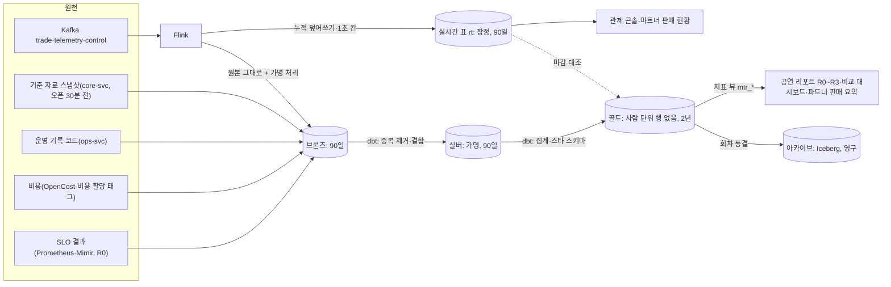

# 기능 설계: 분석 저장소와 공연 리포트

- **범위**: 회차가 끝난 뒤 '다음 회차를 어떻게 열지' 정하는 데 쓰는 분석 저장소(ClickHouse 분석 DB와 Iceberg 아카이브), 원본 적재와 가명 처리, 브론즈·실버·골드 변환과 마감 단계, 스타 스키마, 지표 사전과 결정 규칙 판정, 공연 리포트와 파트너 판매 요약, 결정 기록과 결정 절차. 온세일 중 관제 화면과 운영 명령은 [control-tower.md](control-tower.md), 메트릭·SLO·경보는 [observability.md](../observability.md)가 정한다.
- **원문 출처**: 설계서 §8(PostgreSQL·Kafka·ClickHouse 데이터 파이프라인), 27장(데이터 엔지니어링: dbt 마트, 데이터 → 운영 피드백). ADR-0042(소유자 제안 2026-10-11, 승인 2026-10-12), ADR-0052(소유자 승인 2026-10-13, '추천대로 승인').
- **관련 ID**: FR-026, FR-029, FR-031, FR-068 · NFR-009, NFR-018, NFR-026 · POL-022, 023, 027, 028, 030, 037, 039, 040 · SCR-027, SCR-029 · API `/v1/ops/events/{eventId}/reports`, `/v1/ops/decisions`, `/v1/partner/events/{eventId}/report` · 이벤트 `trade.*`, `telemetry.queue`, `telemetry.purchase`, `telemetry.trust-verdicts`, `control.settings` · 데이터 docs/data.md §1·§2·§6(`decision_record`, `pseudonymization_log`) · K9 · ADR-0026·0042·0047·0052·0071.
- **기준 기획 버전**: v1.0.
- **표시 규칙**: 원칙과 구조는 ADR-0052의 소유자 결정이고, 필드·표 이름·시각·임계값은 추천 적용(2026-10-13)이다. 측정으로 정할 값은 [가정, Phase N …에서 확정]으로 적는다. 예시 숫자는 측정 전 가상 숫자라고 밝힌다.

## 1. 개요와 역할 원칙

### 1.1 분석 저장소가 답하는 질문

- 다음 대형 회차의 초기 동시 입장 목표와 프리워밍 규모를 얼마로 할까?
- 이 파트너에게 선착순 대신 하이브리드나 자동 배정을 권할까?
- 1인 매수 한도와 홀드 시간이 적당한가?
- 결제 실패는 카드 거절 때문인가, 결제사 때문인가, 사용자가 결제창을 닫아서인가?
- 봇은 어디로 들어와 얼마나 샀나? 정렬 방식에 따라 다른가?
- 1,000장당 인프라 비용이 1,000장당 수수료보다 큰 공연 규모는 어디인가?

모두 '다음 회차부터 무엇을 바꿀까'를 묻는다. '지금 시스템이 정상인가'는 관제가 답한다(observability §13).

### 1.2 역할 원칙(ADR-0052 결정 1)

1. 결정을 실행할 수 있는 속도보다 빠른 숫자는 쓰지 않는다.
2. 판매 정책, 파트너 권고, 운영 기본값, 계약 같은 비즈니스 결정은 마감된 **확정** 숫자로만 한다. 실시간 숫자는 온세일 중 운영 명령과 **잠정** 표시에만 쓴다(POL-040).
3. 실시간 길과 확정 길은 같은 지표 정의(지표 사전, §6)를 쓰고, 마감 때 두 값의 차이를 데이터 품질 지표로 남긴다(§4.4).

### 1.3 결정별로 필요한 신선도

| 결정 | 결정자 | 실행 속도 | 쓰는 숫자 |
| --- | --- | --- | --- |
| 동시 입장 목표 조정, 입장 일시정지, Degraded Mode, 결제사 전환, 판매 일시정지 | 운영자 | 초~분 | 실시간(판단 숫자는 Prometheus, 상세는 관제 실시간 표. 출처는 observability §8 지표 출처 표, ADR-0071). control-tower §3 |
| 추가 회차 오픈 검토 | 파트너 | 시간 | 1분 지연 판매 현황(잠정, FR-026) |
| 다음 회차 초기 동시 입장 목표, 프리워밍 규모, 폴링 주기 | 운영 리더(commander) | 다음 회차 전 | 확정 R1 |
| 정렬 방식 권고, 자동 배정 권고, 홀드 시간, 1인 매수 기본값 | 제품 책임자 | 다음 회차부터 | 확정 R2와 같은 규모 비교 기준선 |
| 봇 판정 기본 강도와 가중치 | 봇 방어 담당 제안, 제품 책임자 승인 | 그림자 실행 뒤 | 확정 R2(표본 검토 뒤) |
| 가격 등급 구성, 오픈 시각 | 파트너(PEAKET은 권고, POL-037) | 다음 공연 등록 때 | 확정 R3와 여러 회차 |
| 결제사 계약·한도 협의, 연간 용량·비용 계획 | 제품 책임자 | 분기 | 월간·분기 비교 |

비즈니스 결정을 실시간 숫자로 하지 않는 이유는 셋이다. 숫자가 늦게 확정되고(결제 상태 불명 1시간 [가정], 봇 표본 검토는 종료 뒤, 환불은 공연일까지, 입장은 공연 당일), 온세일 중에는 판매 조건을 바꾸지 않으며(POL-028·037), 한 회차는 잡음이 크다. 판매 중에 가격을 바꾸는 동적 가격처럼 판매 중 실행하는 비즈니스 결정을 들이면 그 결정에 한해 이 원칙을 다시 정한다. 지금은 없다.

### 1.4 분석 단위와 범위 밖

- 분석 단위는 회차·등급·구역·분·구매 세션이다. 사람 식별값은 사건을 이어 붙이고 같은 사람을 두 번 세지 않으려고만 쓰며, 회차마다 다른 가명으로 바꿔 실버까지만 90일 둔다(§3.3). 골드·아카이브에는 사람 단위 행이 없다(ADR-0042 결정 6).
- 사람 단위 마케팅 분석(취향 추천, 재구매 유도, 개인별 프로필)은 이 저장소의 목적이 아니다. 하려면 목적과 근거(동의 등)를 따로 정해야 한다.
- 포트폴리오 단계에는 실제 팬이 없다(planning/01 §4.2). 저장소에는 k6 합성 온세일과 봇 시뮬레이터의 데이터만 들어간다(§14).

## 2. 구조: 두 길과 분석 층



| 층 | 담는 것 | 보장하는 것 | 개인 식별 | 보존 | 읽는 주체 |
| --- | --- | --- | --- | --- | --- |
| 실시간 표 `rt` | Flink `ops-rt`의 누적 덮어쓰기와 1초 칸(관제 읽기 모델, docs/streaming.md §4) | 잠정. 반영 p95 5초, 누락률 0.1% 미만(NFR-009) | 없음 | 90일 | 관제 콘솔, 파트너 판매 현황 |
| 브론즈 `bronze` | 이벤트·스냅샷 원본과 적재 정보(토픽, 파티션, 오프셋, 적재 시각, 스키마 버전). 바꾸는 것은 가명 처리와 금지 필드 제거뿐 | 빠짐 없음(오프셋 대조). 중복·순서는 보장하지 않음 | 가명(회차별) | 적재 뒤 90일 | 적재 잡, 마감 실행기 |
| 실버 `silver` | 중복 제거, 형 변환, 오픈 기준 경과 분, 늦은 이벤트 반영, 기준 자료 결합. 사건 단위 표와 구매 세션 누적 스냅샷 | 이벤트 키 유일, 참조 무결성, 열거값 | 가명(회차별) | 90일 | 마감 실행기, 가명정보 취급자 |
| 골드 `gold` | 스타 스키마: 집계 사실 표, 공통 차원, 지표 뷰 | 지표 사전과 일치, 판매 금액은 정산서와 원 단위 일치, 마감 단계 표시 | 사람 단위 행 없음 | 2년 | ops-svc(공연 리포트), 비교 대시보드, 파트너 판매 요약 |
| 아카이브 | 동결된 회차 골드(Iceberg) | 바뀌지 않음 | 없음 | 영구 | 연도 비교 |

ADR-0042의 1층(원시 비즈니스 이벤트)은 브론즈, 2층(공연 리포트 마트)은 골드, 3층(비식별 집계 아카이브)은 아카이브다. 실버는 ADR-0052에서 새로 둔다. 메달리온(브론즈·실버·골드)은 Databricks가 권하는 설계 패턴이고 필수 표준은 아니다. 이 설계에서 중요한 것은 층마다 위 표의 '보장하는 것'과 '읽는 주체'다.

## 3. 원천과 적재

### 3.1 이벤트

`peaket-data`의 Flink 원본 적재 잡(`analytics-ingest`)이 아래 토픽을 읽어 브론즈 표(`brz_<원천>`)에 쓴다. ADR-0042 결정 2대로 기존 Flink 경로를 쓰되 집계하지 않고 원본을 쓴다.

| 토픽 | 메시지 | 쓰는 곳 |
| --- | --- | --- |
| `trade.orders` | `OrderEvent` | 판매, 전환, 환불·회차 취소 |
| `trade.payments` | `PaymentEvent` | 결제 시도, 실패 사유, 결제사별 |
| `trade.seats` | `SeatEvent` | 판매 시각, 홀드 만료, 매진 시각 |
| `trade.purchase-sessions` | `PurchaseSessionStarted`·`Ended` | 구매 세션 누적 스냅샷 |
| `trade.tickets` | `TicketEvent` | 발권, 양도, 입장 스캔 결과(`ENTRY_SCANNED`: 통과·거부 사유), 입장 이상 표시 |
| `trade.settlements` | `SettlementEvent` | 정산서 대조, 수수료 |
| `telemetry.queue` | `QueueEntryRecord`(사람별 대기 기록) | 진입 인원, 대기 오차, 차례 뒤 미입장. `QueueAggregate`는 실시간 표만 쓴다 |
| `telemetry.purchase` | `HoldAttempt` | 홀드 경합 패배율, 자동 배정 결과 |
| `telemetry.trust-verdicts` | `TrustVerdict` | 봇 점유율 하한, 정렬 방식별 봇 성공률 |
| `control.settings` | `SettingChanged` | 봇 판정 강도·Degraded Mode·결제사 전환 시각. `actor`는 싣지 않는다 |

`telemetry.behavior`(행동 신호)와 `telemetry.rum`은 싣지 않는다. 행동 신호는 trust-svc 표(30일, 적재는 Flink `trust-reassess`)에만 두고, 체감 성능은 SLO 스냅샷의 요약만 쓴다. 관제 심장 박동(`PipelinePulse`)은 건너뛴다(docs/streaming.md §3, ADR-0071).

### 3.2 기준 자료·운영 기록·비용·SLO

서비스 경계를 넘지 않도록 각 원천의 소유 서비스가 분석 수집 버킷(S3 `peaket-analytics-intake`, 개인정보 없음, 공개 접근 차단)에 파일을 쓰고 적재 잡이 브론즈로 옮긴다.

| 원천 | 쓰는 주체와 시점 | 형식과 크기 상한 | 브론즈 표 |
| --- | --- | --- | --- |
| 회차 기준 자료(회차, 공연장, 구역, 좌석 수, 등급·가격, 좌석-등급 대응, 판매 정책 요약, 파트너 상호, 공연 규모 등급) | core-svc, 오픈 30분 전(Go/No-Go 점검 시각)과 판매 승인·회차 취소 같은 상태 변화 때 | JSON, 50MB [가정] | `brz_ref_event`, `brz_ref_seat_map` |
| 운영 기록 코드(명령 종류·시각·결과, 경보 종류, CS 처리함 유형·결과, 이의 제기 결과, 수요 예측(계산 시각·계기, 구독 수, 비율, 비율에 쓴 지난 회차 수, 예상 진입 인원, 제안 등급)과 규모 올리기 기록, ADR-0078) | ops-svc, 온세일 윈도우 종료 때(명령·경보·수요 예측), 하루 1회와 R2 때(CS·이의 제기). 자유 텍스트와 계정 ID는 쓰지 않는다 | JSON | `brz_ops_command`, `brz_ops_case`, `brz_ops_forecast` |
| 비용(네임스페이스·라벨별 할당 비용, 비용 할당 태그별 일 비용) | 비용 내보내기 잡, 하루 1회 | CSV·Parquet(gzip 가능), 200MB [가정] | `brz_cost` |
| SLO 결과(여정별 좋은·전체 이벤트 수, 에러 버짓 사용, 결제사 한도 응답 수, 예상 대기 오차 히스토그램, 경보 발생 수, 체감 성능 p75) | 마감 실행기, R0에 Prometheus(Mimir)에서 회차 단위로 | JSON | `brz_slo_snapshot` |

판매 조건은 오픈 뒤 바뀌지 않으므로(POL-028·037) 회차 기준 자료는 오픈 30분 전 값을 회차의 기준으로 쓴다. Mimir 지표는 원본 90일·5분 집계 13개월만 보존하므로(ADR-0077), 회차 간 2년 비교를 위해 R0에 골드로 스냅샷한다.

### 3.3 가명 처리와 금지 필드

- **가명**: 식별값(`pid`, `accountId`, `queueEntryId`, `admissionJti`, `sessionId`(로그인 세션), `purchaseSessionId`(구매 세션), `orderId`, `ticketId`, `holdId`)은 적재할 때 회차별 가명으로 바꾼다. 회차 키 = `HMAC(분석 가명 키, "PEAKET-analytics-v1" ‖ 회차 ID)`(KMS `GenerateMac`, 회차마다 한 번), 가명 = `HMAC-SHA256(회차 키, 식별값)`의 256비트 전체. 회차 키는 적재 잡 메모리에만 두고 디스크·로그에 쓰지 않는다. 브론즈 행에는 키 버전을 함께 적는다.
- **회차를 넘는 연결 없음**: 같은 사람이라도 회차가 다르면 가명이 다르다. 분석 저장소 안에서 한 사람의 여러 회차 행동을 잇지 못하게 하려는 선택이다. 여러 회차에 걸친 봇 판별은 trust-svc가 한다.
- **연결 키는 구매 세션**: 대기 → 입장 → 홀드 → 주문 → 결제는 구매 세션(`admissionJti`·`purchaseSessionId`)과 주문으로 잇는다. 사람 가명은 진입 인원 중복 제거, 1인 한도 소진, 봇 판정 연결에만 쓴다.
- **금지 필드**: 이름, 연락처, 이메일, 연계정보, IP, User-Agent 원문, 결제 토큰(`paymentKey`·`paymentToken`), 계좌 정보가 메시지에 있으면 버리고 스키마 위반 경보를 낸다.
- **실패 시 멈춤**: KMS 호출이 실패하면 적재를 멈추고 식별값을 원문 그대로 싣지 않는다. 밀린 메시지는 Kafka 보관 기간(§3.5) 안에서 다시 읽는다.
- **키 교체**: 분석 가명 키는 1년마다 [가정] 온세일 윈도우 밖에서 바꾼다. 한 회차는 첫 적재 때의 키 버전을 끝까지 쓰고, 이전 키는 그 키로 처리한 마지막 회차의 브론즈·실버가 지워진 뒤 파기한다(docs/security/secrets-and-keys.md).

### 3.4 이벤트 계약 보강

`docs/api/asyncapi.yaml`에 아래 필드를 선택 필드로 더한다(Avro BACKWARD_TRANSITIVE 호환, 소비자 먼저 배포, ADR-0026·0054).

| 메시지 | 추가 필드 | 쓰는 지표 |
| --- | --- | --- |
| 모든 trade·telemetry 메시지와 `control.settings`의 `SettingChanged`(ADR-0073) | `eventKey`(UUID, 중복 제거 키. `OrderEvent`는 `idempotencyKey`를 같은 값으로 씀), `schemaVersion` | 전체 |
| `OrderEvent` | `purchaseSessionId`, `items[{seatId, tierId, sectionId, price}]`, `seatAssignment`(PICK·AUTO) | 전환, 등급·구역별 판매 |
| `PaymentEvent` | `amount`, `payMethodCategory`, `result`(payment §2.1의 정규화 결과), `failureCategory`, `attemptNo`, `latencyMs` | 결제 실패 사유, 결제사별 승인율 |
| `SeatEvent` | `holdId`, `purchaseSessionId`, `tierId`, `sectionId`(관제 실시간 표의 등급·구역별 판매 좌석, ADR-0072) | 홀드 만료율, 세션 퍼널, 등급·구역별 판매 좌석 |
| `TicketEvent` | `eventId`, `orderId`, `accountId`, 스캔 결과 종류 `ENTRY_SCANNED`의 `scanResult`·`reason`·`gateZone`·`direction`·`scannedAt`(스캔 ID로 중복 제거) | 입장률, 거부 사유, 양도·환불 |
| `SettlementEvent` | `salesAmount`, `refundAmount`, `feeAmount`(정산서 통지 때) | 정산서 대조, 1,000장당 수수료 |
| `QueueEntryRecord`(`telemetry.queue`, 신설 메시지) | `eventId`, `queueEntryId`, `pid`, `number`, `entryMode`(로비·오픈 뒤), `enteredAt`, `firstEtaSec`, `turnAt`, `admittedAt`·`admissionJti` 또는 `removedAt`·`removeReason`, `verifyRoute`(바로 통과·추가 검증 통과·추가 검증 실패·차단) | 진입 인원, 대기 오차, 차례 뒤 미입장, 봇 연결 |
| `HoldAttempt`(`telemetry.purchase`, 신설) | `eventId`, `purchaseSessionId`, `mode`(PICK·AUTO), `tierId`, `sectionId`, `result`(HELD·CONFLICT·LIMIT·ERROR), `autoResult`, `retryNo`, `latencyMs`, `occurredAt` | 홀드 경합 패배율, 자동 배정 결과 |
| `TrustVerdict`(`telemetry.trust-verdicts`, 신설) | `eventId`, `queueEntryId`, `pid`(대기 중 재평가 판정만, 가명), `category`, `action`, `source`(실시간·허니팟·표본 검토·사후 라벨·대기 중 재평가 `REASSESS`), `shadow`, `occurredAt` | 봇 점유율 하한, 정렬 방식별 봇 성공률. 봇 지표는 `shadow` false만 센다(ADR-0071) |

`failureCategory`는 결제 어댑터가 정한다(payment §2.1): `CARD_DECLINED`(카드 한도·잔액·정지), `USER_ABORTED`(결제창 이탈·취소), `VALIDATION`(금액·토큰 불일치), `EXPIRED`(승인 기한 만료), `PG_ERROR`(오류·타임아웃 뒤 실패로 확정), `THROTTLED`(결제사 한도 초과).

### 3.5 보관과 복원

- 원본을 다시 읽을 수 있도록 분석 대상 Kafka 토픽의 보관 기간은 7일 이상 [가정, Phase 4 4.3.4에서 확정]으로 둔다. ClickHouse 스냅샷 주기(1일, infra §6)보다 길어야 한다.
- ClickHouse를 잃으면 마지막 스냅샷을 복원하고, 그 뒤 구간은 Kafka를 다시 읽어 브론즈를 채운 다음 dbt로 실버·골드를 다시 만든다. 동결된 회차는 아카이브에서 되살린다.
- 적재 잡을 세이브포인트 없이 다시 시작할 때는 최신 오프셋이 아니라 소비자 그룹이 커밋한 오프셋부터 읽어 빈 구간을 만들지 않는다. 겹친 구간은 브론즈 중복 허용과 실버 중복 제거가 흡수한다(docs/streaming.md §8, ADR-0071).

## 4. 변환과 마감

### 4.1 dbt 모델 계층과 실행

- **도구**: dbt-core와 dbt-clickhouse(ClickHouse가 지원하는 어댑터). 증분 전략은 delete+insert를 쓴다(ADR-0052 결정 4).
- **계층**: `stg_`(브론즈를 형 변환·이름 정리) → `slv_`(중복 제거·결합·세션화) → `fct_`·`dim_`(골드) → `mtr_`(지표 뷰). 결정 규칙은 `rules.yml`, 지표 정의는 `metrics.yml`에 두고 둘 다 저장소에서 검토한다(§6).
- **실행**: 마감 실행기(`close-runner`)는 10분마다 [가정] 도는 쿠버네티스 CronJob이다. 회차별 마감 예정 시각(회차 시각과 영업일 달력으로 계산, §4.2)이 지난 단계를 찾아 그 회차만 dbt로 다시 만들고(`--vars`로 회차 ID와 단계를 넘김), 테스트를 모두 통과하면 회차 요약(`fct_event_summary`)의 마감 상태를 '완료'로 쓴다. Airflow는 쓰지 않는다.
- **동시 실행**: 한 번에 회차 하나만 처리하고 회차당 실행 시간 상한은 20분 [가정]이다. 마감 실행기의 ClickHouse 사용자는 메모리·스레드 상한과 우선순위를 낮춘 설정 프로필을 써서 같은 시각 다른 회차의 관제 조회(rt)를 막지 않는다 [가정, Phase 4 관측 비용 측정에서 확인].
- **SQL 규칙**: dbt 모델은 저장소에 고정된 SQL이다. 회차 ID와 단계 변수는 형식(UUID, `R0`~`R3`) 검사 뒤에만 넣고 외부 입력으로 SQL 조각을 만들지 않는다.

### 4.2 마감 단계

| 단계 | 시점 [가정, Phase 4 4.3.6에서 확정] | 확정되는 것 | 아직 잠정인 것 |
| --- | --- | --- | --- |
| R0 잠정 | 온세일 윈도우 종료(T+60분) + 30분 | 진입·입장·판매 좌석·매진 시각, 홀드 경합, 대기 오차, SLO·에러 버짓·결제사 한도, 불변식 위반 수, 명령·경보 | 결제, 봇, 비용, CS, 환불, 입장 |
| R1 | 다음 영업일 10시 | 결제 결과와 실패 사유(상태 불명 1시간 정리 뒤), 입장 → 구매 전환율, 판매 금액, 홀드 만료, 1인 한도 소진, 인프라 비용(K9) | 봇, CS, 환불, 입장 |
| R2 | 오픈 + 7일 | 봇 점유율 하한(표본 검토·허니팟·사후 라벨), 이의 제기 인용률, 온세일 관련 CS 건수 | 환불·양도, 입장 |
| R3 | 회차 종료 다음 영업일 10시(정산서 06시 계산 뒤). 입장 기록 마감(ADR-0051) 전이면 마감 뒤 | 입장률, 현장 거부·이상 표시, 환불·양도 집계, 정산서 대조, 수수료 | 없음 |
| 동결 | R2와 R3 중 늦은 시점 + 7일 | 회차 골드를 아카이브로 내보내고 더 고치지 않는다 | |

- 단계는 데이터 영역별로 확정된다. 공연이 오픈 7일 안이면 R3가 R2보다 먼저 올 수 있고, 이때 R3 리포트에서 봇 지표는 잠정으로 남는다.
- 마감 실행이 실패하면 마감 상태를 바꾸지 않고 '마감 지연'을 표시하며 직전 판 리포트를 유지한다. 다음 실행이 같은 회차를 처음부터 다시 만든다.
- 봇 표본 검토(검증 통과 세션 200건 [가정])가 R2까지 끝나지 않으면 봇 지표는 '판정 보류'로 두고 검토가 끝난 뒤 다시 마감한다. 행동 신호 원시가 30일 뒤 지워지므로 그 전에 끝내야 한다(queue-admission §7).

### 4.3 재실행·동결·늦은 이벤트

- 재실행 단위는 회차다. 각 마감에서 그 회차 행을 지우고 다시 넣으므로 여러 번 돌려도 결과가 같다.
- 원시(브론즈·실버)는 적재 뒤 90일에 지워진다. 오픈과 공연 사이가 90일보다 긴 회차는 공연 무렵 오픈 원시가 없으므로, 온세일 사실(F1~F7)은 R2에 동결하고 R3 이후 계산은 동결된 골드를 읽는다.
- 날짜별 사실(F8 환불, F9 양도, F13 CS, F14 비용)은 날짜 단위로 쌓아 회차 동결과 무관하게 이어진다. 동결 뒤 생긴 예외 환불은 날짜별 환불에만 더하고 동결된 회차 요약은 고치지 않는다.
- 오프라인 스캔처럼 늦게 올라오는 기록은 R3 전이면 반영하고, 그 뒤면 날짜별 사실에만 쌓는다.

### 4.4 실시간 대비 대조

- 마감마다 같은 지표를 실시간 표와 골드로 계산해 차이를 회차 요약과 리포트의 '데이터 품질' 절에 남긴다.
- 판매 좌석 수(지금 SOLD인 좌석 수)와 판매 금액(지표 사전 26번, 승인 금액 합)은 차이 0, 퍼널 집계(진입·입장·홀드·주문)는 0.1% [가정] 이내다(NFR-009 누락률과 같은 기준). 넘으면 그 지표의 결정 규칙은 '판정 보류'다.
- 관제 화면의 실시간 숫자는 확정 숫자로 고쳐 쓰지 않는다. 잠정과 확정은 다른 표에 있고 화면에도 따로 표시한다.
- 실시간 표의 판매 좌석·판매 금액은 창 없이 `eventKey`로 중복을 지운 누적을 덮어쓴 값이라(docs/streaming.md §4.6) 원천 유실이 없으면 차이가 0이다. 차이가 나면 원인(원천 유실, `eventKey`가 다른 재발행, 시작값 경계의 재발행 중복)을 데이터 품질 절에 적는다(추천 적용 2026-10-20, ADR-0071).

## 5. 스타 스키마(골드)

킴볼의 4단계(업무 과정 선택, 그레인 선언, 차원, 사실)를 따른다.

### 5.1 버스 매트릭스

| 사실 표 | 회차 | 등급 | 구역 | 날짜 | 오픈 기준 분 | 결제사·수단 | 결과·사유 | 봇 범주 | 배정 방식 | 게이트 구역 |
| --- | :-: | :-: | :-: | :-: | :-: | :-: | :-: | :-: | :-: | :-: |
| F1 온세일 분 스냅샷 | ✓ | | | ✓ | ✓ | | | | | |
| F2 판매 | ✓ | ✓ | ✓ | ✓ | ✓ | ✓ | | | | |
| F3 퍼널 코호트 | ✓ | | | ✓ | ✓ | | | ✓ | ✓ | |
| F4 홀드 시도 | ✓ | ✓ | ✓ | ✓ | ✓ | | ✓ | | ✓ | |
| F5 결제 시도 | ✓ | | | ✓ | ✓ | ✓ | ✓ | | | |
| F6 봇 결과 | ✓ | | | ✓ | | | | ✓ | | |
| F7 대기 정확도 | ✓ | | | ✓ | | | | | | |
| F8 환불(날짜별) | ✓ | ✓ | | ✓ | | | ✓ | | | |
| F9 양도(날짜별) | ✓ | | | ✓ | | | ✓ | | | |
| F10 현장 입장 | ✓ | | | ✓ | | | ✓ | | | ✓ |
| F11 회차 요약 | ✓ | | | ✓ | | | | | | |
| F12 규칙 판정 | ✓ | | | ✓ | | | | | | |
| F13 CS(날짜별) | ✓ | | | ✓ | | | ✓ | | | |
| F14 비용(날짜별) | ✓ | | | ✓ | | | | | | |

'회차'와 '날짜'는 모든 사실 표가 함께 쓰는 공통 차원이다. 그래서 등급별 판매, 등급별 홀드 경합, 등급별 환불을 한 표에 나란히 놓을 수 있다(킴볼의 적합 차원).

### 5.2 사실 표

| ID | 표 | 종류(킴볼) | 그레인(한 행) | 측정값 |
| --- | --- | --- | --- | --- |
| F1 | `fct_onsale_minute` | 주기 스냅샷 | 회차 × 오픈 기준 분 | 진입, 입장, 차례 도달, 차례 뒤 미입장, 봇 차단, 추가 검증 유입·통과, 주문 생성, 결제 접수·승인·실패, 발권 수(가산). 대기 인원, 구매 세션 수(반가산: 분끼리 더하지 않고 최대·평균만). 명령·경보 수 |
| F2 | `fct_sales_minute` | 거래 집계 | 회차 × 등급 × 구역 × 결제사 × 오픈 기준 분 | 판매 좌석, 주문, 판매 금액, 만료·반환으로 다시 나온 좌석(가산) |
| F3 | `fct_funnel_cohort` | 누적 스냅샷의 집계 | 회차 × 입장 분(코호트) × 배정 방식 × 봇 범주 | 단계 도달 수(입장, 첫 홀드 성공, 결제 접수, 승인, 발권), 단계 간 소요 시간 합과 히스토그램 버킷, 한도까지 산 계정 수, 구매 계정 수 |
| F4 | `fct_hold_attempt` | 거래 집계 | 회차 × 등급 × 구역 × 분 × 배정 방식 × 결과 × 재시도 순번 | 시도 수, 세션 첫 시도 수, 지연 버킷 |
| F5 | `fct_payment_attempt` | 거래 집계 | 회차 × 결제사 × 결제 수단 범주 × 결과 × 실패 범주 × 분 | 시도 수, 금액, 응답 시간 버킷 |
| F6 | `fct_bot_outcome` | 집계(R2) | 회차 × 봇 범주 × 근거(실시간·허니팟·표본 검토·사후 라벨·대기 중 재평가. 그림자 판정은 넣지 않음) | 세션·주문·좌석 수, 표본 n·k(구간 계산용) |
| F7 | `fct_wait_accuracy` | 집계 | 회차 × 처음 예상 대기 구간 × 실제/예상 비율 구간 | 인원 |
| F8 | `fct_refund_daily` | 거래 집계 | 날짜 × 회차 × 등급 × 경로(셀프·회차 취소·예외) | 건수, 금액 |
| F9 | `fct_transfer_daily` | 거래 집계 | 날짜 × 회차 × 상태 × 공연까지 남은 일수 구간 | 건수 |
| F10 | `fct_entry_10min` | 주기 스냅샷 | 회차 × 게이트 구역 × 10분 | 입장, 거부(사유별), 오거부 후보, 이상 표시 수 |
| F11 | `fct_event_summary` | 누적 스냅샷 | 회차 1행(마감 단계마다 갱신) | 매진 시각, 판매 좌석·금액, 여정별 SLO 좋은·전체 수, 에러 버짓 사용, 불변식 위반 수, 결제사 한도 응답 수, 비용, 수수료, 단계별 마감 상태·시각, 실시간 대비 차이 |
| F12 | `fct_rule_check` | 판정 기록 | 회차 × 규칙 × 마감 단계 | 값, 기준, 판정(걸림·안 걸림·판정 보류와 사유), 비교 기준선(중앙값·사분위), 표본 수, 연결된 결정 기록 ID |
| F13 | `fct_cs_daily` | 거래 집계 | 날짜 × 회차 × 유형 × 결과 | 건수, 처리 시간 합 |
| F14 | `fct_cost_daily` | 거래 집계 | 날짜 × 회차 배분 × 비용 항목 | 금액(원) |

- 비율과 분위수는 저장하지 않는다. 분자·분모와 히스토그램 버킷을 저장하고 지표 뷰에서 계산한다(킴볼의 비가산 측정값 처리). 그래야 회차를 합칠 때 평균이 틀리지 않는다.
- 반가산 측정값(대기 인원, 구매 세션 수)은 시간 축으로 더하지 않는다. 지표 뷰가 최대·평균만 낸다.

### 5.3 차원

| 차원 | 주요 속성 | 변화 처리 |
| --- | --- | --- |
| `dim_event`(회차) | 파트너, 공연장, 오픈·입장 시작·공연 시작·종료 시각, 정렬 방식, 배정 방식, 1인 한도, 로비 분, 결제사 지정, 판매 대상 좌석 수, 규모 등급(소형·중형·대형, architecture §9.5. 판매 승인 때 정하고 T-30분 점검 전까지 올리기만 한 값), T-30분 수요 예측(중앙·상단), 실제 등급 | 오픈 30분 전 스냅샷을 유지(킴볼 유형 0). 실제 등급은 R1에 실제 진입 인원으로 정하고, 규모 등급과 예측은 덮어쓰지 않는다(예측 오차를 남기려고, ADR-0078) |
| `dim_partner` | 테넌트 ID(`promoter_id`), 상호 | 덮어쓰기(유형 1). 대표자 성명 같은 개인정보는 넣지 않음 |
| `dim_venue`·`dim_section` | 공연장, 구역 이름, 층·블록, 좌석 수 | 회차별 스냅샷 |
| `dim_tier`(등급) | 회차별 등급 이름·순위·가격 | 회차별 처음 값(유형 0) |
| `dim_date` | 날짜, 요일, 영업일, 공휴일 | 고정. 영업일 달력은 payment·settlement와 같은 것 |
| 오픈 기준 분 | 사실 표 열(T-10~T+60, 그 뒤는 10분 묶음) | 회차를 겹쳐 보기 위한 공통 시간축 |
| `dim_pg`·`dim_pay_method` | 결제사, 결제 수단 범주 | 고정 |
| `dim_result` | 홀드·결제·입장 결과와 실패·거부 범주 | 고정 |
| `dim_bot_class` | 바로 통과, 추가 검증 통과, 추가 검증 실패, 차단, 허니팟 적중, 사후 라벨 봇 | 고정. 대기 중 재평가로 격리된 사람도 추가 검증 결과로 나눈다(근거는 F6의 '대기 중 재평가', 추천 적용 2026-10-20, ADR-0073). 파트너 응답에는 쓰지 않음 |
| `dim_assignment` | PICK·AUTO, 자동 배정 결과(FIRST, FIRST_SPLIT, SECOND, SECOND_SPLIT, 수동 전환) | 고정 |
| `dim_gate_zone` | 게이트 구역 | 회차별 |

### 5.4 실버의 원자 단위 표

킴볼은 가장 낮은 그레인(원자 단위)을 권하지만 PEAKET은 2년 보관 표에 사람 단위 행을 두지 않는다. 그래서 원자 단위 표는 실버에 90일 두고 골드는 그 집계로 만든다.

- `slv_purchase_session`(누적 스냅샷, 구매 세션 1행): 회차, 세션 가명, 대기 시작·차례·입장 시각, 처음 보인 예상 대기, 첫 홀드 시각과 결과, 홀드 시도 수, 주문 생성·결제 접수·승인·발권 시각, 종료 사유, 매수, 배정 방식, 봇 범주, 결제사.
- `slv_hold_attempt`, `slv_payment_attempt`, `slv_seat_change`, `slv_ticket`, `slv_queue_entry`, `slv_trust_label`: 이벤트 키로 중복을 제거한 사건 단위 표.
- 대가: 90일이 지나면 골드에 없는 기준으로 지난 회차를 다시 나눠 보지 못한다. 새 질문이 생기면 차원을 더하고 그 뒤 회차부터 쌓는다(§14).

### 5.5 ClickHouse 물리 설계

| 층 | 엔진과 정렬 | 파티션과 TTL | 쓰기 방식 |
| --- | --- | --- | --- |
| 브론즈 | ReplicatedMergeTree, `ORDER BY (event_id, occurred_at)` | `toYYYYMMDD(loaded_at)`, `loaded_at + 90일` | 적재 잡 비동기 일괄 삽입. 중복 허용 |
| 실버 | ReplicatedMergeTree, `ORDER BY (event_id, event_key)` | `toYYYYMM(open_date)`, 90일 | dbt delete+insert. 중복 제거는 SQL(`LIMIT 1 BY event_key`)로 한다 |
| 골드 | ReplicatedMergeTree, 회차가 앞에 오는 정렬 키 | `toYYYYMM(open_date)`, 2년 | dbt delete+insert(회차 단위) |
| 실시간 표 | `ReplacingMergeTree(version)`: `rt.cumulative`(회차·지표·차원), `rt.bucket`(회차·지표·차원·1초 칸), 시작값 `rt.seed`. 심장 박동은 두 표의 `_pulse` 행(ADR-0072) | 90일(`rt.seed` 30일) | Flink `ops-rt` 덮어쓰기, 0.25초 [가정] 묶음 비동기 삽입(docs/streaming.md §4.3·§4.4) |

- 분석 표의 엔진은 복제 엔진(ReplicatedMergeTree 계열)이다. 복제 2벌은 docs/streaming.md·docs/infra.md와 같고, Keeper와 클러스터 이름은 4.3.1 PoC에서 정한다(ADR-0072·0077).
- ReplacingMergeTree의 중복 제거는 병합 때 결국 일어나 시점을 보장하지 않으므로 확정 숫자의 중복 제거에 쓰지 않는다. 머티리얼라이즈드 뷰는 삽입 블록에 대한 트리거라 중복 전달분을 합산하고 조인한 차원의 변경을 반영하지 않으므로 합산에 쓰지 않는다. 실시간 표도 뷰로 합산하지 않고, 덮어쓴 값을 읽을 때 `FINAL`이나 `argMax(value, version)`로 마지막 값을 고른다(ClickHouse 문서, ADR-0052·0071).
- 스타 스키마는 논리 모델이다. 오픈 뒤 바뀌지 않는 차원 속성(규모 등급, 정렬 방식, 배정 방식, 등급 순위)은 사실 표에 같이 넣고, 덜 쓰는 이름 속성은 딕셔너리로 조회한다.
- 금액은 원 단위 `Int64`, 건수는 `UInt64`. 분위수는 히스토그램 버킷 열로 저장한다.
- 아카이브: ClickHouse 25.7부터 Iceberg 표 쓰기를 지원하지만 `allow_insert_into_iceberg` 설정과 형식 제한이 있다. Phase 4(4.3.6)에서 PoC로 확인하고, 안 되면 Parquet로 내보낸 뒤 Iceberg에 등록한다. 정리(추천 적용 2026-10-21, ADR-0077 결정 7): 카탈로그는 AWS Glue Data Catalog(서울), 파티션은 회차 오픈 월(`month(open_date)`), 목표 파일 크기는 Iceberg 기본 512MB다. 회차마다 조금씩 써서 작은 파일이 생기므로 Glue 표 최적화의 합치기(binpack), 스냅샷 보존(최근 10개·30일 [가정]), 남은 파일 삭제를 켠다. 담당은 데이터 팀이고, 로컬 PoC는 쓰기와 파티션만 확인한다.
- DB는 층마다 나누고(`bronze`·`silver`·`gold`·`rt`) 주체별 사용자를 둔다(§11).

## 6. 지표 사전

### 6.1 목표 → 질문 → 지표

지표를 있는 데이터에서 고르지 않고 목표에서 거꾸로 내려온다(Victor Basili의 GQM 방법).

| 목표 | 질문 | 대표 지표 |
| --- | --- | --- |
| G1 공정: 표가 사람에게 공정하게 간다 | 봇이 얼마나 샀나? 정렬 방식에 따라 다른가? 사람을 잘못 막았나? 한도를 꽉 채워 사는 계정이 많나? | 봇 점유율 하한, 정렬 방식별 속도형 봇 성공률, 이의 제기 인용률, 1인 한도 소진 비율 |
| G2 판매: 파트너의 표가 빨리, 남김없이 팔린다 | 얼마나 빨리 팔렸나? 어디서 막혔나? | 매진 소요 시간, 등급별 매진 시각, 비매진 회차 판매율, 입장 → 구매 전환율과 단계별 전환, 홀드 경합 패배율, 홀드 만료율, 결제 실패 사유 |
| G3 경험: 기다림을 예측할 수 있고 실패가 적다 | 예상 대기가 맞았나? 차례가 와도 들어오지 않은 사람은? 문의는? | 예상 대기 오차, 차례 뒤 미입장 비율, CS 건수, 체감 성능 |
| G4 비용과 수익 | 1장 파는 데 얼마 드나? 수수료로 남나? | 1회·1,000장당 비용(K9), 1,000장당 비용 대비 수수료, 판매·환불 금액 |
| G5 신뢰 | 약속을 지켰나? | 여정별 SLO·에러 버짓, 불변식 위반, 명령·경보, 입장률·현장 거부 |

### 6.2 지표 사전 형식

지표마다 아래 항목을 `metrics.yml`(peaket-data `analytics` 프로젝트)에 적고 dbt가 지표 뷰(`mtr_*`)를 만든다. 관제 콘솔의 실시간 계산, 공연 리포트, 파트너 판매 요약이 모두 이 정의를 쓴다.

```yaml
- name: admission_to_purchase_rate      # 입장 → 구매 전환율
  numerator: fct_funnel_cohort.approved_orders   # 합
  denominator: fct_funnel_cohort.admitted        # 합
  dimensions: [event, tier_of_first_hold, seat_assignment, admit_cohort_minute]
  close_stage: R1                       # 결제 상태 불명 정리 뒤
  target: ">= 0.83"                     # planning/01 §3.2, 근거 종류: 자체
  rule: planning/01 §3.2 '입장 → 구매 전환율'
  applies_when: "sold_out and admitted >= 1000"   # [가정]
  display: 단계별 막대(분자·분모 표기) + 같은 규모 기준선
  owner: 데이터 담당
```

### 6.3 지표 목록

| # | 지표 | 정의 | 원천 사실 | 확정 | 목표·규칙 |
| --- | --- | --- | --- | --- | --- |
| 1 | 진입 인원 | 대기열 진입 사람 수(가명으로 중복 제거) | F1 | R0 | 관측 |
| 2 | 입장 인원 | 입장 확정 수 | F1·F3 | R0 | 관측 |
| 3 | 입장 → 구매 전환율 | 결제 승인 주문 ÷ 입장 인원 | F3 | R1 | 83% 이상, 규칙 |
| 4 | 단계별 전환 | 첫 홀드 성공 ÷ 입장, 결제 접수 ÷ 첫 홀드, 승인 ÷ 접수, 발권 ÷ 승인 | F3 | R1 | 분해용 |
| 5 | 매진 소요 시간 | 오픈부터 마지막 좌석 SOLD까지 | F2 | R0 잠정, R1 | 22분 이하, 규칙 |
| 6 | 등급별 매진 시각 | 등급마다 마지막 SOLD 시각 | F2 | R1 | 규칙 |
| 7 | 비매진 회차 판매율 | 판매 좌석 ÷ 판매 대상 좌석(오픈 60분 뒤, 공연 전날) | F2 | R1·R3 | 규칙 |
| 8 | 홀드 경합 패배율 | 경합(CONFLICT) ÷ 홀드 시도. 재시도가 값을 부풀리므로 '세션 첫 시도 기준'도 함께 낸다 | F4 | R0 | 규칙 |
| 9 | 자동 배정 결과 분포 | FIRST·FIRST_SPLIT·SECOND·SECOND_SPLIT·수동 전환 비율 | F4 | R0 | 관측 |
| 10 | 홀드 만료율 | 만료 홀드 ÷ 홀드 성공 | F2·F3 | R1 | 규칙 |
| 11 | 결제 실패 사유 분포 | 실패 범주별 ÷ 결제 실패 전체 | F5 | R1 | 규칙 |
| 12 | 결제사별 승인율·응답 p99 | 결제사별 | F5 | R1 | 관측 |
| 13 | 봇 점유율 하한(주문·좌석) | 봇 판정 주문 ÷ 전체 주문, 95% 구간 | F6 | R2 | 5% 이하, 규칙 |
| 14 | 봇 트래픽 비율 | 차단 + 추가 검증 ÷ 진입 시도 | F1 | R0 | 관측 |
| 15 | 정렬 방식별 속도형 봇 성공률 | 봇 판정 세션 중 입장한 비율 | F6 | R2 | 규칙 |
| 16 | 이의 제기 인용률 | 인용 ÷ 이의 제기 | F13 | R2 | 규칙 |
| 17 | 1인 한도 소진 비율 | 한도까지 산 계정 ÷ 구매 계정 | F3 | R1 | 규칙 |
| 18 | 예상 대기 오차 p90 | 실제 대기 ÷ 처음 보인 예상 대기의 p90 | F7 | R0 | 규칙 |
| 19 | 차례 뒤 미입장 비율 | 차례가 왔으나 입장 확정하지 않은 수 ÷ 차례 도달 | F1 | R0 | 규칙 |
| 20 | CS 건수 | 이의 제기 + 결제 불일치 문의 + 게이트 거부 | F13 | R2·R3 | 2,600건 이하, 규칙 |
| 21 | 체감 성능 | INP·LCP p75(페이지별) | F11 | R0 | 공인 숫자(Core Web Vitals) |
| 22 | 여정 SLO·에러 버짓 사용 | 여정별 좋은 이벤트 ÷ 전체 이벤트 | F11 | R0 | 자체(NFR), 규칙 |
| 23 | 불변식 위반 | 오버셀, 이중 결제, 60초 불일치, 위조 통과, 차례 전 입장 | F11 | R0·R3 | 0건 |
| 24 | 운영 명령·경보 | 종류별 수, 오픈부터 첫 경보까지 시간 | F1·F11 | R0 | 관측 |
| 25 | 결제사 한도 초과 응답 | 결제사별 수 | F11 | R0 | 규칙 |
| 26 | 판매 금액 | 승인 금액 합(원). 입금 되돌림은 그 승인을 빼고, 취소·환불은 빼지 않는다(환급은 따로. 정산서 '판매 대금'과 같은 총액, 추천 적용 2026-10-20, ADR-0073) | F2 | R1, R3에 정산서 대조 | 정산서와 0원 차이 |
| 27 | 환불·취소 | 건수·금액, 경로별 | F8 | R3 | 관측 |
| 28 | 1회·1,000장당 비용 | 회차 배분 비용, 그것 ÷ 발권 장수 × 1,000 | F14 | R1 | 규칙 |
| 29 | 1,000장당 비용 대비 수수료 | 1,000장당 비용 ÷ 1,000장당 수수료 | F14·F11 | R3 | 규칙(수수료 구조가 정해진 뒤) |
| 30 | 입장률·현장 거부 | 입장 티켓 ÷ 발권 티켓, 거부 사유별 | F10 | R3 | 관측 |
| 31 | 수요 예측 오차 | 진입 인원(1번) ÷ T-30분 예측 중앙값, 진입 인원 ÷ 예측 상단, 상단을 넘었는지 | F1, `dim_event` | R1 | 관측(상단을 넘은 회차가 분기 2회를 넘으면 예측 식을 다시 본다, ADR-0078) |

'규칙'은 planning/01 §3.2 결정 규칙 표의 행을 가리킨다. 임계값과 적용 조건은 그 표가 정본이다.

수요 예측(ADR-0078 결정 1)의 비율은 골드 뷰 `mtr_demand_ratio`(회차별 오픈 30분 전 구독 수와 실제 진입 인원, 최근 2년, 사람 단위 행 없음)를 ops-svc(`an_ops_reader`)가 읽어 계산한다. 31번은 그 예측이 얼마나 맞았는지 남기고, 다음 예측은 이 회차를 지난 회차로 쓴다.

### 6.4 결정 규칙 판정

- dbt가 `rules.yml`(planning/01 §3.2를 옮긴 것)로 회차·마감 단계마다 규칙을 판정해 F12에 쓴다. 판정은 '걸림', '안 걸림', '판정 보류'이고, 보류 사유는 표본 부족(적용 조건 미달), 데이터 품질 실패, 미확정(그 단계에서 아직 잠정) 중 하나다.
- 같은 규모 비교 기준선(`mtr_baseline_band`)은 골드의 확정 회차(최근 2년, 같은 실제 등급(§5.3), 해당 회차 제외)로 중앙값과 사분위 범위를 낸다. 10회 미만이면 직전 같은 규모 회차 값을 쓴다(observability §13). 2년보다 오래된 비교는 아카이브에서 한다.
- 규칙은 결정을 강제하지 않고 검토를 연다(ADR-0042 결정 4, POL-040).

## 7. 데이터 품질(NFR-026)

분석 파이프라인에도 SLI를 둔다. 형식은 SRE Workbook 2장의 파이프라인형 SLI(신선도·정확성·커버리지)다.

| 검사 | 기준 | 실패하면 |
| --- | --- | --- |
| 커버리지 | 파티션마다 대상 오프셋 구간의 고유 (파티션, 오프셋) 수 = 구간 길이(마감 시각 기준. 싱크가 재시도 뒤 버린 묶음도 잡는다. 트랜잭션 생산자를 쓰지 않는 전제, docs/streaming.md §6, ADR-0071), 수집 버킷 파일 도착 | 마감 보류, 빠진 구간 재적재 |
| 신선도 | R0 리포트가 온세일 윈도우 종료 + 30분 [가정] 안에 나옴 | '마감 지연' 표시, 경보(SEV3) |
| 유일성 | 실버 `event_key` 유일 | 빌드 실패 |
| 참조 무결성 | 사실 표의 회차·등급·구역 키가 차원에 있음 | 빌드 실패 |
| 열거값 | 결과·사유·범주가 정한 값 | 경고, '기타'로 분류 |
| 시각 순서 | 입장 ≤ 첫 홀드 ≤ 결제 접수 ≤ 승인 ≤ 발권(구매 세션마다) | 해당 세션을 격리하고 건수를 리포트에 표시 |
| 불변식 | 회차별 판매 좌석 ≤ 판매 대상 좌석, 좌석마다 동시에 활성 판매(PENDING·SOLD)는 하나(취소표 재판매와 입금 되돌림 뒤 재입금은 위반이 아님) | 데이터 사고로 조사(실제 오버셀 여부와 구별) |
| 실시간 대비 | 판매 좌석(지금 SOLD인 좌석 수)·판매 금액(26번) 차이 0, 퍼널 0.1% [가정] 이내 | 그 지표 판정 보류 |
| 정확성(돈) | 회차·결제사별 티켓 판매 대금과 환급이 회차 정산서와 원 단위 일치(R3). 상품 정산서는 대조 대상이 아니다 | 정산 대사와 같은 절차로 조사 |

검사는 dbt 테스트(unique, not_null, relationships, accepted_values)와 사용자 정의 테스트로 쓰고 결과는 F11 마감 상태와 리포트의 '데이터 품질' 절에 남는다.

## 8. 공연 리포트와 보여 주기

### 8.1 화면별 독자와 숫자 지위

| 화면 | 독자 | 숫자 지위 | 내용 |
| --- | --- | --- | --- |
| 관제 콘솔 판매 중 탭(SCR-029 ③) | 운영자 | 실시간 잠정 | control-tower §2. 숫자 옆에 '잠정' 표시 |
| 파트너 판매 현황(SCR-026) | 파트너 | 1분 지연 잠정 | FR-026 |
| 공연 리포트(SCR-029 ④) | 제품 책임자, 운영 리더, 데이터 담당 | 마감 단계 표시 | §8.2 |
| 비교 대시보드(Grafana) | 제품 책임자, 데이터 담당 | 확정 | 회차 간 추세, 규모별 기준선, 규칙이 걸린 빈도, 결정 효과 |
| 파트너 판매 요약(SCR-027) | 파트너 | 확정(R3 뒤) | §8.4 |

### 8.2 공연 리포트 구성

ops-svc는 마감 상태가 '완료'가 된 단계를 1분마다 [가정] 확인해 지표 뷰(`mtr_*`)와 F11·F12만 읽어 리포트를 Markdown과 JSON으로 만든다. 리포트 생성기는 자기 쿼리로 지표를 계산하지 않는다. 파일은 리포트 버킷(`peaket-analytics-reports`, `reports/{eventId}/{stage}.md`)에 두고 API로만 내려준다(§12).

1. 한 줄 결론과 결정 규칙 판정 표(걸림·안 걸림·판정 보류와 사유)
2. 핵심 지표 카드: 값, 목표, 같은 규모 기준선, 마감 단계, 표본 수
3. 판매 곡선: 등급별 누적 판매율(가로축은 오픈 기준 분), 같은 규모 기준선을 겹침
4. 퍼널: 단계별 막대(분자·분모 표기)와 단계 간 소요 시간 분포
5. 좌석 경합: 등급 × 분 경합 패배율, 자동 배정 결과
6. 결제: 실패 범주별 막대, 결제사별 승인율·응답 p99
7. 공정: 봇 점유율 하한과 95% 구간, 정렬 방식별 비교, 이의 제기
8. 신뢰: 여정별 SLO·에러 버짓, 불변식, 명령·경보 타임라인(ops-svc 감사 로그에서 직접 그림)
9. 돈: 판매 금액, 환불, 비용, 1,000장당 비용
10. 데이터 품질: 마감 상태, 검사 결과, 실시간 대비 차이
11. 지난 결정의 확인 줄(기대 효과 대비 결과)과 다음 회차 제안

### 8.3 표시 규칙

- 비율은 분자·분모·표본 수와 함께, 추정값은 구간과 함께 보인다.
- 시간축은 오픈 기준 분으로 맞춰 회차를 겹쳐 본다.
- 숫자 옆에 잠정·확정(마감 단계)을 붙인다. 판정은 색만으로 나타내지 않고 글자로도 적는다(NFR-020).
- 예시를 넣을 때 측정 전 숫자는 측정 전이라고 적는다.

### 8.4 파트너 판매 요약

- R3 확정 뒤 게시한다(control-tower §11). 내용은 판매량, 매진 시각, 등급별 판매·매출, 환불 집계와 PEAKET의 권고 문장(있을 때)이다.
- 판매 5건 [가정] 미만인 칸(구역 × 시간대)은 옆 칸과 합쳐 보인다.
- 봇 범주, 가명 값, 내부 규칙 수치, 다른 파트너와의 비교는 넣지 않는다. 소속 테넌트 회차만 조회할 수 있다(POL-037·040).

### 8.5 홈 장르별 랭킹 파일

홈(SCR-001)의 '장르별 랭킹'은 이 저장소의 확정 숫자로 하루 한 번 만든 공개 정적 파일이다(추천 적용 2026-10-14, ADR-0063). 섹션에는 기준('어제 판매 매수 기준, 매일 오전 10시 갱신')을 적는다. 이 기준 표시는 법정 의무가 아니라 프로젝트 선택이다. 전자상거래법(2026-07-21 시행본)과 전자상거래 등에서의 소비자보호 지침(공정거래위원회 고시 제2025-8호)에는 판매 순위의 기준을 알릴 의무가 없고, 지침의 '노출 기준 설명'은 가격비교 정보 제공 사업자 항목이다(2026-10-14 원문 확인, 추천 적용 2026-10-14, ADR-0063). 실시간 표(`rt`)의 잠정 숫자는 쓰지 않는다(§1.2 원칙 2와 같은 이유).

| 항목 | 정한 것 |
| --- | --- |
| 기준 | 어제(KST 00:00~24:00) 결제가 확정되어 발권된 좌석 수. 같은 날 취소는 빼지 않는다(추천 적용 2026-10-14, ADR-0063) |
| 대상 | 판매 승인된 공연만. 매진·판매 종료 공연도 넣고 파일의 판매 상태로 '매진' 배지를 보인다. 어제 판매가 1매 이상인 공연만, 장르마다 최대 10위 [가정](추천 적용 2026-10-14, ADR-0063) |
| 단위 | 공연(회차 묶음)이 맞지만 공연 엔터티가 없어(design/d5 §1.6 31번) 그 결정 전에는 회차 단위로 센다. 같은 공연의 여러 회차가 따로 오를 수 있다 |
| 장르 | 회차 기준 자료의 장르(docs/data.md `event.genre`). 장르 칩은 정본 장르 목록(콘서트·뮤지컬·연극·클래식·페스티벌·팬미팅·기타, ADR-0063) 순서이고 공연이 없는 장르 칩은 숨긴다 |
| 동률 | 공연명 가나다순, 그다음 회차 ID 순(추천 적용 2026-10-14, ADR-0063) |
| 시각 | 매일 09:30 [가정]에 계산하고 10:00 [가정]에 게시한다. 어제 결제 상태 불명 건은 1시간 안에 정리되므로(R1과 같은 이유) 다음 날 아침이면 확정이다 |
| 계산 | 마감 실행기(`an_transform`)가 다른 골드 표와 같은 dbt 흐름으로 매일 공연·날짜별 판매 매수 집계 표 `mtr_genre_ranking_daily`(날짜 × 회차의 판매 좌석 수, 사람 단위 행 없음)를 만들고 회차 기준 자료의 장르·판매 승인·판매 상태를 붙인다. 랭킹 게시 잡은 이 골드 집계만 읽고 실버·브론즈의 가명 사건은 읽지 않는다(추천 적용 2026-10-14, ADR-0063). 같은 결과로 회차별 어제 판매 순위(비공개)를 catalog 읽기 모델에 넘겨 검색의 인기순에 쓴다 |
| 게시 | 랭킹 게시 잡(쿠버네티스 CronJob, `peaket-data`, ClickHouse 사용자 `an_ranking_reader`는 이 표만 읽음)이 파일을 S3 공개 정적 객체로 쓰고 공연 페이지 배포의 `/v1/home/rankings.json` 경로를 무효화한 뒤 홈 캐시 태그를 무효화한다 |
| 실패 | 계산·게시가 실패하면 직전 파일을 그대로 두고(파일의 `basisDate`로 보인다) 10:30 [가정]까지 성공하지 않으면 SEV3로 알린다(docs/observability.md §5). 2일 [가정] 넘게 묵으면 홈이 그 섹션을 숨긴다 |
| 담지 않는 것 | 판매 매수 값(순위만), 파트너별 수치, 개인정보. 순위는 공개되므로 파트너 판매 요약(§8.4)의 비공개 원칙과 겹치는 값(매수)을 내지 않는다(추천 적용 2026-10-14, ADR-0063) |

- 한계: 취소를 빼지 않으므로 샀다가 바로 취소해 순위를 올리는 행위를 막지 못한다. 취소 공제(POL-032)와 1인 매수 한도가 비용을 만들 뿐이다. 판매가 하루 단위라 오픈 첫날 순위는 다음 날 아침에야 반영된다.

## 9. 분석 절차

R1·R2 리포트를 받으면 아래 순서로 본다.

1. **마감 확인**: 품질 검사에 실패한 지표는 판정 보류다.
2. **목표 대비**: 지표 카드에서 목표와의 차이를 본다.
3. **비교**: 같은 규모 기준선 밖인가? 기준선 안인데 목표에 못 미치면 목표가 비현실적일 수 있으니 observability §13의 세 질문으로 목표를 본다.
4. **분해**: 지표를 곱이나 합으로 쪼개 어느 항이 움직였는지 찾는다.
   - 전환율 = 첫 홀드 성공률 × 결제 접수율 × 승인율 × 발권율
   - 매진 소요 시간 ≈ 매진까지 입장 인원 ÷ 초당 입장 + 초반 램프업 + 만료 좌석 재노출 지연
   - 봇 점유율은 봇 진입 비율, 봇 통과율, 통과한 봇의 구매 전환율로 나눈다
5. **나눠 보기**: 등급, 구역, 결제사, 배정 방식, 정렬 방식, 입장 코호트(이른·늦은).
6. **시간 대조**: 꺾인 시점을 명령·경보·변경 타임라인과 맞춘다.
7. **가설과 결정 후보**: 결정 규칙 표의 '검토할 결정'에서 고르고 근거 강도를 적는다. 한 회차(약함) < 같은 방향 2~3회차(중간) < 통제 비교(강함: 같은 봇 혼합의 부하 시험 재현).
8. **결정 기록**: §10.3.
9. **확인**: 다음 회차 리포트에 기대 효과 대비 결과 줄이 붙는다.

통계 주의: 비율에는 Wilson 구간을 쓴다(ADR-0039와 같은 방법). 정렬 방식 같은 정책은 같은 회차 안에서 사람을 나눠 시험하지 않는다(POL-040 ⑤, ADR-0052 결정 8). 회차 단위로 바꾸어 규모·요일·장르가 비슷한 회차끼리 짝 비교를 하거나, 합성 부하 시험에서 같은 봇 혼합으로 통제 비교한다.

## 10. 결정 절차(POL-040)

### 10.1 회의 주기

| 회의 | 시점 | 참석(역할) | 입력 | 출력 |
| --- | --- | --- | --- | --- |
| 회차 점검 | R0 | 운영 리더 | 잠정 리포트 | 사고 여부, 포스트모템 필요 여부. 정책 결정은 하지 않음 |
| 회차 리뷰(30분) | R1 | 제품 책임자, 운영 리더, 데이터 담당, 파트너 담당 | R1 리포트에서 걸린 규칙 | 운영 기본값 변경, 정책 결정 후보 목록 |
| 공정성 리뷰 | R2 | 제품 책임자, 봇 방어 담당, CS 책임자(`cs_lead`) | 봇 하한·이의 제기·CS | 봇 판정 변경 후보(그림자 실행부터) |
| 월간 비교 리뷰 | 매월 첫 영업일 | 제품 책임자, 데이터 담당 | 비교 대시보드 | 기준선 갱신, 결정 효과 확인, 목표 재검토(세 질문) |
| 분기 정책 리뷰 | 분기 | 제품 책임자 | 월간 요약 | POL 개정, 결제사·용량·비용 계획 |

1인 프로젝트에서는 소유자가 역할을 겸하지만 기록은 역할별로 남긴다.

### 10.2 결정 권한과 최소 근거

되돌리기 쉬운 결정은 빨리, 어려운 결정은 근거를 더 모아서 한다.

| 결정 종류 | 되돌리기 | 결정자 | 최소 근거 | 기록 |
| --- | --- | --- | --- | --- |
| 운영 기본값(초기 동시 입장 목표, 프리워밍, 폴링 주기) | 쉬움 | 운영 리더(commander) | 1회차 + 규칙 걸림 | 결정 기록 + 설정 변경 이력 |
| 제품 개선(좌석 추천, 결제 화면) | 쉬움 | 제품 책임자 | 1회차 + 분해 근거 | 결정 기록, 구조가 바뀌면 ADR |
| 판매 정책 기본값(정렬 권고, 1인 한도, 홀드 시간) | 어려움 | 제품 책임자 | 같은 방향 2회차 이상 + 같은 규모 기준선 밖 | 결정 기록 + POL 개정 + ADR |
| 봇 판정 강도·가중치 | 중간 | 봇 방어 담당 제안, 제품 책임자 승인 | 그림자 실행 결과 | 결정 기록 + ADR-0039 절차 |
| 파트너 권고(가격 등급, 오픈 시각, 자동 배정) | 파트너가 정함 | PEAKET은 권고만 | 여러 회차 | 결정 기록(종류 '파트너 권고'), 파트너 판매 요약, 수용 여부 |
| 목표 수치 변경 | 어려움 | 제품 책임자 | 세 질문(observability §13) | ADR |

사고 대응(SEV1·2)과 법정 기한(FR-063)은 이 절차를 기다리지 않는다.

### 10.3 결정 기록

- 저장: ops-svc `decision_record`(docs/data.md §2). 작성은 commander, 조회는 viewer 이상, 파트너는 소속 회차의 '파트너 권고'만 본다.
- 항목: 계기(회차, 걸린 규칙, 값, 마감 단계), 분석 요약, 근거 강도, 결정, 종류, 기대 효과(지표, 목표 값, 확인할 회차 수), 되돌릴 조건, 연결 문서(ADR·POL 번호, 설정 변경 ID), 파트너 응답(권고일 때), 확인 결과.
- 상태: 확인 대기 → 확인 완료(기대 효과 달성·미달·판단 불가) 또는 철회. 확인 결과는 시스템이 기대 효과 지표를 계산해 제안하고 commander가 확정한다.
- 계기가 된 지표가 '판정 보류'면 그 지표를 계기로 한 결정 기록은 저장하지 않는다.
- 다음 회차 리포트는 확인 대기 중인 결정의 기대 효과 대비 결과를 §8.2 11번 줄로 붙인다.

### 10.4 끝에서 끝까지 예: 홀드 경합 패배율

| 단계 | 하는 일 |
| --- | --- |
| 1 수집 | purchase-svc가 홀드 요청마다 `telemetry.purchase`에 `HoldAttempt`를 낸다. 409 경합도 포함한다 |
| 2 브론즈 | 적재 잡이 원본을 `brz_hold_attempt`에 싣고 `purchaseSessionId`를 회차 가명으로 바꾼다 |
| 3 실버 | `slv_hold_attempt`: `eventKey`로 중복 제거, 오픈 기준 분 계산, 등급 순위 결합. `slv_purchase_session`의 첫 홀드 결과 갱신 |
| 4 골드 | `fct_hold_attempt`: 회차 × 등급 × 구역 × 분 × 배정 방식 × 결과 × 재시도 순번별 시도 수 |
| 5 지표 사전 | 홀드 경합 패배율 = CONFLICT 합 ÷ 시도 합, 세션 첫 시도 기준도 함께 |
| 6 표시 | 리포트 '좌석 경합' 절: 등급 × 오픈 기준 분 경합 패배율, 자동 배정 결과 |
| 7 판정 | planning/01 §3.2의 규칙과 적용 조건으로 F12에 걸림·안 걸림·판정 보류를 쓴다 |
| 8 분석 | 어느 등급·언제인가? 인기 구역 몰림인가(구역 분해), 좌석 화면 지연 탓인가(좌석 델타 전파 SLO 대조)? |
| 9 결정 | 자동 배정 권고(파트너), 좌석 추천 개선(제품), 델타 전파 개선(기술 ADR) 중 고른다 |
| 10 기록·확인 | 기대 효과와 확인 시점을 결정 기록에 남기고 다음 회차 리포트가 대조한다 |

예시(측정 전 가상 숫자): 토요일 20시에 오픈한 5만 석 회차의 R1 리포트에서 입장 → 구매 전환율이 78%로 목표 83%와 같은 규모 기준선(가상 80~86%)보다 낮다. 분해하면 결제 접수율과 승인율은 기준선 안이고 첫 홀드 성공률만 88%(가상 기준선 93~96%)로 낮다. 나눠 보면 VIP 등급의 경합 패배율이 61%로 규칙에 걸렸고 오픈 뒤 3분 안에 몰렸다. 같은 시각 좌석 델타 전파 p99는 SLO 안이라 화면 지연은 원인이 아니다. 회차 리뷰에서 이 파트너의 다음 회차에 자동 배정을 권고하고 기대 효과를 '첫 홀드 성공률 93% 이상, 다음 같은 규모 2회차'로 적는다. 판매 정책 기본값은 같은 방향이 2회차 더 나올 때까지 바꾸지 않는다.

## 11. 개인정보와 보안

- **근거**: 브론즈·실버의 가명 사건 처리는 개인정보 보호법 §28의2①의 통계작성으로 본다(해석, POL-027). 상업 목적 통계가 '통계작성'에 드는지는 개인정보보호위원회 가명정보 처리 가이드라인 원문으로 확인한다(확인 필요, wbs 7.4.1). §28의7에 따라 이 가명정보에는 정보주체의 열람·정정·삭제·처리정지 요구 조항(§35~§37) 등이 적용되지 않는다(2026-09-11 시행본 원문 확인).
- **익명·가명 순서**: 골드와 아카이브는 사람 단위 행이 없는 집계라 익명정보(§58의2)로 다루고, 사건을 이어야 하는 브론즈·실버만 가명으로 둔다(§3⑦).
- **추가 정보 분리**: 분석 가명 키는 KMS에 두고 원본 적재 잡만 쓴다. 분석 담당은 키와 운영 DB에 접근하지 못한다(§28의4①, 시행령 §29의5①).
- **처리 기간과 기록**: 처리 기간은 적재 뒤 90일이다(§28의4②). ops-svc가 회차마다 가명정보 처리 기록(`pseudonymization_log`: 목적, 항목, 회차, 키 버전, 이용 내역, 처리 기간, 파기 시각)을 남기고 파기 뒤 3년 이상 보관한다(§28의4③, 시행령 §29의5②).
- **재식별 금지**: 분석 계정은 운영 DB 읽기 권한이 없다. 실버 대량 조회와 금지 필드 유입은 보안 이벤트로 기록·경보하고, 특정 개인을 알아볼 수 있는 정보가 생기면 그 처리를 멈추고 지운다(§28의5).

| 주체 | ClickHouse 사용자 | 읽기 | 쓰기 |
| --- | --- | --- | --- |
| 원본 적재 잡(`analytics-ingest`) | `bronze_writer` | 없음 | `bronze` |
| 관제 실시간 표 잡(`ops-rt`) | `rt_writer` | `rt.seed` | `rt` |
| 대기 중 재평가 잡(`trust-reassess`) | `trust_raw_writer` | 없음 | `trust.behavior_raw`(행동 신호 원시 표, 30일) |
| 마감 실행기 | `an_transform` | `bronze`, `silver`, `gold` | `silver`, `gold`, `rt.seed`(시작값 명령, docs/streaming.md §4.7) |
| ops-svc(공연 리포트, 관제) | `an_ops_reader` | `gold`의 지표 뷰·F11·F12, `rt`, `bronze.brz_ref_seat_map`(회차 기준 자료라 개인정보 없음. 잔여석 계산용, ADR-0073) | 없음 |
| 파트너 판매 요약 API | `an_partner_reader` | `gold`의 파트너 뷰(테넌트 필터를 서버가 강제) | 없음 |
| 랭킹 게시 잡(§8.5) | `an_ranking_reader` | `gold`의 `mtr_genre_ranking_daily`만 | 없음 |
| 비교 대시보드(Grafana 'PEAKET 관측' 조직, ADR-0078) | `an_grafana_reader` | `gold`의 지표 뷰·F11·F12(사람 단위 행 없음) | 없음 |
| 포렌식 리플레이 내보내기(2단계, 출시 뒤 선택, docs/features/forensic-replay.md §6) | `an_forensic_reader` | `silver`의 `slv_queue_entry`·`slv_purchase_session`·`slv_hold_attempt`·`slv_seat_change`·`slv_payment_attempt`·`slv_ticket`·`slv_trust_label`과 `trust.behavior_raw`의 요약 열. 가명정보 취급자의 요청으로만 부르고, 2단계 착수 때 만든다(ADR-0080) | 없음 |
| 가명정보 취급자(개인정보 보호책임자가 지정한 commander) | 개인 계정 | `silver`(조회는 접속기록 점검 FR-064 대상) | 없음 |

보안 요구사항 추적은 [docs/security/asvs/analytics.md](../security/asvs/analytics.md)에 있다.

## 12. 데이터·API 참조

| 종류 | 위치 |
| --- | --- |
| 이벤트 계약 | `docs/api/asyncapi.yaml`: `trade.*` 보강 필드, `telemetry.queue`의 `QueueEntryRecord`, `telemetry.purchase`의 `HoldAttempt`, `telemetry.trust-verdicts`의 `TrustVerdict` |
| REST API | `GET /v1/ops/events/{eventId}/reports`(마감 단계별 판 목록과 상태), `GET /v1/ops/events/{eventId}/reports/{stage}`(JSON 또는 Markdown), `GET`·`POST /v1/ops/decisions`, `PATCH /v1/ops/decisions/{decisionId}`(확인 결과, 파트너 응답), `GET /v1/partner/events/{eventId}/report`(파트너 판매 요약, R3 뒤), 장르별 랭킹 파일 `GET /v1/home/rankings.json`(공연 페이지 배포 정적 파일, §8.5, ADR-0063) |
| 운영 DB | docs/data.md §2 `decision_record`, `pseudonymization_log`(ops-svc) |
| 분석 DB | ClickHouse `bronze`·`silver`·`gold`·`rt`(§2, §5.5) |
| 보존 | docs/data.md §6, docs/observability.md §9 |
| 키 | docs/security/secrets-and-keys.md '분석 가명 키' |
| 코드 | `peaket-data`: Flink `analytics-ingest`·`ops-rt`(docs/streaming.md), 심장 박동 발행기 `rt-pulse`, dbt 프로젝트 `analytics`(`metrics.yml`, `rules.yml`), `close-runner`(실시간 표 시작값 명령 포함), 랭킹 게시 잡 `ranking-publisher`(§8.5) |

## 13. 테스트 포인트

| ID | 시나리오 | 기대 결과 | 관련 |
| --- | --- | --- | --- |
| A-T1 | 같은 이벤트를 두 번 보냄(`eventKey` 같음) | 실버·골드 집계는 한 번만 센다. 판매 좌석 차이 0 | §4, NFR-026 |
| A-T2 | 오프라인 스캔 기록이 공연 다음 날 올라옴 | R3 전이면 반영, 동결 뒤면 날짜별 사실에만 쌓이고 동결 골드는 바뀌지 않는다 | §4.3 |
| A-T3 | KMS `GenerateMac` 실패 주입 | 적재가 멈추고 원문 식별값은 0건 적재, 경보가 난다. 복구 뒤 밀린 메시지를 다시 읽는다 | §3.3 |
| A-T4 | `OrderEvent`에 연락처 필드 주입 | 그 필드는 버려지고 스키마 위반 경보가 나며 브론즈에 값이 0건 | §3.3 |
| A-T5 | 같은 계정이 두 회차에 참여 | 두 회차의 가명이 다르다 | §3.3 |
| A-T6 | 같은 회차 R1 마감을 두 번 실행 | 행 수와 합계가 같다(멱등) | §4.3 |
| A-T7 | dbt 모델 하나의 실패 주입 | 마감 상태는 바뀌지 않고 '마감 지연'이 표시되며 직전 판 리포트가 유지된다 | §4.2 |
| A-T8 | 실시간 표에 0.2% 누락 주입 | 해당 퍼널 지표는 '판정 보류', 판매 좌석 차이는 0 | §4.4 |
| A-T9 | 정산서와 골드 판매 금액 1원 차이 주입 | R3 데이터 품질 실패가 표시되고 조사 건이 생긴다 | §7 |
| A-T10 | k6 합성 온세일에 계획한 전환과 봇 라벨을 넣고 R2 리포트와 비교 | 판매 좌석·주문 수가 정답과 같고, 봇 하한은 주입한 봇 수 이하다 | §14 |
| A-T11 | 입장 900명 회차 | 전환율 규칙은 '판정 보류(표본 부족)' | §6.4 |
| A-T12 | 파트너 판매 요약 조회(판매 3건인 칸, 다른 테넌트 회차) | 작은 칸은 합쳐지고 봇 범주·가명이 없으며, 다른 테넌트 회차는 403 | §8.4 |
| A-T13 | 지정되지 않은 operator·commander가 실버 조회 | 거부되고 기록된다. 지정된 가명정보 취급자의 조회는 접속기록에 남는다 | §11 |
| A-T14 | 다른 회차 온세일 중 R1 마감 실행 | 관제 지표 반영 p95 5초를 지킨다(NFR-009) | §4.1 |
| A-T15 | 결정 기록의 기대 효과(가상: 첫 홀드 성공률 93%)와 다음 회차 결과 | 다음 리포트에 확인 줄이 붙고 시스템이 달성·미달을 제안한다 | §10.3 |
| A-T16 | 장르별 랭킹: 어제 판매 0매·1매·동률 회차, 판매 승인 전 회차, 매진 회차를 섞고 게시 잡 실패를 한 번 주입 | 승인 전·0매 회차는 빠지고 매진 회차는 순위에 남아 매진으로 표시되며 동률은 공연명 순이다. 파일에 매수 값이 없다. 게시 실패 때는 직전 파일과 `basisDate`가 남고 SEV3가 난다 | §8.5 |
| A-T17 | 적재 싱크가 중간 묶음 하나를 재시도 뒤 버리게 하고(커넥터 오류 주입) 마감 실행 | 버린 수 SEV3가 뜨고, 커버리지 대조가 그 파티션의 빈 오프셋 구간을 찾아 마감을 보류한 뒤 재적재로 채운다. 끝 오프셋은 같아도 통과하지 않는다 | §7, docs/streaming.md §6 |

## 14. 알려진 한계

소유자 요청(2026-10-11 원칙)에 따라 2026-10-13 기록한다.

| 한계 | 영향 | 할 수 있는 것 |
| --- | --- | --- |
| 포트폴리오에는 실제 팬이 없다 | 지표는 k6와 봇 시뮬레이터가 만든 행동이다. 가격·정책 결정이 옳은지는 검증하지 못하고 결정 절차가 돌아간다는 것만 보여 준다 | 합성 데이터의 정답과 리포트를 대조해 파이프라인 정확성을 증명하고(A-T10), 같은 봇 혼합으로 정렬 방식을 통제 비교한다 |
| 봇 점유율은 하한이다 | 놓친 봇은 세지 못한다 | 표본 검토 구간을 함께 표시한다(FR-049) |
| 회차가 적으면 비교 기준선이 넓다 | 10회 미만이면 직전 회차와만 비교한다 | 근거 강도를 표시하고 되돌리기 어려운 결정은 미룬다(§10.2) |
| 원시 90일 뒤에는 새 기준으로 지난 회차를 다시 나눠 보지 못한다 | 골드에 없는 차원으로는 재분석할 수 없다 | 개인정보를 줄이려고 고른 대가다. 새 차원은 그 뒤 회차부터 쌓는다 |
| 회차 안에서 사람을 나눠 시험하지 않는다 | 회차 간 비교로는 원인을 단정하기 어렵다 | 짝 비교와 합성 통제 실험 |
| 파트너의 가격·등급·오픈 시각은 PEAKET이 바꾸지 못한다 | 리포트는 권고에 그친다 | 권고 수용 여부를 결정 기록에 남겨 효과를 본다 |
| 분석 저장소 안에서는 회차를 넘어 같은 사람을 잇지 않는다 | 재구매·충성도 같은 사람 단위 지표는 없다 | 의도한 범위다(§1.4) |

## 15. 미결정·[가정]

- 마감 시각(R0 30분, R1 10시, R2 7일, R3 10시, 동결 7일), 마감 실행 주기 10분과 회차당 20분 상한, ops-svc 확인 주기 1분: [가정, Phase 4 4.3.6에서 확정].
- 실시간 대비 퍼널 허용 차이 0.1%, 파트너 판매 요약의 작은 칸 5건, 결정 기록 텍스트 4,000자, 수집 파일 크기 상한(50MB·200MB): [가정, Phase 4 4.3.5에서 확정].
- Kafka 분석 대상 토픽 보관 7일, 분석 가명 키 교체 1년: [가정, Phase 4 4.3.4에서 확정].
- 결정 규칙의 새 임계값과 적용 조건(planning/01 §3.2의 [가정] 표시): 첫 공연 리포트 분석 뒤 조정한다.
- Iceberg 아카이브 쓰기 방식(ClickHouse 직접 쓰기 또는 Parquet 등록): Phase 4 4.3.6 PoC. 정리 작업(Glue 표 최적화)은 운영 설계이고 로컬에서는 돌리지 않는다(ADR-0077).
- 상업 목적 통계가 개인정보 보호법 §28의2①의 '통계작성'에 드는지: 확인 필요(POL-027, wbs 7.4.1).
- 장르별 랭킹의 계산 09:30·게시 10:00, 장르마다 10위, 묵은 파일을 숨기는 2일: [가정](§8.5, ADR-0063).
