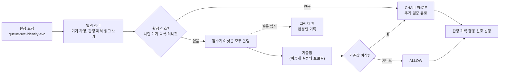

# 기능 설계: 봇 탐지(trust-svc 위험 판정·대기 중 재평가·축소 운영)

- **독자와 용도**: 봇 탐지 서비스 trust-svc와 재평가 작업자 `trust-reassess`를 만드는 엔지니어, 그 판정을 받아 쓰는 queue-svc 엔지니어, 시험을 짜는 QA, 이의 제기를 처리하는 CS 담당이 함께 보는 문서다. 다루는 것은 다음과 같다.
  - 로비 입장·사전 검증·추가 검증 제출 때의 위험 판정(점수기 목록 파이프라인, 요청 때 세는 판정 피처, 사람 확인 서버 검증)
  - 허니팟 신호, 차단 기기 목록, 판정을 통과한 뒤의 대기 중 재평가, 새 규칙의 그림자 실행
  - trust-svc 장애 때의 축소 운영, 판정 결과가 대기열·추가 검증 큐로 이어지는 방식, 이의 제기와 설명 요구
  - 실서비스 하한 집계, 개인정보와 보존, 관측 지표, 시험, 남는 한계
  - 대기열 쪽 동작(번호, 빠진 번호, `VERIFYING`·`PASSED` 기록)은 [queue-admission.md](queue-admission.md) §7이, 재평가 작업자의 패턴·키·스크립트는 [docs/streaming.md](../streaming.md) §5가 정본이다. 이 문서는 그 둘을 다시 쓰지 않고 가리킨다.
- **원문 출처**: 원문에 없다. 전체가 [보완]이다.
- **기준 기획 버전**: v1.0.
- **관련 ID**: FR-020 · FR-039 · FR-049 · NFR-001, 020, 022 · POL-001, 002, 006, 021, 026 · SCR-007, 009, 029, 045, 057, 067 · CMP-047 · API(프로그램끼리 요청과 응답을 주고받는 창구) `POST /v1/queues/{eventId}/lobby-participants`, `POST /v1/queues/{eventId}/pre-verifications`, `POST /v1/queues/{eventId}/verification` · 내부 호출 `ScoreRisk`(trust.proto), `IsolateWaiting`(queue.proto) · 이벤트 `telemetry.behavior`, `telemetry.trust-candidates`, `telemetry.trust-verdicts`, `control.settings` · ADR-0039, 0048, 0053, 0065, 0071, 0099, 0112, 0128, 0134, 0136, 0147, 0151, 0156(이 문서의 결정 기록) · 보안 추적 표 [docs/security/asvs/bot-defense.md](../security/asvs/bot-defense.md)
- **표시**: 이 문서가 새로 정한 설계 판단에는 '(추천 적용 2026-10-30)'을 붙였다. 판정 기준값, 점수기 가중치, 3단계 봇 코드는 이 문서에 쓰지 않는다. 기준값과 가중치는 trust-svc만 읽는 비공개 설정(봇 탐지 규칙 매개변수, AWS Secrets Manager. 비밀 값을 보관하는 AWS 서비스)에 두고, 3단계 봇 코드는 비공개 저장소 `peaket-loadtest`에만 둔다(POL-026, docs/devops.md §2.1, docs/security/secrets-and-keys.md, ADR-0147 결정 3). 공개 저장소 `peaket`에 있는 trust-svc 코드(`services/trust-svc`)는 그 설정의 이름과 판 번호(바뀔 때마다 하나씩 늘어나는 번호)만 안다.

## 1. 범위와 이름

| 이름 | 무엇인가 | 정본 |
| --- | --- | --- |
| 위험 판정 | 로비 입장·사전 검증·추가 검증 제출·로그인 때 queue-svc나 identity-svc가 trust-svc의 `ScoreRisk`를 불러 받는 실시간 판정이다. 결과는 통과(`ALLOW`)나 추가 검증(`CHALLENGE`)이고, 사용자에게 알릴 사유 범주가 붙는다 | 이 문서 §4·§5 |
| 점수기 | 신호 한 묶음을 보고 0~1 사이의 위험 값을 내는 판정 단계 하나다(예: `HumanCheck`) | §4.2 |
| 점수기 목록 파이프라인 | 확정 신호만 앞에서 보고, 나머지는 점수기를 모두 돌려 가중합으로 판정하는 구조다. 앞 단계가 처리하면 뒤로 넘기지 않는 '책임 연쇄'가 아니다(기술 검토 낮음-063, docs/architecture.md §3.1) | §4 |
| 확정 신호 | 가중합을 기다리지 않고 판정을 앞에서 끝내는 신호다. 차단 기기 목록에 오른 기기와 허니팟 적중 둘뿐이다. 판정을 끝낸다는 뜻이지 '봇 확정' 라벨이 아니다 | §4.3 |
| 판정 피처 | 요청 때 trust-svc가 세션·캐시 Redis(메모리에 데이터를 두는 빠른 저장소)에서 바로 세는 값이다. 회차별 기기 공유 수, 호스팅·프록시 대역 진입 수 같은 것이다 | §3.2 |
| 대기 중 재평가 | 판정을 통과한 뒤 기다리는 동안, 재평가 작업자가 여러 계정 사이 패턴을 찾아 추가 검증 후보를 내는 일이다 | docs/streaming.md §5, 이 문서 §8 |
| 차단 기기 목록 | 사람이 확인해 악성 봇으로 확정한 기기의 가명 목록이다. 기기 가명마다 키 하나다 | §9 |
| 허니팟 신호 | 화면과 접근성 트리(화면 낭독기 같은 보조기기가 읽는 화면 구조)에서 숨긴 링크를 부른 세션에 붙는 높은 확신 신호다 | §7 |
| 그림자 실행 | 새 규칙을 운영 트래픽에 함께 돌리되 막지 않고 판정만 남기는 방법이다 | §10 |
| 축소 운영 | trust-svc나 그 의존성이 멈출 때, 모두 통과시키지 않고 캐시한 규칙과 보수적인 레이트 리밋(일정 시간에 받는 요청 수의 상한)으로 이어 가는 운영이다. Degraded Mode(감내 모드)와 다른 말이다(docs/planning/03 §4) | §11 |
| 판정 근거 키 | 추가 검증으로 보낸 판정 하나의 근거(기기 가명, 확정 신호 여부, 사유 범주)를 이의 처리 때까지 남겨 두는 키다(추천 적용 2026-10-30) | §3.2, §12 |

- 차단은 하지 않는다. 의심 계정은 대기 순번을 바꾸거나 뒤로 밀지 않고 추가 검증 큐로 보낸다(POL-006). 그래서 queue-svc 쪽 판정(로비·사전 검증·추가 검증 제출)에서 trust-svc는 `ALLOW`와 `CHALLENGE`만 돌려준다. `trust.proto`의 `VERDICT_BLOCK`은 지금 쓰는 곳이 없다(추천 적용 2026-10-30).
- 하지 않는 것: 대역 차단(명령 4)은 CDN(사용자 가까운 곳에 파일을 복사해 두고 대신 응답하는 전송망) 앞단의 WAF(악성 요청을 걸러 내는 웹 방화벽)가 한다(docs/infra.md §9). 1인 1순번은 queue-svc, 휴대폰 본인확인과 1인 1계정은 identity-svc가 지킨다. 로그인 판정의 처리(추가 검증, 재인증)는 docs/features/identity.md §7이 정본이다.

## 2. 판정 흐름 한눈에

- 판정 한 번은 다섯 단계다. ① 입력 정리 ② 확정 신호 검사 ③ 점수기 모두 돌리기 ④ 가중합과 기준값 비교 ⑤ 기록 발행. 단계마다의 규칙은 §4에 있다.
- 사람 확인(Cloudflare Turnstile. 이용자가 따로 조작하지 않아도 되는 브라우저 검사로 사람과 봇을 가르는 서비스) 서버 검증은 ③의 `HumanCheck` 안에서 한 번만 한다. 확정 신호로 앞에서 끝나도 검증은 한다. 토큰(권한이나 상태를 증명하려고 주고받는 서명된 문자열)이 300초 안에 한 번만 검증되므로, 앞에서 끝났다고 버리면 그 토큰의 결과를 다시 얻을 수 없기 때문이다(추천 적용 2026-10-30).

## 3. 입력과 판정 피처

### 3.1 판정하는 때

| 판정하는 때(`ScoreContext`) | 부르는 쪽 | 받는 입력 | 돌리는 단계 | 결과가 가는 곳 |
| --- | --- | --- | --- | --- |
| 로비 입장(`LOBBY_ENTRY`) | queue-svc | 사람 확인 토큰, 기기 식별값, 게이트웨이(클라이언트 종류별로 앞에 둔 입구 서버)가 넘긴 IP·ASN(인터넷 사업자·데이터센터마다 받은 네트워크 번호)·UA(브라우저가 스스로 알리는 이름과 판)·Client Hints, 최초 방문 쿠키(브라우저가 사이트별로 저장했다가 요청마다 함께 보내는 작은 값) 나이, 세션 나이. 행동 신호 요약은 없다(로비 본문에 둘지는 정하지 않았다, queue-admission §12) | ①~⑤ 전부. `BehaviorScore`는 값 없음 | queue-admission §2 |
| 사전 검증(`PREVERIFY`) | queue-svc | 위와 같고 행동 신호 요약(`BehaviorSummary`)이 더 있다 | ①~⑤ 전부 | queue-admission §3 '사전 검증에서 고위험' |
| 추가 검증 제출(`VERIFICATION`) | queue-svc | 심층 챌린지의 사람 확인 토큰 | `HumanCheck`만. 가중합을 하지 않는다 | §5.2 |
| 로그인(`LOGIN`) | identity-svc | 기기 식별값, 게이트웨이 정보(IP·ASN·UA). 팬 로그인 화면에는 사람 확인 위젯이 없어 토큰이 없다(`HumanCheck`는 원래 없는 값이라 `degraded`가 아니다, 추천 적용 2026-10-30) | ①~⑤(회차 피처 없음) | docs/features/identity.md §7 |

- trust-svc는 IP로 ASN을 찾지 않고 CloudFront(AWS의 CDN)가 붙인 `CloudFront-Viewer-ASN` 헤더를 게이트웨이를 거쳐 받는다. 이 헤더는 원본 요청 정책에만 넣을 수 있고 캐시 정책에는 넣을 수 없다(AWS CloudFront 개발자 안내서, 2026-10-30 확인). 대기열 API 배포의 원본 요청 정책에 넣는다(추천 적용 2026-10-30). 로그인 판정은 대기열 API 배포를 지나지 않으므로, 공연 페이지 배포의 앱 서버 로그인 경로(소셜 로그인 시작·콜백)의 원본 요청 정책에도 넣고, 앱 서버가 `CreateSession`의 `asn`으로 identity-svc에 넘긴다(docs/infra.md §4.1 'ASN 헤더와 분류표', identity.proto, 추천 적용 2026-10-30).
- ASN을 호스팅·프록시·그 밖으로 나누는 것은 ASN 분류표다. 분류표는 trust-svc 작업이 하루 한 번 [가정] 새 판을 만들어 S3(AWS의 파일 저장소)에 두고, trust-svc와 queue-svc 파드(쿠버네티스에서 앱이 실행되는 가장 작은 단위)가 시작할 때와 1시간 [가정]마다 읽는다. 읽지 못하면 마지막으로 읽은 판을 쓴다. queue-svc도 읽는 까닭은 축소 운영(§11.2) 때문이다(추천 적용 2026-10-30). 분류표를 만들 원천 자료(공개 목록인지 상용 자료인지)는 [가정, wbs 3.2.1에서 확정]이다. 분류표에는 판정 기준값이 없어 공개되어도 되는 값이다.
- 추가 검증 제출의 맥락은 `trust.proto`의 `SCORE_CONTEXT_VERIFICATION`이다(2026-10-30 더함). 추가 검증은 "사람임을 다시 보이면 원래 순번으로 돌아간다"(FR-020)가 규칙이라, 다시 가중합을 하면 차단 기기 목록 같은 같은 근거로 또 걸려 규칙이 깨진다. 그래서 사람 확인만 본다(추천 적용 2026-10-30). 휴대폰 본인확인 재통과는 queue-svc가 identity-svc `CheckReverification`으로 확인한다(§5.2).

### 3.2 판정 피처와 키

| 키 | 자료형 | 내용 | 수명 | 정본 |
| --- | --- | --- | --- | --- |
| `tr:devshare:{deviceRef}:E` | Set | 회차별 기기 공유 수(그 기기 가명으로 판정받은 서로 다른 pid. pid는 본인확인 연계정보로 만든 사람 식별값이다) | 10분 [가정], 원소 상한 20개 [가정] | docs/data.md §3, docs/streaming.md §5.5 |
| `tr:asnhost:{asn}:E:{10초 칸}` | 카운터 | 호스팅·프록시 대역 ASN의 10초 진입 수. 통신사 대역은 세지 않는다 | 30초 [가정] | 같다 |
| `tr:block:{deviceRef}` | 문자열 | 차단 기기 목록(§9) | 90일 [가정] | docs/data.md §3 |
| `tr:devacct:{deviceRef}` | Set | 그 기기에서 판정받은 본인확인 계정(pid). '한 기기의 여러 계정' 신호다 | 30일, 원소 상한 20개 [가정] | docs/data.md §3, 이 문서(추천 적용 2026-10-30) |
| `tr:devhist:{deviceRef}` | 해시 | 그 기기의 지난 30일 추가 검증 보냄·통과·실패 수 | 30일 | docs/data.md §3, 이 문서(추천 적용 2026-10-30) |
| `tr:hp:{pid}` | 문자열 | 허니팟 적중 표시. 값은 적중 시각과 회차다 | 24시간 [가정] | docs/data.md §3, §7(추천 적용 2026-10-30) |
| `tr:vb:{pid}:E` | 문자열 | 판정 근거 키. `CHALLENGE` 판정과 재평가 격리에만 쓴다. 값은 판정 키(`TrustVerdict.eventKey`), 기기 가명, 확정 신호 근거(차단 목록·허니팟), 사유 범주, 프로필 판, 판정 시각이다 | 30일 [가정] | docs/data.md §3, §12(추천 적용 2026-10-30) |

- 기기 가명(`deviceRef`)은 브라우저가 처음 쓸 때 만든 128비트 무작위 값 `deviceId`를 `HMAC-SHA256(탐지 가명 키, deviceId)`로 바꾼 값이다. HMAC은 비밀 키로 만든 위조 확인용 값이라, 키가 없으면 같은 값을 만들 수 없다. 원래 값은 브라우저에만 있고 trust-svc는 저장하지 않는다(ADR-0053 결정 1, docs/security/data-classification.md).
- `tr:devacct`·`tr:devhist`는 queue-admission §7 '기기 신뢰도' 신호(그 기기에서 인증된 계정 수, 과거 온세일(판매가 열리는 시각 앞뒤로 접속이 몰리는 기간) 검증 이력, 보존 30일)를 담을 키가 정본에 없어 더했다. 해시 태그(Redis 클러스터에서 키를 같은 칸에 모으는 표시)는 기기 가명이고 회차를 넘어 쓴다. 기기 100만 개면 두 키를 합쳐 약 200MB [추정]다.
- `tr:hp`·`tr:vb`의 해시 태그는 pid다. 판정 근거 키는 추가 검증으로 보낸 판정만 남기므로(대형 온세일에서 많아야 수만 건 [추정]) 메모리가 작다.
- 판정 피처 Redis 명령은 핫패스(요청이 가장 많이 지나는 경로) 시간 초과 100ms를 따른다(docs/architecture.md §5 '시간 초과 기본값'). 시간 초과나 오류가 나면 그 피처는 '값 없음'이다(§4.4).
- 새 키 넷은 2026-10-30 docs/data.md §3에 더해졌다. docs/security/data-classification.md의 '기기 신뢰 이력과 차단 기기 목록' 행에 `tr:devacct`·`tr:devhist`·`tr:block`이, '이상 징후 위험 점수 및 이의 제기 심사 기록' 행에 판정 근거 키와 허니팟 적중 표시가 2026-10-30 들어갔다.

## 4. 점수기 목록 파이프라인

### 4.1 단계

1. **입력 정리**: 기기 식별값을 기기 가명으로 바꾸고, ASN 분류표로 네트워크 유형을 정한다. Lua 스크립트(Redis 안에서 한 번에 도는 짧은 프로그램) 하나로 `tr:devshare`에 pid를 넣고 원소 수를 세며, 호스팅·프록시 대역이면 `tr:asnhost`를 올린다. `tr:block`·`tr:hp`는 `EXISTS`로, `tr:devacct`·`tr:devhist`는 한 번에 읽는다. 피처 키는 해시 태그가 달라 한 Lua로 묶지 않고 파이프라인으로 보낸다.
2. **확정 신호 검사**: 차단 기기 목록이나 허니팟 적중이 있으면 그 자리에서 `CHALLENGE`로 정한다(§4.3). 그래도 ③을 건너뛰지 않는다. 사람 확인 결과와 그림자 판(§10) 판정을 남겨야 하기 때문이다. 앞에서 끝난다는 것은 ④의 가중합 결과와 상관없이 판정이 정해진다는 뜻이다.
3. **점수기 모두 돌리기**: §4.2의 여섯을 모두 돌린다. 하나가 높다고 나머지를 건너뛰지 않는다.
4. **가중합과 기준값**: 프로필(§4.4)의 가중치로 더하고 기준값과 견준다.
5. **기록 발행**: 판정을 `telemetry.trust-verdicts`(`TrustVerdict`, source `REALTIME`)로, 판정 입력을 `telemetry.behavior`(`BehaviorSignal`)로 낸다. 점수 원값과 가중치는 어디에도 싣지 않는다(POL-006, queue-admission §7). `CHALLENGE`면 판정 근거 키를 쓰고 `tr:devhist`의 보냄 수를 올린다. Kafka(이벤트를 순서대로 쌓아 두고 여러 곳에 나눠 주는 메시지 시스템) 발행은 응답을 보낸 뒤 비동기로 한다. 생산자 버퍼가 차면 버리고 `telemetry_dropped_total{record}`로 센다(docs/architecture.md §5).

- `BehaviorSignal`은 사전 검증과 로비 입장 둘 다에서 낸다. 로비는 행동 요약이 없어 `features`가 비지만, 재평가의 기기 공유 소급(R1)은 기기 가명만 보므로 로비 참가자에게도 쓰인다. 재평가 격리가 로비 참가자의 참가 토큰을 찾게 되어 있고(queue-admission §7, `IsolateWaiting`), 재평가 용량(10분 피크 신호 약 100만 개, docs/streaming.md §5.8)도 로비 규모로 잡혀 있어서다(추천 적용 2026-10-30). docs/streaming.md §5.1·§5.2·§5.5를 이에 맞춰 고쳤다.

### 4.2 점수기

| 점수기 | 보는 신호(queue-admission §7 신호 표) | 신호 세기 | 값 없음이 되는 때 |
| --- | --- | --- | --- |
| `HumanCheck` | 사람 확인 서버 검증 결과(성공·실패·재시도 횟수, 만료·재사용, `hostname`·`action` 일치, §6) | 약하다. 통과는 사람의 증거가 아니다(ADR-0039) | 검증 API가 시간 안에 답하지 않거나 서버 오류(검증 보류) |
| `DeviceTrust` | 그 기기의 계정 수(`tr:devacct`), 지난 30일 검증 이력(`tr:devhist`), 회차별 기기 공유 수(`tr:devshare`) | 강하다. 서버가 직접 센다 | 기기 식별값이 없거나 피처 Redis 오류 |
| `BehaviorScore` | 행동 신호 요약(포인터 이동 엔트로피, 입력 간격, 스크롤 요약) | 약하다. 브라우저가 만든 값이라 꾸밀 수 있다(기술 검토 낮음-065) | 로비 입장, 요약이 없거나 입력이 없는 요약 |
| `NetworkScore` | 네트워크 유형(호스팅·프록시·그 밖)과 호스팅·프록시 대역 10초 진입 수(`tr:asnhost`) | 중간. 통신사 대역은 많은 사람이 나눠 쓰므로 그 밖으로 본다 | ASN 헤더가 없거나 분류표에 없는 ASN(그 밖으로 본다) |
| `AgeScore` | 최초 방문 쿠키 나이, 로그인 세션 나이, 계정 나이 | 강하다. 쿠키 나이는 서명한 값이다(ADR-0065 결정 9) | 쿠키가 없거나 서명이 맞지 않음(쿠키 없음으로 본다) |
| `ConsistencyScore` | UA·Client Hints와 화면 특성 사이의 모순 | 약하다(기술 검토 낮음-065) | 화면 특성 값이 없음 |

- 점수기 이름 여섯은 추천 적용(2026-10-30)이다. architecture §3.1은 `HumanCheck`·`DeviceTrust`·`BehaviorScore` 셋과 '등'을 적었고, 나머지 셋은 queue-admission §7 신호 표의 IP·ASN, 쿠키·세션 나이, 브라우저 정보 불일치를 하나씩 맡는다.
- 점수기는 저장소를 직접 부르지 않는다. ①이 모은 값만 받는 순수 함수라 단위 시험으로 모두 볼 수 있고, 그림자 판이 같은 입력을 다시 쓸 수 있다.
- 점수기마다 위험 값과 함께 '가장 크게 기여한 사유 범주' 하나를 낸다. 응답의 사유 범주는 가중합에 가장 크게 기여한 점수기의 범주다(§4.5).

### 4.3 확정 신호

| 확정 신호 | 판정 | 사유 범주 | 왜 앞에서 끝내나 | 남는 위험 |
| --- | --- | --- | --- | --- |
| 차단 기기 목록에 있음 | `CHALLENGE` | 이 기기의 이용 기록 | 사람이 확인해 올린 기기라(§9) 가중치로 다시 따질 까닭이 없다 | 목록이 틀렸으면 그 사람은 추가 검증을 다시 거친다. 사람 확인과 본인확인을 통과하면 원래 순번으로 돌아가고, 이의가 인정되면 목록에서 지운다 |
| 허니팟 적중(`tr:hp`) | `CHALLENGE` | 화면 조작 모양 | 사람이 보거나 닿을 수 없는 링크라 사람이 부를 일이 드물다 | 링크를 미리 여는 확장 프로그램 같은 사람 쪽 접촉이 섞인다. 그래서 확정 라벨로 세지 않고 정밀도를 표본으로 잰다(§7, FR-049) |

- 확정 신호도 결과는 추가 검증이다. 봇 확정 라벨(`LABELED_BOT`)은 사람이 본 표본 검토와 사후 라벨에서만 붙는다(§9·§13, 기술 검토 낮음-122).

### 4.4 합치기와 프로필

- 위험 값 = 점수기 위험 값의 가중합이다. 가중치와 기준값은 프로필마다 다르고, 모두 비공개 설정에 있다.
- 프로필은 '강도 × 정렬 방식'이다. 강도는 명령 5의 완화·기본·강화 셋이고(docs/features/control-tower.md §3), 정렬 방식은 로비 셔플을 켠 회차(무작위 셔플, 계정 나이·기기 신뢰도·한 기기의 여러 계정에 가중치를 높인 전용 프로필)와 끈 회차(선착순)다(queue-admission §7). 회차의 정렬 설정은 queue-svc가 요청에 함께 싣는다(`trust.proto` `ScoreRiskRequest.lobby_shuffle`, 2026-10-30 더함).
- 값 없음은 0으로 더한다. 남은 점수기의 가중치를 키워 다시 나누지 않는다. 다시 나누면 남은 신호 하나가 커져 사람을 잘못 잡는 일이 는다. NFR-022는 사람 오탐을 상한으로 묶고 탐지율은 정상 상태의 시험(Q-T20)으로 재므로, 신호가 빠진 때는 오탐 쪽을 지킨다(추천 적용 2026-10-30). 값 없음이 된 점수기는 판정 기록 속성에 남긴다. 그 가운데 의존성 장애(피처 Redis 오류, 사람 확인 검증 보류) 때문인 것이 있으면 응답의 `degraded`를 참으로 둔다. 로비 입장의 행동 요약처럼 원래 없는 값은 `degraded`가 아니다.
- 설정 읽기: 비공개 설정은 파드가 시작할 때 읽어야 준비 상태가 되고, 5분 [가정]마다 판 번호를 확인해 바뀌면 다시 읽는다. 명령 5는 압축 토픽(키마다 마지막 값만 남기는 Kafka 토픽) `control.settings`로 오고, 적용한 판을 `control_settings_applied_version{service, key}`로 낸다(docs/observability.md §5). 비공개 설정을 읽지 못하면 마지막으로 읽은 판으로 판정하고, 처음부터 읽지 못한 파드는 준비 상태가 되지 않는다.
- 규칙 값을 바꾸는 일은 명령 5(강도 전환)와 다르다. 새 가중치·기준값은 그림자 판으로 먼저 돌린다(§10). 운영 중에 바꿀 수 있는 것은 명령 5의 강도와 재평가 모드뿐이다.

### 4.5 응답

- `ScoreRiskResponse`는 판정(`ALLOW`·`CHALLENGE`), 사유 범주, `degraded`다. 점수 원값·가중치·기준값·어느 확정 신호였는지는 싣지 않는다(trust.proto, POL-006).
- 사유 범주 코드 [가정, 문구는 법률 검토 wbs 7.4.1에서 확정](추천 적용 2026-10-30):

| 코드 | 화면에 보이는 범주(예, docs/design/d5 §5.9) | 주로 나오는 점수기 |
| --- | --- | --- |
| `RAPID_REQUESTS` | 짧은 시간 많은 요청 | `NetworkScore`, 재평가 R1 |
| `DEVICE_HISTORY` | 이 기기의 이용 기록 | `DeviceTrust`, 차단 기기 목록 |
| `NETWORK` | 접속 환경 | `NetworkScore` |
| `INTERACTION` | 화면 조작 모양 | `BehaviorScore`, `ConsistencyScore`, 허니팟 |
| `HUMAN_CHECK` | 사람 확인 결과 | `HumanCheck` |
| `SHARED_PATTERN` | 여러 계정에서 같은 모양 | 재평가 R2 |

- 범주는 그 판정에 가장 크게 기여한 쪽 하나다. 여러 범주를 늘어놓지 않는다. 봇이 범주 조합으로 기준을 거꾸로 알아내는 길을 줄이려는 것이다. 개인정보 처리방침의 공개 범위(판정 사실·목적·주요 유형·처리 절차)는 POL-006을 따른다.

### 4.6 데드라인과 용량

- queue-svc가 `ScoreRisk`에 거는 데드라인(호출이 끝나야 하는 마감 시각)은 로비 입장·사전 검증·추가 검증 제출 800ms [가정]이다. 그 안에서 사람 확인 서버 검증은 500ms [가정]에 끊는다(§6). Redis 읽기와 점수 계산은 수 ms [추정]이다. 값은 로비 개방 부하 시험(Q-T57)에서 재어 정한다(추천 적용 2026-10-30).
- 판정 수의 피크는 로비 참가가 고르게 오면 초당 약 1,700건이고(docs/architecture.md §9.4, docs/streaming.md §11), 로비 개방 첫 1분에 참가의 30% [가정]가 몰리면 그 1분 평균이 초당 약 3,500건 [추정]이다(queue-admission §2 '로비 참가 퍼뜨리기', Q-T57 ②, ADR-0161). 그 1분에 그림자 판이 있으면 판정 기록은 초당 약 7,000건 [추정]이다. 그림자 판은 같은 입력으로 점수만 다시 계산하므로 외부 호출과 Redis 명령이 늘지 않는다. 판정 기록은 그림자 판이 있는 동안 두 배(초당 약 3,400건 [추정])가 된다.
- T=0 핵심 경로(오픈 순간의 진입·입장 확정)는 trust-svc를 부르지 않는다. 판정은 로비(T-10분)와 공연 상세의 사전 검증에서 미리 끝난다(queue-admission §2·§3).

## 5. 판정 결과가 이어지는 곳

### 5.1 대기열과 추가 검증 큐

| 판정한 때 | `CHALLENGE`일 때 queue-svc가 하는 일 | 정본 |
| --- | --- | --- |
| 로비 입장 | 참가 토큰(1인 1장)을 주고 `q:{event:E}:verify`에 `VERIFYING`을 쓰며, 201 응답에 `verification: REQUIRED`를 싣는다. 셔플 뒤 정규화 작업이 그 번호를 빠진 번호로 돌린다 | queue-admission §2·§7 |
| 사전 검증 | 사전 검증 토큰에 '추가 검증 필요'를 서명해 넣는다. 진입 때 번호를 정상으로 주고, 같은 Lua에서 빠진 번호와 `VERIFYING`을 쓴다 | queue-admission §3 |
| 대기 중(재평가 적용) | trust-svc가 `IsolateWaiting`을 부르면 같은 기록을 쓴다 | queue-admission §7, 이 문서 §8 |
| 로그인 | identity-svc가 정한다 | docs/features/identity.md §7 |

- `ALLOW`면 queue-svc는 지금처럼 토큰과 번호를 준다. `degraded`가 참인 `ALLOW`는 사전 검증 토큰에 '검증 보류'를 서명해 넣고, 토큰을 갱신할 때(15분 안) 다시 판정받는다. 로비 참가 토큰은 다시 판정하지 않는다(queue-admission §9 '사람 확인 검증 API 장애·지연' 행과 같은 규칙).
- 격리는 번호 표시를 되돌리지 않는다. 그래서 다른 대기자의 앞 인원은 바뀌지 않는다(POL-006). queue-svc는 `CHALLENGE` 응답의 사유 범주를 격리 기록 `q:{event:E}:verify`의 값(상태·시각·사유 범주)에 함께 적고, 재평가 격리는 패턴에서 정한다(R1 `RAPID_REQUESTS`, R2 `SHARED_PATTERN`, queue.proto). 추가 검증 화면(SCR-009)은 참가 토큰·대기표·입장 확정 `VERIFYING` 응답의 `verificationReason`으로 그 범주를 받고, 이의 건 요청의 `category`와 `GetVerificationAppeal.reason_category`도 이 값을 쓴다. docs/data.md §3 `q:{event:E}:verify`와 openapi `LobbyToken`·`QueueTicket`·`AdmissionResult`에 같은 칸을 더한다(추천 적용 2026-10-30).

### 5.2 추가 검증 제출

1. 추가 검증 화면(SCR-009)이 심층 챌린지(CMP-047)의 사람 확인 토큰을 `POST /v1/queues/{eventId}/verification`의 `challengeToken`으로 보낸다.
2. queue-svc가 `ScoreRisk(VERIFICATION)`로 그 토큰의 서버 검증을 맡긴다. trust-svc는 `HumanCheck`만 돌려 성공이면 `ALLOW`, 아니면 `CHALLENGE`를 준다(§3.1).
3. queue-svc는 휴대폰 본인확인 재통과를 identity-svc의 결과로 확인한다. 화면은 본인확인기관 창(SCR-006, 목적 REVERIFY)을 연다. 확인 호출은 identity.proto `ReverificationCheckService.CheckReverification`이다. queue-svc가 계정·pid와 추가 검증을 시작한 시각(`q:{event:E}:verify`의 `VERIFYING` 시각)을 보내면, identity-svc는 그 뒤 같은 사람으로 확정된 재확인이 있는지 답한다. 결제 직전 재확인 `GetVerificationStatus`는 '본인확인을 한 적이 있는가'만 답해 재통과를 가리지 못하므로 쓰지 않는다. 답이 없으면 통과로 보지 않고 503이다(trust-svc가 멈췄을 때와 같은 규칙, 추천 적용 2026-10-30).
4. 둘 다 통과하면 queue-svc가 `PASSED`와 통과 시각을 쓴다. 차례 전이면 원래 순번의 차례에, 차례가 지났으면 바로 다음 빈자리로 들어간다(queue-admission §6·§7, FR-020).
5. trust-svc는 결과를 `TrustVerdict`(category `CHALLENGE_PASSED`·`CHALLENGE_FAILED`)로 남기고 `tr:devhist`의 통과·실패 수를 올린다. 실패만으로는 차단 기기 목록에 올리지 않는다(§9).

- 추가 검증 제출에서 trust-svc가 멈췄으면, queue-svc는 '확인하지 못했습니다. 다시 시도해 주세요'(docs/design/d5 §5.9 '챌린지 실패')로 답하고 통과로 보지 않는다. 축소 운영의 '막지 않는다'는 대기열에 들어오는 일의 규칙이고, 격리된 사람을 풀어 주는 일의 규칙이 아니다(추천 적용 2026-10-30). 본인확인만으로 풀어 주는 안은 대여 명의 봇이 그대로 빠져나가므로 고르지 않았다. 대신 이의 제기(§12)는 trust-svc 없이도 접수된다.

## 6. 사람 확인 서버 검증(`HumanCheck`)

- trust-svc는 사람 확인 토큰을 받는 즉시 Cloudflare 검증 API(siteverify)로 확인한다. 토큰은 만든 뒤 300초 동안만 유효하고 한 번만 검증된다. 다시 쓰면 `timeout-or-duplicate` 오류가 난다(Cloudflare Turnstile 서버 검증 문서, 2026-10-30 확인).
- 응답의 `hostname`과 `action`이 그 판정 맥락에 정한 값과 맞는지 본다. 다르면 실패로 센다. 다른 페이지나 다른 목적에서 받은 토큰을 옮겨 쓰는 일을 막으려는 것이다(추천 적용 2026-10-30). 위젯이 그 `action` 값을 달고 그리는 규칙은 docs/frontend.md §5.14.2 'Turnstile' 행에 있다. 맥락마다 허용하는 값과 검증하는 곳은 아래 표다(표는 추천 적용 2026-10-30).

| 판정 맥락 | 위젯이 뜨는 화면 | 허용 `hostname` | `action` [가정] | 서버 검증 |
| --- | --- | --- | --- | --- |
| 로비 입장(`LOBBY_ENTRY`) | 로비(SCR-007) | `www.peaket.example` | `lobby` | trust-svc(`HumanCheck`) |
| 사전 검증(`PREVERIFY`) | 공연 상세 | `www.peaket.example` | `preverify` | trust-svc |
| 추가 검증 제출(`VERIFICATION`) | 추가 검증(SCR-009) | `www.peaket.example` | `verify` | trust-svc |
| 팬 로그인(`LOGIN`) | 위젯 없음(소셜 로그인) | — | — | 없음. `HumanCheck`는 원래 없는 값이다(§3.1) |
| 파트너 로그인 | SCR-020 | `partner.peaket.example` | `login` | identity-svc가 직접 한다. `ScoreRisk`를 부르지 않는다 |
| 운영자·CS 로그인 | SCR-028 | `console.peaket.example` | `login` | identity-svc가 직접 한다 |

- 관리 계정 로그인의 사람 확인 토큰은 identity-svc 하나가 검증한다(추천 적용 2026-10-30). 지난 판의 이 절은 `hostname`을 `www`로만 받아, partner·console 호스트에서 뜨는 관리 로그인 위젯의 토큰이 trust-svc로 가면 늘 실패하는 어긋남이 있었다. trust-svc가 아니라 identity-svc로 정한 이유는 셋이다. ① 관리 로그인의 사람 확인은 잠금 규칙의 통과·실패 관문이고, 사람 확인 서비스에 닿지 못하면 받지 않는다(docs/security/auth-controls.md §2.3). trust-svc의 `HumanCheck`는 같은 상황을 '검증 보류'로 두고 가중합을 이어 가는 점수기라 뜻이 다르다. ② 관리 로그인이 온세일 때 팬 경로를 받는 trust-svc에 기대지 않게 한다. 관제 평면을 팬 경로의 공유 자원에서 떼어 둔 것과 같은 생각이다(ADR-0102). ③ 사람 확인 비밀 키는 이미 identity-svc도 읽는다(docs/security/secrets-and-keys.md 'Turnstile 시크릿 키' 행). 검토한 다른 안은 trust-svc에 관리 로그인 맥락을 새로 두고 허용 호스트를 partner·console로 하는 것이다. 키를 쥔 곳은 하나로 줄지만 ①·②가 깨져 고르지 않았다. 남는 것: 비밀 키를 두 서비스가 읽는다. 두 서비스는 같은 검증 규칙(300초 1회용, 같은 `idempotency_key`로 한 번 다시 묻기, 500ms [가정])을 쓰고, identity-svc는 파트너 로그인 경로에서 `partner`, 운영자 로그인 경로에서 `console`만 받아 두 콘솔 사이에서도 토큰을 옮겨 쓰지 못하게 한다.
- 검증 호출은 500ms [가정]에 끊는다. 끊기면 남은 데드라인이 200ms [가정] 넘게 있을 때만 같은 `idempotency_key`(호출마다 만든 UUID)로 한 번 다시 보낸다. 이 키를 쓰면 토큰이 1회용이어도 같은 검증을 안전하게 다시 물을 수 있다(같은 문서). 그래도 답이 없거나 서버 오류면 '검증 보류'다. 토큰이 틀렸거나 만료됐다는 응답은 보류가 아니라 보통의 실패다(queue-admission §9).
- 서킷 브레이커(계속 실패하는 호출을 잠시 끊어 장애가 번지지 않게 하는 장치)를 검증 API 호출에 따로 둔다. 열리면 검증을 부르지 않고 바로 '검증 보류'로 두며, 그동안 보류 건수를 따로 센다. 장애가 길면 운영자가 명령 5로 강도를 올릴 수 있다(queue-admission §9).
- 토큰과 검증 응답은 저장하지 않는다. 판정 기록에는 결과 종류(성공·실패·보류)만 남긴다.

## 7. 허니팟 신호

- **형식**: 공연 상세와 로비 화면에 숨긴 일반 `<a>` 링크 하나를 둔다. 화면과 접근성 트리에서 숨기고 사이트맵에 넣지 않는다. 숨긴 입력 칸은 두지 않는다(docs/frontend.md §5.15, NFR-020).
- **경로**: 링크 주소는 소비자 웹과 같은 출처의 `/_t/` 아래 경로로 둔다. 소비자 웹 배포의 `/_t/*` 캐시 동작은 이미 캐시하지 않고 gw-fan으로 보낸다(docs/infra.md §4.1). gw-fan은 그 하위 경로를 trust-svc의 허니팟 기록 처리기로 넘긴다. 같은 출처라 `Sec-Fetch-Site: same-origin`이 실리고, 브라우저는 팬 로그인 쿠키(`__Secure-peaket_at`)도 싣는다. gw-fan은 그 쿠키의 팬 액세스 토큰을 검증해 사람 식별값(pid)만 내부 헤더로 넘기고, 쿠키 원문은 다른 `/_t/*` 경로처럼 지워 trust-svc로 보내지 않는다. 이 경로 하나만 `/_t/*`의 'POST만' 규칙에서 벗어나 GET을 받는다(숨긴 `<a>` 링크라 브라우저가 GET으로 부른다). 정본은 docs/api/guidelines.md §9 '브라우저 텔레메트리 입구'와 docs/infra.md §4.1 '허니팟 경로'다. 정확한 경로와 gw-fan 라우트는 [가정, wbs 3.2.3에서 확정]이다(추천 적용 2026-10-30).
- **기록 조건**: `Sec-Fetch-Site: same-origin`이고 `Sec-Purpose`에 `prefetch`가 없으며 `Next-Router-Prefetch`가 없는 요청만 적중으로 센다. 응답은 언제나 204·빈 본문이다(queue-admission §7 '기록 조건', ADR-0065 결정 9).
- **적중 반영**: 로그인한 요청(게이트웨이가 넘긴 pid가 있는 요청)이면 trust-svc가 `tr:hp:{pid}`를 24시간 [가정] 쓰고, 적중을 `TrustVerdict`(source `HONEYPOT`, category `HONEYPOT`)로 낸다. 그 사람의 다음 로비 입장·사전 검증은 확정 신호로 추가 검증에 간다(§4.3). 이미 판정을 통과해 기다리는 중이면 적중만으로 격리하지 않는다. 다음 판정 때 반영한다. 로그인하지 않은 요청은 지표(`trust_honeypot_hits_total{signed_in}`)로만 센다.
- **정밀도 보정**: 허니팟 라벨 가운데 무작위 100건 [가정]을 사람이 검토해 정밀도(라벨 가운데 진짜 봇의 비율)를 재고, 하한 계산에는 적중 수에 그 정밀도의 Wilson 95% 하한(표본으로 잰 비율의 95% 신뢰구간 아래 끝)을 곱해 넣는다(FR-049, §13).
- **남는 한계**: `Sec-Fetch-*`를 보내지 않는 스크립트는 기록되지 않는다(Q-T40 ⑤). 링크 주소는 화면 원본에 있어 봇이 피해 갈 수 있다. 그래서 허니팟은 화면을 그대로 훑는 자동화 봇을 잡는 보조 신호다.

## 8. 대기 중 재평가

- 작업자 `trust-reassess`의 입력·패턴(R1 기기 공유 소급, R2 행동 요약값 복제)·키·스크립트·출력은 docs/streaming.md §5가 정본이다. 패턴 숫자(10분 안 5명·20명)는 [가정]이고 그림자 기간에 정한다.
- trust-svc는 `telemetry.trust-candidates`를 읽어 다음을 한다(docs/streaming.md §5.5).
  - 처리한 후보 `eventKey`를 10분 [가정] 기억해 두 번 처리하지 않는다.
  - 재평가 모드(끔·그림자·적용, 기본 그림자)를 따른다. 그림자면 `TrustVerdict`(source `REASSESS`, action `NONE`, `shadow` true)만 낸다. 적용이면 `IsolateWaiting`을 부르고, 격리하면 판정 근거 키(§3.2)를 쓴다. 사유 범주는 R1이 `RAPID_REQUESTS`, R2가 `SHARED_PATTERN`이다.
  - 이미 입장했거나 대기가 끝난 사람은 라벨만 남긴다.
- **격리 상한의 분모**: 상한은 회차의 지금 대기 인원의 0.5% [가정]/10분이다. 그런데 trust-svc가 회차의 지금 대기 인원을 알 길이 정본에 없다(`QueueAggregate`에 대기 인원 칸이 없다). 그래서 queue-svc가 격리를 쓰는 Lua에서 10분 칸의 재평가 격리 수와 대기 인원(발급 번호 − serving − 빠진 번호)을 함께 보고, 넘으면 격리하지 않고 '상한 도달'로 답하는 안을 추천한다. trust-svc는 그 답을 받으면 그림자로 남기고 SEV3(장애 심각도 등급. 숫자가 작을수록 심각하다)를 낸다. queue-admission §7에 반영했고(2026-10-30), 계약은 queue.proto 초안의 `ISOLATE_RESULT_CAP_REACHED`다(추천 적용 2026-10-30).
- 그림자에서 적용으로 바꾸는 일은 §10.3을 따른다.
- 재평가 키를 잃으면(Redis 장애, 메모리 정리) 최대 10분의 문맥을 잃는다(docs/data.md §3 유실 등급 B).

## 9. 차단 기기 목록

- **키**: 기기 가명마다 키 하나 `tr:block:{deviceRef}`다. 값은 등재 사유 코드, 확정 출처, 등재 시각이다. TTL(저장한 값이나 키를 쓸 수 있는 시간)은 등재 뒤 90일 [가정]이다. Bloom filter는 쓰지 않는다. 틀린 '있다'가 사람 오탐(사람을 봇으로 잘못 잡는 것)에 더해지고 지울 수 없기 때문이다(기술 검토 중간-014, ADR-0128).
- **올리는 조건**: 사람이 확인한 확정만 올린다(추천 적용 2026-10-30).
  - 봇 판정 표본 검토(SCR-067)에서 '봇'으로 판정한 세션의 기기
  - CS가 부정구매로 확인한 신고 건의 기기
  - 자동 신호(추가 검증 실패, 허니팟 적중, 재평가 후보)만으로는 올리지 않는다. 사람이 보지 않은 신호로 올리면 오탐 하나가 90일 동안 이어지기 때문이다.
  - 지난 판의 정본(queue-admission §7, docs/data.md §3)에 있던 확정 출처 '운영 명령의 차단'은 운영 명령 카탈로그 12종(docs/features/control-tower.md §3)에 맞는 명령이 없다. 그 명령이 생길 때까지 이 출처로는 올리지 않는다. 두 정본은 2026-10-30에 '사람이 확정한 것만'으로 고쳤다.
- **올리는 길**: 표본 검토와 신고 확인은 관제 콘솔(ops-svc)에서 한다. ops-svc가 그 결과를 trust-svc에 알리는 호출(라벨 반영, §12와 같은 호출)로 보내고, trust-svc가 판정 근거 키나 행동 신호 원시 표(`trust.behavior_raw`, 30일)에서 그 세션의 기기 가명을 찾아 키를 쓴다. 호출은 trust.proto `TrustLabelService.ApplyLabel`이다(2026-10-30 더함).
- **보는 때**: 로비 입장·사전 검증의 ①에서 `EXISTS`로 본다(§4.1). 있으면 확정 신호다.
- **지우기**: CS가 이의를 인정했고 그 판정의 근거에 차단 기기 목록이 있었으면 trust-svc가 바로 `DEL`한다. 대기표 복귀(`PASSED`)와 같은 처리에서 한다(queue-admission §7, Q-T48). 표본 검토에서 '사람'으로 다시 판정된 기기도 지운다.
- **잃었을 때**: 키를 잃으면 그 기기들의 차단 신호 없이 판정한다. 사람 확인·휴대폰 본인확인·1인 1순번·대기 중 재평가가 남는다(유실 등급 C, docs/data.md §3). 탐지 가명 키를 바꾸면 기기 가명이 모두 바뀌어 목록과 기기 이력을 새로 쌓는다(docs/security/secrets-and-keys.md).

## 10. 그림자 실행

### 10.1 실시간 판정의 그림자 판

- trust-svc는 적용 판(실제 판정) 하나와 그림자 판 하나까지를 함께 들고 있다. 그림자 판은 같은 요청의 ③·④만 다른 가중치·기준값으로 다시 계산한다. 사람 확인 검증과 Redis 쓰기는 다시 하지 않는다(§4.6).
- 그림자 판의 결과는 `TrustVerdict`(source `REALTIME`, action `NONE`, `shadow` true)로 낸다. 분석의 봇 지표는 `shadow` false만 센다(ADR-0071).
- 새 신호(새 판정 피처)가 필요한 규칙은 먼저 피처를 모으는 코드를 배포하고 적용 판에서 그 점수기 가중치를 0으로 둔다. 그다음 그림자 판에서 가중치를 준다.

### 10.2 보는 값

- 두 판의 판정이 갈린 세션 수와 비율(`trust_shadow_disagreements_total{direction}`, direction은 '그림자만 추가 검증'·'적용만 추가 검증')
- 마감 단계 R2(오픈 7일 뒤)의 표본 검토·사후 라벨과 대조한 두 판의 오탐·미탐(봇을 놓치는 것) 차이(docs/features/analytics.md §4.2)

### 10.3 적용으로 바꾸기

- 조건: ① 온세일 1회 [가정] 이상 그림자로 돌았다 ② R2 대조에서 그림자 판의 사람 오탐이 NFR-022 상한(단측 95% 상한 0.5%)을 넘지 않는다 ③ 혼동 행렬(봇·사람마다 맞힌 수와 틀린 수를 나눈 표) 재측정(K6 절차, docs/perf-ledger.md §10)이 같은 판으로 통과했다. 혼동 행렬 재측정은 가중치를 크게 바꿀 때만 다시 한다(추천 적용 2026-10-30).
- 권한: 봇 방어 담당이 제안하고 제품 책임자가 승인한다(docs/features/analytics.md §1.3). 비공개 설정의 적용 판 번호를 바꾸는 것으로 한다.
- 온세일 윈도우와 변경 동결 창에는 판을 바꾸지 않는다(docs/devops.md §8). 그 동안 바꿀 수 있는 것은 명령 5의 강도뿐이다.
- 재평가 모드의 그림자 → 적용은 docs/streaming.md §5.6대로 commander가 명령 5로 바꾼다.

## 11. 축소 운영

### 11.1 두 층

| 상황 | 누가 판정하나 | 쓰는 것 | 빠지는 것 | 응답 표시 |
| --- | --- | --- | --- | --- |
| ① trust-svc는 살아 있고 의존성 일부가 멈춤(피처 Redis, 사람 확인 검증 API, 비공개 설정 새로 읽기) | trust-svc | 남은 점수기, 마지막으로 읽은 설정 판, 마지막 ASN 분류표 | 멈춘 의존성에 기대는 점수기(값 없음, §4.4) | `degraded` 참 |
| ② trust-svc 전체가 응답하지 않음(서킷 열림) | queue-svc | §11.2의 캐시한 규칙 | 점수기 여섯 모두, 확정 신호, 판정 기록 | queue-svc가 토큰에 '검증 보류'를 서명 |

- ①은 trust.proto의 `degraded`, ②는 trust.proto 주석의 '부르는 쪽 축소 운영'이다. 두 정본(trust.proto 주석과 용어 사전의 축소 운영 행)이 서로 다른 층을 말하고 있어, 이 표로 나눴다(추천 적용 2026-10-30).
- 어느 층이든 대기열 진입은 막지 않는다. 이 동안 더 통과하는 봇은 받아들인다(품질 목표 순서에서 가용성이 봇 방어보다 앞이다, docs/planning/02 §3.4, ADR-0151).

### 11.2 queue-svc의 캐시한 규칙(②)

- **기기·계정 한도**: 로비 입장과 사전 검증에 기기 식별값·pid마다 10초에 5회 [가정](진입 경로의 게이트웨이 한도 기기당 10회/10초의 절반, queue-admission §7 '축소 운영의 한도 단위')를 건다. 파드 메모리에서 센다. 저장소에 기기 식별값을 쓰지 않으려는 것이다. 그래서 실제 상한은 파드 수만큼 커진다(게이트웨이 로컬 한도와 같은 한계, docs/api/guidelines.md §6).
- **IP 한도는 호스팅·프록시 대역에만**: ASN 분류표 사본(§3.1)으로 호스팅·프록시 대역이면 IP마다 10초에 5회 [가정]를 건다. 통신사 대역과 분류표에 없는 ASN은 IP로 막지 않는다. 한 IP를 많은 사람이 나눠 쓰기 때문이다(기술 검토 낮음-066).
- **사람 확인은 보류**: queue-svc는 사람 확인 비밀 키가 없어 토큰을 검증하지 못한다. 토큰에 '검증 보류'를 서명해 넣고, trust-svc가 돌아온 뒤 사전 검증 토큰을 갱신할 때 다시 판정받는다. 비밀 키를 queue-svc에 나눠 두는 안은 키가 퍼지는 곳이 늘어 고르지 않았다.
- **1인 1순번과 본인확인은 그대로**: queue-svc의 1인 1순번, 진입 전 본인확인, 1인 매수 한도는 trust-svc와 상관없이 지켜진다.
- **추가 검증 중인 사람**: `VERIFYING`인 사람은 그대로 둔다(§5.2).
- 쓰지 않는 것: 차단 기기 목록·허니팟 키를 queue-svc가 직접 읽는 것. 남의 저장소를 읽지 않는다는 원칙(ADR-0007)에 어긋나고, trust-svc가 멈춘 원인이 그 Redis면 소용이 없다.

### 11.3 들어가고 나오는 조건

- queue-svc의 `ScoreRisk` 호출에 서킷 브레이커(opossum, docs/architecture.md §5)를 둔다. 10초 창에서 호출이 20건 [가정] 이상이고 실패(오류·데드라인 넘김)가 50% [가정] 이상이면 열린다. 열린 동안 5초 [가정]마다 시험 호출을 하나 보내고, 성공하면 닫는다. 값은 Q-T58에서 잰다(추천 적용 2026-10-30).
- 열리고 닫힐 때 queue-svc가 서킷 상태 지표(`trust_breaker_state`)와 보안 로그(asvs/bot-defense.md 16.3.4)를 남기고, ops-svc가 그 경보로 운영 사건 줄(`ops_event`, docs/observability.md §7)을 남긴다. 경보는 온세일 윈도우 안이면 SEV2, 밖이면 SEV3다(`kind` cause, `dependency` trust-svc, 추천 적용 2026-10-30). 축소 운영은 탐지 정밀도를 떨어뜨리므로 온세일 중에는 사람이 바로 알아야 한다.
- ①은 점수기별 값 없음 비율이 5분 [가정] 동안 10% [가정]를 넘으면 SEV3다.

### 11.4 대가

- 축소 운영 동안 통과한 봇은 그대로 남는다. 로비 참가 토큰은 나중에 다시 판정하지 않는다. 사후에 다시 판정하는 안은 사람 확인 토큰이 1회용이라 다시 검증할 수 없고, 행동 요약을 queue-svc가 남기지 않아 서버 신호로만 판정하게 되어 고르지 않았다. 대신 대기 중 재평가는 trust-svc가 돌아온 뒤 새로 들어오는 신호부터 다시 돈다.
- 통과한 봇 수와 막힌 정상 사용자 수는 Q-T58이 따로 세어 성능 장부에 남긴다(목표는 두지 않는다).

## 12. 이의 제기와 설명 요구

- **용어**: 봇 판정을 두고 내는 것은 '이의 제기(설명 요구·재검토 신청)'라 부른다. '소명'은 예매 제한·양도 회수를 두고 하는 다른 절차다(docs/planning/03 §4, `/v1/appeals`).
- **접수**: 추가 검증 화면(SCR-009 ⑤)에서 `POST /v1/queues/{eventId}/verification`의 `appeal`로 받는다. 내용은 NFC 정규화 뒤 0~1,000자(grapheme)이고, 비우면 설명 요구, 쓰면 설명과 재검토다. 한 대기 참여에 한 번이다. 온세일 뒤에는 고객센터에서도 받는다(queue-admission §7, docs/design/d5 §5.9). 응답은 202다.
- **처리함 건**: CS 처리함 건 종류는 `VERIFICATION_APPEAL`이고, 기한은 온세일 중 접수 뒤 30분 [가정] 판정, 결과·설명 통지 10영업일 [가정](법정 상한 30일, 개인정보 보호법 시행령 §44의3⑤)이다(docs/features/transfer-refund.md §7.1). CS 담당(`cs_agent`)이 이의 심사(SCR-045)로 처리한다. 건이 열려 있는 동안 ops-svc가 identity-svc `SetAccountHold`로 계정 병합을 막는다(ADR-0148).
- **queue-svc에서 처리함까지의 길**: 고객 문의 건은 core-svc가 DB Outbox로 `support.cases-requested`를 내지만, queue-svc는 DB가 없다. 이 문서를 쓸 때는 그 토픽의 건 종류에 `VERIFICATION_APPEAL`도 없었다. 이 문서는 queue-svc가 이의 내용을 대기열 Redis에 판매 종료 + 7일 [가정] 동안 두고, 같은 토픽에 `VERIFICATION_APPEAL` 건 요청을 보낸 뒤 202로 답하는 안을 추천한다. 보내기에 실패하면 503과 `Retry-After`로 답해 화면이 다시 보낸다(건 요청의 `eventKey`로 중복을 지운다). ops-svc는 건을 만든 뒤 내용을 queue-svc 내부 호출로 읽어 ops DB(`verification_case`)에 옮긴다(추천 적용 2026-10-30). 2026-10-30에 queue-admission §7에 반영했고, 내용 읽기·결과 반영 호출은 queue.proto 초안 `VerificationAppealService`, 임시 키는 docs/data.md §3 `q:appeal:{pid}:E`다. asyncapi `CaseRequested.kind`의 `VERIFICATION_APPEAL`과 queue-svc 발행도 2026-10-30에 더해졌고, queue-svc가 거래·제어 클러스터의 그 토픽에만 쓰는 권한은 docs/infra.md §9 '저장소 인증 계층'에 있다.
- **판정에 쓰는 자료**: CS 화면은 판정 근거 키(§3.2)의 사유 범주, 확정 신호였는지(차단 기기 목록·허니팟), 판정 출처(실시간·재평가), 판정 시각, 그 기기의 지난 30일 추가 검증 보냄·통과·실패 수를 보인다. 점수 원값·가중치·기준값·기기 가명은 CS에게도 보이지 않는다(SCR-067과 같은 원칙). ops-svc는 이 값을 trust.proto `TrustEvidenceService.GetVerdictEvidence`(회차·pid)로 읽는다. ops-svc는 업무 gRPC를 받지 않으므로 ops-svc가 묻는 쪽이다. 근거 키가 없으면(`found` false) 처리함 건의 사유 범주로만 판단한다(아래). 이 대기 참여의 지금 상태(추가 검증 중·통과·끝남)는 queue-svc `GetVerificationAppeal`의 `entry_state`다(추천 적용 2026-10-30).
- **결과 반영**(추천 적용 2026-10-30):
  - 인정: ops-svc가 queue-svc에 `PASSED`를, trust-svc에 라벨 반영(`LABELED_HUMAN`)을 알린다. trust-svc는 판정 근거에 차단 기기 목록이 있었으면 그 키를 지운다(§9). 지운 기록은 두 곳에 나눠 남긴다. trust-svc는 보안 로그 줄(기기 가명, 이의 건 ID, 처리자 관리 계정 ID, 시각)과 라벨(`TrustVerdict` `LABELED_HUMAN`)을 남기고, ops-svc는 처리함 건에 처리자·시각과 `ApplyLabel` 응답의 차단 목록 변화(`REMOVED`·`DEVICE_NOT_FOUND`)를 남긴다. 처리자 관리 계정 ID는 텔레메트리 판정 기록(`TrustVerdict`)에 싣지 않는다. 분석 저장소로 가는 사건에 직원 식별값을 더하지 않으려는 것이다(추천 적용 2026-10-30). 두 호출은 건 ID와 판 번호로 멱등(같은 요청이 여러 번 와도 결과가 같은 성질)이고, 실패하면 ops-svc 작업 워커가 다시 보낸다(`SetAccountHold`와 같은 방식).
  - 기각: queue-svc가 그 대기 참여를 끝낸다(빠진 사유 `BLOCKED`). 계정 제재는 아니다(SCR-009 '기각', POL-006). trust-svc는 라벨을 남기지 않는다. 기각은 '봇으로 확정'이 아니라 '판정을 유지함'이기 때문이다.
- **설명 내용**: 결정의 결과, 사용한 주요 개인정보 유형, 주요 기준(범주 수준), 처리 절차를 적는다(POL-006, 시행령 §44의3②). 세부 가중치와 기준값은 적지 않는다. 문구 틀은 법률 검토(wbs 7.4.1) 때 함께 본다.
- 판정 근거 키가 없으면(30일 [가정]이 지났거나 키를 잃음) 처리함 건의 사유 범주로만 판단하고, 차단 기기 키 지우기는 행동 신호 원시 표에서 기기 가명을 찾는다. 원시 표도 없으면(30일이 지남) 그 기기의 키를 지울 수 없다. 그 키도 90일 [가정] 뒤 없어지고, 그 사이 같은 기기가 다시 걸리면 이의를 다시 제기할 수 있다.

## 13. 실서비스 하한 집계

- 운영 트래픽에는 정답이 없어 봇 탐지 성능은 '하한'으로만 적는다(FR-049, ADR-0039 결정 4).
- 재료는 넷이다. trust-svc가 `telemetry.trust-verdicts`로 낸다.

| 재료 | 라벨 | 근거(source) | 하한 계산에서 |
| --- | --- | --- | --- |
| 허니팟 적중 | `HONEYPOT` | `HONEYPOT` | 적중 수 × 정밀도의 Wilson 95% 하한(§7) |
| 표본 검토 | `LABELED_BOT`·`LABELED_HUMAN` | `SAMPLE_REVIEW` | 통과한 세션 200건 [가정]으로 놓친 봇 비율과 95% 신뢰구간 |
| 사후 라벨 | `LABELED_BOT` | `POST_LABEL` | 부정 예매 외부 신고, 같은 본인확인으로 여러 계정을 거듭 시도한 내역 |
| 추가 검증 결과 | `CHALLENGE_PASSED`·`CHALLENGE_FAILED` | `REALTIME`·`REASSESS` | 실패는 봇 쪽 하한에 넣고, 통과율은 봇 점유율 다시 계산에 쓴다(docs/planning/01 §3.2) |

- 집계와 마감은 분석 저장소가 한다. 사실 표 `fct_bot_outcome`(F6), 지표 13~15(봇 점유율 하한, 봇 트래픽 비율, 정렬 방식별 속도형 봇 성공률), 마감 단계 R2가 정본이다(docs/features/analytics.md §4.2·§5.2·§6.3). 관제 '종료 후' 탭(SCR-029)에 '하한 추정치'로 보인다.
- 표본 검토는 행동 신호 원시 보존 30일 안, R2 전에 끝낸다. 끝나지 않으면 봇 지표는 '판정 보류'다(docs/features/analytics.md §4.2).
- trust-svc가 하는 일은 라벨을 내는 것까지다. 표본 검토 결과는 ops-svc의 라벨 반영 호출(§12)로 받아 `SAMPLE_REVIEW` 라벨로 낸다.

## 14. 개인정보와 보존

| 자료 | 어디에 | 보존 | 정본 |
| --- | --- | --- | --- |
| 기기 식별값 원문(`deviceId`) | 브라우저 localStorage만 | 사용자가 지울 때까지 | docs/security/data-classification.md |
| 기기 가명(탐지 가명) | 피처 Redis, Kafka, 행동 신호 원시 표 | 각 자료의 보존을 따른다 | 같다, ADR-0053 |
| 판정 피처(`tr:devshare`·`tr:asnhost`) | 세션·캐시 Redis | 10분·30초 [가정] | docs/data.md §3 |
| 기기 신뢰 이력(`tr:devacct`·`tr:devhist`) | 세션·캐시 Redis | 30일 | data-classification '기기 신뢰 이력', 이 문서 §3.2 |
| 차단 기기 목록(`tr:block`) | 세션·캐시 Redis | 90일 [가정], 이의 인정 때 바로 지움 | 같다 |
| 허니팟 적중 표시(`tr:hp`) | 세션·캐시 Redis | 24시간 [가정] | 이 문서 §7 |
| 판정 근거 키(`tr:vb`) | 세션·캐시 Redis | 30일 [가정] | 이 문서 §12 |
| 행동 신호 원시(`trust.behavior_raw`) | ClickHouse(대량 이벤트 집계에 강한 분석용 데이터베이스) | 30일 | docs/streaming.md §5.4 |
| 재평가 상태·후보 | 세션·캐시 Redis·Kafka | 10분·7일 | docs/streaming.md §5.8, data-classification |
| 실시간 판정 라벨 | Kafka → 관제 실시간 표·분석 저장소 | 세션 ID는 30일 뒤 지우고 등급별 집계만 남긴다 | data-classification '실시간 봇 판정 라벨' |
| 위험 점수·이의 제기 심사 기록 | ops DB(`verification_case`) | 공연이 끝난 뒤 1년 | data-classification '이상 징후 위험 점수 및 이의 제기 심사 기록' |

- 행동 신호는 브라우저가 낸 요약값만 받는다. 원시 좌표·키 값·입력한 글자는 브라우저 밖으로 나가지 않는다(ADR-0065 결정 9).
- 봇 판정은 사람의 개입 없이 개인정보와 행동 신호로 내리는 결정이라 개인정보 보호법 §37의2의 자동화된 결정으로 다룬다. 개인정보 처리방침(SCR-057)에 판정 사실·목적·주요 유형·처리 절차·권리 행사 방법을 공개한다(시행령 §44의4). 대기 중 재평가도 주요 유형에 넣는다(POL-006, ADR-0071).
- 새로 더한 키 넷(`tr:devacct`·`tr:devhist`·`tr:hp`·`tr:vb`)은 data-classification의 '기기 신뢰 이력'·'이상 징후 위험 점수' 행의 목적과 보존 안에 든다. 두 행에 키 이름이 2026-10-30 들어갔다. 허니팟 적중 표시는 pid와 잇는 새 처리라, 그 행에 목적을 적을지 법률 검토 때 함께 본다 [확인 필요].
- 운영 로그와 요청 기록에는 원래 pid·기기 식별값 대신 로그 가명(`pidRef`)만 남긴다(docs/observability.md §7).

## 15. 운영 확인(architecture §8.4)

| 확인할 동작 | 사건·필드 | SLI | 대시보드 패널 | 경보 | 배포 뒤 확인 방법 |
| --- | --- | --- | --- | --- | --- |
| 판정이 빨리 끝난다 | 정규 로그 줄(요청 하나가 끝날 때 핵심 값을 한 줄에 모아 남기는 로그) `trust_score`(판정하는 때, 판정, 사유 범주, 값 없음 점수기, 소요 시간, `degraded`, 설정 판) | 판정 지연 p99(요청 백 건 중 아흔아홉 건이 이 시간 안에 끝난다는 뜻) 300ms [가정] | 봇 패널 '판정' | p99가 데드라인(800ms [가정])의 절반을 5분 [가정] 넘게 넘으면 SEV3 | 카나리 분석이 p99와 `CHALLENGE` 비율을 안정판과 비교한다(docs/devops.md §6.2) |
| 추가 검증 비율이 갑자기 바뀌지 않는다 | `trust_verdicts_total{context, verdict}` | 없다 | 같은 패널 | 비율이 직전 1시간의 3배 [가정]를 10분 넘으면 SEV3 | 같다. 배포 전후 비율 비교 |
| 사람 확인 검증이 돈다 | `trust_human_check_total{result}`(성공·실패·보류) | 없다 | 같은 패널 | 보류가 5분 [가정] 동안 5% [가정]를 넘으면 SEV3(추천 적용 2026-10-30). 길어지면 운영자가 명령 5를 검토한다(queue-admission §9) | 확인 불가: 운영 위젯은 사람이 풀어야 해 배포 뒤 자동 확인이 없다. 성공·실패·보류 비율을 배포 전후로 견준다 |
| 축소 운영으로 바뀌면 알린다 | queue-svc `trust_breaker_state`, `trust_score_fallback_total{reason}`, 운영 사건 줄 | 없다 | 같은 패널, 대기열 패널 | 온세일 윈도우 안 SEV2, 밖 SEV3(§11.3) | Q-T58·B-T6 |
| 그림자 판이 운영에 영향을 주지 않는다 | `trust_shadow_disagreements_total{direction}`, 그림자 판 번호 | 없다 | 봇 패널 '그림자' | 경보 없음. 주간 보고 | 그림자 판을 켠 뒤 적용 판정 비율이 그대로인지 본다(B-T4) |
| 재평가가 사람을 한꺼번에 격리하지 않는다 | `trust_reassess_candidates_total{pattern}`, `trust_reassess_isolations_total{mode}` | 없다 | 봇 패널 '재평가' | 상한 도달 SEV3 | docs/streaming.md §9 |
| 차단 기기 목록이 맞다 | `trust_block_list_changes_total{op, source}`, `trust_block_list_hits_total` | 없다 | 봇 패널 '목록' | 하루 등재 수가 직전 7일 평균의 5배 [가정]를 넘으면 SEV3 | Q-T48 |
| 설정이 퍼졌다 | `control_settings_applied_version{service, key}`, 비공개 설정 판 번호 게이지 | 없다 | 명령 카드 | 명령 뒤 30초 안 확인 안 됨 SEV3(docs/observability.md §5) | 명령 5 적용 확인 |

## 16. 관측 지표

- 서비스 기본 지표(경로·호출별 지연 히스토그램, 오류)는 서비스 템플릿이 만든다(docs/observability.md §3). trust-svc 줄의 지연·트래픽·오류·포화도가 정본이다.
- 위 §15 지표의 라벨은 가짓수가 적은 것만 쓴다(카디널리티: 지표에 붙는 이름표 값의 가짓수, docs/observability.md §8). `context`(4), `verdict`(2), `result`(3), `pattern`(2), `mode`(3), `direction`(2), `op`(2), `source`(3), `reason`(4)다. 회차 라벨 `event_id`는 동시 회차 몫 안에서만 붙인다. 사유 범주는 라벨로 쓰지 않고 정규 로그 줄에만 남긴다(봇이 범주 분포를 보고 기준을 거꾸로 알아내는 길을 관측 화면 권한 밖으로 넓히지 않으려는 것이다).
- 판정 결과의 잠정 숫자(판정 종류, 추가 검증 격리율)는 관제 실시간 표가 `telemetry.trust-verdicts`로 센다(docs/streaming.md §4). 확정 숫자는 R2다(§13).
- 피처 Redis(세션·캐시) CPU와 판정 피처 명령 수를 본다. 포화 경보가 나면 기기 공유 수를 재평가로만 돌리는 안을 다시 본다(ADR-0071 되돌릴 조건).

## 17. 시험

이미 있는 시험을 먼저 쓴다. 판정 정확도는 Q-T20·Q-T21·Q-T26(K6, docs/perf-ledger.md §10), 사람 오탐의 사람 단위 확인은 V-T25, 하한 지표는 Q-T22, 추가 검증 복귀는 Q-T34, 최초 방문 쿠키와 행동 요약은 Q-T39, 허니팟 기록 조건은 Q-T40, 재평가는 Q-T44·ST-T5·ST-T13, 차단 기기 키는 Q-T48, 사람 확인 검증 부하는 Q-T57, 축소 운영은 Q-T58이 본다. 아래는 이 문서가 새로 정한 규칙의 시험이다(추천 적용 2026-10-30).

| ID | 확인할 것 | 방법 |
| --- | --- | --- |
| B-T1 | 점수기 목록 파이프라인: 차단 목록 기기와 허니팟 적중 세션은 가중합과 관계없이 `CHALLENGE`이고, 그때도 `HumanCheck` 검증과 그림자 판 판정이 한 번씩 기록된다. 확정 신호가 없는 요청은 점수기 여섯이 모두 돌고(점수기별 호출 기록 6건), 하나가 높아도 나머지를 건너뛰지 않는다(FR-039, NFR-022) | 파이프라인 단위 시험(점수기 가짜 구현으로 호출 기록) |
| B-T2 | 값 없음: 피처 Redis 시간 초과, 사람 확인 보류, 로비 입장(행동 요약 없음)에서 그 점수기는 0으로 더해지고 다른 가중치는 바뀌지 않는다. 응답의 `degraded`가 참이고 판정 기록에 값 없음 점수기가 남는다 | 단위 시험, 같은 입력에 점수기 하나씩 끈 비교 |
| B-T3 | 응답과 기록에 점수 원값·가중치·기준값·확정 신호 종류가 없다. 사유 범주는 하나다. 공개 저장소 `peaket`의 trust-svc 코드·설정 파일(`services/trust-svc`)에 규칙 값이 없다(POL-026, ADR-0147) | 계약 시험(응답·`TrustVerdict` 필드 목록), 저장소 검사(설정 키 이름만 있는지) |
| B-T4 | 그림자 판: 그림자 판을 켜고 끄며 같은 합성 트래픽 1만 세션을 두 번 넣는다. 적용 판정이 두 번 모두 같고, 그림자 판의 `shadow` true 기록 수가 판정 수와 같으며, 사람 확인 검증 호출과 Redis 쓰기 수가 늘지 않는다(FR-049) | 로컬 통합 시험 |
| B-T5 | 사람 확인 서버 검증: ① 검증 API가 600ms 늦게 답하면 같은 `idempotency_key`로 한 번 다시 묻고 ② 두 번 모두 늦으면 '검증 보류'이며 ③ `hostname`이나 `action`이 다른 토큰은 실패이고 ④ 쓴 토큰을 다시 보내면 실패(`timeout-or-duplicate`)이며 보류가 아니다 ⑤ 검증 API 서킷이 열리면 호출하지 않고 보류다 | 검증 API 가짜 서버(지연·오류 주입) |
| B-T6 | 축소 운영 두 층: ① 피처 Redis를 멈추면 trust-svc가 `degraded` 참으로 답하고 진입이 이어진다 ② trust-svc 파드를 모두 멈추면 queue-svc 서킷이 열리고 기기·계정 한도(5회/10초)가 걸리며, 호스팅 대역 IP에는 IP 한도가, 통신사 대역 IP에는 IP 한도가 없다 ③ 그동안 받은 사전 검증 토큰에 '검증 보류'가 있고, 되살린 뒤 토큰 갱신에서 다시 판정된다 ④ 그동안 추가 검증 제출은 통과로 처리되지 않는다 ⑤ 서킷이 열리고 닫힐 때 운영 사건 줄과 경보가 남는다(FR-039, NFR-001) | 로컬 장애 주입(Q-T58과 같은 실행에 더한다) |
| B-T7 | ASN 분류표: ① 새 판을 S3에 두면 1시간 안에 두 서비스가 읽는다 ② S3를 막으면 마지막 판으로 판정하고 7일 [가정] 넘게 새 판이 없으면 SEV3 ③ `CloudFront-Viewer-ASN`이 없는 요청은 그 밖으로 보고 IP 한도를 걸지 않는다 | 통합 시험(로컬 S3 대체) |
| B-T8 | 허니팟 경로: ① 로그인한 같은 출처 클릭은 `tr:hp:{pid}`가 생기고 다음 사전 검증이 `CHALLENGE`(사유 범주 `INTERACTION`)다 ② 로그인하지 않은 클릭은 지표만 오른다 ③ 이미 판정을 통과해 기다리는 사람의 적중은 격리를 만들지 않는다 ④ 24시간 [가정] 뒤 표시가 사라진다 ⑤ 모든 경우 응답은 204·빈 본문이다(FR-049, NFR-020) | 로컬 통합 시험(Playwright, Q-T40과 같은 화면) |
| B-T9 | 차단 기기 목록 등재 조건: ① 추가 검증 실패, 허니팟 적중, 재평가 후보만으로는 키가 생기지 않는다 ② 표본 검토 '봇' 판정과 부정구매 확인 라벨 반영으로만 키가 생기고 값에 확정 출처가 있다 ③ 표본 검토 '사람' 재판정과 이의 인정은 키를 지운다 | 통합 시험(라벨 반영 호출) |
| B-T10 | 이의 제기 경로: ① 이의를 보내면 202이고 처리함에 `VERIFICATION_APPEAL` 건이 하나 생긴다(같은 요청을 다시 보내도 하나) ② 건 요청 발행을 실패시키면 503이고 다시 보내면 건이 생긴다 ③ 인정하면 queue-svc `PASSED`와 trust-svc `LABELED_HUMAN`이 남고 근거에 차단 목록이 있었으면 키가 지워진다 ④ 기각하면 대기 참여가 `BLOCKED`로 끝나고 trust-svc 라벨은 없다 ⑤ 결과 반영 호출을 한 번 실패시키면 작업 워커가 다시 보내 한 번만 반영된다(FR-020, POL-006) | 통합 시험 |
| B-T11 | 추가 검증 제출(`VERIFICATION`): 차단 목록에 있는 기기라도 심층 챌린지와 본인확인 재통과면 `PASSED`다. 심층 챌린지 토큰의 `action`이 `verify`가 아니면 실패다(FR-020) | 통합 시험 |
| B-T12 | 재평가 격리 상한의 분모: 대기 인원 1만 명 회차에 10분 안 후보 80명을 적용 모드로 넣으면 50명(0.5%)까지 격리되고 나머지는 '상한 도달'로 그림자에 남으며 SEV3가 뜬다. 대기 인원이 줄면 같은 10분 칸의 상한도 그때 인원으로 센다 | 통합 시험(queue-svc Lua) |
| B-T13 | 로비 입장의 행동 신호: 로비 입장 판정도 `BehaviorSignal`(`features` 비움)을 내고, 한 기기 가명으로 로비 참가자 pid 6명이 10분 안에 들어오면 재평가 R1 후보가 6건 나온다. R2 지문은 만들지 않는다 | 통합 시험(ST-T5와 같은 작업자) |
| B-T14 | 판정 근거 키: `CHALLENGE` 판정과 재평가 격리에만 `tr:vb`가 생기고 `ALLOW`에는 생기지 않는다. 30일 [가정] 뒤 사라지고, 사라진 뒤의 이의 인정은 행동 신호 원시 표로 기기 가명을 찾는다 | 통합 시험(시계 옮기기) |
| B-T15 | 판정 근거 조회(`GetVerdictEvidence`, 추천 적용 2026-10-30, §12): 이의 심사 화면이 판정 근거를 읽는다. ops-svc 밖의 신원으로도 불러 본다. 응답에 사유 범주, 확정 신호 종류, 판정 출처, 시각, 프로필 판, 그 기기의 30일 추가 검증 수만 있고 점수·가중치·기기 가명은 없다. ops-svc 밖의 신원은 거부된다 | 계약 시험 |

## 18. 예외 상황 대응

| 상황 | 대응 |
| --- | --- |
| trust-svc 전체 장애 | queue-svc 서킷이 열리고 캐시한 규칙으로 이어 간다(§11.2). 진입은 막지 않는다. 온세일 중이면 SEV2 |
| 피처 Redis 장애·메모리 정리 | 그 피처는 값 없음(§4.4). 차단 목록·재평가 문맥을 잃으면 다른 층이 지킨다(docs/data.md §3 유실 등급) |
| 사람 확인 검증 API 장애·지연 | 검증 보류로 두고 나머지 신호로 판정한다. 사전 검증 토큰은 갱신 때 다시 확인한다(queue-admission §9) |
| 비공개 설정을 읽지 못함 | 마지막으로 읽은 판으로 판정한다. 처음부터 읽지 못한 파드는 준비 상태가 되지 않는다 |
| ASN 분류표를 읽지 못함 | 마지막 판을 쓴다. 7일 [가정] 넘게 새 판이 없으면 SEV3 |
| 판정 기록 발행 실패 | 판정은 그대로 응답한다. 버린 기록은 `telemetry_dropped_total`로 센다. 하한 집계는 그만큼 적게 센다(하한이라 부풀지 않는다) |
| 추가 검증 비율이 갑자기 오름 | SEV3로 알리고, 사람이 잘못 막히는지 명령 5 효과 줄과 이의 제기 수를 본다. 필요하면 명령 5로 강도를 낮춘다(docs/features/control-tower.md §3) |
| 재평가 격리 상한 도달 | 넘는 몫은 그림자로 남고 SEV3(§8) |
| 이의 결과 반영 실패 | ops-svc 작업 워커가 같은 건 ID와 판 번호로 다시 보낸다(§12) |

## 19. 남는 한계

- 대여 명의로 본인확인과 추가 검증을 통과하는 봇은 막지 못한다. 탐지된 봇의 추가 검증 통과율이 약 0.25%만 넘어도 봇 점유율 목표(5%)를 넘는다(docs/planning/01 §5.2 '명의 대여 및 도용 봇 차단 한계').
- 행동 요약과 브라우저 정보 불일치는 꾸밀 수 있어 2·3단계 봇에게 약하다. 서버가 직접 보는 신호(쿠키 나이, 한 기기의 여러 계정, 기기 공유)가 맡는다(docs/planning/01 §5.2 '브라우저가 만든 봇 신호의 한계').
- 기기 식별값은 브라우저 저장소 값이라, 저장소를 지우거나 새 프로필을 쓰면 새 기기로 보인다. 그래서 기기 신호는 '같은 기기를 다시 쓰는 봇'에만 효과가 있고, 매번 새 기기로 오는 봇은 쿠키 나이와 본인확인 1인 1계정이 맡는다.
- 허니팟은 화면을 그리는 자동화 봇만 잡고, 링크를 피하는 봇은 잡지 못한다(§7).
- 축소 운영 동안 통과한 봇과 로비 참가자는 다시 판정하지 않는다(§11.4).
- 공용 기기(PC방, 가족 태블릿)는 기기 공유·여러 계정 신호에 걸릴 수 있다. 격리는 차단이 아니라 추가 검증이고, 재평가는 그림자로 시작해 상한을 둔다(docs/planning/01 §5.2 '봇 대기 중 재평가의 오탐').
- 실서비스 탐지율은 하한만 말할 수 있다(§13). 3단계 봇에는 탐지율 목표가 없고 1장당 획득 비용 목표만 있다(NFR-022, ADR-0048).
- 판정 근거 키(30일)와 행동 신호 원시(30일)가 모두 지난 뒤의 이의 인정은 차단 기기 키를 지우지 못한다(§12).
- 수치(데드라인, 검증 시간 한도, 서킷 값, 축소 운영 한도, 키 수명, 사유 범주 코드, ASN 분류표 주기)는 아직 재지 않은 가정이다(wbs 3.2.1·3.2.2·3.2.3·3.7.1).
- 이 문서의 새 계약(§20)은 2026-10-30에 모두 정본에 반영됐다(아래 §20 표 밑 줄). 계약은 모두 초안이라 계약 검사를 CI에 붙일 때(wbs 0.2.2) 컴파일과 하위 호환 검사를 다시 거친다. 계약 원본은 지금 자리(`docs/api/`)에 그대로 두고 따로 옮기지 않는다(ADR-0165).

## 20. 정본에 반영할 계약과 반영 결과

이 문서가 정한 설계를 정본 계약에 넣으려면 다음이 필요했다. 이 문서를 처음 쓸 때는 정본을 고치지 않았고(docs/streaming.md §5.1·§5.2·§5.5의 로비 입장 반영만 고쳤다), 2026-10-30 2·3차 반영에서 아래 표를 모두 옮겼다.

| 정본 | 더할 것 | 이 문서 |
| --- | --- | --- |
| `docs/api/proto/peaket/trust/v1/trust.proto` | `ScoreContext`에 `VERIFICATION`, 요청에 회차 정렬 설정(로비 셔플 켬·끔), 사유 범주 코드 목록, 라벨 반영 호출(표본 검토·부정구매 확인·이의 결과, 건 ID·판 번호로 멱등), 허니팟 기록 처리기(gw-fan 라우트) | §3.1·§4.4·§4.5·§7·§9·§12 |
| `docs/api/proto/peaket/queue/v1/queue.proto` | `IsolateResult`에 상한 도달, 이의 결과 반영 호출(`PASSED`·기각), 이의 내용 읽기 호출 | §8·§12 |
| `docs/api/asyncapi.yaml`·Avro | `CaseRequested.kind`에 `VERIFICATION_APPEAL`과 queue-svc 발행, `BehaviorSignal` 설명의 '사전 검증 때'를 '로비 입장·사전 검증 때'로 | §4.1·§12 |
| docs/data.md §3·docs/security/data-classification.md | `tr:devacct`·`tr:devhist`·`tr:hp`·`tr:vb`, `tr:devshare`의 '사전 검증 때'를 '로비 입장·사전 검증 때'로, 이의 내용 임시 보관 키 | §3.2·§12 |
| docs/architecture.md §3.2 | ops-svc → trust-svc(라벨 반영), ops-svc → queue-svc(이의 결과·내용 읽기), gw-fan → trust-svc(허니팟) | §9·§12·§7 |
| docs/features/queue-admission.md §7 | 재평가 격리 상한을 queue-svc Lua가 센다는 것 | §8 |

- 2026-10-30 2차 반영: trust.proto 초안(`SCORE_CONTEXT_VERIFICATION`, `LobbyShuffle`, `ReasonCategory`, `TrustLabelService.ApplyLabel`, gRPC 밖 허니팟 기록 처리기의 설명), queue.proto 초안(`ISOLATE_RESULT_CAP_REACHED`, `VerificationAppealService`), docs/data.md §3(새 키 넷, `q:appeal:{pid}:E`), docs/features/queue-admission.md §7·§9·§10, docs/frontend.md §2.5·§5.14.2·§5.15(Turnstile `action`, 허니팟 경로), docs/features/identity.md §7.1(판정 맥락), docs/architecture.md §3.2 gRPC 행(라벨 반영, 이의 결과·내용 읽기)이 이 표를 따라 고쳐졌다. 같은 날 3차 반영으로 남은 것도 옮겼다: asyncapi·Avro(`VERIFICATION_APPEAL`, `BehaviorSignal` 설명), data-classification 행의 키 이름, docs/architecture.md §3.2·§5(허니팟 경로의 REST 포트 허용과 새 호출의 허용 신원), docs/infra.md §9(queue-svc의 `support.cases-requested` 쓰기 권한). 이 문서가 남겨 둔 빈칸 셋(§5.2 본인확인 재통과 확인, §6 관리 로그인 토큰의 검증 주체, §12 판정 근거 읽기와 지운 기록의 자리)도 같은 날 정했다: identity.proto `ReverificationCheckService`, 이 문서 §6의 맥락별 표, trust.proto `TrustEvidenceService`(추천 적용 2026-10-30).

## 21. 확인한 외부 사실(2026-10-30)

- Cloudflare Turnstile 서버 검증 문서(https://developers.cloudflare.com/turnstile/get-started/server-side-validation/ , 2026-10-30 확인): 토큰은 만든 뒤 300초 동안 유효하고 한 번만 검증된다. 다시 쓴 토큰은 `timeout-or-duplicate`로 거절된다. 요청의 `idempotency_key`(직접 만든 UUID)로 검증 요청을 안전하게 다시 보낼 수 있다. 응답에는 `success`·`challenge_ts`·`hostname`·`error-codes`·`action`·`cdata`가 있고, 문서는 `action`과 `hostname`을 기대값과 견주는 예를 든다.
- AWS CloudFront 개발자 안내서 'Add CloudFront request headers'(https://docs.aws.amazon.com/AmazonCloudFront/latest/DeveloperGuide/adding-cloudfront-headers.html , 2026-10-30 확인): `CloudFront-Viewer-ASN`은 보는 사람의 ASN을 담는다. `CloudFront-Viewer-Address`와 함께 원본 요청 정책에는 넣을 수 있지만 캐시 정책에는 넣을 수 없다. AWS 네트워크에서 온 요청에 붙이지 않는 것은 나라 이름·지역·위경도 같은 위치 헤더이고 ASN은 그 목록에 없다. 같은 문서에 TLS 지문 헤더(`CloudFront-Viewer-JA4-Fingerprint`)도 있다. 이 문서는 쓰지 않는다. 기기 지문을 모으지 않는다는 원칙(ADR-0079 결정 5)과 함께 따로 판단할 일이다.
