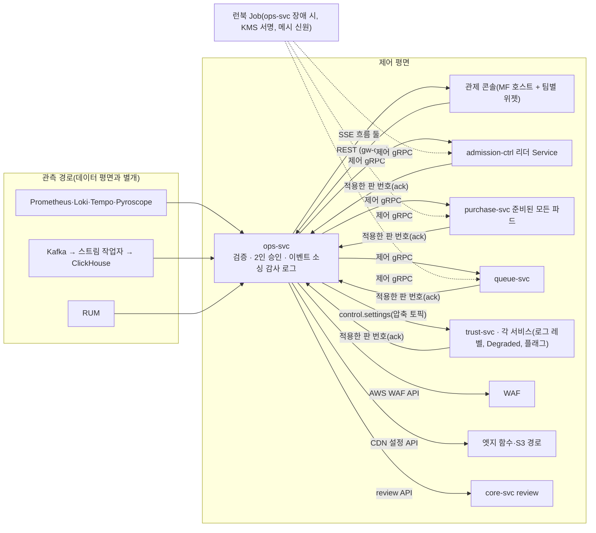
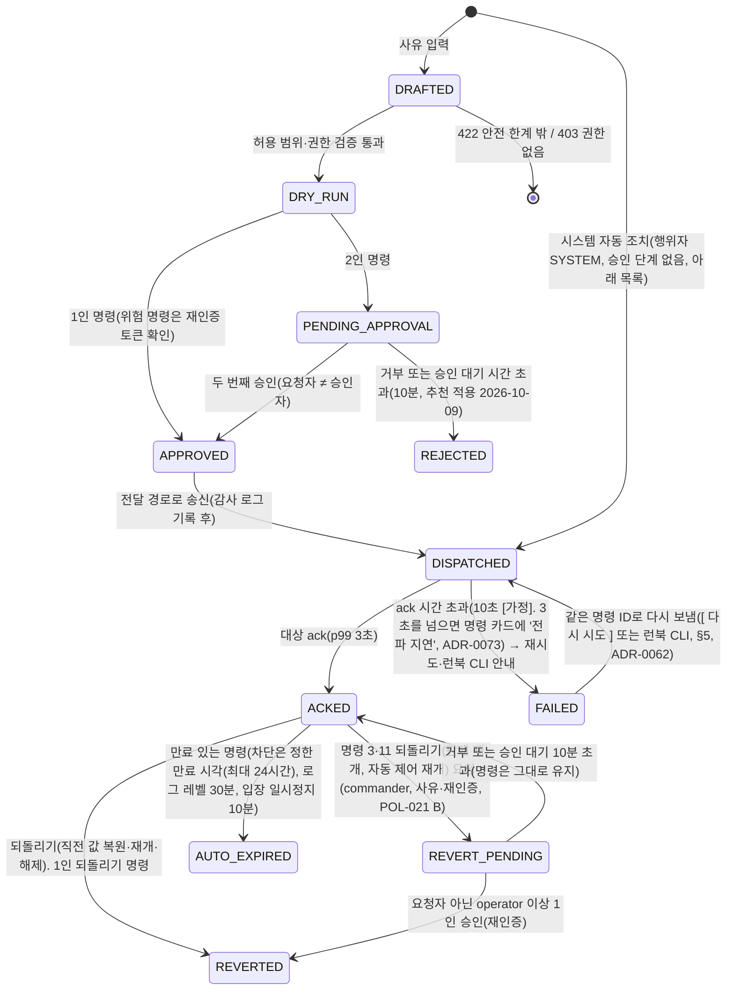

# 기능 설계: 관제 콘솔(Control Tower)과 제어 평면

- **독자와 용도**: ops-svc, 관제 콘솔(Module Federation 호스트와 리모트 위젯), 제어 명령을 받는 마이크로서비스(admission-ctrl, purchase-svc, queue-svc, trust-svc 등)를 구현하는 엔지니어가 보는 문서다. 화면 배치, 운영 명령 카탈로그와 수명주기, 직접 제어 채널과 제어 상태, 자동·수동 제어 사이의 우선순위, 감사 로그와 인시던트(대응이 필요한 장애나 보안 사건) 리플레이, 암표 방지 법정 조치 화면, 검증 테스트 포인트를 확인할 때 참고한다. 관측(지표·로그·요청 기록으로 시스템 안을 들여다보는 일)의 세부 경로, SLO(팀이 정한 목표), 알림 규칙은 docs/observability.md를 따른다.
- **원문 출처**: 설계서 §6 <운영 모니터링·관제 (Control Tower)>, 설계서 §6 <암표 방지 법정 조치: 공연법 제4조의2②>, 설계서 §9 관제 명령 및 실시간 지표 SLO와 Degraded Mode, 설계서 §10 K8, 2장·4장(관제 콘솔 프론트엔드 아키텍처), 24장(Socket.IO 실시간 통신), [ADR-0022](../adr/0022-control-plane-tcp-out-of-band.md), [ADR-0027](../adr/0027-realtime-transport-per-client.md), POL-021·022·024·025·029.
- **기준 기획 버전**: v1.0.
- **관련 ID**: FR-026, FR-028~034, FR-049(종료 후 표시), FR-051, FR-063, FR-064, FR-068(공연 리포트·결정 기록, POL-040) · NFR-008, 009, 017, 023 · POL-021, 022, 023, 024, 025, 028, 029 · SCR-026, 028~032 · CMP-036 CommandCard · API(프로그램끼리 요청과 응답을 주고받는 창구) `/v1/ops/*`(실시간 흐름 `/v1/ops/live`·`/v1/ops/events/{eventId}/live`, ADR-0100), `/v1/partner/events/{id}/live-snapshot`(1분 주기 조회, 기술 검토 낮음-024) · 이벤트 `control.settings`(압축 토픽, ADR-0103), `sse.ops-live`·`sse.ops-event-live` · 제어 gRPC `peaket.control.v1.ControlReceiver`(ADR-0102) · 데이터 docs/data.md §2 command_event·data_request·takedown·security_incident·access_review · ADR-0049(경보 창, Go/No-Go, 보안 사고·접속기록 점검) · ADR-0067(관측 도구와의 역할 경계, 판단 위젯 요약과 원인 분석 링크) · ADR-0069(제어 입력 없음·감축 확인 시간, 경보 묶기·억제, 인시던트 선언 기준, 위젯의 연결 판단, 명령 4·5 효과 줄, 배경 작업 멈춤) · ADR-0070(처리량 급감 경보와 퍼널 위젯의 연결 판단, 판단 순서 ④⑤, 재시작 전 진단 증거) · ADR-0100(관제 통신 REST·SSE, Module Federation 쇼케이스와 한 앱 기준선) · ADR-0102(직접 제어 채널 gRPC, 관제 노드 풀·ops 전용 DB, 감사 체인 작업자, 비상 접근 계정) · ADR-0103(제어 상태와 판 번호, 시작 작업, ack의 뜻).

## 1. 개요와 구조

관제 콘솔(Control Tower)은 온세일 70분 윈도우 동안 시스템 전체 상태를 실시간 관측하고 비상 상황에 안전하게 개입하는 핵심 제어 평면(Control Plane)이다:

- **판단과 제어의 통합 ([ADR-0067](../adr/0067-console-vs-observability-tools-and-measured-backend-choice.md))**:
  - Grafana가 상세 원인 분석 화면이고 Sentry가 개발자 오류 추적 도구라면, 관제 콘솔은 **운영자가 실시간으로 판단하고 조작하는 통합 화면**이다.
  - 관측 저장소(Prometheus, Loki, Tempo, ClickHouse)의 데이터를 직접 읽어 판단 지표를 표시하고, 2인 승인 기반의 안전한 운영 명령과 불변 감사 로그를 함께 제공한다.
  - 세부 로그 검색이나 트레이스 추적 등 원인 심층 분석은 각 위젯의 딥링크(`Grafana ↗`, `Sentry ↗`)로 즉시 연결한다.
- **직접 제어 채널과 제어 상태 ([ADR-0102](../adr/0102-control-plane-direct-grpc-dedicated-pool-ops-db-audit-chain-worker-break-glass.md)·[ADR-0103](../adr/0103-control-as-state-startup-sync-broadcast-topics-compacted-settings.md), [ADR-0022](../adr/0022-control-plane-tcp-out-of-band.md)를 바꿈)**:
  - 사용자 트래픽을 처리하는 주 데이터 평면이 포화돼도 핵심 운영 명령은 전달되어야 한다.
  - 동시 입장 목표 조정, 입장 일시정지, 판매 일시정지 킬스위치, 대기실 긴급 공지 같은 핵심 명령은 Kafka와 게이트웨이를 거치지 않고, 웨이포인트(서비스 하나 앞에 두는 작은 L7 프록시)를 붙이지 않은 제어 전용 gRPC 포트로 받는 서비스에 바로 보낸다(직접 제어 채널). 명령이 반영되기까지 p99 3초 이하가 목표다(NFR-008, K8).
  - 이 채널은 '대역 외'가 아니다. 같은 클러스터 네트워크와 노드 프록시(ztunnel), 받는 프로세스의 이벤트 루프는 데이터 요청과 함께 쓴다. 그래서 명령의 효력은 메시지가 아니라 받는 쪽 저장소의 **제어 상태**(판 번호가 붙은 현재 값)로 정하고, 새로 뜬 파드도 그 상태를 읽어야 준비 상태가 된다(ADR-0103, §5).
- **관제 쪽의 배치(추천 적용 2026-10-28, ADR-0102)**:
  - gw-ops와 ops-svc는 관제 전용 노드 풀에서 돌고, ops-svc는 ops 전용 Aurora 클러스터를 쓴다. 공유 세션·캐시 Redis에는 쓰지 않는다. 핫패스 노드와 identity의 로그인 몰림이 명령 접수에 번지지 않게 하려는 것이다.
  - 관측 스택이 무너지면 외부 데드맨 스위치가 온콜을 부르고, 비상 런북 CLI로 관제를 이어 간다.
  - 안전 쪽 명령(명령 2·3, 명령 6과 11의 멈추는·줄이는 방향)은 KMS나 신원 제공자(IAM Identity Center) 가운데 하나가 멈춰도 낼 길이 있다(§3 아래 '안전 쪽 명령의 길').

- 사용자 트래픽을 처리하는 주 데이터 평면이 장애로 포화돼도 핵심 제어 명령은 전달되어야 한다. 핵심 제어 명령은 동시 입장 목표 조정, 입장 일시정지, 판매 일시정지 킬스위치(새 좌석 잡기·결제와 입장을 바로 멈추는 비상 명령), 대기실 긴급 공지다. 이 명령들은 메시지 시스템인 Kafka를 거치지 않고, 받는 서비스의 제어 전용 gRPC(서비스끼리 함수를 부르듯 빠르게 호출하는 통신 방식) 포트로 바로 보낸다. 제어 포트의 Service에는 웨이포인트를 붙이지 않아, 명령은 노드 프록시의 L4만 지나고 L7 프록시 대기열에 서지 않는다. NestJS TCP 트랜스포터는 쓰지 않는다(소유자 승인 2026-10-28 '추천안 동의', ADR-0102). 받는 쪽은 명령을 받으면 판 번호가 붙은 제어 상태를 먼저 자기 저장소에 두고, 집행은 그 상태를 읽어 한다(ADR-0103).
- 관측 스택은 전용 노드 풀(파드가 실행되는 서버들을 묶은 것)에 두고, gw-ops와 ops-svc는 관제 전용 노드 풀에 둔다(ADR-0102). 이렇게 일반 사용자가 들어오는 경로와 노드·게이트웨이를 나눈다. 관측 스택이 무너지면 외부 데드맨 스위치가 온콜 담당자를 부르고, 비상 런북(장애가 났을 때 따라 하는 절차서) CLI로 관제권을 유지한다(docs/infra.md §4). AWS가 운영해 주는 쿠버네티스인 EKS의 같은 클러스터와, 클라우드 데이터센터가 모인 같은 지역(리전)을 쓰므로 클러스터·리전 전체 장애는 함께 받는다. 제어 평면의 신뢰성 SLO(명령 전파 지연 p99 ≤ 3초. p99는 명령 백 건 중 아흔아홉 건이 이 시간 안에 전달된다는 뜻)는 관측 파이프라인이 과부하로 Degraded 상태에 들어가더라도 끝까지 지킨다.

## 2. 화면 구성: 온세일 단계별(FR-029, SCR-029)

모든 관제 패널에는 미리 합의한 SLO 기준선(Threshold)을 함께 그린다. 운영자가 '지금 시스템이 정상 상태인가?'를 바로 한눈에 판단할 수 있게 하려는 것이다. 시스템 Four Golden Signals 인프라 패널과 비즈니스 퍼널 지표 패널은 따로 나눠 배치한다.

| 온세일 단계 | 관제 핵심 초점 | 전담 모니터링 패널 구성 |
| --- | --- | --- |
| T-30분 점검 | 시스템이 오픈할 준비를 다 마쳤는지 | 필수: EKS 워커 노드와 파드를 미리 띄워 두는 프리워밍 완료 상태, 메모리에 데이터를 두는 빠른 저장소 Redis·Kafka·관계형 데이터베이스 PostgreSQL의 헬스체크, 그 공연 결제사(ADR-0044)의 상태와 한도 초과 응답 없음, 본인확인·사람 확인 제공자 상태, AWS의 CDN(사용자 가까운 곳에 파일을 복사해 두고 대신 응답하는 전송망)인 CloudFront의 배포별 요청·전송 한도(적용된 상향 값)가 그 회차의 설계 피크 이상(설계 피크는 규모 등급의 값과 T-30분 수요 예측 상단으로 계산한 값 가운데 큰 쪽, docs/infra.md §4.1, ADR-0058·0078), 대기실·공연 상세·결제 엔드포인트(API를 부르는 주소)의 종합 합성(Synthetic) 점검 결과, 온콜 알림 채널 시험 발송 상태, 노드 시계가 표준 시각과 어긋난 정도(오프셋) 20ms 이하, 만료 경보 SEV2(갱신 예정 시각을 넘기고 남은 수명이 그때의 절반 아래)에 걸린 인증서·서명 키 없음, 그 회차에 배치된 스캐너 기기의 자격이 그 회차의 역할 유효 끝 뒤까지 유효함(기본 기기 키는 ACTIVE, mTLS 선택지는 인증서 만료가 그 뒤. 추천 적용 2026-10-28, 기술 검토 중간-060, docs/observability.md §3), 마지막 교차 리전 백업 성공, 진행 중인 배포(롤아웃·마이그레이션) 0건(대형·중형 회차. 소형 회차는 동결 대상인, 요청이 가장 많이 지나는 핫패스의 롤아웃을 T-15분 자동 중단으로 대신하므로 판정에서 빼고 표시만 한다, ADR-0054 결정 10), 그 회차의 변경 동결 창 적용(배포 도구 ArgoCD의 동기화 창, 서버를 붙이고 떼는 도구 Karpenter의 중단 예산), 동결 창에 겹치는 예정된 관리형 유지보수 없음(ADR-0054, docs/devops.md §8). 권고: 수요 예측 상단이 규모 등급의 상한 이하(넘으면 표시만 하고, T-30분 점검이 시작된 뒤에는 규모를 바꾸지 않는다, ADR-0078), CDN 엣지 캐시 적중률(CDN이 사용자 가까이에 둔 서버가 복사해 둔 파일로 바로 응답한 비율. 직전 15분, 공연 상세·정적 자산 배포, 요청 기준 90% 이상 [가정, wbs 4.6.1에서 확정]. 같은 15분 요청이 1,000건 [가정] 미만이면 판정 보류, 추천 적용 2026-10-14, ADR-0062) → Go/No-Go 최종 체크리스트 완결 |
| T=0 집중 (최초 10분) | 오픈 직후 한꺼번에 몰리는 트래픽을 견디는지 | 대기열 진입의 초당 요청 수(RPS)와 p99 지연시간, 로비 셔플(순번을 무작위로 섞는 것) 계산과 결과 파일 게시 완료 여부, serving 번호(지금 예매 화면으로 들여보내고 있는 순번의 끝) 전진 속도, 상태 조회 요청량과 CDN 엣지 캐시 적중률, 목표가 허용하는 실패의 총량인 에러 버짓의 소진율과 여정별 남은 허용 실패 건수, 실시간 봇 차단 건수, 추가 검증 큐 유입 인원과 인증 통과율, 본인확인·사람 확인 제공자 성공률과 p99 |
| 판매 진행 중 | 판매 전 과정이 원활한지 | 비즈니스 숫자는 실시간 잠정 값이다(ADR-0052). 전체 비즈니스 퍼널 전환율(입장 → 첫 홀드 성공 → 결제 접수 → 승인 → 발권, analytics F3 단계 이름. 홀드는 결제하는 동안 다른 사람이 가져가지 못하게 좌석을 잠시 잡아 두는 것이다. 다섯 단계 숫자는 처리량 급감 경보와 같은 클러스터 안 Prometheus 값이고, 등급별 상세는 관제 실시간 표에 있다, ADR-0071 결정 4), 입장 전환 비율과 빈자리(입장 자리) 추이(제어 숫자), 구역별 잔여 좌석 히트맵(관제 실시간 표. 거래 사건이 온세일 윈도우에서 60초 [가정] 넘게 끊기면 판매 누적·잔여석 옆에 '거래 사건 끊김'을 띄운다, ADR-0072·0073), 결제사별 승인 성공률·승인 호출 p99(경보 기준 2초. 호출은 끊지 않고 읽기 시간 초과 60초 [가정]까지 기다린다, 기술 검토 높음-16)·결제 확정 소요 p99(재시도 포함, RB-07 전환 검토 기준 5초)·한도 사용률(ADR-0044·0049·0069), 여정별 에러 버짓 잔량과 남은 허용 실패 건수(예: 결제 확정 12건 중 3건 사용), 차례 전 입장 건수(0건), 인프라 자원 포화도 요약(CPU, Redis 메모리, Kafka lag, 이벤트 루프 지연을 정상·주의·위험과 핵심 숫자로), RUM 체감 성능 요약(조작에 화면이 반응하기까지 걸린 시간인 INP와 화면의 가장 큰 요소가 보이기까지 걸린 시간인 LCP의 p75 숫자), 배포 뒤 새로 생긴 오류 종류 수와 많이 난 오류 상위 5개(Sentry), 느린 쿼리 상위 5개(쿼리 통계), 네트워크 정상·주의(연결 대기열 넘침·TCP 재전송). 체감 요약·느린 쿼리·네트워크는 운영 명령이 없는 숫자라서 탭 아래 '진단 힌트' 줄에 모은다(ADR-0069). 퍼널 단계 비율이 기준선의 절반 아래로 떨어지면 SEV2(장애 심각도 등급. 숫자가 작을수록 심각하다) 처리량 급감이 '이 회차 판단'에 뜬다(오류 없는 장애, RB-33, ADR-0070). 걸린 자동 조치와 풀리는 조건(T-30분 점검·T=0 탭에도 보인다, design/d5 §7.2, ADR-0078). 그래프와 세부는 위젯의 '자세히 보기 ↗'로 연다(ADR-0067) |
| 온세일 종료 후 | 온세일 운영 회고와 배울 점 찾기 | 최종 매진 소요 시간, 봇 예매 점유율(하한), 실서비스 봇 탐지 지표 하한(허니팟 적중, 표본 수동 검토, 사후 라벨링 데이터 종합, FR-049)과 그림자 판정 편차 분석, 온세일 에러 버짓 총 사용 내역, 운영 명령과 경보 타임라인, 계획된 결정 규칙(planning/01 §3.2)의 트리거 항목 대조 → 공연 리포트(마감 단계 R0 잠정, R1~R3 확정, 규칙 판정, 데이터 품질, 지난 결정 확인 줄)와 결정 기록 작성(FR-068, POL-040, docs/features/analytics.md §8·§10), 인시던트 포스트모템(사후 검토 보고서) 초안 자동 생성(ADR-0042·0052) |
| 공연 당일 입장(입장 탭, ADR-0051) | 현장 입장 흐름과 스캐너 상태 감시(현장 대응은 현장 책임자와 파트너가 한다) | 로그인·준비 완료 기기 수, 마지막 동기화 뒤 지난 시간의 최대값과 2분 [가정]이 넘은 기기 수(ADR-0049), 구역별 분당 입장 수, 거부 사유별 비율(거부만), 오거부 후보(거부 뒤 10분 [가정] 안에 정상 통과한 경우), 확인 필요 건수(퇴장 기록 없음·입장 기록 없음. 거부율에는 넣지 않는다, 추천 적용 2026-10-14, ADR-0062), 이상 표시 수(중복 입장·퇴장 기록 없음·취소 뒤 입장·세션 밖 기록), 부스 재발급·예외 통과 건수(책임자별), 업로드 대기 건수, 입장 시작 뒤 첫 키 등록 비율, 입장 기록 마감 상태와 미보고 기기 |

Go/No-Go 판정(추천 적용 2026-10-13, ADR-0049): 필수 항목이 하나라도 실패하면 No-Go다. T-20분까지 실패 항목이 회복되면 다시 판정해 Go로 바꿀 수 있다(재판정도 감사 로그에 남긴다, RB-02, 추천 적용 2026-10-20, ADR-0073). No-Go로 남으면 오픈 시각에 입장 일시정지(명령 2)와 대기실 공지(명령 7)로 시작하고, 필수 항목이 회복되면 입장을 재개한다. 로비 셔플은 예정대로 하므로 순서는 바뀌지 않는다. 입장 일시정지는 운영자가 10분마다 연장해야 이어지고, 연장하지 않으면 자동 만료되어 입장이 재개된다(§3 명령 2). 재확인 대화상자에는 아직 실패한 필수 항목을 함께 보여 준다. 권고 항목이 실패하면 사유를 남기고 계속한다. 판정 결과와 사유는 감사 로그에 남는다.

실시간 지표 반영 목표: 관제 실시간 표(`rt`) 지표는 이벤트가 처음 생긴 시점부터 관제 콘솔 화면에 그려질 때까지 종단 p95 5초 미만(p95: 요청 백 건 중 아흔다섯 건이 이 시간 안에 끝난다는 뜻)를 목표로 한다(NFR-009). Kafka 토픽을 계속 읽어 저장소에 쓰는 TypeScript 스트림 작업자 `ops-rt`가 원시 사건을 ClickHouse에 싣고(작업자 묶음 0.25초 [가정], 비동기 삽입 반영 최대 0.2초), ops-svc가 0.5초 [가정]마다 SQL로 센다(조회 시점 집계). 누적 숫자(판매 좌석·금액, 퍼널 단계 누적, 잔여석)는 원시 사건을 `eventKey`로 중복을 지우고 세고, 속도·비율은 사건 시각의 1초 칸으로 센다. 늦게 온 사건도 제 칸에 들어간다. 숫자는 서버가 브라우저로 한 방향으로 계속 보내는 SSE의 위젯 흐름(`/v1/ops/events/{eventId}/live`)으로 화면에 보인다(추천 적용 2026-10-28, ADR-0100). '최근 10초' 같은 보조 숫자는 조회할 때 1초 칸을 묶어 만든다. 신선도는 심장 박동 사건이 발행된 때부터 ops-svc가 읽을 때까지의 시간으로 재고(푸시·그리기 약 0.3초는 지연 예산에만 넣는다), 판매 중 탭 머리에 보인다(design/d5 §7.2, docs/streaming.md §4, 추천 적용 2026-10-20, ADR-0071, 2026-10-27 ADR-0099). 판단·제어 숫자(입장 속도, 퍼널 다섯 단계 카운터, 오류율, 결제 성공률, p99, 에러 버짓)는 실시간 표가 아니라 클러스터 안 Prometheus에서 읽는다(지표 출처 표 docs/observability.md §8, ADR-0068 결정 2).

위젯과 원인 분석 링크(ADR-0067): 모든 위젯은 ops-svc가 관측 창고에서 읽은 값으로 콘솔이 직접 그린다. 위젯마다 '자세히 보기 ↗'를 두어, 같은 회차·같은 시간대로 맞춘 Grafana 대시보드(데이터 링크의 시간 범위 변수, 오류 위젯은 Sentry)를 새 탭으로 연다. 콘솔에는 로그 검색창, 요청 경로 그림, 프로파일 그림, 오류 묶기를 만들지 않는다. 운영자는 판단과 조작을 콘솔에서 하고, 원인을 파고드는 엔지니어는 Grafana·Sentry를 더 본다. 콘솔이 장애일 때는 운영자도 Grafana 읽기 전용 대시보드를 본다(§12).

연결 판단(추천 적용 2026-10-20, ADR-0069): 판단 위젯마다 '이 숫자로 무엇을 하는가'(명령 번호, 런북, 엔지니어 호출)를 위젯 아래 한 줄로 적는다. 위젯별 연결 판단은 design/d5 §7.2 표를 따른다. 운영 명령이 없는 위젯(체감·느린 쿼리·네트워크)은 '진단 힌트' 줄로 모아 판단 숫자와 나눈다. 이 방식은 대시보드가 서비스의 기본 질문에 답하고(SRE Book 1판 6장), 지표마다 목적이 있어야 한다(SRE Workbook 4장)는 원칙을 화면에 옮긴 것이다.

## 3. 운영 명령 카탈로그(FR-030, POL-021 B)

모든 운영 명령은 실행 사유(Reason) 입력이 필수다. 실행 전 예상 영향 범위를 보여 주는 dry-run 모의 기능을 제공하고, 실행 내역을 불변 감사 로그에 기록한다. 대상 서비스로부터 명시적 ack를 받고, 긴급 원복(Revert) 장치를 갖춘다.

| # | 운영 제어 명령 | 시스템 실행 효과 | 전달 경로 | 필수 권한 | 승인 요건 | 안전 허용 범위 | 되돌리기 (Revert) |
| --- | --- | --- | --- | --- | --- | --- | --- |
| 1 | 동시 입장 목표 조정 | 좌석 선택과 결제 단계의 동시 유입 허용 인원 상한을 바꾼다. serving 번호 증가율은 이 값을 바탕으로 다시 계산된다. | 제어 gRPC → admission-ctrl 리더 전용 Service | operator | 1인 승인 | 미리 정한 안전 상·하한 범위 안(상한은 8,000명과 그 공연 결제사의 동시 입장 상한 중 낮은 값, 하한은 1,000명과 그 상한의 절반 중 낮은 값. 포트원을 결제사로 쓰는 공연은 1,000~4,500명 [가정, Phase 2 2.3.2에서 확정], POL-021. 결제사 상한 두 갈래는 docs/features/queue-admission.md §5, 기술 검토 중간-027). 초당 serving 전진 속도 상한은 정적 설정 파일에 둔 안전 한계라서 우회할 수 없다. | 직전 설정값 즉시 복원 |
| 2 | 입장 일시정지 | serving 번호 전진을 바로 멈춘다. 이미 발급된 대기열 순번은 그대로 유지한다. | 제어 gRPC → admission-ctrl 리더 Service | operator | 1인 승인 | 최대 10분이다. 끝나기 1분 전에 재확인 대화상자를 띄운다. 운영자가 사유를 적어 연장하면(같은 명령에 연장 기록, ack 필요) 그때부터 10분이 다시 시작된다. 연장하지 않으면 10분에 자동 만료(AUTO_EXPIRED, 행위자 SYSTEM)되어 serving 전진이 다시 시작된다(추천 적용 2026-10-14, ADR-0062). | 입장 즉시 재개 |
| 3 | 판매 일시정지 (킬스위치) | 범위 안 회차의 새 좌석 홀드·결제 시도 시작·결제 접수를 423으로 막고 serving 번호 전진을 멈춘다. 대기 상태 파일의 판매 상태는 일시정지로 쓴다. 이미 접수된 결제(승인·발권·가상계좌 입금 반영), 결과 조회, 홀드 해제, 예매 취소·환불, 양도, 입장 스캔은 계속한다. 그 회차 구매 세션의 무활동 만료는 일시정지 동안 세지 않는다(홀드가 유지되는 시간인 홀드 TTL과 최대 체류는 그대로). | 제어 gRPC → purchase-svc 준비된 모든 파드, admission-ctrl 리더 Service, queue-svc. 받는 쪽마다 판매 상태를 자기 저장소에 먼저 두고(purchase DB `sale_control`과 좌석 Redis 사본, `q:{event:E}:ctl`, `q:{event:E}:notice`), 셋 모두 '집행하는 모든 곳이 판 N 이상을 적용했다'고 답해야 ACKED다. 그 뒤에 뜬 파드도 시작할 때 상태를 읽는다(§5, 추천 적용 2026-10-28, ADR-0103) | commander | commander 1인 실행(재인증, 승인 대기 없음). 실행은 인시던트 선언 기준이고 사후 검토 보고서를 쓴다(§6 4번, 소유자 결정 2026-10-27 '멈춤은 1인, 재개는 2인', ADR-0095) | 범위는 회차(하나 이상)나 전체(실행 중 판매가 시작되는 회차 포함)다. 굿즈·부가 상품은 제외한다. 만료는 없다(추천 적용 2026-10-14, ADR-0062) | 판매 즉시 재개 (2인 승인 필수) |
| 4 | ASN 및 IP 대역 차단 | 엣지의 WAF(악성 요청을 걸러 내는 웹 방화벽) 계층에서 지정한 네트워크 대역의 요청을 막는다(다른 대역으로 옮겨 오면 다시 지정해야 한다). | AWS WAF API 호출 | operator | 1인 승인 (ASN 단위 차단, IPv4 /16보다 넓은 대역, IPv6 /48보다 넓은 대역의 차단은 2인 승인. 보호 대역 목록(국내 통신사의 ASN·대역, 주요 클라우드의 공개 대역)에 걸리는 차단은 크기와 관계없이 2인 승인. 값과 목록은 [가정, Phase 4 4.4.1에서 확정], POL-021, 추천 적용 2026-10-28, 기술 검토 낮음-129) | 만료 유효시간 지정 필수 (최대 24시간) | 유효시간이 지나면 자동 만료, 또는 수동 해제 |
| 5 | 봇 판정 강도 변경 | 위험 점수 기준값과 세부 차단 가중치 프로필을 운영 중에 바꾼다. | 제어 이벤트 `control.settings`(Kafka 압축 토픽) → trust-svc | commander | commander 요청 + 요청자 아닌 operator 이상 1인 승인, 둘 다 재인증 | 완화, 기본, 강화 3단계 프로필로 한정한다. 대기 중 재평가 모드(끔·그림자·적용, 기본은 그림자)는 강도와 따로 고르는 매개변수다(ADR-0071, 추천 적용 2026-10-20, ADR-0073) | 직전 판정 단계로 복귀 |
| 6 | Degraded Mode 전환 | 여정별 장애 격리와 Degraded Mode(큰 장애 때 핵심을 지키려고 부가 기능이나 화면의 새로움을 미리 정한 범위에서 줄여 버티는 운영 모드)를 명시적으로 켠다. 결제 여정의 '대체 결제사 전환'(새 결제 시도를 공연의 대체 결제사로 보냄, ADR-0044)도 여기에 들어간다. | 제어 이벤트 → 해당 서비스. 대기열 진입 관련은 제어 gRPC → admission-ctrl. 엣지 함수와 CDN 경로 전환은 CDN 설정 API 호출 | commander | commander 요청 + 요청자 아닌 operator 이상 1인 승인, 둘 다 재인증 | POL-029 표에 미리 정의한 표준 모드로 한정 | Degraded Mode 모두 해제. 결제사 장애로 payment-svc가 스스로 건 새 결제 진입 정지도 이 해제로 바로 연다. 이 해제는 commander 1인이 사유를 적고 재인증해 실행하고, 다시 멈추는 자동 조건은 연 뒤에도 살아 있다(추천 적용 2026-10-28, ADR-0105, docs/features/payment.md §9) |
| 7 | 대기실 공지 배너 | 대기 화면과 좌석 선택 화면 위쪽에 긴급 안내 메시지를 띄운다. | 제어 gRPC → queue-svc(`q:{event:E}:notice`에 두고 대기 상태 파일에 넣기), 제어 이벤트 → purchase-svc | operator | 1인 승인 | 법무·운영 승인을 미리 마친 문구 템플릿으로 한정 | 공지 즉시 내리기 |
| 8 | 로그 레벨 변경 | 특정 마이크로서비스의 로그를 더 자세히 남기도록 DEBUG나 TRACE로 바로 올린다. | 제어 이벤트 → 대상 마이크로서비스 파드 | operator | 1인 승인 | 켠 뒤 30분이 지나면 기본 레벨로 자동 복귀 | 자동 복귀 또는 즉시 복구 |
| 9 | 비핵심 기능 끄기 | 관람 후기, 좌석 추천, 찜하기 같은 부가 기능을 기능 플래그로 끈다(기대평은 없앴다, ADR-0063). 비핵심 배경 작업(일괄 환불의 새 묶음, 파트너 주소를 불러 일을 알려 주는 웹훅의 재시도, 광고성 알림 묶음, 공연예술통합전산망 재전송)을 멈추는 '배경 작업 멈춤' 묶음도 같은 목록에 둔다(ADR-0069·0073). | 제어 이벤트 `control.settings`(Kafka 압축 토픽, 종류 `FEATURE_FLAG`. 새로 뜬 파드도 시작할 때 읽는다, ADR-0103) → 각 서비스(웹 앱은 서버 응답으로 받는다) | operator | 1인 승인 | 비핵심 기능 플래그 목록으로 한정 | 기능 즉시 다시 켜기 |
| 10 | 부정거래 게시물 노출 차단 | 신고기관(한국콘텐츠진흥원)이나 수사기관이 공문으로 통보한 암표 의심 게시물(관람 후기, ADR-0063)을 숨기고, 조치했다는 증거 기록을 만든다. | core-svc review 모듈 전용 API 호출 | operator | 1인 승인 | 공식 통보 문서에 적힌 게시물 ID로 한정한다. 통보를 받은 뒤 24시간 이내에 의무를 이행하고, 문화체육관광부 고시 사항이면 10시간이다(공연법 시행령 제3조의3 제1호 마·바목, 제2호 바목. 고시는 확인 필요). 차단한 게시물의 본문 지문을 같은 내용 차단 목록에 올린다(제2호 마목, POL-024) | 통보가 철회되면 노출 복원(같은 내용으로 숨긴 게시물과 지문 포함) |
| 11 | 자동화 정지 스위치 [보완: 원문 우선순위 4를 명령으로 올림] | 입장 제어의 모든 자동 제어 알고리즘(정상이면 조금씩 늘리고 나빠지면 크게 줄이는 AIMD 조정, 에러 버짓 연동 감축, 자동 Degraded 후보 추천)을 한꺼번에 멈춘다. 부하에 따라 서버 수를 자동으로 늘리고 줄이는 오토스케일링(대기 작업량 같은 지표로 파드 수를 늘리고 줄이는 KEDA, 서버를 붙이고 떼는 Karpenter)은 용량을 늘리는 장치라서 대상이 아니다. 오토스케일이 잘못 움직이면 긴급 변경 RB-30(KEDA 정지 패치)으로 멈춘다(ADR-0069). | 제어 이벤트 + 제어 gRPC → admission-ctrl | commander | 1인 긴급 실행(사후 검토 보고서 48시간, 검토 7일) | 정지 상태는 `q:{admission}:ctl`에 두어 리더가 바뀌어도 유지된다(ADR-0056) | 자동 제어 정상 재개 (2인 승인 필수) |
| 12 | 결제사 지정 | 공연의 기본 결제사와 대체 결제사를 정한다. 새 결제 시도부터 적용된다. 바뀐 결제사 채널 상한에 맞춰 그 공연의 동시 입장 목표 상한도 다시 계산된다(POL-036, ADR-0044). | 제어 이벤트 `control.settings`(Kafka) → core-svc(공연에 저장), payment-svc(결제사 선택기), admission-ctrl(결제사별 상한) | operator | 1인 승인 | 온세일 윈도우(T-10분~T+60분) 밖에서만 실행한다. 기본과 대체는 하위 결제사까지 달라야 한다. 포트원 채널의 하위 결제사(`pgProvider`)가 토스페이먼츠(`TOSSPAYMENTS`·`TOSS_BRANDPAY`)면 토스페이먼츠와 같은 결제사로 보고 422로 거절한다. 하위 결제사가 확인되지 않은 채널(토스페이 `TOSSPAY`·`TOSSPAY_V2` 포함)도 대체로 고를 수 없다(추천 적용 2026-10-28, 기술 검토 중간-042, docs/features/payment.md §2.2). 서버 승인이 켜진 채널만 고를 수 있다. dry-run에서 바뀌는 동시 입장 목표 상한을 보여 준다 | 직전 지정으로 복원 |

안전 쪽 명령의 길(소유자 승인 2026-10-28 '추천안 동의', 세부는 추천 적용, ADR-0102): 안전 쪽 명령(명령 2·3, 명령 6과 11의 멈추는·줄이는 방향)은 KMS나 신원 제공자(IAM Identity Center) 가운데 하나가 멈춰도 낼 길이 있다.
- KMS가 멈추면: 명령 커밋은 KMS를 부르지 않는다(감사 체인 mac은 커밋 뒤 체인 작업자가 채운다, §7). 운영자 재인증의 KMS 호출(비밀번호 페퍼, TOTP 시드 복호)과 비상 런북 서명은 서울이 응답하지 않으면 도쿄의 다중 리전 복제 키로 넘긴다.
- 신원 제공자가 멈추면: 콘솔 로그인은 identity-svc의 관리 계정이라 IAM Identity Center를 쓰지 않는다. ops-svc까지 멈춰 비상 런북을 써야 하면 비상 접근 전용 계정(RB-37, docs/devops.md §10.2)으로 런북 Job을 돌린다.
- 남는 한계: 두 리전의 KMS를 함께 쓰지 못하거나 키를 잘못 껐으면 재인증과 런북 서명을 할 수 없다. 그때는 이미 받은 5분짜리 재인증 토큰으로만 낼 수 있다(planning/01 §5.2).

카탈로그 밖 비상 처리(추천 적용 2026-10-20, ADR-0073): 시드만 쓰는 비상 셔플(ADR-0050 결정 7)은 운영 명령이 아니다. 공시한 drand 라운드를 기다리는 시간이 상한 60초 [가정]를 넘으면 셔플이 멈추고 SEV1(RB-35)이 된다. 비상 셔플은 RB-35의 런북 CLI 작업으로만 한다. 서로 다른 commander 두 명이 각자 KMS(암호 키를 안전하게 보관하고 대신 써 주는 클라우드 서비스) 키로 서명한 묶음만 실행된다(§5, ADR-0053 결정 11의 서명 묶음과 같은 방식). 이 처리는 되돌릴 수 없고, 실행 뒤 검증 페이지에 사유와 '이 경우 시드를 아는 내부자가 결과를 미리 알 수 있다'는 한계를 공시한다.

명령 4·5 효과 줄(추천 적용 2026-10-20, ADR-0069): 명령 4(대역 차단)·5(봇 판정 강도)가 ack되면 명령 카드와 SCR-030 위 줄 '적용 중 명령'에 10분 [가정] 동안 효과 줄을 보여 준다. 효과 줄은 차단 비율(엣지·진입 단계 차단 ÷ 진입 시도), 추가 검증 통과율, 이의 제기 수를 실행 전 5분 값과 나란히 보여 준다. 실행 뒤 10분 안에 추가 검증 통과율이 실행 전보다 10%p [가정] 넘게 떨어지거나, 이의 제기가 10분에 5건 [가정]을 넘으면 SEV2 '차단이 사람을 막고 있을 수 있음'을 낸다. 의도된 차단은 진입 SLI(실제로 재는 서비스 품질 값)의 분모 밖이라서, 사람을 잘못 막아도 SLO로는 보이지 않기 때문이다(docs/observability.md §4·§5).

## 4. 명령 수명주기

- 명령 접수 신뢰성 SLO(p95 ≤ 500ms)는 입력을 검증하고 감사 로그에 1차로 저장한 뒤 운영자에게 접수 응답을 돌려주는 시점까지를 기준으로 잰다. 2인 승인을 기다리는 시간은 지연 계산에서 뺀다. 명령 전파 신뢰성 SLO(p99 ≤ 3초)는 최종 승인이 끝난 시점부터 받는 쪽의 ack를 마친 시점까지로 정한다.
- **ack의 뜻(추천 적용 2026-10-28, ADR-0103)**: 판 N의 ack는 '그 받는 쪽에서 집행하는 곳이 모두 판 N 이상을 적용했다'이다. purchase-svc는 DB 원본(`sale_control`)과 좌석 Redis 사본, 그리고 준비된 파드 전부다. admission-ctrl은 리더가 쓴 `q:{event:E}:ctl`, queue-svc는 `q:{event:E}:notice`다. ops-svc는 EndpointSlice의 준비된 파드를 모두 부르고, 모두 판 N 이상이라고 답하면 목록을 다시 읽어 그사이 준비된 파드도 부른다. 새로 뜨는 파드는 시작할 때 저장소의 상태를 읽어야 준비 상태가 되므로(§5), ACKED 뒤에 뜬 파드도 그 판을 안다.
- 명령 사전 실행 모의(dry-run)는 명령을 실행했을 때 시스템이 받을 영향 범위를 미리 보여 준다. 보여 주는 값을 둘로 나눈다(추천 적용 2026-10-28, 기술 검토 낮음-059).
  - **센 값**: 지금 원천에서 세는 값이다. 대역 차단(명령 4)은 그 대역의 최근 5분 요청 수·진입 시도 수, 킬스위치(명령 3)는 범위 안에서 진행 중인 결제 세션 수, 입장해 있는 구매 세션 수, 최근 5분의 새 홀드·결제 접수 속도, 대기 인원이다. 동시 입장 목표 조정(명령 1)은 지금의 예매 단계 인원(`slots_used`)·곧 입장 대기·오는 중·입장 비율·최근 10분 평균 체류다. 값마다 원천과 센 시각을 함께 보인다.
  - **예측 값**: 식으로 내다본 값이다. 화면에 식과 넣은 값, 가정을 함께 보인다. 명령 1에서 목표를 T에서 T′로 올리면 처음 채울 빈자리 = T′ − 예매 단계 인원 − 곧 입장 대기 − 오는 중, 채우는 시간 ≈ 빈자리 ÷ 입장 비율 ÷ 전진 속도 상한, 정상 상태 입장 속도 ≈ T′ ÷ 평균 체류, serving 증가 속도 ≈ 입장 속도 ÷ 입장 비율이다(docs/features/queue-admission.md §5). 내리면 새 목표에 닿는 시간 ≈ 평균 체류 × ln(예매 단계 인원 ÷ T′)이다(머무는 시간이 지수 분포라는 가정, queue-admission §5의 감축 확인 시간과 같은 식). 그 밖의 명령은 센 값만 보인다.
  - **예측 오차 기록**: 실행 5분 [가정] 뒤 예측 값과 실제 값(serving 증가 속도, 빈자리, 예매 단계 인원)을 명령 기록에 함께 남긴다. 쌓인 오차는 식과 가정을 고치는 근거로 쓴다. 예측은 맞는다고 보장하지 않으며, 운영자는 식과 입력을 보고 판단한다.
- 시스템이 스스로 하는 자동 조치(AIMD 목표 자동 감축, 버짓 소진 연동 조치)도 같은 상태 머신을 거친다. 다만 행위자 식별자를 '시스템(SYSTEM)'으로 주고, 따로 승인 단계 없이 바로 `DISPATCHED` 상태로 간다.
- 제어 명령의 분산 멱등성(같은 요청이 여러 번 와도 한 번 처리한 것과 결과가 같은 성질) 보장: 요청에는 클라이언트가 만든 `Idempotency-Key`가 있어야 한다. 같은 키로 다시 온 요청(네트워크 재시도, 같은 키를 다시 보낸 더블클릭)은 한 번만 접수한다. 키가 다른 중복(다른 운영자가 같은 명령을 따로 내는 경우)은 키로 막지 못한다. 같은 공연에 같은 유형의 제어 명령이 승인 대기 중이거나 전파 중이면 동시성 잠금 플래그를 표시한다[보완: 다중 운영자 협업].
- 입장 일시정지(명령 2)의 연장은 새 명령이 아니라 같은 명령의 연장 기록(사유·행위자·새 만료 시각)이다. 만료 시각은 admission-ctrl이 지키므로 ops-svc 장애 중에도 만료된다(추천 적용 2026-10-14, ADR-0062).
- **2인 승인 시연(데모 환경, 소유자 결정 2026-10-27, 세부는 추천 적용, ADR-0095)**: 1인 프로젝트에서도 2인 승인을 보이려고, 서버 검사를 건너뛰지 않고 두 번째 계정으로 실제 승인한다. 데모 시드 데이터에 두 번째 관리 계정 '데모 승인자'(commander)를 두고(운영·스테이징에는 만들지 않는다), 데모 빌드의 데모 막대에 '데모 승인자로 승인'과 '요청자 본인으로 승인 시도'를 둔다. 앞의 버튼은 승인을 기다리는 요청(2인 명령, 판매·자동 제어 재개, 명령 3·11 사후 검토의 검토)을 데모 도우미에게 넘긴다. 데모 도우미는 데모 오버레이에만 있는 작은 서비스로, 데모 승인자 계정으로 로그인·재인증한 뒤 `POST /v1/ops/commands/{commandId}/approvals`를 부른다(공개 API만 쓴다). 뒤의 버튼은 요청자 본인으로 같은 API를 불러 403을 보인다. 서버에는 데모용 분기가 없고, 감사 로그에는 두 계정이 따로 남으며 데모 환경 표시가 붙는다. 데모 막대는 운영 묶음 검사(FE-T21)가, 데모 도우미 이미지는 스테이징·운영의 Kyverno 정책(docs/devops.md §4.3)이 막는다(C-T47). 두 계정을 한 사람이 쥐므로, 이 시연은 '시스템이 다른 계정을 요구한다'를 보일 뿐 다른 사람의 확인은 아니다.

## 5. 전달 경로와 Degraded(NFR-008)

| 제어 전달 채널 | 대상 운영 명령 번호 | 채널 기술 특성 및 장애 격리 구조 |
| --- | --- | --- |
| 직접 제어 채널(제어 전용 gRPC, `peaket.control.v1.ControlReceiver/ApplyControl`) | 명령 1·2 (admission-ctrl 리더 전용 Service), 명령 3 (purchase-svc 준비된 모든 파드, admission-ctrl 리더 Service, queue-svc), 명령 7 (queue-svc), 명령 6 중 대기열 입장 관련, 명령 11 | 받는 서비스는 업무 포트와 다른 제어 포트를 열고, 웨이포인트를 붙이지 않은 제어 전용 Service(`<서비스>-control`. admission-ctrl은 리더만, purchase-svc·queue-svc는 파드마다 부르는 헤드리스)로 받는다. 리더만 가리키는 Service는 리더가 단 `role=leader` 라벨을 고른다. 그 라벨을 다는 권한의 범위와 남는 위험은 docs/infra.md §8에 있다(기술 검토 낮음-142). Kafka·게이트웨이·웨이포인트를 거치지 않아 Kafka 적체나 L7 프록시 대기열에 막히지 않는다. 같은 클러스터 네트워크·노드 프록시와 받는 프로세스의 이벤트 루프는 함께 쓴다. 데드라인 1초 [가정], 같은 명령 ID·판 번호로 다시 보내면 같은 결과다(멱등). 계약은 protobuf이고 `buf breaking`이 지킨다(docs/api/proto/). 리더는 명령 실행 직전 K8s Lease(정해진 시간 동안만 유효한 권한. 갱신하지 않으면 다른 쪽이 가져간다) 상태를 원자적으로 다시 확인한다(소유자 승인 2026-10-28 '추천안 동의', ADR-0102) |
| 설정 제어 이벤트 `control.settings` (Kafka 압축 토픽) | 명령 5, 명령 6(결제사 전환 포함), 명령 7(purchase-svc), 명령 8, 명령 9(`FEATURE_FLAG`), 명령 11, 명령 12 | 모든 서비스의 모든 파드가 파드마다 따로 모든 파티션을 읽는다(서비스 단위 소비자 그룹이 아니다). 압축(`cleanup.policy=compact`, 키 `<범위>:<종류>:<대상>`)이라 오래된 설정도 마지막 값이 남고, 새로 뜬 파드는 처음부터 읽어야 준비 상태가 된다. 페이로드의 `expiresAt`이 지난 값은 받는 쪽이 무시하고, ops-svc가 원래 설정을 다시 낸다(추천 적용 2026-10-28, ADR-0103) |
| AWS WAF API | 명령 4 | 차단 규칙을 만들 때 만료 시한 지정을 강제해, 영구 차단 사고를 막는다. |
| CDN 설정 API (CloudFront) | 명령 6 중 엣지 함수와 S3 사본 고정 | 매진 정적 응답으로의 전환과, 대기 상태 파일을 S3(AWS의 파일 저장소) 사본으로 고정하는 일을 켜고 끈다(전환·해제). 원본 오류 때 요청마다 S3 사본으로 넘기는 것은 CloudFront 원본 그룹의 자동 동작이라서 명령이 아니다(docs/infra.md §4, ADR-0078). |
| 릴리스 플래그 파일(GitOps) | 관제 명령이 아니다 | 새 기능을 공개하는 릴리스 플래그(배포한 코드의 공개 여부를 코드 변경 없이 켜고 끄는 설정)는 저장소 파일로 바꾸고, 끄기만 긴급 변경으로 한다. 운영 중에 바꿔야 하는 값은 관제 명령으로 바꾸는 운영 매개변수(비핵심 기능 끄기는 명령 9)로 두고, 릴리스 플래그를 운영 스위치로 쓰지 않는다. 바꾸는 길이 둘이 되면 감사와 승인이 갈라지기 때문이다(docs/devops.md §5.4). |
| core-svc review API | 명령 10 | 신고기관·수사기관 공문 통보 문서 ID와 대상 게시물 식별자를 원자적으로 연결해 숨긴다. |

**제어 상태(추천 적용 2026-10-28, ADR-0103)**: 제어는 메시지가 아니라 상태다. 명령마다 범위(전체·회차)와 종류의 현재 값에 판 번호(그 범위·종류에서 늘어나기만 하는 수)를 붙인다. 바라는 상태의 원천은 ops-svc 명령 원장이고, 적용한 상태는 받는 쪽이 자기 저장소에 둔다.

| 받는 쪽(명령) | 적용한 상태를 두는 곳 | 집행 |
| --- | --- | --- |
| purchase-svc(명령 3) | purchase DB `sale_control`(원본), 좌석 Redis `s:{event:E}:ctl`(사본. 회차 범위와 전체 범위를 합친 그 회차의 정지) | 홀드 Lua가 사본을 함께 읽어 423. 결제 시도·결제 접수는 파드 메모리의 같은 상태로 확인한다(docs/features/seat-hold.md §3, docs/features/payment.md §2) |
| admission-ctrl(명령 1·2·3·6 진입·11) | `q:{event:E}:ctl`·`q:{admission}:ctl`(지금 그대로, ADR-0056) | 리더 루프 |
| queue-svc(명령 3·7) | `q:{event:E}:notice`(판매 상태, 공지 템플릿, 판 번호) | 대기 상태 파일을 만들 때(1초) 읽는다 |
| 각 서비스(명령 5·6 진입 밖·7 purchase-svc 공지·8·9·12) | 압축 토픽 `control.settings` | 서비스 메모리 |
| 위 세 받는 쪽(판매 승인의 판매 중지, 추천 적용 2026-10-28, ADR-0123) | 명령 3과 같은 저장소에 따로 둔 판매 중지 표시(`sale_control.suspended`, `s:{event:E}:ctl`·`q:{event:E}:ctl`·`q:{event:E}:notice`의 같은 이름 필드) | 명령 3과 같이 막는다(하나라도 참이면 막고, 대기 상태 파일은 PAUSED). 운영 명령이 아니라 판매 중지 승인 업무(2인)를 실행할 때 ops-svc가 `CONTROL_KIND_SALE_SUSPENSION`으로 회차마다 보내며, 명령 3의 재개로는 풀리지 않는다(planning/03 §2.14) |

- 받는 쪽은 판 번호가 지금 것보다 클 때만 적용한다(비교하고 쓰기).
- 파드는 시작할 때 세 가지를 읽어야 준비 상태가 된다: 자기 저장소의 제어 상태, 압축 토픽 `control.settings`(처음부터 시작 때의 끝 위치까지), 종료 세션 목록(`control.sessions-terminated`의 '지금 − 15분'부터, docs/features/identity.md §3). 제어 상태를 읽지 못한 파드는 준비 상태가 되지 않는다. Kafka에 30초 [가정] 닿지 못하면 설정은 마지막 값(처음 뜬 파드면 배포에 든 기본값)으로, 종료 세션 목록은 비운 채 준비 상태로 가고, 따라잡을 때까지 SEV2(`control_sync_lagging{kind}`)다. 이 시작 작업은 플랫폼 라이브러리가 맡고(docs/architecture.md §10 peaket-platform), 준비 프로브는 작업이 끝났다는 표시만 본다(D-T29).
- 시작한 뒤에는 2초 [가정]마다 제어 상태를 다시 읽어 맞추고, 메모리와 저장소가 다르면 판 번호가 큰 쪽을 따른다. 제어 gRPC 푸시는 그 상태를 빨리 퍼뜨리는 길이다.

제어 평면 Degraded Mode: ops-svc가 모두 멈추는 비상 상황이 생기면, 운영자는 보안 런북 CLI를 실행해 직접 제어 채널(제어 gRPC)로 제어 명령을 받는 쪽에 보낸다(명령 묶음마다 서로 다른 두 운영자가 각자의 KMS 비대칭 키로 서명해야 한다. 다만 판매 일시정지(명령 3)의 정지 묶음은 commander 한 명의 서명으로 실행하고, 판매 재개 묶음과 비상 셔플(RB-35)은 서로 다른 commander 두 명이다(ADR-0053 결정 11·ADR-0050·ADR-0095). 런북은 클러스터 안 비상 Job으로 돌며 메시 신원으로만 제어 포트에 붙는다, ADR-0053 결정 11. IAM Identity Center가 멈췄으면 비상 접근 전용 계정(RB-37)으로 Job을 만들고 서명하며, 서울 KMS가 응답하지 않으면 도쿄 복제 키로 서명한다, ADR-0102). 런북 명령도 판 번호가 붙은 제어 상태로 적용되므로, ops-svc가 복구된 뒤 원장과 받는 쪽 상태가 판 번호로 맞춰진다. 서명된 명령 묶음과 결과는 Job이 감사 앵커 버킷(S3 Object Lock)에 바로 쓰고, ops-svc가 복구되면 감사 체인에 넣는다. 이때 명령 전파 SLO는 p99 ≤ 10초로 완화해 관리한다. 끝까지 지키는 절대 원칙은 2인 승인 원칙과 불변 감사 기록 보존이다(POL-029). 명령 형식은 `peaket-runbook draft <명령 유형> --event <회차 ID> [--param 키=값] --reason "<사유>" [--command-id <명령 ID>] --out <파일>` → 서명할 사람이 각자 `sign`(명령 3 정지 묶음은 commander 한 명) → 비상 역할로 `run`이다. 전파에 실패한 명령은 같은 명령 ID로 다시 보낸다(추천 적용 2026-10-14, ADR-0062).

## 6. 자동 제어와 사람 제어의 우선순위(POL-021 C)

1. **절대 안전 한계는 넘을 수 없다**: 동시 입장 목표 상·하한(명령 1의 결제사 상한 반영 식), serving 번호 전진 속도 상한, 홀드 TTL 범위는 시스템 설정 파일에 고정된 절대 안전 한계다. 그래서 어떤 운영자 명령이나 자동화 로직으로도 실행 중에 우회할 수 없다. 바꾸려면 정식 배포가 필요하다.
2. **사람 운영자의 개입이 먼저다**: 운영자가 동시 입장 목표를 직접 정하면 시스템의 AIMD 자동 조정이 15분간 강제로 멈추고, 콘솔은 남은 시간을 거꾸로 세어 보여 준다. 시간이 끝난 뒤 운영자가 명시적으로 확인해야만 자동 조정 모드로 돌아간다. 이 기다리는 시간에도 3번의 에러 버짓 연동 감축은 한다. 다만 운영자가 목표를 정한 뒤 새로 울린 경보나 새로 넘은 소진선일 때만 하고, 감축하면 기다리는 시간이 끝난다(콘솔 배너와 감사 로그, 추천 적용 2026-10-14, ADR-0062).
3. **자동화는 줄이는 쪽만 혼자 정한다**: 에러 버짓이 소진될 때 시스템 자동화 알고리즘이 혼자 정할 수 있는 범위는 동시 입장 목표를 낮추거나 Degraded Mode 후보를 내놓는 것으로만 엄격히 제한된다. 목표를 다시 올리거나 정식 Degraded Mode로 바꾸는 결정은 반드시 사람 운영자가 내린다. 에러 버짓 연동 감축(아래 문단의 50% 소진, 10배 소진)은 입장 목표가 부하를 정하는 여정(좌석 홀드·좌석 상태 전파·결제 접수·결제 확정)의 예산으로만 한다. 공연 상세·대기열 진입·대기 상태 전파의 소진은 호출과 그 여정의 자동 보호만 부르고 목표를 바꾸지 않는다(소유자 승인 2026-10-28 '추천안 동의', ADR-0126). 에러 버짓 연동 감축 뒤에는 운영자가 명령 1로 목표를 정할 때까지 AIMD 자동 증액을 멈춘다. 그 뒤 자동 조정은 2번 규칙의 자동 조절 멈춤(15분)과 운영자 확인을 거쳐 다시 시작한다. 에러 버짓 연동 감축이 없는 평상시의 AIMD 선형 증액(docs/features/queue-admission.md §5)은 이 제한의 대상이 아니다.
4. **멈추는 쪽 명령의 1인 실행**: commander 권한이 있는 운영자 1인이 입장 제어의 모든 자동 제어 루프를 혼자 바로 멈출 수 있다(명령 11). 판매 일시정지(명령 3)도 같다(소유자 결정 2026-10-27 '멈춤은 1인, 재개는 2인', ADR-0095). 조치 뒤 사후 검토 보고서를 써야 한다. 다시 여는 것(자동 제어 재개, 판매 재개)은 2인 승인이다.
   - 사후 검토 보고서의 기한(추천 적용 2026-10-14, ADR-0062. 명령 3은 추천 적용 2026-10-27, ADR-0095): 작성은 명령을 실행한 commander가 실행 시각부터 48시간 안에 한다(POL-022 포스트모템 기한과 같은 값). 검토는 실행자가 아닌 commander가 제출 뒤 7일 안에 한다. 둘 중 하나라도 넘기면 SEV3(GitHub Issues)다. 명령 3은 실행이 인시던트 선언 기준이라(POL-022) 그 포스트모템의 한 절로 쓴다. 명령 11이 인시던트 안에서 실행됐으면 그 포스트모템의 한 절로 써도 되고, 기한은 둘 중 이른 것이다. 활성 commander가 실행자 한 명뿐인 1인 기간에는 실행자가 직접 검토하고, 감사 로그에 '1인 기간 자기 검토'로 남긴다. 다른 사람의 검토가 아니므로 한계로 기록한다(docs/devops.md의 1인 기간 처리와 같다). 보고서는 재개(2인 승인)의 조건이 아니다.
   - 사후 검토 보고서의 항목(★는 시스템이 감사 로그·지표에서 채운다):
     1) ★실행 기록: 명령 ID, 실행자, 실행 시각(KST), 재인증 시각, 실행 사유 원문
     2) 계기(필수): 고르기 — 명령 11은 지표·입력 오류 / 자동 제어 동작 오류 / 외부 원인에 대한 잘못된 대응 / 예방 정지(점검·시험) / 그 밖, 명령 3은 돈·좌석 의심(오버셀·이중 결제·결제-발권 불일치·위조 통과) / 가격·표시 오류 / 시스템 장애 대응 / 예방 정지 / 그 밖 — 와 '무엇을 보고 멈췄는지' 설명
     3) 2인 승인을 기다리지 않은 이유(명령 11만 필수. 명령 3은 1인 실행이 규칙이라 쓰지 않는다)
     4) ★정지 동안의 조치: 정지부터 재개까지 실행된 명령 목록(명령 1 목표 변경 등). 덧붙일 설명(선택)
     5) ★영향: 정지 시간, 동시 입장 목표 변화, 여정별 남은 허용 실패·버짓 소모 변화, 차례 전 입장 0건 여부, 예상 대기 오차(명령 3은 정지 시간, 막은 홀드·결제 시도 수, 정지 동안 끝까지 처리한 결제 수, 멈춘 동안의 대기 인원). 해석(선택)
     6) ★재개: 재개 시각과 승인한 두 사람(아직이면 '정지 중')
     7) 후속 조치: 할 일·담당·기한·이슈 링크(0개 이상). 자동 제어 규칙이나 기준값을 바꿔야 하면 결정 기록(FR-068)이나 ADR(아키텍처 결정과 그 이유를 남긴 기록)로 잇는다
     8) 검토(검토자가 씀, 필수): 정지가 적절했는가 — 적절했다 / 적절하지 않았다 / 판단 보류 — 와 의견
5. **자동화 조치도 감사 기록에 남긴다**: 시스템 자동화 알고리즘이 실행한 모든 감축 조치는 행위자를 '시스템(SYSTEM)'으로 적어, 감사 로그에 온전하게 남긴다.
6. **입력이 없으면 멈춘다(소유자 결정 2026-10-20, ADR-0069)**: 자동 제어가 읽는 지표(뒤쪽 서비스 p99·오류율, 에러 버짓 소진 신호)가 쿼리 실패·빈 결과이거나 마지막 표본이 30초 [가정]보다 오래되면 '제어 입력 없음'이다. 빈 결과를 0으로 읽지 않는다. 입력 없음 동안 AIMD와 에러 버짓 연동 감축은 목표를 늘리지도 줄이지도 않는다. 운영 명령은 그대로 받는다. admission-ctrl이 상태를 `q:{event:E}:ctl`에 쓰면 ops-svc가 읽어, 위 상태 바에 <입력 없음>을, 경보 패널에 SEV2를 띄운다(Alertmanager는 거치지 않는다). 입력이 10초 [가정] 이어서 들어오면 감축은 바로 다시 하고, 증액은 운영자가 '자동 조절 복귀 확인'(operator 1인)을 한 뒤에 한다. 상태 바에는 긴급 정지, 입력 없음, 일시정지, 자동 증액 멈춤 순으로 앞의 것을 보여 준다.
7. **감축은 효과를 확인한 뒤 다시 한다(추천 적용 2026-10-20, ADR-0069)**: AIMD가 목표를 줄인 뒤에는 예매 단계 인원이 새 목표 아래로 내려오고 감축 뒤 35초 [가정](지표 조회 창 30초 + 긁기 간격 5초)가 지나거나, 2분 [가정]이 지날 때까지 AIMD의 추가 감축을 하지 않는다(35초는 추천 적용 2026-10-28, 기술 검토 높음-12). 에러 버짓 연동 감축은 경보 하나·소진선 하나에 한 번만 한다. 두 감축은 서로의 확인 시간을 막지 않고, 안전 하한 아래로는 내려가지 않는다. 부하를 다루는 다른 장치와의 순서는 docs/architecture.md §5의 부하 관리 장치 표를 따른다.

에러 버짓 소진에 따른 통제(docs/observability.md §4 참조): 온세일 중 연동 여정(좌석 홀드·좌석 상태 전파·결제 접수·결제 확정)의 버짓 50%를 쓰면 동시 입장 목표를 자동으로 낮춘다. 다른 여정의 50% 사용은 목표를 그대로 두고 SEV2 '예산 50% 사용(입장 목표 그대로)'만 띄운다(ADR-0126). 100%를 모두 쓰면 Degraded 전환 후보를 관제 화면에 띄우고 운영자 2인 승인을 요구하며, 포스트모템을 자동으로 소집한다. 2분 창과 20초 창에서 모두 버짓 소진율이 10배 이상이면(경보 시점 예산 소모 29%, ADR-0049. 짧은 창은 2026-10-28에 10초에서 20초로 바꿨다, 기술 검토 높음-12) 바로 온콜을 호출하고, 연동 여정이면 동시 입장 목표를 즉시 50% 줄인다. 결제사 쪽 원인 경보(결제사 지연·서킷 열림·오류율·한도 초과 응답)나 새 결제 진입 정지(ADR-0105)가 함께 켜진 채 결제 예산으로 줄일 때는, 배너에 "결제사 쪽 문제로 결제 실패가 늘어, 결제 단계에 들어오는 사람을 줄였습니다({이전} → {이후}명). 결제사를 빠르게 하지는 않으며, 실패를 겪는 사람 수를 줄입니다."를 띄우고 감사 로그에 사유 '노출 줄이기'를 남긴다(추천 적용 2026-10-28, ADR-0126).

## 7. 감사 로그와 인시던트 리플레이(FR-031, NFR-017)

- ops-svc의 운영 명령 기록은 이벤트 소싱(Event Sourcing, 상태를 덧붙이기만 하는 사건으로 정하는 방식)으로 만든다. 따로 떨어진 읽기 저장소를 두는 CQRS는 쓰지 않는다(추천 적용 2026-10-28, ADR-0113). 발행하는 모든 제어 명령에 대해 누가(Actor), 언제(Timestamp), 무엇을(Action), 어떤 사유로(Reason), 누구의 승인을 거쳐(Approver) 했는지와 사전 모의 결과(Dry-run result), 전달 경로, 대상 파드의 ack 수신 시각을 불변 이벤트 스트림에 덧붙이기만 하는 방식(Append-only)으로 쌓는다. 조회에는 명령마다의 최신 스냅샷(어느 시점의 전체 상태를 찍어 둔 것)인 명령 상태 표를 쓴다. 이 표는 사건을 쓰는 트랜잭션에서 함께 고치는 사본이고, 사건에서 다시 만들 수 있다. 감사의 원본은 사건과 감사 체인이다. 시스템 자동 조치와 Degraded 전환 이력도 같은 원장에 기록한다.
- **감사 체인은 커밋 뒤에 잇는다(추천 적용 2026-10-28, ADR-0102)**: 명령을 쓰는 트랜잭션은 기록과 체인 행(빈틈 없는 `seq`, 기록 해시)만 쓰고 mac은 비운 채 커밋한다. KMS를 부르지 않으므로 KMS가 느리거나 멈춰도 명령은 커밋된다. 체인 작업자 하나가 `seq` 순서대로 mac을 채우고(서울 KMS가 응답하지 않으면 도쿄 복제 키), 가장 오래된 빈 행이 1분 [가정]을 넘으면 SEV2다. mac이 빈 동안의 행은 아직 변조 탐지를 받지 않는다(docs/data.md §4 6번).
- 관리자 계정이 개인정보를 열람하거나 대량으로 내려받은 접속기록(파트너 예매자 명단 CSV를 내보낸 사유와 대상 건수 포함)도 같은 감사 저장소에 무결성을 지켜 보존한다. 관리 계정의 로그인·재인증·로그아웃 기록은 ops-svc가 매일 00:10 감사 체크포인트 전에 접속기록 DB에서 관리 계정 줄만 읽어 덧붙인다(행 정책으로 그 줄만 보이는 전용 사용자, 추천 적용 2026-10-26, ADR-0089). 법정 접속기록은 최소 2년 이상, 권한 부여·변경·말소 내역은 최소 3년 이상 보존하고, WORM(Write Once Read Many) 규격의 불변 저장소 사본을 유지한다(docs/infra.md §6 참조).
- **공개 앵커(소유자 승인 2026-10-21, ADR-0075)**: 감사 기록은 지금처럼 키 건 해시(원래 값으로 되돌릴 수 없게 바꾼 고정 길이 값) 체인, 5분 간격 S3 앵커, 1시간 간격 검증으로 지킨다(ADR-0053). 그 위에 매일 00:10과 온세일 윈도우가 끝난 뒤 10분 안에 [가정, Phase 4 4.4.1에서 확정] 감사 체크포인트를 만든다. 감사 체크포인트는 감사 기록을 묶어 서명한 요약으로, 잎마다 비공개 솔트를 섞은 머클 루트, 직전 체크포인트 해시, 그날 법정 접속기록 일 앵커를 담는다. 체크포인트는 체크포인트 서명 키로 서명하고 OpenTimestamps(비트코인)에 고정해 `https://www.peaket.example/transparency/`에 게시한다. 외부인은 공개 검증 도구 `audit-verify`로 체크포인트 사슬·서명·공개 타임스탬프를 확인한다. 분쟁 당사자는 SCR-031에서 내보낸 검증 묶음으로 기록 하나가 그 체크포인트에 들어 있음을 확인한다. 게시에 실패하면 다음 실행에서 다시 한다. 게시가 6시간 [가정] 넘게 밀리면 SEV3, 공개 타임스탬프가 24시간 [가정] 넘게 완료되지 않으면 SEV3이다. 내부 체인과 체크포인트 루트가 어긋나면 SEV2로 다루고 보안 사고 기록(FR-063)을 남긴다. 처음부터 기록하지 않거나 거짓으로 기록한 것은 막지 못한다(planning/01 §5.2).
- 인시던트 리플레이(SCR-031): 지난 온세일의 특정 타임라인을 골라 장애 주입, 경보 발생, 운영 명령 실행, 시스템 회복의 전 과정을 Grafana 대시보드와 같은 시간축 위에서 기록된 만큼 재생한다. 운영 명령·감사 기록과 오류·SLO 초과 트레이스(요청 하나가 여러 서비스를 거친 길과 시간을 남긴 기록)는 모두 남는다. 그러나 정상 요청의 트레이스와 로그는 온세일 중 1% 표본만 남는다(docs/observability.md §6·§7). 인시던트 리플레이는 Game Day(일부러 장애를 내고 대응을 연습하는 날) 모의 훈련의 핵심 결과물로 쓴다(K8).
- 포렌식 리플레이(SCR-069, 2단계·출시 뒤 선택, ADR-0080): 가명정보(추가 정보 없이는 누구인지 알 수 없게 바꾼 정보) 취급자가 이 화면과 봇 표본 검토(SCR-067)에서 회차를 넘겨, 관제 콘솔 주소 아래 따로 여는 페이지(새 탭)에서 좌석 상태 변화와 홀드·결제 흐름을 다시 본다. 감사 기록의 정본은 이 절의 서버 감사 로그다. 포렌식 리플레이의 결과는 다음 회차의 판정 규칙을 개선하는 데에만 쓴다(docs/features/forensic-replay.md §6).
- 주문 이벤트 이력 역추적: 특정 주문 ID를 넣으면 그 시점의 좌석 홀드, 홀드 경합, 결제 승인의 전 과정을 시간 순서대로 다시 구성한다. 주문 쪽 원천은 주문 상태 이력(`order_event`, 상태를 바꾸는 트랜잭션에서 덧붙인 전이 기록, ADR-0113)과 홀드 원장이다(이 조회는 viewer 이상의 관제 역할과 CS에 인가한다(planning/03 §3)).
- 온세일 종료 패널은 전체 타임라인, 버짓 소진 내역, 실행한 명령 목록을 모아 인시던트 포스트모템 초안을 Markdown 형식으로 자동으로 만든다. 초안에는 원인 유형 칸(주 원인 유형·구성 요소, 기여 원인 유형), 쓴 손잡이 칸(명령·런북), 후속 조치 칸(GitHub Issues 링크, P0 여부)을 둔다. 쓴 명령은 감사 로그에서 채운다(docs/observability.md §5, ADR-0078).

## 8. 알림·인시던트(POL-022)

인시던트 심각도 체계(SEV1~SEV3), 비상 역할 분담(인시던트 지휘관, 운영 실행자, 기록·대외 공지 담당), 사용자 대외 공지 절차, 경보 위생 관리, 48시간 이내 포스트모템 완료 원칙은 docs/observability.md §5를 따른다. 관제 콘솔은 발생한 `OpsAlert` 경보를 SSE 늘 여는 흐름(`/v1/ops/live`의 `alert`, ADR-0100)으로 실시간으로 받아 위쪽 경보 배너에 바로 띄운다. 관련 런북 안내와 전용 Grafana 대시보드 바로 가기 링크도 자동으로 보여 준다. 24시간 법정 조치 기한이 임박했다는 경보는 자동으로 SEV2 등급으로 올린다(§9). 보안 사고(침해사고·개인정보 유출등)는 등록하는 즉시 SEV1로 띄우고, 법정 신고·통지 기한은 §9에서 추적한다(FR-063, ADR-0049). 경보 패널은 맨 위 SEV1 줄과 '이 회차 판단'·'플랫폼·위생·법정' 두 묶음으로 나눈다. 예산 SEV1이 울리면 같은 회차·여정의 SEV2는 알림 없이 그 SEV1 아래 접힌 줄로 보인다. SLO 경보 줄에는 같은 시간 창과 실패 조건으로 채운 조회 링크( 실패 사건 보기 ↗ )를 둔다. 제어 입력 없음 SEV2는 ops-svc가 admission-ctrl 상태를 읽어 띄우므로 Alertmanager가 멈춰도 뜬다. 인시던트 선언 기준(SEV1, 불변식 위반 의심, 명령 2·3·6 실행, SEV2 15분 [가정] 넘게 미해결 등)과 포스트모템의 탐지 경로는 POL-022와 docs/observability.md §5를 따른다. 온세일 종료 패널의 포스트모템 초안은 첫 경보 시각을 감사 로그와 경보에서 채운다(ADR-0069). 처리량 급감 SEV2(`kind` flow)는 회차 ID가 있어 '이 회차 판단'에 들어가고, 런북 RB-33 링크를 단다. 재시작이 필요한 장애에서 엔지니어가 남긴 진단 증거(RB-31)와 증거 수집기의 DB·Redis 스냅샷은 인시던트에 묶는다. 콘솔은 그것이 있다는 사실과 시각만 보여 준다(내용은 긴급 접근으로만 읽는다, ADR-0070).

## 9. 법정 조치 화면(FR-033·034·063·064, SCR-032, POL-023·024·025)

| 규정 준수 기능 | 시스템 실행 및 운영 동작 |
| --- | --- |
| 신고기관·수사기관 통보 문서 등록 | 접수 기관(신고기관인 한국콘텐츠진흥원, 경찰청 등 수사기관), 공문 접수 시각, 대상 불법 거래 게시물 ID를 등록하고, 24시간 법정 처리 기한 타이머를 바로 시작한다(문화체육관광부 고시 사항이면 10시간, 공연법 시행령 §3의3 2호 바목. 고시는 확인 필요). 처리 완료 기한 2시간 전까지 미조치 상태면 SEV2 보안 경보를 자동으로 낸다. |
| 게시물 차단 및 증적 생성 | 명령 10을 실행해 해당 게시물의 노출을 서비스 전체에서 바로 막는다. 처리 결과를 공문으로 낼 때 쓸 증적 보고서도 자동으로 만든다. 차단한 게시물과 내용이 같은 새 게시물은 작성할 때 자동으로 숨겨지고 같은 보고서에 들어간다(공연법 시행령 §3의3 2호 마목). 나중에 통보가 정식으로 철회되면 클릭 한 번으로 노출을 안전하게 되살린다. |
| 법적 자료 요청서 검증 | 수사기관의 자료 제공 요청서가 들어오면 법적 근거, 요청 목적, 대상 범위, 제출 기한을 단계별 점검표로 꼼꼼히 검증한다. 통신사실확인자료는 법원 허가서(영장)가 첨부됐는지를 필수로 확인하고, 미첨부면 거부 사유를 시스템에 기록한다. |
| 자료 추출 및 법정 대장 관리 | 승인된 요청서의 법적 허용 범위 안에 드는 데이터 항목만 골라 뽑아 안전하게 제공한다. 통신비밀보호법에 따른 제공 대장과 요청서 원본은 법정 기간(통신사실확인자료 7년, 통신이용자정보 1년) 동안 따로 떼어 안전하게 보존한다. 반기별 과학기술정보통신부 보고와, 통신이용자정보를 요청한 기관이 속한 중앙행정기관에 보내는 대장 내용 통보(전기통신사업법 §83⑥·⑦)에 쓸 현황 통계도 자동으로 만든다. |
| 보안 사고 등록과 신고·통지 기한(FR-063) | 운영자가 침해사고(정보통신망법 §2①7호: 해킹·서비스거부 등 공격으로 생긴 사태)나 개인정보 유출등(분실·도난·유출·위조·변조·훼손)을 알게 되면 종류, 인지 시각, 대상 수, 민감정보·고유식별정보 여부, 외부 불법 접근 여부를 등록한다. 기한은 입력한 인지 시각부터 계산한다. 침해사고는 과학기술정보통신부장관이나 한국인터넷진흥원에 24시간 안에 신고한다(정보통신망법 §48의3①). 추가로 확인한 사실은 그때부터 24시간 안에 다시 신고한다(시행령 §58의8②). 장애나 기능 중단이 2시간 이상 이어지거나, 이용자 정보 유출 가능성이 있거나, 이용자 정보보호에 중대한 영향을 미칠 우려가 있으면 이용자에게 지체 없이 알린다(§48의3④, 시행령 §58의9). 피해구제 조치 내용은 신고일부터 14일 안에 과학기술정보통신부장관에게 낸다(법 §48의10②, 시행령 §60의16). 개인정보 유출등은 정보주체에게 72시간 안에 알리고, 1천 명 이상·민감정보나 고유식별정보·외부 불법 접근 중 하나면 개인정보보호위원회나 한국인터넷진흥원에 72시간 안에 신고한다(개인정보 보호법 §34, 시행령 §39·§40). 유출 가능성(정보주체를 특정하기 어려운 불법 접근 등)도 72시간 안에 알린다(시행령 §39의2·§39의3). 공격으로 생긴 장애의 지속 시간은 관제 지표에서 자동으로 채운다. 해당 여부는 commander가 판단하고, 판단이 서지 않으면 신고·통지하는 쪽으로 한다. 매크로 봇 공격이 침해사고에 드는지는 확인이 필요하다(POL-027). 24시간 기한은 22시간이 지났을 때, 72시간 기한은 60시간이 지났을 때 SEV2로 다시 알린다. 신고·통지마다 기관, 방법, 시각, 내용 요약을 기록하고 감사 저장소에 보존한다(추천 적용 2026-10-13, ADR-0049). 통지 문안과 보내는 규칙은 §9.1을 따른다. |
| 접속기록 점검(FR-064) | 시스템이 매일 관리 계정(운영자·CS·파트너)의 접속기록과 다운로드 내역에서 이상을 찾아 점검 목록에 올린다. 규칙은 같은 명단을 24시간에 3회 이상 내려받기, 한 번에 1만 건 이상 내려받기, 근무 일정 밖 조회·다운로드, 허용 IP 밖 접속 시도, 권한 밖 조회 시도다 [가정, wbs 7.4.1 내부 관리계획 작성에서 확정]. 개인정보 보호책임자가 지정한 commander가 매월 정기 점검을 한다(자기 기록은 다른 commander가 점검한다). 이상 건마다 사유 확인(소명)과 사후조치(보고, 회수·파기 요청, 권한 회수)를 기록한다. 유출이 의심되면 보안 사고로 등록한다. 월말까지 정기 점검이 끝나지 않으면 SEV3를 낸다. 주기 월 1회는 2026-10-31까지의 고시 의무와 같고, 2026-11-01부터는 내부 관리계획으로 정하는 값이다(안전성 확보조치 기준 §8②, 추천 적용 2026-10-13). |
| 접근 권한 통제 | 집행(등록·차단·자료 제출)은 operator 권한 이상만 한다. 조회는 planning/03 §3 권한 매트릭스를 따른다(viewer는 보안 사고, CS는 기관 요청·보안 사고 조회). 모든 열람과 파일 다운로드 행위는 불변 접속기록 감사 로그에 남긴다(최소 2년 이상 보존, docs/security/data-classification.md). 보안 사고 해당 판단과 접속기록 정기 점검은 commander만 한다. |

### 9.1 보안 사고 이용자 통지 문안(FR-063)

이 절은 보안 사고 때 정보주체·이용자에게 보내는 통지의 문안 틀 두 가지(A 개인정보 유출, B 침해사고)와 A의 변형 둘(A2 유출 가능성, A3 유출 아님 확인), 둘을 합칠 때의 규칙, 보내는 규칙을 담는다(추천 적용 2026-10-14, ADR-0062). `[ ]`는 값을 넣을 자리다.

- 표시: 통지 항목, 기한, 방법, 게시로 통지를 대신하는 것은 확인했다(원문 대조 2026-10-14). 문안, 받는 사람 범위를 정하는 방법, 링크 금지, 게시 위치, 누가 보내는지는 추천 적용이다(2026-10-14, ADR-0062). B 1호의 '해당 이용자'를 서비스 회원 전체로 보는 것과, 합친 통지로 두 법의 통지를 하는 것은 해석이다.
- 근거: 개인정보 보호법 §34①②④⑤·§39①·§39의2①·§43①, 같은 법 시행령 §17⑤·§39·§39의2·§39의3(2026-09-11 시행), 정보통신망법 §2①7호·§48의3①④⑤·§48의10①②와 부칙(제21500호) §1·§4·§8, 같은 법 시행령 공포본(제36735호) §58의8·§58의9·§60의16(2026-10-01 시행. 국가법령정보센터 '현행' 통합본에는 2026-10-14에도 아직 없다), 개인정보 분쟁조정위원회 누리집(2026-10-14). 침해사고 이용자 통지(§48의3④)는 2026-10-01 이후 발생한 사고부터 적용한다(부칙 제21500호 §4).
- 개인정보 보호법 §34①7호의 '대통령령으로 정하는 사항'을 정한 조문은 시행령에서 찾지 못했다(시행령 전문 검색, 2026-10-14). 그런 조문이 생기면 문안 A에 칸을 더한다.

**문안 A. 개인정보 유출 통지(개인정보 보호법 §34①, 시행령 §39)**

제목: [피켓] 개인정보 유출 사실을 알려 드립니다

> 안녕하세요, PEAKET(피켓)입니다.
> 회원님의 개인정보가 유출된 사실을 [인지 일시 KST]에 확인했습니다. 걱정을 끼쳐 드려 죄송합니다. 개인정보 보호법 제34조에 따라 아래 내용을 알려 드립니다.
>
> 1. 유출된 개인정보 항목: [항목 이름. 예: 이메일 주소, 닉네임, 예매 내역(공연명·회차·좌석)] [관계없는 항목. 예: 결제 카드 번호는 PEAKET이 저장하지 않아 이번 일과 관계없습니다]
> 2. 유출된 시점과 경위: [유출 시점 KST] · [경위: 무엇이 어떻게 해서 유출되었는지]
> 3. 피해를 줄이기 위해 회원님이 하실 수 있는 일:
>    - PEAKET은 이메일·문자·전화로 결제 정보, 인증번호, 로그인 정보를 묻지 않습니다. PEAKET을 사칭한 연락에는 답하지 말고 아래 연락처로 알려 주세요.
>    - [사고별 대처 방법. 예: 로그인에 쓰는 카카오·네이버·Google 계정의 비밀번호를 바꾸고, PEAKET 계정 설정의 로그인 기기 목록에서 모르는 기기를 로그아웃해 주세요]
> 4. PEAKET의 대응 조치와 피해 구제 절차:
>    - 대응 조치: [예: 접근 경로 차단(일시), 취약점 보완, 유출된 정보의 회수·삭제 요청, 관계 기관 신고(일시)]
>    - 피해 구제 절차: [예: 아래 연락처로 피해를 알려 주시면 확인한 뒤 구제 방법과 일정을 N영업일 안에 알려 드립니다]
> 5. 피해 신고·문의: [담당 부서] · 전화 [번호]([운영 시간]) · 이메일 [주소] · PEAKET 고객센터 문의
> 6. 회원님의 법적 권리와 행사 방법:
>    - PEAKET이 개인정보 보호법을 위반해 손해를 입으셨다면 손해배상을 청구하실 수 있습니다(개인정보 보호법 제39조).
>    - PEAKET의 고의 또는 과실로 유출된 경우 300만원 이하의 범위에서 상당한 금액을 손해액으로 하여 배상을 청구하실 수 있습니다(같은 법 제39조의2).
>    - 개인정보 분쟁조정위원회에 분쟁조정을 신청하실 수 있습니다(같은 법 제43조). [신청 방법·연락처. 2026-10-14 확인 값: 신청은 개인정보 포털 www.privacy.go.kr, 위원회 누리집 www.kopico.go.kr, 전화 1833-6972. 보낼 때 다시 확인]
>
> [1·2번을 다 확인하지 못했을 때만] 아직 확인 중인 내용: [확인 중인 것]. 확인되는 대로 바로 다시 알려 드리겠습니다.
>
> PEAKET(피켓) · 개인정보 보호책임자 [이름·직책] · [연락처]

**문안 A2. 개인정보 유출 가능성 통지(개인정보 보호법 §34②, 시행령 §39의2·§39의3)**

제목: [피켓] 개인정보 유출 가능성을 알려 드립니다

> 안녕하세요, PEAKET(피켓)입니다.
> [불법 접근 시점 KST] 무렵 PEAKET [시스템]에 외부의 불법적인 접근이 있었던 사실을 [인지 일시 KST]에 확인했습니다. 회원님의 개인정보가 실제로 유출되었는지는 아직 확인 중이며, 유출되었을 가능성이 있어 개인정보 보호법 제34조제2항에 따라 미리 알려 드립니다.
> (일부 유출이 확인된 경우의 둘째 문장: "일부 회원의 개인정보가 [제3자에게 거래되는 등] 유출된 사실을 확인했고, 회원님의 개인정보도 유출되었을 수 있어 개인정보 보호법 제34조제2항에 따라 미리 알려 드립니다.")
>
> 1. 유출 가능성이 있는 개인정보 항목: [항목 이름]
> 2. 유출이 있었을 것으로 의심되는 시점과 경위: [시점 KST] · [경위]
> 3. 피해를 줄이기 위해 회원님이 하실 수 있는 일: (문안 A 3번과 같은 틀)
> 4. PEAKET의 대응 조치와 피해 구제 절차: (문안 A 4번과 같은 틀)
> 5. 피해 신고·문의: (문안 A 5번과 같은 틀)
> 6. 유출 여부가 확정되면 다시 알려 드리겠습니다. 유출이 확인되면 유출 사실을, 유출되지 않은 것으로 확인되면 그 사실을 바로 알려 드립니다.

**문안 A3. 유출되지 않음 확인(시행령 §39의3③)**

제목: [피켓] 개인정보가 유출되지 않은 것으로 확인되었습니다

> 안녕하세요, PEAKET(피켓)입니다.
> [A2를 보낸 날짜]에 알려 드린 개인정보 유출 가능성을 조사한 결과, 회원님의 개인정보는 유출되지 않은 것으로 [확인 일시 KST]에 확인했습니다. [조사 결과 요약]. 문의: [담당 부서] · [연락처]

**문안 B. 침해사고 이용자 통지(정보통신망법 §48의3④, 시행령 §58의9)**

제목: [피켓] 침해사고 발생과 대응 내용을 알려 드립니다

> 안녕하세요, PEAKET(피켓)입니다.
> [발생 일시 KST]에 PEAKET [서비스]를 겨냥한 [공격 유형. 예: 서비스 거부 공격]으로 [피해 요약. 예: 예매 서비스가 2시간 40분 동안 열리지 않는 / 회원 정보가 유출되었을 가능성이 있는] 침해사고가 발생했습니다. 불편을 드려 죄송합니다. 정보통신망 이용촉진 및 정보보호 등에 관한 법률 제48조의3에 따라 아래 내용을 알려 드립니다.
>
> 1. 발생 일시, 원인, 피해 내용:
>    - 발생 일시: [시작~끝 KST, 이어지는 중이면 '이어지는 중']
>    - 원인: [예: 외부의 서비스 거부 공격]
>    - 피해 내용: [예: 10/14 20:00~22:40 대기열·예매 접속 불가, 그 시간에 결제가 끝나지 않은 주문 N건] · 회원 정보 유출: [유출되지 않은 것으로 확인 / 확인 중 / 유출됨(따로 알려 드림)]
> 2. PEAKET의 대응 현황: [예: 공격 차단(일시), 서비스 복구(일시), 추가 보호 조치, 과학기술정보통신부·한국인터넷진흥원 신고(일시)]
> 3. 피해를 줄이기 위해 회원님이 하실 수 있는 일:
>    - PEAKET은 이메일·문자·전화로 결제 정보, 인증번호, 로그인 정보를 묻지 않습니다. '예매 재개'나 '보상'을 내세운 링크는 누르지 말고 PEAKET 주소를 직접 입력해 접속해 주세요.
>    - [사고별 대처 방법]
> 4. 피해 구제 조치: [예: 장애 시간에 결제가 끝나지 않은 주문의 처리(자동 취소·전액 환불), 취소 수수료 면제 범위, 보상 기준과 신청 방법]
> 5. 피해 구제 문의: [담당 부서] · 전화 [번호]([운영 시간]) · 이메일 [주소] · PEAKET 고객센터 문의
>
> [1번을 다 확인하지 못했을 때만] 아직 확인 중인 내용: [확인 중인 것]. 확인되는 대로 바로 다시 알려 드리겠습니다.
>
> PEAKET(피켓) · [정보보호 담당 부서]

**필수 항목 대조(보내기 전 검사)**

| 법정 항목 | 근거 | 문안 위치 | '확인 중'으로 먼저 보낼 수 있나 |
| --- | --- | --- | --- |
| 유출된 항목 | 개인정보 보호법 §34①1 | A 1 | 예(시행령 §39②) |
| 유출 시점과 경위 | §34①2 | A 2 | 예(§39②) |
| 정보주체 대처 방법 | §34①3 | A 3 | 아니요 |
| 대응조치와 피해 구제절차 | §34①4 | A 4 | 아니요 |
| 피해 신고 접수 부서·연락처 | §34①5 | A 5 | 아니요 |
| 손해배상·법정손해배상·분쟁조정과 행사 방법 | §34①6 | A 6 | 아니요 |
| 대통령령 사항 | §34①7 | — | 시행령에 정한 사항이 없다(2026-10-14) |
| 가능성 있는 항목, 의심 시점·경위 | 시행령 §39의2②1·2 | A2 1·2 | 아니요(의심 내용으로 채운다) |
| §34①3~5 | §39의2②3 | A2 3~5 | 아니요 |
| 확정 시 추가 통지 | §39의2②4 | A2 6 | 고정 문장 |
| 침해사고 발생 일시·원인·피해내용 | 정보통신망법 시행령 §58의9②1 | B 1 | 예(발생 사실과 확인된 내용, §58의9③) |
| 조치사항 등 대응 현황 | §58의9②2 | B 2 | 아니요 |
| 이용자 대처방법 | §58의9②3 | B 3 | 아니요 |
| 피해구제 조치 내용 | §58의9②4 | B 4 | 아니요 |
| 피해구제 민원 담당부서·연락처 | §58의9②5 | B 5 | 아니요 |

**합쳐 보낼 때(침해사고로 개인정보가 유출된 경우)**: 문안 A를 쓰되, 제목은 "[피켓] 침해사고와 개인정보 유출 사실을 알려 드립니다"로, 첫 문단의 근거는 "개인정보 보호법 제34조와 정보통신망 이용촉진 및 정보보호 등에 관한 법률 제48조의3"으로 바꾼다. A 2에는 침해사고 발생 일시·원인·피해내용을, A 4에는 대응 현황과 피해구제 조치 내용을 넣고, A 5는 "피해 신고·피해 구제 문의"로 한다. 위 표의 A·B 항목이 모두 들어가야 한다. 보내는 때는 둘 중 이른 기한(침해사고 '지체 없이', 유출 72시간 안)을 따른다. 한 번의 통지로 두 법의 통지를 하는 것은 정보통신망법 §48의3④ 후단(다른 법률에 따른 침해사고 통지를 했으면 한 것으로 봄)에 기댄 해석이다. 그래서 두 법의 항목을 모두 담아, 해석이 틀려도 빠지는 항목이 없게 한다.

**보내는 규칙**

1. 기한: A·A2는 인지한(A2는 불법 접근이나 일부 유출을 알게 된) 때부터 72시간 안에 보낸다. 긴급 확산 방지 조치나 천재지변 등 부득이한 사유가 있으면 그 사유가 해소된 뒤 즉시 보낸다. A3은 유출되지 않음을 확인한 즉시 보낸다. B는 시행령 §58의9① 1~3호 사고임을 확인한 뒤 지체 없이 보낸다. SCR-032의 의무별 기한과 같다.
2. 확인 중 단서: 위 표에서 '예'인 칸만 '확인 중'으로 두고 먼저 보낼 수 있다. '아니요' 칸이 비면 SCR-032 미리보기가 보내기를 막는다. 추가로 확인한 내용은 확인 즉시 같은 틀로 다시 보낸다.
3. 받는 사람: A는 유출된 정보주체, A2는 유출 가능성이 있는 모든 정보주체(사고 조사로 확정한 계정 목록)다. B는 1호(장애 2시간 이상)면 그 서비스를 쓰는 회원 전체가 기본이다. 장애가 특정 공연·기능에 한정된 것으로 확인되면 commander가 범위를 줄이고 근거를 남긴다. 2·3호면 정보가 영향을 받았거나 받았을 수 있는 회원이다.
4. 방법: 회원 이메일로 보내고, 문자는 발송 대행 계약 뒤 함께 보낸다(design/d5 §9.1). 이메일이 없거나 반송되는 등 연락처를 알 수 없는 회원 몫은 같은 내용을 PEAKET 누리집의 약관·정책 문서 화면(SCR-057)에 '보안 사고 안내' 문서로 30일 이상 게시하고, 그동안 셸 바닥글과 홈 위쪽 공지 배너(CMP-017 announcement)에서 연결한다(시행령 §39③, §39의3④, §58의9⑤).
5. 내용 원칙: 유출된 값 자체(이메일 주소 등)는 본문에 쓰지 않고 항목 이름만 쓴다. 로그인이나 정보 입력을 요구하는 링크를 넣지 않고, 주소는 글자로만 쓴다(사칭 피싱과 구별되게). 제목에는 '[피켓]'(팬에게 가는 이메일의 말머리, design/d5 §9.1.1)과 통지 종류를 쓴다. 문체는 '~합니다'로 쓴다(design/d2 §4).
6. 누가·기록: commander의 해당 판단(해당함·판단이 서지 않음)이 기록된 뒤 operator가 값을 채워 보낸다(planning/03 §3의 '보안 사고 등록·신고·통지' 권한 그대로). 보낸 통지는 `incident_filing`에 의무 종류(정보주체 통지·유출 가능성 통지·미유출 확인·이용자 통지), 방법(이메일·문자·누리집 게시), 시각, 대상 수, 내용 요약을 남긴다(감사 저장소, FR-063).

## 10. 권한과 로그인

- 관제 4대 역할군: viewer(대시보드와 지표 조회만), operator(1인 일반 명령과 법정 조치 집행, 보안 사고 등록, 명령 4의 2인 조건 요청, 2인 명령과 회차 취소 확정의 제2 승인(요청자·판정자 제외)), commander(2인 승인 필수 명령, 킬스위치, 자동화 제어 긴급 정지, 회차 취소 귀책 판정, 승인 업무의 제2승인, 보안 사고 해당 판단, 접속기록 정기 점검), CS(`cs_agent`: 추가 검증 이의 제기 심사, 고객 분쟁 조회, CS 처리함, 승인 업무 요청. `cs_lead`: 1인 승인과 예매 제한 확인). 자세한 권한 매트릭스는 planning/03 §3을 따른다.
- CS 처리함, 승인 업무, 회차 취소 판정·일괄 환불, 판매 승인, 정산 지급 화면(SCR-045~049)도 관제 콘솔에 둔다. 명령 카탈로그와 따로 두는 이유는 돈과 소유권을 움직이는 업무 승인이라 되돌리기(POL-021 A)가 성립하지 않기 때문이다. 2인 승인 UI와 감사 로그 저장소는 같이 쓴다(docs/features/transfer-refund.md §7, ADR-0046).
- **[홈 구성](SCR-068 공지 관리의 탭, 추천 적용 2026-10-14, ADR-0063)**: 운영자가 홈 큰 배너(판매 승인된 공연 가운데 고르고, 운영자가 올린 가로형 배너 이미지·대체 텍스트·순서·노출 기간)와 테마 추천(이름·공연 목록·기간)을 정한다. operator 1인이 사유를 적어 저장하고, 감사 로그에 전후 차이가 남는다. viewer는 보기만 한다. 운영 명령 카탈로그(§3)가 아닌 콘텐츠 설정이라 2인 승인·되돌리기 명령·ack가 없다. 되돌리려면 이전 판을 다시 저장한다. 저장하면 ops-svc가 권한·감사를 처리한 뒤 core-svc catalog 내부 API로 반영하고, 홈 캐시 태그를 무효화한다(`GET`·`PUT /v1/ops/home-layout`, `POST /v1/ops/home-layout/banner-images`). 배너·테마 자리는 돈을 받고 팔지 않는다(ADR-0063). 온세일 윈도우 안에도 저장할 수 있다. 홈은 CDN 캐시라 판매 경로에 부하를 더하지 않는다.
- 운영자 로그인 아키텍처(SCR-028): gw-ops 게이트웨이는 사내 전용 고정 IP 대역이나 내부 VPN 연결만 물리적으로 통과시킨다. 그다음 identity-svc의 관리 계정 전용 로그인 API를 불러 인증을 마친다. 로그인에는 이메일, 비밀번호, TOTP(인증 앱이 시간에 따라 새로 만드는 일회용 코드) MFA를 필수로 요구한다. 세션은 유휴 만료 1시간이 지나면 자동으로 끝난다. 위험이 큰 명령을 실행할 때는 유효기간 5분인 재인증 토큰(권한이나 상태를 증명하려고 주고받는 서명된 문자열)을 필수로 요구한다(docs/features/identity.md §6 참조).

## 11. 파트너 실시간 판매 현황(FR-026, SCR-026)

파트너 콘솔로 파트너에게 실시간 누적 판매량, 잔여 좌석 현황, 예상 매진 시각, 대기열 진입 인원(누적)과 지금 대기 인원을 읽기 전용 화면으로 보여 준다. 관제 센터와 같은 ClickHouse 실시간 표(rt, 잠정 숫자)를 쓰되, 관람객 개인정보와 봇 보안 탐지 데이터는 원천에서 마스킹해 빼고 1분 이내의 데이터 지연을 허용한다. 값은 1분 늦게 집계한 전체 상태가 1분마다 한 번 바뀌므로, 화면이 1분마다 REST로 묻는다(`GET /v1/partner/events/{eventId}/live-snapshot`. 응답의 다음 집계 시각에 맞춰 묻고, 탭을 숨기면 5분 [가정]마다). ops-svc는 회차마다 1분에 한 번 계산한 값을 나눠 주므로 수백 명이 동시에 열어도 계산은 늘지 않는다. 네트워크가 잠시 끊겨도 다음 조회가 지금의 전체 상태를 받으므로 따로 복구할 것이 없다(2026-10-28에 SSE와 `Last-Event-ID` 복구에서 바꿨다, 추천 적용 2026-10-28, 기술 검토 낮음-024, ADR-0027 상태 줄, docs/frontend.md §4.4.3). 이 화면은 불필요한 운영 문의를 줄이고, 파트너가 추가 회차를 열지 실시간으로 판단하도록 돕는다. 분당 판매는 최근 180분 [가정]만 싣고, 화면은 그래프를 숫자 타일 뒤에 따로 받아 그린다(추천 적용 2026-10-27, ADR-0091, docs/frontend.md §4.4.3·§5.6).
회차가 끝나고 R3 마감이 끝나면 파트너 판매 요약(티켓 판매량, 매진 시각, 등급별 매출, 환불 집계. 판매 5건 [가정] 미만 칸은 합치고 개인정보·봇 세부·내부 규칙 수치 제외)을 정산 리포트 화면(SCR-027) 옆에 게시한다(FR-068, POL-040, ADR-0042·0052, docs/features/analytics.md §8.4).

## 12. 관제 콘솔 프론트엔드

- Webpack 5 Module Federation 마이크로 프론트엔드 호스트(`apps/console-host`)가 도메인 팀별로 따로 만든 위젯 리모트(peaket-queue, peaket-purchase 등)를 실행 중에 동적으로 불러와 함께 띄운다. 각 팀은 관제 위젯을 따로 배포할 수 있다. 원격과 호스트의 약속은 `@peaket/console-contract`이다. 원격은 그것을 소유한 서비스 저장소가 공용 워크플로로 빌드해 올린다. 호스트는 `remotes.json`의 무결성(sha384)과 계약 주판을 확인해 싣고, 실패하면 그 칸만 대체 카드로 바꾼다(추천 적용 2026-10-21, ADR-0079 결정 16, docs/frontend.md §4.5).
  - 이 구조는 가상 팀(wbs §1, ADR-0016)이 위젯을 따로 배포하는 모습을 보이는 쇼케이스다. 사용자에게 주는 효과(위젯 결함 격리, 화면별 늦게 싣기)는 한 앱으로도 얻는다. 그래서 같은 위젯 소스를 한 앱(위젯 패키지 + 경로별 늦게 싣기 + 오류 경계)으로도 빌드해, 첫 적재 시간·번들 크기·원격 실패 때 격리·위젯 하나를 내보내는 시간을 같은 화면으로 재고(FE-T29) 성능 장부에 남긴다. 한 앱보다 느리거나 크고 따로 배포할 이득을 쓰는 원격이 하나뿐이면 한 앱으로 바꾼다(추천 적용 2026-10-28, ADR-0100 결정 6).
- 상태 관리와 실시간 통신(추천 적용 2026-10-28, ADR-0100): Zustand(호스트 저장소 하나와 원격 위젯마다 저장소. 원격은 호스트 상태를 읽기만 한다, ADR-0092), 호스트 스트림 어댑터(대규모 지표 스트림을 위젯마다 250ms로 묶고 같은 키의 구독을 나눠 쓰는 작은 유틸 둘. 여러 흐름을 시간 창으로 합치는 곳이 없어 RxJS와 redux-observable은 쓰지 않는다, docs/frontend.md §3.1, 추천 적용 2026-10-28, 기술 검토 낮음-097)를 쓴다. 서버 통신은 REST(OpenAPI, `@peaket/api-client`)와 SSE 흐름 둘이다. 늘 여는 흐름 `/v1/ops/live`는 명령 상태(ack 포함)·내 승인 대기·경보·자동 제어 상태·걸린 자동 조치·접속자를, 위젯 흐름 `/v1/ops/events/{eventId}/live`는 보이는 위젯의 값을 보낸다. 다시 붙으면 `Last-Event-ID`로 빠진 사건을 받고, 명령 확인의 정본은 REST의 명령 상태다. GraphQL과 Socket.IO는 쓰지 않는다. ops-svc 파드 사이의 전달은 공유 Redis가 아니라 ops DB의 알림 표(`ops_push_event`)를 파드마다 읽는 방식이다(docs/frontend.md §4.4). 콘솔이 켜져 있는 동안의 부담은 화면별로 늦게 싣기, 안 보이는 위젯의 구독 멈춤(브라우저 탭을 30초 [가정] 넘게 숨기면 위젯이 쉬고, 경보·명령 확인·자동 제어 상태는 계속 받는다), Canvas 그래프와 들고 있는 양의 상한(그래프 한 선은 최근 15분 [가정]), 장시간 시험으로 줄인다(추천 적용 2026-10-27, ADR-0091, docs/frontend.md §5.7).
- 디자인 시스템: 24시간 관제 센터 환경에 맞춘 고대비 다크 모드를 기본으로 쓰고, 고밀도 데이터 그리드를 지원한다. 긴급 제어 명령은 전용 CMP-036 CommandCard 컴포넌트(실행 사유, dry-run 모의 결과, 2인 승인 현황, ack 대기 상태 표시)로 그린다. 세부 디자인 규칙은 design/d2·d3을 따른다.
- 다중 운영자 실시간 협업 통제: 관제 콘솔에 접속한 운영자의 presence(접속 상태)를 실시간으로 표시하고(흐름을 든 파드가 15초 [가정]마다 `ops_presence`에 쓰고 45초 [가정] 안의 행을 보인다, ADR-0100), 같은 제어 명령을 동시에 편집할 때 충돌을 막는 잠금(Lock)[보완]을 두며, 2인 승인 요청은 실시간 푸시 팝업으로 알린다.
- 관제 웹 콘솔 장애 시 비상 절차: 콘솔 UI가 마비되면 운영자는 Grafana 읽기 전용 대시보드와 긴급 런북 CLI를 함께 써서 시스템 관제와 수동 제어를 이어 간다(docs/observability.md §10 참조).
- 지표 그리기와 링크(ADR-0067): 위젯은 ops-svc가 관측 창고에서 읽어 REST 위젯 조회와 SSE 위젯 흐름으로 보낸 값을 받아 콘솔이 직접 그린다. Grafana 패널을 iframe으로 끼워 넣지 않는다. Grafana의 `allow_embedding`은 기본값(false) 그대로 둔다. 그래서 관제 콘솔 CSP(페이지가 불러올 콘텐츠의 출처를 정하는 브라우저 규칙)에 Grafana 프레임 출처를 더하지 않는다(ADR-0065). 위젯의 '자세히 보기 ↗'는 새 탭 링크(`rel="noopener"`)이고, Grafana는 gw-ops 뒤에 있다.
- 휴대폰·태블릿: 같은 콘솔을 태블릿(데스크톱과 같은 기능)과 휴대폰에서도 쓴다. 휴대폰에서는 보기, 이미 요청된 일의 승인·반려(두 번째 승인자도 재인증), 안전 쪽 조치(세션 강제 종료, 스캐너 기기 즉시 폐기, 일괄 환불 일시정지, 명령 11 자동화 정지 스위치)까지만 하고 다른 명령의 요청·실행은 하지 않는다. 안전 쪽 조치는 멈추거나 끊는 쪽이고, 잘못 눌러도 사람·돈·좌석에 바로 해가 없으며, 되돌리는 길이 정해져 있는 조치다. 명령 11은 잘못 눌러도 자동 조절이 멈추고 목표가 그 자리에 머물 뿐이고 다시 켜기는 2인 승인이라 이 기준에 든다. 그래서 휴대폰만 가진 commander도 확인 시트 한 번과 재인증으로 명령 11을 바로 낸다(추천 적용 2026-10-28, 기술 검토 낮음-155). 판매 일시정지(명령 3)는 1인 멈춤이지만 구매자에게 바로 닿고 실행이 곧 인시던트 선언이라 태블릿 이상에서 한다. 이 제한은 잘못 누름과 노출을 줄이는 화면 장치이고, 권한은 서버의 역할·재인증·2인 승인이 막는다(ADR-0061, design/d5 §3.9). 명령 2 만료 1분 전 확인 대화상자도 휴대폰에서는 연장·재개 버튼 대신 "연장과 재개는 태블릿이나 데스크톱에서 합니다" [ 링크 복사 ]를 보여 준다(추천 적용 2026-10-14, ADR-0062).

## 13. 데이터·API 참조

| 종류 | 세부 항목 |
| --- | --- |
| PostgreSQL(ops) | `command_event`(command_id, seq, type, actor, reason, dry_run, acked_at. 2인 승인은 자식 표 `command_approval`(ADR-0086). 같은 command_id에 입장 일시정지 연장 `EXTENDED`와 명령 11 사후 검토 `POST_REVIEW_SUBMITTED`·`POST_REVIEW_CONFIRMED` 이벤트를 더한다, 추천 적용 2026-10-14, ADR-0062), 불변 감사 로그 원장, `audit_chain`(seq, 기록 종류·ID, 기록 해시, mac. 키 건 해시 체인, ADR-0053. mac은 커밋 뒤 체인 작업자가 채운다, ADR-0102), SSE 알림 표 `ops_push_event`(seq, 종류, 회차, 받을 역할, 본문, 만든 시각. 1시간 [가정] 보관)와 접속자 표 `ops_presence`(ADR-0100), `takedown_notice`(그 조치 기록 `takedown_action`은 core 후기 모듈에 둔다, docs/data.md §1), `data_request`·`provision_ledger`, `security_incident`·`incident_filing`(보안 사고와 신고·통지 기록, FR-063), `access_review`·`access_finding`(접속기록 정기 점검과 이상 건, FR-064) |
| ClickHouse | 관제 전용 실시간 표 `rt`(스트림 작업자 `ops-rt`가 싣는 원시 사건과 심장 박동. 누적·1초 칸은 매개변수 뷰가 읽을 때 센다. 잠정, docs/streaming.md §4.3), 파트너사 판매 현황 뷰(개인정보와 보안 데이터는 넣지 않는다), 공연 리포트의 골드 지표 뷰 `mtr_*`·회차 요약·규칙 판정(docs/features/analytics.md §5·§6) |
| REST·SSE | 공연 리포트·결정 기록 `GET /v1/ops/events/{eventId}/reports`, `GET …/reports/{stage}`, `GET`·`POST /v1/ops/decisions`, `PATCH /v1/ops/decisions/{decisionId}`(FR-068), `POST /v1/ops/commands`, `POST …/{id}/approvals`, `POST …/{id}/rejections`, `POST …/{id}/reversions`(명령 3·11은 2인 되돌리기), `POST /v1/ops/commands/{commandId}/extensions`(명령 2 연장), `POST /v1/ops/commands/{commandId}/post-review`·`POST …/{commandId}/post-review-confirmation`(명령 3·11 사후 검토 제출·검토, 추천 적용 2026-10-14, ADR-0062. 명령 3은 ADR-0095), `GET`·`PUT /v1/ops/home-layout`, `POST /v1/ops/home-layout/banner-images`(홈 구성, ADR-0063), `POST /v1/ops/compliance/notices`, `POST …/{id}/takedown`, `POST /v1/ops/compliance/data-requests`, `POST /v1/ops/compliance/incidents`, `POST …/incidents/{id}/filings`, `GET /v1/ops/compliance/access-reviews`, `POST …/access-reviews/{id}/completion`, `POST /v1/ops/compliance/access-findings/{id}/resolution`, `GET /v1/ops/live`(늘 여는 SSE 흐름), `GET /v1/ops/events/{eventId}/live`(위젯 SSE 흐름), `GET /v1/ops/widgets/{widgetKey}`(위젯 조회, ADR-0100. 감사 로그 조회 경로는 wbs 0.2.3), `GET /v1/partner/events/{id}/live-snapshot`(파트너 판매 현황 1분 주기 조회. 2026-10-28 SSE에서 바꿨다, 기술 검토 낮음-024) |
| 실시간 채널 및 메시지 | SSE 채널 `sse.ops-live`(command·approval·alert·control·autoAction·presence, 메시지 CommandAck·OpsAlert)와 `sse.ops-event-live`(widget, ADR-0100), Kafka 토픽(메시지를 종류별로 모아 두는 통로) `control.settings`(SettingChanged, 압축 토픽, ADR-0103), 제어 gRPC `peaket.control.v1.ControlReceiver/ApplyControl`(docs/api/proto/peaket/control/v1/control.proto, ADR-0102) |
| UI 화면 정의 | SCR-028 운영자 로그인, SCR-029 온세일 실시간 대시보드, SCR-030 운영 명령 제어 센터, SCR-031 감사 로그 및 인시던트 리플레이, SCR-032 법정 조치 관리, SCR-068 공지 관리의 [홈 구성] 탭(ADR-0063), SCR-026 파트너 실시간 판매 현황 |

## 14. 테스트 포인트

| # | 테스트 시나리오 | 합격 판정 기준 | 연결 요구사항 |
| --- | --- | --- | --- |
| C-T1 | 제어 명령 접수 SLO 검증 | 운영자 10명이 동시에 접속한 부하(SLO 계측 표준 조건)에서 접수 p95 < 500ms와 성공률 99.9%를 달성한다. 관제 콘솔은 동시 접속 50명(설계 용량) 부하에서도 SSE 흐름 둘과 접속자 표시가 정상으로 동작한다(C-02 결정 2026-10-08, 통로는 ADR-0100). | NFR-008 |
| C-T2 | 명령 전파 신뢰성 검증 | 최종 승인이 끝난 때부터 받는 쪽의 ack(집행하는 모든 곳이 판 N 이상을 적용, ADR-0103)가 끝날 때까지 종단 p99 ≤ 3초와 성공률 99.9%를 유지한다. 명령은 받는 쪽과 종류를 섞어 3,000번 이상 보낸다. 실패가 0번이면 성공률 99.9%(실패 비율의 정확 이항 단측 95% 상한 0.1% 이하), 3초를 넘은 비율의 상한이 1% 이하이면 p99 3초를 통과로 적는다(planning/02 §3.1 원칙 6, 추천 적용 2026-10-28, 기술 검토 중간-002). | NFR-008 |
| C-T3 | 시스템 안전 한계 강제 통제 | 허용 기준값을 벗어난 동시 입장 목표 수치를 설정하려 하면 422 Unprocessable Entity로 바로 거절되고, 시스템 반영이 0건임을 입증한다. | QR-SA-2 |
| C-T4 | 2인 상호 승인 무결성 | 명령 요청자와 승인자가 같은 계정이면 승인이 거부되고, 10분 대기 시간 초과 시 자동으로 만료된다. | POL-021 |
| C-T5 | 위험 명령 재인증 강제 | 킬스위치 같은 중대 명령을 낼 때 5분 이내의 유효한 재인증 토큰이 없으면 403 Forbidden으로 차단된다. | FR-028 |
| C-T6 | 명령 사전 실행 모의(dry-run) | 명령 집행 전, 센 값은 같은 시각의 원천(대기열 Redis·purchase DB·게이트웨이 집계)에서 직접 센 값과 같고, 예측 값은 식과 넣은 값·가정이 함께 표시된다. 실행 5분 [가정] 뒤 예측과 실제 값이 명령 기록에 남는다(추천 적용 2026-10-28, 기술 검토 낮음-059, §4). | FR-030 |
| C-T7 | 파드 ack 시간 초과 예외 처리 | 대상 파드의 수신 확인이 시간 초과되면 FAILED 상태로 바뀌고, 수동 재시도([ 다시 시도 ])와 채운 런북 CLI 명령 한 줄 안내가 바로 나온다. | §4 |
| C-T8 | 제어 명령 긴급 원복(Revert) | 직전 정상 설정값을 복원했다는 ack를 정상으로 받고, 1차 명령과 롤백 명령이 감사 로그에 총 2건으로 무결하게 남는다. | G-13 |
| C-T9 | 자동 제어와 수동 제어의 경합 | 운영자가 수동 명령으로 개입한 직후 15분간 AIMD 자동 조정이 멈추고, 만료 후 확인을 거쳐 자동 조정으로 돌아옴을 입증한다. 자동 조절 멈춤 중 지정 뒤 새로 울린 10배 소진 경보는 목표를 절반으로 줄이고 멈춤을 끝낸다. 지정 전부터 울리던 경보로는 줄이지 않는다. | G-12 |
| C-T10 | 자동화 제어 긴급 정지 스위치 | commander 1인이 긴급 정지를 실행하면 입장 제어 자동화(AIMD 조정·에러 버짓 연동 감축·Degraded 후보 추천)가 바로 멈추고, 오토스케일링은 계속된다. 사후 검토 보고서 할 일(작성 48시간)이 생기고, 기한을 넘기면 SEV3가 나온다. 실행한 commander 자신의 검토 완료는 거부된다(1인 기간 제외). 다시 켜려면 2인 승인이 필요하다. | POL-021 C-4, FR-032 |
| C-T11 | 시스템 자동 조치 감사 기록 | 에러 버짓 50% 소진에 따른 목표치 자동 감축이 행위자 '시스템(SYSTEM)'으로 감사 로그에 온전히 기록되고, 같은 때 콘솔 SEV2 '예산 50% 감축 실행' 경보가 경보 패널과 Slack 운영 채널에 뜬다(ADR-0077). | NFR-017 |
| C-T12 | Degraded Mode 전이 감사 기록 | 자동이든 수동이든 모든 Degraded Mode 활성화 이력이 감사 로그에 빠짐없이 기록된다. | POL-029, FR-032 |
| C-T13 | ops-svc 장애 시 런북 구동 | ops-svc가 멈춘 상태에서 비상 Job으로 런북을 돌려 전파 p99 ≤ 10초를 달성한다. 두 사람의 서명이 필요한 묶음에 KMS 서명이 없거나 하나뿐이면 명령이 차단된다(명령 3 정지 묶음은 commander 한 명의 서명으로 실행된다, ADR-0095). 명령 묶음과 결과는 감사 앵커 버킷에 남고, 복구 뒤 감사 체인에 들어간다. | G-08 |
| C-T14 | 대규모 관제 지표 반영 지연시간 | 초당 3만 건의 원천 텔레메트리(시스템이 내보내는 지표·로그·요청 기록 같은 운영 신호) 이벤트가 들어오는 환경에서 심장 박동 신선도(발행 → ops-svc 읽기) 1분 p95 5초 미만과 데이터 누락률 0.1% 미만을 지킨다(docs/verification.md §3.7). | NFR-009 |
| C-T15 | 관측 스택 전체 정지 시 생존성 | 메트릭 수집 스택이 마비되면 데드맨 스위치가 바로 작동한다. 관측 스택과 함께 멈춘 Grafana 대신 외부 합성 점검과 콘솔의 Prometheus 밖 숫자(입장 제어 상태, 관제 실시간 표)로 관제를 이어 가고, 입장 제어는 제어 입력 없음 상태로 목표를 유지한다. | G-11 |
| C-T16 | 법정 24시간 조치 기한 준수 | 신고기관·수사기관 공문 등록 후 22시간이 지난 시점까지 미처리면 SEV2 보안 경보가 자동으로 발령되고, 조치 결과서가 정상으로 출력된다. | FR-033 |
| C-T17 | 수사기관 자료 요청 적법성 검증 | 법원 영장이 없는 통신사실확인자료 요청이 오면 시스템이 거부 사유를 밝혀 차단하고, 적법한 요청은 법정 대장에 정상으로 저장된다. 적법한 요청의 제출 파일에는 승인된 대상·기간의 행만 들어가고(범위 밖 행 0건), 파일의 SHA-256 해시와 제출 일시·받는 기관이 제공 대장에 남는다(추천 적용 2026-10-28, 기술 검토 중간-005). | FR-034 |
| C-T18 | 인시던트 타임라인 리플레이 | Game Day 모의 훈련 타임라인이 장애 주입 → 경보 발령 → 명령 집행 → 시스템 정상화 순으로 오차 없이 재현된다. | K8 |
| C-T19 | 관리자 개인정보 접속기록 보존 | 파트너용 예매자 명단을 내려받은 사유와 대상 건수가 불변 접속기록 저장소에 최소 2년 이상 온전히 보존된다. | NFR-017, FR-027 |
| C-T20 | 파트너 판매 현황 조회의 복구력(2026-10-28 SSE에서 바꿈, 기술 검토 낮음-024) | 네트워크를 3분 끊었다 되살리면 다음 조회가 지금의 전체 상태(누적 판매 수가 관제 누적 뷰와 같음)를 받고, 끊긴 동안 연결 표시등이 경고였다가 돌아온다. 탭 300개 [가정]가 열려 있어도 ops-svc의 회차 집계는 1분에 한 번이고, 조회 시각이 다음 집계 시각 뒤 0~5초에 흩어진다. 응답의 개인정보·봇 필드는 0건임을 입증한다. | FR-026 |
| C-T21 | 비인가 IP 대역 접근 통제 | 허용된 사내 VPN과 고정 IP 대역 밖에서 관제 센터에 접속하려 하면 게이트웨이 단계에서 바로 차단된다. | FR-028 |
| C-T22 | 같은 내용 게시물 자동 차단 | 명령 10으로 차단한 게시물과 공백·문장부호·전각 차이만 있는 본문으로 새 관람 후기를 저장하면 즉시 숨김 상태가 되고, 조치 결과서에 '같은 내용 차단'으로 나온다. 통보를 철회하면 함께 복원된다. 글자를 바꾼 본문은 숨겨지지 않음을 한계로 기록한다 | FR-033 |
| C-T23 | 보안 사고 신고·통지 기한 | 인지 시각 10:00으로 침해사고를 등록하면 SEV1이 뜨고 다음 날 10:00 신고 기한이 생긴다. 22시간이 지난 때(다음 날 08:00) SEV2가 다시 온다. 공격으로 생긴 장애가 2시간을 넘으면 이용자 통지 할 일이 생긴다. 1,200명 유출로 등록하면 정보주체 통지와 신고의 72시간 기한이 함께 생기고, 800명·민감정보 없음·외부 불법 접근 없음으로 등록하면 통지 기한만 생긴다. 신고·통지 기록이 감사 저장소에 남는다 | FR-063 |
| C-T24 | 접속기록 점검 | 파트너 계정이 같은 명단을 24시간에 3회 내려받으면 다음 날 점검 목록에 '반복 다운로드'로 올라오고, 사유 확인과 사후조치를 기록할 때까지 미조치로 남는다. 이번 달 정기 점검이 말일까지 끝나지 않으면 SEV3가 나온다. 자기 기록을 스스로 점검 완료하려 하면 거부된다 | FR-064 |
| C-T25 | Go/No-Go 필수 항목 실패 | 노드 시계 오프셋을 30ms로 만든 상태로 T-30분 점검을 하면 No-Go가 된다. 오픈 시각에는 입장 일시정지와 대기실 공지가 걸린 채로 로비 셔플은 예정대로 실행된다. 오프셋이 회복되면 입장이 재개되고, 판정과 사유가 감사 로그에 남는다 | FR-029, ADR-0049 |
| C-T26 | 진행 중 배포가 남은 T-30분 점검 | 대형 회차 T-100분에 시작해 표본 부족으로 판정 불가에 멈춘 카나리(devops §6.2)를 두고, 그 카나리의 `freeze-guard` 자동 중단(T-45분)이 실패하게 만든 상태에서 T-30분 점검을 한다. 그러면 '진행 중 배포 0건'이 실패해 No-Go가 된다. 운영자가 카나리를 중단하면(RB-23) 필수 항목이 회복되어 입장이 재개된다. 그 회차의 동결 창이 ArgoCD·Karpenter에 걸려 있지 않아도 No-Go가 된다(RB-28) | FR-029, POL-028, ADR-0054 |
| C-T27 | 감사 기록 변조 탐지 | 앵커가 찍힌 감사 기록 한 줄의 사유를 DB에서 고친다. 다른 시험에서는 마지막 앵커 뒤의 맨 끝 기록을 지운다. 그 뒤 검증 잡을 돌리면, 고친 기록은 다음 검증에서 mac 불일치로 SEV2와 보안 사고 기록이 나온다. 앵커 뒤 끝 기록의 삭제는 드러나지 않으므로 남는 한계(최대 5분)로 기록된다 | NFR-017, ADR-0053 |
| C-T28 | 런북 서명과 연결 신원 | 서명이 하나뿐인 묶음(명령 3 정지 묶음 제외), 같은 운영자가 두 번 서명한 묶음, 5분 지난 묶음, 이미 쓴 commandId의 묶음, operator 한 명이 서명한 명령 3 정지 묶음, commander 한 명과 operator가 서명한 판매 재개 묶음을 보낸다. 또 노트북에서 제어 gRPC 포트(ADR-0102)로 직접 연결을 시도한다. 그러면 여섯 묶음은 모두 거부되고 보안 이벤트가 남는다. commander 한 명이 서명한 명령 3 정지 묶음은 실행되고 사후 검토 보고서 할 일이 생긴다. 메시 신원이 없는 연결은 포트에 닿지 않는다 | NFR-008, ADR-0022, ADR-0053, ADR-0095 |
| C-T29 | 홈 구성 저장 | operator가 판매 승인 전 공연을 배너에 넣고, 대체 텍스트 없이 저장하고, 두 운영자가 같은 판으로 거의 동시에 저장하고, viewer가 저장을 시도한다. 그러면 앞의 둘은 422, 늦게 저장한 쪽은 409, viewer는 403이다. 정상 저장은 감사 로그에 사유·전후 차이가 남고, 홈 피드가 캐시 수명 안에 바뀐다 | FR-003, ADR-0063 |
| C-T30 | 판단 위젯 요약과 원인 분석 링크 | 판매 진행 중 탭에서 Redis 메모리를 주의 기준 [가정] 위로 올리면 포화도 요약이 '주의'로 바뀐다. 시험 서비스가 새 종류의 오류를 내면 1분 [가정] 안에 '새로 생긴 오류 종류' 수가 1 늘고, 상위 오류 목록에 나온다. 위젯의 '자세히 보기 ↗'는 같은 회차·같은 시간대의 Grafana(오류 위젯은 Sentry)를 새 탭으로 열고, 콘솔 응답에는 Grafana 프레임이 없다. Sentry로 보낸 시험 이벤트에는 IP·요청 본문·쿠키(브라우저가 사이트별로 저장했다가 요청마다 함께 보내는 작은 값) 값이 없다 | FR-029, ADR-0067 |
| C-T31 | 제어 입력 없음 표시 | purchase-svc 지표 수집을 끊으면 30초 [가정] 안에 위 상태 바가 <입력 없음>이 되고, 경보 패널 '이 회차 판단'에 SEV2가 뜬다(Alertmanager를 멈춘 시험에서도 뜬다). 동시 입장 목표는 바뀌지 않고, 명령 1은 그대로 ack된다. 지표가 돌아오면 '자동 조절 복귀 확인' 대화상자가 뜨고, 확인 전에는 증액이 없다 | FR-037, POL-010, ADR-0069 |
| C-T32 | 경보 묶기·억제와 패널 두 갈래 | 같은 회차·여정에 예산 SEV1과 SEV2를 함께 울리면 SEV2는 Slack·온콜로 가지 않고, 콘솔에서 SEV1 아래 접힌 줄로 보인다. 다른 회차의 경보와 위생 경보는 '플랫폼·위생·법정'에 들어간다. SLO 경보 줄의 '실패 사건 보기'는 같은 시간 창의 실패 조건으로 채운 조회를 새 탭으로 연다 | POL-022, ADR-0069 |
| C-T33 | 명령 4·5 효과 줄 | 명령 4를 실행하고 시험용 사람 세션을 그 대역에서 보내면, 10분 안에 효과 줄에 차단 비율 상승과 추가 검증 통과율 하락이 보인다. 통과율이 10%p [가정] 넘게 떨어지면 SEV2 '차단이 사람을 막고 있을 수 있음'이 뜬다 | FR-030, ADR-0069 |
| C-T34 | 인시던트 선언과 탐지 경로 | 명령 3을 실행하면 인시던트 선언 할 일과 포스트모템 초안이 생기고, 초안에 첫 경보 시각이 채워진다. 명령 1만 실행한 회차는 선언 대상이 아니다. 경보가 울리기 전에 운영자가 이상을 적은 시험에서는 탐지 경로가 '사람'으로 남는다 | POL-022, NFR-023, ADR-0069 |
| C-T35 | 처리량 급감 표시 | 판매 중 회차에서 결제 시뮬레이터의 SDK 스크립트를 막아 결제 접수가 줄면, 서버 오류가 없어 SLO 경보는 울리지 않는다. 그 대신 6분 [가정] 안에 '이 회차 판단'에 SEV2 처리량 급감(첫 홀드 성공 → 결제 접수)이 RB-33 링크와 함께 뜬다. 같은 여정의 예산 SEV1이 이미 울리고 있으면 그 아래 접힌 줄로 보인다. 앞 단계가 분당 100건 [가정] 아래인 작은 회차에서는 울리지 않는다 | FR-029, POL-022, ADR-0070 |
| C-T36 | 실시간 표 신선도와 Degraded 전환 | 판매 중 회차에서 로컬 `ops-rt` 작업자의 삽입을 늦춰(ClickHouse 응답 지연 주입) 심장 박동 반영을 늦추면, 판매 중 탭 머리의 신선도가 5초를 넘어 보인다. 이 상태가 3분 넘게 이어지면 실시간 표 패널이 Prometheus 대체 표시로 바뀌고 SEV3가 뜬다. 판단·제어 숫자(입장 속도 등)는 그대로 Prometheus에서 계속 갱신된다 | NFR-009, G-07, ADR-0071 |
| C-T37 | 거래 사건 끊김 표시 | 판매 중 회차에서 로컬 거래 토픽(`trade.*`) 생산을 60초 넘게 멈추면, 심장 박동 신선도는 정상인 채 판매 누적·잔여석 옆에 '거래 사건 끊김'이 보이고 SEV3(스트림 작업자 신호)가 뜬다. 생산을 되살리면 표시가 사라진다 | NFR-009, ADR-0072, ADR-0073, ADR-0099 |
| C-T38 | 감사 체크포인트와 공개 타임스탬프 | 로컬 kind에서 감사 기록 100건을 쓴 뒤 일 체크포인트를 실행하면 체크포인트(직전 해시·seq 범위·머클 루트), 서명, '대기' 증명이 감사 앵커 버킷과 공개 게시 버킷(LocalStack)에 생긴다. 실제 OpenTimestamps 캘린더로 찍은 증명은 몇 시간 뒤 `upgrade`로 '완료'가 된다. 검증 도구가 사슬·서명·루트를 통과시킨다 | NFR-017, FR-031, ADR-0075 |
| C-T39 | 검증 묶음으로 기록 하나 확인 | SCR-031에서 내보낸 검증 묶음은 검증 도구를 통과한다. 기록 정규화 값의 한 글자를 바꾸거나 다른 기록의 잎 솔트를 넣으면 포함 증명이 실패한다. 내보내기는 사유와 함께 감사 기록에 남는다 | FR-031, ADR-0075 |
| C-T40 | 체크포인트 사슬의 빈틈과 바꿔치기 | 공개 목록에서 체크포인트 하나를 빼거나 같은 번호의 다른 체크포인트(다른 루트)를 넣으면, 검증 도구가 번호 빈틈이나 직전 해시 불일치로 실패한다. 같은 번호에 서명이 둘이면 둘 다 보고한다 | NFR-017, ADR-0075 |
| C-T41 | 공개 캘린더 장애 | 캘린더 주소를 모두 막아도 체크포인트·서명·내부 앵커는 남고, 다음 실행에서 다시 찍는다. 6시간 넘게 밀리면 SEV3이고, 거래·온세일 경로의 지표는 변하지 않는다 | NFR-017, ADR-0075 |
| C-T42 | 기록 파기 뒤 공개 루트 | 법정 보존 기간이 지난 감사 기록과 그 잎 솔트를 파기한 뒤에도 공개 체크포인트의 사슬·서명·공개 타임스탬프 검증은 통과한다. 공개 값만으로는 파기한 기록을 다시 만들 수 없다 | FR-044, ADR-0075 |
| C-T43 | 수요 예측과 규모 올리기 | 구독 수와 지난 회차를 넣은 시험 데이터에서 예상 진입 인원(중앙·상단)과 제안 등급이 식과 같다. 구독 수가 0.5~2배인 지난 회차가 10개 미만이면 기본 비율을 쓴다. 승인 뒤 상단이 등급 상한을 넘으면 '규모 올리기 검토'(SEV3, 오픈 24시간 안 SEV2)가 난다. 올리기는 T-30분 점검 전까지만 되고(뒤에는 409), 같거나 낮은 등급은 422다. 다른 LARGE와 30분 안이면 409이고, commander 간격 예외(재인증)만 통과한다. 올리면 동결 달력이 10분 안에 창을 다시 계산한다. R1은 승인 등급과 T-30분 예측을 덮어쓰지 않고, 실제 등급과 지표 31을 따로 쓴다 | FR-052, POL-030, ADR-0078 |
| C-T44 | 자동 조치의 끝내는 조건 | 시험 환경에서 ① 실시간 표 신선도를 5초 넘게 3분 늦췄다 되돌리면 대체 표시가 5분 뒤 실시간 표로 돌아온다. ② 결제사 시뮬레이터를 승인 기한(10분)보다 길게 멈춰 재시도 큐가 다 빈 뒤 되살리면, 확인 호출이 3분 정상인 뒤 시험 재개(새 결제 시도의 5%)로 바뀌고, 시험 결제의 첫 승인 20건이 기준을 넘으면 신규 결제 진입이 모두 다시 열린다. 시험 중 시뮬레이터가 다시 실패하면 정지로 돌아간다. 확인 호출 경로를 막은 채 commander가 명령 6 해제를 하면 바로 열린다(ADR-0105, payment P-T43). ③ 429를 받은 채널 상한은 그 회차 끝까지 낮은 값을 유지한다. ④ 시험용 Mimir에 넣은 28일 값으로 예산을 소진했다가 회복시키면 배포 잠금이 걸렸다 풀린다. 클러스터 Prometheus에 15일 넘는 값이 없어도 판정이 같고, Mimir를 멈추면 잠금 상태가 그대로 유지된다(기술 검토 높음-13). ⑤ DLQ(처리에 실패한 메시지를 따로 모아 두는 큐)에 든 메시지를 재처리하면 이미 반영된 것은 건너뛴다. ⑥ CloudFront 설정 검사에서 대기열 파일 배포가 원본 그룹(500·502·503·504, 연결 시간 초과 2초·시도 1회)을 쓰고, 명령 6의 S3 사본 고정은 해제 명령 전까지 유지된다. ⑦ 관제 콘솔의 '걸린 자동 조치' 위젯과 상태 바 수가 ①~⑤의 걸림·풀림을 조치마다 보여 준다. 시간 조건이 있는 자동 해제는 조건을 채운 시간만큼 막대가 차고, 조건이 깨지면 0으로 돌아간다. 풀린 조치는 10분 동안 '최근 풀림'으로 남는다 | NFR-006, ADR-0078, ADR-0105 |
| C-T45 | 운영 명령 주석과 서비스 지도 | 시험 환경에서 명령 2(입장 일시정지)를 요청·승인하고 10분 만료까지 두면 ops-svc 로그에 `ops_event` 줄이 단계마다 하나씩 표본 추출 없이 남는다. 온세일 대시보드의 주석 조회는 같은 회차 그래프에 명령 번호와 단계를 표시한다. 줄에는 사람 이름과 계정이 없다. 서비스 A → B 호출이 든 요청 기록을 넣으면 노드 그래프에 연결이 보인다. 서비스 그래프 지표를 읽는 경보 규칙·자동 제어 입력이 없음은 규칙 검사로 확인한다 | FR-030, ADR-0078 |
| C-T46 | 판매 일시정지 1인 실행과 2인 재개 | commander 1인이 재인증 뒤 명령 3을 내면 승인 대기 없이 전파되어 ack p99 3초 안에 ACKED가 되고, 사후 검토 보고서 할 일(작성 48시간, 다른 commander 검토 7일)이 생긴다. 재인증이 없거나 operator가 내면 403이다. 판매 재개는 REVERT_PENDING이 되고, 요청자가 아닌 operator 이상이 재인증하고 승인해야 REVERTED가 된다. 10분 안에 승인이 없으면 ACKED(일시정지 유지)로 돌아간다 | POL-021, NFR-008, ADR-0095 |
| C-T47 | 2인 승인 시연(데모) | 데모 환경에서 2인 명령을 요청한 뒤 데모 막대의 '요청자 본인으로 승인 시도'를 누르면 403이고, '데모 승인자로 승인'을 누르면 데모 도우미가 데모 승인자 계정으로 재인증하고 승인해 명령이 전파된다. 감사 로그에는 두 계정이 따로 남고 데모 환경 표시가 붙는다. 운영 묶음 검사(FE-T21)에서 데모 막대는 0건이고, 운영·스테이징 오버레이에 데모 도우미를 넣으면 정책 시험과 입장 정책이 거부한다. Playwright 브라우저 맥락 둘(요청자·승인자)로 CI에서 돈다 | ADR-0095, FE-T21 |
| C-T48 | 받는 쪽 과부하 중 제어 명령 | purchase-svc에 이벤트 루프 지연 p99 200ms [가정]가 나는 부하를 건 채 명령 3을 내면, 제어 gRPC(데드라인 1초 [가정], 같은 명령 ID·판 번호로 다시 보냄)로 ack p99가 3초 안이다. 첫 파드가 판매 상태를 쓴 뒤의 새 홀드는 다른 파드에서도 423이다. 제어 포트에는 웨이포인트가 없고 ops-svc·런북 Job 신원 밖의 연결은 닿지 않는다 | NFR-008, ADR-0102 |
| C-T49 | KMS 정지 중 명령 커밋 | KMS 호출을 막은 채 명령 2를 내면 접수 p95 500ms 안에 커밋·전파된다. mac이 빈 감사 행이 1분 [가정]을 넘으면 SEV2가 뜨고, KMS를 되살리면 체인 작업자가 `seq` 순서대로 따라잡아 검증 잡이 통과한다. 서울 KMS만 막은 시험에서는 재인증과 mac이 도쿄 복제 키로 넘어간다 | NFR-008, NFR-017, ADR-0102 |
| C-T50 | 킬스위치 중 확장·재시작 | 명령 3이 ACKED인 회차에서 purchase-svc를 둘에서 여섯으로 늘리고, 다른 시험에서는 파드 하나를 강제로 다시 시작한다. 새 파드의 홀드·결제 시도·결제 접수는 모두 423이고, 다른 회차는 그대로 판다. 좌석 Redis 사본 `s:{event:E}:ctl`을 지워도 2초 [가정] 안에 DB 원본대로 다시 써진다. 제어 상태를 읽지 못한 파드는 준비 상태가 되지 않는다 | FR-030, POL-021, ADR-0103 |
| C-T51 | 오래 끈 기능 플래그 | 관람 후기 기능 플래그를 명령 9로 끄고 시계를 8일 넘긴 뒤 core-svc를 다시 시작하면 새 파드에서도 꺼져 있다. 만료가 지난 로그 레벨 값은 새 파드가 무시한다. Kafka를 막은 채 뜬 파드는 30초 [가정] 뒤 마지막 값으로 준비 상태가 되고 SEV2가 뜬다 | FR-030, ADR-0103 |
| C-T52 | 에러 버짓 100% 소진과 Degraded 후보 추천(추천 적용 2026-10-28, 기술 검토 중간-005) | 온세일 윈도우 안에서 결제 확정 여정의 에러 버짓을 100% 소진시키면, 시스템이 Degraded Mode 후보를 추천하고 긴급 알림을 보낸다. 운영자 한 명의 전환 요청만으로는 바뀌지 않고, 다른 운영자가 승인하면 그때 반영된다(받는 쪽 ack까지 잰다). 시스템이 스스로 켜는 모드는 켜지는 즉시 긴급 알림이 나간다. 같은 시험에서 commander 1인이 명령 11(긴급 자동화 정지)을 내면 후보 추천이 멈춘다(C-T10). 모든 전환이 감사 로그에 남는다(C-T12) | FR-032, POL-021, POL-029 |

## 15. 미결정·[가정]

- 동시 운영자 접속 규모: 공식 SLO 성능 계측 조건은 10명 동시 접속이고, 콘솔 UI의 인프라 설계 용량은 50명 동시 접속으로 따로 정했다(C-02 결정, 2026-10-08).
- 비상 온콜 호출과 인시던트 관리는 Grafana Cloud IRM, 협업 메신저는 Slack, 티켓 관리는 GitHub Issues, 외부 상태 페이지는 Upptime(GitHub Pages), 데드맨 스위치 감시는 Healthchecks.io로 확정했다(ADR-0032).
- 2인 승인 요청의 대기 시간 초과 기준은 10분으로 확정했다(추천 적용, 2026-10-09). dry-run은 센 값과 예측 값(식·입력·가정 표시, 실행 뒤 오차 기록)으로 나눴다(추천 적용 2026-10-28, 기술 검토 낮음-059, §4). 실행 뒤 비교 시각 5분은 [가정]이다. 여러 운영자가 실시간으로 동시에 편집할 때의 잠금 방식을 보완한다[보완].
- 자동화 제어 긴급 정지 스위치는 운영 명령 카탈로그 11번으로 등재해 운용한다(원문 규칙 4를 따르기로 확정, 2026-10-08).
- 온세일 경보 창(2분·20초 창 10배, 5분·25초 창 3배. 20초는 긁기 간격 5초의 4배, 기술 검토 높음-12)과 위생·현장 신호 기준(시각 오프셋 20ms, 백업 26시간, 인증서는 수명 비례(갱신 예정 시각 넘김 SEV3, 그때 남은 수명의 절반 아래 SEV2, 기술 검토 중간-060), 스캐너 미동기화 2분), 접속기록 이상 탐지 규칙은 ADR-0049의 [가정]이다. Phase 2·4·5·6 측정과 wbs 7.4.1 내부 관리계획 작성에서 확정한다. 보안 사고 기한 규칙, 접속기록 점검 주기 월 1회, Go/No-Go 판정 규칙은 추천 적용(2026-10-13)이다.
- 관측 백엔드와 Sentry 운영 방식(클라우드와 직접 설치)은 Phase 4 측정(wbs 4.8.2)에서 ADR-0067·0068의 판정 규칙으로 정한다. 관측 백엔드 후보는 직접 운영하는 Grafana 스택, 서울 리전의 AWS 관리형(AMP·AMG), Datadog(관측 기능을 묶어 파는 상용 서비스)이다. 그 전까지는 직접 운영을 기본으로 둔다. 콘솔의 판단·제어 숫자는 어느 후보든 클러스터 안 Prometheus를 읽고, 판매 누적·잔여석·등급별 상세 퍼널은 관제 실시간 표에서 가져온다(ADR-0068 결정 2, observability §8).
- 관제 콘솔 기능(운영 명령, 법정 조치, 보안 사고 신고·통지, 접속기록 점검)의 ASVS(웹 보안 단체가 만든 웹 앱 보안 검증 항목 목록) 추적 표 `docs/security/asvs/control-tower.md`(예정)는 구현을 시작하기 전에 쓴다(docs/architecture.md §8.2). 관리 계정 로그인은 `docs/security/asvs/auth.md`, 정산 화면은 `docs/security/asvs/settlement.md`가 다룬다.
- ADR-0069의 [가정]: 제어 입력 없음 판정 30초와 회복 10초, 감축 확인 시간 최대 2분, KEDA fallback 연속 실패 3회, 억제 상태 읽기 30초, 효과 줄 10분·통과율 하락 10%p·이의 제기 10분 5건, 인시던트 선언의 SEV2 미해결 15분, 경로별 최소 보존 초당 1건, 소형 온세일에서는 배경 작업을 미루지 않기. Phase 2 2.3.2와 Phase 4 4.1.1·4.2.4·4.6.1에서 확정한다.
- ADR-0070의 [가정]: 처리량 급감의 앞 단계 분당 100건·5분 창·기준선의 절반·비교 회차가 없을 때 기준선 0.8·평시 지난주 대비 절반과 분당 20건, 증거 수집기의 의존성별 10분 간격. Phase 4 4.1.1·4.2.4에서 확정한다.
- ADR-0071의 [가정](2026-10-27 ADR-0099로 Flink 값은 빠졌다): ops-svc 조회 주기 0.5초, 대기 중 재평가 패턴(10분 안 기기 공유 5명·같은 요약값 20명)과 격리 상한(대기 인원의 0.5%/10분). wbs 4.3.1·4.3.8·4.3.9와 그림자 기간 표본 검토에서 정한다(docs/streaming.md).
- ADR-0099의 [가정](추천 적용 2026-10-27): 작업자 묶음(`ops-rt` 2,000건 또는 0.25초), 복제 2개와 자원, 원시 표 보존(판매류·대기열·홀드 400일, 판정 90일, 심장 박동 7일), 조회 시점 집계 p95 0.25초, 스트림 작업자 경보 숫자(10분 안 재시작 3회, 온세일 윈도우 거래 사건 60초 없음, 삽입 재시도 5분). wbs 4.3.1·4.3.9 측정과 V-T19에서 고친다(docs/streaming.md).
- ADR-0073의 [가정]: 명령 ack 시간 초과 10초, ops-svc 가용성(서비스를 멈춤 없이 쓸 수 있는 정도) 상실 판정 30초, admission-ctrl 리더 부재 경보 30초, 거래 토픽 소비 지연 30초·1분, 거래 사건 끊김 표시 60초. wbs 4.2.1·4.2.4의 경보 규칙 시험과 Game Day G-08~G-10(4.7.1)에서 정한다.
- ADR-0075의 [가정](방식은 소유자 승인 2026-10-21): 일 체크포인트 00:10, 회차 마감 체크포인트는 온세일 윈도우가 끝난 뒤 10분 안, 공개 타임스탬프 완료 확인 1시간마다와 24시간 SEV3, 게시 지연 6시간 SEV3, 캘린더가 7일 넘게 응답하지 않으면 RFC 3161 기관 추가 검토. Phase 4 4.4.1에서 확정한다.
- ADR-0100의 [가정](추천 적용 2026-10-28): SSE 하트비트 15초·재연결 35초, 알림 표 읽기 0.5초·보관 1시간, 위젯 목록 바꿈 묶음 1초, 접속자 쓰기 15초·만료 45초. Module Federation을 한 앱으로 바꿀 기준(첫 그림 p75 300ms·첫 JS 20%). wbs 4.5.1·4.5.6(FE-T28·FE-T29)에서 고친다.
- ADR-0102의 [가정](추천 적용 2026-10-28): 제어 gRPC 데드라인 1초, 관제 노드 풀(m7g.large, AZ마다 한 대), ops 전용 Aurora(db.r7g.large, 쓰기 1 + 읽기 1), mac 빈 행 SEV2 1분, 비상 접근 계정 점검 분기마다. wbs 4.4.1·4.4.2·2.11.2와 C-T48·C-T49, G-27·G-28에서 정한다.
- ADR-0103의 [가정](추천 적용 2026-10-28): 다시 맞춤 2초, Kafka 대기 30초, 제어 토픽 소비 지연 SEV3 10초·SEV2 60초, 압축 토픽의 `min.compaction.lag.ms` 1일·지우는 표시 7일. wbs 0.3.2·4.4.2와 C-T50·C-T51·I-T48·D-T29에서 정한다.
