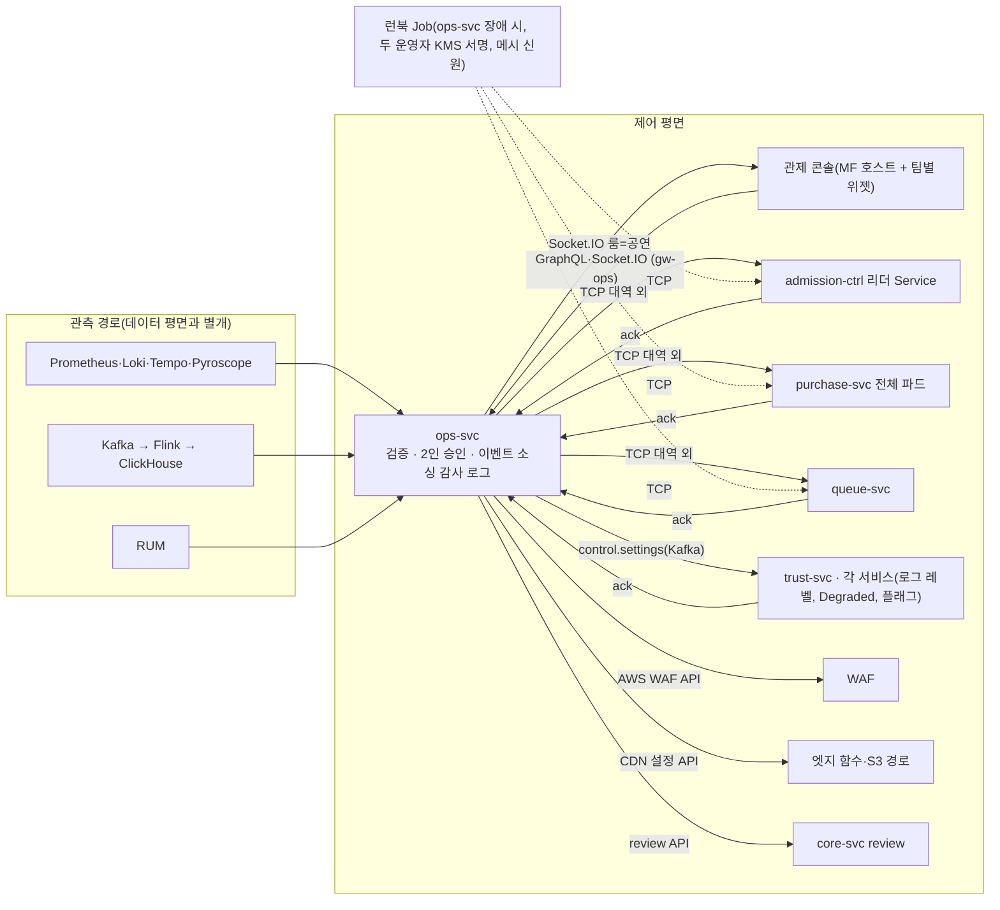
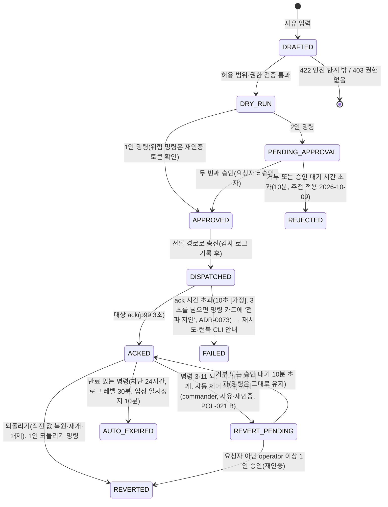

# 기능 설계: 관제 콘솔(Control Tower)과 제어 평면

- **독자와 용도**: ops-svc, 관제 콘솔(Module Federation 호스트 및 리모트 위젯), 제어 명령을 수신하는 마이크로서비스(admission-ctrl, purchase-svc, queue-svc, trust-svc 등)를 구현하는 엔지니어가 화면 레이아웃, 운영 명령 카탈로그와 수명주기, 대역 외 전달 경로, 자동·수동 제어 간 우선순위, 감사 로그 및 인시던트 리플레이, 암표 방지 법정 조치 화면 및 검증 테스트 포인트를 파악할 때 참조한다. 세부 관측 경로, SLO 및 알림 규칙은 docs/observability.md를 준용한다.
- **원문 출처**: 설계서 §6 '운영 모니터링·관제'(아키텍처 구조, 온세일 단계별 화면 구성, 운영 명령 카탈로그, 우선순위 5대 원칙, 알림 라우팅, 자체 감시, 파트너 판매 현황, K8 검증), '암표 방지 법정 조치'(마·바목), §9 관제 명령 및 실시간 지표 SLO와 Degraded 모드, 2장·4장(관제 콘솔 프론트엔드 아키텍처), 24장(Socket.IO 실시간 통신), ADR-0022·0027, POL-021·022·024·025·029.
- **기준 기획 버전**: v1.0.
- **관련 ID**: FR-026, FR-028~034, FR-049(종료 후 표시), FR-051, FR-063, FR-064, FR-068(공연 리포트·결정 기록, POL-040) · NFR-008, 009, 017, 023 · POL-021, 022, 023, 024, 025, 028, 029 · SCR-026, 028~032 · CMP-036 CommandCard · API `/v1/ops/*`, `/graphql`, `/v1/partner/events/{id}/live` · 이벤트 `control.settings`, `socketio.ops` · 데이터 docs/data.md §2 command_event·data_request·takedown·security_incident·access_review · ADR-0049(경보 창, Go/No-Go, 보안 사고·접속기록 점검) · ADR-0067(관측 도구와의 역할 경계, 판단 위젯 요약과 원인 분석 링크) · ADR-0069(제어 입력 없음·감축 확인 시간, 경보 묶기·억제, 인시던트 선언 기준, 위젯의 연결 판단, 명령 4·5 효과 줄, 배경 작업 멈춤) · ADR-0070(처리량 급감 경보와 퍼널 위젯의 연결 판단, 판단 순서 ④⑤, 재시작 전 진단 증거).

## 1. 개요와 구조

관제 콘솔(Control Tower)은 온세일 70분 윈도우 동안 시스템 전반의 상태를 실시간 관측하고, 사전에 엄격히 정의된 명령을 통해서만 시스템에 안전하게 개입하며, 모든 운영 행위를 불변 감사 로그로 영속화하는 미션 크리티컬 운영 제어 도구다. Grafana가 엔지니어의 원인 분석 화면이고 Sentry가 개발자의 오류 관리 도구라면, 관제 콘솔은 운영자가 판단하고 조작하는 화면이다. 같은 관측 창고(Prometheus·Loki·Tempo·ClickHouse)를 읽어 판단에 쓰는 숫자를 직접 그리고, 그 옆에 안전한 명령 제어, 2인 승인 권한 분립, 법적 감사 증적을 둔 제어 평면(Control Plane)이다. '통합'은 판단과 조작을 한 화면에서 한다는 뜻이다. 로그 검색·요청 경로·오류 세부 같은 원인 분석은 위젯의 Grafana·Sentry 링크로 연결하고 콘솔에 다시 만들지 않는다(ADR-0067).

- 사용자 트래픽을 처리하는 주 데이터 평면이 장애로 포화되더라도 핵심 제어 명령(동시 입장 목표 조정, 입장 일시정지, 판매 일시정지 킬스위치, 대기실 긴급 공지)은 반드시 전달되어야 하므로, Kafka나 gRPC에 종속되지 않는 독립 TCP 대역 외(Out-of-Band) 채널(NestJS 트랜스포터)을 통해 대상 서비스 파드로 직결 전송한다(ADR-0022).
- 관측 스택은 전용 노드 풀에, 관제 콘솔은 별도 게이트웨이(gw-ops)에 두어 일반 사용자 진입 경로와 노드·게이트웨이를 나눈다. 관측 스택이 무너지면 외부 데드맨 스위치가 온콜 담당자를 부르고 비상 런북 CLI로 관제권을 유지한다(docs/infra.md §4). 같은 EKS 클러스터와 리전을 쓰므로 클러스터·리전 전체 장애는 함께 받는다. 제어 평면의 신뢰성 SLO(명령 전파 지연 p99 ≤ 3초)는 관측 파이프라인이 과부하로 Degraded 상태에 진입하더라도 끝까지 준수한다.

## 2. 화면 구성: 온세일 단계별(FR-029, SCR-029)

모든 관제 패널은 '지금 시스템이 정상 상태인가?'에 운영자가 즉시 직관적으로 판단할 수 있도록 사전에 합의된 SLO 기준선(Threshold)을 함께 시각화한다. 시스템 Four Golden Signals 인프라 패널과 비즈니스 퍼널 지표 패널을 명확히 분리하여 배치한다.

| 온세일 단계 | 관제 핵심 초점 | 전담 모니터링 패널 구성 |
| --- | --- | --- |
| T-30분 점검 | 시스템 오픈 준비 상태의 완결성 | 필수: EKS 워커 노드 및 파드 사전 프리워밍 완료 상태, Redis·Kafka·PostgreSQL 헬스체크, 그 공연 결제사(ADR-0044)의 상태와 한도 초과 응답 없음, 본인확인·사람 확인 제공자 상태, CloudFront 배포별 요청·전송 한도(적용된 상향 값)가 그 회차의 설계 피크 이상(설계 피크는 규모 등급의 값과 T-30분 수요 예측 상단으로 계산한 값 가운데 큰 쪽, docs/infra.md §4.1, ADR-0058·0078), 대기실·공연 상세·결제 엔드포인트 종합 합성(Synthetic) 점검 결과, 온콜 알림 채널 시험 발송 상태, 노드 시계 오프셋 20ms 이하, 만료 7일 이하 인증서 없음, 마지막 교차 리전 백업 성공, 진행 중 배포(롤아웃·마이그레이션) 0건(대형·중형 회차. 소형 회차는 동결 대상 핫패스 롤아웃을 T-15분 자동 중단으로 대신하므로 판정에서 빼고 표시만 한다, ADR-0054 결정 10), 그 회차의 변경 동결 창 적용(ArgoCD 동기화 창·Karpenter 중단 예산), 동결 창에 겹치는 예정 관리형 유지보수 없음(ADR-0054, docs/devops.md §8). 권고: 수요 예측 상단이 규모 등급의 상한 이하(넘으면 표시만 하고 T-30분 점검이 시작된 뒤에는 규모를 바꾸지 않는다, ADR-0078), CDN 엣지 캐시 적중률(직전 15분, 공연 상세·정적 자산 배포, 요청 기준 90% 이상 [가정, wbs 4.6.1에서 확정]. 같은 15분 요청이 1,000건 [가정] 미만이면 판정 보류, 추천 적용 2026-10-14, ADR-0062) → Go/No-Go 최종 체크리스트 완결 |
| T=0 집중 (최초 10분) | 오픈 직후 트래픽 버스트 견딤성 | 대기열 진입 RPS 및 p99 지연시간, 로비 셔플 연산 및 결과 파일 게시 완료 여부, serving 번호 전진 속도, 상태 조회 요청량과 CDN 엣지 캐시 적중률, 에러 버짓 소진율과 여정별 남은 허용 실패 건수, 실시간 봇 차단 건수, 추가 검증 큐 유입 인원 및 인증 통과율, 본인확인·사람 확인 제공자 성공률과 p99 |
| 판매 진행 중 | 판매 라이프사이클의 원활성 | 비즈니스 숫자는 실시간 잠정 값이다(ADR-0052). 전체 비즈니스 퍼널 전환율(입장 → 첫 홀드 성공 → 결제 접수 → 승인 → 발권, analytics F3 단계 이름. 다섯 단계 숫자는 처리량 급감 경보와 같은 클러스터 안 Prometheus 값, 등급별 상세는 관제 실시간 표, ADR-0071 결정 4), 입장 전환 비율 및 빈자리(입장 자리) 추이(제어 숫자), 구역별 잔여 좌석 히트맵(관제 실시간 표. 거래 사건이 온세일 창에서 60초 [가정] 넘게 끊기면 판매 누적·잔여석 옆에 '거래 사건 끊김', ADR-0072·0073), 결제사별 승인 성공률·승인 호출 p99(경보 기준: 호출 기한 2초)·결제 확정 소요 p99(재시도 포함, RB-07 전환 검토 기준 5초)·한도 사용률(ADR-0044·0049·0069), 여정별 에러 버짓 잔량과 남은 허용 실패 건수(예: 결제 확정 12건 중 3건 사용), 차례 전 입장 건수(0건), 인프라 자원 포화도 요약(CPU, Redis 메모리, Kafka lag, 이벤트 루프 지연을 정상·주의·위험과 핵심 숫자로), RUM 체감 성능 요약(INP·LCP p75 숫자), 배포 뒤 새로 생긴 오류 종류 수와 많이 난 오류 상위 5개(Sentry), 느린 쿼리 상위 5개(쿼리 통계), 네트워크 정상·주의(연결 대기열 넘침·TCP 재전송). 체감 요약·느린 쿼리·네트워크는 운영 명령이 없는 숫자라 탭 아래 '진단 힌트' 줄에 모은다(ADR-0069). 퍼널 단계 비율이 기준선의 절반 아래로 떨어지면 SEV2 처리량 급감이 '이 회차 판단'에 뜬다(오류 없는 장애, RB-33, ADR-0070). 걸린 자동 조치와 풀리는 조건(T-30분 점검·T=0 탭에도 보인다, design/d5 §7.2, ADR-0078). 그래프와 세부는 위젯의 '자세히 보기 ↗'로 연다(ADR-0067) |
| 온세일 종료 후 | 온세일 운영 회고 및 인사이트 도출 | 최종 매진 소요 시간, 봇 예매 점유율(하한치), 실서비스 봇 탐지 지표 하한(허니팟 적중, 표본 수동 검토, 사후 라벨링 데이터 종합, FR-049) 및 그림자 판정 편차 분석, 온세일 에러 버짓 총 사용 내역, 운영 명령 및 경보 타임라인, 계획된 결정 규칙(planning/01 §3.2) 트리거 항목 대조 → 공연 리포트(마감 단계 R0 잠정, R1~R3 확정, 규칙 판정, 데이터 품질, 지난 결정 확인 줄)와 결정 기록 작성(FR-068, POL-040, docs/features/analytics.md §8·§10), 인시던트 포스트모템 초안 자동 생성(ADR-0042·0052) |
| 공연 당일 입장(입장 탭, ADR-0051) | 현장 입장 흐름과 스캐너 상태 감시(현장 대응은 현장 책임자와 파트너) | 로그인·준비 완료 기기 수, 마지막 동기화 경과 최대값과 2분 [가정] 넘은 기기 수(ADR-0049), 구역별 분당 입장 수, 거부 사유별 비율(거부만), 오거부 후보(거부 뒤 10분 [가정] 안 정상 통과), 확인 필요 건수(퇴장 기록 없음·입장 기록 없음, 거부율에 넣지 않음, 추천 적용 2026-10-14, ADR-0062), 이상 표시 수(중복 입장·퇴장 기록 없음·취소 뒤 입장·세션 밖 기록), 부스 재발급·예외 통과 건수(책임자별), 업로드 대기 건수, 입장 시작 뒤 첫 키 등록 비율, 입장 기록 마감 상태와 미보고 기기 |

Go/No-Go 판정(추천 적용 2026-10-13, ADR-0049): 필수 항목이 하나라도 실패하면 No-Go다. T-20분까지 실패 항목이 회복되면 다시 판정해 Go로 바꿀 수 있다(재판정도 감사 로그, RB-02, 추천 적용 2026-10-20, ADR-0073). No-Go로 남으면 오픈 시각에 입장 일시정지(명령 2)와 대기실 공지(명령 7)로 시작하고, 필수 항목이 회복되면 입장을 재개한다. 로비 셔플은 예정대로 해 순서는 바뀌지 않는다. 입장 일시정지는 10분마다 운영자가 연장해야 이어지고, 연장하지 않으면 자동 만료되어 입장이 재개된다(§3 명령 2). 재확인 대화상자에는 아직 실패한 필수 항목을 함께 보인다. 권고 항목이 실패하면 사유를 남기고 진행한다. 판정 결과와 사유는 감사 로그에 남는다.

실시간 지표 반영 목표: 관제 실시간 표(`rt`) 지표는 원천 이벤트 발생 시점부터 관제 콘솔 화면 렌더링까지 종단 p95 5초 이내를 목표로 한다(NFR-009). Flink `ops-rt`가 누적 숫자(판매 좌석·금액, 퍼널 단계 누적, 잔여석)는 1초마다 '지금까지 합계'를 덮어쓰고, 속도·비율은 1초 칸(워터마크 여유 0.5초, 허용 지연 10초 [가정])으로 센다. Flink 싱크 묶음(0.25초 [가정])과 ClickHouse 비동기 삽입(반영 최대 0.2초), GraphQL WebSocket 구독(graphql-ws) 푸시로 보이며, '최근 10초' 같은 보조 숫자는 조회 때 1초 칸을 묶는다. 신선도는 심장 박동 사건이 화면에 보이기까지의 시간으로 재고 판매 중 탭 머리에 보인다(design/d5 §7.2, docs/streaming.md §4, 추천 적용 2026-10-20, ADR-0071). 판단·제어 숫자(입장 속도, 퍼널 다섯 단계 카운터, 오류율, 결제 성공률, p99, 에러 버짓)는 실시간 표가 아니라 클러스터 안 Prometheus에서 읽는다(지표 출처 표 docs/observability.md §8, ADR-0068 결정 2).

위젯과 원인 분석 링크(ADR-0067): 모든 위젯은 ops-svc가 관측 창고에서 읽은 값을 콘솔이 직접 그린다. 위젯마다 '자세히 보기 ↗'를 두어, 같은 회차·같은 시간대로 맞춘 Grafana 대시보드(데이터 링크의 시간 범위 변수, 오류 위젯은 Sentry)를 새 탭으로 연다. 콘솔에는 로그 검색창, 요청 경로 그림, 프로파일 그림, 오류 묶기를 만들지 않는다. 운영자는 판단과 조작을 콘솔에서 하고, 원인을 파고드는 엔지니어는 Grafana·Sentry를 더 본다. 콘솔이 장애일 때는 운영자도 Grafana 읽기 전용 대시보드를 본다(§12).

연결 판단(추천 적용 2026-10-20, ADR-0069): 판단 위젯마다 '이 숫자로 무엇을 하는가'(명령 번호, 런북, 엔지니어 호출)를 위젯 아래 한 줄로 적는다. 위젯별 연결 판단은 design/d5 §7.2 표를 따른다. 운영 명령이 없는 위젯(체감·느린 쿼리·네트워크)은 '진단 힌트' 줄로 모아 판단 숫자와 나눈다. 대시보드는 서비스의 기본 질문에 답하고(SRE Book 1판 6장), 지표마다 목적이 있어야 한다(SRE Workbook 4장)는 원칙을 화면에 옮긴 것이다.

## 3. 운영 명령 카탈로그(FR-030, POL-021 B)

모든 운영 명령은 실행 사유(Reason) 입력이 필수이며, 실행 전 예상 영향 범위를 보여주는 dry-run 모의 기능을 제공하고, 실행 내역을 불변 감사 로그에 기록하며, 대상 서비스로부터 명시적 ack를 수신하고, 긴급 원복(Revert) 메커니즘을 내장한다.

| # | 운영 제어 명령 | 시스템 실행 효과 | 전달 경로 | 필수 권한 | 승인 요건 | 안전 허용 범위 | 되돌리기 (Revert) |
| --- | --- | --- | --- | --- | --- | --- | --- |
| 1 | 동시 입장 목표 조정 | 좌석 선택 및 결제 단계 동시 유입 허용 인원 상한선 변경. serving 번호 증가율은 이 값을 기반으로 재계산된다. | TCP 대역 외 → admission-ctrl 리더 전용 Service | operator | 1인 승인 | 사전에 정의된 안전 상·하한 범위 내(상한은 8,000명과 그 공연 결제사 상한 중 낮은 값, 하한은 1,000명과 결제사 상한의 절반 중 낮은 값. 포트원 공연 약 415~830명 [가정, Phase 2 2.3.2에서 확정], POL-021). 초당 serving 전진 속도 상한은 정적 설정 파일의 안전 한계이므로 우회할 수 없다. | 직전 설정값 즉시 복원 |
| 2 | 입장 일시정지 | serving 번호 전진을 즉시 중단하고 기 발급된 대기열 순번은 온전히 유지한다. | TCP 대역 외 → admission-ctrl 리더 Service | operator | 1인 승인 | 최대 10분. 끝나기 1분 전에 재확인 대화상자를 띄운다. 운영자가 사유를 적어 연장하면(같은 명령에 연장 기록, ack 필요) 그때부터 10분이 다시 시작되고, 연장하지 않으면 10분에 자동 만료(AUTO_EXPIRED, 행위자 SYSTEM)되어 serving 전진이 재개된다(추천 적용 2026-10-14, ADR-0062). | 입장 즉시 재개 |
| 3 | 판매 일시정지 (킬스위치) | 범위 안 회차의 새 좌석 홀드·결제 시도 시작·결제 접수를 423으로 막고 serving 전진을 멈추며, 대기 상태 파일의 판매 상태를 일시정지로 쓴다. 이미 접수된 결제(승인·발권·가상계좌 입금 반영), 결과 조회, 홀드 해제, 예매 취소·환불, 양도, 입장 스캔은 계속한다. 그 회차 구매 세션의 무활동 만료는 일시정지 동안 세지 않는다(홀드 TTL과 최대 체류는 그대로). | TCP 대역 외 → purchase-svc 전체 파드, admission-ctrl 리더 Service, queue-svc(모두 ack해야 ACKED) | commander | commander 요청 + 요청자 아닌 operator 이상 1인 승인, 둘 다 재인증 | 범위는 회차(하나 이상)나 전체(실행 중 판매가 시작되는 회차 포함). 굿즈·부가 상품 제외. 만료 없음(추천 적용 2026-10-14, ADR-0062) | 판매 즉시 재개 (2인 승인 필수) |
| 4 | ASN 및 IP 대역 차단 | 엣지 WAF 계층에서 지정한 네트워크 대역의 요청을 막는다(다른 대역으로 옮겨 오면 다시 지정해야 한다). | AWS WAF API 호출 | operator | 1인 승인 (ASN 단위 차단과 IPv4 /16·IPv6 /32보다 넓은 대역 차단은 2인 승인 [가정, Phase 4 4.4.1에서 확정], POL-021) | 만료 유효시간 지정 필수 (최대 24시간) | 유효시간 경과 자동 만료 또는 수동 해제 |
| 5 | 봇 판정 강도 변경 | 위험 점수 임계치 및 세부 차단 가중치 프로필을 동적으로 변경한다. | 제어 이벤트 `control.settings`(Kafka) → trust-svc | commander | commander 요청 + 요청자 아닌 operator 이상 1인 승인, 둘 다 재인증 | 완화, 기본, 강화 3단계 프로필 한정. 대기 중 재평가 모드(끔·그림자·적용, 기본 그림자)는 강도와 따로 고르는 매개변수다(ADR-0071, 추천 적용 2026-10-20, ADR-0073) | 직전 판정 단계로 복귀 |
| 6 | Degraded Mode 전환 | 여정별 장애 격리 및 Degraded Mode를 명시적으로 활성화한다. 결제 여정의 '대체 결제사 전환'(새 결제 시도를 공연의 대체 결제사로 보냄, ADR-0044)을 포함한다. | 제어 이벤트 → 해당 서비스. 대기열 진입 관련은 TCP 대역 외 → admission-ctrl. 엣지 함수 및 CDN 경로 전환은 CDN 설정 API 호출 | commander | commander 요청 + 요청자 아닌 operator 이상 1인 승인, 둘 다 재인증 | POL-029 표에 사전 정의된 표준 모드 한정 | Degraded 모드 전면 해제 |
| 7 | 대기실 공지 배너 | 대기 화면 및 좌석 선택 화면 상단에 긴급 안내 메시지를 송출한다. | TCP 대역 외 → queue-svc(대기 상태 파일 탑재), 제어 이벤트 → purchase-svc | operator | 1인 승인 | 사전에 법무·운영 승인을 완료한 문구 템플릿 한정 | 공지 즉시 내리기 |
| 8 | 로그 레벨 동적 변경 | 특정 마이크로서비스의 로깅 상세도를 DEBUG 또는 TRACE로 실시간 상향한다. | 제어 이벤트 → 대상 마이크로서비스 파드 | operator | 1인 승인 | 활성화 후 30분 경과 시 기본 레벨로 자동 복귀 | 자동 복귀 또는 즉시 복구 |
| 9 | 비핵심 피처 플래그 비활성화 | 관람 후기, 좌석 추천, 찜하기 등 부가 기능의 피처 플래그를 차단한다(기대평은 없앴다, ADR-0063). 비핵심 배경 작업(일괄 환불의 새 묶음, 파트너 웹훅 재시도, 광고성 알림 묶음, 공연예술통합전산망 재전송)을 멈추는 '배경 작업 멈춤' 묶음도 같은 목록에 둔다(ADR-0069). | 제어 이벤트 `control.settings`(Kafka, 키 `FEATURE_FLAG`) → 각 서비스(웹 앱은 서버 응답으로 받는다) | operator | 1인 승인 | 비핵심 기능 플래그 목록으로 한정 | 기능 즉시 재활성화 |
| 10 | 부정거래 게시물 노출 차단 | 정부 기관 또는 경찰청이 공문으로 통보한 암표 의심 게시물(관람 후기, ADR-0063)을 숨김 처리하고 조치 증적을 생성한다. | core-svc review 모듈 전용 API 호출 | operator | 1인 승인 | 공식 통보 문서에 명시된 게시물 ID 한정. 통보 수신 후 24시간 이내 의무 이행, 문화체육관광부 고시 사항이면 10시간(공연법 시행령 제3조의3 제1호 마·바목, 제2호 바목. 고시는 확인 필요). 차단한 게시물의 본문 지문을 같은 내용 차단 목록에 올린다(제2호 마목, POL-024) | 통보 철회 시 노출 복원(같은 내용으로 숨긴 게시물과 지문 포함) |
| 11 | 자동화 제어 긴급 정지 스위치 [보완: 원문 우선순위 4를 명령으로 올림] | 입장 제어의 모든 자동 제어 알고리즘(AIMD 조정, 에러 버짓 연동 감축, 자동 Degraded 후보 추천)을 일괄 정지시킨다. 오토스케일링(KEDA·Karpenter)은 용량을 늘리는 장치라 대상이 아니다. 오토스케일이 잘못 움직이면 긴급 변경 RB-30(KEDA 정지 패치)으로 멈춘다(ADR-0069). | 제어 이벤트 + TCP 대역 외 → admission-ctrl | commander | 1인 긴급 실행(사후 검토 보고서 48시간, 검토 7일) | 정지 상태는 `q:{admission}:ctl`에 두어 리더가 바뀌어도 유지(ADR-0056) | 자동 제어 정상 재개 (2인 승인 필수) |
| 12 | 결제사 지정 | 공연의 기본 결제사와 대체 결제사를 정한다. 새 결제 시도부터 적용되며, 바뀐 결제사 채널 상한에 맞춰 그 공연의 동시 입장 목표 상한이 다시 계산된다(POL-036, ADR-0044). | 제어 이벤트 `control.settings`(Kafka) → core-svc(공연에 저장), payment-svc(결제사 선택기), admission-ctrl(결제사별 상한) | operator | 1인 승인 | 온세일 윈도우(T-10분~T+60분) 밖에서만 실행. 기본과 대체는 달라야 하고 서버 승인이 켜진 채널만 고를 수 있다. dry-run에 바뀌는 동시 입장 목표 상한 표시 | 직전 지정으로 복원 |

카탈로그 밖 비상 처리(추천 적용 2026-10-20, ADR-0073): 시드만 쓰는 비상 셔플(ADR-0050 결정 7)은 운영 명령이 아니다. 공시한 drand 라운드 대기가 상한 60초 [가정]를 넘으면 셔플이 멈추고 SEV1(RB-35)이며, 비상 셔플은 RB-35의 런북 CLI 작업으로만 한다. 서로 다른 commander 두 명이 각자 KMS 키로 서명한 묶음만 실행되고(§5, ADR-0053 결정 11의 서명 묶음과 같은 방식), 되돌릴 수 없으며, 실행 뒤 검증 페이지에 사유와 '이 경우 시드를 아는 내부자가 결과를 미리 알 수 있다'는 한계를 공시한다.

명령 4·5 효과 줄(추천 적용 2026-10-20, ADR-0069): 명령 4(대역 차단)·5(봇 판정 강도)가 ack되면 명령 카드와 SCR-030 위 줄 '적용 중 명령'에 10분 [가정] 동안 효과 줄을 보인다. 차단 비율(엣지·진입 단계 차단 ÷ 진입 시도), 추가 검증 통과율, 이의 제기 수를 실행 전 5분과 나란히 보인다. 실행 뒤 10분 안에 추가 검증 통과율이 실행 전보다 10%p [가정] 넘게 떨어지거나 이의 제기가 10분에 5건 [가정]을 넘으면 SEV2 '차단이 사람을 막고 있을 수 있음'을 낸다. 의도된 차단은 진입 SLI 분모 밖이라 사람을 잘못 막아도 SLO로는 보이지 않기 때문이다(docs/observability.md §4·§5).

## 4. 명령 수명주기

- 명령 접수 신뢰성 SLO(p95 ≤ 500ms)는 입력 검증 및 감사 로그 1차 영속화 완료 후 운영자에게 접수 응답을 반환하는 시점까지를 기준으로 계측하며, 2인 승인 대기 시간은 지연 산정에서 제외한다. 명령 전파 신뢰성 SLO(p99 ≤ 3초)는 최종 승인 완료 시점부터 대상 파드의 수신 ack 완료 시점까지로 정의한다.
- 명령 사전 실행 모의(dry-run)는 명령 집행에 따른 시스템 영향 범위를 사전에 시각화한다[보완: 계산 모델]. 예: 동시 입장 목표 조정 시 예상 serving 증가 속도 및 좌석 풀 빈자리 추이 모의, IP 차단 시 최근 5분간 해당 대역에서 인입된 요청량 산출, 킬스위치 가동 시 범위 안 진행 중인 결제 세션 수, 입장해 있는 구매 세션 수, 최근 5분 새 홀드·결제 접수 속도, 대기 인원 표시.
- 시스템 자체 자동 조치(AIMD 목표 자동 감축, 버짓 소진 연동 조치)는 동일한 상태 머신을 경유하되 행위자 식별자를 '시스템(SYSTEM)'으로 부여하고 별도 승인 단계 없이 `DISPATCHED` 상태로 즉시 직행한다.
- 제어 명령의 분산 멱등성 보장: 클라이언트 생성 `Idempotency-Key`를 강제하여 같은 키로 다시 온 요청(네트워크 재시도, 같은 키를 다시 보낸 더블클릭)은 한 번만 접수한다. 키가 다른 중복(다른 운영자가 같은 명령을 따로 내는 경우)은 키로 막지 못한다. 동일 공연에 대해 동일 유형의 제어 명령이 승인 대기 또는 전파 진행 중인 경우 동시성 잠금 플래그를 표기한다[보완: 다중 운영자 협업].
- 입장 일시정지(명령 2)의 연장은 새 명령이 아니라 같은 명령의 연장 기록(사유·행위자·새 만료 시각)이다. 만료 시각은 admission-ctrl이 지키므로 ops-svc 장애 중에도 만료된다(추천 적용 2026-10-14, ADR-0062).

## 5. 전달 경로와 Degraded(NFR-008)

| 제어 전달 채널 | 대상 운영 명령 번호 | 채널 기술 특성 및 장애 격리 구조 |
| --- | --- | --- |
| TCP 대역 외 (NestJS 트랜스포터) | 명령 1·2 (admission-ctrl 리더 전용 Service), 명령 3 (purchase-svc 전체 파드 브로드캐스트, admission-ctrl 리더 Service, queue-svc), 명령 7 (queue-svc), 명령 6 중 대기열 입장 관련, 명령 11 | Kafka 브로커 장애나 gRPC 풀 고갈 등 주 데이터 경로가 전면 마비된 극한 상황에서도 신뢰성 있게 전달된다. 별도 IDL 코드 생성 없이 단순 바이너리 프로토콜로 경량 구동된다. 수신 파드는 명령 실행 직전 K8s Lease 상태를 원자적으로 재검증한다. |
| 설정 제어 이벤트 `control.settings` (Kafka 토픽) | 명령 5, 명령 6(결제사 전환 포함), 명령 7(purchase-svc), 명령 8, 명령 9(`FEATURE_FLAG`), 명령 11, 명령 12 | 전체 마이크로서비스가 공통 구독하며 페이로드의 `expiresAt` 타임스탬프를 통해 지정 시간 경과 후 원래 설정으로 자동 롤백한다. |
| AWS WAF API | 명령 4 | 차단 규칙 생성 시 만료 시한을 강제 지정하여 영구 차단 사고를 예방한다. |
| CDN 설정 API (CloudFront) | 명령 6 중 엣지 함수 및 S3 사본 고정 | 매진 정적 응답 전환과 대기 상태 파일을 S3 사본으로 고정하는 전환·해제를 한다. 원본 오류 때 요청마다 S3 사본으로 넘기는 것은 CloudFront 원본 그룹의 자동 동작이라 명령이 아니다(docs/infra.md §4, ADR-0078). |
| 릴리스 플래그 파일(GitOps) | 관제 명령 아님 | 새 기능을 공개하는 릴리스 플래그는 저장소 파일로 바꾸고 끄기만 긴급 변경으로 한다. 운영 매개변수(명령 9)와 길을 나누지 않아 감사와 승인이 갈라지지 않는다(docs/devops.md §5.4). |
| core-svc review API | 명령 10 | 정부 기관 공문 통보 문서 ID와 대상 게시물 식별자를 원자적으로 매핑하여 은폐한다. |

제어 평면 Degraded Mode: ops-svc가 전면 다운되는 비상 상황 발생 시, 운영자는 보안 런북 CLI를 구동하여 TCP 대역 외 채널로 제어 명령을 대상 파드에 직접 전송한다(명령 묶음마다 서로 다른 두 운영자가 각자의 KMS 비대칭 키로 서명해야 하고(판매 일시정지(명령 3)와 비상 셔플(RB-35)은 서로 다른 commander 두 명, ADR-0053 결정 11·ADR-0050), 런북은 클러스터 안 비상 Job으로 돌며 메시 신원으로만 제어 포트에 붙는다, ADR-0053 결정 11). 서명된 명령 묶음과 결과는 Job이 감사 앵커 버킷(S3 Object Lock)에 바로 쓰고 ops-svc가 복구되면 감사 체인에 넣으며, 명령 전파 완화 SLO는 p99 ≤ 10초로 통제한다. 끝까지 사수하는 절대 원칙은 2인 승인 원칙과 불변 감사 증적 보존이다(POL-029). 명령 형식은 `peaket-runbook draft <명령 유형> --event <회차 ID> [--param 키=값] --reason "<사유>" [--command-id <명령 ID>] --out <파일>` → 두 운영자가 각자 `sign` → 비상 역할로 `run`이다. 전파 실패한 명령은 같은 명령 ID로 다시 보낸다(추천 적용 2026-10-14, ADR-0062).

## 6. 자동 제어와 사람 제어의 우선순위(POL-021 C)

1. **절대 안전 한계의 불가침성**: 동시 입장 목표 상·하한(명령 1의 결제사 상한 반영 식), 초당 serving 번호 증가율 상한, 홀드 TTL 범위는 시스템 설정 파일에 고정된 절대 안전 한계이므로 어떠한 운영자 명령이나 자동화 로직으로도 런타임에 우회할 수 없으며 변경 시 정식 배포를 요구한다.
2. **인간 운영자 개입의 절대적 우선권**: 운영자가 동시 입장 목표를 수동으로 지정하면 시스템의 AIMD 자동 조정이 15분간 강제 중지되고 콘솔에 잔여 시간이 명확히 카운트다운된다. 시간 만료 후 운영자의 명시적 확인을 거쳐야만 자동 조정 모드로 복귀한다. 유예 중에도 3번의 에러 버짓 연동 감축은 하되, 운영자가 정한 뒤 새로 울린 경보나 새로 넘은 소진선일 때만 하고 감축하면 유예가 끝난다(콘솔 배너와 감사 로그, 추천 적용 2026-10-14, ADR-0062).
3. **자동화 로직의 축소 방향 단독 결정권**: 에러 버짓 소진 시 시스템 자동화 알고리즘이 단독으로 결정할 수 있는 범위는 오직 동시 입장 목표를 하향 감축하거나 Degraded Mode 후보를 제시하는 것으로 엄격히 제한된다. 목표치를 다시 증액하거나 정식 Degraded 모드로 전환하는 결정은 반드시 인간 운영자가 내린다. 에러 버짓 연동 감축(아래 문단의 50% 소진, 10배 소진) 뒤에는 운영자가 명령 1로 목표치를 정할 때까지 AIMD 자동 증액을 멈추고, 그 뒤 자동 조정은 2번 규칙의 15분 유예와 운영자 확인을 거쳐 다시 시작한다. 에러 버짓 연동 감축이 없는 평상시의 AIMD 선형 증액(docs/features/queue-admission.md §5)은 이 제한의 대상이 아니다.
4. **자동화 제어 긴급 정지 권한**: commander 권한을 가진 운영자 1인이 입장 제어의 모든 자동 제어 루프를 단독으로 즉시 차단할 수 있으며(명령 11), 조치 후 사후 검토 보고서 작성이 의무화된다. 다시 켜는 것은 2인 승인이다.
   - 사후 검토 보고서의 기한(추천 적용 2026-10-14, ADR-0062): 작성은 명령 11을 실행한 commander가 실행 시각부터 48시간 안에 한다(POL-022 포스트모템 기한과 같은 값). 검토는 실행자가 아닌 commander가 제출 뒤 7일 안에 한다. 둘 중 하나라도 넘기면 SEV3(GitHub Issues)다. 명령 11이 인시던트 안에서 실행됐으면 그 포스트모템의 한 절로 써도 되고, 기한은 둘 중 이른 것이다. 활성 commander가 실행자 한 명뿐인 1인 기간에는 실행자의 검토를 받고 감사 로그에 '1인 기간 자기 검토'로 남긴다. 다른 사람의 검토가 아니므로 한계로 기록한다(docs/devops.md의 1인 기간 처리와 같음). 보고서는 재개(2인 승인)의 조건이 아니다.
   - 사후 검토 보고서의 항목(★는 시스템이 감사 로그·지표에서 채운다):
     1) ★실행 기록: 명령 ID, 실행자, 실행 시각(KST), 재인증 시각, 실행 사유 원문
     2) 계기(필수): 고르기 — 지표·입력 오류 / 자동 제어 동작 오류 / 외부 원인에 대한 잘못된 대응 / 예방 정지(점검·시험) / 그 밖 — 와 '무엇을 보고 멈췄는지' 설명
     3) 2인 승인을 기다리지 않은 이유(필수)
     4) ★정지 동안의 조치: 정지부터 재개까지 실행된 명령 목록(명령 1 목표 변경 등). 덧붙일 설명(선택)
     5) ★영향: 정지 시간, 동시 입장 목표 변화, 여정별 남은 허용 실패·버짓 소모 변화, 차례 전 입장 0건 여부, 예상 대기 오차. 해석(선택)
     6) ★재개: 재개 시각과 승인한 두 사람(아직이면 '정지 중')
     7) 후속 조치: 할 일·담당·기한·이슈 링크(0개 이상). 자동 제어 규칙이나 임계값을 바꿔야 하면 결정 기록(FR-068)이나 ADR로 잇는다
     8) 검토(검토자가 씀, 필수): 긴급 정지가 적절했는가 — 적절했다 / 적절하지 않았다 / 판단 보류 — 와 의견
5. **자동화 조치의 감사 기록 의무**: 시스템 자동화 알고리즘에 의해 집행된 모든 감축 조치는 행위자를 '시스템(SYSTEM)'으로 명시하여 감사 로그에 무결하게 영속화된다.
6. **입력이 없으면 멈춘다(소유자 결정 2026-10-20, ADR-0069)**: 자동 제어가 읽는 지표(뒤쪽 서비스 p99·오류율, 에러 버짓 소진 신호)가 쿼리 실패·빈 결과이거나 마지막 표본이 30초 [가정]보다 오래되면 '제어 입력 없음'이다. 빈 결과를 0으로 읽지 않는다. 입력 없음 동안 AIMD와 에러 버짓 연동 감축은 목표를 늘리지도 줄이지도 않고, 운영 명령은 그대로 받는다. admission-ctrl이 상태를 `q:{event:E}:ctl`에 쓰고 ops-svc가 읽어 위 상태 바에 <입력 없음>을, 경보 패널에 SEV2를 띄운다(Alertmanager를 거치지 않음). 입력이 10초 [가정] 이어서 들어오면 감축은 바로 다시 하고, 증액은 운영자가 '자동 조절 복귀 확인'(operator 1인)을 한 뒤에 한다. 상태 바 표시는 긴급 정지, 입력 없음, 일시정지, 자동 증액 멈춤 순으로 앞의 것을 보인다.
7. **감축은 효과를 확인한 뒤 다시 한다(추천 적용 2026-10-20, ADR-0069)**: AIMD가 목표를 줄인 뒤에는 예매 단계 인원이 새 목표 아래로 내려오거나 2분 [가정]이 지날 때까지 AIMD의 추가 감축을 하지 않는다. 에러 버짓 연동 감축은 경보 하나·소진선 하나에 한 번만 한다. 두 감축은 서로의 확인 시간을 막지 않고, 안전 하한 아래로는 내려가지 않는다. 부하를 다루는 다른 장치와의 순서는 docs/architecture.md §5의 부하 관리 장치 표를 따른다.

에러 버짓 소진 연동 통제(docs/observability.md §4 참조): 온세일 진행 중 온세일 버짓의 50%가 소진되면 동시 입장 목표를 자동으로 하향하고, 100% 전량 소진 시 Degraded 전환 후보를 관제 화면에 팝업하며 운영자 2인 승인을 요구하고 포스트모템을 자동 소집한다. 2분 창과 10초 창에서 모두 버짓 소진율이 10배 이상이면(경보 시점 예산 소모 29%, ADR-0049) 즉시 온콜을 호출하고 동시 입장 목표를 50% 즉시 감축한다.

## 7. 감사 로그와 인시던트 리플레이(FR-031, NFR-017)

- ops-svc는 CQRS 및 이벤트 소싱(Event Sourcing) 아키텍처로 구현된다. 발행되는 모든 제어 명령에 대해 누가(Actor), 언제(Timestamp), 무엇을(Action), 어떤 사유로(Reason), 누구의 승인을 거쳐(Approver), 사전 모의 결과(Dry-run result), 전달 경로 및 대상 파드 ack 수신 시각을 불변 이벤트 스트림으로 Append-only 적재한다(조회는 최신 스냅샷 읽기 모델 활용). 시스템 자동 조치 및 Degraded 전환 이력도 동일 원장에 기록된다.
- 관리자 계정의 개인정보 열람 및 대량 다운로드 접속기록(파트너 예매자 명단 CSV 내보내기 사유 및 대상 건수 포함) 역시 동일 감사 스토리지에 무결하게 보존된다. 법정 접속기록은 최소 2년 이상, 권한 부여·변경·말소 내역은 최소 3년 이상 보존하며 WORM(Write Once Read Many) 규격의 불변 스토리지 사본을 유지한다(docs/infra.md §6 참조).
- **공개 앵커(소유자 승인 2026-10-21, ADR-0075)**: 감사 기록은 지금처럼 키 건 해시 체인·5분 S3 앵커·1시간 검증으로 지키고(ADR-0053), 그 위에 매일 00:10과 온세일 윈도우가 끝난 뒤 10분 안에 [가정, Phase 4 4.4.1에서 확정] 감사 체크포인트(잎마다 비공개 솔트를 섞은 머클 루트, 직전 체크포인트 해시, 그날 법정 접속기록 일 앵커)를 만든다. 체크포인트는 체크포인트 서명 키로 서명하고 OpenTimestamps(비트코인)에 고정해 `https://www.peaket.example/transparency/`에 게시한다. 외부인은 공개 검증 도구 `audit-verify`로 체크포인트 사슬·서명·공개 타임스탬프를 확인하고, 분쟁 당사자는 SCR-031에서 내보낸 검증 묶음으로 기록 하나가 그 체크포인트에 들어 있음을 확인한다. 게시 실패는 다음 실행에서 다시 하고 6시간 [가정] 넘게 밀리면 SEV3, 공개 타임스탬프가 24시간 [가정] 넘게 완료되지 않으면 SEV3, 내부 체인과 체크포인트 루트가 어긋나면 SEV2와 보안 사고 기록(FR-063)이다. 처음부터 기록하지 않거나 거짓으로 기록한 것은 막지 못한다(planning/01 §5.2).
- 인시던트 리플레이(SCR-031): 과거 온세일의 특정 타임라인을 지정하여 장애 주입, 경보 발생, 운영 명령 집행, 시스템 회복의 전 과정을 Grafana 대시보드와 동일한 시간축 위에서 기록된 만큼 재생한다. 운영 명령·감사 기록과 오류·SLO 초과 트레이스는 모두 남지만, 정상 요청의 트레이스와 로그는 온세일 중 1% 표본만 남는다(docs/observability.md §6·§7). 이는 Game Day 모의 훈련의 핵심 결과물로 활용된다(K8).
- 포렌식 리플레이(SCR-069, 2단계·출시 뒤 선택, ADR-0080): 가명정보 취급자가 이 화면과 봇 표본 검토(SCR-067)에서 회차를 넘겨, 관제 콘솔 주소 아래 따로 여는 페이지(새 탭)에서 좌석 상태 변화와 홀드·결제 흐름을 다시 본다. 감사 기록의 정본은 이 절의 서버 감사 로그이고, 포렌식 리플레이의 결과는 다음 회차 판정 규칙 개선에만 쓴다(docs/features/forensic-replay.md §6).
- 주문 이벤트 이력 역추적: 특정 주문 ID를 입력하여 해당 시점의 좌석 홀드, 홀드 경합, 결제 승인 전 과정을 시계열로 재구성한다(해당 이벤트 스토어 조회는 viewer 및 CS 전담 권한에 한해 인가된다).
- 온세일 종료 패널은 전체 타임라인, 버짓 소진 내역, 집행된 명령 목록을 종합하여 인시던트 포스트모템 초안 문서를 Markdown 형식으로 자동 생성한다. 초안에는 원인 유형 칸(주 원인 유형·구성 요소, 기여 원인 유형)과 쓴 손잡이(명령·런북), 후속 조치(GitHub Issues 링크, P0 여부) 칸을 두고, 쓴 명령은 감사 로그에서 채운다(docs/observability.md §5, ADR-0078).

## 8. 알림·인시던트(POL-022)

인시던트 심각도 체계(SEV1~SEV3), 비상 역할 분담(인시던트 지휘관, 운영 실행자, 기록·대외 공지 담당), 사용자 대외 공지 프로토콜, 경보 위생 관리 및 48시간 이내 포스트모템 완료 원칙은 docs/observability.md §5를 준수한다. 관제 콘솔은 발생한 `OpsAlert` 경보를 Socket.IO 채널로 실시간 수신하여 상단 경보 배너에 즉시 띄우고, 관련 런북 가이드 및 전용 Grafana 대시보드 딥링크를 자동으로 활성화한다. 24시간 법정 조치 기한 임박 경보는 SEV2 등급으로 자동 승격된다(§9). 보안 사고(침해사고·개인정보 유출등)는 등록하는 즉시 SEV1로 띄우고 법정 신고·통지 기한을 §9에서 추적한다(FR-063, ADR-0049). 경보 패널은 맨 위 SEV1 줄과 '이 회차 판단'·'플랫폼·위생·법정' 두 묶음으로 나눈다. 예산 SEV1이 울리면 같은 회차·여정의 SEV2는 알림 없이 그 SEV1 아래 접힌 줄로 보인다. SLO 경보 줄에는 같은 시간 창과 실패 조건으로 채운 조회 링크( 실패 사건 보기 ↗ )를 둔다. 제어 입력 없음 SEV2는 ops-svc가 admission-ctrl 상태를 읽어 띄우므로 Alertmanager가 멈춰도 뜬다. 인시던트 선언 기준(SEV1, 불변식 위반 의심, 명령 2·3·6 실행, SEV2 15분 [가정] 넘게 미해결 등)과 포스트모템의 탐지 경로는 POL-022와 docs/observability.md §5를 따른다. 온세일 종료 패널의 포스트모템 초안은 첫 경보 시각을 감사 로그와 경보에서 채운다(ADR-0069). 처리량 급감 SEV2(`kind` flow)는 회차 ID가 있어 '이 회차 판단'에 들어가고 런북 RB-33 링크를 단다. 재시작이 필요한 장애에서 엔지니어가 남긴 진단 증거(RB-31)와 증거 수집기의 DB·Redis 스냅샷은 인시던트에 묶이고, 콘솔은 그 존재와 시각만 보인다(내용은 긴급 접근으로만 읽는다, ADR-0070).

## 9. 법정 조치 화면(FR-033·034·063·064, SCR-032, POL-023·024·025)

| 규정 준수 기능 | 시스템 실행 및 운영 동작 |
| --- | --- |
| 정부 통보 문서 등록 | 접수 기관(문체부, 경찰청 등), 공문 접수 시각, 대상 불법 거래 게시물 ID를 등록하고 24시간 법정 처리 기한 타이머를 즉시 가동한다(문화체육관광부 고시 사항에 해당하면 10시간, 공연법 시행령 §3의3 2호 바목. 고시는 확인 필요). 처리 완료 기한 2시간 전까지 미조치 상태일 경우 SEV2 보안 경보를 자동 발령한다. |
| 게시물 차단 및 증적 생성 | 명령 10을 실행하여 해당 게시물을 서비스 전 영역에서 즉시 노출 차단하고, 처리 결과 공문 제출용 증적 리포트를 자동 생성한다. 차단한 게시물과 내용이 같은 새 게시물은 작성 때 자동으로 숨겨지고 같은 리포트에 들어간다(공연법 시행령 §3의3 2호 마목). 향후 통보가 정식 철회되면 원클릭으로 노출을 안전하게 복원한다. |
| 법적 자료 요청서 검증 | 수사기관의 자료 제공 요청서 인입 시 법적 근거, 요청 목적, 대상 범위, 제출 기한을 단계별 체크리스트로 정밀 검증한다. 통신사실확인자료의 경우 법원 허가서(영장) 첨부 여부를 필수로 확인하며 미첨부 시 거부 사유를 시스템에 기록한다. |
| 자료 추출 및 법정 대장 관리 | 승인된 요청서의 법적 허용 범위 내 데이터 항목만을 선별 추출하여 안전하게 제공하고, 통신비밀보호법에 따른 제공 대장 및 요청서 원본을 법정 기간(통신사실확인자료 7년, 통신이용자정보 1년) 동안 안전하게 분리 보존하며 반기별 정부 보고 현황 통계를 자동 산출한다. |
| 보안 사고 등록과 신고·통지 기한(FR-063) | 운영자가 침해사고(정보통신망법 §2①7호: 해킹·서비스거부 등 공격으로 생긴 사태)나 개인정보 유출등(분실·도난·유출·위조·변조·훼손)을 알게 되면 종류, 인지 시각, 대상 수, 민감정보·고유식별정보 여부, 외부 불법 접근 여부를 등록한다. 기한은 입력한 인지 시각부터 계산한다. 침해사고는 과학기술정보통신부장관이나 한국인터넷진흥원에 24시간 안에 신고하고(정보통신망법 §48의3①), 추가로 확인한 사실은 그때부터 24시간 안에 다시 신고하며(시행령 §58의8②), 장애나 기능 중단이 2시간 이상 이어지거나 이용자 정보 유출 가능성이 있거나 이용자 정보보호에 중대한 영향을 미칠 우려가 있으면 이용자에게 지체 없이 알리고(§48의3④, 시행령 §58의9), 피해구제 조치 내용은 신고일부터 14일 안에 과학기술정보통신부장관에게 낸다(법 §48의10②, 시행령 §60의16). 개인정보 유출등은 정보주체에게 72시간 안에 알리고, 1천 명 이상·민감정보나 고유식별정보·외부 불법 접근 중 하나면 개인정보보호위원회나 한국인터넷진흥원에 72시간 안에 신고한다(개인정보 보호법 §34, 시행령 §39·§40). 유출 가능성(정보주체를 특정하기 어려운 불법 접근 등)도 72시간 안에 알린다(시행령 §39의2·§39의3). 공격으로 생긴 장애의 지속 시간은 관제 지표에서 자동으로 채운다. 해당 여부는 commander가 판단하고, 판단이 서지 않으면 신고·통지하는 쪽으로 한다. 매크로 봇 공격이 침해사고에 드는지는 확인 필요(POL-027)다. 24시간 기한은 22시간 경과, 72시간 기한은 60시간 경과에 SEV2로 다시 알린다. 신고·통지마다 기관, 방법, 시각, 내용 요약을 기록하고 감사 저장소에 보존한다(추천 적용 2026-10-13, ADR-0049). 통지 문안과 보내는 규칙은 §9.1을 따른다. |
| 접속기록 점검(FR-064) | 시스템이 매일 관리 계정(운영자·CS·파트너)의 접속기록과 다운로드 내역에서 이상을 찾아 점검 목록에 올린다. 규칙은 같은 명단을 24시간에 3회 이상 내려받음, 한 번에 1만 건 이상 내려받음, 근무 일정 밖 조회·다운로드, 허용 IP 밖 접속 시도, 권한 밖 조회 시도다 [가정, wbs 7.4.1 내부 관리계획 작성에서 확정]. 개인정보 보호책임자가 지정한 commander가 매월 정기 점검을 하고(자기 기록은 다른 commander가 점검), 이상 건마다 사유 확인(소명)과 사후조치(보고, 회수·파기 요청, 권한 회수)를 기록한다. 유출이 의심되면 보안 사고로 등록한다. 월말까지 정기 점검이 끝나지 않으면 SEV3를 낸다. 주기 월 1회는 2026-10-31까지의 고시 의무와 같고 2026-11-01부터는 내부 관리계획으로 정하는 값이다(안전성 확보조치 기준 §8②, 추천 적용 2026-10-13). |
| 접근 권한 통제 | 집행(등록·차단·자료 제출)은 operator 권한 이상만 하고, 조회는 planning/03 §3 권한 매트릭스를 따르며(viewer는 보안 사고, CS는 기관 요청·보안 사고 조회), 모든 열람 및 파일 다운로드 행위는 불변 접속기록 감사 로그로 영구 영속화된다. 보안 사고 해당 판단과 접속기록 정기 점검은 commander만 한다. |

### 9.1 보안 사고 이용자 통지 문안(FR-063)

보안 사고 때 정보주체·이용자에게 보내는 통지의 문안 틀 두 가지(A 개인정보 유출, B 침해사고)와 A의 변형 둘(A2 유출 가능성, A3 유출 아님 확인), 둘을 합칠 때의 규칙, 보내는 규칙이다(추천 적용 2026-10-14, ADR-0062). `[ ]`는 값 자리다.

- 표시: 통지 항목·기한·방법·게시 갈음은 확인됨(원문 대조 2026-10-14). 문안, 받는 사람 범위를 정하는 방법, 링크 금지, 게시 위치, 누가 보내는지는 추천 적용이다(2026-10-14, ADR-0062). B 1호의 '해당 이용자'를 서비스 회원 전체로 보는 것과 합친 통지로 두 법의 통지를 하는 것은 해석이다.
- 근거: 개인정보 보호법 §34①②④⑤·§39①·§39의2①·§43①, 같은 법 시행령 §17⑤·§39·§39의2·§39의3(2026-09-11 시행), 정보통신망법 §2①7호·§48의3①④⑤·§48의10①②와 부칙(제21500호) §1·§4·§8, 같은 법 시행령 공포본(제36735호) §58의8·§58의9·§60의16(2026-10-01 시행. 국가법령정보센터 '현행' 통합본에는 2026-10-14에도 아직 없다), 개인정보 분쟁조정위원회 누리집(2026-10-14). 침해사고 이용자 통지(§48의3④)는 2026-10-01 이후 발생한 사고부터다(부칙 제21500호 §4).
- 개인정보 보호법 §34①7호의 '대통령령으로 정하는 사항'을 정한 조문은 시행령에서 찾지 못했다(시행령 전문 검색, 2026-10-14). 생기면 문안 A에 칸을 더한다.

**문안 A. 개인정보 유출 통지(개인정보 보호법 §34①, 시행령 §39)**

제목: [피켓] 개인정보 유출 사실을 알려 드립니다

> 안녕하세요, PEAKET(피켓)입니다.
> 회원님의 개인정보가 유출된 사실을 [인지 일시 KST]에 확인했습니다. 걱정을 끼쳐 드려 죄송합니다. 개인정보 보호법 제34조에 따라 아래 내용을 알려 드립니다.
>
> 1. 유출된 개인정보 항목: [항목 이름. 예: 이메일 주소, 닉네임, 예매 내역(공연명·회차·좌석)] [관계없는 항목. 예: 결제 카드 번호는 PEAKET이 저장하지 않아 이번 일과 관계없습니다]
> 2. 유출된 시점과 경위: [유출 시점 KST] · [경위: 무엇이 어떻게 해서 유출되었는지]
> 3. 피해를 줄이기 위해 회원님이 하실 수 있는 일:
>    - PEAKET은 이메일·문자·전화로 결제 정보, 인증번호, 로그인 정보를 묻지 않습니다. PEAKET을 사칭한 연락에는 답하지 말고 아래 연락처로 알려 주세요.
>    - [사고별 대처 방법. 예: 로그인에 쓰는 카카오·네이버·Google 계정의 비밀번호를 바꾸고, PEAKET 계정 설정의 로그인 기기 목록에서 모르는 기기를 로그아웃해 주세요]
> 4. PEAKET의 대응 조치와 피해 구제 절차:
>    - 대응 조치: [예: 접근 경로 차단(일시), 취약점 보완, 유출된 정보의 회수·삭제 요청, 관계 기관 신고(일시)]
>    - 피해 구제 절차: [예: 아래 연락처로 피해를 알려 주시면 확인한 뒤 구제 방법과 일정을 N영업일 안에 알려 드립니다]
> 5. 피해 신고·문의: [담당 부서] · 전화 [번호]([운영 시간]) · 이메일 [주소] · PEAKET 고객센터 문의
> 6. 회원님의 법적 권리와 행사 방법:
>    - PEAKET이 개인정보 보호법을 위반해 손해를 입으셨다면 손해배상을 청구하실 수 있습니다(개인정보 보호법 제39조).
>    - PEAKET의 고의 또는 과실로 유출된 경우 300만원 이하의 범위에서 상당한 금액을 손해액으로 하여 배상을 청구하실 수 있습니다(같은 법 제39조의2).
>    - 개인정보 분쟁조정위원회에 분쟁조정을 신청하실 수 있습니다(같은 법 제43조). [신청 방법·연락처. 2026-10-14 확인 값: 신청은 개인정보 포털 www.privacy.go.kr, 위원회 누리집 www.kopico.go.kr, 전화 1833-6972. 보낼 때 다시 확인]
>
> [1·2번을 다 확인하지 못했을 때만] 아직 확인 중인 내용: [확인 중인 것]. 확인되는 대로 바로 다시 알려 드리겠습니다.
>
> PEAKET(피켓) · 개인정보 보호책임자 [이름·직책] · [연락처]

**문안 A2. 개인정보 유출 가능성 통지(개인정보 보호법 §34②, 시행령 §39의2·§39의3)**

제목: [피켓] 개인정보 유출 가능성을 알려 드립니다

> 안녕하세요, PEAKET(피켓)입니다.
> [불법 접근 시점 KST] 무렵 PEAKET [시스템]에 외부의 불법적인 접근이 있었던 사실을 [인지 일시 KST]에 확인했습니다. 회원님의 개인정보가 실제로 유출되었는지는 아직 확인 중이며, 유출되었을 가능성이 있어 개인정보 보호법 제34조제2항에 따라 미리 알려 드립니다.
> (일부 유출이 확인된 경우의 둘째 문장: "일부 회원의 개인정보가 [제3자에게 거래되는 등] 유출된 사실을 확인했고, 회원님의 개인정보도 유출되었을 수 있어 개인정보 보호법 제34조제2항에 따라 미리 알려 드립니다.")
>
> 1. 유출 가능성이 있는 개인정보 항목: [항목 이름]
> 2. 유출이 있었을 것으로 의심되는 시점과 경위: [시점 KST] · [경위]
> 3. 피해를 줄이기 위해 회원님이 하실 수 있는 일: (문안 A 3번과 같은 틀)
> 4. PEAKET의 대응 조치와 피해 구제 절차: (문안 A 4번과 같은 틀)
> 5. 피해 신고·문의: (문안 A 5번과 같은 틀)
> 6. 유출 여부가 확정되면 다시 알려 드리겠습니다. 유출이 확인되면 유출 사실을, 유출되지 않은 것으로 확인되면 그 사실을 바로 알려 드립니다.

**문안 A3. 유출되지 않음 확인(시행령 §39의3③)**

제목: [피켓] 개인정보가 유출되지 않은 것으로 확인되었습니다

> 안녕하세요, PEAKET(피켓)입니다.
> [A2를 보낸 날짜]에 알려 드린 개인정보 유출 가능성을 조사한 결과, 회원님의 개인정보는 유출되지 않은 것으로 [확인 일시 KST]에 확인했습니다. [조사 결과 요약]. 문의: [담당 부서] · [연락처]

**문안 B. 침해사고 이용자 통지(정보통신망법 §48의3④, 시행령 §58의9)**

제목: [피켓] 침해사고 발생과 대응 내용을 알려 드립니다

> 안녕하세요, PEAKET(피켓)입니다.
> [발생 일시 KST]에 PEAKET [서비스]를 겨냥한 [공격 유형. 예: 서비스 거부 공격]으로 [피해 요약. 예: 예매 서비스가 2시간 40분 동안 열리지 않는 / 회원 정보가 유출되었을 가능성이 있는] 침해사고가 발생했습니다. 불편을 드려 죄송합니다. 정보통신망 이용촉진 및 정보보호 등에 관한 법률 제48조의3에 따라 아래 내용을 알려 드립니다.
>
> 1. 발생 일시, 원인, 피해 내용:
>    - 발생 일시: [시작~끝 KST, 이어지는 중이면 '이어지는 중']
>    - 원인: [예: 외부의 서비스 거부 공격]
>    - 피해 내용: [예: 10/14 20:00~22:40 대기열·예매 접속 불가, 그 시간에 결제가 끝나지 않은 주문 N건] · 회원 정보 유출: [유출되지 않은 것으로 확인 / 확인 중 / 유출됨(따로 알려 드림)]
> 2. PEAKET의 대응 현황: [예: 공격 차단(일시), 서비스 복구(일시), 추가 보호 조치, 과학기술정보통신부·한국인터넷진흥원 신고(일시)]
> 3. 피해를 줄이기 위해 회원님이 하실 수 있는 일:
>    - PEAKET은 이메일·문자·전화로 결제 정보, 인증번호, 로그인 정보를 묻지 않습니다. '예매 재개'나 '보상'을 내세운 링크는 누르지 말고 PEAKET 주소를 직접 입력해 접속해 주세요.
>    - [사고별 대처 방법]
> 4. 피해 구제 조치: [예: 장애 시간에 결제가 끝나지 않은 주문의 처리(자동 취소·전액 환불), 취소 수수료 면제 범위, 보상 기준과 신청 방법]
> 5. 피해 구제 문의: [담당 부서] · 전화 [번호]([운영 시간]) · 이메일 [주소] · PEAKET 고객센터 문의
>
> [1번을 다 확인하지 못했을 때만] 아직 확인 중인 내용: [확인 중인 것]. 확인되는 대로 바로 다시 알려 드리겠습니다.
>
> PEAKET(피켓) · [정보보호 담당 부서]

**필수 항목 대조(보내기 전 검사)**

| 법정 항목 | 근거 | 문안 위치 | '확인 중'으로 먼저 보낼 수 있나 |
| --- | --- | --- | --- |
| 유출된 항목 | 개인정보 보호법 §34①1 | A 1 | 예(시행령 §39②) |
| 유출 시점과 경위 | §34①2 | A 2 | 예(§39②) |
| 정보주체 대처 방법 | §34①3 | A 3 | 아니요 |
| 대응조치와 피해 구제절차 | §34①4 | A 4 | 아니요 |
| 피해 신고 접수 부서·연락처 | §34①5 | A 5 | 아니요 |
| 손해배상·법정손해배상·분쟁조정과 행사 방법 | §34①6 | A 6 | 아니요 |
| 대통령령 사항 | §34①7 | — | 시행령에 정한 사항 없음(2026-10-14) |
| 가능성 있는 항목, 의심 시점·경위 | 시행령 §39의2②1·2 | A2 1·2 | 아니요(의심 내용으로 채운다) |
| §34①3~5 | §39의2②3 | A2 3~5 | 아니요 |
| 확정 시 추가 통지 | §39의2②4 | A2 6 | 고정 문장 |
| 침해사고 발생 일시·원인·피해내용 | 정보통신망법 시행령 §58의9②1 | B 1 | 예(발생 사실과 확인된 내용, §58의9③) |
| 조치사항 등 대응 현황 | §58의9②2 | B 2 | 아니요 |
| 이용자 대처방법 | §58의9②3 | B 3 | 아니요 |
| 피해구제 조치 내용 | §58의9②4 | B 4 | 아니요 |
| 피해구제 민원 담당부서·연락처 | §58의9②5 | B 5 | 아니요 |

**합쳐 보낼 때(침해사고로 개인정보가 유출된 경우)**: 문안 A를 쓰고 제목을 "[피켓] 침해사고와 개인정보 유출 사실을 알려 드립니다"로, 첫 문단의 근거를 "개인정보 보호법 제34조와 정보통신망 이용촉진 및 정보보호 등에 관한 법률 제48조의3"으로 바꾼다. A 2에 침해사고 발생 일시·원인·피해내용을, A 4에 대응 현황과 피해구제 조치 내용을 넣고, A 5를 "피해 신고·피해 구제 문의"로 한다. 위 표의 A·B 항목이 모두 들어가야 한다. 보내는 때는 둘 중 이른 기한(침해사고 '지체 없이', 유출 72시간 안)을 따른다. 한 번의 통지로 두 법의 통지를 하는 것은 정보통신망법 §48의3④ 후단(다른 법률에 따른 침해사고 통지를 했으면 한 것으로 봄)에 기댄 해석이므로, 두 법의 항목을 모두 담아 해석이 틀려도 빠지는 항목이 없게 한다.

**보내는 규칙**

1. 기한: A·A2는 인지(A2는 불법 접근이나 일부 유출을 알게 된) 때부터 72시간 안, 긴급 확산 방지 조치나 천재지변 등 부득이한 사유가 있으면 해소 뒤 즉시. A3은 유출되지 않음을 확인한 즉시. B는 시행령 §58의9① 1~3호 사고임을 확인한 뒤 지체 없이. SCR-032 의무별 기한과 같다.
2. 확인 중 단서: 위 표에서 '예'인 칸만 '확인 중'으로 두고 먼저 보낼 수 있다. '아니요' 칸이 비면 SCR-032 미리보기가 보내기를 막는다. 추가로 확인한 내용은 확인 즉시 같은 틀로 다시 보낸다.
3. 받는 사람: A는 유출된 정보주체, A2는 유출 가능성이 있는 모든 정보주체(사고 조사로 확정한 계정 목록). B는 1호(장애 2시간 이상)면 그 서비스를 쓰는 회원 전체를 기본으로 하고, 장애가 특정 공연·기능에 한정된 것이 확인되면 commander가 범위를 줄이고 근거를 남긴다. 2·3호면 정보가 영향받았거나 받았을 수 있는 회원이다.
4. 방법: 회원 이메일로 보내고, 문자는 발송 대행 계약 뒤 함께 보낸다(design/d5 §9.1). 이메일이 없거나 반송되는 등 연락처를 알 수 없는 회원 몫은 같은 내용을 PEAKET 누리집의 약관·정책 문서 화면(SCR-057)에 '보안 사고 안내' 문서로 30일 이상 게시하고, 그동안 셸 바닥글과 홈 위쪽 공지 배너(CMP-017 announcement)에서 연결한다(시행령 §39③, §39의3④, §58의9⑤).
5. 내용 원칙: 유출된 값 자체(이메일 주소 등)는 본문에 쓰지 않고 항목 이름만 쓴다. 로그인이나 정보 입력을 요구하는 링크를 넣지 않고 주소는 글자로만 쓴다(사칭 피싱과 구별되게). 제목에 '[피켓]'(팬에게 가는 이메일의 말머리, design/d5 §9.1.1)과 통지 종류를 쓴다. 문체는 '~합니다'(design/d2 §4).
6. 누가·기록: commander의 해당 판단(해당함·판단이 서지 않음)이 기록된 뒤 operator가 값을 채워 보낸다(planning/03 §3의 '보안 사고 등록·신고·통지' 권한 그대로). 보낸 통지는 `incident_filing`에 의무 종류(정보주체 통지·유출 가능성 통지·미유출 확인·이용자 통지), 방법(이메일·문자·누리집 게시), 시각, 대상 수, 본문을 남긴다(감사 저장소, FR-063).

## 10. 권한과 로그인

- 관제 4대 역할군: viewer(순수 대시보드 및 지표 조회), operator(1인 일반 명령 및 법정 조치 집행, 보안 사고 등록, 명령 4의 2인 조건 요청, 2인 명령과 회차 취소 확정의 제2 승인(요청자·판정자 제외)), commander(2인 승인 필수 명령, 킬스위치, 자동화 제어 긴급 정지, 회차 취소 귀책 판정, 승인 업무의 제2승인, 보안 사고 해당 판단, 접속기록 정기 점검), CS(`cs_agent`: 추가 검증 이의 제기 심사, 고객 분쟁 조회, CS 처리함, 승인 업무 요청. `cs_lead`: 1인 승인과 예매 제한 확인). 상세 매트릭스는 planning/03 §3을 준수한다.
- CS 처리함, 승인 업무, 회차 취소 판정·일괄 환불, 판매 승인, 정산 지급 화면(SCR-045~049)도 관제 콘솔에 둔다. 명령 카탈로그와 따로 두는 이유는 돈과 소유권을 움직이는 업무 승인이라 되돌리기(POL-021 A)가 성립하지 않기 때문이다. 2인 승인 UI와 감사 로그 저장소는 같이 쓴다(docs/features/transfer-refund.md §7, ADR-0046).
- **[홈 구성](SCR-068 공지 관리의 탭, 추천 적용 2026-10-14, ADR-0063)**: 운영자가 홈 큰 배너(판매 승인된 공연 가운데 고르고, 운영자가 올린 가로형 배너 이미지·대체 텍스트·순서·노출 기간)와 테마 추천(이름·공연 목록·기간)을 정한다. operator 1인이 사유를 적어 저장하고 감사 로그에 전후 차이가 남는다. viewer는 보기만 한다. 운영 명령 카탈로그(§3)가 아닌 콘텐츠 설정이라 2인 승인·되돌리기 명령·ack가 없고, 되돌리려면 이전 판을 다시 저장한다. 저장은 ops-svc가 권한·감사를 처리한 뒤 core-svc catalog 내부 API로 반영하고 홈 캐시 태그를 무효화한다(`GET`·`PUT /v1/ops/home-layout`, `POST /v1/ops/home-layout/banner-images`). 배너·테마 자리는 돈을 받고 팔지 않는다(ADR-0063). 온세일 윈도우 안에도 저장할 수 있다. 홈은 CDN 캐시라 판매 경로에 부하를 더하지 않는다.
- 운영자 로그인 아키텍처(SCR-028): gw-ops 게이트웨이는 사내 전용 고정 IP 대역 또는 내부 VPN 연결만 물리적으로 통과시키며, identity-svc 관리 계정 전용 로그인 API(이메일 + 비밀번호 + TOTP MFA 필수)를 호출하여 인증을 완료한다. 세션은 1시간 무활동 시 자동 만료되며, 중대 위험 명령 집행 시에는 5분 유효기간의 재인증 토큰을 필수 요구한다(docs/features/identity.md §6 참조).

## 11. 파트너 실시간 판매 현황(FR-026, SCR-026)

파트너 콘솔을 통해 파트너에게 실시간 누적 판매량, 잔여 좌석 현황, 예상 매진 시각, 대기열 진입 인원(누적)과 지금 대기 인원을 읽기 전용으로 시각화한다. 관제 센터와 같은 ClickHouse 실시간 표(rt, 잠정 숫자)를 쓰되 관람객 개인정보 및 봇 보안 탐지 데이터는 원천 마스킹 배제하고 1분 이내의 완만한 데이터 지연을 허용한다. 서버 부하를 최소화하기 위해 Server-Sent Events(SSE) 단방향 스트리밍(수백 명 동시 접속 수용)으로 제공하며, 일시적 네트워크 단절 시 클라이언트가 `Last-Event-ID` 헤더를 전송하여 누락된 갱신 데이터를 즉시 복구한다(ADR-0027). 이는 불필요한 운영 문의를 줄이고 파트너의 추가 회차 오픈 의사결정을 실시간 지원한다.
회차가 끝나고 R3 마감이 끝나면 파트너 판매 요약(티켓 판매량, 매진 시각, 등급별 매출, 환불 집계. 판매 5건 [가정] 미만 칸은 합치고 개인정보·봇 세부·내부 규칙 수치 제외)을 정산 리포트 화면(SCR-027) 옆에 게시한다(FR-068, POL-040, ADR-0042·0052, docs/features/analytics.md §8.4).

## 12. 관제 콘솔 프론트엔드

- Webpack 5 Module Federation 마이크로 프론트엔드 호스트(`apps/console-host`) 위에 도메인 팀별 독립 위젯 리모트(peaket-queue, peaket-purchase 등)를 동적 결합하여 런타임에 구동한다. 개별 팀이 관제 위젯을 독립 배포할 수 있다. 원격과 호스트의 약속은 `@peaket/console-contract`이고, 원격은 소유 서비스 저장소가 공용 워크플로로 빌드해 올리며, 호스트는 `remotes.json`의 무결성(sha384)과 계약 주판을 확인해 싣고 실패하면 그 칸만 대체 카드로 바꾼다(추천 적용 2026-10-21, ADR-0079 결정 16, docs/frontend.md §4.5).
- 상태 관리 및 실시간 통신: Redux Toolkit(슬라이스 주입과 listener 미들웨어)과 RxJS 어댑터(대규모 지표 스트림 스로틀링 및 버퍼링. redux-observable은 안정판 3.0이 없어 쓰지 않는다, ADR-0079 결정 16·31), GraphQL(urql 클라이언트) 쿼리 및 WebSocket 구독, Socket.IO(명령 ack·경보 푸시 전용이고 명령 생성·승인은 REST, 공연별 격리 룸, ack 수신 보장, 운영자 presence 상태 감지, Redis 어댑터 클러스터링)를 복합 구동한다.
- 디자인 시스템: 24시간 관제 센터 환경에 최적화된 고대비 다크 모드를 기본 적용하며, 고밀도 데이터 그리드를 지원하고, 긴급 제어 명령은 전용 CMP-036 CommandCard 컴포넌트(실행 사유, dry-run 모의 결과, 2인 승인 현황, ack 대기 상태 시각화)를 통해 렌더링한다. 세부 디자인 규칙은 design/d2·d3을 따른다.
- 다중 운영자 실시간 협업 통제: 관제 콘솔 내 접속 운영자 presence 실시간 표시, 동일 제어 명령에 대한 동시 편집 충돌 방지 잠금(Lock)[보완], 2인 승인 요청 실시간 푸시 팝업 알림을 지원한다.
- 관제 웹 콘솔 장애 시 비상 절차: 콘솔 UI가 마비될 경우 운영자는 Grafana 읽기 전용 대시보드와 긴급 런북 CLI를 결합하여 시스템 관제 및 수동 제어를 지속한다(docs/observability.md §10 참조).
- 지표 그리기와 링크(ADR-0067): 위젯은 ops-svc GraphQL이 관측 창고에서 읽은 값을 콘솔이 직접 그린다. Grafana 패널을 iframe으로 끼워 넣지 않고 Grafana의 `allow_embedding`은 기본값(false)을 지킨다. 그래서 관제 콘솔 CSP에 Grafana 프레임 출처를 더하지 않는다(ADR-0065). 위젯의 '자세히 보기 ↗'는 새 탭 링크(`rel="noopener"`)이고 Grafana는 gw-ops 뒤에 있다.
- 휴대폰·태블릿: 같은 콘솔을 태블릿(데스크톱과 같은 기능)과 휴대폰에서도 쓴다. 휴대폰에서는 보기, 이미 요청된 일의 승인·반려(두 번째 승인자도 재인증), 안전 쪽 조치(세션 강제 종료, 스캐너 기기 즉시 폐기, 일괄 환불 일시정지)까지만 하고 명령 요청·실행은 하지 않는다. 이 제한은 잘못 누름과 노출을 줄이는 화면 장치이고, 권한은 서버의 역할·재인증·2인 승인이 막는다. 휴대폰만 가진 commander는 명령 11을 낼 수 없으므로 다른 운영자나 런북 CLI를 쓴다(ADR-0061, design/d5 §3.9). 명령 2 만료 1분 전 확인 대화상자도 휴대폰에서는 연장·재개 버튼 대신 "연장과 재개는 태블릿이나 데스크톱에서 합니다" [ 링크 복사 ]를 보인다(추천 적용 2026-10-14, ADR-0062).

## 13. 데이터·API 참조

| 종류 | 세부 항목 |
| --- | --- |
| PostgreSQL(ops) | `command_event`(command_id, seq, type, actor, reason, approvals, dry_run, acked_at. 같은 command_id에 입장 일시정지 연장 `EXTENDED`와 명령 11 사후 검토 `POST_REVIEW_SUBMITTED`·`POST_REVIEW_CONFIRMED` 이벤트를 더한다, 추천 적용 2026-10-14, ADR-0062), 불변 감사 로그 원장, `audit_chain`(seq, 기록 종류·ID, 기록 해시, mac. 키 건 해시 체인, ADR-0053), `takedown_notice`·`takedown_action`, `data_request`·`provision_ledger`, `security_incident`·`incident_filing`(보안 사고와 신고·통지 기록, FR-063), `access_review`·`access_finding`(접속기록 정기 점검과 이상 건, FR-064) |
| ClickHouse | 관제 전용 실시간 표 `rt`(Flink `ops-rt`의 누적 덮어쓰기·1초 칸·심장 박동, 잠정, docs/streaming.md §4.3), 파트너사 판매 현황 뷰(개인정보 및 보안 데이터는 넣지 않음), 공연 리포트의 골드 지표 뷰 `mtr_*`·회차 요약·규칙 판정(docs/features/analytics.md §5·§6) |
| REST·GraphQL | 공연 리포트·결정 기록 `GET /v1/ops/events/{eventId}/reports`, `GET …/reports/{stage}`, `GET`·`POST /v1/ops/decisions`, `PATCH /v1/ops/decisions/{decisionId}`(FR-068), `POST /v1/ops/commands`, `POST …/{id}/approvals`, `POST …/{id}/rejections`, `POST …/{id}/reversions`(명령 3·11은 2인 되돌리기), `POST /v1/ops/commands/{commandId}/extensions`(명령 2 연장), `POST /v1/ops/commands/{commandId}/post-review`·`POST …/{commandId}/post-review-confirmation`(명령 11 사후 검토 제출·검토, 추천 적용 2026-10-14, ADR-0062), `GET`·`PUT /v1/ops/home-layout`, `POST /v1/ops/home-layout/banner-images`(홈 구성, ADR-0063), `POST /v1/ops/compliance/notices`, `POST …/{id}/takedown`, `POST /v1/ops/compliance/data-requests`, `POST /v1/ops/compliance/incidents`, `POST …/incidents/{id}/filings`, `GET /v1/ops/compliance/access-reviews`, `POST …/access-reviews/{id}/completion`, `POST /v1/ops/compliance/access-findings/{id}/resolution`, `POST /graphql`(실시간 대시보드, 감사 로그 쿼리 및 구독), `GET /v1/partner/events/{id}/live`(SSE 단방향 스트림) |
| 실시간 채널 및 메시지 | Socket.IO 채널 `socketio.ops`(CommandAck, OpsAlert), Kafka 토픽 `control.settings`(SettingChanged), TCP 대역 외 제어 바이너리 메시지(peaket-contracts) |
| UI 화면 정의 | SCR-028 운영자 로그인, SCR-029 온세일 실시간 대시보드, SCR-030 운영 명령 제어 센터, SCR-031 감사 로그 및 인시던트 리플레이, SCR-032 법정 조치 관리, SCR-068 공지 관리의 [홈 구성] 탭(ADR-0063), SCR-026 파트너 실시간 판매 현황 |

## 14. 테스트 포인트

| # | 테스트 시나리오 | 합격 판정 기준 | 연결 요구사항 |
| --- | --- | --- | --- |
| C-T1 | 제어 명령 접수 SLO 검증 | 동시 운영자 10명 접속 부하(SLO 계측 표준 조건) 환경에서 접수 p95 < 500ms 및 성공률 99.9%를 달성한다. 관제 콘솔은 동시 접속 50명(설계 용량) 부하에서도 Socket.IO 룸 및 presence 기능이 완벽히 구동된다(C-02 결정, 2026-10-08). | NFR-008 |
| C-T2 | 명령 전파 신뢰성 검증 | 최종 승인 완료 시점부터 대상 파드의 수신 ack 완료까지 종단 p99 ≤ 3초 및 성공률 99.9%를 유지한다. | NFR-008 |
| C-T3 | 시스템 안전 한계 강제 통제 | 허용 임계치를 벗어난 동시 입장 목표 수치 설정 시도 시 422 Unprocessable Entity로 즉각 거절되며 시스템 반영이 0건임을 입증한다. | QR-SA-2 |
| C-T4 | 2인 상호 승인 무결성 | 명령 요청자와 승인자가 같은 계정이면 승인이 거부되며 10분 대기 시간 초과 시 자동으로 만료 처리된다. | POL-021 |
| C-T5 | 위험 명령 재인증 강제 | 킬스위치 등 중대 명령 발주 시 5분 이내의 유효 재인증 토큰이 부재하면 403 Forbidden으로 차단된다. | FR-028 |
| C-T6 | 명령 사전 실행 모의(dry-run) | 명령 집행 전 예상 영향 범위와 부하 시뮬레이션 지표가 관제 화면에 오차 없이 사전 출력된다. | FR-030 |
| C-T7 | 파드 ack 타임아웃 예외 처리 | 대상 파드의 수신 확인이 타임아웃되면 FAILED 상태로 전이되고 자동 재시도 및 런북 CLI 수동 가이드가 즉각 제시된다. | §4 |
| C-T8 | 제어 명령 긴급 원복(Revert) | 직전 정상 설정값 복원 ack를 정상 수신하고 1차 명령과 롤백 명령이 감사 로그에 총 2건으로 무결하게 영속화된다. | G-13 |
| C-T9 | 자동 제어와 수동 제어의 경합 | 운영자가 수동 명령으로 개입한 직후 15분간 AIMD 자동 조정이 정지되고 만료 후 확인을 거쳐 복귀함을 입증한다. 유예 중 지정 뒤 새로 울린 10배 소진 경보는 목표를 절반으로 줄이고 유예를 끝내며, 지정 전부터 울리던 경보로는 줄이지 않는다. | G-12 |
| C-T10 | 자동화 제어 긴급 정지 스위치 | commander 1인이 긴급 정지를 집행하면 입장 제어 자동화(AIMD 조정·에러 버짓 연동 감축·Degraded 후보 추천)가 즉각 중단되고 오토스케일링은 계속되며, 사후 검토 보고서 할 일(작성 48시간)이 생기고, 기한을 넘기면 SEV3가 나오며, 실행한 commander의 검토 완료는 거부된다(1인 기간 제외). 다시 켜려면 2인 승인이 필요하다. | POL-021 C-4 |
| C-T11 | 시스템 자동 조치 감사 기록 | 에러 버짓 50% 소진에 따른 목표치 자동 감축이 행위자 '시스템(SYSTEM)'으로 감사 로그에 온전히 기록되고, 같은 때 콘솔 SEV2 '예산 50% 감축 실행' 경보가 경보 패널과 Slack 운영 채널에 뜬다(ADR-0077). | NFR-017 |
| C-T12 | Degraded 모드 전이 감사 기록 | 자동 및 수동을 불문하고 모든 Degraded Mode 활성화 이력이 감사 로그에 누락 없이 기록된다. | POL-029 |
| C-T13 | ops-svc 장애 시 런북 구동 | ops-svc 다운 상태에서 비상 Job으로 런북을 돌려 전파 p99 ≤ 10초를 달성하고, 두 운영자의 KMS 서명이 없거나 하나뿐이면 명령이 차단되며, 명령 묶음과 결과가 감사 앵커 버킷에 남고 복구 뒤 감사 체인에 들어간다. | G-08 |
| C-T14 | 대규모 관제 지표 반영 지연시간 | 초당 3만 건의 원천 텔레메트리 이벤트가 유입되는 환경에서 화면 반영 p95 ≤ 5초 및 데이터 누락률 < 0.1%를 준수한다. | NFR-009 |
| C-T15 | 관측 스택 전면 다운 시 생존성 | 메트릭 수집 스택이 마비되면 데드맨 스위치가 즉각 발동하고, 관측 스택과 함께 멈춘 Grafana 대신 외부 합성 점검과 콘솔의 Prometheus 밖 숫자(입장 제어 상태, 관제 실시간 표)로 관제를 이어 가며, 입장 제어는 제어 입력 없음으로 목표를 유지한다. | G-11 |
| C-T16 | 법정 24시간 조치 기한 준수 | 정부 공문 등록 후 22시간 경과 시점까지 미처리 시 SEV2 보안 경보가 자동 발령되고 조치 결과서가 정상 출력된다. | FR-033 |
| C-T17 | 수사기관 자료 요청 적법성 검증 | 법원 영장이 부재한 통신사실확인자료 요청 시 시스템이 거부 사유를 명시하여 차단하고, 적법한 요청은 법정 대장에 정상 영속화된다. | FR-034 |
| C-T18 | 인시던트 타임라인 리플레이 | Game Day 모의 훈련 타임라인이 장애 주입 → 경보 발령 → 명령 집행 → 시스템 정상화 순으로 오차 없이 재현된다. | K8 |
| C-T19 | 관리자 개인정보 접속기록 보존 | 파트너용 예매자 명단 다운로드 사유 및 대상 건수가 불변 접속기록 저장소에 2년간 온전히 보존된다. | NFR-017 |
| C-T20 | 파트너 SSE 스트리밍 복구력 | 네트워크 연결 단절 후 `Last-Event-ID`를 통해 누락된 판매 데이터가 무결하게 복구되며 개인정보 필드는 0건임을 입증한다. | FR-026 |
| C-T21 | 비인가 IP 대역 접근 통제 | 허용된 사내 VPN 및 고정 IP 대역 외부에서 관제 센터 접속 시도 시 게이트웨이 레벨에서 즉각 차단된다. | FR-028 |
| C-T22 | 같은 내용 게시물 자동 차단 | 명령 10으로 차단한 게시물과 공백·문장부호·전각 차이만 있는 본문으로 새 관람 후기를 저장하면 즉시 숨김 상태가 되고 조치 결과서에 '같은 내용 차단'으로 나온다. 통보를 철회하면 함께 복원된다. 글자를 바꾼 본문은 숨겨지지 않음을 한계로 기록한다 | FR-033 |
| C-T23 | 보안 사고 신고·통지 기한 | 인지 시각 10:00으로 침해사고를 등록하면 SEV1이 뜨고 다음 날 10:00 신고 기한이 생기며 22시간 경과(다음 날 08:00)에 SEV2가 다시 온다. 공격으로 생긴 장애가 2시간을 넘으면 이용자 통지 할 일이 생긴다. 1,200명 유출로 등록하면 정보주체 통지와 신고의 72시간 기한이 함께 생기고, 800명·민감정보 없음·외부 불법 접근 없음으로 등록하면 통지 기한만 생긴다. 신고·통지 기록이 감사 저장소에 남는다 | FR-063 |
| C-T24 | 접속기록 점검 | 파트너 계정이 같은 명단을 24시간에 3회 내려받으면 다음 날 점검 목록에 '반복 다운로드'로 올라오고, 사유 확인과 사후조치를 기록할 때까지 미조치로 남는다. 이번 달 정기 점검이 말일까지 끝나지 않으면 SEV3가 나온다. 자기 기록의 점검 완료는 거부된다 | FR-064 |
| C-T25 | Go/No-Go 필수 항목 실패 | 노드 시계 오프셋을 30ms로 만든 상태로 T-30분 점검을 하면 No-Go가 되고, 오픈 시각에 입장 일시정지와 대기실 공지가 걸린 채 로비 셔플은 예정대로 실행된다. 오프셋이 회복되면 입장이 재개되고 판정과 사유가 감사 로그에 남는다 | FR-029, ADR-0049 |
| C-T26 | 진행 중 배포가 남은 T-30분 점검 | 대형 회차 T-100분에 시작해 표본 부족으로 판정 불가에 멈춘 카나리(devops §6.2)를 `freeze-guard` 자동 중단(T-45분)이 실패하게 만든 상태로 T-30분 점검을 하면 '진행 중 배포 0건'이 실패해 No-Go가 되고, 운영자가 카나리를 중단하면(RB-23) 필수 항목이 회복되어 입장이 재개된다. 그 회차의 동결 창이 ArgoCD·Karpenter에 걸려 있지 않아도 No-Go가 된다(RB-28) | FR-029, POL-028, ADR-0054 |
| C-T27 | 감사 기록 변조 탐지 | 앵커가 찍힌 감사 기록 한 줄의 사유를 DB에서 고치고, 다른 시험에서는 마지막 앵커 뒤의 맨 끝 기록을 지운 뒤 검증 잡을 돌리면, 고친 기록은 다음 검증에서 mac 불일치로 SEV2와 보안 사고 기록이 나온다. 앵커 뒤 끝 기록의 삭제는 드러나지 않으므로 남는 한계(최대 5분)로 기록된다 | NFR-017, ADR-0053 |
| C-T28 | 런북 2인 서명과 연결 신원 | 서명이 하나뿐인 묶음, 같은 운영자가 두 번 서명한 묶음, 5분 지난 묶음, 이미 쓴 commandId의 묶음, commander 한 명과 operator가 서명한 명령 3 묶음을 보내고 노트북에서 제어 포트로 직접 연결을 시도하면, 다섯 묶음은 모두 거부되고 보안 이벤트가 남으며, 메시 신원이 없는 연결은 포트에 닿지 않는다 | NFR-008, ADR-0022, ADR-0053 |
| C-T29 | 홈 구성 저장 | operator가 판매 승인 전 공연을 배너에 넣고, 대체 텍스트 없이 저장하고, 두 운영자가 같은 판으로 거의 동시에 저장하고, viewer가 저장을 시도하면 앞의 둘은 422, 늦게 저장한 쪽은 409, viewer는 403이다. 정상 저장은 감사 로그에 사유·전후 차이가 남고 홈 피드가 캐시 수명 안에 바뀐다 | FR-003, ADR-0063 |
| C-T30 | 판단 위젯 요약과 원인 분석 링크 | 판매 진행 중 탭에서 Redis 메모리를 주의 기준 [가정] 위로 올리면 포화도 요약이 '주의'로 바뀐다. 시험 서비스가 새 종류의 오류를 내면 1분 [가정] 안에 '새로 생긴 오류 종류' 수가 1 늘고 상위 오류 목록에 나온다. 위젯의 '자세히 보기 ↗'는 같은 회차·같은 시간대의 Grafana(오류 위젯은 Sentry)를 새 탭으로 열고, 콘솔 응답에는 Grafana 프레임이 없다. Sentry로 보낸 시험 이벤트에 IP·요청 본문·쿠키 값이 없다 | FR-029, ADR-0067 |
| C-T31 | 제어 입력 없음 표시 | purchase-svc 지표 수집을 끊으면 30초 [가정] 안에 위 상태 바가 <입력 없음>이 되고 경보 패널 '이 회차 판단'에 SEV2가 뜬다(Alertmanager를 멈춘 시험에서도 뜬다). 동시 입장 목표는 바뀌지 않고 명령 1은 그대로 ack된다. 지표가 돌아오면 '자동 조절 복귀 확인' 대화상자가 뜨고 확인 전에는 증액이 없다 | FR-037, POL-010, ADR-0069 |
| C-T32 | 경보 묶기·억제와 패널 두 갈래 | 같은 회차·여정에 예산 SEV1과 SEV2를 함께 울리면 SEV2는 Slack·온콜로 가지 않고 콘솔에서 SEV1 아래 접힌 줄로 보인다. 다른 회차의 경보와 위생 경보는 '플랫폼·위생·법정'에 들어간다. SLO 경보 줄의 '실패 사건 보기'는 같은 시간 창의 실패 조건으로 채운 조회를 새 탭으로 연다 | POL-022, ADR-0069 |
| C-T33 | 명령 4·5 효과 줄 | 명령 4를 실행하고 시험 사람 세션을 그 대역에서 보내면 10분 안에 효과 줄에 차단 비율 상승과 추가 검증 통과율 하락이 보이고, 통과율이 10%p [가정] 넘게 떨어지면 SEV2 '차단이 사람을 막고 있을 수 있음'이 뜬다 | FR-030, ADR-0069 |
| C-T34 | 인시던트 선언과 탐지 경로 | 명령 3을 실행하면 인시던트 선언 할 일과 포스트모템 초안이 생기고 초안에 첫 경보 시각이 채워진다. 명령 1만 실행한 회차는 선언 대상이 아니다. 경보가 울리기 전에 운영자가 이상을 적은 시험에서는 탐지 경로가 '사람'으로 남는다 | POL-022, NFR-023, ADR-0069 |
| C-T35 | 처리량 급감 표시 | 판매 중 회차에서 결제 시뮬레이터의 SDK 스크립트를 막아 결제 접수가 줄면, 서버 오류가 없어 SLO 경보는 울리지 않고 6분 [가정] 안에 '이 회차 판단'에 SEV2 처리량 급감(첫 홀드 성공 → 결제 접수)이 RB-33 링크와 함께 뜬다. 같은 여정의 예산 SEV1이 이미 울리고 있으면 그 아래 접힌 줄로 보인다. 앞 단계가 분당 100건 [가정] 아래인 작은 회차에서는 울리지 않는다 | FR-029, POL-022, ADR-0070 |
| C-T36 | 실시간 표 신선도와 Degraded 전환 | 판매 중 회차에서 로컬 `ops-rt`에 역압을 넣어 심장 박동 반영을 늦추면, 판매 중 탭 머리 신선도가 5초를 넘어 보이고, 3분 넘게 이어지면 실시간 표 패널이 Prometheus 대체 표시로 바뀌며 SEV3가 뜬다. 판단·제어 숫자(입장 속도 등)는 그대로 Prometheus에서 계속 갱신된다 | NFR-009, G-07, ADR-0071 |
| C-T37 | 거래 사건 끊김 표시 | 판매 중 회차에서 로컬 거래 토픽(`trade.*`) 생산을 60초 넘게 멈추면, 심장 박동 신선도는 정상인 채 판매 누적·잔여석 옆에 '거래 사건 끊김'이 보이고 SEV3(Flink 잡 신호)가 뜬다. 생산을 되살리면 표시가 사라진다 | NFR-009, ADR-0072, ADR-0073 |
| C-T38 | 감사 체크포인트와 공개 타임스탬프 | 로컬 kind에서 감사 기록 100건을 쓴 뒤 일 체크포인트를 실행하면 체크포인트(직전 해시·seq 범위·머클 루트), 서명, '대기' 증명이 감사 앵커 버킷과 공개 게시 버킷(LocalStack)에 생긴다. 실제 OpenTimestamps 캘린더로 찍은 증명은 몇 시간 뒤 `upgrade`로 '완료'가 된다. 검증 도구가 사슬·서명·루트를 통과시킨다 | NFR-017, FR-031, ADR-0075 |
| C-T39 | 검증 묶음으로 기록 하나 확인 | SCR-031에서 내보낸 검증 묶음은 검증 도구를 통과한다. 기록 정규화 값의 한 글자를 바꾸거나 다른 기록의 잎 솔트를 넣으면 포함 증명이 실패한다. 내보내기는 사유와 함께 감사 기록에 남는다 | FR-031, ADR-0075 |
| C-T40 | 체크포인트 사슬의 빈틈과 바꿔치기 | 공개 목록에서 체크포인트 하나를 빼거나 같은 번호의 다른 체크포인트(다른 루트)를 넣으면, 검증 도구가 번호 빈틈이나 직전 해시 불일치로 실패한다. 같은 번호에 서명이 둘이면 둘 다 보고한다 | NFR-017, ADR-0075 |
| C-T41 | 공개 캘린더 장애 | 캘린더 주소를 모두 막아도 체크포인트·서명·내부 앵커는 남고 다음 실행에서 다시 찍는다. 6시간 넘게 밀리면 SEV3이고, 거래·온세일 경로의 지표는 변하지 않는다 | NFR-017, ADR-0075 |
| C-T42 | 기록 파기 뒤 공개 루트 | 법정 보존 기간이 지난 감사 기록과 그 잎 솔트를 파기한 뒤에도 공개 체크포인트의 사슬·서명·공개 타임스탬프 검증은 통과하고, 공개 값만으로는 파기한 기록을 다시 만들 수 없다 | FR-044, ADR-0075 |
| C-T43 | 수요 예측과 규모 올리기 | 구독 수와 지난 회차를 넣은 시험 데이터에서 예상 진입 인원(중앙·상단)과 제안 등급이 식과 같고, 구독 수가 0.5~2배인 지난 회차가 10개 미만이면 기본 비율을 쓴다. 승인 뒤 상단이 등급 상한을 넘으면 '규모 올리기 검토'(SEV3, 오픈 24시간 안 SEV2)가 난다. 올리기는 T-30분 점검 전까지만 되고(뒤에는 409), 같거나 낮은 등급은 422, 다른 LARGE와 30분 안이면 409이며 commander 간격 예외(재인증)만 통과한다. 올리면 동결 달력이 10분 안에 창을 다시 계산하고, R1은 승인 등급과 T-30분 예측을 덮어쓰지 않고 실제 등급과 지표 31을 따로 쓴다 | FR-052, POL-030, ADR-0078 |
| C-T44 | 자동 조치의 끝내는 조건 | 시험 환경에서 ① 실시간 표 신선도를 5초 넘게 3분 늦췄다 되돌리면 대체 표시가 5분 뒤 실시간 표로 돌아온다. ② 결제사 시뮬레이터의 서킷을 열었다 닫으면 결제 확정 소요 p99가 5초 아래로 5분 이어진 뒤 신규 결제 진입이 다시 열린다. ③ 429를 받은 채널 상한은 그 회차 끝까지 낮은 값을 유지한다. ④ 시험용 Prometheus 값으로 28일 예산을 소진했다가 회복시키면 배포 잠금이 걸렸다 풀린다. ⑤ DLQ에 든 메시지를 재처리하면 이미 반영된 것은 건너뛴다. ⑥ CloudFront 설정 검사에서 대기열 파일 배포가 원본 그룹(500·502·503·504, 연결 시간 초과 2초·시도 1회)을 쓰고, 명령 6의 S3 사본 고정은 해제 명령 전까지 유지된다. ⑦ 관제 콘솔의 '걸린 자동 조치' 위젯과 상태 바 수가 ①~⑤의 걸림·풀림을 조치마다 보이고, 시간 조건이 있는 자동 해제는 조건을 채운 시간만큼 막대가 차며 조건이 깨지면 0으로 돌아가고, 풀린 조치는 10분 동안 '최근 풀림'으로 남는다 | NFR-006, ADR-0078 |
| C-T45 | 운영 명령 주석과 서비스 지도 | 시험 환경에서 명령 1을 요청·승인하고 만료시키면 ops-svc 로그에 `ops_event` 줄이 단계마다 하나씩 표본 없이 남고, 온세일 대시보드의 주석 조회가 같은 회차 그래프에 명령 번호와 단계를 표시한다. 줄에는 사람 이름과 계정이 없다. 서비스 A → B 호출이 든 요청 기록을 넣으면 노드 그래프에 연결이 보이고, 서비스 그래프 지표를 읽는 경보 규칙·자동 제어 입력이 없음을 규칙 검사로 확인한다 | FR-030, ADR-0078 |

## 15. 미결정·[가정]

- 동시 운영자 접속 규모: 공식 SLO 성능 계측 조건은 10명 동시 접속이며, 콘솔 UI의 인프라 설계 용량은 50명 동시 접속으로 분리하여 정립했다(C-02 결정, 2026-10-08).
- 비상 온콜 호출 및 인시던트 관리는 Grafana Cloud IRM, 협업 메신저는 Slack, 티켓 관리는 GitHub Issues, 외부 상태 페이지는 Upptime(GitHub Pages), 데드맨 스위치 감시는 Healthchecks.io로 확정했다(ADR-0032).
- 2인 승인 요청의 대기 타임아웃은 10분으로 확정했다(추천 적용, 2026-10-09). dry-run 세부 계산 모의 알고리즘과 다중 운영자 간 실시간 동시 편집 잠금 메커니즘을 보완한다[보완].
- 자동화 제어 긴급 정지 스위치는 운영 명령 카탈로그 11번으로 정식 등재하여 운용한다(원문 규칙 4 준용 확정, 2026-10-08).
- 온세일 경보 창(2분·10초 창 10배, 5분·25초 창 3배)과 위생·현장 신호 기준(시각 오프셋 20ms, 백업 26시간, 인증서 30일·7일, 스캐너 미동기화 2분), 접속기록 이상 탐지 규칙은 ADR-0049의 [가정]이며 Phase 2·4·5·6 측정과 wbs 7.4.1 내부 관리계획 작성에서 확정한다. 보안 사고 기한 규칙과 접속기록 점검 주기 월 1회, Go/No-Go 판정 규칙은 추천 적용(2026-10-13)이다.
- 관측 백엔드와 Sentry 운영 방식(클라우드와 직접 설치)은 Phase 4 측정(wbs 4.8.2)에서 ADR-0067·0068의 판정 규칙으로 정한다. 관측 백엔드 후보는 직접 운영하는 Grafana 스택, 서울 리전의 AWS 관리형(AMP·AMG), Datadog이다. 그 전까지는 직접 운영을 기본으로 둔다. 콘솔의 판단·제어 숫자는 어느 후보든 클러스터 안 Prometheus를 읽고, 판매 누적·잔여석·등급별 상세 퍼널은 관제 실시간 표다(ADR-0068 결정 2, observability §8).
- 관제 콘솔 기능(운영 명령, 법정 조치, 보안 사고 신고·통지, 접속기록 점검)의 ASVS 추적 표 `docs/security/asvs/control-tower.md`(예정)는 구현 착수 전에 쓴다(docs/architecture.md §8.2). 관리 계정 로그인은 `docs/security/asvs/auth.md`, 정산 화면은 `docs/security/asvs/settlement.md`가 다룬다.
- ADR-0069의 [가정]: 제어 입력 없음 판정 30초와 회복 10초, 감축 확인 시간 최대 2분, KEDA fallback 연속 실패 3회, 억제 상태 읽기 30초, 효과 줄 10분·통과율 하락 10%p·이의 제기 10분 5건, 인시던트 선언의 SEV2 미해결 15분, 경로별 최소 보존 초당 1건, 소형 온세일의 배경 작업은 미루지 않음. Phase 2 2.3.2와 Phase 4 4.1.1·4.2.4·4.6.1에서 확정한다.
- ADR-0070의 [가정]: 처리량 급감의 앞 단계 분당 100건·5분 창·기준선의 절반·비교 회차가 없을 때 기준선 0.8·평시 지난주 대비 절반과 분당 20건, 증거 수집기의 의존성별 10분 간격. Phase 4 4.1.1·4.2.4에서 확정한다.
- ADR-0071의 [가정]: 워터마크 여유 0.5초, 허용 지연 10초, 싱크 묶음 0.25초, ops-svc 조회 주기 0.5초, 빈 입력 표시 30초, 체크포인트 간격(실시간 10초·재평가 30초·적재 60초), 중복 제거 상태 수명(ADR-0072가 판매류 사건 7일·대기열 집계 10분으로 고침), 대기 중 재평가 패턴(10분 안 기기 공유 5명·같은 요약값 20명)과 격리 상한(대기 인원의 0.5%/10분). wbs 4.3.1·4.3.8·4.3.9와 그림자 기간 표본 검토에서 정한다(docs/streaming.md).
- ADR-0072의 [가정](같은 날 소유자 승인): 병렬도 4와 `ops-rt`의 JobManager 2대(대기 1대)·예비 TaskManager 1대, 체크포인트 허용 실패 3회, 상태 수명(판매류 중복 제거 7일, 좌석 판매 상태 180일), Flink 잡 경보 숫자(10분 안 재시작 3회, 온세일 창 거래 소스 60초 쉼). wbs 4.3.1·4.3.9 측정과 운영에서 고친다(docs/streaming.md).
- ADR-0073의 [가정]: 명령 ack 시간 초과 10초, ops-svc 가용성 상실 판정 30초, admission-ctrl 리더 부재 경보 30초, 거래 토픽 소비 지연 30초·1분, 거래 사건 끊김 표시 60초. wbs 4.2.1·4.2.4의 경보 규칙 시험과 Game Day G-08~G-10(4.7.1)에서 정한다.
- ADR-0075의 [가정](방식은 소유자 승인 2026-10-21): 일 체크포인트 00:10, 회차 마감 체크포인트는 온세일 윈도우가 끝난 뒤 10분 안, 공개 타임스탬프 완료 확인 1시간마다와 24시간 SEV3, 게시 지연 6시간 SEV3, 캘린더가 7일 넘게 응답하지 않으면 RFC 3161 기관 추가 검토. Phase 4 4.4.1에서 확정한다.
