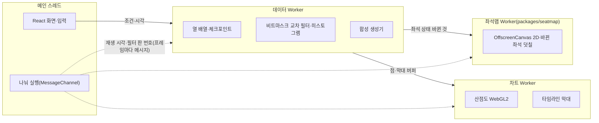

# 포렌식 리플레이 상세 설계

- **독자와 용도**: 화면 SCR-069를 만드는 프론트엔드·데이터 엔지니어가 읽는다. 이 화면에서는 지난 온세일(판매가 열리는 시각 앞뒤로 접속이 몰리는 기간)의 좌석 상태 변화와 홀드(결제하는 동안 다른 사람이 가져가지 못하게 좌석을 잠시 잡아 두는 것)·결제 흐름을 시간축으로 다시 보고, 구역·시간·결과로 걸러 봇 후보를 찾는다. 1단계 데모를 시연하는 사람과 2단계 운영 연결을 검토하는 소유자도 읽는다.
- **원문 출처**: 원문 설계서(archive/)에는 없다. 소유자가 2026-10-21에 보여 준 기획서 '티케팅 시공간 트래픽 포렌식 & 좌석 리플레이 스튜디오'(대화 첨부, 저장소에 없음)를 정본과 대조해 줄인 것이다([ADR-0080](../adr/0080-forensic-replay-synthetic-demo-first.md), 소유자 승인 '추천대로').
- **기준 기획 버전**: v1.0.
- **관련 ID**: FR-071, SCR-069, CMP-021·033·039·079, [ADR-0080](../adr/0080-forensic-replay-synthetic-demo-first.md), [ADR-0079](../adr/0079-frontend-radio-detailed-design.md), POL-006, POL-027. 보안 요구사항 추적은 [docs/security/asvs/forensic-replay.md](../security/asvs/forensic-replay.md)에 있다.

## 1. 무엇을, 왜

포렌식 리플레이 스튜디오(SCR-069)는 지난 대규모 온세일의 좌석 상태 변화와 홀드·결제 흐름을 좌석맵과 시간축(시공간 타임라인)으로 재생하고, 교차 필터로 걸러 매크로 봇 후보를 찾는 전문 분석 도구다. 사건 시각은 밀리초(ms) 단위로 담지만, 서비스끼리 시계가 밀리초 단위로 맞지 않아 서로 다른 서비스에서 난 사건의 1ms 앞뒤는 믿을 수 없다(§1.2). 봇 판정은 이 화면이 아니라 표본 검토(SCR-067)와 정해진 규칙(POL-006)으로 한다.

### 1.1 두 단계

| 단계 | 데이터 | 서버 | 쓰는 사람 | 일정 |
| --- | --- | --- | --- | --- |
| 1단계 데모 | 합성 시나리오 생성기가 만든 사건(개인정보가 없다). 부하 시험 실행 기록(합성 사용자)을 같은 형식으로 불러올 수 있다 | 없다. 정적 파일 묶음(`apps/forensics`)이다 | 누구나(포트폴리오 관람자, 소유자) | wbs 7.7.1~7.7.3(7일) |
| 2단계 운영 연결(선택) | 분석 저장소 실버의 회차 가명 사건 기록(§6). 행동 요약값·기기 묶음·네트워크 값은 내보내지 않는다(§6.3, 추천 적용 2026-10-28, 기술 검토 중간-093) | 관제 콘솔 `ops-svc`의 내보내기 API(프로그램끼리 요청과 응답을 주고받는 창구) | 가명정보(추가 정보 없이는 누구인지 알 수 없게 바꾼 정보) 취급자 | 출시 뒤. 할 일을 잘게 나눈 작업 목록인 WBS 밖의 일이다(추정 8~12일) |

- **1단계 (독립형 합성 데모)**: 서버 인프라 없이도 정적 웹 환경에서 누구나 5만 석 규모 좌석 조작과 좌석 경합 히트맵·봇 후보 산점도를 시연할 수 있도록 구현한다([ADR-0057](../adr/0057-verification-without-full-scale-infra.md)).
- **2단계 (운영 분석 연계, 선택)**: 출시 뒤 WBS 밖에서, 법률 검토 등 착수 조건(§6.1)을 채운 경우에만 한다. 분석 저장소(ClickHouse) 실버의 회차 가명 사건 기록을 관제 콘솔의 내보내기 API로 받아, 같은 화면을 실제 온세일 사후 분석에 쓴다(데이터 원천만 바뀐다, §6.8). 행동 요약값·기기 묶음·네트워크 값은 분석 저장소와 이을 키가 없어 2단계에 없다. 그래서 봇 후보 패널은 '입장 확정 → 첫 홀드' 한 축으로 본다(§6.3). 가명정보 취급자만 쓰고, 결과는 다음 회차의 봇 판정 규칙을 고치는 데만 쓴다(§6.5).

### 1.2 기획서에서 받은 것과 바꾼 것

| 기획서 | 이 설계 | 이유 |
| --- | --- | --- |
| 5만 석 좌석 공간 리플레이, 타임라인 스크러빙 | 받았다. 좌석맵 그리기는 소비자 웹과 같은 `packages/seatmap`을 쓴다(바뀐 좌석만 덧칠한다, ADR-0079 결정 9) | 같은 부품을 두 번 만들지 않는다 |
| 좌석 상태 '탐색 중' | 뺐다 | 서버는 누가 어떤 좌석을 보는지 모른다. 2단계에서도 이것을 새로 모으지 않는다(행동 신호는 요약값만 모은다, ADR-0065 결정 9) |
| 좌석별 동시 홀드 경합도 히트맵 | 1단계는 합성 데이터로 보인다. 2단계는 `HoldAttempt`에 좌석 번호를 더하는 계약 보강 뒤 보인다 | 지금 `HoldAttempt`에는 구역(`sectionId`)까지만 있다(analytics §3.4) |
| 인브라우저 OLAP(DuckDB-WASM) | 쓰지 않는다. 열 배열과 비트마스크로 교차 필터를 구현한다 | 엔진 파일이 압축 뒤 약 7.1MB(원본 35.9MB)이고 npm `latest` 태그가 개발판이다(§11). 필요한 집계는 정해진 차원의 히스토그램(값을 구간별로 나눠 센 분포 지표)이라 SQL 엔진이 필요 없다 |
| WebGPU 그리기 | 쓰지 않는다. OffscreenCanvas 2D와 WebGL2를 쓴다 | WebGPU는 Baseline이 아니다(§11). 지원 기준은 Baseline Widely available이다(질문 14) |
| SharedArrayBuffer와 `Atomics` 필수 | 1단계는 쓰지 않고 복사 방식 하나로 만든다. FX-T5·FX-T6에서 §7의 목표를 못 맞출 때만 공유 시계를 더한다(§3.3 더할 조건, 추천 적용 2026-10-28, 기술 검토 낮음-049) | 공유 메모리는 교차 출처 격리(COOP·COEP)가 있어야 쓸 수 있다. 공개 위치가 정해지지 않아(§10) 복사 방식은 어차피 만들어야 하고, 두 길을 만들고 시험하는 비용에 비해 공유 시계가 줄이는 것은 프레임마다 보내는 작은 메시지 몇 개다 |
| `scheduler.yield()`로 4ms 단위 나누기 | 공용 `MessageChannel` 나누기 함수를 쓴다(docs/frontend.md §5.2) | Safari에 `scheduler.yield`가 없다 |
| Long Animation Frames로 부하 조절 | Chromium에서만 쓰고, 다른 브라우저에서는 프레임 시간으로 판단한다 | LoAF는 Chromium에만 있다(§11) |
| 1ms 리플레이 | 사건 시각은 밀리초 단위로 담는다. 2단계에서 순서는 구역 판(`sectionVersion`)과 서비스 안 일련번호로 판정한다 | 서비스끼리 시계가 밀리초 단위로 맞지 않으므로, 서로 다른 서비스에서 난 사건의 1ms 앞뒤는 믿을 수 없다 |
| IP C클래스 서브넷 군집 | 쓰지 않는다. 대신 네트워크 유형(호스팅·프록시·그 밖)·ASN·기기 가명 묶음으로 묶는다. 이 값은 1단계 합성 데이터에만 있고, 2단계는 내보내지 않는다(§6.3) | 분석 저장소에는 IP가 없다. IP는 법정 접속기록(목적이 안전성 확보, POL-025)에만 있다 |
| 반응 속도 × 마우스 엔트로피 산점도, 봇 좌석 붉게 점등 | 받았다. 다만 '봇'이 아니라 '후보'로 점등한다. 2단계는 엔트로피가 없어 반응 속도 한 축으로 본다(§6.3) | 봇 판정은 미리 공개한 규칙과 표본 검토(SCR-067, POL-006)로 한다. 고정 문턱(예: 150ms)은 사람을 봇으로 잘못 잡는 오탐이 상한(0.5%, ADR-0039) 안인지 검증 없이 쓰지 않는다 |
| 지연 0ms, GC 0회, 16.6ms 보장 | 측정할 목표로 둔다(§7, [가정]) | 측정 전 숫자를 보장으로 쓰지 않는다 |
| 데모 프리셋과 생성기 | 받았다(§5) | 서버·개인정보 없이 시연할 수 있다 |

### 1.3 범위 밖

- 실시간 관제 화면이 아니다. 온세일 중의 판단은 SCR-029에서 한다.
- 감사 기록의 정본이 아니다. 감사 기록과 인시던트(대응이 필요한 장애나 보안 사건) 리플레이의 정본은 서버 감사 로그와 관측 기록(지표·로그·요청 기록, SCR-031, control-tower §7)이다.
- 개인에게 조치하지 않는다. 2단계 결과는 다음 회차의 판정 규칙을 고치는 데만 쓴다(§6.5).

## 2. 화면(SCR-069)

### 2.1 구성

데스크톱을 기준으로 한다(design/d5 §7.17). 다크 테마이고, 관제 콘솔과 같은 토큰(색·간격 같은 디자인 값에 붙인 이름)을 쓴다.

| 자리 | 내용 |
| --- | --- |
| 머리 | 앱 이름, <합성 데이터> 배지(1단계에서는 늘 보인다), 시나리오 ▾(프리셋 셋, §5.1), 시드, [다시 만들기], [파일 불러오기], [이 시나리오 내려받기], 공유 주소 복사 |
| 좌석 리플레이(가운데) | 좌석맵(CMP-021 `replay` 변형). 레이어는 [상태][경합][이탈]이다. 끌어서 구역 상자를 고른다. 확대·축소는 소비자 웹 좌석맵과 같다 |
| 타임라인(아래) | CMP-039 `scrub` 변형: 재생·일시정지, 배속(×1·×10·×60), 오픈 기준 시각, 끌어서 구간 고르기. 초당 홀드 시도·경합·판매 막대(CMP-033) |
| 교차 필터(오른쪽 위) | 구역, 결과(HELD·CONFLICT·LIMIT·ERROR), 사건 종류, 봇 등급(합성 정답)·네트워크 유형(1단계만)으로 거른다. 고른 범위의 시도 수, 경합 패배율, 홀드 → 판매 전환, 후보 비율을 보인다 |
| 봇 후보(오른쪽 아래) | CMP-079 산점도: 가로축은 '입장 확정 → 첫 홀드 시도'(ms, 로그 눈금), 세로축은 '포인터 이동 엔트로피'(요약값)다. 끌어서 영역을 고르면 그 세션들이 잡은 좌석이 좌석맵에 점등된다. 기기 묶음 목록도 있다(같은 기기 가명 묶음이 10ms [가정] 안에 서로 다른 좌석을 시도한 경우). 2단계는 엔트로피와 기기 묶음이 없어, 같은 자리에 '입장 확정 → 첫 홀드 시도' 한 축의 분포(막대)를 그리고 끌어서 고른 구간의 세션을 점등한다. 기기 묶음 목록은 보이지 않는다(§6.3) |
| 상태 띠(맨 아래) | 이 기기에서 잰 값: 필터 반영 시간, 프레임 시간, 긴 작업 수, 공유 메모리 켜짐 여부 |

- 후보 패널에는 늘 이 문구를 둔다: "후보 찾기용입니다. 봇 판정은 표본 검토(SCR-067)와 정해진 규칙(POL-006)으로 합니다." 1단계에는 합성 정답이 있으므로 고른 영역의 정밀도·재현율을 함께 보인다(2단계에는 정답이 없어 보이지 않는다). 그 숫자 바로 아래에는 늘 이 문구를 둔다: "합성 데이터의 정답으로 잰 값입니다. 봇을 이 특징으로 만들었기 때문에 높게 나오며, 실제 봇 탐지 성능을 뜻하지 않습니다." 생성기가 봇을 등급표대로 만들고 같은 특징(반응 시간·포인터 엔트로피)으로 찾으므로, 정밀도·재현율이 높은 것은 생성 가정의 결과다. 실제 탐지 성능(NFR-022)은 봇 판정 표본 검토(ADR-0039·0048)로만 잰다(추천 적용 2026-10-28, 기술 검토 낮음-165). 이 숫자가 생성 가정의 값이라는 것을 화면으로도 보이려고 셋째 프리셋 '사람 흉내 봇'(§5.1)을 둔다. 그 프리셋에서는 산점도로 봇을 가를 수 없어 정밀도·재현율이 봇 비율 근처로 떨어진다(기술 검토 낮음-052).
- 고르기는 모두 연결된다(브러싱과 링킹): 타임라인 구간, 좌석 상자, 산점도 영역, 필터 패널 가운데 하나를 바꾸면 나머지가 같은 조건으로 다시 그려진다.
- 세 크기(ADR-0061): 데스크톱·태블릿에서는 전부 보이고, 태블릿은 패널을 좌석맵 아래로 쌓는다. 휴대폰에서는 리플레이 보기(좌석맵·타임라인·요약)만 하고, 교차 필터·후보 패널은 '태블릿이나 데스크톱에서 봅니다' 카드로 대신한다.

### 2.2 상태

| 상태 | 화면 | 조건 |
| --- | --- | --- |
| 시나리오 만드는 중 | 진행 막대 "합성 사건 만드는 중 · 62만 / 100만" | 생성 Worker가 진행 중 |
| 재생 중 | 기본 | 사건이 준비됐다 |
| 일시정지 | 재생 단추가 ▶ | 사용자가 멈췄다 |
| 구간·영역 고름 | 고른 범위 표시와 [고르기 지우기] | 브러시·상자 |
| 파일 거절 | danger 띠 "이 파일은 열 수 없습니다(형식이 다릅니다)"와 이유 한 줄을 보인다. 아무것도 그리지 않는다 | §4.2 검증 실패 |
| 사건 일부 버림 | warning 띠 "규칙에 맞지 않는 사건 12건을 빼고 보입니다" | §4.2 일관성 규칙 |
| 공유 메모리 없음 | 상태 띠에 "복사 방식"을 보인다(정보이고 경고는 아니다) | 교차 출처 격리가 없다 |
| 그래픽 대체 | 산점도가 2D 표본 2만 점 [가정]으로 그려지고, "이 기기는 표본으로 그립니다"를 보인다 | WebGL2가 없다 |
| 돌릴 수 없음 | "이 기기에서는 리플레이를 돌릴 수 없습니다" | Worker·OffscreenCanvas가 없다 |

### 2.3 접근성

- 그림마다 같은 집계를 표로 보는 [표로 보기]가 있다(CMP-033·034와 같은 대체 뷰).
- 타임라인은 키보드로 움직인다: ←→ 1초, Shift+←→ 10초, Space 재생·일시정지, Home·End 처음·끝.
- 끌어서 고르기는 모두 숫자 입력으로도 된다(시작·끝 시각, 산점도 가로·세로 범위, 웹 접근성 국제 기준 WCAG 2.5.7).
- 좌석 상태는 색과 무늬를 함께 쓴다(좌석맵의 기존 토큰). 후보 점등은 색 외에 테두리 굵기로도 구분한다.

## 3. 구조

### 3.1 그림

### 3.2 앱과 패키지

| 위치 | 내용 |
| --- | --- |
| `apps/forensics` | Vite 8 + React 19.3(화면 라이브러리)으로 만든 정적 앱이다. 화면과 입력만 메인 스레드에 둔다 |
| `packages/seatmap` | 좌석맵 열 배열, 격자 색인, 그리기 Worker를 담는다. 소비자 웹 좌석 화면과 함께 쓴다(ADR-0080 결정 5, docs/frontend.md §2.2) |
| `packages/ds` | 다크 테마 토큰. 관제 콘솔과 같은 값을 쓴다 |
| `apache-arrow` | Arrow IPC 파일 읽기·쓰기. 이 앱에서만 쓴다(전체 최소화 판 51.5KB gzip, §11) |

1단계 앱은 `packages/api-client`를 쓰지 않는다(부를 서버가 없다). 2단계는 같은 앱을 운영 모드로 빌드해, 관제 콘솔 주소 아래에서 따로 여는 페이지로 둔다. 이때 `api-client`의 내보내기 경로를 쓴다(§6.8).

### 3.3 공유 메모리와 대체

- 1단계는 복사 방식 하나로 만든다(추천 적용 2026-10-28, 기술 검토 낮음-049). 메인 스레드가 프레임마다 재생 시각·재생 상태·필터 판 번호를 세 Worker에 메시지로 보내고, 큰 버퍼는 `Transferable`(복사하지 않고 소유권을 넘기는 방식)로 넘긴다. 교차 출처 격리가 있든 없든 같은 길이라, 공개 위치의 응답 헤더에 기대지 않는다.
- **더할 조건**: FX-T5(기준 기기)와 FX-T6에서 필터 반영 p95 50ms나 재생 프레임 p95 20ms [가정](§7)을 이 방식으로 못 맞추고, 원인이 메시지 전달로 확인될 때만 공유 시계를 더한다. 공유 시계는 `SharedArrayBuffer` 위의 `Int32Array`(재생 시각 ms, 재생 상태, 필터 판 번호)를 세 Worker가 함께 읽고 `Atomics.notify`로 깨우는 방식이다. 더해도 교차 출처 격리(`crossOriginIsolated`가 참)인 곳에서만 켜고, 그 밖에서는 복사 방식으로 돈다.
- 좌석맵 공용 패키지(`packages/seatmap`)도 공유 메모리를 쓰지 않는 메시지 한 길이다(기술 검토 중간-015, docs/frontend.md §5.2).

### 3.4 좌석 상태 재구성

- 데이터 Worker가 좌석 상태 체크포인트(그 시각의 전체 좌석 상태를 저장해 둔 것. `Uint8Array`, 좌석 하나에 1바이트)를 정한 간격마다 만든다. 간격은 고정 1초가 아니라 체크포인트 전체가 32MB [가정]를 넘지 않게 정한다: 간격(초) = max(1, 올림(회차 길이(초) × 좌석 수 ÷ 32MB))(추천 적용 2026-10-28, 기술 검토 낮음-050). 10분 회차의 5만 석이면 600초 × 5만 바이트 ≈ 30MB라 1초마다다. 한도(§4.3)인 30분·10만 석이면 1초마다로는 1,800개 × 10만 바이트 ≈ 180MB라, 6초마다(300개 ≈ 30MB)로 만든다. 1초마다 만들던 지난 설계는 한도에서 사건 열 배열(§4.2의 열 14개를 더하면 행당 37바이트, 300만 건이면 약 111MB)과 합쳐 태블릿·저사양 기기의 탭이 꺼질 수 있었다.
- 재생 위치를 어느 시각으로 옮기면, 그 앞 체크포인트에서 시작해 간격 안의 사건만 다시 적용한다. 6초 간격이면 다시 적용할 사건이 많아야 수만 건이지만, 형식 배열을 도는 일이라 수 ms 안이다 [추정, FX-T5에서 잰다]. 그리고 바뀐 좌석만 좌석맵 Worker에 보낸다.
- 상태: 빈 좌석, 홀드, 결제 중, 판매, 경합 표시(그 시각 앞뒤 1초 [가정] 안에 경합이 난 좌석). 레이어 [경합]은 좌석마다 경합 수를, [이탈]은 홀드 뒤 판매되지 않고 풀린 비율을 색의 진하기로 보인다.

### 3.5 교차 필터

- 차원은 시간 칸(100ms [가정]), 구역, 결과, 사건 종류, 봇 등급, 네트워크 유형, 기기 묶음이다.
- 필터마다 `Uint32Array` 비트마스크를 두고, 조건이 바뀐 차원의 마스크만 다시 만든다. 히스토그램은 바뀐 행만큼 더하고 빼서 갱신한다(crossfilter 방식).
- 집계는 데이터 Worker에서 하고, 메인 스레드는 결과 숫자만 받는다.

### 3.6 그리기

- 좌석맵: 소비자 웹과 같은 그리기 모듈을 쓴다. 구역별로 미리 그려 둔 그림(비트맵) 위에 바뀐 좌석만 덧칠한다(ADR-0079 결정 9).
- 산점도: WebGL2 인스턴스 그리기로 점 위치 버퍼는 한 번만 올리고, 고르기 상태 버퍼만 바꾼다. 영역 찾기는 격자 색인으로 한다.
- 타임라인 막대와 히트맵 레이어는 OffscreenCanvas 2D로 그린다.

## 4. 데이터

### 4.1 사건 모델

| 종류 | 뜻 | 2단계 원천(analytics 실버) |
| --- | --- | --- |
| `ADMIT` | 입장 확정(구매 세션 시작) | `slv_queue_entry`·`slv_purchase_session` |
| `HOLD_TRY` | 홀드 시도. 결과 HELD·CONFLICT·LIMIT·ERROR, 재시도 순번, 지연을 담는다 | `slv_hold_attempt` |
| `HOLD_END` | 홀드 끝(만료, 풀기, 결제로 넘어가기) | `slv_seat_change` |
| `PAY_TRY` | 결제 시도 시작 | `slv_payment_attempt` |
| `SALE` | 판매 확정 | `slv_seat_change`·`slv_ticket` |
| `PAY_FAIL` | 과금 없는 결제 실패·자동 취소 | `slv_payment_attempt` |

세션마다 붙는 값은 기기 가명 묶음, 네트워크 유형·ASN, 포인터 이동 엔트로피 범주(행동 요약값, 공연 상세에서 잰 것), 봇 등급(1단계는 생성기 정답, 2단계는 사후 라벨 `slv_trust_label`이 있을 때만)이다. 2단계에는 봇 등급만 붙는다. 앞의 셋은 trust-svc 원시 표(`trust.behavior_raw`)에만 있고 분석 저장소의 회차 가명과 이을 키가 없기 때문이다(§6.3, 추천 적용 2026-10-28, 기술 검토 중간-093).

### 4.2 파일 형식과 검증

Apache Arrow IPC 파일 형식(`.arrow`, 앞뒤 매직 `ARROW1`)에 사건을 한 행씩 담는다. 스키마(데이터의 구조 정의)의 메타데이터에 `schema=peaket-forensics-v1`, 시드, 생성기 판, 좌석 수, 오픈 시각(UTC)을 둔다. 2단계 내보내기 파일은 시드·생성기 판 대신 회차와 시간창을 둔다(§6.3).

| 열 | 형 | 내용 |
| --- | --- | --- |
| `t_ms` | uint32 | 오픈 기준 밀리초 |
| `kind` | uint8 | §4.1 종류 |
| `seat` | uint32 | 좌석 번호(없으면 0xFFFFFFFF) |
| `section` | uint16 | 구역 번호 |
| `session` | uint32 | 회차 안 세션 번호(1단계는 생성기 번호, 2단계는 회차 가명을 번호로 바꾼 것) |
| `result` | uint8 | 홀드·결제 결과 |
| `retry` | uint8 | 재시도 순번 |
| `latency_ms` | uint16 | 요청 지연 |
| `first_hold_ms` | uint32 | 입장 확정에서 첫 홀드 시도까지 |
| `entropy` | float32 | 포인터 이동 엔트로피(요약값, 없으면 NaN. 2단계는 늘 NaN) |
| `net_type` | uint8 | 네트워크 유형(0은 없음. 2단계는 늘 0) |
| `asn` | uint32 | ASN(호스팅·프록시일 때만, 아니면 0. 2단계는 늘 0) |
| `device_group` | uint32 | 기기 가명 묶음 번호(0은 없음. 2단계는 늘 0) |
| `bot_tier` | uint8 | 봇 등급(정답이나 사후 라벨, 없으면 0) |

검증(하나라도 실패하면 아무것도 그리지 않는다, 웹 앱 보안 검증 항목 목록인 ASVS의 5.2·1.5.2):

| 규칙 | 실패 때 |
| --- | --- |
| 확장자 `.arrow`, 크기 200MB [가정] 이하 | 읽기 전에 거절 |
| 앞뒤 매직 `ARROW1`, 스키마 이름·열 이름·형·순서가 위 표와 같음 | 거절 |
| 몸통 버퍼 압축(LZ4·ZSTD)·사전 열·모르는 열이 없음 | 거절 |
| 행 수가 열마다 같고 사건 300만 [가정] 이하 | 거절 |
| `t_ms` 오름차순, `seat` < 좌석 수, `section` < 구역 수 | 거절 |
| 홀드 끝 앞에 그 좌석의 홀드, 판매 앞에 결제 시도(일관성) | 그 사건만 버리고 버린 수를 띠로 보인다 |
| 2단계 내보내기 파일(메타데이터에 시드 대신 회차·시간창이 있다)인데 `entropy`가 NaN이 아니거나 `net_type`·`asn`·`device_group`이 0이 아님(추천 적용 2026-10-28, 기술 검토 중간-093) | 거절 |

### 4.3 한도

| 항목 | 한도 [가정] |
| --- | --- |
| 사건 수 | 300만 |
| 파일 크기 | 200MB |
| 좌석 수 | 1천~10만 |
| 회차 길이 | 오픈 뒤 30분까지 |
| 생성기 봇 비율 | 0~60% |

### 4.4 좌석 배치

생성기는 파트너 좌석맵 템플릿(CMP-078의 10종) 가운데 '아레나'·'원형 경기장' 모양을 쓴다. 실제 공연장의 배치도가 아니다(CMP-078과 같은 원칙).

## 5. 합성 시나리오 생성기

### 5.1 프리셋

| 프리셋 | 좌석 | 대기 인원 [가정] | 봇 비율 [가정] | 정렬 방식 |
| --- | --- | --- | --- | --- |
| 인기 콘서트 오픈 | 5만 석(아레나) | 30만 | 30% | 하이브리드(셔플, 순번을 무작위로 섞는 방식) |
| 스포츠 플레이오프 오픈 | 3만 석(원형 경기장) | 15만 | 10% | 선착순 |
| 사람 흉내 봇(추천 적용 2026-10-28, 기술 검토 낮음-052) | 3만 석(원형 경기장) | 15만 | 30% | 하이브리드(셔플) |

- 셋째 프리셋의 봇은 모두 봇 등급표의 3단계(사람 입력 재생, docs/perf-ledger.md §10.2)다. 반응 시간과 포인터 엔트로피를 사람 세션과 같은 분포에서 뽑으므로, 산점도(반응 시간 × 엔트로피)로는 사람과 갈리지 않는다. 고른 영역의 정밀도·재현율이 봇 비율 근처로 떨어지는 것을 보여, 앞의 두 프리셋에서 높게 나온 숫자가 생성 가정의 결과라는 것을 보인다(§2.1 고정 문구). 이런 봇은 재시도 간격·기기 묶음 같은 다른 신호나 표본 검토로만 드러난다.

### 5.2 모형

- 사람 세션: 도착, 입장 속도(입장 제어 목표), 좌석을 고르는 시간, 경합에 지면 다시 시도, 결제 이탈. 반응 시간과 엔트로피 분포는 설명용 가정이고, 사람을 잰 값이 아니다(판정용 사람 표본 ADR-0048과 다르다).
- 봇 세션: 봇 등급표의 12칸(물량·속도·계정·대기열 × 1~3단계, docs/perf-ledger.md §10)대로 움직인다. 예를 들어 속도형은 입장하자마자 홀드를 요청하고 엔트로피가 낮다. 물량형은 같은 기기 묶음에서 여러 세션이 서로 다른 좌석을 동시에 시도한다.
- 생성은 데이터 Worker에서 하고 진행률을 보인다.

### 5.3 재현성과 정답

- 시드를 고정한 의사난수(xoshiro128**, 32비트 정수 연산만 쓴다)를 쓴다. 같은 시드·매개변수·생성기 판이면 어느 브라우저 엔진에서도 같은 바이트가 나와야 하므로(FX-T1) 생성기 코드에 아래 규칙을 둔다(추천 적용 2026-10-28, 기술 검토 중간-092).
  - 정수 연산(비트 연산 포함), 사칙연산, 명세가 결과를 하나로 정한 `Math` 함수(`Math.sqrt`·`Math.imul`·`Math.fround`·`Math.floor`·`Math.trunc`·`Math.abs`·`Math.min`·`Math.max`)만 쓴다. ECMA-262는 `Math.log`·`Math.exp`·`Math.pow`·`Math.sin`·`Math.cos` 같은 함수의 계산 방법을 구현에 맡기고 근삿값만 요구한다. 그래서 엔진마다 마지막 자리가 달라질 수 있다. 사칙연산과 `Math.sqrt`는 정확히 반올림한 값으로 정해져 있다(ECMA-262 §21.3.2 머리말과 `Math.sqrt`·`Math.exp` 절, 2026-10-28 확인). `Math.random`, 시각(`Date.now`·`performance.now`), 지역 설정에 따라 결과가 달라지는 함수도 쓰지 않는다. 생성기 패키지의 ESLint 규칙(`no-restricted-properties`)이 이 함수들을 막는다.
  - 로그·지수 함수가 필요한 분포(도착 간격의 지수 분포, 반응 시간의 로그 정규 분포 같은 것)는 빌드 때 만든 역누적분포 표(상수 배열 4,096칸 [가정])로 만든다. 의사난수의 위 12비트로 칸을 고르고, 아래 비트로 그 칸과 다음 칸 사이를 사칙연산으로 잇는다. 표는 소스에 숫자로 적어 두고, 표를 만드는 빌드 스크립트의 출력도 FX-T1이 함께 본다.
  - 공유 주소에는 시드와 매개변수만 싣는다. 같은 판의 생성기라면 어느 엔진에서 열어도 같은 시나리오다.
- 합성 데이터라 세션마다 봇인지 아닌지 정답이 있다. 후보 영역의 정밀도·재현율을 보여 '이 고르기가 얼마나 맞나'를 시연한다. 이 값은 합성 정답 기준이고 실제 봇 탐지 성능의 근거가 아니다. 봇을 등급표대로 만들고 같은 특징으로 찾으므로 생성 가정이 맞으면 높게 나올 뿐이다. 실제 평가는 ADR-0039·0048의 표본 검토로 하고(NFR-022), 성능 장부·포트폴리오 설명에도 이 값을 탐지 성능으로 옮기지 않는다(§2.1 고정 문구, 추천 적용 2026-10-28, 기술 검토 낮음-165).

## 6. 2단계: 운영 연결(선택, 출시 뒤)

### 6.1 착수 조건

1. 법률 검토: 분석 저장소의 가명정보를 봇 방어 규칙 개선에 쓰는 것이 처리 목적(개인정보 보호법 §28의2) 안에 드는지(POL-027 확인 필요).
2. 보안 추적 표의 '(2단계)' 행을 다시 판정한다.
3. `HoldAttempt`에 좌석 번호를 더하도록 계약을 보강한다(asyncapi `telemetry.purchase`, 저장량 재계산).
4. 위 결과를 담은 새 ADR(아키텍처 결정과 그 이유를 남긴 기록)을 쓴다.

### 6.2 권한

| 역할 | 할 수 있는 것 |
| --- | --- |
| 가명정보 취급자(개인정보 보호책임자가 지정한 commander, analytics §11) | 회차와 시간창을 고르고 사유를 적어 내보내기를 만든 뒤, 그것으로 다시 본다 |
| 그 밖의 관제 역할 | 없다(화면이 메뉴에 보이지 않고, 서버가 403을 돌려준다) |
| 파트너 | 없다 |

### 6.3 내보내기 API 초안과 열 허용 목록

초안이며, 2단계를 시작할 때 openapi에 넣는다.

- `POST /v1/forensics/exports`(`ops-api`): 본문은 `{eventId, fromMs, toMs, reason}`이다. 시간창은 오픈 뒤 30분 [가정] 안이어야 하고, 회차는 실버 보존 기간(90일) 안이어야 한다. 응답은 202 `{exportId}`다.
- `GET /v1/forensics/exports/{exportId}`: 만든 계정의 세션만 받는다. 응답은 200 `application/vnd.apache.arrow.file`, `Cache-Control: no-store`다. 결과는 서버에 남기지 않고 흘려보낸다. `Content-Disposition`은 붙이지 않는다. `attachment`를 붙이면 같은 세션이 주소를 직접 열 때 가명정보 파일이 디스크에 저장되어, '브라우저 메모리에만 둔다'(§6.5)와 어긋나기 때문이다. 같은 이유로 `Sec-Fetch-Mode`가 `navigate`(주소창·링크로 연 요청)이면 Problem 403으로 거절하고, `cors`·`same-origin`이면서 `Sec-Fetch-Site`가 `same-origin`인 요청만 받는다. 앱은 `fetch`로만 받아 메모리에 둔다(추천 적용 2026-10-28, 기술 검토 낮음-051).
- 열 허용 목록: §4.2의 열만 낸다. `entropy`는 NaN, `net_type`·`asn`·`device_group`은 0으로 비워 낸다. 원본 pid·IP·기기 원문·계정 정보는 없다. ClickHouse(대량 이벤트 집계에 강한 분석용 데이터베이스)에서는 `an_forensic_reader`(실버의 해당 표만 읽는다. `trust.behavior_raw`는 읽지 않는다)로 읽고, `FORMAT ArrowStream` 출력을 파일 형식으로 바꿔 낸다. 쿼리에는 `SETTINGS output_format_arrow_compression_method = 'none', output_format_arrow_low_cardinality_as_dictionary = 0`을 붙인다. 앞의 것은 기본값이 `lz4_frame`이라, 그대로 두면 앱의 파일 검증(§4.2 '몸통 버퍼 압축 없음')이 내보내기를 모두 거절한다. 뒤의 것은 사전 열이 생기지 않게 하는 설정이고, 기본값도 꺼짐이지만 적어 둔다(ClickHouse 26.8 소스 `FormatFactorySettings.h`, 2026-10-28 확인, 기술 검토 낮음-051).
- **행동 요약·기기 묶음을 내보내지 않는 이유(추천 적용 2026-10-28, 기술 검토 중간-093)**: 실버의 사건은 회차별 분석 가명이고, `trust.behavior_raw`는 trust-svc의 사람 식별값(pid)과 탐지 가명(`deviceRef`)을 쓴다. 둘을 이을 키가 없다. 분석 가명 키는 원본 적재 작업자만 쓰고(analytics §11, 개인정보 보호법 §28의4①), 분석 저장소는 행동 신호를 싣지 않으며(analytics §3.1), 2단계는 운영 DB·trust-svc 원천과 잇지 않는다(asvs/forensic-replay 법률 표). 세 안을 견줬다.
  - (가) 원본 적재 작업자가 `telemetry.behavior`의 요약 열만 회차 가명으로 바꿔 실버에 싣는다(30일 보존): 산점도 두 축과 기기 묶음이 살아난다. 하지만 분석 저장소에 행동 신호와 기기 묶음이 새로 들어와 가명정보의 범위가 넓어지고, 한 회차 안에서 행동·기기·네트워크를 함께 보게 되어 다시 알아볼 위험이 커진다. 처리 목적 검토(착수 조건 1)도 넓어진다.
  - (나) 2단계 내보내기에서 행동 요약·기기 묶음·네트워크 열을 빼고 사건만 낸다: 지금의 세 규칙을 그대로 지킨다. 다음 회차 규칙 개선에 쓰는 사건 시각 패턴(입장 → 첫 홀드, 재시도 간격, 결과)과 사후 라벨은 그대로 남는다. 행동·기기 신호를 쓰는 규칙은 그 신호를 가진 trust-svc의 그림자 실행으로 고친다(ADR-0039·0112).
  - (다) 이 문제가 풀릴 때까지 2단계를 열지 않는다: 위험은 없지만, 충돌하지 않는 사건 재생까지 막는다.
  - 고른 안은 (나)다. 2단계를 시작할 때 쓰는 새 ADR(§6.1 착수 조건 4)이 이 결정을 이어받는다. 실제 규칙 개선에서 행동 요약이 꼭 필요하다는 근거(사건만으로 찾지 못한 봇 유형)가 나오면 그 ADR에서 (가)를 법률 검토와 함께 다시 본다.
- 한도: 계정당 하루 5회 [가정], 시간창 30분 [가정].

### 6.4 기록

- 내보내기 만들기·받기·거절을 관제 감사 기록(SCR-031 '명단 다운로드 기록' 탭과 같은 표)과 가명정보 이용 내역(`pseudonymization_log`, analytics §11)에 남긴다. 남기는 항목은 계정, 역할, 회차, 시간창, 열 목록, 행 수, 사유, 결과, 시각이다.
- 권한 밖 시도와 한도 초과가 되풀이되면 보안 이벤트로 경보를 낸다(실버 대량 조회 경보와 같은 경로).

### 6.5 쓰임 제한

- 결과는 다음 회차 봇 판정 규칙을 고치는 데만 쓴다. 고친 규칙은 그림자 실행으로 사람 오탐을 잰 뒤 채택한다(ADR-0039). 특정 개인을 알아보거나 그 사람에게 조치하는 데 쓰지 않는다(개인정보 보호법 §28의5). 그래서 이 화면에서는 자동화된 결정(§37의2)이 생기지 않는다.
- SCR-031(감사 로그·리플레이)과 SCR-067(봇 판정 표본 검토)에서 회차를 넘겨 새 탭으로 연다(§6.8). SCR-067의 표본 판정 기록에는 지금처럼 세션 ID와 판정 결과만 남는다(POL-006).
- 브라우저 메모리에만 두고 저장하지 않는다. 앱은 `fetch`로만 받고, 받기 응답은 내려받기를 부르는 `Content-Disposition`을 두지 않으며 주소 직접 열기를 거절한다(§6.3). 탭을 닫거나 30분 [가정] 동안 쓰지 않으면 지운다.

### 6.6 데이터 공백과 한계

- 좌석 단위 경합은 §6.1의 계약 보강 전까지 구역 단위로만 보인다.
- 사건 기록은 90일만 남으므로, 보존 기간이 지난 회차는 다시 볼 수 없다.
- 행동 요약값·기기 묶음·네트워크 유형은 2단계에 없다(§6.3). 봇 후보는 '입장 확정 → 첫 홀드' 한 축과 결과·재시도 패턴, 사후 라벨로만 찾는다. 같은 기기에서 여러 세션을 돌리는 봇처럼 기기 신호로만 드러나는 유형은 이 화면에서 찾지 못하고, trust-svc의 판정과 표본 검토(SCR-067)가 맡는다.
- '탐색 중'은 없다. 반응 시간은 서버 시각으로 잰 '입장 확정 → 첫 홀드'이고, 화면 반응 시간이 아니다.
- 서비스끼리의 사건 순서는 밀리초 시각만으로 정하지 않는다(§1.2).

### 6.7 일정

출시 뒤 선택 사항이라 WBS에 넣지 않았다. 내보내기 API·권한·기록 3~4일, 콘솔 주소 아래 따로 여는 페이지로 올리기(운영 모드 빌드, 경로·헤더 규칙, 로그인·재인증 연결, §6.8) 2~3일, 계약 보강과 저장량 재계산 1~2일, 법률 검토 반영과 시험 2~3일로, 합하면 8~12일 [추정]이다.

### 6.8 화면 위치와 배포(추천 적용 2026-10-21)

소유자가 "포렌식 리플레이는 기존 플랫폼에 통합하는게 좋을까요?"라고 물었다. 그리고 답(1단계는 따로 두고, 2단계는 관제 콘솔에 붙이되 따로 여는 페이지로)을 본 뒤 문서에 반영하라고 했다(ADR-0080 상태 줄).

| 부분 | 정한 것 |
| --- | --- |
| 위치 | 관제 콘솔 주소 아래에서 따로 여는 페이지 `console.peaket.example/forensics?event=`다. 하위 경로가 없는 페이지 하나다. 관제 콘솔 화면 묶음(한 페이지 앱) 안의 경로나 원격 위젯이 아니다 |
| 코드 | 1단계와 같은 `apps/forensics`를 운영 모드로 빌드한다. 데이터 원천만 합성 생성기·파일에서 §6.3 내보내기로 바뀌고, 파일 불러오기·시나리오 단추를 뺀다 |
| 여는 길 | 관제 메뉴(가명정보 취급자에게만 보인다)와 SCR-031·SCR-067에서 회차를 넘겨 새 탭으로 연다(`rel="noopener"`). 머리 끝에 관제 콘솔로 가는 링크를 둔다 |
| 로그인·권한 | 같은 출처라서 운영자 쿠키(브라우저가 사이트별로 저장했다가 요청마다 함께 보내는 작은 값, `__Host-`)와 관리자 IP 제한(docs/infra.md §9)을 그대로 받는다. 역할은 `ops-svc`가 확인하고(§6.2), 403 `reauth-required`가 오면 관제와 같은 `ReauthPrompt`(CMP-064)를 띄운다 |
| 기록 | §6.4 그대로(관제 감사 기록과 가명정보 이용 내역) |
| 싣지 않는 것 | 관제 셸(머리·메뉴·경보 패널), 실시간 연결(관제 SSE 흐름. 2026-10-28 Socket.IO·graphql-ws에서 바꿈, ADR-0100), 원격 위젯 |
| 헤더 | 관제 묶음 C에 COEP `require-corp`를 이 경로에만 더한다. 관제는 이미 COOP `same-origin`이므로 교차 출처 격리가 켜진다(docs/frontend.md §5.14.1). 앱은 복사 방식 하나로 돌고, 공유 시계는 §3.3의 더할 조건이 생겼을 때만 이 격리 위에서 켠다(기술 검토 낮음-049) |
| 배포 | console 배포의 S3(아마존의 파일·객체 저장소) `/forensics/`에 둔다. 콘솔이 모든 경로를 'index.html'로 보내는 규칙에서 빼고, 캐시(자주 쓰는 값을 가까운 곳에 복사해 둔 것) 동작 `/forensics*`에 따로 응답 헤더 정책을 단다(docs/frontend.md §5.18, docs/devops.md §6.6) |
| 예산 | §7 그대로. 관제 호스트 예산(docs/frontend.md §5.8)에 들지 않는다 |

이유:

- 관제 콘솔은 webpack과 원격 위젯 구조이고, 이 앱은 Vite 앱이다. 콘솔 안으로 옮기면 화면을 다시 만들어야 한다. 원격 위젯으로 끼우기에는 원격마다 정한 예산(docs/frontend.md §5.8)보다 크다.
- 사건·파일 상한(§4.3)까지 메모리에 올리는 분석이 온세일 중 판단·조작 도구(ADR-0067)와 같은 문서(웹 페이지)에서 돌면, 무거운 계산이 관제 화면을 느리게 하거나 메모리 부족으로 탭이 꺼질 때 관제 화면도 함께 잃을 수 있다. 따로 연 탭에서는 이 위험이 크게 준다.
- 이 경로에만 COEP를 줄 수 있으므로, 공유 시계를 더하게 되면(§3.3 더할 조건) 2단계에서는 쓸 수 있다. 소비자 웹 좌석 화면은 공유 메모리를 쓰지 않고 메시지 한 길이다(기술 검토 중간-015, docs/frontend.md §5.2).
- 같은 출처라서 로그인·접속 제한·감사 기록을 새로 만들지 않는다. 대신 콘솔과 출처를 나누지 않으므로 이 페이지의 결함이 콘솔 세션에 닿을 수 있다. 그래서 콘솔과 같은 CSP(페이지가 실행할 수 있는 스크립트의 출처를 정하는 브라우저 규칙)·Trusted Types 보고 모드·출력 규칙(데이터 값은 글자만 담는 텍스트 노드로만 넣는다)을 따른다.

## 7. 성능 목표

아래 목표는 모두 [가정]이다. 기준 기기(관제 콘솔 기준 데스크톱, NFR-012의 측정 방식)에서 wbs 7.7.3 때 잰다. 숫자는 성능 장부에 원본과 함께 남긴다.

| 항목 | 목표 [가정] | 재는 법 |
| --- | --- | --- |
| 합성 100만 사건 생성·색인 | 3초 안. 메인 스레드의 50ms 이상 긴 작업 0 | 생성 Worker의 시각 표시, Long Tasks |
| 필터·구간 바꿈 → 모든 그림 반영 | p95 50ms(백 번 중 아흔다섯 번이 이 시간 안에 끝난다는 뜻). 한 프레임 16.7ms 안이면 좋다 | `performance.mark` 이벤트 시각부터 그림 완료까지 |
| 재생·스크러빙 프레임 | p95 20ms 이하(초당 50프레임 이상) | `requestAnimationFrame` 간격 |
| 상호작용 반응 | 조작에 화면이 반응하기까지 걸린 시간인 INP가 200ms 이하(CPU를 4배 느리게 한 스로틀 조건) | Playwright 성능 추적(docs/frontend.md §5.8) |
| 10분 연속 재생 | 힙 증가 5% 이하, 프레임 급락 0 | memlab, 프레임 간격 |
| 한도 시나리오의 힙(사건 300만·좌석 10만·30분, §4.3) | 데이터 Worker 힙 200MB 이하(사건 열 배열 약 111MB + 체크포인트 32MB 이하 + 필터 비트마스크·히스토그램), 탭 전체 300MB 이하. 재생 위치를 옮기는 데 p95 50ms 이하(기술 검토 낮음-050) | memlab과 Chromium 성능 추적의 Worker별 JS 힙 크기 |
| 첫 화면 | 첫 JS 200KB [가정](gzip, `apache-arrow` 포함) + Worker 80KB [가정] | size-limit |

## 8. 시험

| ID | 대상 | 확인 | 언제 |
| --- | --- | --- | --- |
| FX-T1 | 생성기 재현성(기술 검토 중간-092) | 같은 시드·매개변수·판으로 Chromium·WebKit·Firefox 세 엔진(Playwright)에서 만든 파일의 SHA-256이 모두 같다. 다른 시드면 다르다. 역누적분포 표 빌드 스크립트를 다시 돌린 출력이 소스의 표와 같다. 생성기 패키지에서 금지 함수(`Math.log`·`Math.exp`·`Math.pow`·삼각 함수·`Math.random`·`Date.now`)를 쓰면 린트가 PR을 막는다. 연결: FR-071 | PR |
| FX-T2 | 파일 검증 | 매직 없음·스키마 다름·압축 버퍼·행 수 다름·200MB 초과·시각 역행 파일을 모두 거절하고 아무것도 그리지 않는다 | PR |
| FX-T3 | 좌석 상태 재구성 | 처음부터 다시 적용한 결과 = 체크포인트 + 이후 사건 = 생성기 정답(무작위 시각 100곳). 연결: FR-071 | PR |
| FX-T4 | 교차 필터 정확성 | 비트마스크 집계 = 전 행을 도는 기준 구현(무작위 조건 500개) | PR |
| FX-T5 | 성능 | §7 표(기준 기기) | 7.7.3 |
| FX-T6 | 복사 방식의 성능(기술 검토 낮음-049) | 교차 출처 격리가 없는 문서에서 FX-T4 일부가 같은 결과를 내고, 필터 반영·프레임 시간을 기록한다. FX-T5와 함께 §7 목표를 못 맞추면 §3.3의 '더할 조건'을 검토한다 | PR |
| FX-T7 | 그래픽 대체 | WebGL2를 끄면 2D 표본 산점도와 안내가 나온다 | PR |
| FX-T8 | 접근성 | 키보드로 재생·되감기·구간 고르기가 된다. 표 보기 내용 = 그림 집계, axe 위반 0 | PR |
| FX-T9 | 후보 패널 | 고정 문구 둘(후보 찾기용, 정밀도·재현율은 합성 정답 기준이라 실제 탐지 성능이 아님)이 늘 보이고, 합성 정답 기준의 정밀도·재현율 계산이 맞는다(문구 둘째는 추천 적용 2026-10-28, 기술 검토 낮음-165). '사람 흉내 봇' 프리셋에서는 세션 1,000개 이상을 담은 산점도 영역이면 어디를 골라도 정밀도가 봇 비율 + 10%p [가정]를 넘지 않는다(기술 검토 낮음-052). 연결: FR-071 | PR |
| FX-T10 | 2단계 권한·기록 | 취급자가 아니면 403, 사유가 없으면 422, 시간창 초과면 422. 성공하면 감사·이용 내역이 남고, 허용 목록 밖의 열은 없으며, `entropy`는 모두 NaN, `net_type`·`asn`·`device_group`은 모두 0이다(§6.3, 기술 검토 중간-093). `an_forensic_reader`로 `trust.behavior_raw`를 읽으려 하면 권한 오류다. 응답은 `no-store`이고 `Content-Disposition`이 없다. 받기 주소를 직접 열면(`Sec-Fetch-Mode: navigate`) 403이다. 받은 파일은 몸통 버퍼가 압축되지 않고 사전 열이 없어 FX-T2 검증을 통과한다(기술 검토 낮음-051). 연결: FR-071 | 2단계 |

## 9. 운영 확인(architecture §8.4)

| 확인할 동작 | 사건·필드 | SLI | 대시보드 패널 | 경보 | 배포 뒤 확인 방법 |
| --- | --- | --- | --- | --- | --- |
| 1단계 데모가 뜬다 | 서버가 없어 수집하는 사건이 없다 | 없다 | 없다 | 없다 | 확인 불가(서버가 없다). 공개 위치에 올릴 때 FX-T1·T5를 다시 돈다 |
| (2단계) 내보내기가 권한 안에서만 나간다 | 정규 로그 줄 `forensics_export`(계정, 회차, 시간창, 행 수, 결과) | 없다 | 관제 감사 패널 | 권한 밖 반복·한도 초과(보안 이벤트, 숫자가 작을수록 심각한 장애 심각도 등급 중 SEV3 [가정]) | 카나리 배포 뒤 감사 기록과 이용 내역을 대조한다 |

## 10. 남는 한계

- 1단계는 합성 데이터라 실제 온세일을 증명하지 않는다. 실제 사람의 반응 시간·엔트로피 분포가 아니다.
- 1단계를 공개할 위치는 응답 헤더를 정할 수 있어야 한다. 어디에 둘지는 출시 준비 때 소유자가 정한다(상시 데모 없음 결정 ADR-0057과의 관계를 확인한다).
- 2단계는 법률 검토 결과에 따라 열리지 않을 수 있다.
- 2단계 페이지는 쿠키와 접속 제한을 같이 받으려고 관제 콘솔과 같은 출처에 두므로, 이 페이지의 결함이 콘솔 세션에 닿을 수 있다. 콘솔과 같은 CSP·출력 규칙으로 위험을 줄일 뿐이다(§6.8).
- 좌석 단위 경합은 2단계 계약 보강 전까지 구역 단위다. '탐색 중'은 어느 단계에도 없다.
- 2단계에는 행동 요약·기기 묶음·네트워크 값이 없어, 기기 신호로만 드러나는 봇은 이 화면에서 찾지 못한다(§6.3·§6.6, 기술 검토 중간-093).
- 1단계 분포는 역누적분포 표(4,096칸 [가정])로 근사하므로, 꼬리 쪽 값은 칸 사이를 선형으로 이은 만큼 거칠다. 설명용 합성 데이터라 이 정밀도로 쓴다(§5.3, 기술 검토 중간-092).
- 1단계는 공유 메모리 없이 복사 방식으로만 돌아, 프레임마다 메시지를 보내는 만큼 반응이 조금 늦을 수 있다. 얼마나 늦는지는 FX-T5·FX-T6에서 재고, 목표를 못 맞출 때만 공유 시계를 더한다(§3.3, 기술 검토 낮음-049).
- `apache-arrow`는 이 앱의 가장 큰 의존 패키지이므로 size-limit 예산(docs/frontend.md §5.8)으로 크기를 지킨다.

## 11. 확인한 외부 사실(2026-10-21)

| 사실 | 출처 |
| --- | --- |
| DuckDB-WASM: npm `latest` 태그가 1.33.1-dev57.0(2026-06-22), 마지막 정식은 1.32.0(2025-12-16). `duckdb-eh.wasm` 원본 35,913,747바이트, brotli 약 7.1MB, gzip 약 8.1MB | npm 레지스트리, unpkg 파일 목록, jsDelivr 내려받기 측정 |
| apache-arrow(JS) 21.2.0(2026-07-21), `Arrow.es2015.min.js` 192,563바이트, gzip 약 51.5KB | npm 레지스트리, jsDelivr 내려받기 측정 |
| Arrow IPC 파일 형식은 앞뒤에 매직 `ARROW1`, 메시지는 `0xFFFFFFFF` 계속 표시, 몸통 버퍼 압축은 LZ4·ZSTD 선택 | Apache Arrow Columnar Format 문서 |
| WebGPU는 Baseline 아님(Chrome 144, Chrome Android 121, Edge 144, Safari·iOS Safari 26). 공유 메모리는 Baseline 2021-12, OffscreenCanvas는 2023-03, WebGL2는 2021-09, Long Animation Frames는 Chromium만, `Atomics.waitAsync`는 Baseline 2025-11 | web-features 3.43.0 |
| ClickHouse는 Arrow·ArrowStream·Parquet 입출력 형식을 지원한다 | ClickHouse 문서 'Formats for input and output data' |
| (2026-10-28 확인) ECMA-262는 `acos`·`cos`·`exp`·`log`·`pow`·`random`·`sin`·`tan` 등 23개 `Math` 함수의 동작을 정확히 정하지 않고 근삿값만 요구하며, 계산 방법은 구현에 맡긴다. `Math.sqrt`는 정확한 제곱근을 반올림한 값을 돌려준다 | ECMA-262 §21.3.2 머리말, §21.3.2.33 `Math.sqrt`, §21.3.2.14 `Math.exp`(tc39.es/ecma262) |
