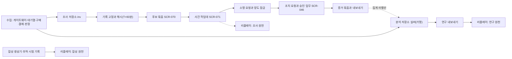
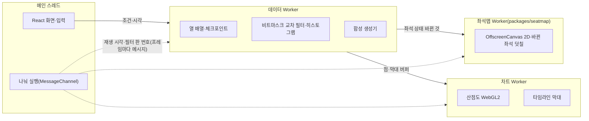
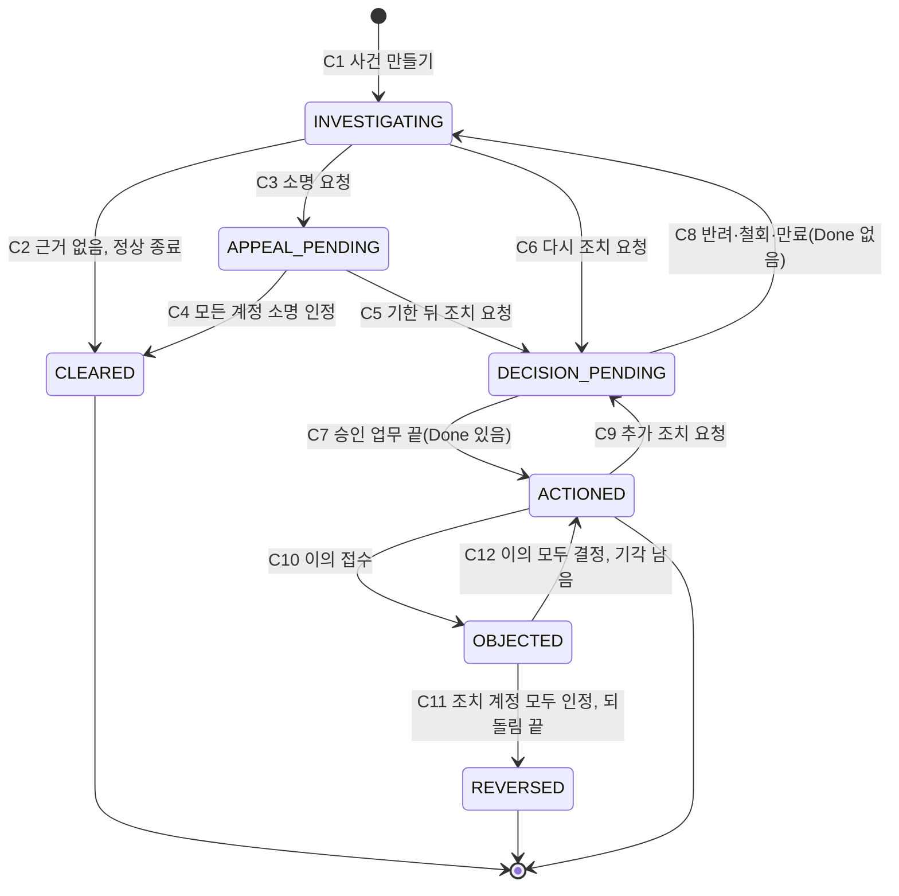

# 사후 포렌식 상세 설계: 포렌식 리플레이와 부정 거래 조사

- **독자와 용도**: 사후 포렌식을 만드는 프론트엔드·백엔드·데이터 엔지니어와 보안 검토자가 읽는다. 사후 포렌식은 온세일(판매가 열리는 시각 앞뒤로 접속이 몰리는 기간)이 끝난 뒤 실제 기록으로 봇·매크로 부정 예매를 찾고, 사람이 소명과 2인 승인을 거쳐 취소·이용 제한을 정하는 기능이다. 이 문서는 지난 회차를 좌석맵과 시간축으로 다시 보는 화면(SCR-069)과, 후보 묶음·사건·증거 묶음을 다루는 관제 콘솔의 부정 거래 조사(SCR-070·071)를 함께 설계한다. 데이터 원천은 조사 갈래, 연구 갈래, 시험·시연 셋이다(§1.1). 시연하는 사람과, 조사 절차를 검토하는 소유자·법률 검토자도 읽는다.
- **원문 출처**: 원문 설계서(archive/)에는 없다. 소유자가 2026-10-21에 보여 준 기획서 '티케팅 시공간 트래픽 포렌식 & 좌석 리플레이 스튜디오'(대화 첨부, 저장소에 없음)를 정본과 대조해 줄였고([ADR-0080](../adr/0080-forensic-replay-synthetic-demo-first.md), 소유자 승인 '추천대로'), 2026-10-31 소유자 승인으로 실제 기록을 쓰는 사후 분석을 출시 범위에 넣어 다시 썼다([ADR-0171](../adr/0171-post-sale-forensics-in-launch-scope.md), BUILD_ORDER FRN-020).
- **기준 기획 버전**: v1.0.
- **관련 ID**: FR-071~074, FR-034, FR-064, SCR-042·046·067·069·070·071, POL-006·025·027·033·038·046, [ADR-0171](../adr/0171-post-sale-forensics-in-launch-scope.md), [ADR-0080](../adr/0080-forensic-replay-synthetic-demo-first.md), [ADR-0079](../adr/0079-frontend-radio-detailed-design.md), ADR-0039·0046·0053·0064·0065·0075, CMP-021·033·039·060·063·064·079. 보안 요구사항 추적은 [docs/security/asvs/forensic-replay.md](../security/asvs/forensic-replay.md)에 있다.
- **이번 판에서 정한 것**: 범위·두 갈래·사람이 결정하는 조치·화면 위치는 소유자 승인이고(ADR-0171 결정 1~4·7), 공통 이름(여정 ID, 조사 저장소 `inv`, 표 이름, 사건 상태, 조사 API 경로)은 FRN-020·030·040이 함께 쓰는 약속을 따른다. 그 밖의 숫자와 세부는 추천 적용(2026-10-31, ADR-0171)이고 [가정]을 붙였다. 조사용 기록을 모으는 쪽(추적 ID, 기기 키 통일, 결제 수단 지문, 홀드 시도의 좌석, 행동 요약을 재는 곳)은 FRN-030에서 각 서비스 문서와 계약에 들어간다. 이 문서는 그 기록을 쓰는 쪽만 다룬다.

## 1. 무엇을, 왜

온세일 중에는 봇을 막는 데 한계가 있다. 판정이 빨라야 하고, 사람을 봇으로 잘못 잡으면 안 되기 때문이다(POL-006). 그래서 판매가 끝난 뒤 실제 기록을 모아 보면, 이름이 다른 여러 계정이 같은 기기·결제 수단·연락처를 쓰며 1인 한도를 넘게 산 묶음이 드러난다. 미국 FTC와 영국 법원의 암표 사건에서도 핵심 증거는 이런 연결이었다(§11.2). 사후 포렌식은 이 연결을 찾고(후보 묶음), 사람이 근거를 보고 소명을 받은 뒤, 다른 사람의 승인을 거쳐 취소·이용 제한을 정하고, 그 근거를 증거 묶음으로 남긴다.

리플레이 화면(SCR-069)은 지난 회차의 좌석 상태 변화와 대기열 진입·홀드(결제하는 동안 다른 사람이 가져가지 못하게 좌석을 잠시 잡아 두는 것)·결제 흐름을 좌석맵과 시간축(시공간 타임라인)으로 재생하고, 교차 필터로 걸러 본다. 사건 시각은 밀리초(ms) 단위로 담지만, 서비스끼리 시계가 밀리초 단위로 맞지 않아 서로 다른 서비스에서 난 사건의 1ms 앞뒤는 믿을 수 없다(§1.2). 봇 판정은 이 화면이 하지 않는다. 온세일 중 판정은 표본 검토(SCR-067)와 정해진 규칙(POL-006)으로 하고, 판매 뒤 조치는 사건 작업대(SCR-071)에서 소명과 승인을 거쳐 한다(POL-046).

### 1.1 세 원천

| 원천 | 데이터 | 서버 | 쓰는 사람 | 목적 | 근거 |
| --- | --- | --- | --- | --- | --- |
| 조사 갈래 | 조사 저장소 `inv`의 회차 기록(요청 신호, 여정 단계, 화면별 행동 요약, 계정 연결)과 운영 DB의 계정·주문·결제 | 관제 콘솔 `ops-svc`의 조사 모듈 | 지정 부정 거래 조사관(commander나 `cs_lead`에게 붙는 지정) | 부정 예매의 탐지, 사람이 결정하는 취소·이용 제한, 신고기관·수사기관 자료 제출, 기획사 보고 | 개인정보 보호법 §15①4(계약 이행)나 §15①6(정당한 이익) 가운데 법률 검토로 정한다(법률 확인 30번) |
| 연구 갈래 | 분석 저장소 실버(분석 저장소에서 사건을 한 줄씩 담는 층)의 회차 가명 사건. 가명정보는 추가 정보 없이는 누구인지 알 수 없게 바꾼 정보다 | `ops-svc`의 연구 내보내기 | 가명정보 취급자(개인정보 보호책임자가 지정한 commander) | 다음 회차 봇 판정 규칙의 탐지율과 사람 오탐을 가설로 세우고 그림자 실행(새 규칙을 결과에 반영하지 않고 함께 돌려 보는 것, ADR-0039)으로 검증한다. 개인 조치에 쓰지 않는다 | §28의2 과학적 연구(법률 확인 31번) |
| 시험·시연 | 합성 시나리오 생성기가 만든 사건과 부하 시험 실행 기록(합성 사용자). 개인정보가 없다 | 없다. 정적 파일 묶음(`apps/forensics`)이다 | 누구나(포트폴리오 관람자, 소유자, 시험 담당자) | 출시 전 시험 데이터와 시연 | 해당 없음 |

- **조사 갈래**는 출시 범위의 필수 기능이다(ADR-0171 결정 1). 온세일 윈도우(T−10분부터 T+60분까지. T는 판매 시작 시각)가 끝나면 기록을 고정하고(§6.7.2) 후보 묶음을 자동으로 만든다(§6.7.3). 조사관이 사건을 만들어 조사하고, 소명을 요청하고, 조치를 요청한다(§6.7.4·§6.7.5). 조치한 사건은 증거 묶음으로 따로 보존한다(§6.7.6).
- **연구 갈래**는 지난 설계의 '2단계'를 이어받는다. 분석 저장소 실버의 회차 가명 사건을 관제 콘솔의 내보내기 API(프로그램끼리 요청과 응답을 주고받는 창구)로 받아, 같은 리플레이 화면으로 다시 본다(§6.3). 행동 요약값·기기 묶음·네트워크 값은 분석 저장소와 이을 키가 없어 연구 갈래에 없다. 결과는 다음 회차의 판정 규칙을 고치는 데만 쓴다(§6.5).
- **시험·시연**은 지난 설계의 '1단계 데모'다. 서버 없이 정적 웹 환경에서 5만 석 규모 좌석 조작과 경합 히트맵·봇 후보 산점도를 시연한다([ADR-0057](../adr/0057-verification-without-full-scale-infra.md)). 같은 생성기로 조사 갈래의 시험 시드도 만든다(§5.5).
- **두 갈래를 잇지 않는다**: 데이터를 서로 잇는 키, 한 화면에서 같이 보는 동선, 내보낸 파일을 다른 갈래로 넣는 길을 두지 않는다(§6.6). 가명 기록을 실명 주문과 맞춰 보면 §28의5(재식별 금지) 위반이다.

### 1.2 기획서에서 받은 것과 바꾼 것

| 기획서 | 이 설계 | 이유 |
| --- | --- | --- |
| 5만 석 좌석 공간 리플레이, 타임라인 스크러빙 | 받았다. 좌석맵 그리기는 소비자 웹과 같은 `packages/seatmap`을 쓴다(바뀐 좌석만 덧칠한다, ADR-0079 결정 9) | 같은 부품을 두 번 만들지 않는다 |
| 좌석 상태 '탐색 중' | 뺐다 | 서버는 누가 어떤 좌석을 보는지 모른다. 사후 포렌식에서도 이것을 새로 모으지 않는다(행동 신호는 요약값만 모은다, ADR-0065 결정 9, ADR-0171 결정 4) |
| 좌석별 동시 홀드 경합도 히트맵 | 시험·시연은 합성 데이터로 보인다. 조사 갈래는 홀드 시도마다 좌석 번호와 잡은 시각을 남기는 수집 보강(ADR-0171 결정 4, FRN-030) 뒤 좌석 단위로 보인다. 연구 갈래도 그 보강이 `HoldAttempt` 계약에 들어가면 같다 | 지금 `HoldAttempt`에는 구역(`sectionId`)까지만 있다(analytics §3.4) |
| 인브라우저 OLAP(DuckDB-WASM) | 쓰지 않는다. 열 배열과 비트마스크로 교차 필터를 구현한다 | 엔진 파일이 압축 뒤 약 7.1MB(원본 35.9MB)이고 npm `latest` 태그가 개발판이다(§11.1). 필요한 집계는 정해진 차원의 히스토그램(값을 구간별로 나눠 센 분포 지표)이라 SQL 엔진이 필요 없다 |
| WebGPU 그리기 | 쓰지 않는다. OffscreenCanvas 2D와 WebGL2를 쓴다 | WebGPU는 Baseline이 아니다(§11.1). 지원 기준은 Baseline Widely available이다(질문 14) |
| SharedArrayBuffer와 `Atomics` 필수 | 복사 방식 하나로 만든다. FX-T5·FX-T6에서 §7.1의 목표를 못 맞출 때만 공유 시계를 더한다(§3.3 더할 조건, 추천 적용 2026-10-28, 기술 검토 낮음-049) | 공유 메모리는 교차 출처 격리(COOP·COEP)가 있어야 쓸 수 있다. 시험·시연 빌드의 공개 위치가 정해지지 않아(§10) 복사 방식은 어차피 만들어야 하고, 두 길을 만들고 시험하는 비용에 비해 공유 시계가 줄이는 것은 프레임마다 보내는 작은 메시지 몇 개다 |
| `scheduler.yield()`로 4ms 단위 나누기 | 공용 `MessageChannel` 나누기 함수를 쓴다(docs/frontend.md §5.2) | Safari에 `scheduler.yield`가 없다 |
| Long Animation Frames로 부하 조절 | Chromium에서만 쓰고, 다른 브라우저에서는 프레임 시간으로 판단한다 | LoAF는 Chromium에만 있다(§11.1) |
| 1ms 리플레이 | 사건 시각은 밀리초 단위로 담는다. 운영 원천에서 순서는 구역 판(`sectionVersion`)과 서비스 안 일련번호로 판정한다 | 서비스끼리 시계가 밀리초 단위로 맞지 않으므로, 서로 다른 서비스에서 난 사건의 1ms 앞뒤는 믿을 수 없다 |
| IP C클래스 서브넷 군집 | 그대로 쓰지 않는다. 조사 갈래는 조사 저장소의 IP·ASN(망 운영자 번호)·망 유형을 묶음 규칙의 '약한 연결'로만 쓴다(§6.7.3). 리플레이 파일에는 IP 원문을 싣지 않고, 묶음 계정의 ASN·망 유형만 싣는다. 연구 갈래에는 없다 | 같은 IP는 이동통신·공용 와이파이·VPN에서 흔하다. 원문 IP는 연결 그래프(화면은 가려 두고 일부러 볼 때만)와 증거 묶음·기관 제출 파일에만 둔다(§6.7.7·§6.7.8) |
| 반응 속도 × 마우스 엔트로피 산점도, 봇 좌석 붉게 점등 | 시험·시연에서 받았다. 다만 '봇'이 아니라 '후보'로 점등한다. 연구 갈래는 엔트로피가 없어 반응 속도 한 축으로 본다(§6.3). 조사 갈래는 산점도 대신 '단계별 시간 대 정상 기준선'으로 본다(§2.1) | 판정은 미리 공개한 규칙과 표본 검토(SCR-067, POL-006)나 사건의 소명·승인(POL-046)으로 한다. 고정 문턱(예: 150ms)은 사람을 봇으로 잘못 잡는 오탐이 상한(0.5%, ADR-0039) 안인지 검증 없이 쓰지 않는다 |
| 지연 0ms, GC 0회, 16.6ms 보장 | 측정할 목표로 둔다(§7.1, [가정]) | 측정 전 숫자를 보장으로 쓰지 않는다 |
| 데모 프리셋과 생성기 | 받았다(§5) | 서버·개인정보 없이 시연할 수 있다 |
| (기획서에 없음) 후보 묶음, 사건, 소명, 2인 승인, 증거 묶음 | 더했다(§6.7, ADR-0171) | 리플레이만으로는 조치와 기관 제출을 할 수 없다. 공연법 개정(2026-08-28 시행) 뒤 신고기관의 자료 요청과 판매자의 막을 조치에 대응해야 한다(§11.2) |

### 1.3 범위 밖

- 실시간 관제 화면이 아니다. 온세일 중의 판단은 SCR-029에서 한다.
- 감사 기록의 정본이 아니다. 감사 기록과 인시던트(대응이 필요한 장애나 보안 사건) 리플레이의 정본은 서버 감사 로그와 관측 기록(지표·로그·요청 기록, SCR-031, control-tower §7)이다.
- 시스템이 스스로 조치하지 않는다. 후보 묶음만으로는 팬에게 아무것도 바뀌지 않는다. 시스템이 거는 것은 조사관이 소명을 요청할 때의 양도 잠금뿐이고, 그 계정에 대해 소명 인정, 사건 정상 종료, 조치 실행 끝, 계정을 묶음에서 뺌, 입장 시작 가운데 먼저 오는 때에 풀린다(POL-046 ③, docs/planning/03 §2.5). 입장 자체는 막지 않는다.
- 외부 되팔이 게시물을 자동으로 모으지 않는다. 신고와 조사관의 수동 등록으로만 받는다(ADR-0171 결정 4).
- 브라우저 기기 지문, 좌석 화면 마우스 궤적, 좌석 '보고 있음'은 모으지 않는다(ADR-0079 결정 5, ADR-0171 결정 4).
- 연구 갈래의 결과로 개인에게 조치하지 않는다(§6.5).
- 조사용 기록을 모으는 쪽의 설계(여정 ID를 싣는 곳, 기기 키 통일, 결제 수단 지문, 연락처 해시, 끝단 신호)는 BUILD_ORDER FRN-030에서 각 서비스 문서(bot-defense, queue-admission, seat-hold, payment, identity)와 docs/data.md·docs/streaming.md·계약에 들어간다.

### 1.4 전체 흐름

- 세 리플레이는 같은 앱(`apps/forensics`)이고 원천 하나만 연다(§4.2, §6.6).
- 조사 갈래에서 연구 갈래로 가는 것은 회차 × 사유 범주마다 사건 수, 소명 요청·인정 계정 수, 이의 인정 계정 수, 조치한 계정 수·표 수 같은 집계 라벨뿐이다(§6.6).

## 2. 화면(SCR-069)

부정 거래 조사의 사건 목록(SCR-070)과 사건 작업대(SCR-071)는 관제 콘솔 화면이다. 그 화면이 쓰는 데이터와 규칙은 §6.7에, 배치와 문구는 docs/design/d5(BUILD_ORDER FRN-050)에 있다. 이 절은 리플레이 화면만 다룬다.

### 2.1 구성

데스크톱을 기준으로 한다(docs/design/d5 §7.17). 다크 테마이고, 관제 콘솔과 같은 토큰(색·간격 같은 디자인 값에 붙인 이름)을 쓴다.

| 자리 | 내용 |
| --- | --- |
| 머리 | 앱 이름, 원천 배지(<조사>·<연구>·<합성 데이터> 가운데 하나. 늘 보인다), 회차. 시험·시연 빌드에서만: 시나리오 ▾(프리셋 셋, §5.1), 시드, [다시 만들기], [파일 불러오기], [이 시나리오 내려받기], 공유 주소 복사. 운영 빌드는 머리 끝에 관제 콘솔로 가는 링크를 둔다(§6.8) |
| 좌석 리플레이(가운데) | 좌석맵(CMP-021 `replay` 변형). 레이어는 [상태][경합][이탈]이다. 끌어서 구역 상자를 고른다. 확대·축소는 소비자 웹 좌석맵과 같다. 조사 원천에서는 묶음 계정이 잡은 좌석과 외부 게시물과 맞은 좌석을 점등한다(§4.2의 `member`·`post_seat`) |
| 타임라인(아래) | CMP-039 `scrub` 변형: 재생·일시정지, 배속(×1·×10·×60), 판매 시작 기준 시각(로비는 음수), 끌어서 구간 고르기. 초당 대기열 진입·홀드 시도·경합·판매 막대(CMP-033) |
| 교차 필터(오른쪽 위) | 구역, 결과(HELD·CONFLICT·LIMIT·ERROR), 사건 종류, 봇 등급(합성 정답)·네트워크 유형(시험·시연만), 묶음(조사 원천만: 묶음 계정·나머지)으로 거른다. 고른 범위의 시도 수, 경합 패배율, 홀드 → 판매 전환, 후보 비율을 보인다 |
| 후보 패널(오른쪽 아래) | **시험·시연**: CMP-079 산점도. 가로축은 '입장 확정 → 첫 홀드 시도'(ms, 로그 눈금), 세로축은 '포인터 이동 엔트로피'(요약값)다. 끌어서 영역을 고르면 그 세션들이 잡은 좌석이 좌석맵에 점등된다. 기기 묶음 목록도 있다(같은 기기 가명 묶음이 10ms [가정] 안에 서로 다른 좌석을 시도한 경우). **연구**: 엔트로피와 기기 묶음이 없어, 같은 자리에 '입장 확정 → 첫 홀드 시도' 한 축의 분포(막대)를 그리고 끌어서 고른 구간의 세션을 점등한다. 기기 묶음 목록은 보이지 않는다(§6.3). **조사**: '단계별 시간 대 정상 기준선'. 묶음 계정마다 판매 시작 → 대기열 진입 → 입장 확정 → 첫 홀드 → 결제 시도 → 판매 단계의 걸린 시간을, 같은 파일의 묶음 밖 여정 분포(1·50·99 백분위)와 나란히 보인다. 묶음 안 기기 묶음(파일 안에서만 뜻이 있는 번호)도 보인다 |
| 상태 띠(맨 아래) | 이 기기에서 잰 값: 필터 반영 시간, 프레임 시간, 긴 작업 수, 공유 메모리 켜짐 여부 |

- 후보 패널에는 늘 원천에 맞는 문구를 둔다(추천 적용 2026-10-31).
  - 조사 원천: "후보 찾기용입니다. 조치는 사건 작업대에서 소명과 승인을 거쳐 합니다(POL-046)."
  - 연구·합성 원천: "후보 찾기용입니다. 봇 판정은 표본 검토(SCR-067)와 정해진 규칙(POL-006)으로 합니다."
- 시험·시연에는 합성 정답이 있으므로 고른 영역의 정밀도·재현율을 함께 보인다(연구·조사 원천에는 정답이 없어 보이지 않는다). 그 숫자 바로 아래에는 늘 이 문구를 둔다: "합성 데이터의 정답으로 잰 값입니다. 봇을 이 특징으로 만들었기 때문에 높게 나오며, 실제 봇 탐지 성능을 뜻하지 않습니다." 생성기가 봇을 등급표대로 만들고 같은 특징(반응 시간·포인터 엔트로피)으로 찾으므로, 정밀도·재현율이 높은 것은 생성 가정의 결과다. 실제 탐지 성능(NFR-022)은 봇 판정 표본 검토(ADR-0039·0048)로만 잰다(추천 적용 2026-10-28, 기술 검토 낮음-165). 이 숫자가 생성 가정의 값이라는 것을 화면으로도 보이려고 셋째 프리셋 '사람 흉내 봇'(§5.1)을 둔다. 그 프리셋에서는 산점도로 봇을 가를 수 없어 정밀도·재현율이 봇 비율 근처로 떨어진다(기술 검토 낮음-052).
- 고르기는 모두 연결된다(브러싱과 링킹): 타임라인 구간, 좌석 상자, 산점도 영역, 필터 패널 가운데 하나를 바꾸면 나머지가 같은 조건으로 다시 그려진다.
- 세 크기(ADR-0061): 데스크톱·태블릿에서는 전부 보이고, 태블릿은 패널을 좌석맵 아래로 쌓는다. 휴대폰에서는 리플레이 보기(좌석맵·타임라인·요약)만 하고, 교차 필터·후보 패널은 '태블릿이나 데스크톱에서 봅니다' 카드로 대신한다.

### 2.2 상태

| 상태 | 화면 | 조건 |
| --- | --- | --- |
| 시나리오 만드는 중 | 진행 막대 "합성 사건 만드는 중 · 62만 / 100만" | 생성 Worker(화면과 따로 도는 브라우저 안 작업 스레드)가 진행 중 |
| 받는 중 | 진행 막대 "기록 받는 중" | 운영 빌드가 조사 원천 파일이나 연구 내보내기를 받는 중 |
| 재생 중 | 기본 | 사건이 준비됐다 |
| 일시정지 | 재생 단추가 ▶ | 사용자가 멈췄다 |
| 구간·영역 고름 | 고른 범위 표시와 [고르기 지우기] | 브러시·상자 |
| 파일 거절 | danger 띠 "이 파일은 열 수 없습니다(형식이 다릅니다)"와 이유 한 줄을 보인다. 아무것도 그리지 않는다 | §4.2 검증 실패(원천이 연 길과 다른 경우 포함) |
| 사건 일부 버림 | warning 띠 "규칙에 맞지 않는 사건 12건을 빼고 보입니다" | §4.2 일관성 규칙 |
| 권한 없음 | "이 화면을 볼 권한이 없습니다" | 서버가 403을 돌려줬다(지정 없음, §6.2) |
| 원천 만료 | "이 회차의 조사용 기록은 보존 기간이 지났습니다. 증거 묶음만 볼 수 있습니다" | 조사용 기록 보존(공연 종료 뒤 30일 [가정], 서버 410 `investigation-source-expired`)이나 실버 보존(90일)이 지났다 |
| 공유 메모리 없음 | 상태 띠에 "복사 방식"을 보인다(정보이고 경고는 아니다) | 교차 출처 격리가 없다 |
| 그래픽 대체 | 산점도가 2D 표본 2만 점 [가정]으로 그려지고, "이 기기는 표본으로 그립니다"를 보인다 | WebGL2가 없다 |
| 돌릴 수 없음 | "이 기기에서는 리플레이를 돌릴 수 없습니다" | Worker·OffscreenCanvas가 없다 |

### 2.3 접근성

- 그림마다 같은 집계를 표로 보는 [표로 보기]가 있다(CMP-033·034와 같은 대체 뷰). 조사 원천의 기준선 그림도 같다.
- 타임라인은 키보드로 움직인다: ←→ 1초, Shift+←→ 10초, Space 재생·일시정지, Home·End 처음·끝.
- 끌어서 고르기는 모두 숫자 입력으로도 된다(시작·끝 시각, 산점도 가로·세로 범위, 웹 접근성 국제 기준 WCAG 2.5.7).
- 좌석 상태는 색과 무늬를 함께 쓴다(좌석맵의 기존 토큰). 후보·묶음 점등은 색 외에 테두리 굵기로도 구분한다.

## 3. 구조

이 절은 세 원천이 함께 쓰는 브라우저 앱의 구조다. 서버 쪽(조사 저장소, 기록 고정, 후보 만들기, 사건 처리)은 §6.7에 있다.

### 3.1 그림

### 3.2 앱과 패키지

| 위치 | 내용 |
| --- | --- |
| `apps/forensics` | Vite 8 + React 19.3(화면 라이브러리)으로 만든 정적 앱이다. 화면과 입력만 메인 스레드에 둔다. 빌드는 둘이다: 시험·시연 빌드(정적 공개 위치, 합성 원천만)와 운영 빌드(관제 콘솔 주소 아래 따로 여는 페이지, 조사·연구 원천만, §6.8) |
| `packages/seatmap` | 좌석맵 열 배열, 격자 색인, 그리기 Worker를 담는다. 소비자 웹 좌석 화면과 함께 쓴다(ADR-0080 결정 5, docs/frontend.md §2.2) |
| `packages/ds` | 다크 테마 토큰. 관제 콘솔과 같은 값을 쓴다 |
| `apache-arrow` | Arrow IPC 파일 읽기·쓰기. 이 앱에서만 쓴다(전체 최소화 판 51.5KB gzip, §11.1) |

시험·시연 빌드는 `packages/api-client`를 쓰지 않는다(부를 서버가 없다). 운영 빌드는 `api-client`의 조사 원천 리플레이 파일 경로와 연구 내보내기 경로를 쓴다(§6.3·§6.7.1). 시나리오·파일 불러오기·합성 정답 코드는 운영 빌드에 넣지 않는다.

### 3.3 공유 메모리와 대체

- 복사 방식 하나로 만든다(추천 적용 2026-10-28, 기술 검토 낮음-049). 메인 스레드가 프레임마다 재생 시각·재생 상태·필터 판 번호를 세 Worker에 메시지로 보내고, 큰 버퍼는 `Transferable`(복사하지 않고 소유권을 넘기는 방식)로 넘긴다. 교차 출처 격리가 있든 없든 같은 길이라, 공개 위치의 응답 헤더에 기대지 않는다.
- **더할 조건**: FX-T5(기준 기기)와 FX-T6에서 필터 반영 p95 50ms나 재생 프레임 p95 20ms [가정](§7.1)을 이 방식으로 못 맞추고, 원인이 메시지 전달로 확인될 때만 공유 시계를 더한다. 공유 시계는 `SharedArrayBuffer` 위의 `Int32Array`(재생 시각 ms, 재생 상태, 필터 판 번호)를 세 Worker가 함께 읽고 `Atomics.notify`로 깨우는 방식이다. 더해도 교차 출처 격리(`crossOriginIsolated`가 참)인 곳에서만 켜고, 그 밖에서는 복사 방식으로 돈다.
- 좌석맵 공용 패키지(`packages/seatmap`)도 공유 메모리를 쓰지 않는 메시지 한 길이다(기술 검토 중간-015, docs/frontend.md §5.2).

### 3.4 좌석 상태 재구성

- 데이터 Worker가 좌석 상태 체크포인트(그 시각의 전체 좌석 상태를 저장해 둔 것. `Uint8Array`, 좌석 하나에 1바이트)를 정한 간격마다 만든다. 간격은 고정 1초가 아니라 체크포인트 전체가 32MB [가정]를 넘지 않게 정한다: 간격(초) = max(1, 올림(회차 길이(초) × 좌석 수 ÷ 32MB))(추천 적용 2026-10-28, 기술 검토 낮음-050). 10분 회차의 5만 석이면 600초 × 5만 바이트 ≈ 30MB라 1초마다다. 한도(§4.3)인 30분·10만 석이면 1초마다로는 1,800개 × 10만 바이트 ≈ 180MB라, 6초마다(300개 ≈ 30MB)로 만든다. 사건 열 배열은 §4.2의 열 16개를 더하면 행당 39바이트이고 300만 건이면 약 117MB다.
- 재생 위치를 어느 시각으로 옮기면, 그 앞 체크포인트에서 시작해 간격 안의 사건만 다시 적용한다. 6초 간격이면 다시 적용할 사건이 많아야 수만 건이지만, 형식 배열을 도는 일이라 수 ms 안이다 [추정, FX-T5에서 잰다]. 그리고 바뀐 좌석만 좌석맵 Worker에 보낸다.
- 상태: 빈 좌석, 홀드, 결제 중, 판매, 경합 표시(그 시각 앞뒤 1초 [가정] 안에 경합이 난 좌석). 레이어 [경합]은 좌석마다 경합 수를, [이탈]은 홀드 뒤 판매되지 않고 풀린 비율을 색의 진하기로 보인다.

### 3.5 교차 필터

- 차원은 시간 칸(100ms [가정]), 구역, 결과, 사건 종류, 봇 등급, 네트워크 유형, 기기 묶음, 묶음 계정 여부(조사 원천)다.
- 필터마다 `Uint32Array` 비트마스크를 두고, 조건이 바뀐 차원의 마스크만 다시 만든다. 히스토그램은 바뀐 행만큼 더하고 빼서 갱신한다(crossfilter 방식).
- 집계는 데이터 Worker에서 하고, 메인 스레드는 결과 숫자만 받는다. 조사 원천의 정상 기준선(묶음 밖 여정의 단계별 분포)도 데이터 Worker가 같은 방식으로 센다.

### 3.6 그리기

- 좌석맵: 소비자 웹과 같은 그리기 모듈을 쓴다. 구역별로 미리 그려 둔 그림(비트맵) 위에 바뀐 좌석만 덧칠한다(ADR-0079 결정 9).
- 산점도: WebGL2 인스턴스 그리기로 점 위치 버퍼는 한 번만 올리고, 고르기 상태 버퍼만 바꾼다. 영역 찾기는 격자 색인으로 한다.
- 타임라인 막대, 히트맵 레이어, 조사 원천의 기준선 그림은 OffscreenCanvas 2D로 그린다.

## 4. 데이터

### 4.1 사건 모델

| 값 | 종류 | 뜻 | 조사 원천(`inv`) | 연구 원천(analytics 실버) | 시험·시연 |
| --- | --- | --- | --- | --- | --- |
| 7 | `QUEUE_ENTER` | 대기열 진입(로비 입장 포함) | `inv_step` QUEUE_ENTER | `slv_queue_entry` | 생성기·부하 시험 기록 |
| 1 | `ADMIT` | 입장 확정(구매 세션 시작) | `inv_step` ADMIT | `slv_queue_entry`·`slv_purchase_session` | 같다 |
| 2 | `HOLD_TRY` | 홀드 시도. 결과 HELD·CONFLICT·LIMIT·ERROR, 재시도 순번, 지연을 담는다 | `inv_step` HOLD_TRY(좌석 번호와 잡은 시각) | `slv_hold_attempt` | 같다 |
| 3 | `HOLD_END` | 홀드 끝(만료, 풀기, 결제로 넘어가기) | `inv_step` HOLD_END | `slv_seat_change` | 같다 |
| 4 | `PAY_TRY` | 결제 시도 시작 | `inv_step` PAY_TRY | `slv_payment_attempt` | 같다 |
| 5 | `SALE` | 판매 확정 | `inv_step` SALE | `slv_seat_change`·`slv_ticket` | 같다 |
| 6 | `PAY_FAIL` | 과금 없는 결제 실패·자동 취소 | `inv_step` PAY_TRY의 실패 결과 | `slv_payment_attempt` | 같다 |

- 값 1~6은 지난 설계의 순서 그대로이고, 7은 이번에 더했다(추천 적용 2026-10-31). 양도(TRANSFER)·입장(ENTRY_SCAN)·취소(CANCEL)는 리플레이 파일에 싣지 않고, 연결 그래프와 증거 묶음에서만 쓴다(§6.7).
- **세션마다 붙는 값**: 기기 가명 묶음, 네트워크 유형·ASN, 포인터 이동 엔트로피 범주(행동 요약값), 봇 등급, 묶음 계정 여부, 외부 게시물 좌석 여부다. 원천마다 싣는 것이 다르다.
  - 시험·시연: 앞의 넷을 생성기가 만든다(봇 등급은 생성기 정답). 묶음 계정 여부와 외부 게시물 좌석 여부는 없다.
  - 연구: 봇 등급만 붙는다(사후 라벨 `slv_trust_label`이 있을 때만). 앞의 셋은 trust-svc 원시 표(`trust.behavior_raw`)에만 있고 분석 저장소의 회차 가명과 이을 키가 없기 때문이다(§6.3, 추천 적용 2026-10-28, 기술 검토 중간-093).
  - 조사: 묶음 계정의 여정에만 기기 묶음·네트워크 유형·ASN·엔트로피를 싣고, 묶음 밖 여정은 비운다(§6.7.1). 봇 등급은 싣지 않는다.

### 4.2 파일 형식과 검증

Apache Arrow IPC 파일 형식(`.arrow`, 앞뒤 매직 `ARROW1`. Arrow는 열 단위로 데이터를 담는 공개 표준 형식이다)에 사건을 한 행씩 담는다. 세 원천이 같은 형식을 쓴다. 스키마(데이터의 구조 정의)의 메타데이터에는 `schema=peaket-forensics-v2`, 원천 `source`(`SYNTHETIC`·`RESEARCH`·`INVESTIGATION`), 좌석 수, 판매 시작 시각(UTC)을 둔다. 원천마다 더 두는 값은 이렇다.

- `SYNTHETIC`: 시드와 생성기 판, 또는 부하 시험 실행 ID(§5.4)
- `RESEARCH`: 회차와 시간창(§6.3)
- `INVESTIGATION`: 회차, 시간창, 사건 ID, 기록 고정 판(§6.7.1)

판 2(`v2`)는 대기열 진입(로비는 판매 시작 앞이라 시각이 음수다), 묶음 계정 여부, 외부 게시물 좌석 여부를 담으려고 지난 판 1에서 바꿨다(추천 적용 2026-10-31). 판 1은 구현 전이라 남은 파일이 없다.

| 열 | 형 | 내용 |
| --- | --- | --- |
| `t_ms` | int32 | 판매 시작 기준 밀리초(앞이면 음수) |
| `kind` | uint8 | §4.1 값 |
| `seat` | uint32 | 좌석 번호(없으면 0xFFFFFFFF) |
| `section` | uint16 | 구역 번호 |
| `session` | uint32 | 파일 안 세션 번호(시험·시연은 생성기 번호, 연구는 회차 가명을 번호로 바꾼 것, 조사는 여정 ID를 첫 사건 시각 순서로 번호로 바꾼 것) |
| `result` | uint8 | 홀드·결제 결과 |
| `retry` | uint8 | 재시도 순번 |
| `latency_ms` | uint16 | 요청 지연 |
| `first_hold_ms` | uint32 | 입장 확정에서 첫 홀드 시도까지 |
| `entropy` | float32 | 포인터 이동 엔트로피(요약값, 없으면 NaN) |
| `net_type` | uint8 | 네트워크 유형(0은 없음) |
| `asn` | uint32 | ASN(호스팅·프록시일 때만, 아니면 0) |
| `device_group` | uint32 | 기기 가명 묶음 번호(파일 안에서만 뜻이 있다. 0은 없음) |
| `bot_tier` | uint8 | 봇 등급(합성 정답이나 사후 라벨, 없으면 0) |
| `member` | uint8 | 1이면 사건 묶음 계정의 여정(조사 원천만, 그 밖은 0) |
| `post_seat` | uint8 | 1이면 외부 게시물과 맞은 좌석의 사건(조사 원천만, 그 밖은 0) |

검증(하나라도 실패하면 아무것도 그리지 않는다, 웹 앱 보안 검증 항목 목록인 ASVS의 5.2·1.5.2):

| 규칙 | 실패 때 |
| --- | --- |
| 확장자 `.arrow`, 크기 200MB [가정] 이하 | 읽기 전에 거절 |
| 앞뒤 매직 `ARROW1`, 스키마 이름·열 이름·형·순서가 위 표와 같음 | 거절 |
| 몸통 버퍼 압축(LZ4·ZSTD)·사전 열·모르는 열이 없음 | 거절 |
| 행 수가 열마다 같고 사건 300만 [가정] 이하 | 거절 |
| `t_ms` 오름차순이고 −600,000(로비 10분) 이상, `seat` < 좌석 수, `section` < 구역 수 | 거절 |
| 홀드 끝 앞에 그 좌석의 홀드, 판매 앞에 결제 시도(일관성) | 그 사건만 버리고 버린 수를 띠로 보인다 |
| 원천 `RESEARCH`인데 `entropy`가 NaN이 아니거나 `net_type`·`asn`·`device_group`·`member`·`post_seat`가 0이 아님(추천 적용 2026-10-28, 기술 검토 중간-093) | 거절 |
| 원천 `SYNTHETIC`인데 `member`·`post_seat`가 0이 아님 | 거절 |
| 원천 `INVESTIGATION`인데 `bot_tier`가 0이 아니거나, `member`가 0인 행에 `entropy`(NaN 아님)·`net_type`·`asn`·`device_group` 값이 있음 | 거절 |
| 원천이 연 길과 다름: 시험·시연 빌드는 `SYNTHETIC`만, 운영 빌드는 사건 작업대에서 열면 `INVESTIGATION`만, 연구 메뉴에서 열면 `RESEARCH`만 받는다 | 거절(§6.6) |

### 4.3 한도

| 항목 | 한도 [가정] |
| --- | --- |
| 사건 수 | 300만 |
| 파일 크기 | 200MB |
| 좌석 수 | 1천~10만 |
| 시간창 | 30분까지(시험·시연은 판매 시작 뒤 30분까지, 운영 원천은 고른 시간창) |
| 생성기 봇 비율 | 0~60% |

### 4.4 좌석 배치

생성기는 파트너 좌석맵 템플릿(CMP-078의 10종) 가운데 '아레나'·'원형 경기장' 모양을 쓴다. 실제 공연장의 배치도가 아니다(CMP-078과 같은 원칙). 운영 원천은 그 회차의 좌석맵 판을 쓴다.

## 5. 시험·시연 원천: 합성 시나리오 생성기와 부하 시험 기록

### 5.1 프리셋

| 프리셋 | 좌석 | 대기 인원 [가정] | 봇 비율 [가정] | 정렬 방식 |
| --- | --- | --- | --- | --- |
| 인기 콘서트 오픈 | 5만 석(아레나) | 30만 | 30% | 하이브리드(셔플, 순번을 무작위로 섞는 방식) |
| 스포츠 플레이오프 오픈 | 3만 석(원형 경기장) | 15만 | 10% | 선착순 |
| 사람 흉내 봇(추천 적용 2026-10-28, 기술 검토 낮음-052) | 3만 석(원형 경기장) | 15만 | 30% | 하이브리드(셔플) |

- 셋째 프리셋의 봇은 모두 봇 등급표의 3단계(사람 입력 재생, docs/perf-ledger.md §10.2)다. 반응 시간과 포인터 엔트로피를 사람 세션과 같은 분포에서 뽑으므로, 산점도(반응 시간 × 엔트로피)로는 사람과 갈리지 않는다. 고른 영역의 정밀도·재현율이 봇 비율 근처로 떨어지는 것을 보여, 앞의 두 프리셋에서 높게 나온 숫자가 생성 가정의 결과라는 것을 보인다(§2.1 고정 문구). 이런 봇은 재시도 간격·기기 묶음 같은 다른 신호나 표본 검토, 판매 뒤 연결 그래프(§6.7.3)로만 드러난다.

### 5.2 모형

- 사람 세션: 로비 도착, 대기열 진입, 입장 속도(입장 제어 목표), 좌석을 고르는 시간, 경합에 지면 다시 시도, 결제 이탈. 반응 시간과 엔트로피 분포는 설명용 가정이고, 사람을 잰 값이 아니다(판정용 사람 표본 ADR-0048과 다르다).
- 봇 세션: 봇 등급표의 12칸(물량·속도·계정·대기열 × 1~3단계, docs/perf-ledger.md §10)대로 움직인다. 예를 들어 속도형은 입장하자마자 홀드를 요청하고 엔트로피가 낮다. 물량형은 같은 기기 묶음에서 여러 세션이 서로 다른 좌석을 동시에 시도한다.
- 생성은 데이터 Worker에서 하고 진행률을 보인다.

### 5.3 재현성과 정답

- 시드를 고정한 의사난수(xoshiro128**, 32비트 정수 연산만 쓴다)를 쓴다. 같은 시드·매개변수·생성기 판이면 어느 브라우저 엔진에서도 같은 바이트가 나와야 하므로(FX-T1) 생성기 코드에 아래 규칙을 둔다(추천 적용 2026-10-28, 기술 검토 중간-092).
  - 정수 연산(비트 연산 포함), 사칙연산, 명세가 결과를 하나로 정한 `Math` 함수(`Math.sqrt`·`Math.imul`·`Math.fround`·`Math.floor`·`Math.trunc`·`Math.abs`·`Math.min`·`Math.max`)만 쓴다. ECMA-262는 `Math.log`·`Math.exp`·`Math.pow`·`Math.sin`·`Math.cos` 같은 함수의 계산 방법을 구현에 맡기고 근삿값만 요구한다. 그래서 엔진마다 마지막 자리가 달라질 수 있다. 사칙연산과 `Math.sqrt`는 정확히 반올림한 값으로 정해져 있다(ECMA-262 §21.3.2 머리말과 `Math.sqrt`·`Math.exp` 절, 2026-10-28 확인). `Math.random`, 시각(`Date.now`·`performance.now`), 지역 설정에 따라 결과가 달라지는 함수도 쓰지 않는다. 생성기 패키지의 ESLint 규칙(`no-restricted-properties`)이 이 함수들을 막는다.
  - 로그·지수 함수가 필요한 분포(도착 간격의 지수 분포, 반응 시간의 로그 정규 분포 같은 것)는 빌드 때 만든 역누적분포 표(상수 배열 4,096칸 [가정])로 만든다. 의사난수의 위 12비트로 칸을 고르고, 아래 비트로 그 칸과 다음 칸 사이를 사칙연산으로 잇는다. 표는 소스에 숫자로 적어 두고, 표를 만드는 빌드 스크립트의 출력도 FX-T1이 함께 본다.
  - 공유 주소에는 시드와 매개변수만 싣는다. 같은 판의 생성기라면 어느 엔진에서 열어도 같은 시나리오다.
- 합성 데이터라 세션마다 봇인지 아닌지 정답이 있다. 후보 영역의 정밀도·재현율을 보여 '이 고르기가 얼마나 맞나'를 시연한다. 이 값은 합성 정답 기준이고 실제 봇 탐지 성능의 근거가 아니다. 봇을 등급표대로 만들고 같은 특징으로 찾으므로 생성 가정이 맞으면 높게 나올 뿐이다. 실제 평가는 ADR-0039·0048의 표본 검토로 하고(NFR-022), 성능 장부·포트폴리오 설명에도 이 값을 탐지 성능으로 옮기지 않는다(§2.1 고정 문구, 추천 적용 2026-10-28, 기술 검토 낮음-165).

### 5.4 부하 시험 기록 불러오기

부하 시험(docs/verification.md §3)이 만든 합성 사용자의 대기열·홀드·결제 기록을 같은 파일 형식(원천 `SYNTHETIC`, 메타데이터에 부하 시험 실행 ID)으로 바꿔 [파일 불러오기]로 연다(ADR-0171 결정 1). 합성 사용자라 개인정보가 없다. 봇 등급은 부하 시험 시나리오가 정한 봇 등급표 칸을 정답으로 싣는다. 바꾸는 스크립트의 위치는 wbs 7.7을 다시 나눌 때(FRN-060) 정한다(추천 적용 2026-10-31).

### 5.5 조사 갈래 시험 시드

같은 생성기를 시드로 돌려 조사 저장소 `inv`의 네 표와 운영 DB의 계정·주문을 채우는 시험 시드를 만든다(추천 적용 2026-10-31). 로컬·CI·데모에서만 쓰고, 시드를 넣는 이미지는 Kyverno(쿠버네티스 정책 검사 도구)가 운영·스테이징에서 막는다(C-T47과 같은 방식). 시드에는 정답이 있는 묶음을 넣어 FX-T11·FX-T14·FX-T21·FX-T22가 쓴다.

| 심어 둔 묶음 | 기대 결과 |
| --- | --- |
| 결제 수단 연결값 하나로 결제한 계정 9개가 27장을 삼(1인 한도 4장) | 한 묶음, '구매 27 / 한도 4', 점수 범주 높음(FR-072 인수 조건) |
| 입장 토큰 없이 홀드를 시도한 계정 하나 | 계정 하나짜리 후보(대기열 우회 흔적) |
| 같은 연락처 해시를 쓰는 가족 두 계정이 모두 4장을 삼 | 묶이지만 한도를 넘지 않아 후보가 아니다 |
| 이동통신 망의 같은 IP를 쓴 서로 다른 계정 50개 | 묶이지 않는다(약한 연결 규칙, §6.7.3) |
| 화면별 행동 요약만 비슷한 계정 10개 | 묶이지 않는다(행동 요약은 근거 신호로만, 법률 확인 34번) |

## 6. 운영 원천: 조사 갈래와 연구 갈래

절 번호는 다른 문서가 가리키는 §6.1(조건)·§6.3(연구 갈래 내보내기와 열 허용 목록)·§6.5(연구 갈래 쓰임 제한)·§6.8(화면 위치와 배포)을 그대로 두려고 이 순서다. 조사 갈래의 사건 처리 전체는 §6.7에 있다.

### 6.1 두 갈래의 경계와 조건

| 항목 | 조사 갈래 | 연구 갈래 |
| --- | --- | --- |
| 원천 | 조사 저장소 `inv`와 운영 DB(실명 계정·주문·결제·접속) | 분석 저장소 실버의 회차 가명 사건 |
| 사람을 잇는 키 | 여정 ID `journeyId`와 조사용 가명 값(`deviceRef`·`contactRef`·`paymentMethodRef`, 조사 갈래 전용 HMAC 키 `inv-ref-key`. HMAC은 비밀 키를 섞어 만드는 해시다) | 회차별 분석 가명(분석 가명 키, analytics §11) |
| 쓰는 사람 | 지정 부정 거래 조사관 | 가명정보 취급자 |
| 목적 | 부정 예매의 탐지·방지, 취소·이용 제한, 신고기관·수사기관 신고와 자료 제출, 기획사 보고 | 다음 회차 봇 판정 규칙의 탐지율·사람 오탐 검증 |
| 결과를 쓰는 곳 | 사건(개인 조치), 증거 묶음 | 판정 규칙 개선(그림자 실행 → 채택) |
| 보존 | 공연 종료 뒤 30일 [가정](TTL: 정한 기간이 지나면 저장소가 스스로 지우는 규칙). 조치한 사건의 증거 묶음은 따로 보존(§6.7.6) | 실버 90일 |
| 화면 | SCR-070·071, 리플레이(조사 원천) | 리플레이(연구 원천) |

**여는 조건(추천 적용 2026-10-31, ADR-0171)**:

1. 조사 갈래는 출시 범위의 필수 기능이다. 다만 처리방침에 목적 문구('자동화 프로그램(매크로·봇)이나 우회 수단을 이용한 부정 예매의 탐지·방지, 부정 예매 취소·이용 제한, 신고기관·수사기관 신고와 자료 제출')와 근거를 게시하기 전에는 운영에서 켜지 않는다(ADR-0171 결정 8). 법률 확인 30번(근거)·32번(양도 잠금 범위)·33번(약관)·36번(보존)·37번(게시물 수집본)의 결과가 이 문서와 다르면 결과를 따라 고친다.
2. 연구 갈래는 법률 확인 31번(과학적 연구에 드는가)을 확인받은 뒤 연다. 그 전에는 내보내기 경로가 403이다.
3. 조사용 기록의 수집 보강(FRN-030)이 들어가기 전에는 연결 그래프의 신호가 모자란다. 빠진 신호는 칸을 비우고 남은 신호로 묶는다(§6.9).

### 6.2 권한

| 사람 | 할 수 있는 것 | 할 수 없는 것 |
| --- | --- | --- |
| 부정 거래 조사관(commander나 `cs_lead`에게 붙는 지정 `FRAUD_INVESTIGATOR`) | SCR-070·071, 조사 원천 리플레이, 외부 게시물 등록, 사건 만들기·고치기, 소명 요청, 조치 요청, 증거 묶음 만들기·열람·내보내기. 사건을 만든 조사관이 담당이 되고, 지정 조사관은 누구나 함께 고칠 수 있다. 동시 수정은 If-Match로 막고, 모든 변경이 누가·언제·무엇을·왜로 사건 기록에 남는다 | 자기가 낸 조치 요청의 승인, 연구 갈래 |
| 조치 승인자(요청자가 아니고 가명정보 취급자 지정이 없는 commander) | 승인 업무(SCR-046)에서 사건 요약 `fraudCaseSummary`(묶음 요약·근거 신호·소명 결과·조사관 의견)를 읽기 전용으로 보고 재인증한 뒤 승인·반려한다(POL-038 ⑪) | 조사 경로(조사관 지정이 따로 있지 않으면) |
| 가명정보 취급자(지정 `PSEUDONYM_HANDLER`) | 연구 갈래 내보내기와 연구 원천 리플레이(§6.3) | 조사 경로(403), `FRAUD_ACTION` 승인(403) |
| 그 밖의 관제 역할(지정 없는 viewer·operator·commander·`cs_agent`·`cs_lead`) | 없다(메뉴가 보이지 않고, 서버가 403을 돌려준다) | — |
| 파트너 | 소속 회차의 조치 집계(기획사 보고, §6.7.7) | 사람 단위 행, 조사 경로 |
| 팬 | 본인 사건의 소명·이의 제출(SCR-042), 결과와 사유 범주 받기, 설명 요구 | 다른 사람의 사건 |
| 시스템 | 기록 고정, 후보 만들기, 소명 요청 때 양도 잠금 걸기·풀기, 승인 뒤 취소·환급·재판매 실행, 증거 묶음 자동 만들기·검증·파기 | 취소·이용 제한의 결정 |

- 지정 `FRAUD_INVESTIGATOR`는 commander만 commander와 `cs_lead`에게 준다(docs/planning/03 §3). 한 계정에 `FRAUD_INVESTIGATOR`와 `PSEUDONYM_HANDLER`를 함께 두지 않고, 서버가 거절한다. 두 갈래를 머릿속에서 잇는 것도 막으려는 것이다(ADR-0171 결정 7).
- 지정은 토큰에 싣지 않는다. `ops-svc`가 요청마다 지정 기록을 본다(authz-matrix §3.7). 지정을 거두면 다음 요청부터 403이다.

### 6.3 연구 갈래: 내보내기 API와 열 허용 목록

계약 정본은 [docs/api/openapi.yaml](../api/openapi.yaml)이다. 지난 초안의 `/v1/forensics/exports`는 옛 경로이고 아래 이름으로 바꿨다.

| 메서드 | 경로 | 내용 |
| --- | --- | --- |
| POST | `/v1/ops/research-exports` | 호스트 `ops-api`, `x-peaket-roles: [commander]`, `PSEUDONYM_HANDLER` 지정 확인(없으면 403 `pseudonym-handler-required`). 본문은 `{eventId, fromMs, toMs, reason}`이다. 시간창은 판매 시작 뒤 30분 [가정] 안이어야 하고, 회차는 실버 보존 기간(90일) 안이어야 한다(아니면 422). 하루 한도를 넘으면 429다. 응답은 202 `{exportId}`다 |
| GET | `/v1/ops/research-exports/{exportId}` | 만든 계정의 세션만 받는다. 응답은 200 `application/vnd.apache.arrow.file`, `Cache-Control: no-store`다. 결과는 서버에 남기지 않고 흘려보낸다. `Content-Disposition`은 붙이지 않는다. `attachment`를 붙이면 같은 세션이 주소를 직접 열 때 가명정보 파일이 디스크에 저장되어, '브라우저 메모리에만 둔다'(§6.5)와 어긋나기 때문이다. 같은 이유로 `Sec-Fetch-Mode`가 `navigate`(주소창·링크로 연 요청)이면 Problem 403으로 거절하고, `cors`·`same-origin`이면서 `Sec-Fetch-Site`가 `same-origin`인 요청만 받는다. 앱은 `fetch`로만 받아 메모리에 둔다(추천 적용 2026-10-28, 기술 검토 낮음-051). 아직 만드는 중이면 409 `research-export-not-ready`와 `Retry-After`다 |

- **열 허용 목록**: §4.2의 열만 낸다(원천 `RESEARCH`). `entropy`는 NaN, `net_type`·`asn`·`device_group`·`member`·`post_seat`는 0으로 비워 낸다. 원본 pid·IP·기기 원문·계정 정보는 없다. ClickHouse(대량 이벤트 집계에 강한 분석용 데이터베이스)에서는 `an_forensic_reader`(실버의 해당 표만 읽는다. `trust.behavior_raw`와 조사 저장소 `inv`는 읽지 않는다)로 읽고, `FORMAT ArrowStream` 출력을 파일 형식으로 바꿔 낸다. 쿼리에는 `SETTINGS output_format_arrow_compression_method = 'none', output_format_arrow_low_cardinality_as_dictionary = 0`을 붙인다. 앞의 것은 기본값이 `lz4_frame`이라, 그대로 두면 앱의 파일 검증(§4.2 '몸통 버퍼 압축 없음')이 내보내기를 모두 거절한다. 뒤의 것은 사전 열이 생기지 않게 하는 설정이고, 기본값도 꺼짐이지만 적어 둔다(ClickHouse 26.8 소스 `FormatFactorySettings.h`, 2026-10-28 확인, 기술 검토 낮음-051).
- **행동 요약·기기 묶음을 내보내지 않는 이유(추천 적용 2026-10-28, 기술 검토 중간-093)**: 실버의 사건은 회차별 분석 가명이고, `trust.behavior_raw`는 trust-svc의 사람 식별값(pid)과 탐지 가명(`deviceRef`)을 쓴다. 둘을 이을 키가 없다. 분석 가명 키는 원본 적재 작업자만 쓰고(analytics §11, 개인정보 보호법 §28의4①), 분석 저장소는 행동 신호를 싣지 않으며(analytics §3.1), 연구 갈래는 운영 DB·trust-svc·조사 저장소 원천과 잇지 않는다(§6.6). 세 안을 견줬다.
  - (가) 원본 적재 작업자가 `telemetry.behavior`의 요약 열만 회차 가명으로 바꿔 실버에 싣는다(30일 보존): 산점도 두 축과 기기 묶음이 살아난다. 하지만 분석 저장소에 행동 신호와 기기 묶음이 새로 들어와 가명정보의 범위가 넓어지고, 한 회차 안에서 행동·기기·네트워크를 함께 보게 되어 다시 알아볼 위험이 커진다. 처리 목적 검토(법률 확인 31번)도 넓어진다.
  - (나) 내보내기에서 행동 요약·기기 묶음·네트워크 열을 빼고 사건만 낸다: 지금의 세 규칙을 그대로 지킨다. 다음 회차 규칙 개선에 쓰는 사건 시각 패턴(입장 → 첫 홀드, 재시도 간격, 결과)과 사후 라벨은 그대로 남는다. 행동·기기 신호를 쓰는 규칙은 그 신호를 가진 trust-svc의 그림자 실행으로 고친다(ADR-0039·0112).
  - (다) 이 문제가 풀릴 때까지 연구 갈래를 열지 않는다: 위험은 없지만, 충돌하지 않는 사건 재생까지 막는다.
  - 고른 안은 (나)다. ADR-0171 결정 2(연구 갈래는 규칙 개선에만, 두 갈래를 잇지 않는다)가 이 판단을 이어받는다. 실제 규칙 개선에서 행동 요약이 꼭 필요하다는 근거(사건만으로 찾지 못한 봇 유형)가 나오면 새 ADR에서 (가)를 법률 검토와 함께 다시 본다.
- 조사 갈래가 쓰는 칸 다섯(여정 ID `journeyId`, 조사용 가명 `deviceRef`·`contactRef`·`paymentMethodRef`, 카드 번호 앞 6자리 `cardBin`)은 분석 적재가 버린다(analytics §3.3의 금지 필드. `investigation.requests`에만 있는 원문 IP·JA4·끝단 봇 판정 이름표는 분석 적재가 읽지 않는다). 그래서 실버에서 이 값으로 조사 저장소와 이을 수 없다.
- 한도: 계정당 하루 5회 [가정], 시간창 30분 [가정].

### 6.4 기록과 대량 조회 점검

| 기록 | 갈래 | 남는 곳 | 항목 |
| --- | --- | --- | --- |
| 조사 화면의 조회·내려받기 | 조사 | 개인정보취급자 접속기록(2년 보관, 이용자 5만 명 이상, 고시 §8①, 2026-11-01 시행) | 계정, 일시, 접속지, 대상(사건 ID·계정 수), 한 일(조회·그래프·리플레이 파일·증거 묶음 열람·내보내기·외부 게시물 등록) |
| 승인자의 사건 요약 열람 | 조사 | 같다 | 승인 업무 ID, 사건 ID(ADR-0171 결정 7) |
| 사건 기록 `fraud_case_event` | 조사 | ops DB(덧붙이기만) | 누가·언제·무엇을(만들기, 계정 더하기·빼기와 이유, 메모, 소명 요청, 잠금 걸기·풀기, 소명 받음, 소명 판단, 조치 요청·승인·반려·만료, 조치됨, 이의, 되돌림, 정상 종료, 증거 묶음 만들기. 종류 이름은 docs/data.md `fraud_case_event.kind`)·근거. 연락처·IP 원문은 넣지 않는다 |
| 관리 연속성 기록 `evidence_custody_log` | 조사 | ops DB(덧붙이기만, 이전 행 해시를 잇는다) | §6.7.6 |
| 조치 요청·승인·실행 | 조사 | 관제 감사 기록(해시 체인, ADR-0053 결정 12) | 승인 업무 공통 항목(POL-038 공통) |
| 기록 고정 판 `fraud_snapshot` | 조사 | ops DB와 관제 감사 기록 | 회차, 고정 시각, 해시, 판 |
| 연구 내보내기 만들기·받기·거절 | 연구 | 관제 감사 기록(SCR-031 '명단 다운로드 기록' 탭과 같은 표)과 가명정보 이용 내역(`pseudonymization_log`, analytics §11) | 계정, 역할, 회차, 시간창, 열 목록, 행 수, 사유, 결과, 시각 |

- **대량 조회 점검(FR-064)**: 조사 화면의 조회·내려받기는 관리 계정 접속기록의 매일 이상 탐지 대상이다(ADR-0171 결정 7). 시작값으로 하루에 사건 30건 [가정] 넘게 열기, 증거 묶음 내보내기 하루 5건 [가정] 넘음, 근무 일정 밖 조회를 더한다. 확정값과 다시 정하는 때는 FRN-040에서 docs/security/internal-management-plan.md §4.2에 적는다.
- 권한 밖 시도(지정 없는 호출, 담당이 아닌 쓰기, 자기 요청 승인)와 한도 초과가 되풀이되면 보안 이벤트로 경보를 낸다(실버 대량 조회 경보와 같은 경로).

### 6.5 연구 갈래: 쓰임 제한

- 결과는 다음 회차 봇 판정 규칙을 고치는 데만 쓴다. 고친 규칙은 그림자 실행으로 사람 오탐을 잰 뒤 채택한다(ADR-0039). 특정 개인을 알아보거나 그 사람에게 조치하는 데 쓰지 않는다(개인정보 보호법 §28의5). 그래서 이 갈래에서는 자동화된 결정(§37의2: 사람의 실질적 개입 없이 시스템이 내리는 결정)이 생기지 않는다.
- SCR-031(감사 로그·리플레이), SCR-067(봇 판정 표본 검토), 대시보드 종료 후 탭에서 회차를 넘겨 새 탭으로 연다(§6.8). SCR-067의 표본 판정 기록에는 지금처럼 세션 ID와 판정 결과만 남는다(POL-006).
- 브라우저 메모리에만 두고 저장하지 않는다. 앱은 `fetch`로만 받고, 받기 응답은 내려받기를 부르는 `Content-Disposition`을 두지 않으며 주소 직접 열기를 거절한다(§6.3). 탭을 닫거나 30분 [가정] 동안 쓰지 않으면 지운다.
- 조사 갈래의 결과는 회차 × 사유 범주마다 사건 수, 소명 요청·인정 계정 수, 이의 인정 계정 수, 조치한 계정 수·표 수의 집계로만 받는다(§6.6). 세션·계정 단위 라벨은 받지 않는다.

### 6.6 두 갈래를 잇지 않는 장치

| 장치 | 막는 것 |
| --- | --- |
| 분석 적재가 `journeyId`·`deviceRef`·`contactRef`·`paymentMethodRef`·`cardBin` 다섯 칸을 버린다(analytics §3.3) | 실버의 가명 사건을 조사 저장소의 여정·기기·연락처·결제 수단과 잇기 |
| 조사용 가명 값의 키 `inv-ref-key`와 분석 가명 키는 다른 키이고, 쓰는 신원도 다르다(FRN-040) | 같은 원문을 두 갈래에서 같은 값으로 바꿔 잇기 |
| `an_forensic_reader`는 `inv`를 읽지 못하고, `inv_reader`는 분석 실버를 읽지 못한다(FX-T17) | 서버 안에서 두 저장소를 한 질의로 맞추기 |
| 한 계정에 조사관과 가명정보 취급자 지정을 함께 두지 않고, 가명정보 취급자 지정이 있는 commander는 `FRAUD_ACTION`을 승인하지 못한다 | 한 사람이 두 갈래를 머릿속에서 잇기(ADR-0171 결정 7) |
| 리플레이는 원천 하나만 연다(§4.2 원천 검사). 사건 작업대에서는 연구 원천을 고를 수 없고, 연구 메뉴에서는 조사 원천을 열 수 없다 | 한 화면에서 같이 보기 |
| 조사 원천 파일과 연구 내보내기는 브라우저 메모리에만 있고 내려받기가 없다. 시험·시연 빌드는 `SYNTHETIC`만 받는다 | 내보낸 파일을 다른 갈래로 넣기 |
| 조사 갈래에서 연구 갈래로는 회차 × 사유 범주마다 사건 수, 소명 요청·인정 계정 수, 이의 인정 계정 수, 조치한 계정 수·표 수만 넘긴다. 계정 수가 5 [가정] 미만인 사유 범주 칸은 '기타'로 합치고, 계정 ID·사건 ID·묶음 근거·시각은 넘기지 않는다(브론즈 `brz_ops_fraud_summary`, analytics §3.2). 사건 라벨을 trust-svc의 판정 규칙 평가에 넘기더라도(trust.proto의 라벨 출처), 그 라벨이 분석 실버의 사후 라벨(`slv_trust_label`)로 세션 단위로 흘러가지 않게 한다 | 사람 단위 라벨로 가명 기록을 다시 알아보기(ADR-0171 결정 6) |

### 6.7 조사 갈래: 기록 고정부터 증거 묶음까지

이 절의 세부는 따로 적지 않으면 추천 적용(2026-10-31, ADR-0171)이다. 공통 이름(표·상태·경로)은 FRN-020·030·040이 함께 쓰는 약속을 따르고, 표의 칸 이름과 계약의 세부 이름은 docs/data.md와 [docs/api/openapi.yaml](../api/openapi.yaml)이 정본이다.

#### 6.7.1 조사 저장소와 조사 원천 리플레이 파일

조사 저장소는 ClickHouse 데이터베이스 `inv`다. 분석 저장소(가명)·법정 접속기록과 따로 둔다. 회차로 나눠 저장하고(파티션), 공연 종료 뒤 30일 [가정]에 TTL로 지운다(ADR-0171 결정 5). 판매일과 공연일이 멀어도 판매 때 행동과 공연 날 양도·입장을 이을 수 있게 하려는 기간이다.

| 표 | 담는 것 | 들어오는 길 |
| --- | --- | --- |
| `inv_request` | 조사 경로를 지난 요청 하나: 시각, 요청 ID, `journeyId`(입장 토큰의 `jny`가 있을 때), 경로 종류, 결과, 계정, IP 원문, ASN, 망 분류(`net_class`: 호스팅·프록시·그 밖), TLS 지문 JA4(암호화 연결을 시작할 때 보내는 인사말의 모양), 끝단 봇 판정 이름표. 기기 가명은 읽을 때 `inv_link`로 잇는다 | 새 Kafka(서비스끼리 이벤트를 주고받는 메시지 저장소) 토픽 `investigation.requests`(게이트웨이 → 조사 적재) |
| `inv_step` | 여정 단계 사건 하나: QUEUE_ENTER·ADMIT·HOLD_TRY·HOLD_END·PAY_TRY·ORDER·SALE·TRANSFER·ENTRY_SCAN·CANCEL. 홀드 시도는 좌석과 잡은 시각, 카드 결제는 결제 수단 연결값 `paymentMethodRef`와 BIN(카드번호 앞자리로 정해지는 발급사 번호) | 기존 토픽(telemetry.queue·telemetry.purchase·trade.*)에 칸을 더해 조사 적재가 함께 읽는다 |
| `inv_behavior` | 화면별 행동 요약 하나(로비·공연 상세·좌석·결제). 원시 좌표는 없다(ADR-0065 결정 9) | telemetry.behavior |
| `inv_link` | 여정·사람·계정과 연결 값 하나의 짝(종류 PID·ACCOUNT·DEVICE·CONTACT·PAYMENT_METHOD·IDENTITY_CONFLICT), 처음·마지막으로 본 시각 | telemetry.trust-verdicts, 단계 사건, identity |

칸 이름과 표 엔진은 docs/data.md '부정 예매 사후 조사의 표'가, 적재는 docs/streaming.md §6.4가 정본이다.

- 쓰기는 조사 적재 작업자(DB 사용자 `inv_ingest`)만, 읽기는 `ops-svc`의 `inv_reader`만 한다. `ops-svc`는 요청한 사람의 조사관 지정을 확인한 뒤에만 `inv_reader`로 읽는다(ASVS 8.3.3).
- 끝단 신호(JA4·봇 점수)는 공급자가 주는지에 달려 있고, 주지 않으면 칸을 비운다(FRN-030에서 공급자 문서로 확인한다). 결제사 두 곳은 카드 지문(같은 카드면 늘 같은 값으로 주는 식별자)과 가상카드 표시를 주지 않는다. 그래서 결제 수단 연결값은 BIN·가린 번호의 보이는 끝자리·발급사·카드 종류로 만든 약한 값이다(docs/features/payment.md §2.1, 2026-10-31 확인). 다른 카드가 우연히 같은 값이 될 수 있어, 묶음 규칙은 같은 값을 쓴 계정 수로 세기를 정한다(§6.7.3). 묶음 규칙은 칸이 비어도 돈다.
- 표마다 사건 시각(`ts`)과 따로 적재 시각(`ingested_at`)을 둔다(docs/data.md). 기록 고정(§6.7.2)은 판의 소속을 적재 시각으로 정하므로, 고정 뒤에 늦게 들어온 옛 시각의 행이 지난 판의 해시를 바꾸지 않는다.

**조사 원천 리플레이 파일**: 조사관이 사건 작업대에서 [리플레이 열기]를 누르면, 운영 빌드가 그 사건의 회차·시간창으로 파일을 받는다(경로는 §6.7.8의 `replay-export`).

- 시간창은 30분 [가정] 이하이고, 쿼리 `fromMs`·`toMs`(판매 시작 기준 밀리초, 음수면 판매 시작 전)로 고른다. 둘 다 없으면 기본값인 판매 시작 10분 전부터 20분 뒤까지다.
- 그 시간창의 모든 여정 단계(QUEUE_ENTER~SALE)를 싣는다. 좌석 상태를 다시 만들고 정상 기준선을 세려면 묶음 밖 사건도 필요하기 때문이다. 대신 묶음 밖 여정은 `entropy`를 NaN, `net_type`·`asn`·`device_group`을 0으로 비운다(최소화, ASVS 14.2.6).
- `session`은 여정 ID를 첫 사건 시각 순서로 매긴 파일 안 번호다. `device_group`은 묶음 안 `deviceRef`를 파일 안 번호로 바꾼 것이다. IP 원문, 계정 ID, `deviceRef`·`contactRef`·`paymentMethodRef` 값은 싣지 않는다.
- `member`는 사건의 계정 목록에 이어진 여정(`inv_link`)이면 1이다. `post_seat`는 그 사건의 외부 게시물과 맞은 좌석의 사건이면 1이다.
- 응답 머리는 연구 내보내기와 같다(`no-store`, `Content-Disposition` 없음, `Sec-Fetch-Mode: navigate`면 403). 사건 상태와 관계없이 조사용 기록 보존 기간 안이면 열 수 있고, 지나면 410 `investigation-source-expired`이라 화면은 '원천 만료'다(§2.2).

#### 6.7.2 기록 고정과 해시

온세일 윈도우가 끝나면(T+60분) 그 회차의 조사용 기록을 고정하고 해시(파일 지문. 내용이 한 바이트라도 바뀌면 값이 달라진다)를 남긴다(FR-072, ADR-0171 결정 6). 고정은 '그 시각까지 들어온 기록이 이것이었다'를 나중에 증명하려는 것이다.

| 단계 | 정한 것 |
| --- | --- |
| 기다리기 | 조사 적재가 회차의 토픽들을 T+60분 + 5분 [가정]까지 모두 읽었을 때(적재 진행 표시가 그 시각을 넘었을 때) 고정한다. 30분 [가정]을 기다려도 넘지 않으면 그대로 고정하고 '늦은 적재'를 표시한다(`fraud_snapshot.late`). 늦게 들어온 행은 다음 판에 들어간다. 이때 SEV3 [가정]다 |
| 범위 | 판 1은 그 회차의 `inv` 네 표에서 적재 시각(`ingested_at`)이 고정 시각 이하인 행 전부다. 판 N(N ≥ 2)은 적재 시각이 직전 판 고정 시각(`range_from`) 뒤부터 이번 고정 시각까지인 행이다 |
| 해시 계산 | 표마다 행을 중복을 지운 상태(`FINAL`)로 읽어 그 표의 정렬 키(docs/data.md의 굵은 칸) 순으로 늘어놓고, 행 하나를 RFC 8785(JSON을 한 가지 모양으로 적는 규칙) 한 줄로 적어 SHA-256을 구한다. 판 해시 = SHA-256(`PEAKET-fraud-snapshot-v1` ‖ 회차 ID ‖ 판 ‖ 직전 판 해시 ‖ 표 네 개의 해시를 정한 순서로). 직전 판 해시를 넣으므로 판들이 사슬로 이어진다 |
| 남기는 곳 | `fraud_snapshot`(회차 `event_id`, 판 `version`, 고정 시각 `frozen_at`, 판 해시 `inv_hash`, 직전 판 해시 `prev_hash`, 표마다의 해시 `table_hashes`와 행 수 `row_counts`, 범위 `range_from`, 늦은 적재 `late`). 표마다의 해시가 있어 불일치가 나면 어느 표인지 바로 안다. 같은 값을 관제 감사 기록에도 사건으로 남겨, 공개 체크포인트(ADR-0075)로 그 시각에 있었음을 보인다 |
| 판을 더하는 때 | 판매 종료(공연 시작 24시간 전, ADR-0064)까지 1시간 [가정]마다, 그리고 외부 게시물을 등록하면 10분 [가정] 안에. 후보 더하기도 판매 종료에서 멈춘다. 판매 종료 뒤의 양도·입장·취소 기록은 판을 더하지 않고, 증거 묶음을 만들 때 파일로 옮겨 파일 해시로 지킨다(§6.7.6) |
| 검증 | 열린 사건이 있는 회차의 판은 하루 한 번 [가정] `inv_reader`로 다시 계산해 견준다. 다르면 SEV2와 보안 사고 기록이고, 그 판을 쓰는 증거 묶음 내보내기를 막는다(FX-T14) |

- 해시가 증명하는 것은 '고정한 뒤 바뀌지 않았다'뿐이다. 처음부터 잘못 들어온 기록이나 고정 전에 바뀐 기록은 막지 못한다(§10).
- 1천만 행 [가정] 회차의 해시 계산은 10분 [가정] 안을 목표로 한다(§7.2). 직렬화가 대부분이다.

#### 6.7.3 후보 묶음: 규칙 여섯과 점수

후보 묶음은 이름은 달라도 한 사람이나 한 조직이 쓰는 것으로 보이는 계정 모음이다. 조치가 아니라 조사의 출발점이다(FR-072). 고정한 판이 생길 때마다 그 회차에서 홀드를 시도했거나 주문한 계정을 대상으로 만든다.

| 번호 | 규칙(ADR-0171 결정 6) | 신호 이름(openapi `FraudSignal`) | 보는 것 | 묶음에 주는 것 | 점수 [가정] |
| --- | --- | --- | --- | --- | --- |
| R1 | 연결 그래프 | `LINK_GRAPH` | 같은 기기 가명 `deviceRef`, 같은 연락처·수령 정보 가명 `contactRef`, 같은 본인확인을 다른 계정에서 시도한 기록(`identity_conflict_attempt`, docs/features/identity.md), 같은 결제 수단 연결값을 쓴 계정이 3개 [가정] 이상 | 강한 연결 | 3 |
| R1 | 연결 그래프(약한 값) | `LINK_GRAPH` | 같은 결제 수단 연결값을 쓴 계정이 둘, 10분 [가정] 창 안의 같은 IP(그 창에 그 IP를 쓴 계정이 20개 [가정] 이하일 때. 망 분류에 이동통신이 없어 공유 주소는 계정 수로 거른다), 망 분류가 호스팅·프록시인 같은 ASN | 약한 연결 | 1 |
| R2 | 동시 행동 군집 | `SYNC_STEPS` | 여러 계정이 같은 단계를 200ms [가정] 안에 밟은 일이 세 단계 [가정] 이상 | 약한 연결 | 2 |
| R3 | 속도 규칙 | `VELOCITY` | 같은 IP·기기에서 10분 [가정] 안에 계정 5개 [가정] 이상을 오감(근거 신호), 같은 입장 링크·입장 토큰을 다른 기기 키에서 다시 씀(강한 근거) | 근거 신호 | 2, 다시 쓴 입장 링크는 3 |
| R4 | 시간 기준선 | `TIMING_BASELINE` | 판매 시작부터 단계별로 걸린 시간이 그 회차 분포의 하위 0.1% [가정]보다 짧은 단계가 둘 이상 | 근거 신호 | 1 |
| R5 | 대기열 우회 흔적 | `BYPASS_TRACE` | 입장 토큰 없는 홀드 시도, 우회 링크 | 근거 신호(계정 하나도 후보) | 4 |
| R6 | 외부 게시물과 좌석 대조 | `POST_MATCH` | 묶음이 산 좌석이 등록된 외부 게시물의 좌석과 맞음 | 근거 신호(되팔 목적의 증거) | 4 |

- 결제 수단 연결값은 다른 카드가 우연히 같은 값이 될 수 있는 약한 값이다(§6.7.1). 그래서 두 계정이 같은 값을 쓴 것은 약한 연결로만 세고, 우연으로 보기 어려운 수(3개 [가정] 이상)가 같은 값을 쓸 때만 강한 연결로 센다. 결제사가 카드 지문을 주게 되면 그 값은 둘부터 강한 연결이다.
- 공유 속성 종류는 openapi `FraudLinkKind`(기기, 결제 수단, 연락처, IP, ASN, 본인확인 충돌)로 보인다.

- **묶는 방법**: 강한 연결이 하나 있거나, 서로 다른 종류의 약한 연결이 둘 이상 있으면 같은 묶음으로 잇는다. 이은 결과의 연결 요소(서로 이어진 계정 덩어리)가 묶음 하나다. R3~R6은 묶음을 잇지 않고 묶음에 근거 신호로 붙는다. 화면별 행동 요약은 근거 신호로만 쓰고, 행동 요약만으로 계정을 같은 사람으로 묶지 않는다(법률 확인 34번: 특정 개인을 식별하는 데 쓰면 생체인식정보가 될 수 있다).
- **구매 수 대 한도**: 구매 수 P는 묶음 계정이 그 회차에서 결제한 표 수(취소 뺌), 한도 L은 그 회차의 1인 매수 한도다. 화면은 '구매 27 / 한도 4'처럼 보인다. 묶음이 한 사람이라면 L을 넘게 산 셈이기 때문이다.
- **후보로 올리는 조건**: 계정이 둘 이상이고 P > L이거나, R3의 다시 쓴 입장 링크·R5·R6 가운데 하나라도 있으면 후보다. 그 밖의 묶음은 후보 목록에 올리지 않고 결과에만 남긴다.
- **점수와 범주**: 점수 = 묶음에 나타난 규칙 신호마다 가장 큰 점수의 합 + 구매 점수(P > L이면 3, P ≥ 3L이면 5 [가정]). 범주는 높음(`HIGH`, 8 이상), 중간(`MEDIUM`, 5~7), 낮음(`LOW`, 4 이하)이다 [가정]. 예를 들어 결제 수단 연결값 하나로 계정 9개가 27장을 산 묶음은 3 + 5 = 8이라 높음이다. 목록의 기본 정렬은 범주 높은 순이고, 구매 수 대 한도 큰 순·최신 순으로도 본다(openapi `sort`).
- **점수와 가중치는 공개하지 않는다**: 이 표의 숫자는 시작값 [가정]이다. 운영 값은 규칙 판 설정으로 두고, 화면·알림·약관에는 사유 범주만 쓴다(POL-046 ⑦, POL-006과 같다). 첫 세 회차의 소명 인정 비율(오탐률)이 20% [가정]를 넘으면 규칙과 조치 기준을 다시 본다(ADR-0171 되돌릴 조건).
- **같은 입력이면 같은 결과(결정적)**: 입력은 고정한 판(§6.7.2), 운영 DB의 그 회차 주문 사본(고정 시각 기준), 등록된 외부 게시물, 규칙 판이다. 규칙은 이 입력만 보는 순수 함수다. 입력을 계정 ID 순으로 정렬해 쓰고, 같은 값이면 계정 ID로 순서를 정하며, 난수와 실행 시각을 쓰지 않는다(지금 시각 대신 고정 시각을 쓴다). 생성 판마다 후보 계산 실행 한 번(`fraud_cluster_run`)에 입력(기록 고정 판 `snapshot_version`, 규칙 판 `rule_version`)과 결과 지문(`result_fingerprint`: 묶음을 가장 작은 계정 ID 순으로, 묶음 안 계정과 신호를 정렬해 적은 RFC 8785 JSON의 SHA-256)을 남긴다. 같은 판·같은 규칙 판으로 다시 돌리면 결과 지문이 같아야 한다(FX-T11).
- **더하기**: 새 판이 생길 때마다 후보 만들기를 다시 돌려 생성 판을 하나 늘린다(`fraud_cluster`의 생성 판). 이전 판의 묶음과 계정이 겹치면 '이어진 묶음'으로 표시한다. 사건이 있는 묶음에 새 계정이 이어지면 사건 작업대에 '새로 이어진 계정'으로 알리고, 조사관이 고쳐서 더한다. 사건은 그 사건을 만든 묶음(한 생성 판의 묶음)에 묶이고, 계정 목록은 그 묶음의 `fraud_cluster_member` 행이다(조사관이 더한 행은 `added_by` INVESTIGATOR, 뺀 행은 `removed_at`). 새 생성 판이 계정을 더 찾아도 사건의 목록은 저절로 바뀌지 않는다.
- **후보만으로는 아무것도 바뀌지 않는다**: 팬 계정·티켓 상태는 그대로다(FX-T11).
- **실패**: 후보 만들기가 실패하면 SCR-070이 [다시 돌리기]를 보인다. 자동으로 세 번 [가정] 다시 해도 실패하면 SEV3다.

#### 6.7.4 사건 상태

사건(`fraud_case`)은 조사관이 후보 묶음 하나에서 만든다. 상태 이름은 공통 이름 약속 그대로다. 그림의 번호는 아래 전이 표와 같고, 조건의 정본은 표다(docs/planning/03 §5.5).

| 번호 | 출발 | 도착 | 전이와 조건 |
| --- | --- | --- | --- |
| C1 | (시작) | INVESTIGATING(조사 중) | 지정 조사관이 후보 묶음 하나와 사유 범주로 사건을 만들고 담당이 된다. 사건은 그 묶음에 묶인다. 같은 묶음에 사건이 이미 있으면 409 `fraud-case-exists`다. 팬 계정·티켓은 바뀌지 않는다 |
| C2 | INVESTIGATING | CLEARED(정상 종료) | 조사관이 근거가 없다고 판단하고 이유를 적는다. 걸린 양도 잠금을 모두 푼다. 정답 라벨은 조사관이 '사람'(`outcome_label` HUMAN)이나 '판단 못 함'(NONE)으로 고른다 |
| C3 | INVESTIGATING | APPEAL_PENDING(소명 대기) | 조사관이 대상 계정, 사유 범주(다섯 가운데), 기한을 정해 소명 요청을 보낸다(§6.7.5). 같은 처리에서 그 계정들의 표에 양도 잠금을 건다. 입장 시작 뒤에는 보낼 수 없다(409) |
| C4 | APPEAL_PENDING | CLEARED | 남은 대상 계정의 소명이 모두 인정됐거나, 조사관이 남은 계정을 모두 뺐다. 잠금을 모두 풀고, 정답 라벨 '사람'이 남는다 |
| C5 | APPEAL_PENDING | DECISION_PENDING(결정 대기) | 소명 기한이 지났고, 소명이 불인정(`REJECTED`)이거나 기한까지 소명을 내지 않은(`EXPIRED`) 계정이 하나 이상 있다. 그 계정들만 조치 대상이다. 소명을 냈지만 판단 전(`SUBMITTED`)인 계정은 판단할 때까지 대상이 아니다. 조사관이 조치 요청을 내고, 같은 트랜잭션에서 승인 업무 `FRAUD_ACTION`을 만든다. 기한 전이면 409다(팬에게 알린 기한을 줄이지 않는다). 표 취소는 취소 마감 시각 전에만 고를 수 있고, 그 뒤에는 이용 제한만 된다(C15) |
| C6 | INVESTIGATING | DECISION_PENDING | C8로 돌아온 사건에서 다시 조치 요청을 낸다(조건은 C5와 같다). 소명 요청을 한 번도 보내지 않은 계정은 조치 대상이 될 수 없다(409) |
| C7 | DECISION_PENDING | ACTIONED(조치됨) | 열린 승인 업무가 끝났고, 이 사건의 승인 업무 가운데 Done이 하나 이상 있다(docs/planning/03 §2.10 T14). 조치를 받은 계정마다 결과와 사유 범주, 이의 방법을 알리고, 그때부터 그 계정의 이의 창(30일 [가정])이 열린다. 처음 ACTIONED가 되면 증거 묶음이 없을 때 시스템이 만든다(§6.7.6). 정답 라벨 '봇'(`outcome_label` BOT)이 남는다 |
| C8 | DECISION_PENDING | INVESTIGATING | 열린 승인 업무가 반려·철회·만료로 끝났고, 이 사건에 Done이 하나도 없다. 잠금은 그대로 두고, §6.7.5의 '잠금이 풀리는 때'에 풀린다 |
| C9 | ACTIONED | DECISION_PENDING | 추가 조치 요청. 예를 들어 표 취소가 끝난 뒤 이용 제한을 요청한다. 한 사건에 열린 조치 승인 업무는 하나뿐이라(아래) 차례로 낸다. 결정되지 않은 이의가 없을 때만 된다. 이용 제한은 입장 시작 뒤·공연 뒤에도 요청할 수 있다 |
| C10 | ACTIONED | OBJECTED(이의 접수) | 조치를 받은 계정 하나 이상이 이의를 냈다. 이의는 계정마다 받고, 접수는 소명 기한이 아니라 그 계정의 이의 창(결과를 알린 날부터 30일 [가정])으로 본다. 이의 창은 공연이 끝난 뒤에도 열려 있다 |
| C11 | OBJECTED | REVERSED(이의 인정, 되돌림) | 결정되지 않은 이의가 없고, 조치를 받은 계정이 모두 이의 인정이며, 되돌림이 끝났다. 되돌림이 끝났다는 것은 이용 제한이 있던 계정은 풀기(`LIFT_RESTRICTION`) 승인 업무가 Done이고, 취소한 표마다 우선 구매 권리를 열었거나 CS 처리함 보상 건을 만들었다는 뜻이다(§6.7.5). 우선 구매를 실제로 했는지는 사건 기록에만 남기고 상태를 바꾸지 않는다. 정답 라벨을 '사람'으로 바꾼다 |
| C12 | OBJECTED | ACTIONED | 결정되지 않은 이의가 없고, 이의를 인정한 계정의 되돌림이 끝났으며, 이의가 기각됐거나 이의를 내지 않은 조치 계정이 남았다. 결과와 이유를 이의를 낸 계정에 알린다. 이의 창이 남은 계정은 다시 이의를 낼 수 있다(C10) |
| C13 | 어느 상태든 | 그대로 | 입장 시작(`event.entry_opens_at`): 그 회차의 양도 잠금이 모두 풀린다(ticket-svc가 스스로 푼다, transfer-refund §4). 사건은 이용 제한만 남긴 채 계속하고, 이용 제한 걸기·풀기와 이의 접수·판단은 입장 시작 뒤·공연 뒤에도 돈다(POL-046 예외) |
| C14 | INVESTIGATING·APPEAL_PENDING | 그대로 | 조사관이 계정을 빼거나 더한다(이유 필수). 뺀 계정의 잠금은 바로 풀고, 더한 계정에는 따로 소명 요청을 보낸다. 다른 상태에서는 409 `fraud-case-state`다 |
| C15 | 어느 상태든 | 그대로(만료로 승인 업무가 끝나면 C7·C8) | 취소 마감 시각(판매 종료 − 2시간 [가정] = 공연 시작 26시간 전): 열려 있던 표 취소(`CANCEL_TICKETS`) 승인 업무가 만료하고(POL-038 ⑪), 실행이 실패해 Failed로 남은 표 취소도 다시 실행하지 않고 끝낸다. 그 뒤 표 취소 요청은 409 `cancel-deadline-passed`이고, 이용 제한만 고를 수 있다 |
| C16 | OBJECTED | 그대로 | 이의를 인정한 계정의 풀기(`LIFT_RESTRICTION`) 승인 업무가 진행되는 동안 상태는 OBJECTED다. 풀기가 반려·만료되면 사건은 OBJECTED에 남고, 조사관이 풀기를 다시 요청하거나 그 계정의 이의를 기각으로 고친다 |

- **ACTIONED에서 끝나는 때**: 조치를 받은 모든 계정의 이의 창이 지나고, 열린 승인 업무와 결정되지 않은 이의가 없으면 사건을 닫는다(`closed_at`). 상태 값은 ACTIONED 그대로다.
- **계정 단위 소명 상태**: 계정마다 소명 요청 전(`NOT_REQUESTED`), 기다림(`PENDING`), 냄·판단 전(`SUBMITTED`), 인정(`ACCEPTED`), 불인정(`REJECTED`), 기한까지 내지 않음(`EXPIRED`) 가운데 하나다(`fraud_cluster_member.appeal_result`, 이름은 docs/data.md). 판단은 사건 고치기의 소명 판단(`appealDecisions`)으로 이유와 함께 남긴다. 인정된 계정은 그 계정의 잠금을 바로 풀고 조치 대상에서 빠진다. 사건 단위로는 `appealOutcome`(요청 전·대기·모두 인정·모두 불인정·갈림)으로 보인다.
- **계정 단위 이의**: 이의도 계정마다 받고, 판단은 사건 고치기의 이의 판단(`objectionDecisions`: 계정마다 인정 `ACCEPTED`·기각 `REJECTED`와 이유)으로 한다. OBJECTED는 '결정되지 않은 이의가 하나라도 있음'이다. 모든 이의가 결정되고 인정한 계정의 되돌림이 끝나면, 조치 계정이 모두 인정됐으면 C11, 아니면 C12로 간다.
- **승인 업무와 사건의 관계**: 한 사건에 열린 조치 승인 업무는 하나다(사건의 `approval_id`가 진행 중이거나 마지막 것을 가리킨다). 표 취소와 이용 제한이 모두 필요하면 만료가 이른 표 취소를 먼저 요청하고, 그것이 끝난 뒤(ACTIONED) 이용 제한을 요청한다(C9). 승인자가 같은 사건을 두 번 보게 되지만, 요청마다 무엇을 승인하는지가 분명해진다. OBJECTED에서 내는 풀기 요청은 상태를 바꾸지 않는다(C16).

#### 6.7.5 소명·조치·이의와 승인 업무

**소명 요청**(SCR-071 ④, POL-046 ③): 소명은 의심받은 사람이 정상 구매라고 해명하는 절차다.

| 항목 | 정한 것 |
| --- | --- |
| 대상 | 사건의 계정 가운데 조사관이 고른 계정. 보낼 계정을 미리 보인다 |
| 사유 범주 | POL-046 ①의 다섯(자동화 프로그램(매크로·봇), 대기열 우회 링크, 보안문자 우회, 명의 대여·사들인 계정, 1인 매수 제한 회피) 가운데 하나 이상. 점수·가중치·연결된 다른 계정은 알리지 않는다 |
| 기한 | 화면이 기본값을 min(요청 + 3일 [가정], 취소 마감 − 6시간 [가정])으로 채운다. 그 값이 요청 + 24시간보다 이르면 요청 + 24시간이다(24시간 [가정] 아래로 내리지 않는다). 6시간은 판단과 승인에 쓰는 여유다. 서버는 기한이 지금부터 24시간 이상이고 입장 시작 전인지 보고, 아니면 422다. 기한이 '취소 마감 − 6시간'보다 늦으면 그 사건은 표 취소를 고를 수 없고 이용 제한만 남을 수 있어, 화면이 보내기 전에 알린다 |
| 알림 | 잠금이 모두 반영된 뒤에 notify 모듈이 정해진 문안으로 사유 범주, 기한, 잠기는 표, 소명 제출 링크(SCR-042)를 결제자에게 보낸다. 알림을 먼저 받은 사람이 표를 넘기는 틈을 막으려는 순서다(transfer-refund §4). '돈이 오가지 않은 가족·지인 대리 예매는 부정 예매가 아닙니다'를 함께 싣는다(POL-046 예외) |
| 팬 화면 | SCR-042가 `GET /v1/fraud-appeal-requests`로 사유 범주·기한·잠긴 표·소명 상태·우선 구매 권리를 읽는다. 예매 제한과 같은 방식이다: ops-svc가 소명 요청을 보내거나 결과가 바뀔 때 support 모듈에 화면용 사본(docs/data.md §3 `sup:far:{account}`)을 보내고, 팬은 gw-fan으로 읽는다. 사건의 다른 계정·점수·근거 신호는 싣지 않는다 |
| 양도 잠금 | `ops-svc`가 ticket-svc `SetTransferLock`(사건 ID, 회차, 계정 목록, 걸기·풀기, 사건 판)으로 소명을 요청한 계정이 결제한 그 회차 표 전부에 `ticket.fraud_lock_case_id`를 건다(보유자가 이미 바뀐 표도 포함). 잠금을 건 뒤에 그 계정이 새로 산 표도 발권할 때 잠긴다. ticket-svc는 사건 판이 더 클 때만 바꾼다. 걸려 있는 동안 양도 요청(`POST /v1/tickets/{ticketId}/transfers`)과 돌려주기(`POST /v1/tickets/{ticketId}/returns`)는 409 `transfer-locked`(별칭 `TRANSFER_LOCKED`)다. 진행 중인 양도 요청은 잠금과 같은 트랜잭션에서 시스템이 철회한다(docs/planning/03 §2.5 T6·T7). 결제자의 예매 취소와 승인된 양도 회수는 막지 않는다(transfer-refund §4). 잠금 걸기와 양도 상태 바꾸기는 같은 티켓 행을 잠그고 하므로, 같은 순간에 들어오면 먼저 커밋된 쪽이 이긴다(ASVS 15.4.2). 입장은 막지 않는다 |
| 잠금이 풀리는 때 | 그 계정에 대해 다음 가운데 먼저 오는 때다: 그 계정의 소명 인정, 사건 정상 종료(CLEARED, C2·C4), 조치 실행 끝(그 계정의 조치 승인 업무가 Done이 되면 취소된 표 말고 남은 표), 조사관이 그 계정을 뺌(C14), 입장 시작(C13). 입장 시작에는 ticket-svc가 스스로 푼다 |

**소명 받기**: 팬은 소명 제출(SCR-042)로 낸다. 기존 소명 경로(`POST /v1/appeals`)와 core-svc support 모듈을 쓰고, 대상 종류는 `FRAUD_CASE`다(대상 ID는 사건 ID). support 모듈이 본문을 core DB에 두고 CS 처리함 건 요청을 내면, `ops-svc`가 그 계정이 사건의 대상인지와 소명 기한을 보고 사건에 잇는다(transfer-refund §7.1 '소명이 들어오는 길'과 같은 길). 이으면 그 계정의 소명 상태가 `SUBMITTED`가 된다. 판단은 조사관이 SCR-071 ⑤에서 계정마다 인정·불인정과 이유로 한다(사건 고치기의 소명 판단). 본문은 support 모듈에 그대로 두고, 증거 묶음에는 본문의 해시와 위치만 넣는다.

**조치 요청과 승인**(SCR-071 ⑥, POL-038 ⑪):

| 항목 | 정한 것 |
| --- | --- |
| 조치 종류 | 표 취소와 환급(`CANCEL_TICKETS`), 이용 제한 걸기(`RESTRICT`), 이용 제한 풀기(`LIFT_RESTRICTION`, 이의 인정 때) 셋이다(`approval_request.fraud_action`). 한 요청에 하나씩이고, 한 사건에 열린 요청은 하나다(§6.7.4) |
| 조건 | 소명 기한이 지났고 소명이 불인정(`REJECTED`)이거나 기한까지 내지 않은(`EXPIRED`) 계정만 대상이다(C5·C6). 판단 전(`SUBMITTED`)인 계정, 기한 전, 소명 요청을 받지 않은 계정이면 409다. 표 취소는 취소 마감 시각 전에만 요청·승인할 수 있고, 그 뒤에는 409 `cancel-deadline-passed`이며 이용 제한만 된다 |
| 내용 | 대상 계정·표(비우면 그 계정들이 결제한 그 회차 표 모두), 사유, 이용 제한이면 끝 시각(기본 1년 [가정]. POL-038 ⑤와 같은 `booking_restriction` 기록에 사유 코드 `FRAUD`와 사건 ID를 둔다) |
| 승인 업무 | `approval_request.kind` `FRAUD_ACTION`(대상은 사건 ID). 요청한 조사관과 승인자 한 사람의 2인 승인이다. 승인자는 요청자가 아니고 `PSEUDONYM_HANDLER` 지정이 없는 commander이고, 서버가 확인한다(그 밖은 403) |
| 승인자가 보는 것 | 승인 업무 상세 응답에 붙는 `fraudCaseSummary`(읽기 전용): 묶음 요약(계정 수, 구매 수 대 한도, 공유 속성 종류, 점수 범주), 근거 신호, 계정별 소명 결과, 조사관 의견, 취소 마감까지 남은 시간. 계정 원문·IP·연락처는 없다. 승인자는 조사 경로를 부르지 않고, 이 열람도 접속기록에 남는다 |
| 실행 | 승인 직전 재인증(CMP-064) 뒤 승인 업무 실행으로 한다(승인 ID가 멱등키다. 같은 요청을 여러 번 받아도 한 번만 실행된다는 뜻이다). 표 취소는 운영자 취소(docs/planning/03 §2.5 T10·T11, 공제 없음)와 POL-032 환급 절차다. 이미 환급된 표(결제자가 스스로 취소한 표 등)는 건너뛰고, 진행 중인 양도 요청이 있으면 먼저 철회한 뒤 취소한다. 표 취소는 취소 마감 전에만 실행되므로, 취소한 좌석은 언제나 정가 재판매(취소표 반환)로 돌아간다. 실행이 실패해 Failed로 남은 표 취소는 취소 마감이 지나면 다시 실행하지 않고 끝나며, 그 사건은 이용 제한만 남는다(C15). 이용 제한은 queue-svc와 purchase-svc 두 곳에 반영돼야 Done이다(transfer-refund §7.2 T14) |
| 만료 | 표 취소 요청은 취소 마감 시각에 만료한다(POL-038 ⑪). 이용 제한 걸기·풀기 요청은 POL-038 공통의 '요청 뒤 5영업일 [가정]'에 만료하고, 입장 시작에 만료하지 않는다. 이용 제한과 이의는 공연 뒤에도 다루기 때문이다(추천 적용 2026-10-31, POL-038 ⑪) |

**취소 마감 시각**: 판매 종료에서 재판매 준비 2시간 [가정]을 뺀 시각이다. 판매 종료가 공연 시작 24시간 전이므로 공연 시작 26시간 전이다(POL-046 ⑤). 사건 목록·작업대·승인 업무에 남은 시간을 보이고, 12시간·2시간 [가정] 전에 담당 조사관과 승인 대기 commander에게 관제 알림을 보낸다.

- 표 취소는 취소 마감 시각 전에만 요청하고 승인한다(추천 적용 2026-10-31, FRN-020 후속 조정). 마감은 취소한 좌석을 정가 재판매로 팔 시간(2시간 [가정])을 남기려는 시각이다. 그래서 취소한 좌석은 언제나 재판매로 돌아가고, '판매 종료 뒤 취소라 다시 팔지 않는' 경우는 이 기능에 없다.
- 취소 마감 전에 낸 표 취소 요청이 마감까지 승인되지 않으면 만료하고, 실패한 실행도 마감 뒤에는 끝난다(POL-038 ⑪, C15).
- 취소 마감 뒤부터 입장 시작까지: 표 취소 요청은 409 `cancel-deadline-passed`이고, 이용 제한만 요청할 수 있다. 그 사이에 결정하지 못한 계정의 표는 그대로 쓰인다(§10).
- 입장 시작 뒤: 양도 잠금이 풀린다(C13). 이용 제한 걸기·풀기와 이의는 입장 시작 뒤·공연 뒤에도 다룬다.

**이의와 되돌림**(POL-046 ⑦, 되돌리는 방식은 추천 적용 2026-10-31):

- **이의 받기**: 조치를 받은 계정마다 결과를 알린 날부터 30일 [가정]의 이의 창 안에 같은 소명 경로(`FRAUD_CASE`)로 받는다. 접수는 소명 기한이 아니라 이의 창으로 보고, 공연이 끝난 뒤에도 받는다. 사건이 ACTIONED이거나 이미 다른 계정의 이의로 OBJECTED이면 `ops-svc`가 그 계정의 이의로 잇는다(C10). 이의 창이 지난 뒤 낸 것은 '기한 경과'로 닫고 알린다.
- **이의 판단**: 지정 조사관이 계정마다 인정·기각과 이유를 적는다(`objectionDecisions`). 되도록 처음 조치를 요청한 조사관이 아닌 사람이 본다(추천). 기각하면 결과와 이유를 그 계정에 알린다.
- **이용 제한 되돌리기**: 인정한 계정에 이용 제한이 걸려 있으면 곧바로 풀기(`LIFT_RESTRICTION`)를 요청한다. 풀기도 POL-038 ⑪의 2인 승인이고, 진행 중에도 사건은 OBJECTED다(C16).
- **취소한 표 되돌리기**: 이미 전액 환급했으므로 무상으로 다시 발권하지 않는다. 대신 아래 표의 차례로 우선 구매 권리를 연다. 권리는 그 계정의 이용 제한 풀기가 끝난 뒤에 열고(이용 제한이 없던 계정은 이의를 인정한 때에 연다), 48시간 [가정] 기한은 연 때부터 센다. 이용 제한이 남아 있으면 살 수 없기 때문이다.
- 우선 구매로 되살리는 매수는 그 계정에서 이 사건으로 취소한 매수까지다. 판매 종료 뒤에도 이 우선 구매는 받는다(판매 종료 뒤 새 주문을 받지 않는 규칙의 예외다). 팬은 소명 요청 화면(`GET /v1/fraud-appeal-requests`의 `priorityPurchases`)에서 권리를 보고, 입장 확정 요청에 권리 ID(`priorityGrantId`)를 실어 산다. 좌석은 우선 구매 보류(홀드 종류 `PRIORITY`)로 잡아 둔다.
- 기한은 입장 시작을 넘지 않는다. 권리를 열 때 이미 입장 시작이 지났으면 ③으로 간다. 기한 안에 사지 않으면 권리가 끝나고, 잡아 둔 좌석은 판매 종료 전이면 판매로 돌아가며 판매 종료 뒤면 팔지 않는 좌석으로 남는다.

| 취소한 표의 경우 | 하는 일 |
| --- | --- |
| ① 그 좌석이 아직 다시 팔리지 않았다 | 같은 좌석을 원래 가격으로 다시 사는 우선 구매. 그 좌석을 판매에서 빼 그 팬 몫으로 잡아 두고, 취소 수수료는 없다. 기한은 48시간 [가정]이다 |
| ② 그 좌석이 이미 팔렸다 | 같은 등급의 남은 좌석을 같은 조건(원래 가격, 수수료 없음, 48시간 [가정])으로 우선 구매 |
| ③ 같은 등급의 남은 좌석도 없다 | CS 처리함 보상(배상 대기 건). 보상의 기준은 POL-046 ⑦과 CS 처리함 기한을 따른다 |

- 설명 요구에는 30일 안에 답한다(시행령 §44의3). 판정 점수와 가중치는 알리지 않고 사유 범주와 판단에 쓴 기록의 종류만 알린다.
- **정답 라벨**: 소명 인정·불인정, 조치, 이의 결과, 외부 게시물 대조, 수사 결과를 사건 기록에 라벨로 남기고(`outcome_label`), 다음 회차 규칙 판의 정답으로 쓴다. 연구 갈래에는 집계만 넘긴다(§6.6). 공연 리포트에는 소명이 인정된 비율(오탐률)을 둔다(ADR-0171 결정 6).

#### 6.7.6 증거 묶음과 관리 연속성

증거 묶음은 조치한 사건의 근거를 조사용 기록과 따로 떼어 보존하는 묶음이다(FR-074). 조사용 기록은 공연 종료 뒤 30일 [가정]에 지워지므로, 분쟁이나 수사에 필요한 것을 그 전에 옮겨 둔다.

- **만드는 때**: 사건이 처음 ACTIONED가 되면 시스템이 만든다(C7). 조사관도 ACTIONED·OBJECTED·REVERSED 사건에서 사유를 적어 만들 수 있고, 그 밖의 상태면 409 `case-not-actioned`다. CLEARED 사건은 만들지 않는다. 상태는 만드는 중(`BUILDING`) → 봉인(`SEALED`, 해시 확정) → 파기(`DISPOSED`)다.

| 파일 | 담는 것 | 원천 |
| --- | --- | --- |
| `manifest.json` | 판 문자열 `PEAKET-evidence-v1`, 알고리즘(`sha256`), 사건·회차 ID, 만든 시각, 아래 파일마다 이름·크기·SHA-256 | 서버가 만든다 |
| `snapshots.json` | 쓴 기록 고정 판들의 판 해시(`inv_hash`)와 표마다 행 수 | `fraud_snapshot` |
| `records/*.arrow` | 사건 계정 여정의 `inv` 행(요청 신호·여정 단계·행동 요약·연결). IP 원문을 포함한다. 마지막 판 뒤에 들어온 양도·입장·취소 행도 만드는 때까지 담는다 | `inv` |
| `queries.json` | 후보 만들기와 기록 추출에 쓴 질의 문장과 규칙 판(`evidence_bundle.queries`에도 둔다) | 규칙 판 설정 |
| `cluster.json` | 묶음 근거(계정, 공유 속성, 근거 신호, 점수 범주, 구매 수 대 한도, 생성 판과 결과 지문) | `fraud_cluster`·`fraud_cluster_member` |
| `case.json` | 사건 기록, 계정별 소명 요청·결과(본문은 해시와 위치만), 조치 요청과 승인 결과(승인자는 가명 참조와 역할) | `fraud_case`·`fraud_case_event`, 승인 업무 |
| `posts/` | 외부 게시물 수집본 원본(화면 캡처)과 메타데이터(주소, 수집 시각, 해시, 맞은 티켓) | `external_post`, 증거 저장소 |

- **해시**: 파일마다 SHA-256을 구해 목록에 적고, RFC 8785로 적은 `manifest.json` 파일의 SHA-256을 묶음 해시(`manifest_sha256`)로 한다. 판 문자열과 알고리즘은 목록 안에 있으므로, 받는 쪽은 흔한 도구로 목록 파일의 SHA-256만 다시 구하면 된다. 묶음 해시가 정해지면 봉인(`SEALED`)이고, 관제 감사 기록에도 남긴다. 누구든 파일을 받아 다시 계산하면 같아야 한다(FX-T13).
- **관리 연속성 기록**(`evidence_custody_log`): 관리 연속성은 증거가 누구 손을 거쳤는지 끊김 없이 남긴 기록이다. 만들기(`CREATED`), 봉인(`SEALED`), 열람(`VIEWED`), 내보내기(`EXPORTED`, 기관 제출이면 자료 요청 ID를 함께), 파기(`DISPOSED`)마다 한 행을 덧붙인다. 보존 이유 바꾸기(`HOLD_CHANGED`)와 보존 끝 기록(`HOLD_ENDED`)도 한 행씩 남긴다. 행에는 누가, 언제, 무엇을, 왜(사유. 내보내기는 필수), 이전 행 해시(`prev_hash`)와 이 행의 해시(`row_hash` = SHA-256(이전 행 해시 ‖ 이 행))를 둔다. 이전 행 해시를 이으므로 중간 행을 빼거나 고치면 드러난다. 같은 일이 관제 감사 기록에도 남는다.
- **저장**: 비공개 S3 버킷(증거 저장소)에 SSE-KMS로 두고 S3 Object Lock(정한 동안 누구도 지우거나 덮어쓰지 못하게 하는 기능)을 건다. 모드는 FRN-040에서 정한다(docs/data.md는 준수 모드 [가정]). 이 문서는 분쟁이 언제 끝날지 미리 알 수 없어, 객체마다 법적 보존(legal hold: 풀기 전까지 지우지 못하게 하는 표시)을 걸고 파기 작업만 푸는 방식을 추천한다. `ops-svc`는 넣기·읽기·법적 보존 걸기만 하고, 법적 보존 풀기와 지우기는 파기 작업의 신원만 한다. 버킷 이름과 정책은 docs/infra.md·secrets-and-keys에서 정한다.
- **보존과 파기**: 보존 이유(`hold_reason`)는 처음에 이의 기간(`OBJECTION`)이고, 분쟁이나 수사가 생기면 분쟁(`DISPUTE`)·수사(`INVESTIGATION`)로 바꾼다. 보존 끝은 그 이유가 끝난 날 + 30일 [가정]이고, 이의 기간이 지나도록 분쟁·수사가 없으면 조치한 날 + 1년 [가정]이다(법률 확인 36번이 정한다). 조사관이 끝난 사실과 근거를 기록하면(`hold_ended_at`) 보존 끝이 정해지고, 기관 요청이나 분쟁이 새로 오면 늘린다. 보존 끝이 지나면 파기 작업이 법적 보존을 풀고 지운 뒤 파기 기록을 남기고, 개인정보 보호책임자가 파기 결과를 확인한다(docs/planning/03 §3).
- **검증**: 보존 중인 묶음의 해시를 하루 한 번 [가정] 다시 계산한다. 다르면 SEV2와 보안 사고 기록이고 내보내기를 막는다.

#### 6.7.7 내보내기 양식 둘과 외부 게시물 등록

| 양식 | 받는 곳 | 조건 | 담는 것 | 담지 않는 것 |
| --- | --- | --- | --- | --- |
| 기관 제출(`AUTHORITY`) | 신고기관(한국콘텐츠진흥원)·수사기관 | 접수된 자료 요청 번호(`dataRequestId`)가 필수다(없으면 422 `data-request-required`). 그 요청이 FR-034 절차로 등록·점검표 통과 뒤 요청자가 아닌 commander의 추출 승인을 받은 상태(APPROVED, control-tower §9)이고 같은 회차여야 한다. 제출을 받을 수 없는 상태면 409다. 봉인 전 묶음도 409다 | 승인된 자료 항목·대상 기간·대상자와 묶음이 겹치는 부분만: 구매·판매 내역, 접속기록(일시·IP·기기), 게시물 수집본, 묶음 근거 요약. 성명·연락처·결제정보는 FR-034 추출이 운영 DB에서 함께 뽑는다(공연법 §4의3③) | 요청 범위 밖의 계정·항목·기간 |
| 기획사 보고(`PROMOTER`) | 그 회차의 기획사(파트너) | 회차 집계만. 그 회차의 끝난 사건(ACTIONED·CLEARED·REVERSED) 전체로 센다 | 사건 수, 조치 건수(취소·이용 제한), 취소 매수, 정가 재판매로 돌린 매수, 사유 범주별 건수, 소명 인정 비율 | 사람 단위 행, 좌석 번호, 계정·주문 ID |

- **기관 제출의 흐름**: 내보내기 결과는 그 자료 요청에 붙는 제출 파일(`ComplianceDocument` 종류 `SUBMISSION_FILE`)이 되고, SHA-256과 함께 요청을 EXTRACTED로 옮긴다(control-tower §9 P7). 기관에 낸 뒤 제출 기록(P8)은 지금의 FR-034 절차로 남긴다. 관리 연속성 기록에는 내보낼 때 `EXPORTED`(양식 `AUTHORITY`, 자료 요청 ID)가 더해진다. 파일 형식은 FR-034 제출 파일 형식을 따른다.
- **기관 신고와 고소장**: 되팔 목적의 증거(외부 게시물 대조 등)가 있을 때만 신고한다(POL-046 ①). 신고서와 고소장은 이 양식이 아니라, 필요한 최소 정보만 담은 문서로 따로 쓴다. 넣을 항목은 법률 확인 35번이 정한다. 그 밖의 자료는 영장이나 공연법 §4의3 요청을 받은 뒤 위 기관 제출로 낸다(대법원 2022도9510).
- **기획사 보고의 칸 합치기**: 1~4건인 칸은 '5건 미만'으로 합쳐 보인다. 사유 범주별 칸이 5건 미만이면 '그 밖'으로 합치고, 그래도 5건 미만이면 '5건 미만'만 보인다. 소명 인정 비율은 분모가 5건 이상일 때만 보인다 [가정]. 응답은 바로 CSV(UTF-8, `no-store`) 본문이고, 칸 값이 `=`·`+`·`-`·`@`·탭으로 시작하면 앞에 작은따옴표를 붙인다(ASVS 1.2.10). 묶음 하나에서 불러도 그 회차 전체를 센다. 파트너가 같은 집계를 읽는 화면·경로는 FRN-050에서 정한다.
- **공통**: 내보낼 때마다 사유를 적는다. 해시 다시 계산이 맞지 않는 묶음은 내보내지 못한다. 계정당 하루 20회 [가정]이다. 모든 내보내기는 관리 연속성 기록과 접속기록에 남는다.

**외부 게시물 등록**(SCR-070 ④): 외부 되팔이 게시물은 신고와 조사관의 수동 등록으로만 받는다. 신고는 게시물 신고(FR-070)의 암표 신고 건이고, 조사관이 확인해 그 CS 처리함 건 ID와 함께 같은 경로로 등록한다(출처 `REPORT`). 조사관이 직접 찾은 것은 출처 `MANUAL`이다.

| 항목 | 정한 것 |
| --- | --- |
| 칸 | 회차, 게시물 주소(`http`·`https`만), 수집 시각, 출처(`REPORT`·`MANUAL`), 게시물이 말하는 좌석(적힌 그대로의 글자), 화면 캡처 한 장. 캡처가 여럿이면 같은 주소로 따로 등록한다 |
| 서버가 하지 않는 것 | 게시물 주소를 부르지 않는다(자동 수집 없음). 화면에서도 주소를 누르는 링크로 만들지 않고 글자와 복사 단추로 보인다. 조사관이 실수로 눌러 상대 사이트에 조사관의 IP·리퍼러가 남지 않게 하려는 것이다 |
| 캡처 | PNG·JPEG·PDF만, 10MB [가정]. 확장자와 매직 바이트가 함께 맞아야 받는다(아니면 415). 원본은 바꾸지 않고 SHA-256(`capture_sha256`)을 남겨 격리 버킷에 받고, 악성 코드 검사(`scan_status`)가 '위협 없음'(`CLEAN`)이면 증거 버킷으로 옮긴다. 이미지는 보기용 사본(다시 쓴 PNG, 메타데이터를 지움)을 만들어 보이고, PDF는 화면에서 열지 않고 첨부로만 내려받는다. 원본은 기관 제출 때만 담는다 |
| 좌석 대조 | 적힌 좌석을 그 회차 좌석맵의 좌석으로 읽어 그 좌석의 티켓과 맞춘다(`matched_ticket_ids`). 글자를 좌석으로 읽지 못하면 조사관이 고른다. 맞은 좌석은 R6 근거 신호(§6.7.3)와 리플레이의 `post_seat`가 된다. 맞은 티켓의 계정은 조사관에게만 보인다 |
| 보존 | 수집본은 그 사건의 증거 묶음에 들어가고 증거 묶음 보존 규칙을 따른다. 사건에 쓰이지 않은 수집본은 조사용 기록과 같이 공연 종료 뒤 30일 [가정]에 지운다(법률 확인 37번) |

#### 6.7.8 조사 API 초안

계약 정본은 [docs/api/openapi.yaml](../api/openapi.yaml)이다(태그 `investigations`). 아래는 공통 이름 약속의 경로를 요약한 것이고, 칸·오류 코드·Problem 종류는 openapi가 정한다. 모든 경로는 호스트 `ops-api`, `x-peaket-roles: [commander, cs_lead]`이고, `ops-svc`가 요청마다 identity-svc의 지정 기록으로 `FRAUD_INVESTIGATOR`를 확인해 없으면 403 `investigator-required`다(감사 기록에 남는다). 응답은 `Cache-Control: no-store`이고, 조회·내려받기는 접속기록과 대량 조회 점검 대상이다(§6.4).

| 메서드 | 경로 | 하는 일 | 규칙 |
| --- | --- | --- | --- |
| GET | `/v1/ops/fraud-clusters?eventId=` | 회차의 최신 생성 판 후보 묶음 목록(SCR-070 ②) | 계정 수, 구매 수 대 한도, 공유 속성 종류, 근거 신호, 점수 범주. 점수 원값·가중치는 싣지 않는다. 정렬은 `sort`, 커서로 나눈다. 아직 없으면 빈 목록 |
| GET | `/v1/ops/fraud-clusters/{clusterId}` | 묶음 상세 | 계정 ID 목록과 계정마다의 근거 신호 |
| POST | `/v1/ops/fraud-cases` | 사건 만들기(본문 `clusterId`, 사유 범주) | C1. 부른 조사관이 담당. 같은 묶음에 사건이 있으면 409 `fraud-case-exists` |
| GET | `/v1/ops/fraud-cases?eventId=&status=` | 사건 목록(SCR-070 ③) | 상태(여럿), 담당 조사관, 취소 마감 시각 |
| GET | `/v1/ops/fraud-cases/{caseId}` | 사건 상세(SCR-071) | 계정, 기록 고정 판, 소명 결과, 조사관 의견, 사건 기록. ETag는 사건 판 |
| PATCH | `/v1/ops/fraud-cases/{caseId}` | 계정 빼기·더하기와 이유, 메모, 사유 범주, 조사관 의견, 계정별 소명 판단(`appealDecisions`), 계정별 이의 판단(`objectionDecisions`: 인정·기각과 이유) | If-Match 필수(판이 같을 때만 고친다). 지정 조사관 누구나. 상태는 이 경로로 직접 바꾸지 못한다. 소명 판단으로 모든 계정이 인정되면 C4, 이의 판단으로 모든 이의가 결정되면 C11·C12로 간다. 묶음 바꾸기는 C14의 상태에서만(그 밖은 409 `fraud-case-state`) |
| GET | `/v1/ops/fraud-cases/{caseId}/graph` | 연결 그래프(SCR-071 ②) | 점은 계정(ID)과 기기·결제 수단·연락처 가명(앞 8글자), IP, ASN이다. 조사 갈래라 응답의 IP는 원문이고, 화면은 앞부분(/24)만 보이다가 조사관이 일부러 누르면 원문을 보인다(ASVS 14.2.6, 추천). 점이 2,000개 [가정]를 넘으면 앞부분만 주고 `truncated`가 참이며 화면은 '묶음을 나눠 보세요'를 보인다. 보존 기간이 지나면 410 |
| GET | `/v1/ops/fraud-cases/{caseId}/replay-export` | 조사 원천 리플레이 파일(§6.7.1) | `application/vnd.apache.arrow.file`, `Content-Disposition` 없음, `Sec-Fetch-Mode: navigate`면 403, 보존 기간이 지나면 410 `investigation-source-expired` |
| POST | `/v1/ops/fraud-cases/{caseId}/appeal-requests` | 소명 요청 보내기(대상 계정, 사유 범주, 기한)와 양도 잠금 | C3·C14. 기한이 24시간 [가정]보다 짧거나 묶음 밖 계정이면 422. 결정 대기·닫힌 사건, 입장 시작 뒤면 409. 응답에 잠근 표 수와 철회한 양도 요청 수 |
| POST | `/v1/ops/fraud-cases/{caseId}/action-requests` | 조치 요청(조치 종류 하나, 대상 계정·표, 사유, 이용 제한 끝 시각) → 승인 업무 `FRAUD_ACTION` | C5·C6·C9, 그리고 OBJECTED에서 `LIFT_RESTRICTION`(상태는 OBJECTED 그대로, C16). 소명 기한 전, 열린 승인 업무가 있음, 닫힌 사건이면 409. 응답은 만든 승인 업무 |
| POST | `/v1/ops/external-posts` | 외부 게시물 등록(§6.7.7) | `multipart/form-data`. 413(10MB 초과)·415(PNG·JPEG·PDF 아님)·422(출처 `REPORT`인데 CS 처리함 건 없음) |
| GET | `/v1/ops/external-posts?eventId=` | 회차의 외부 게시물과 좌석 대조 결과 | 검사 상태와 맞은 티켓 수 |
| POST | `/v1/ops/fraud-cases/{caseId}/evidence-bundles` | 증거 묶음 만들기(사유) | ACTIONED·OBJECTED·REVERSED만(그 밖은 409 `case-not-actioned`). 만드는 중으로 답한다 |
| GET | `/v1/ops/evidence-bundles/{bundleId}` | 증거 묶음 보기(파일 목록·해시·관리 연속성 기록) | 열람마다 `VIEWED`. 파기된 묶음은 410 |
| POST | `/v1/ops/evidence-bundles/{bundleId}/exports` | 내보내기(양식 `AUTHORITY`·`PROMOTER`, 사유) | `AUTHORITY`는 자료 요청 번호 필수(없으면 422), 결과는 그 요청의 제출 파일. `PROMOTER`는 회차 집계 CSV를 바로 준다. 봉인 전 409, 파기 410 |

- **승인 업무**: 승인·반려·철회는 기존 경로(`POST /v1/ops/approval-requests/{approvalId}/approvals`·`…/rejections`·`…/withdrawals`)를 쓴다. 승인 업무 상세 응답에 `fraudCaseSummary`(읽기 전용)를 붙이고, 승인자는 조사 경로를 부르지 않는다.
- **팬 쪽**: 소명·이의는 `POST /v1/appeals`(대상 종류 `FRAUD_CASE`), 양도 잠금은 기존 양도 경로의 409 `transfer-locked`(별칭 `TRANSFER_LOCKED`)이고, 티켓 응답의 `transferLocked`로 보인다(transfer-refund §4). 팬은 소명 요청과 우선 구매 권리를 `GET /v1/fraud-appeal-requests`로 읽는다(§6.7.5).
- **연구 갈래**: §6.3의 두 경로다(`x-peaket-roles: [commander]`, `PSEUDONYM_HANDLER` 지정 확인).

### 6.8 화면 위치와 배포(추천 적용 2026-10-21)

소유자가 "포렌식 리플레이는 기존 플랫폼에 통합하는게 좋을까요?"라고 물었다. 그리고 답(시험·시연은 따로 두고, 운영 원천은 관제 콘솔에 붙이되 따로 여는 페이지로)을 본 뒤 문서에 반영하라고 했다(ADR-0080 상태 줄). 2026-10-31에 조사 원천도 같은 페이지로 연다(ADR-0171 결정 7). 부정 거래 조사 화면(SCR-070·071)은 관제 콘솔 화면 묶음 안의 메뉴 `/investigations`다.

| 부분 | 정한 것 |
| --- | --- |
| 위치 | 관제 콘솔 주소 아래에서 따로 여는 페이지 `console.peaket.example/forensics?event=`다. 하위 경로가 없는 페이지 하나다. 관제 콘솔 화면 묶음(한 페이지 앱) 안의 경로나 원격 위젯이 아니다 |
| 코드 | 시험·시연과 같은 `apps/forensics`를 운영 모드로 빌드한다. 데이터 원천만 합성 생성기·파일에서 조사 원천 리플레이 파일(§6.7.1)이나 연구 내보내기(§6.3)로 바뀌고, 파일 불러오기·시나리오 단추를 뺀다 |
| 여는 길 | 조사 원천: 사건 작업대(SCR-071)에서 회차·사건을 넘겨 새 탭으로 연다. 연구 원천: 관제 메뉴(가명정보 취급자에게만 보인다), SCR-031·SCR-067, 대시보드 종료 후 탭에서 회차를 넘겨 연다. 모두 `rel="noopener"`이고, 연 길이 원천을 정한다(§4.2). 머리 끝에 관제 콘솔로 가는 링크를 둔다 |
| 로그인·권한 | 같은 출처라서 운영자 쿠키(브라우저가 사이트별로 저장했다가 요청마다 함께 보내는 작은 값, `__Host-`)와 관리자 IP 제한(docs/infra.md §9)을 그대로 받는다. 지정은 `ops-svc`가 확인하고(§6.2), 403 `reauth-required`가 오면 관제와 같은 `ReauthPrompt`(CMP-064)를 띄운다 |
| 기록 | §6.4 그대로(접속기록, 관제 감사 기록과 가명정보 이용 내역) |
| 싣지 않는 것 | 관제 셸(머리·메뉴·경보 패널), 실시간 연결(관제 SSE 흐름. 2026-10-28 Socket.IO·graphql-ws에서 바꿈, ADR-0100), 원격 위젯 |
| 헤더 | 관제 묶음 C에 COEP `require-corp`를 이 경로에만 더한다. 관제는 이미 COOP `same-origin`이므로 교차 출처 격리가 켜진다(docs/frontend.md §5.14.1). 앱은 복사 방식 하나로 돌고, 공유 시계는 §3.3의 더할 조건이 생겼을 때만 이 격리 위에서 켠다(기술 검토 낮음-049) |
| 배포 | console 배포의 S3(아마존의 파일·객체 저장소) `/forensics/`에 둔다. 콘솔이 모든 경로를 'index.html'로 보내는 규칙에서 빼고, 캐시(자주 쓰는 값을 가까운 곳에 복사해 둔 것) 동작 `/forensics*`에 따로 응답 헤더 정책을 단다(docs/frontend.md §5.18, docs/devops.md §6.6) |
| 예산 | §7.1 그대로. 관제 호스트 예산(docs/frontend.md §5.8)에 들지 않는다 |

이유:

- 관제 콘솔은 webpack과 원격 위젯 구조이고, 이 앱은 Vite 앱이다. 콘솔 안으로 옮기면 화면을 다시 만들어야 한다. 원격 위젯으로 끼우기에는 원격마다 정한 예산(docs/frontend.md §5.8)보다 크다.
- 사건·파일 상한(§4.3)까지 메모리에 올리는 분석이 온세일 중 판단·조작 도구(ADR-0067)와 같은 문서(웹 페이지)에서 돌면, 무거운 계산이 관제 화면을 느리게 하거나 메모리 부족으로 탭이 꺼질 때 관제 화면도 함께 잃을 수 있다. 따로 연 탭에서는 이 위험이 크게 준다.
- 이 경로에만 COEP를 줄 수 있으므로, 공유 시계를 더하게 되면(§3.3 더할 조건) 운영 빌드에서는 쓸 수 있다. 소비자 웹 좌석 화면은 공유 메모리를 쓰지 않고 메시지 한 길이다(기술 검토 중간-015, docs/frontend.md §5.2).
- 같은 출처라서 로그인·접속 제한·감사 기록을 새로 만들지 않는다. 대신 콘솔과 출처를 나누지 않으므로 이 페이지의 결함이 콘솔 세션에 닿을 수 있다. 그래서 콘솔과 같은 CSP(페이지가 실행할 수 있는 스크립트의 출처를 정하는 브라우저 규칙)·Trusted Types 보고 모드·출력 규칙(데이터 값은 글자만 담는 텍스트 노드로만 넣는다)을 따른다.

### 6.9 데이터 공백과 한계

- **연구 갈래**: 사건 기록은 90일만 남으므로 보존 기간이 지난 회차는 다시 볼 수 없다. 행동 요약값·기기 묶음·네트워크 유형이 없어(§6.3), 봇 후보는 '입장 확정 → 첫 홀드' 한 축과 결과·재시도 패턴, 사후 라벨로만 찾는다. 같은 기기에서 여러 세션을 돌리는 봇처럼 기기 신호로만 드러나는 유형은 이 갈래에서 찾지 못하고, trust-svc의 판정과 표본 검토(SCR-067)가 맡는다. 좌석 단위 경합은 `HoldAttempt` 계약에 좌석 번호가 들어갈 때까지 구역 단위다.
- **조사 갈래**: 조사용 기록은 공연 종료 뒤 30일 [가정]에 지워진다. 그 뒤에는 증거 묶음만 남는다. 끝단 신호(JA4·봇 점수)와 결제 수단 지문은 공급자가 주지 않으면 비고, 그만큼 연결이 약해진다. 같은 IP는 이동통신 공유 주소·VPN 때문에 약한 연결로만 쓴다. 양도 가격과 장외 거래는 보이지 않는다(ADR-0171 남는 한계).
- **공통**: '탐색 중'은 없다. 반응 시간은 서버 시각으로 잰 '입장 확정 → 첫 홀드'이고, 화면 반응 시간이 아니다. 서비스끼리의 사건 순서는 밀리초 시각만으로 정하지 않는다(§1.2).

## 7. 성능 목표

### 7.1 리플레이 화면

아래 목표는 모두 [가정]이다. 기준 기기(관제 콘솔 기준 데스크톱, NFR-012의 측정 방식)에서 wbs 7.7.3 때 잰다. 숫자는 성능 장부에 원본과 함께 남긴다.

| 항목 | 목표 [가정] | 재는 법 |
| --- | --- | --- |
| 합성 100만 사건 생성·색인 | 3초 안. 메인 스레드의 50ms 이상 긴 작업 0 | 생성 Worker의 시각 표시, Long Tasks |
| 필터·구간 바꿈 → 모든 그림 반영 | p95 50ms(백 번 중 아흔다섯 번이 이 시간 안에 끝난다는 뜻). 한 프레임 16.7ms 안이면 좋다 | `performance.mark` 이벤트 시각부터 그림 완료까지 |
| 재생·스크러빙 프레임 | p95 20ms 이하(초당 50프레임 이상) | `requestAnimationFrame` 간격 |
| 상호작용 반응 | 조작에 화면이 반응하기까지 걸린 시간인 INP가 200ms 이하(CPU를 4배 느리게 한 스로틀 조건) | Playwright 성능 추적(docs/frontend.md §5.8) |
| 10분 연속 재생 | 힙 증가 5% 이하, 프레임 급락 0 | memlab, 프레임 간격 |
| 한도 시나리오의 힙(사건 300만·좌석 10만·30분, §4.3) | 데이터 Worker 힙 200MB 이하(사건 열 배열 약 117MB + 체크포인트 32MB 이하 + 필터 비트마스크·히스토그램), 탭 전체 300MB 이하. 재생 위치를 옮기는 데 p95 50ms 이하(기술 검토 낮음-050) | memlab과 Chromium 성능 추적의 Worker별 JS 힙 크기 |
| 첫 화면 | 첫 JS 200KB [가정](gzip, `apache-arrow` 포함) + Worker 80KB [가정] | size-limit |

### 7.2 조사 갈래 성능·용량

5만 석·동시 대기 100만 명 회차(NFR-013 규모)를 기준으로 한 설계 목표 [가정]이다. 상시 운영 환경이 없으므로(ADR-0057) 조사 갈래 시험 시드(§5.5)로 1/10 규모를 로컬에서 재고, 행 수에 비례하는 식으로 외삽해 '외삽'으로 표시한다(docs/planning/02 §3.1 원칙 5).

| 항목 | 목표·한도 [가정] | 근거·재는 법 |
| --- | --- | --- |
| 회차당 조사용 기록 | 요청 신호 1천만 행, 여정 단계 200만 행, 행동 요약 110만 행, 연결 100만 행. 압축 뒤 약 1GB | 대기열 진입 100만 + 입장 3만 명의 구매 세션 요청. 대기 상태 조회는 CDN이 받아 요청 신호에 없다 |
| 기록 고정 | 온세일 윈도우 끝 뒤 30분 안(적재 기다림 포함), 해시 계산 10분 안 | FX-T14 |
| 첫 후보 | 온세일 윈도우 끝 뒤 2시간 안(FR-072). 후보 만들기 한 번은 p95 20분 안 | 대상 계정은 홀드·주문 계정 3만 개 안팎이라 그래프는 메모리 안 연결 요소 찾기다. 시간은 대부분 `inv` 질의다(FX-T22) |
| 더하기 판 | 1시간마다, 한 번 10분 안 | 늘어난 행만 읽는다 |
| 사건 규모 | 회차당 사건 50건, 소명 요청 계정 500개, 조치 요청 100건, 외부 게시물 200건. 동시에 일하는 조사관 5명 | 운영 데이터로 다시 정한다 |
| 연결 그래프 | 사건당 계정 200개, 점 2,000개·선 10,000개. 응답 p95 2초 | 넘으면 앞부분만 주고 `truncated`가 참, 화면은 '묶음을 나눠 보세요'(SCR-071 에러 상태) |
| 조사 원천 리플레이 파일 | §4.3 한도, 만들기 p95 30초 | 시간창 30분 안의 여정 단계만 읽는다 |
| 증거 묶음 | 한 묶음 1GB 이하, 만들기 10분 안 | 사건 계정 여정의 행과 수집본(한 건 10MB) |
| 조사 API 응답 | 배경 작업이 아닌 경로는 p95 500ms(NFR-008의 관제 명령 접수와 같은 기준) | 오래 걸리는 일은 202로 돌려준다 |
| `inv` 질의 | 한 질의 60초·메모리 4GB 상한 | `inv_reader` 설정 프로필(ASVS 15.2.2) |

## 8. 시험

| ID | 대상 | 확인 | 언제 |
| --- | --- | --- | --- |
| FX-T1 | 생성기 재현성(기술 검토 중간-092) | 같은 시드·매개변수·판으로 Chromium·WebKit·Firefox 세 엔진(Playwright)에서 만든 파일의 SHA-256이 모두 같다. 다른 시드면 다르다. 역누적분포 표 빌드 스크립트를 다시 돌린 출력이 소스의 표와 같다. 생성기 패키지에서 금지 함수(`Math.log`·`Math.exp`·`Math.pow`·삼각 함수·`Math.random`·`Date.now`)를 쓰면 린트가 PR을 막는다. 같은 시드의 조사 갈래 시험 시드(§5.5)도 바이트가 같다. 연결: FR-071 | PR |
| FX-T2 | 파일 검증 | 매직 없음·스키마 다름·압축 버퍼·행 수 다름·200MB 초과·시각 역행·로비 10분 앞보다 이른 시각 파일을 모두 거절하고 아무것도 그리지 않는다. 원천별 칸 규칙(§4.2)을 어긴 파일, 연 길과 원천이 다른 파일(시험·시연 빌드에 `RESEARCH`, 사건 작업대에서 연 길에 `RESEARCH`)도 거절한다. 연결: FR-071 | PR |
| FX-T3 | 좌석 상태 재구성 | 처음부터 다시 적용한 결과 = 체크포인트 + 이후 사건 = 생성기 정답(무작위 시각 100곳). 연결: FR-071 | PR |
| FX-T4 | 교차 필터 정확성 | 비트마스크 집계 = 전 행을 도는 기준 구현(무작위 조건 500개, 묶음 계정 여부 차원 포함) | PR |
| FX-T5 | 성능 | §7.1 표(기준 기기) | 7.7.3 |
| FX-T6 | 복사 방식의 성능(기술 검토 낮음-049) | 교차 출처 격리가 없는 문서에서 FX-T4 일부가 같은 결과를 내고, 필터 반영·프레임 시간을 기록한다. FX-T5와 함께 §7.1 목표를 못 맞추면 §3.3의 '더할 조건'을 검토한다 | PR |
| FX-T7 | 그래픽 대체 | WebGL2를 끄면 2D 표본 산점도와 안내가 나온다 | PR |
| FX-T8 | 접근성 | 키보드로 재생·되감기·구간 고르기가 된다. 표 보기 내용 = 그림 집계(조사 원천의 기준선 포함), axe 위반 0 | PR |
| FX-T9 | 후보 패널 | 원천에 맞는 고정 문구(조사: POL-046 문구, 연구·합성: POL-006 문구)와 합성 원천의 정밀도·재현율 문구가 늘 보이고, 합성 정답 기준의 정밀도·재현율 계산이 맞는다(문구는 추천 적용 2026-10-28·2026-10-31, 기술 검토 낮음-165). '사람 흉내 봇' 프리셋에서는 세션 1,000개 이상을 담은 산점도 영역이면 어디를 골라도 정밀도가 봇 비율 + 10%p [가정]를 넘지 않는다(기술 검토 낮음-052). 조사 원천의 기준선(1·50·99 백분위)이 전 행을 도는 기준 구현과 같다. 연결: FR-071 | PR |
| FX-T10 | 연구 갈래 권한·기록 | `PSEUDONYM_HANDLER` 지정이 없으면 403(조사관 지정만 있는 commander 포함), 사유가 없으면 422, 시간창 초과면 422, 법률 확인 31번 확인 전 설정이면 403이다. 성공하면 감사·이용 내역이 남고, 허용 목록 밖의 열은 없으며, `entropy`는 모두 NaN, `net_type`·`asn`·`device_group`·`member`·`post_seat`는 모두 0이다(§6.3, 기술 검토 중간-093). `an_forensic_reader`로 `trust.behavior_raw`나 `inv`를 읽으려 하면 권한 오류다. 응답은 `no-store`이고 `Content-Disposition`이 없다. 받기 주소를 직접 열면(`Sec-Fetch-Mode: navigate`) 403이다. 받은 파일은 몸통 버퍼가 압축되지 않고 사전 열이 없어 FX-T2 검증을 통과한다(기술 검토 낮음-051). 연결: FR-071 | PR |
| FX-T11 | 후보 묶음(ADR-0171) | 시험 시드(§5.5)에서 1인 한도 4장인 회차의 결제 수단 연결값 하나를 쓴 계정 9개(27장)가 한 묶음으로 나오고 '구매 27 / 한도 4', 공유 속성(`PAYMENT_METHOD`), 점수 범주 `HIGH`가 맞는다. 같은 연결값을 쓴 계정이 둘뿐이면 다른 종류의 약한 연결 없이는 묶이지 않는다. 입장 토큰 없는 홀드 계정은 계정 하나짜리 후보다. 같은 연락처 가명의 가족 두 계정(4장)은 후보가 아니고, 이동통신 망의 같은 IP 계정 50개와 행동 요약만 비슷한 계정 10개는 묶이지 않는다. 같은 판·같은 규칙 판으로 다시 돌리면 결과 지문이 같고, 입력 행 순서를 무작위로 섞어도 같다. 응답에 점수 원값·가중치가 없다. 후보 만들기 전후로 팬 계정·티켓 상태가 바뀌지 않는다. 온세일 윈도우가 끝난 뒤 2시간 [가정] 안에 첫 후보가 나온다. 연결: FR-072 | PR |
| FX-T12 | 사건과 사후 조치(ADR-0171) | 전이 표(§6.7.4)의 C1~C16을 하나씩 돈다. 표에 없는 전이(소명 요청 없이 조치 요청, 소명 기한 전 조치 요청, 열린 승인 업무가 있는데 또 조치 요청, CLEARED에서 소명 요청)는 409다. 취소·이용 제한은 요청자가 아니고 가명정보 취급자 지정이 없는 commander가 재인증해 승인하기 전에는 바뀌지 않고, 요청자 본인이나 가명정보 취급자의 승인은 403이다. 승인되면 취소·환급이 일어나고 좌석이 정가 재판매로 돌며 결정자·근거·시각이 사건 기록과 감사 기록에 남는다. 표 취소가 끝난 뒤(ACTIONED) 이용 제한을 차례로 요청할 수 있다. 승인 업무 상세의 `fraudCaseSummary`에 기기·연락처 가명과 IP가 없다. 같은 승인 ID로 실행을 두 번 불러도 한 번만 취소된다. 판단 전(`SUBMITTED`)인 계정은 조치 대상에 들지 않고, 불인정(`REJECTED`)·기한까지 내지 않음(`EXPIRED`) 계정만 든다. 계정 둘 가운데 하나만 이의를 내 인정되면 되돌림 뒤 ACTIONED로, 둘 다 인정되면 REVERSED로 간다. 이용 제한 걸기 요청은 입장 시작 뒤에도 되고 요청 뒤 5영업일 [가정]에 만료한다(FX-T23). 모든 조치 계정의 이의 창이 지나면 ACTIONED 사건이 닫힌다. 연결: FR-073 | PR |
| FX-T13 | 증거 묶음(ADR-0171) | 파일마다의 SHA-256과 목록 파일의 SHA-256(`manifest_sha256`)을 다시 계산해도 같다. 파일 한 바이트나 관리 연속성 기록 한 행을 바꾸면 검증이 불일치를 내고 SEV2와 보안 사고 기록이 생기며 내보내기가 막힌다. 만들기·봉인·열람·내보내기·파기마다 관리 연속성 기록이 이전 행 해시를 이어 더해진다. Object Lock이 걸린 객체는 `ops-svc` 신원으로 지우지 못하고, 보존 끝이 지나면 파기 작업이 지우고 `DISPOSED`와 파기 기록을 남긴다. 처음 ACTIONED가 되면 묶음이 자동으로 생기고, CLEARED 사건에서 만들려 하면 409다. 연결: FR-074 | PR |
| FX-T14 | 기록 고정과 해시(ADR-0171) | 적재 진행이 T+65분을 넘으면 고정하고, 넘지 않으면 30분 [가정]까지 기다린 뒤 '늦은 적재'로 고정하며 늦은 행은 다음 판에 들어간다. 판 해시가 직전 판 해시를 이어 사슬을 이룬다. 같은 판을 다시 계산하면 같고, `inv`의 한 행을 바꾸면 하루 검증이 불일치를 내 SEV2가 된다. 판매 종료 뒤에는 판과 후보 더하기가 멈춘다. 연결: FR-072 | PR |
| FX-T15 | 양도 잠금(ADR-0171) | 소명 요청을 보내면 대상 계정이 결제한 그 회차 표 전부에 잠금이 걸리고(보유자가 바뀐 표 포함), 잠금 뒤에 그 계정이 새로 산 표도 발권할 때 잠기며, 양도 요청과 돌려주기가 409 `transfer-locked`이며, 진행 중인 양도 요청이 같은 트랜잭션에서 철회된다. 팬 알림은 잠금이 모두 반영된 뒤에 간다. 잠금과 양도 수락을 동시에 1,000번 [가정] 넣어도 잠금 커밋 뒤에 소유권이 바뀐 표가 0장이다. 옛 판의 잠금·풀기가 늦게 와도 새 상태를 덮지 않는다. 그 계정의 소명 인정·사건 정상 종료·조치 실행 끝(취소된 표 말고 남은 표)·계정 빼기·입장 시작 가운데 먼저 오는 때에 풀리고, 입장 시작 뒤 잠금으로 보이는 표가 0장이다. 잠긴 표로도 입장할 수 있다. 연결: FR-073 | PR |
| FX-T16 | 조사 화면 권한(ADR-0171) | 지정 없는 commander·`cs_lead`와 operator·viewer·`cs_agent`는 조사 경로 전부가 403 `investigator-required`이고 감사 기록·접속기록에 남는다. 지정된 `cs_lead`는 된다. 한 계정에 `FRAUD_INVESTIGATOR`와 `PSEUDONYM_HANDLER`를 함께 주려 하면 거절된다. 두 조사관이 같은 사건을 같은 판으로 고치면 늦은 쪽이 412다. 조사관 지정이 없는 승인자는 조사 경로가 403이고 승인 업무 상세의 사건 요약만 읽으며, 그 열람이 접속기록에 남는다. 지정을 거두면 다음 요청부터 403이다. 연결: FR-071·FR-073 | PR |
| FX-T17 | 두 갈래 분리(ADR-0171) | 분석 적재 결과에 `journeyId`·`deviceRef`·`contactRef`·`paymentMethodRef`·`cardBin`이 없다. `an_forensic_reader`로 `inv`를, `inv_reader`로 분석 실버를 읽으면 권한 오류다. 사건 작업대에서 연 리플레이는 연구 원천을 고를 수 없고 원천이 다른 파일을 거절한다. 연구 갈래로 넘기는 집계(회차 × 사유 범주)에 사람·세션 단위 행과 계정·사건 ID가 없고, 계정 수 5 [가정] 미만인 사유 범주 칸이 '기타'로 합쳐진다. 연결: FR-071·FR-072 | PR |
| FX-T18 | 취소 마감과 재판매(ADR-0171) | 취소 마감 시각이 공연 시작 − 26시간 [가정]으로 보인다. 마감 전에 승인·실행된 취소는 좌석이 정가 재판매로 돌아간다. 마감 전에 낸 표 취소 요청이 마감까지 승인되지 않으면 만료하고, Failed로 남은 표 취소는 마감이 지나면 끝나 사건은 이용 제한만 남는다. 표 취소 실행은 이미 환급된 표를 건너뛰고, 진행 중인 양도 요청을 먼저 철회한 뒤 취소한다. 마감 뒤에 표 취소를 요청하면 409 `cancel-deadline-passed`이고, 이용 제한 요청은 된다. 입장 시작에 양도 잠금이 풀리고 이용 제한만 남는다. 12시간·2시간 전 알림이 담당 조사관과 승인 대기 commander에게 간다. 화면이 채우는 소명 기한 기본값(§6.7.5)이 24시간 아래로 내려가지 않는다. 연결: FR-073 | PR |
| FX-T19 | 외부 게시물 등록(ADR-0171) | `http`·`https`가 아닌 주소는 422이고, 등록 중에 서버가 그 주소로 연결을 열지 않는다(시험의 나가는 연결 기록이 0). 캡처는 확장자와 매직 바이트가 다르면 415, 10MB [가정] 초과는 413, 화소 상한 초과는 거절이다. 출처 `REPORT`인데 CS 처리함 건이 없으면 422다. 검사 상태가 `CLEAN`이 아니면 보기용 사본이 생기지 않고 내려받지도 못한다. 보기용 사본에 EXIF·XMP가 없고, 원본 SHA-256이 등록 때 값과 같다. PDF는 화면에서 열리지 않고 첨부로만 내려받아진다. 적힌 좌석이 티켓과 맞으면 R6 신호와 `post_seat`가 생긴다. 화면에 주소가 누르는 링크로 그려지지 않는다. 연결: FR-072·FR-074 | PR |
| FX-T20 | 내보내기 양식과 대량 조회(ADR-0171) | `AUTHORITY`는 자료 요청 번호가 없으면 422 `data-request-required`, 요청이 승인 상태가 아니거나 다른 회차면 409이고, 결과 제출 파일에 승인된 범위 밖의 계정·항목·기간이 없으며 자료 요청이 EXTRACTED로 간다. `PROMOTER`는 CSV에 사람 단위 행·좌석 번호가 없고, 1~4건 칸이 '5건 미만'으로 합쳐지며, 분모가 5건 미만이면 비율이 없고, `=`로 시작하는 값에 작은따옴표가 붙는다. 사유가 없으면 422, 봉인 전 묶음이면 409다. 모든 내보내기가 관리 연속성 기록과 접속기록에 남고, 하루 증거 묶음 내보내기 5건 [가정]을 넘기면 매일 이상 탐지의 점검 목록에 오른다. 연결: FR-074 | PR |
| FX-T21 | 조사 원천 리플레이(ADR-0171) | 지정 조사관이 사건 작업대에서 묶음 하나를 넘겨 열면 그 묶음 계정이 잡은 좌석이 점등되고, 연구 원천은 고를 수 없다(FR-071 인수 조건). 파일에 IP 원문·계정 ID·조사용 가명 값이 없고, 묶음 밖 행의 기기·망·행동 칸이 비어 있다. 응답은 `no-store`, `Content-Disposition` 없음, `navigate`면 403이고, 받은 파일은 FX-T2를 통과한다. 조사용 기록 보존이 지난 회차는 '원천 만료'다. 지정이 없는 운영자가 요청하면 403이고 감사 기록에 남는다. 연결: FR-071 | PR |
| FX-T22 | 조사 갈래 용량(ADR-0171) | 시험 시드 1/10 규모(요청 신호 100만 행)에서 기록 고정·후보 만들기·리플레이 파일·증거 묶음 만들기 시간을 재고 §7.2의 목표로 외삽해 장부에 '외삽'으로 남긴다. 점 2,000개를 넘는 그래프는 앞부분만 오고 `truncated`가 참이며 화면이 '묶음을 나눠 보세요'를 보인다. 연결: FR-072 | 출시 전(wbs 7.7) |
| FX-T23 | 이의 인정과 되돌림(ADR-0171) | 이의는 계정마다 결과를 알린 날부터 30일 [가정] 안이면 공연이 끝난 뒤에도 받고, 지나면 '기한 경과'로 닫힌다. 결정되지 않은 이의가 하나라도 있으면 OBJECTED이고, ACTIONED에서 이의 창이 남은 다른 계정도 이의를 낼 수 있다. 이의를 인정하면 이용 제한 풀기(`LIFT_RESTRICTION`) 요청이 곧바로 생기고, 풀기가 진행되는 동안 사건은 OBJECTED에 머문다. 풀기가 반려·만료되면 OBJECTED에 남는다. 풀기가 끝난 뒤에야 우선 구매 권리가 열리고 48시간 [가정]을 그때부터 센다. 취소한 좌석이 팔리지 않았으면 그 좌석이 우선 구매 보류로 그 팬 몫으로 잡히고, 원래 가격·수수료 없이 입장 확정에 권리 ID를 실어 살 수 있다. 팔렸으면 같은 등급 남은 좌석으로, 그것도 없으면 CS 처리함 보상 건이 생긴다. 되살리는 매수는 취소한 매수를 넘지 않고, 판매 종료 뒤에도 이 구매는 받는다. 무상 재발권은 일어나지 않는다. 기한이 지나면 잡아 둔 좌석이 판매 종료 전이면 판매로 돌아간다. 권리를 열 때 입장 시작이 지났으면 보상 건으로만 간다. 연결: FR-073 | PR |

## 9. 운영 확인(architecture §8.4)

표의 지표·사건 이름은 추천 이름이고, 정본은 FRN-030에서 docs/observability.md에 넣는 이름이다. 회차 ID는 지표 이름표에 넣지 않고(카디널리티: 지표에 붙는 이름표 값의 가짓수. 많으면 저장 비용이 커진다) 운영 사건 줄 `ops_event`에만 싣는다.

| 확인할 동작 | 사건·필드 | SLI | 대시보드 패널 | 경보 | 배포 뒤 확인 방법 |
| --- | --- | --- | --- | --- | --- |
| 시험·시연 데모가 뜬다 | 서버가 없어 수집하는 사건이 없다 | 없다 | 없다 | 없다 | 확인 불가(서버가 없다). 공개 위치에 올릴 때 FX-T1·T5를 다시 돈다 |
| 조사용 기록이 늦지 않게 쌓인다 | `inv_ingest_lag_seconds{topic}`(조사 적재 진행 표시와 지금 시각의 차) | 없다 | 조사 패널 '적재' | 온세일 윈도우 안에서 5분 [가정]을 넘으면 SEV3 | 카나리 배포(새 판을 일부에만 먼저 내보내 비교하는 방식, docs/devops.md §6.2) 뒤 적재 지연을 안정판과 비교한다 |
| 기록이 제때 고정된다 | `ops_event`(opsEvent `FRAUD_SNAPSHOT`, eventId, 판, 행 수, 걸린 시간, 늦은 적재 여부) | 없다 | 조사 패널 '기록 고정' | 온세일 윈도우 끝 뒤 30분 [가정] 안에 판 1이 없으면 SEV3. 하루 검증 불일치는 SEV2 | 확인 불가: 실제 회차가 끝나야 돈다. 스테이징이 없어(ADR-0057) 시험 시드 회차로 FX-T14를 돌린다 |
| 첫 후보가 2시간 안에 나온다 | `ops_event`(opsEvent `FRAUD_CLUSTER_RUN`, eventId, 생성 판, 묶음 수, 결과), `fraud_cluster_run_seconds` | 온세일 윈도우 끝에서 첫 후보까지 2시간 [가정] 이하인 회차 비율 | 같은 패널 | 2시간을 넘거나 세 번 실패하면 SEV3 | FX-T22. 운영에서는 첫 세 회차의 값을 성능 장부에 남긴다 |
| 양도 잠금이 걸리고 풀린다 | ticket-svc `ticket_fraud_lock_changes_total{op}`, 양도 경로의 409 `transfer-locked` 수 | 없다 | 조사 패널 '잠금' | 잠금 요청 뒤 1분 [가정] 안에 반영되지 않으면 SEV3. 입장 시작 뒤 잠금이 남은 표가 있으면 SEV2 | FX-T15. 배포 뒤 시험 계정으로 잠금·풀기를 한 번 해 본다 |
| 취소 마감 전에 결정된다 | `fraud_cases_open{status}`, 취소 마감 6시간 [가정] 안의 결정 대기 사건 수 | 없다 | 조사 패널 '마감' | 장애 경보가 아니라 업무 알림이다. 12시간·2시간 전에 담당 조사관과 승인 대기 commander에게 관제 알림 | 확인 불가: 실제 사건이 있어야 한다. 시험 시드 사건으로 알림 길만 본다(FX-T18) |
| 증거 묶음이 바뀌지 않는다 | `ops_event`(opsEvent `EVIDENCE_VERIFY`, 묶음 수, 불일치 수) | 없다 | 조사 패널 '증거' | 불일치 1건 이상이면 SEV2와 보안 사고 기록 | FX-T13 |
| 조사 화면 조회가 점검된다 | 관리 계정 접속기록(조사 화면 조회·내려받기)과 매일 이상 탐지 결과 | 없다 | 접속기록 점검 패널 | 규칙(internal-management-plan §4.2)에 걸리면 점검 목록 | FX-T20 |
| (연구 갈래) 내보내기가 권한 안에서만 나간다 | 정규 로그 줄(요청 하나가 끝날 때 핵심 값을 한 줄에 모아 남기는 로그) `research_export`(계정, 회차, 시간창, 행 수, 결과) | 없다 | 관제 감사 패널 | 권한 밖 반복·한도 초과(보안 이벤트, 숫자가 작을수록 심각한 장애 심각도 등급 중 SEV3 [가정]) | 카나리 배포 뒤 감사 기록과 이용 내역을 대조한다 |

## 10. 남는 한계

- 합성 데이터는 실제 온세일을 증명하지 않는다. 실제 사람의 반응 시간·엔트로피 분포가 아니다.
- 시험·시연 빌드를 공개할 위치는 응답 헤더를 정할 수 있어야 한다. 어디에 둘지는 출시 준비 때 소유자가 정한다(상시 데모 없음 결정 ADR-0057과의 관계를 확인한다).
- 조사 갈래의 처리 근거·보존·양도 잠금 범위·취소 약관은 법률 검토 전의 해석이다(법률 확인 30~37번). 결과에 따라 이 문서가 바뀐다. 근거가 부족하다고 나오면 조사 갈래를 기관 요청 대응(FR-034)과 이용 제한으로 좁히고 취소를 뺀다(ADR-0171 되돌릴 조건).
- 연구 갈래는 법률 확인 31번 결과에 따라 열리지 않을 수 있다.
- 기록 고정의 해시는 고정한 뒤 바뀌지 않았다는 것만 보인다. 처음부터 잘못 들어온 기록이나 고정 전에 바뀐 기록은 막지 못한다.
- 후보 규칙의 숫자는 모두 시작값 [가정]이다. 첫 회차들의 소명 인정 비율로 다시 정한다. 열성 팬의 정상 행동(여러 창, 빠른 재시도)이 R2·R3·R4에 걸릴 수 있어, 이 규칙들은 묶음을 잇지 않고 근거 신호로만 쓴다.
- 표 취소는 취소 마감(공연 시작 26시간 전 [가정])까지만 한다. 그때까지 결정하지 못한 묶음의 표는 공연 날 그대로 쓰이고, 이용 제한만 남는다. 마감 뒤에 늦게 찾은 부정 예매를 취소하지 않는 대신 취소한 좌석은 늘 다시 팔 수 있다(추천 적용 2026-10-31, FRN-020 후속 조정).
- 이의가 인정돼도 취소한 표는 우선 구매로만 되살린다. 좌석이 팔렸고 같은 등급 좌석도 없으면 원래 좌석을 돌려주지 못하고 보상으로 끝난다.
- 양도 잠금은 보유자가 이미 바뀐 표에도 걸린다. 되팔이에게서 표를 산 사람이 잠금과 취소의 영향을 받을 수 있다. 결과 알림은 결제자에게 가고, 결제자가 아닌 보유자에게는 사건과 사유 없이 '지금은 양도·돌려주기를 할 수 없다'만 알린다(transfer-refund §4). 취소된 표를 가진 보유자에게는 '티켓이 취소되었다'만 알리고 사건 내용은 알리지 않는다(transfer-refund §7.4). 화면 문구는 FRN-050에서 정한다.
- 운영 빌드는 쿠키와 접속 제한을 같이 받으려고 관제 콘솔과 같은 출처에 두므로, 이 페이지의 결함이 콘솔 세션에 닿을 수 있다. 콘솔과 같은 CSP·출력 규칙으로 위험을 줄일 뿐이다(§6.8).
- 연구 갈래에는 행동 요약·기기 묶음·네트워크 값이 없어, 기기 신호로만 드러나는 봇은 그 갈래에서 찾지 못한다(§6.3·§6.9, 기술 검토 중간-093).
- 합성 분포는 역누적분포 표(4,096칸 [가정])로 근사하므로, 꼬리 쪽 값은 칸 사이를 선형으로 이은 만큼 거칠다. 설명용 합성 데이터라 이 정밀도로 쓴다(§5.3, 기술 검토 중간-092).
- 리플레이 앱은 공유 메모리 없이 복사 방식으로만 돌아, 프레임마다 메시지를 보내는 만큼 반응이 조금 늦을 수 있다. 얼마나 늦는지는 FX-T5·FX-T6에서 재고, 목표를 못 맞출 때만 공유 시계를 더한다(§3.3, 기술 검토 낮음-049).
- `apache-arrow`는 이 앱의 가장 큰 의존 패키지이므로 size-limit 예산(docs/frontend.md §5.8)으로 크기를 지킨다.

## 11. 확인한 외부 사실

### 11.1 기술(2026-10-21, 표시한 것은 2026-10-28)

| 사실 | 출처 |
| --- | --- |
| DuckDB-WASM: npm `latest` 태그가 1.33.1-dev57.0(2026-06-22), 마지막 정식은 1.32.0(2025-12-16). `duckdb-eh.wasm` 원본 35,913,747바이트, brotli 약 7.1MB, gzip 약 8.1MB | npm 레지스트리, unpkg 파일 목록, jsDelivr 내려받기 측정 |
| apache-arrow(JS) 21.2.0(2026-07-21), `Arrow.es2015.min.js` 192,563바이트, gzip 약 51.5KB | npm 레지스트리, jsDelivr 내려받기 측정 |
| Arrow IPC 파일 형식은 앞뒤에 매직 `ARROW1`, 메시지는 `0xFFFFFFFF` 계속 표시, 몸통 버퍼 압축은 LZ4·ZSTD 선택 | Apache Arrow Columnar Format 문서 |
| WebGPU는 Baseline 아님(Chrome 144, Chrome Android 121, Edge 144, Safari·iOS Safari 26). 공유 메모리는 Baseline 2021-12, OffscreenCanvas는 2023-03, WebGL2는 2021-09, Long Animation Frames는 Chromium만, `Atomics.waitAsync`는 Baseline 2025-11 | web-features 3.43.0 |
| ClickHouse는 Arrow·ArrowStream·Parquet 입출력 형식을 지원한다 | ClickHouse 문서 'Formats for input and output data' |
| (2026-10-28 확인) ECMA-262는 `acos`·`cos`·`exp`·`log`·`pow`·`random`·`sin`·`tan` 등 23개 `Math` 함수의 동작을 정확히 정하지 않고 근삿값만 요구하며, 계산 방법은 구현에 맡긴다. `Math.sqrt`는 정확한 제곱근을 반올림한 값을 돌려준다 | ECMA-262 §21.3.2 머리말, §21.3.2.33 `Math.sqrt`, §21.3.2.14 `Math.exp`(tc39.es/ecma262) |

### 11.2 법과 집행 사례(2026-10-31, ADR-0171 맥락)

ADR-0171의 조사(정본 현황, 국내외 업계 사례와 분석 방법, 한국 법)에서 원문으로 확인한 것이다. 법적 판단은 법률 검토 전의 해석이고, 확인할 것은 docs/security/data-classification.md 법률 확인 30~37번에 있다.

| 사실 | 출처 |
| --- | --- |
| 개정 공연법(2026-02-27 전문개정, 2026-08-28 시행) §4의2①1은 보안 조치를 기술적으로 우회하는 등 공정한 구입 과정을 우회·방해해 되팔 목적으로 사는 '부정 구매'를 금지한다. 매크로를 썼는지는 요건이 아니다 | 국가법령정보센터 공연법 원문 |
| 같은 법 §4의2②와 시행령 §3의3은 판매자에게 막을 조치(구매자 본인확인, 신고 기능, 사전 고지, 통보받은 게시물 24시간 안 차단)를 하게 한다 | 같다 |
| 같은 법 §4의3③에 따라 신고기관은 구매·판매 내역, 성명·연락처·결제정보, 접속기록(일시·IP·기기), 게시물을 요청할 수 있다. 내지 않거나 거짓으로 내면 과태료 500만 원 이하다(§43③2). 벌칙은 1년 이하 징역이나 1천만 원 이하 벌금(§41)이고, 판매금액의 50배 이하 과징금(§4의4)이 있다 | 같다 |
| 국민체육진흥법 §6의2~§6의4가 같은 구조다 | 국가법령정보센터 국민체육진흥법 원문 |
| 미국 FTC의 BOTS Act 사건(2021-01, 2025-08 KIG, 2026-07 Elite Events)과 영국 R v Hunter & Smith [2021] EWCA Crim 1785의 핵심 증거는 한 주체가 여러 계정·카드·IP로 구매 한도를 넘었다는 연결이었다. KIG는 한 공연에 49개 계정으로 273장을 샀고, 한도는 6장이었다 | FTC 보도자료·소장, 영국 항소법원 판결문 |
| 국내 예매처는 판매 직후 1~2일 안에 소명을 요청하고 강제 취소했다(2023-09 임영웅 공연, 16개 계정). 해외는 취소한 표를 정가로 다시 팔았다(2025-02 오아시스, 2026-04 해리 스타일스) | 언론 보도와 예매처 공지(ADR-0171 맥락) |
| 국내 예매처의 판정 기준 원문 | 공개되지 않았다(확인 못 함) |
| 개인정보 처리 통합 안내서(2025.7.) p.53은 부정 이용을 막는 부정행위탐지시스템(FDS) 운영을 정당한 이익(§15①6)의 예로 들고, pp.100–102는 기존 이용기록을 부정 탐지에 쓰는 것을 수집 목적 안의 예로 든다. p.45는 부정가입 방지 같은 정당한 이익의 합리적 보유를, p.86은 포괄적 사실조회가 '특별한 규정'이 아니라는 판결(대법원 2022도9510)을 싣는다 | 개인정보보호위원회 안내서 |
| 처리방침 작성지침(2026.4.) pp.21–23은 목적을 구체적으로 쓰고 '~등'을 쓰지 말라고 한다 | 개인정보보호위원회 지침 |
| 안전성 확보조치 기준 §5①은 접근 권한을 업무에 필요한 최소 범위로 차등해 주게 하고, §12①은 출력의 용도를 정하고 항목을 줄이게 한다. 개인정보취급자 접속기록은 1년, 이용자 5만 명 이상이면 2년 보관한다(§8①, 2026-11-01 시행) | 개인정보의 안전성 확보조치 기준 고시 |
| 가명정보 처리 가이드라인(2026.3.) p.26은 알고리즘 성능 개선을 과학적 연구로 보고, p.25는 특정 개인 재식별을 전제로 한 활용을 통계작성에서 뺀다. 가명정보로 개인에게 조치하면 §28의5에 걸린다 | 개인정보보호위원회 가이드라인 |
| 자동화된 결정 안내서(2024.9.) p.11은 부정 탐지 분석으로 계약 해지 같은 불이익을 주는 최종 결정을 해당 예로, 자동 탐지 뒤 짧은 임시정지만 하고 최종 결정 전에 사람이 맡는 이의 절차를 두는 경우를 제외 예로 든다. pp.8–9는 결정을 바꿀 권한이 있는 사람의 실질적 관여를 요구한다 | 개인정보보호위원회 안내서 |
| 약관의 포괄적 해지 사유는 무효 위험이 있다(약관규제법 §6②1·§9). 공정위는 2026-05-06 공연장·예매처 멤버십 약관을 시정하면서 사전 통지와 소명 기회를 주게 했다 | 약관규제법 원문, 공정거래위원회 보도자료 |
| 생체정보 보호 안내서(2024.12.) pp.9–11은 자판 입력 간격·속도를 행동적 특징으로 들고, 특정 개인을 인증·식별하는 데 쓰면 생체인식정보라고 한다 | 개인정보보호위원회 안내서 |
