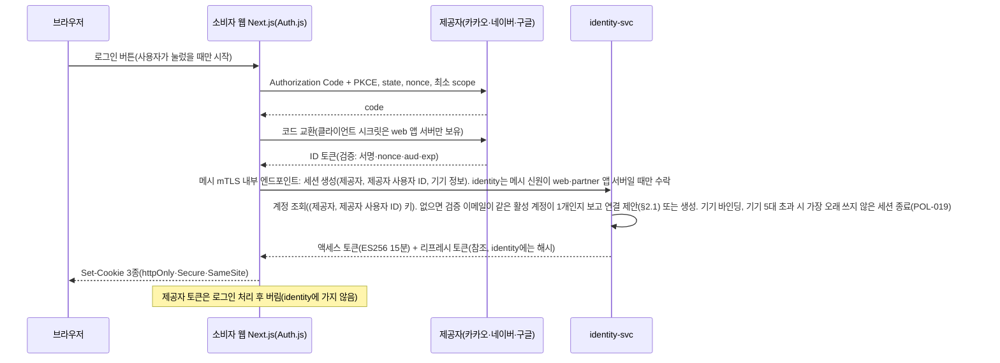
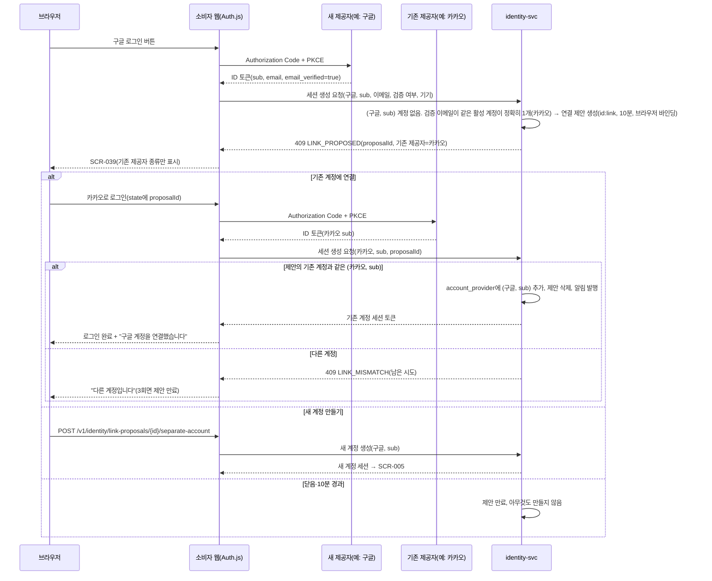
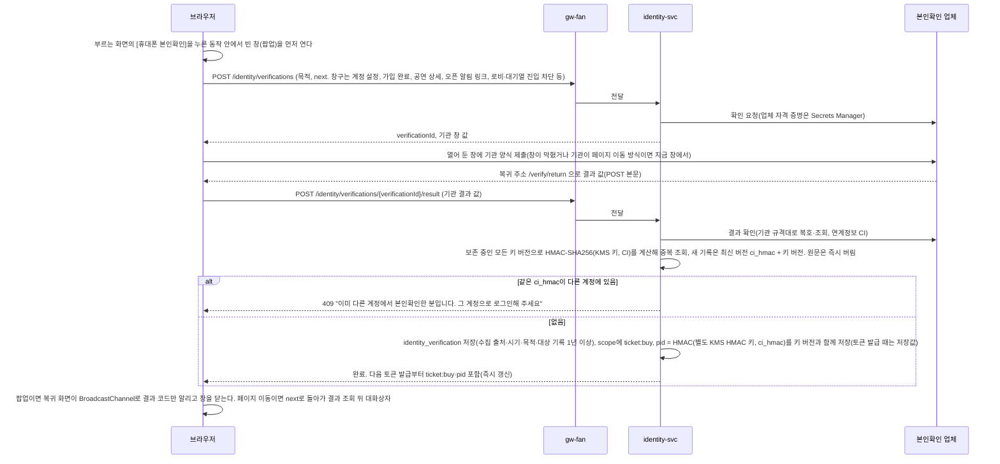
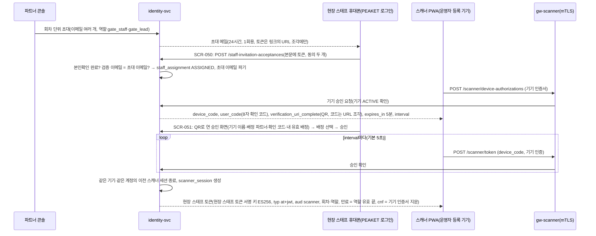

# 기능 설계: 계정·인증·본인확인·세션

- **독자와 용도**: identity-svc, 소비자 웹과 파트너 콘솔의 Auth.js 연동 부분, 관제 콘솔 로그인 모듈, 게이트웨이(클라이언트 종류별로 앞에 둔 입구 서버로, 인증·공통 정책·안쪽 서비스로 넘기기를 맡는다)의 인증 정책 엔진, peaket-platform 공통 인증 가드를 구현하는 엔지니어가 읽는다. 로그인의 전 과정, 토큰(권한이나 상태를 증명하려고 주고받는 서명된 문자열)·쿠키(브라우저가 사이트별로 저장했다가 요청마다 함께 보내는 작은 값) 규격, 세션 정책, 휴대폰 본인확인, 관리 계정 보안 규칙, 검증 테스트 포인트를 파악할 때 참조한다. 세부 보안 요구사항 판정은 원본인 `docs/security/asvs/auth.md`(L1·L2 149건)를, 개인정보 취급 기준은 `docs/security/data-classification.md`를, 암호화 키 관리는 `docs/security/secrets-and-keys.md`를 따른다.
- **원문 출처**: [설계서 §6 <계정·인증: 팬은 소셜 로그인, 관리 계정은 다중 인증>](<../../archive/PEAKET(피켓) — 100만 동시접속 티케팅 + 관제 시스템 프로젝트 설계서.md#계정인증-팬은-소셜-로그인-관리-계정은-다중-인증>), [설계서 10장 <인증 및 보안>](<../../archive/PEAKET(피켓) — 100만 동시접속 티케팅 + 관제 시스템 프로젝트 설계서.md#10장-인증-및-보안>), [설계서 7장](<../../archive/PEAKET(피켓) — 100만 동시접속 티케팅 + 관제 시스템 프로젝트 설계서.md#7장-폼-관리>), [ADR-0001](../adr/0001-fan-social-login-single-factor.md), [ADR-0006](../adr/0006-ticket-buyer-identity-verification-before-queue.md), [ADR-0011](../adr/0011-token-lifecycle-and-login-responsibilities.md), POL-001·002·019·020·023·025·027.
- **기준 기획 버전**: v1.0.
- **관련 ID**: FR-001, 002, 017, 021, 028, 045, 046, 048 · NFR-016, 017, 018 · POL-001, 002, 019, 020, 023, 025, 027, 028, 031, 033, 034 · SCR-004, 005, 006, 017, 020, 028, 036, 037, 039, 040, 050, 051 · API(프로그램끼리 요청과 응답을 주고받는 창구) `/v1/identity/*`, `/v1/partner/auth/sessions`, `/v1/ops/auth/sessions`, `/v1/staff-invitation-lookups`, `/v1/staff-invitation-acceptances`, `/v1/device-approval-lookups`, `/v1/device-approvals`, `/v1/scanner/device-authorizations`, `/v1/scanner/token` · 이벤트 `control.sessions-terminated` · 데이터 docs/data.md §2 account·identity_verification·session·admin_account·staff_assignment·scanner_session.

## 1. 개요와 계정 유형

| 계정 유형 | 인증 메커니즘 | 세션 수명 정책(초기값) | 접근 권한 범위 |
| --- | --- | --- | --- |
| 팬 (일반 관람객) | 카카오·네이버·구글 소셜 OAuth 2.0(다른 서비스 계정으로 로그인하게 하는 표준)이며, 방식은 Authorization Code + PKCE(로그인 중 가로챈 코드를 못 쓰게 하는 보강 방식)다. 자체 비밀번호는 전혀 저장하지 않는다. | 절대 만료 30일(NIST AAL1 권고), 유휴 만료 14일, 액세스 토큰 15분이다. 동시 활성 기기는 5대이고, 넘으면 가장 오래 쉬고 있는 세션을 자동으로 끝낸다. 계정당 대기열은 1개에만 들어갈 수 있다 | 본인 주문·티켓 관리·선물 양도·굿즈 상품 주문 |
| 파트너 (공연 기획사) | 초대를 받아 가입한다. 업무용 이메일 + 비밀번호 + TOTP(인증 앱이 시간에 따라 새로 만드는 일회용 코드) 2차 인증이 필수다. 패스키는 TOTP를 대신하지 않고, 추가 보조 수단으로만 허용한다. | 절대 만료 24시간, 유휴 만료 1시간(NIST AAL2 권고), 동시 활성 세션 2개(넘으면 가장 오래 쓰지 않은 세션을 끝내고 보안 알림을 보낸다, POL-019) | 소속 파트너의 공연 등록·정산 리포트·예매자 명단 관리 (테넌트 격리) |
| 운영자 (관제 센터) | 업무용 이메일 + 비밀번호 + 다중 인증(MFA)이다. 위험한 명령을 실행하기 직전에 다시 인증하고, 2인 승인을 반드시 거친다 | 절대 만료 24시간, 유휴 만료 1시간, 동시 활성 세션 2개(넘으면 가장 오래 쓰지 않은 세션을 끝낸다, POL-019) | 관제 3대 역할군(viewer, operator, commander) 매트릭스를 따른다 |
| CS 담당자 [보완] | 운영자와 같은 관리 계정 보안 정책을 적용한다 | 운영자 세션 정책과 같다 | 추가 검증 이의 제기 심사, 고객 거래 분쟁 내역 조회, CS 처리함, 승인 업무 요청. CS 책임자(`cs_lead`)는 1인 승인과 예매 제한 확인(POL-038) |
| 현장 스태프 (검표 스캐너) | 기기 쪽은 운영자가 등록한 기기의 mTLS(양쪽이 서로 인증서를 확인하는 TLS) 인증서로 확인한다(대안 B는 기기 키와 DPoP). 사람 쪽은 본인확인을 마친 PEAKET 계정과 RFC 8628 기기 승인 로그인을 함께 쓴다(§6.1, ADR-0030·0051) [보완: 원문은 '게이트 스캐너 Phase에서 설계'] | 기기 인증서는 30일 [가정] 수명으로 자동 갱신하고, 회차마다 재발급하지 않는다. 현장 스태프 세션은 배정 회차의 역할 유효시간(입장 시작 3시간 전 ~ 공연 종료 2시간 후)에만 유효하다. 세션은 기기와 계정마다 하나이고, 기기 인증서 지문에 묶이며, 서버가 요청마다 상태를 확인한다(ADR-0051) | 배정된 회차·기기 배치 구역의 티켓 검표와 동기화. 기기 배치·예외 통과·이상 표시 처리·부스 허용·확인 스캔은 `gate_lead`에게만 허용한다 |

### 핵심 설계 철학
- **팬 비밀번호를 보관하지 않음**: 일반 팬은 소셜 로그인만 쓰므로 팬 비밀번호를 시스템에 보관하지 않는다. 그래서 비밀번호 유출 위협이 없고, 비밀번호 보관에 따르는 규제 검증 범위도 줄어든다. 대신 소셜 계정이 탈취되면 그 계정으로 로그인할 수 있으므로, 민감한 작업 전 제공자 재인증 같은 보완 통제를 둔다([ADR-0001](../adr/0001-fan-social-login-single-factor.md)).
- **다중 요소 인증(MFA) 집중**: 강력한 다중 요소 인증은 소수의 내부 운영자 및 파트너 관리 계정에 둔다.
- **인증과 본인확인의 명확한 분리**: 매 접속 시 계정 소유권을 확인하는 '로그인'과 실제 사용자의 법적 신원을 1회 증명하는 '본인확인'을 나눠 다룬다.

## 2. 소셜 로그인 흐름(FR-001, ADR-0011)

- 처음 소셜 로그인을 마치면 서비스 가입·약관 동의 화면(SCR-005)으로 넘어간다. 이 화면에서 만 14세 이상인지 확인한다(모든 제공자에 같은 방법을 쓰고, 제공자에게 연령대를 요청하지 않으며, 생년월일 원문은 모으지 않는다). 필수 동의와 선택 동의 항목을 나누고(동의 일시는 타임스탬프로 원장에 보존한다), 닉네임을 정하며, 휴대폰 본인확인을 미리 하도록 권한다(선택).
- 이메일 주소가 같더라도 다른 소셜 제공자로 들어온 계정을 시스템이 알아서 자동으로 병합하지 않는다(웹 보안 기준을 만드는 비영리 단체 OWASP의 웹 앱 보안 검증 항목 목록인 ASVS 6.8.1·10.5.2와, OAuth 위에 신원 정보를 더한 로그인 표준인 OIDC의 Core §5.7을 따른다). 같은 검증 이메일을 가진 계정이 이미 있으면 사용자에게 계정 연결을 제안한다. 기존 소셜 계정으로 로그인해 그 계정의 주인임을 완전히 증명한 경우에만 안전하게 결합한다(§2.1 참조). 이메일은 알림을 보내는 창구일 뿐, 시스템의 고유 식별자나 인증 수단이 아니다.
- 외부 소셜 제공자의 세션과 PEAKET 서비스 내부 세션은 완전히 따로 운용한다. 화면 없이 뒤에서 조용히 하는 자동 로그인은 전혀 지원하지 않는다.
- 로그인은 새 창(팝업)을 열지 않고 지금 창에서 제공자 인증 화면으로 이동했다가 돌아온다(Auth.js 기본 흐름). 그래서 로그인 화면은 창 메시지를 받지 않는다(docs/security/asvs/auth.md 3.5.5, 기획 SCR-004 표현을 이에 맞춤, 추천 적용 2026-10-15, ADR-0065).
- 소셜 제공자가 OpenID Connect의 `acr` 또는 `amr` 클레임을 보내지 않으면 단일 요소 인증으로 본다(ASVS 6.8.4). 이때 §7에 적은 보완 통제를 모두 적용한다(ADR-0001).

### 2.1 같은 이메일 계정의 연결과 병합(FR-048, POL-034, ADR-0038)

회원가입 단계의 계정 연결 제안 절차:

계정 설정 화면의 로그인 수단 연결·해제와 계정 병합(SCR-040):
- 먼저 민감한 설정을 바꿀 때만 쓰는 재인증 토큰(POL-019, 유효기간 5분, 팬 토큰 키로 서명한 `typ` reauth+jwt, ADR-0050)을 받은 뒤 새 소셜 제공자 인증을 한다. 이 (제공자, sub) 키로 등록된 기존 계정이 없으면 `account_provider`에 바로 추가 등록한다.
- 새 제공자가 이미 다른 PEAKET 계정에 묶여 있으면 계정 병합 제안(`id:merge`, 유효기간 10분)을 만들고 영향 요약 정보를 돌려준다. 병합의 기준이 되는 대표 계정은 휴대폰 본인확인을 마친 계정으로 정한다(두 계정 모두 본인확인 전이면 지금 로그인한 계정으로 정하고, 두 계정 모두 본인확인을 마쳤으면 병합할 수 없어 거절한다). 이때 옮길 항목과 수량(보유 티켓, 굿즈 상품 주문과 배송지, 찜 목록, 관람 후기(두 계정이 같은 회차에 후기를 하나씩 가지면 대표 계정 후기만 남기고 흡수 계정 후기는 지운다, 추천 적용 2026-10-14, ADR-0063), 오픈 알림 구독, 소셜 로그인 수단), 유지하는 항목(대표 계정 닉네임과 약관 동의 상태. 마케팅 동의 범위는 넓히지 않는다), 병합 차단 사유를 밝힌다.
- 계정 병합 차단 사유(POL-034): 두 계정 중 하나라도 진행 중인 온세일(판매가 열리는 시각 앞뒤로 접속이 몰리는 기간) 좌석 홀드(결제하는 동안 다른 사람이 가져가지 못하게 좌석을 잠시 잡아 두는 것)·구매 세션·결제 승인 대기 주문을 가진 경우. 예매가 진행 중인 공연이나 한정 수량 MD 상품을 두 계정에서 더한 보유량이 1인당 구매 한도를 넘는 경우(POL-011, FR-015). 흡수될 계정에 회원 탈퇴나 이상 거래 이의 제기 절차가 아직 끝나지 않은 경우. 어느 계정에든 입장 시작부터 입장 기록 마감 사이인 회차의 티켓이 있는 경우(입장 중에는 소유권과 키를 바꾸지 않는다, ADR-0051 결정 10). 두 계정 모두 본인확인 내역이 있고 그 내역이 서로 다른 경우.
- 사용자가 최종 승인하면(`POST /v1/identity/merge-proposals/{id}/confirmation`, 재인증 토큰 첨부) 한 트랜잭션(여러 변경을 한꺼번에 반영하거나 한꺼번에 취소하는 작업 단위) 안에서 흡수 계정 상태를 `MERGED`로 잠그고 로그인 수단을 대표 계정으로 옮긴다. 그 뒤 Kafka(이벤트를 순서대로 쌓아 두고 여러 곳에 나눠 주는 메시지 시스템) 이벤트 `identity.accounts-merged`를 발행한다(docs/data.md §4 경계 9). 각 도메인 서비스는 자기가 가진 데이터를 비동기로 대표 계정 ID로 옮긴다. 이 이전은 중간 상태 없이 한 번에 끝나는 원자적 작업이고, 재시도는 같은 요청이 여러 번 와도 결과가 한 번 처리한 것과 같은 멱등성을 지킨다. 티켓 도메인은 소유 계정을 대표 계정으로 바꾸고 흡수 계정의 기기 키를 바로 폐기한다. 그래서 대표 계정은 입장할 휴대폰에서 '이 휴대폰을 입장용으로 등록'을 눌러 새 키를 등록한다(키는 등록 버튼으로만 만든다, FR-012, ADR-0051 결정 10). 흡수 계정의 모든 활성 세션은 `control.sessions-terminated`(종료 사유 `MERGED`) 이벤트로 바로 만료시킨다.
- 흡수된 계정의 이메일과 닉네임 원문은 바로 영구 파기하고 `merged_into_account_id` 외래키만 남긴다. 그 뒤 그 소셜 수단으로 로그인하면 대표 계정으로 자동으로 이어진다. 법정 접속기록은 원래 계정 ID로 유지하되, `account_merge` 감사 이력으로 두 계정을 이어 볼 수 있게 한다.
- 로그인 수단을 연결·병합·해제하면 두 계정에 등록된 모든 공식 알림 채널(이메일과 등록 기기 푸시)로 바로 알린다. 확정된 계정 병합은 시스템에서 되돌리기를 지원하지 않는다. 계정 도용 신고는 CS 전담 창구에서 사람이 직접 심사한다.
- 한 계정에 연결된 로그인 수단의 해제(`DELETE /v1/identity/providers/{provider}`)는 재인증을 통과했을 때만 할 수 있다. 마지막으로 남은 하나뿐인 로그인 수단을 해제하려 하면 409 Conflict로 막는다.
- 제안 식별자(proposalId)는 암호학적으로 안전한 128비트 난수(CSPRNG)로 만든 일회용 토큰이다. 연결 제안은 브라우저 쿠키로 클라이언트 맥락에 단단히 묶인다. 다른 사람의 계정이 있는지 밖에서 알아내지 못하게, 연결 제안은 '신규 제공자로부터 이메일 인증이 완료된(`email_verified=true`) 경우'에만 일어난다. 네이버는 이메일 검증 여부 필드를 주지 않으므로 회원가입 때 자동 제안 대상에서 빼고, 마이페이지 설정 메뉴에서 직접 연결하는 것만 지원한다.

## 3. 토큰과 쿠키

| 토큰 및 쿠키 명칭 | 보관 데이터 및 페이로드 스키마 | 접근 및 판독 주체 | 유효 수명 |
| --- | --- | --- | --- |
| Auth.js 세션 쿠키 `__Host-authjs.session-token` | Auth.js가 JWE(`A256CBC-HS512`)로 암호화한 소셜 로그인 상태다(OAuth state·PKCE 코드 베리파이어·nonce는 아래 'Auth.js 쿠키'처럼 별도 `__Host-authjs.*` 쿠키에 둔다). 소비자 웹과 파트너 콘솔은 서로 다른 비밀을 쓴다(ADR-0053) | Next.js(웹 화면을 만드는 프레임워크) 앱 서버(소비자 웹과 파트너 콘솔 전용). 관제 콘솔에는 쓰지 않는다. | Auth.js 설정값을 따른다 |
| 액세스 토큰 쿠키(팬 `__Secure-peaket_at`, 파트너 `__Secure-peaket_partner_at`, 운영자 `__Host-peaket_ops_at`) | identity-svc가 ES256으로 서명한 자체 완결형 JWT(서명된 정보 묶음 형식의 토큰)다. 헤더 `typ`(at+jwt)·`kid`, 클레임 `iss`, `sub`(계정 ID), `sid`(세션 ID), `scope`(`ticket:buy` 등), `pid`(본인확인을 마친 계정만), `aud`(fan·partner·ops), `exp`를 담는다. 서명 키는 대상마다 다르다(팬 토큰 키, 관리 토큰 키, ADR-0050 결정 9) | API 게이트웨이(자기 대상의 JWKS 공개키로 서명·유효기간·`typ`·`iss`·`aud`를 검증), 앱 서버(BFF 계층에서 내부 서비스를 부를 때 전달) | 15분 |
| 리프레시 토큰 쿠키(팬 `__Secure-peaket_rt`, 파트너 `__Secure-peaket_partner_rt`, 운영자 `__Host-peaket_ops_rt`) | 불투명 참조 토큰이다. 난수는 브라우저 쿠키에만 두고, identity-svc DB에는 원래 값으로 되돌릴 수 없게 바꾼 SHA-256 해시값과 토큰 패밀리 트리를 둔다. 팬·파트너는 경로를 토큰 재발급 엔드포인트(API를 부르는 주소 하나)로 제한하고, 운영자는 `__Host-`라서 `Path=/`다(관리 쿠키 둘은 추천 적용 2026-10-15, ADR-0065 결정 11) | identity-svc(토큰 갱신, 패밀리 회전, 재사용 이상 탐지를 전담) | 세션 정책의 절대 만료·유휴 만료 규칙을 따른다(관리 계정은 유휴 1시간·절대 24시간, §4) |

- **쿠키 이름과 속성(추천 적용 2026-10-15)**: 모든 쿠키는 `Secure`·`HttpOnly`이고 이름에 접두사를 붙인다(ASVS v5.0.0-3.3.1·3.3.3). 여러 호스트가 함께 읽는 쿠키는 `Domain=peaket.example`이 있어야 하므로 `__Secure-`를 붙이고, 한 호스트만 쓰는 쿠키는 `Domain` 없이 `Path=/`인 `__Host-`를 붙인다.
  - 팬 액세스 토큰 `__Secure-peaket_at`(`SameSite=Strict`, `Path=/`): 로그인 때는 소비자 웹 앱 서버가, 토큰 갱신 때는 `gw-fan`이 준다. `gw-fan`·`gw-queue`·대기열 API 엣지(CDN이 사용자 가까이에 둔 서버) 함수(`sid`만 서명 확인 없이 읽는다, ADR-0053)·소비자 웹 앱 서버가 읽는다.
  - 팬 리프레시 토큰 `__Secure-peaket_rt`(`SameSite=Strict`, `Path=/v1/identity/access-tokens`): 소비자 웹 앱 서버가 로그인 때 주고, `gw-fan`의 토큰 갱신이 읽는다.
  - 파트너 액세스 토큰 `__Secure-peaket_partner_at`(`SameSite=Strict`, `Path=/`): 로그인 때는 파트너 콘솔 앱 서버(Auth.js Credentials)가, 토큰 갱신 때는 `gw-partner`가 준다. `gw-partner`와 파트너 콘솔 앱 서버가 읽는다.
  - 파트너 리프레시 토큰 `__Secure-peaket_partner_rt`(`SameSite=Strict`, `Path=/v1/partner/auth/access-tokens`): 파트너 콘솔 앱 서버가 로그인 때 준다. `gw-partner`의 토큰 갱신(`POST /v1/partner/auth/access-tokens`)이 읽고 새 토큰으로 회전한다(추천 적용 2026-10-15, ADR-0065 결정 11).
  - 운영자 액세스 토큰 `__Host-peaket_ops_at`(`SameSite=Strict`): `gw-ops`의 운영자 로그인·토큰 갱신 응답이 주고, `gw-ops`만 읽는다. 관제 콘솔은 앱 서버 없이 `gw-ops`를 부른다(§6).
  - 운영자 리프레시 토큰 `__Host-peaket_ops_rt`(`SameSite=Strict`, `Path=/`): `gw-ops`의 운영자 로그인·토큰 갱신 응답이 주고, `gw-ops`는 토큰 갱신(`POST /v1/ops/auth/access-tokens`)에서만 읽는다. `__Host-`는 `Path=/`여야 해서 경로를 좁히지 못하므로, 이 쿠키는 모든 `ops-api` 요청에 실린다(추천 적용 2026-10-15, ADR-0065 결정 11). `gw-ops`는 갱신 경로가 아니면 이 쿠키를 백엔드로 넘기지 않는다[보완]. 접근 로그와 트레이스(요청 하나가 여러 서비스를 거친 길과 시간을 남긴 기록)에서는 다른 쿠키처럼 가린다(docs/observability.md §7).
  - Auth.js 쿠키(세션, OAuth state·PKCE·nonce, 돌아갈 주소, CSRF): Auth.js `cookies` 설정으로 이름만 `__Host-authjs.*`로 바꾼다. 기본값은 CSRF(사용자가 모르게 다른 사이트가 요청을 보내게 하는 공격) 쿠키만 `__Host-`이고 나머지는 `__Secure-`다(Auth.js 소스 `packages/core/src/lib/utils/cookie.ts`, 2026-10-15 확인). 소셜 제공자에서 돌아오는 최상위 이동(GET)에 실려야 하므로 Auth.js 기본값인 `SameSite=Lax`를 그대로 둔다. 세션 쿠키 키는 비밀과 쿠키 이름으로 만들어지므로, 두 앱이 같은 이름을 써도 비밀이 달라 키가 서로 다르다(ADR-0053).
  - 계정 연결 제안 임시 쿠키 `__Host-peaket_link`(`SameSite=Lax`, 10분): 소비자 웹 앱 서버만 쓴다. 기존 제공자 로그인에서 돌아올 때 실려야 하므로 Lax다(§2.1).
  - 도착 시각 쿠키 `__Host-peaket_arr`는 docs/features/queue-admission.md §10, 봇 방어의 최초 방문 쿠키 `__Host-peaket_fv`(`SameSite=Strict`, `queue` 호스트의 엣지 함수가 사전 검증 응답에서 처음 주고, 비밀 키로 만든 위조 확인용 값인 HMAC으로 서명한다)는 같은 문서 §7에서 다룬다(추천 적용 2026-10-15, ADR-0065 결정 9).
  - 남는 한계: `Domain` 쿠키 넷(팬 액세스·리프레시, 파트너 액세스·리프레시)은 `peaket.example`의 모든 하위 호스트로 간다. 그리고 다른 하위 호스트의 페이지가 같은 이름의 쿠키를 심는 것을 `__Secure-`는 막지 못한다(`__Host-`만 막는다). 그래서 하위 호스트에는 PEAKET이 운영하는 앱과 게이트웨이만 둔다. 게이트웨이는 자기 대상의 서명 키만 믿어 남의 토큰을 쓰지 않고(아래 '게이트웨이 무상태 고속 검증'), 접근 로그와 트레이스는 쿠키를 가린다(docs/observability.md §7).

- **게이트웨이 무상태(Stateless) 고속 검증**: API 게이트웨이는 메모리에 둔 JWKS 공개키로 ES256 디지털 서명, 유효기간, 토큰 유형(`typ`), 발급자(`iss`), 대상 독자(`aud`), 경로 권한 스코프만 무상태로 검증한다. 게이트웨이마다 자기 대상의 서명 키만 믿는다(gw-fan·gw-queue는 팬 토큰 키와 입장 토큰 키, gw-partner·gw-ops는 관리 토큰 키, gw-scanner는 현장 스태프 토큰 키). 검증을 통과한 요청은 사용자 ID, 세션 ID, 인가 권한, pid를 내부 HTTP 헤더(`X-User-Id`, `X-Session-Id`, `X-User-Pid` 등)에 담아 백엔드로 넘긴다. 백엔드 사이에는 mTLS 보안 터널이 있으므로, 게이트웨이와 신뢰된 내부 컴포넌트만 이 헤더를 넣을 수 있다. 각 마이크로서비스는 토큰을 다시 검증하지 않는다.
- **세션 즉시 무효화 전파**: identity-svc에서 세션이 강제 종료되면(로그아웃, 회원 탈퇴, 관리자 강제 종료, 리프레시 토큰 재사용 감지) `control.sessions-terminated` Kafka 이벤트를 바로 모든 서비스에 보낸다. 각 마이크로서비스 파드(쿠버네티스에서 앱이 실행되는 가장 작은 단위)는 peaket-platform 공통 가드로 메모리 안의 거부 목록(종료 세션 목록)에 그 `sid`를 등록하고, 이 항목을 TTL(저장한 값을 쓸 수 있는 시간으로, 지나면 지워진다) 15분 동안 유지한다. 그리고 수 초 이내에 그 토큰의 요청을 바로 막는다(OWASP ASVS 7.4.1 준수). 15분은 팬·관리 액세스 토큰 수명에 맞춘 값이다. 현장 스태프 토큰은 역할 유효 끝까지 살아 있어서, 이 목록으로는 해제 15분 뒤에 다시 통한다. 그래서 이 목록을 쓰지 않고, 스캐너 경로는 요청마다 `scanner_session`과 `scanner_device` 상태를 확인한다. 확인 결과는 캐시(자주 쓰는 값을 가까운 곳에 복사해 둔 것)에 5초 [가정] 동안 둔다(ADR-0051 결정 4).
- **리프레시 토큰 회전(RTR) 및 재사용 탐지**: 리프레시 토큰을 쓸 때마다 새 토큰을 발급하고 기존 토큰은 바로 무효로 한다. 이미 폐기된 옛 리프레시 토큰이 다시 들어오면 토큰 탈취 사고로 본다. 그러면 그 패밀리에 속한 모든 활성 세션을 바로 강제 종료하고 보안 알림을 보낸다.
- **대기열 입장 토큰 분리**: 대기열을 통과하면 queue-svc가 발급하는 입장 토큰(ES256)은 따로 있는 독립 토큰이다(docs/features/queue-admission.md §6 참조). 예매 핵심 경로는 본인 인증을 증명하는 액세스 토큰(`ticket:buy`)과 차례가 왔음을 증명하는 입장 토큰이 모두 있어야 들어갈 수 있다.
- **서명 키 분리와 무중단 로테이션**: 서명 키는 팬 토큰 키(팬 액세스 토큰과 팬 민감 작업 재인증 토큰), 관리 토큰 키(파트너·운영자 토큰과 위험 명령 재인증 토큰), 현장 스태프 토큰 키 셋으로 나눈다. 팬 경로의 키가 새도 운영자·현장 스태프 토큰은 위조되지 않는다(ADR-0050 결정 9). 각 키는 90일마다 온세일 윈도우와 대형·중형 온세일의 변경 동결 창 밖에서 교체하고(현장 스태프 토큰 키는 공연 회차 밖에서도, POL-028, docs/security/secrets-and-keys.md), JWT 헤더의 `kid` 값으로 옛 키와 새 키를 함께 지원한다. 서명 개인키는 identity-svc 파드만 Secrets Manager에서 받으며, 공개키는 게이트웨이와 내부 서비스에 JWKS 형식으로 배포한다.

## 4. 세션 정책(POL-019)

| 통제 항목 | 팬 (일반 사용자) | 파트너 및 운영자 (내부 관리 계정) |
| --- | --- | --- |
| 절대 세션 만료 | 30일 (NIST AAL1 권고) | 24시간 (NIST AAL2 권고) |
| 유휴 세션 만료 | 14일 (활동이 없는 상태가 이어질 때) | 1시간 (「개인정보의 안전성 확보조치 기준」 제6조 제4항 준수). 유휴 만료 뒤 다시 접속하면 비밀번호와 TOTP 2차 인증을 모두 다시 요구한다(안내서 74쪽 지침 준수). |
| 동시 활성 세션 한도 | 기기 5대 (한도를 넘으면 가장 오래 쓰지 않은 세션을 자동으로 정리) | 계정당 세션 2개(넘으면 가장 오래 쓰지 않은 세션을 끝내고 보안 알림을 보낸다, POL-019) |
| 세션 종료 발동 요건 | 사용자 로그아웃, 회원 탈퇴, 관리자 강제 만료, 리프레시 재사용 감지, 기기 한도 초과 | 같은 조건 + 로그인 연속 실패에 따른 계정 잠금 |
| 사용자 직접 제어 | 마이페이지 '로그인된 기기 관리' 화면에서 원격 로그아웃을 지원한다(SCR-017). 끝내기 전에 소셜 재인증을 받는다(POL-019 재인증 목록, ASVS v5.0.0-7.5.2) | 파트너 콘솔과 관제 화면에서 활성 세션 조회와 원격 즉시 종료를 지원한다 |
| 신규 디바이스 로그인 알림 | 등록 이메일과 푸시로 새 접속을 알린다(보완 통제) | 보안 통지 발송 + 위치·IP 기반 이상 징후 탐지 시스템(FDS) 연동 |

실제 서비스 운영 데이터를 분석해 세션 수명 기준값을 조정하면, 그 차이와 기술적 근거를 ADR(아키텍처 결정과 그 이유를 남긴 기록)로 남긴다(OWASP ASVS 7.1.1 준수).

## 5. 휴대폰 본인확인(FR-002, POL-001, ADR-0006)

- **본인확인 흐름(SCR-006, 소유자 결정 2026-10-14, ADR-0063)**: 본인확인 전용 화면은 없다. 부르는 화면(SCR-002·005·007·008·009·013·017·050 등)의 [휴대폰 본인확인] 버튼이 본인확인기관 창을 바로 연다. 버튼을 누른 그 동작 안에서 `window.open`으로 빈 창을 먼저 연다. 시작 응답을 받은 뒤 그 창에 기관 양식을 제출해 팝업 차단을 피한다. 목적 문구(최초·재확인·부스 대조)는 부르는 화면의 버튼 위에 한 줄로 둔다. 결과는 부르는 화면 위 대화상자로 보인다. 대화상자의 상태는 완료(토스트 "본인확인을 마쳤습니다"), 창을 닫음·실패([다시 시도]), 기관 장애, 다른 계정의 본인(로그인 안내), 만 14세 미만(CMP-046), 부스 대조 불일치·동의 없음이다. 문구는 design/d5 §5.6 상태 표를 따른다.
- **복귀 화면 `/verify/return`**: 기관이 결과를 돌려주는 같은 출처의 주소다. 서버가 정해 시작 요청에 넣는다(클라이언트가 바꿀 수 없다). 팝업 방식이면 이 화면은 팝업 안에서 결과 경로를 부르고, 같은 출처 `BroadcastChannel`로 결과 코드(`verificationId`, `status`)만 알린 뒤 창을 닫는다. 개인정보는 싣지 않는다. 사용자가 이 화면을 보는 것은 기관이 새 창 대신 페이지 이동으로 처리하는 경우(모바일·일부 브라우저)와 팝업이 막힌 경우뿐이다. 이 화면에는 "본인확인 결과를 확인하는 중입니다" 진행 표시만 있고, 결과를 받으면 `next`로 돌아가 그 화면 위에 결과 대화상자를 띄운다. IA의 `/my/settings/verify` 화면 경로는 이 복귀 경로로 바뀐다(소유자 결정 2026-10-14, ADR-0063).
- **흐름의 보안 규칙(추천 적용 2026-10-14, ADR-0063)**: `next`는 `/`로 시작하고 `//`로 시작하지 않는 같은 출처 상대 경로만 받아 시작 요청에 저장한다. 복귀 화면은 저장된 값으로만 돌아간다(다른 호스트로 자동으로 이동하지 않는다, ASVS v5.0.0-3.7.2). 부르는 화면은 받은 메시지의 형식과, `verificationId`가 자기가 시작한 건인지를 확인하고 아니면 버린다. 창 메시지(`postMessage`)를 쓰는 기관 연동이면 출처도 확인한다(ASVS v5.0.0-3.5.5). 메시지가 오지 않으면(창을 닫았거나 부르는 화면을 새로 고친 경우) `GET /v1/identity/verifications/{verificationId}/result`로 확인한다. 기관 결과 값은 POST 본문으로만 받고 URL에 두지 않는다. 쿼리로만 돌려주는 기관이면 복귀 화면이 받자마자 주소에서 지운다(기관 규격은 연동 계약 때 확인 필요). 부르는 화면의 COOP 설정과 상관없이 동작하도록 창 사이 연결(`window.opener`)에 기대지 않는다. 팬 쿠키는 `SameSite=Strict`라서 기관 사이트에서 넘어온 복귀 화면의 첫 요청(기관의 POST나 이동)에는 쿠키가 실리지 않는다. 그래서 복귀 화면의 서버 처리기는 기관 값을 저장·로그하지 않고, 같은 출처 페이지의 스크립트 데이터로 안전하게 직렬화해 넘긴다(`no-store`, `Referrer-Policy: no-referrer`). 페이지 스크립트는 같은 사이트 요청으로 결과 경로를 불러 쿠키로 계정을 확인받는다. 기관 창에 양식을 제출할 수 있게, 부르는 화면의 CSP(페이지가 어떤 출처의 스크립트를 실행하고 어디로 양식을 보낼 수 있는지 정하는 브라우저 규칙) `form-action`에 본인확인기관 주소만 더한다(docs/security/asvs/catalog-review.md).

- 만 14세 확인(추천 적용 2026-10-14, ADR-0062): 본인확인 결과의 생년월일로 만 나이를 계산한다. 만 14세 미만이면 연계정보(본인확인 기관이 주는, 사람마다 하나인 연계 식별값) HMAC을 저장하지 않고(연계정보 처리의 출처·시각·목적 기록은 위와 같게 남긴다) 403 `under-14`로 답한다. 그리고 계정을 회원 탈퇴와 같은 절차로 정리한다(사유 `UNDER_14`, 재인증을 거치지 않는다). 생년월일은 계산에만 쓰고 저장·로그하지 않는다(POL-023). 부스 대조(offline-gate §9.1)는 이미 본인확인한 계정과 연계정보만 비교하므로 이 계산을 하지 않는다.
- 미성년자 계약 취소 확인도 같은 흐름이다(연계정보 대조는 §6.1 '부스 재발급의 본인확인 대조'와 같다). 순서는 확인 목적 동의 → 휴대폰 본인확인 → 연계정보 HMAC 대조 → 결제 승인일(KST)의 만 나이 계산이다. 생년월일은 계산에만 쓰고 저장·로그하지 않으며, 결과(계약 당시 만 19세 미만 여부)만 CS 건에 남긴다(POL-038 ⑧, 추천 적용 2026-10-14, ADR-0062).
- 모든 대기열 정렬 방식에서 **대기 순번을 발급받기 전에** 휴대폰 본인확인을 마친 계정만 로비와 대기열에 들어갈 수 있다(공연법 시행령 제3조의3 제1호 가목, 2026-08-28 시행 법령 준수). 미리 본인확인을 마치지 않은 사용자는 진입을 막고, 그 자리에서 [휴대폰 본인확인]으로 기관 창을 열도록 안내한다(별도 화면으로 보내지 않는다, ADR-0063). 오픈 시점 이후에 뒤늦게 인증을 마친 사용자는 인증을 마친 시점의 실제 도착 순서대로 순번을 받는다.
- 계정당 1회의 휴대폰 본인확인을 마치면, 주기적으로 다시 인증하지 않아도 영구히 유효한 것으로 **간주**한다(프로젝트 정책 결정, 2026-10-08). 앞으로 문화체육관광부가 구체적인 본인확인 유효기간과 재인증 주기를 따로 고시하면 정책을 다시 검토한다. 일상적인 재확인은 요구하지 않는다. 부정행위가 의심되는 세션을 격리한 추가 검증 큐(POL-006)에서만 골라서 재인증을 요구한다.
- 1인 1계정과 1인 1순번을 보장하는 구조: identity-svc는 본인확인 연계정보(CI)의 해시값(`ci_hmac`)에 UNIQUE 제약조건을 건다. 그리고 본인확인 때 보존 중인 모든 키 버전으로 조회해, 같은 실명의 사람이 계정을 여러 개 만드는 것을 막는다(명의를 빌린 계정은 남는다, ADR-0050 결정 5). queue-svc는 게이트웨이 내부 헤더로 넘어온 가명 식별자(pid)를 대기열 중복 확인 키로 써서 1인당 1개의 대기 순번만 발급한다. 그래서 부하가 큰 대기열 진입 핵심 경로에서는 외부 본인확인 대행사 API 호출이나 identity-svc DB 조회가 전혀 일어나지 않는다(ADR-0008).
- 주문을 만들 때(결제 직전, docs/features/payment.md §2) purchase-svc가 identity-svc에 gRPC(서비스끼리 함수를 부르듯 빠르게 호출하는 통신 방식)로 물어 본인확인이 유효한지 마지막으로 다시 확인한다. identity-svc가 응답하지 못하면 게이트웨이가 넘긴 토큰 값(`ticket:buy`와 pid)으로 판정한다. identity-svc가 '무효'로 응답하면 그대로 거부한다(ADR-0055).
- 연계정보·pid 키 교체(ADR-0050 결정 5, POL-028):
  - 연계정보 HMAC 키는 버전마다 별도의 KMS(암호 키를 안전하게 보관하고 대신 써 주는 클라우드 서비스) HMAC 키다(자동 교체는 안 된다). 새 버전은 온세일 윈도우 밖에서만 만들고 새 기록에만 쓴다. 옛 버전은 그 버전 기록이 남아 있는 동안 조회용으로 둔다. 본인확인 때 보존 중인 모든 버전으로 계산해 중복을 찾으므로, 키 교체 전후로 같은 사람이 계정을 하나 더 만들 수 없다. 본인 기록이 옛 버전이면 그 자리에서 새 버전 값으로 바꾼다.
  - pid는 본인확인 때 한 번 계산해 `identity_verification`에 pid 키 버전, 연계정보 키 버전과 함께 저장한다. 토큰 발급 때는 저장값을 쓰므로 KMS를 부르지 않는다(KMS 대칭·HMAC 연산은 클라우드 데이터센터가 모인 지역인 서울 리전에서 기본 초당 10,000건을 계정 전체가 나눠 쓴다).
  - pid 키를 바꿀 때(2년마다, 온세일 윈도우 밖)는 저장된 ci_hmac으로 모든 pid를 다시 계산해 저장하고, 다음 토큰부터 새 값을 싣는다. 연계정보 키 새 버전도 pid를 바꾸므로 같은 '온세일 밖' 제약을 받는다.
  - 두 키와 TOTP 시드 암호화 키, 관리자 페퍼 키는 리전 장애 뒤 복구할 수 있도록 다중 리전 KMS 키로 만든다(ADR-0031).
- 연계정보(CI)를 취급하는 기관의 법적 안전조치 의무를 지킨다: 개인정보 보호책임자 지정과 내부 관리규정 수립, 목적 외 이용과 제3자 제공 금지, 저장·전송 구간에 강력한 암호화 적용, 침해사고 대응체계 운영, 연계정보 수집·처리 기록 최소 1년 이상 보존, 연 1회 자체 처리 실태 점검(정보통신망법 제23조의5·6 및 방송미디어통신위원회 「연계정보의 생성·처리 등에 관한 기준」 별표 4 준수).
- 외부 본인확인 대행사 전면 장애 때의 대응: 본인확인을 하지 않은 사용자의 신규 진입은 어쩔 수 없이 막힌다(이미 본인확인을 마친 기존 회원의 예매에는 전혀 영향이 없다). 서킷 브레이커(계속 실패하는 호출을 잠시 끊어 장애가 번지지 않게 하는 장치)를 바로 Open하고, 부르는 화면 위 결과 대화상자로 "지금은 본인확인을 할 수 없습니다" 안내를 보인다(SCR-006 본인확인 흐름, ADR-0063).

## 6. 관리 계정: 파트너·운영자(FR-021, FR-028, POL-020)

| 관리 영역 | 세부 보안 통제 규정 |
| --- | --- |
| 계정 발급 절차 | 관리자가 발급한 일회용 초대 링크(유효기간 24시간)로만 가입을 시작한다. 비밀번호 설정(문자 조합을 강제하지 않는 POL-020 기준)과 TOTP 등록을 마쳐야 활성화된다. 파트너 계정은 특정 `promoter_id` 테넌트 영역에 묶여 격리된다. 파트너 계정은 초대 때 역할(`partner_admin`·`partner_member`)을 정하고, 파트너사마다 활성 `partner_admin`이 1명 이상이어야 한다(planning/03 §3, 추천 적용 2026-10-14, ADR-0062). |
| 비밀번호 보안 정책 | 최소 15자 이상이 필수이고, 64자 이상 입력도 허용한다. 불필요한 복합 문자 조합은 강제하지 않는다. 널리 쓰이는 취약 비밀번호, 서비스 이름이 든 단어, 이미 유출된 비밀번호(Have I Been Pwned k-익명성 API로 대조)는 등록을 모두 막는다. KISA 검증대상 암호알고리즘(KCMVP)에 있는 PBKDF2-HMAC-SHA256(반복 횟수 600,000회 이상, 솔트 16바이트)으로 해시한다. 그 결과에 KMS HMAC 페퍼(입력 `"admin-pw-v1" ‖ 관리 계정 ID ‖ PBKDF2 결과`)를 한 번 더 걸고, 페퍼 키 버전과 함께 PHC 문자열 형식으로 저장한다. 검증은 KMS `VerifyMac`으로 한다(ADR-0033, ADR-0050 결정 9). |
| 다중 요소 인증 (MFA) | TOTP 2차 인증을 반드시 적용한다(시드 키는 AWS KMS 봉투 암호화와 AES-256-GCM으로 보호한다. 암호화 컨텍스트 `{purpose: "peaket-admin-totp-v1", accountId}`로 관리 계정에 묶어, 다른 계정 행으로 옮긴 암호문은 복호되지 않게 한다, ADR-0053). FIDO2 패스키는 TOTP를 대신할 수 없고, 보조 수단으로만 등록할 수 있다. |
| 인증 실패 임계치 제한 | 5회 연속으로 인증에 실패하면 계정 접근을 바로 잠근다(「개인정보의 안전성 확보조치 기준」 제5조 제6항 준수). NIST SP 800-63B 기준(최대 100회 이하)을 지키며, 3회 [가정] 연속 실패 뒤의 시도부터는 사람 확인(Cloudflare Turnstile) 챌린지를 반드시 거치게 한다. 비밀번호·TOTP·복구 코드 실패를 모두 계정 단위로 세고, 로그인에 성공하면 0으로 돌린다(추천 적용 2026-10-14, ADR-0062). 잠긴 계정은 운영자가 신원을 확인한 뒤 수동 재초대 절차로만 풀린다(파트너 계정은 operator 이상, 운영자·CS 계정은 commander, planning/03 §3). |
| 세션 유휴 타임아웃 | 1시간 동안 활동이 없으면 세션을 자동으로 만료하고, 다시 접속하면 비밀번호와 TOTP 입력을 모두 요구한다. 액세스 토큰(15분)은 유휴 만료(1시간)와 절대 만료(24시간) 안에서만 갱신 경로로 새로 받는다: 파트너 `POST /v1/partner/auth/access-tokens`(`gw-partner`, 리프레시 쿠키 `__Secure-peaket_partner_rt`), 운영자 `POST /v1/ops/auth/access-tokens`(`gw-ops`, `__Host-peaket_ops_rt`). 팬 갱신과 같이 회전하고 재사용을 탐지한다. 본문이 없어 사전 요청이 생기지 않으므로, 게이트웨이가 `Origin`을 콘솔 출처와 대조한다(추천 적용 2026-10-15, ADR-0065 결정 11). |
| 위험 운영 명령 재인증 | 킬스위치(범위 안 회차의 새 홀드·새 결제와 입장을 바로 멈추는 비상 운영 명령), 대규모 차단, 권한 변경 같은 중대한 명령을 실행하기 직전에는 비밀번호와 TOTP 재입력을 요구한다. 그리고 유효기간 5분의 일회성 재인증 토큰(관리 토큰 서명 키로 서명한 `typ` reauth+jwt, ADR-0050)을 발급받아 명령 API 헤더(`X-Reauth-Token`, docs/api/guidelines.md §7)에 붙여야 한다. |
| 관리망 접근 통제 | 모든 관리자 엔드포인트에 WAF(악성 요청을 걸러 내는 웹 방화벽) 침입차단 규칙과 보안 그룹 IP 제한을 적용한다. 로그인 실패가 급증하거나 비정상적인 해외 IP에서 접속이 들어오면 관제 센터로 침입탐지 경보를 바로 보낸다. 관제 센터 콘솔은 사내 전용 고정 IP 대역이나 내부 VPN 연결(gw-ops)로만 접속을 허용한다. |
| 콘솔별 로그인 아키텍처 | 파트너 콘솔: Next.js Auth.js Credentials 공급자가 인증 정보를 받아 mTLS 내부 경로로 identity-svc에 검증을 맡긴다. 관제 콘솔: Module Federation SPA 구조로 돌아가며, gw-ops 게이트웨이를 거쳐 identity-svc의 관리 계정 전용 로그인 API를 직접 부른다(앱 서버 세션 쿠키는 없다). 모든 검증과 토큰 발급의 최종 권한은 identity-svc가 전담한다. |
| 감사 접속기록 의무 보존 | 관리자의 개인정보 열람·다운로드 이력은 접속기록으로 최소 2년 이상 보존한다. 계정 권한의 부여·변경·말소 내역은 최소 3년 이상 보존한다. 고치거나 지운 기록이 검증에서 드러나도록(변조 탐지) WORM 사본과 키를 건 해시 체인을 둔 감사 저장소에 동기화한다(ADR-0053). |

### 6.1 현장 스태프 계정과 스캐너 로그인(FR-046, POL-031, ADR-0030, ADR-0051)

- RFC 8628(OAuth 2.0 Device Authorization Grant) 표준 프로토콜을 채택한다. 스캐너 기기 화면과 현장 스태프 휴대폰 화면에 같은 확인 코드(user_code)를 동시에 보여 주고 반드시 대조하게 한다. 이렇게 해서 공격자가 원격에서 다른 사람의 스캐너 기기를 잘못 승인하게 만드는 원격 피싱을 줄인다(RFC 8628 5.4 권고). 승인자가 두 화면을 대조하지 않으면 막지 못하므로, 승인 화면에서 대조를 먼저 요구한다. 모바일 승인 화면에는 기기 이름, 배정 파트너, 지금 유효한 배정을 분명히 보여 준다(게이트 구역은 기기 배치가 정하므로 승인 화면에 없다).
- 확인 코드는 RFC 8628 §6.1의 문자 20개(BCDFGHJKLMNPQRSTVWXZ)로 만든 8자이고, 4자씩 하이픈으로 나눈다(약 34.5비트, RFC 8628 §5.1). 수명은 5분이다. 승인 실패는 계정당 10분에 5회, 코드 발급은 기기당 시간당 10회까지다 [가정, wbs 5.5.2에서 확정]. 실패하면 계정을 잠그지 않고, 그 코드가 무효가 되는 것으로 끝난다. QR로 넘기므로 코드가 길어도 입력 부담이 없다.
- 초대 수락 조건: 휴대폰 본인확인을 마쳤고, 계정의 검증된 이메일(구글 `email_verified`, 카카오 `is_email_verified`, POL-034)이 초대 이메일과 같아야 한다. 다르면 403과 함께 '이 계정 이메일로 다시 초대를 요청하세요'를 보인다. 네이버만 연결한 계정은 검증 표시가 없으므로(§2.1) 구글이나 카카오를 연결해야 한다. 초대 링크가 전달돼도 다른 사람은 수락하지 못한다. 수락 화면(SCR-050)에서 수집·이용 동의(개인정보 보호법 §15①1호·②)와 파트너 제공 동의(§17①1호·②)를 나눠 받는다(§22①1호·2호).
- 초대 토큰은 32바이트 난수이고, SHA-256 해시만 저장한다. 유효기간은 24시간이고 한 번 쓰면 끝이며, 기간이 지나면 배정 상태가 EXPIRED가 된다. 다시 보내면 새 토큰을 만들고 옛 토큰을 무효로 한다. 같은 회차·같은 계정의 배정은 하나다.
- **URL 조각의 비밀 처리(추천 적용 2026-10-15, ADR-0065 결정 10)**: 초대 수락(SCR-050, `/staff/invitations#token=…`)과 스캐너 승인(SCR-051, `/staff/approve#code=…`)은 서버에서 그리지 않고 클라이언트에서 그린다(docs/architecture.md §6.3의 `/staff/*`). 화면 스크립트는 URL 조각의 초대 토큰·확인 코드를 읽은 뒤 바로 주소에서 지운다(`history.replaceState`). 로그인하러 갈 때 돌아갈 주소(`next`)에는 조각 없이 경로만 넣는다. 로그인을 다녀오는 동안에는 그 탭의 세션 저장소(`sessionStorage`)에 잠시 두었다가, 조회 경로(`POST /v1/staff-invitation-lookups`, `POST /v1/device-approval-lookups`)의 본문으로 보낸다. 메일 링크나 다른 앱에서 처음 열 때는 `SameSite=Strict` 팬 쿠키가 실리지 않을 수 있다. 그래서 로그인 여부는 서버가 아니라 화면 스크립트의 같은 사이트 요청으로 확인한다(docs/security/asvs/offline-gate.md 3.3.2).
- 현장 스태프용 비밀번호나 PIN 체계를 따로 새로 만들지 않는다. 현장 스태프는 운영자가 등록한 기기(기기 인증서)에서, 배정된 개인 계정의 휴대폰 로그인으로 승인해야 로그인한다. 기기 인증서는 사람이 아니라 기기를 증명하므로, 사람 쪽 인증 요소는 휴대폰의 소셜 로그인 하나다(ADR-0001). 등록 기기, 배정, 역할 유효 시간, 확인 코드 대조로 범위를 좁힌다(ADR-0051).
- 세션 수: 기기마다 활성 스캐너 세션은 1개다(교대처럼 같은 기기에서 새로 승인하면 이전 세션이 끝난다). 계정마다도 1개다(다른 기기에서 승인하면 이전 기기의 세션이 끝난다). 스태프는 휴대폰의 '로그인된 기기 관리'(SCR-017)에서 자기 스캐너 세션을 보고 끝낼 수 있다. 휴대폰 로그아웃은 스캐너 세션을 끝내지 않고, 배정 해제·계정 탈퇴·기기 폐기는 끝낸다.
- 대리 승인: 휴대폰을 쓸 수 없는 스태프 대신 현장 책임자가 자기 계정으로 승인하면, 토큰 역할은 `gate_staff`로 낮춘다. 세션에 대리 표시와 책임자 배정을 남기고, 스캔 기록은 책임자 계정으로 남는다(POL-031).
- 현장 스태프 세션 토큰은 통신이 끊긴 오프라인 환경에서도 로컬 검증에 쓰여야 하므로, 배정된 회차의 역할 유효시간까지 살아 있다. 스캐너 앱은 유효시간이 끝나는 순간 자체 타이머로 세션을 바로 끝낸다. 서버는 요청마다 세션 상태를 확인하므로, 파트너 콘솔에서 배정을 해제하면 그 스캐너의 다음 요청부터 거부한다(해제 15분 뒤에도). 스캐너는 다음 변경분을 받을 때 로그아웃된다. 토큰에는 `cnf`(인증서 SHA-256 지문 `x5t#S256`, RFC 8705. 대안 B는 키 지문 `jkt`)를 싣고, gw-scanner가 요청의 인증서와 비교한다.
- 로그아웃·교대·해제·만료 뒤에도 스캐너 큐에 남은 기록은 기기 인증으로 올라간다. 서버는 그 시각에 세션이 유효했는지 보고, 아니면 '세션 밖 기록'으로 표시한다(docs/features/offline-gate.md §6.5).
- 게이트 검표 이벤트에는 처리한 사람의 `staff_account_id` 식별자가 반드시 기록된다(서버가 세션으로 정한다). 단, 스캐너 단말기 화면과 로컬 저장소에는 관람객의 이름, 연락처 같은 민감 개인정보를 전혀 내려보내지 않는다(검표 유효성 판정 결과, 좌석 번호, 배정 게이트 구역만 보여 준다).
- 기기 배치, 예외 통과, 이상 표시 처리, 부스 재발급 허용, 확인 스캔은 현장 총괄 책임자(`gate_lead`) 토큰에만 허용한다. 티켓 번호를 직접 입력하는 수동 입장은 두지 않는다(ADR-0051 결정 11).
- 부스 재발급의 본인확인 대조: 관객이 대조 목적에 따로 동의하고(정보통신망법 §23의5④ 단서) 휴대폰 본인확인을 하면, identity-svc가 결과의 `ci_hmac`을 보유 계정의 값과 비교한다. 같을 때만 대조 토큰(5분, 계정·티켓에 묶인다)을 주고, ticket-svc가 그 토큰을 받아 부스 코드(8자, 10분)를 만든다(`POST /v1/identity/booth-reverifications` 뒤 `POST /v1/tickets/{ticketId}/booth-requests`). 연계정보 원문은 §5처럼 바로 버리고 대조 결과만 남긴다.

## 7. 팬 단일 요소 인증의 보완 통제(ADR-0001)

일반 관람객이 단일 요소 소셜 로그인을 쓰는 데 따르는 보안 위험을 통제하려고 여러 겹의 방어 체계를 운영한다. 엄격한 브라우저 기기 바인딩, trust-svc의 실시간 위험 점수 계산과 이상 징후 세션의 추가 검증 분리, 민감 작업(티켓 양도와 결제자에게 돌려주기, 예매 취소, 티켓 재발급과 입장 시작 뒤 첫 입장용 등록, 로그인 수단 추가·해제, 계정 병합, 연락처 변경, 다른 기기의 로그인 세션 끝내기, 환급·배상 계좌 입력, 회원 탈퇴. 목록은 POL-019) 직전의 소셜 제공자 재인증 강제, 새 기기 로그인 알림, 자체 비밀번호와 카드 결제정보를 저장하지 않는 원칙, 휴대폰 본인확인 연계정보(CI) 기반 1인 1계정 통제다. 이를 OWASP ASVS 6.3.3(Level 2) 기준에 맞는 합리적 보완 통제 모델로 공식 문서에 남긴다.

## 8. 계정 설정·탈퇴(FR-017)

- 마이페이지 계정 설정 기능(SCR-017): 휴대폰 본인확인 완료 상태와 인증 일시 확인, 로그인된 활성 기기 목록 조회와 원격 세션 즉시 만료(세션 종료 이벤트를 모든 서비스에 보내 수 초 안에 전 도메인에서 차단), 소셜 로그인 수단 추가·해제와 계정 병합(재인증 필수, §2.1 참조), 서비스 알림과 마케팅 정보 수신 동의 변경(동의 일시는 타임스탬프로 원장에 보존), 개인정보 처리방침 링크 제공.
- 회원 탈퇴 전 과정(POL-033): 계정 설정 화면에서 복잡한 절차 없이, 가입과 같은 수준으로 쉽게 신청할 수 있도록 보장한다. 본인 확인은 기존 소셜 로그인 1회 재인증으로 대신한다. 쓰지 않은 예매 티켓이 있으면 보유 장수, 환불 예상액, 다른 사람에게 양도할 수 있는지를 투명하게 안내한다. 사용자가 최종 확인하면, 여러 서비스에 걸친 티켓 취소·환불을 단계별로 처리하고 중간에 실패하면 앞 단계를 되돌리는 Saga(POL-032)를 바로 시작한 뒤 탈퇴를 마친다. 결제 승인을 기다리는 주문이 있으면 그 처리가 끝날 때까지(보통 10분 안. 결과 불명이 이어지면 결과가 정해질 때까지) 탈퇴 확정을 안전하게 미룬다. 받은 티켓·양도 요청·가상계좌 결제·양도 완료 티켓·굿즈 주문은 planning/03 §1.5대로 처리하고, 가상계좌 지연 환급이 있으면 환급을 실행할 때까지 탈퇴를 미룬다(추천 적용 2026-10-14, ADR-0062). 미루는 동안 계정 상태는 `WITHDRAWAL_PENDING`이다. 새 예매·주문·양도 요청은 409로 막고, 로그인·환불 계좌 입력·알림만 허용한다(탈퇴 요청 응답은 202, planning/03 §1.5 ⑧, 추천 적용 2026-10-20, ADR-0073).
- 탈퇴 뒤 데이터 파기 순서: 바로 모든 활성 세션을 강제 만료하고, 계정 프로필 정보와 본인확인 연계정보 해시(`ci_hmac`)를 지체 없이 영구 파기한다(표준 개인정보 보호지침 제10조 제1항에 따라 늦어도 5일 이내에 끝낸다). 단, 전자상거래법 제6조 제2항과 시행령 제6조 제1항에 따라 주문·결제 거래 기록은 5년간, 소비자 불만·분쟁 처리 기록은 3년간 따로 분리해 보관하고, 법정 기한이 지나면 바로 파기한다.
- 탈퇴 뒤 바로 재가입하는 것을 제한 없이 허용한다. 탈퇴자의 재가입을 제한하려고 개인정보(연계정보 포함)를 계속 보관할 법적 근거가 현행법에 없기 때문이다. 단, 대규모 온세일이 진행 중인 공연 회차에서는 대기열 중복 진입 방지 키(`q:dup:{pid}:E`, 입장 뒤에는 `q:adm:{pid}:E`)가 그 대기가 끝나거나 그 회차의 판매가 끝날 때(공연 시작 24시간 전 = `starts_at` - 24시간, ADR-0064)까지 메모리에 남는다(ADR-0063 결정 11). 그래서 탈퇴 뒤 5일 안에 재가입하면 같은 공연의 대기 순번을 중복으로 받는 부정행위는 막힌다. 다만 탈퇴 계정의 두 키는 표준 개인정보 보호지침 §10①에 따라 5일 안에 지우므로(docs/data.md §3, ADR-0056), 판매가 그보다 길게 남은 회차에는 다시 줄을 설 수 있다(남는 한계. 탈퇴 때 미사용 티켓은 모두 취소·환급된다). 재가입 뒤 본인확인에서 같은 pid가 다시 계산되기 때문이다(ADR-0050 결정 5). 한계: 판매 기간은 온세일 윈도우보다 길어서, 그 사이에 pid 키를 바꾸면(2년마다, 온세일 윈도우 밖) 옛 pid로 남은 키와 새 pid가 맞지 않는다. 키를 바꿀 때 판매 중인 회차의 대기열 키를 새 pid로 옮기거나 두 값으로 확인하는 절차를 둔다[보완].

## 9. 개인정보·접속기록(POL-023, FR-045)

- 수집 항목 표준화: 필수 수집 항목은 소셜 제공자 식별자, 닉네임, 이메일 주소로 최소화한다. 휴대폰 번호는 선택 항목이다. 예매 때는 예매자 성명·연락처를, 굿즈 택배 주문 때는 수령인 성명·연락처·배송지 주소를 추가로 받는다(POL-023). 주민등록번호, 신용카드 번호, 생체정보는 수집하지 않는다. 은행 계좌번호는 환불·배상·정산 때 받아 결제사·송금 요청에 바로 넘길 뿐 저장하지 않는다. 전체 개인정보 데이터 등급과 보존 주기는 `docs/security/data-classification.md`를 엄격히 따른다.
- 소셜 제공자와 연동할 때는 서비스 운영에 반드시 필요한 최소 스코프만 요청하고, 받은 액세스 토큰 원문은 세션을 만든 직후 바로 파기한다. 만 14세 미만 아동의 가입은 시스템에서 막는다(법정대리인 동의 절차는 따로 운영하지 않는다). 이 확인은 가입 때의 자기 확인과 휴대폰 본인확인 생년월일 재확인으로 하고, 이 방법으로 의무를 다한 것으로 간주한다(§5, POL-023, 추천 적용 2026-10-14, ADR-0062).
- 법정 접속기록 관리: 로그인, 대기열 진입, 주문서 작성, 결제 승인 요청의 일시, 접속 IP 주소, 기기 식별자(로그인과 재인증은 성공·실패와 인증 방식·쓴 인증 요소도 남긴다. 팬은 소셜 제공자, 관리 계정은 비밀번호와 TOTP나 패스키, 추천 적용 2026-10-26, ASVS v5.0.0-16.3.1)를 접속기록 전용 저장소에 최소 3개월간 보존한다(통신비밀보호법 시행령 제41조 제2항 제2호 준용). 로그인·재인증·로그아웃·토큰 갱신 기록은 identity-svc가 접속기록 줄로 표준 출력에 쓰고, 에이전트 수집기가 게이트웨이 접근 로그와 같은 법정 사본 갈래로 접속기록 DB에만 보낸다(docs/observability.md §7, 추천 적용 2026-10-26, ADR-0089). 관리 계정의 기록은 ops-svc가 매일 감사 저장소로 옮겨 최소 2년 이상 둔다(docs/features/control-tower.md §7). 고치거나 지운 기록은 일 단위 해시 앵커(그날 접속기록 파일 목록과 SHA-256을 AWS의 파일 저장소인 S3의 감사 앵커 버킷에 Object Lock으로 남긴다)로 찾는다(추천 적용 2026-10-20, ADR-0073). 수사기관과 관계 당국(POL-025)의 적법한 자료 제출 요청에 대응하는 절차는 POL-025를 따른다.
- 개인정보 보호책임자 지침에 따라 내부 관리계획(`docs/security/internal-management-plan.md`, 작성 예정)을 세우고, 접근 권한 분리, 망 분리 통제, 암호화 알고리즘 관리, 파기 절차, 유출 사고 대응 지침을 문서로 정한다.

## 10. 장애 시 동작

| 장애 상황 | 시스템 대응 동작 |
| --- | --- |
| 소셜 로그인 제공자 장애 | 장애가 난 그 제공자의 새 로그인만 잠시 막힌다. 이미 발급된 PEAKET 내부 세션은 소셜 제공자 세션과 물리적으로 분리되어 있으므로, 이미 로그인한 사용자의 예매는 정상적으로 이어진다. |
| 본인확인 대행사 전면 장애 | 서킷 브레이커가 바로 Open되고, 부르는 화면 위 결과 대화상자로 "지금은 본인확인을 할 수 없습니다" 안내를 보인다(별도 화면은 없다, ADR-0063). 이미 본인확인을 마친 수백만 기존 회원의 대기열 진입과 예매에는 전혀 영향이 없다. |
| identity-svc 전면 장애 | API 게이트웨이가 캐시해 둔 JWKS 공개키로 무상태 서명 검증을 하므로, 이미 발급된 유효한 액세스 토큰은 최대 15분간 정상 통과된다. 새 로그인, 토큰 갱신, 새 본인확인은 잠시 멈춘다. 주문을 만들 때의 본인확인 재확인은 토큰의 `ticket:buy`·pid로 대신 판정한다(최대 15분 전 상태, ADR-0055, payment P-T35). 장애가 15분 넘게 이어지면 토큰을 갱신하지 못하므로, 사용자마다 토큰이 끝나는 때부터 구매 경로 요청도 거부된다(planning/01 §5.2). |
| 세션 종료 Kafka 이벤트 지연 | 세션 종료 이벤트 전파가 늦어지면, 최대 액세스 토큰 수명(15분) 동안은 요청이 잠시 통과될 수 있다(무상태 JWT 구조를 택한 대가이며, 설계에서 허용하고 문서로 남겼다). |
| 오픈 직전 로그인 폭주 | 인프라를 미리 프리워밍해 처리 용량을 확보한다(docs/infra.md §5). 관리 계정용 PBKDF2 해싱(1회 수백 ms)도 팬 토큰 발급과 같은 identity-svc에서 돈다. 팬 토큰 발급이 밀리지 않도록 관리 로그인 해싱의 동시 처리 상한을 두고, 넘는 요청은 잠시 기다리게 한다(ADR-0050) [가정, Phase 3 3.5.1에서 확정]. |
| 관리 계정 크리덴셜 스터핑 공격 | 로그인 실패율이 급증하면 침입탐지 시스템(IDS)이 바로 작동한다. 그 계정을 잠그고, 사람 확인 챌린지를 반드시 거치게 하며, 관제 센터에 긴급 보안 경보를 보낸다. |

관측(지표·로그·요청 기록으로 시스템 안을 들여다보는 일, ADR-0049): 소셜 로그인 제공자별·본인확인 업체의 호출 성공률과 p99(요청 백 건 중 아흔아홉 건이 이 시간 안에 끝난다는 뜻)를 외부 의존 지표(`dependency` 라벨)로 낸다. 제공자 오류(5xx·시간 초과) 비율이 1%를 넘은 채 5분 이어지면 SEV2(장애 심각도 등급으로, 숫자가 작을수록 심각하다)로 알린다 [가정, Phase 2 부하 시험에서 확정]. 본인확인 업체 상태는 오픈 30분 전 점검의 필수 항목이다(docs/features/control-tower.md §2). 오픈 뒤 처음 본인확인을 한 사용자 비율(planning/01 §3.2)은, 미리 본인확인을 받아 두어 피크 때 이 의존성을 얼마나 덜어 냈는지 보는 지표다.

## 11. 데이터·API 참조

| 종류 | 세부 항목 |
| --- | --- |
| PostgreSQL(identity) | `account`(status ACTIVE·WITHDRAWAL_PENDING·MERGED·DELETED, merged_into_account_id), `account_provider`(account_id, provider, provider_user_id, UNIQUE(provider, provider_user_id), linked_at), `account_merge`(대표·흡수 계정, 옮긴 항목 요약, 요청·승인·완료 타임스탬프), `identity_verification`(ci_hmac UNIQUE, 키 버전, 출처 증적 1년 보존), `session`(refresh_hash, refresh_family, 절대·유휴 만료, terminated_at), `device`, `consent`(종류, 고지 문안의 판, 동의 일시, 마케팅 수신 채널. 탈퇴 때 파기, docs/security/data-classification.md '법적 동의 기록'), `admin_account`(role, promoter_id, pbkdf2-sha256 PHC, totp_seed_enc, failed_attempts, locked_at), `staff_assignment`(account_id, event_id, role, invite_token_hash, invite_expires_at, valid_from, valid_until, status INVITED·ASSIGNED·REVOKED·ENDED·EXPIRED, UNIQUE(event_id, account_id)), `scanner_session`(staff_assignment_id, scanner_device_id, 승인 휴대폰 sid, 역할, 대리 승인 여부·승인 책임자 배정, 승인 시각, 만료 시각, 마지막 연락, terminated_at), `booth_reverification`(계정 ID, 티켓 ID, ci_hmac 일치 여부, 시각. 연계정보 원문은 두지 않는다) |
| Redis(세션 및 보안 캐시) | identity 참조 세션 캐시, 로그인 실패 횟수 카운터, 기기 승인 코드(`id:devauth:{device_code}`, 수명 5분 [가정, wbs 5.5.2에서 확정]), 계정 연결·병합 제안 캐시(`id:link:{id}`, `id:merge:{id}`, 유효기간 10분) |
| REST API | `POST /v1/identity/verifications`, `POST`·`GET /v1/identity/verifications/{verificationId}/result`(본인확인 결과 확정·조회, ADR-0063), `POST /v1/identity/access-tokens`, `GET /v1/identity/sessions`, `DELETE /v1/identity/sessions/{id}`, `DELETE /v1/identity/account`, `GET /v1/identity/providers`, `DELETE /v1/identity/providers/{provider}`, `GET /v1/identity/link-proposals/{id}`, `POST /v1/identity/link-proposals/{id}/separate-account`, `GET /v1/identity/merge-proposals/{id}`, `POST /v1/identity/merge-proposals/{id}/confirmation`, `POST /v1/partner/auth/sessions`(Auth.js 라우트), `POST /v1/ops/auth/sessions`, `POST /v1/partner/auth/access-tokens`·`POST /v1/ops/auth/access-tokens`(관리 토큰 갱신, ADR-0065), `POST /v1/partner/events/{eventId}/staff-invitations`(여러 명), `POST /v1/partner/staff/{assignmentId}/invitation`, `DELETE /v1/partner/staff/{assignmentId}`, `POST /v1/staff-invitation-lookups`, `POST /v1/staff-invitation-acceptances`, `POST /v1/device-approval-lookups`, `POST /v1/device-approvals`, `POST /v1/scanner/device-authorizations`, `POST /v1/scanner/token`, `POST /v1/identity/booth-reverifications`(부스 본인확인 대조). 토큰과 확인 코드는 경로가 아니라 요청 본문으로 받는다(ADR-0051). 내부 통신: 세션 생성과 자격증명 검증용 gRPC 엔드포인트(메시 mTLS 전용) |
| 비동기 이벤트 | 발행: `control.sessions-terminated`(세션 즉시 무효화 전파), `identity.accounts-merged`(각 도메인 서비스가 계정 ID를 대표 계정으로 한꺼번에 옮긴다). 구독: `control.settings`(로그 레벨·기능 플래그. 모든 서비스가 구독하는 운영 설정 이벤트다) |
| 암호화 키 관리 | 토큰 서명 ES256 키쌍 3개(팬 액세스, 관리, 현장 스태프), 본인확인 연계정보(CI) HMAC 키(버전마다), 사람 식별값(pid) HMAC 키, 관리자 비밀번호 페퍼 키, TOTP 시드 대칭 암호화 키(다중 리전), Auth.js JWE 비밀값(앱마다), OAuth 클라이언트 시크릿, 본인확인 대행사 연동 인증 정보(docs/security/secrets-and-keys.md) |
| UI 화면 정의 | SCR-004 로그인, SCR-005 회원가입 완료 및 약관 동의, SCR-006 본인확인 흐름(기관 창·결과 대화상자·복귀 화면 `/verify/return`, ADR-0063), SCR-017 계정 및 기기 설정, SCR-039 계정 연결 제안, SCR-040 로그인 수단 관리 및 계정 병합, SCR-020 파트너 로그인, SCR-028 운영자 로그인, SCR-036 현장 스태프 로그인, SCR-037 현장 스태프 관리, SCR-050 현장 스태프 초대 수락, SCR-051 스캐너 승인 |

## 12. 테스트 포인트

OWASP ASVS 보안 통제 추적 표(`docs/security/asvs/auth.md`)의 각 항목과 1:1로 짝지어지는 자동화 테스트 태그를 유지한다. 아래는 핵심 구조를 검증하는 시나리오 목록이다:

| # | 테스트 시나리오 | 합격 판정 기준 | 연결 요구사항 |
| --- | --- | --- | --- |
| I-T1 | 동일 이메일 타 제공자 로그인 | 자동 병합이 일어나지 않음을 입증한다. 검증 이메일이 같은 활성 계정이 정확히 1개면 계정을 만들기 전에 연결 제안(SCR-039)이 나오고, '새 계정 만들기'를 고르거나 이메일이 검증되지 않았으면 독립된 계정이 만들어진다(I-T29). | FR-001, ASVS 6.8.1 |
| I-T2 | 소셜 제공자 토큰 유출 방어 | identity-svc 데이터베이스, 캐시 저장소, 애플리케이션 로그에 제공자 액세스 토큰이 0건임을 검증한다. | POL-019 |
| I-T3 | 원격 세션 즉시 만료 전파 | 어떤 세션을 로그아웃하면 수 초 이내에 모든 마이크로서비스가 그 `sid`의 요청을 바로 거절함을 확인한다. | ASVS 7.4.1 |
| I-T4 | 리프레시 토큰 재사용 탐지 | 폐기된 리프레시 토큰이 다시 쓰이면 그 패밀리의 모든 세션이 바로 강제 종료되고 보안 경보가 발행된다. | §3 |
| I-T5 | 동시 접속 기기 한도 초과 | 같은 계정으로 6번째 기기에서 로그인하면 가장 오래 쓰지 않은 세션이 자동으로 안전하게 종료된다. | POL-019 |
| I-T6 | 본인확인 중복 연계정보 차단 | 이미 다른 계정에 등록된 연계정보(CI)로 인증을 시도하면 409 Conflict를 돌려주고 기존 계정 로그인을 안내한다. | FR-002 |
| I-T7 | 미인증 상태 대기열 진입 차단 | 본인확인을 마치지 않은 계정의 진입 시도는 막히고, 그 화면에서 본인확인 안내(기관 창)를 받는다. 인증을 마친 뒤의 도착 시각 순서로 순번이 발급된다. | POL-001 |
| I-T8 | 주문 생성 시 본인확인 상태 재검증 | 탈퇴·병합되었거나 본인확인 기록이 없는 계정의 주문 생성 요청(`POST /v1/orders`)은 서버 재확인에서 바로 막힌다(identity-svc가 응답하지 못하면 토큰의 `ticket:buy`·pid로 판정, ADR-0055). | POL-001 |
| I-T9 | 1인 1순번 가명 식별자 무결성 | 같은 사람이 계정을 여러 개 만들려 하면 거부되고, 게이트웨이가 넣은 pid를 기준으로 대기 순번은 1개만 발급된다. | POL-002 |
| I-T10 | 관리자 TOTP 2차 인증 강제 | 유효한 비밀번호를 입력해도 TOTP 검증이 빠지면 로그인이 전혀 되지 않는다. 패스키만으로 하는 로그인도 허용하지 않는다. | POL-020 |
| I-T11 | 로그인 연속 실패 계정 잠금 | 3회 [가정] 연속 실패 뒤의 시도부터 사람 확인 챌린지가 나타나고, 5회 연속으로 인증에 실패하면 계정이 바로 잠긴다. 잠금은 운영자의 수동 재초대로만 풀린다(파트너 계정은 operator 이상, 운영자·CS 계정은 commander). | 고시 제5조 제6항 |
| I-T12 | 관리 계정 1시간 유휴 만료 | 61분간 활동이 없는 관리자 세션은 바로 무효가 되고, 비밀번호와 TOTP 입력을 모두 다시 요구한다. | 고시 제6조 제4항 |
| I-T13 | 관제망 허용 IP 대역 격리 | 사내 VPN이나 허가된 IP 대역 밖에서 gw-ops 엔드포인트에 접근하면 네트워크 단계에서 바로 막힌다. | FR-028 |
| I-T14 | 관리자 비밀번호 복잡도 검증 | 15자 미만, 서비스 관련 금칙어가 든 비밀번호, HIBP에서 이미 유출된 것으로 나온 비밀번호는 등록이 거부된다. 64자 이상의 긴 암호문은 정상적으로 받아들인다. | 7장 |
| I-T15 | 내부 세션 생성 엔드포인트 격리 | 외부 인터넷, 허가되지 않은 서비스, API 게이트웨이 밖에서 identity 내부 세션 생성 API를 직접 부르면 mTLS 검증에서 거부된다. | ADR-0011 |
| I-T16 | 회원 탈퇴 및 개인정보 파기 | 탈퇴하면 바로 모든 세션이 만료되고, 프로필 정보와 CI 해시가 영구 파기된다. 법정 거래 기록만 물리적으로 분리해 보관된다. | POL-023 |
| I-T17 | 법정 접속기록 보존 검증 | 로그인, 대기열 진입, 주문, 결제 요청의 감사 로그가 접속기록 저장소에 3개월간 온전히 보존되고 정상적으로 조회된다. | FR-045 |
| I-T18 | 민감 설정 변경 재인증 통제 | 양도, 연락처 변경, 수단 해제를 시도할 때 5분 이내의 유효한 재인증 토큰이 없으면 403 Forbidden으로 막힌다. | ADR-0001 |
| I-T19 | 액세스 토큰 `aud` 권한 격리 | 일반 팬의 토큰으로 partner나 ops 관리자 API 엔드포인트를 부르면 게이트웨이에서 바로 401로 막힌다(관리 토큰 키로 서명되지 않은 토큰, I-T36). 같은 관리 토큰 키로 서명한 파트너 토큰(`aud` partner)으로 ops API를 불러도 `aud` 불일치로 거부된다. | ASVS 9.2.4 |
| I-T20 | JWT 서명 키 무중단 로테이션 | 새 `kid` 키쌍을 배포한 뒤에도 기존 키로 서명된 토큰이 만료 시점까지 정상 검증됨을 확인한다. | §3 |
| I-T21 | 현장 스태프 초대 및 수락 통제 | 현장 스태프 초대 링크는 24시간 동안 쓰는 일회용이다. 검증 이메일이 초대 이메일과 다른 계정, 본인확인을 마치지 않은 계정, 네이버만 연결한 계정의 수락 시도는 403으로 거절된다. 동의 두 개 중 하나라도 빠지면 배정되지 않는다. | FR-046, ADR-0051 |
| I-T22 | 기기 승인 피싱 방지 검증 | 스캐너 단말기와 휴대폰의 확인 코드(8자)가 대조 화면에 함께 보인다. 등록되지 않았거나 폐기된 기기의 승인 코드 발급 요청과, 다른 파트너 기기의 승인은 막힌다. | RFC 8628 §5.4, POL-031 |
| I-T23 | 현장 스태프 세션 역할 유효시간 통제 | 입장 시작 3시간 전 이전이나 공연 종료 2시간 이후에는 로그인이 막힌다. 오프라인 스캐너도 유효시간이 지나는 즉시 스스로 종료된다. | POL-031 |
| I-T24 | 현장 스태프 권한 해제 즉시 반영 | 파트너 콘솔에서 현장 스태프 배정을 해제하면 그 스캐너의 다음 서버 요청부터 거부되고(해제 16분 뒤 요청도 거부), 다음 변경분을 받을 때 스캐너가 자동으로 로그아웃된다. 해제 전 기록은 올라가고, 해제 뒤 시각의 기록은 '세션 밖 기록'으로 표시된다. | FR-046, ADR-0051 |
| I-T25 | 현장 책임자 권한 통제 | `gate_staff` 토큰과 대리 승인 토큰으로 예외 통과·기기 배치·부스 허용·확인 스캔을 시도하면 403이 돌아온다. 이 작업은 `gate_lead` 토큰에서만 허용되고, 감사 로그가 기록된다. | POL-031, ADR-0051 |
| I-T26 | 미사용 티켓 보유 회원의 탈퇴 | 남은 티켓의 환불 예상액과 양도 가능 여부 안내를 투명하게 보여 준다. 사용자가 최종 확인하면 취소·환불·탈퇴가 차례로 끝난다. | POL-033 |
| I-T27 | 탈퇴 후 재가입 및 온세일 방어 | 탈퇴 때 CI 해시가 파기됐는지 확인한다. 바로 재가입하고 본인확인을 하는 것은 정상적으로 되지만, 탈퇴 뒤 5일 안에는 진행 중인 같은 공연에서 중복 순번이 발급되지 않는다(5일 뒤 키 삭제는 남는 한계, §8). | POL-033 |
| I-T28 | PBKDF2 비밀번호 해시 규격 검증 | DB에 저장된 해시 문자열에 `pbkdf2-sha256` 식별자, 600,000회 이상의 반복 파라미터, 페퍼 키 버전이 들어 있는지 검증한다. 다른 관리 계정 행으로 복사한 해시로는 로그인이 거부된다. | ADR-0033, ADR-0050 |
| I-T29 | 계정 연결 제안 발동 조건 | 검증된 이메일이 일치하는 활성 계정이 정확히 1개일 때만 409 LINK_PROPOSED가 난다. 이메일이 검증되지 않았거나 일치하는 계정이 여럿이면 제안 없이 새 계정이 따로 만들어진다. | POL-034 |
| I-T30 | 소유권 증명으로 연결 완결 | 연결 제안 뒤 기존 제공자 로그인에 성공하면 연결이 맺어진다. 3회 일치하지 않거나 10분이 지나면 제안이 안전하게 만료된다. | FR-048 |
| I-T31 | 계정 병합 사전 차단 조건 검증 | 티켓 합산 보유량이 1인 한도를 넘거나 진행 중인 구매 세션이 있으면, BLOCKED 응답과 함께 사유를 안내한다. | POL-034, POL-011 |
| I-T32 | 계정 병합 트랜잭션 멱등성 | 병합 확정 요청이나 이벤트를 중복으로 처리해도 데이터는 1회만 옮겨지고, 흡수 계정의 모든 세션이 바로 종료된다. | FR-048 |
| I-T33 | 로그인 수단 해제 안전성 | 마지막 남은 하나뿐인 로그인 수단의 해제 시도는 409 Conflict로 막힌다. 해제는 재인증을 통과했을 때만 끝난다. | FR-017 |
| I-T34 | 계정 변경 감사 이력 및 알림 | 연결·병합·해제가 일어나면 두 계정에 등록된 알림 채널로 통지가 1회 나간다. `account_merge` 감사 이력은 대표 계정이 탈퇴할 때까지 온전하게 보존된다(docs/security/data-classification.md '계정 연결 및 병합 감사 원장'). | POL-023, POL-034 |
| I-T35 | 연계정보 키 교체 뒤 중복 계정 방어 | 연계정보 HMAC 키 새 버전을 만든 뒤, 옛 버전으로 본인확인한 사람이 새 계정에서 본인확인을 시도하면 옛 버전 값과 일치해 409(이미 다른 계정에서 본인확인)로 거부된다. 토큰 발급 경로에서 KMS 호출은 0건이다 | ADR-0050 |
| I-T36 | 토큰 서명 키 분리 | 팬 토큰 키로 서명한 `aud` ops 토큰과, 입장 토큰을 액세스 토큰 자리에 넣은 요청을 gw-ops·gw-fan에 보내면 둘 다 401로 거부된다(키 불일치, `typ`·`iss` 불일치) | ADR-0050 |
| I-T37 | 확인 코드 무차별 대입 제한 | 한 계정으로 10분 안에 확인 코드 승인을 5번 틀리면 6번째 시도부터 거부되고, 계정은 잠기지 않는다. 한 기기가 1시간에 코드를 10번 발급받은 뒤 11번째 요청은 거부된다. | ADR-0051, ASVS 6.6.3 |
| I-T38 | 스캐너 세션 수 | 같은 계정으로 두 번째 기기를 승인하면 첫 기기 세션이 끝나고, 같은 기기에서 다른 스태프가 승인하면 이전 스태프 세션이 끝난다(교대). | ADR-0051 |
| I-T39 | 토큰과 기기 결속 | 기기 A의 스태프 토큰을 기기 B의 인증서로 보낸 요청은 gw-scanner에서 거부된다(`cnf` 불일치). | ASVS 10.3.5, ADR-0051 |
| I-T40 | 부스 본인확인 대조 | 대조 목적에 동의하지 않으면 본인확인이 시작되지 않는다. 결과 `ci_hmac`이 보유 계정과 다르면 409로 부스 코드가 나오지 않는다. 연계정보 원문은 저장되지 않는다. | ADR-0051, 정보통신망법 §23의5④ |
| I-T41 | TOTP 시드 암호문 결속 | 한 관리 계정의 TOTP 시드 암호문을 다른 관리 계정 행으로 복사하면 암호화 컨텍스트가 맞지 않아 복호에 실패한다. 로그인은 거부되고 보안 이벤트가 남는다. | ADR-0053 |
| I-T42 | 만 14세 미만 본인확인 | 본인확인 결과가 만 14세 미만이면 연계정보가 저장되지 않고, 403 `under-14`가 나오며 계정 정리가 시작된다. 생년월일은 DB·로그에 0건이다. | POL-023, 개인정보 보호법 §22의2 |
| I-T43 | 받은 티켓·양도 요청·가상계좌가 있는 탈퇴 | 받은 티켓은 결제자에게 돌아간다. 수락 전에 보낸 양도 요청은 철회된 뒤 취소·환급되고, 받은 양도 요청은 거절로 끝난다. 입장 시작 뒤 취소한 가상계좌 결제 티켓이 있으면 202를 돌려주고, 환급을 실행할 때까지 탈퇴가 미뤄진다. | FR-017, POL-033 |
| I-T44 | 파트너 역할: 파트너 실무자로 정산 계좌 변경·명단 내려받기·회차 취소 요청·웹훅(일이 생기면 PEAKET이 파트너 서버 주소를 불러 알려 주는 방식) 비밀 재발급을 부른다. 그리고 운영자가 마지막 파트너 관리자의 역할을 실무자로 바꾸려 한다 | 실무자 요청은 모두 403이고 화면 버튼은 비활성이다. 마지막 관리자의 역할 변경·삭제는 거부된다. 역할 변경은 권한 변경 내역에 남는다. | FR-021, POL-039 |
| I-T45 | 본인확인 흐름: 공연 상세에서 [휴대폰 본인확인]을 눌러 ① 팝업 완료 ② 팝업을 닫음 ③ 팝업 차단(페이지 이동으로 대신) ④ 모바일 페이지 이동 ⑤ `next`에 `//evil.example`·`https://evil.example` ⑥ 형식이 틀리거나 다른 `verificationId`인 메시지 주입 | ①은 별도 화면 없이 공연 상세 위 토스트, ②는 [다시 시도] 대화상자, ③④는 `/verify/return` 진행 표시 뒤 `next`로 돌아가 결과 대화상자, ⑤는 400이다. ⑥은 버려지고 결과 조회 API 값만 반영된다. 기관 결과 값은 URL·로그에 0건이다 | FR-002, ADR-0063 |
| I-T46 | 관리 계정 토큰 갱신: 파트너·운영자 세션으로 ① 액세스 토큰 만료 뒤 갱신 ② 이미 쓴 리프레시 토큰으로 갱신 ③ 유휴 만료(1시간) 뒤 갱신 ④ 다른 출처의 `Origin`으로 갱신 ⑤ 운영자 리프레시 쿠키를 실은, 갱신이 아닌 `ops-api` 요청 | ①은 204와 새 액세스·리프레시 쿠키(본문에 토큰 0건), ②는 401과 패밀리 전체 폐기·세션 종료 이벤트, ③은 401이고 비밀번호와 TOTP를 다시 요구, ④는 거절이다. ⑤는 백엔드에 리프레시 쿠키가 전달되지 않는다 | POL-019, POL-020, ADR-0065 |
| I-T47 | 초대·승인 링크의 URL 조각: 로그인하지 않은 휴대폰으로 초대 링크(`#token=`)와 승인 QR(`#code=`)을 열고, 로그인한 뒤 수락·승인 | 화면이 열리자마자 주소창에서 조각이 사라진다. 로그인 뒤 돌아온 주소·`next`·서버 접근 로그·`Referer`에 토큰과 확인 코드가 0건이고, 같은 탭에서 수락·승인이 이어진다. 다른 탭에는 값이 남지 않는다 | FR-046, ADR-0065 |

## 13. 미결정·[가정]

- 관리 계정 연속 인증 실패 제한 기준값: 위험 분석을 거쳐 내부 관리계획에 5회로 최종 정한다(NIST SP 800-63B 상한 100회 이하 준수).
- 위험 운영 명령을 실행할 때만 쓰는 일회성 재인증 토큰의 유효 수명은 5분으로 확정했다(추천 적용, 2026-10-09).
- 회원 탈퇴 뒤 바로 재가입을 허용하는 정책으로 정했다(POL-033). 앞으로 부정거래 방지를 위해 연계정보 보존이 법적으로 요구되면, 관계 법령의 유권해석과 사용자의 명시적 동의 체계를 먼저 마련한다.
- 관리자 비밀번호 해싱은 PBKDF2-HMAC-SHA256과 KMS 페퍼로 확정했다(ADR-0033, ADR-0050). 관리 로그인 해싱의 동시 처리 상한은 [가정, Phase 3 3.5.1에서 확정]이다.
- 현장 스태프가 누구인지 알아볼 수 있도록 PEAKET 계정 로그인을 유지하기로 확정했다(POL-031, ADR-0030). 스캐너 기기 승인 코드의 유효 수명 5분과 폴링(정해진 간격으로 다시 물어보는 방식) 간격 5초 기준은 [가정, wbs 5.5.2에서 확정]이다. 확인 코드 시도 제한(계정당 10분 5회, 기기당 시간당 10회)과 스캐너 세션 상태 캐시 5초는 [가정, wbs 5.5.2에서 확정]이다(ADR-0051 추천 적용 2026-10-13).
- 쿠키 이름 접두사(§3)는 추천 적용(2026-10-15)으로 정했다. 관리 계정 액세스 토큰(15분)의 갱신 경로와 리프레시 쿠키(파트너 `__Secure-peaket_partner_rt`, 운영자 `__Host-peaket_ops_rt`)는 추천 적용(2026-10-15, ADR-0065 결정 11)으로 정했다(§3, §6). 콘솔 화면은 지난 갱신 뒤 사람 입력이 있을 때만 갱신을 부르고, 스스로 하는 폴링·구독(관제 대시보드의 GraphQL 구독 등)은 활동으로 치지 않는다(추천 적용 2026-10-21, ADR-0079 결정 11·12, docs/frontend.md). 남은 것: 서버 쪽에서 이를 지키는 방법은 wbs 3.5.1에서 정한다. 파트너·관제 콘솔 앱의 호스트 이름(`partner.peaket.example`, `console.peaket.example`)과 두 콘솔의 CSP는 같은 ADR의 결정 1·4로 정했다(docs/infra.md §4.1, docs/security/asvs/auth.md 3.4.3).
- 계정 연결·병합 구조(FR-048, ADR-0038): 제안 유효기간 10분, 다른 계정 시도 3회 제한, 본인확인 계정을 우선하는 대표 계정 선정 규칙, 옮기는 데이터 범위와 되돌릴 수 없다는 원칙은 소유자 요구사항을 반영해 확정한 기준이다(추천 적용, 2026-10-10).
