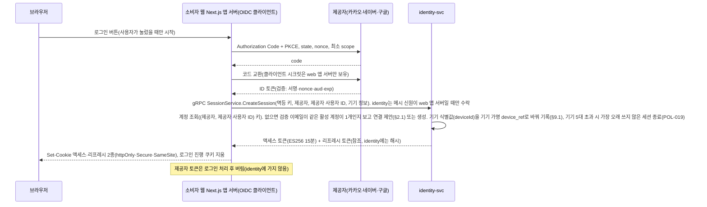
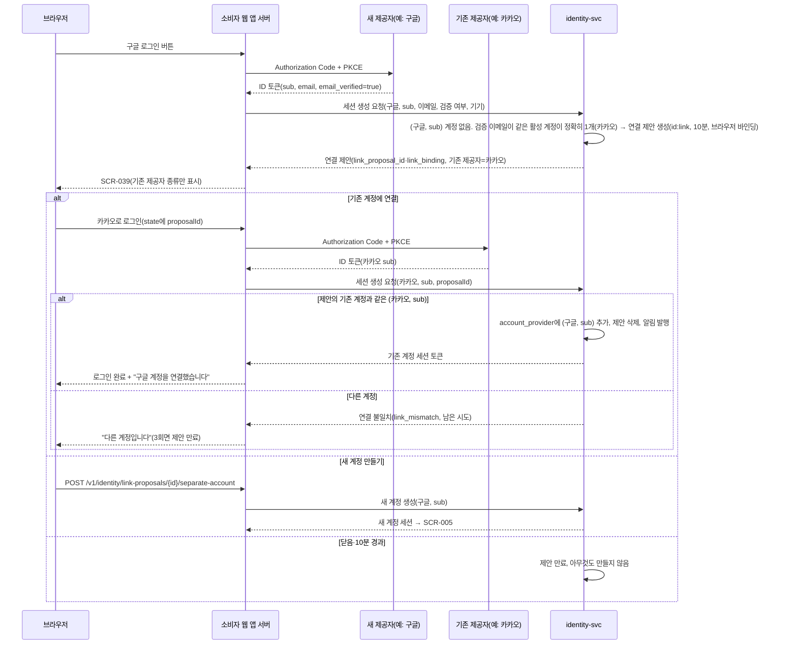
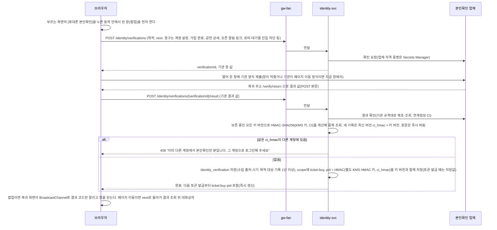
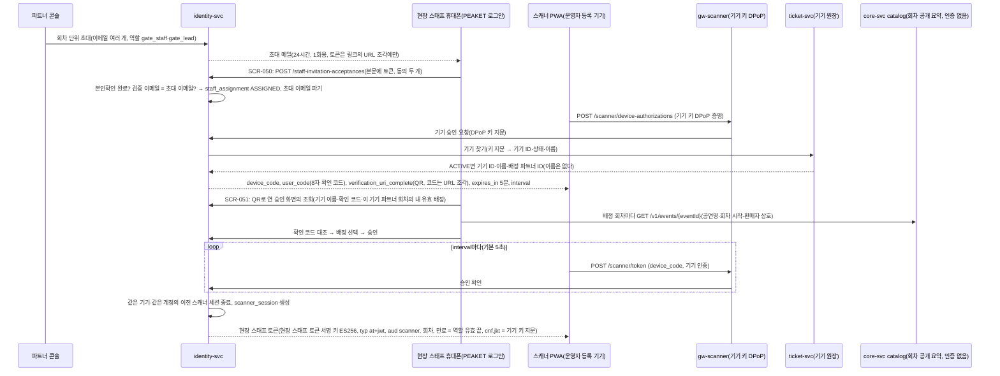

# 기능 설계: 계정·인증·본인확인·세션

- **독자와 용도**: identity-svc, 소비자 웹 앱 서버의 소셜 로그인(얇은 OIDC 클라이언트, ADR-0119), 파트너·관제 콘솔 로그인 모듈, 게이트웨이(클라이언트 종류별로 앞에 둔 입구 서버로, 인증·공통 정책·안쪽 서비스로 넘기기를 맡는다)의 인증 정책 엔진, 서비스 공통 라이브러리(`packages/platform`)의 공통 인증 가드를 구현하는 엔지니어가 읽는다. 로그인의 전 과정, 토큰(권한이나 상태를 증명하려고 주고받는 서명된 문자열)·쿠키(브라우저가 사이트별로 저장했다가 요청마다 함께 보내는 작은 값) 규격, 세션 정책, 휴대폰 본인확인, 관리 계정 보안 규칙, 검증 테스트 포인트를 파악할 때 참조한다. 세부 보안 요구사항 판정은 원본인 `docs/security/asvs/auth.md`(L1·L2 149건)를, 개인정보 취급 기준은 `docs/security/data-classification.md`를, 암호화 키 관리는 `docs/security/secrets-and-keys.md`를 따른다.
- **원문 출처**: 설계서 §6 <계정·인증: 팬은 소셜 로그인, 관리 계정은 다중 인증>, 설계서 10장 <인증 및 보안>, 설계서 7장, [ADR-0001](../adr/0001-fan-social-login-single-factor.md), [ADR-0006](../adr/0006-ticket-buyer-identity-verification-before-queue.md), [ADR-0011](../adr/0011-token-lifecycle-and-login-responsibilities.md), POL-001·002·019·020·023·025·027.
- **기준 기획 버전**: v1.0.
- **관련 ID**: FR-001, 002, 017, 021, 028, 045, 046, 048, 072(사후 포렌식 수집, ADR-0171) · NFR-016, 017, 018 · POL-001, 002, 019, 020, 023, 025, 027, 028, 031, 033, 034, 046 · SCR-004, 005, 006, 017, 020, 028, 036, 037, 039, 040, 050, 051, 064 · API(프로그램끼리 요청과 응답을 주고받는 창구) `/v1/identity/*`, `/v1/partner/auth/sessions`, `/v1/ops/auth/sessions`, `/v1/ops/admin-accounts`와 그 아래 경로, `/v1/partner/team-accounts`(관리 계정 관리, 2026-10-30), `/v1/staff-invitation-lookups`, `/v1/staff-invitation-acceptances`, `/v1/device-approval-lookups`, `/v1/device-approvals`, `/v1/scanner/device-authorizations`, `/v1/scanner/token` · 이벤트 `control.sessions-terminated`(모든 파드가 받고, 새 파드는 15분을 다시 읽는다, ADR-0103) · 데이터 docs/data.md §2 account·identity_verification·session·device·admin_account·admin_designation·staff_assignment·scanner_session, 조사용 값 account_contact_ref·identity_conflict_attempt(§9.1, 2026-10-31).

## 1. 개요와 계정 유형

| 계정 유형 | 인증 메커니즘 | 세션 수명 정책(초기값) | 접근 권한 범위 |
| --- | --- | --- | --- |
| 팬 (일반 관람객) | 카카오·네이버·구글 소셜 OAuth 2.0(다른 서비스 계정으로 로그인하게 하는 표준)이며, 방식은 Authorization Code + PKCE(로그인 중 가로챈 코드를 못 쓰게 하는 보강 방식)다. 자체 비밀번호는 전혀 저장하지 않는다. | 절대 만료 30일(NIST AAL1 권고), 유휴 만료 14일, 액세스 토큰 15분이다. 동시 활성 기기는 5대이고, 넘으면 가장 오래 쉬고 있는 세션을 자동으로 끝낸다. 계정당 대기열은 1개에만 들어갈 수 있다 | 본인 주문·티켓 관리·선물 양도·굿즈 상품 주문 |
| 파트너 (공연 기획사) | 초대를 받아 가입한다. 업무용 이메일 + 비밀번호 + TOTP(인증 앱이 시간에 따라 새로 만드는 일회용 코드) 2차 인증이 필수다. 패스키는 TOTP를 대신하지 않고, 위험한 작업(정산 계좌 변경, 권한·역할 변경, 예매자 명단 내려받기)의 추가 요소로 쓴다(피싱에 강한 단계 인증, §6, POL-020). 여기에는 파트너가 하는 작업만 적었다. 운영자 몫(위험 운영 명령과 그 2인 승인, 수사기관 제공 자료의 추출)까지 모은 목록은 §6 '다중 요소 인증' 행이다(2026-11-02 정합 점검). | 절대 만료 24시간, 유휴 만료 1시간(NIST AAL2 권고), 동시 활성 세션 2개(넘으면 가장 오래 쓰지 않은 세션을 끝내고 보안 알림을 보낸다, POL-019) | 소속 파트너의 공연 등록·정산 리포트·예매자 명단 관리 (테넌트 격리) |
| 운영자 (관제 센터) | 업무용 이메일 + 비밀번호 + 다중 인증(MFA)이다. 위험한 명령을 실행하기 직전에 다시 인증하고(비밀번호·TOTP에 더해 패스키, §6), 2인 승인을 반드시 거친다 | 절대 만료 24시간, 유휴 만료 1시간, 동시 활성 세션 2개(넘으면 가장 오래 쓰지 않은 세션을 끝낸다, POL-019) | 관제 3대 역할군(viewer, operator, commander) 매트릭스를 따른다 |
| CS 담당자 [보완] | 운영자와 같은 관리 계정 보안 정책을 적용한다 | 운영자 세션 정책과 같다 | 추가 검증 이의 제기 심사, 고객 거래 분쟁 내역 조회, CS 처리함, 승인 업무 요청. CS 책임자(`cs_lead`)는 1인 승인과 예매 제한 확인(POL-038) |
| 현장 스태프 (검표 스캐너) | 기기 쪽은 운영자가 등록한 기기의 기기 키와 DPoP(요청마다 그 키로 서명한 증명을 붙이는 표준, RFC 9449)로 확인한다. 하드웨어에 묶인 키가 필요한 운영 환경에서는 mTLS(양쪽이 서로 인증서를 확인하는 TLS) 기기 인증서를 선택지로 둔다(추천 적용 2026-10-28, 기술 검토 중간-057, docs/features/offline-gate.md §6.1). 사람 쪽은 본인확인을 마친 PEAKET 계정과 RFC 8628 기기 승인 로그인을 함께 쓴다(§6.1, ADR-0030·0051) [보완: 원문은 '게이트 스캐너 Phase에서 설계'] | 기기 키는 만료 없이 기기 폐기·다시 등록 때까지 쓰고, 회차마다 새로 만들지 않는다(mTLS 선택지의 인증서는 30일 [가정], 만료 10일 전 갱신). 현장 스태프 세션은 배정 회차의 역할 유효시간(입장 시작 3시간 전 ~ 공연 종료 2시간 후)에만 유효하다. 세션은 기기와 계정마다 하나이고, 기기 키 지문(`cnf.jkt`)에 묶이며, 서버가 요청마다 상태를 확인한다(ADR-0051) | 배정된 회차·기기 배치 구역의 티켓 검표와 동기화. 기기 배치·예외 통과·이상 표시 처리·부스 허용·확인 스캔은 `gate_lead`에게만 허용한다 |

### 핵심 설계 철학
- **팬 비밀번호를 보관하지 않음**: 일반 팬은 소셜 로그인만 쓰므로 팬 비밀번호를 시스템에 보관하지 않는다. 그래서 비밀번호 유출 위협이 없고, 비밀번호 보관에 따르는 규제 검증 범위도 줄어든다. 대신 소셜 계정이 탈취되면 그 계정으로 로그인할 수 있으므로, 민감한 작업 전 제공자 재인증 같은 보완 통제를 둔다([ADR-0001](../adr/0001-fan-social-login-single-factor.md)).
- **다중 요소 인증(MFA) 집중**: 강력한 다중 요소 인증은 소수의 내부 운영자 및 파트너 관리 계정에 둔다.
- **인증과 본인확인의 명확한 분리**: 매 접속 시 계정 소유권을 확인하는 '로그인'과 실제 사용자의 법적 신원을 1회 증명하는 '본인확인'을 나눠 다룬다.

## 2. 소셜 로그인 흐름(FR-001, ADR-0011)

- **앱 서버의 얇은 OIDC 클라이언트(추천 적용 2026-10-28, ADR-0119)**: 소비자 웹 앱 서버는 소셜 로그인 프레임워크(Auth.js 등)를 쓰지 않고, OIDC 저수준 라이브러리 `openid-client` 6(같은 저자의 `oauth4webapi` 3 위에 만든 한 단계 높은 클라이언트. PoC I-T51에서 골랐다, 2026-11-03, §12.1)으로 인가 코드 흐름을 직접 한다. 라이브러리는 토큰 끝점에서 TLS로 받은 ID 토큰의 서명을 기본으로 보지 않으므로 `enableNonRepudiationChecks`를 켜 제공자 JWKS로 서명을 확인한다(ASVS v5.0.0-6.8.2). 자기 세션 쿠키를 두지 않으므로 세션은 identity 한 층이다.
  - 카카오·네이버·구글을 모두 제공자가 공개한 OIDC 발견 문서의 issuer로 설정한다(`https://kauth.kakao.com`, `https://nid.naver.com`, `https://accounts.google.com`, 2026-10-28 발견 문서 확인). PKCE(`S256`)·state·nonce를 모두 검사하고, ID 토큰의 서명(제공자 JWKS의 RS256)·`iss`·`aud`·`exp`·`nonce`를 확인한다.
  - 네이버 ID 토큰에는 이메일이 없어 네이버 사용자 정보 API로 받는다. `provider_user_id`는 ID 토큰의 `sub`로 정하고 처음부터 바꾸지 않는다. 사용자 정보 API의 `id`가 `sub`와 다르면 막는다. 실제 네이버에서 둘이 같은 값인지는 제공자 앱을 등록해야 볼 수 있다(I-T51은 모의 제공자로 대조와 차단까지 확인했다, 소유자 몫) [확인 필요].
  - 로그인 진행 상태(제공자, state, nonce, PKCE 코드 베리파이어, 돌아갈 주소)는 쿠키 하나 `__Host-peaket_oidc`에 암호화해 두고, 콜백에서 한 번 쓰고 바로 지운다(§3).
  - PoC(I-T51, 2026-11-03)에서 이 방식은 ASVS 10.x·6.8.2와 제공자 설정(모의 제공자 기준)을 모두 통과해 ADR-0119 결정 3대로 확정했다. Auth.js v5는 기본 사용법에서 세션 층·서명 확인이 미달이고, 문서 기능으로 고치면 통과하지만 판이 베타(@auth/core 0.x)다(`tools/poc/login-compare/RESULT.md`).
- **세션 생성 내부 계약(추천 적용 2026-10-28, 기술 검토 중간-083)**: 앱 서버 → identity 호출은 gRPC `peaket.identity.v1.SessionService`다(docs/api/proto/peaket/identity/v1/identity.proto). identity-svc는 이미 purchase-svc의 본인확인 조회를 gRPC로 받으므로 같은 서버·같은 계약 규칙(`buf breaking`, 데드라인, 상태 코드)을 쓴다. 내부 서비스끼리 REST를 쓰지 않는 규칙(docs/architecture.md §3.2)과도 맞는다.
  - `CreateSession`: 제공자, `provider_user_id`(ID 토큰의 `sub`), 이메일과 검증 여부, 연결 제안 ID(있으면), 기기 값, 법정 접속기록 줄에만 쓰는 원문 IP와 단말 정보, 제공자가 준 인증 방식(`acr`·`amr`)을 보낸다. 제공자 토큰은 보내지 않는다. 결과는 세션(액세스·리프레시 토큰)이거나 연결 제안 ID이고, 처음 로그인이면 가입 화면으로 보낼 표시가 붙는다.
  - 멱등 키: 로그인 시도마다 하나이고, 로그인 진행 쿠키 state를 앱 서버 전용 키로 HMAC한 값이다. 앱 서버가 데드라인을 넘겨 다시 보내도 세션과 기기 기록은 한 번만 생긴다. identity에는 리프레시 토큰의 해시만 있어 같은 값을 다시 줄 수 없으므로, 같은 키로 다시 오면 같은 세션에 토큰을 다시 발급하고 앞서 발급한 리프레시 토큰은 무효로 한다. 키는 10분 [가정] 기억한다.
  - `EndSession`: 로그아웃이다. 세션을 끝내고 세션 종료 이벤트를 낸다. 이미 끝난 세션이면 그대로 성공한다.
  - 메시 신원 허용 목록: identity-svc 웨이포인트의 L7 허용 정책이 `SessionService`는 소비자 웹 앱 서버의 서비스 계정만, `IdentityService`는 purchase-svc만 들인다. 노드 프록시 쪽은 웨이포인트 신원만 받는다(docs/architecture.md §5 메시와 앱의 책임 경계). 메시를 두지 않는 포트폴리오 실행(docs/verification.md §8)에서는 identity-svc의 gRPC 포트로 들어오는 연결을 NetworkPolicy로 docs/architecture.md §3.2 gRPC 행에서 identity-svc를 부르는 파드(소비자 웹 앱 서버, purchase-svc, ticket-svc, queue-svc, ops-svc, `core-notify-sender`, `inv-ingest`, 그리고 `GetAdminAuthz`를 부르는 관리 경로 처리 서비스)에만 연다(2026-11-01 정합 점검, docs/architecture.md §5 '포트별 허용 표', docs/devops.md D-T36). 이때 호출자는 서비스 신원이 아니라 파드 라벨로만 가려진다(추천 적용 2026-10-28, 기술 검토 낮음-082). 파트너·운영자 로그인은 게이트웨이를 거쳐 관리 계정 로그인 API로 가고 이 계약을 쓰지 않는다(ADR-0119). 시험은 I-T15(밖에서 부르면 거부)와 I-T50(멱등·허용 목록)이다.
- **웹 앱 서버 경로와 첫 구현 범위(추천 적용 2026-11-03, BUILD_ORDER PRF-020)**: 앱 서버의 로그인 경로는 다섯이다. 로그인 시작 `POST /login/{provider}`(폼 칸 `returnTo`와 `deviceId`. `deviceId`는 화면 스크립트가 localStorage `peaket.device`에서 읽어 넣고(docs/frontend.md §3.12), 없으면 비운다), 콜백 `GET /login/callback/{provider}`(로그인과 §7.1 재인증이 함께 쓴다. 제공자 앱에 등록하는 돌아올 주소는 제공자마다 이것 하나다), 로그아웃 `POST /logout`, 재인증 시작 `POST /reauth/{provider}`(폼 칸 `returnTo`·`purpose`, §7.1), 재인증 결과 받기 `POST /reauth/token`(§7.1)이다. 모두 `Cache-Control: no-store`이고, POST는 `Origin`을 소비자 웹 출처와 대조한다. 콜백 주소는 요청 호스트가 아니라 설정한 공개 출처로 다시 만든다(프록시 뒤에서도 인가 때 보낸 주소와 같게). 실패 응답은 이유를 싣지 않고 '처음부터 다시'만 안내하며, 이유 범주는 서버 로그에만 남긴다. 로그아웃은 identity가 실패해도 이 앱의 쿠키를 지우고 503으로 알린다. 돌아갈 주소는 같은 출처의 경로만 받는다(asvs/auth.md 3.7.2). 처음 로그인이면 `/signup/consent?next=<돌아갈 주소>`(SCR-005)로 보낸다. 돌아갈 주소는 docs/frontend.md §5.14 `safeNext()` 규칙을 쓴다. 콜백 뒤 돌아간 첫 화면 요청에는 `SameSite=Strict`인 팬 쿠키가 실리지 않는다(제공자 사이트에서 시작한 이동이라서). 그래서 그 화면도 서버가 쿠키로 로그인 여부를 정하지 않고 화면 스크립트가 같은 사이트 요청으로 확인한다(docs/frontend.md '알림·외부 링크 착지 규칙', ADR-0065 결정 8, 추천 적용 2026-11-03). 양식 전송의 `Origin` 대조와 `Origin: null`의 처리는 docs/architecture.md §5 'CSRF 확인 규칙'이다.
  - 앱 서버 비밀 하나(256비트)에서 HKDF-SHA256으로 용도별 키 셋을 나눈다: 로그인 진행 쿠키 암호화 키, 멱등 키 HMAC 키, 재인증 결과 쿠키 암호화 키다. 한 키를 두 용도로 쓰지 않는다(docs/security/secrets-and-keys.md). 봉인한 쿠키 값에는 그 비밀의 키 ID를 싣고, 비밀을 바꿀 때는 옛 비밀을 쿠키 수명(10분) 동안 복호에만 함께 둔다.
  - 앱 서버는 로그아웃과 재인증 시작에서 팬 액세스 토큰 쿠키를 팬 토큰 공개키로 확인해 `sid`·`sub`를 얻는다(서명, `typ` at+jwt, `aud` fan, `iss`). 로그아웃만 만료된 토큰도 받는다(자기 세션을 끝내는 일이라 늦게 와도 해가 없다). 공개키를 나눠 주는 방법은 BUILD_ORDER PRF-030(wbs 2.1.2)이 정하고, 그 전에는 설정값으로 받는다. identity의 팬 토큰 서명 키도 그 전에는 설정값(JWK) 하나다.
  - 기기 한도(POL-019): 기기는 기기 행(`device_ref`)이 같은 세션 묶음이고, 기기 행이 없는 세션은 한 대로 센다. 새 세션을 더해 활성 기기가 6대가 되면 마지막 활동(`idle_expires_at`)이 가장 이른 기기의 세션을 모두 끝낸다(사유 `DEVICE_LIMIT`). 기기 가명의 라벨 키는 운영에서 KMS로 받고(docs/security/secrets-and-keys.md `inv-ref-key`), 로컬·CI는 설정값으로 대신한다. 키가 없으면 기기 행을 쓰지 않는다(§10).
  - 멱등 키 기억: identity는 `session_create_key` 표에 멱등 키, 요청 지문(제공자와 `provider_user_id`), 세션 ID를 10분 [가정] 둔다(docs/data.md). 같은 키가 처리 중이면 그 행의 잠금이 풀릴 때까지 기다린다. 다시 발급할 때는 같은 세션의 리프레시 토큰 해시를 바꿔, 앞서 준 리프레시 토큰을 쓸 수 없게 한다.
  - 첫 구현에서 뒤로 미룬 것: 같은 이메일 계정의 연결 제안(§2.1)은 wbs 3.1.3이 붙인다(가입 때 제안은 BUILD_ORDER BOT-040에서 붙였다, §2.1 '가입 때 연결 제안의 첫 구현'). 그 전에는 identity가 (제공자, sub) 계정이 없으면 연결 제안 없이 새 계정을 만들었다. 로그인 판정(§7 '로그인 판정의 처리')은 trust-svc가 생길 때 붙이고, 그 전에는 세션의 `login_verdict`를 '판정을 받지 못함'인 `UNKNOWN`으로 남긴다(양도·계좌 입력에서는 안전 쪽으로 다뤄진다). 액세스 토큰의 `scope`·`pid`는 본인확인 단계(BUILD_ORDER PRF-040)가 싣는다. 세션 종료 사건 발행, 리프레시 회전, 서명 키 셋과 공개키 배포는 BUILD_ORDER PRF-030이다. 메시가 없는 포트폴리오 실행에서 identity gRPC 포트를 위 '메시 신원 허용 목록'의 파드에만 여는 NetworkPolicy(I-T15 ②)는 wbs 0.4.4가 차트에 더한다. 웹 앱 서버는 `client_ip`를 비워 보낸다(믿을 수 있는 끝단 IP 머리를 정하는 BUILD_ORDER HOT-400 뒤에 싣는다). identity는 로그인·재인증의 법정 접속기록 줄(성공·실패, 제공자, 재인증 강도, §9)을 아직 쓰지 않는다(BUILD_ORDER OPS-070). 고위험 재인증의 본인확인 재통과 확인(§7.1 ③)은 재통과 기록이 생기는 본인확인 단계(BUILD_ORDER BOT-020)가 붙이고, 그 전에는 결과가 '본인확인 재통과 필요'다.
- 처음 소셜 로그인을 마치면 서비스 가입·약관 동의 화면(SCR-005)으로 넘어간다. 이 화면에서 만 14세 이상인지 확인한다(모든 제공자에 같은 방법을 쓰고, 제공자에게 연령대를 요청하지 않으며, 생년월일 원문은 모으지 않는다). 필수 동의와 선택 동의 항목을 나누고(동의 일시는 타임스탬프로 원장에 보존한다), 닉네임을 정하며, 휴대폰 본인확인을 미리 하도록 권한다(선택).
- 이메일 주소가 같더라도 다른 소셜 제공자로 들어온 계정을 시스템이 알아서 자동으로 병합하지 않는다(웹 보안 기준을 만드는 비영리 단체 OWASP의 웹 앱 보안 검증 항목 목록인 ASVS 6.8.1·10.5.2와, OAuth 위에 신원 정보를 더한 로그인 표준인 OIDC의 Core §5.7을 따른다). 같은 검증 이메일을 가진 계정이 이미 있으면 사용자에게 계정 연결을 제안한다. 기존 소셜 계정으로 로그인해 그 계정의 주인임을 완전히 증명한 경우에만 안전하게 결합한다(§2.1 참조). 이메일은 알림을 보내는 창구일 뿐, 시스템의 고유 식별자나 인증 수단이 아니다.
- 외부 소셜 제공자의 세션과 PEAKET 서비스 내부 세션은 완전히 따로 운용한다. 화면 없이 뒤에서 조용히 하는 자동 로그인은 전혀 지원하지 않는다.
- 로그인은 새 창(팝업)을 열지 않고 지금 창에서 제공자 인증 화면으로 이동했다가 돌아온다(리디렉션 흐름, ADR-0119). 그래서 로그인 화면은 창 메시지를 받지 않는다(docs/security/asvs/auth.md 3.5.5, 기획 SCR-004 표현을 이에 맞춤, 추천 적용 2026-10-15, ADR-0065).
- 소셜 제공자가 OpenID Connect의 `acr` 또는 `amr` 클레임을 보내지 않으면 단일 요소 인증으로 본다(ASVS 6.8.4). 이때 §7에 적은 보완 통제를 모두 적용한다(ADR-0001). 재인증의 최근성(`auth_time`)을 제공자마다 어떻게 확인하는지는 §7.1에 있다.

### 2.1 같은 이메일 계정의 연결과 병합(FR-048, POL-034, ADR-0038)

회원가입 단계의 계정 연결 제안 절차:

계정 설정 화면의 로그인 수단 연결·해제와 계정 병합(SCR-040):
- 먼저 민감한 설정을 바꿀 때만 쓰는 재인증 토큰(POL-019, 유효기간 5분, 팬 토큰 키로 서명한 `typ` reauth+jwt, ADR-0050)을 받은 뒤 새 소셜 제공자 인증을 한다. 이 (제공자, sub) 키로 등록된 기존 계정이 없으면 `account_provider`에 바로 추가 등록한다.
- 새 제공자가 이미 다른 PEAKET 계정에 묶여 있으면 계정 병합 제안(`id:merge`, 유효기간 10분)을 만들고 영향 요약 정보를 돌려준다. 병합의 기준이 되는 대표 계정은 휴대폰 본인확인을 마친 계정으로 정한다(두 계정 모두 본인확인 전이면 지금 로그인한 계정으로 정하고, 두 계정 모두 본인확인을 마쳤으면 병합할 수 없어 거절한다). 이때 옮길 항목과 수량(소셜 로그인 수단, 찜 목록, 오픈 알림 구독, 배송지), 옮기지 않고 대표 계정에서 함께 보이게 되는 기록(흡수 계정의 굿즈 상품 주문 등 주문 내역), 유지하는 항목(대표 계정 닉네임과 약관 동의 상태. 마케팅 동의 범위는 넓히지 않는다), 병합 차단 사유를 밝힌다. 흡수 계정은 본인확인 전 계정이라 티켓·관람 후기·좌석 홀드·구매 세션을 가질 수 없다(티켓 구매와 양도 받기, 후기 쓰기는 본인확인을 마친 계정만 한다, POL-001·017). 그래서 티켓과 후기를 옮기는 단계는 두지 않는다. 병합 확인 때 ticket-svc와 후기에 흡수 계정의 티켓·후기가 없는지 묻고, 하나라도 있으면 불변식 위반으로 409와 SEV3을 내고 병합하지 않는다(추천 적용 2026-10-28, 기술 검토 중간-054).
- 계정 병합 차단 사유(POL-034): 두 계정 중 하나라도 진행 중인 온세일(판매가 열리는 시각 앞뒤로 접속이 몰리는 기간) 좌석 홀드(결제하는 동안 다른 사람이 가져가지 못하게 좌석을 잠시 잡아 두는 것)·구매 세션(`ACTIVE_PURCHASE_SESSION`)·결제 승인 대기 주문(`PENDING_PAYMENT`)을 가진 경우. 예매가 진행 중인 공연이나 한정 수량 MD 상품을 두 계정에서 더한 보유량이 1인당 구매 한도를 넘는 경우(`QUOTA_EXCEEDED`, POL-011, FR-015). 흡수될 계정에 회원 탈퇴(`WITHDRAWAL_IN_PROGRESS`)나 이상 거래 이의 제기(`APPEAL_PENDING`) 절차가 아직 끝나지 않은 경우. 어느 계정에든 입장 시작부터 입장 기록 마감 사이인 회차의 티켓이 있는 경우(`ENTRY_STARTED`, 입장 중에는 소유권과 키를 바꾸지 않는다, ADR-0051 결정 10). 두 계정 모두 본인확인을 마친 경우(`BOTH_VERIFIED`, 바로 위 대표 계정 규칙과 같다). 이 줄은 2026-10-30 전에 '두 계정의 본인확인 내역이 서로 다를 때만' 막는다고 적혀 POL-034·바로 위 줄과 어긋났고, 정본인 POL-034에 맞췄다. 괄호 안은 API 차단 사유 코드(openapi `MergeProposal.blockers`)다(추천 적용 2026-10-30). 사유마다 데이터의 주인이 달라, identity-svc는 병합 제안을 만들 때와 확정 트랜잭션 바로 앞에 purchase-svc(홀드·구매 세션·결제 승인 대기 주문)·ticket-svc(티켓·입장 중 회차)·core-svc(후기·한정 MD 합산 한도)의 `CheckAccountMerge`를 함께 부르고(호출마다 기한 1초 [가정]), 하나라도 답하지 않거나 기한을 넘기면 확정하지 않고 503과 `Retry-After`로 '잠시 뒤 다시'를 안내한다. 흡수 계정의 이의 제기·소명 계류는 ops-svc가 그 건을 열고 닫을 때 `SetAccountHold`로 알려 둔 identity DB `account_hold`로 본다(추천 적용 2026-10-29, ADR-0148).
- 사용자가 최종 승인하면(`POST /v1/identity/merge-proposals/{id}/confirmation`, 재인증 토큰 첨부) 한 트랜잭션(여러 변경을 한꺼번에 반영하거나 한꺼번에 취소하는 작업 단위) 안에서 흡수 계정 상태를 `MERGED`로 잠그고 로그인 수단을 대표 계정으로 옮긴다. 그 뒤 Kafka(이벤트를 순서대로 쌓아 두고 여러 곳에 나눠 주는 메시지 시스템) 이벤트 `identity.accounts-merged`를 발행한다(docs/data.md §4 경계 9). 각 도메인 서비스는 이 이벤트를 받아 자기 데이터를 두 종류로 나눠 다룬다(추천 적용 2026-10-28, 기술 검토 중간-054). ① 지금의 소유·상태 값(찜, 오픈 알림 구독, 배송지)은 계정 ID를 대표 계정으로 고친다. 이 이전은 중간 상태 없이 한 번에 끝나는 원자적 작업이고, 재시도는 같은 요청이 여러 번 와도 결과가 한 번 처리한 것과 같은 멱등성을 지킨다. ② 사건·원장·법정 보존 기록(주문·결제·환불·굿즈 주문, 주문 사건 기록 `order_event`·결제 원장, 정산, 스캔 기록, 접속기록)은 원래 계정 ID를 고치지 않는다. 주문 이력(`order_event`)은 덧붙이기만 하는 기록이라 고치면 그 전제가 깨지고, 주문·결제는 전자상거래법으로 5년 보존하는 기록이며, 봇·부정 조사에서 실제로 어느 계정이 샀는지가 남아야 하기 때문이다. 대신 그 서비스가 흡수 계정 → 대표 계정 대응표(`merged_account`)를 이 이벤트로 채우고, 조회와 권한 확인을 계정 묶음(대표 계정과 흡수 계정 ID들)으로 한다. 그래서 '내 주문'에 흡수 계정의 주문이 함께 보이고, 진행 중 굿즈 주문의 조회·취소는 대표 계정에서 그대로 된다. 그 주문의 배송·환불 알림은 받는 계정을 대표 계정으로 바꿔 보낸다. 흡수 계정의 모든 활성 세션은 `control.sessions-terminated`(종료 사유 `MERGED`) 이벤트로 바로 만료시킨다.
- 흡수된 계정의 이메일과 닉네임 원문은 바로 영구 파기하고 `merged_into_account_id` 외래키만 남긴다. 그 뒤 그 소셜 수단으로 로그인하면 대표 계정으로 자동으로 이어진다. 법정 접속기록과 주문·결제 같은 기록은 원래 계정 ID로 유지하되, `account_merge` 감사 이력과 `merged_into_account_id`로 두 계정을 이어 볼 수 있게 한다.
- 로그인 수단을 연결·병합·해제하면 두 계정에 등록된 모든 공식 알림 채널(이메일과 등록 기기 푸시)로 바로 알린다. 확정된 계정 병합은 시스템에서 되돌리기를 지원하지 않는다. 계정 도용 신고는 CS 전담 창구에서 사람이 직접 심사한다.
- 한 계정에 연결된 로그인 수단의 해제(`DELETE /v1/identity/providers/{provider}`)는 재인증을 통과했을 때만 할 수 있다. 마지막으로 남은 하나뿐인 로그인 수단을 해제하려 하면 409 Conflict로 막는다.
- 제안 식별자(proposalId)는 암호학적으로 안전한 128비트 난수(CSPRNG)로 만든 일회용 토큰이다. 연결 제안은 브라우저 쿠키로 클라이언트 맥락에 단단히 묶인다. 다른 사람의 계정이 있는지 밖에서 알아내지 못하게, 연결 제안은 '신규 제공자로부터 이메일 인증이 완료된(`email_verified=true`) 경우'에만 일어난다. 네이버는 이메일 검증 여부 필드를 주지 않으므로 회원가입 때 자동 제안 대상에서 빼고, 마이페이지 설정 메뉴에서 직접 연결하는 것만 지원한다.

- **가입 때 연결 제안의 첫 구현(추천 적용 2026-11-04, BUILD_ORDER BOT-040, I-T29·I-T30)**: 위 그림의 가입 때 연결 제안을 붙인다. 설정의 연결·해제는 BOT-041, 계정 병합은 BOT-042다.
  - 제안 조건(I-T29): 이번 로그인의 (제공자, sub) 계정이 없고, 제공자가 검증 이메일을 줬고(`email_verified`. 네이버는 늘 false라 대상이 아니다), 같은 이메일(앞뒤 공백을 빼고 소문자로 맞춘 값)이면서 이메일 검증 표시가 있는 활성(ACTIVE) 계정이 정확히 하나일 때만이다. 그 계정에 이번 제공자가 이미 다른 sub로 연결돼 있으면 제안하지 않는다(같은 종류 둘을 잇지 않는다 [가정]). 조건이 맞지 않으면 지금처럼 새 계정을 만든다.
  - 계정의 이메일 검증 표시는 `account.email_verified`다(새 칸, 계정을 만들 때 제공자가 준 값). 이 칸을 두기 전에 만든 계정은 false라 연결 대상이 아니다(운영 데이터는 아직 없다). 같은 이메일 계정 찾기는 지금 계정 표를 훑는다. 활성·검증 계정의 이메일 인덱스는 트랜잭션 밖 인덱스 파일을 돌리는 실행기(BUILD_ORDER BAS-060) 뒤에 더한다(docs/devops.md §7.2).
  - 제안은 세션·캐시 Redis의 `id:link:{proposalId}`(Hash, 10분, docs/data.md §3)에 둔다: 새 제공자·sub·이메일, 대상 계정, 보일 기존 제공자, 브라우저 묶음 값의 SHA-256, 실패 횟수, 만든 시각. 제안 ID는 128비트, 브라우저 묶음 값은 256비트 난수다(CSPRNG). 보일 기존 제공자는 대상 계정에 처음 연결한 제공자다.
  - `CreateSession`은 세션 대신 `link_proposal_id`와 `link_binding`(묶음 값 원문, 응답에서 한 번만)을 돌려준다. 앱 서버는 둘과 돌아갈 주소를 봉인해 연결 제안 쿠키 `__Host-peaket_link`(10분, §3)에 두고 `/login/link?proposal={제안 ID}`(SCR-039)로 보낸다. 제안 ID는 주소에 실려도 되지만 묶음 값이 없으면 쓸 수 없다. 묶음 값은 그 쿠키에만 있다.
  - 연결 맺기(I-T30): SCR-039의 [기존 제공자 로그인]은 로그인 시작 양식에 제안 ID를 실어 로그인 진행 쿠키에 둔다. 콜백은 `CreateSession`에 `link_proposal_id`와 쿠키의 `link_binding`을 싣는다. identity는 제안이 없거나 만료됐거나 묶음 값이 다르면 NOT_FOUND다(세션·계정을 만들지 않고, 화면은 만료 안내). 이번 로그인의 (제공자, sub)가 대상 계정의 로그인 수단이면 한 트랜잭션에서 새 제공자의 (제공자, sub)를 대상 계정에 잇고 그 계정의 세션을 만든 뒤 제안을 지운다(응답 `linked_provider`, 화면은 '{새 제공자} 계정을 연결했습니다'). 그 사이 새 제공자의 (제공자, sub)가 다른 계정에 묶였으면 잇지 않고 대상 계정으로만 로그인한다.
  - 이번 로그인이 대상 계정이 아니면(계정이 없거나 다른 계정) 실패 횟수를 하나 올리고 `link_mismatch`(남은 시도)를 돌려준다. 세션도 계정도 만들지 않는다. 세 번째 실패면 제안을 지운다(남은 시도 0, SCR-039 만료).
  - 새 계정 만들기: `POST /v1/identity/link-proposals/{proposalId}/separate-account`(앱 서버, 연결 제안 쿠키)는 `SessionService.SeparateAccount`를 부른다. identity는 제안을 지우고(한 번만) 제안의 새 제공자 (제공자, sub)·이메일로 새 계정과 세션을 만든다(`new_account` true → SCR-005). 그 사이 그 (제공자, sub) 계정이 생겼으면 그 계정으로 로그인한다.
  - 제안 조회: `GET /v1/identity/link-proposals/{proposalId}`는 `SessionService.GetLinkProposal`(제안 ID, 묶음 값)로 기존·새 제공자, 만료 시각, 남은 시도를 준다. 없음·만료·묶음 값이 다름은 404다. 닉네임·이메일은 보이지 않는다(밖에서 다른 사람 계정을 캐내지 못하게).
  - Redis에 닿지 못하면 제안을 만들지 않고 503(앱 서버는 '잠시 뒤 다시')이다. 제안을 잃으면 처음부터 다시 한다(docs/data.md §3 장애 표).
  - 연결 화면에서 시작한 기존 제공자 로그인은 계정을 다시 고르게 한다(카카오·네이버 `prompt=login`, 구글 `select_account`, 재인증과 같은 값). 제공자에 다른 계정이 로그인돼 있어도 남은 시도가 저절로 줄지 않게 하려는 것이다. 대상 계정은 잠근 뒤 상태를 본다. 활성이 아니면(탈퇴·정리 중) 실패로 세지 않고 제안을 끝낸다(NOT_FOUND).
  - 카카오는 ID 토큰에 이메일 검증 여부가 없어 앱 서버가 OIDC 사용자 정보의 `email_verified`(정본의 `is_email_verified`)를 읽는다. 실제 응답 칸 이름은 제공자 앱을 등록해야 볼 수 있다 [확인 필요](소유자 몫, 모의 제공자로 확인).
  - 남는 한계: 연결을 맺은 사실의 알림(두 계정의 알림 채널, I-T34)은 알림 사건과 함께 BUILD_ORDER BOT-041이 붙인다. 닫기는 제안을 지우지 않고 10분 만료에 맡긴다. `?linked=`는 누구나 만들 수 있어 '연결했습니다' 토스트만 거짓으로 띄울 수 있다(보이는 것뿐이다).

- **계정 병합의 첫 구현(추천 적용 2026-11-04, BUILD_ORDER BOT-042, I-T31·I-T32·I-T34)**: 위 병합 줄들의 identity 쪽을 붙인다. SCR-040 ④ 화면은 BOT-043이다.
  - 제안 만들기: 설정의 로그인 수단 추가(`AddProvider`)가 `OTHER_ACCOUNT`면 그 자리에서 병합 제안을 만들고 응답에 `merge_proposal_id`를 싣는다. 대표 계정은 본인확인을 마친 쪽이다. 둘 다 아니면 지금 로그인한 계정, 둘 다면 `BOTH_VERIFIED`로 막는다. 제안은 세션·캐시 Redis `id:merge:{proposalId}`(10분, docs/data.md §3)에 둔다: 제안한 계정·세션, 대표·흡수 계정, 추가하려던 (제공자, sub), 상태(PROPOSED·BLOCKED), 막는 사유, 옮길 항목 수, 만든 시각. 지금 계정에 같은 종류의 로그인 수단이 이미 있으면 다른 계정의 것이라도 `PROVIDER_TYPE_TAKEN`이고 제안을 만들지 않는다(병합이 같은 종류를 둘로 만들지 않게, 2026-11-04 새 맥락 리뷰). 제안을 만들다 무엇이 실패해도 로그인 수단 추가는 `OTHER_ACCOUNT`만 돌려준다(재인증 토큰은 이미 썼다). 앱 서버는 `?loginMethod=other-account&mergeProposal={id}`로 돌려보낸다.
  - 막는 사유는 identity 것(`BOTH_VERIFIED`, 흡수 계정이 정리 중이면 `WITHDRAWAL_IN_PROGRESS`, 흡수 계정에 열린 `account_hold`가 있으면 `APPEAL_PENDING`)과 세 서비스의 `CheckAccountMerge`(호출마다 기한 1초 [가정], 함께 부른다) 결과다. purchase의 홀드·구매 세션은 `ACTIVE_PURCHASE_SESSION`, 결제 대기 주문은 `PENDING_PAYMENT`, ticket의 입장 중 회차는 `ENTRY_STARTED`, core의 한정 MD 합산 한도는 `QUOTA_EXCEEDED`로 옮긴다. 흡수 계정의 티켓(ticket)·후기(core)는 불변식 위반이라 사유 목록에 넣지 않고 제안을 BLOCKED로 두며 오류 기록과 지표 `identity_merge_invariant_violation_total`(SEV3, §10.1)을 남긴다.
  - 옮길 항목 수: 로그인 수단은 identity가 센다. 흡수 계정의 주문(purchase)과 찜·오픈 알림 구독·배송지(core)는 각 서비스의 `CheckAccountMerge` 응답에 더한 개수 칸으로 받는다(추천 적용 2026-11-04, 그 서비스 단계가 채운다). 티켓·후기는 늘 0이다(옮기지 않는다).
  - 세 서비스 가운데 하나라도 답하지 않으면 제안을 만들지 않는다(`AddProvider`는 `OTHER_ACCOUNT`만, 화면은 '잠시 뒤 다시'). 그 서비스 주소가 설정에 없으면 운영·데모는 늘 답하지 않는 것으로 보고, 로컬·CI만 막는 것이 없다고 보는 대역을 쓴다(그 서비스가 생기기 전 시험용, 시작 로그에 경고).
  - 조회: `GET /v1/identity/merge-proposals/{proposalId}`(gw-fan)는 제안한 계정만 읽는다(다른 계정이면 404). openapi `MergeProposal`이다. 화면 문구를 위해 추가하려던 종류 `newProvider`, 지금 계정이 남는 쪽인지 `requesterRole`(PRIMARY·MERGED), 남는 계정의 본인확인 여부 `primaryVerified`(제안을 만든 때 값)도 준다(추천 적용 2026-11-04, BOT-043).
  - 화면(SCR-040 ④~⑥, BUILD_ORDER BOT-043): 앱 서버가 붙인 `?mergeProposal=`가 있으면 로그인 수단 화면이 제안을 읽어 MergeSummary로 보인다(PROPOSED는 요약과 남은 시간, BLOCKED는 다섯 범주와 막는 사유, 404는 만료). [다시 로그인하고 계속]은 지금 계정의 로그인 수단으로 재인증한다(둘 이상이면 고른다). 떠나기 전에 탭 저장소 `peaket.providers.pending`에 할 일 `merge`와 제안 ID를 남기고, 돌아오면 재인증 토큰을 받아 제안을 다시 읽은 뒤 확인 창을 연다. 확인하면 확정을 부르고, 202면 '처리 중'과 옮겨 온 로그인 수단 목록이다. 지금 계정이 흡수되는 쪽이면 세션이 끝났으므로 새 문서로 `/my/settings/providers?ended=MERGED`(로그인 전 셸의 흡수 안내와 로그인 화면 버튼)를 연다. 409는 막는 사유나 고객센터 안내, 404는 만료, 403은 다시 로그인한 지 5분이 지났다는 안내(토큰을 버리고 다시 로그인하고 계속), 503은 서버가 재인증 토큰을 쓰지 않았으므로 토큰과 확인 창을 두고 창 안에 '잠시 뒤 다시'를 보인다. 상태 바뀜은 features/login-methods `mergeAfterGet`·`mergeAfterConfirm`이 정하고 흐름 시험이 본다. 불변식 위반으로 BLOCKED인데 막는 사유가 없으면 고객센터 안내만 보인다.
  - 확정: `POST /v1/identity/merge-proposals/{proposalId}/confirmation`(`X-Reauth-Token`, 제안한 세션의 재인증 토큰 한 번). 먼저 지금 본인확인 상태로 대표 계정을 다시 고른다. 제안 뒤 흡수될 쪽만 본인확인을 마쳐 대표가 바뀌었으면 404이고 제안을 지운다(본인확인한 계정이 흡수되지 않게, 다시 추가하면 새 제안), 둘 다 마쳤으면 409 `BOTH_VERIFIED`다. 세 서비스를 다시 부르고(답이 없으면 503과 `Retry-After`), 막는 사유가 있으면 409(`merge-blocked`, `blockers`), 불변식 위반이면 409(`merge-invariant-violated`)와 SEV3이다. 통과하면 한 트랜잭션에서 추가하려던 (제공자, sub)를 잠그고 두 계정을 ID 순으로 잠근 뒤 상태를 다시 본다: 둘 다 ACTIVE인지, 그 로그인 수단이 아직 다른 계정(제안하지 않은 쪽)의 것인지(아니면 404), 본인확인 기록으로 고른 대표가 그대로인지(같은 트랜잭션에서 본인확인 표를 읽는다. 본인확인 확정은 계정을 공유 잠금으로 읽어 이 잠금과 순서가 맞는다). 그다음 흡수 계정의 로그인 수단을 모두 대표 계정으로 옮기고, 흡수 계정을 MERGED(`merged_into_account_id`)로 바꾸며 프로필 칸(이메일·닉네임·전화번호·저장한 예매자 이름·연락처·회원 코드)을 지운다(POL-034 '흡수 계정의 프로필은 병합 즉시 파기'). 흡수 계정을 가리키던 계정도 대표 계정을 가리키게 고친다(병합 사슬 한 단계, docs/data.md §4). `account_merge` 행을 남기고, 흡수 계정의 세션을 모두 끝내며(MERGED), 마지막 쓰기로 `identity.accounts-merged`(asyncapi `AccountMerged`, mergeId = `account_merge.id`)를 Outbox에 적는다. 제안을 지우고 202다(받는 서비스의 이전은 사건으로 이어진다).
  - 이의 제기 계류: `AccountHoldService.SetAccountHold`(ops-svc만)가 `account_hold` 행을 판 번호가 클 때만 쓴다(`source_ref`로 멱등, 같은 건에 다른 계정·종류면 ALREADY_EXISTS). CLOSED 행은 30일 [가정] 뒤 정비가 지운다.
  - 로그인의 잠근 뒤 다시 찾기(BOT-030이 넘긴 것): 로그인은 계정을 잠근 뒤 그 (제공자, sub)의 계정을 다시 찾는다. 사라졌으면(탈퇴·해제) 새 계정으로, 다른 계정이면(병합으로 옮겨짐) 그 계정을 잠그고 그 계정으로 간다. 옮겨 간 계정이 탈퇴 정리 중이어도 그 계정으로 간다(그 수단은 그 계정 것이라 새 계정을 만들면 수단을 빼앗는다). 그 계정을 잠그는 사이 또 옮겨졌을 수 있어 자리를 잡을 때까지 다시 찾고, 세 번 넘게 옮겨지면 UNAVAILABLE이다. 흡수된 계정에 세션·기기를 만들지 않는다.
  - 보존: `account_merge` 행은 대표 계정이 탈퇴해 계정을 지울 때 함께 지운다. 병합 사슬 앞단(그 계정에 흡수된 계정이 대표였던 병합)의 행도 함께 지운다(docs/security/data-classification.md '계정 연결 및 병합 감사 원장').
  - 남는 한계: 두 계정에 같은 종류의 다른 로그인 수단이 있으면(추가하는 종류가 아닌 다른 종류) 병합 뒤 대표 계정에 그 종류가 둘이 된다(규칙을 정하지 않았다, docs/lanes/lane3.md 구간 끝 정리 목록). 흡수 계정의 이메일은 확정 트랜잭션에서 지우므로 POL-034의 '두 계정 이메일로 완료 통지'는 알림 쪽 단계가 받는 방법을 정한다(같은 목록). 확정 직전 확인과 확정 트랜잭션 사이에 생긴 홀드·주문은 막지 못하고, 받는 서비스가 대응표 `merged_account`로 계정 묶음을 함께 센다(ADR-0148 결정 6, 각 서비스 단계). 받는 쪽(대응표·찜 이전·알림)은 그 서비스 단계다.
- **설정의 로그인 수단 연결·해제의 첫 구현(추천 적용 2026-11-04, BUILD_ORDER BOT-041, I-T33·I-T34)**: SCR-040 ①②③을 실제 API에 잇는다. 계정 병합(④)은 BOT-042다.
  - 목록: `GET /v1/identity/providers`는 연결한 순서와 마지막 로그인 시각을 준다. 마지막 로그인 시각은 `account_provider.last_login_at`(새 칸)이고, 그 (제공자, sub)로 로그인 세션을 만들 때마다 적는다(가입 때 연결 제안의 연결 로그인 포함).
  - 추가(②): 화면이 먼저 재인증(재인증 토큰, 5분 한 번, §7.1)을 받은 뒤 새 제공자 인증을 앱 서버 경로 `POST /link/{provider}`(폼 칸 `reauthToken`·`returnTo`)로 시작한다. 앱 서버는 팬 액세스 토큰으로 세션을 확인하고 재인증 토큰을 로그인 진행 쿠키에 봉인한다. 콜백(`GET /login/callback/{provider}`)은 `SessionService.AddProvider`(세션·계정, 재인증 토큰, 제공자, sub)를 부른다. 새 제공자 인증은 계정을 다시 고르게 한다(재인증과 같은 prompt).
  - identity의 판정: 재인증 토큰을 확인하고(같은 세션·`FAN_SENSITIVE`, 한 번만 쓴다) 계정을 잠근 뒤, 그 (제공자, sub)가 어느 계정에도 없으면 이 계정에 잇는다(`LINKED`). 이미 이 계정이면 그대로다(`ALREADY_LINKED`). 이 계정에 같은 종류 제공자가 다른 sub로 있으면 잇지 않는다(`PROVIDER_TYPE_TAKEN`, 종류마다 하나 [가정], 가입 때 제안과 같은 규칙. 그 sub가 다른 계정의 것이어도 이 판정이 먼저다, BOT-042). 다른 계정에 묶였으면 `OTHER_ACCOUNT`다(그 계정과 합치는 병합 제안을 함께 만든다, 위 '계정 병합의 첫 구현', BOT-042). 재인증 토큰이 맞지 않으면 `REAUTH_REQUIRED`다. 앱 서버는 결과를 돌아갈 주소의 `?loginMethod=` 값으로 넘기고 화면이 안내한다.
  - 해제(③): `DELETE /v1/identity/providers/{provider}`(gw-fan, `X-Reauth-Token`). 재인증 토큰을 확인하고(한 번만) 계정을 잠근 뒤, 그 종류 연결이 없으면 404, 그 계정의 마지막 로그인 수단이면 409 `last-login-method`(I-T33), 아니면 지우고 204다. 지금 그 제공자로 로그인한 세션은 끝내지 않는다(세션은 계정에 묶인다).
  - 재인증할 제공자: 탈퇴(SCR-017)와 SCR-040의 재인증 창은 연결한 제공자가 둘 이상이면 그 가운데서 고르게 한다(BOT-036이 넘긴 것). 하나면 지금처럼 그 제공자다.
  - 알림 사건(I-T34): 연결(가입 때 연결 제안의 연결 포함)과 해제는 같은 트랜잭션의 마지막 쓰기로 `identity.login-methods-changed`(asyncapi `LoginMethodChanged`: `eventKey`, 계정, `LINKED`·`UNLINKED`, 제공자, 시각)를 Outbox에 적는다. core-svc notify가 받아 그 계정의 알림 채널로 한 번 보낸다(받는 쪽은 그 단계, docs/features/notify.md §2.1 E2). 병합은 `identity.accounts-merged`(BOT-042)다. 값은 BAS-030 전까지 JSON이다.
  - 재인증 토큰: 추가는 판정 결과와 상관없이(재인증이 맞지 않은 경우 말고) 토큰을 쓴 것으로 남긴다. 해제의 404·409는 트랜잭션을 되돌려 토큰이 그대로다. 그래서 `OTHER_ACCOUNT` 뒤 계정 병합(BOT-042)의 확정은 재인증을 새로 받는다(§2.1 위 병합 확정 줄과 같다). 추가는 재인증 토큰을 준 세션이 아직 살아 있을 때만 받는다(앱 서버 gRPC라 게이트웨이의 세션 확인을 거치지 않는다).
  - 가입 때 연결 제안이 남은 사이 설정에서 같은 종류를 이었으면, 제안을 따라 온 로그인은 잇지 않고 대상 계정으로만 로그인한다(종류마다 하나). 추가 흐름이 제공자에서 실패·취소되면 `?loginMethod=failed`로 설정 화면에 돌아온다.
  - 남는 한계: '두 계정에 등록된 모든 채널'은 병합에만 해당한다. 연결·해제는 한 계정의 일이라 그 계정에만 보낸다. 재인증과 새 제공자 인증 사이에 5분이 지나면 `REAUTH_REQUIRED`로 처음부터 다시 한다. I-T34의 '알림 채널로 1회'는 받는 쪽(BUILD_ORDER GAT-250)이 생겨야 끝까지 본다(지금 시험은 사건을 한 번 적는 데까지). 해제·추가 뒤 다른 세션을 끝내는 길(ASVS 7.4.3)은 팬의 로그인한 기기 API를 붙일 단계가 아직 없다.

## 3. 토큰과 쿠키

| 토큰 및 쿠키 명칭 | 보관 데이터 및 페이로드 스키마 | 접근 및 판독 주체 | 유효 수명 |
| --- | --- | --- | --- |
| 로그인 진행 쿠키 `__Host-peaket_oidc`(추천 적용 2026-10-28, ADR-0119) | 소셜 로그인이 진행되는 동안의 상태(제공자, OAuth state, nonce, PKCE 코드 베리파이어, 돌아갈 주소)를 앱 서버 전용 키로 AES-256-GCM 암호화한 값이다. 세션이 아니다. 로그인이 끝나면 identity 세션의 액세스·리프레시 토큰만 남는다. 지난 설계의 Auth.js 세션 쿠키(`__Host-authjs.session-token`)는 두지 않는다 | Next.js(웹 화면을 만드는 프레임워크) 소비자 웹 앱 서버만. 파트너·관제 콘솔에는 없다 | 10분 [가정]. 콜백에서 한 번 쓰고 바로 지운다 |
| 액세스 토큰 쿠키(팬 `__Secure-peaket_at`, 파트너 `__Secure-peaket_partner_at`, 운영자 `__Host-peaket_ops_at`) | identity-svc가 ES256으로 서명한 자체 완결형 JWT(서명된 정보 묶음 형식의 토큰)다. 헤더 `typ`(at+jwt)·`kid`, 클레임 `iss`, `sub`(계정 ID), `sid`(세션 ID), `scope`(`ticket:buy` 등), `pid`(본인확인을 마친 계정만), `pid_prev`(pid 키 전환 기간에만 싣는 옛 pid, §5), `aud`(fan·partner·ops), `exp`를 담는다. 역할과 테넌트는 싣지 않는다. 관리 계정(partner·ops)의 역할과 파트너 테넌트(= `promoter_id`)는 서비스의 `RolesGuard`가 요청마다 identity-svc `AdminAuthzService.GetAdminAuthz`로 받는다(소유자 결정 2026-10-31, ADR-0172, docs/security/authz-matrix.md §3.1·§5.2. 2026-10-30에는 `role`·`tid`를 실었다, ADR-0157 결정 8). 가명정보 취급자·접속기록 점검자·부정 거래 조사관 같은 지정도 싣지 않는다(ops-svc가 요청마다 지정 기록을 본다). 서명 키는 대상마다 다르다(팬 토큰 키, 관리 토큰 키, ADR-0050 결정 9) | API 게이트웨이(자기 대상의 JWKS 공개키로 서명·유효기간·`typ`·`iss`·`aud`를 검증), 앱 서버(BFF 계층에서 내부 서비스를 부를 때 전달) | 15분 |
| 리프레시 토큰 쿠키(팬 `__Secure-peaket_rt`, 파트너 `__Secure-peaket_partner_rt`, 운영자 `__Host-peaket_ops_rt`) | 불투명 참조 토큰이다. 난수는 브라우저 쿠키에만 두고, identity-svc DB에는 원래 값으로 되돌릴 수 없게 바꾼 SHA-256 해시값과 토큰 패밀리 트리를 둔다. 팬·파트너는 경로를 토큰 재발급 엔드포인트(API를 부르는 주소 하나)로 제한하고, 운영자는 `__Host-`라서 `Path=/`다(관리 쿠키 둘은 추천 적용 2026-10-15, ADR-0065 결정 11) | identity-svc(토큰 갱신, 패밀리 회전, 재사용 이상 탐지를 전담) | 세션 정책의 절대 만료·유휴 만료 규칙을 따른다(관리 계정은 유휴 1시간·절대 24시간, §4) |

- **쿠키 이름과 속성(추천 적용 2026-10-15)**: 모든 쿠키는 `Secure`·`HttpOnly`이고 이름에 접두사를 붙인다(ASVS v5.0.0-3.3.1·3.3.3). 여러 호스트가 함께 읽는 쿠키는 `Domain=peaket.example`이 있어야 하므로 `__Secure-`를 붙이고, 한 호스트만 쓰는 쿠키는 `Domain` 없이 `Path=/`인 `__Host-`를 붙인다.
  - 팬 액세스 토큰 `__Secure-peaket_at`(`SameSite=Strict`, `Path=/`, 쿠키 수명 `Max-Age`는 리프레시 토큰 쿠키와 같다. 토큰의 `exp`(15분)는 게이트웨이가 본다. 쿠키를 15분에 지우면 쉬었다 온 브라우저의 로그아웃이 끝낼 세션을 찾지 못한다, 추천 적용 2026-11-03): 로그인 때는 소비자 웹 앱 서버가, 토큰 갱신 때는 `gw-fan`이 준다. `gw-fan`·`gw-queue`·대기열 API 엣지(CDN이 사용자 가까이에 둔 서버) 함수(`sid`만 서명 확인 없이 읽는다, ADR-0053)·소비자 웹 앱 서버가 읽는다.
  - 팬 리프레시 토큰 `__Secure-peaket_rt`(`SameSite=Strict`, `Path=/v1/identity/access-tokens`): 소비자 웹 앱 서버가 로그인 때 주고, `gw-fan`의 토큰 갱신이 읽는다.
  - 파트너 액세스 토큰 `__Secure-peaket_partner_at`(`SameSite=Strict`, `Path=/`): 로그인(`POST /v1/partner/auth/sessions`)과 토큰 갱신 모두 `gw-partner`의 응답이 준다(추천 적용 2026-10-28, ADR-0119). `gw-partner`와 파트너 콘솔 앱 서버(서버 컴포넌트가 gw-partner를 부를 때 넘긴다)가 읽는다.
  - 파트너 리프레시 토큰 `__Secure-peaket_partner_rt`(`SameSite=Strict`, `Path=/v1/partner/auth/access-tokens`): `gw-partner`의 로그인 응답이 준다(ADR-0119). `gw-partner`의 토큰 갱신(`POST /v1/partner/auth/access-tokens`)이 읽고 새 토큰으로 회전한다(추천 적용 2026-10-15, ADR-0065 결정 11).
  - 운영자 액세스 토큰 `__Host-peaket_ops_at`(`SameSite=Strict`): `gw-ops`의 운영자 로그인·토큰 갱신 응답이 주고, `gw-ops`만 읽는다. 관제 콘솔은 앱 서버 없이 `gw-ops`를 부른다(§6).
  - 운영자 리프레시 토큰 `__Host-peaket_ops_rt`(`SameSite=Strict`, `Path=/`): `gw-ops`의 운영자 로그인·토큰 갱신 응답이 주고, `gw-ops`는 토큰 갱신(`POST /v1/ops/auth/access-tokens`)에서만 읽는다. `__Host-`는 `Path=/`여야 해서 경로를 좁히지 못하므로, 이 쿠키는 모든 `ops-api` 요청에 실린다(추천 적용 2026-10-15, ADR-0065 결정 11). `gw-ops`는 갱신 경로가 아니면 이 쿠키를 백엔드로 넘기지 않는다[보완]. 접근 로그와 트레이스(요청 하나가 여러 서비스를 거친 길과 시간을 남긴 기록)에서는 다른 쿠키처럼 가린다(docs/observability.md §7).
  - 로그인 진행 쿠키 `__Host-peaket_oidc`(`SameSite=Lax`, `Path=/`, 10분 [가정]): 소비자 웹 앱 서버만 쓴다. 소셜 제공자에서 돌아오는 최상위 이동(GET)에 실려야 하므로 Lax다. 콜백은 이 쿠키의 state·nonce·PKCE 코드 베리파이어로 그 브라우저가 시작한 흐름인지 확인하고 쿠키를 바로 지운다. 로그인 시작과 로그아웃은 POST이고 앱 서버가 `Origin`을 소비자 웹 출처와 대조한다(CSRF: 사용자가 모르게 다른 사이트가 요청을 보내게 하는 공격 막기, ADR-0065 결정 5). 그래서 따로 CSRF 쿠키를 두지 않는다(추천 적용 2026-10-28, ADR-0119). PoC가 Auth.js 고정 판으로 돌아가면 지난 규칙(`__Host-authjs.*`, 앱별 비밀)을 되살린다. 로그인 수단 추가(`POST /link/{provider}`, §2.1 '설정의 로그인 수단 연결·해제의 첫 구현')면 세션·계정과 화면이 넘긴 재인증 토큰도 봉인해 둔다(2026-11-04 BOT-041).
  - 계정 연결 제안 임시 쿠키 `__Host-peaket_link`(`SameSite=Lax`, `Path=/`, 10분): 소비자 웹 앱 서버만 쓴다. 기존 제공자 로그인에서 돌아올 때 실려야 하므로 Lax다(§2.1). 값은 제안 ID·브라우저 묶음 값·돌아갈 주소를 앱 서버 키로 봉인한 것이고, 연결을 맺거나 새 계정을 만들거나 제안이 없다는 답을 받으면 지운다(추천 적용 2026-11-04, BUILD_ORDER BOT-040).
  - 재인증 결과 쿠키 `__Host-peaket_reauth`(`SameSite=Strict`, `Path=/`, 1분 [가정], 추천 적용 2026-11-03, BUILD_ORDER PRF-020): 소비자 웹 앱 서버만 쓴다. 재인증 콜백이 결과(재인증 토큰이나 실패 종류)를 앱 서버 키로 봉인해 두고, 화면 스크립트의 같은 출처 `POST /reauth/token`이 한 번 읽고 지운다(§7.1). 화면 스크립트의 같은 사이트 요청만 읽으면 되므로 Strict다.
  - 도착 시각 쿠키 `__Host-peaket_arr`는 docs/features/queue-admission.md §10, 봇 방어의 최초 방문 쿠키 `__Host-peaket_fv`(`SameSite=Strict`, `queue` 호스트의 엣지 함수가 사전 검증 응답에서 처음 주고, 비밀 키로 만든 위조 확인용 값인 HMAC으로 서명한다)는 같은 문서 §7에서 다룬다(추천 적용 2026-10-15, ADR-0065 결정 9).
  - 남는 한계: `Domain` 쿠키 넷(팬 액세스·리프레시, 파트너 액세스·리프레시)은 `peaket.example`의 모든 하위 호스트로 간다. 그리고 다른 하위 호스트의 페이지가 같은 이름의 쿠키를 심는 것을 `__Secure-`는 막지 못한다(`__Host-`만 막는다). 그래서 하위 호스트에는 PEAKET이 운영하는 앱과 게이트웨이만 둔다. 게이트웨이는 자기 대상의 서명 키만 믿어 남의 토큰을 쓰지 않고(아래 '게이트웨이 무상태 고속 검증'), 접근 로그와 트레이스는 쿠키를 가린다(docs/observability.md §7).
  - 로그아웃 응답의 쿠키 지우기(추천 적용 2026-10-28, 기술 검토 중간-067): 로그아웃 응답은 그 앱이 준 쿠키만 같은 이름·`Domain`·`Path`에 `Max-Age=0`을 단 `Set-Cookie`로 지운다. 소비자 웹 앱 서버는 팬 액세스·리프레시 쿠키와 남아 있으면 로그인 진행 쿠키 `__Host-peaket_oidc`·재인증 결과 쿠키 `__Host-peaket_reauth`(2026-11-03 더함)를, 파트너 로그아웃은 `gw-partner`가 파트너 액세스·리프레시 쿠키를(로그인 쿠키를 gw-partner가 주므로, ADR-0119), `gw-ops`는 운영자 액세스·리프레시 쿠키를 지운다. Auth.js를 쓰지 않으므로 `__Host-authjs.*`는 없다(PoC I-T51에서 Auth.js로 돌아가면 소비자 웹 앱 서버가 함께 지운다). `Clear-Site-Data: "cookies"`는 쓰지 않는다. 이 값은 응답 출처만이 아니라 같은 등록 도메인(`peaket.example`) 전체의 쿠키를 지워, 같은 브라우저의 다른 앱(소비자 웹·파트너 콘솔·관제 콘솔) 로그인까지 끊기 때문이다(W3C Clear Site Data 명세, 2026-10-28 확인. 명세도 쿠키 하나씩은 `Set-Cookie` 만료로 지우라고 한다). 도착 시각 쿠키와 최초 방문 쿠키는 로그인 상태가 아니라서 로그아웃 때 남긴다. 화면 출처의 저장물 정리는 docs/frontend.md §5.14.4를 따른다.

- **게이트웨이 무상태(Stateless) 고속 검증**: API 게이트웨이는 메모리에 둔 JWKS 공개키로 ES256 디지털 서명, 유효기간, 토큰 유형(`typ`), 발급자(`iss`), 대상 독자(`aud`), 경로 권한 스코프만 무상태로 검증한다. 게이트웨이마다 자기 대상의 서명 키만 믿는다(gw-fan·gw-queue는 팬 토큰 키와 입장 토큰 키, gw-partner·gw-ops는 관리 토큰 키, gw-scanner는 현장 스태프 토큰 키). 검증을 통과한 요청은 사용자 ID, 세션 ID, 인가 권한, pid를 내부 HTTP 헤더(`X-User-Id`, `X-Session-Id`, `X-User-Pid`, pid 키 전환 기간의 옛 pid `X-User-Pid-Prev`, 토큰 대상 `X-User-Aud`(`fan`·`partner`·`ops`·`scanner`), 공백으로 이은 스코프 `X-User-Scope`)에 담아 백엔드로 넘긴다. 대상·스코프 헤더 이름은 서비스 템플릿의 인증 가드를 만들 때 정했다(추천 적용 2026-11-01, openspec 변경 `add-service-structure-and-request-checks`). 게이트웨이가 넣는 일은 BUILD_ORDER HOT-400이다. 역할과 테넌트는 헤더로 넘기지 않는다. 서비스가 요청마다 `GetAdminAuthz`로 그 세션의 역할·테넌트를 받고(5초 [가정] 캐시, 세션 종료 사건에 지움, 위험 작업은 캐시 없이, 답이 없으면 503 `authz-unavailable`), 경로·쿼리·본문의 `promoterId`는 판정에 쓰지 않는다(ADR-0172, docs/security/authz-matrix.md §3.1·§3.3·§5.2). 2026-10-30에 두었던 `X-User-Role`·`X-Tenant-Id`는 없앴고, 게이트웨이는 바깥에서 그 이름으로 온 헤더도 지운다. 게이트웨이는 바깥에서 온 요청에 붙은 이 내부 신원 헤더를 먼저 지우고, 검증 결과로 다시 쓴다(ASVS 4.1.3, 추천 적용 2026-10-28, 기술 검토 낮음-082). 백엔드를 부를 수 있는 호출자는 운영 설계에서는 서비스 메시의 mTLS와 허용 정책이, 메시를 두지 않는 포트폴리오 실행에서는 NetworkPolicy가 게이트웨이와 정해진 내부 서비스로 줄인다(docs/verification.md §8, ADR-0082). 그래서 그 밖의 곳은 이 헤더를 단 요청을 백엔드에 보낼 수 없다. 포트폴리오에서는 클러스터 안이 평문이고 호출자를 파드 라벨로만 가리므로, 허용된 파드가 뚫리면 헤더를 꾸밀 수 있다(남는 한계). 각 마이크로서비스는 토큰을 다시 검증하지 않는다.
- **세션 즉시 무효화 전파**: identity-svc에서 세션이 강제 종료되면(로그아웃, 회원 탈퇴, 관리자 강제 종료, 리프레시 토큰 재사용 감지) `control.sessions-terminated` Kafka 이벤트로 모든 서비스에 알린다. 이 이벤트는 identity DB Outbox(보낼 이벤트를 DB 표에 먼저 적어 두었다가 나중에 보내는 방식)에 적고, Outbox 릴레이(`identity-outbox-relay`)가 100ms [가정]마다 읽어 보내므로 평소 지연은 거의 없다. Kafka가 멈춘 동안의 종료 세션은 표에 남았다가 돌아오면 이어 나간다(추천 적용 2026-10-29, ADR-0143 결정 3). 잃지 않게 될 뿐 늦어지는 것은 그대로라, 전파가 늦으면 끝난 세션의 액세스 토큰이 최대 15분 통할 수 있다(남는 한계). 각 마이크로서비스 파드(쿠버네티스에서 앱이 실행되는 가장 작은 단위)는 `packages/platform`의 공통 가드로 메모리 안의 거부 목록(종료 세션 목록)에 그 `sid`를 등록하고, 이 항목을 TTL(저장한 값을 쓸 수 있는 시간으로, 지나면 지워진다) 15분 동안 유지한다. 그리고 수 초 이내에 그 토큰의 요청을 바로 막는다(OWASP ASVS 7.4.1 준수). 15분은 팬·관리 액세스 토큰 수명에 맞춘 값이다. 서비스 템플릿에서는 항목을 사건의 종료 시각(`terminatedAt`) + 15분까지 두고(되감아 읽은 옛 사건은 남은 시간만), 상한을 두지 않으며(오래된 것을 밀어내면 끝난 세션이 다시 통한다), 넣을 때 그 세션의 역할 캐시를 지운다. 사건 소비는 `service.auth.terminateSession()`을 부른다(추천 적용 2026-11-01, openspec 변경 `add-service-structure-and-request-checks`).
  - **모든 파드가 받는다(추천 적용 2026-10-28, ADR-0103)**: 이 토픽은 방송형이다. 서비스 단위 소비자 그룹 하나를 나눠 쓰면 이벤트가 그 그룹의 파드 하나에만 가므로, 파드마다 다른 소비자 그룹(토픽마다 `<서비스>-<파드 이름>.<토픽>`. 서비스 템플릿 구현과 같다, 2026-11-01 정합 점검, ADR-0103 상태 줄)이거나 그룹 없이 모든 파티션을 직접 배정해 모든 파드가 모든 파티션을 읽는다. 오프셋은 커밋하지 않는다. 소비 지연 `control_consumer_lag_seconds{topic}`이 10초 [가정]를 넘으면 SEV3, 60초 [가정]를 넘으면 SEV2다.
  - **새로 뜬 파드는 15분을 다시 읽는다**: 파드는 시작할 때 이 토픽을 '지금 − 15분'의 위치(Kafka의 시각으로 위치 찾기)부터 시작 때의 끝 위치까지 읽은 뒤에야 준비 상태가 된다. 그래서 로그아웃 직후 뜬 파드도 그 세션을 거부한다. Kafka에 30초 [가정] 닿지 못하면 목록을 비운 채 준비 상태로 가고, Kafka가 돌아오면 '지금 − 15분'부터 다시 읽는다. 따라잡을 때까지 SEV2(`control_sync_lagging{kind}`)다(docs/features/control-tower.md §5, I-T48). 현장 스태프 토큰은 역할 유효 끝까지 살아 있어서, 이 목록으로는 해제 15분 뒤에 다시 통한다. 그래서 이 목록을 쓰지 않고, 스캐너 경로는 요청마다 `scanner_session`과 `scanner_device` 상태를 확인한다. 확인 결과는 캐시(자주 쓰는 값을 가까운 곳에 복사해 둔 것)에 5초 [가정] 동안 둔다(ADR-0051 결정 4).
- **리프레시 토큰 회전(RTR) 및 재사용 탐지**: 리프레시 토큰을 쓸 때마다 새 토큰을 발급하고 기존 토큰은 바로 무효로 한다. 이미 폐기된 옛 리프레시 토큰이 다시 들어오면 토큰 탈취 사고로 본다. 그러면 그 패밀리에 속한 모든 활성 세션을 바로 강제 종료하고 보안 알림을 보낸다.
  - **응답을 잃은 뒤의 재시도(추천 적용 2026-10-28, 기술 검토 중간-053)**: 갱신 응답(새 쿠키)이 모바일 망에서 사라지면 브라우저는 옛 쿠키로 다시 보낸다. 대기 화면은 차례 1분 전에 미리 갱신하므로(docs/frontend.md §5.1), 이것을 탈취로 처리하면 구매 직전에 로그아웃된다. 그래서 다음 세 조건을 모두 채우면 탈취가 아니라 같은 갱신의 재시도로 본다: ① 다시 온 토큰이 지금 쓰는 토큰의 바로 앞 토큰이다(두 대 이상 앞이면 탈취) ② 그 토큰을 회전한 지 30초 [가정] 안이다 ③ 그때 준 새 리프레시 토큰이 아직 한 번도 쓰이지 않았다(쓰였다면 응답을 받았다는 뜻이다). 이때는 패밀리를 끝내지 않고 새 토큰 쌍을 한 번 더 주며, 먼저 준 쌍(받지 못한 쪽)의 리프레시 토큰은 폐기한다. 리프레시 토큰은 해시로만 저장하므로(data-classification 법률 #1) 먼저 준 값을 그대로 다시 줄 수는 없다. 대신 이렇게 하면 클라이언트 쪽에서는 한 번 갱신한 것과 결과가 같다. 조건을 하나라도 벗어나면 지금처럼 탈취로 본다. 같은 틈에 공격자가 훔친 바로 앞 토큰을 쓰면 새 쌍을 받지만, 정당한 쪽이 먼저 받은 토큰을 쓰는 순간(길어야 액세스 토큰 수명 15분 뒤) 폐기된 토큰의 재사용으로 드러나 패밀리 전체가 끝난다(남는 한계). 유예 안의 재시도 수는 `identity_refresh_retry_reuse_total{aud}`로 내고, 탈취 판정 수 `identity_refresh_reuse_detected_total{aud}`와 나란히 본다. OAuth 2.0 보안 모범 사례(RFC 9700 §4.14.2)는 회전과 재사용 탐지를 요구하지만 이런 유예는 정하지 않으므로, 유예와 그 조건은 프로젝트 결정이다. 팬·파트너·운영자 갱신에 같은 규칙을 쓴다.
- **토큰 수명주기 구현(추천 적용 2026-11-03, BUILD_ORDER PRF-030)**: 위 규칙을 다음처럼 만든다.
  - 팬 토큰 갱신 `POST /v1/identity/access-tokens`(gw-fan → identity-svc 앱 포트): 리프레시 쿠키 `__Secure-peaket_rt`만 읽는다. 성공은 204와 새 쿠키 둘(액세스 쿠키 수명은 리프레시 쿠키와 같다, 본문에 토큰 없음)이고, 실패는 401 Problem `refresh-token-invalid`와 `WWW-Authenticate: Cookie realm="peaket"`이며 두 쿠키를 지우고(`Max-Age=0`) 이유는 응답에 싣지 않는다. `Origin` 확인은 gw-fan이 한다. 판정은 넷이다. ① 지금 토큰이면 회전한다: 그 해시를 `prev_refresh_hash`로 옮기고 새 토큰을 주며 `rotated_at`을 지금으로, `refresh_used`를 거짓으로 둔다. 유휴 만료는 지금 + 14일(절대 만료를 넘지 않게)로 늘린다. ② 바로 앞 토큰이고 회전한 지 30초 [가정] 안이며 `refresh_used`가 거짓이면 응답을 잃은 재시도다: 새 쌍을 한 번 더 주고, 먼저 준(받지 못한) 리프레시 토큰은 폐기한다. `rotated_at`은 그대로 두어 유예가 늘지 않는다. ③ 그 세션 패밀리가 예전에 받았던 다른 토큰(두 대 이상 앞, 유예가 지난 바로 앞, 재시도로 폐기된 것)이면 탈취로 본다: 패밀리의 모든 활성 세션을 끝내고(사유 `REFRESH_REUSE`) 401이다. ④ 모르는 토큰이거나 세션이 끝났거나 만료됐으면 401이다. 예전 토큰을 알아보려고 발급한 리프레시 토큰의 해시를 `refresh_token_hash` 표에 그 세션이 살아 있는 동안 둔다. 세션이 끝나면(로그아웃·만료·재사용 탐지) 그 세션의 행을 바로 지우고, 절대 만료는 지우기를 놓친 행의 마지막 한도다(docs/data.md §6, docs/security/data-classification.md '세션 식별자 및 리프레시 토큰' 행, 2026-11-03 바로잡음). 패밀리가 세션 하나에 하나라 끝난 세션의 토큰은 해시가 없어도 ④로 401이다. 패밀리는 세션 하나에 하나이고(`refresh_family`), CreateSession을 다시 보내 받은 새 토큰도 같은 패밀리다. 지표는 `identity_refresh_total{aud,result}`(result rotated·retried·reused·invalid), `identity_refresh_retry_reuse_total{aud}`, `identity_refresh_reuse_detected_total{aud}`다. 같은 토큰으로 갱신 둘이 동시에 오면 세션 행 잠금이 차례로 세워, 뒤의 것은 ②의 재시도로 받는다. 이때 먼저 준 토큰은 폐기되므로, 그 쿠키가 브라우저에 나중에 닿아 쓰이면 ③으로 세션이 끝난다(남는 한계). 화면은 탭 사이 갱신을 Web Locks로 하나로 묶어 이를 줄인다(docs/frontend.md).
  - 세션 종료 사건: 로그아웃(`LOGOUT`), 기기 한도(`DEVICE_LIMIT`), 재사용 탐지(`REFRESH_REUSE`)는 세션을 끝내는 트랜잭션에서 identity Outbox에 `control.sessions-terminated`(키는 계정 ID, asyncapi와 같다)를 적고, 이 쓰기를 트랜잭션의 마지막 문장으로 둔다(ADR-0143 결정 3, ADR-0116 결정 3). 값은 BUILD_ORDER BAS-030의 공용 Avro 인코더가 생기기 전까지 asyncapi `SessionTerminated` 모양의 JSON이다. 릴레이는 같은 이미지의 `identity-outbox-relay`다(서비스 뼈대 `relay.ts`).
  - 서명 키 셋: 팬·관리·현장 스태프 키 셋마다 지금 키(ES256 개인 JWK, 서명) 하나와 옛 키(공개 JWK, 검증만) 하나까지 둔다. 옛 키는 키 행의 '옛 공개키 검증 허용' 끝 시각까지만 공개키 묶음에 싣는다(설정 `PEAKET_<FAN|ADMIN|STAFF>_TOKEN_KEY`·`…_KEY_PREVIOUS`·`…_KEY_PREVIOUS_UNTIL`, docs/security/secrets-and-keys.md). 교체는 두 단계다: ① 다음 키(공개 JWK, `…_KEY_NEXT`)를 먼저 묶음에 실어 배포하고, 받는 쪽 캐시(5분)와 배포 완료가 지난 뒤 ② 다음 키를 지금 키로, 지금 키의 공개 부분을 옛 키로 옮긴다. 그래야 파드를 차례로 바꾸는 동안 새 kid로 서명한 토큰을 받는 쪽이 모르는 일이 없다(I-T20). 옛 키·다음 키 설정은 공개 JWK만 받는다(개인키가 비밀 저장소에 남지 않게). 운영은 Secrets Manager의 값을 시작 때 메모리로 읽는다(OPEN[10] 추천 적용, R-226). 운영 쪽 환경(demo·staging·prod)은 세 키 셋이 모두 없으면 시작하지 않는다. 로컬·CI는 팬 키 셋만 있어도 된다.
  - 공개키 배포: identity-svc 앱 포트의 `GET /internal/jwks/{fan|admin|staff}.json`(JWKS, `Cache-Control: max-age=300`)이다. 클러스터 안에서만 부르고, 게이트웨이는 `/internal/` 경로를 밖으로 내지 않는다(BUILD_ORDER HOT-400). 받는 쪽(게이트웨이, 소비자 웹 앱 서버, 재인증 토큰을 받는 서비스)은 5분 [가정] 캐시하고 모르는 `kid`가 오면 한 번 다시 읽는다. 다시 읽기는 키 셋마다 하나로 묶고(동시에 온 요청은 한 번), 모르는 `kid` 때문에 다시 읽는 일은 30초 [가정]에 한 번이다(서명 없는 아무 `kid`로 identity-svc를 두드리지 못하게). 읽기에 실패하면 마지막으로 받은 키로 계속 확인하고 30초 뒤에 다시 시도한다(identity-svc 장애에도 무상태 검증, §10). 한 번도 받지 못했으면 확인하지 못한 것으로 보고 503이다.
  - 발급자와 검증 규칙: identity 토큰의 `iss`는 하나이고 환경마다 설정한다(`PEAKET_TOKEN_ISSUER`, 운영 `https://identity.peaket.example` [가정]). 받는 쪽은 서명 키 셋·`typ`·`iss`·`aud`를 함께 본다: 팬 키 셋은 `aud` fan, 관리 키 셋은 partner·ops, 현장 스태프 키 셋은 scanner만 받고, `typ`은 액세스 at+jwt·재인증 reauth+jwt다. 알고리즘은 ES256만 받는다. 이 규칙의 공용 구현은 `packages/platform`의 토큰 확인 모듈이고(I-T19·I-T20·I-T36), 게이트웨이가 같은 규칙을 건다(BUILD_ORDER HOT-400).
- **재인증 토큰의 묶음(추천 적용 2026-10-30, docs/security/authz-matrix.md §6)**: 재인증 토큰(`typ` reauth+jwt, 5분 한 번, §6 '위험 운영 명령 재인증')에는 거친 요소 `factors`와 함께 그 세션 `sid`와 작업 묶음 `act`(운영 명령, 승인 업무, 권한 변경, 정산 계좌, 명단 내려받기, 수사기관 자료, 팬 민감 작업)를 싣는다. 받는 서비스는 요청의 세션·작업 묶음과 같은지 본다. 정산 계좌를 바꾸려고 받은 토큰을 5분 안에 명단 내려받기에 쓰지 못하게 하려는 것이다. '수사기관 자료'는 수사기관·신고기관 제공 자료의 추출 요청과 commander의 추출 승인(SCR-032, open-items 68번)에 쓰는 묶음이다. 처음에는 '승인 업무' 묶음을 함께 쓰는 것을 임시 값으로 두었다(docs/security/authz-matrix.md §6). 그러면 환불 승인을 하려고 받은 토큰을 5분 안에 자료 추출 승인에 쓸 수 있다. 자료 추출은 개인정보를 회사 밖으로 내보내는 일이라 같은 성격의 명단 내려받기처럼 묶음을 따로 둔다(추천 적용 2026-10-30). identity는 토큰을 줄 때 DB의 지금 역할과 잠금 상태를 다시 본다.
- **역할이 바뀌면 세션을 끝낸다(추천 적용 2026-10-30, docs/security/authz-matrix.md §5.4)**: 관리 계정의 역할을 바꾸거나 거두거나 파트너 계정의 테넌트가 바뀌면, identity가 그 계정의 모든 세션을 끝내고 세션 종료 사건을 사유 `ROLE_CHANGED`로 낸다(아래 '세션 즉시 무효화 전파'). 이 사유 값은 docs/api/asyncapi.yaml `SessionTerminated.reason`에 있다(2026-10-30 더함, docs/security/authz-matrix.md §5.4).
- **대기열 입장 토큰 분리**: 대기열을 통과하면 queue-svc가 발급하는 입장 토큰(ES256)은 따로 있는 독립 토큰이다(docs/features/queue-admission.md §6 참조). 예매 핵심 경로는 본인 인증을 증명하는 액세스 토큰(`ticket:buy`)과 차례가 왔음을 증명하는 입장 토큰이 모두 있어야 들어갈 수 있다.
- **서명 키 분리와 무중단 로테이션**: 서명 키는 팬 토큰 키(팬 액세스 토큰과 팬 민감 작업 재인증 토큰), 관리 토큰 키(파트너·운영자 토큰과 위험 명령 재인증 토큰), 현장 스태프 토큰 키 셋으로 나눈다. 팬 경로의 키가 새도 운영자·현장 스태프 토큰은 위조되지 않는다(ADR-0050 결정 9). 각 키는 90일마다 온세일 윈도우와 대형·중형 온세일의 변경 동결 창 밖에서 교체하고(현장 스태프 토큰 키는 공연 회차 밖에서도, POL-028, docs/security/secrets-and-keys.md), JWT 헤더의 `kid` 값으로 옛 키와 새 키를 함께 지원한다. 서명 개인키는 identity-svc 파드만 Secrets Manager에서 받으며, 공개키는 게이트웨이와 내부 서비스에 JWKS 형식으로 배포한다.

## 4. 세션 정책(POL-019)

| 통제 항목 | 팬 (일반 사용자) | 파트너 및 운영자 (내부 관리 계정) |
| --- | --- | --- |
| 절대 세션 만료 | 30일 (NIST AAL1 권고) | 24시간 (NIST AAL2 권고) |
| 유휴 세션 만료 | 14일 (활동이 없는 상태가 이어질 때) | 1시간 (「개인정보의 안전성 확보조치 기준」 제6조 제4항 준수). 유휴 만료 뒤 다시 접속하면 비밀번호와 TOTP 2차 인증을 모두 다시 요구한다(안내서 74쪽 지침 준수). |
| 동시 활성 세션 한도 | 기기 5대 (한도를 넘으면 가장 오래 쓰지 않은 세션을 자동으로 정리) | 계정당 세션 2개(넘으면 가장 오래 쓰지 않은 세션을 끝내고 보안 알림을 보낸다, POL-019) |
| 세션 종료 발동 요건 | 사용자 로그아웃, 회원 탈퇴, 관리자 강제 만료, 리프레시 재사용 감지, 기기 한도 초과 | 같은 조건(회원 탈퇴 대신 계정 삭제) + 역할 변경·회수(`ROLE_CHANGED`), 비밀번호 바꾸기(그 계정의 다른 세션, `PASSWORD_CHANGED`), 운영자의 강제 종료·재초대(`ADMIN_FORCE`). 로그인 연속 실패에 따른 잠금(시간 잠금·보호 잠금)은 새 로그인만 막고 이미 열린 세션은 끝내지 않는다. 보호 잠금 중에는 재인증이 필요한 작업만 못 한다(docs/security/auth-controls.md §3.2, 2026-10-30 맞춤) |
| 사용자 직접 제어 | 마이페이지 '로그인된 기기 관리' 화면에서 원격 로그아웃을 지원한다(SCR-017). 끝내기 전에 소셜 재인증을 받는다(POL-019 재인증 목록, ASVS v5.0.0-7.5.2) | 파트너 콘솔과 관제 화면에서 활성 세션 조회와 원격 즉시 종료를 지원한다 |
| 신규 디바이스 로그인 알림 | 등록 이메일과 푸시로 새 접속을 알린다(보완 통제) | 보안 통지 발송 + 위치·IP 기반 이상 징후 탐지 시스템(FDS) 연동 |

실제 서비스 운영 데이터를 분석해 세션 수명 기준값을 조정하면, 그 차이와 기술적 근거를 ADR(아키텍처 결정과 그 이유를 남긴 기록)로 남긴다(OWASP ASVS 7.1.1 준수).

## 5. 휴대폰 본인확인(FR-002, POL-001, ADR-0006)

- **본인확인 흐름(SCR-006, 소유자 결정 2026-10-14, ADR-0063)**: 본인확인 전용 화면은 없다. 부르는 화면(SCR-002·005·007·008·009·013·017·050 등)의 [휴대폰 본인확인] 버튼이 본인확인기관 창을 바로 연다. 버튼을 누른 그 동작 안에서 `window.open`으로 빈 창을 먼저 연다. 시작 응답을 받은 뒤 그 창에 기관 양식을 제출해 팝업 차단을 피한다. 목적 문구(최초·재확인·부스 대조)는 부르는 화면의 버튼 위에 한 줄로 둔다. 결과는 부르는 화면 위 대화상자로 보인다. 대화상자의 상태는 완료(토스트 "본인확인을 마쳤습니다"), 창을 닫음·실패([다시 시도]), 기관 장애, 다른 계정의 본인(로그인 안내), 만 14세 미만(CMP-046), 부스 대조 불일치·동의 없음이다. 문구는 docs/design/d5 §5.6 상태 표를 따른다.
- **복귀 화면 `/verify/return`**: 기관이 결과를 돌려주는 같은 출처의 주소다. 서버가 정해 시작 요청에 넣는다(클라이언트가 바꿀 수 없다). 팝업 방식이면 이 화면은 팝업 안에서 결과 경로를 부르고, 같은 출처 `BroadcastChannel`로 결과 코드(`verificationId`, `status`)만 알린 뒤 창을 닫는다. 개인정보는 싣지 않는다. 사용자가 이 화면을 보는 것은 기관이 새 창 대신 페이지 이동으로 처리하는 경우(모바일·일부 브라우저)와 팝업이 막힌 경우뿐이다. 이 화면에는 "본인확인 결과를 확인하는 중입니다" 진행 표시만 있고, 결과를 받으면 `next`로 돌아가 그 화면 위에 결과 대화상자를 띄운다. IA의 `/my/settings/verify` 화면 경로는 이 복귀 경로로 바뀐다(소유자 결정 2026-10-14, ADR-0063).
- **흐름의 보안 규칙(추천 적용 2026-10-14, ADR-0063)**: `next`는 공용 함수 `safeNext()`(docs/frontend.md §5.14.3, FE-T12)와 같은 규칙으로 검사해 시작 요청에 저장한다. 512자 이하이고, `/`로 시작하며, `//`·`/\`로 시작하지 않고, 제어 문자·백슬래시·`%2f%2f`·`%5c`(대소문자 무시)가 없는 같은 출처 경로만 받는다. 화면은 규칙에 맞지 않으면 첫 화면으로 보내고, identity-svc도 시작 요청을 받을 때 같은 규칙으로 다시 검사해 맞지 않는 `next`를 거절한다(docs/api/openapi.yaml 본인확인 시작의 `next`, ASVS v5.0.0-3.7.2). 복귀 화면은 저장된 값으로만 돌아간다(다른 호스트로 자동으로 이동하지 않는다, ASVS v5.0.0-3.7.2). 부르는 화면은 받은 메시지의 형식과, `verificationId`가 자기가 시작한 건인지를 확인하고 아니면 버린다. 창 메시지(`postMessage`)를 쓰는 기관 연동이면 출처도 확인한다(ASVS v5.0.0-3.5.5). 메시지가 오지 않으면(창을 닫았거나 부르는 화면을 새로 고친 경우) `GET /v1/identity/verifications/{verificationId}/result`로 확인한다. 기관 결과 값은 POST 본문으로만 받고 URL에 두지 않는다. 쿼리로만 돌려주는 기관이면 복귀 화면이 받자마자 주소에서 지운다(기관 규격은 연동 계약 때 확인 필요). 부르는 화면의 COOP 설정과 상관없이 동작하도록 창 사이 연결(`window.opener`)에 기대지 않는다. 팬 쿠키는 `SameSite=Strict`라서 기관 사이트에서 넘어온 복귀 화면의 첫 요청(기관의 POST나 이동)에는 쿠키가 실리지 않는다. 그래서 복귀 화면의 서버 처리기는 기관 값을 저장·로그하지 않고, 같은 출처 페이지의 스크립트 데이터로 안전하게 직렬화해 넘긴다(`no-store`, `Referrer-Policy: no-referrer`). 페이지 스크립트는 같은 사이트 요청으로 결과 경로를 불러 쿠키로 계정을 확인받는다. 기관 창에 양식을 제출할 수 있게, 부르는 화면의 CSP(페이지가 어떤 출처의 스크립트를 실행하고 어디로 양식을 보낼 수 있는지 정하는 브라우저 규칙) `form-action`에 본인확인기관 주소만 더한다(docs/security/asvs/catalog-review.md).

- **본인확인 시험 어댑터와 첫 구현(추천 적용 2026-11-03, BUILD_ORDER PRF-040)**: 본인확인기관은 identity-svc의 기관 포트 뒤에 둔다. 계약 전에는 시험 어댑터 하나뿐이다(`PEAKET_VERIFICATION_PROVIDER=test`. local·ci·demo에서만 켜고, 운영 쪽 환경에서 켜면 시작하지 않는다). 시험 어댑터는 시작 때 기관 창 값으로 모의 기관 주소와 건 ID를 주고, 모의 기관이 서명한 결과 값의 시험 사람 이름표로 연계정보를 시험 비밀의 HMAC으로 만든다(아래 '모의 기관과 기관 창 흐름', 2026-11-04 BUILD_ORDER BOT-010에서 바꿨다. 처음에는 복귀 주소와 결과 값의 `testPerson`을 바로 썼다). 기관 포트의 확정은 건 ID를 함께 받아 그 건의 결과인지 본다(결과 값의 건 ID가 다르면 FAILED, openapi '이 계정·시작 요청에 묶인 건인지 본다'). 미성년자 계약 취소 목적(MINOR_CONTRACT)은 그 단계가 붙이기 전까지 시작에서 400 `purpose-not-supported`로 받지 않는다. 결과의 `restrictedUntil`(§8 이용 제한)은 BUILD_ORDER BOT-030 전까지 늘 null이다. 같은 이름표는 같은 사람이다. `outcome`이 `CANCELLED`·`FAILED`면 그 결과를 준다. 본인확인 건(`verification_attempt`)은 시작 뒤 10분 [가정] 동안 결과를 받고, 확정한 결과는 1일 [가정] 조회할 수 있으며, 같은 건을 다시 확정하면 같은 결과를 준다(docs/data.md). VERIFIED면 연계정보 HMAC(`ci_hmac`, 설정값 키 판 1, `PEAKET_CI_HMAC_KEY`)과 pid(= HMAC(pid 키 `PEAKET_PID_HMAC_KEY`, ci_hmac))를 `identity_verification`에 저장하고, 같은 `ci_hmac`이 다른 계정에 있으면 저장하지 않고 409 `DUPLICATE_ACCOUNT`다(I-T6). 같은 사람이 두 계정에서 동시에 확정하면 `ci_hmac` UNIQUE가 늦은 쪽을 막고, 늦은 쪽은 한 번 다시 판정해 `DUPLICATE_ACCOUNT`(409)로 마치며 다른 계정 시도 기록을 남긴다(2026-11-04 BUILD_ORDER BOT-020에서 바꿨다. 처음에는 처리 중으로 남겨 다시 보낼 때 확정했다). 이미 본인확인한 계정이 다시 본인확인하면 같은 사람일 때만 VERIFIED이고 pid는 그대로다(다른 사람이면 FAILED). 기관을 켜지 않은 환경(계약 전 운영 쪽 환경)은 본인확인 시작이 503 `provider-down`(`Retry-After` 30초 [가정])이다(§10 '본인확인 대행사 전면 장애'와 같은 안내). 확정한 건의 다시 보내기도 조회와 같이 1일 안에만 받는다. 지난 건 지우기는 BUILD_ORDER BAS-060의 정비 잡이다. 다음 토큰 발급(로그인·갱신)부터 액세스 토큰에 `scope` `ticket:buy`와 `pid`(32바이트 HMAC의 base64url)가 실린다. 화면은 결과를 받은 뒤 토큰을 한 번 갱신한다. 뒤 단계로 넘긴 것: 모의 기관 창 흐름(팝업·페이지 이동·POST 본문·쿼리 복귀, 복귀 화면, I-T45)은 BUILD_ORDER BOT-010(2026-11-04 끝, 아래 항목), KMS 키와 키 버전 조회·만 14세 재확인·다른 계정 시도 기록·pid 키 전환은 BOT-020, purchase-svc의 재확인 `IdentityService.GetVerificationStatus`는 주문 생성 단계가 이 저장값으로 붙인다.
- **모의 기관과 기관 창 흐름(추천 적용 2026-11-04, BUILD_ORDER BOT-010, I-T45)**: 실제 기관 없이 기관 창 흐름 전체를 돌리는 방법이다. 위 '흐름의 보안 규칙'을 그대로 따르고, 정본에 없던 세부만 여기에 적는다.
  - **모의 기관**: 실제 본인확인기관을 흉내 내는 시험 서버 `services/identity-svc/scripts/mock-idv.mjs`다. `PEAKET_ENV`가 local·ci일 때만 돌고 127.0.0.1에만 묶는다. 시작할 때 돌아올 주소(`<웹 출처>/verify/return`)를 받는다. 실제 기관에 돌아올 주소를 미리 등록하는 것과 같아서, 브라우저가 고칠 수 있는 양식 칸에는 싣지 않는다. 기관 창 양식을 받으면 '모의 본인확인기관' 화면을 그린다. 화면에는 시험 사람 이름표·생년월일 칸, 돌려주는 방식(POST 본문·쿼리) 고르기, [본인확인 완료]·[취소]·[실패]·[기관 장애] 버튼이 있다. 누르면 결과 값을 돌아올 주소로 보낸다. POST 본문이면 스스로 제출되는 양식으로, 쿼리면 303 이동으로 보낸다.
  - **결과 값과 서명**: 결과 값은 칸 셋이다. `verificationId`(건 ID), `result`(판 1·건 ID·결과·이름표·생년월일·만든 시각을 JSON으로 적고 base64url로 바꾼 값), `mac`(시험 기관 비밀 `PEAKET_TEST_VERIFICATION_SECRET`로 `result`를 HMAC-SHA256한 값)이다. 결과는 VERIFIED·CANCELLED·FAILED·DOWN 가운데 하나다. 실제 기관이 결과를 암호화·서명해 주는 것을 흉내 낸 것이라, 브라우저가 이름표를 바꿔 다른 사람인 척할 수 없다. 시험 어댑터는 서명이 맞고, 건 ID가 그 건이며, 만든 지 10분 [가정] 안일 때만 결과를 믿는다. 아니면 FAILED다. 비밀을 주지 않으면 local·ci는 개발용 고정값을 쓰고, demo는 시작하지 않는다(개발용 값은 공개 저장소에 있다, docs/security/secrets-and-keys.md). DOWN이면 기관 장애로 보고 결과 경로가 503 `provider-down`으로 답한다. 이때 그 건은 PROVIDER_DOWN으로 마친다. 결과 조회도 PROVIDER_DOWN을 주고, 같은 건을 다시 보내도 503이다. [다시 시도]는 새 건으로 한다(docs/data.md `verification_attempt`). 생년월일은 BUILD_ORDER BOT-020의 만 14세 확인이 쓰고, 그 전에는 읽지 않는다.
  - **기관 창 값**: 주소는 모의 기관(`PEAKET_TEST_VERIFICATION_URL`), 방식은 POST, 칸은 `verificationId` 하나다. `mode`는 `PEAKET_TEST_VERIFICATION_MODE`로 정한다. 기본은 POPUP이고, REDIRECT는 모바일·일부 브라우저의 페이지 이동 방식 기관을 흉내 낸다.
  - **부르는 화면**: [휴대폰 본인확인]을 누른 동작 안에서 이름 붙인 빈 창(`peaket-verify`, 480×720 [가정])을 먼저 열고 시작 요청을 보낸다. 시작 응답의 `mode`가 POPUP이고 창이 열려 있으면 그 창에 기관 양식을 제출한다. 창이 막혔거나(창을 받지 못했거나 바로 닫힘) `mode`가 REDIRECT면 미리 연 창을 닫고 지금 창에 제출한다. 이것이 팝업 차단 대체다. 이때 대화상자는 띄우지 않고, 돌아오면 복귀 화면을 거쳐 결과 대화상자가 뜬다(I-T45 ③④).
    - 기다리는 동안 `BroadcastChannel('peaket.verify')`를 듣는다. `{type: 'result', verificationId, status}` 꼴이고 `verificationId`가 지금 기다리는 건인 메시지만 받고, 나머지는 버린다. 받으면 받은 표시 `{type: 'ack', verificationId}`를 돌려준다. 그 뒤 결과 조회(GET)로 정한 값으로만 화면을 그린다. 메시지의 `status`는 쓰지 않는다(I-T45 ⑥).
    - 창이 닫혔는데 메시지가 없으면 1초 [가정] 뒤 결과 조회로 확인한다. 아직 PENDING이면 '창을 닫음·실패'다. 그래도 그 건이 결과를 받는 10분 [가정] 동안은 메시지를 계속 듣고, 맞는 메시지가 늦게 오면 받은 표시를 돌려준 뒤 결과 조회 값으로 대화상자를 바꾼다. 기관 쪽 COOP(창 사이 연결을 끊을지 정하는 브라우저 보안 헤더) 때문에 창 관계가 끊기면 열린 창도 닫힌 것으로 보이기 때문이다. [다시 시도]를 누르면 지난 건은 그만 듣는다.
    - 메시지 없이 VERIFIED를 알게 되면 토큰을 한 번 갱신한다. 메시지를 받은 경우에는 복귀 화면이 이미 갱신했다. 토큰 갱신은 창끼리 하나씩만 돈다(Web Locks 잠금 `peaket.refresh`). 같은 리프레시 토큰으로 두 창이 동시에 갱신하면, 늦게 받은 쪽 쿠키가 폐기된 토큰이 되어 다음 갱신이 재사용 탐지에 걸릴 수 있기 때문이다(§3).
    - 결과마다 보이는 것: VERIFIED는 완료 토스트, CANCELLED·FAILED·404는 '창을 닫음·실패', 503은 '기관 장애', 409 `duplicate-account`는 '다른 계정의 본인'이다. 시작이 409 `already-verified`면 완료로 보인다. 401은 로그인 화면으로 보내고, 돌아올 주소는 부르는 화면이다. 결과 경로의 403 `under-14`와, 정리 중인 계정의 시작 403 `under-14`는 '만 14세 미만'이다(BOT-020).
  - **복귀 화면의 서버 처리기**: 소비자 웹 앱 서버의 요청 가로채기(`apps/web/proxy.ts`, Next.js가 화면을 그리기 전에 요청을 먼저 보는 곳)가 맡는다.
    - `POST /verify/return`의 `application/x-www-form-urlencoded` 본문을 읽어, 그 화면을 그리는 서버 쪽에만 내부 요청 머리로 넘긴다. 본문은 16KiB 이하, 칸 32개 이하, 칸 이름 64자 이하(영문·숫자·`_`·`-`·`.`), 값 4,096자 이하 [가정]만 받고, 넘거나 형식이 다르면 400이다.
    - 바깥 요청에 같은 이름의 머리가 있으면 늘 지운다. 응답은 `Cache-Control: private, no-store`, `Referrer-Policy: no-referrer`다. 값은 저장·로그하지 않는다.
    - 응답의 COOP는 `unsafe-none`이다. 소비자 웹의 기본값(`same-origin-allow-popups`)이면 기관 화면(COOP 없음)에서 넘어올 때 팝업의 창 묶음이 바뀌어, 부르는 화면이 열린 팝업을 닫힌 것으로 본다. 이 화면만 예외로 둔다. 이 화면은 잠깐 머무는 진행 표시뿐이라 남는 위험이 작다(asvs/catalog-review.md 3.4.8).
  - **복귀 화면의 스크립트**: 서버 처리기가 넘긴 값이 없으면 주소의 쿼리를 기관 값으로 보고, 읽자마자 `history.replaceState`로 주소에서 지운다(쿼리 복귀).
    - 그다음 결과 경로(`POST …/result`, `providerResult`는 받은 칸 그대로)를 부른다. 401(액세스 토큰 만료)이면 토큰을 한 번 갱신하고 다시 보낸다. VERIFIED면 토큰을 한 번 갱신해, 다음 요청부터 `ticket:buy`가 실리게 한다.
    - 그 뒤 `BroadcastChannel`로 `{type: 'result', verificationId, status}`를 알린다. 1초 [가정] 안에 받은 표시가 오면 팝업으로 보고 창을 닫는다.
    - 오지 않으면 페이지 이동으로 본다. 탭 세션 저장소 `peaket.verify.return`에 건 ID만 두고, 결과 응답의 `next`로 `location.replace`한다. `next`는 `safeNext()`로 다시 검사하고 틀리면 첫 화면으로 간다. 부르는 화면은 열릴 때 그 값이 있으면 지우고 결과 조회로 대화상자를 띄운다.
    - 기관 값이 없거나 `verificationId`가 건 ID 모양(UUID)이 아니면 첫 화면으로 간다.
  - **로컬 게이트웨이 대역**: `apps/web/scripts/local-fan-gateway.mjs`다. gw-fan이 없는 로컬에서, 브라우저가 API 출처로 보낸 요청을 identity-svc로 넘긴다. 화면은 API 출처를 `NEXT_PUBLIC_API_ORIGIN`으로 받는다(운영 기본값 `https://api.peaket.example`). 운영 빌드의 버튼은 늘 실제 기관 창을 연다(값이 없으면 운영 기본값). 시험 창이 운영에 나가 가짜 '완료'를 보이지 않게 하려는 것이다. 개발 서버(`next dev`)에서 이 값을 주지 않았을 때만 d5 §5.6 '시연 흉내 방법'의 시험 창을 연다.
    - `PEAKET_ENV`가 local·ci일 때만 돌고 127.0.0.1에만 묶는다.
    - 팬 액세스 토큰 쿠키를 identity-svc 공개키 묶음으로 검증한다. 규칙은 gw-fan과 같다(ES256, `typ` at+jwt, `iss`, `aud` fan, `exp`). 맞으면 신원 머리(`x-user-*`·`x-session-id`)를 싣고, 바깥에서 온 같은 이름의 머리는 지운다.
    - 소비자 웹 출처 하나에만 자격 증명 포함 CORS를 연다. 쓰기 요청은 `Origin`을 대조해 다르면 403이다. 쿠키는 토큰 갱신 경로에만 넘긴다.
    - 게이트웨이가 정하는 머리(`x-peaket-*`, 앞단 주소 `x-forwarded-*`·`forwarded`·`x-real-ip`, 추적 `traceparent`·`tracestate`·`baggage`)는 바깥 값을 지운다. Host가 루프백 이름이 아니면 421이다. 모의 기관도 같은 Host 검사를 한다.
  - **남는 한계**: 모의 기관의 결과 형식과 창 동작은 공개된 연동 방식을 흉내 낸 것이다(§13). Next.js가 POST로 받은 화면을 요청마다 그리는 방식은 화면 묶음 CSP(정적 셸의 SRI, BUILD_ORDER HOT-290)를 붙일 때 다시 본다.
- **키 판·만 14세·다른 계정 시도·재통과의 첫 구현(추천 적용 2026-11-04, BUILD_ORDER BOT-020, I-T42·I-T55·I-T65)**: 아래 원칙(만 14세 확인, 다른 계정 시도 기록, 키 교체)을 이렇게 만든다. pid 키 전환은 BUILD_ORDER BOT-025다.
  - **연계정보 HMAC 키 판**: 판마다 따로 된 키다. 운영은 KMS HMAC 키(`GenerateMac`, HMAC_SHA_256)이고, 판 번호와 키 ID 목록을 `PEAKET_CI_HMAC_KMS_KEYS`(JSON `{"판": "키 ID"}`)로 받는다. local·ci·demo는 KMS 대신 설정값 `PEAKET_CI_HMAC_KEYS`(JSON `{"판": base64 32바이트}`, 예전 이름 `PEAKET_CI_HMAC_KEY`는 판 1)를 쓸 수 있다. 로컬 시험의 KMS는 AWS 흉내 서버(moto)이고 주소는 `PEAKET_KMS_ENDPOINT`(local·ci만)다. 새 기록에는 가장 큰 판을 쓴다.
    - 쓰기 판과 조회 판을 나눈다. 새 기록에는 쓰기 판(`PEAKET_CI_HMAC_WRITE_VERSION`, 없으면 가장 큰 판)을 쓰고, 조회는 설정한 모든 판으로 한다. 새 판은 먼저 모든 파드에 조회용으로 두고, 그다음 쓰기 판으로 올린다. 파드마다 판 설정이 어긋나면 한 파드가 쓴 새 판 기록을 다른 파드가 찾지 못해 같은 사람이 계정을 하나 더 만들 수 있기 때문이다. 기록이 쓰는 판을 설정이 모두 갖지 않으면 identity-svc는 시작하지 않는다. KMS 키는 키 ID·ARN으로만 받고 별칭은 받지 않는다(별칭이 다른 키를 가리키면 값이 조용히 바뀐다).
    - 결과 확정 때 보존 중인 모든 판으로 연계정보 HMAC을 계산해, 그 가운데 하나라도 다른 계정에 있으면 `DUPLICATE_ACCOUNT`다. 자기 계정과 다른 계정이 함께 걸리면 다른 계정을 먼저 본다.
    - 이 계정의 기록과 같은 사람이면(그 기록의 판으로 계산한 값이 같으면) VERIFIED이고, 기록이 쓰기 판보다 옛 판이면 그 자리에서 쓰기 판의 값과 판 번호로 바꾼다. pid는 바꾸지 않는다. REVERIFY는 이미 본인확인한 계정만 받는다. 기록이 없는 계정의 REVERIFY는 FAILED이고 첫 기록이 되지 않는다.
    - pid HMAC 키는 KMS 키 하나(`PEAKET_PID_HMAC_KMS_KEY`, 판 `PEAKET_PID_HMAC_KEY_VERSION`, 기본 1)나 설정값 `PEAKET_PID_HMAC_KEY`다. pid는 계정의 첫 본인확인으로 새 기록을 저장할 때만 계산한다. 그래서 중복 판정과 다시 본인확인에는 pid 키를 부르지 않는다(키 전환은 BOT-025).
    - KMS 호출은 결과 확정 트랜잭션 밖에서 먼저 한다(행을 잡은 채 KMS를 기다리지 않는다). KMS가 답하지 않거나 한도에 걸리면 기관 장애와 같게 그 건을 PROVIDER_DOWN으로 마치고 503 `provider-down`이다(화면은 '기관 장애'). 토큰 발급은 저장값을 쓰므로 KMS를 부르지 않는다.
  - **만 14세 재확인(I-T42)**: 기관 결과의 생년월일로 오늘(KST, 아시아/서울 날짜)의 만 나이를 계산한다. 목적 FIRST·REVERIFY만 계산한다.
    - 생년월일이 없거나 형식이 틀린 VERIFIED는 FAILED로 본다(나이를 확인할 수 없으면 통과시키지 않는다).
    - 만 14세 미만이면 연계정보 HMAC을 계산하지도 저장하지도 않고, 건을 UNDER_14로 마치고 403 `under-14`다. 생년월일은 계산에만 쓰고 DB·로그에 남기지 않는다.
    - 이미 본인확인한 계정에서 만 14세 미만이 나오면 다른 사람이다(그 기록은 만 14세 이상인 사람이 만들었다). 이때는 FAILED이고 계정을 정리하지 않는다. 남의 세션을 쥔 사람이 미성년자의 휴대폰으로 계정을 탈퇴 절차에 넣지 못하게 하려는 것이다.
    - 정리 중(`WITHDRAWAL_PENDING`, 사유 `UNDER_14`)인 계정은 본인확인을 시작하지도 확정하지도 못한다(403 `under-14`). 다른 사람의 휴대폰으로 다시 해 `ticket:buy`를 받지 못하게 하려는 것이다.
    - UNDER_14 건은 '연계정보 처리의 출처·시각·목적 기록'이라 1년 [가정] 남긴다(다른 건은 1일, 지우기는 BUILD_ORDER BAS-060 정비 잡).
    - 계정 정리 시작: 같은 요청 안에서 계정을 `WITHDRAWAL_PENDING`으로 두고 정리 사유 `UNDER_14`(`account.closure_reason`)를 적는다. 탈퇴와 같은 정리(티켓·양도 요청·가상계좌 처리, 세션 강제 만료와 파기, §8 '탈퇴 뒤 데이터 파기 순서')는 BUILD_ORDER BOT-030의 탈퇴 절차가 이 사유의 계정을 이어서 한다. 그래서 이때는 세션을 끝내지 않는다. 화면이 결과 조회로 '만 14세 미만' 대화상자를 보여야 하기 때문이다. 이 계정은 본인확인 기록이 없어 토큰에 `ticket:buy`가 실리지 않는다. 같은 건을 다시 보내면 같은 403이고, 정리 시작은 멱등이다.
  - **다른 계정 시도 기록(I-T65)**: 결과 확정이 `DUPLICATE_ACCOUNT`로 정해지는 때(건마다 한 번) `identity_conflict_attempt`에 (시도한 계정, 이미 본인확인한 계정, 시각) 한 줄을 같은 트랜잭션에 적는다. 연계정보와 HMAC은 싣지 않는다. 같은 건을 다시 보내도 줄을 더하지 않고, 새 건으로 다시 시도하면 시도마다 한 줄이다. 1년 [가정]이 지난 줄은 정비 잡이 지운다(지우는 함수는 저장소에 있고, 돌리는 일정은 BAS-060).
  - **고위험 재인증의 재통과(I-T55 ④)**: 본인확인 건에 시작한 세션(`verification_attempt.session_id`)을 남긴다. `IssueReauthToken`이 '본인확인 재통과 필요'인 경우(고위험 목적, '요청만 함', 로그인 판정 `CHALLENGE`·`UNKNOWN`)에도, 같은 세션에서 목적 REVERIFY 건이 VERIFIED로 확정된 지 10분 [가정] 안이면 토큰을 준다. 확정 시각은 그 건의 `completed_at`이다.
  - **창구**: 본인확인을 여는 창구는 계정 설정(SCR-017), 가입 완료(SCR-005), 공연 상세(SCR-002), 오픈 알림 링크(공연 상세로 온다)다. 모두 같은 버튼(`VerifyIdentityButton`)이 모의 기관 창 흐름을 연다. 돌아갈 주소는 그 창구 화면이다.
- 만 14세 확인(추천 적용 2026-10-14, ADR-0062): 본인확인 결과의 생년월일로 만 나이를 계산한다. 만 14세 미만이면 연계정보(본인확인 기관이 주는, 사람마다 하나인 연계 식별값) HMAC을 저장하지 않고(연계정보 처리의 출처·시각·목적 기록은 위와 같게 남긴다) 403 `under-14`로 답한다. 그리고 계정을 회원 탈퇴와 같은 절차로 정리한다(사유 `UNDER_14`, 재인증을 거치지 않는다). 생년월일은 계산에만 쓰고 저장·로그하지 않는다(POL-023). 부스 대조(offline-gate §9.1)는 이미 본인확인한 계정과 연계정보만 비교하므로 이 계산을 하지 않는다.
- 미성년자 계약 취소 확인도 같은 흐름이다(연계정보 대조는 §6.1 '부스 재발급의 본인확인 대조'와 같다). 순서는 확인 목적 동의 → 휴대폰 본인확인 → 연계정보 HMAC 대조 → 결제 승인일(KST)의 만 나이 계산이다. 생년월일은 계산에만 쓰고 저장·로그하지 않으며, 결과(계약 당시 만 19세 미만 여부)만 CS 건에 남긴다(POL-038 ⑧, 추천 적용 2026-10-14, ADR-0062).
- 모든 대기열 정렬 방식에서 **대기 순번을 발급받기 전에** 휴대폰 본인확인을 마친 계정만 로비와 대기열에 들어갈 수 있다(공연법 시행령 제3조의3 제1호 가목, 2026-08-28 시행 법령 준수). 미리 본인확인을 마치지 않은 사용자는 진입을 막고, 그 자리에서 [휴대폰 본인확인]으로 기관 창을 열도록 안내한다(별도 화면으로 보내지 않는다, ADR-0063). 오픈 시점 이후에 뒤늦게 인증을 마친 사용자는 인증을 마친 시점의 실제 도착 순서대로 순번을 받는다.
- 공연법 적용 대상이 아닌 입장권(일반 팬미팅 등)에도 같은 본인확인을 건다(POL-001). 이런 입장권만 사려고 처음 본인확인하는 사람에게는 공연법의 법정 의무가 연계정보를 받는 근거가 되지 않는다. 그 수집 근거(별도 동의가 필요한지)는 확인 필요다(POL-027, docs/security/data-classification.md 법률 #27). 정보통신망법 §23의5④는 연계정보 이용기관이 제공받은 목적 범위에서, 별도로 동의받았으면 그 목적 범위에서 연계정보를 처리할 수 있다고 한다(2026-10-28 원문 확인). 법률 검토에서 별도 동의가 필요하다고 나오면, 처음 본인확인을 여는 모든 화면의 버튼 위 목적 문구 옆에 연계정보 처리 목적 동의 한 줄을 더하고 시작 요청에 동의 여부를 싣는다(부스 대조의 목적 동의와 같은 방식, §6.1, 추천 적용 2026-10-28, 기술 검토 낮음-138).
- 계정당 1회의 휴대폰 본인확인을 마치면, 주기적으로 다시 인증하지 않아도 영구히 유효한 것으로 **간주**한다(프로젝트 정책 결정, 2026-10-08). 앞으로 문화체육관광부가 구체적인 본인확인 유효기간과 재인증 주기를 따로 고시하면 정책을 다시 검토한다. 일상적인 재확인은 요구하지 않는다. 부정행위가 의심되는 세션을 격리한 추가 검증 큐(POL-006)에서만 골라서 재인증을 요구한다.
- 1인 1계정과 1인 1순번을 보장하는 구조: identity-svc는 본인확인 연계정보(CI)의 해시값(`ci_hmac`)에 UNIQUE 제약조건을 건다. 그리고 본인확인 때 보존 중인 모든 키 버전으로 조회해, 같은 실명의 사람이 계정을 여러 개 만드는 것을 막는다(명의를 빌린 계정은 남는다, ADR-0050 결정 5). queue-svc는 게이트웨이 내부 헤더로 넘어온 가명 식별자(pid)를 대기열 중복 확인 키로 써서 1인당 1개의 대기 순번만 발급한다. 그래서 부하가 큰 대기열 진입 핵심 경로에서는 외부 본인확인 대행사 API 호출이나 identity-svc DB 조회가 전혀 일어나지 않는다(ADR-0008).
- **다른 계정에서 같은 본인확인을 시도한 기록(추천 적용 2026-10-31, ADR-0171)**: 위 409(이미 다른 계정에서 본인확인한 분)가 나면 identity-svc가 `identity_conflict_attempt`에 시도한 계정·이미 본인확인한 계정·시각을 한 줄 남긴다. 응답과 화면은 지금과 같다. 부정 예매 후보 묶음의 연결 신호로 쓴다(§9.1).
- 주문을 만들 때(결제 직전, docs/features/payment.md §2) purchase-svc가 identity-svc에 gRPC(서비스끼리 함수를 부르듯 빠르게 호출하는 통신 방식)로 물어 본인확인이 유효한지 마지막으로 다시 확인한다. identity-svc가 응답하지 못하면 게이트웨이가 넘긴 토큰 값(`ticket:buy`와 pid)으로 판정한다. identity-svc가 '무효'로 응답하면 그대로 거부한다(ADR-0055).
- 연계정보·pid 키 교체(ADR-0050 결정 5, POL-028):
  - 연계정보 HMAC 키는 버전마다 별도의 KMS(암호 키를 안전하게 보관하고 대신 써 주는 클라우드 서비스) HMAC 키다(자동 교체도, 바로 한 번 돌리는 즉시 교체(on-demand)도 안 되고, 새 키를 만들어 바꾸는 수동 교체만 된다. AWS KMS 개발자 안내서 'Rotate AWS KMS keys', 2026-10-29 확인, https://docs.aws.amazon.com/kms/latest/developerguide/rotate-keys.html ). 새 버전은 온세일 윈도우 밖에서만 만들고 새 기록에만 쓴다. 옛 버전은 그 버전 기록이 남아 있는 동안 조회용으로 둔다. 본인확인 때 보존 중인 모든 버전으로 계산해 중복을 찾으므로, 키 교체 전후로 같은 사람이 계정을 하나 더 만들 수 없다. 본인 기록이 옛 버전이면 그 자리에서 새 버전 값으로 바꾼다(이때 pid는 그대로 둔다).
  - pid는 계정의 첫 본인확인 때 한 번 계산해 `identity_verification`에 pid 키 버전, 연계정보 키 버전과 함께 저장한다. 토큰 발급 때는 저장값을 쓰므로 KMS를 부르지 않는다(KMS 대칭·HMAC 연산은 클라우드 데이터센터가 모인 지역인 서울 리전에서 기본 초당 10,000건을 계정 전체가 나눠 쓴다). 다시 본인확인하거나(추가 검증의 재인증 등) 연계정보 기록을 새 버전 값으로 바꿀 때는 pid를 다시 계산하지 않는다. 판매 중인 회차의 중복 확인 키가 그 사람의 pid로 판매 종료까지 남기 때문이다(ADR-0063 결정 11, 추천 적용 2026-10-28, 기술 검토 높음-18).
  - **pid 키 교체(추천 적용 2026-10-28, 기술 검토 높음-18)**: 정기 교체는 없고, 노출이 의심될 때만 바꾼다. 판매 기간이 온세일 윈도우보다 길어서, '온세일 밖'에 바꾸는 것만으로는 이미 줄을 선 사람의 중복 확인 키가 깨진다. 그래서 바꿀 때는 전환 기간을 둔다(docs/security/secrets-and-keys.md pid 행).
    1. 온세일 윈도우와 변경 동결 창 밖에서, 저장된 ci_hmac으로 모든 pid를 새 키로 다시 계산해 `pid`에 넣고 옛 값은 `pid_prev`에 옮긴다.
    2. 전환 기간은 교체를 시작할 때 로비나 대기열이 열린 회차 가운데 가장 늦은 판매 종료 + 1일까지다(길어야 가장 긴 판매 기간 + 1일). 그동안 토큰에 `pid`(새 값)와 `pid_prev`(옛 값)를 함께 싣는다. 교체 직전에 받은 토큰(최대 15분)에는 옛 pid만 있다. 전환 중에 처음 본인확인한 계정은 옛 값이 없어 새 pid만 싣는다.
    3. 대기열은 두 pid의 사람 키를 옛 pid부터 차례로 확인하고 기록한다(docs/features/queue-admission.md §3·§6). 사람을 세거나 잇는 값(위험 판정에 넘기는 pid, 재평가 후보, 사람별 대기 기록)과 분석 가명은 그동안 옛 pid를 쓴다(옛 값이 없으면 새 pid).
    4. 주문을 만들 때의 본인확인 재확인은, 토큰의 pid가 identity-svc가 돌려준 pid나 옛 pid(`previous_pid`) 가운데 하나와 같으면 통과한다. 교체 직전 토큰으로 결제하던 사람이 거부되지 않게 하려는 것이다(docs/api/proto/peaket/identity/v1/identity.proto).
    5. 전환이 끝나면 `pid_prev`를 지우고 토큰에 옛 pid를 싣지 않으며, 옛 키 버전을 파기한다.
    - 남는 한계: 전환 기간에는 진입·입장 확정의 사람 키 호출이 두 배가 된다. 그래서 교체를 시작하기 전에 전환 기간에 열릴 대형 온세일과 대기열 Redis의 여유를 확인한다. 전환 기간에 판매를 열어 전환이 끝난 뒤까지 파는 회차는, 전환이 끝나는 때 분석 가명에서 한 사람이 둘로 나뉜다(1인 1순번은 두 키를 함께 써 두어 지켜진다).
  - **pid 키 전환의 첫 구현(추천 적용 2026-11-04, BUILD_ORDER BOT-025, I-T49)**: 위 1~5를 다음처럼 만든다.
    - 명령: 서비스와 같은 이미지를 다른 시작 명령으로 한 번 띄우는 작업(쿠버네티스 Job)이다. `node dist/pid-rotation.js start --until <ISO 8601 시각>`, `finish`, `status` 셋이다. DB 주소와 pid 키 설정은 서비스와 같은 값을 읽는다.
    - 차례: ① 새 KMS HMAC 키를 만든다. ② identity-svc 설정을 새 키와 새 판(`PEAKET_PID_HMAC_KMS_KEY`, `PEAKET_PID_HMAC_KEY_VERSION`)으로 배포한다. 이때부터 처음 본인확인하는 계정은 새 키로 pid를 받고 옛 값이 없다. 모든 파드가 새 설정으로 바뀐 뒤 ③을 한다. 서비스는 닫지 않은 전환의 판이나 기록이 쓰는 pid 판이 설정 판보다 크면 시작하지 않는다(옛 설정으로 되돌린 파드가 옛 판 pid를 남기지 않게). ③ `start --until`이 전환 기록(`pid_key_rotation`)을 남기고, pid 판이 설정 판보다 작은 본인확인 기록마다 저장된 ci_hmac으로 새 pid를 계산해 `pid`에 넣고 옛 값은 `pid_prev`로 옮긴다. KMS 호출은 트랜잭션 밖에서 한 번에 100건 [가정]씩 하고, 줄마다 따로 바꾼다. 도중에 멈추면 다시 돌려 남은 줄부터 이어 한다. 다 옮기면 전환 기록에 그 시각을 적는다. 다 옮긴 시각 + 액세스 토큰 수명(15분) 전에는 새 회차의 대기열과 로비를 열지 않는다. 그 전에 받은 토큰은 옛 pid만 실어 그 토큰으로 선 줄은 옛 키에만 남고, 그 회차의 판매가 전환 끝보다 늦게 끝나면 전환 뒤 새 pid로 번호를 하나 더 받을 수 있기 때문이다. `start`와 `status`가 그 시각(`safeToOpenAt`)을 보인다(새 맥락 리뷰 중간 1). 옮기지 못한 줄이 남아 있으면 그 시각을 보이지 않고, 다 옮긴 뒤 옛 판 기록이 다시 생겨 `start`로 옮기면 그 시각이 그만큼 늦춰진다. 판매가 `--until`보다 먼저 끝나는 회차는 그 시각 전에 열어도 된다(전환 끝까지 옛 키가 남는다). ④ `--until`이 지나면 `finish`가 `pid_prev`를 모두 지우고 전환 기록을 닫는다. 그 뒤 옛 KMS 키를 파기 예약한다.
    - `--until`은 운영자가 정한다. 교체를 시작할 때 로비나 대기열이 열린 회차 가운데 가장 늦은 판매 종료 + 1일이다(위 2). identity-svc는 회차 일정을 모르므로 명령은 지금 + 1일 이후인지만 본다. 온세일 윈도우와 변경 동결 창 밖인지도 운영자가 본다.
    - 막는 것: 닫지 않은 전환 기록이 있으면 새 전환을 시작하지 않는다(옛 값을 두 번 옮기면 처음 옛 pid를 잃는다). 기록이 설정 판보다 큰 pid 판을 쓰거나, 설정 판보다 작은 pid 판의 기록이 없으면 시작하지 않는다. `--until` 전이거나 옮기지 못한 줄이 남았으면 `finish`를 하지 않는다. 옮기는 갱신은 `pid_prev`가 비었고 판이 설정 판보다 작은 줄만 바꾼다.
    - KMS가 답하지 않으면 그 묶음에서 멈추고, 옮긴 줄 수와 남은 줄 수를 남긴 뒤 실패로 끝난다. 다시 돌리면 남은 줄부터 한다.
    - 토큰: `pid_prev`가 있는 계정의 액세스 토큰에 `pid_prev`를 함께 싣는다(PRF-040 그대로). 토큰 발급은 저장값만 읽어 KMS를 부르지 않는다.
    - `GetVerificationStatus`(identity.proto `IdentityService`): 세션이 그 계정의 살아 있는 세션이고 본인확인 기록이 있으면 `verified` true와 `pid`·`previous_pid`(토큰과 같은 base64url 글자)를 준다. 그 밖은 `verified` false와 빈 값이다. 계정·세션 ID가 UUID 모양이 아니면 INVALID_ARGUMENT다(docs/api/proto/README.md §2). 토큰의 pid를 이 둘과 견주는 쪽은 주문 생성(BUILD_ORDER PRF-160)이다.
    - 대기열 쪽(두 키 진입·입장 확정, 넘기는 pid)은 docs/features/queue-admission.md §3 'pid 키 전환 기간'의 '첫 구현'이다.
  - 두 키와 TOTP 시드 암호화 키, 관리자 페퍼 키는 리전 장애 뒤 복구할 수 있도록 다중 리전 KMS 키로 만든다(ADR-0031).
- 연계정보(CI)를 취급하는 기관의 법적 안전조치 의무를 지킨다: 개인정보 보호책임자 지정과 내부 관리규정 수립, 목적 외 이용과 제3자 제공 금지, 저장·전송 구간에 강력한 암호화 적용, 침해사고 대응체계 운영, 연계정보 수집·처리 기록 최소 1년 이상 보존, 연 1회 자체 처리 실태 점검(정보통신망법 제23조의5·6 및 방송미디어통신위원회 「연계정보의 생성·처리 등에 관한 기준」 별표 4 준수).
- 외부 본인확인 대행사 전면 장애 때의 대응: 본인확인을 하지 않은 사용자의 신규 진입은 어쩔 수 없이 막힌다(이미 본인확인을 마친 기존 회원의 예매에는 전혀 영향이 없다). 서킷 브레이커(계속 실패하는 호출을 잠시 끊어 장애가 번지지 않게 하는 장치)를 바로 Open하고, 부르는 화면 위 결과 대화상자로 "지금은 본인확인을 할 수 없습니다" 안내를 보인다(SCR-006 본인확인 흐름, ADR-0063).

## 6. 관리 계정: 파트너·운영자(FR-021, FR-028, POL-020)

| 관리 영역 | 세부 보안 통제 규정 |
| --- | --- |
| 계정 발급 절차 | 관리자가 발급한 일회용 초대 링크(유효기간 24시간)로만 가입을 시작한다. 비밀번호 설정(문자 조합을 강제하지 않는 POL-020 기준)과 TOTP 등록을 마쳐야 활성화된다. 파트너 계정은 특정 `promoter_id` 테넌트 영역에 묶여 격리된다. 파트너 계정은 초대 때 역할(`partner_admin`·`partner_member`)을 정하고, 파트너사마다 활성 `partner_admin`이 1명 이상이어야 한다(docs/planning/03 §3, 추천 적용 2026-10-14, ADR-0062). |
| 비밀번호 보안 정책 | 최소 15자 이상이 필수이고, 64자 이상 입력도 허용한다. 불필요한 복합 문자 조합은 강제하지 않는다. 널리 쓰이는 취약 비밀번호, 서비스·회사·계정 이름에 숫자나 기호만 붙인 비밀번호, 이미 유출된 비밀번호(Have I Been Pwned k-익명성 API로 대조)는 등록을 모두 막는다. 금칙어 목록과 대조 방식(비밀번호 전체를 대조하고, 낱말이 들어 있기만 한 것은 막지 않는다)은 docs/security/auth-controls.md §4가 정본이다(2026-10-30 옮김). KISA 검증대상 암호알고리즘(KCMVP)에 있는 PBKDF2-HMAC-SHA256(반복 횟수 600,000회 이상, 솔트 16바이트)으로 해시한다. 그 결과에 KMS HMAC 페퍼(입력 `"admin-pw-v1" ‖ 관리 계정 ID ‖ PBKDF2 결과`)를 한 번 더 걸고, 페퍼 키 버전과 함께 PHC 문자열 형식으로 저장한다. 검증은 KMS `VerifyMac`으로 한다(ADR-0033, ADR-0050 결정 9). |
| 다중 요소 인증 (MFA) | TOTP 2차 인증을 반드시 적용한다(시드 키는 AWS KMS 봉투 암호화와 AES-256-GCM으로 보호한다. 암호화 컨텍스트 `{purpose: "peaket-admin-totp-v1", accountId}`로 관리 계정에 묶어, 다른 계정 행으로 옮긴 암호문은 복호되지 않게 한다, ADR-0053). 패스키(FIDO2·WebAuthn: 기기 안의 키로 서명해 인증하는 표준 방식)는 TOTP를 대신하지 않는다. 대신 피싱에 강한 단계 인증으로 쓴다(추천 적용 2026-10-28, 기술 검토 중간-051). WebAuthn은 인증 정보를 만든 사이트의 RP ID(신뢰 당사자 식별자)에서만 쓰게 하므로, 가짜 로그인 페이지가 코드를 바로 넘기는 실시간 중계 피싱에 TOTP보다 강하다. NIST SP 800-63B-4 §2.2.2는 AAL2에서 피싱에 강한 선택지를 적어도 하나 주라고 정한다. **쓰는 곳**: 위험 운영 명령과 그 2인 승인, 정산 계좌 변경, 권한·역할 변경(관리 계정 초대·재초대·삭제·지정 포함), 예매자 명단 내려받기, 수사기관 제공 자료의 추출 요청·승인(아래 '위험 운영 명령 재인증', 수사기관 자료는 추천 적용 2026-10-30). **등록**: 이 작업 권한이 있는 `partner_admin`·`operator`·`commander`는 계정을 활성화할 때 하나 이상 등록하고, 둘을 권한다. 다른 역할은 원하면 등록한다. RP ID는 콘솔 호스트(`partner.peaket.example`, `console.peaket.example`)이고, 사용자 확인(`userVerification: "required"`)을 요구한다. 기기 사이에 동기화되는 패스키도 받는다(NIST SP 800-63B-4 부록 B는 동기화 인증기를 AAL2까지 쓸 수 있다고 본다). **잃었을 때**: 다른 패스키로 하고, 모두 잃으면 운영자가 신원을 확인한 뒤 초대와 같은 수준으로 다시 등록하게 한다(ASVS 6.4.4). 그 사이에는 위 작업들만 못 하고 다른 업무는 그대로 한다. |
| 인증 실패 임계치 제한 | 정본은 docs/security/auth-controls.md §3(잠금 규칙과 설정값은 §5, 크리덴셜 스터핑 방어는 §2)이다. 2026-10-30에 이 칸의 규칙(추천 적용 2026-10-14·2026-10-28, ADR-0062, 기술 검토 중간-052)을 그대로 옮기고, 비밀번호 연속 실패 누계 상한(NIST SP 800-63B-4 §3.2.2의 100회)과 출발지 단위 계수를 더했다. 요약: 3회 [가정] 연속 실패 뒤부터 사람 확인, 계정 5회 연속 실패면 시간 잠금과 업무 이메일 링크·인증 앱 코드로 하는 본인 해제, 계정·출발지 묶음 잠금, 비밀번호가 맞은 뒤 2단계 5회 [가정] 실패면 보호 잠금(운영자 재초대)이다(「개인정보의 안전성 확보조치 기준」 제5조 제6항, 시험 I-T11). |
| 세션 유휴 타임아웃 | 1시간 동안 활동이 없으면 세션을 자동으로 만료하고, 다시 접속하면 비밀번호와 TOTP 입력을 모두 요구한다. 액세스 토큰(15분)은 유휴 만료(1시간)와 절대 만료(24시간) 안에서만 갱신 경로로 새로 받는다: 파트너 `POST /v1/partner/auth/access-tokens`(`gw-partner`, 리프레시 쿠키 `__Secure-peaket_partner_rt`), 운영자 `POST /v1/ops/auth/access-tokens`(`gw-ops`, `__Host-peaket_ops_rt`). 팬 갱신과 같이 회전하고 재사용을 탐지한다. 본문이 없어 사전 요청이 생기지 않으므로, 게이트웨이가 `Origin`을 콘솔 출처와 대조한다(추천 적용 2026-10-15, ADR-0065 결정 11). |
| 위험 운영 명령 재인증 | 킬스위치(범위 안 회차의 새 홀드·새 결제와 입장을 바로 멈추는 비상 운영 명령), 대규모 차단, 권한 변경 같은 중대한 명령을 실행하기 직전에는 비밀번호와 TOTP 재입력에 더해 패스키 확인을 요구한다. 2인 승인의 승인, 정산 계좌 변경, 권한·역할 변경, 예매자 명단 내려받기도 같다(MFA 행, 추천 적용 2026-10-28, 기술 검토 중간-051). 수사기관 제공 자료의 추출 요청과 commander의 추출 승인도 같다(작업 묶음 '수사기관 자료', 추천 적용 2026-10-30, docs/security/authz-matrix.md §6, docs/features/control-tower.md §9). 재인증 토큰에는 거친 요소(`factors`: password·totp·passkey)와 세션 `sid`·작업 묶음 `act`(§3 '재인증 토큰의 묶음', 추천 적용 2026-10-30, docs/security/authz-matrix.md §6)를 싣고, 이 작업들의 API는 passkey가 없으면 403 `reauth-required`로 막는다. 그리고 유효기간 5분의 일회성 재인증 토큰(관리 토큰 서명 키로 서명한 `typ` reauth+jwt, ADR-0050)을 발급받아 명령 API 헤더(`X-Reauth-Token`, docs/api/guidelines.md §7)에 붙여야 한다. |
| 관리망 접근 통제 | 모든 관리자 엔드포인트는 CloudFront 화면·파트너·관제용 웹 ACL(WAF: 악성 요청을 걸러 내는 웹 방화벽의 규칙 묶음. IP 평판·기본 규칙·IP 단위 속도 제한)을 거친다. 관제 콘솔과 `ops-api`는 CloudFront 관제 배포 → 관제 원본 NLB → gw-ops로 들어오고, 두 번 거른다. 관제 배포 웹 ACL 맨 앞의 허용 IP 규칙(미리 등록한 사내망·VPN 출구 IP)이 먼저 거르고, gw-ops가 원본 확인 머리와 `CloudFront-Viewer-Address`(CloudFront가 넘기는 시청자 주소)로 허용 IP를 한 번 더 본다. 원본 NLB의 보안 그룹은 CloudFront 관리 보안 그룹만 받으므로 시청자 IP는 보안 그룹이 아니라 웹 ACL과 gw-ops가 본다. VPN으로만 닿는 내부 로드 밸런서는 관리 도구(Grafana·ArgoCD·Alertmanager)용이고 관제 콘솔 경로가 아니다(docs/infra.md §9 '관제 입구 경로', 추천 적용 2026-10-29, ADR-0144 결정 2). 로그인 실패가 급증하거나 비정상적인 해외 IP에서 접속이 들어오면 관제 센터로 침입탐지 경보를 바로 보낸다. |
| 콘솔별 로그인 아키텍처 | 두 콘솔이 같은 모양이다(추천 적용 2026-10-28, ADR-0119). 파트너 콘솔: 로그인 화면(SCR-020)이 `partner-api`의 `POST /v1/partner/auth/sessions`(이메일·비밀번호 → TOTP 두 단계)를 부르고, gw-partner가 identity-svc의 관리 계정 로그인 API로 넘긴다. 액세스·리프레시 쿠키는 gw-partner 응답이 준다. 파트너 앱 서버에는 Auth.js Credentials도 자체 세션 쿠키도 없다. 관제 콘솔: Module Federation SPA 구조로 돌아가며, gw-ops 게이트웨이를 거쳐 identity-svc의 관리 계정 전용 로그인 API를 직접 부른다(앱 서버 세션 쿠키는 없다). 두 게이트웨이 모두 로그인 요청의 `Origin`을 자기 콘솔 출처와 대조한다(ADR-0065 결정 5). 모든 검증과 토큰 발급의 최종 권한은 identity-svc가 전담한다. |
| 감사 접속기록 의무 보존 | 관리자의 개인정보 열람·다운로드 이력은 접속기록으로 최소 2년 이상 보존한다. 계정 권한의 부여·변경·말소 내역은 최소 3년 이상 보존한다. 고치거나 지운 기록이 검증에서 드러나도록(변조 탐지) WORM 사본과 키를 건 해시 체인을 둔 감사 저장소에 동기화한다(ADR-0053). |
| 관리 계정 관리 API(SCR-064, 소유자 결정 2026-10-30, open-items 73번. 경로와 아래 세부 규칙은 추천 적용 2026-10-30) | **경로**: 관제 콘솔이 gw-ops → ops-svc → identity-svc `AdminAccountService`로 한다(ops-svc가 역할·재인증을 보고 감사 기록을 남긴 뒤 부른다, docs/api/proto/README.md §3). 목록 `GET /v1/ops/admin-accounts`, 상세 `GET /v1/ops/admin-accounts/{adminAccountId}`, 초대 `POST /v1/ops/admin-accounts`, 역할 변경 `PUT /v1/ops/admin-accounts/{adminAccountId}/role`, 재초대 `POST /v1/ops/admin-accounts/{adminAccountId}/invitation`, 삭제 `POST /v1/ops/admin-accounts/{adminAccountId}/removal`, 지정 `POST /v1/ops/admin-accounts/{adminAccountId}/designations`와 거두기 `DELETE /v1/ops/admin-accounts/{adminAccountId}/designations/{kind}`, 세션 강제 종료 `DELETE /v1/ops/admin-accounts/{adminAccountId}/sessions`(세션 하나는 그 아래 `/{sessionId}`), 권한 부여·변경·말소 내역 `GET /v1/ops/admin-accounts/{adminAccountId}/permission-changes`다. 파트너 콘솔은 팀 계정 보기(`GET /v1/partner/team-accounts`, `partner_admin`만)만 하고, 바꾸는 일은 PEAKET 운영자에게 요청한다(docs/design/d5 SCR-020 ⑨). **누가**: 파트너 계정은 operator 이상, 운영자·CS 계정은 commander다(docs/planning/03 §3, docs/security/auth-controls.md §3.2). commander로는 초대하지 않고, commander 역할의 부여·회수는 승인 업무 `COMMANDER_ROLE_CHANGE`가 2인 승인된 뒤에 바뀐다(POL-038 ⑨). commander 계정은 그 역할을 먼저 거둔 뒤 지운다. 자기 계정은 바꾸거나 지우거나 재초대하지 못하고, 파트너사의 마지막 활성 `partner_admin`은 낮추거나 지우지 못한다(I-T44). 파트너 역할과 관제 역할 사이는 바꾸지 않는다(파트너사에 묶인 계정이라 삭제하고 새로 초대한다). **재인증**: 세션 강제 종료를 뺀 쓰기는 모두 아래 '위험 운영 명령 재인증'처럼 패스키까지 거친 재인증 토큰(작업 묶음 `act`는 권한 변경)을 요구한다. 세션 강제 종료는 끊는 쪽의 안전 조치라 재인증 없이 휴대폰에서도 한다. 역할 변경은 `If-Match`(계정의 판)를 받는다(docs/api/guidelines.md §12). **재초대**: 보호 잠금을 푸는 유일한 길이고, 비밀번호·인증 앱을 잃은 활성 계정에도 쓴다(스스로 하는 비밀번호 재설정은 없다). 까닭은 셋이다: `RESEND`(초대됨·초대 만료 계정에 새 링크), `PROTECT_LOCK`(보호 잠금 해제. 시간 잠금만 걸린 계정이면 409), `CREDENTIAL_LOST`(비밀번호·인증 앱 분실). 뒤의 둘은 상태를 INVITED로 바꾸고 모든 세션을 끝낸다(`ADMIN_FORCE`). 링크는 계정에 등록된 업무 이메일로만 가고 운영자가 받는 주소를 바꾸지 못한다(ADR-0163 결정 4, 추천 적용 2026-10-30). 신원을 업무 이메일 밖의 길로 확인한 뒤 하고, 옛 비밀번호 해시·TOTP 시드·패스키·복구 코드를 지운다. 수락할 때 모두 새로 정한다. **삭제**: 상태를 REMOVED로 바꾸고, 그 계정의 모든 세션을 끝내며(`DELETE`), 업무 이메일·표시 이름·인증 수단을 바로 파기한다. 행에는 ID·역할·삭제 시각만 남는다(docs/data.md `admin_account`, ADR-0163 결정 5·7). 지우지 않은 계정이면 초대 중·초대 만료·시간 잠금·보호 잠금 상태여도 지운다(docs/planning/03 §2.7 A9·A13~A16). 퇴직·업무 변경을 통보받은 그날 안에 지워야 하는데 그때 계정이 잠겼거나 초대 중일 수 있고, 삭제는 권한을 줄이는 쪽이기 때문이다(추천 적용 2026-10-30, docs/security/internal-management-plan.md §2 제5호). **감사**: ops-svc가 권한 부여·변경·말소 내역을 3년 남긴다(고시 제5조 제3항, 2026-10-30 원문 확인, 위 행). **남은 것**: 초대 수락 경로(비밀번호·TOTP·패스키·복구 코드 등록)는 패스키 등록 경로와 함께 wbs 0.2.3에서 openapi에 더한다(§13). 시험은 I-T59~I-T61, docs/security/authz-matrix.md AZ-T14다 |
| 관리 계정 지정(부정 거래 조사관은 추천 적용 2026-10-31, ADR-0171 결정 7) | **종류**: 지정은 역할이 아니라 사람에게 붙는 표시다(identity DB `admin_designation`, docs/data.md §2, docs/security/authz-matrix.md §3.7). 접속기록 점검자(`ACCESS_REVIEWER`)·가명정보 취급자(`PSEUDONYM_HANDLER`)에 부정 거래 조사관(`FRAUD_INVESTIGATOR`, identity.proto `DESIGNATION_KIND_FRAUD_INVESTIGATOR`)을 더했다. **대상**: 앞의 둘은 지금처럼 활성 commander에게만(그 밖은 422 `designation-target-not-commander`), 부정 거래 조사관은 활성 commander와 `cs_lead`에게 준다(그 밖은 422 `designation-target-not-eligible`). **함께 두지 않음**: 한 계정에 `FRAUD_INVESTIGATOR`와 `PSEUDONYM_HANDLER`를 함께 두지 않는다. 지정은 대상 관리 계정 행을 `SELECT … FOR UPDATE`로 잠근 트랜잭션 안에서 함께 둘 수 없는 지정과 같은 종류의 살아 있는 지정을 다시 보고 넣는다. 그래서 두 지정 요청이 같은 순간에 와도 하나만 성공하고 다른 하나는 409다(추천 적용 2026-10-31, ADR-0171). 어느 쪽이 먼저 있든 다른 쪽을 주면 409 `designation-conflict`다. 조사 갈래(실명 기록)와 연구 갈래(가명 기록)를 한 사람이 머릿속에서 잇지 않게 하려는 것이다(ADR-0171 결정 2·7). **역할이 바뀌면**: 대상 역할이 아니게 되면(부정 거래 조사관은 commander·`cs_lead`가 아니게, 앞의 둘은 commander가 아니게) 역할을 바꾸는 같은 트랜잭션에서 그 지정을 거둔다(`revoked_at`). 그래서 `cs_lead`에서 `cs_agent`로 낮추면 조사관 지정도 함께 사라진다. **확인**: 지정은 토큰에 싣지 않는다. ops-svc가 부정 거래 조사 경로 요청마다 `AdminDesignationService.GetAdminDesignations`로 살아 있는 지정을 확인하고(캐시 5초 [가정]), 답이 없으면 지정이 없는 것으로 보고 403이다. '지정이 없어야 통과하는' 검사(`FRAUD_ACTION` 승인 자격, 승인 업무 상세)는 답이 없으면 닫는 쪽(승인 403, 상세 404)이고, 승인 실행 때는 캐시를 쓰지 않고 바로 묻는다. 응답의 `recently_revoked`(지난 90일 [가정] 안에 거둔 지정)도 그 검사에 쓴다. **냉각 기간**: 같은 행 잠금 안에서, 줄 지정과 함께 둘 수 없는 다른 종류의 지정을 지난 90일 [가정] 안에 거둔 기록이 있으면 409 `designation-conflict`다(추천 적용 2026-10-31, ADR-0171). 관제 콘솔은 지정이 있어야 보이는 메뉴('부정 거래 조사' 등)를 `GET /v1/ops/auth/sessions/me`의 역할과 살아 있는 지정으로 그린다. 메뉴는 보이는 것만 정하고, 막는 것은 위 요청마다의 확인이다. 지정하고 거두는 경로·재인증·자기 지정 금지·감사 기록은 위 행과 같다. 시험은 I-T66이다 |

- **관리 계정 비밀번호 저장과 정책의 첫 구현(추천 적용 2026-11-05, BUILD_ORDER BOT-110, I-T14, docs/security/auth-controls.md AC-T6·AC-T7 ①②·AC-T10)**: identity-svc에 관리 계정 컨텍스트(`admin` 모듈)를 두고 위 '비밀번호 보안 정책' 행을 붙인다. 로그인 1단계와 실패 제한은 BOT-111, 해제 링크·2단계 실패는 BOT-121이다.
  - 표: `admin_account`(docs/data.md 칸 그대로에 행을 만든 때·고친 때 `created_at`·`updated_at`을 더함, 마이그레이션 0016). 이메일은 삭제하지 않은 계정 사이에서 UNIQUE다(소문자·앞뒤 빈칸 제거로 맞춘 값). 계정을 만드는 길(초대)은 BOT-150이고, 그 전에는 시험이 저장소로 바로 만든다.
  - 저장 문자열: `$pbkdf2-sha256$i=600000,k={페퍼 판}${솔트}${MAC}`(PHC 꼴, base64 패딩 없음). PBKDF2-HMAC-SHA256(원문을 NFC로 맞춘 UTF-8, 솔트 16바이트, 600,000회, 32바이트)의 결과에 페퍼 MAC(KMS HMAC 키의 `GenerateMac`, 입력 `"admin-pw-v1"` ‖ 관리 계정 ID 16바이트 ‖ PBKDF2 결과)을 건 값이다. 확인은 같은 PBKDF2를 다시 구한 뒤 `VerifyMac`으로 한다(MAC 값을 서비스가 견주지 않는다). 페퍼 키는 판마다 KMS 키 ID(`PEAKET_ADMIN_PEPPER_KMS_KEYS` JSON `{판: 키 ID}`, 쓰기 판 `PEAKET_ADMIN_PEPPER_WRITE_VERSION`)이고 로컬·CI는 키 값(`PEAKET_ADMIN_PEPPER_KEY`, base64 32바이트)을 받는다. 쓰기 판이 아니거나 반복 횟수가 기준보다 적으면 다시 저장해야 한다고 알려 준다(다음 로그인 때 새 판으로, BOT-111). 저장 문자열의 반복 횟수는 1~10,000,000 [가정]만 받고, 꼴·범위·솔트·MAC 길이가 틀리거나 계정 ID가 UUID가 아니면 던지지 않고 맞지 않는 것으로 본다(새 맥락 리뷰 2026-11-05). 페퍼 키 서비스 오류의 원인에는 오류 이름만 싣고, 같은 KMS 키를 키 ID와 ARN으로 섞어 두 판에 주면 시작하지 않는다.
  - 정책 판정(auth-controls §4.3): 길이(NFC 글자 수 15~256), L1(꼴 규칙과 목록 파일 `services/identity-svc/data/common-passwords.txt`, 목록의 출처는 대기: OPEN[19]), L3~L5 맥락 말(기본·바꿈·자판 사본, 긴 말부터 지우고 남은 글자가 3자 [가정] 이하이거나 꼴 규칙뿐이면 막음), L2 유출 목록. 꼴 규칙은 사본 셋 모두에서, 사본 전체를 조각(3자 이상)으로 나누는 모든 방법을 따진다. 맥락 말을 지운 나머지의 꼴 규칙도 바꿈 사본 쪽 글자로 한 번 더 본다. L1 목록은 기본 사본과 그 바꿈 사본으로 담는다. 바꿈 사본은 기본 사본과 한 글자씩 대응하므로, 맥락 말을 지울 자리는 바꿈 사본에서 찾고 남은 글자는 기본 사본의 같은 자리에서 센다(덧붙인 숫자가 바꿈으로 글자가 되어 세어지지 않게). 숫자는 모든 숫자 글자(유니코드 숫자 범주)다(새 맥락 리뷰 2026-11-05). L3 말은 목록 파일 `services/identity-svc/data/service-context-words.txt`(auth-controls §4.2 표와 같은 PR에서 고친다)이고, 공개 저장소에 쓰지 않는 운영 도메인은 배포가 넣은 파일(`PEAKET_AUTH_CONTEXT_WORDS_FILE`, 한 줄에 하나)에서 더한다(ADR-0153). 그 파일을 읽지 못하면 시작하지 않는다. L5(업무 이메일·표시 이름)는 부르는 쪽이 넘긴 값이 아니라 그 계정의 `admin_account` 행에서 만들고, 부르는 쪽은 L4(판매자 정보 상호·번호)만 넘긴다. 거절 이유는 넷(`TOO_SHORT`·`COMMON`·`BREACHED`·`CONTEXT`, 길이 넘침은 `TOO_LONG`)이고 화면 문구와 안내는 auth-controls §4.3 7이다. 원문·사본·SHA-1과 그 앞 5자는 로그·오류에 쓰지 않는다.
  - 유출 목록 조회: `GET {PEAKET_HIBP_URL, 기본 https://api.pwnedpasswords.com}/range/{SHA-1 앞 5자}`에 `Add-Padding: true`를 붙이고 2초 [가정] 기한이다. 뒷부분이 있고 횟수가 0보다 크면 유출이다. 닿지 못하면 비밀번호를 정하지 않고 503(`Retry-After`)이다. 채움을 켰으므로 정상 응답에는 목록 줄(35자 16진수:횟수)이 반드시 있다. 한 줄도 없거나(빈 본문·HTML) 본문이 1MiB [가정]를 넘으면 닿지 못한 것으로 본다. 주소는 local·ci 밖에서 https만 받는다.
  - 설정: auth-controls §5의 값을 `PEAKET_AUTH_<설정 이름을 대문자로, 점을 밑줄로>`(예 `PEAKET_AUTH_ADMIN_LOGIN_LOCK_AFTER_FAILURES`, 시간은 `15m`·`1h`·`30d`·`2s`)로 받고, 시작할 때 범위를 넘으면 어느 설정인지 남기고 시작하지 않는다(AC-T10). `PEAKET_AUTH_`로 시작하는 모르는 이름도 오타로 보고 시작하지 않는다(`PEAKET_AUTH_CONTEXT_WORDS_FILE`만 범위 검사 밖의 이름이다). 범위가 없는 §5의 `admin_login.global_alert`는 BOT-111부터 '지난 5분 실패 수'(정수, 기본 100)로 받고 1~1,000,000의 꼴만 본다.
- **관리 계정 로그인 1단계와 실패 제한의 첫 구현(추천 적용 2026-11-05, BUILD_ORDER BOT-111, I-T11 ①④⑥, docs/security/auth-controls.md AC-T1·AC-T2·AC-T3·AC-T7 ③④·AC-T9)**: auth-controls §2·§3의 규칙을 위 비밀번호 저장(BOT-110)에 잇는다. 2단계(TOTP)는 BOT-120, 해제 링크·2단계 실패 수·비밀번호만 맞은 로그인 알림은 BOT-121이다.
  - 경로: identity-svc 앱 포트가 `POST /v1/partner/auth/sessions`(파트너 역할 계정만)와 `POST /v1/ops/auth/sessions`(관제·CS 역할 계정만)를 받는다. 게이트웨이(gw-partner·gw-ops)가 `Origin`을 확인한 뒤 그대로 넘긴다(ADR-0119). 다른 콘솔 역할의 계정, 초대됨·초대 만료·삭제 계정(비밀번호가 없다), 없는 이메일은 모두 '없는 계정'으로 같은 응답을 준다(auth-controls §2.2). 없는 계정의 가짜 상태는 콘솔마다 따로 둔다(파트너 계정이 관제 경로에서 받는 가짜 상태와 같게).
  - 1단계 본문(openapi `AdminLoginPasswordStep`): `email`, `password`, `deviceId`(브라우저 기기 식별값, 선택), `humanCheckToken`(사람 확인 토큰, 필요할 때). 2단계 본문은 BOT-120이 더한다.
  - 출발지: IP는 게이트웨이가 클라이언트 IP 하나로 다시 쓴 `x-forwarded-for`다(v0 입구와 같은 규칙, docs/infra.md. gw-partner·gw-ops의 머리 지우기·다시 쓰기는 BUILD_ORDER HOT-400). 값이 없거나 IP가 아니면 연결 상대 주소를 쓴다. 셈에는 IPv4를 적은 IPv6(`::ffff:a.b.c.d`)를 그 IPv4로, 다른 IPv6는 앞 /64로 맞춘 값을 쓴다(한 사람이 흔히 /64 하나를 받는다, 새 맥락 리뷰 2026-11-05). 기기는 본문 `deviceId`(없으면 빈 값)다. Redis에는 원문 IP·이메일을 두지 않고 SHA-256 앞 16바이트(16진수)만 둔다: 묶음은 SHA-256(IP ‖ 0x00 ‖ deviceId), 계정의 출발지 수는 SHA-256(IP), 출발지의 계정 수는 SHA-256(소문자·앞뒤 빈칸을 지운 이메일)이다. 키가 짧게 살고 해시는 사전 대입으로 되돌릴 수 있다는 것은 남는 위험이다.
  - 한 대상(계정, 없는 계정이면 콘솔·이메일 해시)에는 한 번에 한 시도만 처리한다: 세션·캐시 Redis의 짧은 임대(`id:alf:{a:대상}:busy`, 30초 [가정], 끝나면 지움)를 쥐지 못하면 세지 않고 429 `admin-login-busy`(`Retry-After` 1초)다. 사람 확인 검증과 잠김 판정은 임대 밖에서 먼저 하고(검증을 기다리며 임대를 쥐면 틀린 토큰을 이어 보내 주인을 막을 수 있다, 재리뷰 2026-11-05), 임대를 쥔 뒤 시각·계정 행(없는 계정도 같은 왕복)을 다시 읽어 잠김을 다시 보고, 그 사이 사람 확인이 새로 필요해졌는데 밖에서 토큰을 검증하지 않았으면 세지 않고 428이다. 그래서 임대를 쥔 시도는 실패 하나로 세거나 통과한다. 동시에 보낸 시도가 같은 잠김 판정을 읽고 모두 비밀번호 확인을 받아 잠금·누계를 건너뛰지 못하게 하고, 없는 계정의 가짜 상태도 겹쳐 쓰지 않게 한다(새 맥락 리뷰 2026-11-05). 
  - 처리 차례: ① 사람 확인이 필요한지 본다(auth-controls §2.3의 다섯 조건, 이번 시도 전의 값). 필요한데 토큰이 없거나 틀리면 428 `human-check-required`이고 세지 않는다. 사람 확인 서비스에 닿지 못하면 503 `human-check-unavailable`(`Retry-After`) ② 잠김(보호 잠금, `locked_until`이 지나지 않은 시간 잠금, 그 묶음의 묶음 잠금)이면 비밀번호를 보지 않고 423이고 세지 않는다 ③ 비밀번호를 확인한다. 없는 계정은 가짜 솔트로 같은 반복 횟수의 PBKDF2를 한 번 한다(페퍼 확인은 없다, §2.2의 남는 차이) ④ 틀리면 센다: 계정 실패 수·비밀번호 연속 실패 누계·잠금은 `admin_account` 행을 잠근 트랜잭션에서(알림 행도 같은 트랜잭션), 묶음·출발지·전체 값은 Redis Lua 한 번으로 고친 뒤 401 ⑤ 맞으면 다시 저장이 필요할 때(페퍼 판·반복 횟수) 새 판으로 다시 저장하고(`password_change_required`는 그대로), 마지막 유출 대조가 30일 [가정] 지났으면 유출 목록을 다시 본다. 닿지 못하면 건너뛰고 다음 로그인에 다시 보며, 걸리면 `password_change_required`를 켠다(§3.5, 그 세션 범위는 BOT-121). 그 뒤 로그인 단계 행을 만들고 200이다.
  - 응답: 200 `{ next: "TOTP", loginStep, expiresInSeconds }`(openapi `AdminLoginStep`). `loginStep`은 32바이트 난수의 채움 없는 base64url이고 SHA-256만 `admin_login_step`에 둔다. 수명 5분 [가정], 한 번 쓴다(BOT-120). 401 `admin-login-failed`는 제목 "이메일이나 비밀번호가 맞지 않습니다"와 `remainingAttempts`(잠금까지 남은 수. 계정 실패 수와 묶음 실패 수 가운데 잠금에 가까운 쪽), `humanCheckRequired`(다음 시도에 사람 확인이 필요한지)를 싣는다. 423 `admin-account-locked`는 `lock`(`TIMED`·`PROTECT`)을 싣고, `TIMED`는 `Retry-After`와 `retryAfterSeconds`를 함께 준다. 묶음 잠금도 `TIMED`로 보인다. 보호 잠금은 원인을 싣지 않는다. 없는 계정도 같은 규칙으로 센 값으로 같은 응답이다. 셈 저장소(Redis)나 페퍼 키 서비스에 닿지 못하면 그 시도를 받지 않고 503 `admin-login-unavailable`(`Retry-After`)이다.
  - 잠금 규칙(auth-controls §3.1·§3.2): 계정 실패 수가 5가 되면 시간 잠금(마지막 시간 잠금이 풀린 뒤 24시간 안이면 1시간, 아니면 15분. §2.3 2의 사람 확인은 잠금을 건 때부터 24시간이다)을 걸고 계정 실패 수를 0으로, `recent_lock_at`에 시각을 더한다(24시간 넘은 것은 뺀다). 이때 그 시도의 묶음도 같은 길이로 묶음 잠금이다. 묶음 실패 수가 5가 되면 그때 걸린 시간 잠금 길이(계정이 잠기지 않았으면 다음 시간 잠금 길이)로 묶음 잠금이고, 묶음 실패 수는 잠금이 끝날 때 0으로 돌아간다. 비밀번호 연속 실패 누계가 50이면 알림, 100이면 보호 잠금(`lock_reason` `PASSWORD_FAILURE_TOTAL`)이다. 로그인 성공(비밀번호와 2단계를 모두 통과) 처리 함수는 계정 실패 수·2단계 실패 수·누계를 0으로, 그 묶음 실패 수를 지우고 `last_login_at`을 쓴다(BOT-120이 부른다).
  - Redis 키(세션·캐시 클러스터, docs/data.md §3 유실 등급 C): 스크립트 하나가 한 슬롯만 다루도록 대상마다 해시 태그를 둔다. 대상은 계정 ID이거나, 없는 계정이면 `g:{콘솔}:{이메일 해시}`다. 계정 묶음 태그 `{a:대상}`: `id:alf:{a:대상}:pair:{묶음 해시}` Hash(`n` 묶음 실패 수, `until` 묶음 잠금 끝 ms, TTL 24시간), `id:alf:{a:대상}:src` 정렬 집합(IP 해시 → 마지막 실패 ms, 1시간 창), `id:alf:{a:대상}:alert`(여러 출발지 경보 끝 ms), `id:alf:{a:g:콘솔:이메일 해시}:state`(없는 계정의 계정 실패 수·누계·잠금 끝·24시간 안 잠금 시각의 JSON, TTL 30일 [가정]. 진짜 계정의 셈은 DB에 오래 남으므로 짧게 두면 기다려서 가입 여부를 가를 수 있다), `id:alf:{a:대상}:busy`(처리 중 임대). 출발지 태그 `{s:IP 해시}`: `id:alf:{s:IP 해시}:acct` 정렬 집합(이메일 해시 → ms, 1시간 창), `id:alf:{s:IP 해시}:alert`(출발지 경보 끝 ms). 전체 태그 `{g}`: `id:alf:{g}:min:{분}`(그 분의 전체 실패 수, TTL 10분), `id:alf:{g}:alert`(전체 경보 끝 ms). 경보 키의 TTL은 경보 길이(1시간 [가정])다. 실패 하나는 태그마다 Lua 한 번(셋)으로 센다. 없는 계정의 상태도 아래 처리 중 임대 안에서 읽고 쓰므로 겹치지 않는다.
  - 경보: 출발지의 계정 수 5 [가정](1시간)이면 출발지 경보로 그 IP의 모든 관리 계정 로그인에 1시간 사람 확인(AC-T1), 계정의 출발지 수 5 [가정]이면 여러 출발지 경보로 그 계정에 1시간 사람 확인과 계정 주인 알림(I-T11 ⑥, 보호 잠금은 걸지 않는다), 전체 실패가 지난 5분에 100건 [가정] 이상이면 전체 경보로 모든 관리 계정 로그인에 1시간 사람 확인이다(AC-T9). 전체 경보의 '지난 7일 같은 시간대 평균의 10배'는 지표가 쌓이는 관측 단계의 경보 규칙으로 넘긴다(남는 한계). SEV3 보안 경보는 지표 `identity_admin_security_alerts_total{kind}`(`password_failure_notice`·`multi_source`·`protect_lock`·`source`·`global`)로 내고, 경보 규칙은 관측 단계가 붙인다. 전체 실패 지표는 `identity_admin_login_failures_total{aud,reason}`(`aud` `partner`·`ops`, `reason` `password`·`locked`·`human_check`)이다.
  - 계정 주인 알림: 시간 잠금, 누계 50, 여러 출발지 경보, 보호 잠금을 identity DB `admin_security_notice`(계정, 종류, 시각, 보낸 시각)에 셈과 같은 트랜잭션으로 적는다. 업무 이메일 발송은 스태프 초대 메일(§6.1)처럼 identity가 하고, 보내는 일은 메일 대행을 정하는 단계가 이 표를 읽어 한다(정본에 관리 계정 메일 대행이 없다 [가정]. 해제 링크 메일은 BOT-121). 없는 계정에는 적지 않는다(AC-T2).
  - 사람 확인: Cloudflare Turnstile의 검증 API(siteverify, `PEAKET_TURNSTILE_URL`, 비밀 `PEAKET_TURNSTILE_SECRET`)를 identity가 직접 부른다(§2.3). `hostname`은 콘솔마다 설정 `PEAKET_TURNSTILE_HOSTNAME_PARTNER`·`PEAKET_TURNSTILE_HOSTNAME_OPS`와 같아야 하고 `action`은 `login`이다. 2초 [가정] 안에 답이 없으면 같은 `idempotency_key`로 한 번 더 묻는다. 비밀이 없으면 사람 확인 서비스에 닿지 못한 것으로 본다. 로컬·시험은 흉내 서버를 쓴다.
  - 시작 검사: local·ci 밖에서 페퍼 키 설정이 없으면 시작하지 않는다(BOT-110 넘긴 것).
  - 남는 한계: 없는 계정과 있는 계정의 응답 시간은 페퍼 확인(`VerifyMac`) 몫만큼 다르다(§2.2, AC-T2는 그 차이를 기록한다). 없는 계정의 상태는 Redis에만 있어 잃거나(장애 조치) 30일이 지나면 처음부터 다시 센다. 진짜 계정은 DB에 남으므로 그때를 노리면 가입 여부를 가를 수 있다.
- **관리 계정 TOTP와 로그인 2단계의 첫 구현(추천 적용 2026-11-05, BUILD_ORDER BOT-120, I-T10·I-T41)**: 위 'MFA' 행과 1단계(BOT-111)에 잇는다. 패스키·단계 인증은 BOT-122, 2단계 실패 수의 보호 잠금·해제 링크·비밀번호 바꾸기 필요 세션은 BOT-121, 토큰 갱신 경로는 BOT-130이다.
  - TOTP: RFC 6238(HMAC-SHA1, 6자리, 30초). 지금 시간 칸만 받고(코드 하나는 그 30초 칸에서만 맞는다, ASVS 6.5.5 '최대 30초'와 asvs/auth.md '엄격히', 새 맥락 리뷰 2026-11-05. 앞뒤 칸을 받지 않으므로 기기 시계가 많이 틀리면 다시 넣어야 한다), 띄어 쓴 코드(`123 456`)도 숫자 6자리로 보며, 받은 시간 칸을 `admin_account.totp_last_step`에 적어 그 칸 이하는 다시 받지 않는다(같은 코드 재사용 막기). 시드는 20바이트 난수이고 등록 때 한 번만 `otpauth://totp/PEAKET:{업무 이메일}?secret={base32}&issuer=PEAKET&algorithm=SHA1&digits=6&period=30`으로 보인다.
  - 시드 봉투 암호화(ADR-0050 결정의 독자 구현, ADR-0053 결정 7의 계정 결속): KMS `GenerateDataKey`(AES_256)를 암호화 컨텍스트 `{purpose: "peaket-admin-totp-v1", accountId}`로 불러 받은 데이터 키로 시드를 AES-256-GCM 암호화한다(추가 인증 데이터는 같은 컨텍스트의 정렬한 JSON). 저장 꼴(`totp_seed_enc`)은 판 1바이트(1) ‖ 암호화한 데이터 키 길이 2바이트 ‖ 암호화한 데이터 키 ‖ IV 12바이트 ‖ 태그 16바이트 ‖ 암호문이다. 풀 때는 KMS `Decrypt`에 같은 컨텍스트를 넘긴다. 다른 계정 행으로 옮긴 암호문은 KMS가 거절하거나(컨텍스트가 다르다) 태그가 맞지 않아 풀리지 않고, 로그인은 거부되며 보안 이벤트 지표가 남는다(I-T41). AWS Encryption SDK 대신 KMS 호출을 바로 쓴다: 새 의존성 없이 같은 결속(KMS가 컨텍스트를 확인하고, GCM이 암호문을 컨텍스트에 묶는다)을 얻는다(ADR-0195). 설정은 `PEAKET_ADMIN_TOTP_KMS_KEY`(키 ID·ARN, 별칭은 받지 않는다)이고, 로컬·CI는 키 값 `PEAKET_ADMIN_TOTP_KEY`(base64 32바이트, 데이터 키를 이 키로 AES-256-GCM 감싼다)를 받는다. 운영에서 키 값은 받지 않는다.
  - 복구 코드: 10개 [가정], Crockford base32 16자(80비트)를 4자씩 붙임표로 잇는다. 등록 때 한 번만 보인다. `admin_recovery_code.code_phc`는 비밀번호와 같은 PHC 꼴(PBKDF2-HMAC-SHA256 + 페퍼, 입력 맥락 `admin-rc-v1`)이되 반복은 10,000회 [가정]다(80비트 난수라 느린 해시의 몫이 작고, 10개를 차례로 견준다). 쓴 코드는 그 행을 지우고, 다시 만들면 옛 행을 모두 지운다.
  - 등록 유스케이스: `BeginTotpEnrollment`(새 시드를 만들어 대기 칸에 두고 otpauth 주소를 준다)와 `ConfirmTotpEnrollment`(코드가 맞으면 시드를 확정하고 복구 코드를 새로 만든다). 받는 경로(초대 수락 화면 SCR-020 ④)는 BOT-150이 붙인다. 대기 시드는 `admin_account.totp_pending_enc`(같은 꼴)에 둔다.
  - 2단계: 같은 로그인 경로의 본문 `AdminLoginSecondStep`(`loginStep`, `code`). `loginStep` 해시로 `admin_login_step`을 찾고, 없거나·썼거나·지났거나·다른 콘솔이면 401 `admin-login-step-invalid`("처음부터 다시 로그인해 주세요")이고 세지 않는다. 1단계와 같은 처리 중 임대를 쥐고 단계와 계정 행을 다시 읽어, 활성 계정이 아니면 401 `admin-login-step-invalid`, 잠겼으면(보호 잠금, 시간 잠금, 그 단계의 묶음 잠금) 423이다. 코드는 숫자 6자리면 TOTP, 아니면 복구 코드로 본다. 틀리면 계정 실패 수와 그 묶음 실패 수에 센다(비밀번호 연속 실패 누계에는 세지 않는다. 2단계 실패 수와 보호 잠금은 BOT-121). 응답은 401 `admin-login-code-invalid`("인증 앱 코드가 맞지 않습니다", `remainingAttempts`)이고, 이번에 잠기면 423이다. 맞으면 먼저 액세스 토큰을 서명하고(키가 없으면 아무것도 쓰지 않고 503, 새 맥락 리뷰 2026-11-05), 코드(시간 칸·복구 코드)와 그 단계를 쓴 것으로 적고(한 번만), 성공 처리(`RecordAdminLoginSuccess`)를 한 뒤 관리 세션을 만든다. 코드를 쓴 것으로 적지 못하면(그 사이 같은 시간 칸·같은 복구 코드를 다른 요청이 썼다) 틀린 코드로 센다. 시드를 그 계정으로 풀 수 없으면 보안 경보를 남기고 세지 않으며 401 `admin-login-code-invalid`다. 2단계 실패는 지표 이유 `second_factor`로 센다. 셈을 0으로 돌리는 성공 처리는 세션을 만든 뒤에 하고, 묶음 지우기가 셈 저장소 장애로 실패해도 로그인은 이어 간다.
  - 관리 세션: `admin_session`(docs/data.md). 최대 수명 24시간, 유휴 만료 1시간(POL-019). 한 계정의 살아 있는 세션이 2개면 유휴 만료가 가장 이른 것을 끝내고 같은 트랜잭션에 세션 종료 사건(`control.sessions-terminated`, 이유 `DEVICE_LIMIT`)과 계정 주인 알림 행(`SESSION_LIMIT`)을 적는다. 액세스 토큰은 관리 토큰 키(`PEAKET_ADMIN_TOKEN_KEY`)로 서명한 ES256 JWT(`typ` at+jwt, `aud` partner·ops, `sub` 관리 계정 ID, `sid`, 15분)이고 역할·테넌트는 싣지 않는다(ADR-0172). 리프레시 토큰은 32바이트 난수이고 SHA-256만 세션 행에 둔다(회전·재사용 탐지는 아래 BOT-130 항목). 응답은 200 `{ next: "DONE" }`(openapi `AdminLoginDone`)이고 쿠키 둘을 준다: 파트너는 `__Secure-peaket_partner_at`(`Domain` 설정값, `Path=/`)·`__Secure-peaket_partner_rt`(`Path=/v1/partner/auth/access-tokens`), 관제는 `__Host-peaket_ops_at`·`__Host-peaket_ops_rt`(둘 다 `Path=/`, `Domain` 없음). 모두 `Secure`·`HttpOnly`·`SameSite=Strict`이고 `Max-Age`는 세션 최대 수명까지 남은 초다(§3 쿠키 표). 게이트웨이(gw-partner·gw-ops)는 이 `Set-Cookie`를 그대로 돌려준다(BOT-130).
  - 남는 한계: 2단계 실패도 1단계와 같은 대상 임대를 쓰므로, 한 계정의 1단계와 2단계가 겹치면 하나는 BUSY다.
- **관리 계정 본인 해제 링크와 2단계 보호 잠금의 첫 구현(추천 적용 2026-11-05, BUILD_ORDER BOT-121, auth-controls AC-T5, I-T11 ①의 해제 링크 메일과 ②③⑤)**: auth-controls §3.1·§3.2·§3.3·§3.4를 2단계(BOT-120)에 잇는다. 비밀번호만 맞은 로그인 알림·비밀번호 바꾸기 필요 세션은 BOT-123이다.
  - 2단계 실패 수: 로그인 2단계와 해제 링크에서 인증 앱 코드·복구 코드가 틀리면 `second_factor_failures`에 센다(로그인 성공만 0). 5 [가정](`admin_login.protect_after_second_factor_failures`)이 되면 보호 잠금(`lock_reason` `SECOND_FACTOR_FAILURES`)이고 그 실패의 시간 잠금보다 앞선다(해제 링크를 보내지 않는다). 계정 주인에게 `PROTECT_LOCK` 알림을 적는다.
  - 해제 링크: `admin_unlock_link`(docs/data.md). 토큰은 32바이트 난수의 채움 없는 base64url이고 SHA-256만 둔다. 수명 30분 [가정](`unlock_link.ttl`), 한 번 쓴다. 새 링크를 만들면 그 계정의 살아 있는 옛 링크를 모두 무효로 한다. 링크 주소는 콘솔 출처(파트너 역할은 `PEAKET_PARTNER_CONSOLE_ORIGIN`, 기본 `https://partner.peaket.example`, 그 밖은 `PEAKET_OPS_CONSOLE_ORIGIN`, 기본 `https://console.peaket.example`) 뒤의 `/unlock#token={토큰}`이다(토큰은 URL 조각에만, docs/design/d5 SCR-020·SCR-028 '잠금 해제 화면').
  - 풀기 `POST /v1/partner/auth/unlocks`·`/v1/ops/auth/unlocks`(`unlockToken`·`code`): 계정마다 1단계와 같은 처리 중 임대를 쥔다. 링크가 없거나 썼거나 지났거나 무효거나 그 콘솔 역할의 계정이 아니면 410 `unlock-link-invalid`, 보호 잠금이면 423(원인은 싣지 않는다)이다. 코드는 2단계와 같은 확인(TOTP 지금 칸·재사용 막기, 복구 코드 한 번)이다. 틀리면 링크의 `code_failures`와 계정의 2단계 실패 수에 센다(계정 실패 수·시간 잠금 칸은 바꾸지 않는다). 링크는 3번 [가정](`unlock_link.code_attempts`) 틀리면 무효다. 응답은 422 `unlock-code-invalid`(`remainingAttempts`: 그 링크로 남은 수와 보호 잠금까지 남은 수 가운데 작은 쪽. 로그인 2단계의 남은 수도 보호 잠금 문턱을 본다, 새 맥락 리뷰 2026-11-05)이고, 이번에 보호 잠금이면 423이다. 맞으면 한 트랜잭션에서 링크를 쓴 것으로 적고, 시간 잠금을 풀고(`lock_kind` NONE, `locked_until`에는 푼 시각을 남겨 '풀린 뒤 24시간 안' 반복 잠금을 센다) 계정 실패 수를 0으로 하며, `UNLOCKED` 알림을 적는다. 그 트랜잭션 안에서도 보호 잠금이면 풀지 않는다. 묶음 잠금(Redis)·2단계 실패 수·누계·24시간 안 잠금 기록은 그대로다(§3.3). 204이다. 시간 잠금이 이미 끝난 계정의 링크는 410이다.
  - 다시 받기 `POST /v1/partner/auth/unlock-links`·`/v1/ops/auth/unlock-links`(`email`): 이메일마다 1시간에 3번 [가정](`unlock_link.resend_per_hour`)까지이고 없는 이메일도 같은 수로 센다(Redis `id:alf:{r:콘솔·이메일 해시}:resend` 정렬 집합). 넘으면 429 `unlock-link-resend-limit`(`Retry-After`)이고 메일은 나가지 않는다. 그 안이면 늘 202이고, 그 콘솔 역할의 활성 계정이 시간 잠금 중이며 보호 잠금이 아닐 때만 `UNLOCK_LINK` 알림을 적는다(발송 때 새 링크를 만든다).
  - 알림 발송 고리: identity-svc 앱 프로세스가 5초 [가정]마다 `admin_security_notice`에서 보내지 않은 행을 한 행에 트랜잭션 하나로 `FOR UPDATE SKIP LOCKED`로 골라(파드가 여럿이어도 한 번만, 한 고리에 20개 [가정]까지) 메일 포트로 보내고 `sent_at`을 적는다. 한 행의 예외는 그 행만 되돌린다(앞에서 보낸 행을 다시 보내지 않는다). 보내지 못한 행은 `attempts`를 올리고 `next_attempt_at`을 1분부터 두 배씩(최대 1시간 [가정]) 미뤄, 영구히 실패하는 행이 뒤의 알림을 막지 않는다. 메일 한 통은 10초 [가정] 시간 제한이 있고, 고리마다 미룬 수를 경고 로그로 남긴다. 해제 확정과 링크 만들기는 모두 계정 행을 먼저 잠근다(교착하지 않게). 종료 때는 도는 고리가 끝나기를 기다린 뒤 DB를 닫는다. `TIMED_LOCK`·`UNLOCK_LINK`은 보낼 때 계정이 아직 시간 잠금 중이고 보호 잠금이 아니면 새 링크를 만들어 싣고, 아니면 링크 없이 보내지 않고 닫는다(이미 풀렸다). 삭제한 계정의 행은 보내지 않고 닫는다. 메일을 보내지 못하면 그 행을 남겨 다음 고리에서 다시 한다. 메일 포트의 운영 구현(발송 대행)은 정본에 없다 [가정](docs/features/notify.md의 이메일 발송 대행과 함께 정한다). 운영·데모에서 메일 포트가 없으면 고리를 돌리지 않고 시작할 때 경고를 남기며 행은 쌓인다. 로컬·CI는 `PEAKET_ADMIN_MAIL_DIR` 폴더에 메일을 JSON 줄로 쓰는 대역을 쓴다(링크 확인용, 저장소에 넣지 않는다).
  - 알림 종류에 `UNLOCK_LINK`(다시 받기)·`UNLOCKED`(본인 해제, §3.4)를 더한다.
  - 남는 한계: 링크 토큰은 메일 본문에 원문으로 들어간다(메일함이 털리면 30분 안의 링크를 쓸 수 있다. 그래도 인증 앱 코드가 필요하다, §3.7). 다시 받기는 잠긴 활성 계정일 때만 알림 행을 하나 더 써서, 응답은 같아도 응답 시간으로 가를 여지가 조금 남는다(§2.2의 남는 차이와 같은 성질). 메일을 보내는 동안 그 알림 행의 트랜잭션이 열려 있다(한 행씩이라 짧다). 요청 로그 가림 목록에 `loginStep`·`unlockToken`·`currentPassword`·`newPassword`·`humanCheckToken`을 더했다(`@peaket/platform` log.ts. 코드 칸 `code`는 다른 서비스의 오류 코드와 이름이 같아 넣지 않는다. 요청 본문은 원래 로그에 남지 않는다).
- **관리 계정 비밀번호만 맞은 로그인 알림과 비밀번호 바꾸기의 첫 구현(추천 적용 2026-11-05, BUILD_ORDER BOT-123, auth-controls AC-T4·AC-T7 ④)**: auth-controls §2.1 C7·§3.5를 1·2단계(BOT-111·120)와 알림 발송 고리(BOT-121)에 잇는다.
  - 익숙한 출발지 `admin_known_source`(docs/data.md): 비밀번호와 2단계를 모두 통과하면 그 단계의 묶음 값(IP·기기 해시)으로 마지막 성공 시각을 넣거나 고친다. 30일 [가정](`admin_login.known_source_window`)이 지난 행은 매일 정비(`admin-known-source-expired`)가 지우고, 계정을 지우면 함께 지운다. DB에 두므로 Redis를 잃어도 모든 출발지가 새 출발지가 되지 않는다(§3.1 '익숙한 출발지').
  - 1단계 통과 때 그 묶음이 30일 안에 성공한 적이 있는지를 로그인 단계 행(`admin_login_step.known_source`)에 적는다.
  - 비밀번호만 맞은 로그인(C7): identity-svc가 1분 [가정]마다, 만든 지 10분 [가정](`admin_login.password_only_notice_after`)이 지났고 쓰이지 않았고 익숙하지 않은 출발지이며 아직 알리지 않은 로그인 단계 행을 20개 [가정]씩 찾아, 한 트랜잭션에서 그 행에 본 시각(`password_only_noticed_at`)을 적고 계정의 `password_change_required`를 켜고 `PASSWORD_ONLY_LOGIN` 알림을 적는다(발송 고리가 업무 이메일로 보낸다). 그 단계를 만든 뒤 같은 묶음에서 2단계까지 끝낸 기록(`admin_known_source.last_success_at`이 단계를 만든 때와 같거나 뒤)이 있으면 주인이 다시 시도해 들어온 것으로 보고 본 시각만 적고 알리지 않는다(추천 적용 2026-11-05). 기다리는 시간의 아래 한도는 6분이다(로그인 단계 수명 5분보다 길게. 그 전에는 2단계를 하는 중일 수 있다). 본 단계는 2단계에 쓸 수 없고, 쓴 단계는 보지 않는다(정비와 2단계가 겹쳐도 둘 중 하나만 된다). 지운 계정의 단계는 본 시각만 적는다. 메일에는 그때 시각만 싣고 출발지는 싣지 않는다(저장한 것은 해시뿐이다, [가정]). 같은 출발지에서 다시 비밀번호만 맞아도 행마다 한 번이다.
  - 비밀번호 바꾸기 필요 세션(§3.5): 2단계 통과 때 `password_change_required`가 켜져 있으면 액세스 토큰의 `scope`를 `password:change` 하나로 준다. 관리 대상(partner·ops) 토큰에 이 스코프가 있으면 서비스 가드(`@peaket/platform` AuthGuard)가 `@Roles(…, { passwordChangeSession: true })`로 연 처리기(비밀번호 바꾸기, 로그아웃) 말고는 403 `password-change-required`로 막는다(AC-T4 '다른 경로는 403'). 로그인 때 유출 목록에 걸린 경우(AC-T7 ④)도 같다.
  - 비밀번호 바꾸기 `POST /v1/partner/auth/password-changes`·`/v1/ops/auth/password-changes`(`currentPassword`·`newPassword`, openapi `AdminPasswordChangeCreate`): 그 콘솔의 관리 역할 세션만(가드). 1단계와 같은 처리 중 임대를 쥐고, 그 안에서 세션을 다시 읽어 없거나 끝났거나 만료됐으면 401이다(가드의 역할 캐시 5초 안에서 끝난 세션). 지금 비밀번호를 보기 전에 1단계와 같이 잠김(보호 잠금, 시간 잠금, 그 세션이 로그인한 묶음의 묶음 잠금)을 보고 걸리면 423이다(세지 않는다). 지금 비밀번호가 틀리면 로그인 실패와 같이 계정 실패 수·묶음 실패 수(그 세션의 `pair_ref`)·비밀번호 연속 실패 누계에 세고 1단계와 같은 지표·SEV3 경보·여러 출발지 알림을 낸다(이번에 잠기면 423). 그렇지 않으면 422 `current-password-invalid`다. 새 비밀번호가 지금 것과 같으면(NFC로 견준다) 422 `password-rejected`(`reason` `SAME_AS_CURRENT`)다(§3.5, 추천 적용 2026-11-05). 맞으면 새 비밀번호를 `SetAdminPassword`(정책 L1~L5와 유출 목록, BOT-110)로 정하고, 걸리면 422 `password-rejected`(제목은 하나이고 거절 이유 종류 `reason`, 이유 문구 `detail`, 안내 문구 `advice`)이며 유출 목록에 닿지 못하면 503이다. 정하면 `password_change_required`가 꺼지고, 그 계정의 다른 관리 세션을 모두 끝내며(같은 트랜잭션에 `control.sessions-terminated`, 이유 `PASSWORD_CHANGED`), 이 세션이 `password:change` 세션이었으면 스코프 없는 새 액세스 토큰 쿠키를 준다. 204이다. 파트너 상호·번호(L4)는 판매자 정보가 core-svc에 있어 아직 싣지 않고, 업무 이메일 도메인의 앞 이름만 본다(남는 한계).
  - identity 관리 경로의 역할 확인(ADR-0172): identity-svc의 가드도 관리 역할을 요청마다 판정해야 하므로 같은 프로세스 안의 `GetAdminAuthz`(관리 세션이 끝나지 않았고 유휴·절대 만료 전이며 그 계정의 세션이고 계정이 활성이면 `valid`, 역할, 파트너면 `promoter_id`)를 가드 포트로 넣는다. 다른 서비스가 부르는 gRPC `AdminAuthzService.GetAdminAuthz`도 같은 판정이다(원본 DB에서 읽는다). 보호 잠금 중인 계정의 열린 세션은 `valid`다(§3.2 '이미 열린 세션은 이어진다').
  - 알림 종류에 `PASSWORD_ONLY_LOGIN`을 더한다.
- **관리 계정 토큰 갱신과 로그아웃의 첫 구현(추천 적용 2026-11-05, BUILD_ORDER BOT-130, I-T46 ①②③⑥)**: 위 '관리 세션'(BOT-120)의 리프레시 토큰을 팬 갱신(§3 '리프레시 토큰 회전'·'응답을 잃은 뒤의 재시도', PRF-030)과 같은 규칙으로 돌린다. 게이트웨이 쪽(Origin 확인, gw-ops가 갱신 경로 밖에서 리프레시 쿠키를 넘기지 않기, I-T46 ④⑤)은 BOT-132다.
  - 갱신 `POST /v1/partner/auth/access-tokens`·`/v1/ops/auth/access-tokens`: 액세스 토큰이 끝났어도 부를 수 있어야 하므로 서비스 가드는 신원 머리를 보지 않고(`@Roles(['public'])`, 팬 갱신과 같다) identity가 그 콘솔의 리프레시 쿠키만 읽는다(파트너 `__Secure-peaket_partner_rt`, 관제 `__Host-peaket_ops_rt`). 값이 43자 base64url이 아니면 DB를 보지 않고 401이다.
  - 판정(한 트랜잭션, 세션 행 잠금): SHA-256으로 지금 토큰·바로 앞 토큰·발급 해시 기록(`admin_refresh_token_hash`)에서 세션을 찾는다. 세션의 콘솔(`aud`)이 경로와 다르면 없는 것으로 본다. 팬과 같은 `decideRefresh`로 회전(지금 토큰), 재시도(바로 앞 토큰이고 회전 뒤 30초 [가정] 안), 탈취(그 밖의 앞 토큰), 무효(끝났거나 유휴·절대 만료)를 가른다. 지운 계정이면 세션을 끝내고(이유 `DELETE`), 그 밖에 활성이 아니면(재초대 대기 등) 갱신만 하지 않는다(세션은 재초대 쪽이 끝낸다). 역할이 그 콘솔 역할이 아니면 끝낸다(`ROLE_CHANGED`). 모두 401이다. 계정은 탈취 판정보다 먼저 본다(팬 갱신과 같은 차례: 지운 계정의 옛 토큰은 `DELETE`로 끝나고 재사용 지표를 올리지 않는다). 보호 잠금 중인 계정의 열린 세션은 갱신된다(auth-controls §3.2 '이미 열린 세션은 이어진다').
  - 쓰기 전에 새 액세스 토큰부터 서명한다. 서명이 실패하면 트랜잭션이 되돌아가 브라우저의 옛 쿠키가 그대로 지금 토큰이다(커밋 뒤에 서명하면 30초 뒤 같은 쿠키가 탈취로 보인다, 로그인 2단계와 같은 차례).
  - 회전은 새 32바이트 리프레시 토큰을 만들고 지금 해시를 바로 앞 해시로 옮기며 회전 시각을 적고, 유휴 만료를 `min(지금 + 1시간, 절대 만료)`로 늘린다(절대 만료는 늘리지 않는다, ADR-0065 결정 11). 재시도는 먼저 준(받지 못한) 토큰 해시만 새 것으로 바꾸고 회전 시각·유휴 만료는 그대로다. 새로 준 토큰 해시는 세션의 절대 만료까지 `admin_refresh_token_hash`에 남기고(로그인 때 준 첫 토큰도 남긴다), 매일 정비 `admin-refresh-hash-expired`가 지난 행을 지운다. 탈취로 보면 그 패밀리의 끝나지 않은 세션을 모두 끝내고 같은 트랜잭션에 세션 종료 사건(`control.sessions-terminated`, 이유 `REFRESH_REUSE`)을 적는다.
  - 통과하면 새 액세스 토큰(15분)을 준다. 계정의 `password_change_required`가 켜져 있으면 `scope`를 `password:change` 하나로 다시 붙인다(갱신으로 제한이 풀리지 않게, auth-controls §3.5, BOT-123이 넘긴 것). 응답은 204, `Cache-Control: no-store`이고 로그인과 같은 이름·속성의 쿠키 둘(`Max-Age`는 절대 만료까지 남은 초)을 주며 본문에 토큰이 없다. 실패는 401 `refresh-token-invalid`, `WWW-Authenticate`, 그 콘솔의 쿠키 둘을 같은 이름·`Domain`·`Path`에 `Max-Age=0`으로 지운다.
  - 지표: 팬과 같은 `identity_refresh_total{aud,result}`·`identity_refresh_retry_reuse_total{aud}`·`identity_refresh_reuse_detected_total{aud}`에 `aud` partner·ops로 낸다. 그래서 재사용 탐지 SEV3 경보(§10.1)가 관리 계정도 함께 본다.
  - 남는 한계: 마이그레이션 0021을 올린 뒤 옛 판의 파드가 아직 만든 세션은 첫 토큰이 발급 해시 기록에 없다. 그 세션에서 두 번 회전한 뒤 첫 토큰이 다시 오면 탈취가 아니라 무효(401)로 처리된다(세션은 이어진다).
  - 로그아웃 `DELETE /v1/partner/auth/sessions/me`·`/v1/ops/auth/sessions/me`: 그 콘솔의 관리 역할 세션(가드, 비밀번호 바꾸기 필요 세션도 받는다 `passwordChangeSession`)의 지금 세션을 끝내고 같은 트랜잭션에 세션 종료 사건(이유 `LOGOUT`)을 적는다. 204이고 그 콘솔의 쿠키 둘만 `Max-Age=0`으로 지운다. `Clear-Site-Data`는 보내지 않는다(openapi 설명, FE-T34).
- **관리 계정 KMS 호출의 복제 키 넘기기의 첫 구현(추천 적용 2026-11-05, BUILD_ORDER BOT-131, ADR-0102)**: §10 '서울 KMS 장애' 행과 docs/security/secrets-and-keys.md의 페퍼 키·TOTP 시드 키 행을 코드로 잇는다.
  - 설정: 넘길 리전 `PEAKET_KMS_FAILOVER_REGION`(운영 도쿄 `ap-northeast-1`). 페퍼·TOTP 키를 KMS로 쓰는데 이 값이 없으면 local·ci 밖에서는 시작하지 않는다. 있으면 두 키는 다중 리전 키여야 한다(키 ID가 `mrk-`로 시작, 아니면 시작하지 않는다). 키 ARN이면 리전 칸만 넘길 리전으로 바꾼 복제 키 ARN을, 키 ID면 같은 ID를 쓴다. 시험·로컬은 `PEAKET_KMS_FAILOVER_ENDPOINT`(local·ci만)로 흉내 서버를 가리킨다. 서울을 흉내 서버(`PEAKET_KMS_ENDPOINT`)로 가리키면 이 값도 있어야 한다(비우면 넘길 때 실제 AWS로 나간다).
  - 넘기는 때: 서울 호출이 응답 없이 끝났거나(SDK를 거친 오류인데 HTTP 응답이 없음, 연결 실패 코드, 시간 초과) 서버 쪽 오류(5xx, `KMSInternalException`·`DependencyTimeoutException`·`KeyUnavailableException`)이거나 한도(`ThrottlingException`)에 걸렸으면(SDK를 거치지 않은 오류, 예를 들어 코드 버그는 장애로 보지 않는다), 같은 호출(페퍼 `GenerateMac`·`VerifyMac`, TOTP `GenerateDataKey`·`Decrypt`)을 넘길 리전의 복제 키로 한 번 한다. 거절(맞지 않는 MAC, 잘못된 암호문·컨텍스트, 권한 없음, 키 상태·입력 오류)은 넘기지 않는다: 같은 키 재료라 답이 같고, 거절을 넘기면 판정을 두 번 받는 길이 된다. 도쿄도 응답하지 않으면 지금처럼 503이다.
  - 넘길 때마다 지표 `identity_kms_failover_total{use}`(`pepper`·`totp`)를 올리고 경고 로그(`use`와 서울 오류 이름만, 메시지에는 키 ARN이 들 수 있어 싣지 않는다)를 남긴다. 지표·로그가 실패해도 넘긴다. 다음 호출은 다시 서울부터 한다(넘긴 상태를 기억하지 않는다 [가정]).
  - 남는 한계: 서울이 시간 초과로 멈춘 동안은 호출마다 서울의 시간 한도(연결 1초·요청 2초, 두 번)를 기다린 뒤 넘긴다(요청 시간 한도는 SDK가 끊도록 `throwOnRequestTimeout`을 켠다. 이것이 없으면 이 SDK 판은 끊지 않고 기다린다, 재검토 2026-11-05). 차단기(실패가 이어지면 잠시 서울을 건너뛰기)는 두지 않았다.

### 6.1 현장 스태프 계정과 스캐너 로그인(FR-046, POL-031, ADR-0030, ADR-0051)

- RFC 8628(OAuth 2.0 Device Authorization Grant) 표준 프로토콜을 채택한다. 스캐너 기기 화면과 현장 스태프 휴대폰 화면에 같은 확인 코드(user_code)를 동시에 보여 주고 반드시 대조하게 한다. 이렇게 해서 공격자가 원격에서 다른 사람의 스캐너 기기를 잘못 승인하게 만드는 원격 피싱을 줄인다(RFC 8628 5.4 권고). 승인자가 두 화면을 대조하지 않으면 막지 못하므로, 승인 화면에서 대조를 먼저 요구한다. 모바일 승인 화면에는 기기 이름, 배정 파트너, 지금 유효한 배정을 분명히 보여 준다(게이트 구역은 기기 배치가 정하므로 승인 화면에 없다). 배정 파트너 이름을 어디서 읽는지는 아래 '승인 화면의 파트너 이름'에 있다.
- 확인 코드는 RFC 8628 §6.1의 문자 20개(BCDFGHJKLMNPQRSTVWXZ)로 만든 8자이고, 4자씩 하이픈으로 나눈다(약 34.5비트, RFC 8628 §5.1). 수명은 5분이다. 승인 실패는 계정당 10분에 5회, 코드 발급은 기기당 시간당 10회까지다 [가정, wbs 5.5.2에서 확정]. 실패하면 계정을 잠그지 않고, 그 코드가 무효가 되는 것으로 끝난다. QR로 넘기므로 코드가 길어도 입력 부담이 없다.
- 초대 수락 조건: 휴대폰 본인확인을 마쳤고, 계정의 검증된 이메일(구글 `email_verified`, 카카오 `is_email_verified`, POL-034)이 초대 이메일과 같아야 한다. 다르면 403과 함께 '이 계정 이메일로 다시 초대를 요청하세요'를 보인다. 네이버만 연결한 계정은 검증 표시가 없으므로(§2.1) 구글이나 카카오를 연결해야 한다. 초대 링크가 전달돼도 다른 사람은 수락하지 못한다. 수락 화면(SCR-050)에서 수집·이용 동의(개인정보 보호법 §15①1호·②)와 파트너 제공 동의(§17①1호·②)를 나눠 받는다(§22①1호·2호).
- 초대 토큰은 32바이트 난수이고, SHA-256 해시만 저장한다. 유효기간은 24시간이고 한 번 쓰면 끝이며, 기간이 지나면 배정 상태가 EXPIRED가 된다. 다시 보내면 새 토큰을 만들고 옛 토큰을 무효로 한다. 같은 회차·같은 계정의 배정은 하나다.
- **URL 조각의 비밀 처리(추천 적용 2026-10-15, ADR-0065 결정 10)**: 초대 수락(SCR-050, `/staff/invitations#token=…`)과 스캐너 승인(SCR-051, `/staff/approve#code=…`)은 서버에서 그리지 않고 클라이언트에서 그린다(docs/architecture.md §6.3의 `/staff/*`). 화면 스크립트는 URL 조각의 초대 토큰·확인 코드를 읽은 뒤 바로 주소에서 지운다(`history.replaceState`). 로그인하러 갈 때 돌아갈 주소(`next`)에는 조각 없이 경로만 넣는다. 로그인을 다녀오는 동안에는 그 탭의 세션 저장소(`sessionStorage`)에 잠시 두었다가, 조회 경로(`POST /v1/staff-invitation-lookups`, `POST /v1/device-approval-lookups`)의 본문으로 보낸다. 메일 링크나 다른 앱에서 처음 열 때는 `SameSite=Strict` 팬 쿠키가 실리지 않을 수 있다. 그래서 로그인 여부는 서버가 아니라 화면 스크립트의 같은 사이트 요청으로 확인한다(docs/security/asvs/offline-gate.md 3.3.2).
- 현장 스태프용 비밀번호나 PIN 체계를 따로 새로 만들지 않는다. 현장 스태프는 운영자가 등록한 기기(기기 키)에서, 배정된 개인 계정의 휴대폰 로그인으로 승인해야 로그인한다. 기기 자격(기기 키, mTLS 선택지는 기기 인증서)은 사람이 아니라 기기를 증명하므로, 사람 쪽 인증 요소는 휴대폰의 소셜 로그인 하나다(ADR-0001). 등록 기기, 배정, 역할 유효 시간, 확인 코드 대조로 범위를 좁힌다(ADR-0051).
- 세션 수: 기기마다 활성 스캐너 세션은 1개다(교대처럼 같은 기기에서 새로 승인하면 이전 세션이 끝난다). 계정마다도 1개다(다른 기기에서 승인하면 이전 기기의 세션이 끝난다). 스태프는 휴대폰의 '로그인된 기기 관리'(SCR-017)에서 자기 스캐너 세션을 보고 끝낼 수 있다. 휴대폰 로그아웃은 스캐너 세션을 끝내지 않고, 배정 해제·계정 탈퇴·기기 폐기는 끝낸다.
- 대리 승인: 휴대폰을 쓸 수 없는 스태프 대신 현장 책임자가 자기 계정으로 승인하면, 그 스캐너 세션의 역할은 `gate_staff`로 낮춘다. 역할은 토큰에 싣지 않고, 서버는 요청마다 `ScannerSessionCheckService.CheckScannerSession`의 `role`로 판정한다. 스캐너 앱이 오프라인 화면을 고르는 역할은 로그인 응답 본문으로 받으며 화면 안내일 뿐이다(소유자 결정 2026-10-31, ADR-0172). 세션에 대리 표시와 책임자 배정을 남기고, 스캔 기록은 책임자 계정으로 남는다(POL-031).
- 현장 스태프 세션 토큰은 통신이 끊긴 오프라인 환경에서도 로컬 검증에 쓰여야 하므로, 배정된 회차의 역할 유효시간까지 살아 있다. 스캐너 앱은 유효시간이 끝나는 순간 자체 타이머로 세션을 바로 끝낸다. 서버는 요청마다 세션 상태를 확인하므로, 파트너 콘솔에서 배정을 해제하면 그 스캐너의 다음 요청부터 거부한다(해제 15분 뒤에도). 스캐너는 다음 변경분을 받을 때 로그아웃된다. 토큰에는 `cnf.jkt`(기기 키의 JWK SHA-256 지문, RFC 9449 §6. mTLS 선택지는 인증서 SHA-256 지문 `x5t#S256`, RFC 8705)를 싣고, 스캐너 경로의 공통 가드가 요청의 DPoP 증명 키(선택지는 인증서)와 비교한다. 스캐너는 토큰을 `Authorization: DPoP <토큰>`으로 보내고, 증명에 그 토큰의 해시 `ath`를 넣는다(docs/features/offline-gate.md §6.1).
- **기기 승인 때의 기기 상태 확인(추천 적용 2026-10-30)**: 기기 원장(`scanner_device`)은 ticket 데이터라 identity-svc가 직접 읽지 않는다(ADR-0007). 승인 요청(`POST /v1/scanner/device-authorizations`)과 토큰 발급(`POST /v1/scanner/token`) 때 identity-svc가 DPoP 증명의 키 지문(mTLS 선택지는 인증서 지문)으로 ticket-svc에 등록 기기를 찾는다. 기기가 없으면 403(미등록 기기), ACTIVE가 아니면 403(기기 폐기)이다. 받은 기기 이름은 승인 화면(SCR-051)에 보이려고, 배정 파트너 ID는 스태프 배정의 파트너와 대조하려고(I-T22) 기기 승인 코드(Redis `id:devauth:*`)와 함께 둔다. 승인 요청과 토큰 발급 사이에 기기가 폐기될 수 있어 토큰을 줄 때 한 번 더 본다. 결과는 캐시하지 않는다(근무 시작 때만 드물게 온다). ticket-svc가 답하지 않으면 503으로 미룬다. 기기 상태를 모른 채 로그인을 열지 않는 쪽을 골랐다. gRPC 계약은 ticket.proto 초안 `ScannerDeviceLookupService.GetScannerDeviceByCredential`이다(docs/api/proto/README.md §3, docs/architecture.md §3.2).
- **승인 화면의 파트너 이름(소유자 결정 2026-10-30, open-items 78번)**: 기기 원장이 주는 것은 배정 파트너 ID뿐이고, identity-svc는 파트너 이름(상호)을 갖지 않는다. 이름을 받으려고 새 내부 호출을 두지 않는다. 판매자 상호는 공개 정보다. 전자상거래법 제20조 제2항이 통신판매중개업자에게 판매자의 신원정보(법인이면 명칭과 대표자 성명, 주소, 전화번호 등)를 청약 전에 소비자에게 제공하라고 정하고(2026-10-30 원문 확인), 공연 상세의 판매자 줄에 이미 보인다(POL-037). 그래서 승인 화면이 공개 경로에서 읽는다. 화면 규칙(추천 적용 2026-10-30)은 셋이다.
  - 조회(`POST /v1/device-approval-lookups`)는 지금 유효한 내 배정 가운데 이 기기의 배정 파트너 회차의 것만 돌려준다(승인 `POST /v1/device-approvals`와 같은 조건). 파트너 이름과 공연명은 싣지 않는다(openapi `DeviceApprovalView`).
  - 화면은 그 배정들의 회차 ID로 회차 공개 요약 `GET /v1/events/{eventId}`(인증 없음, CDN 캐시)를 읽어, `sellerName`을 '배정 파트너'로, 공연명·회차 시작을 '내 배정'의 이름으로 보인다. 돌려받은 배정은 모두 기기의 배정 파트너 회차의 것이므로, 그 회차의 판매자 상호가 곧 기기의 배정 파트너 이름이다.
  - 이 기기로 승인할 배정이 없으면 조회가 403이고, 오류 본문의 종류 값(`type`, RFC 9457)으로 배정 없음(`staff-assignment-missing`)·다른 파트너 기기(`other-partner-device`)·운영 시간 밖(`outside-staff-hours`)을 가른다. 화면은 이유만 보이고 파트너 이름과 승인 버튼을 보이지 않는다(docs/design/d5 SCR-051 '권한 없음' 상태). 승인(`POST /v1/device-approvals`)도 서버가 파트너를 대조하므로 이름 표시와 상관없이 막힌다.
  - 남는 것: 회차 공개 요약은 판매 승인 전이거나 판매 중지 중인 회차에 404다(docs/security/authz-matrix.md §3.5). 그런 회차의 배정이면 화면은 파트너 이름과 공연명을 보이지 못하고, 기기 이름·확인 코드·회차 시각(배정의 유효 시간)만으로 대조한다. 판매자 정보가 바뀐 직후에는 CDN 캐시 시간(300초 [가정]) 동안 옛 상호가 보일 수 있다. 원격 피싱을 막는 주된 장치는 확인 코드 대조와 서버의 파트너 대조이고, 이름 표시는 사람이 한 번 더 보게 하는 보조 장치다(시험 I-T62).
- **스캐너 세션 확인**: '서버가 요청마다 세션 상태를 확인한다'는 ticket-svc의 스캐너 경로 가드가 identity-svc에 묻는 호출이다(docs/features/offline-gate.md §6 흐름도, docs/architecture.md §3.3). 가드는 토큰이 가리키는 스캐너 세션과 요청한 기기를 보낸다. identity는 그 `scanner_session`이 끝나지 않았고(`terminated_at` 없음, 만료 시각 전) 그 기기의 지금 활성 세션인지, 이어진 `staff_assignment`가 ASSIGNED이고 역할 유효 시간 안인지를 보고, 유효 여부와 그때의 역할·회차를 돌려준다. 가드는 결과를 5초 [가정] 캐시한다(ADR-0051 결정 4, §3 '새로 뜬 파드는 15분을 다시 읽는다'). 기기 상태(ACTIVE)는 ticket 데이터라 가드가 직접 보고 이 호출에 넣지 않는다. gRPC 계약은 `ScannerSessionCheckService.CheckScannerSession`(입력 `scanner_session_id`·`device_id`, 출력 `valid`·`role`·`event_id`)이다(identity.proto 초안, docs/api/proto/README.md §3. 2026-10-30에 더했다). 대리 승인 세션이면 `role`은 낮춘 `gate_staff`다.
- 로그아웃·교대·해제·만료 뒤에도 스캐너 큐에 남은 기록은 기기 인증으로 올라간다. 서버는 그 시각에 세션이 유효했는지 보고, 아니면 '세션 밖 기록'으로 표시한다(docs/features/offline-gate.md §6.5).
- 게이트 검표 이벤트에는 처리한 사람의 `staff_account_id` 식별자가 반드시 기록된다(서버가 세션으로 정한다). 단, 스캐너 단말기 화면과 로컬 저장소에는 관람객의 이름, 연락처 같은 민감 개인정보를 전혀 내려보내지 않는다(검표 유효성 판정 결과, 좌석 번호, 배정 게이트 구역만 보여 준다).
- 기기 배치, 예외 통과, 이상 표시 처리, 부스 재발급 허용, 확인 스캔은 현장 총괄 책임자(`gate_lead`) 토큰에만 허용한다. 티켓 번호를 직접 입력하는 수동 입장은 두지 않는다(ADR-0051 결정 11).
- 부스 재발급의 본인확인 대조: 관객이 대조 목적에 따로 동의하고(정보통신망법 §23의5④ 단서) 휴대폰 본인확인을 하면, identity-svc가 결과의 `ci_hmac`을 보유 계정의 값과 비교한다. 같을 때만 대조 토큰(5분, 계정·티켓에 묶인다)을 주고, ticket-svc가 그 토큰을 받아 부스 코드(8자, 10분)를 만든다(`POST /v1/identity/booth-reverifications` 뒤 `POST /v1/tickets/{ticketId}/booth-requests`). 연계정보 원문은 §5처럼 바로 버리고 대조 결과만 남긴다.

## 7. 팬 단일 요소 인증의 보완 통제(ADR-0001)

일반 관람객이 단일 요소 소셜 로그인을 쓰는 데 따르는 보안 위험을 통제하려고 여러 겹의 방어 체계를 운영한다. 기기 식별값 기록(브라우저가 스스로 알리는 `deviceId`를 세션에 남기는 것이라 키 소지 증명은 아니다, 추천 적용 2026-10-28, 기술 검토 낮음-081), trust-svc의 실시간 위험 점수 계산과 이상 징후 세션의 추가 검증 분리, 민감 작업(티켓 양도와 결제자에게 돌려주기, 예매 취소, 티켓 재발급과 입장 시작 뒤 첫 입장용 등록, 로그인 수단 추가·해제, 계정 병합, 연락처 변경, 다른 기기의 로그인 세션 끝내기, 환급·배상 계좌 입력, 회원 탈퇴. 목록은 POL-019) 직전의 소셜 제공자 재인증 강제, 새 기기 로그인 알림, 자체 비밀번호와 카드 결제정보를 저장하지 않는 원칙, 휴대폰 본인확인 연계정보(CI) 기반 1인 1계정 통제다. 팬 계정의 OWASP ASVS 6.3.3(Level 2, 다중 요소 인증)은 위험 수용으로 기록하고(docs/security/asvs/auth.md 6.3.3 '부분 적용', ADR-0001), 위 통제는 그 위험 수용의 근거가 되는 보완 통제다(추천 적용 2026-10-28, 기술 검토 낮음-082).

- **로그인 판정의 처리(추천 적용 2026-10-30, docs/features/bot-defense.md §3.1·§5.1)**: 팬 소셜 로그인이 끝나 세션을 만들 때(`CreateSession`) identity-svc가 trust-svc `ScoreRisk`(맥락 `LOGIN`)를 부른다. 싣는 값은 기기 식별값과 게이트웨이 정보(IP·ASN·UA)다. 팬 로그인 화면에는 사람 확인이 없어 그 토큰은 없다(bot-defense §6 표). 규칙은 다음과 같다.
  - 판정으로 로그인을 막거나 늦추지 않는다. `CHALLENGE`여도 세션을 만든다. 로그인 판정에는 회차 신호가 없어 대기열 판정보다 약하고, 로그인을 막으면 정상 사용자가 서비스 전체를 쓰지 못하기 때문이다. 의심 계정을 막지 않고 위험한 작업 앞에서만 한 번 더 확인한다는 원칙(POL-006)을 로그인에도 쓴다.
  - 결과는 그 세션의 `login_verdict`(`ALLOW`·`CHALLENGE`·`UNKNOWN`), `login_verdict_reason`(사유 범주 코드), `login_verdict_at`에 남긴다(docs/data.md `session`). 점수 원값은 받지도 남기지도 않는다.
  - trust-svc가 답하지 않으면(서킷 열림, 데드라인 300ms [가정] 넘김) 로그인은 그대로 하고 `UNKNOWN`을 남긴다. 그 동안의 로그인이 늦어지지 않게 하려는 것이다.
  - 판정을 쓰는 곳은 양도 요청과 환급·배상 계좌 입력 둘뿐이다(§7.1). 재인증 강도가 '요청만 함'이고 `login_verdict`가 `CHALLENGE`나 `UNKNOWN`이면, 휴대폰 본인확인 재통과(SCR-006, 목적 REVERIFY)를 마친 뒤에 그 작업을 받는다. identity-svc가 그 경우의 재인증 토큰을 재통과를 확인한 뒤에만 주므로, 양도·계좌 입력 API는 지금처럼 재인증 토큰만 본다. 화면에는 사유 범주를 함께 보인다(POL-006). `UNKNOWN`을 `CHALLENGE`와 같게 다루는 것은 이 두 작업에서만이다. 티켓이나 돈이 나가는 작업이라 판정을 못 받은 세션은 안전 쪽으로 본다. 재통과 확인은 identity-svc 자기 기록이라 trust-svc가 멈춰도 할 수 있다. 다른 민감 작업(예매 취소, 로그인 수단 추가 등)은 판정을 보지 않고 지금의 재인증 규칙대로 한다.
  - 검토한 다른 안: `CHALLENGE`면 로그인 자체를 막거나 로그인 때 바로 본인확인을 요구하는 안은, 공용 기기·통신사 공유 IP의 정상 사용자를 로그인 단계에서 막아 고르지 않았다. 세션에 남기지 않고 양도할 때 trust-svc에 다시 묻는 안은 양도·계좌 입력에 맞는 판정 맥락이 없고(bot-defense §3.1) trust-svc 장애가 양도를 막게 되어 고르지 않았다.
  - 남는 한계: 로그인 뒤에 쿠키를 훔쳐 쓰는 공격자는 그 세션의 판정을 그대로 물려받는다. 그래서 판정이 `ALLOW`인 세션을 훔치면 '요청만 함' 재인증만 남는다(§7.1 '남는 한계'와 같다).
- **기기 식별값의 한계와 다시 볼 조건(추천 적용 2026-10-28, 기술 검토 낮음-081)**: `deviceId`는 브라우저 저장소의 128비트 값을 클라이언트가 스스로 보내는 것이라, 쿠키와 함께 훔치면 다른 브라우저에서도 같은 값을 보낼 수 있다(ADR-0050 결정 표 '키 소지 증명은 아니다'와 같다). 그래서 새 기기 알림·로그인한 기기 목록·위험 점수의 신호로만 쓰고, 세션을 그 브라우저에 묶는 통제로 세지 않는다. 쿠키를 훔쳐 다른 브라우저에서 쓴 계정 탈취가 확인되면, 리프레시 요청을 구매 세션 서명기(docs/frontend.md §5.3)와 같은 추출 불가 WebCrypto 키로 서명하게 해 리프레시 토큰을 그 브라우저의 키에 묶는 안(스캐너의 DPoP와 같은 생각)을 다시 본다.

### 7.1 제공자 재인증의 강도와 최근성 확인(추천 적용 2026-10-28, 기술 검토 중간-055)

'민감 작업 전 제공자 재인증'은 제공자가 다시 로그인을 강제해 줄 때만 효과가 있다. 같은 브라우저에 제공자 로그인이 살아 있으면 사용자 입력 없이 통과할 수 있기 때문이다(공유 기기, 잠금이 풀린 휴대폰). 그래서 제공자마다 강제할 수 있는지와, 정말 다시 인증했는지 확인할 수 있는지를 나눠 적고, 재인증 토큰에 그 강도를 남긴다(ASVS 6.8.4는 IdP 정보로 최근성을 확인하고, 없으면 대체 방식을 문서로 남기라고 한다). 제공자 문서와 OIDC 설정 정보는 2026-10-27·28에 원문으로 확인했다.

| 제공자 | 다시 로그인 강제 | 최근 인증 확인 | 재인증 강도 |
| --- | --- | --- | --- |
| 카카오 | `prompt=login`. 카카오톡 인앱 브라우저에서는 제공하지 않으므로 외부 브라우저로 열도록 안내한다(SCR-058) | ID 토큰의 `auth_time`(필수 클레임)이 재인증을 시작한 시각 뒤인지 본다 | 확인됨 |
| 네이버 | `prompt=login`(OIDC 설정 정보의 `prompt_values_supported`에 있다) | 설정 정보의 `claims_supported`에 `auth_time`이 없어 확인하지 못한다. 대체 방식: ID 토큰의 `nonce`와 `iat`로 이번 요청의 응답인지만 확인하고, '제공자가 다시 묻도록 요청함'으로 기록한다 | 요청만 함 |
| 구글 | 강제하지 못한다(`prompt`는 `none`·`consent`·`select_account`뿐이다). `select_account`로 계정 선택을 다시 묻는다 | `claims` 매개변수로 `auth_time`을 요청한다. 구글 콘솔의 보안 설정에서 켜야 하고, 앱을 게시하고 검증받은 뒤에만 켤 수 있다. `auth_time`이 5분 [가정] 안이면 받고, 더 이르면(다시 묻지 않고 통과) 거부한 뒤 '구글 계정에서 로그아웃한 뒤 다시 시도'를 안내한다 | 확인됨(`auth_time`을 못 받으면 요청만 함) |

- 재인증 토큰에 제공자와 강도(`verified`·`requested`)를 싣고, 접속기록에도 남긴다(§9). 시계 차이는 30초 [가정]까지 봐준다.
- 양도 요청과 환급·배상 계좌 입력은 가장 위험한 작업이다(받는 사람이 정해지면 티켓이나 돈이 나간다). 계정에 '확인됨'을 낼 수 있는 제공자(카카오, `auth_time`을 켠 구글)가 연결돼 있으면 그 제공자로 재인증하게 한다. 그런 제공자가 없으면(네이버만 연결한 계정 등) '요청만 함'으로 받되, 모든 공식 알림 채널(이메일, 등록 기기 푸시)로 바로 알리고, 그 세션의 로그인 판정(trust-svc `ScoreRisk`의 `LOGIN`)이 추가 검증(`CHALLENGE`)이었거나 판정을 받지 못했으면(`UNKNOWN`) 휴대폰 본인확인 재통과로 보낸다(POL-006, §7 '로그인 판정의 처리', 추천 적용 2026-10-30). trust-svc는 양도·계좌 입력 때 따로 판정하지 않는다. 판정하는 때는 로비 입장·사전 검증·추가 검증 제출·로그인 넷뿐이고, 양도·계좌 입력에 맞는 판정 맥락(`ScoreContext`)은 없다(추천 적용 2026-10-30, docs/features/bot-defense.md §3.1). 로그인 판정 결과는 세션의 `login_verdict`에 남긴다(아래 '로그인 판정의 처리', docs/data.md `session`, 2026-10-30 더함).
- **재인증 흐름과 토큰(추천 적용 2026-11-03, BUILD_ORDER PRF-020)**: ① 화면이 `POST /reauth/{provider}`(폼 칸 `returnTo`와 `purpose`. 양도 요청·환급·배상 계좌 입력이면 `high-risk`, 그 밖의 민감 작업은 비운다)를 보낸다. 앱 서버는 팬 액세스 토큰을 확인하고(없거나 만료면 401), 로그인 진행 쿠키에 목적(재인증)·시작 시각·`sid`·`sub`를 함께 봉인한 뒤 위 표의 '다시 로그인 강제' 값으로 제공자에 보낸다. 카카오·네이버는 `prompt=login`, 구글은 `prompt=select_account`와 `claims`로 `auth_time`을 꼭 달라고 요청한다. ② 콜백은 로그인과 같은 확인(서명·`iss`·`aud`·`exp`·`nonce`·state·PKCE) 뒤 강도를 정한다. 시계 차이 30초 [가정]를 봐준다. 카카오는 `auth_time`이 시작 시각 − 30초 이후면 '확인됨'이고, 더 이르거나 없으면 거부한다. 네이버는 `iat`가 시작 시각 − 30초 이후면 '요청만 함'이고, 아니면 거부한다. 구글은 `auth_time`이 있으면 지금과의 차이가 5분 + 30초 안일 때 '확인됨', 더 이르면 거부하고, 없으면 '요청만 함'이다. 거부는 '제공자 계정에서 로그아웃한 뒤 다시 시도'로 안내한다(I-T54 ②). ③ 앱 서버가 identity `SessionService.IssueReauthToken`(세션, 계정, 제공자, `provider_user_id`, 강도, 목적)을 부른다. identity는 세션이 살아 있고 그 계정의 세션이며 (제공자, `provider_user_id`)가 그 계정에 연결돼 있을 때만 토큰을 준다. 다른 제공자 계정으로 다시 로그인했으면 결과가 '계정 불일치'다. 목적이 고위험이고 강도가 '요청만 함'이며 그 세션의 로그인 판정이 `CHALLENGE`·`UNKNOWN`이면 휴대폰 본인확인 재통과를 확인한 뒤에만 토큰을 주고, 아니면 결과가 '본인확인 재통과 필요'다(§7 '로그인 판정의 처리'). ④ 토큰은 팬 토큰 키로 서명한 JWT다. 머리는 `typ` reauth+jwt·`kid`, 클레임은 `iss`·`sub`·`sid`·`aud`(fan)·`act`(고위험이면 `FAN_HIGH_RISK`, 그 밖은 `FAN_SENSITIVE`)·`provider`(kakao·naver·google)·`strength`(`verified`·`requested`)·`jti`·`iat`·`exp`(5분)다. 한 번만 쓰는지는 받는 서비스가 `jti`로 본다. 양도 요청·환급·배상 계좌 입력 API는 `act`가 `FAN_HIGH_RISK`인 토큰만 받는다(다른 민감 작업용으로 받은 '요청만 함' 토큰을 양도에 쓰지 못하게). ⑤ 화면에 넘기기: 토큰을 주소(쿼리·조각)에 싣지 않는다. 콜백은 결과(토큰이나 실패 종류: 오래된 인증, 계정 불일치, 본인확인 재통과 필요, 그 밖의 실패. 제공자에서 취소했거나 ID 토큰 확인에 실패해도 실패 종류로 돌려준다)를 앱 서버 키로 봉인한 쿠키 `__Host-peaket_reauth`(`SameSite=Strict`, `Path=/`, 1분 [가정])에 두고 돌아갈 주소로 보낸다. 그 화면의 스크립트가 같은 출처 `POST /reauth/token`으로 한 번 받아 메모리에만 두고(docs/frontend.md §3.12 '재인증 토큰'), 그 응답이 쿠키를 지운다. 그래서 토큰은 방문 기록·접근 로그·`Referer`에 남지 않는다(I-T72). 작업 묶음 `act`의 값은 docs/security/authz-matrix.md §6에 있다.
- 비교한 안: 팬 패스키를 단계 인증으로 앞당기면 제공자와 상관없이 같은 강도를 얻는다. 하지만 팬 수백만 명의 등록·분실 복구 흐름이 새로 생기고, 등록하지 않은 팬에게는 어차피 제공자 재인증이 필요하다. 그래서 지금은 제공자 재인증을 강도별로 쓰고, 다음 중 하나가 생기면 팬 패스키 단계 인증을 다시 본다(ADR-0001 재검토 조건): 계정 탈취가 의심되는 양도·계좌 입력이 분기 3건 [가정] 이상, 운영에서 구글 `auth_time`을 켜지 못함, '요청만 함'으로 받은 양도의 비율이 5% [가정]를 넘음.
- 남는 한계: '요청만 함'으로 받은 재인증은 그 기기에 제공자 로그인이 살아 있으면 다시 입력하지 않고 통과할 수 있다(네이버, `auth_time`을 못 받은 구글). 다른 기기에서 쿠키만 훔친 공격은 여전히 막는다(재인증에는 그 기기의 제공자 로그인이 필요하다). docs/planning/01 §5.2에 적었다(I-T54).

## 8. 계정 설정·탈퇴(FR-017)

- 마이페이지 계정 설정 기능(SCR-017): 휴대폰 본인확인 완료 상태와 인증 일시 확인, 로그인된 활성 기기 목록 조회와 원격 세션 즉시 만료(세션 종료 이벤트를 모든 서비스에 보내 수 초 안에 전 도메인에서 차단), 소셜 로그인 수단 추가·해제와 계정 병합(재인증 필수, §2.1 참조), 서비스 알림과 마케팅 정보 수신 동의 변경(동의 일시는 타임스탬프로 원장에 보존), 개인정보 처리방침 링크 제공.
- 회원 탈퇴 전 과정(POL-033): 계정 설정 화면에서 복잡한 절차 없이, 가입과 같은 수준으로 쉽게 신청할 수 있도록 보장한다. 본인 확인은 기존 소셜 로그인 1회 재인증으로 대신한다. 쓰지 않은 예매 티켓이 있으면 보유 장수, 환불 예상액, 다른 사람에게 양도할 수 있는지를 투명하게 안내한다. 사용자가 최종 확인하면, 여러 서비스에 걸친 티켓 취소·환불을 단계별로 처리하고 중간에 실패하면 앞 단계를 되돌리는 Saga(POL-032)를 바로 시작한 뒤 탈퇴를 마친다. 결제 승인을 기다리는 주문이 있으면 그 처리가 끝날 때까지(보통 10분 안. 결과 불명이 이어지면 결과가 정해질 때까지) 탈퇴 확정을 안전하게 미룬다. 받은 티켓·양도 요청·가상계좌 결제·양도 완료 티켓·굿즈 주문은 docs/planning/03 §1.5대로 처리하고, 가상계좌 지연 환급이 있으면 환급을 실행할 때까지 탈퇴를 미룬다(추천 적용 2026-10-14, ADR-0062). 미루는 동안 계정 상태는 `WITHDRAWAL_PENDING`이다. 새 예매·주문·양도 요청은 409로 막고, 로그인·환불 계좌 입력·알림만 허용한다(탈퇴 요청 응답은 202, docs/planning/03 §1.5 ⑧, 추천 적용 2026-10-20, ADR-0073).
- 탈퇴 뒤 데이터 파기 순서: 바로 모든 활성 세션을 강제 만료하고, 계정 프로필 정보와 본인확인 연계정보 해시(`ci_hmac`)를 지체 없이 영구 파기한다(표준 개인정보 보호지침 제10조 제1항에 따라 늦어도 5일 이내에 끝낸다). 단, 전자상거래법 제6조 제2항과 시행령 제6조 제1항에 따라 주문·결제 거래 기록은 5년간, 소비자 불만·분쟁 처리 기록은 3년간 따로 분리해 보관하고, 법정 기한이 지나면 바로 파기한다. 조사용 연락처 가명(`account_contact_ref`)과 기기 연결(`device`)도 프로필과 함께 지운다(§9.1).
- **탈퇴의 첫 구현(추천 적용 2026-11-04, BUILD_ORDER BOT-030, I-T16·I-T27)**: 위 두 문단을 다음처럼 만든다.
  - 요청: `DELETE /v1/identity/account`(gw-fan). 재인증 토큰(`X-Reauth-Token`)은 팬 토큰 키로 서명한 `typ` reauth+jwt이고, `sub`가 그 계정, `sid`가 이 요청의 세션, `act`가 `FAN_SENSITIVE`여야 한다. 아니면 403 `reauth-required`다. 토큰의 jti는 탈퇴를 실행할 때 한 번만 쓴다(`reauth_token_use`, 토큰 만료까지 남기고 정비가 지운다). 다시 쓰면 같은 403이다.
  - 다른 서비스의 정리(티켓·양도 요청·가상계좌·결제 대기 주문·굿즈, docs/planning/03 §1.5)는 '탈퇴 참여자'에 묻고 실행한다. 지금은 그 서비스들이 없어 참여자가 없고, 확인할 것 없이 바로 끝낸다(204). 참여자의 틀과 409 '탈퇴 전 확인'·202 미룸은 BUILD_ORDER BOT-035가 만들고, 참여자는 그 서비스를 만드는 단계가 더한다. 본문의 환불 계좌는 받아도 저장하지 않는다.
  - 끝내기(계정 트랜잭션 하나): 계정 상태를 `DELETED`로, `deleted_at`을 지금으로 두고, 프로필 칸(별명·이메일·휴대폰·회원 코드·저장된 예매자)을 비운다. 로그인 수단 연결·기기 행·세션 생성 기억을 지우고, 살아 있는 세션을 모두 끝낸다(종료 사유 `DELETE`, 세션 종료 사건). 로그인 수단 연결을 지우므로 같은 소셜 계정으로 다시 로그인하면 새 계정이다(바로 재가입).
  - 본인확인 기록(다음 트랜잭션): `identity_verification`(연계정보 HMAC·pid)을 지운다. 연계정보 처리 기록(`source_record`, §5 법적 안전조치의 1년)은 처리한 날의 달력 1년 뒤가 지나지 않았으면 보존 전용 스키마 `retention.verification_record`로 옮긴다(docs/data.md §6). 본인확인 건(`verification_attempt`)은 만 14세 미만 건(1년 보관, §5 '키 판·만 14세…')만 남기고 지운다. 다른 계정 시도 기록(1년)은 남긴다.
  - 두 번째 트랜잭션이 실패해도 정비(하루 한 번, `withdrawal-finish`)가 지난 7일 [가정] 안에 탈퇴한 계정의 남은 본인확인 기록을 다시 지운다(늦어도 5일 안).
  - 만 14세 미만으로 정리 중인 계정(§5)은 정리를 시작하고 10분 [가정]이 지난 뒤 처음 도는 같은 정비(하루 한 번이라 늦어도 약 하루 뒤)가 재인증 없이 같은 끝내기를 한다(결과 대화상자를 보일 틈). 정리를 시작한 시각은 `account.closure_started_at`이다. 정비는 한 계정이 실패해도 나머지를 끝까지 다루고 실패를 알린다.
  - 겹침: 로그인은 계정을 잠근 뒤 상태를 다시 보고, 그사이 탈퇴했으면 새 계정으로 간다. 탈퇴·병합된 계정의 남은 세션은 갱신하지 않고 끝낸다. 본인확인 확정은 탈퇴·탈퇴 유예·병합 계정이면 FAILED이고(만 14세 미만 정리 중이면 §5대로 `under-14`), 확정 트랜잭션은 계정 행을 공유 잠금으로 읽어 탈퇴의 쓰기 잠금과 순서를 맞춘다(탈퇴가 먼저면 FAILED, 확정이 먼저면 파기가 그 기록까지 지운다). 탈퇴 때 진행 중인 본인확인 건은 지워진다.
  - 정리·탈퇴 유예 중이거나 탈퇴·병합된 계정(`ACTIVE`가 아님)의 토큰에는 `ticket:buy`와 pid를 싣지 않고, `GetVerificationStatus`는 verified false다.
  - 탈퇴는 만료와 상관없이 끝나지 않은 세션을 모두 끝낸다(만료 경계에서 갱신과 겹쳐도 남지 않게).
  - 세션이 끝나면 그 세션의 리프레시 토큰 해시를 같은 트랜잭션에서 지운다(로그아웃·재사용 탐지·기기 한도·탈퇴). 유휴·절대 만료로 끝난 세션의 행은 정비(`refresh-hash-expired`)가 지운다(R-255가 넘긴 것, §3).
  - 이어서 붙인 것: 이용 제한 중 탈퇴의 대조값 보관과 409 `fraudHold`(아래 '대조값 보관의 첫 구현', BOT-035), 탈퇴 화면 연결(아래, BOT-036). 탈퇴 계정의 대기열 키 지우기(아래, BOT-037).
  - 남는 한계: 보존 전용 스키마를 서비스 역할이 읽지 못하게 하는 DB 권한은 DB 역할을 나누는 단계가 한다(docs/data.md §6). 지금은 로컬·CI가 역할 하나로 돈다.
- **탈퇴 화면 연결(추천 적용 2026-11-04, BUILD_ORDER BOT-036, I-T16·I-T68 ⑨)**: SCR-017의 ( 회원 탈퇴 › )를 실제 API에 잇는다.
  - 재인증할 제공자는 `GET /v1/identity/providers`(연결한 순서)의 첫 제공자다. 창에는 그 제공자 이름을 보인다. 마지막 로그인 시각(`lastLoginAt`)은 아직 기록하지 않아 null이다. 로그인 수단이 여럿이면 고르게 하는 것은 계정 연결 단계(BUILD_ORDER BOT-040)가 한다.
  - [{제공자}로 다시 로그인하고 계속]은 액세스 토큰을 먼저 갱신하고(갱신이 안 되면 로그인으로), 탭 저장소에 '탈퇴 재인증 중' 표시(10분 [가정], docs/frontend.md §3.12)를 남기고 `POST /reauth/{provider}`(돌아올 곳 `/my/settings`, 목적 비움 = `FAN_SENSITIVE`)로 페이지를 옮긴다(§7.1 ①). 돌아오면 표시가 있을 때만 `POST /reauth/token`으로 토큰을 한 번 받아(그 응답의 제공자를 쓴다) 메모리에만 두고 표시를 지운다(§7.1 ⑤). 실패하면 재인증 창에 이유마다 다른 문구를 보인다: 오래된 인증은 '제공자 계정에서 로그아웃한 뒤 다시 시도', 계정 불일치는 '지금 로그인한 계정과 다른 계정으로 다시 로그인했습니다', 그 밖은 '다시 로그인하지 못했습니다'(§7.1 ②, I-T54 ②).
  - 탈퇴 확인 창은 탈퇴 참여자가 없는 동안 티켓·환급 줄 없이 '주문·결제 기록은 5년 분리 보관 후 파기'와 '탈퇴 뒤 바로 다시 가입할 수 있습니다'만 보인다(목업의 티켓 수를 실제처럼 보이지 않게). [탈퇴합니다]는 `DELETE /v1/identity/account`(`X-Reauth-Token`)를 보낸다. 409 `withdrawal-confirmation-required`면 `fraudHold` 문구(d5 §5.17)를 보이고 '바로 다시 가입' 줄을 숨긴 뒤, 다시 누르면 같은 토큰에 `acknowledgeFraudHold: true`를 실어 보낸다. 보관 안내는 화면 낭독기가 바로 읽게 알림(alert)으로 두고 [탈퇴합니다]의 설명으로 잇는다. 403 `reauth-required`면 재인증 창에 '다시 로그인한 지 5분이 지났습니다'를 보인다. 204면 그 자리에서 완료 화면을 보이고 초점을 제목으로 옮긴다(환급할 것이 없으면 환급 문장을 뺀 '탈퇴했습니다. 언제든 다시 가입할 수 있습니다'). 202면 d5의 미룸 문구(결제 확정 대기와 가상계좌 미룸을 함께 덮는다)다.
  - 실제 흐름은 API 출처가 있고 미리보기 상태가 '기본'일 때만이다. 퍼블리싱 미리보기(`?state=`의 다른 상태)와 API 출처가 없는 개발 서버는 지금처럼 목업 흐름이다.
- **탈퇴 계정의 대기열 키 지우기(추천 적용 2026-11-04, BUILD_ORDER BOT-037, I-T27)**: 탈퇴한 사람의 1인 1순번 키(`q:dup:{pid}:E`, 입장 뒤 `q:adm:{pid}:E`)는 판매 종료까지 남지 않고 탈퇴 뒤 정확히 5일에 지워진다. 그때까지는 남아 같은 사람이 다시 가입해도 같은 회차에 또 줄을 서지 못한다(아래 '탈퇴 뒤 바로 재가입', I-T27). 만료된 키는 그 순간부터 읽히지 않으므로 '5일 안에는 막는다'와 '5일 안에 지운다'(표준 개인정보 보호지침 §10①)를 함께 지킨다. 메모리에서 치우는 것은 Redis의 만료 주기가 조금 뒤에 하므로, '읽히지 않게 된 때 = 파기'로 보는 해석은 [가정]이다(docs/security/data-classification.md 법률 확인 17번).
  - 계정을 탈퇴 처리하는 트랜잭션(위 '탈퇴의 첫 구현'의 첫 트랜잭션, 만 14세 미만 정리 마무리도 같다)이 계정을 잠근 뒤 본인확인 기록의 pid(pid 키 전환 기간이면 옛 pid도)를 읽고, 세션 종료 사건 뒤 마지막 쓰기로 탈퇴 사건 `identity.accounts-withdrawn`(asyncapi `AccountWithdrawn`)을 Outbox에 적는다. 본인확인 확정은 계정 공유 잠금을 먼저 잡으므로 잠근 뒤에는 새 기록이 생기지 않는다. 본인확인을 하지 않은 계정은 pid가 없어 적지 않는다.
  - 그래서 본인확인 기록을 지우는 둘째 트랜잭션이 실패해도 사건은 늘 탈퇴 시각에 나간다. 사건의 `withdrawnAt`은 탈퇴 처리 시각(`account.deleted_at`)이고 `purgeBy`는 그 + 5일이다.
  - queue-svc가 받아 진행 중인 회차마다 두 키의 만료를 `purgeBy`로 당긴다(docs/features/queue-admission.md §3 '탈퇴 계정의 사람 키'). 받는 쪽은 `purgeBy`가 탈퇴 시각 ~ 탈퇴 + 5일 밖이면 보류한다(보내는 쪽 버그가 5일 규칙을 조용히 깨지 않게).
  - 값에 pid가 있어 사본을 짧게 둔다: Outbox 행(3일 [가정] 지난 파티션을 정비 시간에 지운다, docs/data.md §4의 7번)과 토픽(보존 3일·조각 1일 [가정])이라 탈퇴 + 약 4일 안에 지워진다. queue-svc가 보류한 사건(키 단위 소비자의 보류 기록)도 pid를 담으므로 `purgeBy` 전에 처리하거나 지운다(Kafka 구독을 붙이는 HOT-010). 사건 값은 공용 Avro 인코더(BUILD_ORDER BAS-030) 전까지 JSON이다. 개인정보 처리 목록은 docs/security/data-classification.md의 대기열 사람 식별값 키와 탈퇴 사건 행이다.
  - 남는 한계: ① 사건이 늦게 닿는 사이 같은 사람이 다시 가입해 같은 회차에 들어오면 그 새 계정의 키도 같은 기한으로 짧아진다(키 이름이 pid뿐이라 가리지 못한다). ② pid 키 전환이 끝난 뒤(옛 pid를 지운 뒤) 탈퇴하면 사건에 새 pid만 실린다. 전환 기간에 판매를 연 회차가 그 뒤까지 팔면 옛 pid의 키가 판매 종료 TTL까지 남는다(§5 'pid 키 전환의 첫 구현'의 남는 한계와 같은 회차. 전환은 키 노출이 의심될 때만 한다). ③ 탈퇴 전에 받은 액세스 토큰(최대 15분)의 요청이 만료를 당긴 뒤 진입·입장 확정 Lua에 닿으면 판매 종료 만료를 다시 걸 수 있다. queue-svc가 종료 세션 목록으로 그 토큰을 막는 일과 함께 HOT-010이 다룬다. ④ 소비가 3일 넘게 멈추면 그 사이 사건을 잃고 그 키는 판매 종료 TTL로만 지워진다(소비 지연 경보).
- **부정 예매로 이용 제한을 받은 사람의 탈퇴(ADR-0171 결정 5, POL-046 ⑥, 추천 적용 2026-10-31, ADR-0171)**: 탈퇴 뒤 다시 가입해 제한을 피하지 못하게 하려는 것이고, POL-033의 예외다. 근거는 개인정보 보호법 제15조 제1항 제6호(정당한 이익)와 제21조 제1항이고, 계약이 끝난 뒤의 보관은 통합 안내서 pp.52–53을 인용한다(p.45는 가입을 마치지 않은 경우의 문장이라 근거로 쓰지 않는다). 짧게 끊고 상한을 두는 범위는 법률 확인 36번의 결론이다(ADR-0173 결정 7).
  - **보관 표**: ops-svc가 `RestrictedCiHoldService.SetRestrictedCiHold`(identity.proto)를 상태 셋으로 부른다. 그 계정에 소명을 요청할 때 `CASE_OPEN`(끝 `until` = 그 회차 공연일 + 30일 [가정]), 이용 제한(사유 `FRAUD`)을 실행할 때 제한을 걸기 전에 `RESTRICTED`(제한 끝 `until`), 제한 없이 사건 몫이 끝나거나 제한이 풀리면 `RELEASED`다. `until`은 두 상태 모두에 싣는다(ADR-0173 결정 7). identity-svc는 그 계정의 연계정보 HMAC(`identity_verification.ci_hmac`과 키 판)·상태·사건 ID를 `restricted_ci_hold`에 둔다(docs/data.md). 그 계정이 `CASE_OPEN`이나 `RESTRICTED` 동안 탈퇴하면 `identity_verification`은 지금처럼 지우지만 이 행은 남는다. 그래서 소명 요청을 받은 뒤 탈퇴하고 다시 가입해 결정을 피하지 못한다. `RESTRICTED` 호출의 성공이 이용 제한 실행 Done의 조건이고, ops-svc는 그 뒤에 제한을 걸고 알린다(추천 적용 2026-10-31, ADR-0171).
  - **다시 가입한 계정에 잇기**: 새 계정의 본인확인(§5)에서 보존 중인 모든 키 판으로 이 표를 본다. 같은 연계정보 HMAC의 살아 있는 행이 있으면 본인확인은 마치되(1인 1계정 판정은 지금처럼) 행에 새 계정 ID(`carried_account_id`)를 적는다. 상태가 `RESTRICTED`면 `until`까지 토큰에 구매 권한 `ticket:buy`를 싣지 않는다. `CASE_OPEN`이면 적어만 두고, 나중에 `RESTRICTED`가 오면 그때부터 새 계정에도 `ticket:buy`를 싣지 않는다. 주문 때의 본인확인 재확인(`IdentityService`)도 같은 답을 준다. 결과 대화상자에는 이용 제한 끝 시각을 보인다(openapi `VerificationResult.restrictedUntil`).
  - **끝의 상한(ADR-0173 결정 7)**: `RESTRICTED`의 `until`은 부정 예매 이용 제한의 끝이고, 그 제한은 건 날 + 1년 [가정]을 넘지 못한다(넘는 조치 요청은 ops-svc가 422 `restriction-too-long`으로 거절한다, docs/features/transfer-refund.md §7.4). 그래서 보관도 한 번에 1년을 넘지 않는다. 더 늘리려면 새 `RESTRICT` 요청이 2인 승인을 받아 더 큰 판으로 다시 부른다. `CASE_OPEN`은 그 회차 공연일 + 30일 [가정]까지 제한이 걸리지 않으면 지운다. 이 끝이 없으면 사건이 늦게 닫힐 때 결정도 없이 대조값이 남기 때문이다.
  - **지우기**: 두 상태 모두 `until`이 지나면 정비 작업이 행을 지우고, 그 뒤 토큰 발급부터 `ticket:buy`가 실린다. 제한이 먼저 풀리거나 제한 없이 사건 몫이 끝나면 ops-svc가 `RELEASED`로 불러 바로 지운다. 이 행은 다른 일(분석·조사·연구)에 쓰지 않는다.
  - **탈퇴 확인 화면의 알림(ADR-0173 결정 7, 문구는 추천 적용 2026-10-31, ADR-0173)**: 정보주체가 보관을 미리 알 수 있게, 탈퇴 확인 화면(SCR-017)에 그 계정에 살아 있는 행이 있을 때만 문구를 보인다. `RESTRICTED`면 "이용 제한이 끝날 때까지 본인확인 대조값을 남깁니다"와 제한 끝 시각을, `CASE_OPEN`이면 "부정 예매 조사가 끝날 때까지(늦어도 회차 공연일 + 30일) 본인확인 대조값을 남깁니다"를 보인다. 행이 없는 계정에는 보이지 않는다. identity-svc는 그런 행이 있는 계정의 첫 탈퇴 요청(`DELETE /v1/identity/account`)을 409로 돌려 응답의 `fraudHold`(상태와 `until`)를 싣고, 화면이 문구를 보인 뒤 `acknowledgeFraudHold`를 true로 다시 보내야 탈퇴한다. 보관 안내를 보일 틈을 두려는 것이다(칸 이름은 openapi, 배치는 docs/design/d5, 추천 적용 2026-10-31, FRN-080).
  - **대조값 보관의 첫 구현(추천 적용 2026-11-04, BUILD_ORDER BOT-035, I-T68)**: 위 다섯 줄을 다음처럼 만든다.
    - `SetRestrictedCiHold`: 행은 멱등 키 (사건, 계정)으로 하나다. 그 계정의 본인확인 기록(연계정보 HMAC과 키 판)으로 행을 만들거나 바꾸고, 기록이 새 키 판으로 바뀌었으면 행의 값도 지금 값으로 맞춘다. 저장한 판보다 큰 판일 때만 반영한다. 같은 판·같은 내용의 재전송은 OK(응답을 잃은 다시 보내기가 Done에 닿게)이고, 작은 판이나 같은 판의 다른 내용은 STALE이다. 계정이 이미 탈퇴해 기록이 없으면 그 계정이 남긴 그 사건의 행을 바꾸고, 그 행도 없으면 NO_VERIFICATION이다. 끝이 지난 행은 정비 전이라도 없는 것으로 본다. `RELEASED`는 그 행을 지운다. 지운 뒤에는 판 기록이 없어 늦게 온 옛 판이 행을 다시 만들 수 있으므로, ops-svc는 (사건, 계정)마다 판 순서대로 보낸다(작업 워커가 한 줄로 다시 보낸다, 남는 한계). 호출은 계정 행을 공유 잠금으로 읽어 탈퇴와 순서를 맞춘다. `until`은 CASE_OPEN·RESTRICTED에 꼭 있고 지금보다 뒤여야 하며, 지금 + 366일 [가정]을 넘으면 INVALID_ARGUMENT다(1년 상한의 막이 ops-svc 하나만이 아니게).
    - 부르는 쪽 신원 확인(ops-svc만, I-T68 ⑦ `PERMISSION_DENIED`)은 다른 gRPC처럼 메시 웨이포인트의 L7 허용 목록이 한다(§2). 그 설정은 서비스 분리 단계(BUILD_ORDER HOT-400)가 만든다.
    - 탈퇴: 그 계정이 남긴 행(`source_account_id`)이나 이은 행(`carried_account_id`) 가운데 `until`이 지나지 않은 것이 있으면(탈퇴 트랜잭션에서 계정을 잠근 뒤 한 번 더 본다), `acknowledgeFraudHold`가 true가 아닌 탈퇴는 409 `withdrawal-confirmation-required`이고 `fraudHold`(상태와 `until`)를 싣는다. 행이 여럿이면 RESTRICTED가 CASE_OPEN보다 먼저이고, 같은 상태면 늦은 `until`이다. 이 409는 재인증 토큰을 쓰지 않아, 화면은 같은 토큰으로 `acknowledgeFraudHold`를 실어 다시 보낸다. 탈퇴하면 `identity_verification`은 지우고 이 행은 남는다.
    - 다시 가입: 본인확인을 VERIFIED로 마칠 때, 보존 중인 모든 키 판의 연계정보 HMAC으로 `until`이 지나지 않은 다른 계정의 행을 찾아 `carried_account_id`에 그 계정을 적는다(처음 계정의 다시 본인확인은 잇지 않는다). 서비스는 보관 행이 쓰는 연계정보 키 판을 설정이 갖지 않으면 시작하지 않는다(§5 '키 판·만 14세…'와 같은 확인). 결과 조회(`GET /v1/identity/verifications/{verificationId}/result`)의 `restrictedUntil`은 그 계정이 이은 RESTRICTED 행 가운데 가장 늦은 `until`이고, 없으면 null이다.
    - 토큰: 그 계정이 이은 RESTRICTED 행이 `until` 전이면 액세스 토큰에 `ticket:buy`와 pid를 싣지 않고, `GetVerificationStatus`는 verified false다. 제한을 받은 처음 계정의 제한은 ops-svc가 queue-svc·purchase-svc에 건다(이 행은 처음 계정의 토큰을 바꾸지 않는다).
    - 지우기: 정비(하루 한 번, `restricted-hold-expired`)가 `until`이 지난 행을 지운다.
- 탈퇴 뒤 바로 재가입하는 것을 제한 없이 허용한다. 탈퇴자의 재가입을 제한하려고 개인정보(연계정보 포함)를 계속 보관할 법적 근거가 현행법에 없기 때문이다. 단, 대규모 온세일이 진행 중인 공연 회차에서는 대기열 중복 진입 방지 키(`q:dup:{pid}:E`, 입장 뒤에는 `q:adm:{pid}:E`)가 그 대기가 끝나거나 그 회차의 판매가 끝날 때(공연 시작 24시간 전 = `starts_at` - 24시간, ADR-0064)까지 메모리에 남는다(ADR-0063 결정 11). 그래서 탈퇴 뒤 5일 안에 재가입하면 같은 공연의 대기 순번을 중복으로 받는 부정행위는 막힌다. 다만 탈퇴 계정의 두 키는 표준 개인정보 보호지침 §10①에 따라 5일 안에 지우므로(docs/data.md §3, ADR-0056), 판매가 그보다 길게 남은 회차에는 다시 줄을 설 수 있다(남는 한계. 탈퇴 때 미사용 티켓은 모두 취소·환급된다). 재가입 뒤 본인확인에서 같은 pid가 다시 계산되기 때문이다(ADR-0050 결정 5). pid 키는 정기 교체하지 않는다. 노출이 의심돼 바꿀 때는 전환 기간 동안 옛 pid와 새 pid의 키를 함께 확인하므로, 판매 중에 남은 키와 어긋나지 않는다(§5, 추천 적용 2026-10-28, 기술 검토 높음-18). 다만 연계정보 키의 새 버전이 생긴 뒤 탈퇴하고 다시 가입하면 새 계정의 pid가 달라져, 그 5일 안에도 판매 중인 회차에 다시 줄을 설 수 있다(남는 한계. 연계정보 키는 노출이 의심될 때만 새 버전을 만든다).

## 9. 개인정보·접속기록(POL-023, FR-045)

- 수집 항목 표준화: 필수 수집 항목은 소셜 제공자 식별자, 닉네임, 이메일 주소로 최소화한다. 휴대폰 번호는 선택 항목이다. 예매 때는 예매자 성명·연락처를, 굿즈 택배 주문 때는 수령인 성명·연락처·배송지 주소를 추가로 받는다(POL-023). 주민등록번호, 신용카드 번호, 생체정보는 수집하지 않는다. 은행 계좌번호는 환불·배상·정산 때 받아 결제사·송금 요청에 바로 넘길 뿐 저장하지 않는다. 전체 개인정보 데이터 등급과 보존 주기는 `docs/security/data-classification.md`를 엄격히 따른다.
- 소셜 제공자와 연동할 때는 서비스 운영에 반드시 필요한 최소 스코프만 요청하고, 받은 액세스 토큰 원문은 세션을 만든 직후 바로 파기한다. 만 14세 미만 아동의 가입은 시스템에서 막는다(법정대리인 동의 절차는 따로 운영하지 않는다). 이 확인은 가입 때의 자기 확인과 휴대폰 본인확인 생년월일 재확인으로 하고, 이 방법으로 의무를 다한 것으로 간주한다(§5, POL-023, 추천 적용 2026-10-14, ADR-0062).
- 법정 접속기록 관리: 로그인, 대기열 진입, 주문서 작성, 결제 승인 요청의 일시, 접속 IP 주소, 기기 식별자(로그인과 재인증은 성공·실패와 인증 방식·쓴 인증 요소도 남긴다. 팬은 소셜 제공자와 재인증 강도(§7), 관리 계정은 비밀번호와 TOTP, 단계 인증이면 패스키도, 추천 적용 2026-10-26, ASVS v5.0.0-16.3.1. 패스키는 TOTP를 대신하지 않는다, 기술 검토 중간-051)를 접속기록 전용 저장소에 최소 3개월간 보존한다(통신비밀보호법 시행령 제41조 제2항 제2호 준용). 로그인·재인증·로그아웃·토큰 갱신 기록은 identity-svc가 접속기록 줄로 표준 출력에 쓰고, 에이전트 수집기가 게이트웨이 접근 로그와 같은 법정 사본 갈래로 접속기록 DB에만 보낸다(docs/observability.md §7, 추천 적용 2026-10-26, ADR-0089). 줄마다 파드별로 늘어나기만 하는 일련번호 `seq`를 싣는다. 이 갈래는 읽은 위치 저장·디스크 큐·끝없는 재시도로 잃지 않게 보내고, 대조 잡이 빈 번호를 세어 하나라도 있으면 SEV2로 알린다(추천 적용 2026-10-28, 기술 검토 높음-21). 관리 계정의 기록은 ops-svc가 매일 감사 저장소로 옮겨 최소 2년 이상 둔다(docs/features/control-tower.md §7). 고치거나 지운 기록은 일 단위 해시 앵커(그날 접속기록 파일 목록과 SHA-256을 AWS의 파일 저장소인 S3의 감사 앵커 버킷에 Object Lock으로 남긴다)로 찾는다(추천 적용 2026-10-20, ADR-0073). 수사기관과 관계 당국(POL-025)의 적법한 자료 제출 요청에 대응하는 절차는 POL-025를 따른다.
- 내부 관리계획은 docs/security/internal-management-plan.md다(2026-10-30 작성, 고시 제4조 제1항 18개 호). 접근 권한 관리(§2 제5호), 접근통제(§2 제6호), 암호화(§2 제7호), 접속기록 점검(§4), 파기와 분리 보관(§5), 유출 사고 대응을 그 계획이 정하고 이 문서의 통제를 가리킨다. 인터넷망 차단(고시 제6조의2, 흔히 '망 분리'라 부른다)은 늘 걸리는 의무가 아니다. 전년도 말 기준 직전 3개월 동안 하루 평균 이용자가 100만 명 이상이면 걸리는 조건부 의무다. 해마다 그 수를 확인하고, 걸리면 접근 권한을 설정하거나 개인정보를 내려받거나 파기할 수 있는 개인정보취급자의 컴퓨터를 클라우드 서비스 접속 밖의 인터넷과 끊는다(계획 §2 제6호, 추천 적용 2026-10-30, docs/security/internal-management-plan.md).

### 9.1 부정 예매 조사용 값(추천 적용 2026-10-31, ADR-0171 결정 4)

판매가 끝난 뒤 부정 예매를 묶어 찾으려면(POL-046, FR-072) 여러 계정이 같은 기기·연락처·명의를 쓰는지 알아야 한다. identity-svc는 그 연결 값을 원문 대신 조사용 가명으로 둔다. 조사용 가명은 조사 갈래 전용 KMS HMAC 키 `inv-ref-key`로 만든다. 키가 없으면 같은 값을 만들 수 없고, 값 앞에 종류 라벨을 붙여 종류끼리 섞이지 않게 한다. 키의 회전과 접근은 docs/security/secrets-and-keys.md가 정한다.

| 값 | 만드는 식 | 두는 곳 | 바뀌거나 지울 때 |
| --- | --- | --- | --- |
| 기기 가명 `device_ref` | `deviceId`에 `device` 라벨을 붙인 HMAC(아래) | `device.device_ref`. 2026-10-31에 `device_hash`(단방향 SHA-256)에서 바꿨다 | 기기 연결 해제·회원 탈퇴 때 행을 지운다(지금 규칙 그대로) |
| 연락처 가명 `contactRef` | 본인확인 결과의 휴대폰 번호(국제 표기 E.164로 맞춘 값. 나라 번호 +82를 붙이고 앞자리 0을 뺀다)와 로그인 이메일(소문자, 앞뒤 빈칸 제거)에 `contact` 라벨을 붙인 HMAC | `account_contact_ref`(계정, 종류 PHONE·EMAIL, 값, 바뀐 시각) | 번호·이메일이 바뀌면 다시 계산한다. 탈퇴 때 지운다 |
| 같은 본인확인으로 다른 계정에서 시도한 기록 | 가명이 아니라 계정 ID 둘과 시각(연계정보·`ci_hmac`은 싣지 않는다) | `identity_conflict_attempt`(시도한 계정, 이미 본인확인한 계정, 시각) | 1년 [가정] 뒤 지운다 |

- **계산(추천 적용 2026-10-31, ADR-0171)**: `invRef(라벨, 값)`은 키 판 접두어(`k1.`처럼 `k` + 판 번호 + `.`)와 base64url(HMAC-SHA256(라벨 키, 값))을 이은 문자열이다. 라벨 키는 라벨마다 따로 둔 KMS 키(`inv-ref-key-device`·`inv-ref-key-contact`·`inv-ref-key-pay`)로 파드가 `GenerateMac(그 라벨의 KMS 키, "PEAKET-inv-ref-v1|" + 라벨)`을 불러 받아 메모리에만 두고 10분 [가정]마다 다시 받는다. 그래서 값마다 KMS를 부르지 않는다(docs/security/secrets-and-keys.md '조사용 가명 키'). identity-svc는 `device`·`contact` 두 라벨 키를 받는다. `contact` 라벨 키는 KMS 키 정책으로 identity-svc만 받으므로, purchase-svc의 주문 예매자 번호는 `ContactRefService.ComputeContactRef`(identity.proto, purchase-svc 신원만, 데드라인 50ms [가정], 신원마다 초당 상한)로 identity-svc가 계산해 돌려준다. 번호는 저장하거나 로그에 쓰지 않는다. 라벨 키를 받지 못하면(KMS 오류·한도) 로그인과 본인확인을 막지 않는다. 그 로그인의 기기 행은 쓰지 않고, 새 기기 알림은 '알 수 없으면 새 기기'로 보내며, 연락처 가명은 identity-svc 작업이 원문으로 나중에 다시 계산한다(§10). 실패 수는 `inv_ref_missing_total{service, label, reason}`이다.
- **기기 가명**: `device_ref = invRef("device", deviceId)`다. trust-svc가 판정 때 만드는 기기 가명과 같은 식이라 두 값이 같다(docs/features/bot-defense.md §3.2). 조사에서 '판정받은 기기'와 '계정에 연결된 기기'를 같은 값으로 잇는다. 원문 `deviceId`는 저장하지 않는다. 새 기기 알림과 로그인한 기기 목록은 지금처럼 이 행으로 한다.
- **연락처 가명**: `contactRef = invRef("contact", 맞춘 번호 또는 이메일)`다. purchase-svc가 주문의 예매자 휴대폰 번호로 같은 식을 계산해 주문 사건에 싣는다(docs/features/payment.md). 그래서 '본인확인 번호'와 '다른 계정 주문의 예매자 번호'가 같으면 같은 값이 된다. 번호 원문을 이 표 때문에 따로 저장하지 않는다.
- **같은 본인확인으로 다른 계정에서 시도한 기록**: §5의 409 때 남긴다. 명의 대여·사들인 계정(POL-046 ①)의 연결 신호로 후보 묶음(FR-072)에 쓴다. 사람이 확인한 라벨이 아니라 신호다. 그래서 이 기록만으로 계정을 막거나 제한하지 않고, 차단 기기 목록에도 올리지 않는다.
- **조사 적재가 읽는 호출**: `InvestigationRefService.BatchGetInvestigationRefs`(identity.proto, 메시 mTLS)다. 부르는 쪽은 조사 적재 작업자 `inv-ingest`뿐이고 그 밖의 신원은 거부한다. 계정 ID 묶음을 받아 계정마다 연락처 가명 목록(PHONE·EMAIL), 연결된 기기의 기기 가명 목록, 같은 본인확인으로 다른 계정에서 시도한 기록의 상대 계정 ID를 돌려준다. 원문 번호·이메일·연계정보는 돌려주지 않는다. 탈퇴해 지운 계정은 빈 목록이다. 그래서 탈퇴 전에 적재가 읽어 둔 연결만 조사 저장소에 남는다(docs/streaming.md).
- **분석 갈래와 잇지 않는다**: 이 값들은 조사 갈래 전용이다. 분석 저장소로 가는 사건에는 싣지 않는다(ADR-0171 결정 2).
- **조사용 값의 첫 구현(추천 적용 2026-11-04, BUILD_ORDER BOT-045, I-T63·I-T64·I-T67)**: 위 규칙을 identity-svc에 붙인다. 키 회전의 이음 30일은 BOT-046이다.
  - 라벨 키 링: 라벨(`device`·`contact`)마다 KMS 키 ID(`PEAKET_INV_REF_DEVICE_KMS_KEY`·`PEAKET_INV_REF_CONTACT_KMS_KEY`)와 판(`PEAKET_INV_REF_DEVICE_KEY_VERSION`·`PEAKET_INV_REF_CONTACT_KEY_VERSION`, 기본 1)을 받는다. 파드가 뜰 때와 그 뒤 5분 [가정]마다 `GenerateMac(그 키, "PEAKET-inv-ref-v1|" + 라벨)`로 라벨 키를 받아 메모리에만 둔다(수명 10분 [가정] 안에 바꿔 받도록 그 절반마다). 받은 지 10분이 지나면 그 라벨 키는 쓰지 않는다(다시 받지 못했으면 칸을 비운다). 키 ID는 별칭을 받지 않고(가리키는 키가 바뀌면 같은 값이 조용히 달라진다), 라벨 키 값 설정은 local·ci에서만 받는다. 뜰 때 첫 받기를 2초 [가정]까지 기다리고, 그 안에 받지 못하면 그대로 뜬다(준비 상태가 되고 칸만 빈다, docs/security/secrets-and-keys.md '호출량'). 라벨마다 다른 KMS 키여야 한다(같으면 시작하지 않는다). 다시 받지 못하면 경고 로그를 남긴다. relay 프로세스(정비)는 `contact` 라벨 키만 받고, 받지 못하면 같은 경고 로그와 `inv_ref_missing_total`을 relay 지표로 낸다. 로컬·CI는 KMS 대신 라벨 키 값 자체(`PEAKET_INV_REF_DEVICE_KEY`·`PEAKET_INV_REF_CONTACT_KEY`, base64 32바이트)를 받을 수 있고, KMS 흉내 서버 주소(`PEAKET_KMS_ENDPOINT`)도 local·ci에서만 받는다. 둘 다 없으면 그 라벨 칸은 늘 비고 시작 로그에 경고를 남긴다.
  - 비울 때 세기: 값을 계산해야 하는데 라벨 키가 없으면 `inv_ref_missing_total{service="identity-svc", label, reason}`을 1 올린다. reason은 마지막으로 받지 못한 까닭이다(`THROTTLED`: KMS 한도, `KMS_ERROR`: 그 밖). 설정에 라벨 키가 아예 없으면 세지 않는다(경고로만 남긴다).
  - 기기 가명: 로그인 기기 행(`device.device_ref`)을 기기 라벨 키로 계산한다. 키가 없으면 지금처럼 그 로그인의 기기 행을 쓰지 않는다(§10).
  - 연락처 가명 쓰기: 가입(새 계정)할 때 제공자가 준 이메일로 EMAIL 행, 본인확인 결과가 VERIFIED이고 기관이 휴대폰 번호를 주면 그 번호를 E.164(국내 `010…`, 국제 표기에 앞 0이 남은 `+82 010…`, 국제전화 앞자리 `0082…`는 모두 `+8210…`)로 맞춰 PHONE 행을 그 트랜잭션에서 쓴다(있으면 값과 시각을 바꾼다). 번호는 가명 계산에만 쓰고 저장하거나 로그에 쓰지 않는다. 병합은 흡수 계정의 행을, 탈퇴는 그 계정의 행을 지운다. 라벨 키가 없어 쓰지 못한 EMAIL 행은 정비(`contact-ref-backfill`, 하루 한 번)가 `account.email`로 다시 계산한다. ACTIVE 계정만 ID 순으로 1,000개 [가정]씩 끝까지(묶음 100번 [가정]까지) 돌고, 맞출 수 없는 이메일은 건너뛴다. 탈퇴 유예·정리 중 계정에는 새 가명을 만들지 않는다. PHONE은 원문을 두지 않으므로 다시 계산하지 못하고 그 계정의 다음 본인확인 때 쓴다. 로그인 이메일을 바꾸는 길은 아직 없다(계정 설정 연락처 단계가 붙으면 그때 다시 계산한다).
  - `ContactRefService.ComputeContactRef`: `phone_e164`가 E.164 모양(`+` 뒤 숫자 8~15자리, `+82` 뒤에 국내 앞자리 0이 남은 값은 아니다)이 아니면 INVALID_ARGUMENT, 라벨 키가 없으면 UNAVAILABLE(부르는 쪽이 `refMissing`), 파드마다 초당 상한(`PEAKET_CONTACT_REF_RPS`, 기본 2,000 [가정])을 넘으면 RESOURCE_EXHAUSTED다. 부르는 신원을 purchase-svc로 묶는 일은 메시 웨이포인트의 L7 허용 목록이 하므로(BUILD_ORDER HOT-400) 파드 안의 상한은 신원을 가리지 않는다.
  - `InvestigationRefService.BatchGetInvestigationRefs`: 계정 ID가 500개 [가정]를 넘거나 모양이 틀리면 INVALID_ARGUMENT다. 있는 계정마다 연락처 가명(PHONE·EMAIL), 그 계정의 기기 행 `device_ref`, 지난 1년 [가정]의 같은 본인확인 시도 기록(상대 계정 ID·시각)을 돌려준다. 탈퇴한 계정은 빈 항목, 없는 계정은 뺀다. 응답의 `account_id`는 물은 모양 그대로다. 원문 번호·이메일·연계정보는 돌려주지 않는다. 부르는 신원을 `inv-ingest`로 묶는 일도 메시 허용 목록이다(I-T67 ②는 HOT-400에서 본다).
- **조사용 가명 키 회전 이음의 첫 구현(추천 적용 2026-11-05, BUILD_ORDER BOT-046, docs/security/secrets-and-keys.md '`inv-ref-key` 회전 절차' ③④⑧)**: 라벨마다 옛 판 라벨 키를 함께 받아 이음 기간에 두 판으로 계산한다.
  - 설정: 새 판은 위 설정 그대로(판 n+1)이고, 옛 판은 `PEAKET_INV_REF_<DEVICE|CONTACT>_PREVIOUS_KMS_KEY`(로컬·CI는 `…_PREVIOUS_KEY`)와 `…_PREVIOUS_KEY_VERSION`(새 판보다 작다), 이음 기간 끝 `…_BRIDGE_UNTIL`(ISO 시각, 보통 X + 30일)이다. 옛 판이 있으면 이음 끝도 있어야 하고 KMS 키가 새 판과 달라야 한다. 이음 기간이 지나면 옛 판으로 계산하지 않고 옛 판 키를 메모리에서 지운다. 이음 기간인데 옛 판 키를 받지 못하면 대응을 잃으므로 `inv_ref_missing_total`로 센다. relay의 이음 설정은 옛 판이 지금 판보다 작지 않으면 시작하지 않는다(지금 판 행을 지우지 않게).
  - 기기(③): 로그인 때 받은 `deviceId`로 두 판의 값을 구해, 이 계정에 새 판 값의 행이 없고 옛 판 값의 행이 있으면 그 행을 새 판 값으로 바꾸고 `device_ref_prev`에 옛 판 값을 둔다(새 기기로 세지 않는다). 이음 기간에 새로 묶는 기기 행에도 `device_ref_prev`를 둔다.
  - 연락처(④): 정비 `contact-ref-rotate`(하루 한 번)가 새 판이 아닌 EMAIL 행을 `account.email`로 새 판으로 다시 계산하고, 이음 기간이면 옛 값(DB의 지금 값)을 `ref_prev`에 둔다(ACTIVE 계정, 1,000개 [가정]씩 끝까지). 새 판 키만 쓰므로 relay는 옛 판 키를 받지 않고, 판정은 키 없는 이음 설정(`…_PREVIOUS_KEY_VERSION`·`…_BRIDGE_UNTIL`)으로 한다. 이음 설정이 남아 있는 동안은 이음 끝 뒤에도 돌아, 그때 ACTIVE로 돌아온 계정의 남은 옛 판 행도 바꾼다(옛 판 값은 더 두지 않는다). 행을 다시 쓸 때 옛 판 값을 주지 않으면 이미 둔 옛 판 값을 그대로 둔다. PHONE 행은 원문이 없어 그 계정이 다시 본인확인할 때 두 판으로 계산해 바꾼다(위 secrets-and-keys ④의 남는 한계). 이음 기간에 쓰는 새 행(가입 이메일·본인확인 번호)도 옛 판 값을 `ref_prev`에 둔다. 빠진 EMAIL 행 채우기(`contact-ref-backfill`, relay)는 옛 판 키가 없어 옛 판 대응 없이 새 판만 쓴다(빠졌던 행이라 회전 전 기록도 없다).
  - 조사 적재에 넘기기(⑧): `BatchGetInvestigationRefs`는 옛 판 값이 남아 있는 동안 기기 가명 목록에 `device_ref_prev`를, 연락처 가명 목록에 같은 종류의 `ref_prev`를 함께 싣는다(값마다 판 접두어가 있어 조사 적재가 가른다). 조사 적재의 잇기 작업은 이음 기간 끝에 한 번 돈다(LCH-240).
  - 옛 판 지우기: 정비 `inv-ref-bridge-close`(하루 한 번)가 이음 기간 끝 + 7일 [가정](조사 적재의 잇기 작업이 돌 여유)이 지나면 1,000개 [가정]씩 끝까지 `device_ref_prev`·`ref_prev`를 지우고, 옛 판 값으로 남은 기기 행(이음 기간에 다시 로그인하지 않은 기기)을 지운다. 그 기기로 나중에 로그인하면 새 기기 로그인 알림이 한 번 간다.

## 10. 장애 시 동작

| 장애 상황 | 시스템 대응 동작 |
| --- | --- |
| 소셜 로그인 제공자 장애 | 장애가 난 그 제공자의 새 로그인만 잠시 막힌다. 이미 발급된 PEAKET 내부 세션은 소셜 제공자 세션과 물리적으로 분리되어 있으므로, 이미 로그인한 사용자의 예매는 정상적으로 이어진다. |
| 본인확인 대행사 전면 장애 | 서킷 브레이커가 바로 Open되고, 부르는 화면 위 결과 대화상자로 "지금은 본인확인을 할 수 없습니다" 안내를 보인다(별도 화면은 없다, ADR-0063). 이미 본인확인을 마친 수백만 기존 회원의 대기열 진입과 예매에는 전혀 영향이 없다. |
| identity-svc 전면 장애 | API 게이트웨이가 캐시해 둔 JWKS 공개키로 무상태 서명 검증을 하므로, 이미 발급된 유효한 액세스 토큰은 최대 15분간 정상 통과된다. 새 로그인, 토큰 갱신, 새 본인확인은 잠시 멈춘다. 주문을 만들 때의 본인확인 재확인은 토큰의 `ticket:buy`·pid로 대신 판정한다(최대 15분 전 상태, ADR-0055, payment P-T35). 장애가 15분 넘게 이어지면 토큰을 갱신하지 못하므로, 사용자마다 토큰이 끝나는 때부터 구매 경로 요청도 거부된다(docs/planning/01 §5.2). |
| 세션 종료 Kafka 이벤트 지연 | 세션 종료 이벤트 전파가 늦어지면, 최대 액세스 토큰 수명(15분) 동안은 요청이 잠시 통과될 수 있다(무상태 JWT 구조를 택한 대가이며, 설계에서 허용하고 문서로 남겼다). Kafka가 멈춘 동안 뜬 파드도 빈 목록으로 최대 15분 그렇다. 소비 지연과 시작 때 따라잡지 못함은 SEV3·SEV2로 보인다(ADR-0103). |
| 세션·캐시 Redis 장애 조치·메모리 가득(추천 적용 2026-10-28, ADR-0109) | 이 클러스터는 키마다 잃었을 때의 등급이 다르다(docs/data.md §3 '키별 유실 등급'). identity 사용자 세션(등급 B)을 잃으면 리프레시 토큰으로 다시 받는다. 계정 연결·병합 제안과 기기 승인 코드(등급 B)는 처음부터 다시 하라고 알린다. 전역 레이트 리밋 카운터(등급 C)를 잃으면 게이트웨이 파드의 로컬 한도가 지킨다. 메모리가 차도 키를 지우지 않는 설정(`noeviction`)이라 쓰기가 오류를 내고, 새 로그인은 Problem 503과 `Retry-After`로 다시 하게 한다. 메모리 사용률 70% SEV3·85% SEV2 [가정] 경보로 미리 막는다. 복구 목표 시간(RTO)은 30초다(NFR-015, docs/infra-handover.md 장애 대응 표, Game Day G-29). |
| 서울 KMS 장애(추천 적용 2026-10-28, ADR-0102) | 관리자 비밀번호 페퍼 확인과 TOTP 시드 복호는 도쿄의 다중 리전 복제 키로 넘긴다(docs/security/secrets-and-keys.md, 구현 §6 BOT-131). 그래서 관리 계정 로그인과 위험 명령 재인증이 KMS 한쪽 장애에 막히지 않는다(Game Day G-27, control-tower C-T49). 팬 토큰 발급은 저장해 둔 pid를 쓰므로 KMS를 부르지 않는다(§5). |
| 조사용 가명 라벨 키를 받지 못함(KMS 오류·한도, 추천 적용 2026-10-31, ADR-0171) | 로그인·본인확인·토큰 발급은 그대로 한다. 그 로그인의 기기 행(`device_ref`)은 쓰지 않고 새 기기 알림은 보낸다(알 수 없으면 새 기기로 본다). 연락처 가명은 작업이 원문으로 다시 계산한다. 조사 적재는 빈 값을 채우지 않는다. `inv_ref_missing_total`이 5분 [가정] 넘게 늘면 SEV3다(docs/observability.md §5) |
| 오픈 직전 로그인 폭주 | 인프라를 미리 프리워밍해 처리 용량을 확보한다(docs/infra.md §5). 소셜 로그인의 인가 코드 교환은 identity-svc가 아니라 웹 앱 서버(얇은 OIDC 클라이언트, ADR-0119)가 하므로, T-10분 로비 개방 때의 로그인 몰림(로비 참가가 고르게 온다고 본 평균 초당 약 1,700건, 첫 1분 몰림이면 약 3,500건 [추정], docs/architecture.md §9.1)은 웹 앱 서버와 identity-svc가 함께 받는다. 그래서 프리워밍 목록에 웹 앱 서버를 넣고, 목표 복제 수는 '초당 로그인 피크 × 로그인 1건의 CPU 시간 ÷ (파드 vCPU × 목표 사용률 0.6)'로 정한다. 처음 값은 1,700건 × 5ms [가정] ÷ (1 vCPU × 0.6)으로 약 15개 [가정, wbs 2.12.1 성능 장부에서 로그인 1건의 CPU 시간을 재 확정]다(추천 적용 2026-10-28, 기술 검토 중간-082). 몰림 값으로 잡으면 약 30개이고, 어느 값으로 잡을지는 wbs 2.12.1에서 정한다(docs/verification.md §4.1 '웹 앱 서버 로그인 처리', [미정], 2026-11-03 바로잡음). 관리 계정용 PBKDF2 해싱(1회 수백 ms)도 팬 토큰 발급과 같은 identity-svc에서 돈다. 팬 토큰 발급이 밀리지 않도록 관리 로그인 해싱의 동시 처리 상한을 두고, 넘는 요청은 잠시 기다리게 한다(ADR-0050) [가정, Phase 3 3.5.1에서 확정]. |
| 소셜 로그인 공급자의 한도 초과·차단(추천 적용 2026-11-03, ADR-0180) | 인가 코드 교환과 사용자 정보 조회는 웹 앱 서버가 하므로(ADR-0119), 로비 개방 때 평균 초당 약 1,700건(첫 1분 몰림이면 약 3,500건 [추정], docs/architecture.md §9.1)이 AZ마다 하나인 NAT 고정 IP 셋에서 [가정] 공급자로 나간다. 공급자가 앱이나 IP 단위로 한도를 걸면 한꺼번에 막힐 수 있다. 앱 단위 초당 한도의 숫자는 세 공급자 모두 공개 문서에 없다. 카카오는 사용자 1명 기준 토큰 한도와 앱 월간 쿼터, 구글은 앱마다 정해지는 새 사용자 인가 한도만 적혀 있다(docs/verification.md §4, 2026-11-03 확인). 그래서 ① 웹 앱 서버 파드마다 공급자별 동시 호출 상한을 두고, 넘으면 429 `server-busy`와 `Retry-After`로 답한다(docs/architecture.md §5 시간 초과 기본값) ② 공급자가 429·403을 몰아 주면 그 공급자를 서킷 브레이커로 잠시 끊고 그 공급자의 새 로그인만 막는다(위 '소셜 로그인 제공자 장애'와 같은 갈래) ③ 시간 초과 뒤 같은 인가 코드로 다시 보내지 않고, 로그인을 처음부터 다시 하게 한다(인가 코드는 한 번만 쓸 수 있다, RFC 6749 §4.1.2) ④ 대형 온세일 전에 공급자에게 한도와 같은 IP에서 몰릴 때의 동작을 묻는다(wbs 0.5.5). 이미 로그인한 사람의 예매는 이어진다 |
| 관리 계정 크리덴셜 스터핑 공격 | 정본은 docs/security/auth-controls.md §2다(층별 통제 C1~C8, 2026-10-30 옮김). 요약: 웹 ACL의 IP 평판 목록과 로그인 경로 속도 규칙, 한 IP가 여러 이메일에 실패하면 그 IP의 관리 계정 로그인에 사람 확인, 계정 잠금 규칙(auth-controls §3), 유출 비밀번호 대조, TOTP 필수, 비밀번호만 맞은 로그인 알림, 전체 실패율이 5분에 100건 [가정]을 넘으면 SEV3 보안 경보와 모든 관리 계정 로그인 1시간 사람 확인이다. 계정 주인은 업무 이메일 링크와 인증 앱 코드로 시간 잠금을 바로 풀 수 있고, 운영자 재초대는 보호 잠금(비밀번호가 맞은 뒤 2단계 연속 실패, 또는 비밀번호 연속 실패 누계 100)에만 쓴다(추천 적용 2026-10-30, docs/security/auth-controls.md §2·§3). |

관측(지표·로그·요청 기록으로 시스템 안을 들여다보는 일, ADR-0049): 소셜 로그인 제공자별·본인확인 업체의 호출 성공률과 p99(요청 백 건 중 아흔아홉 건이 이 시간 안에 끝난다는 뜻)를 외부 의존 지표(`dependency` 라벨)로 낸다. 제공자 오류(5xx·시간 초과. 한도·차단 응답 429·403도 센다, 추천 적용 2026-11-03, ADR-0180, docs/observability.md §3·§5) 비율이 1%를 넘은 채 5분 이어지면 SEV2(장애 심각도 등급으로, 숫자가 작을수록 심각하다)로 알린다 [가정, Phase 2 부하 시험에서 확정]. 본인확인 업체 상태는 오픈 30분 전 점검의 필수 항목이다(docs/features/control-tower.md §2). 오픈 뒤 처음 본인확인을 한 사용자 비율(docs/planning/01 §3.2)은, 미리 본인확인을 받아 두어 피크 때 이 의존성을 얼마나 덜어 냈는지 보는 지표다.

### 10.1 운영 확인(docs/architecture.md §8.4, 소셜 로그인·세션 생성·재인증, 추천 적용 2026-11-03, BUILD_ORDER PRF-020)

| 확인할 동작 | 사건·필드(정규 로그 줄, 요청 기록 속성) | SLI | 대시보드 패널 | 경보(종류·심각도) | 배포 뒤 확인 방법 |
| --- | --- | --- | --- | --- | --- |
| 제공자별 로그인 성공·실패 | 웹 앱 서버 로그 줄 `login.completed`·`login.failed`(provider, reason 범주: progress·state·provider_error·id_token·discovery·userinfo·identity, provider_error는 제공자가 돌려준 `error` 값을 code로 함께 남긴다) | 제공자별 로그인 성공률 | 로그인 패널(웹 앱 서버 지표를 모으게 된 뒤) | 제공자 오류 1% 5분 SEV2(§10 관측) | 확인 불가(지금): 웹 앱 서버의 지표 수집이 아직 없다(wbs 2.11.1). 그 전에는 로그 줄로 본다 |
| 세션 생성 | `identity_session_created_total{provider,new_account}` | — | identity-svc 서비스 템플릿 대시보드에 패널을 더한다(identity-svc 배포 때) | 없음 | 로컬 Prometheus에서 로그인 한 번에 1 늘어나는지 본다 |
| 같은 로그인 시도의 재시도 | `identity_create_session_replay_total{provider}` | — | 위와 같다 | 없음(늘면 웹 앱 서버 데드라인을 본다) | 같은 멱등 키로 두 번 보내 1 늘고 세션이 하나인지 본다(I-T50 ①) |
| 기기 한도 정리 | `identity_session_device_limit_total` | — | 위와 같다 | 없음 | 여섯 번째 기기 로그인 뒤 1 늘어나는지 본다 |
| 토큰 갱신·재사용 탐지(PRF-030, 관리 계정 `aud` partner·ops는 BOT-130) | `identity_refresh_total{aud,result}`, `identity_refresh_retry_reuse_total{aud}`, `identity_refresh_reuse_detected_total{aud}` | 갱신 성공률(rotated·retried ÷ 전체) | identity 패널(identity-svc 배포 때) | 재사용 탐지가 5분에 평소의 10배 [가정]를 넘으면 SEV3 보안 경보(대량 탈취 의심) | I-T4 ①~⑤를 로컬에서 돌려 결과별로 늘어나는지 본다 |
| 세션 종료 사건 발행(PRF-030) | Outbox 행(`control.sessions-terminated`, 키 세션 ID), 릴레이 지표 `outbox_relay_lag_seconds`(서비스 뼈대) | — | 서비스 템플릿 대시보드의 Outbox 패널 | 서비스 뼈대 Outbox 경보(릴레이 지연) | 로그아웃 뒤 Outbox 행이 생기고 릴레이가 보내는지 본다(I-T3) |
| 관리 KMS 복제 키 넘기기(BOT-131, ADR-0102) | `identity_kms_failover_total{use}`(pepper·totp), 경고 로그 '서울 KMS가 응답하지 않아 복제 키로 넘겼다'(`use`와 서울 오류 이름) | — | identity 패널(identity-svc 배포 때) | 없음(서울 KMS 상태 경보와 함께 관측 단계가 정한다) | moto의 다중 리전 HMAC 키로 서울 끝점을 닫은 채 관리 계정 비밀번호를 확인하면 늘어나는지 본다(test-int/kms-failover.int.test.ts) |
| 조사용 가명 비움(BOT-045) | `inv_ref_missing_total{service,label,reason}`(reason THROTTLED·KMS_ERROR), 시작 로그의 라벨 키 설정 경고 | — | identity 패널(identity-svc 배포 때) | 5분 [가정] 넘게 늘면 SEV3(`kind` dependency, KMS 상태 확인, docs/observability.md §5) | KMS 흉내 서버를 멈춘 뒤 10분이 지나 로그인하면 늘어나는지 본다 |
| 계정 병합 불변식 위반(BOT-042) | `identity_merge_invariant_violation_total`, 오류 로그 줄(대표·흡수 계정 ID) | — | identity 패널(identity-svc 배포 때) | 1 이상이면 SEV3(흡수 계정에 티켓·후기가 있다, I-T32) | 흡수 계정에 티켓이 있게 만든 시험 데이터로 병합 제안을 만들어 1 늘어나는지 본다 |
| 재인증 강도 | `identity_reauth_issued_total{provider,strength}`, `identity_reauth_mismatch_total{provider}`, `identity_reauth_reverify_required_total{provider}`(고위험인데 본인확인 재통과가 필요해 주지 않음), 웹 앱 서버 로그 줄 `reauth.rejected`(provider, reason stale) | '요청만 함' 비율(ADR-0001 재검토 조건 5% [가정]) | 위와 같다 | 없음 [가정] | I-T54 ①③을 로컬에서 돌려 강도별로 늘어나는지 본다 |

## 11. 데이터·API 참조

| 종류 | 세부 항목 |
| --- | --- |
| PostgreSQL(identity) | `account`(status ACTIVE·WITHDRAWAL_PENDING·MERGED·DELETED, merged_into_account_id), `account_provider`(account_id, provider, provider_user_id, UNIQUE(provider, provider_user_id), linked_at), `account_merge`(대표·흡수 계정, 옮긴 항목 요약, 요청·승인·완료 타임스탬프), `identity_verification`(ci_hmac UNIQUE, 키 버전, 출처 증적 1년 보존), `session`(refresh_hash, refresh_family, 절대·유휴 만료, terminated_at), `session_create_key`(세션 생성 멱등 키·요청 지문·세션, 10분 [가정], 추천 적용 2026-11-03), `refresh_token_hash`(발급한 리프레시 토큰 해시·세션·패밀리, 그 세션의 절대 만료까지, 추천 적용 2026-11-03), `verification_attempt`(본인확인 건: 계정·목적·돌아갈 주소·상태, 결과 받기 10분·조회 1일 [가정], 추천 적용 2026-11-03), `device`(기기 가명 `device_ref`. 2026-10-31에 `device_hash`에서 바꿨다, §9.1), `account_contact_ref`(account_id, kind PHONE·EMAIL, ref, updated_at, §9.1), `identity_conflict_attempt`(attempted_account_id, existing_account_id, attempted_at, 1년 [가정], §9.1), `consent`(종류, 고지 문안의 판, 동의 일시, 마케팅 수신 채널. 탈퇴 때 파기, docs/security/data-classification.md '법적 동의 기록'), `admin_account`(role, promoter_id, pbkdf2-sha256 PHC, totp_seed_enc, failed_attempts, lock_kind NONE·TIMED·PROTECT, locked_until, 24시간 안 잠금 횟수, 등록한 패스키 공개키와 자격 ID 목록, 2단계 실패 수 `second_factor_failures`, 비밀번호 연속 실패 누계 `password_failure_total`, 마지막 유출 확인 시각 `breach_checked_at`, 비밀번호 바꾸기 필요 표시 `password_change_required`. 마지막 넷은 docs/security/auth-controls.md §3.1·§3.5·§4.3의 칸이다(2026-10-30, docs/data.md §2). 상태 `status`(INVITED·ACTIVE·INVITE_EXPIRED·REMOVED), 초대 토큰 해시와 만료, 마지막 로그인 `last_login_at`, 삭제 시각 `removed_at`, 잠근 까닭 `lock_reason`, 판 `version`은 §6 '관리 계정 관리 API'의 칸이다(2026-10-30, open-items 73번)), `staff_assignment`(account_id, event_id, role, invite_token_hash, invite_expires_at, valid_from, valid_until, status INVITED·ASSIGNED·REVOKED·ENDED·EXPIRED, UNIQUE(event_id, account_id)), `scanner_session`(staff_assignment_id, scanner_device_id, 승인 휴대폰 sid, 역할, 대리 승인 여부·승인 책임자 배정, 승인 시각, 만료 시각, 마지막 연락, terminated_at), `booth_reverification`(계정 ID, 티켓 ID, ci_hmac 일치 여부, 시각. 연계정보 원문은 두지 않는다) |
| Redis(세션 및 보안 캐시) | identity 참조 세션 캐시, 출발지가 든 로그인 실패 값(계정·출발지 묶음 실패 수와 묶음 잠금 시각, 계정의 출발지 수, 출발지의 계정 수. 계정에 묶인 계정 실패 수·2단계 실패 수·비밀번호 연속 실패 누계는 Redis가 아니라 identity DB `admin_account`에 둔다. 정본은 docs/security/auth-controls.md §3.1, 추천 적용 2026-10-30), 기기 승인 코드(`id:devauth:{device_code}`, 수명 5분 [가정, wbs 5.5.2에서 확정]), 계정 연결·병합 제안 캐시(`id:link:{id}`, `id:merge:{id}`, 유효기간 10분) |
| REST API | `POST /v1/identity/verifications`, `POST`·`GET /v1/identity/verifications/{verificationId}/result`(본인확인 결과 확정·조회, ADR-0063), `POST /v1/identity/access-tokens`, `GET /v1/identity/sessions`, `DELETE /v1/identity/sessions/{id}`, `DELETE /v1/identity/account`, `GET /v1/identity/providers`, `DELETE /v1/identity/providers/{provider}`, `GET /v1/identity/link-proposals/{id}`, `POST /v1/identity/link-proposals/{id}/separate-account`, `GET /v1/identity/merge-proposals/{id}`, `POST /v1/identity/merge-proposals/{id}/confirmation`, `POST /v1/partner/auth/sessions`(gw-partner, ADR-0119), `POST /v1/ops/auth/sessions`, `DELETE /v1/partner/auth/sessions/me`·`DELETE /v1/ops/auth/sessions/me`(관리 계정 로그아웃, 204와 그 앱 쿠키의 `Max-Age=0`, 세션 종료 이벤트, ADR-0145 결정 2), `POST /v1/partner/auth/access-tokens`·`POST /v1/ops/auth/access-tokens`(관리 토큰 갱신, ADR-0065), `POST /v1/partner/auth/unlocks`·`/unlock-links`·`/password-changes`와 같은 ops 경로(시간 잠금 본인 해제, 해제 링크 다시 받기, 비밀번호 바꾸기, docs/security/auth-controls.md §3.3·§3.5, 2026-10-30), `POST /v1/partner/events/{eventId}/staff-invitations`(여러 명), `POST /v1/partner/staff/{assignmentId}/invitation`, `DELETE /v1/partner/staff/{assignmentId}`, `POST /v1/staff-invitation-lookups`, `POST /v1/staff-invitation-acceptances`, `POST /v1/device-approval-lookups`, `POST /v1/device-approvals`, `POST /v1/scanner/device-authorizations`, `POST /v1/scanner/token`, `POST /v1/identity/booth-reverifications`(부스 본인확인 대조). 관리 계정 관리(SCR-064, §6 '관리 계정 관리 API', 2026-10-30): `GET`·`POST /v1/ops/admin-accounts`, `GET /v1/ops/admin-accounts/{adminAccountId}`, `PUT /v1/ops/admin-accounts/{adminAccountId}/role`, `POST /v1/ops/admin-accounts/{adminAccountId}/invitation`, `POST /v1/ops/admin-accounts/{adminAccountId}/removal`, `POST /v1/ops/admin-accounts/{adminAccountId}/designations`, `DELETE /v1/ops/admin-accounts/{adminAccountId}/designations/{kind}`, `DELETE /v1/ops/admin-accounts/{adminAccountId}/sessions`, `DELETE /v1/ops/admin-accounts/{adminAccountId}/sessions/{sessionId}`, `GET /v1/ops/admin-accounts/{adminAccountId}/permission-changes`(gw-ops → ops-svc → identity-svc), `GET /v1/partner/team-accounts`(gw-partner → identity-svc). 스캐너 승인 화면이 읽는 공개 경로는 core-svc catalog의 `GET /v1/events/{eventId}`다(§6.1). 토큰과 확인 코드는 경로가 아니라 요청 본문으로 받는다(ADR-0051). 내부 통신: 세션 생성과 자격증명 검증용 gRPC 엔드포인트(메시 mTLS 전용). 조사 적재 `inv-ingest`만 부르는 `InvestigationRefService.BatchGetInvestigationRefs`(§9.1, 추천 적용 2026-10-31, ADR-0171) |
| 비동기 이벤트 | 발행: `control.sessions-terminated`(세션 즉시 무효화 전파, identity DB Outbox로 보낸다, ADR-0143), `identity.accounts-merged`(각 도메인 서비스가 지금의 소유·상태 값(찜·오픈 알림 구독·배송지)만 대표 계정으로 바꾸고(`merge_id`로 멱등), 사건·원장·법정 보존 기록은 고치지 않은 채 흡수 → 대표 대응표 `merged_account`를 채운다. §2.1, docs/data.md §4 경계 9, 기술 검토 중간-054). 구독: `control.settings`(로그 레벨·기능 플래그. 모든 서비스가 구독하는 운영 설정 이벤트다) |
| 암호화 키 관리 | 토큰 서명 ES256 키쌍 3개(팬 액세스, 관리, 현장 스태프), 본인확인 연계정보(CI) HMAC 키(버전마다), 사람 식별값(pid) HMAC 키, 관리자 비밀번호 페퍼 키, TOTP 시드 대칭 암호화 키(다중 리전), 로그인 진행 쿠키 암호화 키(소비자 웹 앱 서버, ADR-0119), OAuth 클라이언트 시크릿, 본인확인 대행사 연동 인증 정보, 조사용 가명 HMAC 키 `inv-ref-key`(§9.1, 2026-10-31)(docs/security/secrets-and-keys.md) |
| UI 화면 정의 | SCR-004 로그인, SCR-005 회원가입 완료 및 약관 동의, SCR-006 본인확인 흐름(기관 창·결과 대화상자·복귀 화면 `/verify/return`, ADR-0063), SCR-017 계정 및 기기 설정, SCR-039 계정 연결 제안, SCR-040 로그인 수단 관리 및 계정 병합, SCR-020 파트너 로그인, SCR-028 운영자 로그인, SCR-036 현장 스태프 로그인, SCR-037 현장 스태프 관리, SCR-050 현장 스태프 초대 수락, SCR-051 스캐너 승인, SCR-064 관리 계정·세션 관리(관제 콘솔, 2026-10-30 API 연결) |

## 12. 테스트 포인트

OWASP ASVS 보안 통제 추적 표(`docs/security/asvs/auth.md`)의 각 항목과 1:1로 짝지어지는 자동화 테스트 태그를 유지한다. 장애 쪽은 Game Day(장애를 일부러 일으켜 탐지와 대응을 보는 훈련, docs/observability.md §12)와 짝을 이룬다: G-29(세션·캐시 Redis 장애 조치 중 세션을 리프레시 토큰으로 다시 받음, §10)와 G-27(서울 KMS 정지 중 관리 계정 재인증, §10). 아래는 핵심 구조를 검증하는 시나리오 목록이다:

| # | 테스트 시나리오 | 합격 판정 기준 | 연결 요구사항 |
| --- | --- | --- | --- |
| I-T1 | 동일 이메일 타 제공자 로그인 | 자동 병합이 일어나지 않음을 입증한다. 검증 이메일이 같은 활성 계정이 정확히 1개면 계정을 만들기 전에 연결 제안(SCR-039)이 나오고, '새 계정 만들기'를 고르거나 이메일이 검증되지 않았으면 독립된 계정이 만들어진다(I-T29). | FR-001, ASVS 6.8.1 |
| I-T2 | 소셜 제공자 토큰 유출 방어 | identity-svc 데이터베이스, 캐시 저장소, 애플리케이션 로그에 제공자 액세스 토큰이 0건임을 검증한다. | POL-019 |
| I-T3 | 원격 세션 즉시 만료 전파 | 어떤 세션을 로그아웃하면 수 초 이내에 모든 마이크로서비스의 모든 파드가 그 `sid`의 요청을 바로 거절함을 확인한다(파드마다 따로 읽는 방송형 소비, ADR-0103. 새로 뜬 파드는 I-T48). | ASVS 7.4.1 |
| I-T4 | 리프레시 토큰 재사용 탐지: ① 폐기된 리프레시 토큰을 30초 [가정]가 지난 뒤 다시 쓴다 ② 갱신 응답을 끊은 뒤 10초 안에 같은 옛 토큰으로 다시 갱신한다(응답 유실 뒤 재시도) ③ ② 뒤 먼저 준 새 토큰을 쓴다 ④ 두 대 앞 토큰을 유예 안에 쓴다 ⑤ 새 토큰을 한 번 쓴 뒤 바로 앞 토큰을 유예 안에 쓴다 | ①④⑤는 그 패밀리의 모든 세션이 바로 강제 종료되고 보안 경보가 발행된다. ②는 새 쿠키를 받고 세션이 이어지며 `identity_refresh_retry_reuse_total`이 1 오른다. ③은 폐기된 토큰이라 ①과 같이 처리된다(추천 적용 2026-10-28, 기술 검토 중간-053) | §3 |
| I-T5 | 동시 접속 기기 한도 초과 | 같은 계정으로 6번째 기기에서 로그인하면 가장 오래 쓰지 않은 세션이 자동으로 안전하게 종료된다. | POL-019 |
| I-T6 | 본인확인 중복 연계정보 차단 | 이미 다른 계정에 등록된 연계정보(CI)로 인증을 시도하면 409 Conflict를 돌려주고 기존 계정 로그인을 안내한다. | FR-002 |
| I-T7 | 미인증 상태 대기열 진입 차단 | 본인확인을 마치지 않은 계정의 진입 시도는 막히고, 그 화면에서 본인확인 안내(기관 창)를 받는다. 인증을 마친 뒤의 도착 시각 순서로 순번이 발급된다. | POL-001 |
| I-T8 | 주문 생성 시 본인확인 상태 재검증 | 탈퇴·병합되었거나 본인확인 기록이 없는 계정의 주문 생성 요청(`POST /v1/orders`)은 서버 재확인에서 바로 막힌다(identity-svc가 응답하지 못하면 토큰의 `ticket:buy`·pid로 판정, ADR-0055). | POL-001 |
| I-T9 | 1인 1순번 가명 식별자 무결성 | 같은 사람이 계정을 여러 개 만들려 하면 거부되고, 게이트웨이가 넣은 pid를 기준으로 대기 순번은 1개만 발급된다. | POL-002 |
| I-T10 | 관리자 TOTP 2차 인증 강제 | 유효한 비밀번호를 입력해도 TOTP 검증이 빠지면 로그인이 전혀 되지 않는다. 패스키만으로 하는 로그인도, 패스키로 TOTP를 건너뛰는 로그인도 허용하지 않는다(패스키는 단계 인증에만 쓴다, I-T53). | POL-020 |
| I-T11 | 로그인 연속 실패 잠금(추천 적용 2026-10-28, 기술 검토 중간-052): ① 한 출발지에서 비밀번호를 5회 틀린다 ② ① 뒤 본인이 업무 이메일 링크와 인증 앱 코드로 푼다 ③ ② 직후 같은 출발지에서 다시 틀린다 ④ 24시간 안에 다른 출발지에서 다시 5회 틀린다 ⑤ 맞는 비밀번호 뒤 인증 앱 코드를 5회 틀린다 ⑥ 1시간에 서로 다른 IP 다섯 곳에서 틀린다 | 3회 [가정] 연속 실패 뒤의 시도부터 사람 확인 챌린지가 나타난다. ①은 계정과 그 묶음이 15분 잠기고 계정 주인에게 해제 링크가 간다. ②는 운영자 없이 바로 풀린다. ③은 그 출발지 묶음 잠금으로 거부되고 계정은 다시 잠기지 않는다. ④는 1시간 잠금이다. ⑤는 보호 잠금이고 본인 해제가 막혀 운영자 재초대로만 풀린다(파트너 계정은 operator 이상, 운영자·CS 계정은 commander). ⑥은 보안 경보와 계정 주인 알림이 나오고 모든 로그인에 사람 확인이 걸리며, 보호 잠금은 걸리지 않는다 | 고시 제5조 제6항, ASVS 6.1.1·6.3.1 |
| I-T12 | 관리 계정 1시간 유휴 만료 | 61분간 활동이 없는 관리자 세션은 바로 무효가 되고, 비밀번호와 TOTP 입력을 모두 다시 요구한다. | 고시 제6조 제4항 |
| I-T13 | 관제망 허용 IP 대역 격리 | 허용 IP(사내망·VPN 출구) 밖에서 관제 콘솔·`ops-api`에 접근하면 관제 배포의 웹 ACL에서 403으로 막힌다. 원본 확인 머리가 없거나 `CloudFront-Viewer-Address`가 허용 목록 밖인 요청은 gw-ops가 한 번 더 막는다(control-tower C-T21과 같다, ADR-0144 결정 2, 2026-10-29 경로를 고쳐 적음). | FR-028 |
| I-T14 | 관리자 비밀번호 복잡도 검증 | 15자 미만, 서비스·회사·계정 이름에 숫자나 기호만 붙인 비밀번호(금칙어 대조 방식은 docs/security/auth-controls.md §4.3, 예는 AC-T6), HIBP에서 이미 유출된 것으로 나온 비밀번호는 등록이 거부된다. 금칙어가 들어 있기만 한 긴 문장은 받아들인다. 64자 이상의 긴 암호문은 정상적으로 받아들인다. | POL-020, ASVS 6.2.1 |
| I-T15 | 내부 세션 생성 엔드포인트 격리(두 범위, 추천 적용 2026-10-28, 기술 검토 낮음-082) | ① 운영 설계(메시 있음): 외부 인터넷, 허가되지 않은 서비스, API 게이트웨이 밖에서 identity 내부 세션 생성 API(`SessionService`, 2026-10-28)를 직접 부르면 mTLS 검증과 웨이포인트 허용 정책에서 거부된다. ② 포트폴리오 실행(메시 없음): docs/architecture.md §3.2에서 identity-svc를 부르지 않는 파드에서 identity-svc gRPC 포트로 연결하면 NetworkPolicy가 막는다(2026-11-01 정합 점검). 바깥에서 `X-User-Id`·`X-Session-Id` 같은 내부 신원 헤더를 붙여 게이트웨이로 보내면 게이트웨이가 지우고 검증 결과로 다시 써서, 백엔드에는 꾸민 값이 닿지 않는다. ①은 메시 아래 동작이라 포트폴리오에서는 재지 않는다(docs/verification.md §8) | ADR-0011, ADR-0082 |
| I-T50 | 세션 생성 계약의 멱등과 허용 목록(추천 적용 2026-10-28, 기술 검토 중간-083) | ① 같은 멱등 키로 `CreateSession`을 데드라인 직후 다시 보낸다 ② 같은 키에 다른 `provider_user_id`를 보낸다 ③ purchase-svc 신원으로 `SessionService`를, 웹 앱 서버 신원으로 `IdentityService`를 부른다 ④ 끝난 세션에 `EndSession`을 다시 보낸다. ①은 세션·기기 바인딩이 하나뿐이고 앞서 발급한 리프레시 토큰은 쓸 수 없다. ②는 `ALREADY_EXISTS`, ③은 `PERMISSION_DENIED`(웨이포인트 L7 정책), ④는 성공(`ended=false`)이다 | ADR-0011, ADR-0119 |
| I-T16 | 회원 탈퇴 및 개인정보 파기 | 탈퇴하면 바로 모든 세션이 만료되고, 프로필 정보와 CI 해시가 영구 파기된다. 법정 거래 기록만 물리적으로 분리해 보관된다. | POL-023 |
| I-T17 | 법정 접속기록 보존 검증 | 로그인, 대기열 진입, 주문, 결제 요청의 감사 로그가 접속기록 저장소에 3개월간 온전히 보존되고 정상적으로 조회된다. '온전히'는 셋으로 확인한다(추천 적용 2026-10-28, 기술 검토 높음-21): 보낸 요청 수와 적재 행 수가 같고 identity-svc 줄의 파드별 일련번호(`seq`)에 빈 번호가 없다. 접속기록 DB를 5분 멈추거나 에이전트를 다시 띄우거나 노드를 비워도 모자람이 0이다(docs/verification.md V-T21·V-T22). 3개월 안의 어느 날짜든 하루 사본으로 되살릴 수 있다(V-T23, RB-38). | FR-045 |
| I-T18 | 민감 설정 변경 재인증 통제 | 양도, 연락처 변경, 수단 해제를 시도할 때 5분 이내의 유효한 재인증 토큰이 없으면 403 Forbidden으로 막힌다. | ADR-0001 |
| I-T19 | 액세스 토큰 `aud` 권한 격리 | 일반 팬의 토큰으로 partner나 ops 관리자 API 엔드포인트를 부르면 게이트웨이에서 바로 401로 막힌다(관리 토큰 키로 서명되지 않은 토큰, I-T36). 같은 관리 토큰 키로 서명한 파트너 토큰(`aud` partner)으로 ops API를 불러도 `aud` 불일치로 거부된다. | ASVS 9.2.4 |
| I-T20 | JWT 서명 키 무중단 로테이션 | 새 `kid` 키쌍을 배포한 뒤에도 기존 키로 서명된 토큰이 만료 시점까지 정상 검증됨을 확인한다. | §3 |
| I-T21 | 현장 스태프 초대 및 수락 통제 | 현장 스태프 초대 링크는 24시간 동안 쓰는 일회용이다. 검증 이메일이 초대 이메일과 다른 계정, 본인확인을 마치지 않은 계정, 네이버만 연결한 계정의 수락 시도는 403으로 거절된다. 동의 두 개 중 하나라도 빠지면 배정되지 않는다. | FR-046, ADR-0051 |
| I-T22 | 기기 승인 피싱 방지 검증 | 스캐너 단말기와 휴대폰의 확인 코드(8자)가 대조 화면에 함께 보인다. 등록되지 않았거나 폐기된 기기의 승인 코드 발급 요청과, 다른 파트너 기기의 승인은 막힌다. | RFC 8628 §5.4, POL-031 |
| I-T23 | 현장 스태프 세션 역할 유효시간 통제 | 입장 시작 3시간 전 이전이나 공연 종료 2시간 이후에는 로그인이 막힌다. 오프라인 스캐너도 유효시간이 지나는 즉시 스스로 종료된다. | POL-031 |
| I-T24 | 현장 스태프 권한 해제 즉시 반영 | 파트너 콘솔에서 현장 스태프 배정을 해제하면 그 스캐너의 다음 서버 요청부터 거부되고(해제 16분 뒤 요청도 거부), 다음 변경분을 받을 때 스캐너가 자동으로 로그아웃된다. 해제 전 기록은 올라가고, 해제 뒤 시각의 기록은 '세션 밖 기록'으로 표시된다. | FR-046, ADR-0051 |
| I-T25 | 현장 책임자 권한 통제 | `gate_staff` 토큰과 대리 승인 토큰으로 예외 통과·기기 배치·부스 허용·확인 스캔을 시도하면 403이 돌아온다. 이 작업은 `gate_lead` 토큰에서만 허용되고, 감사 로그가 기록된다. | POL-031, ADR-0051 |
| I-T26 | 미사용 티켓 보유 회원의 탈퇴 | 남은 티켓의 환불 예상액과 양도 가능 여부 안내를 투명하게 보여 준다. 사용자가 최종 확인하면 취소·환불·탈퇴가 차례로 끝난다. | POL-033 |
| I-T27 | 탈퇴 후 재가입 및 온세일 방어 | 탈퇴 때 CI 해시가 파기됐는지 확인한다. 바로 재가입하고 본인확인을 하는 것은 정상적으로 되지만, 탈퇴 뒤 5일 안에는 진행 중인 같은 공연에서 중복 순번이 발급되지 않는다(5일 뒤 키 삭제는 남는 한계, §8). | POL-033 |
| I-T28 | PBKDF2 비밀번호 해시 규격 검증 | DB에 저장된 해시 문자열에 `pbkdf2-sha256` 식별자, 600,000회 이상의 반복 파라미터, 페퍼 키 버전이 들어 있는지 검증한다. 다른 관리 계정 행으로 복사한 해시로는 로그인이 거부된다. | ADR-0033, ADR-0050 |
| I-T29 | 계정 연결 제안 발동 조건 | 검증된 이메일이 일치하는 활성 계정이 정확히 1개일 때만 연결 제안(`CreateSession`의 `link_proposal_id`, 웹은 SCR-039로 보낸다. 2026-11-04 BOT-040에서 '409 LINK_PROPOSED'를 실제 계약 이름으로 고침)이 난다. 이메일이 검증되지 않았거나 일치하는 계정이 여럿이면 제안 없이 새 계정이 따로 만들어진다. | POL-034 |
| I-T30 | 소유권 증명으로 연결 완결 | 연결 제안 뒤 기존 제공자 로그인에 성공하면 연결이 맺어진다. 3회 일치하지 않거나 10분이 지나면 제안이 안전하게 만료된다. | FR-048 |
| I-T31 | 계정 병합 사전 차단 조건 검증 | 티켓 합산 보유량이 1인 한도를 넘거나 진행 중인 구매 세션이 있으면, BLOCKED 응답과 함께 사유를 안내한다. | POL-034, POL-011 |
| I-T32 | 계정 병합 트랜잭션 멱등성 | 병합 확정 요청이나 이벤트를 중복으로 처리해도 소유·상태 값(찜, 오픈 알림 구독, 배송지)은 1회만 옮겨지고, 흡수 계정의 모든 세션이 바로 종료된다. 흡수 계정의 주문·결제 기록은 계정 ID가 그대로이고, 주문 행과 이력(`order_event`)이 같은 계정을 가리킨다. 대표 계정의 '내 주문'에 흡수 계정 주문이 함께 나오고 그 굿즈 주문을 취소할 수 있다. 흡수 계정에 티켓이 있게 만든 시험 데이터로 병합하면 409와 SEV3로 막힌다(추천 적용 2026-10-28, 기술 검토 중간-054). | FR-048, POL-034 |
| I-T33 | 로그인 수단 해제 안전성 | 마지막 남은 하나뿐인 로그인 수단의 해제 시도는 409 Conflict로 막힌다. 해제는 재인증을 통과했을 때만 끝난다. | FR-017 |
| I-T34 | 계정 변경 감사 이력 및 알림 | 연결·병합·해제가 일어나면 두 계정에 등록된 알림 채널로 통지가 1회 나간다. `account_merge` 감사 이력은 대표 계정이 탈퇴할 때까지 온전하게 보존된다(docs/security/data-classification.md '계정 연결 및 병합 감사 원장'). | POL-023, POL-034 |
| I-T35 | 연계정보 키 교체 뒤 중복 계정 방어 | 연계정보 HMAC 키 새 버전을 만든 뒤, 옛 버전으로 본인확인한 사람이 새 계정에서 본인확인을 시도하면 옛 버전 값과 일치해 409(이미 다른 계정에서 본인확인)로 거부된다. 토큰 발급 경로에서 KMS 호출은 0건이다 | ADR-0050 |
| I-T36 | 토큰 서명 키 분리 | 팬 토큰 키로 서명한 `aud` ops 토큰과, 입장 토큰을 액세스 토큰 자리에 넣은 요청을 gw-ops·gw-fan에 보내면 둘 다 401로 거부된다(키 불일치, `typ`·`iss` 불일치) | ADR-0050 |
| I-T37 | 확인 코드 무차별 대입 제한 | 한 계정으로 10분 안에 확인 코드 승인을 5번 틀리면 6번째 시도부터 거부되고, 계정은 잠기지 않는다. 한 기기가 1시간에 코드를 10번 발급받은 뒤 11번째 요청은 거부된다. | ADR-0051, ASVS 6.6.3 |
| I-T38 | 스캐너 세션 수 | 같은 계정으로 두 번째 기기를 승인하면 첫 기기 세션이 끝나고, 같은 기기에서 다른 스태프가 승인하면 이전 스태프 세션이 끝난다(교대). | ADR-0051 |
| I-T39 | 토큰과 기기 결속 | 기기 A의 스태프 토큰을 기기 B의 키로 만든 DPoP 증명과 함께 보낸 요청은 스캐너 경로에서 거부된다(`cnf.jkt` 불일치. mTLS 선택지는 기기 B의 인증서로 보내면 `x5t#S256` 불일치, offline-gate O-T37). | ASVS 10.3.5, ADR-0051 |
| I-T40 | 부스 본인확인 대조 | 대조 목적에 동의하지 않으면 본인확인이 시작되지 않는다. 결과 `ci_hmac`이 보유 계정과 다르면 409로 부스 코드가 나오지 않는다. 연계정보 원문은 저장되지 않는다. | ADR-0051, 정보통신망법 §23의5④ |
| I-T41 | TOTP 시드 암호문 결속 | 한 관리 계정의 TOTP 시드 암호문을 다른 관리 계정 행으로 복사하면 암호화 컨텍스트가 맞지 않아 복호에 실패한다. 로그인은 거부되고 보안 이벤트가 남는다. | ADR-0053 |
| I-T42 | 만 14세 미만 본인확인 | 본인확인 결과가 만 14세 미만이면 연계정보가 저장되지 않고, 403 `under-14`가 나오며 계정 정리가 시작된다. 생년월일은 DB·로그에 0건이다. | POL-023, 개인정보 보호법 §22의2 |
| I-T43 | 받은 티켓·양도 요청·가상계좌가 있는 탈퇴 | 받은 티켓은 결제자에게 돌아간다. 수락 전에 보낸 양도 요청은 철회된 뒤 취소·환급되고, 받은 양도 요청은 거절로 끝난다. 입장 시작 뒤 취소한 가상계좌 결제 티켓이 있으면 202를 돌려주고, 환급을 실행할 때까지 탈퇴가 미뤄진다. | FR-017, POL-033 |
| I-T44 | 파트너 역할: 파트너 실무자로 정산 계좌 변경·명단 내려받기·회차 취소 요청·웹훅(일이 생기면 PEAKET이 파트너 서버 주소를 불러 알려 주는 방식) 비밀 재발급을 부른다. 그리고 운영자가 마지막 파트너 관리자의 역할을 실무자로 바꾸려 한다 | 실무자 요청은 모두 403이고 화면 버튼은 비활성이다. 마지막 관리자의 역할 변경·삭제는 거부된다. 역할 변경은 권한 변경 내역에 남는다. | FR-021, POL-039 |
| I-T45 | 본인확인 흐름: 공연 상세에서 [휴대폰 본인확인]을 눌러 ① 팝업 완료 ② 팝업을 닫음 ③ 팝업 차단(페이지 이동으로 대신) ④ 모바일 페이지 이동 ⑤ `next`에 `//evil.example`·`https://evil.example` ⑥ 형식이 틀리거나 다른 `verificationId`인 메시지 주입 | ①은 별도 화면 없이 공연 상세 위 토스트, ②는 [다시 시도] 대화상자, ③④는 `/verify/return` 진행 표시 뒤 `next`로 돌아가 결과 대화상자, ⑤는 400이다. ⑥은 버려지고 결과 조회 API 값만 반영된다. 기관 결과 값은 URL·로그에 0건이다. 포트폴리오에서는 모의 기관(팝업 방식·페이지 이동 방식·POST 본문 복귀·쿼리 복귀를 모두 흉내 내는 시험 서버)으로 이 흐름을 처음부터 끝까지 돌린다. 이것이 wbs 3.1.1과 M3의 본인확인 완료 기준이다(§13, 추천 적용 2026-10-28, 기술 검토 중간-004) | FR-002, ADR-0063 |
| I-T46 | 관리 계정 토큰 갱신: 파트너·운영자 세션으로 ① 액세스 토큰 만료 뒤 갱신 ② 이미 쓴 리프레시 토큰으로 갱신 ③ 유휴 만료(1시간) 뒤 갱신 ④ 다른 출처의 `Origin`으로 갱신 ⑤ 운영자 리프레시 쿠키를 실은, 갱신이 아닌 `ops-api` 요청 ⑥ 갱신 응답을 끊은 뒤 30초 [가정] 안에 같은 리프레시 토큰으로 다시 갱신(추천 적용 2026-10-28, 기술 검토 중간-053) | ①은 204와 새 액세스·리프레시 쿠키(본문에 토큰 0건), ②(30초 유예가 지난 뒤)는 401과 패밀리 전체 폐기·세션 종료 이벤트, ⑥은 204와 새 쿠키이고 세션이 이어진다(§3 '응답을 잃은 뒤의 재시도'), ③은 401이고 비밀번호와 TOTP를 다시 요구, ④는 거절이다. ⑤는 백엔드에 리프레시 쿠키가 전달되지 않는다 | POL-019, POL-020, ADR-0065 |
| I-T47 | 초대·승인 링크의 URL 조각: 로그인하지 않은 휴대폰으로 초대 링크(`#token=`)와 승인 QR(`#code=`)을 열고, 로그인한 뒤 수락·승인 | 화면이 열리자마자 주소창에서 조각이 사라진다. 로그인 뒤 돌아온 주소·`next`·서버 접근 로그·`Referer`에 토큰과 확인 코드가 0건이고, 같은 탭에서 수락·승인이 이어진다. 다른 탭에는 값이 남지 않는다 | FR-046, ADR-0065 |
| I-T48 | 새 파드의 종료 세션(추천 적용 2026-10-28, ADR-0103): ① 로그아웃 직후(1초 안) 그 서비스 파드 하나를 새로 띄운다 ② 같은 서비스 파드 셋 모두에 그 세션 토큰으로 요청한다 ③ Kafka를 막은 채 파드를 띄우고, 30초 뒤 Kafka를 되살린다 | ①은 새 파드가 준비 상태가 된 뒤 그 세션 요청을 401로 거부한다 ②는 세 파드 모두 거부한다(이벤트가 파드 하나에만 가지 않는다) ③은 30초 뒤 준비 상태가 되고 SEV2 `control_sync_lagging{kind="sessions"}`가 뜨며, Kafka가 돌아오면 15분 창을 다시 읽어 거부한다 | NFR-016, ASVS 7.4.1, ADR-0011 |
| I-T49 | pid 키 전환(추천 적용 2026-10-28, 기술 검토 높음-18): 시험 환경에서 pid 키를 바꾸고 ① 교체 직전에 받은 토큰(옛 pid만)으로 주문을 만든다 ② 교체 뒤 받은 토큰을 연다 ③ 전환 중 추가 검증 재인증으로 다시 본인확인한다 ④ 연계정보 키 새 버전을 만든 뒤 다시 본인확인한다 ⑤ 전환이 끝난 뒤 토큰을 받는다 | ①은 identity-svc가 돌려준 옛 pid와 같아 통과한다. ②는 `pid`(새 값)와 `pid_prev`(옛 값)를 함께 싣는다. ③④는 pid가 바뀌지 않는다. ⑤는 `pid_prev`가 없고, DB의 `pid_prev`도 지워졌다. 토큰 발급 경로의 KMS 호출은 0건이다 | POL-002, ADR-0050 |
| I-T51 | 로그인 구현 비교 PoC(추천 적용 2026-10-28, ADR-0119): 인증 구현을 시작하기 전에 같은 로그인 흐름을 A(next-auth v5 고정 판)와 C(앱 서버의 얇은 OIDC 클라이언트, `oauth4webapi` 또는 `openid-client`)로 만든다. 세 제공자의 시험 앱(또는 로컬 OIDC 시험 제공자)으로 ① 정상 로그인 ② 다른 브라우저의 콜백 주소 붙여넣기 ③ state·nonce·PKCE 코드 베리파이어를 바꾼 콜백 ④ 다른 issuer·`aud`의 ID 토큰 ⑤ 로그아웃 뒤 쿠키 ⑥ 네이버 이메일 받기와 `sub`·사용자 정보 `id` 대조를 돌린다. B(Better Auth 무상태 모드)는 문서로 판정한다 | ②~④는 두 안 모두 거절한다. ⑤ 뒤 identity 세션 밖에 남는 세션 쿠키·저장소 수를 센다(C는 0). ADR-0119 결정 3의 기준 다섯(세션 층 수, 판 유지 상태, 코드 양, ASVS 10.x, 제공자 설정)을 표로 남기고 그 판정대로 고른다 | FR-001, ASVS 10.1.2·10.2.1·10.2.2·10.5.1~10.5.4, ADR-0119 |
| I-T52 | 파트너 로그인 경로(추천 적용 2026-10-28, ADR-0119): 파트너 콘솔에서 ① 이메일·비밀번호 → TOTP로 로그인 ② 다른 출처의 `Origin`으로 로그인 요청 ③ 로그인 뒤 브라우저 쿠키 목록 확인 ④ 서버 컴포넌트 화면을 연다 | ①은 gw-partner 응답이 `__Secure-peaket_partner_at`·`__Secure-peaket_partner_rt`를 주고 본문에 토큰이 없다. ②는 거절된다. ③에 Auth.js 쿠키(`authjs.*`)가 없다. ④는 앱 서버가 받은 액세스 토큰으로 gw-partner를 불러 그린다 | FR-021, POL-020, ADR-0119 |
| I-T53 | 관리 계정 패스키 단계 인증(추천 적용 2026-10-28, 기술 검토 중간-051): ① `partner_admin` 초대를 패스키 없이 끝내려 한다 ② 비밀번호·TOTP 재인증만 한 토큰으로 정산 계좌 변경·명단 내려받기·역할 변경을 부른다 ③ 비밀번호·TOTP·패스키 재인증 토큰으로 같은 요청을 한다 ④ 다른 출처(가짜 사이트)에서 받은 패스키 서명을 넣는다 ⑤ commander가 패스키 없이 킬스위치를 실행한다 | ①은 활성화되지 않는다. ②⑤는 403 `reauth-required`이고 실행되지 않는다. ③은 통과하고 재인증 기록에 `factors` 셋이 남는다. ④는 RP ID가 맞지 않아 거부된다 | POL-020, ASVS 6.3.3, NIST SP 800-63B-4 §2.2.2 |
| I-T54 | 제공자별 재인증 강도(추천 적용 2026-10-28, 기술 검토 중간-055): 로컬 OIDC 시험 제공자로 ① 카카오처럼 `auth_time`이 재인증 요청 뒤인 ID 토큰 ② 요청보다 이른 `auth_time`(제공자가 다시 묻지 않고 통과시킨 경우) ③ 네이버처럼 `auth_time`이 없는 ID 토큰 ④ 카카오와 네이버를 함께 연결한 계정의 양도 요청 ⑤ 네이버만 연결한 계정의 양도 요청 | ①은 '확인됨' 재인증 토큰이다. ②는 거부되고 '제공자 계정에서 로그아웃한 뒤 다시 시도'를 안내한다. ③은 '요청만 함'이다. ④는 카카오 재인증으로 이끈다. ⑤는 '요청만 함'으로 받되 모든 공식 채널로 바로 알리고, 재인증 기록에 강도가 남는다 | POL-019, ASVS 6.8.4, ADR-0001 |
| I-T55 | 로그인 판정이 CHALLENGE·UNKNOWN인 세션의 위험 작업(추천 적용 2026-10-30, §7·§7.1): ① 판정 `ALLOW` 세션에서 양도 요청 ② `CHALLENGE` 세션에서 양도 요청 ③ `UNKNOWN` 세션에서 환급 계좌 입력 ④ ②에서 휴대폰 본인확인 재통과(REVERIFY)를 마친 뒤 다시 요청 | ①은 정해진 재인증만으로 재인증 토큰이 나온다. ②·③은 재인증 강도가 '요청만 함'이면 재인증 토큰을 주지 않고 재통과를 요구한다. 로그인 자체는 막히지 않았다. ④는 재인증 토큰이 나온다. 세션의 `login_verdict`가 판정마다 남는다 | FR-013, FR-047, POL-006, ADR-0156 |
| I-T56 | 본인확인 재통과 확인(`CheckReverification`, 추천 적용 2026-10-30): ① 추가 검증 시작(`VERIFYING` 시각) 뒤 같은 사람으로 확정된 REVERIFY가 있다 ② 시작 전에만 있다 ③ 뒤에 있지만 다른 사람이다 ④ identity-svc가 답하지 않는다 | ①만 재통과로 답한다. ②·③은 재통과 아님이다. ④는 queue-svc가 추가 검증 제출에 503을 돌려주고 통과로 보지 않는다. queue-svc 밖의 신원이 부르면 거부된다 | FR-020, ADR-0156 |
| I-T57 | 기기 승인 때 기기 상태 확인(`GetScannerDeviceByCredential`, 추천 적용 2026-10-30, §6.1): ① ACTIVE 기기로 승인 요청 ② 승인 요청과 토큰 발급 사이에 기기를 폐기 ③ ticket-svc가 답하지 않는다 | ①은 승인 화면에 기기 이름이 보이고 토큰이 나온다. ②는 토큰 발급이 거부된다(캐시하지 않는다). ③은 503이고 기기를 승인하지 않는다 | FR-065, ADR-0007, ADR-0160 |
| I-T58 | 관리 로그인의 사람 확인 토큰 검증(추천 적용 2026-10-30, auth-controls §2.3, bot-defense §6): ① partner 호스트에서 받은 토큰으로 파트너 로그인 ② console 호스트 토큰으로 운영자 로그인 ③ www 호스트 토큰으로 파트너 로그인 ④ 사람 확인 서비스가 응답하지 않는다 | ①·②는 identity-svc의 검증을 통과한다. ③은 hostname이 맞지 않아 사람 확인 실패로 센다. ④는 사람 확인이 필요한 로그인을 받지 않는다. 검증은 trust-svc를 부르지 않는다 | FR-021, FR-028, ADR-0157 |
| I-T59 | 관리 계정 초대·재초대(추천 적용 2026-10-30, §6 '관리 계정 관리 API', open-items 73번): ① operator가 partner_admin이 없는 파트너사에 partner_member를 초대한다 ② operator가 그 파트너사에 partner_admin을 초대한다 ③ operator가 cs_agent를, commander가 commander를 초대한다 ④ 같은 업무 이메일로 다시 초대한다 ⑤ 비밀번호·TOTP만 거친 재인증 토큰으로 초대한다 ⑥ 보호 잠금 계정을 PROTECT_LOCK으로 재초대한다 ⑦ 시간 잠금만 걸린 계정을 PROTECT_LOCK으로 재초대한다 ⑧ 초대 만료 계정을 RESEND로 재초대한 뒤 옛 링크를 연다 | ①은 422 first-partner-account-must-be-admin이다. ②는 201이고, 업무 이메일에 24시간 링크가 가며 토큰은 URL 조각에만 있고 DB에는 SHA-256만 있다. ③은 403 admin-role-not-allowed, ④는 409 admin-email-in-use, ⑤는 403 reauth-required다. ⑥은 200이고 비밀번호 해시·TOTP 시드·패스키·복구 코드가 지워지며 상태가 INVITED로 바뀌고 모든 세션이 끝난다(ADMIN_FORCE). ⑦은 409다. ⑧은 새 링크만 쓰이고 옛 링크는 무효다. 성공한 건은 모두 권한 부여 내역(permission-changes)에 남는다 | FR-021, FR-028, POL-020, ASVS 6.4.1·6.4.4, 고시 제5조 제3항 |
| I-T60 | 관리 계정 역할 변경·삭제(추천 적용 2026-10-30, open-items 73번): ① operator가 파트너 계정을 partner_member에서 partner_admin으로 바꾼다 ② operator가 cs_agent를 cs_lead로 바꾼다 ③ commander가 자기 역할을 바꾼다 ④ 마지막 활성 partner_admin을 partner_member로 바꾼다 ⑤ If-Match 없이, 그리고 옛 판으로 보낸다 ⑥ commander가 operator를 commander로 바꾼다 ⑦ ⑥의 승인 업무를 요청자 본인이, 그다음 다른 commander가 승인한다 ⑧ partner_member를 operator로 바꾼다 ⑨ commander 계정을 지운다 ⑩ partner_member 계정을 지운다 | ①은 200이고 그 계정의 모든 세션이 수 초 안에 401이다(ROLE_CHANGED). ②는 403, ③은 403 self-target-forbidden, ④는 409 last-partner-admin, ⑤는 428과 412다. ⑥은 202이고 역할은 그대로다. ⑦은 본인 승인이 403이고 다른 commander가 승인한 뒤에 역할이 바뀐다(AZ-T10과 같은 승인 규칙). ⑧은 422 role-group-mismatch, ⑨는 409 commander-removal-needs-role-change다. ⑩은 200이고 업무 이메일과 인증 수단이 DB에 0건이며, 행에는 ID·역할·삭제 시각만 남고 그 계정의 로그인은 거부된다. ①⑥⑦⑩의 내역이 permission-changes에 남는다 | FR-021, FR-028, POL-038, I-T44, 고시 제5조 제3항 |
| I-T61 | 관리 계정 세션 강제 종료(추천 적용 2026-10-30, open-items 73번): ① operator가 휴대폰에서 commander 계정의 모든 세션을 끝낸다 ② 세션 하나만 끝낸다 ③ 다른 계정의 세션 ID를 넣는다 ④ viewer가 부른다 | ①은 재인증 없이 204이고 그 계정의 세션이 모든 파드에서 수 초 안에 401이다(ADMIN_FORCE). 계정 상태는 그대로라 비밀번호와 TOTP로 다시 로그인된다. ②는 그 세션만 끝난다. ③은 404, ④는 403이다 | FR-028, POL-019, ASVS 7.4.1 |
| I-T62 | 스캐너 승인 화면의 파트너 이름(추천 적용 2026-10-30, §6.1 '승인 화면의 파트너 이름', open-items 78번): ① 이 기기 파트너 회차의 배정이 있는 계정으로 승인 화면을 연다 ② 다른 파트너 기기의 QR로 연다 ③ 판매 중지 중인 회차의 배정으로 연다 ④ ①~③ 동안 identity-svc가 낸 내부 호출을 센다 | ①은 조회 응답에 파트너 이름이 없고, 화면이 `GET /v1/events/{eventId}`의 sellerName을 배정 파트너로 보인다(공연 상세의 판매자 줄과 같은 값). ②는 조회가 403 `other-partner-device`이고 화면은 이유만 보이며 파트너 이름이 없다. 그 코드로 승인을 보내도 403이다. ③은 회차 공개 요약이 404라 이름과 공연명 없이 기기 이름·확인 코드·유효 시간을 보이고, 승인은 된다. ④는 파트너 이름을 얻으려는 내부 호출이 0건이다 | FR-046, POL-037, RFC 8628 §5.4 |
| I-T63 | 기기 가명 통일(추천 적용 2026-10-31, ADR-0171, §9.1): ① 같은 `deviceId`로 로그인한 뒤 같은 기기로 로비 입장을 한다 ② 기기 연결을 해제한다 ③ 탈퇴한다 | ①의 `device.device_ref`가 trust-svc 판정 기록의 `deviceRef`와 같고, 시험 키로 §9.1의 식대로 계산한 값과 같다. DB에 `device_hash` 열과 `deviceId` 원문이 없다. 새 기기 알림·로그인한 기기 목록은 그대로 된다. ②·③은 그 행이 지워진다 | FR-072, POL-019 |
| I-T64 | 연락처 가명(추천 적용 2026-10-31, §9.1): ① 본인확인 번호 `010-1234-5678`, 이메일이 앞뒤에 빈칸이 붙은 `Fan@Example.com`인 계정 ② 다른 계정 주문의 예매자 번호가 `+82 10 1234 5678` ③ 이메일을 바꾼다 ④ 다시 본인확인해 번호가 바뀐다 ⑤ 탈퇴한다 | ①은 PHONE·EMAIL 두 행이고 이메일은 소문자·앞뒤 빈칸을 뺀 값으로 계산된다. ②의 주문 사건 `contactRef`가 ①의 PHONE 값과 같다. ③·④는 그 종류의 값과 바뀐 시각만 새로 쓴다. ⑤는 행이 0건이다. 번호·이메일 원문은 이 표에 없다 | FR-072 |
| I-T65 | 같은 본인확인으로 다른 계정에서 시도(추천 적용 2026-10-31, §5·§9.1): ① 계정 A에서 본인확인한 사람이 계정 B에서 본인확인한다 ② 같은 시도를 두 번 더 한다 ③ 1년 [가정] 뒤로 시계를 옮긴다 | ①은 지금처럼 409와 같은 안내이고, `identity_conflict_attempt`에 (B, A, 시각) 한 줄이 생긴다. 연계정보·`ci_hmac`은 그 행에 없다. B의 상태·토큰·예매는 바뀌지 않는다. ②는 시도마다 한 줄이다. ③은 지워진다 | FR-002, FR-072 |
| I-T66 | 부정 거래 조사관 지정(추천 적용 2026-10-31, ADR-0171 결정 7, §6 '관리 계정 지정'): commander가 ① `cs_lead`에게 ② commander에게 ③ `cs_agent`·operator에게 `FRAUD_INVESTIGATOR`를 준다 ④ `PSEUDONYM_HANDLER`가 있는 commander에게 준다 ⑤ 조사관 지정이 있는 commander에게 `PSEUDONYM_HANDLER`를 준다 ⑥ `cs_lead`에게 `PSEUDONYM_HANDLER`를 준다 ⑦ ①의 계정을 `cs_agent`로 낮춘다 ⑧ 지정을 거둔 뒤 5초 [가정] 안팎에 조사 경로를 부른다 | ①·②는 201이다. ③은 422 `designation-target-not-eligible`, ④·⑤는 409 `designation-conflict`, ⑥은 422 `designation-target-not-commander`다. ⑦은 같은 트랜잭션에서 지정의 `revoked_at`이 채워지고 권한 말소 내역이 남는다. ⑧은 캐시가 지난 뒤 403이다. 모든 지정·거두기가 permission-changes에 남는다 | FR-072, FR-073, FR-021, 고시 제5조 제3항 |
| I-T67 | 조사 적재의 연결 값 조회(`BatchGetInvestigationRefs`, 추천 적용 2026-10-31, §9.1): ① `inv-ingest` 신원으로 계정 셋(기기 둘·연락처 둘인 계정, 다른 계정 시도 기록이 있는 계정, 탈퇴한 계정)을 묻는다 ② ops-svc·trust-svc 신원으로 묻는다 | ①은 계정마다 연락처 가명 목록·기기 가명 목록·상대 계정 ID를 돌려주고, 탈퇴한 계정은 빈 목록이다. 응답에 번호·이메일·연계정보 원문이 없다. ②는 `PERMISSION_DENIED`다 | FR-072 |
| I-T68 | 이용 제한 중 탈퇴와 다시 가입(ADR-0171 결정 5, 추천 적용 2026-10-31, §8): ① 부정 예매 이용 제한을 실행하며 ops-svc가 `SetRestrictedCiHold`(RESTRICTED)를 부르고, 따로 소명 요청만 받은 계정에 CASE_OPEN을 부른다 ② 두 계정이 탈퇴한다 ③ 같은 연계정보로 새 계정을 만들어 본인확인한다 ④ 제한 끝이 지난다 ⑤ 끝 전에 ops-svc가 RELEASED로 부른다(CASE_OPEN 계정은 사건이 제한 없이 끝남) ⑥ 제한이 없는 계정이 탈퇴한다 ⑦ ops-svc가 아닌 신원으로 부른다 ⑧ CASE_OPEN 계정이 탈퇴한 뒤 제한 없이 그 회차 공연일 + 30일 [가정]이 지난다 ⑨ 두 계정이 탈퇴 확인 화면을 연다. 행이 없는 계정도 연다 (추천 적용 2026-10-31, ADR-0173으로 ⑧·⑨를 더함. 제한 상한 1년은 ops-svc가 조치 요청에서 막는다, R-T34) | ①은 `restricted_ci_hold` 행이 생기고 두 상태 모두 `until`이 있다 ②는 프로필·연락처 가명·기기 연결과 `identity_verification`은 지워지고 그 행만 남는다 ③은 RESTRICTED 쪽 새 계정의 본인확인이 VERIFIED이고 `restrictedUntil`이 실리며 토큰에 `ticket:buy`가 없고, CASE_OPEN 쪽 새 계정은 `ticket:buy`가 있되 행에 새 계정 ID가 적힌다 ④·⑤는 행이 지워지고 다음 토큰부터 `ticket:buy`가 실린다 ⑥은 지금처럼 `ci_hmac`까지 바로 지워진다 ⑦은 `PERMISSION_DENIED`다 ⑧은 정비 작업이 그 행을 지운다 ⑨는 RESTRICTED 쪽에 "이용 제한이 끝날 때까지 본인확인 대조값을 남깁니다"와 끝 시각이, CASE_OPEN 쪽에 "부정 예매 조사가 끝날 때까지(늦어도 회차 공연일 + 30일) 본인확인 대조값을 남깁니다"가 보이고, 행이 없는 계정에는 문구가 없다 | FR-017, FR-073, POL-033, POL-046 |
| I-T69 | 지정의 동시 요청과 조사용 가명 계산 실패(추천 적용 2026-10-31, §6·§9.1·§10): ① 한 commander에게 `FRAUD_INVESTIGATOR`와 `PSEUDONYM_HANDLER` 지정 요청을 같은 순간에 보낸다 ② KMS를 막은 채(시험 키 정책) 라벨 키 캐시가 빈 파드로 로그인과 본인확인을 한다 ③ KMS를 되살린 뒤 같은 기기로 다시 로그인한다 | ①은 하나만 성공하고 다른 하나는 409 `designation-conflict`다(대상 계정 행 잠금) ②는 로그인·본인확인이 성공하고 기기 행이 생기지 않으며 새 기기 알림이 가고 `inv_ref_missing_total{label=device}`가 는다 ③은 `k1.`로 시작하는 `device_ref` 행이 생긴다 | FR-072, ASVS 15.4.2 |
| I-T70 | 역할을 토큰에 싣지 않고 요청마다 판정(소유자 결정 2026-10-31, ADR-0172, §3·§6.1): ① 관리 계정·현장 스태프 토큰을 발급해 디코드한다 ② `GetAdminAuthz`가 역할·테넌트·계정 상태를 돌려주고, 같은 세션의 두 번째 요청은 5초 [가정] 안이면 캐시로 답한다 ③ 세션 종료 사건을 받은 뒤 같은 세션 요청 ④ identity-svc를 멈춘 채 캐시가 빈 파드로 관리 요청 | ① `role`·`tid` 클레임이 없다 ② 캐시 적중 때 identity 호출이 없다 ③ 캐시가 지워져 401이다 ④ 503 `authz-unavailable`이다 | FR-021, FR-028, FR-046, ASVS 8.2.1 |
| I-T71 | 소비자 웹 로그인 경로(추천 적용 2026-11-03, BUILD_ORDER PRF-020): 제품 코드의 로그인 경로로 I-T51의 ①~⑥을 다시 돌린다. 더해서 ⑦ 프록시 뒤처럼 요청 호스트가 내부 주소인 콜백 ⑧ identity가 답하지 않는 로그아웃 ⑨ 다른 출처의 로그아웃 | ①~⑥은 I-T51과 같다(②~④ 거절, ⑤ identity 밖 세션 쿠키 0). 실패 응답에는 이유가 없고 이유 범주는 서버 로그에만 있다. ⑦은 인가 때와 같은 공개 출처의 콜백 주소로 코드를 교환한다. ⑧은 이 앱의 쿠키를 지우고 503이다. ⑨는 거절되고 세션이 그대로다. 같은 로그인 시도의 다시 보내기(gRPC 투명 재시도·메시 재시도)는 I-T50 ①이 본다. 앱 코드는 다시 보내지 않는다(docs/api/proto/README.md §2 '재시도') | FR-001, ADR-0119 |
| I-T72 | 재인증 결과 넘기기(추천 적용 2026-11-03, BUILD_ORDER PRF-020): ① 재인증 콜백의 응답과 돌아간 주소를 본다 ② 같은 출처에서 `POST /reauth/token`을 두 번 보낸다 ③ 다른 출처의 `Origin`으로 보낸다 ④ 1분 [가정] 뒤에 보낸다 ⑤ 거부(I-T54 ②)된 재인증 뒤에 보낸다 | ①은 Location·주소·`Referer`에 토큰이 없다. ②는 처음만 토큰을 주고 쿠키를 지운다. ③은 거절된다. ④는 토큰이 없다. ⑤는 토큰 없이 거부 종류만 준다 | POL-019, ADR-0001, ADR-0065 |
| I-T73 | 조사용 가명 키 회전의 이음(추천 적용 2026-11-05, BUILD_ORDER BOT-046, §9.1 '조사용 가명 키 회전 이음의 첫 구현'): ① 옛 판으로 기기 행·EMAIL·PHONE 행이 있는 계정에서 새 판 키와 이음 기간을 켠다 ② 같은 `deviceId`로 다시 로그인한다 ③ 정비 `contact-ref-rotate`를 돌린다 ④ 다시 본인확인한다 ⑤ 조사 적재가 묻는다 ⑥ 이음 기간 끝 + 7일 뒤 정비 `inv-ref-bridge-close`를 돌린다 | ②는 새 기기로 세지 않고 그 행이 새 판 값과 `device_ref_prev`(옛 판)를 갖는다. ③은 EMAIL 행이 새 판이고 `ref_prev`가 옛 판이며 PHONE 행은 그대로다. ④는 PHONE 행이 새 판과 옛 판을 갖는다. ⑤는 두 판 값을 함께 싣는다. ⑥은 옛 판 값과 다시 로그인하지 않은 기기의 옛 판 행이 없다. 이음 기간이 지나면 옛 판으로 계산하지 않는다 | FR-072, ADR-0171 |

### 12.1 I-T51 로그인 구현 비교 PoC의 방법(추천 적용 2026-11-03, BUILD_ORDER PRF-010, ADR-0119 결정 3)

- **자리**: `tools/poc/login-compare/`. 뿌리 작업 공간과 따로 둔 작업 공간이다(자기 `pnpm-lock.yaml`, 보안 설정은 뿌리와 같다, docs/devops.md §4.4). PoC 코드는 제품 코드가 아니고, 판정 뒤 고른 안을 PRF-020(wbs 2.1.1)이 소비자 웹 앱 서버에 새로 쓴다.
- **세 안**: A는 next-auth 5.0.0-beta.32가 쓰는 `@auth/core` 0.41.3을 Next 연결층 없이 웹 표준 요청·응답으로 부른다(제공자 설정·쿠키·검사는 같은 코드다). 공정하게 재려고 둘로 짠다: A1은 문서의 기본 사용법(Auth.js 세션, CSRF 이중 제출 쿠키), A2는 문서에 있는 기능으로 고친 판(signIn 콜백이 주소를 돌려줘 Auth.js 세션을 만들지 않음, `skipCSRFCheck`와 Origin 대조, profile 콜백에서 ID 토큰 서명 확인)이다. `skipCSRFCheck`는 Auth.js가 '위험, 프레임워크 작성자용'으로 표시한 기능이라 A2의 결과는 비교용이다. C는 같은 흐름을 `openid-client` 6.8.8과 `oauth4webapi` 3.8.8로 각각 짠다(결정 2의 '둘 가운데 무엇을 쓸지'를 함께 고른다). B(Better Auth)는 문서로 판정한다.
- **대역**: 실제 제공자 앱 등록 없이, PoC가 띄우는 모의 OIDC 제공자 하나가 세 제공자를 흉내 낸다. 제공자마다 issuer·발견 문서·JWKS(RS256)·인가(테스트 사용자로 바로 동의)·토큰(PKCE `S256` 확인)·사용자 정보 주소를 따로 둔다. 네이버 흉내는 ID 토큰에 이메일을 싣지 않고 사용자 정보 응답을 `{"resultcode":"00","response":{"id","email"}}` 꼴로 준다. identity-svc는 세션 생성·끝내기만 받는 대역(`CreateSession`·`EndSession`과 같은 입력)으로 둔다. 시험이 쿠키 모음을 가진 브라우저 노릇을 한다.
- **시험**: 네 구현마다 I-T51의 ①~⑥을 돌린다(18개). ①은 세 제공자 정상 로그인, 돌아갈 주소(같은 출처 경로만), 다른 출처의 로그인 시작이다. ②는 로그인 진행 쿠키 없는 다른 브라우저의 콜백이다. ③은 state를 바꾼 콜백, 다른 nonce가 든 ID 토큰, 다른 브라우저의 코드를 내 state로 보내는 코드 주입, 진행 쿠키를 하나씩 바꾼 콜백, 콜백 전에 떠 둔 쿠키로 다시 보낸 콜백, 만료된 ID 토큰이다. ④는 다른 issuer·다른 `aud`·JWKS에 없는 키로 서명한 ID 토큰과 발견 문서의 issuer 불일치(ID 토큰도 같은 가짜 issuer로 내 발견 문서 대조를 빼면 받아들이게 하고, C는 로그인 시작에서 막는지 본다)다. ⑤는 로그인 뒤와 로그아웃 뒤 브라우저에 남은 identity 밖 쿠키(PEAKET 액세스·리프레시 쿠키가 아닌 것)를 세고, 그 가운데 세션 쿠키를 기준 ①로 본다. ⑥은 네이버 흉내의 이메일 받기와 `sub`·사용자 정보 `id` 대조다. 막힌 시험은 구현이 서버 쪽에 남긴 이유를 모아, 의도한 까닭(state·nonce·PKCE·iss·aud·exp·서명)으로 막혔는지 C에서 확인한다. 서명 확인은 A에는 요구하지 않고 결과만 남긴다. 시험 이름에 I-T51과 ASVS ID를 단다.
- **판정과 기록**: 결정 3의 기준 다섯을 시험 결과(①·④·⑤)와 판 정보(②, 시험 날짜의 npm 기록)·코드 줄 수(③, 빈 줄·주석 제외, 공용 대역 제외)로 `tools/poc/login-compare/RESULT.md`에 남기고, 판정을 ADR-0119 상태 줄에 적는다. 성능 숫자가 없어 성능 장부에는 남기지 않는다.
- **남는 것(소유자 몫)**: 실제 카카오·네이버·구글의 `sub`와 사용자 정보 `id`의 관계, 네이버 이메일이 실제로 오는지는 제공자 앱을 등록해야 볼 수 있다. PoC는 우리 코드가 둘을 대조하고 어긋나면 막는지까지만 본다 [확인 필요].

## 13. 미결정·[가정]

- 관리 계정 연속 인증 실패 제한 기준값: 계정 5회 연속 실패면 시간 잠금이다. 이 값은 내부 관리계획 §2 제5호가 받고(docs/security/internal-management-plan.md), 잠금 규칙의 정본은 docs/security/auth-controls.md §3이다. NIST SP 800-63B-4 §3.2.2의 상한(연속 실패 100회 이하)은 로그인 성공 없이 쌓이는 비밀번호 연속 실패 누계 100에서 보호 잠금을 거는 것으로 지킨다(auth-controls §3.1, 추천 적용 2026-10-30). 잠금은 시간 잠금(15분, 24시간 안에 다시면 1시간)과 본인 해제(업무 이메일 링크 30분 + 인증 앱 코드), 보호 잠금(비밀번호가 맞은 뒤 인증 앱·복구 코드 5회, 또는 비밀번호 연속 실패 누계 100)으로 나눈다. 시간·횟수와 여러 출발지 경보 기준(1시간 IP 5곳)은 [가정, wbs 3.5.1에서 확정]이다(추천 적용 2026-10-28, 기술 검토 중간-052). 이 규칙은 2026-10-30에 인증 통제 문서(`docs/security/auth-controls.md` §3)로 옮겼고, 설정값은 같은 문서 §5에 있다. 잠금 해제·해제 링크 다시 받기·비밀번호 바꾸기 경로는 2026-10-30 openapi에 더했다(`/v1/partner/auth/unlocks`·`/unlock-links`·`/password-changes`와 같은 ops 경로). 패스키 등록·확인 경로의 API 계약은 wbs 0.2.3에서 openapi에 더한다. 관리 계정이 자기 로그인 세션을 보고 다른 기기의 세션을 끊는 경로(docs/planning/03 §3 '관리 계정 본인 세션' 행, docs/design/d5 SCR-020 '로그인 기기'·SCR-028 `/me`)도 아직 없어 같은 때 더한다. 본인 세션만 다루고, 끊기 전 재인증은 docs/design/d5 SCR-020 '보안 설정 재인증'을 따른다(추천 적용 2026-10-30). 관리 계정 관리 경로(초대·역할 변경·지정·삭제·세션 강제 종료·재초대)는 2026-10-30 openapi에 더했고(§6, open-items 73번), 그 초대를 받는 수락 경로(비밀번호·TOTP·패스키·복구 코드 등록)도 패스키 등록 경로와 함께 wbs 0.2.3에서 더한다(추천 적용 2026-10-30).
- 위험 운영 명령을 실행할 때만 쓰는 일회성 재인증 토큰의 유효 수명은 5분으로 확정했다(추천 적용, 2026-10-09).
- 회원 탈퇴 뒤 바로 재가입을 허용하는 정책으로 정했다(POL-033). 앞으로 부정거래 방지를 위해 연계정보 보존이 법적으로 요구되면, 관계 법령의 유권해석과 사용자의 명시적 동의 체계를 먼저 마련한다. 2026-10-31에 부정 예매로 이용 제한을 받은 사람의 탈퇴만 예외로 두었다(§8, ADR-0171 결정 5). 그 범위는 법률 확인 36번의 결론대로 이용 제한 상한(건 날 + 1년 [가정])과 `CASE_OPEN`의 끝(그 회차 공연일 + 30일 [가정])으로 정했다(ADR-0173 결정 7). 본인확인기관 계약서의 제공 목적 조항에 '제한받은 사람의 재가입 확인'이 드는지는 계약 때 확인한다(정보통신망법 제23조의5 제4항, POL-027 확인 필요).
- 관리자 비밀번호 해싱은 PBKDF2-HMAC-SHA256과 KMS 페퍼로 확정했다(ADR-0033, ADR-0050). 관리 로그인 해싱의 동시 처리 상한은 [가정, Phase 3 3.5.1에서 확정]이다.
- 현장 스태프가 누구인지 알아볼 수 있도록 PEAKET 계정 로그인을 유지하기로 확정했다(POL-031, ADR-0030). 스캐너 기기 승인 코드의 유효 수명 5분과 폴링(정해진 간격으로 다시 물어보는 방식) 간격 5초 기준은 [가정, wbs 5.5.2에서 확정]이다. 확인 코드 시도 제한(계정당 10분 5회, 기기당 시간당 10회)과 스캐너 세션 상태 캐시 5초는 [가정, wbs 5.5.2에서 확정]이다(ADR-0051 추천 적용 2026-10-13).
- 쿠키 이름 접두사(§3)는 추천 적용(2026-10-15)으로 정했다. 관리 계정 액세스 토큰(15분)의 갱신 경로와 리프레시 쿠키(파트너 `__Secure-peaket_partner_rt`, 운영자 `__Host-peaket_ops_rt`)는 추천 적용(2026-10-15, ADR-0065 결정 11)으로 정했다(§3, §6). 콘솔 화면은 지난 갱신 뒤 사람 입력이 있을 때만 갱신을 부르고, 스스로 하는 폴링·구독(관제 대시보드의 SSE 흐름 등, ADR-0100)은 활동으로 치지 않는다(추천 적용 2026-10-21, ADR-0079 결정 11·12, docs/frontend.md). 남은 것: 서버 쪽에서 이를 지키는 방법은 wbs 3.5.1에서 정한다. 파트너·관제 콘솔 앱의 호스트 이름(`partner.peaket.example`, `console.peaket.example`)과 두 콘솔의 CSP는 같은 ADR의 결정 1·4로 정했다(docs/infra.md §4.1, docs/security/asvs/auth.md 3.4.3).
- 계정 연결·병합 구조(FR-048, ADR-0038): 제안 유효기간 10분, 다른 계정 시도 3회 제한, 본인확인 계정을 우선하는 대표 계정 선정 규칙, 옮기는 데이터 범위와 되돌릴 수 없다는 원칙은 소유자 요구사항을 반영해 확정한 기준이다(추천 적용, 2026-10-10).
- **본인확인기관 실제 연동은 계약이 가능할 때 한다(추천 적용 2026-10-28, 기술 검토 중간-004)**: 휴대폰 본인확인기관과 그 대행(결제사의 본인인증 채널 포함)은 보통 사업자 계약을 요구한다. 지출 상한 5만 원인 포트폴리오가 그 계약을 맺을 수 있는지는 확인하지 못했다. 포트원 개발자 문서에서도 계약 없이 쓰는 본인인증 시험 채널 안내는 찾지 못했다(확인 필요, docs/review/tech-review.md §8). 그래서 포트폴리오의 완료 기준(wbs 3.1.1·M3)은 본인확인 시험 어댑터(wbs 2.1.3)와 모의 기관으로 기관 창 흐름(팝업, 페이지 이동, 팝업 차단 대체, `/verify/return`, 결과 조회)을 끝까지 시험하는 것이다(I-T45). 실제 기관 연동은 계약이 가능할 때 하는 조건부 작업으로 둔다. 어느 시험 채널을 쓸지(본인확인기관의 개발 환경, 결제사의 본인인증 시험 채널, 또는 없음)는 확인 필요다. 운영 설계(§5)는 그대로 둔다. 남는 한계: 모의 기관은 공개된 연동 방식을 흉내 낸 것이다. 실제 기관의 응답 형식·암호화 방식·창 동작이 다르면 연동할 때 어댑터와 복귀 화면을 고친다.
