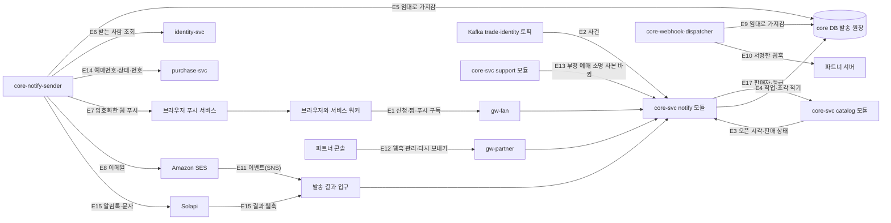
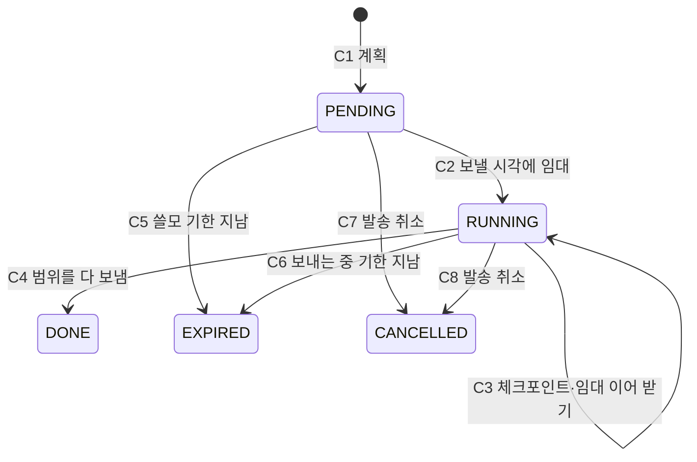

# 기능 설계: 알림·찜·오픈 알림 구독(발송 원장, 대량 발송, 파트너 웹훅)

- **독자와 용도**: core-svc notify 모듈과 발송 워커, 소비자 웹의 알림 켜기·찜·서비스 워커, 파트너 콘솔 웹훅 화면을 구현하는 엔지니어와 QA가 함께 보는 문서다. 다루는 것은 다음과 같다.
  - 오픈 알림·취소표 알림 신청과 찜, 웹 푸시 구독 정보 등록(브라우저가 준 구독 주소와 암호화 키)
  - 발송 원장(알림과 파트너 웹훅의 '보낼 일'과 결과를 적어 두는 core DB 표)과 그 워커, 중복 막기, 채널(웹 푸시·이메일·알림톡·문자)
  - **인기 공연의 대기실 오픈 안내를 아주 많은 구독자에게 보내는 대량 발송**(발송량·속도·퍼뜨리기)과 로비 참가와의 맞물림
  - 밤 시간·광고성 정보 규칙, iOS와 대체 채널, 파트너 웹훅, 실패와 재시도, 관측, 데이터·보존, 시험
  - 구현하는 쪽은 core-svc notify 모듈, 발송 워커 배포 둘(`core-notify-sender`, `core-webhook-dispatcher`), identity-svc(받는 사람 조회), gw-fan·gw-partner, 소비자 웹(알림 토글·SCR-054·서비스 워커), 파트너 콘솔(SCR-025)이다.
- **원문 출처**: 원문에 없다. 전체가 [보완]이다.
- **기준 기획 버전**: v1.0.
- **관련 ID**: FR-004 · FR-018 · FR-019 · FR-025 · FR-040 · NFR-018, 019, 021, 023 · POL-004, 008, 022, 028, 030, 034 · SCR-001, 002, 007, 013, 017, 018, 025, 054 · CMP-068 · API(프로그램끼리 요청과 응답을 주고받는 창구) `/v1/events/{eventId}/subscriptions`, `/v1/subscriptions`, `/v1/wishes`, `/v1/productions/{productionId}/wish`, `/v1/push-subscriptions`, `/v1/subscription-opt-outs/{optOutToken}`, `/v1/partner/webhooks` · ADR-0053, 0060, 0062, 0063, 0064, 0078, 0089, 0093, 0109, 0122, 0139, 0154, 0387, 0388 · 보안 추적 표 [docs/security/asvs/notify.md](../security/asvs/notify.md)
- **이 문서가 새로 정한 것**: '(추천 적용 2026-10-30)'을 붙였다. 대량 발송(§5·§6)과 웹 푸시 구독 경로(§3.4), 한 번 누름 수신 거부(§7.4)가 이번에 새로 정한 설계다. 결정 기록은 ADR-0155다. 2026-11-26에는 예매 확정(발권) 알림의 트리거·문안·중복 키·실패 규칙을 정했고(§4.8, ADR-0392), 발송 업체를 Amazon SES·Solapi로 정했으며(§4.4, ADR-0387), 예매번호·데이터 조립·이메일 템플릿·제공자 웹훅 상세를 정했다(§4.9, ADR-0388).

## 1. 기능과 이름

| 이름 | 무엇인가 | 정본 |
| --- | --- | --- |
| 오픈 알림 | 팬이 회차를 골라 신청하면, 그 회차의 대기실이 열리는 시각을 알려 주는 신청 알림이다. 본인확인 전인 사람에게는 공연 상세의 본인확인 버튼으로 가는 링크를 넣는다. 공연 카드의 종 버튼은 그 공연에서 다음에 오픈하는 회차를 신청한다(ADR-0093) | FR-004, docs/design/d5 §9.1 |
| 취소표 알림 | 매진된 회차에 좌석이 돌아와 매진이 풀리면 알려 주는 신청 알림이다. 같은 회차로 10분에 한 번 [가정], 신청 한 번에 최대 5번 [가정] 보낸다 | FR-018, ADR-0062·0122 |
| 찜 | 공연(회차 묶음)을 관심 목록에 넣는 것이다. 찜만으로는 알림을 보내지 않는다 | FR-019, ADR-0093 |
| 웹 푸시 구독 | 브라우저가 권한을 받아 만든 구독 정보(구독 주소·암호화 공개키·인증 비밀값)를 계정에 묶어 두는 것이다. 웹 푸시는 브라우저 회사의 푸시 서비스를 거쳐 브라우저로 보내는 알림이다 | data-classification 'Web Push 구독 정보' |
| 알림 종류 | 거래·안전, 신청, 광고 셋이다. 밤 시간 규칙과 다시 보내기 규칙이 종류마다 다르다 | docs/design/d5 §9.1.1 |
| 낱건 발송 | 받는 사람 한 명·채널 하나마다 작업 행 하나를 적고 보내는 방식이다. 거래·안전 알림과 적은 수의 신청 알림이 쓴다 | ADR-0109, §4.1 |
| 대량 발송 | 한 회차의 신청자 전체에게 같은 알림을 보내는 방식이다. 받는 사람마다 행을 만들지 않고, 신청 ID 범위로 나눈 조각마다 행 하나를 적어 보낸다(추천 적용 2026-10-30) | §4.2 |
| 파트너 웹훅 | 웹훅은 일이 생기면 상대 서버가 우리 주소를 불러 알려 주는 방식이다. 여기서는 PEAKET이 파트너가 등록한 주소로 판매·취소·정산 사건을 보낸다 | FR-025, ADR-0053, §9 |

## 2. 구조

### 2.1 구성 요소

| 번호 | 무엇이 오가나 | 규칙 |
| --- | --- | --- |
| E1 | 신청·끄기, 찜·해제, 웹 푸시 구독 등록·해제 | 팬 쿠키 인증, 쓰기는 `Origin` 확인(docs/api/guidelines.md §9). §3 |
| E2 | `trade.seats`의 판매 상태 바뀜(매진 풀림), `trade.orders`(예매 확정·취소), `trade.tickets`(양도 요청·수락·거절·철회·만료·돌려주기·회수, 추천 적용 2026-10-30), `trade.settlements`, `identity.accounts-merged`, `identity.login-methods-changed`(로그인 수단 연결·해제 안내, I-T34, 2026-11-04 BOT-041이 identity 쪽을 냈다) | Kafka(이벤트를 순서대로 쌓아 두고 여러 곳에 나눠 주는 메시지 시스템)의 소비자(메시지를 읽는 쪽)가 받아 같은 트랜잭션으로 원장에 적은 뒤 읽은 위치를 커밋한다(ADR-0026의 멱등 소비자, ADR-0109). BAT-455는 identity 두 사건을 내부 입구 `POST /internal/v1/notify/identity-events`로 받는 길까지 만들었고, Kafka 소비자 배선은 후속이다(§4.6) |
| E3 | 오픈 시각(`open_at`)·로비 개방 리드·판매 승인 상태·회차 취소·연기 | 같은 core 논리 DB라 Kafka를 거치지 않는다. 바뀌는 트랜잭션 안에서 대량 발송 계획을 고친다(§5.6) |
| E4 | 낱건 작업 행(`notification_job`·`webhook_delivery`)과 대량 발송 조각 행(`notification_broadcast_chunk`) | §4 |
| E5 | 팬 알림 워커가 보낼 때가 된 행을 짧은 트랜잭션에서 `FOR UPDATE SKIP LOCKED`로 골라 임대(lease: 워커가 일을 맡았다고 표에 적어 두는 짧은 시간)를 건다 | ADR-0109 결정 2. 잠금을 쥔 채 바깥 호출을 하지 않는다 |
| E6 | 받는 사람의 이메일, 언어, 본인확인 여부, 계정 상태 | identity-svc 읽기 전용 복제본에서 500명씩 묶어 묻는다. 계약은 identity.proto 초안 `RecipientQueryService.BatchGetRecipients`이고, 언어는 계정 칸 `account.locale` [가정]이다(docs/architecture.md §3.2, 2026-10-30). BAT-455가 identity-svc에 이 서비스를 구현했고 core-svc 워커가 500ms 데드라인으로 부른다(§4.6) |
| E7 | RFC 8291로 암호화한 본문과 VAPID 서명 머리 | §4.4 |
| E8 | 이메일 | Amazon SES(서울 `ap-northeast-2`)로 보낸다. `core-notify-sender`의 Pod Identity 역할, configuration set `peaket-notify`(§4.4, ADR-0387) |
| E9 | 웹훅 워커가 같은 방식으로 `webhook_delivery` 행을 가져간다 | ADR-0109 결정 2 |
| E10 | Standard Webhooks 서명(`webhook-id`·`webhook-timestamp`·`webhook-signature`) | ADR-0053 결정 4, §9 |
| E11 | 반송·스팸 신고·전달 결과 | SES configuration set 이벤트 목적지(SNS)로 `Bounce`·`Complaint`·`Delivery`·`Reject`를 받는다. SNS 서명을 검증하고 `notification_delivery`에 반영한다(§4.4, ADR-0387) |
| E12 | 엔드포인트 조회·고치기, 비밀 재발급, 발송 이력, 다시 보내기 | 조회와 발송 이력은 파트너 사용자(관리자·실무자), 고치기·비밀 재발급·다시 보내기는 파트너 관리자만(§9 표, openapi `x-peaket-roles`, docs/design/d5 §6.8 '실무자 보기', ADR-0062) |
| E13 | 부정 예매 소명 화면용 사본이 새 판으로 바뀜 | ops-svc의 `SetFraudAppealView`를 받으면 core 논리 DB의 `fraud_appeal_notice`(마지막으로 알린 상태)와 견주어 알림 작업을 적고, 그다음 Redis 사본을 쓴다. §4.5(추천 적용 2026-10-31, ADR-0171, FRN-070) |
| E14 | 예매 확정 알림의 예매번호·상태·받는 번호 | purchase-svc 내부 HTTP `GET /internal/v1/orders/{orderId}/notice-view`(내부 토큰, `core-svc` notify와 `core-notify-sender` 배포의 서비스 계정만, 300ms [가정])가 `{bookingNo, status, noticeAllowed, phoneE164}`를 준다. intake는 예매번호·상태를, 워커는 번호·상태를 쓴다. 번호는 작업·기록·로그에 남기지 않는다. §4.9.1(추천 적용 2026-11-26, ADR-0388) |
| E15 | Solapi 발송 결과 | `SINGLE-REPORT` 웹훅을 `X-Solapi-Signature`로 검증해 `notification_delivery`에 반영한다. 5초 안에 200을 돌려주고, 실패하면 Solapi가 다시 보낸다. §4.4·§10(추천 적용 2026-11-26, ADR-0387) |
| E16 | SES SNS·Solapi 결과 웹훅 수신 | `gw-partner`의 `/v1/notify-webhooks/ses`·`/v1/notify-webhooks/solapi`로 받아 core-svc notify가 서명을 검증하고 `notification_provider_event`·`notification_delivery`에 적는다. §4.9.3(추천 적용 2026-11-26, ADR-0388) |
| E17 | 이메일 판매자 정보·등급 이름 | core-svc notify가 보낼 때 catalog 포트 `NoticeCatalogView`로 공연명·장소·회차 일시·등급 이름·판매자 7항목을 읽는다. 판매자 정보는 `vars`에 넣지 않는다. §4.9.2(추천 적용 2026-11-26, ADR-0388) |

- 발송 워커는 core-svc와 같은 코드의 전용 배포 둘이다. `core-notify-sender`는 팬에게 가는 웹 푸시·이메일(Amazon SES)과 알림톡·문자(Solapi, 계정·템플릿 심사 뒤)를, `core-webhook-dispatcher`는 파트너 웹훅만 보낸다(docs/api/guidelines.md §8). 둘을 나눈 것은 실패가 번지는 범위와 늘리는 단위가 달라서다. 대량 발송은 몇 분 동안 팬 쪽 워커만 늘리고, 파트너 서버가 느려도 팬 알림이 밀리지 않는다(추천 적용 2026-10-30).
- 두 배포 모두 바깥 주소로 나가므로 나가는 통신을 '공인 주소의 TCP 443만'으로 둔다(docs/infra.md §9의 웹훅 발송 파드 규칙과 같다). 웹 푸시 구독 주소는 브라우저가 준 값이라 바깥에서 들어온 주소와 같게 다룬다(§3.4).
- notify 워커는 Spot(싸지만 회수될 수 있는 클라우드 서버)을 써도 된다(docs/infra.md). 회수 2분 전 알림을 받으면 새 조각을 맡지 않고, 맡은 조각은 다음 체크포인트까지 보내고 놓는다(§4.2).

### 2.2 데이터

| 표 | 하는 일 | 정본 |
| --- | --- | --- |
| `notification_subscription` | 오픈 알림·취소표 알림 신청(계정, 회차, 종류, 밤 웹 푸시 여부, 보낸 횟수, 상태) | docs/data.md §2 ⑥, ADR-0089 |
| `wish` | 찜(계정, 공연) | docs/data.md §2 ⑥, ADR-0093 |
| `push_subscription` | 웹 푸시 구독 정보. 이번에 구독 주소 해시·푸시 서비스 종류·만료 칸을 더했다 | docs/data.md §2 ⑥ |
| `notification_job` | 낱건 발송 작업(보낼 때까지만. DEAD는 마지막 시도 뒤 30일 [가정]에 지운다, 소유자 결정 2026-11-11, open-items 103번) | ADR-0109 |
| `notification_dedup` | 중복 키 유일 확인(7일 [가정]) | ADR-0086 |
| `fraud_appeal_notice` | 부정 예매 소명 알림을 마지막으로 보낸 상태(계정·사건, 판, 사본 갈래 `party`(결제자 PAYER·받은 사람 HOLDER), 소명·이의 상태, 알린 취소 티켓 수, 알린 '취소 대상에서 빠짐' 티켓 수, 알린 이용 제한 끝, 알린 우선 구매 권리 ID, 알린 잠금 상태 `notified_lock_active`). Redis 사본이 지워져도 알림을 다시 보내지 않게 한다(추천 적용 2026-10-31, ADR-0171, FRN-070. 갈래·잠금 상태·빠진 티켓 수는 ADR-0173) | docs/data.md §2 ⑥, §4.5 |
| `notification_delivery` | 낱건 발송 기록(월 파티션, 90일 [가정]). `status`는 `PENDING|SENT|FAILED|DEAD`다(소유자 결정 2026-11-11, open-items 101번 ⑻) | ADR-0062·0086 |
| `notification_broadcast` | 대량 발송 한 번(회차·단계·판, 창, 쓸모 기한, 합계)(추천 적용 2026-10-30) | §4.2 |
| `notification_broadcast_chunk` | 대량 발송의 조각(신청 ID 범위, 보낼 시각, 임대, 체크포인트, 조각 합계)(추천 적용 2026-10-30) | §4.2 |
| `webhook_endpoint`·`webhook_delivery` | 파트너 웹훅 주소와 발송 원장. 이번에 비밀 교체 칸과 다시 보내기 경로의 ID를 더했다 | ADR-0109, §9 |

## 3. 신청과 찜

### 3.1 오픈 알림 신청

- 켜기: `POST /v1/events/{eventId}/subscriptions` `{kind: OPEN, nightPush}`. 이미 있으면 `nightPush`만 바꾸고 200, 새로 만들면 201이다. 끄기는 `DELETE …/subscriptions?kind=OPEN`이고 없어도 204다(docs/api/guidelines.md §10 '필터 삭제' 예외).
- 받는 때: 판매 승인을 받은 회차의 `open_at` 전까지다. 그 뒤에는 410 `open-passed`다(추천 적용 2026-10-30). 오픈이 지난 회차는 공연 상세에서 바로 대기열에 들어가면 되고, 알림을 받을 일이 다시 오지 않는다.
- 채널: 이메일은 늘 보낸다(가입 때 이메일이 필수다, data-classification). 웹 푸시는 그 계정에 살아 있는 웹 푸시 구독이 있을 때만 보낸다. 신청은 채널을 고르지 않는다. 웹 푸시 권한이 없으면 화면이 CMP-068로 권한을 먼저 묻고, 거부·미지원이면 "이메일로 알려 드립니다"를 보인다.
- 오프라인에서는 오픈 알림 버튼을 막고 연결을 안내한다(웹 푸시 권한과 동의가 걸려 있어서다, 추천 적용 2026-10-28, 기술 검토 낮음-060).
- 계정마다 살아 있는 신청은 200건 [가정]까지다. 넘으면 422 `subscription-limit`다. 한 계정이 아주 많은 회차를 신청해 대량 발송을 부풀리는 일을 막는다(ASVS 2.1.3).
- 보존은 ADR-0089 결정 8이다. 끄면 바로 지우고, 오픈 알림 신청은 그 회차의 `open_at`이 지나면 지운다. 오픈 30분 전 구독 수는 수요 예측이 먼저 남긴다(ADR-0078). 대량 발송은 `open_at` 전에 끝나므로 지우기와 겹치지 않는다(§5.2).

### 3.2 취소표 알림 신청

- 켜기·끄기는 같은 경로의 `kind: CANCELLATION`이다. 매진 안내(SCR-018)와 공연 상세(SCR-002)에서 켜고 SCR-054에서 보고 끈다.
- 판매 종료(공연 시작 24시간 전) 뒤의 신청은 410 `sale-ended`다. 판매 종료가 되면 살아 있는 신청을 모두 끝낸다(`end_reason` SALE_ENDED, ADR-0064).
- 그 회차를 예매하면 신청을 끝낸다(BOOKED). `trade.orders`의 예매 확정 사건을 받아 처리한다.
- 다섯 번 [가정] 보내면 끝낸다(SENT_MAX). 다섯 번째 알림에 "취소표 알림을 5번 보내 신청을 마쳤습니다. 계속 받으려면 다시 신청해 주세요"를 넣는다(docs/design/d5 §9.1.1). 다시 신청하면 그 행을 ACTIVE로 되돌리고 보낸 횟수를 0으로 한다(docs/data.md).
- SCR-054의 '신청 끝' 상태는 `GET /v1/subscriptions`의 `cancellationStatus`·`endReason`으로 그린다(이번에 칸을 더했다).

### 3.3 찜

- 찜 `PUT /v1/productions/{productionId}/wish`, 해제 `DELETE …/wish`(204). 같은 요청을 다시 보내도 결과가 같다(멱등성: 같은 요청이 여러 번 와도 한 번 처리한 것과 결과가 같은 성질). 혼자 바꾸는 자기 상태라 `If-Match` 없이 마지막 저장이 이긴다(docs/api/guidelines.md §12 예외).
- 목록 `GET /v1/wishes`는 찜한 최근 순이고, 판매 승인이 취소된 공연은 빠진다. 홈 피드는 개인 값을 싣지 않으므로 로그인한 브라우저가 따로 부른다.
- 계정마다 1,000개 [가정]까지다. 넘으면 422 `wish-limit`다(추천 적용 2026-10-30). 없는 공연·공개 전 공연은 404다.
- 화면: 누르면 바로 바뀐 모양을 보이고(낙관적 갱신: 서버 응답을 기다리지 않고 화면을 먼저 바꾼 뒤 실패하면 되돌리는 방식, React 19 `useOptimistic`), 서버가 실패하면 되돌려 "찜하지 못했습니다. 다시 눌러 주세요"를 보인다(docs/frontend.md §5.10).
- 오프라인 재전송은 찜만 둔다(FR-019). 저장 위치는 localStorage `peaket.wishQueue`(공연 ID·동작·시각, 같은 공연은 마지막 동작 하나만)이고, 다시 온라인이 되거나 화면이 다시 보일 때(로그인 상태) 보낸다. 중복은 `PUT`·`DELETE`가 멱등이라 멱등 키 없이 막는다. 로그아웃하면 지운다(docs/frontend.md §3.12, FE-T37).
- 계정 병합 때 흡수 계정의 찜과 알림 신청은 대표 계정으로 옮기고, 같은 공연·같은 회차·종류가 겹치면 하나만 남긴다(POL-034). `identity.accounts-merged`를 받아 처리한다.

### 3.4 웹 푸시 구독(추천 적용 2026-10-30)

웹 푸시 구독 정보를 등록하는 경로가 openapi에 없었다(docs/frontend.md 어긋남 표 32번). 이번에 정한다.

| 하는 일 | 경로 | 규칙 |
| --- | --- | --- |
| 등록·다시 묶기 | `POST /v1/push-subscriptions` 본문 `{endpoint, keys: {p256dh, auth}, expirationTime}` | 같은 구독 주소가 있으면 지금 계정으로 다시 묶고 200, 없으면 201이다. 응답에 `subscriptionKey`(구독 주소의 SHA-256을 base64url로 쓴 값)를 준다 |
| 해제 | `DELETE /v1/push-subscriptions/{subscriptionKey}` | 이 계정의 구독만 지운다. 없거나 남의 것이면 같은 204다(있는지 알리지 않는다) |

- **구독 주소는 경로에 넣지 않는다.** 구독 주소는 브라우저 하나를 가리키는 추측하기 어려운 값이고, 로그에 남으면 같은 사람의 구독끼리 이어 볼 수 있다(RFC 8030 §8.4·§8.5). 그래서 URL에 민감한 값을 넣지 않는 규칙(docs/api/guidelines.md §9)대로 본문으로만 받는다. VAPID 키를 걸어 만든 구독이라 주소를 알아도 PEAKET의 개인키 없이는 보낼 수 없지만, 주소는 개인정보로 다룬다(data-classification 'Web Push 구독 정보'). 해제 경로의 `subscriptionKey`는 해시라 되돌릴 수 없고, 브라우저가 `getSubscription()`의 주소로 바로 계산하므로 따로 저장하지 않는다.
- **구독 주소 검사**: `https`, 포트 443, 호스트가 푸시 서비스 허용 목록에 있어야 한다. 처음 목록은 `fcm.googleapis.com`(Chrome 계열), `push.services.mozilla.com`과 그 하위 이름(Firefox), `web.push.apple.com`과 Apple이 허용하라고 한 `*.push.apple.com`(Safari), `*.notify.windows.com`(Edge) [확인 필요]이다. Samsung Internet·Whale의 푸시 호스트는 [확인 필요]다. 목록에 없거나, 등록 때 이름을 해석한 IP 가운데 사설·루프백·링크 로컬·메타데이터 주소가 있으면 422 `push-service-not-allowed`이고 화면은 이메일로 받는다고 알린다(보낼 때도 §4.4대로 다시 검사한다, openapi `/v1/push-subscriptions`, N-T8). 목록은 설정 값이고, 거절 수를 지표로 세어 빠진 호스트를 찾는다(§11).
- 키 검사: `p256dh`는 base64url을 한 번 풀어 65바이트 비압축 P-256 점인지, `auth`는 16바이트인지 본다(RFC 8291). 틀리면 422 `push-key-invalid`다(openapi). 구독 주소는 1,024자 [가정]까지다.
- 계정마다 구독은 10개 [가정]까지다. 넘으면 가장 오래 쓰지 않은 구독을 지운다. 브라우저가 많으면 그만큼 보내는 양이 늘기 때문이다.
- **로그인·로그아웃**: 로그인할 때 화면은 `Notification.permission`이 허용이고 `getSubscription()`이 구독을 주면 그 구독을 등록해 지금 계정에 묶는다. 권한을 새로 묻지 않으므로 사용자 조작이 필요 없다. 로그아웃할 때는 이 브라우저의 구독을 해제 경로로 지운다(브라우저의 구독 자체는 남긴다). 그래서 한 기기를 여러 사람이 쓰면 마지막에 로그인한 사람의 알림만 간다. 로그아웃 정리 루틴(docs/frontend.md §5.14.4 2번)과 호출 순서(같은 문서 §4.2.4)에 이 단계를 더했다(2026-10-30).
- 웹 푸시를 받는 서비스 워커는 월렛 워커(범위 `/my/tickets`, ADR-0363 결정 5)와 따로 둔 전용 등록 `/push/sw.js`(범위 `/push/` [가정])다. 월렛 워커는 로그아웃의 '입장 키도 지우기'와 킬 스위치에서 등록을 푸는데, 구독은 그것을 만든 등록에 묶여 함께 사라지기 때문이다(docs/frontend.md §5.4, 추천 적용 2026-10-30).
- 브라우저가 구독을 바꾸면 서비스 워커의 `pushsubscriptionchange`가 새 구독을 IndexedDB(브라우저 안에 데이터를 저장하는 곳)에 '다시 등록 필요'로 적고, 다음에 화면이 열리면 등록한다. 서비스 워커는 액세스 토큰을 새로 받지 못할 수 있어서다.
- 푸시 서비스가 404·410을 주거나(만료·해지된 구독), 403과 VAPID 키 불일치를 주면 그 행을 지운다(§10).
- 회원 탈퇴 때 바로 지운다(data-classification 'Web Push 구독 정보').

### 3.5 iOS와 권한 묻기

- iOS·iPadOS는 16.4 이상에서 홈 화면에 추가한 웹 앱에서만 웹 푸시를 받는다(NFR-019, Apple 문서 2026-10-30 확인). 그래서 CMP-068은 iOS에서 홈 화면 추가 방법을 먼저 안내하고, 추가하지 않은 사람에게는 "이메일로 알려 드립니다"를 보인다.
- 권한은 사용자가 버튼을 누른 그 처리기 안에서만 묻는다. Safari는 누른 동작 바로 안에서 구독을 부르라고 한다(Apple 문서).
- Safari는 화면에 보이지 않는 푸시를 받지 않고, 서비스 워커가 받은 푸시를 바로 보여 주지 않으면 그 사이트의 푸시 권한을 거둔다(Apple 문서). 그래서 서비스 워커의 `push` 처리기는 본문을 풀지 못하거나 낡은 알림이라도 늘 `showNotification`을 부른다. 풀지 못하면 "피켓 알림이 도착했습니다"와 알림 목록 링크를 보인다 [가정].
- `notificationclick`은 본문의 `url`이 같은 출처의 `/`로 시작하고 허용한 앞부분(`/events/`·`/productions/`·`/my/`·`/queue/`·`/help/`) [가정]일 때만 연다. 그 밖이면 홈을 연다.

## 4. 발송 원장과 워커

### 4.1 낱건 발송

ADR-0109의 규칙 그대로다. 사건을 받은 트랜잭션에서 `notification_dedup`에 중복 키를 먼저 넣고(`INSERT … ON CONFLICT DO NOTHING`), 들어갔을 때만 `notification_job`에 작업을 적는다. 워커는 보낼 때가 된 행을 50개씩 `FOR UPDATE SKIP LOCKED`로 골라 임대 2분 [가정]을 걸고 커밋한 뒤 보낸다. 결과는 다른 짧은 트랜잭션에서 `notification_delivery`에 쓰고 작업 행을 지운다. 쓸모 기한(`expires_at`)이 지나면 보내지 않고 EXPIRED로 기록한다. 마지막 시도까지 실패하면 DEAD이고 SEV3(장애 심각도 등급. 숫자가 작을수록 심각하다, `kind` hygiene)다(ADR-0078). DEAD 작업 행은 마지막 시도 뒤 30일 [가정]에 정비 잡이 지운다(소유자 결정 2026-11-11, open-items 103번).

- 중복 키: `{알림 종류}:{대상 ID}:{사건 ID 또는 상태 버전}:{받는 계정 ID}:{채널}`(docs/design/d5 §9.1.1).
- 시각을 잡는 안내(공연 전날 18:00 등)와 60초 모아 보내기는 `next_attempt_at`으로 미룬다.
- 낱건은 초당 수백 건 아래에서 쓴다(ADR-0109 [추정]). 한 사건에서 받는 사람이 1,000명 [가정]을 넘는 알림(오픈 알림, 취소표 알림)은 낱건으로 만들지 않고 §4.2의 대량 발송으로 보낸다. 거래·안전 알림 가운데 받는 사람이 많은 회차 취소·연기 안내(5만 석 회차면 수만 명)는 지금처럼 낱건이다. 2인 확정 뒤 한 번 나가는 알림이고, 수만 행을 몇 분에 나눠 적으면 초당 수백 건 안이다.
- **회차 취소·연기·환급 알림의 사건(2026-11-15, R-583)**: purchase-svc가 `trade.orders` Outbox에 대상 주문마다 `EVENT_CANCELLATION_CONFIRMED`(회차 취소 확정, `fanNoticeReason`), `EVENT_POSTPONED`(연기 확정, `postponedTo`·`refundWindowClosesAt`), `REFUNDED`(환급 완료, `refundAmount`), `REFUND_FAILED`(환급 실패, `fanNoticeReason`에 실패 사유 코드)를 남긴다. core-svc notify가 이 사건을 받아 결제자용·보유자용 문안으로 보내는 계약까지다.
- **`core-notify-sender` 첫 몫(2026-11-15, R-592)**: core-svc notify에 `NotificationSender` 포트와 가짜 전송기(`FakeNotificationTransport`), 내부 `POST /internal/v1/notify/trade-events`를 넣었다. 네 사건을 중립 문안으로 바꾸고 같은 주문·종류는 한 번만 보낸다. `PEAKET_NOTIFY_SENDER_MODE=fake`가 아니면 UNAVAILABLE로 답하고 받는 쪽이 503으로 드러낸다. 발송 원장 표(`notification_job`·`notification_delivery`)와 Kafka `trade.orders` 소비자, 실제 웹 푸시·이메일 대행 연결은 이번 마이그레이션 허용 밖이라 후속이다.

### 4.2 대량 발송(추천 적용 2026-10-30)

인기 회차의 오픈 알림은 신청자가 수십만~100만 명 [가정]이다. 낱건으로 만들면 받는 사람·채널마다 중복 키·작업·기록 세 행을 쓰고 지워야 해서, 로비가 열리는 몇 분 동안 공유 Aurora(AWS가 운영해 주는 PostgreSQL 호환 데이터베이스) 쓰기 인스턴스에 초당 수천 행이 더해진다(§5.3). 그때는 같은 클러스터가 로비 개방의 로그인 몰림(로비에 들어오는 초당 약 1,700명이 각자 로그인·인증을 거치므로 초당 최대 약 1,700건, docs/infra.md, docs/architecture.md §9.1)도 받는다. 그래서 대량 발송은 받는 사람마다 행을 만들지 않는다.

- **발송 한 번**: `notification_broadcast` 행 하나가 '이 회차의 이 단계 알림을 이 판으로 이 창 안에 보낸다'를 적는다. `(event_id, phase, version)`이 유일하다. 그래서 같은 사건을 다시 받거나 계획을 두 번 세워도 발송은 하나다. 단계(`phase`)는 오픈 알림의 셋(OPEN_EMAIL, OPEN_VERIFY_PUSH, OPEN_LOBBY_PUSH, §5.2)과 취소표 알림의 둘(CANCEL_PUSH, CANCEL_EMAIL, §6)이다.
- **조각**: 계획을 세울 때 그 회차·종류의 살아 있는 신청을 신청 ID 순서로 읽어 500개 [가정]마다 경계를 잡고, 조각 행(`notification_broadcast_chunk`: ID 범위, 보낼 시각, 상태)을 만든다. 계획 때의 마지막 신청 ID를 발송 행에 적는다. 그 뒤 신청은 조각에 들지 않고 낱건으로 보낸다(§5.6).
- **보낼 시각 흩기**: 조각마다 보낼 시각을 창 안에 흩는다. 시각은 `창 시작 + (HMAC-SHA256(발송 키, 발송 ID ‖ 조각 번호) mod 창 길이)`다. HMAC은 비밀 키로 만든 위조 확인용 값이다. 그래서 신청 순서(먼저 신청한 사람)가 먼저 받지 않고, 발송마다 순서가 달라진다. 조각이 고르게 퍼지므로 전체 속도는 '받는 수 ÷ 창 길이'가 된다. 따로 전역 속도 제한기를 두지 않는다.
- **임대와 체크포인트**: 워커는 `slot_at <= now()`인 조각을 `ORDER BY slot_at LIMIT 1 FOR UPDATE SKIP LOCKED`로 골라 임대 2분 [가정]을 걸고 커밋한다. 신청을 100개 [가정] 보낼 때마다 짧은 트랜잭션으로 `sent_upto`(마지막으로 보낸 신청 ID)와 조각 합계를 쓰고 임대를 늘린다. 워커가 죽으면 임대가 끝난 뒤 다른 워커가 `sent_upto` 다음부터 보낸다.
- **조각 처리**: ① 조각 범위의 살아 있는 신청을 읽는다(읽기 전용 복제본, `sent_upto` 다음부터) ② identity-svc에 500명을 한 번에 묻는다(본인확인 여부, 언어, 계정 상태. 이메일 단계면 주소도) ③ 웹 푸시 단계면 그 계정들의 `push_subscription`을 읽어 구독마다 보낸다(§4.4) ④ 이메일 단계면 신청마다 낱건 작업 행을 만든다(중복 키 `{단계}:{회차}:{판}:{계정}:EMAIL`, `next_attempt_at`은 조각 시각부터 조각 간격 안에 흩는다). 이메일은 속도가 느려(§5.3) 낱건 경로의 기록·중복 막기를 그대로 쓴다.
- **쓰기 양**: 웹 푸시 단계는 조각 하나에 임대 1번, 체크포인트 5번, 끝내기 1번이다. 신청 100만이면 조각 2,000개라 6분 창에 초당 약 40번이다(§5.3).
- **쓸모 기한**: 남은 TTL(저장한 값이나 키를 쓸 수 있는 시간)이 60초 [가정]보다 짧은데 아직 보내지 않은 조각은 EXPIRED로 끝내고 남은 수를 센다.
- **기록**: 웹 푸시 대량 발송은 받는 사람마다 `notification_delivery`를 쓰지 않는다. 조각 합계(보냄·건너뜀·실패·만료 구독)만 남기고, 404·410을 받은 구독은 체크포인트 때 묶어 지운다. 그래서 고객센터는 '이 회차 오픈 안내가 몇 시부터 몇 시까지 몇 건 나갔고, 이 계정의 신청이 계획에 들었는지'까지만 확인할 수 있다(§16).

| 번호 | 출발 | 도착 | 전이와 조건 |
| --- | --- | --- | --- |
| C1 | (시작) | PENDING | 계획 작업이 신청 ID 범위로 조각을 만들고 보낼 시각을 흩는다 |
| C2 | PENDING | RUNNING | `slot_at <= now()`, 임대가 없거나 끝남. `attempt_count` +1 |
| C3 | RUNNING | RUNNING | 100개 [가정]마다 `sent_upto`·합계·임대를 쓴다. 임대가 끝난 조각은 다른 워커가 `sent_upto` 다음부터 이어 보낸다 |
| C4 | RUNNING | DONE | 범위 끝까지 보냄. 합계를 발송 행에 더한다 |
| C5 | PENDING | EXPIRED | 남은 TTL 60초 [가정] 미만. 보내지 않은 수를 만료로 센다 |
| C6 | RUNNING | EXPIRED | 보내는 중에 같은 조건 |
| C7 | PENDING | CANCELLED | 계획이 바뀜(§5.6), 취소표 차례 중 다시 매진(§6), 회차 취소 |
| C8 | RUNNING | CANCELLED | 같은 조건. 보내던 조각은 다음 체크포인트에서 멈춘다 |

### 4.3 중복 막기

| 경로 | 무엇으로 막나 | 남는 것 |
| --- | --- | --- |
| 낱건 | 중복 키 유일 제약(`notification_dedup`) | 워커가 보내다 죽으면 '적어도 한 번'이라 대행사에 같은 키로 상태를 확인하고, 모르면 돈·보안·법정 통지만 한 번 더 보낸다. 신청 알림과 광고는 다시 보내지 않는다(docs/design/d5 §9.1.1) |
| 대량 발송 | 발송 유일 제약 `(event_id, phase, version)`과 신청 유일 제약 `(account_id, event_id, kind)`, 조각 체크포인트 | 워커가 죽으면 마지막 체크포인트 뒤의 신청 최대 100개 [가정]에 웹 푸시가 한 번 더 갈 수 있다. 같은 Topic(푸시 서비스에서 아직 전달되지 않은 메시지를 바꾸는 머리)과 같은 `tag`(화면에 떠 있는 알림을 바꾸는 값)를 쓰므로 대부분 한 번만 보인다 |
| 대량 발송의 이메일 | 낱건 경로로 넘기므로 중복 키 | 낱건과 같다 |
| 대량 발송과 낱건 사이 | 계획 때의 마지막 신청 ID로 나눈다 | 발송 중에 신청을 껐다 다시 켜면 새 행(새 ID)이라 낱건으로 한 번 더 받을 수 있다 |

### 4.4 채널별 보내기

**웹 푸시**(RFC 8030·8291·8292, 2026-10-30 원문 확인)

| 머리·값 | 정한 것 | 근거 |
| --- | --- | --- |
| `TTL` | 필수다. 알림이 쓸모 있는 끝까지 남은 초로 준다: 차례 임박 900초(15분 유예), 오픈 알림의 로비 열림 푸시는 로비 개방 10분 뒤까지, 본인확인 안내 푸시는 로비 개방까지, 취소표 30분 [가정], 그 밖 24시간 [가정] | docs/design/d5 §9.1.1. RFC 8030 §5.2는 TTL이 없으면 400이고, 푸시 서비스가 더 짧게 줄일 수 있다고 한다 |
| `Urgency` | 차례 임박·로비 열림·취소표는 `high`, 본인확인 안내와 거래·안전 알림은 `normal`, 광고는 `very-low`(추천 적용 2026-10-30) | RFC 8030 §5.3: 없으면 `normal`. 배터리가 적은 기기는 `high`만 받을 수 있다. Apple은 바로 보내려면 `high`를 쓰라고 한다 |
| `Topic` | 대상마다 `HMAC-SHA256(Topic 키, 종류 ‖ 대상 ID)`의 앞 16바이트를 소문자 16진 32자로 쓴다. 같은 값을 알림 `tag`에도 쓴다(추천 적용 2026-10-30) | RFC 8030 §5.4는 base64url 32자 이하, Mozilla는 영문·숫자 32바이트 이하만 받는다. 16진 32자는 둘 다 맞는다. 대상 ID 원문을 넣지 않는 것은 ADR-0139 결정 6 |
| 본문 | `{v, kind, title, body, url, tag}` JSON을 RFC 8291(`aes128gcm`)로 암호화한다. 평문은 2,048바이트 [가정] 아래로 둔다. 이름·전화번호·계좌번호와 예매번호 전체를 넣지 않는다(예매번호는 끝 4자리) | RFC 8030 §7.2: 4,096바이트까지는 413을 주면 안 된다. RFC 8291 평문 상한 3,993바이트. Mozilla는 다른 서비스를 거치는 구독에서 2,744바이트로 줄 수 있다고 적는다 |
| `Authorization: vapid` | ES256 키쌍(docs/security/secrets-and-keys.md 'Web Push VAPID 키쌍')으로 서명한 JWT. `aud`는 구독 주소의 출처, `exp`는 12시간 [가정], `sub`는 팀 메일이다. 푸시 서비스 출처마다 만들어 12시간 쓰고 바꾼다 | RFC 8292: `exp`는 24시간을 넘으면 안 된다. Apple은 JWT를 한 시간보다 자주 바꾸지 말라고 한다. `sub`는 ADR-0139 결정 6 |

- 연결: 푸시 서비스마다 HTTP/2 연결을 몇 개 열어 두고, 상대가 준 `SETTINGS_MAX_CONCURRENT_STREAMS`를 넘지 않는다. Apple은 HTTP/1.1이면 응답을 받지 않은 요청을 100개 넘게 쌓지 말라고 한다.
- 속도: 푸시 서비스마다 파드당 시작 속도를 두고 [가정], 429를 받으면 그 서비스 몫을 반으로 줄이고 `Retry-After`를 지킨 뒤 1분마다 10%씩 [가정] 되올린다(AIMD: 정상이면 조금씩 늘리고 나빠지면 크게 줄이는 조절 방식). 같은 구독에 대한 429는 그 구독만 미룬다. RFC 8030 §8.4는 구독마다 속도를 제한할 수 있다고 하고, Apple은 같은 기기에 너무 많이 보낼 때 429를 준다.
- 보낼 때 연결 검사: 구독 주소의 이름을 해석한 IP가 사설·루프백·링크 로컬·메타데이터 주소면 연결하지 않고, 검사한 IP로 바로 연결한다. 리디렉션은 따르지 않는다. 파트너 웹훅과 같은 HTTP 클라이언트를 쓴다(docs/api/guidelines.md §8 ②).
- 로그와 요청 기록에는 구독 주소를 남기지 않고 푸시 서비스 종류만 남긴다(RFC 8030 §8.5).

**이메일**

- 대행사는 **Amazon SES**로 정했다(2026-11-26, ADR-0387, open-items 57). 서울 리전(`ap-northeast-2`)의 Essentials 플랜(1,000통당 0.16달러, VDM 포함)을 쓰고, 비용이 더 중요해지면 종량제(1,000통당 0.10달러)로 바꾼다. 공유 IP로 시작하고, 전달률이 목표에 못 미치면 Pro 플랜(월 105달러, 관리형 전용 IP)으로 올린다.
- `core-notify-sender`의 Pod Identity 역할에 `ses:SendEmail`·`ses:SendRawEmail`·`ses:GetSendQuota`만 준다. SMTP 자격 증명과 정적 액세스 키를 만들지 않는다(ADR-0089 결정 9).
- 발신 도메인 `notify.peaket.example`을 검증하고 SPF·DKIM·DMARC, custom MAIL FROM을 둔다.
- configuration set `peaket-notify`의 이벤트 목적지(SNS)로 `Bounce`·`Complaint`·`Delivery`·`Reject`를 받는다. SNS 서명을 검증한 뒤 `notification_delivery`에 반영한다.
- 새 계정은 샌드박스(하루 200통·초당 1통, 수신 주소 검증 필요)이라 출시 전에 production access를 신청한다(보통 96시간 안에 답). 발송량은 단계적으로 올리고, 운영 쿼터가 초당 56통 [추정] 이상인지 확인한다.
- 보내는 주소는 알림 전용 하위 도메인(예: `no-reply@notify.peaket.example`)이고 SPF·DKIM·DMARC를 둔다(docs/design/d5 §9.1.1).
- 받는 쪽 메일 서비스의 한도: Gmail은 하루 5,000통 넘게 보내는 발신자에게 SPF·DKIM·DMARC, 스팸 신고율 0.3% 미만, 마케팅·구독 메시지의 한 번 누름 수신 거부(RFC 8058)를 요구한다. 또 일정한 속도로 보내고 갑자기 몰아 보내지 말며, 한도를 넘어 4.7.28 오류를 받으면 10분 이상 쉬라고 한다(Google 발신자 안내 2026-10-30 확인). 그래서 대량 이메일은 몇 시간 창에 고르게 보내고(§5.2), 신청 알림 이메일에 한 번 누름 수신 거부를 둔다(§7.4). 네이버·다음 메일의 한도는 [확인 필요]다.
- SES 샌드박스는 하루 200통·초당 1통이고, 운영으로 옮기면 쓰임새에 따라 한도가 정해지며 요청해 올릴 수 있다. 갑작스러운 몰림이 받는 쪽의 차단을 부르지 않게 한도를 단계적으로 올린다(AWS 문서 2026-11-26 확인).

**알림톡·문자**: 업체는 **Solapi**로 정했다(2026-11-26, ADR-0387). 계정·발신번호 등록·카카오 채널(`pfId`)·템플릿 심사가 끝나기 전에는 켜지 않고, 그 전에는 이메일과 웹 푸시로만 보낸다. 신청 알림에는 쓰지 않는다(docs/design/d5 §9.1.1). 쓰는 곳은 §4.8(예매 확정)과 §8이다.

- 한 API에서 알림톡(`kakaoOptions.pfId`·`templateId`·`variables`)과 문자(SMS·LMS)를 보낸다. 알림톡 실패 시 문자 대체는 `kakaoOptions.disableSms=false`(기본값)와 등록된 `from` 발신번호로 한다. 알림톡 본문은 변수 치환 뒤 1,000자까지다.
- 발송 권한 키는 `message:send-ata`·`message:send-sms`·`message:send-lms`만 준다. 2026-11-11 전송자격인증제로 문자·RCS 발송 권한 키는 공인 IP 허용 목록이 1개 이상 필수이고 `0.0.0.0/0`·사설 IP는 쓸 수 없다. `core-notify-sender`의 고정 NAT EIP를 등록한다.
- 결과는 `SINGLE-REPORT` 웹훅을 `X-Solapi-Signature`로 검증해 받고, 5초 안에 200을 돌려준다. 실패하면 Solapi가 다시 보낸다.
- 가격은 2026-11-26 공개 기준 알림톡 13원, SMS 18원, LMS 45원, MMS 110원이다(계약 때 다시 확인). 알림톡이 문자로 대체되면 알림톡 요금은 환불되고 문자 요금이 붙는다.
- 국내 번호(`+82`)만 보낸다. Solapi의 해외 문자는 인포빕·Vonage로 나가므로 해외 번호는 이메일·웹 푸시만 보낸다. Solapi는 발송 이력(발신·수신 번호, 본문, 결과)을 1년 보관한다(개인정보 처리방침, 2026-08-20 시행). 우리 `notification_job`·`notification_delivery`에는 번호·본문을 두지 않는다(§12).
- 알림톡 템플릿은 카카오 심사를 받고, 광고 문구·추천·할인을 넣지 않는다(§7.2).

**발송 대행 어댑터 계약(추천 적용 2026-11-26, ADR-0392)**

대행사가 바뀌어도 `core-notify-sender` 안의 포트 구현만 바꾸면 되게, 채널마다 요청·결과의 경계를 고정한다. 본문 템플릿은 코드에 고정하고, 대행사 템플릿 ID·발신 프로필은 설정 값으로 둔다.

| 항목 | 이메일 | 알림톡·문자 | 웹 푸시 |
| --- | --- | --- | --- |
| 보내는 요청 | `to`(계정 이메일), `subject`, `text`/`html`, `List-Unsubscribe` 머리, 우리 작업 키(중복은 `notification_dedup`이 막는다) | `to`(국내 표기 `010…`, `country` 82), `pfId`·`templateId`, `variables`, `smsFallbackText`, 등록된 `from`, 우리 작업 키 | 구독 주소, `p256dh`·`auth`, RFC 8291 본문, `TTL`·`Urgency`·`Topic`, VAPID JWT |
| 성공·실패 | 2xx 성공. 4xx는 영구 실패, 429·5xx·시간 초과는 재시도. SES는 `MessageId`를 준다 | 2xx 성공. 알림톡 불가 코드는 문자 대체, 429·5xx·시간 초과는 재시도 | 201 성공. 404·410·403은 구독 삭제, 429·5xx는 재시도 |
| 결과 조회 | SES `MessageId`와 configuration set 이벤트(SNS)의 `Delivery`·`Bounce`·`Complaint`로 확인한다 | Solapi `messageId`·`groupId` 조회와 `SINGLE-REPORT` 웹훅으로 확인하고, 실제 채널(알림톡/문자)을 가른다 | 전달 영수증은 쓰지 않는다 |
| 결과 웹훅 | SES configuration set 이벤트(SNS)의 반송·스팸 신고·전달 결과를 서명 검증해 받는다 | Solapi `SINGLE-REPORT`를 `X-Solapi-Signature`로 검증해 받는다 | 없음 |
| 시간 초과 | 연결 3초·전체 10초 [가정] | 연결 3초·전체 10초 [가정] | 연결 3초·전체 10초 [가정] |
| 비밀 | Amazon SES IAM 역할(정적 키 없음) | Solapi API 키·서명 비밀·발신 프로필 | VAPID 개인키·Topic 키 |

- 업체는 정했다(2026-11-26, ADR-0387): 이메일 Amazon SES(서울), 알림톡·문자 Solapi, 웹 푸시 브라우저 푸시 서비스+VAPID. 계정·계약·키·발신 도메인/번호·카카오 채널·템플릿 심사는 구현 전에 끝낸다. 그 전에는 local·ci 파일 대역과 fake 전송기로 시험한다(§4.6).
- 실제 발송 자격 증명은 Secrets Manager의 'Amazon SES 발송 권한'(EKS Pod Identity 역할, 정적 키 없음)과 'Solapi API 키·웹훅 비밀' 두 행에 둔다(docs/security/secrets-and-keys.md).

### 4.5 부정 예매 소명·조치 알림(추천 적용 2026-10-31, ADR-0171, FRN-070)

부정 예매 사후 조사(POL-046, docs/features/forensic-replay.md §6.7.5)에서 팬에게 가는 알림이다. 결정은 ops-svc가 하지만 ops-svc는 팬에게 직접 보내지 않는다. 받는 길은 소명 화면용 사본이다.

- **길(E13)**: ops-svc가 core-svc support 모듈에 `SetFraudAppealView`(core.proto, 판 번호)를 보낸다. 화면용 사본(`sup:far:{account}`)은 세션·캐시 Redis에 있어 DB 트랜잭션에 묶을 수 없다. 그래서 알림 판단은 Redis가 아니라 core 논리 DB의 `fraud_appeal_notice`(계정·사건마다 마지막으로 알린 상태)와 견주어 한다.
  1. support 모듈은 받은 판이 `fraud_appeal_notice`의 판보다 클 때만, 한 core DB 트랜잭션에서 아래 표의 바뀜을 찾아 알림 작업(`notification_job`·`notification_dedup`)을 적고 `fraud_appeal_notice`를 그 판으로 고친다.
  2. 그다음 Redis 사본을 쓴다. Redis 쓰기 전에 죽어도 ops-svc가 같은 판을 다시 보내면 Redis만 채워지고, 알림은 이미 적혀 있어 다시 적지 않는다. Redis 값이 지워져도 `fraud_appeal_notice`가 남아 '첫 반영'으로 잘못 보지 않는다.
  3. 같은 판의 다시 보내기(작업 워커, 10분마다의 열린 요청 다시 보내기)는 판이 같아 알림을 적지 않는다.
- **순서**: ops-svc는 소명 요청의 첫 판(소명 상태 OPEN)을 ticket-svc `SetTransferLock`이 대상 표 모두에 성공한 뒤에만 보낸다. 알림을 먼저 받은 사람이 표를 넘기는 틈을 막으려는 순서다(forensic-replay §6.7.5, transfer-refund §4.1, d5 §9.1).
- **받는 사람(추천 적용 2026-10-31, ADR-0173 결정 3·4)**: 사본의 갈래(`party`)로 나눈다. 결제자(`PAYER`)는 소명을 요청받은 사건 계정이고, 아래 표의 일곱 종류를 받는다. 받은 사람(`HOLDER`)은 사건 계정이 결제한 표를 양도로 받아 가진 사건 밖 계정이고, `FRAUD_HOLDER_NOTICE`와 `FRAUD_HOLDER_RESULT` 둘만 받는다. 받은 사람의 사본과 알림에는 사유 범주를 싣지 않는다(결제자의 사유라서). `fraud_appeal_notice`는 (계정, 사건)마다 한 행이고 그 행의 `party`로 어느 표를 볼지 정한다. 받은 사람이 그 사건의 계정이기도 하면 받은 사람 사본을 따로 만들지 않고 결제자 사본으로 다룬다(그 사람은 이미 소명 요청을 받았다).
- **종류와 채널**: 아홉 모두 거래·안전 알림이고 이메일로 보낸다(docs/design/d5 §9.1). 밤 시간 제한 없이 바로 보낸다(§7).

| 알림 종류 | 받는 사람 | 보내는 때(`fraud_appeal_notice`와 견주어 바뀐 것) | 문안 변수(허용 목록) | 여는 화면 |
| --- | --- | --- | --- | --- |
| `FRAUD_APPEAL_REQUESTED` 소명 요청 | 결제자 | 그 (계정, 사건)의 첫 판(소명 상태 OPEN) | 공연명, 회차 일시(KST), 사유 범주 이름, 소명 기한, 잠긴 표 수, 잠금 최대 기한(`lock_expires_at`, "늦어도 14일 뒤 풀립니다"), 고정 문구 '양도만 막고, 입장과 본인 취소(보통의 취소 수수료가 붙습니다)는 됩니다', 고정 문구 '돈이 오가지 않은 가족·지인 대리 예매는 부정 예매가 아닙니다'(잠금 문구는 ADR-0173 결정 3) | SCR-042 |
| `FRAUD_APPEAL_DECIDED` 소명 판단 | 결제자 | 소명 상태가 ACCEPTED·REJECTED·EXPIRED로 바뀜 | 공연명, 결과(인정·불인정·기한까지 내지 않음) | SCR-042 |
| `FRAUD_ACTION_NOTICE` 조치 결과와 이의 방법 | 결제자 | 조치 결과가 새로 생기거나 늘어남: 취소한 티켓이 늘거나, 이용 제한 끝이 새로 생기거나 늦춰짐. 표 취소 뒤 이용 제한을 더한 경우(C9)도 다시 보낸다 | 공연명, 사유 범주 이름, 이번에 취소한 표 수와 고정 문구 '3영업일 안에 원래 결제 수단으로 전액 환급합니다'(ADR-0173 결정 4), 이용 제한 끝(있을 때), 이의 기한 | SCR-042 |
| `FRAUD_OBJECTION_DECIDED` 이의 결과 | 결제자 | 이의 상태가 ACCEPTED·REJECTED로 바뀜 | 공연명, 결과, 고정 문구 '이유는 소명 화면에서 볼 수 있습니다'. 조사관이 적은 이유(`objection_note`)는 자유 글이라 변수에 넣지 않고 SCR-042에만 보인다(§12). 인정이고 이용 제한이 있었으면 '이용 제한 풀기를 진행합니다', 취소한 표가 있었으면 '우선 구매나 보상을 따로 알려 드립니다' | SCR-042 |
| `FRAUD_RESTRICTION_LIFTED` 이용 제한 풀림 | 결제자 | 이용 제한 끝이 있다가 비워짐(풀기 `LIFT_RESTRICTION`이 Done) | 공연명 | SCR-042 |
| `FRAUD_PRIORITY_PURCHASE` 우선 구매 | 결제자 | 우선 구매 권리에 OFFERED가 새로 생김(권리 ID마다) | 공연명, 원래 가격, 기한(48시간 [가정]). 좌석 번호는 싣지 않는다(§12 '알림 문구 변수 규칙') | SCR-042 → 입장 확정(`priorityGrantId`) |
| `FRAUD_TRANSFER_LOCK_RELEASED` 양도 잠금 풀림(추천 적용 2026-10-31, ADR-0173 결정 3) | 결제자 | party `PAYER` 사본의 잠금 상태(`lock_active`)가 참에서 거짓으로 바뀜(`notified_lock_active`가 참일 때만. `HOLDER` 사본은 `lock_active`가 늘 거짓이라 보내지 않는다). 다만 입장 시작 뒤에 바뀐 때(그때는 양도 마감이 지나 양도할 수 없다)와, 잠긴 표가 모두 취소돼 남은 표가 없을 때(`locked_ticket_ids`가 모두 `cancelled_ticket_ids`에 듦. `locked_ticket_ids`는 잠금이 풀려도 비우지 않아 이 비교가 된다)는 보내지 않고 `notified_lock_active`만 고친다(추천 적용 2026-10-31, ADR-0173) | 공연명, 회차 일시(KST), 고정 문구 '이 회차 표의 양도 잠금이 풀렸습니다' | SCR-042 |
| `FRAUD_HOLDER_NOTICE` 받은 표의 조사 알림(추천 적용 2026-10-31, ADR-0173 결정 4) | 받은 사람 | party `HOLDER`인 그 (계정, 사건)의 첫 판 | 공연명, 회차 일시(KST), 소명 기한, 가진 표 수(`held_ticket_ids`의 수), 고정 문구 "결제자의 부정 예매 조사에 이 표가 포함되었습니다. 표를 정당하게 받으셨다면 사정을 알려 주세요". 사유 범주는 싣지 않는다 | SCR-042 |
| `FRAUD_HOLDER_RESULT` 받은 표의 결과(추천 적용 2026-10-31, ADR-0173 결정 4) | 받은 사람 | 받은 사람의 사본에서 결과가 정해진 표가 늘어남: 취소된 표(`cancelled_ticket_ids`)가 늘거나, 취소 대상에서 빠진 표(`excluded_ticket_ids`)가 늚. 둘 다 늘면 한 통에 함께 싣는다 | 공연명, 결과(취소됨·취소 대상에서 빠짐)와 결과마다의 표 수, 취소됨이 있으면 고정 문구 '환급은 결제자에게 갑니다' | SCR-042 |

- **중복 키**: `{알림 종류}:{사건 ID}:{판 번호}:{받는 계정 ID}:email`이다(d5 §9.1.1). 우선 구매는 판 번호 자리에 권리 ID를 쓴다. 한 판에서 둘 이상이 바뀌면(예: 소명 불인정과 조치 결과) 종류마다 하나씩 보낸다.
- **싣지 않는 것**: 사건의 다른 계정, 점수·가중치, 근거 신호, 조사관 이름, 예매번호 전체(끝 4자리만), 좌석 번호. 사유 범주는 결제자에게만 이름으로 싣는다(POL-046 ⑦). 받은 사람에게는 사유 범주, 결제자의 계정·닉네임, 결제자의 소명·조치 결과를 싣지 않는다. 문안 변수는 위 허용 목록에 있는 것만 `notification_job.vars`에 넣는다(§12). 표 수·기한·회차 일시는 §12의 '화면에 보일 공개 값'이다.
- **예매 제한 알림과 겹치지 않게**: 사유 `FRAUD`인 예매 제한의 걸림과 풀림은 위 `FRAUD_ACTION_NOTICE`와 `FRAUD_RESTRICTION_LIFTED`가 알린다. 예매 제한 화면용 사본(`SetBookingRestrictionView`)이 바뀌어도 사유가 `FRAUD`면 '예매 제한과 소명 기한' 알림을 따로 보내지 않는다.
- **판과 다시 보내기**: 잠금 상태가 바뀌거나(최대 기한·입장 시작에 ticket-svc가 스스로 풀 때 포함) 받은 사람의 표 결과가 정해지면 ops-svc가 그 (계정, 사건)의 사본을 더 큰 판으로 다시 보낸다. 최대 기한에는 ops-svc 스케줄러가 그 시각에 보낸다. 판 비교와 중복 키 규칙은 위와 같아, 같은 판을 다시 보내도 알림이 두 번 가지 않는다.
- 받은 사람이 표를 결제자에게 돌려주면 ops-svc는 그 사람 사본의 `held_ticket_ids`에서 그 표를 빼 다시 보낸다. 이것은 결과가 아니라 알림을 보내지 않는다.

### 4.6 구현 상태(2026-11-22, BAT-455 GAT-250)

- **표**: 마이그레이션 0046가 `notification_subscription`·`push_subscription`·`notification_dedup`·`notification_job`·`notification_delivery`를 만든다. `notification_delivery`는 `sent_at` 월 파티션이고 첫 파티션은 정비 일 `notification-delivery-partitions`가 만든다. 팬 경로 `core_app`은 다섯 표를 쓰고, 발송기 `core_notify`는 신청의 `night_push`·`sent_count`·`status`·`end_reason`·`updated_at`, 구독 읽기·만료 삭제, 중복 키·작업 넣기와 결과 칸, 기록 넣기만 한다(ADR-0351과 같은 '코드가 쓰는 만큼만').
- **API**: `POST`·`DELETE /v1/events/{eventId}/subscriptions`(OPEN·CANCELLATION, 200/201/410/422), `GET /v1/subscriptions`(회차 50개·커서), `POST`·`DELETE /v1/push-subscriptions`(허용 호스트·공인 IP·키 검사·계정당 10개·SHA-256 해시), `POST /v1/subscription-opt-outs/{optOutToken}`(RFC 8058 한 번 누름). 구현은 `services/core-svc/src/modules/notify/application/fan-notify.ts`와 `inbound/fan-notify.controller.ts`다.
- **워커**: `FanNotificationWorker`가 `notification_job`을 임대 2분으로 집어 이메일·웹 푸시로 보낸다. 이메일은 `MailTransport` 포트(운영 대행 어댑터 자리)와 local·ci 파일 대역(`PEAKET_NOTIFY_MAIL_DIR`)이고, 웹 푸시는 RFC 8291 `aes128gcm` 암호화·RFC 8292 VAPID ES256 JWT를 만들고 local·ci 파일 대역(`PEAKET_NOTIFY_PUSH_DIR`) 또는 HTTPS로 보낸다. 404·410·403 구독은 지우고, 429·5xx는 남은 TTL 안에서 1분·5분·30분·2시간·6시간·12시간 [가정]으로 다시 보낸다. 결과를 모르는 신청 알림·광고는 다시 보내지 않고 돈·보안·법정 통지만 같은 키로 한 번 더 본다.
- **받는 사람**: identity-svc `RecipientQueryService.BatchGetRecipients`를 구현했다(계정 500개, `includeEmail`, MERGED·DELETED·없는 계정 한 줄). core-svc 워커는 `RecipientDirectory` 포트로 부른다.
- **I-T34·POL-034**: 내부 입구 `POST /internal/v1/notify/identity-events`가 `LOGIN_METHOD_CHANGED`를 받아 이메일·웹 푸시 작업을 한 번 적고, `ACCOUNT_MERGED`를 받아 흡수 계정의 신청·구독을 대표 계정으로 옮긴다(겹치면 하나, 보낸 횟수는 큰 쪽). 대표 계정에 완료 통지를 적는다. 흡수 계정 이메일 통지는 사건에 주소가 없어 남은 한계다(§16).
- **남은 것**: Amazon SES·Solapi 계정·키·발신 도메인(`notify.peaket.example`)·발신번호·카카오 채널·알림톡 템플릿 심사, SES 샌드박스 해제, Solapi 공인 IP 허용 목록, `PEAKET_VAPID_PRIVATE_KEY`·`PEAKET_VAPID_PUBLIC_KEY`(OPEN[10]), 대량 발송 조각 원장(§4.2), Kafka 소비자 배선(지금은 내부 입구), POL-034 흡수 계정 이메일, 예매 확정(발권) 알림(§4.8).

### 4.7 입장 키 알림(추천 적용 2026-11-23, ADR-0363 결정 4, BUILD_ORDER GAT-020)

docs/design/d5 §9.1의 '입장 키 재발급·입장 시작 뒤 첫 등록' 줄(거래·안전, 등록 직후, 이메일, 재발급은 이전 기기에도)을 보내는 길이다.

- **받는 곳**: core-svc 내부 입구 `POST /internal/v1/notify/ticket-events`(내부 토큰). 본문은 `{noticeId, type, accountId, ticketId, registeredAtMs}`이고 `type`은 `DEVICE_KEY_REISSUED`(키가 있던 티켓의 새 키)·`DEVICE_KEY_LATE_ISSUE`(입장 시작 뒤 첫 등록) 둘이다. 정의 밖 칸은 422다. 보내는 쪽은 ticket-svc의 `device_key_notice` 보내기 반복이다(docs/data.md, docs/features/offline-gate.md §10.1).
- **중복 키**: `{type}:{ticketId}:{noticeId}:{accountId}:{채널}`(§4.3). 웹 푸시는 구독마다 작업 하나라 끝에 `:{subscriptionKey}`(구독 주소 SHA-256의 base64url, §3.4)를 더 붙인다. 그러지 않으면 한 계정의 구독이 둘 이상일 때 키가 겹쳐 하나만 간다(추천 적용 2026-11-23, F-05-1 시험 결과 1). 같은 `noticeId`가 다시 와도 채널·구독마다 작업은 하나이고 202다.
- **채널**: 이메일 하나와 그 계정의 살아 있는 웹 푸시 구독마다 하나. 어느 기기가 '이전 기기'인지는 따로 가리지 않는다(구독은 계정에 묶이고 기기를 알리지 않는다). 밤 시간 규칙은 거래·안전 알림의 규칙이다(§7.2, 밤에도 보낸다).
- **문안**: 제목 "티켓 입장 키를 새 휴대폰에 등록했습니다". 본문 `DEVICE_KEY_REISSUED`는 "티켓 한 장의 입장 키를 {등록 시각, KST}에 새 휴대폰으로 옮겼습니다. 이전 휴대폰의 QR은 더 쓸 수 없습니다. 직접 하신 일이 아니면 고객센터로 알려 주세요", `DEVICE_KEY_LATE_ISSUE`는 "입장이 시작된 뒤 티켓 한 장을 {등록 시각, KST}에 이 계정의 휴대폰에 등록했습니다. 직접 하신 일이 아니면 고객센터로 알려 주세요". 웹 푸시를 누르면 여는 주소는 `/my/tickets/{ticketId}`(§3.5의 허용한 앞부분 `/my/`)다. 이메일 본문에는 누를 링크를 넣지 않는다(추천 적용 2026-11-23, F-05-1 시험 결과 4): 계정 보안 통지 메일에 링크가 없어야 사칭 메일과 가리기 쉽고, 지금 메일 공통 틀도 글만 보낸다. 메일은 '피켓 앱이나 누리집의 내 티켓에서 확인하세요'로 끝낸다. 변수는 `type`·`registeredAt`·`ticketId` 셋이고 허용 목록 밖 변수는 작업을 만들지 않는다(N-T14). 공개키·keyId·이메일 주소는 싣지 않는다.
- **실패**: 이 알림은 보안 통지라 대행사 결과를 모르면 같은 키로 한 번 더 본다(§4.1). 알림 실패는 키 등록을 되돌리지 않는다(N-T22와 같은 원칙). 시험은 docs/features/offline-gate.md O-T48이다.

### 4.8 예매 확정(발권) 알림(추천 적용 2026-11-26, ADR-0392)

docs/design/d5 §9.1의 '예매 확인서(발권)' 줄을 보내는 길이다. 그 줄은 결제자에게 이메일(판매자 고지 포함)·웹 푸시·알림톡·문자로 확정 직후 보내고, 여는 화면을 SCR-013(마이 티켓)·SCR-055(예매·주문 내역)로 정한다. FR-053은 예매 확인서를 결과 화면·이메일·마이 티켓에서 다시 볼 수 있게 하고, 이메일에 판매자 정보 7항목·통신판매중개자 고지·미성년자 계약 취소 고지를 싣게 한다. ADR-0106도 발권이 끝나면 예매 확인서 알림이 간다고 적는다. 이 절은 그 알림의 트리거·받는 사람·문안·변수·중복 키·실패 규칙을 정한다.

**트리거**

- `trade.orders`의 `CONFIRMED`만 본다. `CONFIRMED`는 결제 승인 뒤 발권까지 끝나 주문이 최종 확정된 상태다(docs/features/payment.md §3). 사건은 purchase-svc의 Outbox에서 나와 Kafka `trade.orders`로 오고, core-svc notify 소비자가 `eventKey`로 중복을 거른 뒤 같은 트랜잭션에서 `notification_dedup`·`notification_job`을 적고 오프셋을 커밋한다(§2.1 E2, ADR-0026·0109).
- `APPROVED`(승인만 됨)와 `ISSUE_DELAYED`(승인 뒤 발권을 다시 시도하는 중)는 예매 확정이 아니다. 이 알림을 보내지 않고, d5 §9.1의 '결제 완료, 티켓 발급 중' 알림이 맡는다.
- 가상계좌 주문은 `AWAITING_DEPOSIT`(입금 대기) 때가 아니라 입금이 확인되어 `CONFIRMED`가 된 때 보낸다. 입금 안내·기한 임박·만료는 d5 §9.1의 '가상계좌 입금 안내' 알림이 맡는다.
- 입금 오류로 `AWAITING_DEPOSIT`로 돌아갔다가 다시 `CONFIRMED`가 되어도 예매 확인서는 한 번만 보낸다(아래 중복 키). 이미 같은 예매의 확인서를 받았기 때문이다.
- 회차 취소·연기·환급은 이 알림이 아니라 d5 §9.1·§9.3의 회차 취소·연기 알림이 맡는다.

**받는 사람과 채널**

- 받는 사람은 주문 계정(결제자)이다. 표를 양도받은 사람에게는 보내지 않는다. 받은 사람은 마이 티켓에서 티켓을 본다.
- 채널은 이메일 하나, 그 계정의 살아 있는 웹 푸시 구독마다 하나, 그리고 **알림톡 하나(카카오톡 미가입·템플릿 거절·한도 초과면 문자 대체)**다. 이메일은 예매의 법정 기록이라 늘 보내고, 웹 푸시는 구독이 있을 때만 보낸다. 알림톡·문자는 Solapi 계정·발신번호·카카오 채널·템플릿 심사 뒤에 켠다(§4.4, ADR-0387).
- **알림톡·문자의 받는 번호는 주문의 예매자 휴대폰 번호(E.164)다.** 주문마다 필수로 받고 purchase DB에 5년 보관하는 값이다(docs/security/data-classification.md '예매자 성명 및 휴대폰 번호', docs/features/payment.md §2). 계정의 휴대폰 번호(가입 선택)와 본인확인 번호 원문(저장하지 않는다)은 쓰지 않는다. 번호는 작업·기록에 넣지 않고 보낼 때 purchase-svc 내부 HTTP `GET /internal/v1/orders/{orderId}/contact`(내부 토큰, `core-notify-sender` 배포의 서비스 계정만, 300ms [가정])로 읽는다. Solapi에 보낼 때는 E.164를 국내 표기(`010…`)로 바꾸고 `country`를 82로 준다.
- 결제 화면은 입력한 휴대폰 번호로 예매 확정 안내(알림톡·문자)를 보낸다고 알리고, 개인정보 처리방침의 수집 목적에도 '예매 확정 안내'를 더한다(SCR-011 ②, POL-023, docs/security/data-classification.md. 추천 적용 2026-11-26, ADR-0392).
- 거래·안전 알림이라 밤(21:00~08:00 KST)에도 바로 보낸다(§7.2).
- 받는 사람의 이메일·언어·계정 상태는 E6(`BatchGetRecipients`)로 읽는다. 계정이 MERGED·DELETED라 이메일 주소가 없으면 이메일은 보내지 않고 기록만 남긴다.

**문안**

- 이메일 제목: "[피켓] {공연명} 예매가 확정되었습니다".
- 이메일 본문(안):
  - "{공연명} {회차 일시}({장소}) 예매가 확정되었습니다."
  - "{좌석 등급} {n}매 · 결제 금액 ₩{금액} · 예매번호 끝 4자리 {끝 4자리}"
  - "티켓은 마이 티켓에서 확인할 수 있습니다." [ 예매 확인서 보기 ] → `/my/orders/{orderId}`
  - 판매자 정보 7항목(상호·대표자·주소·전화·전자우편·사업자등록번호·통신판매업 신고번호)
  - FR-053·POL-037의 고정 문장 "판매자: {상호}. PEAKET은 통신판매중개자로서 이 공연의 당사자가 아닙니다. 공연의 개최·변경·취소에 따른 책임은 판매자에게 있고, 예매 취소와 환불은 PEAKET이 처리합니다."
  - FR-053의 고정 문장 "만 19세 미만 미성년자가 법정대리인(부모 등)의 동의 없이 결제하면, 미성년자 본인이나 법정대리인이 이 계약을 취소할 수 있습니다."
  - "공연일 10일 이내 취소 시 기준에 따른 공제 후 환불됩니다." [ 취소·환불 안내 ]
  - "궁금한 점은 피켓 고객센터로 문의해 주세요." {고객센터 링크}
- 판매자 정보와 두 고지 문장의 글씨는 판매자 표시와 같거나 크게 한다(전자상거래법 §20①, 시행규칙 §11의2, FR-053). 이메일 HTML 본문에서 지킨다.
- 웹 푸시 제목: "{공연명} 예매가 확정되었습니다". 본문: "{회차 일시} · {좌석 등급} {n}매 · 티켓을 확인하세요". 누르면 `/my/tickets`(§3.5의 허용한 앞부분 `/my/`).
- 알림톡(정보성): 제목 "예매가 확정되었습니다", 본문 "{공연명} {회차 일시} 예매가 확정되었습니다. 자세한 내용은 마이 티켓에서 확인하세요."와 [ 마이 티켓 보기 ] 버튼(`/my/tickets`). 템플릿은 정보성으로 심사받고 광고 문구·추천·할인을 넣지 않는다(§7.2).
- 문자 대체: "피켓: {공연명} 예매가 확정되었습니다. 자세한 내용은 마이 티켓에서 확인하세요." (90바이트 SMS를 목표로 하고, 공연명이 길어 넘으면 Solapi가 LMS로 보낸다). 문자에는 링크를 넣지 않는다. 링크는 알림톡 버튼과 이메일 버튼에만 둔다. 문자는 앱·누리집에서 확인하라는 글만 보낸다.
- 이메일이 법정 고지(판매자 정보 7항목·중개자 고지·미성년자 고지·취소·환불 안내)를 담는 정본 채널이다. 알림톡·문자는 짧은 안내만 담는다.
- 알림톡·문자에는 좌석·금액·예매번호·결제 수단을 싣지 않는다. 예매자 번호를 잘못 입력해 다른 사람이 받아도 예매 상세가 새지 않게 하려는 것이다. 공연명은 공개 정보라 싣는다.
- 이름·전화번호·이메일 주소·계좌번호·예매번호 전체·좌석 번호는 어느 채널에도 싣지 않는다(§12, d5 §9.1.1). 좌석은 등급과 매수로만 적고 좌석 번호는 마이 티켓에서 본다.
- 문안은 계정 언어(`account.locale`, NFR-024)로 보낸다. 법정 고지 문장은 번역 검토를 마친 판만 쓰고, 그 전에는 한국어 판을 쓴다. [가정]

**변수(허용 목록)**

| 변수 | 값 | 어디서 |
| --- | --- | --- |
| `productionName` | 공연명 | core catalog |
| `eventStartsAt` | 회차 일시(KST) | core catalog |
| `venueName` | 장소 | core catalog |
| `seatSummary` | "R석 2매"처럼 등급별 매수 | 주문 |
| `amount` | 결제 금액(원) | 주문 |
| `bookingNoLast4` | 예매번호 끝 4자리 | 주문(`purchase_order.booking_no`) |
| `orderId` | 예매 확인서 경로에만 쓴다 | 주문 |
| `customerCenterUrl` | 고객센터 주소 | 설정 값 |

- 표 밖 변수는 작업을 만들지 않는다(§12의 Zod 검사, N-T14).
- 판매자 정보 7항목과 두 고지 문장은 `vars`에 넣지 않고 보낼 때 core catalog(판매 승인 값)에서 읽는다(§4.9.2). 그래서 `vars`는 1KB [가정] 안이고, 판매자 정보가 바뀌어도 확인서는 보낼 때의 값으로 그린다.
- 문안 판은 `notification_job.template_version`에 따로 적고 `vars`에는 넣지 않는다(§4.9.2).
- 알림톡 템플릿은 `productionName`·`eventStartsAt`, 문자 대체 문안은 `productionName`만 쓴다. 받는 번호는 변수에 넣지 않고 보낼 때 purchase-svc에서 읽는다(§12).

**중복 키와 발송**

- 중복 키는 `BOOKING_CONFIRMED:{orderId}:CONFIRMED:{accountId}:{channel}`이다(d5 §9.1.1의 `{알림 종류}:{대상 ID}:{사건 ID 또는 상태 버전}:{받는 계정 ID}:{채널}`). 웹 푸시는 구독마다 작업 하나라 끝에 `:{subscriptionKey}`를 더 붙인다(§4.7과 같은 이유). 그래서 같은 `CONFIRMED` 사건이 다시 오거나 입금 오류 뒤 다시 확정되어도 채널·구독마다 한 번만 간다.
- 알림톡 작업은 `BOOKING_CONFIRMED:{orderId}:CONFIRMED:{accountId}:ALIMTALK` 하나다. 대행사가 한 요청에서 문자로 대체하면 `notification_delivery.channel`에 실제로 나간 채널(`ALIMTALK` 또는 `SMS`)을 적고, `dedup_key`의 채널 자리는 요청한 `ALIMTALK` 그대로 둔다. 대행사가 대체를 한 요청으로 못 하면 알림톡 결과가 '보낼 수 없음'일 때 같은 트랜잭션에서 `...:SMS` 작업을 하나 더 만든다. 어느 쪽이든 한 예매에 알림톡과 문자가 둘 다 가지 않는다.
- 사건을 받은 트랜잭션에서 `notification_dedup`과 `notification_job`에 적고, `FanNotificationWorker`가 임대 2분으로 집어 보낸다(§4.1).
- 쓸모 기한(`expires_at`)은 확정 뒤 24시간 [가정]이다. 그 뒤에는 보내지 않고 EXPIRED로 기록한다.
- 발송 밀림 허용은 확정 뒤 5분 [가정]이다(§10, ADR-0180). 이 알림은 돈과 법정 고지를 담은 거래 기록이라, 대행사 결과를 모르면 같은 키로 한 번 더 확인한다(§10).
- 보낼 때 번호 조회가 실패하거나 번호가 비어 있으면 알림톡·문자 작업만 남은 TTL 안에서 다시 한다. 이메일·웹 푸시는 그대로 간다. 번호 조회는 읽기 전용이라 새 gRPC 서비스를 만들지 않고 purchase-svc 내부 HTTP로 둔다(architecture §3.2 REST 예외와 같은 꼴).
- 지금 구현은 내부 입구 `POST /internal/v1/notify/trade-events`가 회차 취소·연기·환급 네 사건만 받는다(§4.6). 이 알림을 넣으려면 그 입구에 `CONFIRMED`를 더하고 Kafka `trade.orders` 소비자 배선, purchase-svc `notice-view`, Solapi 어댑터, §4.9의 데이터 조립·템플릿·제공자 웹훅을 함께 만든다(§4.6의 남은 몫).

**실패**

- 어느 채널이든 끝내 실패(DEAD)해도 예매·결제·발권을 되돌리지 않는다(§10, ADR-0180). DEAD는 1건이면 SEV3다.
- 이메일 대행이 시간 초과로 결과를 모르면 같은 키로 상태를 확인하고, 그래도 모르면 한 번 더 보낸다(돈·법정 통지 규칙, d5 §9.1.1).
- 알림톡이 카카오톡 미가입·템플릿 거절·한도 초과로 실패하면 문자로 대체한다. 문자도 실패하면 DEAD·SEV3이고, 이메일·푸시는 영향이 없다. 번호 조회 실패·번호 없음은 알림톡·문자만 건너뛰고 `notify_text_skipped_total{reason}`으로 센다.
- 웹 푸시 404·410·403은 그 구독을 지운다(§10). 푸시가 실패해도 이메일은 따로 간다.

**운영 확인과 시험**

- §11의 '낱건 발송이 밀리지 않는다' 지표에서 `kind`가 `BOOKING_CONFIRMED`인 행으로 본다. 확정 사건을 받은 뒤 5분 [가정] 안에 보낸 비율을 `notification_dedup.created_at`부터 `notification_delivery.sent_at`까지로 재어 99% [가정] 아래로 떨어지면 SEV3다.
- 알림톡·문자는 `notify_alimtalk_responses_total{provider, result}`·`notify_sms_fallback_total`·`notify_text_skipped_total{reason}`로 본다(§11).
- 시험은 N-T25(이메일·웹 푸시 트리거)와 N-T26(알림톡·문자 대체·번호 조회)이다.

### 4.9 예매 확정 알림의 데이터·템플릿·제공자 이벤트(추천 적용 2026-11-26, ADR-0388)

§4.8의 트리거·채널을 실제로 보내기 위한 상세다. 예매번호와 데이터 조립, 상태 가드, 이메일 템플릿·법정 고지·현지화, 제공자 웹훅과 결과 상태를 정한다.

#### 4.9.1 예매번호와 이벤트 데이터 조립

**예매번호**

- `purchase_order.booking_no`(UNIQUE)에 **한국 시각 날짜 8자리 + 5자리 일련번호**를 적는다(예 `2026101400123`). 화면의 예매번호, CS 문의의 `orderRef`, 알림의 끝 4자리가 모두 이 값이다. 개인정보가 아니고 비밀도 아니다.
- 주문 생성 트랜잭션에서 `booking_no_sequence(day, next)`를 `INSERT … ON CONFLICT (day) DO UPDATE SET next = next + 1 RETURNING next`로 잡고 5자리로 채운다. 하루 99,999건을 넘으면 주문 생성을 닫고(503 `booking-number-exhausted`) SEV2로 알린다. 80,000건에서 경고한다. 목표 2.5만 건의 네 배라 여유가 있다.
- `openapi Order.bookingNumber`의 `[가정]`과 "data.md에 칸이 없다" 문장을 지우고 이 값을 가리킨다. `docs/design/d2`의 "예매번호는 영문 대문자와 숫자"는 입력 검사 규칙이고, 숫자만인 이 형식도 그 안에 든다.

**이벤트에 없는 값**

- `OrderEvent`에는 `orderId`·`eventId`·`accountId`·`amount`·`items`(tierId·sectionId·price)·`seatAssignment`·`eventKey`가 있고, **예매번호·판매자 정보·등급 이름**은 없다. 그래서 두 조회로 채운다.
- **purchase-svc 내부 HTTP** `GET /internal/v1/orders/{orderId}/notice-view`(내부 토큰, `core-svc` notify와 `core-notify-sender` 배포의 서비스 계정만, 300ms [가정])가 `{bookingNo, status, noticeAllowed, phoneE164}`를 준다. intake는 `bookingNo`·`noticeAllowed`를, 워커는 `phoneE164`·`noticeAllowed`를 쓴다. 이름은 주지 않고, 번호는 작업·기록·로그에 남기지 않는다.
- **core catalog 포트** `NoticeCatalogView.getBookingNotice(eventId, tierIds)`(같은 core-svc 안, 모듈 경계의 포트)가 `{productionName, venueName, eventStartsAt, tierNames, seller}`를 준다. `seller`는 판매 승인 값 7항목과 두 고지 문장이고, **작업을 만들 때가 아니라 이메일을 보낼 때** 읽는다.
- `noticeAllowed`는 주문이 `CONFIRMED`가 아니거나 그 회차의 취소·환급이 진행 중이면 거짓이다. 거짓이면 알림을 만들지 않고 `notify_suppressed_total{reason="not_allowed"}`로 센다.

**변수와 작업**

- `notification_job.vars`에는 `productionName`·`eventStartsAt`·`venueName`·`seatSummary`·`amount`·`bookingNoLast4`·`orderId`만 넣는다. 판매자 정보·이름·전화번호·이메일 주소·좌석 번호는 넣지 않는다(§12).
- `seatSummary`는 `items`를 `tierId`별로 묶어 catalog의 등급 이름과 매수로 만든 문자열이다(예 "R석 2매"). 등급 이름을 찾지 못하면 "좌석 {n}매"로 적고 `notify_tier_name_missing_total`을 올린다.
- `bookingNo`가 없거나 모양이 틀리면 작업을 만들지 않고 SEV3·오류로 센다. `productionName`·`venueName`·`eventStartsAt`을 읽지 못하면 작업을 만들지 않고 재시도한다. 판매자 정보만 없으면 이메일 작업만 재시도하고 알림톡·문자·웹 푸시는 먼저 보낸다.
- 채널별 작업은 이메일 하나, 살아 있는 웹 푸시 구독마다 하나(`...:WEB_PUSH:{subscriptionKey}`), 알림톡 하나(문자 대체)다.

**트랜잭션과 소비자**

- 차례는 ⑴ `CONFIRMED` 사건 수신 ⑵ purchase-svc·catalog 원격 읽기 ⑶ 짧은 DB 트랜잭션에서 `notification_dedup`·`notification_job` 적기 ⑷ Kafka 오프셋 커밋이다. **원격 읽기를 DB 트랜잭션 안에서 하지 않는다.**
- 소비자 그룹은 `peaket.core-svc-notify.<환경>`이고, 파티션 안에서 주문 ID 단위로 동시에 처리한다(ADR-0142). 원격 읽기 실패는 재시도하고, 반복 실패는 `held_event`로 보류한다. 같은 `eventKey`는 한 번만 처리한다.
- 워커는 보내기 전에 `noticeAllowed`를 다시 본다. 거짓이면 작업을 지우고 보내지 않는다(취소·환급 뒤에 남은 확인서를 막는다). `firstInStage=false`인 재확정은 중복 키 `...:CONFIRMED`가 두 번째 확인서를 막는다. 첫 작업이 DEAD가 된 뒤 다시 보내는 길은 CS 다시 보내기(뒤 몫)다.

#### 4.9.2 이메일 템플릿·법정 고지·현지화

- **템플릿은 코드에 고정한다**(ASVS 1.3.7). `templates/booking-confirmed/{ko,en,ja,zh}.ts`가 `version`·제목·본문(text)·HTML을 만들고, 값은 자리표시자로만 넣는다. `notification_job.template_version`은 만들 때의 판, `notification_delivery.template_version`은 실제로 그린 판이다. 보낼 때 저장한 판이 코드에 있으면 그 판으로, 없으면 지금 판으로 그리고 `notify_template_fallback_total`을 올린다.
- **`MailMessage`에 `html`을 더한다.** SES `SendEmail`은 text+html multipart/alternative로 보낸다. `From`은 `피켓 <no-reply@notify.peaket.example>`, `Reply-To`는 고객센터다. `List-Unsubscribe`는 예매 확정(거래)에는 넣지 않고 신청 알림에만 넣는다.
- **HTML 규칙**: 600px 표, 인라인 CSS, 외부 이미지·추적 픽셀·JavaScript·폼 없음, `prefers-color-scheme` 다크 모드, 본문 대비 4.5:1, 제목 h1/h2, 링크는 `PEAKET_PUBLIC_ORIGIN`의 절대 주소, 추적 쿼리 없음. plain-text 대체 본문에 같은 링크를 넣는다.
- **법정 고지 블록**: 판매자 정보 7항목(상호·대표자·주소·전화·전자우편·사업자등록번호·통신판매업 신고번호), FR-053·POL-037의 중개자 고지, 미성년자 계약 취소 고지, 취소·환불 안내를 접지 않고 넣는다. 판매자 정보와 고지 글씨는 판매자 표시와 같거나 크게 한다(전자상거래법 §20①, 시행규칙 §11의2).
- **현지화**: 보낼 때 `recipient.locale`을 읽어 ko/en/ja/zh 중 고른다. 번역이 없으면 ko로 보내고 `notify_template_missing_total{locale}`을 올린다. 법정 고지 번역은 검토를 마친 판만 쓰고, 기계 번역을 운영에 쓰지 않는다. 회차 일시는 KST로 적는다.
- **변수 규칙**: `BOOKING_CONFIRMED`를 `VARS_ALLOWED`에 더하고 위 7개 키만 허용한다. `seller`는 변수에 없으므로 `assertVars`의 `name`·`phone` 금지와 이메일·전화번호 꼴 검사에 걸리지 않는다. `vars`는 1KB [가정] 안이다.
- **이메일이 반송·스팸 신고로 끝나면** 제공자 이벤트로 `BOUNCED`·`COMPLAINED`를 남기고 CS 건 `NOTIFY_EMAIL_UNDELIVERED` [가정]을 연다. 같은 주소로 자동 재발송하지 않고, 팬은 마이 티켓·웹 푸시·문자로 확인한다. 다시 보내기 API·화면은 뒤 몫이다.

#### 4.9.3 제공자 웹훅 입구와 결과 상태

**입구**

- `gw-partner`의 웹훅 입구(`gw-partner-webhooks` HTTPRoute)에 `/v1/notify-webhooks/ses`(SNS)와 `/v1/notify-webhooks/solapi` 규칙을 더해 core-svc로 보낸다. 쿠키·`Origin` 없이 받고, IP별 레이트 리밋·본문 상한(SNS 256KiB·Solapi 32KiB [가정])·5초 응답·WAF·캐시 금지를 둔다.
- **SES SNS**: 구독은 인프라가 미리 만든다. 받은 `TopicArn`이 기대 값인지, `SigningCertURL` 호스트가 `sns.<리전>.amazonaws.com`인지, 서명과 `MessageId`가 맞는지 검증한다. 임의 URL을 받아 가지 않는다. `SubscriptionConfirmation`은 기대한 토픽일 때만 확인한다.
- **Solapi**: `X-Solapi-Signature`를 Secrets Manager의 웹훅 비밀로 검증하고, 재전송 창(5분 [가정]) 밖의 사건은 거절한다. 가능하면 Solapi가 알려 준 발신 IP 대역도 허용 목록에 둔다. 5초 안에 200을 돌려주고 실제 처리는 비동기로 한다.

**표와 상태**

- `notification_provider_event(provider, provider_event_id, provider_message_id, event_type, result_code, occurred_at, received_at, applied_at)`에 멱등하게 적는다. `(provider, provider_event_id)`가 유일이고, 본문·이메일·전화번호·본문 해시는 넣지 않는다. 90일 [가정] 보존한다.
- `notification_delivery`에 `requested_channel`·`provider_status`(`ACCEPTED|DELIVERED|BOUNCED|COMPLAINED|REJECTED|DELAYED|UNKNOWN`)·`provider_result_code`·`provider_event_id`·`provider_updated_at`·`template_version`을 더한다. `status`는 우리 발송 상태, `provider_status`는 제공자 결과다.
- 알림톡이 문자로 대체되면 `channel`은 실제 `SMS`, `requested_channel`과 `dedup_key`의 채널 자리는 `ALIMTALK` 그대로다.
- 매핑: SES `Delivery` → `DELIVERED`, `Bounce`(영구) → `BOUNCED`, `Complaint` → `COMPLAINED`, `Reject` → `REJECTED`, `DeliveryDelay` → `DELAYED`. Solapi `4000` → `DELIVERED`, `3xxx` → `FAILED`(결과 코드), `1xxx`·`2xxx` → `REJECTED`. 같은 메시지의 늦은 사건은 `occurred_at`이 `provider_updated_at`보다 새로울 때만 반영한다.
- 같은 사건이 다시 오면 200만 돌려주고 아무것도 바꾸지 않는다. `notification_delivery`에 맞는 행이 없는 늦은 사건은 이벤트 표에만 적고 `notify_provider_event_orphan_total`을 올린다.
- 반송·스팸 신고는 CS 건으로 열고, Solapi의 끝난 실패는 `FAILED`/`DEAD`로 남긴다. 어느 경우에도 예매·결제·발권을 되돌리지 않는다.

#### 4.9.4 데이터·시험·남는 것

- 데이터: `purchase_order.booking_no`·`booking_no_sequence`·`notification_job.template_version`·`notification_delivery`의 제공자 칸·`notification_provider_event`를 `docs/data.md`에 적었다.
- 보안: 제공자 이벤트 표에는 PII·본문이 없고, 템플릿은 코드에 고정하며 값을 이스케이프한다. 웹훅은 서명·IP 한도·본문 상한을 둔다. 판매자 정보는 보낼 때 catalog에서만 읽는다.
- 시험: N-T27(예매번호·데이터 조립·상태 가드), N-T28(HTML·법정 고지·현지화·변수), N-T29(웹훅 서명·재전송·상태 매핑·멱등).
- 남는 것: 법정 고지 번역 검토는 뒤 몫이다. CS 다시 보내기·발신번호/카카오 채널·템플릿·관측/예산·부하 시험은 §4.10에서 정했다.

### 4.10 예매 확정 알림 운영: CS 다시 보내기·발신자/카카오·관측/비용(추천 적용 2026-11-26, ADR-0389)

#### 4.10.1 CS 다시 보내기

- **대상과 조건**: `BOOKING_CONFIRMED` 배송 가운데 `FAILED`·`DEAD`·`EXPIRED`만 다시 보낼 수 있다. `SENT`·`DELIVERED`는 보내지 않고, `BOUNCED`·`COMPLAINED`는 같은 주소로 자동·수동 재발송하지 않는다(주소를 고치거나 다른 채널로 안내한다). 같은 배송은 3회 [가정], 같은 주문은 하루 3회 [가정]까지다.
- **API**: `POST /v1/ops/notification-deliveries/{deliveryId}/resends`(관제, `cs_lead`만, `Idempotency-Key`, 본문 `{reason}` 1~200자). ops-svc가 권한·감사·CS 건 기록을 맡고 core-svc notify 내부 `POST /internal/v1/notify/resends`(내부 토큰, ops-svc 신원만)를 불러 작업을 만든다. core-svc가 상태·상한을 다시 보고 202 `{status: "PENDING"}`을 주며, 실제 발송은 작업 큐가 한다. 403(권한)·404(없는 배송)·409(`notification-resend-not-allowed`: 상태가 맞지 않음, 상한 초과, 이미 진행 중)·422(사유 없음)·429(분당 10회 [가정])·503(`notify-sender-unavailable`)이다.
- **동작**: 원래 배송의 종류·대상·계정·채널·문안 판을 읽어 `notice-view`·catalog로 vars를 다시 만들고, `...:resend:{n}` 중복 키로 새 `notification_job`을 만든다. 새 작업은 `resend_of`(원래 `delivery_id`)·`resend_no`를 싣고, 원래 배송의 `delivery_id`를 찾는 유일 색인을 쓴다. 판매자 정보는 보낼 때 다시 읽는다.
- **감사와 화면**: 누가·언제·사유·원래 배송·결과를 `ops_event`와 CS 건 기록에 남기고, SCR-045 알림 미도달 건에 채널별 `provider_status`·결과 코드·[다시 보내기]를 둔다. 사유는 필수이고, 버튼은 `cs_lead`가 아니거나 조건이 맞지 않으면 `aria-disabled`와 이유를 보인다. 다시 보낸 결과는 같은 건에 쌓고, 또 DEAD면 자동으로 반복하지 않는다.
- **CS 건**: `NOTIFICATION_UNDELIVERED` [가정] 건을 영구 반송·스팸 신고·최종 실패 때 자동으로 연다. 기한 1영업일 [가정]. 팬에게 마이 티켓·웹 푸시·문자로 확인 안내를 보내고, 이메일 주소가 틀렸으면 새 주소를 받는다. CS 건 종류 표의 상세는 d5 §7.6에 더한다.

#### 4.10.2 발신번호·카카오 채널·템플릿 운영

- **발신번호**: PEAKET 소유의 거래 알림용 번호 하나(예 `1544-0000` [가정])를 Solapi에 사업자등록증·통신서비스 이용증명으로 등록하고 `from` 설정 값으로 쓴다. 광고에는 쓰지 않고, 답장은 고객센터로 돌린다(자동 안내 [가정]). 번호를 바꾸면 Solapi 등록·설정·시험 발송을 먼저 하고, 옛 번호 답장을 30일 [가정] 더 받은 뒤 닫는다. `from`이 없거나 등록과 다르면 문자·대체 발송은 실패하므로 SEV3로 알린다.
- **카카오 채널**: 채널 이름 '피켓'. Solapi 템플릿 API v2의 `channelId`(구 `pfId`)를 연동하고 프로필 이름·이미지를 채널 정책에 맞춘다. 보내기 API는 같은 채널을 `kakaoOptions.pfId`로 받는다. 채널 ID는 비밀이 아니라 GitOps 환경 값(`PEAKET_SOLAPI_CHANNEL_ID`)이고, 어댑터가 보낼 때 `pfId`로 옮긴다. 채널이 휴면·정지되면 알림톡을 멈추고 문자·이메일·웹 푸시로 간다.
- **템플릿**: `BOOKING_CONFIRMED` 한국어 정보성 템플릿 하나로 시작한다. 카테고리는 주문 알림 예시의 `003001` [가정], `messageType=BA`, `emphasizeType=NONE`이다. 제목 "예매가 확정되었습니다", 본문 `{공연명} {회차 일시} 예매가 확정되었습니다. 자세한 내용은 마이 티켓에서 확인하세요.`, 버튼 [마이 티켓 보기] `/my/tickets`. 변수는 `#{공연명}`·`#{회차일시}` 둘이고 좌석·금액·예매번호·링크는 문자 대체 문안에 넣지 않는다.
- **템플릿 판과 ID**: `notification_job.template_version`으로 판을 고르고, 설정 `PEAKET_SOLAPI_TEMPLATE_IDS`가 `{kind, locale, version} → templateId`를 이룬다. 이 설정은 `notification_template`의 `ACTIVE`와 최근 `RETIRED` 판에서 만들고, 운영 콘솔의 활성화가 장부를 바꾼다(§4.12). 템플릿을 바꾸면 새 `templateId`를 등록하고, 보내는 중인 옛 판은 24시간 [가정] 동안 함께 둔다. 템플릿은 카카오 심사(카카오 안내 2영업일, Solapi 안내 1~3영업일)를 거치고, 반려·휴면이면 문자 대체로 보내며 `notify_solapi_template_rejected_total`·SEV3로 알린다.
- **언어**: 알림톡은 1차에 한국어만 쓴다(국내 번호 한정). 이메일·웹 푸시는 §4.9.2의 ko/en/ja/zh를 쓴다. 카카오가 다국어 템플릿을 허용하면 언어별 templateId를 더한다.
- **시험 발송**: 템플릿·발신번호·`pfId`를 바꿀 때마다 내부 수신자에게 알림톡·문자 대체를 한 번씩 보내고 결과를 기록한다. 운영 계정과 시험 계정의 키·발신번호를 나눈다.

#### 4.10.3 관측·경보

| 확인할 것 | 지표 | 경보 |
| --- | --- | --- |
| SES 쿼터·평판 | `notify_ses_send_total`, `notify_ses_quota_used_ratio`, `notify_ses_bounce_ratio`, `notify_ses_complaint_ratio`, `notify_ses_event_failures_total` | 쿼터 80% [가정], 반송률 5% [가정], 스팸 신고율 0.1% [가정] 초과가 5분 이어지면 SEV3. production access 상실·계정 정지는 SEV2 |
| Solapi 잔액·한도·템플릿 | `notify_solapi_balance_messages`, `notify_solapi_daily_quota_ratio`, `notify_solapi_template_rejected_total`, `notify_solapi_ip_denied_total`, `notify_solapi_result_total{code}`, `notify_solapi_fallback_total` | 잔액이 3일 [가정]치 미만, 일일 한도 80% [가정], 템플릿 반려·휴면, 허용 IP 거절 1건 이상이면 SEV3. 잔액 0·계정 정지면 SEV2 |
| 다시 보내기·비용 | `notify_resend_total{result}`, `notify_cost_krw_total{provider, channel}`, `notify_budget_ratio` | 다시 보내기 실패가 5분에 5% [가정] 초과면 SEV3. 월 예산 50·80·100% [가정]에서 경보 |
| 문안·제공자 사건 | `notify_template_missing_total`, `notify_template_fallback_total`, `notify_tier_name_missing_total`, `notify_provider_event_orphan_total` | 번역 누락·고아 사건이 5분에 1% [가정] 초과면 SEV3 |

- 대시보드는 채널·제공자·상태별로 두고, 라벨에 계정·주문·전화번호를 쓰지 않는다. 하루 한 번 알림 도달·비용 보고를 공연 리포트(R1)에 남긴다.
- **경보가 와도 예매·결제·발권은 멈추지 않는다.** 알림만 늦거나 빠진다.

#### 4.10.4 비용·예산·부하 시험

- **단가**(2026-11-26 공개, 계약 때 다시 확인): SES Essentials 1,000통당 0.16달러, Solapi 알림톡 13원·SMS 18원·LMS 45원, 웹 푸시 0원.
- **어림**: 예매 확정 2.5만 건이면 이메일 약 4달러, 알림톡 약 32.5만 원, 30%가 문자로 대체되면 추가 약 3.5만 원 수준이다. 월 예산은 `PEAKET_NOTIFY_MONTHLY_BUDGET_KRW` [가정]로 두고, `notification_delivery`의 채널·종류별 건수 × 단가로 센다.
- **예산이 차도 법정·거래 알림(예매 확인서 이메일)은 멈추지 않는다.** SMS 대체만 멈추고 이메일·웹 푸시로 보내며, 소유자에게 SEV2로 알린다. 광고성 알림은 예산 80%에서 먼저 멈춘다.
- **부하 시험**: 예매 확정 2.5만 건을 15분에 나눠(초당 약 28건) 이메일·알림톡·30% 문자 대체로 보낸다. SES 쿼터·429, Solapi 일일 한도·요청 한도, 워커 임대·백로그, p99 지연, DEAD·재시도, 비용 집계를 잰다. 1만 건은 매 PR이 아니라 배포 전·월 1회 [가정]로 돌린다.
- 시험은 N-T30(CS 다시 보내기), N-T31(발신번호·카카오·템플릿), N-T32(관측·예산·부하)다.

### 4.11 알림함(인앱 알림 이력)(추천 적용 2026-11-26, ADR-0390)

이메일·문자·웹 푸시를 놓쳐도 팬이 자기 알림을 다시 보는 화면이다. 알림을 새로 보내는 기능이 아니라 **이미 보낸 논리 알림을 한 곳에 모아 보여 주는 읽기 모델**이다. 채널별 발송 성공·실패는 `notification_delivery`가 정본이고, 알림함은 채널과 상관없이 알림 하나에 항목 하나다.

**데이터**

- `notification_inbox`에 `id`·`account_id`·`logical_key`·`kind`·`category`·`target_ref`·`vars`·`template_version`·`created_at`·`read_at`을 둔다. `(account_id, logical_key)`가 유일이다.
- `logical_key`는 채널을 뺀 키다(예 `BOOKING_CONFIRMED:{orderId}:CONFIRMED:{accountId}`). 같은 알림이 이메일·푸시·문자로 여러 번 가도 항목은 하나이고, 다시 보내기(§4.10.1)도 새 항목을 만들지 않는다.
- 알림 intake가 `notification_dedup`·`notification_job`과 **같은 트랜잭션**에서 한 행을 넣는다. 그래서 알림이 실제로 나가지 못해도(모든 채널 DEAD) 알림함에는 남는다. 알림함 쓰기가 실패하면 그 알림 자체를 적재하지 않고 재시도한다.
- `vars`는 §12의 허용 목록만 갖고, 본문·이메일·전화번호·판매자 정보는 넣지 않는다. 제목·본문은 **읽을 때** 템플릿과 catalog로 만든다. 템플릿 판이 코드에 없으면 지금 판으로 그리고 `notify_template_fallback_total`을 올린다.
- 보존은 1년 [가정]이고 `created_at` 기준 묶음 삭제다. 탈퇴하면 바로 지우고, 계정 병합 때 대표 계정으로 옮기며 `logical_key`가 겹치면 하나만 남긴다(둘 중 하나라도 읽었으면 읽음).
- 분류(`category`)는 `BOOKING`·`PAYMENT`·`CANCEL_REFUND`·`TRANSFER`·`ENTRY`·`SUPPORT`·`SECURITY`·`EVENT_ALERT`·`AD`다. 화면의 필터가 이 값을 쓴다.

**API**

| 하는 일 | 경로 | 규칙 |
| --- | --- | --- |
| 목록 | `GET /v1/notifications?cursor=&limit=20&unreadOnly=&category=` | 최근 순, 커서·limit(기본 20 [가정]·최대 50), `unreadOnly`와 `category`(쉼표로 여럿)로 거른다. 응답은 `{items, nextCursor, unreadCount}`이고 항목은 `notificationId`·`category`·`kind`·`title`·`body`·`url`·`createdAt`·`readAt`이다. `Cache-Control: private, no-store` |
| 안 읽은 수 | `GET /v1/notification-unread-count` | `{count}`. 머리 종 배지가 화면이 보일 때·다시 보일 때 부른다. 폴링하지 않는다 |
| 하나 읽음 | `POST /v1/notifications/{notificationId}/read` | 204. 이미 읽었어도 204(멱등). 남의 항목·없는 항목은 404 |
| 모두 읽음 | `POST /v1/notification-read-all` | 204. 그 계정의 안 읽은 항목만 바꾼다(멱등) |

- 인증은 팬 쿠키이고, 계정 밖 항목은 404다. 읽음 표시는 같은 계정의 행만 바꾼다. 응답에 `no-store`를 붙이고 로그에 본문·URL 원문을 남기지 않는다.
- 이메일·푸시 링크는 지금처럼 대상 화면(주문·티켓·문의 등)으로 간다. 그 링크를 눌러도 알림함의 읽음은 바뀌지 않고, 알림함에서 열 때 바뀐다(대상 화면이 알림 ID를 모르기 때문이다. 필요해지면 링크에 알림 ID를 더해 읽음 처리하는 안을 다시 본다).

**화면(SCR-072 알림함, `/my/notifications`)**

- 머리의 종 아이콘(CMP-003, `ic-bell`)에 안 읽은 수 배지를 붙이고, 누르면 알림함으로 간다. 배지 이름은 "알림, 읽지 않음 3개"처럼 읽고, 0이면 배지를 숨긴다.
- 탭 [전체]·[읽지 않음], 분류 칩(예매·결제·취소·환불·양도·입장·문의·보안·공연 알림·광고), [모두 읽음]. 목록 항목은 분류 아이콘·제목·본문 2줄·상대 시각·안 읽음 표시(점과 "읽지 않음" 글자)이고, 누르면 읽음으로 바꾸고 `url`로 간다.
- `url`은 같은 출처의 허용한 앞부분(`/my/`, `/events/`, `/help/`, `/queue/`, `/productions/`)만 연다. 대상이 지워졌거나 열 수 없으면 분류별 기본 화면(예매·결제는 `/my/orders`, 입장은 `/my/tickets`, 문의는 `/help/inquiries`)으로 보낸다.
- 빈 화면 "알림이 없습니다", 로딩 스켈레톤, 에러 "알림을 불러오지 못했습니다. 다시 시도해 주세요", 401은 로그인 뒤 같은 주소로 돌아온다. 오프라인에서는 저장하지 않고 "연결되면 불러옵니다"를 보인다(개인 알림을 브라우저 저장소에 남기지 않는다).
- 접근성: 목록은 `list` 시맨틱, 안 읽음은 색만으로 말하지 않고 글자로도 알린다, [모두 읽음] 결과는 `role="status"`로 한 번 읽고, 항목을 열면 초점을 대상 화면 제목으로 옮긴다. 키보드로 항목·탭·칩을 모두 쓸 수 있다.
- 반응형: sm 1열, lg는 가운데 720px [가정] 목록. 모션은 항목을 읽음으로 바꿀 때 짧은 fade만 쓴다(모션 축소면 없음).
- 휴대폰에서는 머리 종 아이콘과 목록만 두고, [모두 읽음]은 목록 위 작은 버튼으로 둔다(§3.9).

**운영·시험**

- 알림함 쓰기 실패는 그 알림 적재 실패로 보고 재시도한다. 읽음 API 실패는 화면에서 되돌리고 다시 시도한다.
- 지표: `notify_inbox_write_failures_total`, `notify_inbox_items_total{category}`, `notify_inbox_read_total`, `notify_inbox_unread_ratio`(계정별이 아니라 전체 분포만). 계정·주문·전화번호 라벨은 쓰지 않는다.
- 시험은 N-T33(알림함 데이터·API·읽음·병합·보존), N-T34(화면·접근성·딥링크·배지)다.

### 4.12 알림 템플릿 제작·심사·활성(추천 적용 2026-11-26, ADR-0391)

알림 문안은 코드에 고정한다(§4.9.2). 카카오 알림톡은 제공자(카카오) 심사를 통과한 판만 보낼 수 있으므로, 문안 한 판이 코드에서 태어나 내부 검토·제공자 심사·활성·폐기를 거치는 길을 정한다. 이메일·웹 푸시 문안도 같은 판·해시·감사 규칙을 쓰지만 제공자 심사는 없다.

#### 4.12.1 판과 상태

- **판**: `{kind}.{locale}.v{n}` 파일 하나가 한 판이다(예 `booking-confirmed.ko.v1`). 한 번 `IN_REVIEW`로 올린 판은 고치지 않는다. 오타도 `v{n+1}`로 낸다. 그래야 제공자에 낸 본문·내부에서 검토한 본문·지금 코드가 같은 해시로 맞는다.
- **코드가 정본**: 보내는 문안은 코드의 그 판이다. `notification_template.body_snapshot`은 제공자에 낸 본문을 그대로 남긴 **심사·감사 증거**이고, 보낼 때 다시 읽지 않는다.
- **상태**:

| 상태 | 뜻 | 들어오는 곳 | 나가는 곳 |
| --- | --- | --- | --- |
| `DRAFT` | 코드에 판이 있고 장부에 올렸지만 내부 검토 전 | 등록 | 내부 검토 요청 |
| `IN_REVIEW` | 내부 검토 중. 본문 수정 불가 | 내부 검토 요청 | 내부 승인·반려 |
| `READY` | 내부 승인. 제공자 제출 전 | 내부 승인 | 제공자 제출 |
| `SUBMITTED` | 제공자 심사 중 | 제공자 제출 | 제공자 승인·반려 |
| `APPROVED` | 제공자 승인. 활성 전 | 제공자 승인 | 활성·폐기 |
| `REJECTED` | 제공자 반려 | 제공자 반려 | 새 판 등록(같은 판 재제출 없음) |
| `ACTIVE` | 지금 `(kind, locale)`에 쓰는 판. 하나뿐 | 활성 | 폐기·중지 |
| `RETIRED` | 활성에서 내려옴. 옛 작업이 쓰는 동안 유지 | 활성 전환·폐기 | 24시간 [가정] 뒤 런타임 매핑에서 뺌 |
| `SUSPENDED` | 제공자가 승인 뒤 정지·삭제 | 제공자 상태 확인 | 새 판 활성·폐기 |

- **장부 칸**: `channel_id`(Solapi 템플릿 API v2의 `channelId`, 구 `pfId`), `category_code`(정보성 카테고리), `message_type`(1차 `BA`), `emphasize_type`(1차 `NONE`), `buttons`(제출한 버튼 스냅숏), `security_flag`(1차 `false`)를 둔다. `provider_template_id`는 제공자가 발급한 ID이고 `(provider, provider_template_id)` 유일이다.
- **유일 제약**: `(kind, locale, version)` 유일, `(provider, template_code)` 유일, `(kind, locale)`마다 `ACTIVE` 하나(부분 유일 인덱스). `template_code`는 **우리 장부 안의 판 키**이고 제공자에는 `name`으로 보낸다. Solapi는 `name` 중복을 허용할 수 있어 제공자 쪽 중복 제출은 `channelId`·`name`·본문 해시·생성 시각을 함께 보고 가른다.
- **해시**: 본문·문자 대체 본문·버튼·변수 목록을 정규화해 `content_sha256`을 만든다. 등록·내부 승인·제출·활성 때마다 지금 코드의 해시와 견주고, 다르면 409 `notification-template-hash-mismatch`다. 검토 뒤 파일이 바뀌는 것을 막는다.
- **활성 전환은 새 작업부터**: 진행 중 작업은 `notification_job.template_version`의 옛 판으로 보낸다. 옛 `templateId`는 `retired_at`부터 24시간 [가정] 런타임 매핑에 남긴다.

#### 4.12.2 내부 검토

- **역할**: 등록·제출은 `operator`(또는 `commander`), 내부 검토는 `cs_lead`, 활성·폐기는 `commander`가 한다. `viewer`·`cs_agent`는 읽기만 한다. 등록자와 검토자, 제출자와 활성자는 같을 수 없다(2인 규칙). 부득이 같은 사람이 해야 하면 소유자 승인을 받고 사유를 남긴다.
- **검토 항목**(`review_checklist_version`으로 판을 남긴다):

| ID | 확인할 것 | 통과 기준 |
| --- | --- | --- |
| C1 | 정보성·광고성 | 거래 안내(정보성)만. 광고·프로모션·할인·추천 문구가 없다. 광고면 이 경로가 아니라 광고 동의·야간 규칙(§7)을 탄다 |
| C2 | 변수 | 허용 목록(`#{공연명}`·`#{회차일시}`)만. 변수 40개 이하, 변수마다 예시 text가 있고, 변수만으로 된 본문이 아니며, 버튼 이름·미리보기에 변수가 없다. 금액·좌석·예매번호·이름·전화번호·주소·링크는 변수에 없다 |
| C3 | 문자 대체 | 90바이트(SMS) 목표, 넘으면 LMS. 좌석·금액·예매번호·링크·개인정보가 없다. 알림톡과 핵심 내용이 같다 |
| C4 | 링크·버튼 | `https://peaket.example`의 허용 경로만. 추적 파라미터에 개인정보가 없다. 버튼 이름이 뜻을 알린다. 버튼은 5개 이하, 바로연결은 10개 이하 |
| C5 | 법정·거래 고지 | 예매 확인서의 판매자·중개자·미성년자·취소·환불 고지가 빠지지 않았다(이메일 본문, §4.9.2). 알림톡은 요약이고 마이 티켓으로 잇는다 |
| C6 | 길이·표기 | 알림톡 본문은 변수 치환 뒤 1,000자 이하, 금칙어·과장·오탈자 없음, 용어는 `docs/planning/03` §5를 따른다 |
| C7 | 언어 | 알림톡은 한국어만. 이메일·웹 푸시는 ko/en/ja/zh 판이 따로 있고 같은 뜻이다 |
| C8 | 발신자·분류 | `channelId`·발신번호가 등록 값과 같고 광고에 쓰지 않는다. `categoryCode`가 정보성 카테고리이고 `messageType=BA`·`emphasizeType=NONE`이다 |
| C9 | 시험 발송 | 내부 수신자에게 알림톡·문자 대체를 한 번 보내고 결과를 적었다 |
| C10 | 개인정보 | 본문·미리보기·로그에 실제 이메일·전화번호·이름·주소가 없다. 변수 자리표시만 있다 |

- **승인**: `POST .../internal-review`에 `decision=APPROVED`, `checklistVersion`, 열 개 항목 ID를 모두 실어야 한다. 하나라도 빠지면 409 `notification-template-review-required`다. 반려는 `decision=REJECTED`와 `note`(1~1,000자)가 필요하고 상태를 `DRAFT`로 되돌린다(고쳐서 다시 검토).
- **기한**: 등록 뒤 1영업일 [가정] 안에 검토한다. 넘으면 `notify_template_review_age_hours{stage="internal"}`로 SEV3다.

#### 4.12.3 제공자 제출·심사

- **제출**: `READY`에서 `operator`가 `POST .../submissions`를 부른다. core-svc가 코드의 그 판으로 Solapi `POST /kakao/v2/templates`에 `channelId`(v2, 구 `pfId`), `name`(내부 판 키), `content`, `categoryCode`(정보성 카테고리), `buttons`(`WL`, `linkMo`·`linkPc`는 https), `messageType=BA`, `emphasizeType=NONE`, `securityFlag=false`를 보낸다. 응답의 `templateId`와 `status=PENDING`을 받고, 이어 **템플릿 검수 요청**을 보낸다. 등록과 검수 요청은 별개라, 등록만 되고 검수 요청이 실패하면 `PENDING`으로 두고 검수 요청만 다시 한다(등록을 다시 하지 않는다).
- **결과 모름**: 10초 [가정] 안에 답이 없으면 `SUBMITTED`로 두고, 같은 `channelId`·`name`·본문 해시·생성 시각으로 목록을 조회해 입양한다. Solapi는 `name` 중복을 허용할 수 있어 이름만으로 가르지 않는다.
- **제공자 상태**: Solapi `PENDING`(등록됨·검수 요청 전/대기)과 `INSPECTING`(검수 중)은 `SUBMITTED`, `APPROVED`는 `APPROVED`, `REJECTED`는 `REJECTED`로 옮긴다. `PENDING`과 `INSPECTING`은 `provider_status`에 그대로 남긴다.
- **상태 확인**: `SUBMITTED`는 10분 [가정]마다, 그리고 화면의 [상태 새로 고침]이 `POST .../provider-refresh`로 제공자 상태를 읽는다. 카카오 안내는 2영업일, Solapi 안내는 1~3영업일이므로 2영업일을 넘기면 `notify_template_review_age_hours{stage="provider"}`로 보고, 3영업일 [가정]을 넘으면 SEV3다.
- **결과**: 승인은 `provider_template_id`·`provider_decided_at`을 적고 `APPROVED`가 된다. 반려는 응답의 `comments`(자유 글)를 읽어 아래 코드로 옮겨 적고 `REJECTED`가 된다. 제공자는 반려 사유 코드 열거를 주지 않으므로 모르는 글은 `OTHER`다.

| 옮겨 적는 코드 | 뜻 | 할 일 |
| --- | --- | --- |
| `CONTENT_PROHIBITED` | 금지 문구·과장·광고성 | 문구를 고쳐 새 판 |
| `AD_UNDECLARED` | 광고성인데 정보성으로 냄 | 광고 동의·야간 규칙을 타는 별도 종류로 다시 설계 |
| `VARIABLE_INVALID` | 변수 자리·이름·개수·예시가 규격과 다름 | 허용 목록·자리표시·예시를 고쳐 새 판 |
| `LINK_INVALID` | 링크·버튼 주소가 규격 밖 | 허용한 https 경로로 고쳐 새 판 |
| `LENGTH` | 본문·버튼 길이 초과 | 줄여 새 판 |
| `DUPLICATE` | 같은 `name`·본문이 이미 있음 | 제공자 목록에서 찾아 입양하거나 판을 올림 |
| `PROVIDER_TEMPORARY` | 제공자 일시 오류 | 검수 요청만 다시(등록은 다시 하지 않음, 3회 [가정]까지) |
| `OTHER` | 그 밖 | 사유를 읽고 판단해 새 판 |

#### 4.12.4 활성·폐기·정합

- **활성**: `APPROVED`만, `commander`가 한다. 지금 코드 해시·제공자 승인 해시·활성 대상 판이 모두 맞아야 하고, 제출자와 같은 사람이면 403 `notification-template-activation-forbidden`이다. 활성은 새 `ACTIVE`를 만들고 옛 `ACTIVE`를 `RETIRED`로 내린다. 응답·감사에 바뀐 판과 옛 판을 남긴다.
- **런타임 매핑**: `core-notify-sender`는 `notification_template`의 `ACTIVE`와 `retired_at`이 24시간 [가정] 안인 `RETIRED`를 60초 [가정] 캐시로 읽어 `{kind, locale, version} → provider_template_id`를 만든다. `PEAKET_SOLAPI_TEMPLATE_IDS`는 이 값이 비었거나 DB를 읽지 못할 때의 비상 기본값이다. 두 값이 다르면 DB가 이기고 `notify_template_mapping_mismatch_total`을 올린다.
- **폐기**: `ACTIVE`를 `commander`가 내린다. `emergency=true`면 지금 바로 런타임 매핑에서 빼고 그 종류의 알림톡을 멈추며 문자 대체·이메일·웹 푸시로 보낸다(법정 고지가 틀렸을 때). `emergency=false`면 24시간 [가정] 뒤 뺀다. 폐기 사유는 필수다.
- **정합**: 15분 [가정]마다 `ACTIVE`·`SUBMITTED`의 제공자 상태를 읽는다. `ACTIVE`가 제공자에서 정지·삭제됐으면 `SUSPENDED`로 바꾸고 그 종류의 알림톡을 멈추며 SMS 대체로 보낸다(SEV2). `SUBMITTED`가 밖에서 승인·반려됐으면 장부에 반영한다. 장부와 제공자가 다르면 `notify_template_reconcile_mismatch_total`을 올리고 화면에 표시한다.
- **활성 판이 없을 때**: 알림톡은 건너뛰고 문자 대체·이메일·웹 푸시로 보낸다. `notify_template_fallback_total{reason="no_active"}`를 올리고 SEV3다. 이메일·웹 푸시는 코드에 그 판이 있으면 계속 보낸다.
- **되돌리기**: 이전 `APPROVED` 판이 제공자에 살아 있으면 새 제출 없이 다시 활성할 수 있다. 없으면 새 판을 내야 한다.

#### 4.12.5 반려·긴급 변경

- 반려는 지금 `ACTIVE` 판을 건드리지 않는다. 새 판이 승인될 때까지 옛 판으로 계속 보낸다. 활성 판이 없으면 문자 대체다.
- 법정 고지·금액·일시가 틀린 것을 발견하면 `emergency` 폐기로 알림톡을 즉시 멈추고, 고친 문자 대체 문안으로 보낸다. 고친 알림톡은 정상 심사를 거쳐 새 판으로 낸다. 심사를 건너뛰는 길은 없다.
- 제공자 채널 휴면·정지는 §4.10.2대로 알림톡을 멈추고 문자·이메일·웹 푸시로 간다.
- 같은 사유의 반려가 두 번 나오면 문안 담당자와 CS 책임자가 함께 읽고, 필요하면 종류·문구를 다시 설계한다.

#### 4.12.6 화면·감사

- **SCR-073 알림 템플릿 관리**(`/notifications/templates`, 상세 `/notifications/templates/[templateId]`): 종류·언어별 현재 `ACTIVE` 판, 상태 배지, 제공자 상태, 검토에 머문 시간, 다음 할 일을 보여 준다. 상세는 본문 미리보기(변수 강조), 문자 대체, 검토 항목, 해시·git SHA, 제공자 사건 시간선, 반려 사유, 이전 판과 비교, [내부 검토 승인·반려]·[제공자에 제출]·[상태 새로 고침]·[활성]·[중지·폐기]를 둔다.
- **권한별 버튼**: `operator` 등록·제출, `cs_lead` 내부 검토, `commander` 활성·폐기, `viewer`·`cs_agent` 읽기만. 권한이 없으면 `aria-disabled`와 이유를 보인다.
- **감사**: `notification_template_event`에 등록·검토·제출·승인·반려·활성·폐기·정지와 행위자·사유·해시를 남긴다. 활성·폐기는 `ops_event`에도 남긴다. 본문 원문은 감사 로그에 남기지 않고 해시·판만 남긴다(본문은 공개 문안이지만 로그 크기·검색을 줄인다).
- **화면 상태**: 로딩 스켈레톤, 빈 화면("아직 등록한 알림 템플릿이 없습니다"), 에러, 401(로그인), 403(권한), 409(상태·해시·2인 규칙)를 각각 다르게 보여 준다. 제공자에 닿지 못하면 "제공자 상태를 확인하지 못했습니다. 제출 결과는 모를 수 있습니다"라고 알리고 다시 시도한다.

#### 4.12.7 지표·시험

| 확인할 것 | 지표 | 경보 |
| --- | --- | --- |
| 상태·심사 적체 | `notify_template_status_total{kind, locale, status}`, `notify_template_review_age_hours{stage}` | 내부 검토 1영업일 [가정], 제공자 심사 3영업일 [가정] 초과 시 SEV3 |
| 제출·반려·정합 | `notify_template_submit_total{result}`, `notify_template_rejected_total{reason}`, `notify_template_reconcile_mismatch_total`, `notify_template_mapping_mismatch_total` | 반려·정합 불일치 1건이면 SEV3. `ACTIVE` 정지·삭제는 SEV2 |
| 대체 발송 | `notify_template_fallback_total{reason}`, `notify_template_hash_mismatch_total` | `no_active`·해시 불일치 1건이면 SEV3 |

- 시험은 N-T35(판·상태·내부 검토·활성), N-T36(제공자 제출·반려·정합·문자 대체), N-T37(화면·권한·접근성)이다.

#### 4.12.8 긴급 중지·장애 대응 런북

| 신호 | 심각도 | 먼저 할 일 | 하지 말 것 |
| --- | --- | --- | --- |
| `ACTIVE` 판이 제공자에서 정지·삭제됨 | SEV2 | `commander`가 그 판을 `emergency` 폐기하고 알림톡을 멈춘다. 문자 대체·이메일·웹 푸시가 도는지 `notify_template_fallback_total`로 본다 | 같은 판을 다시 활성하거나 제공자 상태를 확인하지 않고 새로 제출 |
| 새 판이 반려됨(기존 `ACTIVE` 있음) | SEV3 | 기존 판을 그대로 두고 반려 `comments`를 읽어 새 판을 만든다 | 기존 판을 내리거나 같은 판을 고쳐 재제출 |
| 활성 판이 없어 알림톡을 건너뜀 | SEV3 | 문자 대체·이메일·웹 푸시가 가는지 확인하고, 가장 가까운 `APPROVED` 판을 찾아 활성하거나 새 판을 낸다 | 알림톡을 문자 없이 그냥 건너뛰게 두기 |
| 검토 뒤 해시가 달라 제출·활성이 막힘 | SEV3 | 코드가 바뀐 커밋을 확인하고 새 판으로 다시 검토한다 | 해시 검사를 끄거나 장부 해시를 손으로 고치기 |
| 제출 결과 모름(10초 시간 초과) | SEV3 | [상태 새로 고침]으로 같은 `channelId`·`name`·본문 해시를 조회해 입양한다 | 같은 판을 다시 제출해 제공자에 중복 만들기 |
| 법정 고지·금액·일시가 틀린 것을 발견 | SEV2 | `commander`가 `emergency` 폐기로 알림톡을 즉시 멈추고, 고친 문자 대체 문안으로 보낸다. 고친 알림톡은 정상 심사로 새 판 | 심사를 건너뛰고 활성하거나 틀린 문안을 계속 보내기 |

- **차례**: ① 경보·SCR-073에서 판·상태·제공자 사건을 확인한다. ② `commander`가 멈춤·폐기를 하고, 없으면 `cs_lead`가 CS에 알린다. ③ 문자 대체·이메일·웹 푸시가 실제로 나가는지 발송 원장과 `notify_template_fallback_total`로 확인한다. ④ 새 판을 코드에 넣고 등록 → 내부 검토 → 제공자 제출·검수 → 승인 → 활성을 정상 차례로 한다. ⑤ `ops_event`와 인시던트 기록에 판·해시·행위자·시각·영향받은 알림 수를 남긴다. ⑥ SEV2면 사후 검토에서 원인·재발 방지·문안 담당자를 정한다.
- **CS**: 알림톡만 멈춘 경우 이메일·웹 푸시는 계속 가므로 `NOTIFICATION_UNDELIVERED` 건을 새로 열지 않는다. 이메일까지 실패한 건만 §4.10.1 다시 보내기 대상이다. 문의가 오면 "예매는 정상이고 알림톡만 문자·이메일로 대체되어 늦을 수 있습니다"로 답한다.
- **남기는 증거**: 템플릿 ID·판·해시, 제공자 상태와 사건 시각, 행위자와 사유, 대체 발송 건수, 영향받은 주문·알림 수(집계만), CS 건 ID. 본문 원문·수신자 개인정보는 인시던트 기록에 넣지 않는다.

#### 4.12.9 확정한 값과 남은 확인

이 표의 진행 상태와 확인일은 [docs/review/notify-external-confirmations.md](../review/notify-external-confirmations.md)에 기록한다. 비밀 값은 그 문서에 쓰지 않고 Secrets Manager·GitOps 이름만 적는다.

| 항목 | 지금 값 | 어떻게 확정하나 | 누가·언제 |
| --- | --- | --- | --- |
| Solapi 템플릿 API | `POST /kakao/v2/templates`, `channelId`, `categoryCode`, `messageType`·`emphasizeType`, 상태 `PENDING`·`INSPECTING`·`APPROVED`·`REJECTED`, 등록 뒤 검수 요청 분리, 심사 1~3영업일 | 2026-11-26 Solapi 문서로 확인(§18) | 확인됨 |
| 카카오 심사 기준 | 정보성만, 변수 40개 이하·예시 text 필수, 변수만으로 된 본문·버튼명·미리보기 변수 금지, 심사 2영업일 | 2026-11-26 카카오 심사 가이드로 확인(§18) | 확인됨 |
| 내부 상태·역할·2인 규칙·검토 항목 C1~C10 | §4.12.1~§4.12.2 | 이 문서의 결정 | 확정 |
| 옛 판 유지 24시간, 상태 확인 10분, 정합 15분, 내부 검토 1영업일, 심사 경보 3영업일 | §4.12.1~§4.12.7 | 이 문서의 [가정] | 운영 데이터로 다시 어림 |
| `channelId` 실제 값 | 없음 | Solapi 콘솔·API에서 채널 연동 ID를 읽어 GitOps `PEAKET_SOLAPI_CHANNEL_ID`에 넣는다 | 소유자, 첫 제출 전 |
| 종류별 `categoryCode` | `BOOKING_CONFIRMED`는 `003001` [가정](Solapi 주문 알림 예시) | Solapi 카카오 템플릿 카테고리 조회로 정보성 카테고리를 확인한다 | 문안 담당자, 첫 제출 전 |
| 반려 `comments` 실제 문구 | 없음 | 첫 실제 반려를 받은 뒤 우리 코드 매핑표를 채운다 | CS 책임자, 첫 반려 뒤 |
| 계약·단가·일일 한도·발신번호 | 없음 | Solapi 계약·콘솔 | 소유자, 운영 전 |
| SES production access·도메인·IAM | 샌드박스 | AWS 콘솔·SES 심사 | 소유자, 운영 전 |
| 카카오 채널 상태·프로필 | 없음 | 카카오 비즈니스센터 | 소유자, 첫 제출 전 |
| 법정 고지 번역·법률 검토 | 한국어만 | 법률·번역 검토 | 소유자, 운영 전 |
| 시험 수신자 | 없음 | 내부 수신자 목록을 정하고 C9에 적는다 | operator, 첫 시험 발송 전 |

## 5. 대기실 오픈 안내 대량 발송(추천 적용 2026-10-30)

### 5.1 무엇이 문제인가

- ADR-0109는 발송 원장의 쓰기를 '피크에도 초당 수백 건 아래 [추정]'로 보았다. 그런데 인기 회차의 오픈 알림은 신청자 전체에게 거의 같은 때에 나가야 한다. 신청 100만 [가정]이면 이메일 100만 통과 웹 푸시 수십만~100만 건이다.
- 오픈 알림은 사람을 로비로 부른다. 로비 설계는 '로비 개방(T-10분)부터 10분에 걸쳐 인증과 사람 확인을 나눠 받아 초당 약 1,700명이 들어온다'고 본다(docs/architecture.md §9.1, Q-T57). 이 값은 고르게 온다는 가정이다. 로비에 일찍 들어와도 유리하지 않다는 규칙(POL-004)은 서두를 이유를 없앨 뿐이다. 그래서 공연 상세의 [로비 입장] 버튼을 기기마다 로비 개방 뒤 0~60초 [가정] 사이에 연다(소유자 결정 2026-10-30, open-items 66번, docs/features/queue-admission.md §2 '로비 참가 퍼뜨리기'). 버튼이 퍼지는 이 시간을 아래에서 S(기본 60초)라 한다.
- 알림을 로비 개방 순간 한꺼번에 보내면, 받은 사람이 누르는 물결이 로비 개방 직후 몇 분에 몰린다. 반대로 알림이 로비 개방보다 한참 앞에 오면, 받은 사람은 공연 상세에서 버튼이 열리기를 기다렸다가 로비 개방 순간 한꺼번에 누른다. 두 경우 모두 로비 개방 몰림을 키운다.
- PEAKET이 이 몰림에서 직접 정할 수 있는 것은 웹 푸시를 언제 누구에게 보내는가다. 그래서 웹 푸시를 로비가 열린 동안 흩어 보내고, 시각 안내와 본인확인은 그보다 앞에 끝내게 한다.

### 5.2 세 단계

T는 오픈 시각(`open_at`), L은 로비 개방 리드(기본 10분, 회차 설정 `event.lobby_minutes`, docs/data.md §2, POL-030), Lo는 로비 개방 시각(T − L)이다. 로비 셔플을 켠 공연(하이브리드·사전 셔플)의 규칙이다. 로비가 없는 선착순 공연은 아래 '선착순' 줄이다.

| 단계(`phase`) | 채널 | 받는 사람 | 창 | 쓸모 기한(TTL) | 내용 |
| --- | --- | --- | --- | --- | --- |
| ① 사전 안내(OPEN_EMAIL) | 이메일 | 모든 오픈 알림 신청자 | Lo − 6시간 ~ Lo − 1시간 [가정] | T | 대기실이 열리는 시각과 판매 시각, "오픈 전에 들어온 분은 오픈 시각에 무작위로 순번을 받습니다. 일찍 들어와도 유리하지 않습니다"(POL-004 문구), 공연 상세 링크. 본인확인 전이면 "미리 본인확인을 마쳐 두세요"와 본인확인 버튼이 있는 공연 상세 링크(FR-004) |
| ② 본인확인 안내(OPEN_VERIFY_PUSH) | 웹 푸시 | 본인확인 전인 신청자 | Lo − 40분 ~ Lo − 15분 [가정] | Lo | "대기실은 19:50에 열립니다. 휴대폰 본인확인을 마쳐야 들어갈 수 있습니다" → 공연 상세(SCR-002)의 본인확인 버튼 |
| ③ 로비 열림(OPEN_LOBBY_PUSH) | 웹 푸시 | 모든 오픈 알림 신청자 | Lo + S ~ Lo + S + 0.6 × L(기본 Lo + 1분 ~ Lo + 7분, 길이 6분) [가정]. 끝은 T − 3분을 넘지 않는다 | Lo + 10분(docs/design/d5 §9.1.1) | "대기실이 열렸습니다. 20:00 전까지 언제 들어오셔도 순서는 같습니다" → SCR-002. 본인확인 전이면 "본인확인을 마치면 들어갈 수 있습니다"를 붙인다 |
| 선착순 공연 | ①은 T − 6시간 ~ T − 1시간, ②는 T − 40분 ~ T − 15분, ③은 T − 8분 ~ T − 3분 [가정] | 같다 | 같다 | ③은 T + 10분 [가정] | ③은 "20:00 정각에 대기열이 열립니다. 공연 상세에서 사람 확인을 미리 마쳐 두세요(15분 유효, 조용히 갱신)" |

- 문구는 예시다. 정본 문안은 docs/design/d5 §9.1이 정한다(§16).
- 밤(21:00~08:00 KST)에 걸리는 웹 푸시(②·③)는 '밤에도 웹 푸시 받기'를 켠 신청자에게만 보낸다. 이메일(①)은 밤에도 보낸다(신청 알림의 이메일은 바로 보낸다, docs/design/d5 §9.1.1). 그래서 밤 오픈 공연에서 웹 푸시를 끈 사람은 ① 이메일만 받는다.
- ③의 창을 로비 시간의 60% [가정] 길이로 둔 것은, 늦게 받은 사람도 T까지 3분 넘게 남기기 위해서다. 로비 참가 자체는 10~30초 [추정]면 끝나고, 본인확인이 필요한 사람은 ①·②에서 미리 알렸다.
- ③을 S(버튼이 퍼지는 60초)가 지난 뒤부터 보내는 것은 두 가지 때문이다(추천 적용 2026-10-30). 푸시를 누르고 온 사람이 아직 닫힌 버튼을 보지 않게 한다("대기실이 열렸습니다"와 닫힌 버튼이 어긋나지 않는다). 그리고 첫 1분은 공연 상세를 열어 둔 사람의 몫(버튼 분산)으로, 그 뒤는 알림을 받고 오는 사람의 몫(③ 분산)으로 나눠 두 물결이 겹치지 않게 한다. 창의 길이는 그대로라 아래 발송 속도는 바뀌지 않는다.
- ①은 한 회차에 이메일 한 통이다. 같은 날 여러 회차를 신청한 사람에게는 회차마다 따로 간다(묶지 않는다). 묶으면 회차마다 다른 오픈 시각과 링크를 한 메일에 담아야 해서 문안과 중복 키가 복잡해진다.

### 5.3 발송량과 속도

계산 입력(모두 [가정]): 신청 N = 100만(100만 동시 접속 목표와 같은 크기), 웹 푸시 구독이 있는 신청자 60%, 그 계정당 구독 1.3개, 본인확인 전 20%, 푸시 서비스 비율 FCM(Google의 푸시 서비스, Chrome 계열) 80% [추정]·Apple 10%·Mozilla 5%·Microsoft 5%.

| 단계 | 보낼 수 | 창 | 평균 속도 | 200만이면(NFR-021) |
| --- | --- | --- | --- | --- |
| ① 이메일 | 100만 통 | 5시간 | 초당 약 56통 | 초당 약 111통 |
| ② 본인확인 푸시 | 100만 × 20% × 60% × 1.3 ≈ 15.6만 건 | 25분 | 초당 약 104건 | 초당 약 208건 |
| ③ 로비 열림 푸시 | 100만 × 60% × 1.3 = 78만 건 | 6분 | 초당 약 2,170건(FCM 몫 약 1,730건, 분당 약 10.4만 건) | 초당 약 4,330건(FCM 분당 약 20.8만 건) |

- **워커**: 웹 푸시 한 건의 CPU를 암호화(ECDH P-256 + HKDF + AES-GCM)와 HTTP/2 처리를 합쳐 0.5ms [추정]로 보면 ③은 약 1.1 vCPU다. TLS·GC 여유를 두고 `core-notify-sender`를 1 vCPU 파드 6개 [가정]로 Lo − 5분에 미리 늘린다(KEDA 시각 규칙. KEDA는 대기 작업량 같은 지표로 파드 수를 늘리고 줄이는 도구다). 밀리면 보낼 때가 지난 조각 수(§11)로 12개 [가정]까지 더 늘린다. 응답을 기다리는 요청은 '속도 × 응답 시간'이라 초당 2,170건 × 0.2초 [추정] ≈ 430개이고, 파드마다 HTTP/2 연결 두세 개로 받는다.
- **DB**: ③은 조각 2,000개 × 7번 쓰기 ÷ 360초 ≈ 초당 40번, 만료 구독 지우기(3% [추정]면 6분에 약 2.3만 행)는 체크포인트마다 묶어 초당 10문장 안팎이다. 받는 사람마다 기록하는 방식이면 중복 키와 기록만으로 초당 약 4,300행을 쓴다(§15 검토한 다른 안). identity 읽기 전용 복제본은 500명 묶음을 초당 약 6번 받는다.
- **이메일**: ①을 5시간에 고르게 보내면 초당 약 56통으로, 대행사 한도(§4.4 ①의 200통 [가정])의 3분의 1 아래다. 창이 짧아지면(계획 뒤 판매 승인) 창 시작을 지금으로 당기고, 초당 한도에 걸리면 끝을 Lo까지 늘린다. 그래도 남으면 T까지 보내고 나머지는 EXPIRED로 센다.
- **처음 크게 보내는 날**: 메일 서비스는 보낸 적 없는 양을 갑자기 보내면 막거나 스팸으로 분류한다(Google 발신자 안내, AWS SES 문서). 첫 대형 공연 전에는 그보다 작은 공연들로 발송량을 단계적으로 늘려 두고, 첫 대형 공연의 ① 창은 24시간 [가정]으로 늘린다(추천 적용 2026-10-30).

### 5.4 로비 참가와 맞물림

- ③을 받은 계정(100만 × 60% = 60만) 가운데 50% [가정]가 받은 뒤 2분 안에 [가정] 눌러 로비에 들어온다고 보면 30만 명이 약 8분에 들어온다. 평균 초당 약 625명이고, 창 안에서 고르게 보냈으므로 흔들림은 작다 [추정]. 로비 설계의 초당 약 1,700명(Q-T57) 안이다.
- 같은 30만 명에게 ③을 1분 안에 다 보내면, 반응 지연 분포만큼만 퍼져 처음 2~3분에 몰린다. 평균만 초당 약 1,700~2,500명이고 앞쪽은 그 몇 배다 [추정]. 그래서 ③을 창에 흩는다.
- 누른 사람은 먼저 공연 상세(SCR-002)를 연다. 정적 셸은 CDN(사용자 가까운 곳에 파일을 복사해 두고 대신 응답하는 전송망)이 내고, 개인 영역(본인확인 상태, 알림 상태)만 gw-fan으로 온다. 초당 수백 건이다.
- 로그인 세션은 유휴 만료 14일이라(POL-019) 대부분 로그인을 다시 하지 않는다. ①·②가 로비 전에 공연 상세를 열게 하므로, 세션이 끝난 사람의 로그인과 본인확인도 로비 개방 전으로 흩어진다.
- **공연 상세를 열어 둔 사람**: 알림과 상관없이 공연 상세를 열어 둔 채 로비 개방을 기다리는 사람은 버튼이 기기마다 0~60초 사이에 열리므로 첫 1분에 고르게 퍼진다(queue-admission §2 '로비 참가 퍼뜨리기', 소유자 결정 2026-10-30, open-items 66번). ③은 그 1분이 지난 뒤 시작하므로 두 물결이 겹치지 않는다. 첫 1분에 로비 참가의 30% [가정]가 오는 경우(100만 × 70% × 30% ÷ 60초 ≈ 초당 3,500명 [추정])는 Q-T57 ②로 재고, 버튼 분산이 없을 때와의 차이는 Q-T57 ③으로 잰다. 버튼은 몰림을 1분 안에 펼 뿐 그 1분의 평균 도착률을 줄이지는 않는다(남는 한계).

### 5.5 공정성

- 로비 참가자는 T=0에 무작위로 순번을 받으므로(POL-003·004), ③을 창의 앞에 받든 뒤에 받든 순번에 차이가 없다. 차이가 생기는 것은 늦게 받아 T를 넘기는 경우뿐이고, 창을 늦어도 T − 3분에 끝내 그 폭을 줄였다.
- 조각의 보낼 시각은 발송마다 HMAC으로 다시 섞으므로 늘 같은 사람이 먼저 받지 않는다(§4.2).
- 선착순 공연은 T 직후 2초 묶음 안에 도착하면 같은 시각으로 보므로(ADR-0041), ③을 T − 3분에 끝내 모두가 미리 사람 확인을 마칠 시간을 준다.

### 5.6 계획과 바뀜

- **계획 시각**: ①은 창 시작 10분 전, ②는 Lo − 45분, ③은 Lo − 5분 [가정]에 계획 작업이 조각을 만든다. 오픈 알림 신청은 `open_at`이 지나야 지우므로(ADR-0089) 계획과 발송 동안 남아 있다.
- **판**: 발송의 `version`은 `open_at`과 로비 리드로 만든 값이다. 둘 가운데 하나가 바뀌면(판매 승인 변경, 회차 연기) 그 회차의 SCHEDULED·RUNNING 발송을 모두 CANCELLED로 하고 새 판으로 다시 계획한다. 옛 판의 ①을 이미 받은 사람에게는 새 판의 ①이 "오픈 시각이 바뀌었습니다"로 시작한다. 중복 키에 판이 들어 있어 새 메일이 한 번 더 간다.
- **회차 취소**(2인 확정): 오픈 전이면 발송을 모두 취소하고, 오픈 알림 신청자에게 "이 회차는 취소되어 오픈하지 않습니다"를 이메일 한 통으로 보낸다(신청 알림, 추천 적용 2026-10-30). 결제자·보유자에게 가는 회차 취소 안내(docs/design/d5 §9.3)와는 다른 알림이다.
- **판매 중지**(ADR-0123): 오픈 전이면 발송을 멈추고(CANCELLED) 아무것도 보내지 않는다. 판매 중지 사유는 팬에게 보이지 않는 규칙과 맞춘다. 판매를 다시 열어 새 오픈 시각이 정해지면 새 판으로 계획한다.
- **No-Go**(T-30분 점검): 로비 셔플은 예정대로 하므로(docs/features/control-tower.md) 계획을 바꾸지 않는다.
- **늦은 신청**: 계획 뒤에 신청한 사람은 낱건으로 받는다. ① 창이 끝난 뒤 T − 5분 [가정] 전까지 신청하면 ① 이메일을 바로 보내고, ③ 창이 시작된 뒤 신청하면 ③ 웹 푸시를 바로 보낸다(쓸모 기한 안일 때).
- **수요 예측**: 오픈 30분 전 구독 수(ADR-0078)는 계획과 따로 신청 표를 센다.

### 5.7 바깥 한도와 맞춰 보기

| 바깥 서비스 | 확인한 한도 | 설계 피크 | 판정 |
| --- | --- | --- | --- |
| FCM | HTTP v1 API는 프로젝트마다 분당 60만 메시지가 기본 한도이고, 넘으면 429 `RESOURCE_EXHAUSTED`다. 같은 기기에 너무 자주 보내는 메시지는 늦출 수 있다(Firebase 문서 2026-10-30 확인). VAPID로 보내는 표준 웹 푸시에도 같은 한도가 걸리는지는 문서에 없다 [확인 필요] | ③ 분당 약 10.4만(200만이면 20.8만) | 한도가 같다고 보면 그 17%(35%) [추정]. 429를 받으면 §4.4 속도 조절과 남은 TTL 안 재시도 |
| Apple 웹 푸시 | 전체 발송 속도 한도는 문서에 없다. 같은 기기에 연달아 보내면 429, 만료 구독은 410, 본문 4KB 초과는 413이다. TTL은 30일까지 저장한다(Apple 문서 2026-10-30 확인) | ③ 초당 약 217건 | 전체 한도는 [확인 필요]. 안전 시험은 N-T7 |
| Mozilla 푸시 | 전체 속도 한도는 문서에 없다. TTL 0~2,592,000초, 404·410이면 그 주소를 다시 쓰지 말라, 503 errno 201이면 지수 간격으로 다시(Mozilla autopush 문서 2026-10-30 확인) | ③ 초당 약 109건 | 한도 [확인 필요] |
| Microsoft(Edge) | 확인하지 못했다 [확인 필요] | ③ 초당 약 109건 | 안전 시험 N-T7 |
| Amazon SES(이메일) | 서울 리전, Essentials 1,000통당 0.16달러. 샌드박스는 하루 200통·초당 1통이고 production 쿼터는 요청한다 | ① 초당 약 56통 | 샌드박스에서는 이 부하를 못 받는다. 출시 전에 production access와 초당 56통 이상 쿼터를 확인한다 |

- 바깥 한도는 측정할 수 없으므로 로컬 푸시 서비스 흉내(429·5xx·지연을 섞음)로 속도 조절과 재시도를 시험한다(N-T6·N-T7). 운영에서 처음 크게 보낼 때의 결과(429 비율, 지연)를 공연 리포트에 남겨 [추정]을 바꾼다.

## 6. 취소표 알림 차례(추천 적용 2026-10-30)

- **차례**: 매진이 풀리면(purchase-svc가 판매 상태를 SOLD_OUT에서 ON_SALE로 되돌린 `trade.seats` 사건, ADR-0122) 그 회차의 취소표 알림 차례 하나를 만든다. 차례는 대량 발송 둘(CANCEL_PUSH, CANCEL_EMAIL)이고 `version`은 차례 번호다.
- **간격**: 같은 회차의 차례는 앞 차례 시작에서 10분 [가정] 뒤부터 만든다. 그 안에 다시 풀리면 '10분 뒤 차례'를 하나만 잡아 두고, 그때 아직 판매 중이면 보낸다. 그래서 '한 사람에게 같은 회차로 10분에 한 번'(docs/design/d5 §9.1.1)이 회차 단위로 지켜진다.
- **다시 매진**: 조각마다 보내기 전에 판매 상태를 다시 본다. 다시 매진이면 남은 조각을 CANCELLED로 하고 그 신청자의 보낸 횟수를 올리지 않는다.
- **속도와 순서**: 웹 푸시 창은 `max(60초, 받는 수 ÷ 초당 2,000건)` [가정]이고, 조각 순서를 차례마다 HMAC으로 섞는다. 먼저 받은 사람이 대기열에 먼저 설 수 있으므로 늘 같은 사람이 먼저 받지 않게 하려는 것이다. 이메일은 낱건 경로의 채널 한도로 보내고 쓸모 기한 30분 [가정]이 지나면 EXPIRED다.
- **보낸 횟수**: 조각을 끝낼 때 그 조각에서 보낸 신청의 `sent_count`를 한 문장으로 올린다. 다섯 번 [가정]이 되면 ENDED(SENT_MAX)다. 받는 수가 50만이면 초당 약 2,000행을 고치므로, V-T27과 같은 방식으로 쓰기 지연을 재고 늘면 '차례 기록으로 횟수를 계산하는 방식'으로 바꾼다(§15).
- **밤**: 웹 푸시는 '밤에도 받기'를 켠 사람만, 이메일은 늘 보낸다. 취소표는 아침이면 없을 수 있어 미뤄 보내지 않는다(docs/design/d5 §9.1.1).
- 알림을 받은 사람을 포함해 새로 오는 사람은 맨 뒤 번호로 진입한다(docs/features/queue-admission.md §8). 대기열이 몰림을 받으므로 알림은 좌석 수에 맞춰 받는 사람을 줄이지 않는다. 그래서 좌석 몇 개에 많은 사람이 알림을 받는다(§16).

## 7. 밤 시간·광고성 정보 규칙

### 7.1 법의 규칙(2026-10-30 원문 확인)

정보통신망법(2026-10-02 시행, 법률 제21988호)과 같은 법 시행령(2026-10-02 시행, 대통령령 제36728호)을 국가법령정보센터 법령 본문 화면에서 읽었다.

| 조문 | 요지 |
| --- | --- |
| §50① | 전자적 전송매체로 영리목적의 광고성 정보를 보내려면 받는 사람의 명시적인 사전 동의를 받아야 한다(거래관계로 직접 받은 연락처에 같은 종류 재화를 6개월 안에 광고하는 경우 등은 예외, 시행령 §61①) |
| §50② | 수신을 거부하거나 동의를 철회하면 보내지 않는다 |
| §50③ | 오후 9시부터 다음 날 오전 8시까지 보내려면 별도의 사전 동의를 받아야 한다. 대통령령으로 정하는 매체는 예외이고, 그 매체는 전자우편이다(시행령 §61②) |
| §50④ | 전송자의 명칭·연락처와 수신 거부·동의 철회 방법을 광고성 정보에 밝힌다(방법은 시행령 별표 6) |
| §50⑤ | 수신 거부·동의 철회를 피하거나 방해하지 않는다 |
| §50⑦, 시행령 §62의2 | 수신 동의·거부·철회의 처리 결과를 그 의사를 밝힌 날부터 14일 안에 알린다 |
| §50⑧, 시행령 §62의3 | 수신 동의를 받은 날부터 2년마다 동의 여부를 확인한다 |

### 7.2 PEAKET의 규칙(정본은 docs/design/d5 §9.1.1, ADR-0062 결정 52)

- 광고는 마케팅 수신 동의(선택)를 한 팬에게만 보내고, 21:00~08:00 KST에는 어느 채널로도 보내지 않는다. 법은 이메일을 밤 규칙에서 빼지만 PEAKET은 이메일도 보내지 않는다. 그래서 밤 별도 동의는 받지 않는다. 광고에는 (광고) 표시, 전송자 명칭·연락처, 수신 거부 방법을 넣고, 처리 결과를 14일 안에 알리고, 2년마다 동의를 확인한다.
- 광고 묶음은 대형·중형 온세일 윈도우(판매가 열리는 시각 앞뒤로 접속이 몰리는 T-10분~T+60분)에는 시작하지 않는 배경 작업이다(POL-028).
- 거래·안전 알림은 시간 제한 없이 보낸다. 시각을 미리 잡는 거래 안내는 08:00~21:00 사이로 잡는다.
- 신청 알림(오픈·취소표)의 이메일은 바로 보낸다. 웹 푸시는 밤이면 '밤에도 웹 푸시 받기'를 켠 사람에게만 보낸다. 알림톡·문자는 신청 알림에 쓰지 않는다.
- 거래·안전 알림과 신청 알림에는 다른 공연·상품 추천, 할인·쿠폰, 앱 설치 권유를 넣지 않는다. 넣으면 광고가 된다.
- 거래·안전 알림과 이용자가 골라 신청한 알림을 영리목적의 광고성 정보로 보지 않는 것은 해석이다. 근거로 든 안내서(카카오 알림톡 심사 가이드가 인용한 안내서)의 원문 대조는 [확인 필요]이고, 법률 검토 목록에 있다(docs/design/d5 §9.1.1).

### 7.3 시각 판정

- 밤 판정은 '보내는 그 순간'의 한국 시각으로 한다. 계획 때가 아니다. 대량 발송은 조각마다, 낱건은 보낼 때마다 다시 본다. 21:00:00부터 밤이고 08:00:00부터 낮이다(N-T4).
- 광고는 보내기 직전에 밤이면 보내지 않고, 다음 낮의 첫 시각으로 미루지도 않는다(광고는 묶음마다 새로 잡는다) [가정].
- 밤에 웹 푸시를 건너뛴 수는 `notify_suppressed_total{reason="night"}`로 센다(§11). 밤 시간·광고 동의·수신 거부·신청이 살아 있는지를 확인하지 못하면(설정·DB 읽기 실패) 보내지 않고, 쓸모 기한 안에서 다음 시도로 미룬다(ADR-0155 결정 14, docs/security/asvs/notify.md 16.5.3).

### 7.4 한 번 누름 수신 거부(추천 적용 2026-10-30)

- 신청 알림 이메일에는 `List-Unsubscribe`(HTTPS 주소)와 `List-Unsubscribe-Post: List-Unsubscribe=One-Click`을 둔다(RFC 8058, Gmail 요구). 메일 프로그램이 그 주소로 `POST`를 보내면 그 신청 하나를 지운다. 본문에는 SCR-054(알림 신청 관리) 링크를 보이게 둔다.
- 경로는 `POST /v1/subscription-opt-outs/{optOutToken}`이고 인증이 없다. 토큰은 `base64url(신청 ID ‖ HMAC-SHA256(수신 거부 토큰 키, 신청 ID)의 앞 16바이트)`다. 따로 저장하지 않고, 신청을 지우면 토큰도 쓸모가 없어진다. 힘은 '그 신청 하나 지우기'뿐이고 로그인이나 조회를 하지 못한다.
- 토큰이 틀리거나 신청이 이미 없어도 같은 200이다(있는지 알리지 않는다). 이 경로에 `GET`은 두지 않는다(openapi). 그래서 링크 미리 보기·보안 검사기가 GET으로 열어도 지워지지 않는다.
- 이 토큰은 URL 경로에 든다. URL에 '그 값만으로 권한이 생기는 비밀'을 넣지 않는 규칙(docs/api/guidelines.md §9)의 예외가 필요하다. RFC 8058은 받는 쪽 주소에 누구의 무엇을 끄는지가 들어 있어야 하는 규격이라 본문으로 옮길 수 없다. 예외를 좁히려고 힘을 신청 하나 지우기로 묶고, 로그·요청 기록에는 경로 템플릿만 남긴다(§16. 예외 한 줄은 2026-10-30 docs/api/guidelines.md §9에 더했다).
- 광고 이메일의 수신 거부는 마케팅 수신 동의 철회로 같은 방식을 쓰고, 처리 결과를 14일 안에 알린다(§7.1).

## 8. iOS와 대체 채널

| 알림 | 채널(docs/design/d5 §9.1) | iOS 웹 푸시를 못 받으면 |
| --- | --- | --- |
| 오픈 알림·취소표 알림(신청) | 웹 푸시·이메일 | 이메일만 간다. 알림톡·문자는 신청 알림에 쓰지 않는다 |
| 차례 임박(거래·안전) | 웹 푸시(권한 있을 때) + 탭 제목·소리 | 탭 제목·소리. 숨긴 탭은 타이머가 늦어 늦게 알 수 있다(POL-008) |
| 공연 전날·당일 아침 월렛 안내, 입장 24시간 전 키 미등록 | 이메일 + 알림톡·문자(+웹 푸시) | 두 채널을 함께 보내기로 정한 알림이다(FR-040). Solapi 계정·템플릿 심사 전에는 이메일과 웹 푸시뿐이고 iOS 비홈화면 사용자는 이메일만 받는다(wbs §7 '남는 한계') |
| 예매 확정(발권, §4.8) | 이메일·웹 푸시·알림톡·문자 | 이메일은 늘 간다. 알림톡을 보낼 수 없으면 Solapi가 문자로 대체하고, 둘 다 안 되면 이메일·웹 푸시만 간다. Solapi 계정·템플릿 심사 전에는 이메일·웹 푸시만 간다 |
| 그 밖의 거래·안전 알림 가운데 '알림톡†'이 있는 것(가상계좌·환불 계좌·회차 취소·배상) | 이메일·알림톡 | 정한 그대로 |
| 웹 푸시가 주 채널인 거래·안전 알림(양도 상태 등) | 웹 푸시·이메일 | 이메일은 늘 함께 간다. 대체 채널(알림톡·문자)은 원래 채널을 쓸 수 없거나 실패했을 때만 쓴다(docs/design/d5 §9.1.1) |

- '웹 푸시를 쓸 수 없음'은 보내는 순간 그 계정에 살아 있는 웹 푸시 구독이 없거나, 모든 구독이 404·410으로 끝난 경우다. iOS인지는 따로 알아내지 않는다(구독 주소의 호스트로 Apple인지만 안다).
- 거래·안전 알림의 대체 발송은 같은 사건의 중복 키에 채널만 다른 새 작업이다. 원래 채널의 결과가 나온 뒤에 만든다.

## 9. 파트너 웹훅

정본은 ADR-0053 결정 4, ADR-0062 결정 28, ADR-0109, docs/api/guidelines.md §8 '파트너 웹훅(발송)'이다. 이 절은 그 규칙을 모으고, 관리 API와 몇 가지를 더한다.

- **형식**: Standard Webhooks. 머리는 `webhook-id`(사건 키, 다시 보내도 같다), `webhook-timestamp`(시도 시각, 유닉스 초), `webhook-signature`(`v1,` 뒤에 base64 `HMAC-SHA256(비밀, id.timestamp.본문)`)다. 본문은 `{type, timestamp, data}` thin 본문이고 개인정보·계정 ID·좌석 번호가 없다. 이벤트 8종 가운데 엔드포인트가 고른 것만 보낸다.
- **비밀**: 엔드포인트마다 32바이트 난수에 `whsec_`를 붙여 등록·재발급 응답에 한 번만 보이고 Secrets Manager에 둔다. 재발급하면 24시간 동안 옛 비밀과 새 비밀의 서명을 공백으로 이어 함께 보낸다. 정기 교체는 1년이다. 이번에 엔드포인트 표에 옛 비밀 위치와 겹침 끝 시각 칸을 더했다(추천 적용 2026-10-30).
- **SSRF 막기**: SSRF는 서버가 남이 준 주소로 요청을 보내게 해 내부망이나 클라우드 메타데이터에 닿게 하는 공격이다. 등록·수정 때 `https`·포트 443만, 사용자 정보·IP 주소·`localhost`류 이름을 받지 않고, 해석한 IP가 모두 공인 대역이어야 한다. 보낼 때는 연결마다 IP를 다시 검사하고 그 IP로 바로 연결한다. 리디렉션은 따르지 않는다. 응답은 64KiB [가정]까지 읽고, 연결 3초·전체 10초 [가정]에 끊는다. 발송 파드의 나가는 통신은 '공인 주소의 443만'이다(V-T34).
- **재시도**: 처음 보낸 뒤 1분·5분·30분·2시간·6시간·12시간 [가정]에 다시 보내고 모두 실패하면 DEAD다. 2xx만 성공이다. DEAD는 SEV3이고 파트너 콘솔 알림함과 SCR-025 ③에 보인다. 대형·중형 온세일 윈도우에는 다시 보내기의 새 묶음을 시작하지 않는다(처음 보내기는 미루지 않는다, docs/api/guidelines.md §8).
- **엔드포인트마다 동시에 보내는 수**: 4개 [가정]까지다. 큰 회차는 `order.confirmed`가 20분에 2.5만 건(초당 약 20건)이라, 파트너 서버가 느리면 이 수가 차고 나머지는 기다린다. 순서는 약속하지 않는다(받는 쪽은 `timestamp`와 상태로 판단한다, openapi `PartnerWebhookEvent`)(추천 적용 2026-10-30).
- **계속 실패하는 엔드포인트**: 5일 [가정] 동안 성공이 한 번도 없고 DEAD가 50건 [가정]을 넘으면 그 엔드포인트를 DISABLED(사유 FAILING)로 바꾸고 파트너 관리자에게 콘솔 알림함과 이메일로 알린다. 파트너가 `PATCH`로 다시 켜면 그 뒤 사건부터 보낸다. 끝없이 다시 보내 발송 원장이 쌓이는 것을 막는다(추천 적용 2026-10-30).
- **관리 API**(추천 적용 2026-10-30, docs/design/d5 §1.6 16번의 '웹훅 조회·비밀 재발급·발송 이력·다시 보내기'):

| 하는 일 | 경로 | 권한·규칙 |
| --- | --- | --- |
| 등록 | `POST /v1/partner/webhooks` | 정본(ADR-0053). 파트너 관리자만 |
| 조회 | `GET /v1/partner/webhooks` | 파트너 사용자. 비밀 원문은 싣지 않고 발급 시각만 싣는다 |
| 주소·구독 이벤트·켜고 끄기 | `PATCH /v1/partner/webhooks/{endpointId}` | 파트너 관리자, `If-Match`(판 불일치 412). 주소를 바꾸면 등록과 같은 검사를 한다 |
| 비밀 재발급 | `POST /v1/partner/webhooks/{endpointId}/secret-rotations` | 파트너 관리자. 새 비밀을 한 번만 보이고 24시간 두 서명. 같은 엔드포인트는 1분 [가정]에 한 번이고 넘으면 409 `rotation-too-soon`(두 번 눌러 방금 받은 비밀을 잃지 않게), 24시간 안에 다시 재발급하면 가장 오래된 비밀을 버린다(ADR-0155 결정 11, openapi) |
| 발송 이력 | `GET /v1/partner/webhooks/{endpointId}/deliveries` | 파트너 사용자. 커서 목록, 상태 필터. 응답 본문은 저장하지 않으므로 응답 코드와 오류 분류만 보인다 |
| 다시 보내기 | `POST /v1/partner/webhook-deliveries/{deliveryId}/redeliveries` | 파트너 관리자. DEAD·SUCCEEDED 행을 PENDING으로 되돌려 같은 `webhook-id`로 다시 보낸다. 엔드포인트마다 분당 10건 [가정] |

- 다른 파트너의 엔드포인트·발송 행은 404다(있는지 알리지 않는다). 엔지니어의 다시 보내기는 RB-11이다.
- **GAT-270 재확인(2026-11-22, BAT-455)**: 이벤트 8종 구독 거르기(`WEBHOOK_EVENT_TYPES`·`listActiveEndpoints`), Standard Webhooks 서명·옛 비밀 24시간 겹침, 1분·5분·30분·2시간·6시간·12시간 재시도·DEAD·FAILING 비활성화, DNS 재검사·리디렉션 거부를 기존 시험(`notify-webhook.http.test.ts`, `webhook-dispatcher.test.ts`)으로 다시 확인했다. 남은 것은 Secrets Manager/KMS 비밀 저장, 파트너 콘솔 알림함·이메일, 분당 다시 보내기 상한, Kafka Outbox 소비자, 발송 파드의 나가는 443 제한(V-T34)이다. 이 묶음은 코드·시험 수용 기준을 닫고 위 운영 몫을 '운영 전'으로 둔다.
- **구현 상태(2026-11-15, R-588)**: core-svc notify 모듈이 위 관리 API 가운데 등록·조회·고치기·비밀 재발급·발송 이력·다시 보내기를 구현했다. `webhook_endpoint`·`webhook_delivery` 표(0015), 테넌트 RLS, If-Match·권한·주소 검사·1분 재발급 제한·DEAD/SUCCEEDED만 다시 보내기를 단위·HTTP 시험으로 본다. **발송기**: `webhook_delivery`의 thin 본문(`payload`)을 읽어 Standard Webhooks 서명(현재·옛 비밀 공백 연결)으로 보내고, 2xx만 성공, 3xx·시간 초과는 실패로 본다. 재시도는 1분·5분·30분·2시간·6시간·12시간 [가정]이고 다 실패하면 DEAD다. 5일 [가정] 동안 성공 없이 DEAD 50건 [가정]이면 DISABLED(FAILING)로 바꾼다. 연결마다 DNS를 다시 해석해 공인 IP만 연결하고 리디렉션을 따르지 않는다. 시험은 가짜 수신기로 서명·재시도·DLQ·비활성화를 본다. **남은 것**: Secrets Manager/KMS 비밀 저장, 파트너 콘솔 알림함·이메일, 분당 다시 보내기 상한, Kafka `outbox` 소비자(지금은 `POST /internal/v1/notify/webhook-events` 내부 입구), 발송 파드의 나가는 443 제한(V-T34).

## 10. 실패와 재시도

| 채널·상황 | 응답 | 동작 |
| --- | --- | --- |
| 웹 푸시 201 | 성공 | 보냄으로 센다. 전달 영수증은 쓰지 않는다 |
| 웹 푸시 404·410 | 만료·해지된 구독(RFC 8030 §7.3, Apple·Mozilla 문서) | 그 `push_subscription`을 지운다. 다시 보내지 않는다 |
| 웹 푸시 403 VAPID 불일치 | 그 구독이 다른 VAPID 키로 만들어졌다 | 그 구독을 지운다. 403이 한 서비스에서 몰리면 VAPID 설정 오류로 보고 SEV3 |
| 웹 푸시 400·413 | 머리·본문이 틀렸다 | 다시 보내지 않고 버그로 센다(413은 본문 상한 시험이 막아야 한다) |
| 웹 푸시 429 | 너무 많음 | `Retry-After`를 지키고 그 서비스 몫을 줄인다(§4.4). 남은 TTL 안에서만 다시 |
| 웹 푸시 5xx·시간 초과 | 서비스 장애 | 1초·4초·15초 [가정] 뒤 세 번까지, 남은 TTL 안에서만. 서비스별 서킷 브레이커(계속 실패하는 호출을 잠시 끊어 장애가 번지지 않게 하는 장치)가 열리면 그 서비스 몫의 조각을 잠시 미룬다 |
| 이메일(Amazon SES) 시간 초과·결과 모름 | SES가 요청을 받았는지 모름 | SES v2 `SendEmail`의 `MessageId`를 받았으면 보낸 것으로 보고, configuration set 이벤트(SNS)로 `Delivery`·`Bounce`·`Complaint`를 확인한다. `MessageId`를 못 받았으면 같은 작업(우리 `notification_dedup` 키)으로 다시 보낸다. 모르면 돈·보안·법정 통지만 한 번 더 보내고, 신청 알림과 광고는 다시 보내지 않는다(docs/design/d5 §9.1.1) |
| 이메일 429·5xx | 대행사 한도·장애 | 지수 간격과 지터(재시도 시각을 일부러 조금씩 흩뜨리는 것)로 다시, 쓸모 기한 안에서만 |
| 이메일 반송·스팸 신고 웹훅 | — | 반송은 기록만 하고 대행사의 차단 목록에 맡긴다. 신청 알림에 스팸 신고가 오면 그 신청을 지운다(수신 거부로 본다) |
| identity 조회 실패 | — | 웹 푸시는 본인확인 여부와 상관없는 중립 문구로 보낸다(공연 상세가 실제 상태를 보인다). 이메일은 주소가 없으면 보낼 수 없으므로 조각을 미루고 다시 묻는다 |
| 파트너 웹훅 2xx 밖·시간 초과 | — | §9의 재시도 간격. 3xx는 실패다 |
| 알림톡·문자(Solapi) 지연·거절·한도 초과·허용 IP 밖(추천 적용 2026-11-03, ADR-0180·0387) | 대행사 한도·장애·IP 설정 | 이메일 행처럼 쓸모 기한 안에서 지수 간격으로 다시 보낸다. 계정·발신번호·템플릿 심사 전에는 이 채널로 보내지 않는다(§4.4) |
| 어느 채널이든 끝내 실패(DEAD)하거나 늦어짐(추천 적용 2026-11-03, ADR-0180) | — | 알림 실패는 예매·결제·발권을 되돌리지 않는다. 알림은 예매 확정 사건을 받아 뒤에서 보내는 일이라, 그때 예매는 이미 끝났다. 예매 완료 알림은 확정 뒤 5분 [가정] 안에 가면 된다(§11의 낱건 발송 밀림 경보와 같은 값). 팬은 확정 화면과 마이 티켓(SCR-013)에서 결과를 바로 본다. DEAD는 1건이면 SEV3다(§11) |

- Amazon SES 반송·스팸 신고는 configuration set 이벤트(SNS)로, Solapi 결과는 `SINGLE-REPORT` 웹훅으로 받는다. 두 사건은 `notification_provider_event`에 멱등하게 적고 `notification_delivery.provider_status`·`provider_result_code`에 반영한다. SES `Delivery`는 `DELIVERED`, `Bounce`(영구)는 `BOUNCED`, `Complaint`는 `COMPLAINED`, `Reject`는 `REJECTED`, `DeliveryDelay`는 `DELAYED`다. Solapi `4000`은 `DELIVERED`, `3xxx`는 `FAILED`, `1xxx`·`2xxx`는 `REJECTED`다. 알림톡이 실패해 문자가 나갔으면 `channel`은 `SMS`, `requested_channel`은 `ALIMTALK`이다. 영구 반송·스팸 신고는 CS 건 `NOTIFY_EMAIL_UNDELIVERED` [가정]을 열고 같은 주소로 자동 재발송하지 않는다(§4.9.3, ADR-0388).

## 11. 관측 지표·경보

docs/architecture.md §8.4의 운영 확인 계측 표다. SLI는 실제로 재는 서비스 품질 값이고, 히스토그램은 값을 구간별로 나눠 센 분포 지표, 카나리 비교는 새 버전을 일부 요청에만 먼저 보내 안정판과 견주는 배포 단계의 확인이다. 지표 라벨에는 계정·주문·구독 주소를 쓰지 않는다(docs/observability.md §8). `event_id`는 진행 중인 온세일 회차에만 붙인다.

| 확인할 동작 | 사건·필드 | SLI | 대시보드 패널 | 경보 | 배포 뒤 확인 방법 |
| --- | --- | --- | --- | --- | --- |
| 대량 발송이 일정대로 나간다 | 게이지 `notify_broadcast_behind_seconds{phase, event_id}`(보낼 때가 지났는데 맡지 않은 가장 오래된 조각의 나이), `notify_broadcast_progress_ratio{phase, event_id}`, 조각 합계 | ③ 창 끝 + 30초 [가정] 안에 대상의 99% [가정]에 시도 | 알림 대량 발송 | 밀림 60초 [가정]가 1분 이어지면 SEV3(`kind` cause), EXPIRED 조각이 생기면 SEV3 | N-T6 합성 발송 |
| 웹 푸시 서비스가 받는다 | `notify_push_responses_total{service, code_class}`, `notify_push_duration_seconds{service}` | 없다 | 알림 채널 | 429·5xx가 5분 동안 5% [가정]를 넘으면 SEV3(`dependency` push-서비스 이름) | 카나리 비교 |
| 만료 구독이 정리된다 | `notify_push_subscriptions_removed_total{reason}`(gone·vapid·limit·logout), `notify_push_subscription_rejected_total{reason}`(host·key·length) | 없다 | 알림 채널 | 경보 없음. 주간 보고에 410 비율과 허용 목록 밖 호스트 거절 수 | N-T7·N-T8 |
| 낱건 발송이 밀리지 않는다 | `delivery_job_due_backlog{kind}`(ADR-0109), DEAD 수 | 없다 | 발송 원장 | 가장 오래된 행이 5분 [가정] 넘으면 SEV3, DEAD 1건이면 SEV3(ADR-0078) | V-T24 |
| 예매 확정 알림이 5분 안에 나간다 | `notification_dedup.created_at`부터 `notification_delivery.sent_at`까지(종류 `BOOKING_CONFIRMED`, 채널별), `delivery_job_due_backlog{kind="BOOKING_CONFIRMED"}` | 확정 사건을 받은 뒤 5분 [가정] 안에 보낸 비율 99% [가정] | 알림 발송 원장 | 가장 오래된 `BOOKING_CONFIRMED` 작업이 5분 [가정]을 넘으면 SEV3(§10과 같은 값) | N-T25 |
| 알림톡·문자가 나간다 | Solapi `SINGLE-REPORT` 결과 코드, `notify_alimtalk_responses_total{provider, result}`, `notify_sms_fallback_total`, `notify_text_skipped_total{reason}` | 대체 발송까지 포함해 보낸 비율 99% [가정] | 알림 채널 | 5분 동안 실패율 5% [가정] 초과 또는 번호 조회 실패 1% [가정] 초과면 SEV3 | N-T26 |
| 제공자 결과가 원장에 붙는다 | `notify_provider_events_total{provider, event_type, result}`, `notify_provider_event_orphan_total`, `notification_delivery.provider_status` 분포 | 제공자 사건의 99% [가정]가 5분 안에 원장에 반영 | 알림 발송 원장 | 고아 사건이 5분 동안 5% [가정]를 넘거나 서명 거절이 1% [가정]를 넘으면 SEV3 | N-T29 |
| 문안 판·번역이 맞는다 | `notify_template_missing_total{locale}`, `notify_template_fallback_total`, `notify_tier_name_missing_total` | 번역 누락·판 대체 0건(한국어 대체는 센다) | 알림 발송 원장 | 번역 누락이 5분 동안 1% [가정]를 넘으면 SEV3 | N-T28 |
| SES 쿼터·평판이 안전하다 | `notify_ses_quota_used_ratio`, `notify_ses_bounce_ratio`, `notify_ses_complaint_ratio`, `notify_ses_event_failures_total` | 쿼터 80% [가정] 아래, 반송 5%·스팸 0.1% [가정] 아래 | 알림 채널 | 기준 초과가 5분 이어지면 SEV3, production access 상실은 SEV2 | N-T32 |
| Solapi 잔액·한도가 남는다 | `notify_solapi_balance_messages`, `notify_solapi_daily_quota_ratio`, `notify_solapi_template_rejected_total`, `notify_solapi_ip_denied_total` | 잔액 3일치 [가정] 이상, 한도 80% [가정] 아래 | 알림 채널 | 잔액 3일치 미만·한도 80%·템플릿 반려·IP 거절 1건이면 SEV3, 잔액 0·계정 정지는 SEV2 | N-T32 |
| 다시 보내기와 비용이 맞는다 | `notify_resend_total{result}`, `notify_cost_krw_total{provider, channel}`, `notify_budget_ratio` | 다시 보내기 실패 5% [가정] 아래, 월 예산 80% [가정] 아래 | 알림 발송 원장 | 5분 실패 5% 초과·예산 80/100%에서 SEV3/SEV2 | N-T30·N-T32 |
| 알림함이 쌓인다 | `notify_inbox_items_total{category}`, `notify_inbox_write_failures_total`, `notify_inbox_unread_ratio` | 쓰기 실패 0건, 읽지 않음 비율은 추세만 | 알림 발송 원장 | 쓰기 실패 1건이면 SEV3(그 알림 적재가 실패한다) | N-T33 |
| 템플릿 심사가 끝난다 | `notify_template_status_total{kind, locale, status}`, `notify_template_review_age_hours{stage}`, `notify_template_submit_total{result}`, `notify_template_rejected_total{reason}`, `notify_template_reconcile_mismatch_total` | 내부 검토 1영업일 [가정]·제공자 심사 3영업일 [가정] 아래 | 알림 템플릿 | 기한 초과·반려·정합 불일치 1건이면 SEV3, `ACTIVE` 정지·삭제는 SEV2 | N-T35·N-T36 |
| 밤·광고 규칙이 지켜진다 | `notify_suppressed_total{reason}`(night·quiet_ad·unsubscribed·expired), `notify_ad_sent_quiet_hours_total` | 없다 | 알림 규칙 | `notify_ad_sent_quiet_hours_total`가 0보다 크면 SEV2(`kind` legal) | N-T3·N-T4 |
| 이메일 평판이 나빠지지 않는다 | Amazon SES configuration set 이벤트(SNS)의 반송·스팸 신고 수 | 없다 | 알림 채널 | 하루 스팸 신고율 0.1% [가정] 초과 SEV3(`kind` hygiene). Google 안내의 '0.1% 아래 유지, 0.3% 피하기'를 따른다 | N-T13 |
| 파트너 웹훅이 간다 | `webhook_delivery` 상태별 수, `webhook_endpoint_failing`(계속 실패하는 엔드포인트 수) | 없다 | 발송 원장 | DEAD 1건이면 SEV3(ADR-0078), 서명 비밀을 읽지 못하면 SEV3 | V-T24·V-T34 |

- 공연 리포트(R1)에 오픈 알림 발송 합계(단계별 대상·보냄·건너뜀·만료), 푸시 서비스별 429 비율, ③ 창 안 초당 발송 수를 남긴다. 바깥 한도의 [추정]을 실제 값으로 바꾸는 근거다.

## 12. 데이터·보존·개인정보

| 데이터 | 담는 것 | 보존·지우는 때 | 정본 |
| --- | --- | --- | --- |
| 오픈 알림·취소표 알림 신청 | 계정 ID, 회차, 종류, 밤 웹 푸시 여부, 보낸 횟수, 상태 | 끄면 바로, 오픈 알림은 `open_at` 지나면, 취소표는 회차 `ends_at` 지나면, 탈퇴하면 바로 | ADR-0089, data-classification |
| 찜 | 계정 ID, 공연 ID, 시각 | 해제·탈퇴 때 | data-classification '관심 공연 찜하기 내역' |
| 웹 푸시 구독 정보 | 구독 주소, 암호화 키, 해시, 서비스 종류, 만료 | 해제·로그아웃·404·410·VAPID 불일치 403·탈퇴 때 | data-classification 'Web Push 구독 정보' |
| 낱건 작업·기록·중복 키·제공자 이벤트 | 문구 변수·문안 판, 우리 상태·제공자 상태·결과 코드(SES MessageId·Solapi messageId). 주소·전화번호·본문·판매자 정보는 없다 | 작업은 보내면, 기록·제공자 이벤트 90일 [가정], 중복 키 7일 [가정] | ADR-0062·0086·0109·0388 |
| 알림함 | 계정·논리 키·종류·분류·대상·문구 변수·문안 판·읽음 시각. 주소·전화번호·본문·판매자 정보는 없다 | 1년 [가정] 뒤 묶음 삭제. 탈퇴하면 바로, 병합 때 대표 계정으로 옮기고 겹치면 하나 | ADR-0390 |
| 템플릿 판·심사 기록 | 종류·언어·판·상태·본문 해시·git SHA·제출 본문 스냅숏·제공자 ID·사유 코드·행위자·시각. 실제 개인정보·판매자 정보는 없다 | 판은 쓰는 작업이 끝나고 1년 [가정], 사건 기록은 3년 [가정] | ADR-0391 |
| 대량 발송·조각 | 회차, 단계, 판, 창, 신청 ID 범위, 합계(사람 식별값 없음) | 끝난 뒤 30일 [가정] 정비 묶음으로 지운다(추천 적용 2026-10-30) | docs/data.md §6 |
| 파트너 웹훅 원장 | thin 본문, 상태, 응답 코드 | 끝난 뒤 30일 [가정] | ADR-0109 |

- **알림 문구 변수 규칙**(추천 적용 2026-10-30): `notification_job.vars`에는 그 알림 종류의 허용 목록 스키마에 있는 값만 넣는다. 넣을 수 있는 것은 대상 ID와 화면에 보일 공개 값(공연명, 회차 일시, 좌석 등급, 금액, 예매번호 끝 4자리, 기한)이다. 판매자 정보 7항목은 변수에 넣지 않고 이메일을 보낼 때 catalog에서 읽는다(§4.9.2). 이름·이메일·전화번호·주소·계좌번호·연계정보·pid·예매번호 전체·좌석 번호·문의 본문은 넣지 않는다. 작업을 만들 때 스키마 검사(Zod)가 모르는 키를 거부하고, 값 안의 이메일·전화번호 꼴(docs/features/search.md §11과 같은 패턴)을 찾으면 그 작업을 만들지 않고 오류로 센다. 받는 주소·전화번호는 보낼 때 identity에서 읽는다. 변수는 1KB [가정]까지다. 대량 발송은 변수를 조각에 두지 않고 보낼 때 카탈로그에서 읽는다.
- **웹 푸시와 국외 이전**: 구독 주소·암호화한 본문·TTL·긴급도·Topic 머리·보낸 시각과 길이가 이용자 브라우저 회사의 푸시 서비스(주로 미국)로 간다(data-classification 국외 이전 목록 국-09). 국외 이전인지는 법률 확인 필요이고, 그 전까지 처리방침에 보수적으로 공개한다(ADR-0139 결정 6). Topic은 HMAC 값, 본문은 RFC 8291 암호화, VAPID `sub`는 팀 메일이다.
- **이메일 대행**: 대행사를 정하면 처리 위탁 수탁자 목록과 국외 재이전 여부를 처리방침에 적는다(ADR-0139 결정 9·10).
- **수요 예측**: 회차별 구독 수만 넘기고 계정은 넘기지 않는다(ADR-0078).
- **로그**: 구독 주소, 이메일 주소, 수신 거부 토큰은 로그·요청 기록에 남기지 않는다. 남는 것은 계정 ID와 회차 ID, 경로 템플릿이다.

## 13. 보안

보안 추적 표는 [docs/security/asvs/notify.md](../security/asvs/notify.md)다(ASVS 5.0.0 Level 2). 이 기능에서 특히 볼 것:

- 웹 푸시 구독 주소는 사용자가 준 바깥 주소다. 허용 목록·연결 시점 IP 검사·리디렉션 거부로 SSRF를 막는다(§3.4·§4.4).
- 이메일 머리글에 사용자 값을 넣지 않고, 공연명은 CR·LF·제어 문자를 지운다. 템플릿은 코드에 고정한다.
- 서비스 워커는 알림을 누르면 같은 출처의 허용한 경로만 연다(§3.5).
- 수신 거부 토큰의 힘은 신청 하나 지우기뿐이다(§7.4).
- VAPID 개인키·Topic 키·발송 키·파트너 웹훅 비밀은 Secrets Manager에 두고 발송 워커의 서비스 계정만 읽는다. 수신 거부 토큰 키는 발송 워커(`core-notify-sender`, 이메일에 넣을 토큰을 만든다)와 수신 거부 경로 `POST /v1/subscription-opt-outs/{optOutToken}`를 받아 토큰을 확인하는 core-svc API가 읽는다(docs/security/secrets-and-keys.md '수신 거부 토큰 키' 행과 맞춤, 2026-10-30). VAPID 키를 바꾸면 모든 구독을 다시 받아야 하므로 노출 사고 때만 바꾼다(docs/security/secrets-and-keys.md). 바꾸면 화면이 다음에 열릴 때 새 키로 구독을 다시 만든다(§3.4).
- 파트너 웹훅 발송기는 DB에서도 전용 역할을 쓴다(2026-11-22, W12-core-notify, ADR-0351). 내부 입구와 주기 작업은 `PEAKET_NOTIFY_DATABASE_URL`의 `core_notify` 역할로만 `webhook_endpoint`·`webhook_delivery`를 쓴다. 끝점은 읽고 켜진 것을 사유 `FAILING`으로 끄는 세 칸만 고치며, 원장은 넣고 집고 결과 칸만 고친다. 본문·끝점·사건 키·사건 종류·만든 시각은 고치지 못하고, 지우기·다른 표 권한은 없다. 팬 경로 역할 `core_app`의 같은 권한은 다음 배포에서 거둔다(두 번 나눔, docs/security/authz-matrix.md §5.3).

## 14. 시험

docs/verification.md의 V-T36(알림 규칙)을 여기 N-T1~N-T5로 옮겼다. 발송 원장 임대(V-T24)와 파트너 웹훅 SSRF(V-T34), 웹훅 주소 등록(V-T38)은 그대로 verification.md에 있다.

| ID | 상황 | 기대 결과 | 방법 |
| --- | --- | --- | --- |
| N-T1 | 오픈 알림 내용(V-T36 ①): 오픈 알림을 구독한 계정 둘(본인확인 마침·안 마침)에 대기실 오픈 안내를 보낸다 | 두 계정의 ① 이메일은 대기실이 열리는 시각을, ③ 웹 푸시는 대기실이 열렸다는 것과 오픈 시각을 적고(docs/design/d5 §9.1 문안), 안 마친 계정의 메시지에는 본인확인 버튼이 있는 공연 상세 링크가 있다. 안 마친 계정에는 ② 본인확인 안내 푸시도 간다. 연결: FR-004 | 통합 시험(이메일·푸시 서비스 흉내) |
| N-T2 | 같은 사건 두 번(V-T36 ②): 같은 결제 확정 사건을 notify에 두 번 넣는다. 같은 대량 발송 계획도 두 번 세운다 | 받는 사람은 채널마다 한 번만 받는다. 발송 행은 하나다. 연결: FR-040 | 통합 시험 |
| N-T3 | 밤 신청 알림(V-T36 ③): 22:10 KST에 취소표가 나왔고 신청자 둘 가운데 하나만 '밤에도 웹 푸시 받기'를 켰다. 20:59:59에 시작한 조각이 21:00:00을 넘겨 보내는 경우도 넣는다 | 켠 사람은 웹 푸시와 이메일을, 끈 사람은 이메일만 받는다. 밤 판정은 보내는 순간의 시각으로 한다. 연결: FR-018, FR-040 | 통합 시험(시계 고정) |
| N-T4 | 광고 밤 금지(V-T36 ④): 광고 알림을 20:59와 21:00에 잡는다 | 20:59는 나가고 21:00은 어느 채널로도 나가지 않는다(docs/design/d5 §9.1.1). `notify_ad_sent_quiet_hours_total`이 0이다. 연결: FR-040 | 통합 시험 |
| N-T5 | 파트너 웹훅 끝까지 실패(V-T36 ⑤): 파트너 웹훅을 받는 서버가 끝까지 5xx를 돌려준다 | 정한 간격으로 다시 보낸 뒤 DEAD(DLQ: 처리에 실패한 메시지를 따로 모아 두는 곳)로 가고(V-T24), 파트너 콘솔에 오류가 보인다. 연결: FR-025, FR-040 | 통합 시험 |
| N-T6 | 대량 발송 속도와 퍼짐: 로컬에서 신청 10만 [가정]과 푸시 서비스 흉내로 ③을 6분 창에 보낸다. 워커 하나를 중간에 강제 종료한다 | 초당 발송 수가 '대상 ÷ 창'의 ±20% [가정] 안이고, 창 끝 + 30초 안에 99%를 시도한다. 받는 사람마다 만든 행(작업·기록·중복 키)은 0이고 발송 원장 쓰기가 초당 100번 [가정] 아래다. 죽인 워커의 조각을 다른 워커가 `sent_upto` 다음부터 이어 보내고, 두 번 간 구독은 100개 [가정] 이하이며 Topic이 같다. 반응 지연 분포를 넣어 만든 로비 참가 도착률을 100만 규모로 계산해 초당 1,700명 아래인지 본다. 100만 값은 '외삽(설계 식)'이라 적는다. 연결: FR-004 | 로컬 k6·흉내 서비스, 성능 장부 |
| N-T7 | 푸시 서비스 응답 처리: 흉내 서비스가 201·404·410·403(VAPID 불일치)·413·429(`Retry-After`)·500·시간 초과를 섞어 돌려준다 | 404·410·403 구독은 지워진다. 429는 `Retry-After`를 지키고 그 서비스 몫이 줄었다가 되오른다. 5xx는 남은 TTL 안에서만 다시 보낸다. 413은 다시 보내지 않는다. 모든 요청에 TTL·Urgency·16진 32자 Topic이 있고 평문 본문이 2,048바이트 아래다. 리디렉션을 따르지 않는다. 연결: FR-040 | 통합 시험 |
| N-T8 | 웹 푸시 구독 등록 검사: `http://` 주소, 포트 8443, 허용 목록 밖 호스트, 허용 호스트인데 사설 IP로 풀리는 이름(시험 DNS), 64바이트 `p256dh`, 11번째 구독, 남의 `subscriptionKey`로 해제. 로그아웃과 다른 계정 로그인 | 앞의 다섯은 422이고 행이 없다(사설 IP로 풀리는 이름은 보낼 때도 연결하지 않는다). 11번째는 가장 오래 쓰지 않은 구독을 지운다. 남의 키 해제는 204이고 남의 행은 그대로다. 로그아웃하면 이 브라우저의 행이 지워지고, 다른 계정으로 로그인하면 같은 구독이 그 계정에 묶인다. 연결: FR-004 | API 시험, 화면 E2E |
| N-T9 | 계획이 바뀜: ① 뒤에 `open_at`을 1시간 미룬다, ② 오픈 전에 회차를 취소한다, ③ 판매를 중지한다, ④ ③ 창 안에서 새로 신청한다 | ① 옛 판 발송은 CANCELLED이고 새 판 ①이 "오픈 시각이 바뀌었습니다"로 간다. ② 발송이 모두 취소되고 취소 안내 이메일이 한 통 간다. ③ 아무것도 가지 않는다. ④ 낱건으로 ③ 푸시를 한 번 받는다. 연결: FR-004 | 통합 시험(시계 고정) |
| N-T10 | 취소표 차례: 매진 풀림을 10분 안에 세 번, 그 뒤 네 번 더 만든다. 한 차례 중간에 다시 매진시킨다. 신청자 하나는 중간에 예매한다. 판매 종료를 넘긴다 | 차례는 10분에 하나다. 다시 매진되면 남은 조각이 취소되고 보낸 횟수가 오르지 않는다. 다섯 번째 알림에 '신청을 마쳤습니다'가 있고 상태가 ENDED(SENT_MAX)다. 예매한 사람은 BOOKED, 판매 종료 뒤에는 SALE_ENDED이고 새 신청은 410이다. 차례마다 먼저 받은 조각이 다르다. 연결: FR-018 | 통합 시험 |
| N-T11 | 찜: 같은 공연에 `PUT`을 두 번, `DELETE`를 두 번 보낸다. 1,001번째 찜, 공개 전 공연 찜, 판매 승인 취소된 공연이 든 목록, 계정 병합, 살아 있는 알림 신청 201번째, `open_at`이 지난 회차의 오픈 알림 신청 | 결과는 한 번 한 것과 같다. 1,001번째는 422, 공개 전은 404다. 201번째 신청은 422 `subscription-limit`, 오픈이 지난 회차의 신청은 410 `open-passed`다. 목록에서 승인 취소 공연이 빠진다. 병합 뒤 대표 계정에 합쳐지고 겹친 공연은 하나다. 오프라인 재전송은 FE-T37이다. 연결: FR-019 | API 시험 |
| N-T12 | 한 번 누름 수신 거부: `List-Unsubscribe=One-Click` 본문으로 `POST`한다. 같은 요청을 다시, 위조한 토큰, 신청 ID와 맞지 않는 HMAC, `GET`으로 연다 | 첫 요청에 그 신청만 지워진다. 다시 보낸 요청·위조한 토큰·맞지 않는 HMAC은 모두 같은 200이고, `GET`은 이 경로에 없어 받지 않는다(openapi). 어느 경우에도 아무것도 바뀌지 않는다. 요청 기록에 토큰 원문이 없다. 연결: FR-040 | API 시험, 로그 검사 |
| N-T13 | 이메일 대행 응답: 흉내 대행사가 429·5xx·시간 초과·결과 모름을 섞고, 반송·스팸 신고 웹훅을 보낸다 | 신청 알림은 결과 모름에 다시 보내지 않고, 환급 완료(돈) 알림은 상태 확인 뒤 한 번 더 간다. 스팸 신고가 온 신청은 지워진다. 쓸모 기한이 지난 작업은 EXPIRED다. 연결: FR-040 | 통합 시험 |
| N-T14 | 알림 문구 변수: 이메일·전화번호가 든 값과 허용 목록 밖 키로 작업을 만든다. 시험 데이터로 발송한 뒤 작업·기록·조각 표를 훑는다 | 작업이 만들어지지 않고 오류로 센다. 표 어디에도 받는 주소·전화번호·본문이 없다. 연결: FR-040 | 단위 시험, DB 검사 |
| N-T15 | 파트너 웹훅 관리: 실무자가 재발급·다시 보내기를 부른다, 다른 파트너의 발송 행을 다시 보낸다, 판이 다른 `If-Match`로 고친다, DEAD 행을 다시 보낸다, 5일 동안 실패만 하는 엔드포인트 | 실무자는 403, 남의 행은 404, 판 불일치는 412다. 다시 보낸 것은 같은 `webhook-id`이고 새 `webhook-timestamp`다. 계속 실패한 엔드포인트는 DISABLED가 되고 파트너에게 알림이 간다. 연결: FR-025 | API 시험(시계 고정) |
| N-T16 | 부정 예매 알림(추천 적용 2026-10-31, ADR-0171·0173): 결제자 계정 하나에 소명을 요청한다. 그 계정이 결제한 표 하나는 받은 사람이 가졌다. 그 뒤 ① 같은 판의 `SetFraudAppealView`를 두 번 보낸다 ② 받은 사람의 표를 조사관이 표 목록에서 빼고 나머지 표를 취소한다(조치 실행 끝, 받은 사람의 표가 남음) ③ 다른 사건의 다른 결제자 계정은 조치 요청 없이 잠금 최대 기한이 지난다(입장 시작 전) ④ 또 다른 사건에서 입장 시작으로 잠금이 풀린다 ⑤ 또 다른 사건에서 잠긴 표가 모두 취소된다 | 결제자는 `FRAUD_APPEAL_REQUESTED`(잠금 최대 기한과 잠금 범위 문구 있음)를, 받은 사람은 `FRAUD_HOLDER_NOTICE`(사유 범주 없음, 잠금 줄 없음)를 한 통씩 받는다. ①은 알림이 늘지 않는다 ②는 결제자에게 `FRAUD_ACTION_NOTICE`('3영업일 안에 원래 결제 수단으로 전액 환급합니다')와, 잠긴 표 가운데 받은 사람의 표가 남아 `FRAUD_TRANSFER_LOCK_RELEASED` 한 통이 간다. 받은 사람에게는 `FRAUD_HOLDER_RESULT`(취소 대상에서 빠짐)가 가고 풀림 알림은 가지 않는다 ③은 그 결제자에게 `FRAUD_TRANSFER_LOCK_RELEASED`가 한 통 간다 ④·⑤는 풀림 알림이 가지 않고 `notified_lock_active`만 거짓이 된다. 어느 경우든 풀린 뒤에도 사본의 `locked_ticket_ids`는 그대로다. 모든 작업의 `vars`가 허용 목록 안이고, 받은 사람의 작업에 사유 범주·결제자 정보가 없다. 연결: FR-073 | 통합 시험(시계 고정) |
| N-T17 | 신청 설정(BAT-455): 오픈·취소표 신청을 켜고 nightPush를 고치며 `GET /v1/subscriptions`가 회차별 상태를 준다. 오픈이 지난 OPEN·판매가 끝난 CANCELLATION, 없는 회차, 끝난 취소표 신청의 재개, 200건 상한, 커서 목록을 함께 본다 | 새 신청 201, 있으면 200·nightPush만 바뀐다. 410 `open-passed`·`sale-ended`, 404, 재개 200(ACTIVE·sentCount 0), 201번째 422 `subscription-limit`, 목록은 최근 순·`nextCursor`다. 연결: FR-004, FR-018 | API 시험(`services/core-svc/test/fan-notify-http.test.ts`) |
| N-T18 | 웹 푸시 구독(BAT-455): 같은 주소를 두 계정이 등록·다시 묶기·해제하고, `http`·8443·허용 목록 밖·사설 IP로 풀리는 이름·틀린 키·11번째 구독·남의 키 해제를 넣는다 | 같은 주소는 지금 계정에 다시 묶이고 200, 새 구독 201, 해제는 이 계정 행만 204다. 잘못된 주소·키는 422 `push-service-not-allowed`·`push-key-invalid`이고 행이 없다. 11번째는 가장 오래된 구독을 지운다. `subscriptionKey`는 43자다. 연결: FR-004 | API 시험 |
| N-T19 | 낱건 원장·워커(BAT-455): 같은 사건을 두 번 넣고, 5xx·400·결과 모름을 섞으며, 쓸모 기한을 넘긴다. 두 워커가 같은 행을 동시에 집는다 | 중복 사건은 한 번만 적고 한 번만 보낸다. 5xx는 1분·5분… 간격으로 다시 보내고 성공하면 기록 한 줄, 400은 DEAD, 기한 지남은 EXPIRED다. 결과 모름은 신청 알림을 다시 보내지 않고 돈·보안 통지만 한 번 더 간다. 한 행은 한 워커만 임대한다. 연결: FR-040 | 단위·HTTP·통합 시험(`notify-worker.test.ts`, `fan-notify.int.test.ts`) |
| N-T20 | 한 번 누름 수신 거부(BAT-455): 토큰이 가리키는 신청 하나를 지우고 다시·위조·맞지 않는 HMAC·GET을 넣는다. 신청 알림 이메일의 `List-Unsubscribe` 머리를 본다 | 첫 요청에 그 신청만 지워지고, 다시·위조·틀린 HMAC은 같은 200이며 아무것도 바뀌지 않는다. GET은 404다. 이메일에 `List-Unsubscribe`·`List-Unsubscribe-Post`가 있고 토큰 원문은 기록에 남지 않는다. 연결: FR-040 | API·단위 시험 |
| N-T21 | 웹 푸시 암호화·밤 규칙(BAT-455): RFC 8291 본문을 구독 개인키로 풀고, VAPID JWT의 `aud`·`exp`·`sub`를 확인한다. 404·410·403 응답과 21:00~08:00 KST nightPush를 넣는다 | 평문이 그대로 나오고, JWT는 ES256·12시간이다. 404·410·403 구독은 지워진다. 밤에는 nightPush를 켠 신청자에게만 웹 푸시를 보내고 이메일은 보낸다. 연결: FR-004, FR-040 | 단위 시험(`push-crypto.test.ts`, `notify-worker.test.ts`) |
| N-T22 | 실패가 예매를 되돌리지 않음(BAT-455): 메일이 400으로 끝나 DEAD가 되어도 주문 상태·판을 건드리지 않고, 원장 저장 실패는 다음 바퀴에 다시 집는다 | DEAD는 알림 기록에만 남고 주문·예매 값은 그대로다. 저장 실패는 던지고 임대가 끝난 뒤 다시 보낸다. 연결: FR-040, ADR-0180 | 단위 시험 |
| N-T23 | 로그인 수단 변경·계정 병합(BAT-455, I-T34·POL-034): 같은 연결 사건을 두 번 넣고, 흡수 계정의 신청·구독을 대표 계정으로 옮긴다 | 한 번만 적고 이메일·웹 푸시로 한 번 보낸다. 병합은 신청·구독을 옮기고 겹치면 하나만 남기며(보낸 횟수는 큰 쪽), 대표 계정에 완료 통지를 적는다. 연결: POL-034 | HTTP·단위 시험(`notify-identity-events.test.ts`) |
| N-T24 | 받는 사람 묶음(BAT-455): identity `BatchGetRecipients`에 활성·병합·없는 계정과 이메일 포함·미포함을 넣는다 | 요청 순서대로 상태·본인확인·언어를 주고, 이메일은 `includeEmail`일 때만 준다. 병합·탈퇴 계정 이메일은 비고, 501명은 INVALID_ARGUMENT다. 연결: FR-040 | 단위·통합 시험(`recipients.test.ts`, `recipients.int.test.ts`) |
| N-T25 | 예매 확정(발권) 알림(추천 적용 2026-11-26, ADR-0392): 결제자 계정에 웹 푸시 구독이 둘인 `CONFIRMED` 주문 하나로 시작해 같은 사건을 두 번 넣는다. `APPROVED`·`ISSUE_DELAYED`만 있는 주문, 가상계좌 `AWAITING_DEPOSIT` 뒤 `CONFIRMED`가 된 주문, `PARTIALLY_REFUNDED` 주문, 입금 오류로 `AWAITING_DEPOSIT`로 돌아갔다 다시 `CONFIRMED`가 된 주문을 함께 넣는다 | 확정된 주문마다 이메일 한 통과 구독마다 웹 푸시 한 번이 가고, 확정 사건을 받은 뒤 5분 [가정] 안에 보낸다. 같은 사건을 다시 넣어도 늘지 않는다. `APPROVED`·`ISSUE_DELAYED`·`AWAITING_DEPOSIT`·`PARTIALLY_REFUNDED`만으로는 가지 않고, 가상계좌는 `CONFIRMED` 때 처음 간다. 입금 오류 뒤 다시 확정되어도 한 번만 간다. 이메일에 판매자 정보 7항목·중개자 고지·미성년자 계약 취소 고지가 있고, 좌석 번호·예매번호 전체·이름·전화번호가 어느 채널에도 없다. 작업·기록에 허용 목록 밖 변수가 없다. 연결: FR-053 | 통합 시험(시계 고정, 이메일·푸시 서비스 흉내) |
| N-T26 | 예매 확정 알림톡·문자(추천 적용 2026-11-26, ADR-0392): `CONFIRMED` 주문의 예매자 번호가 `+82 10-1234-5678`이다. ① 대행사가 알림톡을 받는다 ② 카카오톡 미가입으로 알림톡을 못 보낸다 ③ 번호 조회가 300ms를 넘긴다 ④ 번호가 비어 있다 ⑤ 같은 `CONFIRMED` 사건을 두 번 넣는다. 같은 주문의 이메일과 웹 푸시 구독 하나도 함께 둔다 | ① 알림톡 한 번, 문자 0건이다 ② 같은 요청에서 문자 한 번으로 대체되고 알림톡·문자가 둘 다 가지 않는다 ③ 알림톡·문자 작업만 남은 TTL 안에서 다시 하고 이메일·푸시는 그대로 간다 ④ `notify_text_skipped_total{reason="no_phone"}`이 오르고 이메일·푸시는 간다 ⑤ 알림톡·문자·이메일·푸시가 채널마다 한 번이다. 작업·기록·로그에 번호 원문이 없고, 문자 본문에 좌석·금액·예매번호·링크가 없다. 연결: FR-053 | 통합 시험(대행사·이메일·푸시 흉내, 시계 고정) |
| N-T27 | 예매번호·데이터 조립·상태 가드(추천 적용 2026-11-26, ADR-0388): ① 한국 시각 2026-10-14에 주문을 둘 만든다 ② 99,999번째와 100,000번째 주문을 만든다 ③ `CONFIRMED` 사건의 `items`가 R석 2매·S석 1매이고 catalog가 등급 이름과 판매자 7항목을 준다 ④ 같은 주문의 `notice-view`가 `noticeAllowed=false`(회차 취소 진행 중)다 ⑤ 취소 뒤 늦게 `CONFIRMED`가 온다 ⑥ `bookingNo`가 없거나 catalog 등급 이름이 없다 ⑦ purchase-svc가 3번 시간 초과한다 | ① 예매번호가 `2026101400001`·`2026101400002`이고 UNIQUE·CS `orderRef`로 찾힌다 ② 99,999는 되고 100,000은 503 `booking-number-exhausted`와 SEV2다 ③ vars는 `productionName`·`eventStartsAt`·`venueName`·`seatSummary`("R석 2매, S석 1매")·`amount`·`bookingNoLast4`·`orderId` 일곱뿐이고 판매자·이름·전화번호·좌석 번호가 없다 ④·⑤ 작업이 만들어지지 않고 `notify_suppressed_total{reason="not_allowed"}`이 오른다. 워커도 보내기 전에 다시 보고 보내지 않는다 ⑥ 예매번호 없음은 작업을 만들지 않고 SEV3, 등급 이름 없음은 "좌석 3매"와 `notify_tier_name_missing_total`이다 ⑦ 재시도 뒤 `held_event`로 보류하고 오프셋은 적은 뒤 커밋한다. 연결: FR-053 | 통합 시험(PostgreSQL·Kafka·purchase-svc·catalog 흉내, 시계 고정) |
| N-T28 | 이메일 HTML·법정 고지·현지화(추천 적용 2026-11-26, ADR-0388): ko·en·ja·zh 수신자에게 같은 주문의 확인서를 보낸다. 번역이 없는 언어, 판매자 정보가 없는 catalog, 2,048바이트를 넘는 HTML, `vars`에 `seller`·`name`·`phone`을 넣는 요청을 함께 본다 | 네 언어 모두 판매자 7항목·중개자 고지·미성년자 고지·취소·환불 안내가 있고, text와 html이 같은 내용·링크를 담으며 외부 이미지·추적 픽셀·JavaScript가 없다. 판매자 정보·고지 글씨가 판매자 표시보다 작지 않고, plain-text 대체가 있다. 번역 누락은 ko로 가고 `notify_template_missing_total{locale}`이 오른다. 판매자 정보가 없으면 이메일만 재시도하고 알림톡·문자·푸시는 간다. `vars`의 `seller`·`name`·`phone`은 거부된다. 기록의 `template_version`이 실제 그린 판과 같다. 연결: FR-053 | 통합 시험(템플릿 렌더·HTML 검사·메일 흉내) |
| N-T29 | 제공자 웹훅·결과 상태(추천 적용 2026-11-26, ADR-0388): ① SNS `SubscriptionConfirmation`과 서명·토픽이 맞는/틀린 `Notification`을 보낸다 ② Solapi `SINGLE-REPORT`를 맞는/틀린 `X-Solapi-Signature`와 5분 밖 시각으로 보낸다 ③ 같은 사건을 두 번 보낸다 ④ SES `Delivery`·`Bounce`·`Complaint`·`Reject`·`DeliveryDelay`를 보낸다 ⑤ Solapi `4000`·`3xxx`·`1xxx`를 보낸다 ⑥ 알림톡이 문자로 대체된 보고를 보낸다 ⑦ 원장에 없는 메시지의 늦은 사건을 보낸다 | ① 맞는 것만 200이고 토픽·서명이 틀리면 4xx이며 아무것도 쓰지 않는다 ② 맞는 것만 200, 틀린 서명·오래된 사건은 4xx다 ③ 두 번째는 200이고 표·원장이 늘지 않는다 ④ `provider_status`가 `DELIVERED`·`BOUNCED`·`COMPLAINED`·`REJECTED`·`DELAYED`로 바뀌고 영구 반송·스팸은 CS 건 `NOTIFY_EMAIL_UNDELIVERED`를 연다 ⑤ `DELIVERED`·`FAILED`·`REJECTED`로 바뀐다 ⑥ `channel=SMS`, `requested_channel=ALIMTALK`, `dedup_key` 채널 자리는 `ALIMTALK`다 ⑦ 이벤트 표에만 적고 `notify_provider_event_orphan_total`이 오른다. 어느 경우에도 `notification_provider_event`에 본문·이메일·전화번호가 없고 5초 안에 200을 돌려준다. 연결: FR-053 | 통합 시험(서명·재전송·SNS/Solapi 흉내, 시계 고정) |
| N-T30 | CS 다시 보내기(추천 적용 2026-11-26, ADR-0389): `BOOKING_CONFIRMED` 배송이 `DEAD`·`FAILED`·`EXPIRED`인 것과 `SENT`·`BOUNCED`인 것을 둔다. `cs_lead`가 사유를 적어 `POST /v1/ops/notification-deliveries/{deliveryId}/resends`를 부른다. 같은 `Idempotency-Key`로 두 번, 같은 배송을 4번, `cs_agent`·`operator`로 한 번, 없는 `deliveryId`, 사유 없음, 분당 11번을 함께 본다 | 조건이 맞는 것만 202 `{status:"PENDING"}`이고 새 작업의 `resend_of`가 원래 `delivery_id`, `resend_no`가 1이다. vars는 `notice-view`·catalog로 다시 만들고 판매자 정보는 넣지 않는다. 같은 키는 202 하나, 4번째는 409 `notification-resend-not-allowed`, `cs_agent`·`operator`는 403, 없는 배송은 404, 사유 없음은 422, 11번째는 429다. `SENT`·`BOUNCED`는 409이고 같은 주소로 다시 보내지 않는다. 감사 기록에 행위자·사유·원래 배송·결과가 남고 SCR-045에 [다시 보내기] 상태가 보인다. 연결: FR-053 | API·통합 시험(관제 권한·시계 고정) |
| N-T31 | 발신번호·카카오 채널·템플릿(추천 적용 2026-11-26, ADR-0389): 등록된 `from`과 틀린 `from`, 유효한 `channelId`와 정지된 채널, `templateId` 판 1·2, 반려·휴면 템플릿, 한국어/영어 수신자, 시험 발송을 본다 | 등록된 `from`·유효한 `channelId`·승인된 템플릿만 알림톡이 가고, 틀린 `from`·정지 채널·반려·휴면은 문자 대체로 가며 `notify_solapi_template_rejected_total`·SEV3이 오른다. 판 1 작업은 판 1 templateId, 판 2 작업은 판 2 templateId를 쓰고 옛 판은 24시간 [가정] 남는다. 한국어 알림톡은 한국어, 영어 수신자는 이메일·푸시만 영어다. 시험 발송 결과가 기록되고, `from`·`channelId`·템플릿 변경은 GitOps 기록에 남는다. 연결: FR-053 | 통합 시험(대행사 흉내·설정 변경) |
| N-T32 | 관측·예산·부하(추천 적용 2026-11-26, ADR-0389): SES 쿼터 80%·반송 5%·스팸 0.1%, Solapi 잔액 3일치 미만·일일 80%·템플릿 반려·허용 IP 거절, 월 예산 50·80·100%, 예매 확정 2.5만 건을 15분에 보내는 부하를 만든다 | 각 기준에서 SEV3/SEV2 경보가 나고, 예산 100%에서도 예매 확인서 이메일은 계속 가며 SMS 대체만 멈추고 소유자에게 SEV2가 간다. 부하에서 초당 약 28건을 받고, SES 429·Solapi 한도·IP 거절을 재시도·대체로 흡수하며, p99가 목표 안이고 DEAD·백로그·비용 집계가 맞는다. 라벨에 계정·주문·전화번호가 없다. 연결: FR-053 | 부하·관측 시험(k6·흉내 서비스·시계 고정) |
| N-T33 | 알림함 데이터·API(추천 적용 2026-11-26, ADR-0390): 같은 알림을 이메일·웹 푸시·문자로 보내고, 다시 보내기와 계정 병합·탈퇴를 넣는다. 목록·안 읽은 수·하나 읽음·모두 읽음·남의 항목·없는 항목을 본다 | 논리 알림 하나에 알림함 항목 하나이고, 채널·다시 보내기로 늘지 않는다. 목록은 최근 순·커서·분류·안 읽음 거르기를 지키고 `unreadCount`가 맞는다. 하나 읽음은 204·멱등, 모두 읽음은 그 계정만, 남의·없는 항목은 404다. 항목의 `vars`에 주소·전화번호·본문·판매자 정보가 없고, 제목·본문은 읽을 때 템플릿과 catalog로 만든다. 병합은 대표 계정으로 옮기고 겹치면 하나(하나라도 읽었으면 읽음), 탈퇴는 바로 지운다. 1년 [가정] 뒤 삭제된다. 연결: FR-053 | API·통합 시험(PostgreSQL·시계 고정) |
| N-T34 | 알림함 화면·접근성(추천 적용 2026-11-26, ADR-0390): 머리 종 배지, 전체/읽지 않음 탭, 분류 칩, 목록·빈 화면·에러·401·오프라인, 항목 열기·모두 읽음, 지워진 대상의 기본 화면 이동을 본다 | 배지는 "알림, 읽지 않음 n개"로 읽히고 0이면 숨는다. 목록은 `list` 시맨틱이고 안 읽음이 색만이 아니라 글자로도 읽힌다. [모두 읽음] 결과는 `role="status"`로 한 번, 항목을 열면 대상 제목으로 초점이 간다. `url`은 허용한 같은 출처 앞부분만 열고, 지워진 대상은 분류별 기본 화면으로 간다. 오프라인은 개인 알림을 저장하지 않고 안내만 보인다. 모션 축소면 fade가 없다. 휴대폰에서도 목록·모두 읽음이 된다. 연결: FR-053 | 화면 시험(Playwright·axe·키보드) |
| N-T35 | 템플릿 판·내부 검토·활성(추천 적용 2026-11-26, ADR-0391): `BOOKING_CONFIRMED` ko 판 1·2를 등록하고, 같은 판을 다시 등록한다. 코드에 없는 판, 검토 뒤 파일을 바꾼 해시, 검토 항목이 빠진 승인, 반려 사유 없음, 등록자와 같은 사람의 검토, `cs_lead`가 아닌 사람의 검토, `commander`가 아닌 사람의 활성, 제출자와 같은 사람의 활성, `APPROVED` 전 활성, 활성 판이 둘인 동시 요청, 옛 판 폐기 뒤 24시간 안과 밖의 작업을 넣는다 | 등록은 `DRAFT`, 같은 판은 409 `notification-template-version-exists`, 코드에 없으면 422다. 해시가 다르면 409 `notification-template-hash-mismatch`이고 검토·제출·활성 모두 막힌다. 승인은 항목 10개가 모두 있어야 하고 빠지면 409 `notification-template-review-required`, 반려는 사유가 필요하며 `DRAFT`로 돌아간다. 검토는 `cs_lead`만, 활성은 `commander`만 하고 제출자와 같으면 403 `notification-template-activation-forbidden`이다. `(kind, locale)`의 `ACTIVE`는 하나이고 동시 활성은 하나만 성공한다. 옛 판 작업은 24시간 [가정] 안에는 옛 `templateId`로, 밖에는 새 판이나 대체로 간다. 모든 사건이 `notification_template_event`에 행위자·사유·해시와 함께 남고 본문 원문은 남지 않는다. 연결: FR-053 | API·통합 시험(PostgreSQL·시계 고정) |
| N-T36 | 제공자 제출·반려·정합(추천 적용 2026-11-26, ADR-0391): Solapi v2 흉내가 등록 201 `PENDING`, 검수 요청 200 `INSPECTING`, 같은 `name`·본문 중복, 500, 10초 시간 초과, `APPROVED`, `REJECTED`와 자유 글 `comments`, 승인 뒤 정지·삭제를 돌려준다. 등록은 됐고 검수 요청만 실패하는 경우, 활성 판이 없는 종류와 문자 대체를 함께 본다 | 제출은 `channelId`·`name`(`PEAKET_{KIND}_{LOCALE}_V{n}`)·`content`·`categoryCode`·`buttons`·`messageType=BA`·`emphasizeType=NONE`을 보내고, 등록 뒤 검수 요청을 한 번 보낸다. 검수 요청만 실패하면 등록을 다시 하지 않고 검수 요청만 다시 한다. 시간 초과는 `SUBMITTED`로 두고 같은 `name`·본문 해시로 목록을 조회해 입양한다. `PENDING`·`INSPECTING`은 `SUBMITTED`, `APPROVED`는 `APPROVED`와 `provider_template_id`, `REJECTED`는 `REJECTED`와 옮긴 사유 코드다. `ACTIVE`가 정지·삭제되면 `SUSPENDED`·SEV2이고 알림톡을 멈추며 문자 대체·이메일·웹 푸시가 간다. 활성 판이 없으면 `notify_template_fallback_total{reason="no_active"}`·SEV3이고 알림톡만 건너뛴다. 장부와 제공자가 다르면 `notify_template_reconcile_mismatch_total`이 오른다. 제출·상태 확인 로그에 본문 원문·개인정보가 없다. 연결: FR-053 | 통합 시험(제공자 흉내·시계 고정) |
| N-T37 | 템플릿 관리 화면·권한·접근성(추천 적용 2026-11-26, ADR-0391): 종류·언어 목록과 상세, 상태·제공자 배지, 본문 미리보기, 검토 항목, 이전 판 비교, 역할별 버튼, 로딩·빈 화면·에러·401·403·409, 키보드·스크린리더를 본다 | 목록은 최근 판과 `ACTIVE`를 구분해 보여 준다. 상세의 변수는 강조되고 실제 개인정보는 없다. `operator`는 등록·제출, `cs_lead`는 검토, `commander`는 활성·폐기 버튼을 쓰고 나머지는 `aria-disabled`와 이유가 보인다. 409는 상태·해시·2인 규칙에 따라 다른 문구이고, 제공자에 닿지 못하면 결과 모름을 알린다. 모든 조작을 키보드로 하고 초점이 사라지지 않는다. 휴대폰은 읽기만 된다. 연결: FR-053 | 화면 시험(Playwright·axe·키보드) |

## 15. 검토한 다른 안

| 다른 안 | 이런 점이 낫다 | 이런 점이 걸린다 | 판단 | 다시 볼 조건 |
| --- | --- | --- | --- | --- |
| 오픈 알림도 낱건(받는 사람마다 작업 행) | 지금 규칙 하나로 끝난다. 받는 사람마다 기록이 남는다 | ③ 6분에 중복 키·기록만 초당 약 4,300행을 공유 Aurora에 쓴다. 로비 개방 로그인 몰림과 겹친다 | 쓰지 않는다 | 대량 발송 쓰기가 측정에서 문제가 되지 않을 만큼 작게 재어지고, 받는 사람별 기록이 필요해지면 |
| 웹 푸시를 로비 개방 전에 한꺼번에(2026-10-30 전 docs/design/d5 §9.1의 '로비 개방 전'. 지금 d5 §9.1은 §5.2의 세 단계다, 2026-11-01 정합 점검) | 받는 사람이 넉넉히 미리 안다 | 받은 사람이 로비 개방 순간을 기다렸다 함께 눌러 로비 개방 몰림을 키운다 | 시각 안내는 ① 이메일·② 푸시로 앞에 두고, '들어오라'는 ③ 푸시는 로비 창에 흩는다 | 신청자 가운데 로비 참가 비율이 낮게 재어지면(늦게 받아 놓친 사람이 많으면) ③ 창을 앞으로 당긴다 |
| 로비 개방 때 '열렸습니다' 푸시를 한 번 더 | 잊은 사람을 한 번 더 부른다 | ③과 겹치고 로비 개방 몰림을 만든다 | 쓰지 않는다 | 위와 같다 |
| 관리형 큐(Amazon SQS)나 Kafka로 대량 발송 | 늘리기 쉽다 | 부품이 늘고, 발송 원장(ADR-0109)과 기록이 나뉜다. 조각 방식으로 DB 쓰기가 초당 수십 번이라 필요가 없다 | 쓰지 않는다 | ADR-0109 결정 6의 조건 |
| 취소표 알림을 풀린 좌석 수에 맞춰 일부에게만 | 좌석 몇 개에 수십만 명이 오는 일을 줄인다 | 정본은 신청자에게 알린다(ADR-0122). 누구에게 먼저 줄지 새 공정성 규칙이 필요하다 | 쓰지 않는다 | 취소표 알림 뒤 대기열 진입이 매진 직후보다 크게 재어지면 |
| 취소표 보낸 횟수를 행마다 고치지 않고 차례 기록으로 계산 | 큰 차례의 행 고치기(초당 약 2,000행)가 없다 | 정본 칸(`sent_count`)의 뜻이 바뀌고 화면 조회가 복잡해진다 | 지금은 쓰지 않는다 | 차례 하나의 쓰기 지연이 측정에서 보이면 |
| 이메일을 오픈 하루 전에 | 메일 평판에 가장 안전하다 | 하루 전에 받은 안내는 잊기 쉽다 | 쓰지 않는다. 첫 대형 공연만 24시간 창 | 열람률이 낮게 재어지면 |

## 16. 남는 한계와 넘길 일

**남는 한계**

- 대량 웹 푸시는 받는 사람마다 기록을 남기지 않는다. '이 사람에게 오픈 알림이 갔나'는 조각 합계와 신청이 계획에 들었는지까지만 알 수 있다.
- 워커가 죽으면 마지막 체크포인트 뒤 최대 100개 [가정] 신청에 웹 푸시가 한 번 더 갈 수 있다. Topic·`tag`로 대부분 하나만 보이지만, 이미 화면에 떴다가 지운 알림은 다시 뜬다.
- 공연 상세를 열어 둔 채 로비 개방을 기다리는 사람의 몰림은 알림으로 줄이지 못한다. 2026-10-30부터는 로비 참가 버튼을 기기마다 0~60초 사이에 열어 그 몰림을 첫 1분 안에 펴지만, 그 1분의 평균 도착률은 줄지 않는다(§5.4, queue-admission §2 '로비 참가 퍼뜨리기', 소유자 결정 2026-10-30, open-items 66번).
- iOS에서 홈 화면에 추가하지 않은 사람은 신청 알림을 이메일로만 받는다. 이메일은 늦게 읽힐 수 있어 로비를 놓칠 수 있다.
- 밤 오픈 공연에서 '밤에도 받기'를 끈 사람은 웹 푸시를 받지 않는다(① 이메일만).
- 취소표 알림은 좌석 몇 개에 많은 사람이 받는다. 받은 사람은 대기열 맨 뒤에 선다.
- 푸시 서비스와 메일 서비스의 실제 한도는 문서에 없거나(Apple·Mozilla·Microsoft의 전체 한도) 우리 방식에 걸리는지 모른다(FCM). 처음 크게 보낼 때 429가 많으면 ③이 창보다 늦어질 수 있다.
- 첫 대형 공연 전에 메일 발송량을 늘려 두지 않으면 메일 서비스가 늦추거나 스팸으로 분류할 수 있다.
- 발송 업체는 Amazon SES·Solapi로 정했지만(ADR-0387) 계정·계약·키·발신 도메인/번호·카카오 채널·템플릿 심사가 남아 있다. SES 샌드박스(하루 200통·초당 1통)와 Solapi 공인 IP 허용 목록, 알림톡 템플릿 심사가 끝나기 전에는 운영에서 이메일·웹 푸시만 쓴다. Solapi는 발송 이력을 1년 보관하고, 해외 번호에는 문자를 보내지 않는다. BAT-455는 포트와 local·ci 파일 대역까지 했고, 운영 어댑터·계정·VAPID 운영 키는 밖에서 막힌다.
- 알림톡·문자는 대행사 계약과 알림톡 템플릿 심사가 끝나야 켜진다. 예매자 번호를 잘못 입력하면 다른 사람이 짧은 안내를 받는다(좌석·금액·예매번호는 싣지 않는다). 번호 조회가 실패하면 문자만 건너뛴다. 문자 단가는 계약 때 정하며 대형 온세일마다 비용이 든다. 예매자 번호를 예매 확정 안내에 쓰는 것이 계약 이행 범위인지는 법률 검토 목록에 올린다(POL-027).
- CS 다시 보내기·발신번호·카카오 템플릿·관측/예산 설계는 §4.10에, 알림함은 §4.11에, 템플릿 제작·심사·활성은 §4.12에 있다. 실제 계정·계약·발신번호 등록·템플릿 심사·법정 고지 번역 검토·2.5만 건 부하 시험은 뒤 몫이다. 예매번호 일련번호는 하루 단위라 날짜가 바뀌면 1부터 다시 시작하고, 판매자 정보는 구매 시점 스냅샷이 아니라 보낼 때 값이다.
- 템플릿 심사의 제공자 쪽 값은 2026-11-26 Solapi·카카오 문서로 확인했다(§18): `POST /kakao/v2/templates`, `channelId`·`categoryCode`·`messageType`·`emphasizeType`, `PENDING`·`INSPECTING`·`APPROVED`·`REJECTED`, 등록과 검수 요청의 분리, 카카오 2영업일·Solapi 1~3영업일, 변수 40개·예시 text·버튼명 변수 금지. 남은 것은 **정보성 `categoryCode`의 실제 값**(종류별 카테고리 조회로 정한다), **반려 `comments`의 실제 문구와 우리 코드 매핑**, 채널 ID·계약·계정·심사다. 템플릿 관리 화면(SCR-073)은 설계만 했고 구현은 뒤 몫이다. 카카오가 알림톡 템플릿의 다국어·수정 재심사 규칙을 바꾸면 §4.12를 다시 본다.
- POL-034의 '두 계정 이메일 완료 통지' 가운데 흡수 계정 이메일은 병합 확정 트랜잭션이 주소를 지우고 `identity.accounts-merged`에도 주소가 없어 아직 보내지 못한다. BAT-455는 대표 계정 이메일과 흡수 계정의 남은 웹 푸시 구독으로 통지한다. 주소를 Kafka에 싣지 않는 계약(짧게 보관하는 암호화 사본 또는 identity 내부 통지 입구)을 정한 뒤 후속으로 채운다.
- 신청 알림의 대량 발송 조각 원장(§4.2)과 Kafka 소비자 배선은 이 묶음 밖이다. 지금은 내부 입구 `POST /internal/v1/notify/identity-events`와 `POST /internal/v1/notify/trade-events`가 사건을 넣는다.
- 수치(창, 비율, 조각 크기, 체크포인트, 한도, 경보 기준)는 재지 않은 가정이다.

**다른 문서·통합 담당이 고칠 것**(이 문서가 고치지 않은 파일. 처음 적은 목록이며, 대부분 2026-10-30 2차 반영 등으로 이미 고쳐졌다. 끝난 것은 이 목록 끝 줄에 적었다)

- docs/design/d5 §9.1 '오픈(대기실 개방) 알림' 행의 시점을 §5.2의 세 단계로 맞추고 문안을 정한다. §1.6 16번의 웹훅 항목과 docs/frontend.md 어긋남 표 32번의 '웹 푸시 구독 정보 등록'을 해소로 적는다.
- docs/frontend.md §5.14.4 로그아웃 정리 루틴에 웹 푸시 구독 해제를, 로그인 뒤 다시 묶기를 §4.2에 더한다.
- docs/api/guidelines.md §9에 수신 거부 토큰의 경로 예외(§7.4)를, §8 '알림 발송 인프라' 행에 대량 발송과 `core-notify-sender`를 더한다.
- docs/infra.md §9에 `core-notify-sender`의 나가는 통신 규칙을 더한다.
- docs/security/secrets-and-keys.md에 Topic 키·수신 거부 토큰 키·발송 키 행을 더한다.
- docs/api/proto의 identity 계약에 받는 사람 묶음 조회(계정 500개, 이메일·언어·본인확인 여부·상태)를 더한다(ADR-0148처럼 초안).
- docs/features/queue-admission.md Q-T57에 '로비 개방 첫 1분 30% [가정]' 몰림을 더할지 정한다. 끝났다: 2026-10-30에 Q-T57 ②로 더했고, 버튼 분산과의 비교는 ③이다(아래 끝 줄).
- docs/verification.md §4 외부 한도 표에 푸시 서비스와 이메일 대행 행을, §3.1 부하 분해에 ③ 대량 발송 행을 더한다.
- docs/security/asvs/settlement.md 머리의 '알림·웹훅 전용 추적 표를 따로 두는 대신' 문장을 이 문서의 추적 표와 맞춘다.
- docs/planning/03 §4에 '대량 발송' 용어를 더할지 정한다.
- 2026-10-30 2차 반영으로 위 가운데 docs/design/d5 §9.1·§9.1.1·§1.6 16번, docs/frontend.md §3.12·§4.2.4·§5.14.4와 어긋남 표 32번, queue-admission Q-T57, docs/verification.md §3.1·§4, docs/security/asvs/settlement.md 머리를 고쳤다. 같은 날 나머지도 반영됐다: docs/api/guidelines.md §8·§9, docs/infra.md §9의 `core-notify-sender` 나가는 통신, docs/security/secrets-and-keys.md의 키 셋, identity.proto `BatchGetRecipients`(docs/architecture.md §3.2), docs/planning/03 §4 '대량 발송'. 웹 푸시를 받는 서비스 워커를 월렛 워커와 나눈 것은 docs/frontend.md §5.4에 더했다.

## 17. [가정] 목록

| 값 | 쓰는 곳 | 정할 때 |
| --- | --- | --- |
| 신청 100만, 웹 푸시 보유 60%, 계정당 구독 1.3, 본인확인 전 20%, 반응 50%·2분 | §5.3·§5.4 계산 | 첫 대형 공연 리포트 |
| ① 창 Lo − 6시간 ~ Lo − 1시간(첫 대형 공연은 24시간), ② Lo − 40분 ~ Lo − 15분, ③ 로비 시간의 앞 60%, 선착순 ③ T − 8분 ~ T − 3분 | §5.2 | N-T6 뒤, 첫 대형 공연 리포트 |
| 조각 500개, 체크포인트 100개, 임대 2분, 남은 TTL 60초 미만 만료 | §4.2 | N-T6 |
| 워커 6개(최대 12), 건당 0.5ms, 응답 0.2초 | §5.3 | N-T6 |
| Amazon SES Essentials 1,000통당 0.16달러, 샌드박스 하루 200통·초당 1통, 운영 쿼터 초당 56통 이상 | §4.4·§11 | AWS 쿼터·계약 |
| Solapi 알림톡 13원·SMS 18원·LMS 45원, 발송 권한 키 공인 IP 허용 목록, 10,000건/요청(그룹 API 1,000,000건) | §4.4·§11 | Solapi 계약·운영 데이터 |
| 예매번호 하루 5자리(99,999) 상한·80,000 경고, 제공자 이벤트 90일 보존, 웹훅 본문 SNS 256KiB·Solapi 32KiB, Solapi 재전송 창 5분 | §4.9·§4.9.3·§11 | 운영 데이터·제공자 문서 |
| 다시 보내기 배송당 3회·주문 하루 3회·cs_lead 분당 10회, CS 기한 1영업일 | §4.10.1 | 운영 데이터 |
| 발신번호 예 `1544-0000`, 템플릿 심사 카카오 2영업일·Solapi 1~3영업일(2026-11-26 확인), 옛 템플릿 24시간 유지, 알림톡 1차 한국어 | §4.10.2 | Solapi·카카오 계약 |
| 예산 50·80·100%, Solapi 잔액 3일치, 쿼터 80%, 반송 5%, 스팸 0.1%, 부하 초당 약 28건·15분 | §4.10.3·§4.10.4 | 운영 데이터·부하 시험 |
| 알림함 1년 보존, 목록 20·최대 50, 안 읽은 수는 화면이 보일 때만 | §4.11 | 운영 데이터 |
| 템플릿 내부 검토 1영업일, 제공자 심사 경보 3영업일, 상태 확인 10분·정합 15분, 옛 판 24시간, 런타임 매핑 캐시 60초, 본문 1,000자, `BOOKING_CONFIRMED`의 정보성 `categoryCode` `003001` [가정] | §4.12 | Solapi·카카오 계약·운영 데이터 |
| 푸시 서비스 속도 조절(반으로, 1분마다 10%), 5xx 재시도 1·4·15초 | §4.4·§10 | N-T7 |
| 웹 푸시 평문 2,048바이트, VAPID `exp` 12시간, 구독 주소 1,024자 | §4.4·§3.4 | 구현 |
| 계정당 신청 200건, 찜 1,000개, 웹 푸시 구독 10개 | §3 | 운영 데이터 |
| 취소표 간격 10분, 5번, 창 `max(60초, 수 ÷ 초당 2,000)`, 이메일 30분 | §6 | 운영 데이터 |
| 웹훅 동시 4개, 계속 실패 5일·DEAD 50건, 다시 보내기 분당 10건 | §9 | 파트너 연동 뒤 |
| 경보 기준(밀림 60초, 429·5xx 5%, 오래된 행 5분, 스팸 신고 0.1%), SLI(창 끝 + 30초에 99%) | §11 | 관측 구축(wbs 4.2.1) |
| 대량 발송 표 보존 30일, 알림 문구 변수 1KB, 낱건 기준 1,000명 | §12·§4.1 | 구현 |
| 서비스 워커의 '풀지 못한 푸시' 문구, 알림 누름 허용 경로 | §3.5 | 화면 구현 |
| 예매 확정 알림 쓸모 기한 24시간, 확정 뒤 5분 안에 보낸 비율 99% | §4.8·§11 | 운영 데이터 |
| 알림톡 템플릿·문자 대체, 번호 조회 300ms, 문자 본문 90바이트(SMS) 목표·넘으면 LMS, 실패율 5%·번호 없음 1% | §4.8·§11 | 대행사 계약·운영 데이터 |

## 18. 확인한 외부 사실(2026-10-30)

- RFC 8030(https://www.rfc-editor.org/rfc/rfc8030.txt): TTL 머리는 필수이고 없으면 400이며 푸시 서비스가 더 짧게 줄일 수 있다(§5.2). Urgency는 `very-low`·`low`·`normal`·`high`이고 없으면 `normal`이며, 기기가 받을 가장 낮은 긴급도를 고를 수 있다(§5.3). Topic은 같은 Topic의 아직 전달되지 않은 메시지를 바꾸고 base64url 32자 이하다(§5.4). 4,096바이트까지는 413을 주면 안 된다(§7.2). 만료된 구독에 보내면 404다(§7.3). 푸시 서비스는 429와 `Retry-After`를 줄 수 있고 구독마다 속도를 제한할 수 있다(§8.4). 서버 로그가 구독 주소를 드러낼 수 있다(§8.5).
- RFC 8291(https://www.rfc-editor.org/rfc/rfc8291.txt): 푸시 서비스는 4,096바이트보다 큰 본문을 받지 않아도 되고, 그러면 평문은 최대 3,993바이트다.
- RFC 8292(https://www.rfc-editor.org/rfc/rfc8292.txt): VAPID JWT의 `aud`는 푸시 서비스 출처, `exp`는 24시간을 넘으면 안 되고, `sub`에 연락처를 넣는 것이 좋다.
- RFC 8058(https://www.rfc-editor.org/rfc/rfc8058.txt): 한 번 누름 수신 거부는 `List-Unsubscribe` HTTPS 주소와 `List-Unsubscribe-Post: List-Unsubscribe=One-Click` 머리로 하고, 받는 쪽이 그 주소로 POST한다.
- Apple 'Sending web push notifications in web apps and browsers'(developer.apple.com, JSON 문서로 읽음): iOS 16.4 이상 홈 화면 웹 앱과 macOS 13 이상 Safari 16에서 된다. 권한은 사용자 동작 처리기 안에서 바로 구독을 부른다. 보이지 않는 푸시를 받지 않고 바로 보이지 않으면 권한을 거둔다. 서버가 나가는 주소를 막으면 `*.push.apple.com`을 허용한다. HTTP/1.1이면 응답 없는 요청을 100개 넘게 쌓지 않고, HTTP/2는 `SETTINGS_MAX_CONCURRENT_STREAMS`를 넘지 않는다. TTL은 30일까지 저장하고 오프라인 저장 수에 한도가 있다. JWT를 한 시간보다 자주 바꾸지 않는다. Topic은 base64url 32자 이하, `high`면 바로 보내려 한다. 응답 코드 403(인증), 410(만료 토큰), 413(4KB 초과), 429(같은 기기에 너무 많이), 503(종료 중).
- Firebase 'FCM Throttling and Quotas'(https://firebase.google.com/docs/cloud-messaging/throttling-and-quotas, 마지막 갱신 2026-10-28): HTTP v1 API는 프로젝트마다 분당 60만 메시지가 기본 한도이고 넘으면 429 `RESOURCE_EXHAUSTED`다. 분은 시계에 맞춰 있지 않다. 임시 증량은 15일 전(분당 1,800만 넘으면 30일 전)에 요청하고 한 해 두 번까지다. 접히는 메시지는 기기마다 20개 몰림에 3분마다 1개 채운다. 표준 웹 푸시(VAPID)에 같은 한도가 걸리는지는 적혀 있지 않다.
- Mozilla autopush HTTP 문서(https://autopush.readthedocs.io/en/latest/http.html): TTL 0~2,592,000초, Topic은 영문·숫자 32바이트 이하, 404·410이면 그 주소를 다시 쓰지 않는다, 413 본문 상한 4,028자이고 다른 서비스를 거치는 구독은 2,744바이트로 줄 수 있다, 503 errno 201은 지수 간격 재시도.
- Google 'Email sender guidelines'(https://support.google.com/a/answer/81126): 하루 5,000통 넘게 보내는 발신자는 SPF·DKIM·DMARC, 스팸 신고율 0.3% 미만(0.1% 아래 권장), 마케팅·구독 메시지의 한 번 누름 수신 거부와 본문의 보이는 수신 거부 링크가 필요하다. 일정한 속도로 보내고 몰아 보내지 않으며, 보낸 적 없는 양을 갑자기 보내지 않는다. 4.7.28 오류를 받으면 10분 이상 보내지 않는다.
- Amazon SES 'Service quotas'·'Managing your sending quotas'·'Request production access'(docs.aws.amazon.com/ses/latest/dg/): 샌드박스는 하루 200통·초당 1통이고, 운영으로 옮기면 쓰임새에 따라 한도가 정해지며 올려 달라고 요청할 수 있다. 한도는 갑작스러운 몰림으로 받는 쪽이 막는 일을 줄이려고 단계적으로 올리게 한다. 받는 사람 수로 센다.
- Amazon SES 엔드포인트·가격·이벤트(2026-11-26 확인): 서울 리전 `email.ap-northeast-2.amazonaws.com`이 있다(https://docs.aws.amazon.com/general/latest/gr/ses.html). Essentials 1,000통당 0.16달러(0~1,000만 통), 종량제 1,000통당 0.10달러, Pro 월 105달러다(https://aws.amazon.com/ses/pricing/). 샌드박스는 하루 200통·초당 1통이고 production access 심사는 보통 96시간 안에 답한다(https://docs.aws.amazon.com/ses/latest/dg/request-production-access.html). configuration set 이벤트 목적지로 SNS·CloudWatch·Firehose를 쓸 수 있고 `Delivery`·`Bounce`·`Complaint`·`Reject`를 받는다(https://docs.aws.amazon.com/ses/latest/dg/monitor-sending-activity.html).
- Solapi(2026-11-26 확인): 알림톡 13원, SMS 18원, LMS 45원, MMS 110원, 해외 90원(https://solapi.com/msg). 문자·RCS 발송 권한 키는 공인 IP 허용 목록이 1개 이상 필수이고 `0.0.0.0/0`·사설 IP는 안 된다(https://solapi.com/developers/api/authority, 2026-11-13). `SINGLE-REPORT` 웹훅에 `X-Solapi-Signature`가 붙고 5초 안에 200을 돌려줘야 한다(https://solapi.com/developers/api/webhook, 2026-11-17). 알림톡 대체 발송은 `disableSms=false`와 등록된 `from`이 필요하고, 템플릿은 변수 치환 후 1,000자까지다(https://solapi.com/developers/api/messages-ata). 국내 문자는 KT·LG유플러스, 알림톡은 비즈톡·디케이테크인, 해외 문자는 인포빕·Vonage에 제공하며 발송 이력은 1년 보관한다(https://solapi.com/privacy, 2026-08-20 시행).
- Solapi 알림톡 템플릿 API(2026-11-26 확인, https://solapi.com/developers/api/templates-createTemplate, 2026-03-25 수정): `POST /kakao/v2/templates`가 템플릿을 등록하고 `templateId`와 `status`를 준다. `channelId`와 `channelGroupId` 가운데 정확히 하나, `name`, `content`(변수 치환 후 1,000자 이하), `categoryCode`가 필수이고 `buttons`는 5개 이하, `quickReplies`는 10개 이하, `messageType`은 `BA`·`EX`·`AD`·`MI`, `emphasizeType`은 `NONE`·`TEXT`·`IMAGE`·`ITEM_LIST`이다. 상태는 `PENDING`·`INSPECTING`·`APPROVED`·`REJECTED`이고 검수는 영업일 기준 1~3일 걸린다. **등록과 검수 요청은 별개 API**라 등록 뒤 검수 요청을 따로 보내야 한다. v2에서 `pfId`가 `channelId`로 바뀌었지만, 보내기 API `/messages/v4`는 여전히 `kakaoOptions.pfId`를 받는다(https://solapi.com/developers/api/kakao, https://solapi.com/developers/api/messages-ata).
- 카카오 알림톡 심사 가이드(2026-11-26 확인, https://kakaobusiness.gitbook.io/main/ad/bizmessage/notice-friend/audit): 알림톡은 정보성 메시지만 되고 광고성 내용이 일부라도 있으면 반려된다. 변수는 40개 이하이고 변수마다 예시 text가 있어야 하며, 변수만으로 된 본문·변수가 든 버튼 이름·변수가 든 미리보기는 반려된다. 심사는 영업일 기준 2일 안에 순차 처리되고, 반려된 템플릿은 고쳐 다시 검수 요청해야 한다. 2026-11-01부터 상품·서비스 이용을 촉진하는 성격의 문구도 광고성으로 본다(https://ums.dreamline.co.kr/cscenter/notice_view.htm?LIST_FILE__=notice.htm&num=144, 2026-10-20 공지).
- 정보통신망법(2026-10-02 시행, 법률 제21988호) §50과 같은 법 시행령(2026-10-02 시행, 대통령령 제36728호) §61·§62의2·§62의3: 국가법령정보센터 법령 본문 화면(https://www.law.go.kr/LSW/lsInfoP.do?lsiSeq=290001, lsiSeq=290483). 요지는 §7.1이다. 국가법령정보센터 Open API(`OC=test`)는 2026-10-30에 '사용자 정보 검증에 실패하였습니다'로 답해 쓰지 못했다.
