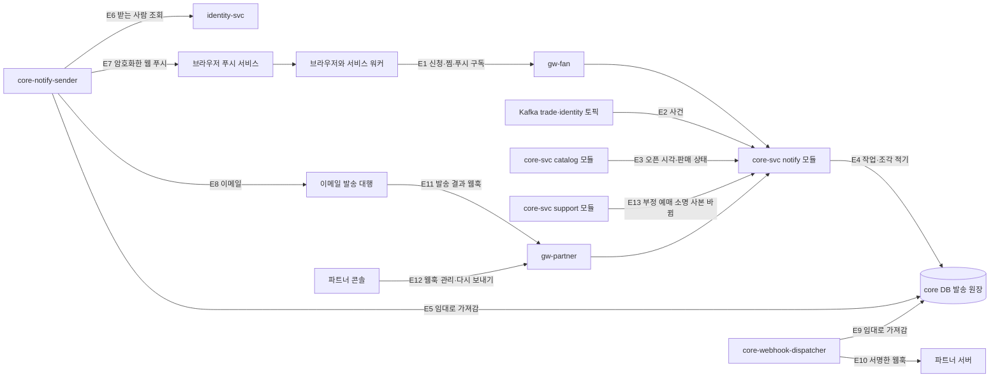
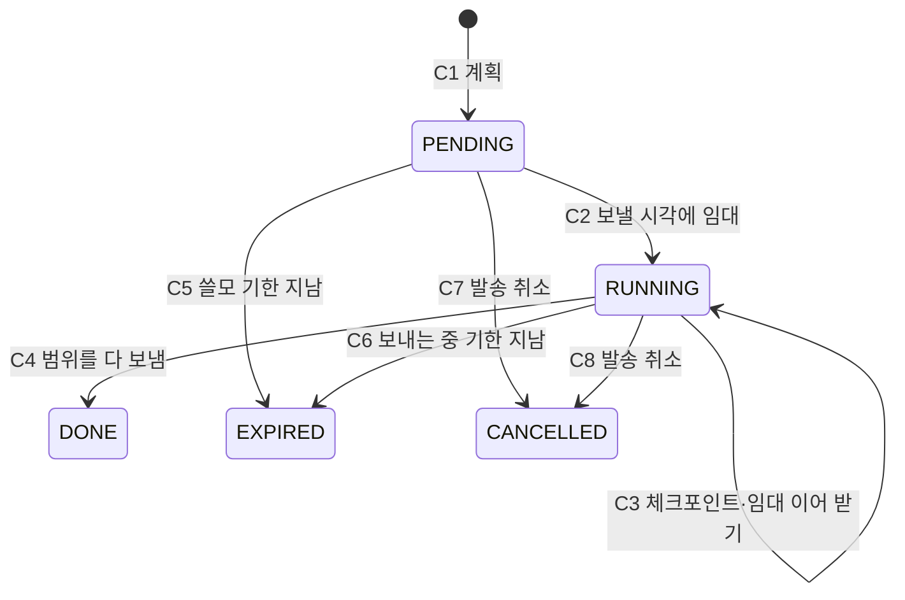

# 기능 설계: 알림·찜·오픈 알림 구독(발송 원장, 대량 발송, 파트너 웹훅)

- **독자와 용도**: core-svc notify 모듈과 발송 워커, 소비자 웹의 알림 켜기·찜·서비스 워커, 파트너 콘솔 웹훅 화면을 구현하는 엔지니어와 QA가 함께 보는 문서다. 다루는 것은 다음과 같다.
  - 오픈 알림·취소표 알림 신청과 찜, 웹 푸시 구독 정보 등록(브라우저가 준 구독 주소와 암호화 키)
  - 발송 원장(알림과 파트너 웹훅의 '보낼 일'과 결과를 적어 두는 core DB 표)과 그 워커, 중복 막기, 채널(웹 푸시·이메일·알림톡·문자)
  - **인기 공연의 대기실 오픈 안내를 아주 많은 구독자에게 보내는 대량 발송**(발송량·속도·퍼뜨리기)과 로비 참가와의 맞물림
  - 밤 시간·광고성 정보 규칙, iOS와 대체 채널, 파트너 웹훅, 실패와 재시도, 관측, 데이터·보존, 시험
  - 구현하는 쪽은 core-svc notify 모듈, 발송 워커 배포 둘(`core-notify-sender`, `core-webhook-dispatcher`), identity-svc(받는 사람 조회), gw-fan·gw-partner, 소비자 웹(알림 토글·SCR-054·서비스 워커), 파트너 콘솔(SCR-025)이다.
- **원문 출처**: 원문에 없다. 전체가 [보완]이다.
- **기준 기획 버전**: v1.0.
- **관련 ID**: FR-004 · FR-018 · FR-019 · FR-025 · FR-040 · NFR-018, 019, 021, 023 · POL-004, 008, 022, 028, 030, 034 · SCR-001, 002, 007, 013, 017, 018, 025, 054 · CMP-068 · API(프로그램끼리 요청과 응답을 주고받는 창구) `/v1/events/{eventId}/subscriptions`, `/v1/subscriptions`, `/v1/wishes`, `/v1/productions/{productionId}/wish`, `/v1/push-subscriptions`, `/v1/subscription-opt-outs/{optOutToken}`, `/v1/partner/webhooks` · ADR-0053, 0060, 0062, 0063, 0064, 0078, 0089, 0093, 0109, 0122, 0139, 0154 · 보안 추적 표 [docs/security/asvs/notify.md](../security/asvs/notify.md)
- **이 문서가 새로 정한 것**: '(추천 적용 2026-10-30)'을 붙였다. 대량 발송(§5·§6)과 웹 푸시 구독 경로(§3.4), 한 번 누름 수신 거부(§7.4)가 이번에 새로 정한 설계다. 결정 기록은 ADR-0155다.

## 1. 기능과 이름

| 이름 | 무엇인가 | 정본 |
| --- | --- | --- |
| 오픈 알림 | 팬이 회차를 골라 신청하면, 그 회차의 대기실이 열리는 시각을 알려 주는 신청 알림이다. 본인확인 전인 사람에게는 공연 상세의 본인확인 버튼으로 가는 링크를 넣는다. 공연 카드의 종 버튼은 그 공연에서 다음에 오픈하는 회차를 신청한다(ADR-0093) | FR-004, docs/design/d5 §9.1 |
| 취소표 알림 | 매진된 회차에 좌석이 돌아와 매진이 풀리면 알려 주는 신청 알림이다. 같은 회차로 10분에 한 번 [가정], 신청 한 번에 최대 5번 [가정] 보낸다 | FR-018, ADR-0062·0122 |
| 찜 | 공연(회차 묶음)을 관심 목록에 넣는 것이다. 찜만으로는 알림을 보내지 않는다 | FR-019, ADR-0093 |
| 웹 푸시 구독 | 브라우저가 권한을 받아 만든 구독 정보(구독 주소·암호화 공개키·인증 비밀값)를 계정에 묶어 두는 것이다. 웹 푸시는 브라우저 회사의 푸시 서비스를 거쳐 브라우저로 보내는 알림이다 | data-classification 'Web Push 구독 정보' |
| 알림 종류 | 거래·안전, 신청, 광고 셋이다. 밤 시간 규칙과 다시 보내기 규칙이 종류마다 다르다 | docs/design/d5 §9.1.1 |
| 낱건 발송 | 받는 사람 한 명·채널 하나마다 작업 행 하나를 적고 보내는 방식이다. 거래·안전 알림과 적은 수의 신청 알림이 쓴다 | ADR-0109, §4.1 |
| 대량 발송 | 한 회차의 신청자 전체에게 같은 알림을 보내는 방식이다. 받는 사람마다 행을 만들지 않고, 신청 ID 범위로 나눈 조각마다 행 하나를 적어 보낸다(추천 적용 2026-10-30) | §4.2 |
| 파트너 웹훅 | 웹훅은 일이 생기면 상대 서버가 우리 주소를 불러 알려 주는 방식이다. 여기서는 PEAKET이 파트너가 등록한 주소로 판매·취소·정산 사건을 보낸다 | FR-025, ADR-0053, §9 |

## 2. 구조

### 2.1 구성 요소

| 번호 | 무엇이 오가나 | 규칙 |
| --- | --- | --- |
| E1 | 신청·끄기, 찜·해제, 웹 푸시 구독 등록·해제 | 팬 쿠키 인증, 쓰기는 `Origin` 확인(docs/api/guidelines.md §9). §3 |
| E2 | `trade.seats`의 판매 상태 바뀜(매진 풀림), `trade.orders`(예매 확정·취소), `trade.tickets`(양도 요청·수락·거절·철회·만료·돌려주기·회수, 추천 적용 2026-10-30), `trade.settlements`, `identity.accounts-merged` | Kafka(이벤트를 순서대로 쌓아 두고 여러 곳에 나눠 주는 메시지 시스템)의 소비자(메시지를 읽는 쪽)가 받아 같은 트랜잭션으로 원장에 적은 뒤 읽은 위치를 커밋한다(ADR-0026의 멱등 소비자, ADR-0109) |
| E3 | 오픈 시각(`open_at`)·로비 개방 리드·판매 승인 상태·회차 취소·연기 | 같은 core 논리 DB라 Kafka를 거치지 않는다. 바뀌는 트랜잭션 안에서 대량 발송 계획을 고친다(§5.6) |
| E4 | 낱건 작업 행(`notification_job`·`webhook_delivery`)과 대량 발송 조각 행(`notification_broadcast_chunk`) | §4 |
| E5 | 팬 알림 워커가 보낼 때가 된 행을 짧은 트랜잭션에서 `FOR UPDATE SKIP LOCKED`로 골라 임대(lease: 워커가 일을 맡았다고 표에 적어 두는 짧은 시간)를 건다 | ADR-0109 결정 2. 잠금을 쥔 채 바깥 호출을 하지 않는다 |
| E6 | 받는 사람의 이메일, 언어, 본인확인 여부, 계정 상태 | identity-svc 읽기 전용 복제본에서 500명씩 묶어 묻는다. 계약은 identity.proto 초안 `RecipientQueryService.BatchGetRecipients`이고, 언어는 계정 칸 `account.locale` [가정]이다(docs/architecture.md §3.2, 2026-10-30) |
| E7 | RFC 8291로 암호화한 본문과 VAPID 서명 머리 | §4.4 |
| E8 | 이메일 | 대행사는 아직 정하지 않았다(docs/review/open-items.md 57번, §4.4) |
| E9 | 웹훅 워커가 같은 방식으로 `webhook_delivery` 행을 가져간다 | ADR-0109 결정 2 |
| E10 | Standard Webhooks 서명(`webhook-id`·`webhook-timestamp`·`webhook-signature`) | ADR-0053 결정 4, §9 |
| E11 | 반송·스팸 신고·전달 결과 | 대행사를 정하면 수신 경로와 서명 검증을 더한다(§4.4) |
| E12 | 엔드포인트 조회·고치기, 비밀 재발급, 발송 이력, 다시 보내기 | 조회와 발송 이력은 파트너 사용자(관리자·실무자), 고치기·비밀 재발급·다시 보내기는 파트너 관리자만(§9 표, openapi `x-peaket-roles`, docs/design/d5 §6.8 '실무자 보기', ADR-0062) |
| E13 | 부정 예매 소명 화면용 사본이 새 판으로 바뀜 | ops-svc의 `SetFraudAppealView`를 받으면 core 논리 DB의 `fraud_appeal_notice`(마지막으로 알린 상태)와 견주어 알림 작업을 적고, 그다음 Redis 사본을 쓴다. §4.5(추천 적용 2026-10-31, ADR-0171, FRN-070) |

- 발송 워커는 core-svc와 같은 코드의 전용 배포 둘이다. `core-notify-sender`는 팬에게 가는 웹 푸시·이메일(대행 계약 뒤 알림톡·문자)을, `core-webhook-dispatcher`는 파트너 웹훅만 보낸다(docs/api/guidelines.md §8). 둘을 나눈 것은 실패가 번지는 범위와 늘리는 단위가 달라서다. 대량 발송은 몇 분 동안 팬 쪽 워커만 늘리고, 파트너 서버가 느려도 팬 알림이 밀리지 않는다(추천 적용 2026-10-30).
- 두 배포 모두 바깥 주소로 나가므로 나가는 통신을 '공인 주소의 TCP 443만'으로 둔다(docs/infra.md §9의 웹훅 발송 파드 규칙과 같다). 웹 푸시 구독 주소는 브라우저가 준 값이라 바깥에서 들어온 주소와 같게 다룬다(§3.4).
- notify 워커는 Spot(싸지만 회수될 수 있는 클라우드 서버)을 써도 된다(docs/infra.md). 회수 2분 전 알림을 받으면 새 조각을 맡지 않고, 맡은 조각은 다음 체크포인트까지 보내고 놓는다(§4.2).

### 2.2 데이터

| 표 | 하는 일 | 정본 |
| --- | --- | --- |
| `notification_subscription` | 오픈 알림·취소표 알림 신청(계정, 회차, 종류, 밤 웹 푸시 여부, 보낸 횟수, 상태) | docs/data.md §2 ⑥, ADR-0089 |
| `wish` | 찜(계정, 공연) | docs/data.md §2 ⑥, ADR-0093 |
| `push_subscription` | 웹 푸시 구독 정보. 이번에 구독 주소 해시·푸시 서비스 종류·만료 칸을 더했다 | docs/data.md §2 ⑥ |
| `notification_job` | 낱건 발송 작업(보낼 때까지만) | ADR-0109 |
| `notification_dedup` | 중복 키 유일 확인(7일 [가정]) | ADR-0086 |
| `fraud_appeal_notice` | 부정 예매 소명 알림을 마지막으로 보낸 상태(계정·사건, 판, 사본 갈래 `party`(결제자 PAYER·받은 사람 HOLDER), 소명·이의 상태, 알린 취소 티켓 수, 알린 '취소 대상에서 빠짐' 티켓 수, 알린 이용 제한 끝, 알린 우선 구매 권리 ID, 알린 잠금 상태 `notified_lock_active`). Redis 사본이 지워져도 알림을 다시 보내지 않게 한다(추천 적용 2026-10-31, ADR-0171, FRN-070. 갈래·잠금 상태·빠진 티켓 수는 ADR-0173) | docs/data.md §2 ⑥, §4.5 |
| `notification_delivery` | 낱건 발송 기록(월 파티션, 90일 [가정]) | ADR-0062·0086 |
| `notification_broadcast` | 대량 발송 한 번(회차·단계·판, 창, 쓸모 기한, 합계)(추천 적용 2026-10-30) | §4.2 |
| `notification_broadcast_chunk` | 대량 발송의 조각(신청 ID 범위, 보낼 시각, 임대, 체크포인트, 조각 합계)(추천 적용 2026-10-30) | §4.2 |
| `webhook_endpoint`·`webhook_delivery` | 파트너 웹훅 주소와 발송 원장. 이번에 비밀 교체 칸과 다시 보내기 경로의 ID를 더했다 | ADR-0109, §9 |

## 3. 신청과 찜

### 3.1 오픈 알림 신청

- 켜기: `POST /v1/events/{eventId}/subscriptions` `{kind: OPEN, nightPush}`. 이미 있으면 `nightPush`만 바꾸고 200, 새로 만들면 201이다. 끄기는 `DELETE …/subscriptions?kind=OPEN`이고 없어도 204다(docs/api/guidelines.md §10 '필터 삭제' 예외).
- 받는 때: 판매 승인을 받은 회차의 `open_at` 전까지다. 그 뒤에는 410 `open-passed`다(추천 적용 2026-10-30). 오픈이 지난 회차는 공연 상세에서 바로 대기열에 들어가면 되고, 알림을 받을 일이 다시 오지 않는다.
- 채널: 이메일은 늘 보낸다(가입 때 이메일이 필수다, data-classification). 웹 푸시는 그 계정에 살아 있는 웹 푸시 구독이 있을 때만 보낸다. 신청은 채널을 고르지 않는다. 웹 푸시 권한이 없으면 화면이 CMP-068로 권한을 먼저 묻고, 거부·미지원이면 "이메일로 알려 드립니다"를 보인다.
- 오프라인에서는 오픈 알림 버튼을 막고 연결을 안내한다(웹 푸시 권한과 동의가 걸려 있어서다, 추천 적용 2026-10-28, 기술 검토 낮음-060).
- 계정마다 살아 있는 신청은 200건 [가정]까지다. 넘으면 422 `subscription-limit`다. 한 계정이 아주 많은 회차를 신청해 대량 발송을 부풀리는 일을 막는다(ASVS 2.1.3).
- 보존은 ADR-0089 결정 8이다. 끄면 바로 지우고, 오픈 알림 신청은 그 회차의 `open_at`이 지나면 지운다. 오픈 30분 전 구독 수는 수요 예측이 먼저 남긴다(ADR-0078). 대량 발송은 `open_at` 전에 끝나므로 지우기와 겹치지 않는다(§5.2).

### 3.2 취소표 알림 신청

- 켜기·끄기는 같은 경로의 `kind: CANCELLATION`이다. 매진 안내(SCR-018)와 공연 상세(SCR-002)에서 켜고 SCR-054에서 보고 끈다.
- 판매 종료(공연 시작 24시간 전) 뒤의 신청은 410 `sale-ended`다. 판매 종료가 되면 살아 있는 신청을 모두 끝낸다(`end_reason` SALE_ENDED, ADR-0064).
- 그 회차를 예매하면 신청을 끝낸다(BOOKED). `trade.orders`의 예매 확정 사건을 받아 처리한다.
- 다섯 번 [가정] 보내면 끝낸다(SENT_MAX). 다섯 번째 알림에 "취소표 알림을 5번 보내 신청을 마쳤습니다. 계속 받으려면 다시 신청해 주세요"를 넣는다(docs/design/d5 §9.1.1). 다시 신청하면 그 행을 ACTIVE로 되돌리고 보낸 횟수를 0으로 한다(docs/data.md).
- SCR-054의 '신청 끝' 상태는 `GET /v1/subscriptions`의 `cancellationStatus`·`endReason`으로 그린다(이번에 칸을 더했다).

### 3.3 찜

- 찜 `PUT /v1/productions/{productionId}/wish`, 해제 `DELETE …/wish`(204). 같은 요청을 다시 보내도 결과가 같다(멱등성: 같은 요청이 여러 번 와도 한 번 처리한 것과 결과가 같은 성질). 혼자 바꾸는 자기 상태라 `If-Match` 없이 마지막 저장이 이긴다(docs/api/guidelines.md §12 예외).
- 목록 `GET /v1/wishes`는 찜한 최근 순이고, 판매 승인이 취소된 공연은 빠진다. 홈 피드는 개인 값을 싣지 않으므로 로그인한 브라우저가 따로 부른다.
- 계정마다 1,000개 [가정]까지다. 넘으면 422 `wish-limit`다(추천 적용 2026-10-30). 없는 공연·공개 전 공연은 404다.
- 화면: 누르면 바로 바뀐 모양을 보이고(낙관적 갱신: 서버 응답을 기다리지 않고 화면을 먼저 바꾼 뒤 실패하면 되돌리는 방식, React 19 `useOptimistic`), 서버가 실패하면 되돌려 "찜하지 못했습니다. 다시 눌러 주세요"를 보인다(docs/frontend.md §5.10).
- 오프라인 재전송은 찜만 둔다(FR-019). 저장 위치는 localStorage `peaket.wishQueue`(공연 ID·동작·시각, 같은 공연은 마지막 동작 하나만)이고, 다시 온라인이 되거나 화면이 다시 보일 때(로그인 상태) 보낸다. 중복은 `PUT`·`DELETE`가 멱등이라 멱등 키 없이 막는다. 로그아웃하면 지운다(docs/frontend.md §3.12, FE-T37).
- 계정 병합 때 흡수 계정의 찜과 알림 신청은 대표 계정으로 옮기고, 같은 공연·같은 회차·종류가 겹치면 하나만 남긴다(POL-034). `identity.accounts-merged`를 받아 처리한다.

### 3.4 웹 푸시 구독(추천 적용 2026-10-30)

웹 푸시 구독 정보를 등록하는 경로가 openapi에 없었다(docs/frontend.md 어긋남 표 32번). 이번에 정한다.

| 하는 일 | 경로 | 규칙 |
| --- | --- | --- |
| 등록·다시 묶기 | `POST /v1/push-subscriptions` 본문 `{endpoint, keys: {p256dh, auth}, expirationTime}` | 같은 구독 주소가 있으면 지금 계정으로 다시 묶고 200, 없으면 201이다. 응답에 `subscriptionKey`(구독 주소의 SHA-256을 base64url로 쓴 값)를 준다 |
| 해제 | `DELETE /v1/push-subscriptions/{subscriptionKey}` | 이 계정의 구독만 지운다. 없거나 남의 것이면 같은 204다(있는지 알리지 않는다) |

- **구독 주소는 경로에 넣지 않는다.** 구독 주소는 브라우저 하나를 가리키는 추측하기 어려운 값이고, 로그에 남으면 같은 사람의 구독끼리 이어 볼 수 있다(RFC 8030 §8.4·§8.5). 그래서 URL에 민감한 값을 넣지 않는 규칙(docs/api/guidelines.md §9)대로 본문으로만 받는다. VAPID 키를 걸어 만든 구독이라 주소를 알아도 PEAKET의 개인키 없이는 보낼 수 없지만, 주소는 개인정보로 다룬다(data-classification 'Web Push 구독 정보'). 해제 경로의 `subscriptionKey`는 해시라 되돌릴 수 없고, 브라우저가 `getSubscription()`의 주소로 바로 계산하므로 따로 저장하지 않는다.
- **구독 주소 검사**: `https`, 포트 443, 호스트가 푸시 서비스 허용 목록에 있어야 한다. 처음 목록은 `fcm.googleapis.com`(Chrome 계열), `push.services.mozilla.com`과 그 하위 이름(Firefox), `web.push.apple.com`과 Apple이 허용하라고 한 `*.push.apple.com`(Safari), `*.notify.windows.com`(Edge) [확인 필요]이다. Samsung Internet·Whale의 푸시 호스트는 [확인 필요]다. 목록에 없거나, 등록 때 이름을 해석한 IP 가운데 사설·루프백·링크 로컬·메타데이터 주소가 있으면 422 `push-service-not-allowed`이고 화면은 이메일로 받는다고 알린다(보낼 때도 §4.4대로 다시 검사한다, openapi `/v1/push-subscriptions`, N-T8). 목록은 설정 값이고, 거절 수를 지표로 세어 빠진 호스트를 찾는다(§11).
- 키 검사: `p256dh`는 base64url을 한 번 풀어 65바이트 비압축 P-256 점인지, `auth`는 16바이트인지 본다(RFC 8291). 틀리면 422 `push-key-invalid`다(openapi). 구독 주소는 1,024자 [가정]까지다.
- 계정마다 구독은 10개 [가정]까지다. 넘으면 가장 오래 쓰지 않은 구독을 지운다. 브라우저가 많으면 그만큼 보내는 양이 늘기 때문이다.
- **로그인·로그아웃**: 로그인할 때 화면은 `Notification.permission`이 허용이고 `getSubscription()`이 구독을 주면 그 구독을 등록해 지금 계정에 묶는다. 권한을 새로 묻지 않으므로 사용자 조작이 필요 없다. 로그아웃할 때는 이 브라우저의 구독을 해제 경로로 지운다(브라우저의 구독 자체는 남긴다). 그래서 한 기기를 여러 사람이 쓰면 마지막에 로그인한 사람의 알림만 간다. 로그아웃 정리 루틴(docs/frontend.md §5.14.4 2번)과 호출 순서(같은 문서 §4.2.4)에 이 단계를 더했다(2026-10-30).
- 웹 푸시를 받는 서비스 워커는 월렛 워커(범위 `/my/tickets/`)와 따로 둔 전용 등록 `/push/sw.js`(범위 `/push/` [가정])다. 월렛 워커는 로그아웃의 '입장 키도 지우기'와 킬 스위치에서 등록을 푸는데, 구독은 그것을 만든 등록에 묶여 함께 사라지기 때문이다(docs/frontend.md §5.4, 추천 적용 2026-10-30).
- 브라우저가 구독을 바꾸면 서비스 워커의 `pushsubscriptionchange`가 새 구독을 IndexedDB(브라우저 안에 데이터를 저장하는 곳)에 '다시 등록 필요'로 적고, 다음에 화면이 열리면 등록한다. 서비스 워커는 액세스 토큰을 새로 받지 못할 수 있어서다.
- 푸시 서비스가 404·410을 주거나(만료·해지된 구독), 403과 VAPID 키 불일치를 주면 그 행을 지운다(§10).
- 회원 탈퇴 때 바로 지운다(data-classification 'Web Push 구독 정보').

### 3.5 iOS와 권한 묻기

- iOS·iPadOS는 16.4 이상에서 홈 화면에 추가한 웹 앱에서만 웹 푸시를 받는다(NFR-019, Apple 문서 2026-10-30 확인). 그래서 CMP-068은 iOS에서 홈 화면 추가 방법을 먼저 안내하고, 추가하지 않은 사람에게는 "이메일로 알려 드립니다"를 보인다.
- 권한은 사용자가 버튼을 누른 그 처리기 안에서만 묻는다. Safari는 누른 동작 바로 안에서 구독을 부르라고 한다(Apple 문서).
- Safari는 화면에 보이지 않는 푸시를 받지 않고, 서비스 워커가 받은 푸시를 바로 보여 주지 않으면 그 사이트의 푸시 권한을 거둔다(Apple 문서). 그래서 서비스 워커의 `push` 처리기는 본문을 풀지 못하거나 낡은 알림이라도 늘 `showNotification`을 부른다. 풀지 못하면 "피켓 알림이 도착했습니다"와 알림 목록 링크를 보인다 [가정].
- `notificationclick`은 본문의 `url`이 같은 출처의 `/`로 시작하고 허용한 앞부분(`/events/`·`/productions/`·`/my/`·`/queue/`·`/help/`) [가정]일 때만 연다. 그 밖이면 홈을 연다.

## 4. 발송 원장과 워커

### 4.1 낱건 발송

ADR-0109의 규칙 그대로다. 사건을 받은 트랜잭션에서 `notification_dedup`에 중복 키를 먼저 넣고(`INSERT … ON CONFLICT DO NOTHING`), 들어갔을 때만 `notification_job`에 작업을 적는다. 워커는 보낼 때가 된 행을 50개씩 `FOR UPDATE SKIP LOCKED`로 골라 임대 2분 [가정]을 걸고 커밋한 뒤 보낸다. 결과는 다른 짧은 트랜잭션에서 `notification_delivery`에 쓰고 작업 행을 지운다. 쓸모 기한(`expires_at`)이 지나면 보내지 않고 EXPIRED로 기록한다. 마지막 시도까지 실패하면 DEAD이고 SEV3(장애 심각도 등급. 숫자가 작을수록 심각하다, `kind` hygiene)다(ADR-0078).

- 중복 키: `{알림 종류}:{대상 ID}:{사건 ID 또는 상태 버전}:{받는 계정 ID}:{채널}`(docs/design/d5 §9.1.1).
- 시각을 잡는 안내(공연 전날 18:00 등)와 60초 모아 보내기는 `next_attempt_at`으로 미룬다.
- 낱건은 초당 수백 건 아래에서 쓴다(ADR-0109 [추정]). 한 사건에서 받는 사람이 1,000명 [가정]을 넘는 알림(오픈 알림, 취소표 알림)은 낱건으로 만들지 않고 §4.2의 대량 발송으로 보낸다. 거래·안전 알림 가운데 받는 사람이 많은 회차 취소·연기 안내(5만 석 회차면 수만 명)는 지금처럼 낱건이다. 2인 확정 뒤 한 번 나가는 알림이고, 수만 행을 몇 분에 나눠 적으면 초당 수백 건 안이다.

### 4.2 대량 발송(추천 적용 2026-10-30)

인기 회차의 오픈 알림은 신청자가 수십만~100만 명 [가정]이다. 낱건으로 만들면 받는 사람·채널마다 중복 키·작업·기록 세 행을 쓰고 지워야 해서, 로비가 열리는 몇 분 동안 공유 Aurora(AWS가 운영해 주는 PostgreSQL 호환 데이터베이스) 쓰기 인스턴스에 초당 수천 행이 더해진다(§5.3). 그때는 같은 클러스터가 로비 개방의 로그인 몰림(초당 최대 약 1,700건, docs/infra.md)도 받는다. 그래서 대량 발송은 받는 사람마다 행을 만들지 않는다.

- **발송 한 번**: `notification_broadcast` 행 하나가 '이 회차의 이 단계 알림을 이 판으로 이 창 안에 보낸다'를 적는다. `(event_id, phase, version)`이 유일하다. 그래서 같은 사건을 다시 받거나 계획을 두 번 세워도 발송은 하나다. 단계(`phase`)는 오픈 알림의 셋(OPEN_EMAIL, OPEN_VERIFY_PUSH, OPEN_LOBBY_PUSH, §5.2)과 취소표 알림의 둘(CANCEL_PUSH, CANCEL_EMAIL, §6)이다.
- **조각**: 계획을 세울 때 그 회차·종류의 살아 있는 신청을 신청 ID 순서로 읽어 500개 [가정]마다 경계를 잡고, 조각 행(`notification_broadcast_chunk`: ID 범위, 보낼 시각, 상태)을 만든다. 계획 때의 마지막 신청 ID를 발송 행에 적는다. 그 뒤 신청은 조각에 들지 않고 낱건으로 보낸다(§5.6).
- **보낼 시각 흩기**: 조각마다 보낼 시각을 창 안에 흩는다. 시각은 `창 시작 + (HMAC-SHA256(발송 키, 발송 ID ‖ 조각 번호) mod 창 길이)`다. HMAC은 비밀 키로 만든 위조 확인용 값이다. 그래서 신청 순서(먼저 신청한 사람)가 먼저 받지 않고, 발송마다 순서가 달라진다. 조각이 고르게 퍼지므로 전체 속도는 '받는 수 ÷ 창 길이'가 된다. 따로 전역 속도 제한기를 두지 않는다.
- **임대와 체크포인트**: 워커는 `slot_at <= now()`인 조각을 `ORDER BY slot_at LIMIT 1 FOR UPDATE SKIP LOCKED`로 골라 임대 2분 [가정]을 걸고 커밋한다. 신청을 100개 [가정] 보낼 때마다 짧은 트랜잭션으로 `sent_upto`(마지막으로 보낸 신청 ID)와 조각 합계를 쓰고 임대를 늘린다. 워커가 죽으면 임대가 끝난 뒤 다른 워커가 `sent_upto` 다음부터 보낸다.
- **조각 처리**: ① 조각 범위의 살아 있는 신청을 읽는다(읽기 전용 복제본, `sent_upto` 다음부터) ② identity-svc에 500명을 한 번에 묻는다(본인확인 여부, 언어, 계정 상태. 이메일 단계면 주소도) ③ 웹 푸시 단계면 그 계정들의 `push_subscription`을 읽어 구독마다 보낸다(§4.4) ④ 이메일 단계면 신청마다 낱건 작업 행을 만든다(중복 키 `{단계}:{회차}:{판}:{계정}:EMAIL`, `next_attempt_at`은 조각 시각부터 조각 간격 안에 흩는다). 이메일은 속도가 느려(§5.3) 낱건 경로의 기록·중복 막기를 그대로 쓴다.
- **쓰기 양**: 웹 푸시 단계는 조각 하나에 임대 1번, 체크포인트 5번, 끝내기 1번이다. 신청 100만이면 조각 2,000개라 6분 창에 초당 약 40번이다(§5.3).
- **쓸모 기한**: 남은 TTL(저장한 값이나 키를 쓸 수 있는 시간)이 60초 [가정]보다 짧은데 아직 보내지 않은 조각은 EXPIRED로 끝내고 남은 수를 센다.
- **기록**: 웹 푸시 대량 발송은 받는 사람마다 `notification_delivery`를 쓰지 않는다. 조각 합계(보냄·건너뜀·실패·만료 구독)만 남기고, 404·410을 받은 구독은 체크포인트 때 묶어 지운다. 그래서 고객센터는 '이 회차 오픈 안내가 몇 시부터 몇 시까지 몇 건 나갔고, 이 계정의 신청이 계획에 들었는지'까지만 확인할 수 있다(§16).

| 번호 | 출발 | 도착 | 전이와 조건 |
| --- | --- | --- | --- |
| C1 | (시작) | PENDING | 계획 작업이 신청 ID 범위로 조각을 만들고 보낼 시각을 흩는다 |
| C2 | PENDING | RUNNING | `slot_at <= now()`, 임대가 없거나 끝남. `attempt_count` +1 |
| C3 | RUNNING | RUNNING | 100개 [가정]마다 `sent_upto`·합계·임대를 쓴다. 임대가 끝난 조각은 다른 워커가 `sent_upto` 다음부터 이어 보낸다 |
| C4 | RUNNING | DONE | 범위 끝까지 보냄. 합계를 발송 행에 더한다 |
| C5 | PENDING | EXPIRED | 남은 TTL 60초 [가정] 미만. 보내지 않은 수를 만료로 센다 |
| C6 | RUNNING | EXPIRED | 보내는 중에 같은 조건 |
| C7 | PENDING | CANCELLED | 계획이 바뀜(§5.6), 취소표 차례 중 다시 매진(§6), 회차 취소 |
| C8 | RUNNING | CANCELLED | 같은 조건. 보내던 조각은 다음 체크포인트에서 멈춘다 |

### 4.3 중복 막기

| 경로 | 무엇으로 막나 | 남는 것 |
| --- | --- | --- |
| 낱건 | 중복 키 유일 제약(`notification_dedup`) | 워커가 보내다 죽으면 '적어도 한 번'이라 대행사에 같은 키로 상태를 확인하고, 모르면 돈·보안·법정 통지만 한 번 더 보낸다. 신청 알림과 광고는 다시 보내지 않는다(docs/design/d5 §9.1.1) |
| 대량 발송 | 발송 유일 제약 `(event_id, phase, version)`과 신청 유일 제약 `(account_id, event_id, kind)`, 조각 체크포인트 | 워커가 죽으면 마지막 체크포인트 뒤의 신청 최대 100개 [가정]에 웹 푸시가 한 번 더 갈 수 있다. 같은 Topic(푸시 서비스에서 아직 전달되지 않은 메시지를 바꾸는 머리)과 같은 `tag`(화면에 떠 있는 알림을 바꾸는 값)를 쓰므로 대부분 한 번만 보인다 |
| 대량 발송의 이메일 | 낱건 경로로 넘기므로 중복 키 | 낱건과 같다 |
| 대량 발송과 낱건 사이 | 계획 때의 마지막 신청 ID로 나눈다 | 발송 중에 신청을 껐다 다시 켜면 새 행(새 ID)이라 낱건으로 한 번 더 받을 수 있다 |

### 4.4 채널별 보내기

**웹 푸시**(RFC 8030·8291·8292, 2026-10-30 원문 확인)

| 머리·값 | 정한 것 | 근거 |
| --- | --- | --- |
| `TTL` | 필수다. 알림이 쓸모 있는 끝까지 남은 초로 준다: 차례 임박 900초(15분 유예), 오픈 알림의 로비 열림 푸시는 로비 개방 10분 뒤까지, 본인확인 안내 푸시는 로비 개방까지, 취소표 30분 [가정], 그 밖 24시간 [가정] | docs/design/d5 §9.1.1. RFC 8030 §5.2는 TTL이 없으면 400이고, 푸시 서비스가 더 짧게 줄일 수 있다고 한다 |
| `Urgency` | 차례 임박·로비 열림·취소표는 `high`, 본인확인 안내와 거래·안전 알림은 `normal`, 광고는 `very-low`(추천 적용 2026-10-30) | RFC 8030 §5.3: 없으면 `normal`. 배터리가 적은 기기는 `high`만 받을 수 있다. Apple은 바로 보내려면 `high`를 쓰라고 한다 |
| `Topic` | 대상마다 `HMAC-SHA256(Topic 키, 종류 ‖ 대상 ID)`의 앞 16바이트를 소문자 16진 32자로 쓴다. 같은 값을 알림 `tag`에도 쓴다(추천 적용 2026-10-30) | RFC 8030 §5.4는 base64url 32자 이하, Mozilla는 영문·숫자 32바이트 이하만 받는다. 16진 32자는 둘 다 맞는다. 대상 ID 원문을 넣지 않는 것은 ADR-0139 결정 6 |
| 본문 | `{v, kind, title, body, url, tag}` JSON을 RFC 8291(`aes128gcm`)로 암호화한다. 평문은 2,048바이트 [가정] 아래로 둔다. 이름·전화번호·계좌번호와 예매번호 전체를 넣지 않는다(예매번호는 끝 4자리) | RFC 8030 §7.2: 4,096바이트까지는 413을 주면 안 된다. RFC 8291 평문 상한 3,993바이트. Mozilla는 다른 서비스를 거치는 구독에서 2,744바이트로 줄 수 있다고 적는다 |
| `Authorization: vapid` | ES256 키쌍(docs/security/secrets-and-keys.md 'Web Push VAPID 키쌍')으로 서명한 JWT. `aud`는 구독 주소의 출처, `exp`는 12시간 [가정], `sub`는 팀 메일이다. 푸시 서비스 출처마다 만들어 12시간 쓰고 바꾼다 | RFC 8292: `exp`는 24시간을 넘으면 안 된다. Apple은 JWT를 한 시간보다 자주 바꾸지 말라고 한다. `sub`는 ADR-0139 결정 6 |

- 연결: 푸시 서비스마다 HTTP/2 연결을 몇 개 열어 두고, 상대가 준 `SETTINGS_MAX_CONCURRENT_STREAMS`를 넘지 않는다. Apple은 HTTP/1.1이면 응답을 받지 않은 요청을 100개 넘게 쌓지 말라고 한다.
- 속도: 푸시 서비스마다 파드당 시작 속도를 두고 [가정], 429를 받으면 그 서비스 몫을 반으로 줄이고 `Retry-After`를 지킨 뒤 1분마다 10%씩 [가정] 되올린다(AIMD: 정상이면 조금씩 늘리고 나빠지면 크게 줄이는 조절 방식). 같은 구독에 대한 429는 그 구독만 미룬다. RFC 8030 §8.4는 구독마다 속도를 제한할 수 있다고 하고, Apple은 같은 기기에 너무 많이 보낼 때 429를 준다.
- 보낼 때 연결 검사: 구독 주소의 이름을 해석한 IP가 사설·루프백·링크 로컬·메타데이터 주소면 연결하지 않고, 검사한 IP로 바로 연결한다. 리디렉션은 따르지 않는다. 파트너 웹훅과 같은 HTTP 클라이언트를 쓴다(docs/api/guidelines.md §8 ②).
- 로그와 요청 기록에는 구독 주소를 남기지 않고 푸시 서비스 종류만 남긴다(RFC 8030 §8.5).

**이메일**

- 대행사는 아직 정하지 않았다(docs/review/open-items.md 57번, wbs 5.6.1에서 정한다). 그래서 이메일 경로는 대행사 어댑터 하나로 가두고, 대행사에 바라는 조건을 정해 둔다(추천 적용 2026-10-30): ① 계약한 초당 발송 한도가 200통 [가정] 이상이고 잠깐의 몰림을 받는다 ② 요청마다 우리가 준 키로 결과를 조회할 수 있다(docs/design/d5 §9.1.1 '같은 키로 상태 확인'이 이 기능에 기댄다) ③ 반송·스팸 신고·전달 결과를 서명한 웹훅으로 준다 ④ IAM 역할로 인증할 수 있다(정적 비밀을 두지 않는다, ADR-0089 결정 9) ⑤ 국외 재이전 여부를 밝힌다(ADR-0139 결정 10).
- 보내는 주소는 알림 전용 하위 도메인(예: `no-reply@notify.peaket.example`)이고 SPF·DKIM·DMARC를 둔다(docs/design/d5 §9.1.1).
- 받는 쪽 메일 서비스의 한도: Gmail은 하루 5,000통 넘게 보내는 발신자에게 SPF·DKIM·DMARC, 스팸 신고율 0.3% 미만, 마케팅·구독 메시지의 한 번 누름 수신 거부(RFC 8058)를 요구한다. 또 일정한 속도로 보내고 갑자기 몰아 보내지 말며, 한도를 넘어 4.7.28 오류를 받으면 10분 이상 쉬라고 한다(Google 발신자 안내 2026-10-30 확인). 그래서 대량 이메일은 몇 시간 창에 고르게 보내고(§5.2), 신청 알림 이메일에 한 번 누름 수신 거부를 둔다(§7.4). 네이버·다음 메일의 한도는 [확인 필요]다.
- 참고로 같은 AWS 안의 Amazon SES는 샌드박스에서 하루 200통·초당 1통이고, 운영으로 옮기면 쓰임새에 따라 한도가 정해지며 요청해 올릴 수 있다. 또 갑작스러운 몰림이 받는 쪽의 차단을 부르지 않게 한도를 단계적으로 올린다고 적는다(AWS 문서 2026-10-30 확인). 대행사를 고를 때의 비교 자료이고, SES로 정한 것은 아니다.

**알림톡·문자**: 발송 대행 계약 뒤에 켜고, 그 전에는 이메일과 웹 푸시로만 보낸다(ADR-0060 결정 13). 신청 알림에는 쓰지 않는다(docs/design/d5 §9.1.1). 쓰는 곳은 §8이다.

### 4.5 부정 예매 소명·조치 알림(추천 적용 2026-10-31, ADR-0171, FRN-070)

부정 예매 사후 조사(POL-046, docs/features/forensic-replay.md §6.7.5)에서 팬에게 가는 알림이다. 결정은 ops-svc가 하지만 ops-svc는 팬에게 직접 보내지 않는다. 받는 길은 소명 화면용 사본이다.

- **길(E13)**: ops-svc가 core-svc support 모듈에 `SetFraudAppealView`(core.proto, 판 번호)를 보낸다. 화면용 사본(`sup:far:{account}`)은 세션·캐시 Redis에 있어 DB 트랜잭션에 묶을 수 없다. 그래서 알림 판단은 Redis가 아니라 core 논리 DB의 `fraud_appeal_notice`(계정·사건마다 마지막으로 알린 상태)와 견주어 한다.
  1. support 모듈은 받은 판이 `fraud_appeal_notice`의 판보다 클 때만, 한 core DB 트랜잭션에서 아래 표의 바뀜을 찾아 알림 작업(`notification_job`·`notification_dedup`)을 적고 `fraud_appeal_notice`를 그 판으로 고친다.
  2. 그다음 Redis 사본을 쓴다. Redis 쓰기 전에 죽어도 ops-svc가 같은 판을 다시 보내면 Redis만 채워지고, 알림은 이미 적혀 있어 다시 적지 않는다. Redis 값이 지워져도 `fraud_appeal_notice`가 남아 '첫 반영'으로 잘못 보지 않는다.
  3. 같은 판의 다시 보내기(작업 워커, 10분마다의 열린 요청 다시 보내기)는 판이 같아 알림을 적지 않는다.
- **순서**: ops-svc는 소명 요청의 첫 판(소명 상태 OPEN)을 ticket-svc `SetTransferLock`이 대상 표 모두에 성공한 뒤에만 보낸다. 알림을 먼저 받은 사람이 표를 넘기는 틈을 막으려는 순서다(forensic-replay §6.7.5, transfer-refund §4.1, d5 §9.1).
- **받는 사람(추천 적용 2026-10-31, ADR-0173 결정 3·4)**: 사본의 갈래(`party`)로 나눈다. 결제자(`PAYER`)는 소명을 요청받은 사건 계정이고, 아래 표의 일곱 종류를 받는다. 받은 사람(`HOLDER`)은 사건 계정이 결제한 표를 양도로 받아 가진 사건 밖 계정이고, `FRAUD_HOLDER_NOTICE`와 `FRAUD_HOLDER_RESULT` 둘만 받는다. 받은 사람의 사본과 알림에는 사유 범주를 싣지 않는다(결제자의 사유라서). `fraud_appeal_notice`는 (계정, 사건)마다 한 행이고 그 행의 `party`로 어느 표를 볼지 정한다. 받은 사람이 그 사건의 계정이기도 하면 받은 사람 사본을 따로 만들지 않고 결제자 사본으로 다룬다(그 사람은 이미 소명 요청을 받았다).
- **종류와 채널**: 아홉 모두 거래·안전 알림이고 이메일로 보낸다(docs/design/d5 §9.1). 밤 시간 제한 없이 바로 보낸다(§7).

| 알림 종류 | 받는 사람 | 보내는 때(`fraud_appeal_notice`와 견주어 바뀐 것) | 문안 변수(허용 목록) | 여는 화면 |
| --- | --- | --- | --- | --- |
| `FRAUD_APPEAL_REQUESTED` 소명 요청 | 결제자 | 그 (계정, 사건)의 첫 판(소명 상태 OPEN) | 공연명, 회차 일시(KST), 사유 범주 이름, 소명 기한, 잠긴 표 수, 잠금 최대 기한(`lock_expires_at`, "늦어도 14일 뒤 풀립니다"), 고정 문구 '양도만 막고, 입장과 본인 취소(보통의 취소 수수료가 붙습니다)는 됩니다', 고정 문구 '돈이 오가지 않은 가족·지인 대리 예매는 부정 예매가 아닙니다'(잠금 문구는 ADR-0173 결정 3) | SCR-042 |
| `FRAUD_APPEAL_DECIDED` 소명 판단 | 결제자 | 소명 상태가 ACCEPTED·REJECTED·EXPIRED로 바뀜 | 공연명, 결과(인정·불인정·기한까지 내지 않음) | SCR-042 |
| `FRAUD_ACTION_NOTICE` 조치 결과와 이의 방법 | 결제자 | 조치 결과가 새로 생기거나 늘어남: 취소한 티켓이 늘거나, 이용 제한 끝이 새로 생기거나 늦춰짐. 표 취소 뒤 이용 제한을 더한 경우(C9)도 다시 보낸다 | 공연명, 사유 범주 이름, 이번에 취소한 표 수와 고정 문구 '3영업일 안에 원래 결제 수단으로 전액 환급합니다'(ADR-0173 결정 4), 이용 제한 끝(있을 때), 이의 기한 | SCR-042 |
| `FRAUD_OBJECTION_DECIDED` 이의 결과 | 결제자 | 이의 상태가 ACCEPTED·REJECTED로 바뀜 | 공연명, 결과, 고정 문구 '이유는 소명 화면에서 볼 수 있습니다'. 조사관이 적은 이유(`objection_note`)는 자유 글이라 변수에 넣지 않고 SCR-042에만 보인다(§12). 인정이고 이용 제한이 있었으면 '이용 제한 풀기를 진행합니다', 취소한 표가 있었으면 '우선 구매나 보상을 따로 알려 드립니다' | SCR-042 |
| `FRAUD_RESTRICTION_LIFTED` 이용 제한 풀림 | 결제자 | 이용 제한 끝이 있다가 비워짐(풀기 `LIFT_RESTRICTION`이 Done) | 공연명 | SCR-042 |
| `FRAUD_PRIORITY_PURCHASE` 우선 구매 | 결제자 | 우선 구매 권리에 OFFERED가 새로 생김(권리 ID마다) | 공연명, 원래 가격, 기한(48시간 [가정]). 좌석 번호는 싣지 않는다(§12 '알림 문구 변수 규칙') | SCR-042 → 입장 확정(`priorityGrantId`) |
| `FRAUD_TRANSFER_LOCK_RELEASED` 양도 잠금 풀림(추천 적용 2026-10-31, ADR-0173 결정 3) | 결제자 | party `PAYER` 사본의 잠금 상태(`lock_active`)가 참에서 거짓으로 바뀜(`notified_lock_active`가 참일 때만. `HOLDER` 사본은 `lock_active`가 늘 거짓이라 보내지 않는다). 다만 입장 시작 뒤에 바뀐 때(그때는 양도 마감이 지나 양도할 수 없다)와, 잠긴 표가 모두 취소돼 남은 표가 없을 때(`locked_ticket_ids`가 모두 `cancelled_ticket_ids`에 듦. `locked_ticket_ids`는 잠금이 풀려도 비우지 않아 이 비교가 된다)는 보내지 않고 `notified_lock_active`만 고친다(추천 적용 2026-10-31, ADR-0173) | 공연명, 회차 일시(KST), 고정 문구 '이 회차 표의 양도 잠금이 풀렸습니다' | SCR-042 |
| `FRAUD_HOLDER_NOTICE` 받은 표의 조사 알림(추천 적용 2026-10-31, ADR-0173 결정 4) | 받은 사람 | party `HOLDER`인 그 (계정, 사건)의 첫 판 | 공연명, 회차 일시(KST), 소명 기한, 가진 표 수(`held_ticket_ids`의 수), 고정 문구 "결제자의 부정 예매 조사에 이 표가 포함되었습니다. 표를 정당하게 받으셨다면 사정을 알려 주세요". 사유 범주는 싣지 않는다 | SCR-042 |
| `FRAUD_HOLDER_RESULT` 받은 표의 결과(추천 적용 2026-10-31, ADR-0173 결정 4) | 받은 사람 | 받은 사람의 사본에서 결과가 정해진 표가 늘어남: 취소된 표(`cancelled_ticket_ids`)가 늘거나, 취소 대상에서 빠진 표(`excluded_ticket_ids`)가 늚. 둘 다 늘면 한 통에 함께 싣는다 | 공연명, 결과(취소됨·취소 대상에서 빠짐)와 결과마다의 표 수, 취소됨이 있으면 고정 문구 '환급은 결제자에게 갑니다' | SCR-042 |

- **중복 키**: `{알림 종류}:{사건 ID}:{판 번호}:{받는 계정 ID}:email`이다(d5 §9.1.1). 우선 구매는 판 번호 자리에 권리 ID를 쓴다. 한 판에서 둘 이상이 바뀌면(예: 소명 불인정과 조치 결과) 종류마다 하나씩 보낸다.
- **싣지 않는 것**: 사건의 다른 계정, 점수·가중치, 근거 신호, 조사관 이름, 예매번호 전체(끝 4자리만), 좌석 번호. 사유 범주는 결제자에게만 이름으로 싣는다(POL-046 ⑦). 받은 사람에게는 사유 범주, 결제자의 계정·닉네임, 결제자의 소명·조치 결과를 싣지 않는다. 문안 변수는 위 허용 목록에 있는 것만 `notification_job.vars`에 넣는다(§12). 표 수·기한·회차 일시는 §12의 '화면에 보일 공개 값'이다.
- **예매 제한 알림과 겹치지 않게**: 사유 `FRAUD`인 예매 제한의 걸림과 풀림은 위 `FRAUD_ACTION_NOTICE`와 `FRAUD_RESTRICTION_LIFTED`가 알린다. 예매 제한 화면용 사본(`SetBookingRestrictionView`)이 바뀌어도 사유가 `FRAUD`면 '예매 제한과 소명 기한' 알림을 따로 보내지 않는다.
- **판과 다시 보내기**: 잠금 상태가 바뀌거나(최대 기한·입장 시작에 ticket-svc가 스스로 풀 때 포함) 받은 사람의 표 결과가 정해지면 ops-svc가 그 (계정, 사건)의 사본을 더 큰 판으로 다시 보낸다. 최대 기한에는 ops-svc 스케줄러가 그 시각에 보낸다. 판 비교와 중복 키 규칙은 위와 같아, 같은 판을 다시 보내도 알림이 두 번 가지 않는다.
- 받은 사람이 표를 결제자에게 돌려주면 ops-svc는 그 사람 사본의 `held_ticket_ids`에서 그 표를 빼 다시 보낸다. 이것은 결과가 아니라 알림을 보내지 않는다.

## 5. 대기실 오픈 안내 대량 발송(추천 적용 2026-10-30)

### 5.1 무엇이 문제인가

- ADR-0109는 발송 원장의 쓰기를 '피크에도 초당 수백 건 아래 [추정]'로 보았다. 그런데 인기 회차의 오픈 알림은 신청자 전체에게 거의 같은 때에 나가야 한다. 신청 100만 [가정]이면 이메일 100만 통과 웹 푸시 수십만~100만 건이다.
- 오픈 알림은 사람을 로비로 부른다. 로비 설계는 '로비 개방(T-10분)부터 10분에 걸쳐 인증과 사람 확인을 나눠 받아 초당 약 1,700명이 들어온다'고 본다(docs/architecture.md §9.1, Q-T57). 이 값은 고르게 온다는 가정이다. 로비에 일찍 들어와도 유리하지 않다는 규칙(POL-004)은 서두를 이유를 없앨 뿐이다. 그래서 공연 상세의 [로비 입장] 버튼을 기기마다 로비 개방 뒤 0~60초 [가정] 사이에 연다(소유자 결정 2026-10-30, open-items 66번, docs/features/queue-admission.md §2 '로비 참가 퍼뜨리기'). 버튼이 퍼지는 이 시간을 아래에서 S(기본 60초)라 한다.
- 알림을 로비 개방 순간 한꺼번에 보내면, 받은 사람이 누르는 물결이 로비 개방 직후 몇 분에 몰린다. 반대로 알림이 로비 개방보다 한참 앞에 오면, 받은 사람은 공연 상세에서 버튼이 열리기를 기다렸다가 로비 개방 순간 한꺼번에 누른다. 두 경우 모두 로비 개방 몰림을 키운다.
- PEAKET이 이 몰림에서 직접 정할 수 있는 것은 웹 푸시를 언제 누구에게 보내는가다. 그래서 웹 푸시를 로비가 열린 동안 흩어 보내고, 시각 안내와 본인확인은 그보다 앞에 끝내게 한다.

### 5.2 세 단계

T는 오픈 시각(`open_at`), L은 로비 개방 리드(기본 10분, 회차 설정 `event.lobby_minutes`, docs/data.md §2, POL-030), Lo는 로비 개방 시각(T − L)이다. 로비 셔플을 켠 공연(하이브리드·사전 셔플)의 규칙이다. 로비가 없는 선착순 공연은 아래 '선착순' 줄이다.

| 단계(`phase`) | 채널 | 받는 사람 | 창 | 쓸모 기한(TTL) | 내용 |
| --- | --- | --- | --- | --- | --- |
| ① 사전 안내(OPEN_EMAIL) | 이메일 | 모든 오픈 알림 신청자 | Lo − 6시간 ~ Lo − 1시간 [가정] | T | 대기실이 열리는 시각과 판매 시각, "오픈 전에 들어온 분은 오픈 시각에 무작위로 순번을 받습니다. 일찍 들어와도 유리하지 않습니다"(POL-004 문구), 공연 상세 링크. 본인확인 전이면 "미리 본인확인을 마쳐 두세요"와 본인확인 버튼이 있는 공연 상세 링크(FR-004) |
| ② 본인확인 안내(OPEN_VERIFY_PUSH) | 웹 푸시 | 본인확인 전인 신청자 | Lo − 40분 ~ Lo − 15분 [가정] | Lo | "대기실은 19:50에 열립니다. 휴대폰 본인확인을 마쳐야 들어갈 수 있습니다" → 공연 상세(SCR-002)의 본인확인 버튼 |
| ③ 로비 열림(OPEN_LOBBY_PUSH) | 웹 푸시 | 모든 오픈 알림 신청자 | Lo + S ~ Lo + S + 0.6 × L(기본 Lo + 1분 ~ Lo + 7분, 길이 6분) [가정]. 끝은 T − 3분을 넘지 않는다 | Lo + 10분(docs/design/d5 §9.1.1) | "대기실이 열렸습니다. 20:00 전까지 언제 들어오셔도 순서는 같습니다" → SCR-002. 본인확인 전이면 "본인확인을 마치면 들어갈 수 있습니다"를 붙인다 |
| 선착순 공연 | ①은 T − 6시간 ~ T − 1시간, ②는 T − 40분 ~ T − 15분, ③은 T − 8분 ~ T − 3분 [가정] | 같다 | 같다 | ③은 T + 10분 [가정] | ③은 "20:00 정각에 대기열이 열립니다. 공연 상세에서 사람 확인을 미리 마쳐 두세요(15분 유효, 조용히 갱신)" |

- 문구는 예시다. 정본 문안은 docs/design/d5 §9.1이 정한다(§16).
- 밤(21:00~08:00 KST)에 걸리는 웹 푸시(②·③)는 '밤에도 웹 푸시 받기'를 켠 신청자에게만 보낸다. 이메일(①)은 밤에도 보낸다(신청 알림의 이메일은 바로 보낸다, docs/design/d5 §9.1.1). 그래서 밤 오픈 공연에서 웹 푸시를 끈 사람은 ① 이메일만 받는다.
- ③의 창을 로비 시간의 60% [가정] 길이로 둔 것은, 늦게 받은 사람도 T까지 3분 넘게 남기기 위해서다. 로비 참가 자체는 10~30초 [추정]면 끝나고, 본인확인이 필요한 사람은 ①·②에서 미리 알렸다.
- ③을 S(버튼이 퍼지는 60초)가 지난 뒤부터 보내는 것은 두 가지 때문이다(추천 적용 2026-10-30). 푸시를 누르고 온 사람이 아직 닫힌 버튼을 보지 않게 한다("대기실이 열렸습니다"와 닫힌 버튼이 어긋나지 않는다). 그리고 첫 1분은 공연 상세를 열어 둔 사람의 몫(버튼 분산)으로, 그 뒤는 알림을 받고 오는 사람의 몫(③ 분산)으로 나눠 두 물결이 겹치지 않게 한다. 창의 길이는 그대로라 아래 발송 속도는 바뀌지 않는다.
- ①은 한 회차에 이메일 한 통이다. 같은 날 여러 회차를 신청한 사람에게는 회차마다 따로 간다(묶지 않는다). 묶으면 회차마다 다른 오픈 시각과 링크를 한 메일에 담아야 해서 문안과 중복 키가 복잡해진다.

### 5.3 발송량과 속도

계산 입력(모두 [가정]): 신청 N = 100만(100만 동시 접속 목표와 같은 크기), 웹 푸시 구독이 있는 신청자 60%, 그 계정당 구독 1.3개, 본인확인 전 20%, 푸시 서비스 비율 FCM(Google의 푸시 서비스, Chrome 계열) 80% [추정]·Apple 10%·Mozilla 5%·Microsoft 5%.

| 단계 | 보낼 수 | 창 | 평균 속도 | 200만이면(NFR-021) |
| --- | --- | --- | --- | --- |
| ① 이메일 | 100만 통 | 5시간 | 초당 약 56통 | 초당 약 111통 |
| ② 본인확인 푸시 | 100만 × 20% × 60% × 1.3 ≈ 15.6만 건 | 25분 | 초당 약 104건 | 초당 약 208건 |
| ③ 로비 열림 푸시 | 100만 × 60% × 1.3 = 78만 건 | 6분 | 초당 약 2,170건(FCM 몫 약 1,730건, 분당 약 10.4만 건) | 초당 약 4,330건(FCM 분당 약 20.8만 건) |

- **워커**: 웹 푸시 한 건의 CPU를 암호화(ECDH P-256 + HKDF + AES-GCM)와 HTTP/2 처리를 합쳐 0.5ms [추정]로 보면 ③은 약 1.1 vCPU다. TLS·GC 여유를 두고 `core-notify-sender`를 1 vCPU 파드 6개 [가정]로 Lo − 5분에 미리 늘린다(KEDA 시각 규칙. KEDA는 대기 작업량 같은 지표로 파드 수를 늘리고 줄이는 도구다). 밀리면 보낼 때가 지난 조각 수(§11)로 12개 [가정]까지 더 늘린다. 응답을 기다리는 요청은 '속도 × 응답 시간'이라 초당 2,170건 × 0.2초 [추정] ≈ 430개이고, 파드마다 HTTP/2 연결 두세 개로 받는다.
- **DB**: ③은 조각 2,000개 × 7번 쓰기 ÷ 360초 ≈ 초당 40번, 만료 구독 지우기(3% [추정]면 6분에 약 2.3만 행)는 체크포인트마다 묶어 초당 10문장 안팎이다. 받는 사람마다 기록하는 방식이면 중복 키와 기록만으로 초당 약 4,300행을 쓴다(§15 검토한 다른 안). identity 읽기 전용 복제본은 500명 묶음을 초당 약 6번 받는다.
- **이메일**: ①을 5시간에 고르게 보내면 초당 약 56통으로, 대행사 한도(§4.4 ①의 200통 [가정])의 3분의 1 아래다. 창이 짧아지면(계획 뒤 판매 승인) 창 시작을 지금으로 당기고, 초당 한도에 걸리면 끝을 Lo까지 늘린다. 그래도 남으면 T까지 보내고 나머지는 EXPIRED로 센다.
- **처음 크게 보내는 날**: 메일 서비스는 보낸 적 없는 양을 갑자기 보내면 막거나 스팸으로 분류한다(Google 발신자 안내, AWS SES 문서). 첫 대형 공연 전에는 그보다 작은 공연들로 발송량을 단계적으로 늘려 두고, 첫 대형 공연의 ① 창은 24시간 [가정]으로 늘린다(추천 적용 2026-10-30).

### 5.4 로비 참가와 맞물림

- ③을 받은 계정(100만 × 60% = 60만) 가운데 50% [가정]가 받은 뒤 2분 안에 [가정] 눌러 로비에 들어온다고 보면 30만 명이 약 8분에 들어온다. 평균 초당 약 625명이고, 창 안에서 고르게 보냈으므로 흔들림은 작다 [추정]. 로비 설계의 초당 약 1,700명(Q-T57) 안이다.
- 같은 30만 명에게 ③을 1분 안에 다 보내면, 반응 지연 분포만큼만 퍼져 처음 2~3분에 몰린다. 평균만 초당 약 1,700~2,500명이고 앞쪽은 그 몇 배다 [추정]. 그래서 ③을 창에 흩는다.
- 누른 사람은 먼저 공연 상세(SCR-002)를 연다. 정적 셸은 CDN(사용자 가까운 곳에 파일을 복사해 두고 대신 응답하는 전송망)이 내고, 개인 영역(본인확인 상태, 알림 상태)만 gw-fan으로 온다. 초당 수백 건이다.
- 로그인 세션은 유휴 만료 14일이라(POL-019) 대부분 로그인을 다시 하지 않는다. ①·②가 로비 전에 공연 상세를 열게 하므로, 세션이 끝난 사람의 로그인과 본인확인도 로비 개방 전으로 흩어진다.
- **공연 상세를 열어 둔 사람**: 알림과 상관없이 공연 상세를 열어 둔 채 로비 개방을 기다리는 사람은 버튼이 기기마다 0~60초 사이에 열리므로 첫 1분에 고르게 퍼진다(queue-admission §2 '로비 참가 퍼뜨리기', 소유자 결정 2026-10-30, open-items 66번). ③은 그 1분이 지난 뒤 시작하므로 두 물결이 겹치지 않는다. 첫 1분에 로비 참가의 30% [가정]가 오는 경우(100만 × 70% × 30% ÷ 60초 ≈ 초당 3,500명 [추정])는 Q-T57 ②로 재고, 버튼 분산이 없을 때와의 차이는 Q-T57 ③으로 잰다. 버튼은 몰림을 1분 안에 펼 뿐 그 1분의 평균 도착률을 줄이지는 않는다(남는 한계).

### 5.5 공정성

- 로비 참가자는 T=0에 무작위로 순번을 받으므로(POL-003·004), ③을 창의 앞에 받든 뒤에 받든 순번에 차이가 없다. 차이가 생기는 것은 늦게 받아 T를 넘기는 경우뿐이고, 창을 늦어도 T − 3분에 끝내 그 폭을 줄였다.
- 조각의 보낼 시각은 발송마다 HMAC으로 다시 섞으므로 늘 같은 사람이 먼저 받지 않는다(§4.2).
- 선착순 공연은 T 직후 2초 묶음 안에 도착하면 같은 시각으로 보므로(ADR-0041), ③을 T − 3분에 끝내 모두가 미리 사람 확인을 마칠 시간을 준다.

### 5.6 계획과 바뀜

- **계획 시각**: ①은 창 시작 10분 전, ②는 Lo − 45분, ③은 Lo − 5분 [가정]에 계획 작업이 조각을 만든다. 오픈 알림 신청은 `open_at`이 지나야 지우므로(ADR-0089) 계획과 발송 동안 남아 있다.
- **판**: 발송의 `version`은 `open_at`과 로비 리드로 만든 값이다. 둘 가운데 하나가 바뀌면(판매 승인 변경, 회차 연기) 그 회차의 SCHEDULED·RUNNING 발송을 모두 CANCELLED로 하고 새 판으로 다시 계획한다. 옛 판의 ①을 이미 받은 사람에게는 새 판의 ①이 "오픈 시각이 바뀌었습니다"로 시작한다. 중복 키에 판이 들어 있어 새 메일이 한 번 더 간다.
- **회차 취소**(2인 확정): 오픈 전이면 발송을 모두 취소하고, 오픈 알림 신청자에게 "이 회차는 취소되어 오픈하지 않습니다"를 이메일 한 통으로 보낸다(신청 알림, 추천 적용 2026-10-30). 결제자·보유자에게 가는 회차 취소 안내(docs/design/d5 §9.3)와는 다른 알림이다.
- **판매 중지**(ADR-0123): 오픈 전이면 발송을 멈추고(CANCELLED) 아무것도 보내지 않는다. 판매 중지 사유는 팬에게 보이지 않는 규칙과 맞춘다. 판매를 다시 열어 새 오픈 시각이 정해지면 새 판으로 계획한다.
- **No-Go**(T-30분 점검): 로비 셔플은 예정대로 하므로(docs/features/control-tower.md) 계획을 바꾸지 않는다.
- **늦은 신청**: 계획 뒤에 신청한 사람은 낱건으로 받는다. ① 창이 끝난 뒤 T − 5분 [가정] 전까지 신청하면 ① 이메일을 바로 보내고, ③ 창이 시작된 뒤 신청하면 ③ 웹 푸시를 바로 보낸다(쓸모 기한 안일 때).
- **수요 예측**: 오픈 30분 전 구독 수(ADR-0078)는 계획과 따로 신청 표를 센다.

### 5.7 바깥 한도와 맞춰 보기

| 바깥 서비스 | 확인한 한도 | 설계 피크 | 판정 |
| --- | --- | --- | --- |
| FCM | HTTP v1 API는 프로젝트마다 분당 60만 메시지가 기본 한도이고, 넘으면 429 `RESOURCE_EXHAUSTED`다. 같은 기기에 너무 자주 보내는 메시지는 늦출 수 있다(Firebase 문서 2026-10-30 확인). VAPID로 보내는 표준 웹 푸시에도 같은 한도가 걸리는지는 문서에 없다 [확인 필요] | ③ 분당 약 10.4만(200만이면 20.8만) | 한도가 같다고 보면 그 17%(35%) [추정]. 429를 받으면 §4.4 속도 조절과 남은 TTL 안 재시도 |
| Apple 웹 푸시 | 전체 발송 속도 한도는 문서에 없다. 같은 기기에 연달아 보내면 429, 만료 구독은 410, 본문 4KB 초과는 413이다. TTL은 30일까지 저장한다(Apple 문서 2026-10-30 확인) | ③ 초당 약 217건 | 전체 한도는 [확인 필요]. 안전 시험은 N-T7 |
| Mozilla 푸시 | 전체 속도 한도는 문서에 없다. TTL 0~2,592,000초, 404·410이면 그 주소를 다시 쓰지 말라, 503 errno 201이면 지수 간격으로 다시(Mozilla autopush 문서 2026-10-30 확인) | ③ 초당 약 109건 | 한도 [확인 필요] |
| Microsoft(Edge) | 확인하지 못했다 [확인 필요] | ③ 초당 약 109건 | 안전 시험 N-T7 |
| 이메일 대행 | 대행사를 정하지 않았다. 조건은 §4.4 | ① 초당 약 56통 | 대행사 선정 때 계약 한도로 다시 본다 |

- 바깥 한도는 측정할 수 없으므로 로컬 푸시 서비스 흉내(429·5xx·지연을 섞음)로 속도 조절과 재시도를 시험한다(N-T6·N-T7). 운영에서 처음 크게 보낼 때의 결과(429 비율, 지연)를 공연 리포트에 남겨 [추정]을 바꾼다.

## 6. 취소표 알림 차례(추천 적용 2026-10-30)

- **차례**: 매진이 풀리면(purchase-svc가 판매 상태를 SOLD_OUT에서 ON_SALE로 되돌린 `trade.seats` 사건, ADR-0122) 그 회차의 취소표 알림 차례 하나를 만든다. 차례는 대량 발송 둘(CANCEL_PUSH, CANCEL_EMAIL)이고 `version`은 차례 번호다.
- **간격**: 같은 회차의 차례는 앞 차례 시작에서 10분 [가정] 뒤부터 만든다. 그 안에 다시 풀리면 '10분 뒤 차례'를 하나만 잡아 두고, 그때 아직 판매 중이면 보낸다. 그래서 '한 사람에게 같은 회차로 10분에 한 번'(docs/design/d5 §9.1.1)이 회차 단위로 지켜진다.
- **다시 매진**: 조각마다 보내기 전에 판매 상태를 다시 본다. 다시 매진이면 남은 조각을 CANCELLED로 하고 그 신청자의 보낸 횟수를 올리지 않는다.
- **속도와 순서**: 웹 푸시 창은 `max(60초, 받는 수 ÷ 초당 2,000건)` [가정]이고, 조각 순서를 차례마다 HMAC으로 섞는다. 먼저 받은 사람이 대기열에 먼저 설 수 있으므로 늘 같은 사람이 먼저 받지 않게 하려는 것이다. 이메일은 낱건 경로의 채널 한도로 보내고 쓸모 기한 30분 [가정]이 지나면 EXPIRED다.
- **보낸 횟수**: 조각을 끝낼 때 그 조각에서 보낸 신청의 `sent_count`를 한 문장으로 올린다. 다섯 번 [가정]이 되면 ENDED(SENT_MAX)다. 받는 수가 50만이면 초당 약 2,000행을 고치므로, V-T27과 같은 방식으로 쓰기 지연을 재고 늘면 '차례 기록으로 횟수를 계산하는 방식'으로 바꾼다(§15).
- **밤**: 웹 푸시는 '밤에도 받기'를 켠 사람만, 이메일은 늘 보낸다. 취소표는 아침이면 없을 수 있어 미뤄 보내지 않는다(docs/design/d5 §9.1.1).
- 알림을 받은 사람을 포함해 새로 오는 사람은 맨 뒤 번호로 진입한다(docs/features/queue-admission.md §8). 대기열이 몰림을 받으므로 알림은 좌석 수에 맞춰 받는 사람을 줄이지 않는다. 그래서 좌석 몇 개에 많은 사람이 알림을 받는다(§16).

## 7. 밤 시간·광고성 정보 규칙

### 7.1 법의 규칙(2026-10-30 원문 확인)

정보통신망법(2026-10-02 시행, 법률 제21988호)과 같은 법 시행령(2026-10-02 시행, 대통령령 제36728호)을 국가법령정보센터 법령 본문 화면에서 읽었다.

| 조문 | 요지 |
| --- | --- |
| §50① | 전자적 전송매체로 영리목적의 광고성 정보를 보내려면 받는 사람의 명시적인 사전 동의를 받아야 한다(거래관계로 직접 받은 연락처에 같은 종류 재화를 6개월 안에 광고하는 경우 등은 예외, 시행령 §61①) |
| §50② | 수신을 거부하거나 동의를 철회하면 보내지 않는다 |
| §50③ | 오후 9시부터 다음 날 오전 8시까지 보내려면 별도의 사전 동의를 받아야 한다. 대통령령으로 정하는 매체는 예외이고, 그 매체는 전자우편이다(시행령 §61②) |
| §50④ | 전송자의 명칭·연락처와 수신 거부·동의 철회 방법을 광고성 정보에 밝힌다(방법은 시행령 별표 6) |
| §50⑤ | 수신 거부·동의 철회를 피하거나 방해하지 않는다 |
| §50⑦, 시행령 §62의2 | 수신 동의·거부·철회의 처리 결과를 그 의사를 밝힌 날부터 14일 안에 알린다 |
| §50⑧, 시행령 §62의3 | 수신 동의를 받은 날부터 2년마다 동의 여부를 확인한다 |

### 7.2 PEAKET의 규칙(정본은 docs/design/d5 §9.1.1, ADR-0062 결정 52)

- 광고는 마케팅 수신 동의(선택)를 한 팬에게만 보내고, 21:00~08:00 KST에는 어느 채널로도 보내지 않는다. 법은 이메일을 밤 규칙에서 빼지만 PEAKET은 이메일도 보내지 않는다. 그래서 밤 별도 동의는 받지 않는다. 광고에는 (광고) 표시, 전송자 명칭·연락처, 수신 거부 방법을 넣고, 처리 결과를 14일 안에 알리고, 2년마다 동의를 확인한다.
- 광고 묶음은 대형·중형 온세일 윈도우(판매가 열리는 시각 앞뒤로 접속이 몰리는 T-10분~T+60분)에는 시작하지 않는 배경 작업이다(POL-028).
- 거래·안전 알림은 시간 제한 없이 보낸다. 시각을 미리 잡는 거래 안내는 08:00~21:00 사이로 잡는다.
- 신청 알림(오픈·취소표)의 이메일은 바로 보낸다. 웹 푸시는 밤이면 '밤에도 웹 푸시 받기'를 켠 사람에게만 보낸다. 알림톡·문자는 신청 알림에 쓰지 않는다.
- 거래·안전 알림과 신청 알림에는 다른 공연·상품 추천, 할인·쿠폰, 앱 설치 권유를 넣지 않는다. 넣으면 광고가 된다.
- 거래·안전 알림과 이용자가 골라 신청한 알림을 영리목적의 광고성 정보로 보지 않는 것은 해석이다. 근거로 든 안내서(카카오 알림톡 심사 가이드가 인용한 안내서)의 원문 대조는 [확인 필요]이고, 법률 검토 목록에 있다(docs/design/d5 §9.1.1).

### 7.3 시각 판정

- 밤 판정은 '보내는 그 순간'의 한국 시각으로 한다. 계획 때가 아니다. 대량 발송은 조각마다, 낱건은 보낼 때마다 다시 본다. 21:00:00부터 밤이고 08:00:00부터 낮이다(N-T4).
- 광고는 보내기 직전에 밤이면 보내지 않고, 다음 낮의 첫 시각으로 미루지도 않는다(광고는 묶음마다 새로 잡는다) [가정].
- 밤에 웹 푸시를 건너뛴 수는 `notify_suppressed_total{reason="night"}`로 센다(§11). 밤 시간·광고 동의·수신 거부·신청이 살아 있는지를 확인하지 못하면(설정·DB 읽기 실패) 보내지 않고, 쓸모 기한 안에서 다음 시도로 미룬다(ADR-0155 결정 14, docs/security/asvs/notify.md 16.5.3).

### 7.4 한 번 누름 수신 거부(추천 적용 2026-10-30)

- 신청 알림 이메일에는 `List-Unsubscribe`(HTTPS 주소)와 `List-Unsubscribe-Post: List-Unsubscribe=One-Click`을 둔다(RFC 8058, Gmail 요구). 메일 프로그램이 그 주소로 `POST`를 보내면 그 신청 하나를 지운다. 본문에는 SCR-054(알림 신청 관리) 링크를 보이게 둔다.
- 경로는 `POST /v1/subscription-opt-outs/{optOutToken}`이고 인증이 없다. 토큰은 `base64url(신청 ID ‖ HMAC-SHA256(수신 거부 토큰 키, 신청 ID)의 앞 16바이트)`다. 따로 저장하지 않고, 신청을 지우면 토큰도 쓸모가 없어진다. 힘은 '그 신청 하나 지우기'뿐이고 로그인이나 조회를 하지 못한다.
- 토큰이 틀리거나 신청이 이미 없어도 같은 200이다(있는지 알리지 않는다). 이 경로에 `GET`은 두지 않는다(openapi). 그래서 링크 미리 보기·보안 검사기가 GET으로 열어도 지워지지 않는다.
- 이 토큰은 URL 경로에 든다. URL에 '그 값만으로 권한이 생기는 비밀'을 넣지 않는 규칙(docs/api/guidelines.md §9)의 예외가 필요하다. RFC 8058은 받는 쪽 주소에 누구의 무엇을 끄는지가 들어 있어야 하는 규격이라 본문으로 옮길 수 없다. 예외를 좁히려고 힘을 신청 하나 지우기로 묶고, 로그·요청 기록에는 경로 템플릿만 남긴다(§16. 예외 한 줄은 2026-10-30 docs/api/guidelines.md §9에 더했다).
- 광고 이메일의 수신 거부는 마케팅 수신 동의 철회로 같은 방식을 쓰고, 처리 결과를 14일 안에 알린다(§7.1).

## 8. iOS와 대체 채널

| 알림 | 채널(docs/design/d5 §9.1) | iOS 웹 푸시를 못 받으면 |
| --- | --- | --- |
| 오픈 알림·취소표 알림(신청) | 웹 푸시·이메일 | 이메일만 간다. 알림톡·문자는 신청 알림에 쓰지 않는다 |
| 차례 임박(거래·안전) | 웹 푸시(권한 있을 때) + 탭 제목·소리 | 탭 제목·소리. 숨긴 탭은 타이머가 늦어 늦게 알 수 있다(POL-008) |
| 공연 전날·당일 아침 월렛 안내, 입장 24시간 전 키 미등록 | 이메일 + 알림톡·문자(+웹 푸시) | 두 채널을 함께 보내기로 정한 알림이다(FR-040). 대행 계약 전에는 이메일과 웹 푸시뿐이고 iOS 비홈화면 사용자는 이메일만 받는다(wbs §7 '남는 한계') |
| 그 밖의 거래·안전 알림 가운데 '알림톡†'이 있는 것(가상계좌·환불 계좌·회차 취소·배상) | 이메일·알림톡 | 정한 그대로 |
| 웹 푸시가 주 채널인 거래·안전 알림(양도 상태 등) | 웹 푸시·이메일 | 이메일은 늘 함께 간다. 대체 채널(알림톡·문자)은 원래 채널을 쓸 수 없거나 실패했을 때만 쓴다(docs/design/d5 §9.1.1) |

- '웹 푸시를 쓸 수 없음'은 보내는 순간 그 계정에 살아 있는 웹 푸시 구독이 없거나, 모든 구독이 404·410으로 끝난 경우다. iOS인지는 따로 알아내지 않는다(구독 주소의 호스트로 Apple인지만 안다).
- 거래·안전 알림의 대체 발송은 같은 사건의 중복 키에 채널만 다른 새 작업이다. 원래 채널의 결과가 나온 뒤에 만든다.

## 9. 파트너 웹훅

정본은 ADR-0053 결정 4, ADR-0062 결정 28, ADR-0109, docs/api/guidelines.md §8 '파트너 웹훅(발송)'이다. 이 절은 그 규칙을 모으고, 관리 API와 몇 가지를 더한다.

- **형식**: Standard Webhooks. 머리는 `webhook-id`(사건 키, 다시 보내도 같다), `webhook-timestamp`(시도 시각, 유닉스 초), `webhook-signature`(`v1,` 뒤에 base64 `HMAC-SHA256(비밀, id.timestamp.본문)`)다. 본문은 `{type, timestamp, data}` thin 본문이고 개인정보·계정 ID·좌석 번호가 없다. 이벤트 8종 가운데 엔드포인트가 고른 것만 보낸다.
- **비밀**: 엔드포인트마다 32바이트 난수에 `whsec_`를 붙여 등록·재발급 응답에 한 번만 보이고 Secrets Manager에 둔다. 재발급하면 24시간 동안 옛 비밀과 새 비밀의 서명을 공백으로 이어 함께 보낸다. 정기 교체는 1년이다. 이번에 엔드포인트 표에 옛 비밀 위치와 겹침 끝 시각 칸을 더했다(추천 적용 2026-10-30).
- **SSRF 막기**: SSRF는 서버가 남이 준 주소로 요청을 보내게 해 내부망이나 클라우드 메타데이터에 닿게 하는 공격이다. 등록·수정 때 `https`·포트 443만, 사용자 정보·IP 주소·`localhost`류 이름을 받지 않고, 해석한 IP가 모두 공인 대역이어야 한다. 보낼 때는 연결마다 IP를 다시 검사하고 그 IP로 바로 연결한다. 리디렉션은 따르지 않는다. 응답은 64KiB [가정]까지 읽고, 연결 3초·전체 10초 [가정]에 끊는다. 발송 파드의 나가는 통신은 '공인 주소의 443만'이다(V-T34).
- **재시도**: 처음 보낸 뒤 1분·5분·30분·2시간·6시간·12시간 [가정]에 다시 보내고 모두 실패하면 DEAD다. 2xx만 성공이다. DEAD는 SEV3이고 파트너 콘솔 알림함과 SCR-025 ③에 보인다. 대형·중형 온세일 윈도우에는 다시 보내기의 새 묶음을 시작하지 않는다(처음 보내기는 미루지 않는다, docs/api/guidelines.md §8).
- **엔드포인트마다 동시에 보내는 수**: 4개 [가정]까지다. 큰 회차는 `order.confirmed`가 20분에 2.5만 건(초당 약 20건)이라, 파트너 서버가 느리면 이 수가 차고 나머지는 기다린다. 순서는 약속하지 않는다(받는 쪽은 `timestamp`와 상태로 판단한다, openapi `PartnerWebhookEvent`)(추천 적용 2026-10-30).
- **계속 실패하는 엔드포인트**: 5일 [가정] 동안 성공이 한 번도 없고 DEAD가 50건 [가정]을 넘으면 그 엔드포인트를 DISABLED(사유 FAILING)로 바꾸고 파트너 관리자에게 콘솔 알림함과 이메일로 알린다. 파트너가 `PATCH`로 다시 켜면 그 뒤 사건부터 보낸다. 끝없이 다시 보내 발송 원장이 쌓이는 것을 막는다(추천 적용 2026-10-30).
- **관리 API**(추천 적용 2026-10-30, docs/design/d5 §1.6 16번의 '웹훅 조회·비밀 재발급·발송 이력·다시 보내기'):

| 하는 일 | 경로 | 권한·규칙 |
| --- | --- | --- |
| 등록 | `POST /v1/partner/webhooks` | 정본(ADR-0053). 파트너 관리자만 |
| 조회 | `GET /v1/partner/webhooks` | 파트너 사용자. 비밀 원문은 싣지 않고 발급 시각만 싣는다 |
| 주소·구독 이벤트·켜고 끄기 | `PATCH /v1/partner/webhooks/{endpointId}` | 파트너 관리자, `If-Match`(판 불일치 412). 주소를 바꾸면 등록과 같은 검사를 한다 |
| 비밀 재발급 | `POST /v1/partner/webhooks/{endpointId}/secret-rotations` | 파트너 관리자. 새 비밀을 한 번만 보이고 24시간 두 서명. 같은 엔드포인트는 1분 [가정]에 한 번이고 넘으면 409 `rotation-too-soon`(두 번 눌러 방금 받은 비밀을 잃지 않게), 24시간 안에 다시 재발급하면 가장 오래된 비밀을 버린다(ADR-0155 결정 11, openapi) |
| 발송 이력 | `GET /v1/partner/webhooks/{endpointId}/deliveries` | 파트너 사용자. 커서 목록, 상태 필터. 응답 본문은 저장하지 않으므로 응답 코드와 오류 분류만 보인다 |
| 다시 보내기 | `POST /v1/partner/webhook-deliveries/{deliveryId}/redeliveries` | 파트너 관리자. DEAD·SUCCEEDED 행을 PENDING으로 되돌려 같은 `webhook-id`로 다시 보낸다. 엔드포인트마다 분당 10건 [가정] |

- 다른 파트너의 엔드포인트·발송 행은 404다(있는지 알리지 않는다). 엔지니어의 다시 보내기는 RB-11이다.

## 10. 실패와 재시도

| 채널·상황 | 응답 | 동작 |
| --- | --- | --- |
| 웹 푸시 201 | 성공 | 보냄으로 센다. 전달 영수증은 쓰지 않는다 |
| 웹 푸시 404·410 | 만료·해지된 구독(RFC 8030 §7.3, Apple·Mozilla 문서) | 그 `push_subscription`을 지운다. 다시 보내지 않는다 |
| 웹 푸시 403 VAPID 불일치 | 그 구독이 다른 VAPID 키로 만들어졌다 | 그 구독을 지운다. 403이 한 서비스에서 몰리면 VAPID 설정 오류로 보고 SEV3 |
| 웹 푸시 400·413 | 머리·본문이 틀렸다 | 다시 보내지 않고 버그로 센다(413은 본문 상한 시험이 막아야 한다) |
| 웹 푸시 429 | 너무 많음 | `Retry-After`를 지키고 그 서비스 몫을 줄인다(§4.4). 남은 TTL 안에서만 다시 |
| 웹 푸시 5xx·시간 초과 | 서비스 장애 | 1초·4초·15초 [가정] 뒤 세 번까지, 남은 TTL 안에서만. 서비스별 서킷 브레이커(계속 실패하는 호출을 잠시 끊어 장애가 번지지 않게 하는 장치)가 열리면 그 서비스 몫의 조각을 잠시 미룬다 |
| 이메일 시간 초과·결과 모름 | — | 같은 키로 상태를 확인한다. 모르면 돈·보안·법정 통지만 한 번 더 보내고, 신청 알림과 광고는 다시 보내지 않는다(docs/design/d5 §9.1.1) |
| 이메일 429·5xx | 대행사 한도·장애 | 지수 간격과 지터(재시도 시각을 일부러 조금씩 흩뜨리는 것)로 다시, 쓸모 기한 안에서만 |
| 이메일 반송·스팸 신고 웹훅 | — | 반송은 기록만 하고 대행사의 차단 목록에 맡긴다. 신청 알림에 스팸 신고가 오면 그 신청을 지운다(수신 거부로 본다) |
| identity 조회 실패 | — | 웹 푸시는 본인확인 여부와 상관없는 중립 문구로 보낸다(공연 상세가 실제 상태를 보인다). 이메일은 주소가 없으면 보낼 수 없으므로 조각을 미루고 다시 묻는다 |
| 파트너 웹훅 2xx 밖·시간 초과 | — | §9의 재시도 간격. 3xx는 실패다 |

## 11. 관측 지표·경보

docs/architecture.md §8.4의 운영 확인 계측 표다. SLI는 실제로 재는 서비스 품질 값이고, 히스토그램은 값을 구간별로 나눠 센 분포 지표, 카나리 비교는 새 버전을 일부 요청에만 먼저 보내 안정판과 견주는 배포 단계의 확인이다. 지표 라벨에는 계정·주문·구독 주소를 쓰지 않는다(docs/observability.md §8). `event_id`는 진행 중인 온세일 회차에만 붙인다.

| 확인할 동작 | 사건·필드 | SLI | 대시보드 패널 | 경보 | 배포 뒤 확인 방법 |
| --- | --- | --- | --- | --- | --- |
| 대량 발송이 일정대로 나간다 | 게이지 `notify_broadcast_behind_seconds{phase, event_id}`(보낼 때가 지났는데 맡지 않은 가장 오래된 조각의 나이), `notify_broadcast_progress_ratio{phase, event_id}`, 조각 합계 | ③ 창 끝 + 30초 [가정] 안에 대상의 99% [가정]에 시도 | 알림 대량 발송 | 밀림 60초 [가정]가 1분 이어지면 SEV3(`kind` cause), EXPIRED 조각이 생기면 SEV3 | N-T6 합성 발송 |
| 웹 푸시 서비스가 받는다 | `notify_push_responses_total{service, code_class}`, `notify_push_duration_seconds{service}` | 없다 | 알림 채널 | 429·5xx가 5분 동안 5% [가정]를 넘으면 SEV3(`dependency` push-서비스 이름) | 카나리 비교 |
| 만료 구독이 정리된다 | `notify_push_subscriptions_removed_total{reason}`(gone·vapid·limit·logout), `notify_push_subscription_rejected_total{reason}`(host·key·length) | 없다 | 알림 채널 | 경보 없음. 주간 보고에 410 비율과 허용 목록 밖 호스트 거절 수 | N-T7·N-T8 |
| 낱건 발송이 밀리지 않는다 | `delivery_job_due_backlog{kind}`(ADR-0109), DEAD 수 | 없다 | 발송 원장 | 가장 오래된 행이 5분 [가정] 넘으면 SEV3, DEAD 1건이면 SEV3(ADR-0078) | V-T24 |
| 밤·광고 규칙이 지켜진다 | `notify_suppressed_total{reason}`(night·quiet_ad·unsubscribed·expired), `notify_ad_sent_quiet_hours_total` | 없다 | 알림 규칙 | `notify_ad_sent_quiet_hours_total`가 0보다 크면 SEV2(`kind` legal) | N-T3·N-T4 |
| 이메일 평판이 나빠지지 않는다 | 대행사 결과 웹훅의 반송·스팸 신고 수 | 없다 | 알림 채널 | 하루 스팸 신고율 0.1% [가정] 초과 SEV3(`kind` hygiene). Google 안내의 '0.1% 아래 유지, 0.3% 피하기'를 따른다 | 대행사 선정 뒤 |
| 파트너 웹훅이 간다 | `webhook_delivery` 상태별 수, `webhook_endpoint_failing`(계속 실패하는 엔드포인트 수) | 없다 | 발송 원장 | DEAD 1건이면 SEV3(ADR-0078), 서명 비밀을 읽지 못하면 SEV3 | V-T24·V-T34 |

- 공연 리포트(R1)에 오픈 알림 발송 합계(단계별 대상·보냄·건너뜀·만료), 푸시 서비스별 429 비율, ③ 창 안 초당 발송 수를 남긴다. 바깥 한도의 [추정]을 실제 값으로 바꾸는 근거다.

## 12. 데이터·보존·개인정보

| 데이터 | 담는 것 | 보존·지우는 때 | 정본 |
| --- | --- | --- | --- |
| 오픈 알림·취소표 알림 신청 | 계정 ID, 회차, 종류, 밤 웹 푸시 여부, 보낸 횟수, 상태 | 끄면 바로, 오픈 알림은 `open_at` 지나면, 취소표는 회차 `ends_at` 지나면, 탈퇴하면 바로 | ADR-0089, data-classification |
| 찜 | 계정 ID, 공연 ID, 시각 | 해제·탈퇴 때 | data-classification '관심 공연 찜하기 내역' |
| 웹 푸시 구독 정보 | 구독 주소, 암호화 키, 해시, 서비스 종류, 만료 | 해제·로그아웃·404·410·VAPID 불일치 403·탈퇴 때 | data-classification 'Web Push 구독 정보' |
| 낱건 작업·기록·중복 키 | 문구 변수, 상태(주소·전화번호·본문 없음) | 작업은 보내면, 기록 90일 [가정], 중복 키 7일 [가정] | ADR-0062·0086·0109 |
| 대량 발송·조각 | 회차, 단계, 판, 창, 신청 ID 범위, 합계(사람 식별값 없음) | 끝난 뒤 30일 [가정] 정비 묶음으로 지운다(추천 적용 2026-10-30) | docs/data.md §6 |
| 파트너 웹훅 원장 | thin 본문, 상태, 응답 코드 | 끝난 뒤 30일 [가정] | ADR-0109 |

- **알림 문구 변수 규칙**(추천 적용 2026-10-30): `notification_job.vars`에는 그 알림 종류의 허용 목록 스키마에 있는 값만 넣는다. 넣을 수 있는 것은 대상 ID와 화면에 보일 공개 값(공연명, 회차 일시, 좌석 등급, 금액, 예매번호 끝 4자리, 기한)이다. 이름·이메일·전화번호·주소·계좌번호·연계정보·pid·예매번호 전체·좌석 번호·문의 본문은 넣지 않는다. 작업을 만들 때 스키마 검사(Zod)가 모르는 키를 거부하고, 값 안의 이메일·전화번호 꼴(docs/features/search.md §11과 같은 패턴)을 찾으면 그 작업을 만들지 않고 오류로 센다. 받는 주소·전화번호는 보낼 때 identity에서 읽는다. 변수는 1KB [가정]까지다. 대량 발송은 변수를 조각에 두지 않고 보낼 때 카탈로그에서 읽는다.
- **웹 푸시와 국외 이전**: 구독 주소·암호화한 본문·TTL·긴급도·Topic 머리·보낸 시각과 길이가 이용자 브라우저 회사의 푸시 서비스(주로 미국)로 간다(data-classification 국외 이전 목록 국-09). 국외 이전인지는 법률 확인 필요이고, 그 전까지 처리방침에 보수적으로 공개한다(ADR-0139 결정 6). Topic은 HMAC 값, 본문은 RFC 8291 암호화, VAPID `sub`는 팀 메일이다.
- **이메일 대행**: 대행사를 정하면 처리 위탁 수탁자 목록과 국외 재이전 여부를 처리방침에 적는다(ADR-0139 결정 9·10).
- **수요 예측**: 회차별 구독 수만 넘기고 계정은 넘기지 않는다(ADR-0078).
- **로그**: 구독 주소, 이메일 주소, 수신 거부 토큰은 로그·요청 기록에 남기지 않는다. 남는 것은 계정 ID와 회차 ID, 경로 템플릿이다.

## 13. 보안

보안 추적 표는 [docs/security/asvs/notify.md](../security/asvs/notify.md)다(ASVS 5.0.0 Level 2). 이 기능에서 특히 볼 것:

- 웹 푸시 구독 주소는 사용자가 준 바깥 주소다. 허용 목록·연결 시점 IP 검사·리디렉션 거부로 SSRF를 막는다(§3.4·§4.4).
- 이메일 머리글에 사용자 값을 넣지 않고, 공연명은 CR·LF·제어 문자를 지운다. 템플릿은 코드에 고정한다.
- 서비스 워커는 알림을 누르면 같은 출처의 허용한 경로만 연다(§3.5).
- 수신 거부 토큰의 힘은 신청 하나 지우기뿐이다(§7.4).
- VAPID 개인키·Topic 키·발송 키·파트너 웹훅 비밀은 Secrets Manager에 두고 발송 워커의 서비스 계정만 읽는다. 수신 거부 토큰 키는 발송 워커(`core-notify-sender`, 이메일에 넣을 토큰을 만든다)와 수신 거부 경로 `POST /v1/subscription-opt-outs/{optOutToken}`를 받아 토큰을 확인하는 core-svc API가 읽는다(docs/security/secrets-and-keys.md '수신 거부 토큰 키' 행과 맞춤, 2026-10-30). VAPID 키를 바꾸면 모든 구독을 다시 받아야 하므로 노출 사고 때만 바꾼다(docs/security/secrets-and-keys.md). 바꾸면 화면이 다음에 열릴 때 새 키로 구독을 다시 만든다(§3.4).

## 14. 시험

docs/verification.md의 V-T36(알림 규칙)을 여기 N-T1~N-T5로 옮겼다. 발송 원장 임대(V-T24)와 파트너 웹훅 SSRF(V-T34), 웹훅 주소 등록(V-T38)은 그대로 verification.md에 있다.

| ID | 상황 | 기대 결과 | 방법 |
| --- | --- | --- | --- |
| N-T1 | 오픈 알림 내용(V-T36 ①): 오픈 알림을 구독한 계정 둘(본인확인 마침·안 마침)에 대기실 오픈 안내를 보낸다 | 두 계정의 ① 이메일은 대기실이 열리는 시각을, ③ 웹 푸시는 대기실이 열렸다는 것과 오픈 시각을 적고(docs/design/d5 §9.1 문안), 안 마친 계정의 메시지에는 본인확인 버튼이 있는 공연 상세 링크가 있다. 안 마친 계정에는 ② 본인확인 안내 푸시도 간다. 연결: FR-004 | 통합 시험(이메일·푸시 서비스 흉내) |
| N-T2 | 같은 사건 두 번(V-T36 ②): 같은 결제 확정 사건을 notify에 두 번 넣는다. 같은 대량 발송 계획도 두 번 세운다 | 받는 사람은 채널마다 한 번만 받는다. 발송 행은 하나다. 연결: FR-040 | 통합 시험 |
| N-T3 | 밤 신청 알림(V-T36 ③): 22:10 KST에 취소표가 나왔고 신청자 둘 가운데 하나만 '밤에도 웹 푸시 받기'를 켰다. 20:59:59에 시작한 조각이 21:00:00을 넘겨 보내는 경우도 넣는다 | 켠 사람은 웹 푸시와 이메일을, 끈 사람은 이메일만 받는다. 밤 판정은 보내는 순간의 시각으로 한다. 연결: FR-018, FR-040 | 통합 시험(시계 고정) |
| N-T4 | 광고 밤 금지(V-T36 ④): 광고 알림을 20:59와 21:00에 잡는다 | 20:59는 나가고 21:00은 어느 채널로도 나가지 않는다(docs/design/d5 §9.1.1). `notify_ad_sent_quiet_hours_total`이 0이다. 연결: FR-040 | 통합 시험 |
| N-T5 | 파트너 웹훅 끝까지 실패(V-T36 ⑤): 파트너 웹훅을 받는 서버가 끝까지 5xx를 돌려준다 | 정한 간격으로 다시 보낸 뒤 DEAD(DLQ: 처리에 실패한 메시지를 따로 모아 두는 곳)로 가고(V-T24), 파트너 콘솔에 오류가 보인다. 연결: FR-025, FR-040 | 통합 시험 |
| N-T6 | 대량 발송 속도와 퍼짐: 로컬에서 신청 10만 [가정]과 푸시 서비스 흉내로 ③을 6분 창에 보낸다. 워커 하나를 중간에 강제 종료한다 | 초당 발송 수가 '대상 ÷ 창'의 ±20% [가정] 안이고, 창 끝 + 30초 안에 99%를 시도한다. 받는 사람마다 만든 행(작업·기록·중복 키)은 0이고 발송 원장 쓰기가 초당 100번 [가정] 아래다. 죽인 워커의 조각을 다른 워커가 `sent_upto` 다음부터 이어 보내고, 두 번 간 구독은 100개 [가정] 이하이며 Topic이 같다. 반응 지연 분포를 넣어 만든 로비 참가 도착률을 100만 규모로 계산해 초당 1,700명 아래인지 본다. 100만 값은 '외삽(설계 식)'이라 적는다. 연결: FR-004 | 로컬 k6·흉내 서비스, 성능 장부 |
| N-T7 | 푸시 서비스 응답 처리: 흉내 서비스가 201·404·410·403(VAPID 불일치)·413·429(`Retry-After`)·500·시간 초과를 섞어 돌려준다 | 404·410·403 구독은 지워진다. 429는 `Retry-After`를 지키고 그 서비스 몫이 줄었다가 되오른다. 5xx는 남은 TTL 안에서만 다시 보낸다. 413은 다시 보내지 않는다. 모든 요청에 TTL·Urgency·16진 32자 Topic이 있고 평문 본문이 2,048바이트 아래다. 리디렉션을 따르지 않는다. 연결: FR-040 | 통합 시험 |
| N-T8 | 웹 푸시 구독 등록 검사: `http://` 주소, 포트 8443, 허용 목록 밖 호스트, 허용 호스트인데 사설 IP로 풀리는 이름(시험 DNS), 64바이트 `p256dh`, 11번째 구독, 남의 `subscriptionKey`로 해제. 로그아웃과 다른 계정 로그인 | 앞의 다섯은 422이고 행이 없다(사설 IP로 풀리는 이름은 보낼 때도 연결하지 않는다). 11번째는 가장 오래 쓰지 않은 구독을 지운다. 남의 키 해제는 204이고 남의 행은 그대로다. 로그아웃하면 이 브라우저의 행이 지워지고, 다른 계정으로 로그인하면 같은 구독이 그 계정에 묶인다. 연결: FR-004 | API 시험, 화면 E2E |
| N-T9 | 계획이 바뀜: ① 뒤에 `open_at`을 1시간 미룬다, ② 오픈 전에 회차를 취소한다, ③ 판매를 중지한다, ④ ③ 창 안에서 새로 신청한다 | ① 옛 판 발송은 CANCELLED이고 새 판 ①이 "오픈 시각이 바뀌었습니다"로 간다. ② 발송이 모두 취소되고 취소 안내 이메일이 한 통 간다. ③ 아무것도 가지 않는다. ④ 낱건으로 ③ 푸시를 한 번 받는다. 연결: FR-004 | 통합 시험(시계 고정) |
| N-T10 | 취소표 차례: 매진 풀림을 10분 안에 세 번, 그 뒤 네 번 더 만든다. 한 차례 중간에 다시 매진시킨다. 신청자 하나는 중간에 예매한다. 판매 종료를 넘긴다 | 차례는 10분에 하나다. 다시 매진되면 남은 조각이 취소되고 보낸 횟수가 오르지 않는다. 다섯 번째 알림에 '신청을 마쳤습니다'가 있고 상태가 ENDED(SENT_MAX)다. 예매한 사람은 BOOKED, 판매 종료 뒤에는 SALE_ENDED이고 새 신청은 410이다. 차례마다 먼저 받은 조각이 다르다. 연결: FR-018 | 통합 시험 |
| N-T11 | 찜: 같은 공연에 `PUT`을 두 번, `DELETE`를 두 번 보낸다. 1,001번째 찜, 공개 전 공연 찜, 판매 승인 취소된 공연이 든 목록, 계정 병합, 살아 있는 알림 신청 201번째, `open_at`이 지난 회차의 오픈 알림 신청 | 결과는 한 번 한 것과 같다. 1,001번째는 422, 공개 전은 404다. 201번째 신청은 422 `subscription-limit`, 오픈이 지난 회차의 신청은 410 `open-passed`다. 목록에서 승인 취소 공연이 빠진다. 병합 뒤 대표 계정에 합쳐지고 겹친 공연은 하나다. 오프라인 재전송은 FE-T37이다. 연결: FR-019 | API 시험 |
| N-T12 | 한 번 누름 수신 거부: `List-Unsubscribe=One-Click` 본문으로 `POST`한다. 같은 요청을 다시, 위조한 토큰, 신청 ID와 맞지 않는 HMAC, `GET`으로 연다 | 첫 요청에 그 신청만 지워진다. 다시 보낸 요청·위조한 토큰·맞지 않는 HMAC은 모두 같은 200이고, `GET`은 이 경로에 없어 받지 않는다(openapi). 어느 경우에도 아무것도 바뀌지 않는다. 요청 기록에 토큰 원문이 없다. 연결: FR-040 | API 시험, 로그 검사 |
| N-T13 | 이메일 대행 응답: 흉내 대행사가 429·5xx·시간 초과·결과 모름을 섞고, 반송·스팸 신고 웹훅을 보낸다 | 신청 알림은 결과 모름에 다시 보내지 않고, 환급 완료(돈) 알림은 상태 확인 뒤 한 번 더 간다. 스팸 신고가 온 신청은 지워진다. 쓸모 기한이 지난 작업은 EXPIRED다. 연결: FR-040 | 통합 시험 |
| N-T14 | 알림 문구 변수: 이메일·전화번호가 든 값과 허용 목록 밖 키로 작업을 만든다. 시험 데이터로 발송한 뒤 작업·기록·조각 표를 훑는다 | 작업이 만들어지지 않고 오류로 센다. 표 어디에도 받는 주소·전화번호·본문이 없다. 연결: FR-040 | 단위 시험, DB 검사 |
| N-T15 | 파트너 웹훅 관리: 실무자가 재발급·다시 보내기를 부른다, 다른 파트너의 발송 행을 다시 보낸다, 판이 다른 `If-Match`로 고친다, DEAD 행을 다시 보낸다, 5일 동안 실패만 하는 엔드포인트 | 실무자는 403, 남의 행은 404, 판 불일치는 412다. 다시 보낸 것은 같은 `webhook-id`이고 새 `webhook-timestamp`다. 계속 실패한 엔드포인트는 DISABLED가 되고 파트너에게 알림이 간다. 연결: FR-025 | API 시험(시계 고정) |
| N-T16 | 부정 예매 알림(추천 적용 2026-10-31, ADR-0171·0173): 결제자 계정 하나에 소명을 요청한다. 그 계정이 결제한 표 하나는 받은 사람이 가졌다. 그 뒤 ① 같은 판의 `SetFraudAppealView`를 두 번 보낸다 ② 받은 사람의 표를 조사관이 표 목록에서 빼고 나머지 표를 취소한다(조치 실행 끝, 받은 사람의 표가 남음) ③ 다른 사건의 다른 결제자 계정은 조치 요청 없이 잠금 최대 기한이 지난다(입장 시작 전) ④ 또 다른 사건에서 입장 시작으로 잠금이 풀린다 ⑤ 또 다른 사건에서 잠긴 표가 모두 취소된다 | 결제자는 `FRAUD_APPEAL_REQUESTED`(잠금 최대 기한과 잠금 범위 문구 있음)를, 받은 사람은 `FRAUD_HOLDER_NOTICE`(사유 범주 없음, 잠금 줄 없음)를 한 통씩 받는다. ①은 알림이 늘지 않는다 ②는 결제자에게 `FRAUD_ACTION_NOTICE`('3영업일 안에 원래 결제 수단으로 전액 환급합니다')와, 잠긴 표 가운데 받은 사람의 표가 남아 `FRAUD_TRANSFER_LOCK_RELEASED` 한 통이 간다. 받은 사람에게는 `FRAUD_HOLDER_RESULT`(취소 대상에서 빠짐)가 가고 풀림 알림은 가지 않는다 ③은 그 결제자에게 `FRAUD_TRANSFER_LOCK_RELEASED`가 한 통 간다 ④·⑤는 풀림 알림이 가지 않고 `notified_lock_active`만 거짓이 된다. 어느 경우든 풀린 뒤에도 사본의 `locked_ticket_ids`는 그대로다. 모든 작업의 `vars`가 허용 목록 안이고, 받은 사람의 작업에 사유 범주·결제자 정보가 없다. 연결: FR-073 | 통합 시험(시계 고정) |

## 15. 검토한 다른 안

| 다른 안 | 이런 점이 낫다 | 이런 점이 걸린다 | 판단 | 다시 볼 조건 |
| --- | --- | --- | --- | --- |
| 오픈 알림도 낱건(받는 사람마다 작업 행) | 지금 규칙 하나로 끝난다. 받는 사람마다 기록이 남는다 | ③ 6분에 중복 키·기록만 초당 약 4,300행을 공유 Aurora에 쓴다. 로비 개방 로그인 몰림과 겹친다 | 쓰지 않는다 | 대량 발송 쓰기가 측정에서 문제가 되지 않을 만큼 작게 재어지고, 받는 사람별 기록이 필요해지면 |
| 웹 푸시를 로비 개방 전에 한꺼번에(지금 docs/design/d5 §9.1의 '로비 개방 전') | 받는 사람이 넉넉히 미리 안다 | 받은 사람이 로비 개방 순간을 기다렸다 함께 눌러 로비 개방 몰림을 키운다 | 시각 안내는 ① 이메일·② 푸시로 앞에 두고, '들어오라'는 ③ 푸시는 로비 창에 흩는다 | 신청자 가운데 로비 참가 비율이 낮게 재어지면(늦게 받아 놓친 사람이 많으면) ③ 창을 앞으로 당긴다 |
| 로비 개방 때 '열렸습니다' 푸시를 한 번 더 | 잊은 사람을 한 번 더 부른다 | ③과 겹치고 로비 개방 몰림을 만든다 | 쓰지 않는다 | 위와 같다 |
| 관리형 큐(Amazon SQS)나 Kafka로 대량 발송 | 늘리기 쉽다 | 부품이 늘고, 발송 원장(ADR-0109)과 기록이 나뉜다. 조각 방식으로 DB 쓰기가 초당 수십 번이라 필요가 없다 | 쓰지 않는다 | ADR-0109 결정 6의 조건 |
| 취소표 알림을 풀린 좌석 수에 맞춰 일부에게만 | 좌석 몇 개에 수십만 명이 오는 일을 줄인다 | 정본은 신청자에게 알린다(ADR-0122). 누구에게 먼저 줄지 새 공정성 규칙이 필요하다 | 쓰지 않는다 | 취소표 알림 뒤 대기열 진입이 매진 직후보다 크게 재어지면 |
| 취소표 보낸 횟수를 행마다 고치지 않고 차례 기록으로 계산 | 큰 차례의 행 고치기(초당 약 2,000행)가 없다 | 정본 칸(`sent_count`)의 뜻이 바뀌고 화면 조회가 복잡해진다 | 지금은 쓰지 않는다 | 차례 하나의 쓰기 지연이 측정에서 보이면 |
| 이메일을 오픈 하루 전에 | 메일 평판에 가장 안전하다 | 하루 전에 받은 안내는 잊기 쉽다 | 쓰지 않는다. 첫 대형 공연만 24시간 창 | 열람률이 낮게 재어지면 |

## 16. 남는 한계와 넘길 일

**남는 한계**

- 대량 웹 푸시는 받는 사람마다 기록을 남기지 않는다. '이 사람에게 오픈 알림이 갔나'는 조각 합계와 신청이 계획에 들었는지까지만 알 수 있다.
- 워커가 죽으면 마지막 체크포인트 뒤 최대 100개 [가정] 신청에 웹 푸시가 한 번 더 갈 수 있다. Topic·`tag`로 대부분 하나만 보이지만, 이미 화면에 떴다가 지운 알림은 다시 뜬다.
- 공연 상세를 열어 둔 채 로비 개방을 기다리는 사람의 몰림은 알림으로 줄이지 못한다. 2026-10-30부터는 로비 참가 버튼을 기기마다 0~60초 사이에 열어 그 몰림을 첫 1분 안에 펴지만, 그 1분의 평균 도착률은 줄지 않는다(§5.4, queue-admission §2 '로비 참가 퍼뜨리기', 소유자 결정 2026-10-30, open-items 66번).
- iOS에서 홈 화면에 추가하지 않은 사람은 신청 알림을 이메일로만 받는다. 이메일은 늦게 읽힐 수 있어 로비를 놓칠 수 있다.
- 밤 오픈 공연에서 '밤에도 받기'를 끈 사람은 웹 푸시를 받지 않는다(① 이메일만).
- 취소표 알림은 좌석 몇 개에 많은 사람이 받는다. 받은 사람은 대기열 맨 뒤에 선다.
- 푸시 서비스와 메일 서비스의 실제 한도는 문서에 없거나(Apple·Mozilla·Microsoft의 전체 한도) 우리 방식에 걸리는지 모른다(FCM). 처음 크게 보낼 때 429가 많으면 ③이 창보다 늦어질 수 있다.
- 첫 대형 공연 전에 메일 발송량을 늘려 두지 않으면 메일 서비스가 늦추거나 스팸으로 분류할 수 있다.
- 이메일 대행사·알림톡·문자 대행사가 정해지지 않아 결과 조회·반송 처리·한도는 조건으로만 적었다.
- 수치(창, 비율, 조각 크기, 체크포인트, 한도, 경보 기준)는 재지 않은 가정이다.

**다른 문서·통합 담당이 고칠 것**(이 문서가 고치지 않은 파일)

- docs/design/d5 §9.1 '오픈(대기실 개방) 알림' 행의 시점을 §5.2의 세 단계로 맞추고 문안을 정한다. §1.6 16번의 웹훅 항목과 docs/frontend.md 어긋남 표 32번의 '웹 푸시 구독 정보 등록'을 해소로 적는다.
- docs/frontend.md §5.14.4 로그아웃 정리 루틴에 웹 푸시 구독 해제를, 로그인 뒤 다시 묶기를 §4.2에 더한다.
- docs/api/guidelines.md §9에 수신 거부 토큰의 경로 예외(§7.4)를, §8 '알림 발송 인프라' 행에 대량 발송과 `core-notify-sender`를 더한다.
- docs/infra.md §9에 `core-notify-sender`의 나가는 통신 규칙을 더한다.
- docs/security/secrets-and-keys.md에 Topic 키·수신 거부 토큰 키·발송 키 행을 더한다.
- docs/api/proto의 identity 계약에 받는 사람 묶음 조회(계정 500개, 이메일·언어·본인확인 여부·상태)를 더한다(ADR-0148처럼 초안).
- docs/features/queue-admission.md Q-T57에 '로비 개방 첫 1분 30% [가정]' 몰림을 더할지 정한다. 끝났다: 2026-10-30에 Q-T57 ②로 더했고, 버튼 분산과의 비교는 ③이다(아래 끝 줄).
- docs/verification.md §4 외부 한도 표에 푸시 서비스와 이메일 대행 행을, §3.1 부하 분해에 ③ 대량 발송 행을 더한다.
- docs/security/asvs/settlement.md 머리의 '알림·웹훅 전용 추적 표를 따로 두는 대신' 문장을 이 문서의 추적 표와 맞춘다.
- docs/planning/03 §4에 '대량 발송' 용어를 더할지 정한다.
- 2026-10-30 2차 반영으로 위 가운데 docs/design/d5 §9.1·§9.1.1·§1.6 16번, docs/frontend.md §3.12·§4.2.4·§5.14.4와 어긋남 표 32번, queue-admission Q-T57, docs/verification.md §3.1·§4, docs/security/asvs/settlement.md 머리를 고쳤다. 같은 날 나머지도 반영됐다: docs/api/guidelines.md §8·§9, docs/infra.md §9의 `core-notify-sender` 나가는 통신, docs/security/secrets-and-keys.md의 키 셋, identity.proto `BatchGetRecipients`(docs/architecture.md §3.2), docs/planning/03 §4 '대량 발송'. 웹 푸시를 받는 서비스 워커를 월렛 워커와 나눈 것은 docs/frontend.md §5.4에 더했다.

## 17. [가정] 목록

| 값 | 쓰는 곳 | 정할 때 |
| --- | --- | --- |
| 신청 100만, 웹 푸시 보유 60%, 계정당 구독 1.3, 본인확인 전 20%, 반응 50%·2분 | §5.3·§5.4 계산 | 첫 대형 공연 리포트 |
| ① 창 Lo − 6시간 ~ Lo − 1시간(첫 대형 공연은 24시간), ② Lo − 40분 ~ Lo − 15분, ③ 로비 시간의 앞 60%, 선착순 ③ T − 8분 ~ T − 3분 | §5.2 | N-T6 뒤, 첫 대형 공연 리포트 |
| 조각 500개, 체크포인트 100개, 임대 2분, 남은 TTL 60초 미만 만료 | §4.2 | N-T6 |
| 워커 6개(최대 12), 건당 0.5ms, 응답 0.2초 | §5.3 | N-T6 |
| 이메일 채널 초당 200통 | §4.4 | 대행사 계약 |
| 푸시 서비스 속도 조절(반으로, 1분마다 10%), 5xx 재시도 1·4·15초 | §4.4·§10 | N-T7 |
| 웹 푸시 평문 2,048바이트, VAPID `exp` 12시간, 구독 주소 1,024자 | §4.4·§3.4 | 구현 |
| 계정당 신청 200건, 찜 1,000개, 웹 푸시 구독 10개 | §3 | 운영 데이터 |
| 취소표 간격 10분, 5번, 창 `max(60초, 수 ÷ 초당 2,000)`, 이메일 30분 | §6 | 운영 데이터 |
| 웹훅 동시 4개, 계속 실패 5일·DEAD 50건, 다시 보내기 분당 10건 | §9 | 파트너 연동 뒤 |
| 경보 기준(밀림 60초, 429·5xx 5%, 오래된 행 5분, 스팸 신고 0.1%), SLI(창 끝 + 30초에 99%) | §11 | 관측 구축(wbs 4.2.1) |
| 대량 발송 표 보존 30일, 알림 문구 변수 1KB, 낱건 기준 1,000명 | §12·§4.1 | 구현 |
| 서비스 워커의 '풀지 못한 푸시' 문구, 알림 누름 허용 경로 | §3.5 | 화면 구현 |

## 18. 확인한 외부 사실(2026-10-30)

- RFC 8030(https://www.rfc-editor.org/rfc/rfc8030.txt): TTL 머리는 필수이고 없으면 400이며 푸시 서비스가 더 짧게 줄일 수 있다(§5.2). Urgency는 `very-low`·`low`·`normal`·`high`이고 없으면 `normal`이며, 기기가 받을 가장 낮은 긴급도를 고를 수 있다(§5.3). Topic은 같은 Topic의 아직 전달되지 않은 메시지를 바꾸고 base64url 32자 이하다(§5.4). 4,096바이트까지는 413을 주면 안 된다(§7.2). 만료된 구독에 보내면 404다(§7.3). 푸시 서비스는 429와 `Retry-After`를 줄 수 있고 구독마다 속도를 제한할 수 있다(§8.4). 서버 로그가 구독 주소를 드러낼 수 있다(§8.5).
- RFC 8291(https://www.rfc-editor.org/rfc/rfc8291.txt): 푸시 서비스는 4,096바이트보다 큰 본문을 받지 않아도 되고, 그러면 평문은 최대 3,993바이트다.
- RFC 8292(https://www.rfc-editor.org/rfc/rfc8292.txt): VAPID JWT의 `aud`는 푸시 서비스 출처, `exp`는 24시간을 넘으면 안 되고, `sub`에 연락처를 넣는 것이 좋다.
- RFC 8058(https://www.rfc-editor.org/rfc/rfc8058.txt): 한 번 누름 수신 거부는 `List-Unsubscribe` HTTPS 주소와 `List-Unsubscribe-Post: List-Unsubscribe=One-Click` 머리로 하고, 받는 쪽이 그 주소로 POST한다.
- Apple 'Sending web push notifications in web apps and browsers'(developer.apple.com, JSON 문서로 읽음): iOS 16.4 이상 홈 화면 웹 앱과 macOS 13 이상 Safari 16에서 된다. 권한은 사용자 동작 처리기 안에서 바로 구독을 부른다. 보이지 않는 푸시를 받지 않고 바로 보이지 않으면 권한을 거둔다. 서버가 나가는 주소를 막으면 `*.push.apple.com`을 허용한다. HTTP/1.1이면 응답 없는 요청을 100개 넘게 쌓지 않고, HTTP/2는 `SETTINGS_MAX_CONCURRENT_STREAMS`를 넘지 않는다. TTL은 30일까지 저장하고 오프라인 저장 수에 한도가 있다. JWT를 한 시간보다 자주 바꾸지 않는다. Topic은 base64url 32자 이하, `high`면 바로 보내려 한다. 응답 코드 403(인증), 410(만료 토큰), 413(4KB 초과), 429(같은 기기에 너무 많이), 503(종료 중).
- Firebase 'FCM Throttling and Quotas'(https://firebase.google.com/docs/cloud-messaging/throttling-and-quotas, 마지막 갱신 2026-10-28): HTTP v1 API는 프로젝트마다 분당 60만 메시지가 기본 한도이고 넘으면 429 `RESOURCE_EXHAUSTED`다. 분은 시계에 맞춰 있지 않다. 임시 증량은 15일 전(분당 1,800만 넘으면 30일 전)에 요청하고 한 해 두 번까지다. 접히는 메시지는 기기마다 20개 몰림에 3분마다 1개 채운다. 표준 웹 푸시(VAPID)에 같은 한도가 걸리는지는 적혀 있지 않다.
- Mozilla autopush HTTP 문서(https://autopush.readthedocs.io/en/latest/http.html): TTL 0~2,592,000초, Topic은 영문·숫자 32바이트 이하, 404·410이면 그 주소를 다시 쓰지 않는다, 413 본문 상한 4,028자이고 다른 서비스를 거치는 구독은 2,744바이트로 줄 수 있다, 503 errno 201은 지수 간격 재시도.
- Google 'Email sender guidelines'(https://support.google.com/a/answer/81126): 하루 5,000통 넘게 보내는 발신자는 SPF·DKIM·DMARC, 스팸 신고율 0.3% 미만(0.1% 아래 권장), 마케팅·구독 메시지의 한 번 누름 수신 거부와 본문의 보이는 수신 거부 링크가 필요하다. 일정한 속도로 보내고 몰아 보내지 않으며, 보낸 적 없는 양을 갑자기 보내지 않는다. 4.7.28 오류를 받으면 10분 이상 보내지 않는다.
- Amazon SES 'Service quotas'·'Managing your sending quotas'·'Request production access'(docs.aws.amazon.com/ses/latest/dg/): 샌드박스는 하루 200통·초당 1통이고, 운영으로 옮기면 쓰임새에 따라 한도가 정해지며 올려 달라고 요청할 수 있다. 한도는 갑작스러운 몰림으로 받는 쪽이 막는 일을 줄이려고 단계적으로 올리게 한다. 받는 사람 수로 센다.
- 정보통신망법(2026-10-02 시행, 법률 제21988호) §50과 같은 법 시행령(2026-10-02 시행, 대통령령 제36728호) §61·§62의2·§62의3: 국가법령정보센터 법령 본문 화면(https://www.law.go.kr/LSW/lsInfoP.do?lsiSeq=290001, lsiSeq=290483). 요지는 §7.1이다. 국가법령정보센터 Open API(`OC=test`)는 2026-10-30에 '사용자 정보 검증에 실패하였습니다'로 답해 쓰지 못했다.
