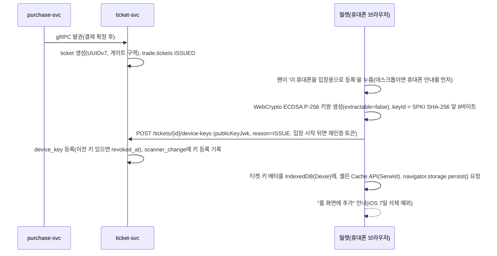
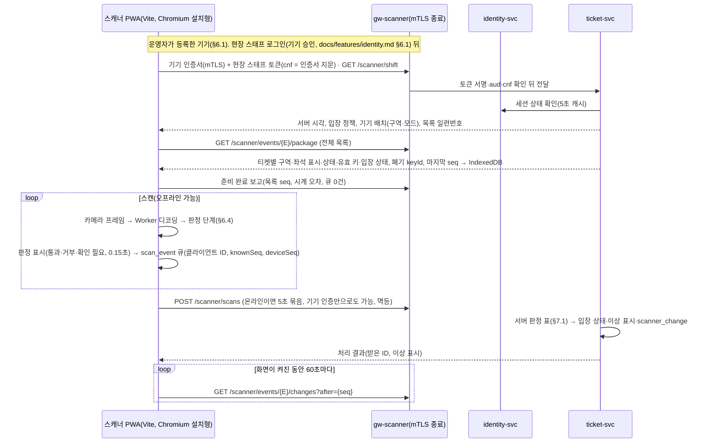

# 기능 설계: 모바일 티켓(회전 QR)·오프라인 게이트 입장

- **독자와 용도**: ticket-svc, 모바일 월렛(설치형 앱처럼 쓰는 소비자 웹 앱인 PWA), 현장 게이트 검표 스캐너 PWA를 만드는 엔지니어가 다음을 확인할 때 참고한다: 공연 당일 타임라인, 스캐너 기기 등록과 근무 준비, 입장용 휴대폰 등록과 15초 회전 QR 규격, 오프라인 로컬 판정 단계, 목록·변경분 동기화와 입장 상태 공유, 서버 입장 판정과 이상 표시, 현장 예외 절차, 입장 기록 마감, 양도·취소 때의 키 폐기 절차, 검증 테스트 포인트. 현장 스태프 초대와 기기 승인 로그인은 docs/features/identity.md §6.1, 보안 요구사항 판정은 docs/security/asvs/offline-gate.md에 있다.
- **원문 출처**: 설계서 §6 <오프라인 전략>, 설계서 §3, 설계서 §9 게이트 입장 판정 SLO와 Degraded Mode, 설계서 §10 K10, 12장(Web Worker 및 Background Sync 아키텍처), [ADR-0025](../adr/0025-rotating-qr-device-key-signature.md), [ADR-0051](../adr/0051-gate-process-end-to-end.md), POL-017·018. 공연 당일 타임라인, 기기 등록, 입장 상태 공유, 서버 판정 표, 현장 예외 절차, 입장 기록 마감은 2026-10-13 현장 입장 검토(소유자 승인, ADR-0051)에서 더했다.
- **기준 기획 버전**: v1.0.
- **관련 ID**: FR-012, FR-013(키 교체), FR-035, FR-036, FR-046, FR-047(취소 시 키 폐기), FR-059(양도 회수 키 교체), FR-060(양도 수락·돌려주기), FR-065(스캐너 기기 등록·폐기), FR-066(현장 운영), FR-067(입장 판정·마감) · NFR-010, 019, 020, 025 · POL-017, 018, 031, 032, 038 · SCR-013, 014, 017, 029, 033, 034, 035, 036, 037, 041, 050, 051, 052, 053 · CMP-029 RotatingQR, CMP-041 ScanResult · API(프로그램끼리 요청과 응답을 주고받는 창구) `/v1/tickets/*`, `/v1/scanner/*`, `/v1/ops/scanner-devices*` · 이벤트 `trade.tickets` · 데이터 docs/data.md §2 ticket·device_key·scan_event·scanner_device·scanner_placement·scanner_change·gate_flag·booth_authorization.

## 0. 공연 당일 타임라인(ADR-0051)

| 시각 | 누가 | 무엇을 | 화면 |
| --- | --- | --- | --- |
| 회차 며칠 전 | 운영자 | 스캐너 기기를 등록하고 파트너에게 배정한다. 관리 앱이 기기 인증서를 넣는다(§6.1) | SCR-053 |
| 회차 며칠 전 | 파트너 | 현장 스태프·현장 책임자를 초대한다(한 번에 여러 명). 기기 배치 초안(구역·모드)을 만들고, 구역별 권장 기기 수를 확인한다 | SCR-037 |
| 초대 뒤 24시간 안 | 현장 스태프 | 본인확인을 마친 계정과, 초대 이메일과 같은 검증 이메일로 초대를 수락하고 동의 항목 두 개에 동의한다 | SCR-050 |
| 입장 시작 24시간 전 | 시스템 | 입장용 휴대폰 등록이 없는 티켓의 팬에게 등록 안내를 보낸다(§2) | — |
| 입장 시작 3시간 전 | 현장 스태프 | 역할이 유효해진다. 스캐너 QR을 휴대폰으로 열어 확인 코드를 맞춰 보고 승인한다 | SCR-036, SCR-051 |
| 로그인 직후 | 스캐너 | 근무 준비: 배치 확인, 목록 전체 받기, 시계 보정, 화면 꺼짐 방지, 준비 완료 보고(§6.2) | SCR-033 |
| 입장 시작 30분 전 [가정] | 현장 책임자·파트너 | 준비 점검: 모든 기기 준비 완료, 예비 기기 로그인·목록 받기, 부스 회선 확인 | SCR-052, SCR-037 |
| 입장 시작 | 시스템 | 소유권 동결: 돌려주기·양도 수락·양도 회수를 막고, 재발급은 부스에서만 한다(§5) | — |
| 입장 중 | 스캐너·현장 책임자 | 판정(§6.4), 업로드(§6.5), 60초 변경분(§6.3). 책임자는 이상 표시 확인(§7.2), 부스 재발급·예외 통과(§9.1) | SCR-034, SCR-035, SCR-052 |
| 공연 종료 2시간 뒤 | 시스템 | 역할의 유효 기간이 끝난다. 스캐너 세션이 끝나고, 남은 기록은 기기 인증으로 올라간다(§6.5) | — |
| 그 뒤 24시간 [가정] 안 | 시스템 | 입장 기록을 마감하고, 취소 접수 티켓 환급과 이상 표시를 확정하며, 보고하지 않은 기기는 CS 처리함으로 넘긴다(§7.3) | SCR-029, SCR-045 |

- **스캐너 대수 산정**: 필요 대수 = 가장 붐비는 구간의 도착률(명/분) ÷ 1대 처리량(명/분) × 1.2 [가정]. 1대 처리량은 판정 뒤 다음 스캔까지의 시간(SCR-034 초기화 2초 [가정])과 관객이 휴대폰을 대는 시간을 합친 값으로, Phase 5 현장 시험(wbs 5.7.1)에서 잰다. 측정 전 예시: 5만 명 중 절반이 마지막 30분에 오면 분당 약 830명이다. 1명에 3~4초가 걸리면 1대가 분당 15~20명을 처리하므로, 42~56대와 예비가 필요하다. NFR-010의 '게이트당 분당 60명'은 판정 지연을 재는 부하 조건이지, 처리량 계획이 아니다.

## 1. 개요: 구매는 온라인 전용, 입장은 오프라인 우선

| 서비스 영역 | 네트워크 단절(오프라인) 시 시스템 동작 | 핵심 구현 기술 |
| --- | --- | --- |
| 예매 구매 여정 (대기열·좌석·결제) | 결제 버튼을 사유와 함께 바로 비활성화한다. 잠깐 끊겼다가 돌아오면 대기표의 HMAC(비밀 키로 만든 위조 확인용 값) 서명으로 순번을 그대로 지킨다. | `navigator.onLine` 감지 + 폴링(정해진 간격으로 다시 물어보는 방식) 실패 감지, 무상태 대기표 서명 |
| 모바일 월렛 (관람객 팬) | 웹앱 셸과 티켓 데이터가 단말기에 늘 들어 있어 바로 열린다. 회전 QR은 인터넷 없이 기기 안에서 실시간으로 만든다. | 서비스 워커 + Cache API(Serwist), IndexedDB(브라우저 안에 데이터를 저장하는 곳, Dexie), WebCrypto API |
| 게이트 스캐너 (현장 스태프) | 단말기 안의 회차 목록으로 서명을 그 자리에서 검증해 0.15초 이내에 판정한다. 스캔 기록은 로컬 큐에 쌓아 두었다가 연결되면 바로 올린다. 화면이 켜진 동안 60초마다 변경분을 받는다. | IndexedDB, Web Worker, 앱 타이머, 일회성 Background Sync(업로드 예비) |
| 찜하기 | 기기 안 대기열(localStorage `peaket.wishQueue`)에 쌓아 두었다가, 다시 온라인이 되면 자동으로 한꺼번에 다시 보낸다(docs/frontend.md §3.12). | 화면의 온라인 복귀 감지와 재전송(서비스 워커는 월렛 범위 `/my/tickets/`만 쓴다, ADR-0079 결정 18) |
| 사용자 화면 알림 | 화면 위쪽에 오프라인 상태 배너와 마지막으로 정상 동기화한 시각을 분명히 표시한다. | Service Worker(브라우저 뒤에서 오프라인 동작과 캐시를 맡는 스크립트) 상태 이벤트 감지 |

### 핵심 아키텍처 원칙: 구매와 입장의 제어 분리
- **구매 여정 (중앙 집중 온라인 전용)**: 동일 좌석의 다중 동시성 경합을 해결하기 위해 중앙 서버가 좌석마다 Redis 홀드와 PostgreSQL 활성 상태 부분 유니크 인덱스로 한 명의 구매만 승인한다(docs/features/seat-hold.md §3·§6).
- **현장 입장 (로컬 우선 오프라인 자율)**: 수만 명이 밀집하여 기지국이 포화되거나 네트워크가 전면 단절되더라도, 현장 게이트가 멈추지 않고 입장이 지속되어야 한다(QR-SA-1 페일 세이프 원칙 준수).
- **단말 로컬 실시간 판정**: 단말기 브라우저 WebCrypto ECDSA P-256 서명 기반 15초 회전 QR과 스캐너 로컬 DB(IndexedDB) 검증을 결합하여, 통신이 끊겨도 위변조를 판정한다. 목표는 단말 안 판정 p95 0.15초 이하다(NFR-010, K10). 같은 티켓의 중복 입장은 두 스캔 기록이 모두 서버에 올라온 뒤에 찾으며, 올라오지 않은 기록은 찾지 못한다(§7.1, ADR-0051).

## 2. 발권, 입장용 휴대폰 등록과 기기 키(FR-012, ADR-0025, ADR-0051)

- 개인키는 WebCrypto API로 `extractable=false` 비대칭 키쌍을 만들어 브라우저 IndexedDB에 둔다. 페이지 스크립트는 키를 꺼낼 수 없다. 하지만 키는 브라우저 프로필 안의 소프트웨어 키이고, 하드웨어 보관(Secure Enclave·Android Keystore)이 아니다. 일반 사용자가 다른 기기로 옮기기는 어렵지만, 루팅한 기기나 데스크톱 브라우저 프로필을 복사하면 옮길 수 있다(ADR-0050 결정 1). 중앙 서버에는 검증용 공개키만 등록된다.
- 대칭키(시간에 따라 새로 만드는 일회용 코드인 TOTP의 공유 비밀값) 방식을 쓰지 않는 이유: 스캐너 단말기에 검증용 대칭 비밀키를 저장하면, 스캐너를 잃어버렸을 때 티켓을 대량으로 위조하는 데 악용될 위험이 있다. 비대칭 공개키 구조에서는 스캐너가 '티켓 ID → 공개키' 목록만 가지고 서명을 혼자 검증한다. 그래서 스캐너를 잃어버려도 그 안의 정보로는 QR을 위조할 수 없다.
- **입장용 휴대폰 등록(ADR-0051 결정 10)**: 월렛은 티켓을 처음 열 때 키를 몰래 만들지 않는다. '이 휴대폰을 입장용으로 등록'을 눌러야 만든다.
  - 데스크톱 브라우저로 보이면 '입장 QR은 휴대폰에서 등록하세요'를 먼저 보인다. PC로 예매하고 PC에서 월렛을 연 뒤 공연 당일 휴대폰으로 처음 열면, 재발급으로 처리되어 한도(ADR-0050)에 걸리기 때문이다. 사용자가 원하면 데스크톱에서도 등록할 수 있다.
  - iOS는 홈 화면에 추가한 앱에서 등록하라고 안내한다. Safari와 홈 화면 앱이 저장소를 따로 쓰는지는 [가정, wbs 5.1.3 PoC에서 확인]이다.
  - 입장 시작 뒤의 첫 등록(ISSUE)은 소셜 제공자 재인증을 받고, 계정 이메일로 알린다. 판매자가 월렛을 한 번도 열지 않은 채 계정을 넘기면, 산 사람의 첫 등록은 부스 확인을 거치지 않는다(남는 한계). 입장 시작 뒤 첫 등록 비율을 지표로 본다.
  - 입장 시작 24시간 전까지 등록이 없는 티켓은 팬에게 등록 안내를 보낸다(FR-040).
- 공식 티켓 연동 부가 상품(주차권, MD 수령권 등)도 같은 모바일 월렛 안에 티켓과 나란히 안전하게 발급된다(FR-014).

## 3. 회전 QR(POL-018)

| 통제 항목 | 세부 아키텍처 및 구현 규격 |
| --- | --- |
| 페이로드 스키마(QR v1, ADR-0051 결정 7) | 형식 버전(1바이트) ‖ 티켓 ID(UUIDv7, 16바이트) ‖ keyId(8바이트, 공개키 SPKI의 SHA-256 앞 8바이트) ‖ 시각(4바이트, UNIX 초) ‖ 서명(64바이트, ECDSA P-256 IEEE P1363). 서명 대상은 `"PEAKET-QR-v1" ‖ 티켓 ID ‖ keyId ‖ 시각`이다. 전체는 약 93바이트다. 문자 인코딩(base45 등)과 QR 오류 정정 수준은 wbs 5.1.3 PoC(본 개발 전에 위험한 부분만 먼저 만들어 확인하는 시험)에서 인식 시간을 재어 정한다. 형식 버전이 있어 나중에 규격을 바꿀 수 있다. |
| 키 증명(선택, PoC 뒤 결정) | 서버가 {티켓 ID, keyId, 공개키, 유효 끝}에 서명한 값(약 110바이트 [가정])을 QR에 붙이면, 변경분을 아직 못 받은 오프라인 스캐너도 입장 직전에 등록된 키를 검증할 수 있다. QR이 약 두 배로 촘촘해지므로, wbs 5.1.3에서 인식 시간·실패율을 재고 정한다. 채택하면 '키 증명 서명 키'를 secrets-and-keys에 넣는다. |
| 주기적 자체 갱신 | 네트워크 연결과 상관없이 브라우저 Web Worker 안에서 15초마다 새 타임스탬프로 QR 코드를 실시간으로 다시 계산해 화면에 그린다(Ticketmaster SafeTix의 동적 바코드 방식을 참고했다). |
| 클라이언트 시계 보정 | 모바일 월렛과 스캐너 단말기 모두 마지막으로 온라인에 연결됐을 때 서버와의 시계 차이(Clock Offset)를 밀리초 단위로 재어, 로컬 시각을 자동으로 보정한다. |
| 스캐너 유효성 허용 창 | 스캐너는 QR에 든 타임스탬프가 자기 보정 시각 기준 앞뒤 ±30초 범위 이내일 때만 유효하다고 판정한다. 허용 창이 넓을수록 정적 스크린샷 캡처본을 악용할 수 있는 시간이 길어진다. 그래서 현장에서 잰 오차 분포에 맞춰 엄격하게 미세 조정한다. |
| 스크린샷 캡처본 차단 | 허용 창(±30초)을 벗어난 정적 캡처본 QR 코드는 스캐너 검표 단계에서 바로 거절된다("유효시간이 지난 QR입니다", §6.4). |
| 관람객 화면 사용자 경험 | 화면에 들어오면 디스플레이 밝기를 올리라고 안내하고(웹에는 밝기를 바꾸는 표준 API가 없다. W3C screen-wake-lock 이슈 #129가 아직 열려 있는 요청이다), 화면 꺼짐 방지(Screen Wake Lock)를 건다. OS 저전력 모드에서도 Worker 타이머를 유지한다. 오프라인 상태 배너와 마지막 동기화 시각을 분명하게 보여 준다(SCR-013, CMP-029). |

- 알려진 한계(2026-10-13, 소유자 요청 암호 검토, ADR-0050 결정 1): 회전 QR은 화면 공유나 영상통화로 QR을 실시간 중계하는 경우를 막지 못한다(늘 새 QR이 보인다). 계정을 넘겨받은 사람이 입장 시작 전에 재발급하는 경우(티켓당 24시간에 1회)와 루팅 기기·데스크톱 프로필 복사로 키를 옮기는 경우도 막지 못한다. 이 경우는 입장 상태 공유, 서버 판정의 이상 표시와 현장 확인 스캔(§7)에 기댄다. 하지만 두 사람이 모두 유효한 QR을 내면 확인 스캔으로도 가리지 못한다. 키를 하드웨어에 묶는 것은 네이티브 월렛에서만 되는데, PWA 방침(NFR-019)과 부딪혀 하지 않는다.
- 알려진 한계(2026-10-15, 웹 앱 보안 검증 항목 ASVS V3 판정, 추천 적용, ADR-0065): 키를 `extractable=false`로 만들면 페이지 스크립트가 키 자체는 꺼내지 못한다. 하지만 월렛과 같은 출처에서 실행되는, 페이지에 끼워 넣은 악성 스크립트(XSS)는 그 키로 서명을 부를 수 있다. 그러면 공격자가 그 사람의 회전 QR을 실시간으로 만들어 다른 곳으로 넘길 수 있다. 이는 위의 '화면 실시간 중계'와 같은 종류의 한계지만, 화면을 보여 주지 않고도 원격에서 이뤄진다. 막는 것은 페이지가 실행할 스크립트의 출처를 정하는 소비자 웹 CSP와, 사용자 입력을 태그로 읽히지 않는 글자(텍스트 노드)로만 그리는 규칙이다(docs/security/asvs/offline-gate.md 3.2.2·3.4.3). 서버 쪽에서는 입장 상태 공유와 이상 표시(§7)가 한 티켓의 중복 입장을 가려낸다. 하지만 넘겨진 QR이 먼저 통과하면, 정당한 사람은 거부당한 뒤에야 알게 된다(재발급 제한과 현장 부스로 처리). 이 방어선인 월렛 셸의 CSP는 서비스 워커가 저장한 셸을 오프라인에서 다시 쓰므로 캐시 화면 묶음(해시(원래 값으로 되돌릴 수 없게 바꾼 고정 길이 값) 방식과 `script-src 'self'`)으로 정했다(추천 적용 2026-10-21, ADR-0079 결정 14, docs/frontend.md §5.14). 다만 해시 방식(SRI)은 실험 기능이라, PoC(wbs 2.10.1)가 실패하면 ADR-0065 되돌릴 조건대로 다시 정한다. planning/01 §5.2에 같은 한계를 적었다.

## 4. iOS Safari 저장소 삭제 대비

- iOS Safari 브라우저에는 ITP(Intelligent Tracking Prevention) 제약이 있다. 사용자가 7일 동안 직접 조작하지 않은 웹사이트의 IndexedDB 데이터와 서비스 워커 캐시 저장소를 자동으로 지우는 규칙이다. 홈 화면에 추가한 웹앱은 Safari와 따로 사용 일수를 세므로, WebKit은 그 데이터가 지워질 것으로 보지 않는다고 밝혔다. 그래서 티켓을 산 직후 모바일 월렛 화면에서 '홈 화면에 추가(PWA 설치)'를 강하게 권하고, `navigator.storage.persist()` API를 불러 영구 저장소 권한을 요청한다(WebKit은 홈 화면 앱인지 같은 휴리스틱으로 허용한다).
- 공연 전날과 당일 아침에 관람객이 모바일 월렛을 미리 열어 보도록 안내 알림을 보낸다. iOS에서 Web Push는 홈 화면에 설치했을 때만 동작하므로, 카카오 알림톡, 이메일, LMS 문자 메시지를 함께 보내 월렛을 열어 두게 한다(FR-040). 여는 것만으로 키를 새로 만들지는 않는다.
- 로컬 티켓 캐시가 사라진 것을 감지하면 재발급 규칙(ADR-0050 결정 2)을 따른다.
  - 입장 시작 전: 소셜 제공자 재인증 뒤 재발급 API로 복구한다(새 키 등록 reason=`REISSUE`, 옛 키는 폐기 목록에 등재). 티켓당 24시간에 1회까지이고 [가정, Phase 5 5.1.2에서 확정], 넘으면 고객센터로 안내한다. 재발급하면 계정 이메일과 이전 기기(웹 푸시)에 알린다.
  - 입장 시작 뒤: 월렛에서 재발급하지 않는다. 현장 부스에서 관객이 휴대폰 본인확인으로 보유 계정과 같은 사람임을 보이면, 현장 책임자가 새 키 등록을 10분 동안 허용한다(§9.1 부스 재발급, ADR-0051 결정 11).
  - 그래서 공연 전날과 당일 아침 안내로 입장 시작 전에 월렛을 열어 두게 한다. 현장 통신이 끊기면 온라인 재발급도 할 수 없다.
- 로그아웃해도 입장 키는 지우지 않는 것이 기본이다. 지우면 다시 등록해야 하고 재발급 한도에 걸리기 때문이다. 공용 기기라면 로그아웃 화면에서 '이 기기의 입장 키도 지우기'를 고른다(ADR-0051 결정 10, ADR-0079 결정 17).

## 5. 양도·예매 취소와 키 교체(FR-013, FR-047, POL-017, POL-032)

- 양도는 수락형이다. 결제자이면서 보유자인 팬이 공연 시작 2시간 전과 입장 시작 중 이른 때까지 양도를 요청하고, 받는 사람(본인확인을 마친 PEAKET 회원)이 수락해야 넘어간다. 수락 기한은 요청 뒤 48시간과 양도 마감 중 이른 때다. 예매 취소와 환불은 공연 시작 직전까지 받되, 결제자가 보유한 티켓만 한다(POL-017·032, ADR-0046). 양도 감사 로그에는 양쪽 계정 ID만 기록해 개인정보 노출을 최소로 줄인다.
- 양도 요청 직전에는 소셜 제공자 재인증을 반드시 받는다(민감 작업 보호). ticket-svc는 데이터베이스의 배타적 행 잠금(`SELECT … FOR UPDATE`)과 낙관적 잠금용 버전 컬럼을 함께 써서, 한 티켓의 양도 요청·수락·돌려주기·회수·취소·스캔 수신 중 하나만 성공하게 한다.
- **입장 중 소유권 동결(ADR-0051 결정 10)**: 입장 시작(`event.entry_opens_at`)부터 입장 기록 마감(§7.3)까지 돌려주기·양도 수락·양도 회수를 막는다(409 `ENTRY_STARTED`). 오프라인 스캐너의 기록이 늦게 올라오는 동안 서버는 누가 들어갔는지 모르므로, '들어간 뒤 돌려주기'로 한 장에 두 명이 들어가는 길을 닫는다. 판정은 티켓 행 잠금 안에서 입장 시작 시각과 함께 확인한다.
- 양도를 수락하면 보낸 사람의 기존 공개키를 바로 폐기 목록(Revocation List)에 올린다. 받는 사람은 입장할 휴대폰에서 '이 휴대폰을 입장용으로 등록'을 눌러 새 ECDSA 키쌍을 만들어 등록한다(reason=`TRANSFER`. 키는 등록 버튼으로만 만든다, ADR-0051 결정 10). 그 뒤 보낸 사람의 스마트폰에 남아 있는 옛 QR 코드는, 스캐너가 변경분을 받은 뒤부터 '양도·취소·재발급된 티켓의 옛 QR'로 거부된다.
- 돌려주기와 승인된 양도 회수는 같은 키 교체를 거꾸로 한다. 받은 사람의 키를 폐기 목록에 올리고, 결제자가 '입장용으로 등록'으로 키를 다시 등록한다(reason=`TRANSFER`). 둘 다 입장 시작 전이고 입장 기록이 없을 때만 실행된다(POL-038).
- 상품 유형별 양도 제한 규칙(VIP 패키지, 얼리버드 티켓 등의 양도 불가 정책)은 상품 메타데이터에서 그대로 물려받아 반드시 적용된다(POL-016). 예매 취소가 확정되면 계정별 1인 보유 수가 바로 줄고, 그 티켓의 공개키는 곧바로 폐기 목록으로 옮겨진다.
- 공연 입장이 시작된 뒤에 접수된 예매 취소 요청은 티켓 키를 바로 폐기 목록에 올리되, 실제 금융 환불은 입장 기록 마감(§7.3)까지 보류한다. 통신이 늦은 오프라인 스캐너가 그 티켓을 입장 통과시켰다면, 기록이 올라올 때 '취소 뒤 입장' 이상 표시가 붙는다. 그러면 CS가 확인해 그 예매 취소를 무효로 확정한다(POL-032).
- 게이트 스캐너는 근무 준비 때 회차 목록 전체를 받고, 화면이 켜져 있는 동안 60초마다 변경분을 받는다(§6.3). 그래서 양도 직후 양도인이 옛 QR로 입장하려 하면, 온라인 스캐너에서는 약 1분 안에 거부되기 시작한다. 그 사이에 통과한 건은 두 기록이 모두 서버에 올라오면 서버 판정 표(§7.1)가 찾아내지만, 올라오지 않은 기록은 찾지 못한다. 이 1분은 스캐너가 계속 동기화할 때만 지켜진다. 그래서 관제는 입장 시간대에 스캐너별 마지막 동기화 뒤 지난 시간과 폐기 목록 버전 차이를 지표로 본다. 2분 [가정, Phase 5 현장 시험에서 확정]을 넘은 스캐너가 있으면 SEV2(장애 심각도 등급. 숫자가 작을수록 심각하다)와 현장 책임자 알림(그 구역 책임자 스캐너 SCR-052와 파트너 콘솔, ADR-0051)을 낸다. 판정은 오프라인으로 계속한다(ADR-0049, docs/observability.md §5).

## 6. 스캐너 PWA(FR-035·036·065·066)

### 6.1 스캐너 기기 등록·폐기(FR-065, ADR-0051 결정 1)

- 운영자(operator 이상)가 관제 콘솔 '스캐너 기기 관리'(SCR-053)에서 기기를 만든다(기기 이름, 배정 파트너). 관리 앱(Android Enterprise 기기 관리)이 기기 안에서 키쌍을 만들고 PEAKET 스캐너 사설 CA 인증서를 받는다. 개인키가 기기 밖으로 나오지 않게 하는 것이 목표다 [PoC로 확인].
- 기기는 한 파트너(`promoter_id`)에 묶인다. 그 파트너 공연에 배정된 스태프만 그 기기로 로그인한다.
- 인증서 수명은 30일 [가정, wbs 5.4.3 PoC에서 확정]이고, 만료 7일 전에 관리 앱이 갱신한다. 회차마다 재발급하지 않는다. 회차 범위는 스태프 세션과 기기 배치(§6.2)가 정한다. 만료까지 7일 이하 남은 인증서는 T-30분 점검의 필수 항목 실패다(ADR-0049).
- 폐기는 operator가 SCR-053에서 사유와 함께 바로 한다. 스캐너 API는 요청마다 기기 상태(ACTIVE)를 확인하므로, 다음 요청부터 거부되고 그 기기의 스태프 세션도 끝난다. 분실·도난 절차는 RB-22다(docs/infra.md §10).
- 스캐너 통신 경로는 CloudFront CDN(AWS가 사용자 가까운 곳에 파일을 복사해 두고 대신 응답하는 전송망)을 거치지 않는다. AWS NLB의 TCP 통과로 gw-scanner 엔드포인트(API를 부르는 주소)에 바로 이어지고, 그곳에서 mTLS(양쪽이 서로 인증서를 확인하는 TLS)를 종료한다.
- **화면 호스트(추천 적용 2026-10-15, ADR-0065 결정 1·10)**: 스캐너 PWA는 `scanner.peaket.example`에서 정적 앱으로 내고, 이 호스트는 mTLS를 요구하지 않는다. API는 `scanner-api`(`gw-scanner`)가 mTLS로 받으므로, PWA에서 API로 가는 요청은 교차 출처다. 스태프 토큰(권한을 증명하는 서명된 문자열)을 IndexedDB에 두는 앱이라, 소비자 웹 호스트·경로 아래에 두지 않는다(docs/infra.md §4.1, ASVS 3.5.4). `gw-scanner`의 CORS(다른 주소에서 온 요청을 브라우저가 허용할지 정하는 규칙) 허용 출처는 PWA 출처 하나이고, `*`를 쓰지 않는다.
- **기기 인증만 요구하는 쓰기 경로의 위조 요청 방어(추천 적용 2026-10-15, ADR-0065 결정 10)**: 기기 인증서는 브라우저가 연결에 알아서 싣는 자격 증명이다. 그래서 인증서만 요구하는 쓰기 경로 셋(`POST /v1/scanner/device-authorizations`·`token`·`scans`)은 쿠키(브라우저가 사이트별로 저장했다가 요청마다 함께 보내는 작은 값) 경로처럼 다룬다. 세 경로는 `Content-Type: application/json`만 받고(그 밖은 415), `Origin`이 스캐너 PWA 출처(`https://scanner.peaket.example`)인지 확인한다(없거나 다르면 403, 입구 서버인 게이트웨이의 공통 규칙 docs/architecture.md §4). 본문이 필요 없는 기기 승인 요청도 빈 객체 `{}`를 JSON으로 보낸다. 사전 요청 없는 양식 POST로 확인 코드를 발급시키거나, 올라온 기록을 위조해 넣지 못하게 하려는 것이다. 현장 스태프 토큰은 `Authorization` 헤더이고 대안 B의 DPoP 증명은 `DPoP` 헤더라서, 다른 사이트의 요청에 저절로 실리지 않는다.
- **관리형 크롬의 URL 허용 목록 [가정, wbs 5.4.3에서 확인]**: 스캐너 기기의 크롬은 관리 앱 정책으로, 열 수 있는 주소를 스캐너 PWA 주소와 부스 본인확인 등 현장에서 필요한 주소로 줄인다. 기기의 브라우저가 낯선 사이트를 열 수 없으면, 다른 사이트가 기기 인증서가 자동으로 실리는 요청을 일으킬 길 자체가 줄어든다(위 `Origin`·`Content-Type` 확인보다 앞에 두는 통제이며, 그것을 대신하지 않는다). 정책 이름, Android 지원 여부, 서비스 워커 요청에도 적용되는지는 크롬 엔터프라이즈 정책 원문으로 PoC에서 확인한다(이 설계를 쓴 날에는 원문을 확인하지 못했다).
- PoC(wbs 5.4.3): 관리형 Android 기기와 크롬 설치형 PWA로 다음을 확인한다. ① 사람에게 인증서 선택 창을 띄우지 않고 고르는가(크롬 정책 `AutoSelectCertificateForUrls`는 Android 143부터 지원하고, 크롬이 직접 프로비저닝한 인증서만 고른다. OS 인증서라면 관리 앱이 인증서 선택에 자동으로 답해야 한다) ② 서비스 워커가 보내는 업로드에도 인증서가 실리는가 ③ 갱신 중 끊김이 없는가 ④ 폐기가 몇 초 안에 반영되는가 ⑤ 스캐너 PWA(`scanner.peaket.example`)에서 `scanner-api`로 가는 교차 출처 요청(`fetch`와 서비스 워커 업로드)에도 기기 인증서가 실리고, 응답을 PWA가 읽을 수 있는가(교차 출처 요청의 자격 증명 모드에 따라 인증서가 실리는지가 달라지는지, 그렇다면 응답에 필요한 `Access-Control-Allow-Origin`·`Access-Control-Allow-Credentials` 값은 무엇인지. 추천 적용 2026-10-15, ADR-0065 결정 10). 하나라도 안 되면 대안 B로 간다. 대안 B에서는 기기 등록 때 스캐너 PWA가 WebCrypto 키(ECDSA P-256, `extractable=false`)를 만들고, SCR-053의 등록 코드(RFC 8628 §6.1 문자 집합 12자 `XXXX-XXXX-XXXX`, 10분 [가정] 1회용, 서버는 SHA-256만 메모리에 데이터를 두는 빠른 저장소인 Redis에 보관, QR은 `#code=` 조각. 추천 적용 2026-10-14, ADR-0062)로 기기 기록에 묶는다(`POST /v1/scanner/device-enrollments`, 출발지 IP당 10분 10회, 전체 실패 10분 100회를 넘으면 10분 닫고 SEV3 [가정]). 요청마다 DPoP(RFC 9449) 증명을 붙인다. 스태프 토큰은 인증서 지문 대신 그 키 지문(`cnf.jkt`)에 묶는다. B의 키는 소프트웨어 키라, 기기 결속이 월렛 키만큼 약하다.

### 6.2 로그인, 근무 준비, 기기 배치(FR-046, FR-066, ADR-0051 결정 3·5)

- 로그인은 기기 승인(docs/features/identity.md §6.1)이다. 확인 코드는 8자다. 기기와 계정마다 활성 세션은 하나이고, 같은 기기에서 새로 승인하면 이전 세션이 끝난다(교대).
- 초대 수락(SCR-050)과 스캐너 승인(SCR-051)은 소비자 웹의 `/staff/*` 정적 셸에서 클라이언트가 그린다(docs/architecture.md §6.3). 초대 토큰(`#token=`)과 확인 코드(`#code=`)는 URL 조각에만 담는다. 화면 스크립트가 읽은 뒤 바로 주소창에서 지우고, 로그인 뒤 돌아갈 주소(`next`)에는 넣지 않는다. 토큰은 그 탭의 세션 저장소에 잠시 두었다가 조회 경로의 본문으로 보낸다. 자세한 규칙과 시험은 docs/features/identity.md §6.1·I-T47에 있다(추천 적용 2026-10-15, ADR-0065 결정 10).
- 근무 준비(SCR-033): `GET /v1/scanner/shift`로 서버 시각·입장 정책·기기 배치·목록 일련번호를 받는다. 이어서 전체 목록을 내려받고, 시계 오차를 재고, 화면 꺼짐 방지(Screen Wake Lock)를 건 뒤 준비 완료를 보고한다(`PUT /v1/scanner/shift/readiness`, ADR-0081). 배치가 없으면 스캔으로 넘어가지 않는다.
- 앱 갱신: 새 스캐너 버전(서비스 워커)은 근무 준비 때만 적용하고, 입장 시간에는 미룬다. 입장 도중에 판정 코드가 바뀌지 않게 하려는 것이다. gw-scanner는 최소 지원 버전을 알리되, 입장 시간에는 옛 버전을 거부하지 않는다(docs/devops.md §6.6, ADR-0054).
- 기기 배치는 그 회차에서 그 기기의 게이트 구역과 모드(입장 IN·퇴장 OUT)다. 파트너(SCR-037 현장 운영 탭)나 현장 책임자(SCR-052)만 정하고, 일반 스태프는 바꾸지 못한다. 퇴장 모드는 재입장 허용 회차에서만 배치할 수 있다(그 밖은 422). 배치 변경은 온라인에서만 되고, 변경분으로 그 기기에 전달된다. 오프라인에서 구역을 바꿔야 하면 기기를 바꾼다(남는 한계).
- 재입장 허용 여부는 회차별 입장 정책 속성(`event.reentry_allowed`, 기본값: 불허)으로 정하고, 목록과 변경분에 실어 전달한다(POL-018). 오픈 뒤에는 시스템 안정성을 위해 불허 → 허용 방향으로 푸는 것만 지원한다.

### 6.3 목록과 변경분, 입장 상태 공유(FR-035·036, ADR-0051 결정 6)

- 전체 목록 `GET /v1/scanner/events/{eventId}/package`: 회차 정보(입장 정책, 구역 목록, 서버 시각), 티켓마다 {티켓 ID, 구역, 좌석 표시, 상태, 유효 키(keyId, 공개키), 입장 상태(마지막 방향·시각·기기)}, 폐기된 keyId 목록, 마지막 변경 일련번호. 개인정보(이름·연락처)는 넣지 않는다. 회차마다 미리 만들어 두고, 기기당 분당 3회 [가정]까지 받는다. 압축 JSON으로 시작하고, 5만 장 기준 크기를 wbs 5.4.4에서 잰다(목표 5MB 이하 [가정]).
- 변경분 `GET /v1/scanner/events/{eventId}/changes?after={seq}`: 회차별 변경 기록(ticket DB `scanner_change`, 서버가 매기는 일련번호)에서 그다음부터 준다. 종류는 키 등록·폐기, 티켓 상태, 다른 스캐너의 입장 상태, 입장 정책, 기기 배치, 이상 표시, 그 기기 세션의 종료다. 시각 대신 일련번호를 쓰고, 일련번호를 커밋 순서대로 매기므로 변경이 빠지지 않는다.
- 일련번호 매기기(추천 적용 2026-10-22, ADR-0086 결정 3): DB 시퀀스로 매기지 않는다. 변경을 적는 트랜잭션 안에서 회차별 카운터 표 `scanner_seq`(회차 ID, 마지막 번호)의 행을 `UPDATE … RETURNING`으로 올려 받는다. 행 잠금이 커밋까지 이어지므로 번호 순서와 커밋 순서가 같다. 시퀀스로 매기면 번호를 먼저 받은 트랜잭션이 나중에 커밋될 수 있다. 그러면 더 큰 번호를 먼저 받아 간 스캐너가 작은 번호의 변경을 놓친다. 현장 업로드는 회차당 초당 수십 건 [추정]이라 이 잠금의 대기는 부하 시험에서 잰다. 변경 기록의 `payload`에는 판 번호 `v`를 넣고, 종류별 모양을 판마다 정한다.
- 주기: 스캐너 화면이 켜져 있는 동안 앱 타이머로 60초마다 받고, 네트워크가 돌아오면 바로 받는다. 주기적 백그라운드 동기화(Periodic Background Sync)는 크롬의 최소 간격이 12시간이라 쓰지 않는다(Chromium `background_sync_parameters.cc`).
- 입장 상태 공유: 다른 스캐너의 입장 기록은, 그 스캐너가 기록을 올리고 이 스캐너가 변경분을 받은 뒤에야 안다(둘 다 온라인이면 약 1~2분 [가정]). 오프라인 스캐너는 마지막 변경분 뒤의 입장을 모른다.
- 두 칸 버전 벡터: 판정마다 (`knownSeq` 그 판정 때 반영한 서버 변경 일련번호, `deviceSeq` 그 기기의 일련번호)를 남긴다. 모든 스캐너가 서버 하나와만 동기화하므로, 이 두 값으로 '판정 때 다른 기록을 알았는가'를 정할 수 있다(§7.1).

### 6.4 현장 판정 단계(FR-035, ADR-0051 결정 6·7)

순서대로 실행한다. 판정 중 예외가 나면 통과가 아니라 '다시 찍어 주세요'로 끝낸다(fail-closed).

1. QR 디코딩 실패 또는 지원하지 않는 형식 버전 → 거부 (유효하지 않은 QR)
2. 티켓 ID가 회차 목록에 없음 → 거부 (다른 회차이거나 발권되지 않은 티켓)
3. 티켓 상태가 취소 접수·환급·무효(VOIDED) → 거부 (취소되었거나 무효가 된 티켓)
4. keyId가 폐기 목록에 있음 → 거부 (양도·취소·재발급된 티켓의 옛 QR)
5. keyId가 그 티켓의 유효 키가 아님 → 거부 (키 미반영: 입장 직전에 등록한 키를 스캐너가 아직 모른다. 부스나 책임자에게 안내한다. 키 증명을 채택하면 증명을 검증해 통과시킬 수 있다)
6. 서명 검증 실패 → 거부 (위조 의심)
7. 타임스탬프가 자체 보정 시각 기준 ±30초를 벗어남 → 거부 ("유효시간이 지난 QR")
8. 티켓 구역과 기기 배치 구역이 다름 → 거부 + 올바른 게이트 위치 음성·화면 안내
9. 입장 상태 확인(이 기기 기록과 변경분):
   - 입장 모드, 재입장 불허 회차, 입장 기록 있음 → 거부 ("이미 입장한 티켓", 시각·구역 표시)
   - 입장 모드, 재입장 허용 회차, 마지막 방향이 IN → 확인 필요(황색, "퇴장 기록 없음"). 책임자 예외 통과가 아니면 들여보내지 않는다
   - 퇴장 모드, 마지막 방향이 OUT이거나 입장 기록 없음 → 확인 필요(황색, "입장 기록 없음")
10. 모든 검증 통과 → 0.15초 이내에 통과 화면(녹색, 아이콘·글자)과 통과음·진동

- 거부와 확인 필요도 기록한다(§6.5). 오거부율(NFR-010)을 잴 때는 '거부 뒤 10분 [가정] 안에 같은 티켓이 정상 통과'한 경우를 오거부 후보로 센다.
- 검표 스캔 이벤트에는 로그인한 현장 스태프의 계정 식별자를 기록한다. 예외 통과와 확인 스캔은 현장 책임자(`gate_lead`) 세션에서만 보인다(POL-031, §9.1).
- 스캐너 단말기가 스스로 내보내는 운영 신호(텔레메트리): 로컬 판정 지연시간 p95(백 건 중 아흔다섯 건이 이 시간 안에 끝난다는 뜻)와 사유별 거부율 통계를 업로드할 때 백엔드로 함께 보낸다(NFR-010 계측).

### 6.5 스캔 기록과 업로드(FR-036, ADR-0051 결정 9)

- 스캔 기록 필드: 클라이언트 ID(UUIDv7, 멱등), 티켓 ID, 기기 ID, 스캐너 세션 ID, 방향(IN·OUT), 방식(QR·예외 통과·확인 스캔), 판정(통과·거부·확인 필요), 사유 코드, 구역, keyId, QR 시각, 보정 시각, 시계 오차, `knownSeq`, `deviceSeq`. 스태프 계정과 역할은 서버가 세션으로 정한다(클라이언트 값은 쓰지 않는다). 확인 스캔은 입장 상태를 바꾸지 않는다.
- 사유 코드: `INVALID_QR`, `UNSUPPORTED_VERSION`, `UNKNOWN_TICKET`, `TICKET_CANCELLED`, `KEY_REVOKED`, `KEY_UNKNOWN`, `BAD_SIGNATURE`, `QR_EXPIRED`, `WRONG_ZONE`, `ALREADY_IN`, `NO_EXIT_RECORD`, `NO_ENTRY_RECORD`, `VERIFY_ONLY`, `OVERRIDE_<사유>`.
- 업로드: 온라인이면 앱이 판정 뒤 5초 [가정] 묶음(최대 500건 [가정])으로 바로 보낸다. 연결이 끊겼다가 돌아오면 바로 보내고, 일회성 Background Sync는 예비다. 크롬의 일회성 동기화는 3번 시도한 뒤 포기하므로(첫 재시도 5분, 배수 3), 화면이 다시 켜지면 앱이 다시 보낸다.
- `POST /v1/scanner/scans`는 기기 인증(mTLS, 대안 B는 DPoP)만 요구하고, 스태프 토큰은 선택이다. 그래서 로그아웃·교대·해제·만료 뒤에도 큐가 올라간다. 서버는 기록마다 '그 시각에 그 세션이 유효했는가'를 보고, 아니면 '세션 밖 기록'으로 표시한다(버리지 않는다). 온라인이면 앱은 로그아웃 전에 큐를 비운다.
- 폐기된 기기는 TLS(통신을 암호화하는 표준) 단계에서 막혀 기록을 올리지 못한다. 회수한 기기는 재등록한 뒤 남은 기록을 올리고, 폐기 시각 뒤의 기록은 '세션 밖 기록'으로 표시한다.

## 7. 중복 입장: 공유하고, 서버가 판정하고, 현장이 확인한다(FR-036·067)

- **구역 분리**: 좌석을 등록할 때 티켓마다 입장 게이트 구역(동문, 서문 등)을 반드시 지정하게 해서(좌석맵 에디터, FR-023), 다른 구역 스캐너에 찍힌 티켓을 거절한다. 이렇게 다른 구역 문에서의 동시 입장을 막는다. 같은 구역 안에서는 입장 상태 공유와 서버 판정에 기댄다. 서로 다른 문의 기기를 같은 구역으로 두는 실수는, 기기 배치를 책임자만 바꾸게 해서 줄인다.
- **입장 상태 공유**: 온라인 스캐너는 다른 스캐너의 입장을 변경분으로 받아, 두 번째 입장을 현장에서 거부한다(§6.3).
- **서버 판정**: 기록이 올라오면 서버가 판정 표(§7.1)로 다시 판정해 이상 표시를 만든다.
- **재입장 정합성 제어**: 재입장을 허용한 회차에서는 반드시 '퇴장 스캔(OUT) → 재입장 스캔(IN)'의 순서를 지켜야 한다. 다른 기기에서 한 퇴장도 변경분으로 공유되므로, 서로 다른 기기에서 한 퇴장·재입장은 정상으로 판정된다.

### 7.1 서버 판정 표(ADR-0051 결정 8)

| 상황 | 판정 |
| --- | --- |
| 재입장 불허 회차에서 같은 티켓의 통과 기록이 둘 이상 | 보정 시각이 가장 이른 입장만 정상이고, 나머지는 '중복 입장' 이상 표시를 단다. 나중 기록의 `knownSeq`가 앞 기록이 변경 기록에 실린 일련번호보다 작으면 '몰랐음(동시)', 크거나 같으면 '알고도 통과'로 본다(책임자 예외 통과가 아니면 앱 오류·남용 의심) |
| 재입장 허용 회차 | 보정 시각 순으로 IN·OUT이 번갈아 나와야 정상이다. IN 다음에 IN이 오면 '퇴장 기록 없음' 이상 표시를 단다 |
| 취소 접수(입장 시작 뒤 취소) 뒤의 입장 | '취소 뒤 입장' 이상 표시(POL-032) |
| 기록 시각이 그 세션의 유효 구간 밖 | '세션 밖 기록' 이상 표시. 버리지 않는다 |
| 입장 기록 마감 뒤 도착 | 받고 '마감 뒤 도착' 이상 표시 |
| 책임자 예외 통과 | 정상으로 받고 사후 검토 목록에 올린다 |
| 기기 시계가 마지막 보정 뒤 ±2분 [가정] 넘게 어긋남 | '시각 불확실' 표시. 순서 판정은 `deviceSeq`를 함께 본다 |

- 보정 시각은 기기 시계에 마지막으로 잰 서버 오차를 더한 값이다.
- '동기화 뒤 중복 입장 탐지율 100%'(NFR-025, K10)는 두 기록이 모두 서버에 올라온 경우의 목표다. 올라오지 않은 기록(분실·고장 기기)은 찾지 못한다.

### 7.2 이상 표시와 현장 확인(FR-066, ADR-0051 결정 12)

- 서버가 이상 표시를 만들면 변경분에 실어 그 구역 현장 책임자의 스캐너(SCR-052)에 보이고, 파트너 콘솔 현장 운영 탭(SCR-037)에 10초 [가정] 안에 보인다. 관제(SCR-029 입장 탭)는 지켜보기만 한다. 예외 통과의 사후 검토 표시(OVERRIDE_REVIEW)는 현장 확인 대상이 아니므로, 책임자 스캐너의 이상 표시 목록에 넣지 않고 그 책임자의 '내 예외 통과'에 검토 상태로만 보인다(처리는 CS 처리함, 추천 적용 2026-10-14, ADR-0062). 같은 회차의 중복 입장이 10분에 10건 [가정]을 넘으면 관제에 SEV3 OpsAlert를 띄운다.
- 현장 확인 절차:
  1. 책임자가 이상 표시의 좌석으로 간다.
  2. 관객에게 월렛 회전 QR을 보여 달라고 하고, 확인 스캔(입장 기록을 남기지 않는 판정)으로 지금 유효한지 본다.
  3. 월렛 화면의 계정 닉네임(보유 계정)을 확인한다.
  4. 결과를 '정상 확인', '부정 의심', '판단 불가' 중 하나로 기록한다. 퇴장 조치는 파트너의 현장 규정을 따르고, PEAKET은 기록만 남긴다.
- 키가 복제되거나 QR이 실시간으로 중계되면 두 사람 모두 유효한 QR을 낼 수 있어서, 확인 스캔만으로는 가리지 못한다. 이때는 '판단 불가'로 기록하고 CS 처리함에서 사후 처리한다(남는 한계).
- 지정석이 아닌 구역(스탠딩·정리번호 입장)은 지금 범위 밖이라 좌석 확인 절차가 없다.

### 7.3 입장 기록 마감(FR-067, ADR-0051 결정 13)

- `event.ends_at`(공연 종료 예정 시각, 파트너 필수 입력)을 둔다. 역할 유효 끝은 `ends_at` + 2시간이다.
- 마감 시각(`event.entry_closed_at`): 역할 유효 끝 시점에 그 회차에 로그인했던 모든 기기가 큐를 비웠다고 보고했으면 바로 마감한다. 아니면 그 뒤 모든 기기가 보고한 때와 24시간 [가정]이 지난 때 중 이른 때 마감한다.
- 마감 뒤에는, 입장 기록이 없는 취소 접수 티켓은 환급하고 기록이 있으면 이상 표시로 CS 처리함에 보낸다. 큐를 비웠다고 보고하지 않은 기기는 CS 처리함 '미보고 스캐너'로 올린다. 미보고 스캐너는 3영업일 [가정] 안에 업로드 확인이나 분실·고장 처리로 닫는다(지급일 전에 늦은 기록을 반영, transfer-refund §7.1, 추천 적용 2026-10-14, ADR-0062). 마감 뒤 올라온 기록은 받고 '마감 뒤 도착'으로 표시한다.
- 알려진 한계(2026-10-13, 소유자 요청 현장 입장 검토, ADR-0051):
  - 오프라인 스캐너는 마지막 변경분 뒤의 양도·취소·새 키·다른 스캐너 입장을 모른다. 그동안 옛 QR이 통하고 새 키는 거부된다(키 증명을 채택하면 새 키 거부는 줄어든다).
  - 분실·고장 기기의 올라오지 않은 기록은 잃는다. 그 기록 속의 중복 입장과 취소 뒤 입장은 찾지 못한다.
  - 해제된 스태프는 오프라인 스캐너에서 역할 유효 끝까지 쓸 수 있다. 그 기록은 올라오면 '세션 밖 기록'으로 표시된다.
  - 판매자가 월렛을 열지 않은 채 계정을 넘기면, 산 사람의 첫 등록은 부스를 거치지 않는다.
  - 부스 통신이 끊기면 본인 확인 없이 책임자 판단으로 들여보낸다.
  - 기기 배치는 온라인에서만 바꾼다.

## 8. 시계 오차와 스캐너 분실

- 허용 시간 오차 창은 ±30초로 운영한다. 모바일 월렛과 스캐너 단말기 모두 온라인에 접속할 때 서버 타임스탬프와의 차이를 기록해, 시스템 시계를 계속 보정한다. 단말기 시스템 시계가 ±60초 이상 틀어진 극한 환경을 모의해, 보정 파이프라인이 정상으로 작동하는지 테스트한다.
- 현장에서 스캐너 단말기를 잃어버리거나 도난당해도 안에는 공개키 목록만 있으므로, 그 안의 정보로는 위조 QR을 만들 수 없다. 운영자는 관제 콘솔(SCR-053)에서 그 기기를 바로 폐기한다(장애가 났을 때 따라 하는 절차서인 RB-22 런북). 그러면 그 기기의 모든 스캐너 요청과 스태프 세션이 다음 요청부터 막힌다. 분실 기기에 남은 스태프 토큰은 기기 인증서(대안 B는 기기 키)에 묶여 있어서, 다른 기기에서 쓸 수 없다.

## 9. 장애 시 동작(NFR-010 Degraded)

| 장애 상황 | 시스템 대응 동작 | 사수하는 절대 원칙 |
| --- | --- | --- |
| 현장 네트워크 완전 두절 | 로컬 회차 목록으로 오프라인에서 바로 판정한다. 스캔 기록은 로컬 IndexedDB 큐에 쌓아 두었다가 네트워크가 돌아오면 바로 올린다. 동기화가 늦어도 입장을 제한하지 않는다 | 판정 지연시간 p95 ≤ 150ms, 위조 티켓 통과 0건을 지킨다 |
| 업로드 실패 | 앱이 다시 보내고, 일회성 Background Sync를 예비로 등록한다(크롬은 3번 시도한 뒤 포기하므로, 화면이 다시 켜지면 앱이 다시 보낸다). SCR-035 화면에 업로드 대기 건수를 표시한다 | 기기에 남은 기록 유실 0건 (클라이언트가 만든 UUIDv7 기반 멱등 적재. 분실·고장 기기의 기록은 남는 한계) |
| ticket-svc 백엔드 장애 (공연 당일) | 다른 리전(클라우드 데이터센터가 모인 지역)에 원본을 복사해 둔 읽기 전용 보조 클러스터(Aurora Global Database의 도쿄 보조 클러스터, ADR-0083)로 최신 목록 조회를 계속 제공하고 [보완: 복구 리전 gw-scanner 주소와 전환 절차], 이미 내려받은 로컬 목록으로 완전한 오프라인 검표를 유지한다 | 현장 관람객의 입장 흐름이 멈추지 않고 이어진다 |
| 스캐너 단말기 분실 및 도난 | 관제 콘솔(SCR-053)에서 기기를 바로 폐기하고, 분실 단말기의 모든 스캐너 요청과 스태프 세션을 막는다(RB-22) | 분실 스캐너의 정보로 QR 위조 불가 |
| 관람객 월렛 티켓 데이터 유실 | 입장 시작 전에는 재인증 뒤 재발급한다(새 공개키 등록, 티켓당 24시간에 1회). 입장 시작 뒤에는 부스에서 재발급한다(§9.1). 부스 통신까지 끊기면 책임자 예외 통과와 사후 검토로 처리한다 | 선량한 관람객의 관람 권리 보호 |
| 스캐너 카메라 모듈 고장 | 일반 스태프는 예비 기기로 바꾸거나 현장 책임자를 부른다. 책임자는 예외 통과(§9.1)로 처리한다 | 입장 게이트 정체 방지 |
| 본인확인기관 장애 | 부스 재발급을 할 수 없으므로 책임자 예외 통과와 사후 검토로 처리한다 | 선량한 관람객의 관람 권리 보호 |

### 9.1 현장 예외 절차(FR-066, ADR-0051 결정 11)

- **부스 재발급**(입장 시작 뒤 월렛 저장소를 잃은 관객):
  1. 관객이 자기 휴대폰 월렛에서 '부스 재발급'을 누르고, 본인확인 결과를 계정 기록과 대조하는 목적에 따로 동의한다(정보통신망법 §23의5④ 단서). 동의 문안은 planning/04 SCR-013 ⑩이다(목적·항목·보유 기간·거부권과 불이익, 개인정보 보호법 §15②).
  2. 휴대폰 본인확인을 한다. 결과로 받은 연계정보(본인확인 기관이 주는, 사람마다 하나인 연계 식별값)의 해시(`ci_hmac`)가 보유 계정의 값과 같으면, 부스 코드(8자, 10분)가 QR과 글자로 나온다. 다르면 409로 거부한다. 연계정보 원문은 지금처럼 바로 버린다(docs/features/identity.md §5).
  3. 현장 책임자가 스캐너 '현장 관리'(SCR-052)에서 그 QR을 찍으면, 그 티켓의 BOOTH 등록을 10분 동안 허용한다(ADR-0050 결정 2).
  4. 월렛이 새 키를 등록한다(reason=`BOOTH`). 스캐너에는 변경분으로 반영되고, 급하면 책임자가 예외 통과시킨다.
  - 화면에 이름을 보이지 않으며, 양도받은 사람도 쓸 수 있다. 본인확인 비용이 부스 건수만큼 든다. 부스 요청은 티켓당 하루 3회 [가정]까지다.
  - 부스에는 안정된 회선(유선이나 전용 무선)을 두고, 관객 휴대폰이 그 회선을 쓸 수 있게 한다 [운영 권고].
- **예외 통과**(현장 책임자만): 좌석 표시(관객 월렛 화면이나 예매 확인)로 기기 안 목록에서 티켓을 찾는다. 사유(카메라 고장, 휴대폰 방전, 키 미반영, 부스 통신 두절, 기타)와 짧은 메모(100자, 개인정보 금지)를 남기고 통과시킨다. 번호만 알면 통과하던 '티켓 번호 수동 입력'은 없앴다. 모든 예외 통과는 CS 처리함의 사후 검토 대상이다(입장 기록 마감 뒤 3영업일 [가정] 안에 정상·부적정을 기록). 파트너 콘솔과 관제 입장 탭에는 책임자별 건수가 보인다.
- **확인 스캔**: 책임자 스캐너에서 판정만 하고 입장 기록을 남기지 않는 모드다. 누를 때마다 다음 한 번의 스캔에만 적용된다. 한 번 찍거나 60초 [가정] 동안 찍지 않으면 입장·퇴장 판정으로 돌아간다(켜진 채 남아 다음 관객의 입장 기록이 빠지지 않게 하려는 것, 추천 적용 2026-10-14, ADR-0062). 이상 표시의 좌석 확인(§7.2)에 쓴다.
- **대리 승인**: 휴대폰을 쓸 수 없는 스태프 대신 책임자가 승인하면, 그 세션은 일반 스태프 권한이다(docs/features/identity.md §6.1).

## 10. 데이터·API 참조

| 종류 | 세부 항목 |
| --- | --- |
| PostgreSQL(ticket, + 타 리전 읽기 복제본: Aurora Global Database의 도쿄 보조 클러스터, ADR-0083) | `ticket`(UUIDv7 `id` 범위로 표를 달마다 나눈 월 파티션, gate_zone, status, version), `device_key`(key_id, public_key, reason ISSUE·REISSUE·TRANSFER·BOOTH, registered_at, revoked_at), `transfer_offer`, `scan_event`(회차 ID 범위로 달마다 나눈 파티션(회차를 만든 달, ADR-0086), 기본 키 (event_id, 클라이언트 UUIDv7 id), ADR-0083, 기기·세션, direction IN·OUT, method, result, reason, gate_zone, key_id, scanned_at_device, clock_offset_ms, known_seq, device_seq, received_at, flag), `scanner_device`(promoter_id, 이름, 상태, 인증서 지문·만료), `scanner_placement`(회차·기기·구역·모드), `scanner_change`(회차별 일련번호 변경 기록, `payload` 판 번호 `v`), `scanner_seq`(회차별 일련번호 카운터, ADR-0086), `gate_flag`(이상 표시와 처리 결과, 이상 표시에 든 스캔 기록은 자식 표 `gate_flag_scan`), `booth_authorization`(부스 허용). 티켓의 자식 표(`device_key`·`transfer_offer`·`gate_flag`·`booth_authorization`)는 티켓과 같은 범위로 달마다 나누고, `scanner_change`는 `scan_event`처럼 회차 ID 범위로 달마다 나눈다(docs/data.md §2, ADR-0086). 회차별 입장 정책과 시각은 core-svc `event`(entry_opens_at, ends_at, entry_closed_at, reentry_allowed)에, 현장 스태프 권한은 identity `staff_assignment`·`scanner_session`에 있다 |
| 브라우저 로컬 스토리지 | 모바일 월렛: IndexedDB(티켓 데이터, 키 메타데이터), WebCrypto 영구 키(`extractable=false`), Cache API(PWA 셸). 스캐너: IndexedDB(회차 목록, 폐기 keyId, 입장 상태, 스캔 큐, 스태프 토큰), Web Worker. 개인정보(이름·연락처)는 두지 않는다 |
| 통신 | 스캐너 PWA(`scanner.peaket.example`, 정적 앱) ↔ `gw-scanner`(`scanner-api`, NLB TCP 통과, mTLS, 교차 출처 요청이라 허용 출처는 PWA 하나. 기기 인증만 요구하는 쓰기 경로는 JSON과 `Origin`을 확인, §6.1), 관리 앱 ↔ 기기 관리 서비스(인증서 발급·갱신, PoC에서 확정), 월렛 ↔ `gw-fan`, 부스 본인확인 ↔ 본인확인기관(identity-svc 경유) |
| REST API | `GET /v1/tickets`, `POST /v1/tickets/{id}/device-keys`, `POST /v1/identity/booth-reverifications`(부스 본인확인 대조, identity-svc), `POST /v1/tickets/{id}/booth-requests`, `POST /v1/tickets/{id}/transfers`, `GET /v1/scanner/shift`, `PUT /v1/scanner/shift/readiness`, `GET /v1/scanner/events/{eventId}/package`, `GET /v1/scanner/events/{eventId}/changes?after`, `POST /v1/scanner/scans`, `PUT /v1/scanner/events/{eventId}/device-placements/{deviceId}`, `GET /v1/scanner/events/{eventId}/flags`, `POST /v1/scanner/flags/{flagId}/resolution`, `POST /v1/scanner/booth-authorizations`, `GET·POST /v1/ops/scanner-devices`, `POST /v1/ops/scanner-devices/{deviceId}/revocation`, `PUT /v1/partner/events/{eventId}/device-placements/{deviceId}`, `GET /v1/partner/events/{eventId}/gate-status` |
| 비동기 이벤트 | `trade.tickets`(ISSUED·KEY_REGISTERED·KEY_REVOKED·TRANSFER_OFFERED·TRANSFER_ACCEPTED·TRANSFER_REJECTED·TRANSFER_WITHDRAWN·TRANSFER_EXPIRED·TRANSFERRED·TICKET_RETURNED·TICKET_RECLAIMED·CANCEL_REQUESTED·REFUNDED·VOIDED·ENTRY_SCANNED·SCAN_FLAGGED·SCAN_FLAG_RESOLVED·ENTRY_CLOSED. `ENTRY_SCANNED`는 올라온 스캔 기록마다 결과·사유를 실어 분석의 현장 입장률에 쓰고, 스캔 ID로 중복을 거른다), 관제 경보 `OpsAlert`(중복 입장 급증, 스캐너 신선도) |
| 암호화 키 관리 | 회전 QR 비대칭 개인키(사용자 브라우저 IndexedDB의 WebCrypto 키로, 하드웨어 보관이 아니다), 스캐너 단말기 인증서와 사설 CA(cert-manager, 관리 앱 발급·갱신), 대안 B 스캐너 기기 키, 서명된 정보 묶음 형식인 현장 스태프 세션 JWT 토큰(identity-svc의 현장 스태프 토큰 서명 키, ES256, ADR-0050 결정 9, `cnf` 기기 결속), 키 증명 서명 키(채택 시) |
| UI 화면 정의 | SCR-013 마이 티켓, SCR-014 티켓 양도, SCR-017 계정 설정(스캐너 세션), SCR-041 양도 받기, SCR-050 현장 스태프 초대 수락, SCR-051 스캐너 승인, SCR-033 근무 준비, SCR-034 검표 스캔 및 결과 판정, SCR-035 동기화 상태와 이상 표시, SCR-036 현장 스태프 로그인, SCR-052 현장 관리, SCR-037 현장 스태프·현장 운영, SCR-053 스캐너 기기 관리, SCR-029 관제 입장 탭 |

## 11. 테스트 포인트(K10)

| # | 테스트 시나리오 | 합격 판정 기준 | 연결 요구사항 |
| --- | --- | --- | --- |
| O-T1 | 비행기 모드 오프라인 검표 | 네트워크가 끊긴 상태에서 판정 p95 ≤ 150ms와 정상 티켓 오거부율 < 0.1%를 달성한다. | NFR-010 |
| O-T2 | 동일 구역 다기기 동시 스캔 | 오프라인 상태의 두 스캐너에서 같은 티켓을 1분 간격으로 통과시킨 뒤 두 기록이 모두 올라오면, '중복 입장(동시)' 이상 표시가 100% 생긴다. 그 구역 책임자 스캐너와 파트너 콘솔에는 좌석 번호가 보인다. | FR-036, FR-067, K10 |
| O-T3 | 타 게이트 구역 티켓 스캔 | 배정되지 않은 다른 게이트의 스캐너에 찍으면 바로 거절되고, 올바른 게이트 위치가 안내된다. | §7 |
| O-T4 | 분실 스캐너를 악용한 위조 | 분실된 스캐너 안의 데이터베이스만으로 유효한 회전 QR 서명을 위조하려는 시도가 100% 거절된다(통과 0건). | ADR-0025 |
| O-T5 | 단말기 시스템 시계 ±60초 편차 | 시계 편차가 보정되어 정상 티켓이 통과된다. 보정되지 않은 기기의 비정상 요청은 안전하게 거부로 기록된다. | §8 |
| O-T6 | iOS 7일 미사용 저장소 삭제 복구 | 입장 시작 전에는 재인증 뒤 재발급이 되고, 이전 키는 폐기 목록에 오른다. 24시간 안의 두 번째 재발급은 거부되고, 입장 시작 뒤의 재발급 요청은 현장 부스 안내로 바뀐다. | §4, ADR-0050 |
| O-T7 | 양도 직후 원소유자 입장 시도 | 변경분이 반영된 뒤 양도인의 QR은 '양도·취소·재발급된 티켓의 옛 QR'로 거절된다. 반영 전에 통과한 건은 두 기록이 올라오면 이상 표시로 잡힌다. | POL-017 |
| O-T8 | 정적 스크린샷 QR 캡처본 검표 | 유효시간(±30초)이 지난 정적 캡처본 이미지는 스캐너 검표 단계에서 100% 거절된다. | §3, FR-035 |
| O-T9 | 재입장 순서 검증 | 앞선 퇴장 스캔(OUT)이 빠진 재입장 시도에는 '퇴장 기록 없음' 확인 필요가 화면에 바로 표시된다. | FR-036 |
| O-T10 | 오프라인 동기화 멱등성 보장 | 같은 스캔 이벤트 배치를 2회 중복 업로드해도, 데이터베이스에는 단 1건만 정상 적재된다(멱등성: 같은 요청이 여러 번 와도 한 번 처리한 것과 결과가 같은 성질). | NFR-025 |
| O-T11 | 업로드 재시도 폴백 | 업로드가 실패한 뒤 일회성 Background Sync가 3번 시도하고 포기해도, 화면이 다시 켜지면 앱이 남은 큐를 바로 올린다. | NFR-019 |
| O-T12 | 티켓 이중 양도 동시성 경합 | 같은 티켓에 2개 세션에서 동시에 양도를 요청하면, 버전 충돌로 단 1건만 성공한다. | POL-017 |
| O-T13 | 월렛 오프라인 QR 자체 갱신 | 비행기 모드에서도 Web Worker가 15초마다 새로 서명한 유효한 QR 코드를 계속 만든다. | FR-012 |
| O-T14 | 스캐너 접근성 및 직관성 | 검표 판정 결과를 색상, 아이콘, 텍스트, 비프음, 햅틱 진동으로 동시에 알려 주고, 화면 낭독기(화면의 글자를 소리로 읽어 주는 프로그램)로 판정 결과를 읽는다. | NFR-020 |
| O-T15 | 회차별 재입장 정책 동적 반영 | 재입장 허용 회차는 OUT → IN을 정상 처리하고, 불허 회차는 두 번째 IN을 거부한다. 오픈 뒤 정책 완화가 다음 변경분(60초)에 스캐너에 반영된다. | POL-018 |
| O-T16 | 입장 시작 후 예매 취소 건 방어 | 취소하자마자 폐기 목록에 오른다. 오프라인 스캐너가 통과시킨 건은 업로드 뒤 '취소 뒤 입장' 이상 표시가 붙고, CS 확인으로 취소가 무효로 확정된다. | POL-032 |
| O-T17 | 스캔 로그의 현장 스태프 감사 추적 | 모든 `scan_event` 레코드에 서버가 세션으로 정한 `staff_account_id`가 기록되고, 스캐너 로컬 화면과 저장소에는 관람객 개인정보가 0건인지 검증한다. | POL-031 |
| O-T18 | 양도 수락과 스캔 동시 경합 | 입장 시작 전에 받는 사람의 수락과 보낸 사람 QR의 온라인 스캔 수신이 겹치면, 행 잠금으로 하나만 성공한다. 스캔이 먼저면 수락은 409이고, 수락이 먼저면 보낸 사람 QR은 다음 변경분부터 거부된다. | POL-017 |
| O-T19 | 돌려주기·양도 회수 키 교체 | 입장 시작 전에 돌려주기나 회수를 하면, 변경분이 반영된 뒤 받은 사람의 QR은 거부되고 결제자 기기의 새 키로 입장된다. | FR-059, FR-060 |
| O-T20 | 스캐너 동기화 신선도 경보 | 입장 시간대에 스캐너 한 대의 네트워크를 3분 끊으면, 2분이 지난 뒤 관제에 SEV2와 현장 책임자 알림이 나온다. 그 스캐너는 오프라인 판정을 계속한다. 다시 연결해 동기화하면 경보가 풀리고, 폐기 목록 버전 차이가 0이 된다. | FR-036, ADR-0049 |
| O-T21 | 해제 15분 뒤 토큰 재사용 | 파트너가 스태프를 해제하고 16분 뒤에 그 토큰과 기기 인증서로 목록·업로드를 요청하면 거부된다(서버 세션 상태 확인). | FR-046, ADR-0051 |
| O-T22 | 입장 중 소유권 동결 | 입장 시작 뒤 돌려주기·양도 수락·양도 회수 요청은 409 `ENTRY_STARTED`로 거부되고, 키가 바뀌지 않는다. | POL-017, ADR-0051 |
| O-T23 | 입장 상태 공유 | 같은 구역의 온라인 스캐너 A가 통과시킨 티켓을 2분 [가정] 뒤 스캐너 B로 찍으면 '이미 입장한 티켓'으로 거부된다. | FR-035, ADR-0051 |
| O-T24 | 다른 기기의 퇴장·재입장 | 재입장을 허용하는 회차에서 기기 X(퇴장 모드)로 OUT한 뒤 기기 Y(입장 모드)로 IN하면 정상이고, 이상 표시가 없다. | FR-036 |
| O-T25 | 키 미반영 | 변경분을 받지 못한 오프라인 스캐너는 입장 시작 뒤 처음 등록한 키의 QR을 '키 미반영'으로 거부하고 부스·책임자를 안내한다. | FR-035 |
| O-T26 | 해제·만료 뒤 남은 기록 | 업로드를 기다리는 기록 12건이 남은 채 해제되거나 역할 유효 끝이 지나도, 기기가 연결되면 12건이 모두 올라간다. 해제·만료 뒤 시각의 기록은 '세션 밖 기록'으로 표시된다. | FR-036, ADR-0051 |
| O-T27 | 기기 폐기 | SCR-053에서 폐기한 기기가 다음에 보내는 요청은 거부된다. 그 기기의 스태프 세션도 끝나고, 감사 로그에 남는다. | FR-065 |
| O-T28 | 부스 재발급 | 본인확인 결과가 보유 계정과 같으면 부스 코드가 나온다. 책임자가 이 코드를 찍은 뒤 10분 안에 한 BOOTH 등록만 성공한다. 결과가 다르면 409, 10분이 지나면 403이다. | FR-066, ADR-0050 |
| O-T29 | 입장 기록 마감 | 모든 기기가 큐를 비웠으면 역할 유효 끝에 마감된다. 한 대가 보고하지 않으면 24시간 [가정] 뒤에 마감되고, CS 처리함에 '미보고 스캐너'가 생긴다. 마감 뒤에는 입장 기록이 없는 취소 접수 티켓이 환급된다. | FR-067 |
| O-T30 | 변경분 일련번호 | 같은 회차에 동시에 들어온 두 변경 트랜잭션도 `scanner_seq` 카운터 행에서 차례로 번호를 받아 번호 순서와 커밋 순서가 같고, 스캐너가 둘 다 받는다(빠짐 0건, ADR-0086). | FR-036 |
| O-T31 | 기기 배치 권한 | 일반 스태프가 배치를 바꾸면 403이다. 재입장을 허용하지 않는 회차에 퇴장 모드로 배치하면 422다. | FR-066 |
| O-T32 | 입장용 휴대폰 등록 | 데스크톱으로 보이는 브라우저에서 월렛을 열면 키를 만들지 않고 휴대폰 등록을 안내한다. 휴대폰에서 등록하면 QR이 나온다. | FR-012 |
| O-T33 | QR v1 형식 | 지원하지 않는 형식 버전은 '유효하지 않은 QR', 폐기된 keyId는 '옛 QR', 서명이 맞지 않으면 '위조 의심'으로 사유가 나뉜다. | FR-035 |
| O-T34 | 예외 통과 | 책임자 세션만 예외 통과를 할 수 있다. 사유·메모·책임자 계정이 기록되고, CS 처리함의 사후 검토에 오른다. 대리 승인 세션에는 버튼이 없고, API로 요청하면 403이다. | FR-066 |
| O-T35 | 기기 인증만 요구하는 쓰기 경로(기기 승인 요청·토큰·스캔 올리기)에 다음 요청을 보낸다. ① 다른 사이트의 `Origin` ② `Origin` 없음 ③ `Content-Type`이 양식(`application/x-www-form-urlencoded`)·`text/plain` ④ 스캐너 PWA 출처와 빈 객체 `{}`(기기 승인 요청) ⑤ 스캐너 PWA 출처와 정상 본문 | ①②는 403이다. 확인 코드가 만들어지지 않고 기록도 저장되지 않는다. ③은 415다. ④⑤는 정상 처리된다 | FR-046, FR-036, ADR-0065 |
| O-T36 | 교차 출처 인증서(PoC 5.4.3): 스캐너 PWA에서 `scanner-api`로 `fetch` 요청과 서비스 워커 업로드를 보낸다 | 기기 인증서가 실려 요청이 통과하고, PWA가 응답을 읽는다. 안 되면 대안 B로 바꿀지 판단하는 근거로 남긴다 | FR-065, ADR-0065 |

## 12. 미결정·[가정]

- 회전 QR v1의 문자 인코딩·오류 정정 수준, 그리고 키 증명을 쓸지는 wbs 5.1.3 PoC에서 정한다.
- 기기 인증서 방식(관리 앱 mTLS 또는 대안 B)은 wbs 5.4.3 PoC에서 정하고 ADR(아키텍처 결정과 그 이유를 남긴 기록)로 남긴다. 이 PoC에서는 스캐너 PWA에서 `scanner-api`로 가는 교차 출처 요청에 인증서가 실리는지(§6.1 ⑤), 관리형 크롬의 URL 허용 목록 정책 이름과 Android 지원 여부(§6.1)도 함께 확인한다(추천 적용 2026-10-15, ADR-0065 결정 10).
- 스캐너 PWA 호스트(`scanner.peaket.example`)와, 기기 인증만 요구하는 쓰기 경로에서 JSON·`Origin`을 확인하는 방식은 추천 적용(2026-10-15, ADR-0065 결정 1·10)으로 정했다(§6.1). 월렛(`/my/tickets`)의 CSP는 캐시 화면 묶음(해시 방식과 `'self'`)으로 정했고(추천 적용 2026-10-21, ADR-0079 결정 14), 해시 방식 PoC(wbs 2.10.1)가 실패하면 다시 정한다(§3 알려진 한계).
- 현장 스태프가 누구인지 알아볼 수 있도록 PEAKET 계정 로그인을 유지하기로 확정했다(POL-031, ADR-0030).
- 재입장을 허용할지는 회차마다 입장 정책 속성으로 정하기로 확정했다(POL-018, 추천 적용 2026-10-09).
- 재발급 한도(입장 시작 전 티켓당 24시간에 1회)는 [가정]이며 Phase 5 5.1.2에서 정한다. 입장 시작 뒤 현장 부스 재발급이 회차 관람객의 0.5% [가정]를 넘으면 한도를 다시 본다(ADR-0050).
- 변경분 주기 60초, 업로드 묶음 5초·500건, 마감 대기 24시간, 시계 불확실 ±2분, 이상 표시 경보 10분 10건, 스캐너 대수 여유 1.2배는 [가정, Phase 5 현장 시험(wbs 5.7.1)에서 확정]이고, 목록 크기 5MB는 [가정, wbs 5.4.4에서 확정]이다(§0·§6.3·§6.5·§7, ADR-0051 추천 적용 2026-10-13).
