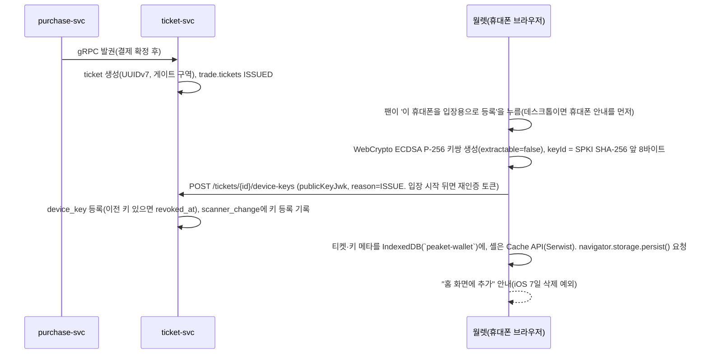
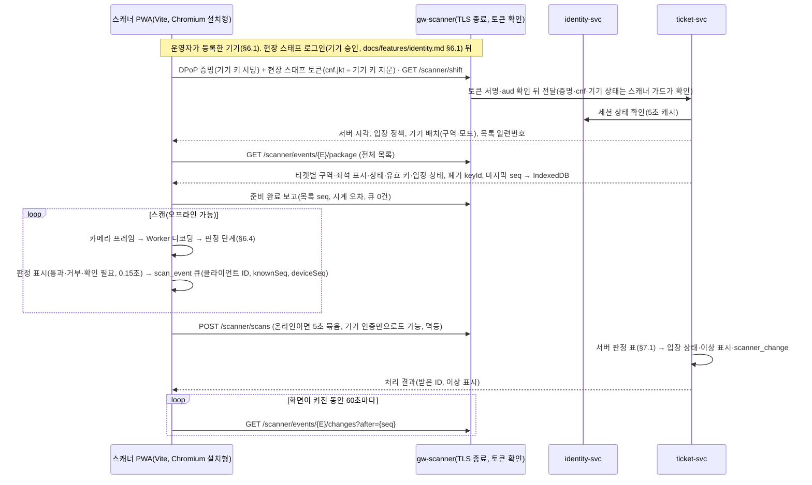

# 기능 설계: 모바일 티켓(회전 QR)·오프라인 게이트 입장

- **독자와 용도**: ticket-svc, 모바일 월렛(설치형 앱처럼 쓰는 소비자 웹 앱인 PWA), 현장 게이트 검표 스캐너 PWA를 만드는 엔지니어가 다음을 확인할 때 참고한다: 공연 당일 타임라인, 스캐너 기기 등록과 근무 준비, 입장용 휴대폰 등록과 15초 회전 QR 규격, 오프라인 로컬 판정 단계, 목록·변경분 동기화와 입장 상태 공유, 서버 입장 판정과 이상 표시, 현장 예외 절차, 입장 기록 마감, 양도·취소 때의 키 폐기 절차, 검증 테스트 포인트. 현장 스태프 초대와 기기 승인 로그인은 docs/features/identity.md §6.1, 보안 요구사항 판정은 docs/security/asvs/offline-gate.md에 있다.
- **원문 출처**: 설계서 §6 <오프라인 전략>, 설계서 §3, 설계서 §9 게이트 입장 판정 SLO와 Degraded Mode, 설계서 §10 K10, 12장(Web Worker 및 Background Sync 아키텍처), [ADR-0025](../adr/0025-rotating-qr-device-key-signature.md), [ADR-0051](../adr/0051-gate-process-end-to-end.md), POL-017·018. 공연 당일 타임라인, 기기 등록, 입장 상태 공유, 서버 판정 표, 현장 예외 절차, 입장 기록 마감은 2026-10-13 현장 입장 검토(소유자 승인, ADR-0051)에서 더했다.
- **기준 기획 버전**: v1.0.
- **관련 ID**: FR-012, FR-013(키 교체), FR-035, FR-036, FR-046, FR-047(취소 시 키 폐기), FR-059(양도 회수 키 교체), FR-060(양도 수락·돌려주기), FR-065(스캐너 기기 등록·폐기), FR-066(현장 운영), FR-067(입장 판정·마감), FR-072·073(입장 스캔을 부정 예매 조사에 쓰고, 양도 잠금은 입장을 막지 않음, ADR-0171) · NFR-010, 019, 020, 025 · POL-017, 018, 031, 032, 038, 046 · SCR-013, 014, 017, 029, 033, 034, 035, 036, 037, 041, 050, 051, 052, 053 · CMP-029 RotatingQR, CMP-041 ScanResult · API(프로그램끼리 요청과 응답을 주고받는 창구) `/v1/tickets/*`, `/v1/scanner/*`, `/v1/ops/scanner-devices*` · 이벤트 `trade.tickets` · 데이터 docs/data.md §2 ticket·device_key·scan_event·scanner_device·scanner_placement·scanner_change·gate_flag·booth_authorization.

## 0. 공연 당일 타임라인(ADR-0051)

| 시각 | 누가 | 무엇을 | 화면 |
| --- | --- | --- | --- |
| 회차 며칠 전 | 운영자 | 스캐너 기기를 등록하고 파트너에게 배정한다. 스캐너가 등록 코드로 기기 키를 기기 기록에 묶는다(§6.1. mTLS 선택지면 관리 앱이 기기 인증서를 넣는다) | SCR-053 |
| 회차 며칠 전 | 파트너 | 현장 스태프·현장 책임자를 초대한다(한 번에 여러 명). 기기 배치 초안(구역·모드)을 만들고, 구역별 권장 기기 수를 확인한다 | SCR-037 |
| 초대 뒤 24시간 안 | 현장 스태프 | 본인확인을 마친 계정과, 초대 이메일과 같은 검증 이메일로 초대를 수락하고 동의 항목 두 개에 동의한다 | SCR-050 |
| 입장 시작 24시간 전 | 시스템 | 입장용 휴대폰 등록이 없는 티켓의 팬에게 등록 안내를 보낸다(§2) | — |
| 입장 시작 3시간 전 | 현장 스태프 | 역할이 유효해진다. 스캐너 QR을 휴대폰으로 열어 확인 코드를 맞춰 보고 승인한다 | SCR-036, SCR-051 |
| 로그인 직후 | 스캐너 | 근무 준비: 배치 확인, 목록 전체 받기, 시계 보정, 화면 꺼짐 방지, 준비 완료 보고(§6.2) | SCR-033 |
| 입장 시작 30분 전 [가정] | 현장 책임자·파트너 | 준비 점검: 모든 기기 준비 완료, 예비 기기 로그인·목록 받기, 부스 회선 확인 | SCR-052, SCR-037 |
| 입장 시작 | 시스템 | 소유권 동결: 돌려주기·양도 수락·양도 회수를 막고, 재발급은 부스에서만 한다(§5) | — |
| 입장 중 | 스캐너·현장 책임자 | 판정(§6.4), 업로드(§6.5), 60초 변경분(§6.3). 책임자는 이상 표시 확인(§7.2), 부스 재발급·예외 통과(§9.1) | SCR-034, SCR-035, SCR-052 |
| 공연 종료 2시간 뒤 | 시스템 | 역할의 유효 기간이 끝난다. 스캐너 세션이 끝나고, 남은 기록은 기기 인증으로 올라간다(§6.5) | — |
| 그 뒤 24시간 [가정] 안 | 시스템 | 입장 기록을 마감하고, 취소 접수 티켓 환급과 이상 표시를 확정하며, 보고하지 않은 기기는 CS 처리함으로 넘긴다(§7.3) | SCR-029, SCR-045 |

- **스캐너 대수 산정(목표 대기 시간 기준, 추천 적용 2026-10-28, 기술 검토 낮음-078)**: 대수는 '처리량이 도착률보다 크다'만으로 정하지 않고, 관객이 줄 서는 시간의 목표로 정한다. 줄은 스캐너마다 따로 서서 사람이 고르게 나뉘지 않는다. 또 스캐너가 바쁜 정도(이용률 = 도착률 ÷ (대수 × 1대 처리량))가 1에 가까울수록 짧은 몰림에도 대기가 크게 는다. 그래서 예전의 '도착률 ÷ 1대 처리량 × 1.2 [가정]'으로는 여유가 충분한지 판단할 수 없다.
  - **목표**: 줄 서는 시간 p95 10분 이하 [가정, 현장 도입 때 확정]. 공연 시작 시각에 남은 줄이 다 들어가는 시간도 함께 본다.
  - **입력**: 분 단위 도착 곡선 A(t)(도착 몰림 포함, 과거 공연 기록이나 가정)와 1대 처리량 μ(명/분). μ는 판정 뒤 다음 스캔까지의 시간(SCR-034 초기화 2초 [가정])과 관객이 휴대폰을 대는 시간을 합친 값이다. 포트폴리오에서는 μ만 잰다(모의 확인, wbs 5.7.1).
  - **어림 식(1분 단위)**: 대수가 n이면 줄 길이 Q(t) = max(0, Q(t−1) + A(t) − n·μ)이고, 그때 줄 끝에 선 사람은 약 Q(t) ÷ (n·μ)분 기다린다. 리틀의 법칙(평균 줄 길이 = 도착률 × 평균 대기)으로 줄 설 자리가 충분한지도 함께 본다.
  - **모의**: 위 식에 분마다 도착 수의 흔들림(푸아송 분포)과 처리 시간의 흔들림을 넣어 수백 번 돌리고, p95 대기가 목표 안인 가장 작은 n을 고른다. 여기에 고장·배터리에 대비한 예비 기기를 더한다. 스프레드시트나 짧은 스크립트로 충분하다.
  - **측정 전 예시**: 5만 명 중 절반이 마지막 30분에(분당 약 833명), 나머지가 그 앞 60분에(분당 약 417명) 오고, 1대가 분당 15명을 처리한다고 하자. n = 45면 처리량이 분당 675명이라 마지막 30분 동안 줄이 분당 약 158명씩 늘어, 공연 시작 때 약 4,750명이 남고 마지막 사람은 약 7분 기다린다. 흔들림 없는 어림으로는 목표 안이지만, 공연 시작 뒤 약 7분 동안 입장이 이어진다. n = 56이면 어림으로는 줄이 늘지 않지만 이용률이 1에 가까워, 흔들림의 영향은 모의로 봐야 한다.
  - 목표·도착 곡선·예비 수는 운영 설계이고 실제 도입 때 정한다. NFR-010의 '게이트당 분당 60명'은 판정 지연을 재는 부하 조건이지, 처리량 계획이 아니다.

## 1. 개요: 구매는 온라인 전용, 입장은 오프라인 우선

| 서비스 영역 | 네트워크 단절(오프라인) 시 시스템 동작 | 핵심 구현 기술 |
| --- | --- | --- |
| 예매 구매 여정 (대기열·좌석·결제) | 결제 버튼을 사유와 함께 바로 비활성화한다. 잠깐 끊겼다가 돌아오면 대기표의 HMAC(비밀 키로 만든 위조 확인용 값) 서명으로 순번을 그대로 지킨다. | `navigator.onLine` 감지 + 폴링(정해진 간격으로 다시 물어보는 방식) 실패 감지, 무상태 대기표 서명 |
| 모바일 월렛 (관람객 팬) | 웹앱 셸과 티켓 데이터가 단말기에 늘 들어 있어 바로 열린다. 회전 QR은 인터넷 없이 기기 안에서 실시간으로 만든다. | 서비스 워커 + Cache API(Serwist), IndexedDB(브라우저 안에 데이터를 저장하는 곳. 감싸는 라이브러리 Dexie 없이 직접 쓴다, docs/frontend.md §2.3, 2026-11-01 정합), WebCrypto API |
| 게이트 스캐너 (현장 스태프) | 단말기 안의 회차 목록으로 서명을 그 자리에서 검증해 0.15초 이내에 판정한다. 스캔 기록은 로컬 큐에 쌓아 두었다가 연결되면 바로 올린다. 화면이 켜진 동안 60초마다 변경분을 받는다. | IndexedDB, Web Worker, 앱 타이머, 일회성 Background Sync(업로드 예비) |
| 찜하기 | 기기 안 대기열(localStorage `peaket.wishQueue`)에 쌓아 두었다가, 다시 온라인이 되면 자동으로 한꺼번에 다시 보낸다(docs/frontend.md §3.12). | 화면의 온라인 복귀 감지와 재전송(서비스 워커는 월렛 범위 `/my/tickets`만 쓴다, ADR-0079 결정 18, ADR-0363 결정 5) |
| 사용자 화면 알림 | 화면 위쪽에 오프라인 상태 배너와 마지막으로 정상 동기화한 시각을 분명히 표시한다. | Service Worker(브라우저 뒤에서 오프라인 동작과 캐시를 맡는 스크립트) 상태 이벤트 감지 |

### 핵심 아키텍처 원칙: 구매와 입장의 제어 분리
- **구매 여정 (중앙 집중 온라인 전용)**: 동일 좌석의 다중 동시성 경합을 해결하기 위해 중앙 서버가 좌석마다 Redis 홀드와 PostgreSQL 활성 상태 부분 유니크 인덱스로 한 명의 구매만 승인한다(docs/features/seat-hold.md §3·§6).
- **현장 입장 (로컬 우선 오프라인 자율)**: 수만 명이 밀집하여 기지국이 포화되거나 네트워크가 전면 단절되더라도, 현장 게이트가 멈추지 않고 입장이 지속되어야 한다(QR-SA-1 페일 세이프 원칙 준수).
- **단말 로컬 실시간 판정**: 단말기 브라우저 WebCrypto ECDSA P-256 서명 기반 15초 회전 QR과 스캐너 로컬 DB(IndexedDB) 검증을 결합하여, 통신이 끊겨도 위변조를 판정한다. 목표는 단말 안 판정 p95 0.15초 이하다(NFR-010, K10). 같은 티켓의 중복 입장은 두 스캔 기록이 모두 서버에 올라온 뒤에 찾으며, 올라오지 않은 기록은 찾지 못한다(§7.1, ADR-0051).

## 2. 발권, 입장용 휴대폰 등록과 기기 키(FR-012, ADR-0025, ADR-0051)

- 개인키는 WebCrypto API로 `extractable=false` 비대칭 키쌍을 만들어 브라우저 IndexedDB에 둔다. 페이지 스크립트는 키를 꺼낼 수 없다. 하지만 키는 브라우저 프로필 안의 소프트웨어 키이고, 하드웨어 보관(Secure Enclave·Android Keystore)이 아니다. 일반 사용자가 다른 기기로 옮기기는 어렵지만, 루팅한 기기나 데스크톱 브라우저 프로필을 복사하면 옮길 수 있다(ADR-0050 결정 1). 중앙 서버에는 검증용 공개키만 등록된다.
- 대칭키(시간에 따라 새로 만드는 일회용 코드인 TOTP의 공유 비밀값) 방식을 쓰지 않는 이유: 스캐너 단말기에 검증용 대칭 비밀키를 저장하면, 스캐너를 잃어버렸을 때 티켓을 대량으로 위조하는 데 악용될 위험이 있다. 비대칭 공개키 구조에서는 스캐너가 '티켓 ID → 공개키' 목록만 가지고 서명을 혼자 검증한다. 그래서 스캐너를 잃어버려도 그 안의 정보로는 QR을 위조할 수 없다.
- **입장용 휴대폰 등록(ADR-0051 결정 10)**: 월렛은 티켓을 처음 열 때 키를 몰래 만들지 않는다. '이 휴대폰을 입장용으로 등록'을 눌러야 만든다.
  - 데스크톱 브라우저로 보이면 '입장 QR은 휴대폰에서 등록하세요'를 먼저 보인다. PC로 예매하고 PC에서 월렛을 연 뒤 공연 당일 휴대폰으로 처음 열면, 재발급으로 처리되어 한도(ADR-0050)에 걸리기 때문이다. 사용자가 원하면 데스크톱에서도 등록할 수 있다.
  - iOS는 홈 화면에 추가한 앱에서 등록하라고 안내한다. Safari와 홈 화면 앱이 저장소를 따로 쓰는지는 [가정, wbs 5.1.3 PoC에서 확인]이다.
  - 입장 시작 뒤의 첫 등록(ISSUE)은 소셜 제공자 재인증을 받고, 계정 이메일로 알린다. 판매자가 월렛을 한 번도 열지 않은 채 계정을 넘기면, 산 사람의 첫 등록은 부스 확인을 거치지 않는다(남는 한계). 입장 시작 뒤 첫 등록 비율을 지표로 본다.
  - 입장 시작 24시간 전까지 등록이 없는 티켓은 팬에게 등록 안내를 보낸다(FR-040).
  - **서버 등록 잇기(추천 적용 2026-11-21, BUILD_ORDER GAT-010, ADR-0336)**: 월렛은 팬 API 주소가 있는 모든 빌드에서 키를 만든 직후 위 경로로 공개키를 등록하고, 서버가 같은 keyId를 돌려준 뒤에만 QR을 보인다. 등록되지 않은 키로 만든 QR은 스캐너가 '모르는 키'(`KEY_UNKNOWN`)로 거절하기 때문이다. 실패했을 때와 다시 보낼 때의 규칙은 docs/frontend.md §4.2.4 '입장용 휴대폰 등록 세부', 화면 상태는 docs/design/d5 §5.13이다.
  - **같은 키 다시 등록(추천 적용 2026-11-21, ADR-0336)**: 서버는 같은 티켓의 지금 유효 키와 keyId가 같은 등록 요청을 아무것도 바꾸지 않고 201(같은 keyId)로 답한다. 새 행·옛 키 폐기·스캐너 변경분(`scanner_change`) 기록이 없고, 24시간 재발급 한도에도 세지 않는다. 입장 시작 뒤에도 같다(소유권이 바뀌지 않는다). 티켓이 없거나 보유자가 아니면 지금처럼 404다. 판정 차례는 이유마다 다르다: ISSUE·TRANSFER는 보유자 확인(404) 바로 뒤, 입장 시작·TRANSFER 확인보다 앞에서 같은 키를 본다. REISSUE·BOOTH는 지금처럼 재인증·부스 허용 확인(403)을 먼저 지난 뒤 보유자 확인 다음에 본다(그 확인을 지나지 못하면 같은 키여도 403이다, 추천 적용 2026-11-21, BAT-350 리뷰 RV350-1). 월렛이 응답을 잃은 뒤 같은 키로 다시 보내도 재인증(403)에 막히지 않게 하려는 것이다. 키가 다르면 지금 규칙(재인증·24시간 1회) 그대로다.
- **월렛 목록 서버(감독 결정 2026-11-23, FIX-wallet-tickets, 판정 시험 §11 O-T51)**: 월렛 목록 `GET /v1/tickets`는 gw-fan이 보낸 그대로 ticket-svc HTTP 처리기가 받아, gRPC `ListTickets`와 같은 쓰임새(티켓 서비스의 목록)를 부른다. 웹 앱 서버는 이 목록을 gRPC로 부르지 않는다(docs/api/proto/README.md §3 표의 `ListTickets` 줄).
  - 누구의 표인가: 팬 쿠키 세션의 계정(게이트웨이가 넘긴 `x-user-id`)이 지금 보유자(`ticket.account_id`)인 표만 준다. 주소·쿼리로 계정을 받지 않는다. 남의 표는 목록에 나오지 않고, 커서에 남의 표 자리를 넣어도 내 표만 나온다(authz-matrix '티켓' 행, AZ-T6). 양도로 보유자가 바뀌면 받은 사람 목록에 들고 보낸 사람 목록에서 빠진다.
  - 어떤 표인가: 상태와 무관하게 모두 준다(취소 접수·환급·무효·확인 중도 그 `status`로). 어떻게 보일지는 화면이 정한다(docs/frontend.md §4.2.4 '월렛 목록 세부').
  - 차례와 나누기: 최신 발권순(발권 시각 내림차순, 같으면 티켓 ID 내림차순)이다. `limit` 기본 20 [가정], 최대 100이고 범위 밖은 400이다(docs/api/guidelines.md §3). 커서는 불투명 값이고, 풀리지 않는 커서는 처음 쪽으로 보지 않고 400 `invalid-query`다. 끝은 `nextCursor`가 null일 때다.
  - 무엇을 싣나: 계약(openapi `Ticket`)의 칸 가운데 ticket 데이터로 채울 수 있는 것만 싣는다. `ticketId`·`eventId`·`status`·`transferLocked`(부정 예매 양도 잠금이 걸렸는지)는 늘, `gateZone`은 비지 않았을 때, `eventStartsAt`과 `cancelDeadline`(둘 다 발권 때 받은 회차 시작, POL-032)은 그 값이 있을 때, `receivedFromNickname`은 보유자가 결제자이면 null이다. `pendingTransfer`는 보유자가 결제자이고 `OFFERED` 양도 요청이 있을 때 그 요청 ID·기한이고, 그 밖은 null이다(F-05-2, ADR-0383). ticket 데이터에 없는 칸(`seatLabel`·`eventTitle`·`placeName`·`entryOpensAt`·`transferable`·`transferDeadline`·`bookingNumber`·`enteredAt`, 받은 표의 `receivedFromNickname`, 잠긴 표의 `transferLockExpiresAt`)은 거짓 값을 채우지 않고 칸을 뺀다. 공연명·장소·입장 시작은 화면이 회차 공개 요약으로 채운다. 계약 밖 값(주문·좌석·계정 ID, QR 포인터 `PEAKET1:…`, 티켓 키와 그 해시)은 싣지 않는다. QR 재료는 서버가 주지 않는다(§3, 기기 키로 기기 안에서 만든다).
  - 캐시와 기록: 응답은 `Cache-Control: private, no-store`다(오류 응답도). 요청 기록에는 경로·상태·걸린 시간만 남기고 응답 본문·티켓 키를 남기지 않는다.
  - 운영 확인(docs/architecture.md §8.4):

    | 확인할 동작 | 사건·필드 | SLI | 대시보드 패널 | 경보 | 배포 뒤 확인 방법 |
    | --- | --- | --- | --- | --- | --- |
    | 월렛 목록 응답 | 정규 로그 줄(`route` `/v1/tickets`, `status`), `http_server_request_duration_seconds{route}` | 서비스 템플릿 HTTP 오류율·지연(docs/observability.md 서비스 템플릿) | ticket-svc 서비스 템플릿 대시보드 | 서비스 템플릿 HTTP 경보 그대로(새 경보 없음) | 로컬 데모 S1(`node tools/local/demo.mjs play --scenarios S1`)의 `wallet-list` 확인. 운영 배포는 구간 5 |

- 공식 티켓 연동 부가 상품(주차권, MD 수령권 등)도 같은 모바일 월렛 안에 티켓과 나란히 안전하게 발급된다(FR-014).

## 3. 회전 QR(POL-018)

| 통제 항목 | 세부 아키텍처 및 구현 규격 |
| --- | --- |
| 페이로드 스키마(QR v1, ADR-0051 결정 7) | 형식 버전(1바이트) ‖ 티켓 ID(UUIDv7, 16바이트) ‖ keyId(8바이트, 공개키 SPKI의 SHA-256 앞 8바이트) ‖ 시각(4바이트, 부호 없는 32비트 빅엔디언 UNIX 초. 2106년까지 담는다) ‖ 서명(64바이트, ECDSA P-256 IEEE P1363). 서명 대상은 `"PEAKET-QR-v1" ‖ 티켓 ID ‖ keyId ‖ 시각`이다. 전체는 93바이트다. 글자 인코딩은 base45(RFC 9285. QR 영숫자 모드가 쓰는 45글자만으로 바이트를 적는 방식)로 정하고, QR에는 영숫자 모드로 싣는다(93바이트 → 140자). 크롬 BarcodeDetector는 읽은 값을 글자(`rawValue`, DOMString)로만 돌려줘서, 바이트를 그대로 싣는 이진 모드로는 원래 바이트가 그대로 돌아온다는 보장이 없기 때문이다(WICG Shape Detection API, 추천 적용 2026-10-28, 기술 검토 낮음-075). QR 오류 정정 수준만 wbs 5.1.3 PoC(본 개발 전에 위험한 부분만 먼저 만들어 확인하는 시험)에서 인식 시간을 재어 정한다. 형식 버전이 있어 나중에 규격을 바꿀 수 있다. |
| 키 증명(선택, PoC 뒤 결정) | 서버가 {티켓 ID, keyId, 공개키, 유효 끝}에 서명한 값(약 110바이트 [가정])을 QR에 붙이면, 변경분을 아직 못 받은 오프라인 스캐너도 입장 직전에 등록된 키를 검증할 수 있다. QR이 약 두 배로 촘촘해지므로, wbs 5.1.3에서 인식 시간·실패율을 재고 정한다. 채택하면 '키 증명 서명 키'를 secrets-and-keys에 넣는다. |
| 주기적 자체 갱신 | 네트워크 연결과 상관없이, 화면이 다시 보이는 순간(`visibilitychange`)과 보이는 동안 15초마다 그 순간의 보정 시각으로 다시 서명해 QR을 그린다. 화면이 다시 켜질 때 타이머가 늦게 돌아도 보이는 순간 새로 그리므로, 낡은 QR이 잠깐 남지 않는다. 서명은 한 번에 수 ms [가정, wbs 5.1.3에서 잰다]라 메인 스레드에서 해도 되고, Web Worker는 선택이다. Worker로 옮겨도 같은 출처의 스크립트는 Worker에 서명을 부탁할 수 있어 보안상 나아지지 않는다(추천 적용 2026-10-28, 기술 검토 낮음-076). Ticketmaster SafeTix의 동적 바코드 방식을 참고했다. |
| 클라이언트 시계 보정 | 모바일 월렛과 스캐너 단말기 모두 마지막으로 온라인에 연결됐을 때 서버와의 시계 차이(Clock Offset)를 밀리초 단위로 재어, 로컬 시각을 자동으로 보정한다. 월렛은 화면이 켜진 동안 마지막 보정 시점부터 단조 시계(`performance.now()`, 기기 시계를 바꿔도 흔들리지 않고 앞으로만 가는 시계)로 이어 센다. 그래서 보정 뒤 사용자가 기기 시계를 바꿔도 그동안의 QR 시각은 틀어지지 않는다. 다만 Windows가 아닌 기기(휴대폰 포함)의 브라우저는 기기가 잠든 동안 단조 시계가 멈추므로(MDN `performance.now()` 'Ticking during sleep', 2026-10-28 확인), 화면이 다시 보이거나 페이지를 다시 열면 '기기 시계 + 마지막 오차'로 기준을 다시 잡고, 온라인이면 다시 잰다(추천 적용 2026-10-28, 기술 검토 낮음-076). 오프라인인 동안 기기 시계를 바꾼 뒤 화면을 다시 켜면 틀어진 시각으로 그린다. 이때 스캐너는 '유효시간이 지난 QR'로 거부하고, 월렛은 온라인이 되면 다시 잰다(남는 한계). |
| 스캐너 유효성 허용 창 | 스캐너는 QR에 든 타임스탬프가 자기 보정 시각 기준 앞뒤 ±30초 범위 이내일 때만 유효하다고 판정한다. 허용 창이 넓을수록 정적 스크린샷 캡처본을 악용할 수 있는 시간이 길어진다. 그래서 현장에서 잰 오차 분포에 맞춰 엄격하게 미세 조정한다. |
| 스크린샷 캡처본 차단 | 허용 창(±30초)을 벗어난 정적 캡처본 QR 코드는 스캐너 검표 단계에서 바로 거절된다("유효시간이 지난 QR입니다", §6.4). |
| 관람객 화면 사용자 경험 | 화면에 들어오면 디스플레이 밝기를 올리라고 안내하고(웹에는 밝기를 바꾸는 표준 API가 없다. W3C screen-wake-lock 이슈 #129가 아직 열려 있는 요청이다), 화면 꺼짐 방지(Screen Wake Lock)를 건다. iOS·iPadOS 18.4 미만의 홈 화면 앱은 Wake Lock이 동작하지 않아(WebKit은 18.4부터 홈 화면 웹 앱에서도 동작한다고 밝혔다), 밝기·자동 잠금 안내 글자만 보인다(docs/frontend.md §1.5, 추천 적용 2026-10-28, 기술 검토 낮음-077). 오프라인 상태 배너와 마지막 동기화 시각을 분명하게 보여 준다(SCR-013, CMP-029). |

- 알려진 한계(2026-10-13, 소유자 요청 암호 검토, ADR-0050 결정 1): 회전 QR은 화면 공유나 영상통화로 QR을 실시간 중계하는 경우를 막지 못한다(늘 새 QR이 보인다). 계정을 넘겨받은 사람이 입장 시작 전에 재발급하는 경우(티켓당 24시간에 1회)와 루팅 기기·데스크톱 프로필 복사로 키를 옮기는 경우도 막지 못한다. 이 경우는 입장 상태 공유, 서버 판정의 이상 표시와 현장 확인 스캔(§7)에 기댄다. 하지만 두 사람이 모두 유효한 QR을 내면 확인 스캔으로도 가리지 못한다. 키를 하드웨어에 묶는 것은 네이티브 월렛에서만 되는데, PWA 방침(NFR-019)과 부딪혀 하지 않는다.
- **BAT-350 클라이언트 첫 구현(2026-11-14, R-554)**: `apps/web`에 월렛 기기 키·회전 QR·오프라인 저장의 첫 구현을 넣었다.
  - `features/wallet-device-key`가 WebCrypto ECDSA P-256 키쌍을 `extractable=false`로 만들고, keyId를 공개키 SPKI SHA-256 앞 8바이트로 계산한다. 개인키는 `CryptoKey` 그대로 IndexedDB(`peaket-wallet`)에 두고 서버에는 공개키 JWK만 보낸다. 키는 '이 휴대폰을 입장용으로 등록' 버튼으로만 만든다.
  - QR v1은 형식 버전 1바이트 ‖ UUIDv7 16바이트 ‖ keyId 8바이트 ‖ 시각 4바이트 빅엔디언 ‖ 서명 64바이트의 93바이트이고, base45 140자로 QR 영숫자 모드에 싣는다. 15초 경계와 `visibilitychange`마다 그 순간의 보정 시각(`shared/lib/clock`의 `now`/`reset`)으로 다시 서명한다.
  - Dexie `peaket-wallet`에 기기 키·티켓 스냅샷·마지막 동기화 시각을 두고 `navigator.storage.persist()`를 요청한다. Serwist 9(`@serwist/turbopack`) 서비스 워커의 범위는 `/my/tickets`이고, `/my/tickets` 문서는 `StaleWhileRevalidate`(캐시 셸 우선·뒤에서 갱신), 정적 자산은 `StaleWhileRevalidate`, API(`/v1/*`)와 워커 자신(`/serwist/*`)은 `NetworkOnly`다. 원본이 5xx를 돌려줘도 캐시 셸로 넘어가며, 캐시 못 한 문서는 `/~offline`으로 대체한다.
  - 당시 막힌 것(2026-11-14 R-561에서 ticket-svc 서버 경로를 열었다): ticket-svc에 `POST /v1/tickets/{ticketId}/device-keys` 구현과 `device_key` 표가 없어 공개키 등록·폐기·스캐너의 keyId 대조가 이어지지 않았다. 그래서 그때 키는 `registration=LOCAL`로 이 기기에만 남았고, 서버 등록은 `NEXT_PUBLIC_WALLET_DEVICE_KEY_REGISTRATION=1`을 켠 배포에서만 시도했다. BAT-350(2026-11-21)에서 스위치를 없애고 늘 등록한다(§2 '서버 등록 잇기', ADR-0336). 스캐너 패키지의 `keys`·`revokedKeyIds`도 그때는 빈 배열이었다(GAT-140·GAT-180 후속).
- **BAT-430 GAT-140 서버 첫 구현(2026-11-14, R-561)**: ticket-svc에 `device_key` 표(마이그레이션 `0003_device_key.sql`, 티켓당 유효 키 하나 부분 유니크)와 `POST /v1/tickets/{ticketId}/device-keys`를 넣었다. 월렛이 보낸 P-256 공개키 JWK에서 keyId(SPKI SHA-256 앞 8바이트)와 압축 공개키(33바이트)를 만들고, ISSUE/REISSUE/TRANSFER/BOOTH 등록, 이전 키 폐기, REISSUE 24시간 한도, 취소 트랜잭션 안 폐기를 지킨다. 이미 유효 키가 있으면 ISSUE도 첫 등록이 아니므로 재인증과 24시간 1회 한도를 따르고, 입장 시작 뒤 REISSUE·TRANSFER는 거절하며, TRANSFER는 보유자가 결제자와 다를 때만 받는다. 돌려주기로 결제자에게 돌아온 표는 `ticket_return` 기록이 있을 때 TRANSFER를 받는다(F-05-2, ADR-0383). 스캐너 package는 티켓별 유효 키 `keys`와 회차의 폐기 `revokedKeyIds`를 싣고, 스캔의 keyId를 유효·폐기·모름으로 대조해 `KEY_REVOKED`·`KEY_UNKNOWN`·`INVALID_QR`로 거절한다(티켓 상태 판정이 먼저다). 남은 것: 재인증 토큰 확인이 없어 REISSUE·BOOTH·입장 시작 뒤 ISSUE·키가 있는데 다시 ISSUE는 403이고, 부스 허용(`booth_authorization`)·`GET /v1/scanner/shift`·기기 배치·core 재입장 정책도 아직이다. 그래서 그때 키는 LOCAL로 남고 서버 등록은 `NEXT_PUBLIC_WALLET_DEVICE_KEY_REGISTRATION=1`인 배포에서만 시도했다. BAT-350(2026-11-21)에서 스위치를 없애고 늘 등록한다. 같은 키를 다시 보내면 서버는 바꾸지 않고 받는다(§2 '서버 등록 잇기'·'같은 키 다시 등록', ADR-0336).
- 알려진 한계(2026-10-15, 웹 앱 보안 검증 항목 ASVS V3 판정, 추천 적용, ADR-0065): 키를 `extractable=false`로 만들면 페이지 스크립트가 키 자체는 꺼내지 못한다. 하지만 월렛과 같은 출처에서 실행되는, 페이지에 끼워 넣은 악성 스크립트(XSS)는 그 키로 서명을 부를 수 있다. 그러면 공격자가 그 사람의 회전 QR을 실시간으로 만들어 다른 곳으로 넘길 수 있다. 이는 위의 '화면 실시간 중계'와 같은 종류의 한계지만, 화면을 보여 주지 않고도 원격에서 이뤄진다. 막는 것은 페이지가 실행할 스크립트의 출처를 정하는 소비자 웹 CSP와, 사용자 입력을 태그로 읽히지 않는 글자(텍스트 노드)로만 그리는 규칙이다(docs/security/asvs/offline-gate.md 3.2.2·3.4.3). 서버 쪽에서는 입장 상태 공유와 이상 표시(§7)가 한 티켓의 중복 입장을 가려낸다. 하지만 넘겨진 QR이 먼저 통과하면, 정당한 사람은 거부당한 뒤에야 알게 된다(재발급 제한과 현장 부스로 처리). 이 방어선인 월렛 셸의 CSP는 서비스 워커가 저장한 셸을 오프라인에서 다시 쓰므로 캐시 화면 묶음(해시(원래 값으로 되돌릴 수 없게 바꾼 고정 길이 값) 방식과 `script-src 'self'`)으로 정했다(추천 적용 2026-10-21, ADR-0079 결정 14, docs/frontend.md §5.14). 다만 해시 방식(SRI)은 실험 기능이라, PoC(wbs 2.10.1)가 실패하면 ADR-0065 되돌릴 조건대로 다시 정한다. docs/planning/01 §5.2에 같은 한계를 적었다.

## 4. iOS Safari 저장소 삭제 대비

- iOS Safari 브라우저에는 ITP(Intelligent Tracking Prevention) 제약이 있다. 사용자가 7일 동안 직접 조작하지 않은 웹사이트의 IndexedDB 데이터와 서비스 워커 캐시 저장소를 자동으로 지우는 규칙이다. 홈 화면에 추가한 웹앱은 Safari와 따로 사용 일수를 세므로, WebKit은 그 데이터가 지워질 것으로 보지 않는다고 밝혔다. 그래서 티켓을 산 직후 모바일 월렛 화면에서 '홈 화면에 추가(PWA 설치)'를 강하게 권하고, `navigator.storage.persist()` API를 불러 영구 저장소 권한을 요청한다(WebKit은 홈 화면 앱인지 같은 휴리스틱으로 허용한다).
- 홈 화면 앱을 권하지만, 지원 범위(NFR-019, iOS·iPadOS 16.4 이상) 가운데 18.4 미만의 홈 화면 앱은 화면 꺼짐 방지(Screen Wake Lock)가 동작하지 않는다(WebKit은 18.4부터 홈 화면 웹 앱에서도 동작한다고 밝혔다). 이 판에서는 줄을 서는 동안 QR 화면이 자동 잠금으로 꺼질 수 있어, 밝기·자동 잠금 안내 글자를 보인다. 화면이 다시 보이면 그 순간의 보정 시각으로 QR을 새로 그린다(§3, docs/frontend.md §1.5, 추천 적용 2026-10-28, 기술 검토 낮음-077).
- 공연 전날과 당일 아침에 관람객이 모바일 월렛을 미리 열어 보도록 안내 알림을 보낸다. iOS에서 Web Push는 홈 화면에 설치했을 때만 동작하므로, 카카오 알림톡, 이메일, LMS 문자 메시지를 함께 보내 월렛을 열어 두게 한다(FR-040). 여는 것만으로 키를 새로 만들지는 않는다.
- 로컬 티켓 캐시가 사라진 것을 감지하면 재발급 규칙(ADR-0050 결정 2)을 따른다.
  - 입장 시작 전: 소셜 제공자 재인증 뒤 재발급 API로 복구한다(새 키 등록 reason=`REISSUE`, 옛 키는 폐기 목록에 등재). 티켓당 24시간에 1회까지이고 [가정, Phase 5 5.1.2에서 확정], 넘으면 고객센터로 안내한다. 재발급하면 계정 이메일과 이전 기기(웹 푸시)에 알린다.
  - 입장 시작 뒤: 월렛에서 재발급하지 않는다. 현장 부스에서 관객이 휴대폰 본인확인으로 보유 계정과 같은 사람임을 보이면, 현장 책임자가 새 키 등록을 10분 동안 허용한다(§9.1 부스 재발급, ADR-0051 결정 11).
  - 그래서 공연 전날과 당일 아침 안내로 입장 시작 전에 월렛을 열어 두게 한다. 현장 통신이 끊기면 온라인 재발급도 할 수 없다.
- 로그아웃해도 입장 키는 지우지 않는 것이 기본이다. 지우면 다시 등록해야 하고 재발급 한도에 걸리기 때문이다. 공용 기기라면 로그아웃 화면에서 '이 기기의 입장 키도 지우기'를 고른다(ADR-0051 결정 10, ADR-0079 결정 17).

## 5. 양도·예매 취소와 키 교체(FR-013, FR-047, POL-017, POL-032)

- 양도는 수락형이다. 결제자이면서 보유자인 팬이 공연 시작 2시간 전과 입장 시작 중 이른 때까지 양도를 요청하고, 받는 사람(본인확인을 마친 PEAKET 회원)이 수락해야 넘어간다. 수락 기한은 요청 뒤 48시간과 양도 마감 중 이른 때다. 예매 취소와 환불은 공연 시작 직전까지 받되, 결제자가 보유한 티켓만 한다(POL-017·032, ADR-0046). 양도 감사 로그에는 양쪽 계정 ID만 기록해 개인정보 노출을 최소로 줄인다.
- 양도 요청 직전에는 소셜 제공자 재인증을 반드시 받는다(민감 작업 보호). ticket-svc는 데이터베이스의 배타적 행 잠금(`SELECT … FOR UPDATE`) 안에서 상태·기한을 다시 확인해, 한 티켓의 양도 요청·수락·돌려주기·회수·취소·스캔 수신 중 하나만 성공하게 한다. 버전 칸은 CS 처리함처럼 사람이 화면에서 읽고 나중에 저장하는 흐름에만 쓴다(docs/features/payment.md §4.1, 기술 검토 낮음-071).
- **입장 중 소유권 동결(ADR-0051 결정 10)**: 입장 시작(`event.entry_opens_at`)부터 입장 기록 마감(§7.3)까지 돌려주기·양도 수락·양도 회수를 막는다(409 `ENTRY_STARTED`). 오프라인 스캐너의 기록이 늦게 올라오는 동안 서버는 누가 들어갔는지 모르므로, '들어간 뒤 돌려주기'로 한 장에 두 명이 들어가는 길을 닫는다. 판정은 티켓 행 잠금 안에서 입장 시작 시각과 함께 확인한다.
- 양도를 수락하면 보낸 사람의 기존 공개키를 바로 폐기 목록(Revocation List)에 올린다. 받는 사람은 입장할 휴대폰에서 '이 휴대폰을 입장용으로 등록'을 눌러 새 ECDSA 키쌍을 만들어 등록한다(reason=`TRANSFER`. 키는 등록 버튼으로만 만든다, ADR-0051 결정 10). 그 뒤 보낸 사람의 스마트폰에 남아 있는 옛 QR 코드는, 스캐너가 변경분을 받은 뒤부터 '양도·취소·재발급된 티켓의 옛 QR'로 거부된다.
- 돌려주기와 승인된 양도 회수는 같은 키 교체를 거꾸로 한다. 받은 사람의 키를 폐기 목록에 올리고, 결제자가 '입장용으로 등록'으로 키를 다시 등록한다(reason=`TRANSFER`). 둘 다 입장 시작 전이고 입장 기록이 없을 때만 실행된다(POL-038).
- 상품 유형별 양도 제한 규칙(VIP 패키지, 얼리버드 티켓 등의 양도 불가 정책)은 상품 메타데이터에서 그대로 물려받아 반드시 적용된다(POL-016). 예매 취소가 확정되면 계정별 1인 보유 수가 바로 줄고, 그 티켓의 공개키는 곧바로 폐기 목록으로 옮겨진다.
- 공연 입장이 시작된 뒤에 접수된 예매 취소 요청은 티켓 키를 바로 폐기 목록에 올리되, 실제 금융 환불은 입장 기록 마감(§7.3)까지 보류한다. 통신이 늦은 오프라인 스캐너가 그 티켓을 입장 통과시켰다면, 기록이 올라올 때 '취소 뒤 입장' 이상 표시가 붙는다. 그러면 CS가 확인해 그 예매 취소를 무효로 확정한다(POL-032).
- 게이트 스캐너는 근무 준비 때 회차 목록 전체를 받고, 화면이 켜져 있는 동안 60초마다 변경분을 받는다(§6.3). 그래서 양도 직후 양도인이 옛 QR로 입장하려 하면, 온라인 스캐너에서는 약 1분 안에 거부되기 시작한다. 그 사이에 통과한 건은 두 기록이 모두 서버에 올라오면 서버 판정 표(§7.1)가 찾아내지만, 올라오지 않은 기록은 찾지 못한다. 이 1분은 스캐너가 계속 동기화할 때만 지켜진다. 그래서 관제는 입장 시간대에 스캐너별 마지막 동기화 뒤 지난 시간과 폐기 목록 버전 차이를 지표로 본다. 2분 [가정, 현장 도입 때 확정(§12)]을 넘은 스캐너가 있으면 SEV2(장애 심각도 등급. 숫자가 작을수록 심각하다)와 현장 책임자 알림(그 구역 책임자 스캐너 SCR-052와 파트너 콘솔, ADR-0051)을 낸다. 판정은 오프라인으로 계속한다(ADR-0049, docs/observability.md §5).
- **부정 예매 양도 잠금은 입장을 막지 않는다(추천 적용 2026-10-31, ADR-0171 결정 3, POL-046 ③)**: 부정 거래 조사관이 소명을 요청하면 그 표의 양도 요청·돌려주기가 잠긴다(docs/features/transfer-refund.md §4.1). 입장 판정은 바뀌지 않는다. 스캐너 회차 목록·변경분(§6.3), 현장 판정 단계(§6.4), 서버 판정 표(§7.1)에는 잠금 표시를 넣지 않는다. 시스템이 입장을 막으면 사람의 실질적 결정 없는 불이익(자동화된 결정, 개인정보 보호법 §37의2)이 되고, 현장 스태프에게 조사 사실을 퍼뜨리지 않으려는 것이다. 잠금은 입장 시작에 ticket-svc가 스스로 풀기 때문에, 입장 시간대에는 칸이 남아 있어도 잠금으로 보지 않는다. 승인된 부정 예매 표 취소로 환급된 티켓은 지금처럼 취소·환급 상태와 폐기 키로 거부된다(§6.4 3·4). 시험은 O-T43이다.

## 6. 스캐너 PWA(FR-035·036·065·066)

### 6.1 스캐너 기기 등록·폐기(FR-065, ADR-0051 결정 1)

- **기기 자격의 기본안은 기기 키 + DPoP다(추천 적용 2026-10-28, 기술 검토 중간-057)**. DPoP(RFC 9449)는 요청마다 기기 안의 키로 서명한 짧은 증명을 붙여, 토큰을 훔쳐도 그 키가 없으면 못 쓰게 하는 표준이다. 처음 설계는 관리 앱이 넣은 기기 인증서로 서로 인증서를 확인하는 mTLS였다(ADR-0051 결정 1). 기본안을 바꾼 이유는 셋이다.
  - 화면(`scanner.peaket.example`)과 API(`scanner-api`)가 다른 출처라, JSON 쓰기(빈 본문도 `{}`)와 `Authorization` 헤더 요청은 모두 CORS 사전 요청(브라우저가 본 요청 전에 허용 여부를 묻는 OPTIONS 요청)을 낳는다. Fetch 표준은 사전 요청에 자격 증명(쿠키, TLS 클라이언트 인증서, HTTP 인증)을 싣지 않고, 자격 증명을 싣지 않는 연결에는 TLS 클라이언트 인증서를 보내지 않는다. 그래서 gw-scanner가 TLS 단계에서 인증서를 반드시 요구하면 사전 요청이 그 자리에서 끊겨 본 요청이 나가지 못한다. 이 규칙을 다룬 whatwg/fetch 이슈 #869는 아직 열려 있고, 크롬이 사전 요청에도 인증서를 싣는 동작은 크롬 쪽도 고칠 버그로 봤다(#1181, 2021). 2026-10-29에 크롬 소스(main)를 보면 이 버그는 아직 고쳐지지 않았다. 사전 요청은 자격 증명을 빼는 모드(`kOmit`)로 보내지만, 그 모드는 '인증서가 있으면 보내고, 없으면 인증서를 고르게 하려고 연결을 끊는다'고 주석에 적혀 있다(crbug.com/40089326, 옛 번호 775438, https://github.com/chromium/chromium/blob/main/services/network/public/mojom/fetch_api.mojom ). Fetch 표준(2026-10-19판)은 그대로 '자격 증명이 없으면 TLS 클라이언트 인증서를 보내지 않는다'이다. 고칠 버그로 남아 있으므로 설계는 표준 동작(사전 요청에 인증서 없음)에 맞추고, 실제 관리형 기기에서 어떻게 되는지는 아래 mTLS 선택지의 PoC ⑤로 본다.
  - 크롬의 인증서 자동 선택 정책(`AutoSelectCertificateForUrls`)은 Android 143부터이고 크롬이 직접 넣은 인증서만 고른다. 기기 안에서 키를 만들고 사설 CA 인증서를 받으려면 관리 정책의 키 선택·인증서 설치 권한을 위임받은 관리 앱이 있어야 한다.
  - 기기 키 + DPoP는 브라우저 WebCrypto만으로 되고, 사전 요청에 자격 증명이 필요 없다.
- **등록**: 운영자(operator 이상)가 관제 콘솔 '스캐너 기기 관리'(SCR-053)에서 기기를 만든다(기기 이름, 배정 파트너). 그러면 1회용 등록 코드(RFC 8628 §6.1 문자 집합 12자 `XXXX-XXXX-XXXX`, 10분 [가정], 서버는 SHA-256만 메모리에 데이터를 두는 빠른 저장소인 Redis에 보관, QR은 `#code=` 조각)가 나온다(추천 적용 2026-10-14, ADR-0062). 스캐너 PWA는 WebCrypto 키(ECDSA P-256, `extractable=false`)를 만들어 IndexedDB에 두고, 등록 코드와 그 키로 서명한 DPoP 증명을 `POST /v1/scanner/device-enrollments`로 보낸다. 시도 제한(추천 적용 2026-10-28, 기술 검토 낮음-157): 출발지 IP당 실패가 10분에 10회 [가정]를 넘으면 그 IP를 10분 막는다(429). 성공한 등록은 세지 않아, 사무실이나 공연장 한 망(같은 공인 IP)에서 기기 수십 대를 한꺼번에 등록해도 막히지 않는다. 전체 실패가 10분에 100회 [가정]를 넘으면 등록 경로를 닫지 않고 SEV3 경보만 낸다. 경로를 닫으면 틀린 코드 100개만 보내도 누구나 모든 스캐너 등록을 10분씩 거듭 막을 수 있는데, 맞힐 확률은 거의 줄지 않기 때문이다. 계산: 코드는 20^12 ≈ 4.1×10^15(약 2^51.9)가지이고 10분·1회용이다. IP 1만 개로 10분에 실패 10만 번을 보내고 살아 있는 코드가 50개라도 하나를 맞힐 확률은 10만 × 50 ÷ 4.1×10^15 ≈ 1.2×10^-9이다. 맞혀도 그 기기로 검표하려면 스태프 로그인 승인이 따로 있어야 하고, 진짜 기기의 등록이 '사용된 코드'(410)로 실패해 드러난다(O-T42). 서버는 공개키의 JWK SHA-256 지문(RFC 7638, `jkt`)을 기기 기록(`credential_type = DEVICE_KEY`)에 넣는다.
- **요청마다**: 스캐너는 요청마다 새 DPoP 증명을 `DPoP` 헤더에 싣는다. 증명은 `typ` `dpop+jwt`, 헤더에 공개키 `jwk`, 내용에 `jti`(한 번만 쓰는 값)·`htm`(메서드)·`htu`(주소)·`iat`(만든 시각)를 담고, 스태프 토큰과 함께 보낼 때는 그 토큰의 해시 `ath`도 담는다(RFC 9449 §4.2). 스태프 토큰은 `Authorization: DPoP <토큰>`으로 보내고, 토큰의 `cnf.jkt`가 그 기기 키 지문이다(RFC 9449 §6·§7.1). gw-scanner는 토큰의 서명·`aud`·`typ`·만료를 확인한다. 스캐너 경로의 공통 가드(`packages/platform`)는 증명의 서명과 `htm`·`htu`·`ath`, `iat`가 서버 시각 ±5분 [가정] 안인지, `jti`가 그 창 안에서 처음인지(Redis `scanner:dpop:{jti}`, 10분 [가정]), 키 지문이 그 기기의 등록 지문과 같고 기기가 ACTIVE인지, 토큰이 있으면 `cnf.jkt`와 같은지 본다. RFC 9449는 `iat` 창 확인은 반드시 하라고 하고 `jti` 기록은 할 수 있다고 둔다. 서비스 워커가 보내는 업로드도 IndexedDB의 같은 키로 증명을 만든다. 스캐너는 근무 준비 때 잰 서버 시각 차이로 `iat`를 맞춘다(§3 '클라이언트 시계 보정'). 서버가 주는 nonce(`DPoP-Nonce`)는 쓰지 않는다 [가정, wbs 5.4.3에서 확정].
- **기기 키의 수명과 한계**: 기기 키에는 만료가 없다. 기기를 폐기하거나 다시 등록할 때 끝나고, 저장소를 잃으면 SCR-053의 새 등록 코드로 다시 등록한다. 회차마다 새로 만들지 않는다. 회차 범위는 스태프 세션과 기기 배치(§6.2)가 정한다. 키는 브라우저 프로필 안의 소프트웨어 키라 하드웨어 보관이 아니어서, 기기 결속이 월렛 키만큼 약하다. 루팅한 기기에서 프로필을 복사하면 옮길 수 있고, 스캐너와 같은 출처에서 실행되는 악성 스크립트는 기기가 온라인인 동안 새 증명을 만들 수 있다(RFC 9449 §11.4). 관리형 기기, 스캐너 CSP, 요청마다 하는 기기 상태 확인, 즉시 폐기로 줄인다.
- **첫 구현(2026-11-13, GAT-170)**: `packages/platform`에 `ScannerGuard`·`verifyDpopProof`를 두었다. 게이트웨이가 넘긴 `X-User-Jkt`(토큰 `cnf.jkt`)·`X-User-Ath`(토큰 SHA-256)와 `Authorization: DPoP <토큰>`, `DPoP` 증명으로 서명·`typ`·`htm`·`htu`·`ath`·`iat`(±5분 [가정])·`jti`(10분 [가정])를 보고, 기기 키 지문과 ACTIVE 상태, identity-svc `CheckScannerSession`의 세션 판정(5초 [가정] 캐시)을 확인한다. `createService`의 `scanner` 포트에 ticket-svc 기기 원장(`ScannerDeviceLookupService`에 해당하는 `ScannerDeviceStore.byThumbprint`), identity-svc `ScannerSessionCheckService` 클라이언트, Redis `scanner:dpop:{jti}`(`SET NX PX`, 10분)를 잇는다. ticket-svc에는 `scanner_device` 표(마이그레이션 0001)와 `GET`·`POST /v1/ops/scanner-devices`, `POST /v1/ops/scanner-devices/{deviceId}/revocation`(operator 이상), 공개 `POST /v1/scanner/device-enrollments`를 두었다. 등록 코드는 RFC 8628 문자 집합 12자를 4-4-4로 만들고 SHA-256만 Redis `scanner:enroll:{해시}`에 10분 두며 `GETDEL`로 한 번만 쓴다. 기기 등록 DPoP 증명은 스태프 토큰이 없어 `ath`를 요구하지 않고, 증명 헤더의 공개키 지문(jkt)을 ACTIVE 기기에 묶는다. SCR-053 화면, 등록 코드 재발급 경로, 등록 시도 IP 제한·전체 실패 경보, `last_seen_at` 갱신은 후속이다. ops-svc가 아직 없어 관제 경로를 ticket-svc가 직접 받는다. ops-svc가 생기면 권한 확인·감사 기록을 ops-svc가 맡고 ticket-svc 내부 gRPC(`ScannerDeviceService`)로 옮긴다. 기기 파트너와 배정 파트너의 대조는 기기 승인 로그인(GAT-140) 단계 몫이고, `CheckScannerSession`은 기기 ID·세션·배정 상태·유효 시간만 본다. staging·prod는 `PEAKET_TICKET_REDIS_URL`·`PEAKET_IDENTITY_GRPC_URL`이 없으면 시작하지 않는다(파드마다 메모리 저장소로 갈라져 jti 재사용이 열리는 것을 막는다). 서버 nonce는 쓰지 않는다.
- **GAT-220 기기 승인 로그인(2026-11-14, R-566)**: identity-svc가 `POST /v1/scanner/device-authorizations`로 5분·1회용 기기 코드와 8자 확인 코드를 주고, `POST /v1/scanner/token`으로 `authorization_pending`·`slow_down`·`access_denied`·`expired_token`을 구분한 뒤 `cnf.jkt`·회차·세션을 묶은 현장 스태프 토큰을 준다. 승인 화면(`POST /v1/device-approval-lookups`·`/v1/device-approvals`)은 그 기기의 배정 파트너 회차의 유효 배정만 보이고, 승인하면 같은 기기·계정의 이전 스캐너 세션을 끝낸다. ticket-svc `ScannerDeviceLookupService.GetScannerDeviceByCredential`이 기기 ID·상태·이름·배정 파트너를 주고, 스캐너 요청마다 `last_seen_at`을 갱신한다. `packages/platform` `ScannerGuard`는 `token: 'none'`(기기 증명만)·`'optional'`(토큰이 있으면 세션까지)을 지원해 사람 토큰으로 기기 전용 경로를 대체하지 못하게 한다. 남은 것: `GET /v1/scanner/shift`·`scanner_device_placement`(GAT-140), 기기 폐기 때 identity 세션 종료 사건, 등록 시도 IP 실패 제한, mTLS 선택지.
- **GAT-160 버전 벡터·동기화 신선도(2026-11-14, R-573)**: 스캐너 package·changes가 `versionVector`(`eventId`, `seq`, `ticketSeq`, `keySeq`, `policySeq`, `placementSeq`, `flagSeq`, `issuedAt`, `maxOfflineMs`)를 함께 준다. 값은 `scanner_change` 종류별 마지막 일련번호이고, `scanner_change(event_id, kind, seq desc)` 인덱스로 읽는다. `maxOfflineMs` 기본은 24시간 [가정]이며 `PEAKET_SCANNER_MAX_OFFLINE_MS`로 바꾼다. 스캐너 앱은 벡터와 받은 시각을 저장하고, 오프라인 허용 시간을 넘기거나 서버 벡터가 저장 벡터보다 뒤처지면 스캔을 막고 재동기화를 요구한다. 서버는 업로드 기록의 `versionVector.issuedAt`이 허용 시간을 넘겼으면 `STALE_VERSION` 이상 표시를 만들고 응답의 `resyncRequired`·`staleIds`로 알린다(기록은 버리지 않는다). 클라이언트 구현은 `apps/scanner/src/storage/version-vector.ts`, 월렛 스냅샷은 `apps/web`의 `WalletMeta.versionVector`가 같은 규칙을 쓴다.
- **GAT-170 잔여 구현(2026-11-15, R-582)**: ticket-svc에 `scanner_placement`(회차·기기·구역·모드, 기본 키 `(event_id, scanner_device_id)`, 판 `version`)와 `scanner_readiness`(마지막 준비 보고) 표를 더했다(마이그레이션 0005). `GET /v1/scanner/shift`는 기기·배정·회차·게이트·근무 창·기기 ACTIVE·등록 상태·판매/입장 창(core-svc 내부 판매 설정 사본, 없으면 비움)·목록 동기화 나이·버전 벡터 신선도·기기 인증 방식(DPoP/mTLS)을 한 응답에 담고, `PUT /v1/scanner/shift/readiness`는 목록 일련번호·시계 오차·업로드 대기 수를 덮어쓴다. core-svc 사본은 `PEAKET_CORE_HTTP_URL`이 있을 때만 읽고, 없으면 창을 비우며 OUT 배치를 503으로 닫는다. 배치는 `PUT /v1/partner/events/{eventId}/device-placements/{deviceId}`(파트너)와 `PUT /v1/scanner/events/{eventId}/device-placements/{deviceId}`(현장 책임자)가 정하고, If-Match 판(`"0"`은 새 배치)과 ETag를 쓴다. 파트너 배치는 core-svc 판매 설정 사본의 회차 판매자(`promoterId`)와 호출자 테넌트를 대조하고, 정책을 모르면 503으로 닫는다. 퇴장 모드는 재입장 허용 회차만이고, 정책을 모르면 503으로 닫는다. 등록 코드는 `POST /v1/ops/scanner-devices/{deviceId}/enrollment-code`로 재발급하고 이전 코드를 무효로 만든다. 등록 시도는 출발지 IP당 10분 10회 [가정] 실패를 넘으면 429, 전체 100회 [가정]를 넘으면 SEV3 경보만 낸다. 기기 폐기는 identity-svc `TerminateScannerSessions`를 불러 그 기기의 스캐너 세션을 끝내고 `control.sessions-terminated`(reason `DEVICE_REVOKED`)를 남긴다. 스캔 업로드는 스태프 토큰 없이 기기 인증만으로도 받고, 세션이 없거나 다르면 `OUT_OF_SESSION` 이상 표시를 붙인다. 스태프 세션이 없을 때는 그 기기가 그 회차에 배치된 적이 있어야 받는다(배치 없이 다른 회차를 올리는 것을 막는다). `last_seen_at`은 기기 목록·상세에 상대·절대 시각으로 보인다. 남은 막힘: mTLS 선택지(인증서 발급·`cnf.x5t#S256`·`mtls_authenticated` 정책)는 배포·관리형 기기 PoC가 없어 구현하지 않았다. ops-svc 이관은 ops-svc에 스캐너 기기 모듈·ticket-svc 내부 gRPC `ScannerDeviceService` 서버가 아직 없어 경계만 문서화했다(현재 관제 경로는 ticket-svc가 직접 받는다).
- **GAT-220 잔여 구현(2026-11-15, R-586)**: ops-svc 이관 경계를 세웠다. ticket-svc가 gRPC `ScannerDeviceService`(`ListScannerDevices`·`RegisterScannerDevice`·`RevokeScannerDevice`·`ReissueEnrollmentCode`, ticket.proto)를 열고, ops-svc가 `/v1/ops/scanner-devices*`(목록·등록·등록 코드 재발급·폐기)를 받아 operator 이상 권한 확인과 `audit_chain`(`record_type=scanner_device_command`) 기록을 맡는다. gRPC `request_id`는 ticket-svc `scanner_device_command` 표(마이그레이션 0006)로 한 번만 처리하고, 같은 요청 재시도는 `already_done=true`로 코드를 다시 만들지 않는다. ticket-svc의 기존 직접 HTTP 경로는 게이트웨이가 ops 트래픽을 ops-svc로 돌리기 전까지 호환용으로 남긴다. ops-svc는 `PEAKET_TICKET_GRPC_URL`이 없거나 ticket-svc가 답하지 못하면 503 `scanner-auth-unavailable`로 닫는다. SCR-036은 `?live=1`/`VITE_SCANNER_LIVE=1`에서 실제 RFC 8628 흐름을 쓴다: 기기 키(DPoP)를 만들거나 읽어 `POST /v1/scanner/device-authorizations`로 확인 코드를 받고, `POST /v1/scanner/token`을 `interval`·`slow_down`에 맞춰 폴링하며, 승인 뒤 스태프 토큰을 만료 시각과 함께 IndexedDB에 저장한다. 만료·401·`SESSION_TERMINATED`는 토큰을 지우고 재로그인으로 돌린다. O-T20은 `scanner_device.last_changes_at`(변경분 수신 시각)을 기준으로 입장 창 안에서 2분 [정본]을 넘긴 ACTIVE 기기를 ticket-svc가 30초마다 살펴 ops-svc internal `/internal/v1/ops-alerts`(기존 `ops_alert` 경로)로 SEV2를 남기고, 다시 받으면 `/internal/v1/ops-alerts/resolutions`로 푼다. 지표는 `scanner_freshness_alerts_total{result}`·`scanner_freshness_open_alerts`다. 한 번도 변경분을 받은 적 없는 기기와 입장 창 밖은 경보하지 않는다. 기기 폐기는 그 기기가 배치된 회차마다 `scanner_change(SESSION_TERMINATED, {deviceId, reason: DEVICE_REVOKED})`를 남기고, 스캐너 앱은 변경분에서 자기 기기 사건을 읽어 세션을 끝낸다. mTLS 선택지는 `ScannerShiftAuth.confirmation`(`jkt`|`x5t#S256`)과 platform `mtls.ts`의 `cnf.x5t#S256`·`mtls_authenticated` 판정 함수·시험까지 넣었지만, 관리형 기기·사설 CA·게이트웨이 클라이언트 인증서 검증 PoC가 없어 기본 기기 키+DPoP를 유지한다(막힘: `managed-device`, `private-ca`, `gateway-client-cert-verification`). `promoter_id`는 기기 등록·로그인·배치 대조에 이미 쓰이고, `scans`의 기기 인증 전용 경로도 배치 확인과 `OUT_OF_SESSION` 표시로 마무리됐다. heavy gate: ticket test-int 44·identity 169·ops 37(0006·0007 적용·재적용), 변이 30/30, 4관점 리뷰 높음 0·중간 8(문서화·후속), 브라우저 SCR-036 실제 로그인·토큰 만료·재로그인·`/enroll`과 SCR-053 목록·등록·코드 재발급·폐기 확인(화면 계약 mock). 남은 막힘은 mTLS PoC 환경과 실제 서비스 조합의 브라우저 확인이다.
- **GAT-170 잔여 mTLS PoC·SCR-036 실제 QR(2026-11-15, R-591)**: `packages/platform` `ScannerGuard`가 게이트웨이 신뢰 머리(`x-peaket-mtls-authenticated` 비밀 값·`x-peaket-client-cert-sha256`·`x-user-x5t`)가 모두 맞을 때 DPoP 증명 없이 인증서 SHA-256 지문으로 기기를 찾는다. `ScannerAuthWiring.mtls`가 없거나 비밀 값이 다르면 머리를 믿지 않고 기존 DPoP 경로로 내려간다. ticket-svc는 `PEAKET_SCANNER_MTLS_SECRET`이 있을 때만 켠다. 자체 서명 인증서 DER의 `x5t#S256`을 `mtlsConfirmationOf`로 계산해 가드가 그 지문으로 기기를 찾는 시험을 넣었다. SCR-036은 `qrcode`를 동적 import해 `verificationUriComplete`의 실제 QR(data URL)을 `DeviceApprovalPanel`에 그린다(QR 청크 분리, 초기 번들 330.97kB). heavy gate: ticket test-int 44·identity 169·ops 40, 변이 26/26, 4관점 리뷰 높음 0·중간 6(문서화·후속), 브라우저 SCR-036 실제 QR·코드 일치·승인·토큰 저장·재로그인, ds 71·web visual 348, scanner 초기 번들 330.78kB·QR 동적 청크 23.45kB. 기기 인증 전용 mTLS가 cnf를 요구하던 결함과 StrictMode 중복 로그인 흐름을 고쳤다. 남은 막힘: 관리형 기기·사설 CA·게이트웨이 `mtls_authenticated` RBAC·브라우저 인증서 자동 선택 PoC가 없고, identity-svc의 mTLS `cnf.x5t#S256` 토큰 발급은 아직 DPoP `cnf.jkt`만이다.
- **GAT-170 마감 규칙(F-05-5, 추천 적용 2026-11-23)**: 남은 몫(BUILD_ORDER GAT-170 줄)을 끝내며 정한 것이다. 계획 docs/review/plans/F-05-5.md.
  - 관제 기기 경로 `/v1/ops/scanner-devices*`는 ops-svc만 받는다. ticket-svc의 옛 직접 HTTP 처리기(`ops-scanner-devices.controller.ts`)를 지우고, ticket-svc는 gRPC `ScannerDeviceService`로만 기기를 등록·폐기·코드 재발급한다(감사 W7-WIR-02, ADR-0148 결정 1).
  - 기기 등록과 스캔 올리기도 기기 승인 요청·토큰과 같은 `Origin`·JSON 확인을 한다(아래 '기기 인증만 요구하는 쓰기 경로의 위조 요청 방어', O-T35). 허용 출처는 환경 변수 `PEAKET_SCANNER_PWA_ORIGIN`(없으면 `https://scanner.peaket.example`)이고 identity-svc와 같은 값을 쓴다. 출처가 틀리면 403 `scanner-origin-forbidden`이다.
  - 등록 코드는 지금처럼 먼저 꺼내 한 번만 쓴다. 꺼낸 뒤 기기 키를 묶는 저장이 일시 오류로 실패하면, 처음 만료 시각을 넘지 않게 코드를 되살리고 503 `scanner-auth-unavailable`로 답하며 실패로 세지 않는다. 그 사이 같은 기기의 새 코드가 나왔으면 되살리지 않는다. 이미 다른 기기에 묶인 키·폐기 기기는 지금처럼 코드를 소모한다(감사 C1-19, O-T42 ⑤).
  - 코드 꺼내기는 한 키에 대한 한 번의 원자 동작이다. 값·남은 수명 읽기와 지우기를 한 Lua 스크립트(키 하나라 묶음 Redis에서도 된다)로 하는 것을 권하고, `PTTL` 뒤 `GETDEL` 두 명령도 받는다. 어느 쪽이든 같은 코드로 동시에 들어온 등록은 하나만 코드를 얻는다(O-T42 ⑥). 시험은 명령 이름이 아니라 결과(만료 시각 값, 한 번만 꺼냄)를 본다 (추천 적용 2026-11-23, F-05-5 시험 리뷰 1).
  - 코드 되살리기와 새 코드 발급(옛 코드 지우기와 두 키 쓰기)도 서로 끼어들지 못하게 각각 원자적으로 한다. 그래서 되살림과 새 발급이 겨뤄도 기기마다 유효한 코드는 늘 하나이고, 새 코드가 나온 뒤에는 옛 코드가 되살아나지 않는다 (추천 적용 2026-11-23, F-05-5 시험 리뷰 2 TR-16).
  - 출처가 틀린 등록(403 `scanner-origin-forbidden`)은 등록 실패로 세지 않는다(IP 실패 한도·전체 실패 경보에 넣지 않는다). 출처 확인이 코드를 꺼내기 전·실패 셈 전에 오고, 공용 망의 다른 사이트 요청이 그 IP의 등록을 막지 못하게 하려는 것이다 (추천 적용 2026-11-23, F-05-5 시험 리뷰 1).
  - 스캐너 인증 거절은 이유별로 센다: 지표 `scanner_auth_rejections_total{service, reason}`. 이름표 `reason`은 증명 거절 이유(`format`·`typ`·`alg`·`jwk`·`signature`·`htm`·`htu`·`iat`·`ath`·`jti`·`cnf`)와 `proof_missing`·`token`·`session`·`role`·`device_unregistered`·`device_revoked`·`unavailable`의 18가지로 닫혀 있다(값 하나에 사람·기기 식별자를 넣지 않는다, docs/observability.md §8). 운영 확인은 §6.6이다.
  - 관제 콘솔 SCR-053의 등록 QR 주소 `https://<스캐너 주소>/enroll#code=XXXX-XXXX-XXXX`를 스캐너 앱이 연다. 주소 조각에 `code` 칸이 있으면 실제 연결 모드로 기기 등록 화면을 그리고, 코드를 입력 칸에 넣은 뒤 주소창에서 조각을 바로 지운다(`history.replaceState`). 코드는 화면 상태에만 두고 저장소에 쓰지 않는다. 등록이 실패해도 입력 칸의 코드는 남아 다시 누를 수 있다. 조각은 `&`로 나눈 칸 가운데 첫 `code=` 칸만 읽고 다른 칸은 버린다. 그 값의 퍼센트 인코딩이 깨졌거나, 비었거나, 풀린 값이 64자를 넘으면 던지지 않고 '코드 없음'으로 다룬다. 이때도 `code` 칸이 있었으므로 실제 연결 등록 화면을 빈 입력 칸으로 그리고 조각은 지운다(깨진 값도 주소창에 남기지 않는다) (추천 적용 2026-11-23, F-05-5 시험 리뷰 1).
- **GAT-180 서버 첫 구현(2026-11-13, R-544)**: ticket-svc에 `scanner_seq`·`scanner_change`·`scan_event`·`gate_flag`·`gate_flag_scan` 표(마이그레이션 0002)를 넣었다. `GET /v1/scanner/events/{eventId}/package`는 REPEATABLE READ 한 스냅샷에서 티켓과 `scanner_seq.last_seq`를 함께 읽고 `Cache-Control: no-store`로 준다. `GET …/changes?after`는 회차 일련번호 뒤의 변경을 준다. `POST /v1/scanner/scans`는 `scanId`로 멱등하고, 서버가 없는 티켓·취소 티켓·중복 IN·세션 밖 기록을 다시 판정해 `gate_flag`를 만든다. `GET …/flags`·`POST /v1/scanner/flags/{flagId}/resolution`은 `gate_lead`만 쓴다. 아직 막힌 것: `device_key` 표가 없어 package의 `keys`·`revokedKeyIds`는 빈 배열이고, core-svc 입장 정책 사본이 없어 `reentryAllowed`는 false이며, 좌석 이름이 없어 `seatLabel`은 seatId다. `entry_closed_at`·게이트 배치·양도 변경분이 없어 마감 뒤 도착·시각 불확실·배치 우선 정렬은 후속이다. scans는 스태프 토큰을 요구한다(기기 인증만 업로드는 platform `ScannerAuth`의 선택 토큰 미지원). 이상 표시 목록·확인은 넣었고 기기 배치·부스 재발급·예외 통과·확인 스캔은 GAT-190 후속이다.
- 기기는 한 파트너(`promoter_id`)에 묶인다. 그 파트너 공연에 배정된 스태프만 그 기기로 로그인한다.
- 폐기는 operator가 SCR-053에서 사유와 함께 바로 한다. 스캐너 API는 요청마다 기기 상태(ACTIVE)를 확인하므로, 다음 요청부터 403(기기 폐기)으로 거부되고 그 기기의 스태프 세션도 끝난다. 분실·도난 절차는 RB-22다(docs/infra.md §10).
- 스캐너 통신 경로는 CloudFront CDN(AWS가 사용자 가까운 곳에 파일을 복사해 두고 대신 응답하는 전송망)을 거치지 않는다. AWS NLB의 TCP 통과로 gw-scanner 엔드포인트(API를 부르는 주소)에 바로 이어지고, 그곳에서 TLS(통신을 암호화하는 표준)를 종료한다. mTLS 선택지에서는 클라이언트 인증서도 그곳에서 검증한다.
- **화면 호스트(추천 적용 2026-10-15, ADR-0065 결정 1·10)**: 스캐너 PWA는 `scanner.peaket.example`에서 정적 앱으로 내고, 이 호스트는 기기 자격을 요구하지 않는다. API는 `scanner-api`(`gw-scanner`)가 받으므로, PWA에서 API로 가는 요청은 교차 출처다. 스태프 토큰(권한을 증명하는 서명된 문자열)을 IndexedDB에 두는 앱이라, 소비자 웹 호스트·경로 아래에 두지 않는다(docs/infra.md §4.1, ASVS 3.5.4). `gw-scanner`의 CORS(다른 주소에서 온 요청을 브라우저가 허용할지 정하는 규칙) 허용 출처는 PWA 출처 하나이고, `*`를 쓰지 않는다. 기본안의 요청은 브라우저가 알아서 싣는 자격 증명(쿠키·인증서)이 없어 `credentials: 'omit'`으로 보낸다. 사전 요청에는 `Access-Control-Allow-Headers: Authorization, DPoP, Content-Type`을, 응답에는 `Access-Control-Expose-Headers: Date, WWW-Authenticate`를 낸다(RFC 9449 §7.1·§8은 브라우저 앱이 읽어야 하는 응답 헤더를 이 목록에 넣으라고 한다). 변경분 주소는 `after`가 매번 달라 사전 요청 결과를 다시 쓰지 못하므로, 60초마다 사전 요청이 한 번 더 간다(기기당 1분에 두 번이라 부담이 작다, 추천 적용 2026-10-28, 기술 검토 중간-057).
- **기기 인증만 요구하는 쓰기 경로의 위조 요청 방어(추천 적용 2026-10-15, ADR-0065 결정 10)**: 기본안의 DPoP 증명은 `DPoP` 헤더라 다른 사이트의 요청에 저절로 실리지 않고, 추출 불가 키라 다른 사이트가 만들 수도 없다. 그래도 기기 인증만 요구하는 쓰기 경로 셋(`POST /v1/scanner/device-authorizations`·`token`·`scans`)과 인증 전 공개 경로인 기기 등록(`POST /v1/scanner/device-enrollments`, 등록 코드를 한 번 쓰는 쓰기라 같이 다룬다, 추천 적용 2026-11-23, F-05-5, 감사 C1-14)은 쿠키(브라우저가 사이트별로 저장했다가 요청마다 함께 보내는 작은 값) 경로처럼 다룬다(심층 방어). mTLS 선택지에서는 기기 인증서가 브라우저가 연결에 알아서 싣는 자격 증명이라 이 확인이 꼭 필요하다. 세 경로는 `Content-Type: application/json`만 받고(그 밖은 415), `Origin`이 스캐너 PWA 출처(`https://scanner.peaket.example`)인지 확인한다(없거나 다르면 403, 입구 서버인 게이트웨이의 공통 규칙 docs/architecture.md §4). 본문이 필요 없는 기기 승인 요청도 빈 객체 `{}`를 JSON으로 보낸다. 사전 요청 없는 양식 POST로 확인 코드를 발급시키거나, 올라온 기록을 위조해 넣지 못하게 하려는 것이다. 현장 스태프 토큰은 `Authorization` 헤더이고 DPoP 증명은 `DPoP` 헤더라서, 다른 사이트의 요청에 저절로 실리지 않는다.
- **관리형 크롬의 URL 허용 목록(정책 이름과 Android 지원은 2026-10-28 원문 확인, 기술 검토 낮음-080)**: 스캐너 기기의 크롬은 관리 앱 정책으로, 열 수 있는 주소를 스캐너 PWA 주소와 부스 본인확인 등 현장에서 필요한 주소로 줄인다. 기기의 브라우저가 낯선 사이트를 열 수 없으면, 낯선 사이트가 스캐너 출처를 노리거나 (mTLS 선택지에서) 기기 인증서가 자동으로 실리는 요청을 일으킬 길 자체가 줄어든다(위 `Origin`·`Content-Type` 확인보다 앞에 두는 통제이며, 그것을 대신하지 않는다). 관리 정책은 `URLBlocklist`에 `*`를 두어 모든 요청을 막고, `URLAllowlist`에 스캐너 PWA·`scanner-api`·부스 본인확인 주소를 예외로 연다. 두 정책 모두 Android 크롬 86부터 지원하고, 허용 목록이 차단 목록보다 앞서며 1,000개까지 적는다(크롬 정책 원문 `URLAllowlist.yaml`·`URLBlocklist.yaml`). 크롬 147부터 `*`만으로는 내부 `chrome://` 주소를 막지 않는다. 서비스 워커가 보내는 요청에도 이 목록이 적용되는지는 [가정, wbs 5.4.3에서 확인]이다.
- **mTLS 선택지(운영 설계, 하드웨어에 묶인 키가 필요한 환경, 추천 적용 2026-10-28, 기술 검토 중간-057)**: 관리 앱(Android Enterprise 기기 관리)이 기기 안에서 키쌍을 만들고 PEAKET 스캐너 사설 CA 인증서를 받는다. 개인키가 기기의 하드웨어 보관소 밖으로 나오지 않게 하는 것이 목표다. 이 선택지를 쓰면 다음을 지킨다.
  - 사전 요청이 TLS 단계에서 끊기지 않게, gw-scanner의 클라이언트 인증서 검사는 '요청하되 필수는 아니고, 내면 검증한다'로 둔다(Envoy Gateway `ClientValidationContext`의 `mode: VerifyIfGiven`, v1.8.0부터. 그 전 판의 `optional`은 같은 뜻이고 이제 쓰지 말라고 표시됐다).
  - OPTIONS를 뺀 모든 스캐너 경로에서 '검증을 통과한 인증서가 있어야 함'을 경로 정책으로 강제한다. Envoy RBAC의 `mtls_authenticated` 주체 확장(Envoy 1.34부터. 인증서를 내고 검증을 통과한 연결만 맞는다)이나 ext_authz로 한다. 기본 `authenticated` 주체는 인증서를 필수로 두지 않은 TLS 설정에서 인증서 없는 연결에도 맞으므로 쓰지 않는다. 다른 길은 화면과 API를 같은 출처에 두어 사전 요청을 없애는 것이다.
  - 스태프 토큰은 `cnf.x5t#S256`(인증서 SHA-256 지문, RFC 8705)에 묶는다.
  - 인증서 수명은 30일 [가정]이고, 관리 앱이 만료 10일 전 [가정]에 갱신한다(아래 경보 경계보다 앞). 갱신 예정 시각을 넘겨도 새 인증서가 없거나 갱신이 실패하면 SEV3, 남은 수명이 전체의 1/6(5일) 아래면 SEV2다(docs/observability.md §3, 추천 적용 2026-10-28, 기술 검토 중간-060). 오픈 30분 전 점검은 그 회차에 배치된 기기의 인증서가 그 회차의 역할 유효 끝(공연 종료 + 2시간) 뒤까지 유효한지 본다(docs/features/control-tower.md §2).
  - 선택 PoC(wbs 5.4.3의 선택 작업): 관리형 Android 기기와 크롬 설치형 PWA로 ① 사람에게 인증서 선택 창을 띄우지 않고 고르는가(OS 인증서라면 관리 앱이 인증서 선택에 자동으로 답해야 한다) ② 서비스 워커가 보내는 업로드에도 인증서가 실리는가 ③ 갱신 중 끊김이 없는가 ④ 폐기가 몇 초 안에 반영되는가 ⑤ 사전 요청을 인증서 없이 통과시키는 위 설정에서도, 스캐너 PWA에서 `scanner-api`로 가는 본 요청(`fetch`와 서비스 워커 업로드)에 인증서가 실리고 응답을 PWA가 읽는가(그때의 `credentials` 모드와 `Access-Control-Allow-Credentials` 값, 2026년 크롬이 사전 요청에 인증서를 싣는지 원문과 실기로 확인, 추천 적용 2026-10-15, ADR-0065 결정 10)를 본다. 하나라도 안 되면 mTLS 선택지는 쓰지 않는다.

### 6.2 로그인, 근무 준비, 기기 배치(FR-046, FR-066, ADR-0051 결정 3·5)

- 로그인은 기기 승인(docs/features/identity.md §6.1)이다. 확인 코드는 8자다. 기기와 계정마다 활성 세션은 하나이고, 같은 기기에서 새로 승인하면 이전 세션이 끝난다(교대).
- **스캐너 세션 확인(§6 흐름도의 `T->>I`)**: 스태프 토큰을 붙인 요청마다 ticket-svc의 스캐너 경로 가드가 identity-svc에 그 스캐너 세션이 지금 유효한지 묻는다. 스캐너 세션(`scanner_session`)과 배정(`staff_assignment`)은 identity 데이터이고, 기기 원장(`scanner_device`)은 ticket 데이터라 가드가 직접 본다. 묻는 값과 답의 뜻은 docs/features/identity.md §6.1 '스캐너 세션 확인'이 정본이다. 결과는 가드가 5초 [가정] 캐시하므로(ADR-0051 결정 4), 배정을 해제하면 늦어도 5초 뒤 요청부터 401(`invalid_token`)이다(O-T21). 이 호출의 기한은 1초 [가정]와 그 요청의 남은 처리 시간 가운데 짧은 쪽이다. 기한 안에 답이 없거나 연결이 거절되면 통과시키지 않고 503 `scanner-auth-unavailable`(`Retry-After: 1`)로 닫는다. 기기 상태(ACTIVE)는 캐시하지 않고 요청마다 원장에서 읽는다(폐기는 바로 다음 요청부터 403) (추천 적용 2026-11-23, F-05-5 시험 리뷰 1). 기기 인증만으로 받는 업로드(`POST /v1/scanner/scans`)는 이 확인 없이 받고, 서버가 그 기록 시각에 세션이 유효했는지 따로 본다(§6.5). gRPC 계약은 identity.proto 초안의 `ScannerSessionCheckService.CheckScannerSession`이다(docs/api/proto/README.md §3, docs/architecture.md §3.2 gRPC 행. 2026-10-30에 더했다).
- 초대 수락(SCR-050)과 스캐너 승인(SCR-051)은 소비자 웹의 `/staff/*` 정적 셸에서 클라이언트가 그린다(docs/architecture.md §6.3). 초대 토큰(`#token=`)과 확인 코드(`#code=`)는 URL 조각에만 담는다. 화면 스크립트가 읽은 뒤 바로 주소창에서 지우고, 로그인 뒤 돌아갈 주소(`next`)에는 넣지 않는다. 토큰은 그 탭의 세션 저장소에 잠시 두었다가 조회 경로의 본문으로 보낸다. 자세한 규칙과 시험은 docs/features/identity.md §6.1·I-T47에 있다(추천 적용 2026-10-15, ADR-0065 결정 10). 스캐너 승인 화면의 배정 파트너 이름(상호)과 배정 회차의 공연명은 기기 조회 응답에 없고, 화면이 회차 공개 요약 `GET /v1/events/{eventId}`에서 읽는다. 기기 원장이 identity-svc에 주는 것은 배정 파트너 ID뿐이고, 이름을 위한 내부 호출은 두지 않는다(소유자 결정 2026-10-30, open-items 78번, identity §6.1 '승인 화면의 파트너 이름', I-T62).
- 근무 준비(SCR-033): `GET /v1/scanner/shift`로 서버 시각·입장 정책·기기 배치·목록 일련번호를 받는다. 이어서 전체 목록을 내려받고, 시계 오차를 재고, 화면 꺼짐 방지(Screen Wake Lock)를 건 뒤 준비 완료를 보고한다(`PUT /v1/scanner/shift/readiness`, ADR-0081). 배치가 없으면 스캔으로 넘어가지 않는다.
- 앱 갱신: 새 스캐너 버전(서비스 워커)은 근무 준비 때만 적용하고, 입장 시간에는 미룬다. 입장 도중에 판정 코드가 바뀌지 않게 하려는 것이다. gw-scanner는 최소 지원 버전을 근무 준비 때 받는 회차 목록·동기화 응답의 `minAppVersion`(SemVer 판 문자열) 필드로 알리되, 입장 시간에는 옛 버전을 거부하지 않는다(추천 적용 2026-10-29, ADR-0145 결정 4). 근무 준비 때 앱 판이 `minAppVersion`보다 낮으면 [스캔 시작]을 막고 새 판 적용을 안내한다. 이때 받은 목록은 쓰지 않고, 새 판을 적용한 뒤 다시 받는다(판이 바뀌면 목록 형식이 바뀌었을 수 있다, docs/design/d5 §8.2, 추천 적용 2026-10-29). 스캐너 API는 최근 2개 앱 버전과 호환되게 하고, 호환을 깨는 변경은 docs/api/guidelines.md §1의 폐기 절차를 따른다(docs/devops.md §6.6, ADR-0054).
- 기기 배치는 그 회차에서 그 기기의 게이트 구역과 모드(입장 IN·퇴장 OUT)다. 파트너(SCR-037 현장 운영 탭)나 현장 책임자(SCR-052)만 정하고, 일반 스태프는 바꾸지 못한다. 퇴장 모드는 재입장 허용 회차에서만 배치할 수 있다(그 밖은 422). 배치 변경은 온라인에서만 되고, 변경분으로 그 기기에 전달된다. 오프라인에서 구역을 바꿔야 하면 기기를 바꾼다(남는 한계).
- 재입장 허용 여부는 회차별 입장 정책 속성(`event.reentry_allowed`, 기본값: 불허)으로 정하고, 목록과 변경분에 실어 전달한다(POL-018). 오픈 뒤에는 시스템 안정성을 위해 불허 → 허용 방향으로 푸는 것만 지원한다.

### 6.3 목록과 변경분, 입장 상태 공유(FR-035·036, ADR-0051 결정 6)

- 전체 목록 `GET /v1/scanner/events/{eventId}/package`: 회차 정보(입장 정책, 구역 목록, 서버 시각), 티켓마다 {티켓 ID, 구역, 좌석 표시, 상태, 유효 키(keyId, 공개키), 입장 상태(마지막 방향·시각·기기)}, 폐기된 keyId 목록, 마지막 변경 일련번호. 개인정보(이름·연락처)와 부정 예매 양도 잠금(§5)은 넣지 않는다. 회차마다 미리 만들어 두고, 기기당 분당 3회 [가정]까지 받는다. 압축 JSON으로 시작하고, 5만 장 기준 크기를 wbs 5.4.4에서 잰다(목표 5MB 이하 [가정]).
  - **내용과 마지막 일련번호는 한 스냅샷에서 읽는다(추천 적용 2026-10-28, 기술 검토 중간-058)**: 목록을 만드는 작업은 REPEATABLE READ 트랜잭션 하나(트랜잭션의 첫 조회 때 찍은 데이터 상태만 끝까지 보는 격리 수준)에서 `scanner_seq.last_seq`와 내용(티켓·유효 키·폐기 keyId·입장 상태)을 함께 읽는다. 내용을 읽은 뒤 번호를 따로 읽으면, 그 사이에 커밋된 변경(키 폐기·입장 상태)은 목록에도 없고 `after=lastSeq` 변경분에도 없어 그 스캐너가 끝내 모른다. 한 스냅샷이면 스냅샷 전에 커밋된 변경은 내용과 번호에 함께 들고, 스냅샷 뒤에 커밋되는 변경은 번호가 `lastSeq`보다 커서 변경분으로 온다. 번호는 `scanner_seq` 행 잠금으로 커밋 순서대로 매기므로, 스냅샷 때 아직 커밋하지 않은 변경도 번호가 더 크다(아래 '일련번호 매기기'). 이 읽기는 행을 잠그지 않아 변경을 적는 트랜잭션을 막지 않는다. 검토한 다른 길(번호를 먼저 읽고 내용을 읽은 뒤, 스캐너가 변경분을 같은 것을 두 번 적용해도 결과가 같게 적용)은 모든 변경 종류의 적용이 두 번 해도 같아야만 맞는 방법이라 고르지 않았다. 그래도 스캐너는 이미 반영한 번호 이하의 변경을 다시 받으면 무시한다(O-T38).
- 변경분 `GET /v1/scanner/events/{eventId}/changes?after={seq}`: 회차별 변경 기록(ticket DB `scanner_change`, 서버가 매기는 일련번호)에서 그다음부터 준다. 종류는 키 등록·폐기, 티켓 상태, 다른 스캐너의 입장 상태, 입장 정책, 기기 배치, 이상 표시, 그 기기 세션의 종료다. 시각 대신 일련번호를 쓰고, 일련번호를 커밋 순서대로 매기므로 변경이 빠지지 않는다.
- 일련번호 매기기(추천 적용 2026-10-22, ADR-0086 결정 3): DB 시퀀스로 매기지 않는다. 변경을 적는 트랜잭션 안에서 회차별 카운터 표 `scanner_seq`(회차 ID, 마지막 번호)의 행을 `UPDATE … RETURNING`으로 올려 받는다. 행 잠금이 커밋까지 이어지므로 번호 순서와 커밋 순서가 같다. 시퀀스로 매기면 번호를 먼저 받은 트랜잭션이 나중에 커밋될 수 있다. 그러면 더 큰 번호를 먼저 받아 간 스캐너가 작은 번호의 변경을 놓친다. 현장 업로드는 회차당 초당 수십 건 [추정]이라 이 잠금의 대기는 부하 시험에서 잰다. 변경 기록의 `payload`에는 판 번호 `v`를 넣고, 종류별 모양을 판마다 정한다.
- 주기: 스캐너 화면이 켜져 있는 동안 앱 타이머로 60초마다 받고, 네트워크가 돌아오면 바로 받는다. 주기적 백그라운드 동기화(Periodic Background Sync)는 크롬의 최소 간격이 12시간이라 쓰지 않는다(Chromium `background_sync_parameters.cc`).
- 입장 상태 공유: 다른 스캐너의 입장 기록은, 그 스캐너가 기록을 올리고 이 스캐너가 변경분을 받은 뒤에야 안다(둘 다 온라인이면 약 1~2분 [가정]). 오프라인 스캐너는 마지막 변경분 뒤의 입장을 모른다.
- 두 칸 버전 벡터: 판정마다 (`knownSeq` 그 판정 때 반영한 서버 변경 일련번호, `deviceSeq` 그 기기의 일련번호)를 남긴다. 모든 스캐너가 서버 하나와만 동기화하므로, 이 두 값으로 '판정 때 다른 기록을 알았는가'를 정할 수 있다(§7.1).
- **변경분 판 1의 모양과 스캐너 반영(추천 적용 2026-11-23, F-05-4)**: 종류마다 `payload`는 `v: 1`이고 개인정보가 없다. `KEY_REGISTERED` {`ticketId`, `keyId`, `publicKey`(목록 `keys[].publicKey`와 같은 압축 공개키 base64url)}, `KEY_REVOKED` {`ticketId`, `keyId`(없으면 `null`)}, `TICKET_STATUS` {`ticketId`, `status`, `version`}, `SCAN_STATE` {`ticketId`, `direction`, `scannedAtDevice`, `gateZone`, `deviceId`}, `POLICY` {`reentryAllowed`}, `PLACEMENT` {`deviceId`, `gateZone`, `mode`, `version`}, `FLAG` {`flagId`, `ticketId`, `kind`, `status`}, `SESSION_TERMINATED` {`deviceId`, `reason`}. 스캐너는 이렇게 반영한다.
  - 저장한 마지막 번호 이하의 변경은 버린다(O-T38). 모르는 종류나 판은 건너뛴다.
  - `KEY_REGISTERED`는 그 티켓의 유효 키에 넣는다. `publicKey`가 없거나 읽히지 않으면 그 키를 모름으로 두고(판정은 `KEY_UNKNOWN`) 다음 동기화 때 전체 목록을 다시 받는다. `KEY_REVOKED`는 keyId를 폐기 목록에 넣고 유효 키에서 뺀다. `TICKET_STATUS`는 `version`이 저장값보다 클 때만 상태를 바꾼다.
  - `SCAN_STATE`는 `scannedAtDevice`가 그 티켓에 저장한 마지막 시각보다 늦거나 같을 때만 입장 상태(마지막 방향·시각·구역)를 바꾼다. `PLACEMENT`는 자기 기기 ID이고 `version`이 저장값보다 클 때만 그 기기의 구역·모드를 바꾼다(입장·퇴장 모드 전환). `POLICY`는 회차의 재입장 허용 여부를 그 값으로 바꾼다.
  - **`POLICY`를 적는 곳**: ticket-svc는 회차 입장 정책의 사본(`scanner_event_policy`, docs/data.md)을 둔다. 목록·변경분 요청을 받을 때 core-svc 정책(5초 캐시)을 읽어 사본과 다르면, 한 트랜잭션에서 사본을 조건부로 바꾸고(옛 값일 때만) `scanner_seq`로 번호를 받아 `POLICY`를 적는다. 같은 바뀜을 두 요청이 함께 보아도 한 줄만 적힌다. 사본이 없으면 그때 값으로 만들고 변경분은 적지 않는다. core-svc에 닿지 못하면 사본을 그대로 쓴다. 목록의 `reentryAllowed`는 이렇게 맞춘 사본 값이다(`POLICY`는 값 자체를 실어 두 번 받아도 같다). 오픈 뒤 불허 → 허용만 받는 제한은 core-svc가 지키고, ticket-svc는 받은 값을 옮기기만 한다.
  - 사본 갱신이나 `POLICY` 넣기가 실패하면(DB 오류) 그 목록·변경분 요청은 실패시키지 않는다. 사본 값 그대로 200으로 답하고 변경분은 적지 않으며(번호도 쓰지 않는다), 다음 요청이 다시 견준다 (추천 적용 2026-11-23, F-05-4 시험 리뷰).
  - 한 쪽을 반영하면 저장 벡터와 마지막 번호는 그 쪽 응답의 `versionVector`·`lastSeq`가 된다. 배치의 판은 근무 준비 응답 `placement.version`(배치 행의 판, `PLACEMENT`의 `version`과 같은 값)이다. 앱은 전체 목록을 받은 **뒤에** 근무 준비 응답을 한 번 더 받아 그 배치를 쓴다(목록 스냅샷 전에 바뀐 배치를 놓치지 않는다). 판이 없는 옛 응답은 0으로 본다 (추천 적용 2026-11-23, F-05-4 시험 리뷰).

### 6.4 현장 판정 단계(FR-035, ADR-0051 결정 6·7)

순서대로 실행한다. 판정 중 예외가 나면 통과가 아니라 '다시 찍어 주세요'로 끝낸다(fail-closed).

1. QR 디코딩 실패 또는 지원하지 않는 형식 버전 → 거부 (유효하지 않은 QR)
2. 티켓 ID가 회차 목록에 없음 → 거부 (다른 회차이거나 발권되지 않은 티켓)
3. 티켓 상태가 취소 접수·환급·무효(VOIDED) → 거부 (취소되었거나 무효가 된 티켓)
4. keyId가 폐기 목록에 있음 → 거부 (양도·취소·재발급된 티켓의 옛 QR)
5. keyId가 그 티켓의 유효 키가 아님 → 거부 (키 미반영: 입장 직전에 등록한 키를 스캐너가 아직 모른다. 부스나 책임자에게 안내한다. 키 증명을 채택하면 증명을 검증해 통과시킬 수 있다)
6. 서명 검증 실패 → 거부 (위조 의심)
7. 타임스탬프가 자체 보정 시각 기준 ±30초를 벗어남 → 거부 ("유효시간이 지난 QR")
8. 티켓 구역과 기기 배치 구역이 다름 → 거부 + 올바른 게이트 위치 음성·화면 안내
9. 입장 상태 확인(이 기기 기록과 변경분):
   - 입장 모드, 재입장 불허 회차, 입장 기록 있음 → 거부 ("이미 입장한 티켓", 시각·구역 표시)
   - 입장 모드, 재입장 허용 회차, 마지막 방향이 IN → 확인 필요(황색, "퇴장 기록 없음"). 책임자 예외 통과가 아니면 들여보내지 않는다
   - 퇴장 모드, 마지막 방향이 OUT이거나 입장 기록 없음 → 확인 필요(황색, "입장 기록 없음")
10. 모든 검증 통과 → 0.15초 이내에 통과 화면(녹색, 아이콘·글자)과 통과음·진동

- 거부와 확인 필요도 기록한다(§6.5). 오거부율(NFR-010)을 잴 때는 '거부 뒤 10분 [가정] 안에 같은 티켓이 정상 통과'한 경우를 오거부 후보로 센다.
- 검표 스캔 이벤트에는 로그인한 현장 스태프의 계정 식별자를 기록한다. 예외 통과와 확인 스캔은 현장 책임자(`gate_lead`) 세션에서만 보인다(POL-031, §9.1).
- 스캐너 단말기가 스스로 내보내는 운영 신호(텔레메트리): 로컬 판정 지연시간 표본(p95로 본다. 백 건 중 아흔다섯 건이 이 시간 안에 끝난다는 뜻)과 오류는 스캐너의 브라우저 안 저장소(Dexie `telemetry`)에 모았다가, 온라인일 때 60초 [가정]마다 같은 출처 `/_t/rum`(`marks.scan_judge_ms`, gw-fan 텔레메트리 입구)으로 보낸다. 스캔 기록 업로드(gw-scanner, §6.5)와는 다른 길이다. 사유별 거부율은 서버가 올라온 스캔 기록으로 센다(NFR-010 계측, docs/frontend.md §5.5).
- **스캐너 앱 판정 첫 구현(추천 적용 2026-11-23, F-05-4)**: 위 1~10의 차례를 순수 함수 하나가 지킨다. 결과는 통과·거부(§6.5 사유 코드)·확인 필요·다시 찍기(판정 중 예외) 넷이고, 다시 찍기는 판정이 아니라 스캔 큐에 쓰지 않는다. 1단계 거부(`INVALID_QR`·`UNSUPPORTED_VERSION`)도 티켓 ID가 없어 큐에 쓰지 않고 판정 화면만 보인다. 그래서 이 둘은 서버가 세는 사유별 거부율에서 빠지고, 기기 텔레메트리로 세는 것은 F-05-10이 붙인다(위 '거부와 확인 필요도 기록한다'의 예외) (추천 적용 2026-11-23, F-05-4 시험 리뷰).
  - 1: base45가 풀리지 않거나 비면 `INVALID_QR`, 첫 바이트가 1이 아니면 `UNSUPPORTED_VERSION`, 1인데 93바이트가 아니면 `INVALID_QR`. 3: 거부 상태는 `CANCEL_REQUESTED`·`REFUNDED`·`VOIDED`이고, 목록이 모르는 상태 값은 다시 찍기로 닫는다. 5: 유효 키에 있어도 공개키를 읽지 못하면 `KEY_UNKNOWN`. 6: §3 서명 대상을 목록의 압축 공개키로 ECDSA P-256 SHA-256 검증한다.
  - 7: 보정 시각은 기기 시각에 근무 준비(`GET /v1/scanner/shift`)와 전체 목록을 받을 때 응답의 `serverTime`으로 잰 오차(`clockOffsetMs`)를 더한 값이다(변경분 응답으로는 재지 않는다). |QR 시각(초 × 1000) − 보정 시각|이 30,000ms 이하면 통과, 30,001ms부터 `QR_EXPIRED`다. 오차를 한 번도 재지 않은 기기는 스캔 화면으로 넘어가지 않는다(§6.2 근무 준비).
  - 8: `WRONG_ZONE`에는 티켓의 구역을 붙여 안내 문구(d5 §8.3 '다른 게이트 티켓입니다(서문)')에 쓴다.
  - 9: '입장 기록 있음'은 이 기기의 통과 기록이나 변경분 `SCAN_STATE`가 그 티켓에 하나라도 있는 것이고, 마지막 방향은 두 출처 가운데 시각이 늦은 쪽이다. 퇴장 모드는 마지막 방향으로만 본다(퇴장 배치는 재입장 허용 회차에서만 된다, §6.2). 통과의 방향은 기기 모드(입장 IN·퇴장 OUT)다.
  - 쓰는 차례: 판정 → 기기 일련번호(`deviceSeq`)를 올려 기기 저장소에 쓴다 → 스캔 큐에 strict로 쓴다 → 통과면 이 기기 입장 상태를 바꾼다 → 판정 화면. 큐 쓰기가 실패하면 통과 화면도 입장 상태 변경도 없이 '다시 찍어 주세요'다. `deviceSeq`는 빈 번호는 생겨도 되지만 같은 번호를 두 번 쓰지 않는다.
  - 기기 저장소 장애: `deviceSeq`를 올리지 못하면 다시 찍기다(큐 0건, 입장 상태 그대로). 큐 쓰기 뒤 기기 저장소 저장이 실패하면 기록은 이미 큐에 있으므로 판정 화면을 그대로 보이고, 입장 상태는 메모리에 두었다가 다음 저장 때 함께 쓴다 (추천 적용 2026-11-23, F-05-4 시험 리뷰).
  - 같은 QR 글자가 판정 뒤 3초 [가정] 안에 다시 읽히면 버린다(카메라가 같은 화면을 여러 번 읽는다). 판정 화면은 2초 [가정] 뒤 뷰파인더로 돌아간다(d5 §8.3).
  - 회차 목록은 기기 저장소(docs/frontend.md §3.8 `peaket-scanner`)에 두고 변경분을 §6.3 '변경분 판 1'대로 반영한다. 목록을 다시 받아도 이 기기 입장 상태 가운데 목록의 것보다 늦은 것은 남긴다(아직 올리지 않은 통과를 잃지 않는다).
  - 디코딩은 이 단계에서 화면 스레드의 `BarcodeDetector`로 한다. 없는 브라우저는 '카메라 고장' 상태로 닫는다. 판정 Worker와 zxing-wasm 대체, 판정 소리·진동, `marks.scan_judge_ms` 보내기는 F-05-10이 붙인다.

### 6.5 스캔 기록과 업로드(FR-036, ADR-0051 결정 9)

- 스캔 기록 필드: 클라이언트 ID(UUIDv7, 멱등), 티켓 ID, 기기 ID, 스캐너 세션 ID, 방향(IN·OUT), 방식(QR·예외 통과·확인 스캔), 판정(통과·거부·확인 필요), 사유 코드, 구역, keyId, QR 시각, 보정 시각, 시계 오차, `knownSeq`, `deviceSeq`. 스태프 계정과 역할은 서버가 세션으로 정한다(클라이언트 값은 쓰지 않는다). 확인 스캔은 입장 상태를 바꾸지 않는다.
- **기록 쓰기의 내구성(추천 적용 2026-10-28, 기술 검토 중간-059)**: 판정 기록은 스캔 큐(IndexedDB)에 먼저 쓰고, 그 쓰기 트랜잭션이 끝난 뒤에 통과·거부 화면을 띄운다. 크롬은 121부터 IndexedDB 쓰기의 기본 내구성을 strict에서 relaxed로 바꿨다. relaxed는 변경이 운영체제 버퍼에 닿으면 '완료'를 알리고 디스크에는 보통 몇 초 뒤에 쓴다(크롬 블로그). 그래서 스캔 큐만 따로 DB로 나눠 `durability: 'strict'`(디스크에 쓴 뒤 완료)로 쓰고, 목록·텔레메트리 같은 나머지 표는 기본(relaxed)으로 둔다(docs/frontend.md §3.8). strict 쓰기가 판정 지연 예산(p95 0.15초)에 주는 영향은 wbs 5.4.7에서 관리형 기기로 잰다(O-T39). 저장 장치 고장과 기기 분실로 잃는 기록은 그대로 남는 위험이다.
- 사유 코드: `INVALID_QR`, `UNSUPPORTED_VERSION`, `UNKNOWN_TICKET`, `TICKET_CANCELLED`, `KEY_REVOKED`, `KEY_UNKNOWN`, `BAD_SIGNATURE`, `QR_EXPIRED`, `WRONG_ZONE`, `ALREADY_IN`, `NO_EXIT_RECORD`, `NO_ENTRY_RECORD`, `VERIFY_ONLY`, `OVERRIDE_<사유>`.
- 업로드: 온라인이면 앱이 판정 뒤 5초 [가정] 묶음(최대 500건 [가정])으로 바로 보낸다. 연결이 끊겼다가 돌아오면 바로 보내고, 일회성 Background Sync는 예비다. 크롬의 일회성 동기화는 3번 시도한 뒤 포기하므로(첫 재시도 5분, 배수 3), 화면이 다시 켜지면 앱이 다시 보낸다.
  - **업로드 첫 구현(추천 적용 2026-11-23, F-05-4)**: 큐에 올리지 않은 기록이 처음 생긴 때부터 5초가 되면 올린다(4,999ms에는 올리지 않는다). 올릴 기록이 500건이 되면 바로 올린다. 한 번에 500건까지, 다음 시각·판정 시각 차례다. `online` 사건, 화면이 다시 보일 때(`visibilitychange`), SCR-035 [지금 동기화]는 다음 시각과 상관없이 바로 올린다.
  - 응답의 `acceptedIds`만 큐에서 지운다. 받지 않은 기록과 실패(연결 끊김·시간 초과·5xx·429)는 시도 수를 1 올리고 다음 시각을 5초 × 3^(시도 수 − 1), 최대 5분 [가정] 뒤로 미룬다. 400(본문 검사)은 최대 간격으로 미루고 SCR-035에 '업로드 실패'로 보인다. `resyncRequired`면 다음 동기화에서 전체 목록을 다시 받는다. 403 `device-revoked`·`device-unregistered`면 업로드를 멈추고 기록은 남긴다(아래 '폐기된 기기').
  - 서버는 묶음에 모양이 틀린 기록이 하나라도 있으면 묶음 전체를 400으로 거절하고 아무것도 저장하지 않는다(지금 동작 그대로). 앱은 모양이 맞는 기록만 큐에 쓰므로(1단계 거부를 쓰지 않는 까닭이다) 400은 앱 결함이고, 위처럼 미루고 보인다 (추천 적용 2026-11-23, F-05-4 시험 리뷰).
  - 즉시 올리기 한 번은 그때 큐에 있는 기록을 500건씩 차례로 모두 보내고, 한 묶음이 실패하면 거기서 멈춘다(남은 기록은 제 다음 시각에). 겹친 즉시 올리기·5초 타이머는 진행 중인 보내기가 끝나기를 기다리고, 같은 기록을 동시에 두 번 보내지 않는다 (추천 적용 2026-11-23, F-05-4 시험 리뷰).
  - 401은 응답의 `WWW-Authenticate`(gw-scanner가 노출한다) `error`로 가른다. `invalid_token`이면 스태프 토큰을 지우고 같은 묶음을 토큰 없이 곧바로 한 번 보낸 뒤 로그인 화면으로 간다(O-T21 ③). `invalid_dpop_proof`면 토큰을 두고 새 증명으로 곧바로 한 번 보낸다. 다시 보낸 것도 401이면 위의 간격으로 미룬다.
  - 기록의 `scannerSessionId`는 근무 준비 때 스태프 토큰의 `sid` 클레임을 기기 저장소에 적어 둔 값이다(토큰을 지운 뒤에도 쓴다). `knownSeq`는 판정 때 반영한 마지막 변경 번호, `versionVector`는 그때의 저장 벡터, `clockOffsetMs`는 그때 쓴 오차다.
  - 로그아웃(SCR-033·034·035 상단): 온라인이면 즉시 올리기를 큐가 빌 때까지 10초 [가정]까지 되풀이한 뒤 토큰을 지운다. 다 못 올리면 남은 수를 보이고 토큰만 지운다(남은 기록은 기기 인증으로 올라간다).
- `POST /v1/scanner/scans`는 기기 인증(기본 기기 키 DPoP, mTLS 선택지는 인증서)만 요구하고, 스태프 토큰은 선택이다. 그래서 로그아웃·교대·해제·만료 뒤에도 큐가 올라간다. 서버는 기록마다 '그 시각에 그 세션이 유효했는가'를 보고, 아니면 '세션 밖 기록'으로 표시한다(버리지 않는다). 온라인이면 앱은 로그아웃 전에 큐를 비운다.
  - **무효·만료된 스태프 토큰이 붙은 업로드(추천 적용 2026-10-28, 기술 검토 낮음-074)**: 서버는 토큰만 빼고 기기 인증으로 받아 주지 않는다. 401과 `WWW-Authenticate: DPoP error="invalid_token"`으로 돌려준다. RFC 9449 §7.1은 DPoP 토큰이 붙은 요청을 모든 확인이 성공할 때만 받으라고 하고(MUST NOT), gw-scanner는 만료된 토큰을 이미 입구에서 거절하므로 경로마다 예외를 두지 않으려는 것이다. 앱은 `invalid_token`이면 저장한 스태프 토큰을 지우고(세션이 끝났다는 뜻이다), 같은 묶음을 토큰 없이 기기 키 DPoP 증명만으로 다시 보낸다. 클라이언트 ID로 멱등이라 두 번 보내도 한 번만 쌓인다. 증명이 틀렸다는 `invalid_dpop_proof`이면 토큰을 지우지 않고 증명을 새로 만들어 다시 보낸다.
- 폐기된 기기는 다음 요청부터 403(기기 폐기)으로 거부되어 기록을 올리지 못한다. TLS 단계가 아니라 요청마다 하는 기기 상태 확인에서 막는다(인증서 폐기 목록을 두지 않는 mTLS 선택지도 같다, 기술 검토 중간-057). 회수한 기기는 재등록한 뒤 남은 기록을 올리고, 폐기 시각 뒤의 기록은 '세션 밖 기록'으로 표시한다.

### 6.6 운영 확인(docs/architecture.md §8.4, 스캐너 기기 등록·DPoP·세션 확인, 추천 적용 2026-11-23, F-05-5)

| 확인할 동작 | 사건·필드(정규 로그 줄, 요청 기록 속성) | SLI(있으면) | 대시보드 패널 | 경보(종류·심각도) | 배포 뒤 확인 방법 |
| --- | --- | --- | --- | --- | --- |
| 스캐너 요청마다 증명·기기·세션을 본다 | 스캐너 경로 요청 줄의 `status`(401·403·503)와 지표 `scanner_auth_rejections_total{service, reason}`(이름표 값은 §6.1 'GAT-170 마감 규칙'의 18가지) | 없음(거절은 정상 동작일 수 있다) | ticket-svc 템플릿 대시보드 첫 행 오류 신호. 이유별 패널은 없고 Grafana 탐색에서 `sum by (reason) (rate(scanner_auth_rejections_total[5m]))`로 본다 | 없음 | 카나리 전후에 위 질의로 `jti`·`iat` 거절이 늘지 않는지 본다(늘면 기기 시계 보정이나 재전송 결함) |
| 기기·세션 판정에 닿지 못하면 닫는다 | 503 `scanner-auth-unavailable` 요청 줄, `reason="unavailable"`(identity가 답하지 않으면 1초 [가정] 안에 닫는다, §6.2) | 없음 | 같은 질의 | identity-svc·ticket-svc 템플릿 경보(오류율)를 따른다 | 장애 주입(identity-svc 멈춤) 때 503만 나오고 200이 없는지 본다(O-T37 시험이 대신한다) |
| 등록 전체 실패가 많으면 알린다 | ops 경보 `kind=ENROLLMENT_GLOBAL_FAILURES` | 없음 | 관제 경보 목록 | SEV3(§6.1 '등록', 경로는 닫지 않는다) | O-T42 ③ 시험. 운영에서는 확인 불가(일부러 틀린 코드를 100번 넘게 보내지 않는다) |
| 폐기는 다음 요청부터 막는다 | 403 `device-revoked` 요청 줄, `reason="device_revoked"`, ops 감사 `record_type=scanner_device_command` | 없음 | 같은 질의 | 없음 | 폐기 뒤 그 기기의 요청이 `device_revoked`로만 세어지는지 본다(RB-22 단계) |

## 7. 중복 입장: 공유하고, 서버가 판정하고, 현장이 확인한다(FR-036·067)

- **구역 분리**: 좌석을 등록할 때 티켓마다 입장 게이트 구역(동문, 서문 등)을 반드시 지정하게 해서(좌석맵 에디터, FR-023), 다른 구역 스캐너에 찍힌 티켓을 거절한다. 이렇게 다른 구역 문에서의 동시 입장을 막는다. 같은 구역 안에서는 입장 상태 공유와 서버 판정에 기댄다. 서로 다른 문의 기기를 같은 구역으로 두는 실수는, 기기 배치를 책임자만 바꾸게 해서 줄인다.
- **입장 상태 공유**: 온라인 스캐너는 다른 스캐너의 입장을 변경분으로 받아, 두 번째 입장을 현장에서 거부한다(§6.3).
- **서버 판정**: 기록이 올라오면 서버가 판정 표(§7.1)로 다시 판정해 이상 표시를 만든다.
- **재입장 정합성 제어**: 재입장을 허용한 회차에서는 반드시 '퇴장 스캔(OUT) → 재입장 스캔(IN)'의 순서를 지켜야 한다. 다른 기기에서 한 퇴장도 변경분으로 공유되므로, 서로 다른 기기에서 한 퇴장·재입장은 정상으로 판정된다.

### 7.1 서버 판정 표(ADR-0051 결정 8)

| 상황 | 판정 |
| --- | --- |
| 재입장 불허 회차에서 같은 티켓의 통과 기록이 둘 이상 | 보정 시각이 가장 이른 입장만 정상이고, 나머지는 '중복 입장' 이상 표시를 단다. 나중 기록의 `knownSeq`가 앞 기록이 변경 기록에 실린 일련번호보다 작으면 '몰랐음(동시)', 크거나 같으면 '알고도 통과'로 본다(책임자 예외 통과가 아니면 앱 오류·남용 의심) |
| 재입장 허용 회차 | 보정 시각 순으로 IN·OUT이 번갈아 나와야 정상이다. IN 다음에 IN이 오면 '퇴장 기록 없음' 이상 표시를 단다 |
| 취소 접수(입장 시작 뒤 취소) 뒤의 입장 | '취소 뒤 입장' 이상 표시(POL-032) |
| 기록 시각이 그 세션의 유효 구간 밖 | '세션 밖 기록' 이상 표시. 버리지 않는다 |
| 입장 기록 마감 뒤 도착 | 받고 '마감 뒤 도착' 이상 표시 |
| 책임자 예외 통과 | 정상으로 받고 사후 검토 목록에 올린다 |
| 기기 시계가 마지막 보정 뒤 ±2분 [가정] 넘게 어긋남 | '시각 불확실' 표시. 순서 판정은 `deviceSeq`를 함께 본다 |

- 보정 시각은 기기 시계에 마지막으로 잰 서버 오차를 더한 값이다.
- **보정 시각을 두 번 더하지 않는다** (추천 적용 2026-11-23, F-05-4 시험 리뷰): 올라온 `scannedAtDevice`가 이미 보정 시각이다(openapi `ScanEvent`). 서버 판정(순서, 취소 뒤, 세션 밖, 마감 뒤, 가장 이른 기록)은 그 값을 그대로 쓰고 `clockOffsetMs`를 더하지 않는다. `clockOffsetMs`는 '시각 불확실' 판단에만 쓴다.
- **'몰랐음/알고도 통과'의 앞 기록 번호(추천 적용 2026-11-23, F-05-6, 감사 C1-03)**: 통과(IN·PASS) 기록을 받아 변경 기록에 입장 상태(`SCAN_STATE`)를 적을 때 그 변경의 일련번호를 그 스캔 기록에 남긴다(`scan_event.state_seq`, docs/data.md). '중복 입장' 표시의 갈림은 나중 기록의 `knownSeq`를 그 회차의 지금 마지막 번호가 아니라 **정상으로 남은 가장 이른 기록의 `state_seq`**와 견준다. `knownSeq < state_seq`면 '몰랐음(동시)', `knownSeq ≥ state_seq`면 '알고도 통과'다. 가장 이른 기록에 `state_seq`가 없으면 '몰랐음(동시)'이다. 늦게 올라온 더 이른 기록이 앞 기록을 내리면, 내려간 기록의 표시는 새로 정상이 된 기록의 `state_seq`로 견준다(O-T2 ①).
- '동기화 뒤 중복 입장 탐지율 100%'(NFR-025, K10)는 두 기록이 모두 서버에 올라온 경우의 목표다. 올라오지 않은 기록(분실·고장 기기)은 찾지 못한다.
- **서버·앱 정합 첫 구현(R-610, 2026-11-15)**: `changes.lastSeq`를 회차 전체 번호가 아니라 페이지 끝 번호로 주고, 앱은 저장한 마지막 번호를 다음 `after`로 쓴다(첫 수신만 목록의 `lastSeq`). 재입장 불허 회차의 중복 IN은 보정 시각이 가장 이른 기록만 정상이고 늦게 올라온 더 이른 기록이 앞 기록을 내린다. `AFTER_CANCEL`은 `ticket_cancellation.cancelled_at`과 비교해 취소 전 입장을 통과시킨다. 목록의 `reentryAllowed`는 core-svc 회차 정책에서 채운다. 앱은 서버 시각으로 DPoP `iat`를 보정하고, 스태프 토큰 만료 타이머·라이브 401·`SESSION_TERMINATED`에서 토큰을 지워 재로그인하며, 기기 재등록은 새 DPoP 키를 만들어 등록 성공 뒤에만 저장한다.

### 7.2 이상 표시와 현장 확인(FR-066, ADR-0051 결정 12)

- 서버가 이상 표시를 만들면 변경분에 실어 그 구역 현장 책임자의 스캐너(SCR-052)에 보이고, 파트너 콘솔 현장 운영 탭(SCR-037)에 10초 [가정] 안에 보인다. 관제(SCR-029 입장 탭)는 지켜보기만 한다. 예외 통과의 사후 검토 표시(OVERRIDE_REVIEW)는 현장 확인 대상이 아니므로, 책임자 스캐너의 이상 표시 목록에 넣지 않고 그 책임자의 '내 예외 통과'에 검토 상태로만 보인다(처리는 CS 처리함, 추천 적용 2026-10-14, ADR-0062). 같은 회차의 중복 입장이 10분에 10건 [가정]을 넘으면 관제에 SEV3 OpsAlert(`context.kind` `DUPLICATE_SURGE`)를 띄운다.
- **위조 통과의 대리 지표(추천 적용 2026-10-28, 기술 검토 중간-078)**: 위조 통과 0건(NFR-010)은 운영에서 직접 셀 수 없다. 서명 검증을 통과한 QR은 스캐너가 위조로 보지 못하기 때문이다. 그래서 0건은 시험 O-T4·O-T8·O-T33으로 보고, 운영에서는 같은 티켓의 중복 입장 이상 표시를 대리 지표로 본다(위의 SEV3). 중복 입장을 조사해 위조로 확인되면 불변식 위반 SEV1(RB-36, ADR-0051 결정 8)로 다룬다(docs/observability.md §5).
- 현장 확인 절차:
  1. 책임자가 이상 표시의 좌석으로 간다.
  2. 관객에게 월렛 회전 QR을 보여 달라고 하고, 확인 스캔(입장 기록을 남기지 않는 판정)으로 지금 유효한지 본다.
  3. 월렛 화면의 계정 닉네임(보유 계정)을 확인한다.
  4. 결과를 '정상 확인', '부정 의심', '판단 불가' 중 하나로 기록한다. 퇴장 조치는 파트너의 현장 규정을 따르고, PEAKET은 기록만 남긴다.
- 키가 복제되거나 QR이 실시간으로 중계되면 두 사람 모두 유효한 QR을 낼 수 있어서, 확인 스캔만으로는 가리지 못한다. 이때는 '판단 불가'로 기록하고 CS 처리함에서 사후 처리한다(남는 한계).
- 지정석이 아닌 구역(스탠딩·정리번호 입장)은 지금 범위 밖이라 좌석 확인 절차가 없다.
- **책임자 이상 표시 목록 거르기(추천 적용 2026-11-23, F-05-6, 감사 C1-16)**: `GET /v1/scanner/events/{eventId}/flags`는 요청한 기기의 그 회차 배치 구역(`scanner_placement.gate_zone`)과 티켓 구역이 같은 표시만 준다. 사후 검토 표시(`OVERRIDE_REVIEW`)는 넣지 않는다(위 첫 줄). 처리 상태로는 거르지 않는다(처리한 표시도 상태와 함께 남는다). 그 기기의 그 회차 배치가 없으면 409 `no-placement`다. 처리(`POST /v1/scanner/flags/{flagId}/resolution`)는 지금처럼 같은 회차면 받는다(옆 구역을 대신 확인하는 경우). 커서 모양은 그대로다(O-T53).

### 7.3 입장 기록 마감(FR-067, ADR-0051 결정 13)

- `event.ends_at`(공연 종료 예정 시각, 파트너 필수 입력)을 둔다. 역할 유효 끝은 `ends_at` + 2시간이다.
- 마감 시각(`event.entry_closed_at`): 역할 유효 끝 시점에 그 회차에 로그인했던 모든 기기가 큐를 비웠다고 보고했으면 바로 마감한다. 아니면 그 뒤 모든 기기가 보고한 때와 24시간 [가정]이 지난 때 중 이른 때 마감한다.
- 마감 뒤에는, 입장 기록이 없는 취소 접수 티켓은 환급하고 기록이 있으면 이상 표시로 CS 처리함에 보낸다. 큐를 비웠다고 보고하지 않은 기기는 CS 처리함 '미보고 스캐너'로 올린다. 미보고 스캐너는 3영업일 [가정] 안에 업로드 확인이나 분실·고장 처리로 닫는다(지급일 전에 늦은 기록을 반영, transfer-refund §7.1, 추천 적용 2026-10-14, ADR-0062). 마감 뒤 올라온 기록은 받고 '마감 뒤 도착'으로 표시한다.
- 알려진 한계(2026-10-13, 소유자 요청 현장 입장 검토, ADR-0051):
  - 오프라인 스캐너는 마지막 변경분 뒤의 양도·취소·새 키·다른 스캐너 입장을 모른다. 그동안 옛 QR이 통하고 새 키는 거부된다(키 증명을 채택하면 새 키 거부는 줄어든다).
  - 분실·고장 기기의 올라오지 않은 기록은 잃는다. 그 기록 속의 중복 입장과 취소 뒤 입장은 찾지 못한다.
  - 해제된 스태프는 오프라인 스캐너에서 역할 유효 끝까지 쓸 수 있다. 그 기록은 올라오면 '세션 밖 기록'으로 표시된다.
  - 판매자가 월렛을 열지 않은 채 계정을 넘기면, 산 사람의 첫 등록은 부스를 거치지 않는다.
  - 부스 통신이 끊기면 본인 확인 없이 책임자 판단으로 들여보낸다.
  - 기기 배치는 온라인에서만 바꾼다.
- **GAT-180 마감 규칙(추천 적용 2026-11-23, F-05-6)**: 위 규칙을 ticket-svc가 이렇게 한다. 이름표·지표는 §7.4다.
  - **큐 비움 보고**: 스캐너는 `PUT /v1/scanner/queue-reports/{eventId}`(본문 `pendingUploads`, 올리지 못한 기록 수)로 보고한다. 기기 인증만으로도 되고(역할 유효 끝 뒤에는 스태프 토큰이 만료된다), 스캔 올리기와 같은 출처·JSON 확인을 한다(§6.1 'GAT-170 마감 규칙', O-T35와 같은 규칙). 토큰을 붙였으면 경로 회차가 토큰 회차와 같아야 한다(다르면 403 `scanner-event-mismatch`). 그 회차에 배치가 없는 기기는 409 `no-placement`이고 저장하지 않는다. 기기·회차마다 마지막 보고 하나를 덮어쓰고(`scanner_queue_report`, 받은 시각은 서버 시각) 204로 답한다. 같은 보고를 다시 보내도 결과가 같다. 앱이 언제 보내는지는 스캐너 앱 몫이고(BUILD_ORDER F-05-12), 앱은 시작 뒤 첫 근무 준비 보고 때와 업로드 큐가 1건 이상에서 0건이 된 순간에 한 번 보낸다. 같은 '비었음' 동안 다시 보내지 않고, 다시 큐가 차면 다음 0건에서 또 보낸다. 실패는 삼키고 다음 0건이나 재연결에서 다시 시도한다(추천 적용, 2026-11-26, F-05-12).
  - **로그인했던 기기**: 그 회차에 근무 준비 보고(`scanner_readiness`)가 있는 기기다.
  - **비웠다는 보고로 치는 것**: 그 기기의 마지막 보고가 `pendingUploads = 0`이고 받은 시각이 역할 유효 끝(`ends_at` + 2시간) 이상인 것뿐이다. 역할 유효 끝 전의 보고는 세지 않는다. 그 뒤에도 오프라인으로 찍은 기록이 생길 수 있기 때문이다. 그래서 '역할 유효 끝에 바로 마감'은 역할 유효 끝 뒤 모든 기기의 보고가 모인 첫 판단에서 마감한다는 뜻이다. 로그인했던 기기가 없으면 역할 유효 끝 뒤 첫 판단에서 마감한다.
  - **판단**: ticket-svc 배경 작업이 1분 [가정]마다, 마감 행이 없고 발권 때 받은 회차 시작(`ticket.event_starts_at`)이 지난 회차를 (`event_starts_at`, 회차 ID) 차례로 50개 [가정]까지 본다. 돌아가며 보기(추천 적용, 2026-11-23, F-05-6 시험 리뷰 RV-06): 파드마다 앞 판단이 본 마지막 회차를 기억하고, 다음 판단은 그 회차 다음부터 상한까지 고른다. 상한보다 적게 나오면(끝에 닿으면) 그다음 판단은 처음부터다. 파드가 새로 뜨면 처음부터다. 그래서 마감하지 못하는 회차가 앞자리에 많이 쌓여도 회차마다 ⌈기다리는 회차 수 ÷ 상한⌉번 판단 안에 차례가 온다. ticket-svc는 회차 ID만 기억해도 된다. 차례 열쇠(`event_starts_at`)를 마감해도 지워지지 않는 티켓 행에서 읽으므로, 기억한 회차가 그 판단에서 마감돼도 다음 판단은 (그 회차의 `event_starts_at`, 회차 ID)보다 뒤인 회차부터다. 그 회차의 티켓 행이 없으면(보존 기한 삭제) 처음부터다(추천 적용, 2026-11-23, F-05-6 시험 리뷰 RV-17). 회차의 `ends_at`은 core-svc 판매 설정(`endsAtMs`, 지금의 내부 HTTP 어댑터)에서 읽고, 읽지 못하면(답 없음·5xx·404·`endsAtMs` 없음) 그 회차는 이번 판단에서 건너뛰고 `ticket_entry_close_skipped_total{reason="ends_unknown"}`를 하나 올린다(모르는 채 마감하지 않는다). 판단 시각이 역할 유효 끝 이상이고 모두 보고했으면 이유 `ALL_REPORTED`로, 아니면 판단 시각이 역할 유효 끝 + 24시간 [가정] 이상일 때 이유 `TIMEOUT`으로 마감한다. 경계 판단(역할 유효 끝 이상, + 24시간 이상)은 그 판단 시각으로 하고, 마감 시각(`closed_at`)은 그 판단이 아래 회차 잠금을 잡은 뒤에 읽은 서버 시각이다(잠금 전에 커밋된 업로드의 받은 시각은 모두 마감 시각 이하가 된다).
  - **한 번만, 업로드와 겹칠 때**: 마감은 회차 단위 잠금(배타)을 잡은 트랜잭션에서 마감 행(`entry_close`, 회차가 기본 키)과 미보고 건 행을 함께 쓴다. 여러 파드가 같은 회차를 함께 판단해도 마감 행은 하나다. 스캔 올리기와 큐 보고는 같은 회차 잠금을 공유로 잡는다. 그래서 업로드는 마감 커밋 전이면 마감 전 기록으로, 커밋 뒤면 '마감 뒤 도착'으로 받는다.
  - **마감 뒤 도착**: 기록을 받는 트랜잭션이 그 회차의 마감 행을 보면 판정 표(§7.1)의 '마감 뒤 도착'(`AFTER_CLOSE`) 표시를 단다. 기준은 받은 시각이다(기록의 보정 시각이 아니다). core 사본의 `entryClosedAtMs`보다 ticket-svc의 마감 행이 먼저다.
  - **core 알림**: 마감 행을 쓴 뒤 core-svc 내부 경로 `PUT /internal/v1/events/{eventId}/entry-closed`(본문 `closedAt`, 내부 토큰, docs/api/guidelines.md §8.1)로 알린다. core-svc는 `event.entry_closed_at`이 비었을 때만 그 값을 쓰고, 같은 트랜잭션에서 판매 설정 사본(`event_sale_config.payload`의 `entryClosedAtMs`)도 바꾼다. 사본의 `rev`는 올리지 않는다(판매 설정 값이 아니다). 이미 값이 있으면 바꾸지 않고 지금 값을 200으로 돌려준다. `closedAt`이 그 회차 `ends_at` + 2시간보다 이르면 422, 본문 형식이 틀리면(빠짐·글자 아님·오프셋 없는 시각) 400(guidelines §12), 없는 회차는 404다. 회차는 있는데 판매 설정 사본 행이 없으면 `event.entry_closed_at`만 쓰고 200이다. 사본은 만들지 않는다(사본은 판매 승인 때 생긴다. 추천 적용, 2026-11-23, F-05-6 시험 리뷰 RV-14). ticket-svc는 2xx를 받으면 마감 행에 알린 시각을 적고, 못 받으면 다음 판단마다 다시 보낸다. 돌려받은 값이 자기 값과 다르면 경고 로그만 남긴다.
  - **미보고 스캐너 건**: `TIMEOUT` 마감 때 비웠다는 보고가 없는 기기마다 CS 처리함 건 행을 마감과 같은 트랜잭션에 쓰고, 그 뒤 ops-svc 내부 경로 `POST /internal/v1/cs-cases`(asyncapi `CaseRequested` 모양, ADR-0364 결정 4)로 보낸다. 칸은 `kind` `SCANNER_UNREPORTED`, `sourceId` `{회차 ID}/{기기 ID}`(ops-svc가 (종류, 대상)으로 열린 건을 합치므로 회차마다 따로 연다), `category` `UNREPORTED_AT_CLOSE`, `createdAt`·`dueBaseAt`은 마감 시각, `eventKey`는 `scanner-unreported:{회차 ID}:{기기 ID}`의 SHA-256 앞 16바이트로 만든 UUID다(transfer-refund §3.1 ②와 같은 꼴). ops-svc가 2xx와 `accepted: true`로 답해야 연 것으로 적고, 아니면 다음 판단마다 다시 보낸다(같은 `eventKey`라 한 건이다). 건에는 기기·회차 ID만 있고 스태프·관객 정보는 없다.
  - **환급 잇기**: purchase-svc 배경 작업이 1분 [가정]마다, 마감을 기다리는 보류 취소(`order_cancellation`이 `REQUESTED`이고 `entry_recorded_at`·`event_cancellation_request_id`가 비고 `refund_due_at`이 지금보다 뒤)의 회차를 (그 회차 기다리는 행의 가장 이른 `refund_due_at`, 회차 ID) 차례로 20개 [가정]까지 고른다(환급이 급한 회차가 먼저다. 상한 값이 공연 시작 + 50시간이라 공연 시작 차례와 같다. 추천 적용, 2026-11-23, F-05-6 시험 리뷰). ticket-svc 판단과 같은 돌아가며 보기(추천 적용, 2026-11-23, F-05-6 시험 리뷰 RV-06): 파드마다 앞 판단이 본 마지막 회차를 기억하고, 다음 판단은 그 회차 다음부터 상한까지 고른다. 상한보다 적게 나오면(끝에 닿으면) 그다음 판단은 처음부터다. 파드가 새로 뜨면 처음부터다. 그래서 마감하지 못하는 회차가 앞자리에 많이 쌓여도 회차마다 ⌈기다리는 회차 수 ÷ 상한⌉번 판단 안에 차례가 온다. 다만 purchase-svc가 기억하는 것은 회차 ID 하나가 아니라 그 판단에서 마지막으로 본 회차의 (열쇠 값 = 그때 읽은 가장 이른 `refund_due_at`, 회차 ID) 쌍이고, 다음 판단은 그 쌍보다 뒤인 회차부터다. 마지막 회차가 그 판단에서 당겨져 기다리는 행이 없어져도 자리를 잃지 않게 하려는 것이다(추천 적용, 2026-11-23, F-05-6 시험 리뷰 RV-17). core-svc 판매 설정의 `entryClosedAtMs`가 있으면 그 회차의 그런 행에 `refund_due_at`을 그 값으로 조건부 갱신한다(`refund_due_at`이 그 값보다 뒤일 때만). 지표 결과는 회차마다 하나다: 마감 시각을 읽었으면 바꾼 행이 0이어도 `moved`(동시 변경·시계 차이에서만 생긴다, 새 이름표를 만들지 않는다), 아직 마감 전이면 `not_closed`, 읽지 못하면 `unavailable`(추천 적용, 2026-11-23, F-05-6 시험 리뷰). 그 뒤 환급은 지금의 환급 실행기(transfer-refund §3.1 ①~⑥)가 한다. core-svc를 읽지 못하면 아무것도 바꾸지 않고, 공연 시작 + 50시간 상한이 그대로 남는다.
  - **넘김**: `trade.tickets`의 `ENTRY_CLOSED` 사건은 ticket-svc에 그 토픽의 생산자(Outbox)가 아직 없어(`ENTRY_SCANNED`도 같다) 그 생산자를 만드는 기능이 낸다. 양도 동결 구간의 끝을 이 마감 시각에 잇는 일은 양도 기능(BUILD_ORDER F-05-2)이 같은 파일을 고치므로 그쪽이 한다. 입장 기록 마감을 담는 규칙 명세(`entry`)는 GAT-060(F-05-2) 몫이다.

### 7.4 운영 확인(docs/architecture.md §8.4, 입장 기록 마감·미보고 스캐너·책임자 목록, 추천 적용 2026-11-23, F-05-6)

지표 라벨에 회차·기기·티켓·계정 ID를 싣지 않는다(docs/observability.md §8). 로그 줄에는 회차·기기 ID만 싣는다.

| 확인할 동작 | 사건·필드(정규 로그 줄, 요청 기록 속성) | SLI | 대시보드 패널 | 경보(종류·심각도) | 배포 뒤 확인 방법 |
| --- | --- | --- | --- | --- | --- |
| 회차가 마감된다 | `ticket_entry_closes_total{reason}`(reason: ALL_REPORTED·TIMEOUT), 로그 줄 `entry-close.closed`(eventId, reason, 미보고 수) | 없다 | ticket-svc 입장 마감 | 경보 없음. 공연 리포트에 TIMEOUT 비율 | 스테이징 모의 회차에서 역할 유효 끝 뒤 보고 → 다음 판단에서 ALL_REPORTED(O-T29 ①) |
| 큐 비움 보고가 들어온다 | `ticket_scanner_queue_reports_total{result}`(result: empty·pending·no_placement) | 없다 | 같은 패널 | 경보 없음 | 같은 확인 |
| core-svc에 마감이 닿는다 | `ticket_entry_close_core_sync_failures_total`, 로그 줄 `entry-close.core-sync-failed`(eventId, status)·`entry-close.core-mismatch`(eventId) | 없다 | 같은 패널 | 알리지 못한 마감 행이 30분 [가정] 넘게 남음 SEV3(`kind` hygiene) | core 내부 입구를 잠깐 막았다 푼 뒤 알린 시각이 채워지는지(O-T29 ⑥) |
| 미보고 스캐너가 CS 처리함에 간다 | `ticket_scanner_unreported_total`, `ticket_cs_case_send_failures_total{kind}`, 로그 줄 `scanner-unreported.case-failed`(eventId, deviceId) | 없다 | 같은 패널 | 보내지 못한 건 행이 30분 [가정] 넘게 남음 SEV3(`kind` hygiene) | 모의 회차에서 한 대 미보고 → 24시간 뒤 SCR-045에 건 하나(O-T29 ②) |
| 마감 판단이 회차 끝 시각을 모른다 | `ticket_entry_close_skipped_total{reason}`(reason: ends_unknown), 로그 줄 `entry-close.ends-unknown`(eventId) | 없다 | ticket-svc 입장 마감 | 계수가 1시간 [가정] 동안 5분 창마다 줄곧 오름 SEV3(`kind` hygiene) | core 판매 설정을 막은 회차가 판단마다 건너뛰어지고, 다른 회차는 마감되는지(O-T29 ⑥) |
| 마감 뒤 보류 취소가 환급 차례로 온다 | `purchase_entry_close_due_total{result}`(result: moved·not_closed·unavailable) | 없다 | purchase-svc 환급 | 경보 없음(공연 시작 + 50시간 상한이 남는다) | 마감 뒤 1분 안에 그 회차 보류 취소의 `refund_due_at`이 마감 시각이 되는지(O-T29 ③) |
| 책임자 목록이 자기 구역만 보인다 | 요청 기록 속성 `route`·`status`(409 `no-placement`) | 없다 | — | 경보 없음 | O-T53 |

## 8. 시계 오차와 스캐너 분실

- 허용 시간 오차 창은 ±30초로 운영한다. 모바일 월렛과 스캐너 단말기 모두 온라인에 접속할 때 서버 타임스탬프와의 차이를 기록해, 시스템 시계를 계속 보정한다. 단말기 시스템 시계가 ±60초 이상 틀어진 극한 환경을 모의해, 보정 파이프라인이 정상으로 작동하는지 테스트한다.
- 현장에서 스캐너 단말기를 잃어버리거나 도난당해도 안에는 공개키 목록만 있으므로, 그 안의 정보로는 위조 QR을 만들 수 없다. 운영자는 관제 콘솔(SCR-053)에서 그 기기를 바로 폐기한다(장애가 났을 때 따라 하는 절차서인 RB-22 런북). 그러면 그 기기의 모든 스캐너 요청과 스태프 세션이 다음 요청부터 막힌다. 분실 기기에 남은 스태프 토큰은 기기 키(mTLS 선택지는 기기 인증서)에 묶여 있어서, 다른 기기에서 쓸 수 없다.

## 9. 장애 시 동작(NFR-010 Degraded)

| 장애 상황 | 시스템 대응 동작 | 사수하는 절대 원칙 |
| --- | --- | --- |
| 현장 네트워크 완전 두절 | 로컬 회차 목록으로 오프라인에서 바로 판정한다. 스캔 기록은 로컬 IndexedDB 큐에 strict 내구성으로 쌓아 두었다가 네트워크가 돌아오면 바로 올린다. 동기화가 늦어도 입장을 제한하지 않는다 | 판정 지연시간 p95 ≤ 150ms(QR-PE-4), 위조 티켓 통과 0건을 지킨다. 끊기는 순간에도 판정이 멈추지 않고(멈춘 시간 0초, 실패 0건), 오프라인 레인의 분당 통과 인원은 온라인의 90% [가정] 이상이다(QR-SA-1, O-T40·O-T41) |
| 업로드 실패 | 앱이 다시 보내고, 일회성 Background Sync를 예비로 등록한다(크롬은 3번 시도한 뒤 포기하므로, 화면이 다시 켜지면 앱이 다시 보낸다). SCR-035 화면에 업로드 대기 건수를 표시한다 | 통과·거부를 보인 기록은 기기에 남는다(스캔 큐 쓰기를 strict 내구성으로 끝낸 뒤에 결과를 보이므로 배터리가 갑자기 꺼져도 남는다, §6.5). 클라이언트가 만든 UUIDv7 기반 멱등 적재로 다시 올려도 한 번만 쌓인다. 분실·저장 장치 고장 기기의 기록은 남는 한계 |
| ticket-svc 백엔드 장애 (공연 당일) | 이미 내려받은 로컬 목록으로 완전한 오프라인 검표를 유지한다. 스캔 기록은 기기에 쌓아 두었다가 복구 뒤 올린다. 다른 리전(클라우드 데이터센터가 모인 지역)의 읽기 전용 보조 클러스터(Aurora Global Database의 도쿄 보조 클러스터, ADR-0083)는 티켓 원장의 보존(잃어도 되는 데이터의 시간 폭인 RPO 약 1초)과 복구 기준점이다. 도쿄에는 ticket-svc·gw-scanner가 없어 당일 온라인 조회는 하지 않고 오프라인 판정만 한다(docs/infra.md §6, 추천 적용 2026-10-28, 기술 검토 중간-081). 서울 리전 전체 장애도 같다 | 현장 관람객의 입장 흐름이 멈추지 않고 이어진다 |
| 스캐너 단말기 분실 및 도난 | 관제 콘솔(SCR-053)에서 기기를 바로 폐기하고, 분실 단말기의 모든 스캐너 요청과 스태프 세션을 막는다(RB-22) | 분실 스캐너의 정보로 QR 위조 불가 |
| 관람객 월렛 티켓 데이터 유실 | 입장 시작 전에는 재인증 뒤 재발급한다(새 공개키 등록, 티켓당 24시간에 1회). 입장 시작 뒤에는 부스에서 재발급한다(§9.1). 부스 통신까지 끊기면 책임자 예외 통과와 사후 검토로 처리한다 | 선량한 관람객의 관람 권리 보호 |
| 스캐너 카메라 모듈 고장 | 일반 스태프는 예비 기기로 바꾸거나 현장 책임자를 부른다. 책임자는 예외 통과(§9.1)로 처리한다 | 입장 게이트 정체 방지 |
| 본인확인기관 장애 | 부스 재발급을 할 수 없으므로 책임자 예외 통과와 사후 검토로 처리한다 | 선량한 관람객의 관람 권리 보호 |

- **안전 요구의 경계(추천 적용 2026-10-28, 기술 검토 낮음-058)**: 시스템이 맡는 안전 몫은 '네트워크가 끊겨도 입장 처리가 멈추지 않는다'까지다(docs/quality/quality-requirements.md QR-SA-1). 입구 혼잡 관리(줄 세우기, 여는 입구 수, 인원 통제)는 파트너 현장 책임자가 맡는 현장 운영 절차의 몫이다. 판정 한 건의 지연(p95 150ms)은 사람이 QR을 대고 지나가는 몇 초에 비해 작아, 성능 요구(QR-PE-4)로 둔다.

### 9.1 현장 예외 절차(FR-066, ADR-0051 결정 11)

- **부스 재발급**(입장 시작 뒤 월렛 저장소를 잃은 관객):
  1. 관객이 자기 휴대폰 월렛에서 '부스 재발급'을 누르고, 본인확인 결과를 계정 기록과 대조하는 목적에 따로 동의한다(정보통신망법 §23의5④ 단서). 동의 문안은 docs/planning/04 SCR-013 ⑩이다(목적·항목·보유 기간·거부권과 불이익, 개인정보 보호법 §15②).
  2. 휴대폰 본인확인을 한다. 결과로 받은 연계정보(본인확인 기관이 주는, 사람마다 하나인 연계 식별값)의 해시(`ci_hmac`)가 보유 계정의 값과 같으면, 부스 코드(8자, 10분)가 QR과 글자로 나온다. 다르면 409로 거부한다. 연계정보 원문은 지금처럼 바로 버린다(docs/features/identity.md §5).
  3. 현장 책임자가 스캐너 '현장 관리'(SCR-052)에서 그 QR을 찍으면, 그 티켓의 BOOTH 등록을 10분 동안 허용한다(ADR-0050 결정 2).
  4. 월렛이 새 키를 등록한다(reason=`BOOTH`). 스캐너에는 변경분으로 반영되고, 급하면 책임자가 예외 통과시킨다.
  - 화면에 이름을 보이지 않으며, 양도받은 사람도 쓸 수 있다. 본인확인 비용이 부스 건수만큼 든다. 부스 요청은 티켓당 하루 3회 [가정]까지다.
  - **서버 흐름(추천 적용, 2026-11-26, F-05-12)**: identity-svc는 대조 목적 동의(`true`) 없는 요청을 422로 거절하고, 보유 계정의 본인확인 기록이 없으면 409로 거절한다. 본인확인 결과의 `ci_hmac`이 그 계정 값과 같으면 `reverificationToken`(32바이트 불투명 토큰, 5분, 계정·티켓에 묶임, SHA-256 해시만 저장)을 주고, 다르면 409 `booth-mismatch`다. 같은 토큰은 5분 안에 여러 번 확인해도 된다(요청 재시도). ticket-svc는 identity gRPC `ReverificationCheckService.VerifyBoothReverification`으로 확인하고, 입장 시작 전이면 409, 남의 표·없는 표는 404로 가르지 않는다. 부스 코드는 혼동 글자(`I`·`O`·`0`·`1`)를 뺀 32글자 가운데 8자이고, 티켓당 활성 코드 하나(새 요청은 옛 코드를 무효로 한다), 코드 수명은 만든 때부터 10분 [가정], 하루 3회 [가정]는 KST 날짜로 센다. 책임자가 코드를 찍으면 그때부터 10분 [가정] 동안 BOOTH 등록을 허용하고, 허용 표시와 키 저장·사용 표시는 한 트랜잭션에서 해 **한 번만** 성공한다. 허용이 없거나 지났거나 이미 썼으면 403 `booth-not-authorized`다. 모르는 코드·만료된 코드는 410이다.
  - **좌석 이름**: 발권할 때 좌석맵 판의 이름(예 `R구역 12열 7번`)을 ticket에 스냅샷해 스캐너 회차 목록·이상 표시·파트너 명단에 보인다. 이름이 없는 옛 행은 `seatId`로 물러난다(추천 적용, 2026-11-26, F-05-12, O-T2 ②).
  - 부스에는 안정된 회선(유선이나 전용 무선)을 두고, 관객 휴대폰이 그 회선을 쓸 수 있게 한다 [운영 권고].
- **예외 통과**(현장 책임자만): 좌석 표시(관객 월렛 화면이나 예매 확인)로 기기 안 목록에서 티켓을 찾는다. 사유(카메라 고장, 휴대폰 방전, 키 미반영, 부스 통신 두절, 기타)와 짧은 메모(100자, 개인정보 금지)를 남기고 통과시킨다. 번호만 알면 통과하던 '티켓 번호 수동 입력'은 없앴다. 모든 예외 통과는 CS 처리함의 사후 검토 대상이다(입장 기록 마감 뒤 3영업일 [가정] 안에 정상·부적정을 기록). 파트너 콘솔과 관제 입장 탭에는 책임자별 건수가 보인다.
- **확인 스캔**: 책임자 스캐너에서 판정만 하고 입장 기록을 남기지 않는 모드다. 누를 때마다 다음 한 번의 스캔에만 적용된다. 한 번 찍거나 60초 [가정] 동안 찍지 않으면 입장·퇴장 판정으로 돌아간다(켜진 채 남아 다음 관객의 입장 기록이 빠지지 않게 하려는 것, 추천 적용 2026-10-14, ADR-0062). 이상 표시의 좌석 확인(§7.2)에 쓴다.
- **대리 승인**: 휴대폰을 쓸 수 없는 스태프 대신 책임자가 승인하면, 그 세션은 일반 스태프 권한이다(docs/features/identity.md §6.1).

## 10. 데이터·API 참조

| 종류 | 세부 항목 |
| --- | --- |
| PostgreSQL(ticket, + 타 리전 읽기 복제본: Aurora Global Database의 도쿄 보조 클러스터, ADR-0083) | `ticket`(UUIDv7 `id`, 표는 나누지 않고 보존 기한이 지난 행을 나눠 지운다(ADR-0114), gate_zone, status, version), `device_key`(key_id, public_key, reason ISSUE·REISSUE·TRANSFER·BOOTH, registered_at, revoked_at), `transfer_offer`, `scan_event`(회차 ID 범위로 달마다 나눈 파티션(회차를 만든 달, ADR-0086), 기본 키 (event_id, 클라이언트 UUIDv7 id), ADR-0083, 기기·세션, direction IN·OUT, method, result, reason, gate_zone, key_id, scanned_at_device, clock_offset_ms, known_seq, device_seq, received_at, flag), `scanner_device`(promoter_id, 이름, 상태, 자격 종류 DEVICE_KEY·MTLS_CERT, 기기 키 지문 `jkt` 또는 인증서 지문, 인증서 만료는 mTLS 선택지만), `scanner_placement`(회차·기기·구역·모드), `scanner_change`(회차별 일련번호 변경 기록, `payload` 판 번호 `v`), `scanner_seq`(회차별 일련번호 카운터, ADR-0086), `gate_flag`(이상 표시와 처리 결과, 이상 표시에 든 스캔 기록은 자식 표 `gate_flag_scan`), `booth_authorization`(부스 허용). 티켓의 자식 표(`device_key`·`transfer_offer`·`gate_flag`·`booth_authorization`)는 티켓처럼 나누지 않고 티켓과 같은 묶음에서 나눠 지운다(ADR-0114). `scanner_change`는 `scan_event`처럼 회차 ID 범위로 달마다 나눈다(docs/data.md §2, ADR-0086). 회차별 입장 정책과 시각은 core-svc `event`(entry_opens_at, ends_at, entry_closed_at, reentry_allowed)에, 현장 스태프 권한은 identity `staff_assignment`·`scanner_session`에 있다 |
| 브라우저 로컬 스토리지 | 모바일 월렛: IndexedDB(티켓 데이터, 키 메타데이터), WebCrypto 영구 키(`extractable=false`), Cache API(PWA 셸). 스캐너: IndexedDB(회차 목록, 폐기 keyId, 입장 상태, 스캔 큐, 스태프 토큰, 기기 키(WebCrypto `extractable=false`)), Web Worker. 개인정보(이름·연락처)는 두지 않는다 |
| 통신 | 스캐너 PWA(`scanner.peaket.example`, 정적 앱) ↔ `gw-scanner`(`scanner-api`, NLB TCP 통과, 기기 키 DPoP(mTLS 선택지는 기기 인증서), 교차 출처 요청이라 허용 출처는 PWA 하나. 기기 인증만 요구하는 쓰기 경로는 JSON과 `Origin`을 확인, §6.1), 관리 앱 ↔ 기기 관리 서비스(mTLS 선택지의 인증서 발급·갱신만, 선택 PoC에서 확정), 월렛 ↔ `gw-fan`, 부스 본인확인 ↔ 본인확인기관(identity-svc 경유) |
| REST API | `GET /v1/tickets`, `POST /v1/tickets/{id}/device-keys`, `POST /v1/identity/booth-reverifications`(부스 본인확인 대조, identity-svc), `POST /v1/tickets/{id}/booth-requests`, `POST /v1/tickets/{id}/transfers`, `GET /v1/scanner/shift`, `PUT /v1/scanner/shift/readiness`, `GET /v1/scanner/events/{eventId}/package`, `GET /v1/scanner/events/{eventId}/changes?after`, `POST /v1/scanner/scans`, `PUT /v1/scanner/events/{eventId}/device-placements/{deviceId}`, `GET /v1/scanner/events/{eventId}/flags`, `POST /v1/scanner/flags/{flagId}/resolution`, `POST /v1/scanner/booth-authorizations`, `GET·POST /v1/ops/scanner-devices`, `POST /v1/ops/scanner-devices/{deviceId}/revocation`, `PUT /v1/partner/events/{eventId}/device-placements/{deviceId}`, `GET /v1/partner/events/{eventId}/gate-status` |
| 비동기 이벤트 | `trade.tickets`(ISSUED·KEY_REGISTERED·KEY_REVOKED·TRANSFER_OFFERED·TRANSFER_ACCEPTED·TRANSFER_REJECTED·TRANSFER_WITHDRAWN·TRANSFER_EXPIRED·TRANSFERRED·TICKET_RETURNED·TICKET_RECLAIMED·CANCEL_REQUESTED·REFUNDED·VOIDED·ENTRY_SCANNED·SCAN_FLAGGED·SCAN_FLAG_RESOLVED·ENTRY_CLOSED. `ENTRY_SCANNED`는 올라온 스캔 기록마다 결과·사유를 실어 분석의 현장 입장률에 쓰고, 스캔 ID로 중복을 거른다. 조사 적재 `inv-ingest`(docs/streaming.md §6.4)도 이 사건을 읽어 조사 저장소의 여정 단계 사건 `ENTRY_SCAN`으로 싣고, 주문 ID로 그 주문의 여정에 잇는다. 칸은 더하지 않는다(추천 적용 2026-10-31, ADR-0171)), 관제 경보 `OpsAlert`(중복 입장 급증, 스캐너 신선도) |
| 암호화 키 관리 | 회전 QR 비대칭 개인키(사용자 브라우저 IndexedDB의 WebCrypto 키로, 하드웨어 보관이 아니다), 스캐너 기기 키(기본, WebCrypto `extractable=false`, DPoP 증명 서명), 스캐너 단말기 인증서와 사설 CA(mTLS 선택지, cert-manager, 관리 앱 발급·갱신), 서명된 정보 묶음 형식인 현장 스태프 세션 JWT 토큰(identity-svc의 현장 스태프 토큰 서명 키, ES256, ADR-0050 결정 9, `cnf` 기기 결속), 키 증명 서명 키(채택 시) |
| UI 화면 정의 | SCR-013 마이 티켓, SCR-014 티켓 양도, SCR-017 계정 설정(스캐너 세션), SCR-041 양도 받기, SCR-050 현장 스태프 초대 수락, SCR-051 스캐너 승인, SCR-033 근무 준비, SCR-034 검표 스캔 및 결과 판정, SCR-035 동기화 상태와 이상 표시, SCR-036 현장 스태프 로그인, SCR-052 현장 관리, SCR-037 현장 스태프·현장 운영, SCR-053 스캐너 기기 관리, SCR-029 관제 입장 탭 |

### 10.1 운영 확인(docs/architecture.md §8.4, 월렛 재발급·입장 키 알림·월렛 워커, 추천 적용 2026-11-23, ADR-0363)

v1 월렛·ticket-svc의 기기 키 쪽 표다. 지표 라벨에 계정·티켓·keyId를 싣지 않는다(docs/observability.md §8).

| 확인할 동작 | 사건·필드(정규 로그 줄, 요청 기록 속성) | SLI | 대시보드 패널 | 경보(종류·심각도) | 배포 뒤 확인 방법 |
| --- | --- | --- | --- | --- | --- |
| 재발급·입장 시작 뒤 첫 등록이 재인증으로 끝난다 | `ticket_device_key_registrations_total{reason, result}`(result: registered·unchanged·reissue_required·reissue_at_booth·reauth_required·limit·not_found·invalid), 로그 줄 `device-key.rejected`(reason, result. 계정·keyId 없음) | 없다 | ticket-svc 입장 키 | `reauth_unavailable`이 5분 동안 1% [가정] 넘음 SEV3(`dependency` identity-jwks) | 스테이징 시험 계정으로 다른 기기 등록 → 재인증 → 재발급 한 번, 24시간 안 두 번째 429(O-T47) |
| 입장 시작 뒤 부스 안내 비율 | 위 지표의 `reissue_at_booth`와 회차별 부스 요청 수 | 없다 | 같은 패널 | 경보 없음. 공연 리포트에 회차 관람객 대비 비율(0.5% [가정] 넘으면 한도 재검토, §12) | 모의 회차 입장 시작 뒤 O-T47 ⑥ |
| 입장 키 알림이 밀리지 않는다 | `ticket_device_key_notice_backlog`(보내지 않은 행 수), `ticket_device_key_notice_oldest_seconds`, `ticket_device_key_notice_sent_total{result}` | 없다 | 같은 패널 | 가장 오래된 행이 5분 [가정] 넘음 SEV3(`kind` hygiene) | core-svc 내부 입구를 잠깐 막았다 푼 뒤 밀림이 0으로 돌아오는지(O-T48) |
| 월렛 워커가 범위 밖을 가로채지 않는다 | 브라우저 확인(FE-T14), 킬 스위치 적용 때 웹 앱 서버 로그 줄 `wallet-sw.mode`(mode) | 없다 | — | 경보 없음 | 배포마다 FE-T14, RB-23 연습 때 킬 스위치 한 번 |

### 10.2 운영 확인(docs/architecture.md §8.4, 스캐너 오프라인 판정·업로드·입장 정책 변경분, 추천 적용 2026-11-23, F-05-4)

지표 라벨에 티켓·기기·계정 ID를 싣지 않는다(docs/observability.md §8).

| 확인할 동작 | 사건·필드(정규 로그 줄, 요청 기록 속성) | SLI | 대시보드 패널 | 경보(종류·심각도) | 배포 뒤 확인 방법 |
| --- | --- | --- | --- | --- | --- |
| 오프라인 판정 기록이 올라온다 | `scanner_scans_received_total{service, result}`(result: PASS·REJECT·CHECK는 처음 저장한 기록, `duplicate`는 이미 있는 클라이언트 ID), 근무 준비 보고의 `pendingUploads` | 없다 | ticket-svc 템플릿 대시보드. 결과별은 Grafana 탐색 `sum by (result) (rate(scanner_scans_received_total[5m]))` | 없음(못 올리는 기기는 O-T20 신선도 SEV2가 잡는다) | 모의 회차에서 비행기 모드로 12건 판정한 뒤 연결하면 PASS·REJECT·CHECK 합이 12 늘고 `duplicate`가 0이다(O-T26) |
| 입장 정책 변경이 스캐너에 간다 | 로그 줄 `scanner.policy-changed`(eventId, reentryAllowed, seq), `scanner_policy_changes_total{service}` | 없다 | 같은 탐색 | 없음 | 모의 회차를 재입장 허용으로 바꾸고 60초 안에 스캐너 상태 띠·퇴장 판정이 바뀌는지 본다(O-T15) |

## 11. 테스트 포인트(K10)

규칙 검사(어떤 순서로 일이 벌어져도 깨지면 안 되는 약속을 작은 모델로 모두 따져 보는 검사): docs/verification.md §2.1 `entry` 명세(입장 시작부터 입장 기록 마감까지 소유권 이전 0, 같은 티켓의 두 스캔 기록이 모두 서버에 올라오면 중복 입장 표시)와 장애 주입 기록 검사(§2.5)가 아래 시험과 함께 이 기능의 규칙을 증명한다. 시간 목표(판정 150ms)와 처리량은 아래 시험이 맡는다.

| # | 테스트 시나리오 | 합격 판정 기준 | 연결 요구사항 |
| --- | --- | --- | --- |
| O-T1 | 비행기 모드 오프라인 검표 | 네트워크가 끊긴 상태에서 판정 p95 ≤ 150ms와 정상 티켓 오거부율 < 0.1%를 달성한다. 정상 티켓 3,000장 이상을 판정해 오거부가 0건이어야 '0.1% 미만'으로 적는다(오거부 비율의 정확 이항 단측 95% 상한이 0.1% 미만). p95는 150ms 이하인 판정의 비율로 본다(docs/planning/02 §3.1 원칙 6, 추천 적용 2026-10-28, 기술 검토 중간-002). | NFR-010 |
| O-T2 | 동일 구역 다기기 동시 스캔 | ① 오프라인 상태의 두 스캐너에서 같은 티켓을 1분 간격으로 통과시킨 뒤 두 기록이 모두 올라오면 '중복 입장' 이상 표시가 100% 생기고, 정상은 보정 시각이 가장 이른 기록이며, 나중 기록은 '몰랐음(동시)'으로 갈린다. 올리는 차례를 바꿔도(늦은 기록 먼저) 같다. 나중 기록의 `knownSeq`가 앞 기록의 입장 상태 변경 번호보다 1 작으면 '몰랐음(동시)', 같으면 '알고도 통과'다(§7.1 '앞 기록 번호', 추천 적용 2026-11-23, F-05-6, 감사 C1-03). 중복 시도는 시차와 업로드 순서를 바꿔 가며 3,000건 이상 만들고, '100%'는 시험한 건수를 모두 잡았다는 뜻으로만 적는다(놓친 비율의 상한 0.1%, docs/planning/02 §3.1 원칙 6) ② 그 구역 책임자 스캐너와 파트너 콘솔에는 좌석 번호가 보인다(BUILD_ORDER F-05-12) | FR-036, FR-067, K10 |
| O-T3 | 타 게이트 구역 티켓 스캔 | 배정되지 않은 다른 게이트의 스캐너에 찍으면 바로 거절되고, 올바른 게이트 위치가 안내된다. | §7 |
| O-T4 | 분실 스캐너를 악용한 위조 | 분실된 스캐너 안의 데이터베이스만으로 유효한 회전 QR 서명을 위조하려는 시도가 100% 거절된다(통과 0건). | ADR-0025 |
| O-T5 | 단말기 시스템 시계 ±60초 편차 | 시계 편차가 보정되어 정상 티켓이 통과된다. 보정되지 않은 기기의 비정상 요청은 안전하게 거부로 기록된다. | §8 |
| O-T6 | iOS 7일 미사용 저장소 삭제 복구 | 입장 시작 전에는 재인증 뒤 재발급이 되고, 이전 키는 폐기 목록에 오른다. 24시간 안의 두 번째 재발급은 거부되고, 입장 시작 뒤의 재발급 요청은 현장 부스 안내로 바뀐다. | §4, ADR-0050 |
| O-T7 | 양도 직후 원소유자 입장 시도 | 변경분이 반영된 뒤 양도인의 QR은 '양도·취소·재발급된 티켓의 옛 QR'로 거절된다. 반영 전에 통과한 건은 두 기록이 올라오면 이상 표시로 잡힌다. | POL-017 |
| O-T8 | 정적 스크린샷 QR 캡처본 검표 | 유효시간(±30초)이 지난 정적 캡처본 이미지는 스캐너 검표 단계에서 100% 거절된다. | §3, FR-035 |
| O-T9 | 재입장 순서 검증 | 앞선 퇴장 스캔(OUT)이 빠진 재입장 시도에는 '퇴장 기록 없음' 확인 필요가 화면에 바로 표시된다. | FR-036 |
| O-T10 | 오프라인 동기화 멱등성 보장 | 같은 스캔 이벤트 배치를 2회 중복 업로드해도, 데이터베이스에는 단 1건만 정상 적재된다(멱등성: 같은 요청이 여러 번 와도 한 번 처리한 것과 결과가 같은 성질). | NFR-025 |
| O-T11 | 업로드 재시도 폴백 | 업로드가 실패한 뒤 일회성 Background Sync가 3번 시도하고 포기해도, 화면이 다시 켜지면 앱이 남은 큐를 바로 올린다. | NFR-019 |
| O-T12 | 티켓 이중 양도 동시성 경합 | 같은 티켓에 2개 세션에서 동시에 양도를 요청하면, 행 잠금으로 차례로 처리되어 단 1건만 성공하고 나머지는 상태 재확인에서 409다(기술 검토 낮음-071). | POL-017 |
| O-T13 | 월렛 오프라인 QR 자체 갱신 | 비행기 모드에서도 월렛이 15초마다 새로 서명한 유효한 QR 코드를 계속 만든다. 화면을 2분 끈 뒤 다시 켜면 다시 보이는 순간 그 시각으로 새로 서명한 QR이 나오고, 낡은 QR이 보이지 않는다. 보정한 뒤 기기 시계를 10분 바꿔도 화면이 켜진 동안의 QR 시각은 서버 시각 기준 ±2초 [가정] 안이다(추천 적용 2026-10-28, 기술 검토 낮음-076). | FR-012 |
| O-T14 | 스캐너 접근성 및 직관성 | 검표 판정 결과를 색상, 아이콘, 텍스트, 비프음, 햅틱 진동으로 동시에 알려 주고, 화면 낭독기(화면의 글자를 소리로 읽어 주는 프로그램)로 판정 결과를 읽는다. | NFR-020 |
| O-T15 | 회차별 재입장 정책 동적 반영 | 재입장 허용 회차는 OUT → IN을 정상 처리하고, 불허 회차는 두 번째 IN을 거부한다. 오픈 뒤 정책 완화가 다음 변경분(60초)에 스캐너에 반영된다. | POL-018 |
| O-T16 | 입장 시작 후 예매 취소 건 방어 | 취소하자마자 폐기 목록에 오른다. 오프라인 스캐너가 통과시킨 건은 업로드 뒤 '취소 뒤 입장' 이상 표시가 붙고, CS 확인으로 취소가 무효로 확정된다. | POL-032 |
| O-T17 | 스캔 로그의 현장 스태프 감사 추적 | 모든 `scan_event` 레코드에 서버가 세션으로 정한 `staff_account_id`가 기록되고, 스캐너 로컬 화면과 저장소에는 관람객 개인정보가 0건인지 검증한다. | POL-031 |
| O-T18 | 양도 수락과 스캔 동시 경합 | 입장 시작 전에 받는 사람의 수락과 보낸 사람 QR의 온라인 스캔 수신이 겹치면, 행 잠금으로 하나만 성공한다. 스캔이 먼저면 수락은 409이고, 수락이 먼저면 보낸 사람 QR은 다음 변경분부터 거부된다. | POL-017 |
| O-T19 | 돌려주기·양도 회수 키 교체 | 입장 시작 전에 돌려주기나 회수를 하면, 변경분이 반영된 뒤 받은 사람의 QR은 거부되고 결제자 기기의 새 키로 입장된다. | FR-059, FR-060 |
| O-T20 | 스캐너 동기화 신선도 경보 | 입장 시간대에 스캐너 한 대의 네트워크를 3분 끊으면, 2분이 지난 뒤 관제에 SEV2와 현장 책임자 알림이 나온다. 그 스캐너는 오프라인 판정을 계속한다. 다시 연결해 동기화하면 경보가 풀리고, 폐기 목록 버전 차이가 0이 된다. | FR-036, ADR-0049 |
| O-T21 | 해제 15분 뒤 토큰 재사용 | 파트너가 스태프를 해제하고 6초 [가정] 뒤와 16분 뒤에 그 토큰과 그 기기 키의 DPoP 증명으로 요청한다. ① 근무 준비·목록·변경분과 책임자 기능(기기 배치·이상 표시·부스 허용)은 401(`invalid_token`)로 거부된다(서버 세션 상태 확인). 업로드(`POST /v1/scanner/scans`)도 그 토큰을 붙이면 401이고 기록이 저장되지 않는다. 해제 뒤 5초 [가정] 캐시 경계: 해제 전에 판정을 받은 세션은 그 판정 뒤 5초가 되기 전까지 같은 답을 쓰고, 5초가 되는 요청부터 다시 묻는다(ADR-0051 결정 4) ② 같은 묶음을 토큰 없이 기기 인증만으로 다시 보내면 모두 받고, 해제 뒤 시각의 기록은 '세션 밖 기록'으로 표시된다(ADR-0051 결정 9, O-T26과 같다) ③ 앱은 그 401(`invalid_token`)을 받으면 저장한 토큰을 지우고 같은 묶음을 기기 인증만으로 다시 보낸다(추천 적용 2026-10-28, 기술 검토 낮음-074. ①②③ 나눔은 추천 적용 2026-11-23, F-05-5: ①②는 서버 몫 GAT-170, ③은 앱 업로드 큐 몫 GAT-140) | FR-046, ADR-0051 |
| O-T22 | 입장 중 소유권 동결 | 입장 시작 뒤 돌려주기·양도 수락·양도 회수 요청은 409 `ENTRY_STARTED`로 거부되고, 키가 바뀌지 않는다. | POL-017, ADR-0051 |
| O-T23 | 입장 상태 공유 | 같은 구역의 온라인 스캐너 A가 통과시킨 티켓을 2분 [가정] 뒤 스캐너 B로 찍으면 '이미 입장한 티켓'으로 거부된다. | FR-035, ADR-0051 |
| O-T24 | 다른 기기의 퇴장·재입장 | 재입장을 허용하는 회차에서 기기 X(퇴장 모드)로 OUT한 뒤 기기 Y(입장 모드)로 IN하면 정상이고, 이상 표시가 없다. | FR-036 |
| O-T25 | 키 미반영 | 변경분을 받지 못한 오프라인 스캐너는 입장 시작 뒤 처음 등록한 키의 QR을 '키 미반영'으로 거부하고 부스·책임자를 안내한다. | FR-035 |
| O-T26 | 해제·만료 뒤 남은 기록 | 업로드를 기다리는 기록 12건이 남은 채 해제되거나 역할 유효 끝이 지나도, 기기가 연결되면 12건이 모두 올라간다. 해제·만료 뒤 시각의 기록은 '세션 밖 기록'으로 표시된다. | FR-036, ADR-0051 |
| O-T27 | 기기 폐기 | SCR-053에서 폐기한 기기가 다음에 보내는 요청은 거부된다. 그 기기의 스태프 세션도 끝나고, 감사 로그에 남는다. | FR-065 |
| O-T28 | 부스 재발급 | 본인확인 결과가 보유 계정과 같으면 부스 코드가 나온다. 책임자가 이 코드를 찍은 뒤 10분 안에 한 BOOTH 등록만 성공한다. 결과가 다르면 409, 10분이 지나면 403이다. | FR-066, ADR-0050 |
| O-T29 | 입장 기록 마감(규칙은 §7.3 'GAT-180 마감 규칙', 추천 적용 2026-11-23, F-05-6) | ① 모든 기기가 큐를 비웠으면 역할 유효 끝 뒤 첫 판단에 마감된다(이유 ALL_REPORTED). 역할 유효 끝 1ms 전에 받은 비움 보고는 세지 않고, 역할 유효 끝에 받은 보고는 센다. 로그인했던 기기가 없는 회차는 역할 유효 끝 1ms 전 판단에서는 마감되지 않고 역할 유효 끝 판단에서 마감된다 ② 한 대가 보고하지 않으면(또는 마지막 보고의 `pendingUploads`가 1이면) 역할 유효 끝 + 24시간 [가정] 1ms 전에는 마감되지 않고 그때 마감되며(이유 TIMEOUT), CS 처리함에 그 기기의 '미보고 스캐너' 건 하나만 생긴다(보고한 기기는 없음). 그 사이 그 기기가 비웠다고 보고하면 그 판단에서 ALL_REPORTED로 마감되고 건은 없다 ③ 마감 뒤 core-svc의 `event.entry_closed_at`과 판매 설정의 `entryClosedAtMs`가 마감 시각이 되고, 입장 기록이 없는 취소 접수 티켓은 다음 환급 판단에서 환급되며, 입장 기록이 있으면 환급하지 않고 CS '이상 표시'로 간다 ④ 마감 뒤에 올라온 기록은 받고 '마감 뒤 도착' 표시가 붙는다. 마감과 업로드가 동시에 겹치면 마감 행을 본 업로드의 기록에만 그 표시가 있고 마감 행보다 먼저 받은 기록에는 없다. 두 파드가 같은 회차를 동시에 판단해도 마감 행·미보고 건은 하나씩이다 ⑤ 큐 보고 경로는 다른 사이트의 `Origin`·`Origin` 없음이면 403, 양식·`text/plain` 본문이면 415이고 저장하지 않는다. 배치가 없는 기기는 409 `no-placement`, 토큰 회차와 경로 회차가 다르면 403이다 ⑥ core-svc 내부 입구가 503이면 마감은 ticket-svc에 남고 되살린 뒤 다시 보내 채워진다. core-svc 판매 설정을 읽지 못하면 그 회차는 마감되지 않는다. ops-svc가 503이거나 `accepted: false`면 건을 다시 보내 결국 한 건이다. core-svc가 이미 다른 마감 시각을 가졌으면 그 값을 바꾸지 않는다 | FR-067 |
| O-T30 | 변경분 일련번호 | 같은 회차에 동시에 들어온 두 변경 트랜잭션도 `scanner_seq` 카운터 행에서 차례로 번호를 받아 번호 순서와 커밋 순서가 같고, 스캐너가 둘 다 받는다(빠짐 0건, ADR-0086). | FR-036 |
| O-T31 | 기기 배치 권한 | 일반 스태프가 배치를 바꾸면 403이다. 재입장을 허용하지 않는 회차에 퇴장 모드로 배치하면 422다. | FR-066 |
| O-T32 | 입장용 휴대폰 등록 | 데스크톱으로 보이는 브라우저에서 월렛을 열면 키를 만들지 않고 휴대폰 등록을 안내한다. 휴대폰에서 등록하면 QR이 나온다. | FR-012 |
| O-T33 | QR v1 형식 | 지원하지 않는 형식 버전은 '유효하지 않은 QR', 폐기된 keyId는 '옛 QR', 서명이 맞지 않으면 '위조 의심'으로 사유가 나뉜다. | FR-035 |
| O-T34 | 예외 통과 | 책임자 세션만 예외 통과를 할 수 있다. 사유·메모·책임자 계정이 기록되고, CS 처리함의 사후 검토에 오른다. 대리 승인 세션에는 버튼이 없고, API로 요청하면 403이다. | FR-066 |
| O-T35 | 기기 인증만 요구하는 쓰기 경로(기기 승인 요청·토큰·스캔 올리기·기기 등록, 기기 등록은 추천 적용 2026-11-23, F-05-5)에 경로마다 다음 요청을 보낸다. ① 다른 사이트의 `Origin` ② `Origin` 없음 ③ `Content-Type`이 양식(`application/x-www-form-urlencoded`)·`text/plain` ④ 스캐너 PWA 출처와 빈 객체 `{}`(기기 승인 요청) ⑤ 스캐너 PWA 출처와 정상 본문 | ①②는 403이다. 확인 코드가 만들어지지 않고 기록도 저장되지 않는다. ③은 415다. ④⑤는 정상 처리된다 | FR-046, FR-036, ADR-0065 |
| O-T36 | mTLS 선택지의 교차 출처 인증서(선택 PoC 5.4.3): gw-scanner를 `VerifyIfGiven`과 OPTIONS를 뺀 경로의 `mtls_authenticated` 정책으로 두고, 스캐너 PWA에서 `scanner-api`로 사전 요청이 생기는 `fetch` 요청과 서비스 워커 업로드를 보낸다. 인증서 없는 본 요청도 보낸다 | 사전 요청은 인증서 없이 통과하고, 본 요청에는 기기 인증서가 실려 통과하며 PWA가 응답을 읽는다. 인증서 없는 본 요청은 403이다. 하나라도 안 되면 mTLS 선택지를 쓰지 않는다(기본안은 O-T37) | FR-065, ADR-0065, 기술 검토 중간-057 |
| O-T37 | 기본 기기 키 DPoP(추천 적용 2026-10-28, 기술 검토 중간-057): ① 등록 코드로 기기 키를 묶은 뒤 정상 요청 ② 같은 증명(`jti`)을 다시 보냄 ③ `htu`·`htm`이 다른 증명 ④ `iat`가 서버 시각과 6분 어긋난 증명 ⑤ 기기 A의 스태프 토큰을 기기 B의 키로 만든 증명과 함께 보냄(`ath`도 맞춤) ⑥ 등록하지 않은 키로 만든 증명으로 업로드 ⑦ 폐기한 기기의 증명 ⑧ 서비스 워커 업로드와 비행기 모드를 끈 직후 올리기 ⑨ ②~⑦과 스캐너 세션 무효를 한 번씩 보냄(추천 적용 2026-11-23, F-05-5) ⑩ 같은 증명(같은 `jti`)으로 기기 인증 업로드 두 번을 동시에 보냄 (추천 적용 2026-11-23, F-05-5 시험 리뷰 1) | ①은 통과하고, 브라우저의 사전 요청은 자격 증명 없이 끝난다(`credentials: 'omit'`). ②③④⑤는 401이고 기록이 저장되지 않는다. ⑥은 403(`device-unregistered`, 미등록 기기)이고 기록이 저장되지 않는다(authz-matrix §5.2와 openapi 문제 이름에 맞춤, 추천 적용 2026-11-23, F-05-5). ⑦은 403(기기 폐기)이다. ⑧은 같은 키로 만든 증명으로 모두 올라간다. ⑨는 거절마다 지표 `scanner_auth_rejections_total`이 그 이유 이름표로 하나씩 오른다(§6.6). ⑩은 하나만 200이고 다른 하나는 401(`invalid_dpop_proof`, 이름표 `jti`)이며 기록은 한 묶음만 저장된다 | FR-065, ASVS 10.3.5, RFC 9449 |
| O-T38 | 목록 생성 중 커밋된 폐기(추천 적용 2026-10-28, 기술 검토 중간-058): 목록 작업이 티켓·키를 읽은 직후(일련번호를 읽기 전)에 그 회차 티켓의 키 폐기 트랜잭션을 커밋하도록 끼워 넣는다. 스캐너는 그 목록을 받고 `after=lastSeq`로 변경분을 받는다. 같은 시험을 내용과 번호를 다른 트랜잭션으로 읽는 구현(시험용 비교 대상)에도 돌린다 | 한 스냅샷 구현에서는 스캐너가 그 keyId를 폐기로 안다(빠짐 0건). 비교 대상에서는 빠짐이 재현된다. 같은 변경을 두 번 받아도 스캐너 상태가 같다 | FR-035, FR-036, ADR-0086 |
| O-T39 | 스캔 큐 쓰기의 내구성(추천 적용 2026-10-28, 기술 검토 중간-059): 관리형 기기에서 비행기 모드로 통과 판정을 낸 직후(화면이 뜬 직후) 기기 전원을 강제로 끈다(배터리 분리나 강제 종료). 같은 기기로 판정 100건의 지연을 strict와 relaxed로 각각 잰다 | 다시 켜면 통과 화면을 본 기록이 모두 스캔 큐에 있다(유실 0건). strict의 판정 지연 p95가 150ms 안이다. 넘으면 wbs 5.4.7에서 예산을 다시 정하되, 쓰기 완료 전에 통과를 보이지 않는다 | NFR-010, NFR-025, FR-036 |
| O-T40 | 온라인 → 오프라인 전환 중 판정(추천 적용 2026-10-28, 기술 검토 낮음-058): 관리형 기기에서 정상 티켓 QR을 2초 [가정]마다 연속으로 300건 [가정] 찍는 동안, 150번째 무렵에 비행기 모드를 켠다. 변경분 받기·업로드가 진행 중인 순간에 끊기는 경우도 한 번 넣는다. 다시 비행기 모드를 끄는 전환도 같은 방법으로 본다 | 결과가 나오지 않거나 오류인 판정이 0건이고, 전환 앞뒤 1분 판정 지연의 최댓값이 평소 p95(150ms) 안 [가정]이다(판정이 멈춘 시간 0초). 끊긴 순간의 업로드는 큐에 남아 다시 연결되면 올라간다 | QR-SA-1, NFR-010, FR-035 |
| O-T41 | 레인 처리량(추천 적용 2026-10-28, 기술 검토 낮음-058): 스캐너 한 대와 스태프 한 사람이 맡은 레인에 사람 역할 20명 [가정]이 차례로 QR을 대고 지나가는 흐름을 온라인과 비행기 모드에서 10분씩 [가정] 3회 돌린다. 변경분 받기(60초)·업로드도 평소처럼 돈다 | 오프라인의 분당 통과 인원 중앙값이 온라인의 90% [가정] 이상이다. 차이가 나면 판정 지연·화면 갱신·큐 쓰기 가운데 어디서 늘었는지 기록한다 | QR-SA-1, NFR-010 |
| O-T42 | 기기 등록 시도 제한(추천 적용 2026-10-28, 기술 검토 낮음-157): ① 같은 IP에서 서로 다른 코드로 기기 15대를 차례로 등록 ② 같은 IP에서 틀린 코드 11번 ③ 여러 IP에서 틀린 코드를 10분에 101번 보낸 뒤 다른 IP에서 맞는 코드로 등록 ④ 이미 쓴 코드로 다시 등록 ⑤ 기기 키를 기기 기록에 묶는 저장이 일시 오류(DB 끊김)로 실패한 뒤, 같은 코드로 다시 등록(추천 적용 2026-11-23, F-05-5, 감사 C1-19) ⑥ 같은 코드로 서로 다른 기기 키 둘이 동시에 등록 (추천 적용 2026-11-23, F-05-5 시험 리뷰 1) | ① 15대 모두 201(성공은 세지 않는다) ② 11번째부터 10분 동안 429 ③ 등록 201과 SEV3 경보 하나, 등록 경로는 닫히지 않는다 ④ 410 ⑤ 첫 요청은 503(`scanner-auth-unavailable`)이고 실패로 세지 않는다. 다시 등록하면 201이다. 되살린 코드의 만료 시각은 처음 발급 시각 + 10분 그대로다(늘지 않는다). 그 사이 같은 기기의 새 코드가 나왔으면 옛 코드는 되살리지 않는다(410) ⑥ 하나는 201, 다른 하나는 410이고 기기에 묶인 키는 201을 받은 쪽 하나다. 진 쪽은 지금처럼 실패 1로 센다 | FR-065, ADR-0062 |
| O-T43 | 잠금 걸린 티켓의 정상 입장(추천 적용 2026-10-31, ADR-0171, §5): 입장 시작 전에 소명 요청으로 양도 잠금을 건 티켓 셋(결제자 보유 둘, 받은 사람 보유 하나)을 둔다. ops-svc의 풀기를 막은 채 입장 시작 시각을 넘기고, 온라인 스캐너와 비행기 모드 스캐너에서 각각 입장 스캔한다. 회차 목록·변경분을 받아 저장소를 본다 | 세 티켓 모두 통과하고, 판정 사유와 지연이 잠금 없는 티켓과 같다. 회차 목록·변경분·스캐너 저장소에 잠금 칸·사건 ID가 0건이다. 입장 시작 뒤 `Ticket.transferLocked`가 거짓이다. 올라온 `ENTRY_SCANNED`는 칸 변화 없이 그대로이고, 조사 적재가 여정 단계 사건 `ENTRY_SCAN`을 한 건씩 싣는다 | 연결: FR-073, FR-072, FR-035 |
| O-T44 | 월렛 기기 키 서버 등록과 실패 처리(추천 적용 2026-11-21, BUILD_ORDER GAT-010, §2 '서버 등록 잇기'): 팬 API 주소가 있는 빌드에서 '이 휴대폰을 입장용으로 등록'을 누르고, ticket-svc 응답을 바꿔 가며 본다. ① 201이고 응답 keyId가 이 기기 keyId와 같다 ② 201인데 응답 keyId가 다르다 ③ 연결 끊김·시간 초과·5xx·429 ④ ③ 뒤에 화면을 다시 열거나 [다시 시도]를 누르고, 이번에는 201 ⑤ 403 `reauth-required`, 또는 토큰 갱신 뒤에도 401 ⑥ 404·422·400 ⑦ 팬 API 주소가 없는 빌드(로컬 화면 개발) | ① 키가 '등록됨'(`REGISTERED`)으로 저장되고 QR이 나온다. 보낸 본문의 `reason`은 `ISSUE`이고, 공개키 JWK에는 계약(openapi `createTicketDeviceKey`)이 받는 칸만 있다(`d` 없음) ② '등록됨'으로 바꾸지 않고 QR을 보이지 않는다 ③ 키는 이 기기에 '확인 전'(`LOCAL`)으로 남고 QR을 보이지 않는다(docs/design/d5 §5.13 '등록 확인 전') ④ 새 키를 만들지 않고 처음과 같은 공개키로 다시 보내며, 끝나면 ①과 같다 ⑤ 키는 남고 QR을 보이지 않는다. 403이면 '다시 확인 필요'를, 401이면 로그인 화면을 보인다 ⑥ 이 기기의 키를 지우고 등록 전 상태로 돌아간다 ⑦ 서버를 부르지 않고 이 기기에만 둔 키로 QR이 나온다 | FR-012 |
| O-T45 | 같은 키 다시 등록과 스캐너 keyId 맞물림(추천 적용 2026-11-21, §2 '같은 키 다시 등록'): 시험 벡터 `docs/api/vectors/qr-v1-device-key.v1.json`(구현과 따로 계산해 둔 공개키·keyId·압축 공개키·QR v1·서명의 기대 값 묶음)으로 본다. ① 월렛 코드가 벡터 공개키의 keyId를 계산하고 벡터 QR v1을 풀어 서명을 확인한다 ② ticket-svc에 그 공개키로 ISSUE 등록을 한다 ③ 같은 공개키로 ISSUE를 한 번 더 보내고(응답을 잃은 뒤 다시 보내기), 다른 계정도 같은 공개키로 보낸다 ④ 그 회차의 스캐너 목록을 받는다 ⑤ 등록한 keyId를 실은 스캔과 다른 keyId를 실은 스캔을 올린다 | ① keyId·93바이트·base45 140자가 벡터 값과 같고 서명이 맞는다. 서명이나 시각을 한 바이트 바꾸면 틀린다 ② 201이고 응답 keyId가 벡터 값과 같다 ③ 다시 보낸 요청은 201·같은 keyId이고, 유효 키는 하나, 폐기는 0, 스캐너 변경분 새 기록은 0이다. 다른 계정은 404다 ④ 그 티켓의 `keys`에 벡터의 keyId·압축 공개키가 하나 있고 `revokedKeyIds`에는 없다. 그 압축 공개키로 벡터 서명이 확인된다 ⑤ 등록한 keyId는 통과(`PASS`)이고, 다른 keyId는 `KEY_UNKNOWN`이다 | FR-012, FR-035 |
| O-T46 | 월렛 런타임 캐시 판(추천 적용 2026-11-21, docs/frontend.md §5.4 '갱신'의 런타임 캐시 판): 판 `9`로 빌드한 워커가 월렛 문서·자산을 캐시해 둔 뒤, 판 `10`으로 빌드한 워커가 활성화된다. 캐시 저장소에는 미리 저장 캐시, 판 이름이 없던 옛 캐시 둘(`wallet-pages`·`wallet-assets`), 이름이 비슷한 다른 캐시도 둔다 | ① 두 워커의 런타임 캐시는 각자의 판을 붙인 이름 하나(docs/frontend.md §3.12 저장 표)이고, 그 판은 같은 빌드의 미리 저장 판과 같다 ② 활성화가 끝나면 지금 판이 아닌 월렛 런타임 캐시와 옛 이름 둘은 없고, 미리 저장 캐시와 이름이 다른 캐시는 남는다 ③ 옛 판 캐시에 있던 월렛 문서 주소는 새 판 캐시에 네트워크로 다시 받아 들어 있고, 다시 받지 못한 주소는 없다. 옛 판의 응답을 옮겨 담지 않는다 ④ 판 값이 정한 꼴을 벗어나면 워커 빌드가 멈춘다 | FR-012 |
| O-T47 | 재발급 재인증과 403 가르기(추천 적용 2026-11-23, ADR-0363 결정 1·2): ticket-svc에 티켓 둘(입장 시작 전·뒤)을 두고 각각 기기 A의 키를 등록한 뒤, 기기 B 키로 보낸다. ① 입장 시작 전, 재인증 없이 REISSUE ② 입장 시작 전, 받는 쪽 작업 `DEVICE_KEY_ISSUE`·세션이 맞는 재인증 토큰으로 REISSUE ③ ②의 토큰을 한 번 더 쓴다 ④ 받는 쪽 작업이 `TICKET_RETURN`인 토큰, 다른 세션의 토큰, 남은 수명이 5분 30초를 넘는 토큰 ⑤ ② 뒤 23시간 59분에 다른 키로 다시 REISSUE ⑥ 입장 시작 뒤, 맞는 토큰으로 REISSUE와 ISSUE, 토큰 없이 ISSUE ⑦ 입장 시작 뒤 키가 없는 티켓에 토큰 없이 ISSUE, 맞는 토큰으로 ISSUE ⑧ 팬 공개키 묶음을 읽지 못함 | ① 403 `reissue-required`이고 키가 그대로다 ② 201(기기 B keyId), 기기 A 키는 폐기되고 `scanner_change`에 `KEY_REVOKED`·`KEY_REGISTERED`가 한 줄씩 생긴다 ③ 403 `reissue-required`(같은 `jti`는 한 번만) ④ 모두 403 `reissue-required`이고 키가 그대로다 ⑤ 429 ⑥ 셋 다 403 `reissue-at-booth`이고 키·폐기 목록·`scanner_change`가 그대로다 ⑦ 토큰 없음은 403 `reauth-required`, 맞는 토큰은 201 ⑧ 503 `reauth-unavailable` | FR-012, POL-018, POL-019 |
| O-T48 | 입장 키 알림(추천 적용 2026-11-23, ADR-0363 결정 4, docs/features/notify.md §4.7): O-T47 ②와 ⑦의 성공, 같은 키 다시 등록(바뀌지 않음), 실패한 등록을 차례로 만든다. core-svc 알림 내부 입구를 처음 두 번 503으로 답하게 했다가 되살린다. 같은 행을 두 번 보낸다 | 성공 두 건만 `device_key_notice` 행이 등록과 같은 트랜잭션에 생긴다(같은 키 다시 등록·실패는 0행). 503 동안 등록 응답은 201 그대로이고, 되살린 뒤 행마다 알림 작업이 한 번씩 생긴다(이메일 하나, 그 계정의 웹 푸시 구독마다 하나). 두 번 보낸 행도 작업은 하나다. 작업 변수에 이메일·공개키·keyId 원문이 없다 | FR-012, FR-040 |
| O-T49 | 월렛 재발급 화면 흐름(추천 적용 2026-11-23, ADR-0363 결정 3, docs/design/d5 §5.13): 화면 흐름 모듈로 등록을 보내고 ticket-svc 응답을 바꿔 가며 본다. ① 403 `reissue-required` ② ①에서 [ 다시 로그인하고 받기 ]로 떠났다가 돌아옴(재인증 성공) ③ ②에서 돌아왔는데 표시를 남긴 지 10분이 지남, 또는 재인증 실패·취소 ④ 재발급 429 ⑤ 403 `reissue-at-booth` ⑥ 403 `reauth-required` 뒤 재인증으로 돌아옴 ⑦ 돌아온 뒤 새로고침 | ① '저장소 유실, 입장 시작 전' 문구와 버튼이 보이고 QR은 없다 ② 탭 저장소 `peaket.wallet.reauth`에는 티켓 ID·이유·시각만 있고(토큰 없음), 돌아오면 지워진 뒤 같은 공개키로 `reason: REISSUE`와 `X-Reauth-Token`이 한 번 나가고 201이면 QR이 나온다 ③ 요청을 보내지 않고 표시를 지운 뒤 ①로 돌아간다(재인증 실패면 d5 §3의 실패 문구) ④ '재발급 한도' 문구 ⑤ '저장소 유실, 입장 시작 뒤' 안내 글이 보이고 키는 이 기기에 남지 않는다 ⑥ `reason: ISSUE`와 토큰으로 한 번 나간다 ⑦ 표시가 없어 다시 보내지 않는다 | FR-012, POL-019 |
| O-T50 | iOS·홈 화면 안내와 영속 저장소(추천 적용 2026-11-23, ADR-0363 결정 10, §2·§4): 사용자 에이전트와 표시 방식을 바꿔 '이 휴대폰을 입장용으로 등록'을 누른다. ① iOS Safari 탭 ② iOS 홈 화면 앱(`display-mode: standalone`) ③ ①에서 ( 그래도 이 브라우저에 등록 › ) ④ 인앱 브라우저 ⑤ 월렛을 다시 연다 | ① 키를 만들지 않고 "홈 화면에 추가한 앱에서 등록하세요"와 [ 방법 보기 ]·( 그래도 이 브라우저에 등록 › )가 보이며 등록 요청이 0건이다 ② 안내 없이 등록한다 ③ 등록하고 `persist()`를 한 번 부른다 ④ SCR-058로 보낸다 ⑤ 열 때마다 `persist()`를 부르고 결과가 `meta.persistGranted`에 남는다 | FR-012, NFR-019 |
| O-T51 | 월렛 목록 서버(감독 결정 2026-11-23, FIX-wallet-tickets, §2 '월렛 목록 서버'): 팬 A·B 계정에 표를 발권해 두고 팬 쿠키 경로로 ticket-svc `GET /v1/tickets`를 부른다. ① A 세션으로 부른다 ② A의 표 5장을 `limit` 2로 끝까지 받는다 ③ `limit`을 빼고·0·101로, 풀리지 않는 커서로, B의 표 자리로 만든 커서로 부른다 ④ A의 표 하나를 예매 취소(환급)하고 다른 주문의 표를 발권 막기(무효)로 바꾼 뒤 부른다 ⑤ 응답 항목의 칸을 본다 ⑥ 세션 없이, 팬이 아닌 신원으로 부른다 ⑦ A의 표 하나가 양도 수락으로 B에게 간 뒤 A와 B가 각각 부른다 ⑧ 200·400 응답의 머리와 그 요청의 기록 줄을 본다 | ① A가 지금 보유한 표만 최신 발권순(발권 시각 내림차순, 같으면 티켓 ID 내림차순)으로 오고 B의 표는 없다 ② 2·2·1장이고 겹치거나 빠진 표가 없으며 마지막 쪽에서만 `nextCursor`가 null이다 ③ 뺀 것은 20장 [가정]까지, 0·101은 400, 풀리지 않는 커서는 400 `invalid-query`, B의 표 자리 커서는 A의 표만 준다 ④ 두 표가 `REFUNDED`·`VOIDED`로 목록에 남는다 ⑤ 계약 칸만 있다: 주문·좌석·계정 ID, QR 포인터 `PEAKET1:…`, 티켓 키와 그 해시가 없고, ticket 데이터에 없는 칸은 빠져 있다. `eventStartsAt`·`cancelDeadline`은 발권 때 받은 회차 시작과 같고, 결제자가 보유한 표의 `receivedFromNickname`은 null이다 ⑥ 둘 다 401이다(팬이 아닌 대상의 신원은 역할과 상관없이 401, docs/security/authz-matrix.md §5.1) ⑦ 그 표가 B의 목록에만 있다 ⑧ 둘 다 `Cache-Control: private, no-store`이고, 기록 줄에 티켓 키·`PEAKET1:` 값이 없다 | FR-012, POL-032 |
| O-T52 | 월렛 화면의 실제 목록(감독 결정 2026-11-23, FIX-wallet-tickets, docs/frontend.md §4.2.4 '월렛 목록 세부'): 팬 API 주소가 있는 빌드의 월렛(`/my/tickets`, `/my/tickets/{ticketId}`)에서 목록 응답을 바꿔 가며 본다. ① 목록이 세 쪽이다(커서 둘) ② 표가 0장이다 ③ 저장된 표가 없는데 첫 목록 요청이 끊기거나 5xx다 ④ 저장된 표가 있는데 목록 요청이 끊긴다 ⑤ 토큰을 갱신한 뒤에도 401이다 ⑥ 상태가 `ISSUED`·`ACTIVE`인 표와 `TRANSFER_PENDING`·`CANCEL_REQUESTED`·`REFUNDED`·`FLAGGED`·`VOIDED`인 표가 섞여 있다 ⑦ 회차 공개 요약이 200인 회차와 404·410·실패인 회차가 섞여 있다 ⑧ 지난 동기화에 있던 표가 이번 목록에 없다 ⑨ 펼침 주소의 티켓 ID가 목록에 없다 ⑩ 서버가 앞 쪽과 같은 커서를 다시 준다 | ① 앞 응답의 커서를 그대로 실어 `limit` 100으로 세 번 부르고, 받은 표를 모두 `peaket-wallet`에 쓴 뒤 그 값으로 그린다 ② 빈 화면 "아직 티켓이 없습니다"(docs/design/d5 §5.13) ③ "티켓을 불러오지 못했습니다"와 [ 다시 시도 ]가 보이고, 누르면 다시 부른다 ④ 저장된 표를 그대로 보이고 오프라인 배너에 마지막 동기화 시각이 있다 ⑤ 저장된 표를 그리지 않고 로그인 화면(SCR-004)으로 간다 ⑥ 앞의 두 상태만 QR 자리가 있다(이 기기에 키가 없으면 입장용 등록 버튼, 등록된 키가 있으면 회전 QR이고 그 대체 글에 그 티켓 ID). 나머지는 QR 자리와 등록 버튼 없이 상태 배지와 문장만 있다 ⑦ 200인 회차는 공연명·장소·시각을 그 요약 값으로 그리고, 실패한 회차의 표도 그대로 보이며 공연명 자리에 "공연 정보를 불러오지 못했습니다"가 있다. 같은 회차는 한 번만 묻는다 ⑧ 그 표의 표시 값을 저장소에서 지우고 그리지 않는다(그 표의 기기 키는 지우지 않는다) ⑨ "티켓을 찾을 수 없습니다"(남의 표와 없는 표를 가르지 않는다) ⑩ 더 부르지 않고 끊김과 같은 실패로 본다(저장된 표가 없으면 "티켓을 불러오지 못했습니다", 있으면 저장된 표와 오프라인 배너) | FR-012 |
| O-T53 | 책임자 이상 표시 목록 거르기(추천 적용 2026-11-23, F-05-6, 감사 C1-16, §7.2) — 동문 책임자 기기(배치 구역 동문)로 이상 표시 목록을 받는다. 그 회차에는 동문·서문 티켓의 '중복 입장' 표시와 동문 티켓의 예외 통과 사후 검토 표시가 있다 | ① 동문 티켓의 '중복 입장' 표시만 나오고 서문 것은 없다. 처리한(정상 확인) 표시도 상태와 함께 남는다 ② 사후 검토 표시(`OVERRIDE_REVIEW`)는 없다 ③ 배치가 없는 책임자 기기는 409 `no-placement`이고, 서문 표시를 ID로 처리하면 받는다 | FR-066, ADR-0051 |

## 12. 미결정·[가정]

- 회전 QR v1의 오류 정정 수준과 키 증명을 쓸지는 wbs 5.1.3 PoC에서 정한다. 글자 인코딩은 base45(QR 영숫자 모드), 시각 칸은 부호 없는 32비트 빅엔디언 UNIX 초로 정했다(§3, 추천 적용 2026-10-28, 기술 검토 낮음-075).
- 기기 자격의 기본안은 기기 키 + DPoP다(추천 적용 2026-10-28, 기술 검토 중간-057). mTLS는 하드웨어에 묶인 키가 필요한 운영 환경의 선택지이고, 쓰기로 하면 wbs 5.4.3의 선택 PoC(§6.1 ①~⑤, O-T36)로 확인한다. 2026년 크롬이 사전 요청에 클라이언트 인증서를 싣는지는 확인 필요다. DPoP의 `iat` 창 ±5분, `jti` 보관 10분, 서버 nonce를 쓰지 않음은 2026-11-13 GAT-170 부분 적용에서 확정했다(§6.1 '첫 구현'). 관리형 크롬의 URL 허용 목록은 정책 이름(`URLBlocklist`에 `*`, `URLAllowlist`에 스캐너·부스 주소)과 Android 지원(86부터)을 원문으로 확인했고(2026-10-28, 기술 검토 낮음-080), 서비스 워커 요청에도 적용되는지만 wbs 5.4.3에서 확인한다(§6.1, 추천 적용 2026-10-15, ADR-0065 결정 10).
- 스캐너 PWA 호스트(`scanner.peaket.example`)와, 기기 인증만 요구하는 쓰기 경로에서 JSON·`Origin`을 확인하는 방식은 추천 적용(2026-10-15, ADR-0065 결정 1·10)으로 정했다(§6.1). 월렛(`/my/tickets`)의 CSP는 캐시 화면 묶음(해시 방식과 `'self'`)으로 정했고(추천 적용 2026-10-21, ADR-0079 결정 14), 해시 방식 PoC(wbs 2.10.1)가 실패하면 다시 정한다(§3 알려진 한계).
- 현장 스태프가 누구인지 알아볼 수 있도록 PEAKET 계정 로그인을 유지하기로 확정했다(POL-031, ADR-0030).
- 재입장을 허용할지는 회차마다 입장 정책 속성으로 정하기로 확정했다(POL-018, 추천 적용 2026-10-09).
- 재발급 한도(입장 시작 전 티켓당 24시간에 1회)는 [가정]이며 Phase 5 5.1.2에서 정한다. 입장 시작 뒤 현장 부스 재발급이 회차 관람객의 0.5% [가정]를 넘으면 한도를 다시 본다(ADR-0050).
- [가정] 값은 정하는 방법에 따라 둘로 나눠 표시한다(docs/planning/02 §3.1 원칙 5와 ADR-0057 결정 9의 숫자 표시 규칙, 추천 적용 2026-10-28, 기술 검토 낮음-079). 처음 값은 ADR-0051 추천 적용(2026-10-13)이다(§0·§5·§6.3·§6.5·§7).
  - **모의 확인**: 변경분 주기 60초와 업로드 묶음 5초·500건은 동작(빠짐 없이 받고 올리는지, 기기·서버 부담)을 wbs 5.7.1의 K10 모의 시험에서 확인한다. 목록 크기 5MB는 wbs 5.4.4, 판정 지연 예산은 wbs 5.4.7, 스캐너 1대 처리량은 wbs 5.7.1에서 잰다. 잰 값은 실측(PC)으로 표시한다.
  - **현장 도입 때 확정**: 동기화 경보 2분, 마감 대기 24시간, 시계 불확실 ±2분, 이상 표시 경보 10분 10건, 줄 서는 시간 목표 p95 10분과 예비 기기 수(§0), 스캐너 허용 창 ±30초의 조정은 실제 공연장의 인파·기기·통신에서만 정할 수 있다. 포트폴리오 기간에는 설계 목표로 표시하고, 모의 시험을 통과했다고 이 값이 확정된 것으로 세지 않는다.

## 13. v0 베이스라인(wbs 1.1.3, K10, 추천 적용 2026-11-02)

K10의 비교 기준인 v0 발권·검표다. v0는 '유능한 팀이 처음 만들 법한 단순한 설계'다(ADR-0096 결정 6, docs/architecture.md §9.3). 검표가 온라인 전용이다. 티켓 QR에는 바뀌지 않는 무작위 코드 하나만 담고, 스캐너가 찍을 때마다 서버에 그 코드를 보내 판정을 받는다. 서명·회전 QR·기기 키·스캐너 안의 목록·오프라인 판정·업로드 큐가 없다. 그래서 공연장 네트워크나 서버가 끊기면 판정이 모두 멈춘다(K10의 v0 한계). 코드를 찍은 사진도 먼저 찍히면 통과한다.

- **배포 단위**: `services/v0-monolith`의 `ticket` 모듈이다(ticket-svc의 몫). 발권은 booking 모듈이 결제 확정 안에서 이 모듈의 공개 함수로 부른다(docs/features/payment.md §13 동작 2 ⑤).
- **표**: 좌석·결제 v0와 같은 DB, 같은 Drizzle 마이그레이션이다.

| 표 | 칸 | 뜻 |
| --- | --- | --- |
| `v0_ticket` | `ticket_id` 기본 키(UUID), `order_id`, `event_id`, `seat_id`, `account_id`, `code`(유일), `status`(`ISSUED`), `issued_at`, `entered_at`, `entered_by` | 티켓 하나. (주문, 좌석)마다 하나 |
| `v0_gate_staff` | (`event_id`, `account_id`) 기본 키 | 그 회차를 검표하는 스태프 계정 |

- **동작**:
  1. **발권**: 주문의 좌석마다 티켓을 하나씩 만든다. 코드는 암호학적으로 안전한 난수 16바이트(128비트)를 base64url로 쓴 22자다. 같은 주문·좌석으로 다시 부르면 새로 만들지 않고 있던 티켓을 준다. 코드는 주문 확정 응답과 주문 보기(payment §13 동작 3)에서 그 주문의 계정에게만 보이고, 로그·오류 문구에 싣지 않는다.
  2. **검표** `POST /v0/events/{eventId}/scans` 본문 `{code}`(영숫자·`-`·`_` 1~64자): v0에는 스캐너 게이트웨이와 기기 증명이 없다. 스캐너 대상 역할(`scanner_device`·`gate_staff`·`gate_lead`)은 기기 증명(DPoP)과 함께만 판정하므로 BUILD_ORDER GAT-170 전에는 플랫폼이 서비스 시작을 막는다(docs/security/authz-matrix.md §5.2). 그래서 v0 검표는 팬 대상 신원(게이트웨이가 넘긴 계정. 스코프·pid는 보지 않는다)으로 받고, 역할을 토큰에 넣지 않고 요청마다 그 계정이 그 회차의 `v0_gate_staff`에 있는지 DB로 본다(없으면 403 `not-assigned`, FND-010). 경로는 openapi `/v1` 계약에 없으므로 `/v0/` 아래에 둔다. 판정은 200 `{result, …}`이고 `Cache-Control: no-store`다(docs/api/guidelines.md §9).
     - 코드가 없으면 `INVALID`, 다른 회차의 티켓이면 `WRONG_EVENT`다. 둘 다 티켓의 다른 값을 싣지 않는다.
     - 처음 찍히면 `entered_at`이 비어 있을 때만 채우는 조건부 갱신으로 `ADMIT`(`ticketId`·`seatId`·`enteredAt`)이고, 찍은 스태프 계정을 `entered_by`에 남긴다. 이미 입장했으면 `ALREADY_ENTERED`(`ticketId`·`seatId`·`enteredAt`)다. 같은 코드를 두 스캐너가 함께 찍어도 `ADMIT`은 하나다.
  3. **스태프 배정**: HTTP로 하지 않는다. 시험·준비 스크립트가 모듈 공개 함수로 넣는다.
- **v0에 없는 것**: 입장용 휴대폰 등록·기기 키·회전 QR(§2·§3), 스캐너 대상 신원과 기기 증명, 스캐너 기기 등록과 근무 준비(§6.1·§6.2), 목록·변경분(§6.3), 오프라인 판정·스캔 기록 큐·업로드(§6.4·§6.5), 재입장·구역·이상 표시·예외 통과(§7·§9.1), 입장 기록 마감, 양도·취소에 따른 키 교체, 스캐너 화면.
- **시험**: O-T23(온라인 스캐너 A가 통과시킨 티켓을 B가 찍으면 '이미 입장')의 v0 쪽 동작은 v0 시험 이름에 그 ID를 단다. O-T1(비행기 모드 검표)은 v0에서 판정이 나지 않는 것이 한계이고 wbs 1.4.1 ②에서 v0 한계로 잰다.
- **운영 확인(docs/architecture.md §8.4)**: v0는 운영에 배포하지 않는다.

| 확인할 동작 | 사건·필드 | SLI | 대시보드 패널 | 경보 | 배포 뒤 확인 방법 |
| --- | --- | --- | --- | --- | --- |
| 온라인 검표 판정 | 정규 로그 줄(`route`, `status`), `http_server_request_duration_seconds{route}`, 판정 결과 수 | 판정 p95(NFR-010과 같은 식, 비교용) | 템플릿 대시보드(wbs 1.3.1) | 없음(비교 기준선) | 확인 불가: 운영에 배포하지 않는다. 성능 장부 실행(K10)으로 본다 |
