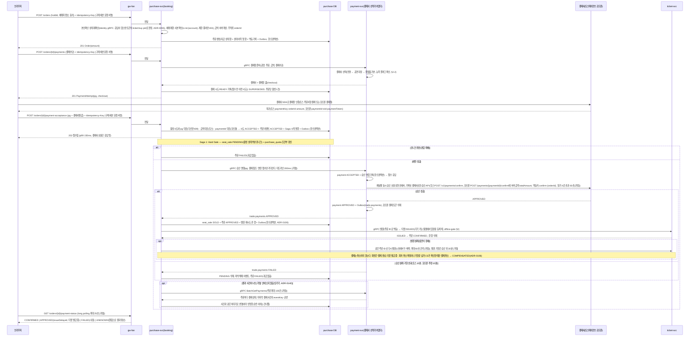
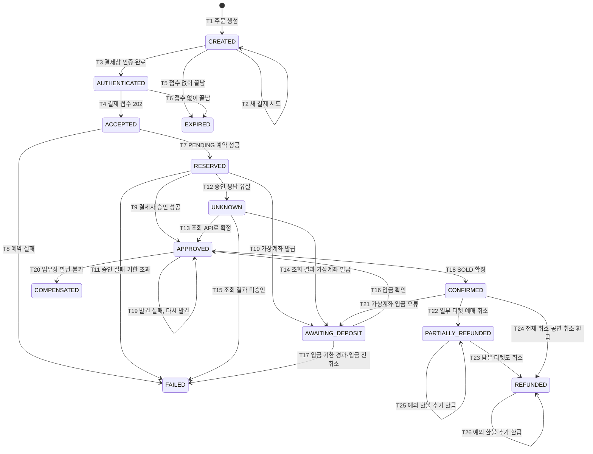
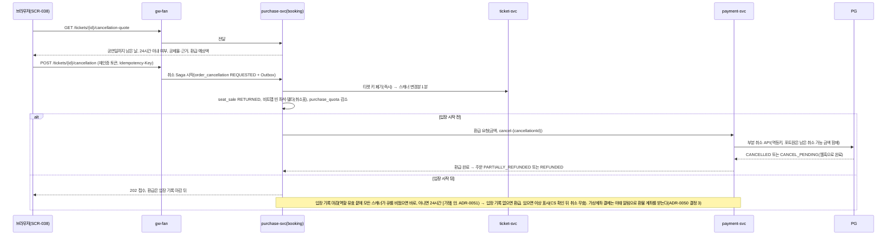

# 기능 설계: 주문·결제(Saga), PG 연동(토스페이먼츠·포트원, 결제사 선택), 예매 취소·환불

- **독자와 용도**: purchase-svc의 booking 모듈, payment-svc, 소비자 웹의 주문·결제·예매 취소 화면을 구현하는 엔지니어가 참조한다. Saga(여러 서비스에 걸친 일을 단계별로 처리하고, 중간에 실패하면 앞 단계를 되돌리는 방식) 오케스트레이션 단계, PG 어댑터 계약, 결제사 선택·고정·전환, 상태 전이 기계, 실패 보상 트랜잭션(여러 변경을 한꺼번에 반영하거나 한꺼번에 취소하는 작업 단위), 예매 취소와 환불 수명주기, 웹훅(일이 생기면 상대 서버가 우리 주소를 불러 알려 주는 방식) 처리, 보안 시크릿 관리, 일일 대사, 검증 테스트 포인트를 여기서 파악한다.
- **원문 출처**: 설계서 §6 <결제: Saga 오케스트레이션>, 설계서 §6 <결제 연동: 토스페이먼츠>, 설계서 §9 결제 접수·확정 SLO와 Degraded Mode, 설계서 §10 K7 검증, 29장(분산 멱등성 보장), 24장(Webhook 및 Long Polling), [ADR-0015](../adr/0015-tosspayments-two-phase-approval.md), [ADR-0029](../adr/0029-pg-adapter-toss-default-portone-compatible.md), [ADR-0044](../adr/0044-dual-pg-selection-and-switchover.md), POL-013·014·026·032·033·036. 외부 PG 규격은 토스페이먼츠와 포트원의 공식 개발자 문서(2026-10-09 실측 확인, §2.1 참조)를 따른다. 환불 기준은 공정거래위원회 고시 소비자분쟁해결기준(제2025-14호)을 따른다.
- **기준 기획 버전**: v1.0.
- **관련 ID**: FR-011, FR-012(발권 연결), FR-041, FR-042(홀드 해제 연결), FR-047, FR-051, FR-055·056(회차 취소·배상, docs/features/transfer-refund.md), FR-062(정산 지급, docs/features/settlement.md), FR-072(부정 예매 후보 묶음의 결제·주문 연결값, ADR-0171) · NFR-005, 006, 016, 018 · POL-012, 013, 014, 023, 026, 032, 033, 036, 038 · SCR-011, 012, 029, 030, 038 · API(프로그램끼리 요청과 응답을 주고받는 창구) `/v1/orders`, `/v1/orders/{orderId}/payments`, `/v1/orders/{orderId}/payment-acceptance`, `/v1/orders/{orderId}/payment-status`, `/v1/tickets/{ticketId}/cancellation-quote`, `/v1/tickets/{ticketId}/cancellation`, `/v1/partner/events/{eventId}/cancellation`, `/v1/webhooks/toss`, `/v1/webhooks/portone` · 이벤트 `trade.orders`, `trade.payments`, `trade.tickets`, `telemetry.behavior`(결제 화면 행동 요약, ADR-0171) · 데이터 docs/data.md §2 purchase_order·payment_attempt·order_cancellation·payment·payment_cancel·webhook_receipt, §4 트랜잭션 경계 1~4·8.

## 1. 개요

온라인 결제를 대행하는 전자지급결제대행사(PG)의 '구매자 브라우저 인증 → 가맹점 서버 최종 승인' 2단계 결제 구조를 좌석 동시성 제어 흐름에 결합하여 운영한다:

- **좌석 사전 예약(Hard Sale PENDING)과 승인 전 실패의 무과금 처리**:
  - 구매자가 PG 결제창에서 인증을 완료했더라도, 가맹점 서버가 최종 승인 API를 호출하기 전까지는 실제 금융 결제가 발생하지 않는다.
  - 시스템은 DB 계층에서 좌석 사전 예약(Hard Sale PENDING)에 성공한 경우에만 승인 API를 호출한다.
  - 좌석 홀드(결제하는 동안 다른 사람이 가져가지 못하게 좌석을 잠시 잡아 두는 것) 경합에서 밀려 예약에 실패한 주문은 금융 결제 및 취소/환불 절차 없이 즉시 **무과금 실패**로 안전하게 종결된다.
- **헥사고날 아키텍처 기반 멀티 PG 연동 ([ADR-0029](../adr/0029-pg-adapter-toss-default-portone-compatible.md))**:
  - 외부 PG 연동은 결제 포트(`PaymentGatewayPort`) 인터페이스 후방의 독립된 어댑터 패턴으로 격리한다.
  - 결제 시도마다 결제사 선택기(`PaymentGatewaySelector`)가 어댑터를 결정하고, 결제 접수 이후에는 해당 결제사로 고정한다(§2.2, [ADR-0044](../adr/0044-dual-pg-selection-and-switchover.md)).
  - **기본 결제사 (토스페이먼츠, Toss Payments)**: 테스트 키를 통한 실 서비스 수준 결제 흐름 모의와 헤더 기반 결제 실패 주입을 지원하여 플랫폼 기본 결제사로 운영한다(2026-10-08 소유자 확인, §2.1 표 참조).
  - **대체/지정 결제사 (포트원, PortOne V2)**: 국내 범용 표준 연동사로서 공연별 지정 및 비상 결제사 전환용으로 함께 운영한다.
  - 동일한 계약 테스트 스위트를 토스, 포트원, 내부 PG 시뮬레이터에 실행해, 세 구현이 같은 계약을 지키는지 검증한다.

## 2. 흐름(FR-011)

- 주문의 최종 결제 금액은 클라이언트가 보낸 값을 믿지 않고, 서버가 좌석 정가와 할인 정책으로 직접 계산한다. 위변조된 `amount`가 들어오면 바로 400 Bad Request로 막는다. 포트원은 클라이언트에게서 금액을 받지 않고, 승인 API의 `totalAmount`에 서버 금액을 넣어 포트원이 대조하게 한다(ADR-0044).
- 결제 접수 API는 '홀드 유효성 검증 + 결제사·결제 참조 대조와 저장 + Saga 시작 명령'을 DB 트랜잭션 하나(Transactional Outbox: 보낼 이벤트를 같은 트랜잭션으로 표에 적어 두었다가 나중에 보내는 방식)로 처리한 뒤 202 Accepted를 지체 없이 돌려준다. 외부 PG 호출을 동기 응답 경로에서 완전히 떼어 내므로, 접수 p99 지연시간 150ms(요청 백 건 중 아흔아홉 건이 이 시간 안에 끝난다는 뜻)를 보장한다(NFR-005).
- 결제 확정 처리 3초 예산은 PG 승인 2초 + 내부 Saga 처리 1초로 나눠 잰다. 2초는 승인 호출을 끊는 값이 아니라 측정과 '임박' 경보(SEV2, §9)의 기준이다(추천 적용 2026-10-28, 기술 검토 높음-16).
  - 결제사 HTTP 호출은 keep-alive 연결을 쓰고, 읽기 시간 초과(응답을 기다리는 최대 시간)는 두 결제사 권장대로 60초 [가정, 계약 때 확인]다. 연결 시간 초과는 3초 [가정]다. 토스페이먼츠 개발자센터 용어집 '타임아웃'은 결제 처리 API의 읽기 시간 초과를 60초로 두라고 하고, 포트원 V2 REST API 개요의 '요청 타임아웃 정책'은 최소 60초를 권한다(2026-10-28 원문 확인). 2초에 끊어도 결제사는 빨라지지 않고, 끊긴 요청은 결제사 안에서 계속 처리된다. 그러면 같은 멱등키(같은 요청이 여러 번 와도 한 번 처리한 것과 결과가 같게 하려고 요청에 붙이는 키)로 다시 보내 '처리 중'을 받고, 결과 모름 조회로 가고, 그 호출이 결제사 한도를 깎는다.
  - 느린 결제사로부터 자원을 지키는 일은 끊는 시간이 아니라 결제사 채널별 동시 승인 호출 상한(벌크헤드: 의존성별로 나눈 연결·동시 호출 몫)과 서킷 브레이커가 맡는다. 상한은 채널 추정 상한 × 2초 [가정](토스 600건, 포트원 100건)이고 payment-svc 파드 수로 나눠 파드마다 건다. 자리가 없으면 승인 명령은 승인 기한 안에서 재시도 큐에서 기다린다.
  - purchase-svc의 승인 요청 gRPC(서비스끼리 함수를 부르듯 빠르게 호출하는 통신 방식)는 payment-svc가 승인 명령을 받아 적었다는 답만 짧게 기다린다(데드라인 200ms [가정]). 승인 결과는 `trade.payments` 사건으로 받는다. 그래서 gRPC 데드라인과 결제사 지연이 묶이지 않는다. 결과가 Outbox 릴레이를 한 번 더 거치므로 내부 처리 1초 예산 안인지 P-T5로 잰다. 넘으면 결과 알림 경로를 다시 본다.
  - **결과 당기기(밀기와 당기기, 추천 적용 2026-10-29, ADR-0140)**: 결과는 평소처럼 `trade.payments` 사건으로 받는다(밀기). 사건은 Kafka(사건을 순서대로 쌓아 두고 여러 곳에 나눠 주는 메시지 시스템)를 거친다. 결과 사건이 5초 [가정] 안에 오지 않으면 purchase-svc가 payment-svc `BatchGetPayments`로 직접 묻는다(당기기, ADR-0140).
    - purchase-svc의 '결과 늦음 점검'이 1초 [가정]마다 돌며, 승인 요청이 접수된 지 5초 [가정]가 지나도 결과를 반영하지 못한 주문을 모은다. 그 주문들을 한 번에 최대 100건 [가정]씩 묻고, 같은 주문은 5초 [가정]에 한 번만 묻는다.
    - 답에는 주문마다 결제 원장의 지금 상태와 마지막 결제 사건(`payment_event` 행)의 `eventKey`와 순번이 든다. purchase-svc는 사건으로 받은 것과 같은 처리기로 반영하고, 이미 반영한 순번 이하는 건너뛴다. 그래서 사건이 뒤늦게 와도 두 번 반영되지 않는다. 결과가 아직 없으면(승인 중) 다음 점검에서 다시 묻는다.
    - payment-svc는 payment DB 쓰기 인스턴스의 `payment.order_id` 유일 색인으로 읽는다. 읽기 복제본은 복제가 늦으면 방금 승인한 건을 놓치므로 쓰지 않는다. 결제사는 부르지 않는다. 결과를 모르는 건(UNKNOWN)은 지금처럼 결제사 단독 조회 규칙(§4)이 맡는다. 데드라인은 500ms [가정]이고, purchase-svc 파드마다 동시 요청 4개 [가정]까지 보낸다. 사건 길이 멈춘 동안의 당기기는 초당 수백 건 수준이다 [추정: 결과를 기다리는 주문은 승인 초당 300건 × 10초 안팎이고, 한 주문을 5초마다 묻는다].
    - 당기기는 사건 길을 대신하지 않는다. 확정이 멈추지 않게 하는 보조 길이다. 평소에는 사건이 1초 안에 오므로 거의 돌지 않고, 돌면 그 자체가 경보 신호다(§9). 그래서 Kafka는 결제 확정의 '정확성 경로'가 아니라 '지연 경로'가 된다. 사건 길의 지연은 RB-39·RB-11로 고친다.
  - **주문 Saga 소비자의 키 단위 동시 처리(추천 적용 2026-10-29, ADR-0142)**: `trade.payments`의 키는 회차라, 인기 회차의 결제 결과는 한 파티션(토픽을 나눈 칸. 한 파티션은 소비자 하나만 읽는다)으로 몰린다. 그래서 주문 Saga 소비자는 파티션 안에서 업무 키(주문 ID) 단위로 동시에 처리하고, 앞 사건이 모두 끝난 위치까지만 커밋(어디까지 읽었는지 Kafka에 적는 것)한다(ADR-0142).
    - 같은 주문의 사건은 순서대로, 다른 주문의 사건은 동시에 처리한다. 파티션마다 동시에 처리하는 주문은 32개 [가정]이다. 재조정(소비자끼리 파티션을 다시 나누는 일) 때는 처리 중인 주문을 마치고 그 위치를 커밋한 뒤 넘기고, 다시 받은 사건은 `eventKey`로 거른다.
    - 처리 못 하는 사건은 Kafka 데드 레터 토픽이 아니라 그 서비스 DB의 보류 표 `held_event`로 옮기고, 같은 업무 키의 뒤 사건도 함께 보류한다(ADR-0142). 다시 해도 같은 결과일 실패(검증 실패, 상태 전이 불가, 코드 예외)를 5회 [가정] 겪은 사건이 대상이고, 다른 주문은 계속 처리한다. 저장소 연결 실패·시간 초과는 보류하지 않고 그 파티션을 멈춰 기다린다. 보류가 1건이라도 있으면 SEV2이고, RB-11 '보류 사건 다시 처리'로 원인을 고친 뒤 다시 넣는다. 보류된 주문의 결제 상태는 당기기가 다시 맞추지만, 보류 원인이 처리기 오류면 같은 오류를 낸다(남는 한계).
    - 인기 회차 결제 결과를 한 파티션에 승인 초당 300건으로 넣어도 결제 확정 p99 3초 안인지 P-T48로 잰다.
  - 최종 결과는 클라이언트의 Long Polling(서버가 결과가 생길 때까지 응답을 미루는 조회) 연결로 실시간 전달한다(NFR-006). 서버는 최대 25초 [가정] 기다린 뒤 그때의 상태로 답한다. `api` 호스트 앞의 CloudFront는 원본이 원본 응답 시간 초과(기본 30초) 안에 답하지 않으면 GET을 원본에 다시 보내므로, 서버 상한을 그보다 짧게 둔다. 게이트웨이 경로 시간 초과는 27초 [가정], 브라우저 시간 초과는 30초 [가정]다(docs/infra.md §4.1, 추천 적용 2026-10-28, 기술 검토 중간-047. 처음 상한 30초는 추천 적용 2026-10-09).
- 주문 애그리거트는 '상태 + 덧붙이기 이력 + Outbox'로 저장한다(추천 적용 2026-10-28, ADR-0113). 원본은 `purchase_order`의 지금 상태이고, 상태를 바꾸는 트랜잭션이 전이 이력(`order_event`: 이전 상태, 새 상태, 원인, 행위자, 시각, 빈틈 없는 번호)을 덧붙이고 Outbox 행을 마지막에 넣는다. 상태는 주문 전이 함수 하나로만 바꾸고, 정비 잡이 매일 마지막 이력과 지금 상태가 같은지 검사한다. 이벤트 소싱(상태를 사건의 재생으로만 만드는 방식)은 아니다. 이 이력으로 주문의 좌석 예약 상태를 시점별로 거슬러 올라가 다시 만들 수 있다(홀드 이력은 비동기로 적재되는 홀드 원장에서 가져오므로, 메모리에 데이터를 두는 빠른 저장소인 Redis의 장애 직전 원장에 적재되지 못한 홀드는 빠질 수 있다, docs/features/seat-hold.md §6). 이 기록은 고객 분쟁 해결의 법적 증거로 쓴다(FR-031).
- 계정을 병합해도 주문·결제 기록(주문 행, 덧붙이기 이력 `order_event`, 결제 원장, `payment_event`)의 `account_id`는 고치지 않는다(추천 적용 2026-10-28, 기술 검토 중간-054). 이력은 덧붙이기만 하는 기록이고, 주문·결제는 5년 보존하는 계약·대금결제 기록이기 때문이다. purchase-svc는 `identity.accounts-merged`로 흡수 계정 → 대표 계정 대응표 `merged_account`를 채운다. '내 주문'과 주문 소유 확인(취소·환불 요청 포함)은 대표 계정과 흡수 계정 ID 묶음으로 한다. 그래서 주문 행과 이력이 늘 같은 계정을 가리키고, 대표 계정은 흡수 계정의 주문을 그대로 보고 다룬다(docs/data.md §4 경계 9, docs/features/identity.md §2.1).
- 주문 레코드가 만들어진 때부터 최종 결제가 끝날 때까지, 사용자의 구매 세션은 무활동 상태여도 자동 만료되지 않고 유지된다(POL-009).
- **판매 일시정지(명령 3)**: 새 결제 시도 시작(`POST /v1/orders/{orderId}/payments`)과 결제 접수(`…/payment-acceptance`)는 423 Locked로 거절한다. 이미 접수된 결제는 끝까지 처리한다(docs/features/seat-hold.md §3과 같은 규칙, openapi). 화면은 '판매가 잠시 멈췄습니다'를 보여 주고, 고른 좌석은 홀드 시간 동안 유지된다(docs/design/d5 §9.2 19번). 확인은 purchase-svc 파드 메모리의 판매 상태로 한다. 그 상태는 purchase DB `sale_control`(원본)에서 오고, 파드는 시작할 때 이것을 읽어야 준비 상태가 되며 2초 [가정]마다 다시 맞춘다. 그래서 명령 뒤 확장·재시작으로 뜬 파드도 423을 낸다(추천 적용 2026-10-28, ADR-0103, docs/features/seat-hold.md §3).
- **판매 종료(소유자 결정 2026-10-14, ADR-0064)**: 회차의 판매 종료(공연 시작 24시간 전, `event.starts_at` - 24시간, docs/data.md §2) 뒤에는 새 주문을 받지 않는다. 다만 판매 종료 전에 만든 유효한 홀드의 주문 생성, 결제 시도 시작, 결제 접수, Saga는 지금 규칙(홀드를 유지하는 시간인 TTL·1회 연장·결제창 유지 30분, docs/features/seat-hold.md §5) 안에서 그대로 받는다(진행 중 세션 허용, 추천 적용 2026-10-14, ADR-0064). 판매 종료 뒤에 만든 홀드는 없으므로(seat-hold §3), `POST /orders`는 홀드의 생성 시각이 판매 종료 전인지 확인하고 아니면 410 `sale-ended`로 거절한다. 판매 종료 직전에 홀드한 사람은 판매 종료 뒤에도 최대 홀드·결제 시간만큼 결제를 마칠 수 있다(남는 한계, ADR-0064). 예외 하나(추천 적용 2026-10-31, ADR-0171): 우선 구매(이의가 인정된 부정 예매 표 취소의 되돌림, POL-046 ⑦) 입장 토큰(클레임 `prio`)으로 그 권리의 좌석을 홀드한 주문은 판매 종료 뒤에도 받는다. 금액은 서버가 계산하지 않고 권리의 원래 가격(`priority_grant.price`, 취소 수수료 없음)이다. 권리는 결제 완료 때 USED가 되고, 결제가 실패하면 권리 기한(48시간 [가정]) 안에서 다시 시도할 수 있다. 진행 중인 주문이 있으면 새 주문은 409다(docs/features/seat-hold.md §5 '우선 구매 보류', docs/features/transfer-refund.md §7.4). 가상계좌 입금 기한(§6, 발급 다음 날 23:59와 입장 시작 24시간 전 중 이른 때)과 예매 취소(§4.1, 공연 시작 전까지)는 바뀌지 않는다.
- **예매 제한 확인(소유자 결정 2026-10-30, open-items 75번, ADR-0161 결정 3)**: CS 책임자가 계정의 예매를 제한하면 입장 확정에서 queue-svc가 먼저 막고(docs/features/queue-admission.md §6 '예매 제한 확인'), 이미 입장한 구매 세션은 여기서 한 번 더 본다. purchase-svc는 ops-svc의 `SetBookingRestriction`(purchase/v1/account.proto)으로 받은 사본을 좌석 Redis `s:rst:{account}`에 둔다(docs/data.md §3). `POST /orders`는 주문 행을 만들기 전에 그 사본을 읽고, ACTIVE이고 끝 시각 전이면 주문을 만들지 않고 403 `booking-restricted`로 답한다. 같은 처리에서 그 구매 세션의 홀드를 모두 풀어(해제 Lua) 좌석을 바로 돌려준다. 구매 세션은 끝내지 않는다(끝나는 사유 값을 늘리지 않으려는 것이다). 그래서 그 계정이 남은 최대 체류 동안 홀드를 다시 잡을 수는 있지만 주문은 만들지 못한다(남는 한계). 이미 만든 주문의 결제 시도·결제 접수는 막지 않는다(제한 전에 시작한 거래다). 사본이 없으면 제한이 없는 것으로 보고, 사본을 잃은 경우의 다시 보내기는 queue-admission §6과 같다. 세부는 추천 적용(2026-10-30)이다. 시험은 P-T49다.
- **주문 생성 사건의 조사용 칸(추천 적용 2026-10-31, ADR-0171)**: 주문 생성 사건(`OrderEvent` CREATED)에 두 칸을 더한다. 부정 예매 조사(POL-046)에서 주문을 여정과 연락처로 묶으려는 것이다. 시험은 P-T52다.
  - `journeyId`: 구매 세션 상태의 여정 ID다(한 사람이 한 회차에 들어와 나갈 때까지를 잇는 조사용 추적 ID, docs/features/seat-hold.md §2).
  - `contactRef`: 예매자 휴대폰 번호를 E.164(국가 번호를 붙이고 앞자리 0과 기호를 뺀 국제 표기. 예: 010-1234-5678은 `+82` 뒤에 `1012345678`)로 맞춘 값의 조사용 가명 `HMAC(inv-ref-key, "contact|" + 번호)`다. `inv-ref-key`는 조사 갈래 전용 HMAC 키(비밀 키로 만드는, 원래 값으로 되돌릴 수 없는 값의 키)다. purchase-svc가 주문 생성 트랜잭션 안에서 계산해 Outbox에 넣고, 번호 원문은 사건에 싣지 않는다. identity-svc가 계정의 본인확인 휴대폰 번호로 같은 식의 값을 두므로(`account_contact_ref`, docs/features/identity.md), 예매자 번호가 다른 계정의 본인확인 번호와 같으면 조사 적재가 둘을 잇는다.
  - 결제 사건(`PaymentEvent`)에는 여정 ID가 없다. payment-svc는 여정을 모르고, 조사 적재가 주문 ID로 결제 사건을 주문의 여정에 잇는다. 분석 저장소로 가는 적재는 두 칸을 버린다(조사·연구 두 갈래를 잇지 않는다, ADR-0171 결정 2).
- **결제 화면 행동 요약(추천 적용 2026-10-31, ADR-0171 결정 4)**: 브라우저는 주문서·결제 화면(SCR-011)에서 잰 행동 요약(openapi `BehaviorSummary`, 좌석 화면과 같은 필드)을 결제 시도 시작(`POST /v1/orders/{orderId}/payments`) 본문 `behavior`에 싣는다. 구간은 주문서 화면을 연 때부터 그 요청까지이고, 원시 좌표·키 값·입력한 글자는 싣지 않는다(ADR-0065 결정 9). 시험은 P-T51이다.
  - purchase-svc는 그 주문의 첫 결제 시도일 때만, 응답을 보낸 뒤 비동기로 `telemetry.behavior`에 `BehaviorSignal`(screen `PAYMENT`, `journeyId`, pid, 회차)을 낸다. 결제창을 닫고 같은 주문에서 다시 시도할 때 실려 온 요약은 버린다. 같은 멱등키로 다시 보낼 때는 처음 본문을 그대로 보낸다.
  - 결제사 선택과 결제창 값에는 쓰지 않는다. 망 정보(`netClass`·`asn`)와 기기 가명은 싣지 않는다(좌석 화면과 같다, docs/features/seat-hold.md §3).

### 2.1 PG 어댑터 계약(ADR-0029)

**결제 포트 인터페이스**: `capabilities()`, `checkout(order, attempt, payMethod)`(결제창 값, ADR-0044), `confirm(order, paymentRef, amount, idemKey)`, `query(paymentRef)`, `cancel(paymentRef, amount | 전액, reason, idemKey)`, `parseWebhook(headers, body)`. 주문 Saga 오케스트레이터는 추상화된 포트 인터페이스에만 의존하고, 개별 PG사의 세부 명세는 알지 못한다. 능력 플래그(`capabilities`)는 서버 승인 지원 여부, 승인 유효 기한, 부분 취소 지원 여부, 웹훅 디지털 서명 여부, 멱등키 보관 주기, 채널별 호출 상한선(ADR-0036), 리디렉션(브라우저를 다른 주소로 보내는 응답) 결제 지원 여부(ADR-0044)를 돌려준다. 서버 승인 방식을 지원하지 않는 결제 수단이나 채널은 입장권 예매 결제에 전혀 노출하지 않는다(POL-013).

**PG사별 기술 명세 대조**(공식 문서 실측 검증 완료, 2026-10-09):

| 항목 | 토스페이먼츠 | 포트원 V2 | 계약 반영 사항 |
| --- | --- | --- | --- |
| 서버 승인 지원 | 일반결제는 늘 '인증 완료 → 서버 confirm' 방식이다. 결제창 인증 유효시간은 30분이다. 인증 뒤 10분 이내에 confirm을 호출하지 않으면 `EXPIRED`로 만료된다(확인 완료). | 채널 설정에서 '수동 승인'을 명시적으로 켠 경우에만 지원된다. 엑심베이, 페이레터 해외결제, 이지페이(KICC)는 수동 승인을 지원하지 않는다(확인 완료). 승인 기한은 하위 PG사별로 다르며, 문서는 즉시 호출을 권고한다. 표준 기한은 10분으로 추정한다(추정, ADR-0036). | `serverConfirm`, `confirmDeadline`(토스 10분. 포트원은 채널별 설정이며 기본값으로 추정치 10분을 적용한다. 실제 기한이 더 짧으면 늦은 재시도가 실패해 무과금으로 끝난다). |
| 승인 API | `POST /v1/payments/confirm` | `POST /payments/{paymentId}/confirm` (`paymentToken` 필수, `totalAmount`·`currency`·`isTest` 검증 지원) | 포트의 `confirm()` 메서드 하나로 모아 호출한다. |
| 멱등키 규격 | `Idempotency-Key` 헤더, 최대 300자, 첫 요청 때부터 15일간 보관 보장(확인 완료). | `Idempotency-Key` 헤더, 16~256자 ASCII 문자열을 큰따옴표로 감싼 형태(구조화 필드 값의 문자열 sf-string. 포트원 문서는 RFC 8941을 들고, 그것을 대체한 RFC 9651 §3.3.3도 같다), 보관 3시간(포트원 문서에 '추후 변경 가능'으로 적혀 있다). 처리 중인 요청을 다시 보내면 409 `IDEMPOTENCY_OUTSTANDING_REQUEST`(확인 완료, 2026-10-27 다시 확인, 기술 검토 낮음-070). | 공통 키 형식으로 `confirm-{orderId}`, `cancel-{cancellationId}`(약 44자)를 써서 양쪽 규격을 모두 맞춘다. 큰따옴표로 감싸는 일은 포트원 어댑터가 맡는다. 안전 재시도 창은 짧은 쪽인 3시간 이내로 제한하고, 초과하면 조회 API를 먼저 호출한다. 포트원이 보관 기간을 바꿀 수 있으므로 이 값은 코드에 고정하지 않고 어댑터의 능력 플래그(`capabilities()`의 멱등 보관 시간)로 받는다(추천 적용 2026-10-28, 기술 검토 낮음-070). |
| 처리 중·중복 처리 | 409 `IDEMPOTENT_REQUEST_PROCESSING`, 400 `ALREADY_PROCESSING_REQUEST` 또는 `ALREADY_PROCESSED_PAYMENT` 반환. FAQ에 confirm 이중 호출 때 500 에러가 날 가능성이 적혀 있다(확인 완료). | 409 `IDEMPOTENCY_OUTSTANDING_REQUEST`, 409 `ALREADY_PAID` 반환(확인 완료). | 내부 결과 코드로 정규화해 안전하게 처리한다. |
| API 호출 한도 | 테스트 환경에서는 API별 분당 100건으로 제한된다(확인 완료). 운영 환경 한도는 가맹점 계약에 따르며, 피크 300 TPS(초당 처리 건수)로 추정한다(추정, ADR-0036). | 포트원 자체 API 한도는 적혀 있지 않지만, 하위 PG사(키움페이 등)가 비인증 결제 API를 초당 50건 이하로 권고한다(확인 완료). 채널 하나당 초당 50건으로 보수적으로 추정한다(추정, ADR-0036). | `capabilities()`의 호출 상한을 어댑터 계층의 토큰 버킷(일정 속도로 채워지는 토큰이 있을 때에만 요청을 보내게 하는 장치)으로 제한한다(토스 300, 포트원 50, 시뮬레이터는 시험별 동적 설정). 기준값 초과 승인 요청은 승인 기한 안에서 재시도 큐로 돌린다. 합산 동시 입장 상한은 5,000으로 제한한다(docs/architecture.md §9.5). |
| 읽기 시간 초과 권장 | 결제 처리 관련 API의 읽기 시간 초과는 60초로 둔다. 시간 초과 뒤 다시 보낼 때는 멱등키를 쓴다(개발자센터 용어집 '타임아웃', 확인 완료, 2026-10-28) | PG와 결제 원천사의 응답 지연을 생각해 읽기 시간 초과를 최소 60초로 권한다(REST API V2 개요 '요청 타임아웃 정책', 확인 완료, 2026-10-28) | 어댑터의 읽기 시간 초과는 60초 [가정, 계약 때 확인], 연결 시간 초과는 3초 [가정]다. 자원은 채널별 동시 승인 호출 상한과 서킷 브레이커가 지킨다(§2, 추천 적용 2026-10-28, 기술 검토 높음-16) |
| 실패 재현 기제 | `TossPayments-Test-Code` 헤더로 여러 결제 실패 코드를 바로 모의할 수 있다(확인 완료). | 실패 주입용 공식 모의 헤더는 제공되지 않는다(확인 완료). | 포트원 계약 테스트는 자체 시뮬레이터와 녹화 응답(VCR)을 중심으로 하고, 실제 테스트 채널은 스모크 테스트에만 쓴다. |
| 결제 취소 API | `POST /v1/payments/{paymentKey}/cancel` (`cancelReason` 필수, `cancelAmount` 생략 시 전액 취소, 확인 완료). | `POST /payments/{paymentId}/cancel` (`reason` 필수, `amount` 생략 시 전액 취소, `currentCancellableAmount` 잔액 검증 지원, `REQUESTED` 비동기 취소 존재, 확인 완료). | `cancel()` 메서드는 결과를 CANCELLED, CANCEL_PENDING, REJECTED, UNKNOWN으로 표준화해 돌려준다. 포트원과 연동할 때는 남은 취소 가능 금액을 늘 함께 보낸다. |
| 테스트 자격증명 | 테스트 키 접두사 `test_ck`, `test_sk`, 라이브 키 `live_`로 엄격히 구분된다(확인 완료). | 콘솔 채널 관리에서 연동 모드를 '테스트'로 지정하고, 웹훅 URL과 시크릿을 환경별로 나눠 관리한다(확인 완료). | AWS Secrets Manager 경로와 시크릿 이름으로 운영 키와 테스트 키를 물리적으로 떼어 둔다(secrets-and-keys). |
| 결제창과 복귀 값 | SDK v2(`js.tosspayments.com/v2/standard`). '결제위젯'은 주문서형·결제창형 결제로 이름이 바뀌었다. 성공 URL 쿼리로 `paymentKey`·`orderId`·`amount`(주문서형은 `paymentType`도)가 온다(확인 완료, 2026-10-13). | 브라우저 SDK(`cdn.portone.io/v2/browser-sdk.js`). 가맹점이 결제수단과 채널을 지정한다. 응답으로 `paymentId`·`txId`·`paymentToken`(수동 승인 채널만)이 오고, 리디렉션 방식이면 쿼리로 온다(확인 완료, 2026-10-13. 리디렉션의 결제 토큰은 공식 SDK 소스로 간접 확인, P-T33). | 포트의 `checkout()`이 결제창 값을 만들고, 결제 접수 본문은 `pg` 값으로 나뉜다(§2.2). |
| 주문 식별자 재사용 | `orderId`는 승인·취소된 뒤에만 다시 쓸 수 없다(`DUPLICATED_ORDER_ID`, 확인 완료, 2026-10-13). | 같은 `paymentId`로 여러 번 결제를 시도할 수 있고 성공은 한 번뿐이다(확인 완료, 2026-10-13). | 토스 `orderId`는 주문 ID를 쓰고, 포트원 `paymentId`는 `pay-{orderId}`로 주문당 하나를 쓴다. 같은 주문의 재시도는 허용되고 성공은 한 번이다. |
| 대사용 조회 | 거래 조회 `GET /v1/transactions`(기간의 승인·취소 전체, 응답 최대 60초, 확인 완료, 2026-10-13). | 결제 대용량 다건 조회 `GET /payments-by-cursor`(기간 안의 전체 결제 건, 확인 완료, 2026-10-13). | 일일 대사를 결제사별로 돌린다(§8). |
| 구매자 정보 | 결제창에 필수로 넘기지 않는다. | 하위 결제사에 따라 이메일·전화번호가 필수일 수 있다(확인 완료, 2026-10-13). | 채널이 요구하는 항목만 넘기고, 처리방침에 수탁자로 공개한다(ADR-0044 결정 10). |
| 에스크로(결제대금예치) | 상점 단위로 상점관리자에서 결제수단별로 켠다(신용·체크카드·가상계좌·계좌이체, 추가 계약). 켜면 주문서형·결제창형이 계좌이체·가상계좌에 체크박스를 자동으로 띄우고, `useEscrow`가 false거나 없으면 구매자가 고른다. 결제 → 배송 등록 → 구매 확인 순서다. 영업일 3일 동안 고르지 않으면 자동 확정되고, 구매 확정 전에는 부분 취소가 안 된다(확인 완료, 2026-10-14). | 결제 요청 `isEscrow`(기본 false, PG사 협의 뒤), 배송 정보 등록 `POST /payments/{paymentId}/escrow/logistics`, 구매 확정 `POST /payments/{paymentId}/escrow/complete`(확인 완료, 2026-10-14). | 티켓 상점은 에스크로를 켜지 않는다. 굿즈 택배만 에스크로 상점으로 결제하고, 송장 등록 때 배송 정보를 등록한다(§6, POL-014). |
| 결제 수단 식별값(2026-10-31 원문 확인, ADR-0171) | Payment 객체 `card`에 발급사 코드 `issuerCode`, 매입사 코드 `acquirerCode`, 가린 카드 번호 `number`(최대 20자), 카드 종류 `cardType`(신용·체크·기프트·미확인), 소유자 종류 `ownerType`, 승인 번호 `approveNo` 등이 있다. 응답 예시는 `"43301234****123*"`(앞 8자리가 보인다)이지만 가리는 규칙은 문서에 없다(확인 못 함). 카드 지문·카드 고유 식별자·가상카드 표시는 없다. 빌링키는 구매자 키(`customerKey`)에 묶여 있어 계정을 넘어 같은 카드를 알아보는 값이 아니다([API 문서](https://docs.tosspayments.com/reference), [자동결제 API](https://docs.tosspayments.com/guides/v2/billing/integration-api), [용어 BIN](https://docs.tosspayments.com/resources/glossary/bin)) | `PaymentMethodCard.card`에 `publisher`·`issuer`·`brand`·`type`·`ownerType`·`bin`(앞 6자리나 8자리)·`name`·`number`(가린 번호)가 있다. 모든 칸이 필수는 아니고, 하위 결제사마다 어느 칸을 채우는지는 확인 못 했다. 카드 지문·가상카드 칸은 없다([V2 공식 스키마](https://developers.portone.io/schema/v2.openapi.json)) | 결제사가 카드 지문을 주지 않으므로 payment-svc가 승인 응답의 카드 정보로 약한 연결값 `paymentMethodRef`·`cardBin`을 만든다(아래 '결제 수단 연결값'). 가상카드 여부 칸은 두지 않는다 |

**공통 결과 코드 정규화**:

| 정규화 계약 결과 | 토스페이먼츠 응답 | 포트원 V2 응답 | Saga 오케스트레이터 동작 |
| --- | --- | --- | --- |
| `APPROVED` | HTTP 200 성공 | HTTP 200 성공 (`pgTxId`, `paidAt`) | 좌석 SOLD 확정 전이와 발권 파이프라인 시작 |
| `ALREADY_APPROVED` | 400 `ALREADY_PROCESSED_PAYMENT` | 409 `ALREADY_PAID` | 결제 조회 API로 금액이 맞는지 검증한 뒤 `APPROVED`와 똑같이 성공 처리 |
| `IN_PROGRESS` | 409 `IDEMPOTENT_REQUEST_PROCESSING` 또는 400 `ALREADY_PROCESSING_REQUEST` | 409 `IDEMPOTENCY_OUTSTANDING_REQUEST` | payment-svc가 지수 백오프(재시도 간격을 점점 늘리는 것)를 적용해 승인 유효 기한 안에서 같은 멱등키로 다시 요청하고, Saga는 결과(`trade.payments`)를 기다린다 |
| `DECLINED` | 카드 한도 초과 등 4xx (예: `REJECT_CARD_PAYMENT`) | 400 `INVALID_PAYMENT_TOKEN`, 409 `INFORMATION_MISMATCH` | 좌석 PENDING 즉시 삭제와 사용자 무과금 실패 처리 |
| `WAITING_FOR_DEPOSIT` | 가상계좌 발급 응답(입금 대기) | 가상계좌 발급 응답(입금 대기) | 주문 AWAITING_DEPOSIT, 좌석 PENDING 유지, 구매 세션 종료. 입금 웹훅 뒤 조회 API로 입금을 확인해 확정(가상계좌를 허용한 공연만, POL-014, 추천 적용 2026-10-20, ADR-0073) |
| `UNKNOWN` | 네트워크 시간 초과, 5xx 서버 오류 | 네트워크 시간 초과, 5xx, 502 `PG_PROVIDER` | UNKNOWN 상태로 따로 둔 뒤, 백그라운드의 단독 결제 조회 API로 상태 최종 확정 |

**분석용 실패 범주**(ADR-0052): 결제 실패를 알리는 `PaymentEvent`에는 어댑터가 정한 `failureCategory`를 싣는다. `DECLINED` 중 카드 한도·잔액·정지는 `CARD_DECLINED`, 결제창 이탈·취소(실패 리디렉션)는 `USER_ABORTED`, 금액·토큰 불일치(§4.2 10·18)는 `VALIDATION`, 승인 기한 만료는 `EXPIRED`, `UNKNOWN`을 조회한 뒤 실패로 확정된 것과 결제사 오류는 `PG_ERROR`, 결제사 한도 초과 응답은 `THROTTLED`다. 결제사별 오류 코드와 범주의 대응표는 어댑터 계약 테스트에 둔다. 공연 리포트의 결제 실패 사유와 결정 규칙은 이 범주로 계산한다(docs/features/analytics.md §3.4).

**결제 수단 연결값(추천 적용 2026-10-31, ADR-0171 결정 4)**: 부정 예매 조사(POL-046)에서 같은 카드로 여러 계정이 결제했는지 묶어 보려는 값이다(FR-072). 두 결제사 모두 카드 지문(같은 카드면 늘 같은 값으로 주는 식별자)과 가상카드 표시를 주지 않는다(위 표, 2026-10-31 확인). 그래서 카드 정보로 약한 값을 만든다. 시험은 P-T50이다.
- **계산**: payment-svc가 승인 응답(결과 모름을 조회로 확정했으면 그 조회 응답)의 카드 정보로 계산한다. `paymentMethodRef = HMAC(inv-ref-key, "pay|" + BIN 6자리 + "|" + 가린 번호의 보이는 끝자리 + "|" + 발급사 코드 + "|" + 카드 종류)`다. `inv-ref-key`는 조사 갈래 전용 HMAC 키이고, 회전과 접근 권한은 docs/security/secrets-and-keys.md가 정한다. `cardBin`은 BIN(카드번호 앞자리로 정해지는 발급사 번호) 6자리다. 토스는 가린 번호의 앞 6자리(가리는 규칙이 문서에 없어 확인 필요), 포트원은 `card.bin`의 앞 6자리를 쓴다. 발급사 코드와 카드 종류는 어댑터가 결제사별 값을 공통 값으로 맞춘 뒤 넣는다. 그 대응표는 실패 범주처럼 어댑터 계약 시험에 둔다.
- **싣는 곳**: 두 값을 결제 원장에 두고 `PaymentEvent`의 승인 사건(APPROVED)과 그 뒤 사건(부분 취소·취소 등)에 싣는다. 응답에 카드 정보가 없는 결제(가상계좌, 계좌이체, 카드 정보를 주지 않는 간편결제)는 두 칸이 빈다. 두 칸은 늘 함께 있거나 함께 빈다. 카드 정보에 BIN이 없으면 둘 다 비운다. 발급사 코드·카드 종류·보이는 끝자리가 빠지면 그 자리를 빈 글자로 두고 계산한다(같은 결제사 안에서는 같은 카드면 같은 값이 나온다). 결제 사건에는 여정 ID를 싣지 않고, 조사 적재가 주문 ID로 주문의 여정에 잇는다(§2 '주문 생성 사건의 조사용 칸').
- **받지 않는 것**: 카드 번호 원문은 지금처럼 받지 않는다(§7 '신용카드 정보 격리'). 결제사가 준 가린 번호는 계산에만 쓰고 저장하지 않는다. 가상카드 여부 칸은 두지 않는다. 두 결제사 모두 주지 않으므로 ADR-0171 '되돌릴 조건'대로 칸을 빼고 남은 연결 신호로 묶는다. 분석 저장소로 가는 적재는 두 칸을 버린다(ADR-0171 결정 2).
- **한계**: 서로 다른 카드가 같은 값을 가질 수 있다(BIN·발급사·종류가 같고 보이는 끝자리만 같으면 같다). 그래서 혼자서는 묶음 근거가 되지 않고, 기기·연락처·시간창 안의 IP 같은 다른 신호와 함께만 쓴다(ADR-0171 결정 6). 결제사가 다르면 보이는 자리가 달라 같은 카드도 다른 값이 될 수 있다. 토스의 가리는 규칙이 바뀌면 같은 카드의 값이 바뀌므로, 테스트 결제의 가린 번호 모양을 P-T50으로 확인한다.

**어댑터 계약 테스트**: 공통 테스트 항목 묶음(결제창 값 생성, 정상 승인, 한도 초과 거절, 동시 처리 중 경합, 이미 승인된 건 재요청, 시간 초과 뒤 단독 조회로 확정, 승인 기한 만료, 부분 취소, 전액 환불, 웹훅 중복 수신)을 세 어댑터에 똑같이 실행한다. PG 시뮬레이터는 매 PR(코드 변경을 합쳐 달라는 요청)마다 완전 자동으로 실행한다. 토스와 포트원의 실제 테스트 샌드박스는 분당 한도를 지키며 1일 1회 정기 스모크 테스트로 실행한다.

**PG 시뮬레이터의 기본 승인 지연(추천 적용 2026-10-28, 기술 검토 낮음-120)**: 시뮬레이터는 시험이 따로 지연을 넣지 않으면 승인 응답을 로그정규 분포(오른쪽 꼬리가 긴 분포)로 늦춘다. 중앙값 300ms, p99 1.5초 [가정]이다. 이 값은 근거가 없다. 결제사가 승인 지연 분포를 공개하는지는 확인 필요다. 그래서 NFR-006의 '결제 확정 p99 3초'를 시뮬레이터로 잰 결과는 둘로 나눠 성능 장부에 남긴다. 하나는 우리 몫(요청마다 종단 지연에서 추적의 결제사 승인 호출 구간을 뺀 값)의 p99이고, 다른 하나는 이 가정 분포를 더한 종단 p99다. 실제 결제사의 지연은 우리 몫으로 판정하지 않는다. 장부의 `manifest.json`에는 쓴 분포와 매개변수를 적는다(docs/perf-ledger.md §2.2). 시험별로 넣는 지연(P-T11·P-T34·P-T40)은 이 기본값을 바꿔 쓴다.

### 2.2 결제사 선택·고정·전환(POL-036, ADR-0044)

토스페이먼츠와 포트원을 함께 운영한다. 결제사별 구현은 외부 API를 포트로 바꾸는 어댑터다(§2.1). 결제 시도마다 어댑터를 고르는 일은 payment-svc의 결제사 선택기(`PaymentGatewaySelector`)가 맡는다. 고른 어댑터가 같은 포트로 쓰이므로 이 구조는 전략 패턴이고, 주문 Saga는 어느 결제사인지 모른다. 접수 뒤의 호출은 결제 기록의 결제사 값으로 어댑터 등록부에서 어댑터를 찾는다(추천 적용, 2026-10-13).

| 단계 | 정하는 것 | 규칙 |
| --- | --- | --- |
| 결제 시도 시작(`POST /v1/orders/{orderId}/payments`) | 이번 결제창의 결제사 | ① 공연에 결제사 전환이 켜져 있고(payment DB `pg_switch`, 아래 '장애 시 전환', ADR-0143) 대체 결제사가 있으면 대체 결제사 ② 공연에 지정된 기본 결제사 ③ 지정이 없으면 플랫폼 기본값(기본 토스페이먼츠, 대체 포트원. 설정 파일에 두고 배포로만 바꾼다). 고른 채널이 서버 승인을 지원하지 않거나 비활성이면 503과 새 결제 일시 정지 안내(§9)로 응답하고 경보를 낸다. 이 동안에도 주문을 만들고 결제 접수 전인 홀드의 남은 시간은 멈춘다(ADR-0085). 다른 결제사로 몰래 넘기지 않는다 |
| 결제창을 닫고 다시 시도 | 결제사 다시 고르기 | 주문당 활성 결제 시도는 1건이다(§4.2 1·2). 접수 전의 이전 시도는 SUPERSEDED가 되고, 새 시도는 그때의 규칙으로 고른다. 승인 요청 전에는 돈이 움직이지 않으므로, 결제사가 바뀌어도 이중 결제가 생기지 않는다 |
| 결제 접수(`POST /v1/orders/{orderId}/payment-acceptance`) | 결제사 고정 | 본문의 `pg`가 활성 시도의 결제사와 다르면 409를 돌려준다. 접수 뒤 승인·재시도·조회·취소·환불·웹훅·대사는 결제 기록의 결제사로만 간다. 승인 요청을 보낸 결제는 다른 결제사로 옮기지 않는다 |

**결제사별 접수 계약**:

| 결제사 | 결제 시도 응답(`checkout`) | 결제 접수 본문 | 서버 검증 |
| --- | --- | --- | --- |
| 토스페이먼츠 | 클라이언트 키, 구매자 키(CSPRNG 무작위 값, 계정 ID 아님), `orderId`(주문 ID), 주문명, 금액, 성공·실패 URL | `pg=TOSS`, `paymentKey`, `amount` | 금액을 서버 주문 금액과 대조하고, 승인 API에 `paymentKey`·`orderId`·`amount`를 보낸다 |
| 포트원 V2 | 상점 ID, 채널 키(고른 결제수단을 받는 수동 승인 채널), `paymentId`(`pay-{orderId}`), 주문명, 금액, 통화, 리디렉션 URL, 채널이 요구하는 구매자 항목만 | `pg=PORTONE`, `paymentId`, `paymentToken`, `txId` | `paymentId`를 활성 시도와 대조한다. 금액은 받지 않고, 승인 API의 `totalAmount`·`currency`·`isTest`에 서버 값을 넣어 포트원이 대조한다 |

- **결제 토큰 보관**: 포트원 결제 토큰은 승인 결과가 정해질 때까지만 접수 Outbox와 결제 원장(`pg_confirm_token`)에 두고, 승인·거절·만료가 정해지면 지운다. 로그·응답·분석 이벤트에는 넣지 않는다(docs/security/asvs/payment.md).
- **공연별 지정**: 운영자가 운영 명령 12 '결제사 지정'으로 공연의 기본·대체 결제사를 정한다. 온세일 윈도우(판매가 열리는 시각 앞뒤로 접속이 몰리는 기간) 밖에서 1인 승인으로 하고, dry-run이 바뀌는 동시 입장 목표 상한을 보여 준다(docs/features/control-tower.md §3). core-svc가 공연에 저장하고, payment-svc와 admission-ctrl은 설정 이벤트로 받는다. 파트너와 구매자는 결제사를 고르지 않는다. 판매 승인 때 지정이 비어 있으면 그때의 플랫폼 기본값을 공연 지정으로 저장한다. 그래서 판매 승인된 공연은 늘 지정이 있고, 플랫폼 기본값을 배포로 바꿔도 이미 승인한 공연의 결제사와 동시 입장 상한은 바뀌지 않는다(추천 적용 2026-10-14, ADR-0062).
- **장애 시 전환**: 결제 감내 모드인 '대체 결제사 전환'(명령 6, commander 요청 + 요청자가 아닌 operator 이상 1인 승인, 둘 다 재인증)을 켜면, 새 결제 시도부터 대체 결제사로 간다. 범위는 회차 하나 또는 플랫폼 전체다(결제사 지정은 회차 칸이다, ADR-0093. 운영자가 공연을 고르면 ops-svc가 그 공연의 회차마다 명령을 낸다). 전환은 Kafka 설정 사건이 아니라 제어 gRPC(`ControlReceiver/ApplyControl`)로 payment-svc의 준비된 모든 파드와 admission-ctrl 리더에 보낸다(명령 3과 같은 길, 데드라인 1초 [가정], 같은 명령 ID·판 번호로 다시 보냄). payment-svc는 payment DB `pg_switch`(범위: 회차 또는 플랫폼, 판 번호)에 판 번호가 지금보다 클 때만 쓰고, 모든 파드가 2초 [가정]마다 다시 읽어 맞추며, 새 파드는 이 표를 읽어야 준비 상태가 된다. admission-ctrl은 대체 결제사 채널 상한으로 동시 입장 목표 상한을 다시 계산하려고 리더 상태에 판 번호와 함께 적는다. ack(받았다는 확인)는 집행하는 모든 곳이 그 판 이상을 적용한 것이다. 그래서 결제사 장애와 Kafka 장애가 겹쳐도 전환이 퍼진다. `control.settings` 사건도 그대로 내지만 분석·감사·다른 서비스의 표시용이다(추천 적용 2026-10-29, ADR-0143 결정 1). 명령 12(결제사 지정)는 온세일 윈도우 밖에서만 하므로 지금처럼 설정 사건으로 둔다. 이미 접수된 결제는 원래 결제사의 재시도 큐에서 승인 기한 안에 처리되거나 과금 없이 만료된다(§9). 시스템은 서킷 브레이커(계속 실패하는 호출을 잠시 끊어 장애가 번지지 않게 하는 장치)가 열린 상태가 이어지면 전환을 후보로 추천만 한다(POL-021 C-3).
- **대체 채널의 하위 결제사(추천 적용 2026-10-28, 기술 검토 중간-042)**: 포트원은 여러 결제사를 묶어 주는 중계 서비스라서, 채널마다 실제로 결제를 처리하는 하위 결제사가 있다. 포트원 V2는 토스페이먼츠도 하위 결제사로 붙일 수 있다(포트원 연동 안내 '토스페이먼츠(신모듈)', 2026-10-28 원문 확인). 대체 채널이 토스페이먼츠를 거치면 토스페이먼츠 장애 때 함께 멈춰 전환이 소용없다. 그래서 같은 공연의 기본과 대체는 하위 결제사까지 달라야 한다.
  - 포트원 채널의 하위 결제사(`pgProvider`)가 `TOSSPAYMENTS`이거나 토스페이먼츠 상품인 `TOSS_BRANDPAY`(토스페이먼츠 브랜드페이)면 토스페이먼츠와 같은 결제사로 본다. 명령 12는 이런 채널을 토스페이먼츠 공연의 대체로 지정하는 것(그 반대도)을 422로 거절하고, 플랫폼 기본값(기본 토스페이먼츠, 대체 포트원) 설정은 배포 전 설정 검사가 막는다.
  - 공개 V2 API에는 채널을 조회하는 경로가 없다(v2 OpenAPI 1.16.0). 그래서 채널을 등록할 때 콘솔의 채널 설정에서 본 하위 결제사를 payment-svc 설정의 채널 표에 적는다. 결제 응답과 결제 조회에 실리는 `channel.pgProvider`(포트원 V2 `SelectedChannel`, 필수 칸)가 적은 값과 다르면 SEV2로 알리고, 그 채널을 대체로 고르지 않는다. 결제가 아직 없는 채널은 정기 스모크 시험(§2.1)의 결제로 처음 확인한다.
  - 토스페이(`TOSSPAY`·`TOSSPAY_V2`, 간편결제)가 토스페이먼츠 장애 때 함께 멈추는지는 확인 필요다(docs/review/open-items.md 47). 확인하기 전에는 대체 채널의 하위 결제사로 쓰지 않는다.
  - 결제사 시뮬레이터 두 종에도 하위 결제사 값을 두어, 같은 하위 결제사를 고른 설정이 막히는지 P-T46으로 본다.
- **외부 합성 점검용 회차의 결제(추천 적용 2026-10-28, 기술 검토 중간-075)**: 밖에서 1분마다 도는 결제 흐름 점검(docs/observability.md §10)은 숨긴 점검용 회차에서만 돈다(docs/features/queue-admission.md §6). 결제사 선택기는 점검용 회차에서만 결제사 테스트 키 채널(토스페이먼츠 `test_ck`·`test_sk`, 위 §2.1)을 고르고, 진짜 회차에서는 고르지 못한다. 점검용 회차 표시는 배포 설정으로만 켠다(명령 12와 파트너 화면으로 바꾸지 못한다). 점검은 결제창이 뜬 것을 확인한 뒤 멈추고 결제 접수·승인을 하지 않는다. 남은 결제 시도는 결제 시도 만료(ADR-0107)로, 홀드는 구매 세션 종료로 풀린다. 그래서 운영 원장에 실제 결제·티켓이 생기지 않는다. 테스트 승인까지 가면 운영 원장에 결제된 주문과 티켓이 생겨 정산·분석·CS에서 따로 빼야 하므로 하지 않는다(바꿀 조건: 결제 접수·승인 경로의 바깥 신호가 모자라다는 사후 검토가 나오면, 점검 회차 전용 원장 표시와 빼기 규칙을 함께 정한다). 점검 트래픽은 결제 SLI·퍼널·결제사 한도 사용률에서 뺀다(Q-T50).
- **결제사별 상한 두 갈래(추천 적용 2026-10-28, 기술 검토 중간-027)**: admission-ctrl은 공연의 현재 결제사 채널 상한으로 두 상한을 정하고, 같은 결제사를 쓰는 공연들의 합도 각각 그 안에 둔다(docs/features/queue-admission.md §5). 첫 물결은 serving 전진 속도 상한 = 승인 상한 ÷ 결제 비율(처음 1.0 [가정])로 결제가 들어오는 속도를 직접 묶는다. 정상 상태는 동시 입장 목표 상한 = 승인 상한 × 평균 체류(180초) ÷ 결제 비율 × 안전 계수(0.5 [가정])다. 추정 기준으로 토스 300 TPS는 초당 300번호·2.7만 명(동시 입장은 절대 상한 8,000명이 먼저 묶는다), 포트원 채널 하나 초당 50건은 초당 50번호·4,500명이다(ADR-0036). 예전 식 '채널 상한 ÷ 0.06 TPS/명'은 첫 물결의 비율을 판매 내내 걸어 포트원을 약 830명으로 묶었고, 상한을 넘는 승인은 이미 재시도 대기열이 받으므로(§9) 안전을 두 번 잡았다. 지정이나 전환으로 상한이 낮아지면 바로 낮춘다.
- **알려진 한계(2026-10-13)**:
  - 포트원이 결제사인 공연은 첫 물결이 초당 50명으로 묶여 처음 자리를 채우는 데 약 90초(토스 약 17초)가 걸리고, 동시 입장이 약 4,500명이라 정상 상태 판매 속도는 토스 공연의 약 90%다(추천 적용 2026-10-28, 기술 검토 중간-027. 그 전의 식으로는 약 830명, 약 6배 느렸다). 실제 상한이 확인되거나 채널을 늘리면 바뀐다.
  - 전환은 사람이 승인하므로, 장애 감지부터 전환까지 새 결제는 일시 정지된다.
  - 전환 순간 원래 결제사 결제창을 연 사람은 그 결제창에서 실패할 수 있다. 같은 주문에서 다시 시도해야 하고, 홀드 시간이 지나면 좌석을 잃는다.
  - 포트원 리디렉션 방식의 결제 토큰 전달은 공식 문서와 SDK 소스의 간접 근거로 판단했다. P-T33에서 확인한다. 결제창 결과는 기기와 관계없이 리디렉션으로 받으므로(ADR-0079 결정 7), 결제 토큰이 오지 않으면 능력 플래그로 포트원을 고르지 않고 포트원의 결과 받기 방식을 다시 본다(ADR-0079 되돌릴 조건).
  - 포트원 하위 결제사마다 결제수단·필수 구매자 항목·승인 기한이 달라서, 채널을 더할 때마다 다시 확인한다.
  - 하위 결제사가 달라도 포트원 자체 장애, 카드사·은행·통신망 장애처럼 두 결제사에 함께 걸치는 장애는 전환으로 피하지 못한다. 그때는 새 결제 일시 정지(§9)가 이어진다(기술 검토 중간-042).

## 3. 상태 전이

전이 표(번호는 그림과 같다. 조건의 정본은 이 표다, docs/planning/03 §5.5):

| 번호 | 출발 | 도착 | 전이와 조건 |
| --- | --- | --- | --- |
| T1 | (시작) | CREATED | 주문 생성, 금액 서버 계산 |
| T2 | CREATED | CREATED | 새 결제 시도(접수 전, 이전 시도 대체, 결제사 다시 선택, §2.2) |
| T3 | CREATED | AUTHENTICATED | 결제 시도의 결제창 인증 완료(결제사 복귀 값, 클라이언트) |
| T4 | AUTHENTICATED | ACCEPTED | 결제 접수 202, 금액 대조, Saga 시작 |
| T5 | CREATED | EXPIRED | 결제하지 않고 끝남(구매 세션 종료·홀드 해제·결제 시도 만료 가운데 마지막 것), 과금 없음(ADR-0107) |
| T6 | AUTHENTICATED | EXPIRED | 같은 조건(접수하지 않음), 과금 없음(ADR-0107) |
| T7 | ACCEPTED | RESERVED | 판매 행 PENDING 예약 성공 |
| T8 | ACCEPTED | FAILED | 예약 실패(좌석 이미 팔림), 과금 없음 |
| T9 | RESERVED | APPROVED | 고정된 결제사 승인 성공(승인 기한 안, 토스 10분·포트원 추정 10분) |
| T10 | RESERVED | AWAITING_DEPOSIT | 가상계좌 발급(승인 응답이 입금 대기). 구매 세션은 끝나고 좌석은 PENDING 유지 |
| T11 | RESERVED | FAILED | 승인 실패·기한 초과, PENDING 삭제·좌석 해제 |
| T12 | RESERVED | UNKNOWN | 승인 응답 유실 |
| T13 | UNKNOWN | APPROVED | 조회 API로 확정 |
| T14 | UNKNOWN | AWAITING_DEPOSIT | 조회 결과 가상계좌 발급됨 |
| T15 | UNKNOWN | FAILED | 조회 결과 미승인 |
| T16 | AWAITING_DEPOSIT | APPROVED | 입금 확인(입금 웹훅 뒤 조회 API로 입금 완료 확인) |
| T17 | AWAITING_DEPOSIT | FAILED | 입금 기한 경과(기한 + 10분에 조회로 미입금 확인) 또는 입금 전 취소(회차 취소). PENDING 삭제·좌석 해제, 과금 없음 |
| T18 | APPROVED | CONFIRMED | SOLD 확정 → 발권 → 알림 |
| T19 | APPROVED | APPROVED | 발권 실패(잠깐의 장애) → 같은 주문 ID로 다시 발권(발권 재시도 큐, 발권 기한 승인 뒤 30분 [가정], ADR-0106) |
| T20 | APPROVED | COMPENSATED | 업무상 발권 불가(회차 취소 확정) 또는 기한을 넘겨 CS가 확인 → 결제 취소(멱등키. 가상계좌는 환불 대기를 거친다) |
| T21 | CONFIRMED | AWAITING_DEPOSIT | 가상계좌 입금 오류(결제사가 입금 완료를 되돌림, 웹훅 뒤 조회로 확인). 발권한 티켓 무효, 좌석은 PENDING으로, 재입금 안내 |
| T22 | CONFIRMED | PARTIALLY_REFUNDED | 일부 티켓 예매 취소(POL-032) |
| T23 | PARTIALLY_REFUNDED | REFUNDED | 남은 티켓도 취소 |
| T24 | CONFIRMED | REFUNDED | 전체 취소 또는 공연 취소 일괄 환급(POL-032, 보유 수 감소) |
| T25 | PARTIALLY_REFUNDED | PARTIALLY_REFUNDED | 승인된 예외 환불로 공제분 추가 환급(POL-038) |
| T26 | REFUNDED | REFUNDED | 승인된 예외 환불로 공제분 추가 환급(POL-038) |

상태는 docs/planning/03 §2.4 Order 상태도와 같고, 이 문서는 저장 값(docs/data.md `purchase_order.status`, openapi `Order.status`)과 같은 대문자로 쓴다. 티켓 발권 뒤의 개별 티켓 수명주기(Issued·Active·Transferred·CancelRequested 등)는 Ticket 상태 머신에서 따로 관리하고, 주문 상태와 섞어 쓰지 않는다. payment-svc 내부의 결제 원장 상태(ACCEPTED·AWAITING_DEPOSIT·APPROVED·UNKNOWN·FAILED·PARTIAL_CANCELED·CANCELED)는 따로 관리되며, Kafka(이벤트를 순서대로 쌓아 두고 여러 곳에 나눠 주는 메시지 시스템) 토픽(메시지를 종류별로 모아 두는 통로) `trade.payments`로 주문 Saga에 전달된다(사건이 늦으면 `BatchGetPayments` 당기기로 받는다, §2, ADR-0140). 결제 시도 상태(READY·ACCEPTED·SUPERSEDED·EXPIRED)는 purchase-svc의 `payment_attempt`가 관리하며, 주문의 CREATED 단계 안에서만 바뀐다(§2.2). READY는 만든 지 40분 [가정](결제창 인증 유효 시간 30분 + 인증 뒤 승인 기한 10분, §2.1)이 지나면 EXPIRED가 된다(추천 적용 2026-10-28, ADR-0107).

- **결제하지 않은 주문의 만료(추천 적용 2026-10-28, ADR-0107)**: CREATED·AUTHENTICATED 주문은 구매 세션 종료(사용자 나가기·최대 체류), 그 주문의 홀드 해제·만료, 활성 결제 시도 없음(READY 만료·대체, 또는 결제 시도를 만들지 않음)이 모두 끝나면 EXPIRED로 끝난다. purchase-svc가 세 사건을 처리할 때마다 조건을 다시 보고, 상태가 CREATED·AUTHENTICATED일 때만 바꾸는 조건부 UPDATE로 주문 EXPIRED·주문 사건·Outbox를 한 트랜잭션에 쓴다. 사건이 빠질 때를 대비해 10분 [가정]마다 만든 지 90분 [가정]이 지난 CREATED·AUTHENTICATED 주문을 찾아 끝낸다(docs/data.md §5.1). 만료된 주문의 결제 시도 시작과 결제 접수는 409(`order-expired`)로 거절하고 결제사 승인을 부르지 않는다. 결제를 접수한 뒤(ACCEPTED부터)는 만료 대상이 아니다. 접수 뒤 승인 기한을 넘긴 주문은 FAILED(실패 범주 `EXPIRED`)로 끝나므로, 주문 상태 EXPIRED는 '접수하지 않고 끝남', FAILED는 '접수 뒤 과금 없이 실패'로 나눠 쓴다.
- **승인 뒤 발권(추천 적용 2026-10-28, ADR-0106)**: 결제 승인은 이 Saga의 고비 단계(되돌리기 어려운 단계)다. 승인 앞의 실패는 PENDING을 지워 되돌리고, 승인 뒤의 발권 실패는 결제를 취소하지 않고 같은 주문 ID로 다시 발권한다. purchase-svc는 승인 결과를 받으면 `seat_sale` SOLD, 주문 APPROVED, 발권 재시도 큐 행(`ticket_issue_job`, docs/data.md §2), Outbox를 한 트랜잭션으로 쓴 뒤 발권을 부르고, 성공하면 주문 CONFIRMED와 큐 행 삭제를 한 트랜잭션으로 쓴다. gRPC `UNAVAILABLE`·`DEADLINE_EXCEEDED`·`RESOURCE_EXHAUSTED`는 1초에서 두 배씩 최대 60초 간격 [가정]으로 다시 보낸다. 다시 보내도 결과가 같은 오류(`FAILED_PRECONDITION`·`INVALID_ARGUMENT`·`NOT_FOUND`)는 자동으로 다시 보내지 않고 SEV2와 CS 처리함 '결제 뒤 미발권(`TICKET_NOT_ISSUED`)' 건을 올린다. 큐 행이 60초 [가정] 넘게 남으면 SEV2와 `trade.orders` `ISSUE_DELAYED`(알림 '결제 완료, 티켓 발급 중')를 낸다. 발권 기한(승인 뒤 30분 [가정])을 넘기면 SEV1과 `TICKET_NOT_ISSUED` 건을 올리고 재시도는 이어 간다. 결제 취소는 회차 취소가 확정됐을 때(일괄 환불 작업이 발권 대기 주문도 대상에 넣는다, transfer-refund §5)와, `TICKET_NOT_ISSUED` 건에서 CS가 확인한 뒤 승인 업무 '시스템 잘못이 확인된 환불'(transfer-refund §3.2)로 할 때만 한다.

## 4. 실패·보상 표(POL-013)

| 실패 상황 | 시스템 처리 절차 | 사용자 과금 여부 |
| --- | --- | --- |
| 접수 시 좌석이 이미 판매됨 (Hard Sale 유니크 제약 위반) | PG 승인 API 호출 없이 주문을 FAILED로 끝내고, "좌석이 이미 판매되어 결제되지 않았습니다. 요금은 청구되지 않습니다"를 안내한다(docs/design/d5 §9.2). | 과금 없음 (0원) |
| 홀드 TTL 만료 후 결제창 인증 완료 (최대 30분) | 그 좌석이 아직 비어 있으면 PENDING 등록을 시도한다. 다른 사람이 홀드했으면 승인을 호출하지 않고 주문을 안전하게 끝낸다. | 과금 없음 (0원) |
| PG 승인 응답 유실 (읽기 시간 초과 60초 [가정], 5xx, 네트워크 단절) | 같은 멱등키 `confirm-{orderId}`로 다시 보낸다. `IN_PROGRESS`를 받으면 잠시 뒤 다시 시도하고, 그래도 풀리지 않으면 UNKNOWN 상태로 바꾼 뒤 단독 조회 API를 호출해 상태를 확정한다. 승인 호출을 2초에 끊지 않으므로(§2) 결제사가 늦게라도 답하면 이 길로 가지 않는다(추천 적용 2026-10-28, 기술 검토 높음-16). | 조회 결과에 따름 (이중 결제 0건) |
| 결제 접수 뒤 승인 거절 (한도 초과, 잔액 부족. 결제창 단계의 실패·사용자 취소는 홀드를 유지한다, §4.2 7) | DB의 PENDING 레코드를 바로 지우고, Redis 비트맵(좌석 하나를 한 비트로 줄여 담은 전체 좌석 상태)을 가용 상태로 풀어 좌석맵으로 돌려보낸다. 결제 완료율 SLO(팀이 정한 서비스 품질 목표) 분모에서 뺀다. | 과금 없음 (0원) |
| 인증 후 승인 유효기한 초과 (토스 10분 만료) | 승인 API를 호출하지 않고 주문을 FAILED(실패 범주 `EXPIRED`)로 바로 끝낸다. | 과금 없음 (0원) |
| 결제를 접수하지 않고 떠남 (결제창을 닫음, 결제 시도를 만들지 않음) | 구매 세션 종료·홀드 해제·결제 시도 만료가 모두 끝나면 주문을 EXPIRED로 끝낸다(§3, ADR-0107). | 과금 없음 (0원) |
| PG 승인 완료 후 발권 시스템 장애 | 결제를 취소하지 않는다. purchase-svc가 같은 주문 ID로 발권을 다시 시도한다(발권 재시도 큐, 1초에서 두 배씩 최대 60초 간격 [가정]). 좌석은 SOLD로 둔다. 화면은 '결제 완료, 티켓 발급 중'이고, 60초 [가정] 넘으면 알림을 보낸다. 승인 뒤 60초 안에 발권되지도 큐에 들어가지도 않은 결제는 0건으로 유지하고, 큐의 건은 발권 기한(승인 뒤 30분 [가정]) 안에 발권한다. 기한을 넘기면 CS 처리함 '결제 뒤 미발권' 건으로 사람이 확인한다(§3, ADR-0106). | 과금 유지, 발권 (환불은 회차 취소 확정이나 CS 확인 뒤에만) |
| 결제 결과 중복 제출 (새로고침 및 네트워크 재전송) | 접수 때 등록된 `Idempotency-Key`를 대조해, 이미 만들어진 주문과 결제 결과를 그대로 돌려준다. | 단 1회만 결제 |
| 결제 금액 위변조 시도 | 받은 `amount`가 서버 주문 원장 금액과 1원이라도 다르면 400 Bad Request로 바로 거절한다. | 과금 없음 (0원) |
| 사용자 예매 취소 및 회차 취소 환불 | §4.1 취소 절차에 따라 금융 취소를 한다. 취소는 결제자가 보유한 티켓만 한다(POL-017). 환불 계좌는 보관하지 않고 PG에 직접 전달한다. 사용자 보유 수를 줄이고, 취소 좌석을 실시간으로 다시 보여 준다. | 기준에 따른 공제 후 환급 |

### 4.1 예매 취소·환불(FR-047, POL-032)

- **공제율 계산 표준**: 공정거래위원회 고시 소비자분쟁해결기준 별표 Ⅱ 공연업 '관객의 환급 요구 시' 기준을 엄격히 따른다. 공연일까지 남은 일수는 공연장 현지 시간 기준의 달력일수로 계산한다. 공연일 기준 10일 전까지는 전액 환급, 7~9일 전 10% 공제, 3~6일 전 20% 공제, 1~2일 전 30% 공제, 공연 당일 시작 전까지는 90%를 공제한다. 단, 공연 3일 전까지는 예매 완료 시점으로부터 24시간 이내에 취소하면 전액을 환급한다. 24시간을 셀 때 주말과 법정 공휴일 같은 비영업일은 산입하지 않는다. 그래서 대한민국 공휴일 달력 데이터를 계산 서비스의 핵심 입력값으로 넣는다.
- **공제액과 환급액의 끝수(추천 적용 2026-10-28, 기술 검토 낮음-095)**: 공제액은 티켓 금액 × 공제율에서 원 미만을 버리고, 환급액은 티켓 금액 − 공제액이다(소비자에게 불리하지 않은 쪽, POL-032). 공제율은 소수(`numeric`)가 아니라 기준점 정수(1% = 100, 10% = 1,000)로 두고, 공제액 = ⌊티켓 금액 × 기준점 ÷ 10,000⌋을 정수 연산으로만 계산한다. 이 계산은 공용 함수 한 곳에서 하고, 화면 견적·결제사 부분 취소·정산서 환급이 모두 그 결과를 쓴다. 그래서 견적과 실제 환급, 정산서가 1원도 어긋나지 않는다. 예: 33,333원의 10%는 3,333원 공제·30,000원 환급, 20%는 6,666원 공제·26,667원 환급이다.
- **환불 기준 금액**: 실제 결제된 티켓 권면 금액(할인 프로모션을 적용했으면 최종 실거래가)을 기준으로 계산한다. 별도의 예매수수료는 받지 않는다(POL-032).
- **전자상거래법상 청약철회 준수**: 예매 후 7일 이내이고 공연일이 10일 이상 남은 취소 건은 전자상거래법 제17조 제1항에 따른 법정 청약철회이므로, 위약금이나 수수료를 전혀 공제하지 않는다(공정위 2010.9.28. ㈜티켓링크 시정조치 선례를 따른다). 공연일 10일 이내의 취소는 법 제17조 제2항 제3호(시간 경과로 인한 재판매 곤란과 현저한 가치 감소)에 해당한다고 보고(해석, POL-027) 그 점을 분명히 고지한다. 그리고 결제 직전 주문서 화면(SCR-011)에 법적 공제 기준을 투명하게 안내한다(법 제17조 제6항 준수).
- **회차 취소 및 연기 시 조치**: 파트너는 회차 취소·연기를 요청만 한다(SCR-044, 요청은 파트너 관리자만, docs/planning/03 §3). commander가 귀책을 판정하고 판정자 외 1인이 승인해 확정하면(2인), 일괄 환불 작업이 그 회차의 모든 유효 주문을 결제사 처리 한도 안에서 나눠 환급한다(docs/features/transfer-refund.md §5, POL-038). 관람일이 연기되면 환불을 원하는 예매자에 한해 바뀐 공연의 시작 전까지 전액 환급을 지원한다. 판정이 주최 측 귀책이거나 공연 내용 변경이면 분쟁해결기준에 따른 배상금(실제 결제 금액의 10%)을 지급한다. 결제 취소로는 결제액보다 많이 돌려줄 수 없으므로, PEAKET이 송금 포트로 결제자 계좌에 먼저 지급하고 파트너 정산 상계(줄 돈에서 받을 돈을 빼고 남는 만큼만 주고받는 것)·보증·청구로 회수한다(transfer-refund §6, ADR-0046).
- **결제자 기준**: 예매 취소와 환불은 결제자에게만 한다. 양도 요청 중이거나 남이 가진 티켓은 취소할 수 없고, 돌려받은 뒤 취소한다(POL-017). 정책 밖 예외 환불(시스템 잘못이 확인된 환불, 재량 면제)은 승인 업무로 처리한다. 재량 면제는 공제 뒤 기본 환불을 먼저 자동으로 하고, 면제분만 승인 뒤 추가 환불한다(POL-038). 부정 예매 표 취소(사유 `FRAUD`)는 승인 업무 `FRAUD_ACTION`이 승인된 뒤 같은 취소 Saga로 하되, 공제 없이 결제자에게 돌려주고 보유자가 받은 사람이어도 한다(docs/planning/03 §2.5 T10·T11, docs/features/transfer-refund.md §7.4, 추천 적용 2026-10-31, ADR-0171).
- **취소 트랜잭션 멱등성 및 재시도**: 취소 Saga는 `cancel-{cancellationId}` 멱등키로 PG 취소 API를 호출한다. 포트원 멱등키 보관 주기인 3시간이 지난 뒤 다시 보낼 때는, 미리 결제 조회 API를 호출해 이미 취소됐는지 반드시 검증한다. 외부 PG 장애로 취소가 늦어지면 사용자에게 "환불 처리가 지연되고 있습니다"를 안내하고, 백그라운드 재시도 큐로 옮긴다.
- **동시성 충돌 방지**: 같은 티켓에 취소, 양도 수락·돌려주기·회수, 현장 게이트 스캔이 동시에 몰리면, ticket-svc가 티켓 행 단위 배타적 잠금(`SELECT … FOR UPDATE`)을 잡고 그 안에서 상태·기한을 다시 확인해 단 1개의 요청만 성공하도록 하나씩 처리한다(직렬화). 두 장치의 쓰임은 나눈다(추천 적용 2026-10-28, 기술 검토 낮음-071): 서버의 한 요청 안에서 끝나는 경합(취소, 스캔 수신 판정, 양도 요청·수락·돌려주기·회수)은 행 잠금이 맡는다. 버전 칸(`ticket.version`)은 사람이 화면에서 읽고 나중에 저장하는 흐름(CS 처리함의 티켓 조치, 관리 화면)이 본 판을 함께 보내 비교하는 데 쓴다. 그사이 다른 변경이 있었으면 409로 다시 보게 한다(docs/api/guidelines.md의 고치기 작업 동시 수정 규칙). 행 잠금 경로도 바꿀 때마다 버전을 1 올려, 화면 흐름이 그 변경을 알게 한다.
- **회원 탈퇴 연동(POL-033)**: 미사용 티켓을 가진 회원이 탈퇴를 신청하면, 탈퇴 재인증(POL-019) 뒤 각 티켓에 같은 취소 Saga를 차례로 돌린다(취소 사유 `ACCOUNT_WITHDRAWAL`). 모든 환불 접수가 끝난 때 회원 탈퇴를 최종 확정한다. 가상계좌 결제는 지금 환급할 수 있으면 탈퇴 단계에서 받은 계좌를 바로 넘기고, 지금 환급할 수 없으면 실행 때 알림으로 받아 환급을 마친 뒤 탈퇴를 확정한다. 입금 대기 주문은 취소한다(docs/planning/03 §1.5, 추천 적용 2026-10-14, ADR-0062).

### 4.2 시나리오 대응표 [보완, 2026-10-11]

소유자 요구사항("결제 오류 및 재시도와 관련된 모든 예외 시나리오를 명확히 정의하고 시스템적으로 대응한다")에 따라 §2, §4, §9에 걸친 대응 방안을 표 하나로 모아 정리했다. 이미 정의된 설계는 근거 열에 절과 시험 번호를 적었고, 이번에 새로 더한 규칙은 [보완]으로 표시한다.

| # | 예외 시나리오 | 시스템 대응 방안 | 사용자 과금 여부 | 설계 근거 및 검증 테스트 |
| --- | --- | --- | --- | --- |
| 1 | 결제창을 닫은 뒤 같은 주문서에서 다시 결제 시도 | 주문당 활성 결제는 단 1건만 허용된다. 이전 시도가 결제창 인증 단계면 새 시도로 안전하게 바꾼다. 이미 승인 요청을 보낸 상태면 결과가 확정될 때까지 새 시도를 막는다. 새 시도는 그때의 규칙으로 결제사를 다시 고른다(§2.2). | 과금 없음 (0원) | [보완], P-T23 |
| 2 | 여러 탭이나 여러 기기에서 같은 주문을 동시에 접수 | 주문당 활성 결제 1건 제약조건(활성 상태 부분 유니크 인덱스) 때문에 뒤따르는 요청은 409 Conflict로 바로 막힌다. | 단 1회만 결제 | [보완], P-T23 |
| 3 | 접수는 성공했지만 네트워크가 끊겨 결과 화면을 확인하지 못한 경우 | 주문 상세 조회 API로 결과를 바로 되찾고, 확정 결과를 이메일과 푸시 알림으로도 함께 보낸다. | 최종 결과에 따름 | §2(Long Polling 25초), FR-040 |
| 4 | PG 승인 API 호출 때 시간 초과(읽기 60초 [가정])나 5xx 오류 발생 | 같은 멱등키로 다시 보낸다. `IN_PROGRESS`를 받으면 잠시 뒤 다시 요청하고, 계속 해소가 안 되면 UNKNOWN으로 바꾼 뒤 단독 조회 API로 상태를 최종 확정한다. 결제사가 느릴 뿐이면(2초를 넘어도 60초 안에 답함) 끊지 않고 기다린다. 그동안 채널별 동시 승인 호출 상한을 넘는 승인 명령은 재시도 큐에서 기다린다(§2, 추천 적용 2026-10-28, 기술 검토 높음-16). | 조회 결과에 따름 | §4, P-T3, P-T40 |
| 5 | PG 승인은 성공했지만 서버가 결과를 DB에 저장하기 전 비정상 종료 | payment-svc는 승인 요청 직전에 `CONFIRM_SENT` 표시를 결제 상태 전이 기록(`payment_event`, 밖으로 내보내지 않는다)에 남긴다. 프로세스가 다시 시작되면 그 이벤트를 확인하고, 결과를 마음대로 가정하지 않고 조회 API를 호출해 상태를 맞춘다. | 조회 결과에 따름 | [보완], P-T24 |
| 6 | PG 웹훅이 승인 API 응답보다 먼저 도착 | 웹훅은 보조 신호로만 다루고, 승인의 단독 근거로 쓰지 않는다. 먼저 받은 웹훅은 `webhook_receipt`에 적재해 두고, Saga가 UNKNOWN 상태를 풀 때 교차 검증용으로 참고한다. | 영향이 없다 | §5 |
| 7 | 카드 한도 초과, 잔액 부족 등 거절 및 사용자 결제창 취소 | 결제창 단계(결제 접수 전)의 실패·취소는 좌석 홀드(Soft Hold)를 유지한 채 같은 주문의 새 결제 시도로 다시 할 수 있다(이전 시도 대체, 결제사 다시 선택, §2.2). 같은 주문의 결제창 실패는 최대 3회 [가정, Phase 2에서 확정]까지만 허용하고, 넘으면 홀드 만료 시점까지 재시도를 막는다(카드 시험 공격 방어). 결제 접수 뒤 승인 단계에서 거절되면(토스 승인 API의 한도 초과·잔액 부족 응답 등) 주문은 FAILED로 끝나고, PENDING 판매 행을 지워 좌석을 푼다(docs/planning/03 §2.4, 추천 적용 2026-10-13. 이때 좌석을 잃는 것은 남는 불편이다). | 과금 없음 (0원) | §4, P-T2, [보완] P-T25 |
| 8 | 결제창 인증 완료 후 승인 유효기한(토스 10분, 포트원 추정 10분) 초과 | 승인 API를 호출하지 않고 주문을 FAILED(실패 범주 `EXPIRED`)로 바로 끝낸다. 결제를 접수하지 않은 채 떠난 주문은 EXPIRED로 끝난다(21번). | 과금 없음 (0원) | §4, P-T6 |
| 9 | 결제 진행 중 좌석 홀드(Soft Hold) TTL 만료 (결제창 유지 30분) | 그 좌석이 아직 비어 있으면 Hard Sale PENDING 등록을 시도한다. 다른 사람이 홀드했으면 승인 호출 없이 무과금 실패로 끝낸다. | 과금 없음 (0원) | §4, P-T10 |
| 10 | 결제 요청 금액 위변조 및 불일치 | 클라이언트가 요청한 `amount`가 주문 원장과 다르면 바로 400으로 거절한다. 승인 조회 결과의 결제액이 주문액과 다르면 바로 자동 취소를 호출하고, UNKNOWN 감사 절차로 기록한다. | 과금 없음 또는 즉시 취소 | §2, P-T7, [보완] |
| 11 | PG 결제 승인 완료 후 발권 서비스 장애 발생 | 결제를 취소하지 않고 같은 주문 ID로 발권을 다시 시도한다(발권 재시도 큐, 발권 기한 승인 뒤 30분 [가정]). 화면은 '결제 완료, 티켓 발급 중'이다. 승인 뒤 60초 안에 발권되지도 큐에 들어가지도 않은 결제는 0건으로 유지한다. 결제 취소는 회차 취소가 확정됐거나, 기한을 넘겨 CS가 확인한 때만 한다(§3, 추천 적용 2026-10-28, ADR-0106). | 과금 유지, 발권 | §4, P-T1, P-T15, P-T39 |
| 12 | 결제 취소 및 환불 보상 API 호출 실패 | 백그라운드 재시도 큐로 옮긴다. 3시간이 지나면 조회 API로 이미 취소됐는지 확인한 다음 다시 보낸다. 매일 자정 배치 대사로 남은 불일치가 0건인지 검증한다. | 정확히 1회 환급 | §4.1, §8, P-T21 |
| 13 | PG사 전체 장애 또는 채널 호출 상한 도달 | 같은 멱등키를 쓰는 재시도 큐로 옮긴다(승인 기한 안으로 한정). 홀드 TTL을 그 결제의 승인 기한까지 자동으로 늘리고(추천 적용 2026-10-20, ADR-0073), 새 결제 진입을 일시 정지하고, 그동안 주문을 만들고 결제 접수 전인 홀드의 남은 시간을 멈춘다(ADR-0085). 기한을 넘긴 건은 안전하게 무과금으로 만료한다. 대체 결제사가 지정된 공연은 명령 6(commander 요청 + 요청자가 아닌 operator 이상 1인 승인)으로 새 결제 시도를 대체 결제사로 바꿀 수 있고, 접수된 결제는 원래 결제사에 남는다(§2.2). | 과금 없음 (0원) | §9, P-T11·P-T22·P-T31 |
| 14 | UNKNOWN 상태가 장기 미해소 (PG 조회 API 동반 장애) | 일일 대사 배치가 자동 해소를 다시 시도한다. 1시간 [가정, Phase 2에서 확정]을 초과해 미해소된 건은 CS 처리함(POL-038)에 바로 올리고, 사용자에게 "확인 중이며 중복 청구는 발생하지 않는다"를 안내한다. | 조회 결과에 따름 | §8, [보완] |
| 15 | 가상계좌 입금 기한 경과 및 입금 통보 위변조 | 입금 기한 + 10분 [가정]에 조회해 입금이 없으면 주문을 FAILED로 끝내고 좌석을 방출한다(결제사는 기한 만료에 웹훅을 보내지 않는다). 입금 뒤 결제사가 입금을 되돌리면 주문을 입금 대기로 되돌리고 티켓을 무효로 한다. 입금 콜백 웹훅의 `secret` 값이 최초 승인 때의 시크릿과 다르면 바로 거부한다. | 과금 없음 (0원) | §6, POL-014, P-T9 |
| 16 | 예매 취소 및 부분 환불 요청의 네트워크 중복 전송 | `cancel-{cancellationId}` 멱등키로 단 1회만 처리한다. 중복 요청에는 이미 처리된 첫 취소 결과를 그대로 돌려준다. | 중복 환급 없는 1회 환급 | §4.1, P-T21 |
| 17 | 결제창을 연 뒤 결제사 전환이 켜짐 | 열린 결제창은 원래 결제사로 끝낸다. 인증에 성공하면 원래 결제사로 접수·승인되고, 실패하면 같은 주문의 새 시도가 대체 결제사로 열린다(홀드 시간 안). 대체된 이전 시도의 늦은 접수는 409로 막힌다. | 과금 없음 또는 1회 결제 | [보완], P-T27 |
| 18 | 접수 본문의 결제사나 `paymentId`가 활성 결제 시도와 다름 | 409로 거절하고 보안 이벤트로 기록한다. 승인 요청을 보내지 않으므로 과금되지 않는다. | 과금 없음 (0원) | [보완], P-T28 |
| 19 | 회차 취소 일괄 환불 중 결제사 오류율 급증 | 그 결제사 몫만 스스로 멈추고 알린다(1분 창 취소 실패율 5% [가정]·연속 실패 20건 [가정]·서킷 열림, 추천 적용 2026-10-28, 기술 검토 중간-045). 결과 모름 건은 재시도 큐에 두고, 재개는 commander가 2인 확정 범위 안에서 한다. 재개 때 결과 모름 건을 조회로 먼저 끝낸다(§2.1). 이미 환급된 건은 멱등키로 다시 환급되지 않는다. | 정확히 1회 환급 | [보완], transfer-refund §5, R-T8·R-T9·R-T22 |
| 20 | 배상 송금 계좌 오류 | 송금 실패를 기록하고 결제자에게 다시 입력을 요청한다. 3회 실패하면 CS 처리함에서 상담한다. 계좌번호는 저장하지 않는다. | 배상만 지연(결제 환급과 무관) | [보완], transfer-refund §6, R-T11 |
| 21 | 주문을 만들고 결제를 접수하지 않은 채 떠남 | 구매 세션 종료·홀드 해제·결제 시도 만료가 모두 끝나면 주문을 EXPIRED로 끝낸다. 사건이 빠지면 10분 [가정]마다 도는 안전망이 만든 지 90분 [가정] 지난 주문을 끝낸다. 만료 뒤 늦게 온 결제 시도·접수는 409(`order-expired`)다. | 과금 없음 (0원) | §3, ADR-0107, P-T41 |
| 22 | 결제사 승인 응답이 2초를 넘게 늦음(온세일 직후 몰림) | 끊지 않고 읽기 시간 초과 60초 [가정]까지 기다린다. 1분 창 승인 호출 p99가 2초를 넘으면 '임박' SEV2다(§9). 채널별 동시 승인 호출 상한을 넘는 승인 명령은 승인 기한 안에서 재시도 큐에서 기다린다. 429 상한 낮추기는 첫 승인 호출에서 받은 429로만 판단한다. | 결과에 따름 (이중 결제 0건) | §2·§9, 기술 검토 높음-16, P-T40 |

## 5. 웹훅(FR-041)

- 토스페이먼츠 웹훅: `PAYMENT_STATUS_CHANGED`(보조 동기화 신호)와 `DEPOSIT_CALLBACK`(가상계좌 입금 통보)을 gw-partner 전용 경로인 `/v1/webhooks/toss`로 받는다. 결제 웹훅에는 별도의 디지털 서명 헤더가 포함되지 않는다. 서명 헤더 `tosspayments-webhook-signature`는 지급대행(결제사가 플랫폼 대신 파트너 정산 계좌로 판매 대금을 보내는 서비스) 같은 특정 이벤트에만 제한적으로 제공된다(확인 완료). 그래서 받은 본문 내용을 그대로 믿지 않고, 본문의 `paymentKey`를 꺼내 결제 단독 조회 API를 직접 호출해 결과를 검증한다. 최종 결제 상태 전이는 항상 조회 API 결과만을 기준으로 한다.
- 토스 중복 수신 방지: HTTP 헤더의 `tosspayments-webhook-transmission-id` 값을 `webhook_receipt` 테이블에 UNIQUE 제약조건으로 저장해, 같은 전송 ID는 한 번만 처리한다. 토스 문서는 이 값을 '웹훅의 고유 식별자'라고만 하고, 재전송 때 같은 값인지는 밝히지 않는다. 개발자센터의 '다시 시도'는 새 요청을 보낸다(2026-10-13 확인). 전송 ID가 다른 중복이 들어와도 상태 전이는 단건 조회 API 결과로만 하므로 결과가 바뀌지 않고, 조회 호출만 한 번 더 생긴다. 웹훅을 받은 뒤 10초 이내에 HTTP 200 응답을 반환해야 한다. 실패하면 최대 7회에 걸쳐 지수 간격(1·4·16·64·256·1024·4096분)으로 자동 재전송된다(확인 완료).
- 포트원 웹훅: `/v1/webhooks/portone` 엔드포인트(API를 부르는 주소 하나)로 받는다. Standard Webhooks 표준 규격을 따르며, `webhook-id`, `webhook-timestamp`, `webhook-signature` 헤더가 온다(공식 포트원 문서 및 SDK 실측 확인 완료, 2026-10-09). 포트원 공식 서버 SDK(`Webhook.verify`)와 미리 등록한 웹훅 시크릿으로 서명을 검증한다. 필수 헤더가 빠졌거나 타임스탬프 차이가 5분을 초과하는 요청은 바로 거절한다. 서명이 유효하더라도 상태 전이는 단독 조회 API를 거쳐 최종 확정한다. 지원 이벤트는 `Transaction.Paid`, `Failed`, `Cancelled`, `PartialCancelled`, `CancelPending` 등이며, 알 수 없는 이벤트는 무시한다.
- 포트원 중복 수신 방지: 서명을 검증한 `webhook-id` 값을 `webhook_receipt` 테이블에 UNIQUE 제약조건으로 저장한다(추천 적용 2026-10-28, 기술 검토 낮음-070). Standard Webhooks 규격은 이 값이 같은 사건이면 몇 번을 다시 보내도 같고 멱등 키로 쓰라고 적는다. 반면 `webhook-timestamp`는 다시 보낼 때마다 바뀌는 시도 시각이다(규격 원문, 2026-10-27 확인). 예전의 `(이벤트 종류, paymentId, timestamp)` 복합 키는 규격의 키가 아니어서 쓰지 않는다. 포트원이 재전송 때 같은 `webhook-id`를 쓰는지는 테스트 채널 재전송으로 확인한다(P-T17). 토스와 마찬가지로 중복을 거른 뒤에도 결제 상태는 웹훅 본문이 아니라 조회 API의 결과로만 바꾼다. 포트원 웹훅은 최대 5회 재전송되고, 브라우저 리디렉션과의 처리 순서는 보장되지 않는다(확인 완료).
- 웹훅은 주문 Saga 오케스트레이션의 보조 신호로만 쓴다. 시간 초과로 생긴 UNKNOWN 상태를 풀 때와 비동기 환불(`CancelPending`)을 확정할 때에만 참고하고, 결제 승인 자체의 주 경로로는 쓰지 않는다.
- 웹훅은 들어온 경로의 결제사(토스 경로·포트원 경로)와 결제 기록의 결제사가 같을 때만 보조 신호로 쓴다. 다르면 반영하지 않고 보안 이벤트로 기록한다(ADR-0044, P-T30).

## 6. 가상계좌·환불 계좌(POL-014)

- 접속이 크게 몰리는 고수요 온세일 공연에서는 가상계좌 결제를 아예 끈다. 입금을 기다리는 동안 좌석이 오래 묶이면 좌석이 다시 돌지 못하고, 좌석 가용성(지금 살 수 있는 좌석이 있는 정도)도 크게 떨어지기 때문이다. 이 설정은 공연 등록 위저드(단계별 입력 화면) 2단계(회차·가격·입장 정책)의 '가상계좌 허용'에서 정한다(docs/planning/04 SCR-021, docs/design/d5 §6.4).
- 가상계좌는 일반 공연에서만 허용한다. `DEPOSIT_CALLBACK` 웹훅을 받으면 함께 온 `secret` 값을 발급 승인 때 받은 `secret`과 맞춰 보고, 위조·변조된 입금 통보를 거부한다. 승인 때 받은 `secret`은 원문 대신 SHA-256 해시(원래 값으로 되돌릴 수 없게 바꾼 고정 길이 값)만 결제 원장에 둔다. 받은 값의 해시와는 상수 시간으로 비교하고, 입금이 확정되거나 입금 기한이 지나면 지운다(가상계좌 번호와 같은 수명, ADR-0050 결정 4, ADR-0087 결정 34).
- 포트원 가상계좌는 입금 완료 웹훅(`Transaction.Paid`)의 서명을 검증하고 결제 조회 API로 확인해 확정한다. 가상계좌 환불은 두 결제사 모두 취소 API의 파라미터로 환불 계좌를 넘긴다(토스 취소 API의 환불 계좌, 포트원 `refundAccount`).
- 사용자의 환불 계좌 정보(계좌번호, 예금주)는 직접 취소 화면(SCR-038)에서 받는다. 서버 데이터베이스에 저장하지 않고, PG 취소 API를 부를 때 파라미터로 바로 넘겨 맡긴다(계좌번호를 시스템 안에 저장하면 개인정보의 안전성 확보조치 기준 §7②6호의 암호화 의무가 생기기 때문이다). 회차 취소로 한꺼번에 환불할 때는 알림으로 입력을 요청하고, 입력할 때까지 CS 처리함 '환불 대기'로 남긴다(POL-014).
- 환급을 바로 할 수 없으면 계좌번호를 받지 않는다(ADR-0050 결정 3). 입장 시작 뒤의 취소라 환급을 입장 기록 마감 뒤에 하는 경우(ADR-0051 결정 13)와, 결제사 취소 API 장애로 재시도 큐에 들어가는 경우다. 환급할 수 있게 되면 알림으로 계좌를 다시 받고(SCR-060, `POST /v1/cancellations/{cancellationId}/account`, 소셜 재인증, 추천 적용 2026-10-26, ADR-0089), 그때까지는 CS 처리함 '환불 대기'로 둔다. 메모리에 있는 계좌는 같은 요청 안의 즉시 재시도(같은 멱등키, 수 초)에만 쓰고, 요청이 끝나면 버린다. 그래서 재시도 큐와 Outbox에는 계좌번호가 들어가지 않는다.
- 결제대금예치(에스크로) 선택권(추천 적용 2026-10-14, ADR-0062): 티켓·티켓 연동 부가 상품과 현장 수령 굿즈는 정보통신망으로 전송되거나 제3자가 배송을 확인할 수 없는 재화등이다. 그래서 결제수단과 관계없이 결제대금예치·소비자피해보상보험 선택권을 고지하지 않는다(전자상거래법 §24③3호, 해석. 신용카드는 §24③2호로도 빠진다). 굿즈 택배 주문은 선지급식 통신판매이므로, 신용카드가 아닌 결제(체크카드·계좌이체·가상계좌)에는 토스페이먼츠 결제대금예치 선택권을 준다(§13②10호·§24②, 확인됨). 결제 요청에 `useEscrow`를 넣지 않아 구매자가 고르게 하고, `escrowProducts`에는 주문 상품을 넣는다. 간편결제는 토스 에스크로가 지원하는 수단이 아니다. 하지만 구매자가 카드·계좌이체·가상계좌를 고를 수 있으므로 선택권을 준 것으로 본다(해석). 토스 에스크로는 구매 확정 전에 부분 취소가 안 된다. 그래서 에스크로 주문은 구매 확정 전에는 주문 전체만 취소·반품한다. 결제사 상점은 티켓·부가 상품·현장 수령 굿즈용(에스크로를 켜지 않은 상점)과 굿즈 택배용(에스크로 상점)으로 나눈다(상점 추가는 추정, 2026-10-14). 티켓 상점에서 에스크로를 켜면 주문서형·결제창형이 계좌이체·가상계좌에 에스크로 체크박스를 자동으로 띄우고, `useEscrow`를 false로 줘도 끌 수 없기 때문이다(POL-014).
- 가상계좌 처리 규칙(추천 적용 2026-10-14, ADR-0062). 입금 기한을 정하는 규칙은 docs/planning/03 §2.4 상태도 아래의 문장을 따른다.
  - 입금 확인: 토스 `DEPOSIT_CALLBACK`(secret 대조)이나 포트원 `Transaction.Paid`(서명 검증)를 받으면, 조회 API로 입금 완료를 확인한 뒤 APPROVED로 넘어간다(웹훅은 보조 신호, §5).
  - 기한 만료: 기한 + 10분 [가정]에 조회해 아직 입금 대기면 주문을 FAILED로 끝내고, PENDING을 지워 좌석을 다시 판다. 조회 결과가 입금 완료면 늦게 처리된 입금으로 보고 APPROVED로 넘어간다(좌석은 그때까지 PENDING이라 남아 있다).
  - 입금 전 취소: 회차 취소가 확정되면 입금 대기 주문은 결제사 취소(입금 전 취소, 환불 계좌 불필요)로 끝낸다.
  - 입금 오류: 입금 완료 뒤 결제사가 입금을 되돌리면, 조회로 확인하고 주문을 입금 대기로 되돌린다. 발권한 티켓은 무효(VOIDED)로 하고 키를 폐기 목록에 올린다(스캐너 변경분 1분). 좌석은 PENDING으로 둔다. 재입금 안내를 보낸다. 기한 안에 재입금하면 새로 발권하고, 기한이 지나면 좌석을 반환한다.
  - 가상계좌 번호: 결제 원장에는 입금 확정·만료 때까지만 두고, 그때 지운다(입금 secret 해시와 같은 수명, ADR-0050 결정 4). 결제 상태 응답에는 은행·계좌번호·입금 기한을 싣는다.
  - 결제사 동작: 토스는 기한이 만료돼도 상태가 그대로이고 웹훅도 없으며, 입금 오류는 웹훅으로 알린다(확인 2026-10-14). 포트원 가상계좌의 기한 만료·입금 오류 동작은 문서에서 찾지 못해, 토스와 같은 방식(조회로 확인)으로 처리한다(추정, 2026-10-14). 틀려도 좌석은 조회로 미입금을 확인한 뒤에만 풀고, 발권은 입금 완료를 확인한 뒤에만 하므로 돈이 새지 않는다.

## 7. 비밀·보안(NFR-016)

| 보안 영역 | 세부 아키텍처 및 통제 설계 |
| --- | --- |
| PG 시크릿 키 관리 | AWS Secrets Manager에 보관한다. 최소 권한 원칙에 따라 payment-svc 파드(쿠버네티스에서 앱이 실행되는 가장 작은 단위)의 IAM 역할에만 복호화 권한을 준다. 토스페이먼츠 API 키 관리 정책으로 호출 IP를 NAT 게이트웨이(안쪽 서버가 인터넷으로 나갈 때 거치는 출구)의 고정 EIP로 엄격히 제한한다. 포트원 V2 API 시크릿과 웹훅 시크릿도 같은 방식으로 관리한다. 웹훅 시크릿은 최대 2개까지 함께 등록해 두어, 서비스를 멈추지 않고 키를 교체한다. gitleaks 도구를 CI(코드를 올릴 때마다 자동으로 검사하고 빌드하는 과정) 파이프라인에 넣어, 커밋 단계에서 키가 드러나는 것을 막는다. |
| 신용카드 정보 격리 | 신용카드 번호, CVC, 비밀번호는 결제사의 보안 결제 UI(토스 주문서형 결제 위젯, 포트원 결제창) 안에서만 직접 입력하게 설계한다. 그래서 PEAKET 인프라의 PCI-DSS 준수 범위를 줄인다(POL-026). |
| 전송 보호와 구매 세션 소지 증명 | 모든 구간은 TLS(통신을 암호화하는 표준)로 보호한다. 외부는 TLS 1.2 이상(1.3 우선), 내부 서비스 사이는 양쪽이 서로 인증서를 확인하는 메시 mTLS(TLS 1.3), 결제사로 나가는 호출은 TLS 1.2 이상이다(ADR-0050 결정 6). 주문 생성, 결제 시도, 결제 접수는 구매 세션의 쓰기 요청이라 일련번호와 요청 서명(구매 세션 요청 인증 키, HMAC-SHA256)을 싣는다. 본문은 암호화하지 않는다(docs/features/seat-hold.md §2, ADR-0050 결정 8). 예매 취소는 구매 세션 밖이라 재인증 토큰으로 보호한다. |
| 브라우저 보안 헤더 | 토스페이먼츠의 팝업 결제창 호환성 가이드를 지키려고, 결제 라우트에는 교차 출처 격리(COOP·COEP를 함께 둬 다른 출처와 문서를 떼는 것) 헤더를 두지 않는다. 좌석맵 라우트도 좌석 상태를 공유 메모리로 나누지 않으므로 COEP를 두지 않는다(추천 적용 2026-10-28, 기술 검토 중간-015, docs/frontend.md §5.2). 결제 라우트에는 PG사 공식 가이드를 따른 헤더 정책을 적용한다. 결제 라우트의 CSP(페이지가 실행할 수 있는 스크립트의 출처를 정하는 브라우저 규칙)는 nonce와 `'strict-dynamic'`으로 결제사 SDK 적재기를 싣고, 두 결제사 SDK 출처(`js.tosspayments.com`, `cdn.portone.io`)는 CSP2 브라우저용으로만 둔다(추천 적용 2026-10-21, ADR-0079 결정 7). 결제창 출처만 `frame-src`·`connect-src`·`form-action`에 허용한다. 하위 결제사 출처는 스테이징에서 CSP 보고 모드로 모아 확정한다 [가정, Phase 2에서 확정]. 결제창 복귀 주소의 결제 값은 읽은 즉시 주소창에서 지우고, Referrer-Policy는 `strict-origin-when-cross-origin` 이상으로 둔다(ADR-0044). |
| 결제창 복귀 화면과 창 메시지(추천 적용 2026-10-15, ADR-0065 결정 8·12) | 결제사가 결제창에서 돌려보내는 첫 요청(토스 성공·실패 URL 이동, 포트원 리디렉션 방식)은 다른 사이트에서 오는 이동이라, `SameSite=Strict`인 팬 쿠키(브라우저가 사이트별로 저장했다가 요청마다 함께 보내는 작은 값)가 실리지 않는다. 그래서 결제창 복귀 화면은 쿠키 없이 정적 셸만 낸다. 결제 접수(`POST /v1/orders/{orderId}/payment-acceptance`)를 비롯해 쿠키가 필요한 호출은 페이지 스크립트가 같은 사이트 요청으로 보낸다(docs/features/identity.md §5 '복귀 화면', 웹 앱 보안 검증 항목 ASVS v5.0.0-3.3.2). 결제사 SDK가 창 메시지(`postMessage`)를 쓰면, 받는 쪽의 출처 검사를 결제사 SDK 문서와 소스로 확인해 wbs 2.10.2에서 정한다 [가정, 2.10.2에서 확정]. 두 결제사 모두 결제창 결과를 페이지 이동으로 받는다(토스 성공·실패 URL, 포트원 `redirectUrl`과 `forceRedirect: true`). 우리 화면은 결제창의 창 메시지에 기대지 않는다. 복귀 주소에는 주문 ID를 `order` 쿼리로 싣고, 복귀 화면은 IndexedDB(브라우저 안에 데이터를 저장하는 곳)의 구매 세션 키로 결제 접수를 서명한다(추천 적용 2026-10-21, ADR-0079 결정 6·7, docs/frontend.md §5.3). |
| 예매자 개인정보 보호 | 예매자 성명과 연락처는 준식별자(P2 등급)로 분류해, 저장소 암호화와 로그 마스킹을 반드시 적용한다. 공연 당일 현장 운영과 공연 진행 안내에 쓰는 판매자 제3자 제공 동의(문안 docs/planning/04 SCR-011 ③)는 주문서 화면에서 명시적으로 받는다(POL-023). |
| 결제 토큰·결제 참조 | 포트원 결제 토큰은 승인 결과가 정해지면 지운다. 토스 `paymentKey`와 포트원 결제 토큰은 로그에서 가린다(Pino `redact`). 결제 시도 응답과 결제 상태 응답에는 결제 토큰·비밀 키를 넣지 않는다(docs/security/asvs/payment.md). Kafka `PaymentEvent`에도 결제사 결제 참조를 싣지 않고, 주문 ID로 잇는다(ADR-0053). 결제 수단 연결값(`paymentMethodRef`·`cardBin`)은 싣지만 결제사 결제 참조와 가린 카드 번호는 그대로 싣지 않는다(§2.1 아래 '결제 수단 연결값', 추천 적용 2026-10-31, ADR-0171). |
| 스테이징 검증 환경 | 토스페이먼츠 공식 테스트 키(`test_ck`, `test_sk`)로 실제 결제의 전 과정(라이프사이클)을 처음부터 끝까지 검증한다. 커스텀 테스트 코드 헤더로는 토스가 정해 둔 오류 코드의 승인 실패를 모의한다(K7). 포트원은 전용 테스트 채널을 쓰고, 대규모 성능 부하 테스트에서는 전용 PG 시뮬레이터 어댑터를 돌린다(POL-026). 시뮬레이터는 토스형과 포트원형 두 가지로 띄워 결제사 전환 훈련(P-T31)에 쓴다. |

## 8. 정산·대사(K7, QR-FS-2)

- 매일 자정 결제사별로 하루치 전체 거래 내역(승인과 취소 건)을 API로 조회한다(토스 거래 조회 `GET /v1/transactions`, 응답 최대 60초. 포트원 결제 대용량 다건 조회 `GET /payments-by-cursor`). 이 내역을 결제 기록의 결제사가 같은 내부 결제 원장과 1:1로 맞춰 보는 대사(Reconciliation)를 하고, 불일치가 0건인지 검증한다(ADR-0044). 불일치가 생기면 바로 UNKNOWN 상태 해소 파이프라인으로 옮겨 처리하고, 감사 로그에 기록한다.
- **온세일과 겹칠 때(추천 적용 2026-10-26, ADR-0089)**: 자정이 대형·중형 온세일 윈도우(판매가 열리는 시각 앞뒤로 접속이 몰리는 기간, T-10분~T+60분, POL-028)에 걸리면 대사를 시작하지 않고 윈도우가 끝난 뒤 시작한다. 대사 중에 대형·중형 윈도우가 시작되면 결제사 조회의 동시 호출을 1개로 낮춰 [가정] 이어 간다. 윈도우가 이어져도 늦어도 04시 [가정]에는 시작한다. 06시 정산서 계산(settlement §4.1)과 공연예술통합전산망 전송이 대사를 마친 원장을 쓰기 때문이다. 소형 온세일은 미루지 않는다(회차 취소 일괄 환불과 같은 기준, transfer-refund §5).
- **리전 복구 대사 처리량(소유자 결정 2026-10-29, ADR-0152)**: 대사 배치를 만들 때(wbs 2.7.4) 대형 온세일 하루치 결제 사건을 결제사 거래 조회로 맞추는 데 걸리는 시간을 잰다(결제사 조회 한도 안에서). 리전 장애 때는 마지막 교차 리전 스냅샷 뒤의 거래를 이 대사로 되살린다(docs/infra.md §6 3단계). 잰 시간이 복구 목표(RTO 24시간)에서 스냅샷 복원·검증 시간을 뺀 나머지 안에 들지 않으면, 주문·결제 원장의 교차 리전 스냅샷을 4시간 [가정]마다로 줄인다(docs/infra.md §6 '도쿄 보조 클러스터의 역할과 고를 안').
- 결제와 발권 사이의 불일치는 두 가지로 본다(추천 적용 2026-10-28, ADR-0106). PG 승인은 끝났는데 발권 데이터가 빠진 경우는, 승인 뒤 60초 안에 발권되었거나 발권 재시도 큐에 들어가 있어야 하고, 큐의 건은 발권 기한(승인 뒤 30분 [가정]) 안에 발권 또는 보상으로 끝나야 한다(NFR-006). 보상(결제 취소)은 회차 취소 확정이나 CS 확인 뒤에만 하고, 그 밖에는 다시 발권한다. 발권은 됐는데 결제가 승인되지 않은 경우는 0건이어야 한다(발권은 승인 결과를 받은 뒤에만 한다). 불변식 검사기가 1분마다 [가정] 결제 원장의 승인과 주문 상태·발권 재시도 큐를 대조하고, 대사 배치와 카오스 장애 주입 테스트로 이 불변식을 늘 검증한다.
- 환급 불일치(예매 취소는 접수됐는데 PG 취소가 빠진 경우, 또는 현장 게이트 입장 기록이 있는데 취소 환급된 경우)는 대사 배치로 자동으로 찾아내 플래그를 단다.
- 파트너 정산 리포트(FR-027)는 일일 대사가 끝나 데이터 무결성이 검증된 원장만 집계 대상으로 쓴다. PEAKET의 매출은 중개수수료이고 판매 대금은 파트너의 것이다. 그래서 리포트는 판매 대금, 환급, 중개수수료, 배상 상계·보증 충당·청구 내역을 회차별로 나눠 보여 준다(ADR-0045 결정 6, ADR-0046 결정 5).
- 공연예술통합전산망 전송(FR-054)도 같은 대사 완료 원장을 쓴다(transfer-refund §2.4).
- 파트너 정산 지급(정산서, 지급 묶음, 결제사 지급대행, 파트너에게서 돌려받을 돈인 미수금)은 docs/features/settlement.md에 있다(FR-062, ADR-0047). 정산서도 같은 대사 완료 원장을 쓴다.

## 9. 장애 시 동작(Degraded, NFR-006)

| 장애 상황 | 감지 임계 조건 | Degraded Mode 동작 | 완화 SLO | 절대적 보장 원칙 |
| --- | --- | --- | --- | --- |
| PG 승인 API 장애 | 결제사 서킷 브레이커 열림 또는 결제 확정 소요 p99 5초 초과(같은 멱등키 재시도·결과 모름 조회 포함, 재시도 큐 건은 뺀다. `payment_confirm_resolution_seconds{pg, path="direct"}`, ADR-0069 결정 7·ADR-0105) | 같은 멱등키를 유지한 채 백그라운드 승인 재시도 큐로 옮긴다(승인 기한 10분 안의 건만). 좌석 홀드 TTL은 그 결제의 승인 기한(결제창 인증 뒤 10분)까지 자동으로 늘린다(추천 적용 2026-10-20, ADR-0073). 새 결제 진입은 잠시 멈춘다(버튼 비활성화와 안내 문구 표시). 멈춘 동안 주문을 만들고 결제 접수 전인 홀드는 남은 시간을 세지 않고, 다시 열리면 이어 센다(그 구매 세션의 최대 체류 시각까지, 소유자 결정 2026-10-22, ADR-0085). 다시 여는 것은 아래 '새 결제 진입 정지와 다시 열기'의 단계(확인 호출 → 시험 재개 → 모두 엶)를 따르고, commander가 명령 6 해제로 바로 열 수도 있다(추천 적용 2026-10-28, ADR-0105. 2026-10-21 ADR-0078 결정 2의 '서킷 닫힘과 p99 5초 아래 5분'은 정지 중에 표본이 생기지 않아 바꿨다). 유효 기한을 넘긴 건은 승인을 시도하지 않고, 과금 없이 안전하게 만료한다. | 결제 확정 p99 60초 | 결제 접수 p99 150ms 유지, 이중 결제 0건, 승인 뒤 60초 안에 발권되지도 발권 재시도 큐에 들어가지도 않은 결제 0건 유지(ADR-0106) |
| 결제사 장애가 이어짐(대체 결제사가 지정된 공연) | 서킷 브레이커 Open이 이어지고 시스템이 전환 후보를 추천 | 운영자가 결제 감내 모드 '대체 결제사 전환'(명령 6, commander 요청 + 요청자 아닌 operator 이상 1인 승인, 둘 다 재인증)을 켜면, 새 결제 시도부터 대체 결제사로 간다. 전환은 제어 gRPC로 퍼지고 payment DB `pg_switch`에 남으므로 Kafka가 함께 흔들려도 퍼진다(§2.2, ADR-0143). 그 공연의 동시 입장 목표는 대체 결제사 채널 상한에 맞춰 바로 낮아진다. 이미 접수된 결제는 원래 결제사의 재시도 큐에 남는다 | 결제 확정 p99 60초 | 승인 요청 뒤 결제사 이동 0건, 이중 결제 0건 |
| identity-svc 장애 | 주문 생성의 본인확인 재확인 호출이 서킷 브레이커 열림·gRPC 데드라인 초과·연결 실패(`UNAVAILABLE`)로 끝나는 경우. 업무 재시도(한 번, 남은 데드라인 안) 뒤에도 `RESOURCE_EXHAUSTED`(벌크헤드 가득)·`INTERNAL`·`UNKNOWN`으로 끝나는 경우도 같다(추천 적용 2026-10-28, 기술 검토 낮음-153) | 게이트웨이(클라이언트 종류별로 앞에 둔 입구 서버)가 넘긴 토큰 값(`ticket:buy`와 pid)으로 판정해 주문을 만든다. identity-svc의 '무효' 응답은 그대로 거부하고, 세션 종료 목록 검사도 그대로 한다. `PERMISSION_DENIED`·`INVALID_ARGUMENT`는 장애가 아니라 설정·버그라 대체 판정하지 않고 거부하며 SEV2로 알린다. 대체 판정은 지표 `purchase_identity_recheck_fallback_total`(사유 라벨 `circuit_open`·`deadline`·`unavailable`·`exhausted`·`internal`. `UNKNOWN`은 `internal`로 센다)과 주문 ID가 든 보안 이벤트 로그로 남긴다(ADR-0055). 온세일 피크에 벌크헤드가 차거나 identity-svc가 내부 오류를 내도, 입장해 좌석을 잡은 사람의 주문이 '무효 계정'이 아닌 이유로 막히지 않게 하려는 것이다. 장애가 15분 넘게 이어지면 토큰 갱신이 멈추므로, 토큰이 끝난 사람의 요청은 게이트웨이에서 거부된다 | — | 본인확인 표시가 없는 토큰으로 주문 생성 0건, '무효' 응답을 무시한 주문 생성 0건 |
| payment-svc 내부 지연 | 승인 명령 접수 응답이 데드라인(200ms [가정])을 넘는 비율이 오름 | purchase-svc의 2차 서킷 브레이커와 gRPC 데드라인이 동작해, 연결 풀과 스레드가 바닥나지 않게 막고 요청을 격리한다. 접수되지 않은 승인 명령은 승인 기한 안에서 같은 주문 ID로 다시 보낸다(payment-svc는 주문 ID로 멱등하다). 결제사 지연은 이 경로에 걸리지 않는다(§2, 추천 적용 2026-10-28, 기술 검토 높음-16). payment-svc 5초 지연 주입은 Game Day(일부러 장애를 내고 대응을 연습하는 날) G-15로 연습한다. | — | 결제 접수 핵심 경로 보호 |
| ticket-svc 장애(승인 뒤 발권 실패) | 발권 gRPC가 `UNAVAILABLE`·`DEADLINE_EXCEEDED`·`RESOURCE_EXHAUSTED`로 실패 | 결제를 취소하지 않는다. 같은 주문 ID로 다시 발권한다(발권 재시도 큐, 1초에서 두 배씩 최대 60초 간격 [가정]). 큐 행이 60초 [가정] 넘게 남으면 SEV2와 '결제 완료, 티켓 발급 중' 알림, 발권 기한(승인 뒤 30분 [가정])을 넘기면 SEV1과 CS 처리함 '결제 뒤 미발권' 건이다(§3, 추천 적용 2026-10-28, ADR-0106). | 발권 기한 30분 [가정] | 이중 발권 0건, 승인 뒤 60초 안에 발권되지도 큐에 들어가지도 않은 결제 0건, 회차 취소 확정·CS 확인 밖의 환불 0건 |
| 거래·제어 MSK·payment 릴레이 장애(승인 결과 사건이 늦거나 멈춤. MSK는 아마존이 대신 운영해 주는 Kafka) | 당기기로 반영한 건수 `payment_result_pulled_total`이 1분 동안 0보다 크면 SEV3(사건 길이 늦다는 신호, `kind` cause, `dependency` kafka-trade 또는 outbox-relay). `BatchGetPayments` 실패가 1분 이어지면 SEV2. 릴레이 지연(`outbox_relay_lag_seconds`, SEV2, RB-39)과 MSK 브로커 경보(ADR-0141)도 함께 본다(추천 적용 2026-10-29, ADR-0140 결정 4) | 결제 확정은 당기기(§2)로 이어진다. purchase-svc가 결과 사건이 5초 [가정] 안에 오지 않은 주문을 `BatchGetPayments`로 묻고, 사건과 같은 처리기로 SOLD·주문 APPROVED·발권 재시도 큐 행을 쓴다. 결제 확인 알림(`trade.orders` → core-svc notify)·관제 실시간 표·설정형 명령·세션 종료 전파·홀드 원장 적재는 Kafka가 돌아올 때까지 늦는다. 돌아오면 Outbox에 쌓인 사건이 이어 나가고, 늦게 온 사건은 순번과 `eventKey`로 걸러 다시 반영하지 않는다. 사건 길의 지연은 RB-39·RB-11로 고치고, RB-39 ⑤(결제 확정이 늦어진 동안의 주문 맞추기)는 당기기가 맞춘다. 운영자는 당기기 지표와 경보를 본다(ADR-0140 결정 6) | 결제 확정 지연이 5~10초 [추정] 늘어난다(당기기 사이 간격 때문에 최대 약 6초 [추정] 늦다. P-T47 기준 p99 10초 [가정]) | 승인 뒤 60초 안에 발권되지도 발권 재시도 큐에 들어가지도 않은 결제 0건(60초 불변식 SEV1 0건), 같은 결과의 중복 반영 0건. Kafka와 payment-svc가 함께 멈추면 결제 확정도 멈춘다. 그때는 60초 SEV1과 RB-36이 맡는다(남는 한계, ADR-0140). 거래·제어 MSK 전체 정지 5분은 Game Day G-31로 연습한다(docs/observability.md §12) |
| purchase DB 페일오버 | 프라이머리 DB의 페일오버(고장 난 쪽 대신 예비 쪽으로 넘기는 것) 발생 | 잠시 실패한 접수 요청은 클라이언트 멱등키 기반 자동 재시도로 흡수한다. 복구까지 걸려도 되는 시간인 RTO 5분 이내에 서비스를 정상으로 복구한다(NFR-015). | — | 이중 결제 발생 0건 보장 |
| PG 채널 호출 상한 도달 | 토스 피크 300 TPS 또는 포트원 초당 50건 초과 | 한도를 넘는 승인 요청은 멱등키를 유지한 채 재시도 대기열에 차례로 쌓아 둔다(승인 기한 안의 건만). 확정 지연이 완화 SLO를 넘으면 새 결제 진입을 잠시 멈춘다(그동안 주문을 만들고 결제 접수 전인 홀드는 위 행처럼 남은 시간을 멈춘다). 첫 승인 호출(같은 멱등키로 다시 보낸 호출과 결과 모름 조회는 뺀다)에서 HTTP 429를 받으면 그 채널 상한을 바로 낮추고, 그 회차 동안 유지한다. 다시 보낸 호출이나 조회에서 받은 429는 그 호출의 다음 시도만 늦추고 상한은 낮추지 않는다. 우리 재시도가 만든 429로 판매 전체를 늦추지 않기 위해서다(추천 적용 2026-10-28, 기술 검토 높음-16). 다음 회차의 상한은 R1 검토에서 ADR-0036 추정을 갱신해 정한다. 이때 새 결제 진입 정지는 그 채널의 예상 대기(대기 건수 ÷ 채널 상한)가 10초 [가정] 아래로 1분 [가정] 이어지면 푼다. 결제사는 정상이라 확인 호출과 시험 재개를 쓰지 않는다(추천 적용 2026-10-28, ADR-0105). 채널 상한이 낮아지면 admission-ctrl이 그 공연의 serving 전진 속도 상한(승인 상한 ÷ 결제 비율)과 동시 입장 목표 상한을 함께 낮춰, 새로 들어오는 결제가 낮아진 상한을 넘지 않게 한다(docs/features/queue-admission.md §5, 추천 적용 2026-10-28, 기술 검토 중간-027). 합산 동시 입장 상한은 좌석·결제 계층 용량으로 정한 5,000으로 둔다(docs/architecture.md §9.5). | 결제 확정 p99 60초 | 이중 결제 0건, 기한을 넘긴 건은 전부 무과금 보장 |
| PG 취소 API 장애 | PG 취소 엔드포인트 중단 | 티켓 키 폐기와 좌석 반환은 정상으로 접수해 시스템에 반영을 마친다. 실제 금융 환급은 백그라운드 재시도 큐로 따로 떼어 두었다가, 복구 뒤 차례로 실행한다. 가상계좌 결제분은 계좌번호를 큐에 두지 않고, 복구 뒤 알림으로 다시 받는다(ADR-0050 결정 3). | — | 이중 환급 발생 0건 보장 |

**새 결제 진입 정지와 다시 열기(추천 적용 2026-10-28, ADR-0105)**: 결제사 장애로 멈춘 새 결제 진입은 정지 중에도 생기는 신호로 다시 연다. 정지 중에는 새 결제가 없어, 남는 표본(재시도 큐 건)으로는 결제사가 회복했는지 알 수 없기 때문이다. 큐가 비면 표본은 0이 된다.

| 단계 | 하는 일 | 다음 단계로 가는 조건 |
| --- | --- | --- |
| 정지(확인 호출) | 새 결제 시도 시작은 503과 `Retry-After`를 받는다. 정지 판정자가 그 결제사에 1초에 1건 [가정] 확인 호출을 보낸다. 확인 호출은 결제가 없는 고정 확인 번호의 결제 단건 조회(어댑터 `query()`, 기한 1초 [가정])이고, 토스페이먼츠의 404 `NOT_FOUND_PAYMENT`와 포트원의 404 `PAYMENT_NOT_FOUND`를 정상 응답으로 센다(두 결제사 문서, 2026-10-28 확인). 실제 결제를 조회하지 않아 구매자 정보를 받아 오지 않는다. 확인 호출은 그 결제사 서킷을 거치므로, 반 열림(시험 삼아 한 번 통과시키는 상태)에서는 서킷의 시험 호출이 된다 | 판정자의 서킷이 닫혀 있고 확인 호출 성공률 99% [가정] 이상이 3분 [가정] 이어지면 시험 재개로 간다 |
| 시험 재개 | 새 결제 시도 시작의 5% [가정]만 무작위로 받고 나머지는 503이다. 받은 주문은 `payment_entry_trial`에 남는다. 회차는 계속 일시 정지로 보아 ADR-0085의 홀드 멈춤을 이어 간다 | 받은 결제의 첫 승인 호출(재시도 큐 건 제외) 20건 [가정] 가운데 결제사가 5초 [가정] 안에 결론(승인·거절)을 낸 비율이 95% [가정] 이상이면 모두 연다. 못 미치면 정지로 돌아간다. 10분 [가정] 안에 20건이 모이지 않으면, 그때까지 기준을 넘지 않았고 확인 호출이 계속 정상일 때 모두 연다 |
| 모두 엶 | 새 결제 시도를 모두 받는다. 멈췄던 홀드는 이어 센다(ADR-0085) | 다시 멈추는 조건은 연 시각 뒤에 끝난 결제(`direct`)만으로 본다. 서킷 열림은 바로 본다 |

- **사람이 푸는 길**: commander가 명령 6 해제로 어느 단계에서든 그 결제사의 새 결제 진입을 바로 모두 연다(1인, 사유·재인증, docs/features/control-tower.md §3). 확인 호출 경로만 고장 났거나 정지가 잘못 걸렸을 때 쓴다. 연 뒤에도 다시 멈추는 조건은 살아 있다. 잘못 열어도 한 번의 탐지 시간 안에 다시 멈추고, 이중 결제 0건은 2단계 결제와 멱등키가 지킨다.
- **한곳에서 정한다**: 시작·단계·해제는 payment-svc 파드 가운데 쿠버네티스 Lease(정해진 시간 동안만 유효한 권한)로 뽑은 정지 판정자 하나가 정한다. 상태는 payment DB `payment_entry_pause`에 판 번호 조건으로 쓴다(옛 판정자의 늦은 쓰기는 거절된다). 모든 파드는 1초 [가정]마다 이 행을 읽어 결제 시도 시작과 `GetNewPaymentPause`에 쓴다. 시작의 입력은 모든 파드의 서킷 상태(`payment_pg_circuit_open{pg, pod}`, 준비된 파드의 절반 이상이 열리면 [가정])와 직접 경로 확정 소요이고, 판정자가 클러스터 Prometheus에서 읽는다. 입력이 없으면(제어 입력 없음, ADR-0069) 판정자는 자기 파드의 서킷만으로 멈추고, 다시 열지는 않는다.
- **재시도 큐 건은 판정에서 뺀다**: 결제 확정 소요는 `payment_confirm_resolution_seconds{pg, path}`로 내고, path는 `direct`(재시도 큐에 들어가지 않고 끝남)·`retry_queue`(재시도 큐에서 끝남)다. 정지의 시작과 RB-07 전환 검토는 `direct`의 p99만 본다. 큐 건은 장애 동안 기다린 시간이 들어가 p99를 끌어올리기 때문이다. NFR-006 Degraded의 확정 p99 60초는 두 경로를 합쳐 잰다.
- **채널 상한 때문에 멈춘 경우**: 위 'PG 채널 호출 상한 도달' 행처럼 예상 대기로 푼다. 확인 호출과 시험 재개는 쓰지 않는다.
- **지표와 화면**: `payment_new_entry_pause_stage{pg}`(0 열림, 1 확인 호출, 2 시험 재개), `payment_pg_probe_total{pg, outcome}`, `payment_entry_trial_total{pg, outcome}`. 관제 콘솔 '걸린 자동 조치' 위젯이 단계와 막대(확인 호출 n분/3분, 시험 결제 n/20건)를 보인다(docs/design/d5 §7.2). 정지가 15분 [가정] 넘게 풀리지 않으면 인시던트 선언 기준(POL-022)에 걸린다.
- **남는 한계**: 확인 호출은 조회 API만 본다. 승인 경로만 아픈 장애는 시험 재개에서 드러나고, 시험으로 받은 팬 일부가 실패를 겪는다(과금은 없다). 결제사가 회복해도 다시 열기까지 몇 분이 걸리고, 그동안 홀드는 멈춰 있다. 시험 재개에서 먼저 결제하는 사람은 무작위로 정해진다(ADR-0105).

관측(지표·로그·요청 기록으로 시스템 안을 들여다보는 일, ADR-0049·0069): 결제사 지연 기준은 두 단계다. 임박(장애 심각도 등급 SEV2. 숫자가 작을수록 심각하다)은 1분 창에서 승인 호출 p99가 2초를 넘는 것(호출의 1% 이상이 2초를 넘는 상태)·서킷 열림·오류율 상승·한도 초과 응답이다. 2초는 승인 호출을 끊는 값이 아니라 이 경보와 NFR-006 측정의 기준이다(§2, 추천 적용 2026-10-28, 기술 검토 높음-16). 전환 검토(RB-07, POL-013의 결제 Degraded)는 결제 확정 소요 `payment_confirm_resolution_seconds{pg}`(승인 요청 시작부터 승인 결과가 정해질 때까지, 같은 멱등키 재시도와 결과 모름 조회 포함)의 p99가 5초를 넘거나 서킷이 열리는 것이다. 승인 호출 한 번의 시간은 읽기 시간 초과 60초 [가정]까지 잴 수 있지만, 호출 한 번이 빨라도 다시 보내기가 쌓이면 확정이 늦으므로 전환 검토는 확정 소요로 본다. 결제사별 한도 사용률(초당 첫 승인 호출 ÷ 채널 추정 상한. 같은 멱등키로 다시 보낸 호출과 결과 모름 조회는 따로 센다), 채널별 동시 승인 호출 수와 그 상한 대비 사용률, 한도 초과 응답(HTTP 429 등) 수를 지표로 낸다. 한도 초과 응답이 1건이라도 오면 SEV2로 알리고, ADR-0036의 추정 상한을 다시 본다. 피크 때 한도 사용률은 공연 리포트에 남긴다. 온세일 중 결제 확정의 SEV2 경고는 확실하고 임박한 원인이 있을 때 낸다. 결제사 승인 호출 p99가 1분 동안 2초를 넘거나, 서킷 브레이커가 열리거나, 결제사 오류율이 오르거나, 한도 초과 응답이 오는 경우다. 70분 동안 허용되는 실패가 약 12건이라, 소진 배수로는 헛경보 없이 빠른 경고를 만들 수 없기 때문이다(docs/observability.md §4). 승인 결과가 오는 사건 길의 신호는 당기기로 반영한 건수 `payment_result_pulled_total`(1분 동안 0보다 크면 SEV3)과 `BatchGetPayments` 실패(1분 이어지면 SEV2)다(위 표 '거래·제어 MSK·payment 릴레이 장애' 행, 추천 적용 2026-10-29, ADR-0140 결정 4). 결제 화면의 결제사 SDK 로드가 막혀 결제 접수가 조용히 줄면, 실패한 요청이 없어 실패 비율로 거는 경보는 울리지 않고 처리량 급감 경보(첫 홀드 성공 → 결제 접수, SEV2)만 울린다. 그때는 RB-33으로 막힌 단계와 원인(SDK 로드 실패, 새 오류 종류)을 찾는다(Game Day G-25, ADR-0070, docs/observability.md §12).

## 10. 데이터·API 참조

| 종류 | 세부 항목 |
| --- | --- |
| PostgreSQL(purchase) | `purchase_order`(지금 상태, UUIDv7 `id`, 표는 나누지 않고 보존 기한이 지난 행을 나눠 지운다(ADR-0114), 서버가 계산한 amount, 상태 이력 번호 `event_seq`), `order_idempotency`(멱등 기록 표, 계정 × 작업 범위(기술 검토 중간-046), 24시간 [가정] 보존, ADR-0083), `order_event`(상태 전이 이력, 같은 트랜잭션에서 덧붙인다, ADR-0113), `payment_attempt`(결제사, 결제창 참조, READY·ACCEPTED·SUPERSEDED·EXPIRED, 활성 시도 부분 유니크), `seat_sale`(PENDING·SOLD·RETURNED, 활성 상태 부분 유니크 인덱스), `purchase_quota`, `order_cancellation`(공제율·환급액·사유·상태), `ticket_issue_job`(발권 재시도 큐, 승인과 같은 트랜잭션에서 넣고 발권·보상 때 지운다, 발권 기한, ADR-0106), `held_event`(처리 못 한 사건의 보류 표, 다시 처리한 뒤 7일 [가정], ADR-0142), Transactional Outbox |
| PostgreSQL(payment) | `payment`(UUIDv7 `id`, 표는 나누지 않는다(ADR-0114), order_id UNIQUE(주문당 결제 1건), attempt_id, pg(결제 시도에서 고정), pg_payment_ref, pg_confirm_token(결과 확정 때 삭제), status, idempotency_key `confirm-{orderId}`, authenticated_at 기록으로 승인 기한 통제, 카드 결제 승인 때 계산한 결제 수단 연결값 `payment_method_ref`·`card_bin`(추천 적용 2026-10-31, ADR-0171)), `payment_cancel`(취소액, `cancel-{cancellationId}`, 상태), `payment_event`, `webhook_receipt`(PG별 중복 제거 식별자 UNIQUE), 일일 대사 결과 원장, `pg_switch`(대체 결제사 전환 상태: 범위(회차 또는 플랫폼)·판 번호, ADR-0143), `payment_entry_pause`(결제사·채널별 새 결제 진입 정지 단계 OPEN·PROBING·TRIAL, 사유, 판 번호, ADR-0105), `payment_entry_trial`(시험 재개로 받은 결제와 첫 승인 결과, 회차 판매 종료 뒤 지운다, ADR-0105), Transactional Outbox. `payment`의 가상계좌 칸: `deposit_due_at`(입금 기한), `virtual_account_no`·`virtual_account_bank`(필드 암호화, 입금 확정·만료 때 삭제), `deposit_secret_hash`(입금 콜백 secret의 SHA-256, 같은 수명, ADR-0050)(docs/data.md §2 ④). 내부 gRPC `BatchGetPayments`(결과 당기기, 쓰기 인스턴스에서 읽음, ADR-0140) |
| REST API | `POST /v1/orders`, `POST /v1/orders/{orderId}/payments`, `POST /v1/orders/{orderId}/payment-acceptance`, `GET /v1/orders/{orderId}/payment-status`, `GET /v1/tickets/{ticketId}/cancellation-quote`, `POST /v1/tickets/{ticketId}/cancellation`(가상계좌 환불 계좌는 바로 환급할 때만), `POST /v1/partner/events/{eventId}/cancellation`(회차 취소 요청, 확정은 운영자 2인), `POST /v1/webhooks/toss`, `POST /v1/webhooks/portone` |
| 비동기 이벤트 | `trade.orders`(CREATED·ACCEPTED·RESERVED·AWAITING_DEPOSIT·APPROVED·CONFIRMED·DEPOSIT_REVERSED·FAILED·COMPENSATED·PARTIALLY_REFUNDED·REFUNDED·EVENT_CANCELLATION_CONFIRMED·COMPENSATION_PAID·EXPIRED·ISSUE_DELAYED. EXPIRED는 결제를 접수하지 않고 끝난 주문(ADR-0107), ISSUE_DELAYED는 승인 뒤 발권이 60초 [가정] 넘게 끝나지 않은 주문(ADR-0106). `OrderEvent.firstInStage`는 이 주문이 ACCEPTED·APPROVED·CONFIRMED에 처음 들어갈 때 true이고, 입금 되돌림 뒤 다시 CONFIRMED가 되면 false다. purchase-svc가 주문 상태 이력으로 정하고, 관제 실시간 퍼널(단계별 인원)이 주문마다 한 번 센다(docs/streaming.md §4.2, ADR-0099). 지표 사전이 바뀌면 이 규칙도 같은 PR에서 바꾼다(docs/streaming.md §15). CREATED에는 `journeyId`·`contactRef`를 싣는다(§2, ADR-0171)), `trade.payments`(AWAITING_DEPOSIT·APPROVED·DEPOSIT_REVERSED·FAILED·UNKNOWN·RESOLVED·PARTIAL_CANCELED·CANCELED. 카드 결제의 승인과 그 뒤 사건에는 `paymentMethodRef`·`cardBin`을 싣는다, §2.1, ADR-0171), `trade.tickets`(ISSUED·CANCEL_REQUESTED·REFUNDED·VOIDED), `telemetry.behavior`(`BehaviorSignal` screen `PAYMENT`, purchase-svc, §2, ADR-0171) |
| 외부 규격 및 공식 문서 | PG사 공식 승인·조회·취소 API와 웹훅 규격(docs/api/guidelines.md §8 참조). 토스 [웹훅 이벤트](https://docs.tosspayments.com/reference/using-api/webhook-events)·[멱등키 가이드](https://docs.tosspayments.com/reference/using-api/authorization)·[개발 환경](https://docs.tosspayments.com/guides/v2/get-started/environment)·[웹훅 재전송](https://docs.tosspayments.com/guides/v2/webhook)·[에러 코드](https://docs.tosspayments.com/reference/error-codes), 포트원 [수동 승인](https://developers.portone.io/opi/ko/extra/manual-confirm/readme-v2?v=v2)·[웹훅 연동](https://developers.portone.io/opi/ko/integration/webhook/readme-v2?v=v2)·[서버 SDK 웹훅 검증](https://github.com/portone-io/server-sdk/blob/main/javascript/src/webhook.ts)·[Standard Webhooks 규격](https://github.com/standard-webhooks/standard-webhooks/blob/main/spec/standard-webhooks.md)·[REST V2 멱등성](https://developers.portone.io/api/rest-v2/overview?v=v2)·[결제 취소](https://developers.portone.io/opi/ko/integration/cancel/v2/readme?v=v2)·[결제 연동](https://developers.portone.io/opi/ko/integration/start/v2/checkout?v=v2)·[requestPayment 응답 형식](https://developers.portone.io/sdk/ko/v2-sdk/payment-response?v=v2)·[인증 결제 수동 승인 API](https://developers.portone.io/api/rest-v2/payment?v=v2) |
| UI 화면 정의 | SCR-011 주문·결제(결제사별 결제 프레임, 가상계좌 노출 차단, 홀드 남은 시간 표시, 중복 제출 방지, 취소 공제율 미리 알림), SCR-012 결제 결과(접수 완료 뒤 확정 대기, UNKNOWN 처리 안내, 결제 완료·티켓 발급 중(ADR-0106)), SCR-038 예매 취소, SCR-029·SCR-030 관제 콘솔(결제사별 상태, 결제사 지정·전환 명령) |

## 11. 테스트 포인트

규칙 검사: '규칙이 맞는가'는 docs/verification.md §2.1의 `payment` 명세(이중 결제 0, 결제 접수 뒤 결제사 바뀜 0, 승인 없는 발권 0, 회차 취소 확정·CS 확인 없는 승인 뒤 환불 0)를 규칙 모델 검사(규칙을 작은 모델로 써서 일이 벌어질 수 있는 순서를 기계로 모두 따져 보는 검사)로 먼저 본다. 같은 규칙을 결제 Saga와 웹훅 처리의 모델 기반 시험(같은 규칙의 동작을 무작위 순서로 실제 코드에 돌려 보는 시험, §2.4, wbs 2.7.6)과 장애 주입 뒤 기록 검사(§2.5)로 코드에서 다시 본다. 아래 표는 기능 동작과 시간·처리량 목표를 본다.

| # | 테스트 시나리오 | 검증 방법 | 합격 판정 기준 | 연결 요구사항 |
| --- | --- | --- | --- | --- |
| P-T1 | K7 카오스 장애 주입 1만 건 | Chaos Mesh와 Toxiproxy로 PG 시간 초과, 웹훅 중복, 잠깐의 네트워크 끊김을 주입한다. 같은 실행에서 ticket-svc를 5분 멈췄다가 다시 띄운다(ADR-0106) | 이중 결제 0건, 승인 뒤 60초 안에 발권되지도 발권 재시도 큐에 들어가지도 않은 결제 0건, 큐의 건은 발권 기한(30분 [가정]) 안에 모두 발권, ticket-svc 중단 때문에 생긴 환불 0건·이중 발권 0건, 일일 대사 리포트의 불일치 건수 0건을 달성한다. | K7, QR-FS-2 |
| P-T2 | 승인 실패 모의 검증 | 토스 테스트 코드 헤더로 여러 결제 실패 코드를 주입 | DB PENDING 레코드 삭제, 좌석 비트맵 해제, 금융 과금 0건, 사용자 안내가 정상인지 확인한다. | POL-013 |
| P-T3 | 승인 응답 유실 및 재전송 | 승인 응답 패킷을 버린 뒤 같은 멱등키로 재전송, `IN_PROGRESS` 처리, UNKNOWN으로 바뀐 뒤 단독 조회로 확정하는지 검증 | 결제가 단 1건만 최종 체결되고 중복 승인이 0건임을 입증한다. | §4 |
| P-T4 | 결제 접수 p99 지연시간 | 부하 시험 도구 k6로 300 TPS 부하를 주입 | 202 Accepted 응답의 p99 지연시간 < 150ms와, 서비스를 멈춤 없이 쓸 수 있는 정도인 가용성 99.95%를 유지한다. | NFR-005 |
| P-T5 | 결제 최종 확정 p99 지연시간 | OpenTelemetry(지표·로그·요청 기록을 모으는 공통 표준과 도구) 분산 트레이싱으로 처음부터 끝까지의 지연시간 계측 | 결제 확정 p99 3초 이내(PG 2초 + 내부 1초. 2초는 끊는 값이 아니라 나눠 재는 예산이다)와 결제 완료율 99.95%를 달성한다. 완료율 99.95%는 결제 5,990건 이상에서 실패 0건일 때 적는다(실패 비율의 정확 이항 단측 95% 상한(잰 건수로 보아 실제 실패율이 이보다 클 가능성이 5% 이하인 값)이 0.05% 이하, docs/planning/02 §3.1 원칙 6, docs/perf-ledger.md §7). 승인 결과가 `trade.payments`로 오는 구간(Outbox 릴레이와 Kafka)을 따로 재어 내부 1초 안인지 본다(§2, 기술 검토 높음-16). 같은 측정을 거래·제어 Kafka 브로커 하나를 다시 시작하는 구간(MSK 패치 흉내, 최대 약 2분·p99 지연 최대 약 2초)에서도 평소 구간과 나눠 남긴다. 그 구간에서 3초를 넘으면 당기기(ADR-0140)로 반영한 수와 함께 적는다(docs/verification.md V-T27, 추천 적용 2026-10-29, ADR-0141 결정 7). | NFR-006 |
| P-T6 | 승인 유효기한 초과 검증 | 토스 결제 승인 API 호출을 일부러 11분간 지연 | 승인 API를 호출하지 않고 주문을 안전하게 만료로 끝내며, 금융 과금 0건을 확인한다. | §4 |
| P-T7 | 결제 금액 변조 차단 | successUrl의 amount 파라미터를 마음대로 바꿔 접수 API 호출 | 서버 검증에서 400 Bad Request로 바로 거절되고, 결제 접수가 막힌다. | §2 |
| P-T8 | 웹훅 중복 및 본문 위조 방어 | 같은 transmission-id 웹훅을 2회 연속 수신하고 가짜 승인 본문을 주입 | 중복 건은 1회 처리되고, 가짜 본문은 단독 조회 API로 검증해 안전하게 무시된다. | FR-041 |
| P-T9 | 가상계좌 입금 보안 검증 | 일반 공연의 가상계좌 입금 콜백에 secret 불일치 상황을 주입 | 입금 처리가 거부된다. 고수요 온세일 공연에서는 결제창에 가상계좌 수단 노출이 0건인지 확인한다. | POL-014 |
| P-T10 | 홀드 만료 후 결제 접수 | 홀드 TTL이 만료된 뒤 결제창 인증을 마치고 접수 호출 | 좌석이 비어 있으면 정상 확정되고, 다른 사람에게 홀드된 경우에는 금융 승인 없이 과금하지 않고 끝난다. | POL-012 |
| P-T11 | Degraded 결제 모드 검증 | PG 시뮬레이터 응답 지연을 6초로 주입 | 재시도 큐에 쌓아 두기, 새 결제 일시 정지, 홀드 TTL 연장(그 결제의 승인 기한까지), 주문을 만들고 결제 접수 전인 홀드의 남은 시간 멈춤과 다시 열린 뒤 이어 세기(최대 체류 시각까지. 주문 전 홀드는 그대로 센다)가 정상으로 작동하고, 확정 p99 ≤ 60초와 이중 결제 0건을 유지한다. | G-05, ADR-0085 |
| P-T12 | 결제 중 세션 수명 유지 | 주문서를 만든 뒤 결제창에서 25분간 아무 조작 없이 대기 | 구매 세션과 입장 자리가 만료되지 않고 유지되며, 결제에 성공하면 바로 안전하게 비워진다. | POL-009 |
| P-T13 | 주문 상태 이력 역추적(추천 적용 2026-10-28, ADR-0113) | 주문 ID로 `order_event`를 번호 순으로 읽고 홀드 원장과 합쳐 좌석의 시간대별 상태 전이를 다시 구성한다. 장애 주입 시험(wbs 2.12.3) 뒤에도 같은 검사를 돌린다 | 다시 구성한 전이가 실제 좌석 전이와 정확히 일치한다. 시험 데이터의 모든 주문에서 마지막 이력의 새 상태가 지금 상태와 같고, 빈 번호가 없으며, `event_seq`가 마지막 번호와 같다 | FR-031 |
| P-T14 | PG 시뮬레이터 전환 검증 | 부하 테스트 환경에서 외부 PG 대신 내부 시뮬레이터 어댑터를 연결 | 실제 외부 PG 호출을 0건으로 유지하면서 대규모 결제 SLO를 정밀하게 잰다. | POL-026 |
| P-T15 | 멱등 처리 무결성 | 주문 Saga의 발권 gRPC 호출을 재시도로 중복 전달하고, `trade.orders`·`trade.payments` 사건도 소비자에게 중복 전달. 같은 결제 결과를 사건과 당기기(`BatchGetPayments`) 두 길로 보내고, 당기기로 반영한 뒤 그 앞 순번의 사건을 늦게 넣는다(추천 적용 2026-10-29, ADR-0140) | 티켓 발권이 정확히 1회만 실행되고(발권은 Saga가 gRPC로 부른다, architecture §3.2), 소비자가 같은 `eventKey`를 한 번만 처리한다는 것을 입증한다. 두 길로 온 같은 결과는 한 번만 반영되고, 늦게 온 앞 순번 사건은 건너뛴다. | K7, NFR-005 |
| P-T16 | PG 어댑터 계약 테스트 | 시뮬레이터(매 PR), 토스와 포트원 샌드박스(1일 1회)에 같은 계약 테스트를 실행 | 세 어댑터 모두 같은 정규화 계약 결과를 돌려주고, 포트원 멱등키 따옴표 규격을 지킨다. | ADR-0029 |
| P-T17 | 포트원 웹훅 서명 검증 | 잘못된 서명, 필수 헤더 누락, 5분을 넘는 시각 차이, 같은 `webhook-id` 중복(`webhook-timestamp`만 바꾼 재전송 포함), 알 수 없는 이벤트를 주입. 포트원 테스트 채널에서 웹훅 재전송을 한 번 일으켜 `webhook-id`가 같은지 본다 | 서명이나 헤더에 결함이 있는 요청은 바로 거절된다. 중복 건은 1회 처리되고, 지원하지 않는 이벤트는 안전하게 무시된다. 재전송의 `webhook-id`가 다르면 중복 키를 다시 정한다(기술 검토 낮음-070). | FR-041, ADR-0036 |
| P-T18 | 공제율 산정 정확도 검증 | 공연 12일 전, 8일 전, 5일 전, 2일 전, 당일과 예매 후 20시간(주말 포함/제외)의 경계값 테스트 | 공제 없음(전액 환불), 10%, 20%, 30%, 90% 공제가 정확히 적용되고, 24시간 이내 전액 환급에서 비영업일이 정확히 빠진다. 끝수(추천 적용 2026-10-28, 기술 검토 낮음-095): 33,333원 티켓은 10% 공제 3,333원·환급 30,000원, 20% 공제 6,666원·환급 26,667원, 30% 공제 9,999원·환급 23,334원, 90% 공제 29,999원·환급 3,334원이고, 화면 견적·결제사 부분 취소 요청·정산서 환급의 값이 같다. | POL-032 |
| P-T19 | 입장 개시 후 예매 취소 | 입장 시작 후 취소 접수 → 현장 오프라인 스캐너 통과 → 사후 동기화 | 금융 환급이 보류된 뒤, '취소 뒤 입장' 이상 표시와 CS 확인으로 취소가 최종 무효 처리된다. 입장 기록이 없는 경우에만 입장 기록 마감 뒤 정상 환급된다. | POL-032, ADR-0051 |
| P-T20 | 회차 취소 일괄 환불 검증 | 주최 측 귀책으로 판정해 2인 확정한 회차 취소 | 모든 주문에 100% 전액 환급이 실행되고, 배상 대상 수·금액 합계와 상계·보증 충당·청구 내역이 정산 리포트에 들어가며(개인 명단은 넣지 않는다), 이중 환급은 0건이다. | FR-055, FR-056 |
| P-T21 | 취소 멱등성 및 재시도 검증 | PG 취소 응답이 사라진 뒤 3시간이 지난 시점에 재전송 | 먼저 조회해 이미 취소됐는지 확인한 뒤 재전송해, 단 1회만 환급된다는 것을 입증한다. | §4.1 |
| P-T22 | PG 한도 추정 모델 검증 | PG 시뮬레이터 300 TPS와 100 TPS(비관 모의) 환경에서 피크 300 TPS로 결제가 한꺼번에 몰리게 주입 (작업 목록 WBS 2.12.2). 오픈 직후 부하 시험(wbs 2.3.2)의 합성 구매자로 입장부터 첫 승인 호출까지 걸린 시간의 분포(첫 물결 결제 곡선), 결제 비율, 체류 분포를 함께 잰다(기술 검토 중간-027) | 300 TPS 환경에서는 확정 p99 3초를 달성한다. 100 TPS 환경에서는 대기열이 10분 기한 안에 해소되고, 기한을 넘긴 건은 과금 없이 만료된다. 첫 물결의 첫 승인 호출이 전진 속도 상한(승인 상한 ÷ 결제 비율) 아래로 남는지와, 잰 결제 비율·평균 체류로 계산한 두 상한(queue-admission §5)을 장부에 남긴다 | ADR-0036, NFR-006 |
| P-T23 | 주문당 활성 결제 1건 제한 | 같은 주문을 2개 탭에서 동시에 접수 호출, 결제창을 닫은 뒤 다시 호출 | 두 번째 접수는 409 Conflict로 막힌다. 인증 단계의 이전 시도는 안전하게 대체되고, 승인이 진행 중일 때는 새 시도가 막힌다. | §4.2 1·2 |
| P-T24 | 승인 후 프로세스 중단 복구 | `CONFIRM_SENT` 전이 기록 바로 뒤에 payment-svc 파드에 강제 Kill 주입 | 프로세스가 다시 시작되면 단독 조회 API로 상태를 확인해, 1건만 정상 승인으로 반영되고 이중 승인은 0건이다. | §4.2 5 |
| P-T25 | 결제 거절 재시도 상한 검증 | 같은 주문에 결제창 단계 실패(카드 인증 실패 등)를 4회 연속 주입하고, 다른 주문에는 승인 단계 거절(한도 초과)을 주입 | 결제창 단계 실패는 같은 주문으로 3회까지 재시도할 수 있다. 4회째는 막히고 안내만 보이며, 좌석 홀드는 TTL까지 유지된다. 승인 단계 거절은 주문 FAILED와 좌석 해제(PENDING 삭제)로 끝나고, 과금은 0원이다. | §4.2 7 |
| P-T26 | 결제사 선택 규칙 | 공연 지정·플랫폼 기본·전환 켜짐·대체 없음·서버 승인 미지원 채널 조합으로 결제 시도 생성 | 규칙 순서대로 결제사가 골라진다. 서버 승인을 지원하지 않는 채널이면 결제 시도가 만들어지지 않고, 다른 결제사로 넘어가지 않는다. | POL-036 |
| P-T27 | 결제 시도 대체와 재선택 | 토스 결제창을 연 뒤 결제사 전환을 켜고 결제창 실패, 같은 주문에서 재시도, 이전 시도의 늦은 접수 주입 | 새 시도는 포트원 결제창으로 열린다. 이전 시도의 늦은 접수는 409로 막히고, 과금은 0건이다. | ADR-0044, §4.2 17 |
| P-T28 | 결제 접수 계약 검증 | 결제사 불일치, `paymentId` 불일치, 허용 밖 필드, 토스 금액 변조, 포트원 서버 금액 불일치 주입 | 앞의 넷은 400·409로 거절된다. 포트원 금액 불일치는 승인 API가 거절해, 과금 없는 실패로 끝난다. | ADR-0044, §4.2 18 |
| P-T29 | 결제사 고정 | 접수 뒤 결제사 전환을 켜고 승인 재시도, 조회, 취소, 부분 환불 실행 | 그 주문의 모든 호출이 기록된 결제사로만 가고, 다른 결제사 호출은 0건이다. | ADR-0044 |
| P-T30 | 웹훅 결제사 확인 | 토스 경로로는 포트원 결제 참조를, 포트원 경로로는 토스 결제 참조를 담은 웹훅 주입 | 반영되지 않고, 보안 이벤트로 기록된다. | FR-041, ADR-0044 |
| P-T31 | 결제사 전환 훈련과 결제사별 동시 입장 목표 상한 | 스테이징에서 토스형 시뮬레이터 장애 주입 → 전환 추천 → 2인 승인 전환 → 포트원형 시뮬레이터(초당 50건)로 결제 | 전환 뒤 공연의 serving 전진 속도 상한이 초당 50번호로, 동시 입장 목표가 채널 상한 기준(4,500명 [가정])으로 바로 낮아지고, 포트원 승인 TPS가 50을 넘지 않는다(기술 검토 중간-027). 감지부터 전환까지 걸린 시간과 결제 확정 p99를 기록한다. | FR-051, ADR-0044 |
| P-T32 | 결제사별 대사 | 두 결제사 시뮬레이터 거래와 내부 원장에 불일치(누락·금액 차이·결제사 혼동) 주입 | 결제사별 대사가 모든 불일치를 찾아 UNKNOWN 해소 경로로 넘긴다. | §8, ADR-0044 |
| P-T33 | 포트원 리디렉션 결제 토큰 | 포트원 테스트 채널에서 리디렉션 방식(`forceRedirect: true`)으로 데스크톱·모바일 결제(1일 1회 스모크) | 리디렉션 쿼리에 `paymentId`·`txId`·`paymentToken`이 오고, 수동 승인이 성공한다. 오지 않으면 능력 플래그로 포트원을 고르지 않고, 포트원의 결과 받기 방식을 다시 본다(ADR-0079 되돌릴 조건). | ADR-0044 |
| P-T34 | 결제사 한도 초과 응답과 결제 확정 임박 원인 경고 | 시뮬레이터가 채널 상한의 90%에서 429를 돌려주게 하고 300 TPS 부하를 준다. 이어서 승인 응답을 1분 동안 2초 넘게 늦춘다 | 첫 429에 SEV2가 나고, `pg_throttled_total`이 늘며, 채널 상한이 바로 낮아진다. 공연 리포트에 피크 한도 사용률과 429 건수가 남는다. 승인 지연이 1분 이어지면 결제 확정 SEV2(임박 원인, 승인 호출 p99 2초 초과)가 나고, 늦춘 호출은 끊기지 않고 결과를 받는다. 실패가 2분에 4건 이상이면 SEV1이 난다 | ADR-0036, ADR-0049 |
| P-T35 | identity-svc 중단 중 주문 생성 | identity-svc를 내리거나 응답을 gRPC 데드라인보다 늦춘 상태에서 `ticket:buy`·pid가 모두 있는 토큰, 둘 중 하나가 없는 토큰, 세션 종료된 sid의 토큰으로 주문 생성. 이어서 identity-svc를 살리고 '무효'로 답하는 계정으로 주문 생성. 그다음 identity-svc 호출의 벌크헤드를 가득 채운 상태(`RESOURCE_EXHAUSTED`)와 `INTERNAL`을 내게 한 상태, 호출 신원을 허용 목록에서 뺀 상태(`PERMISSION_DENIED`)에서 첫째 토큰으로 주문 생성(추천 적용 2026-10-28, 기술 검토 낮음-153) | 첫째만 주문이 만들어지고 나머지는 거부된다. 대체 판정 지표가 사유별로 늘고, 보안 이벤트 로그에 주문 ID가 남는다. `RESOURCE_EXHAUSTED`·`INTERNAL`은 업무 재시도 한 번 뒤 대체 판정으로 주문이 만들어지고(사유 `exhausted`·`internal`), `PERMISSION_DENIED`는 대체 판정 없이 거부되고 SEV2가 난다 | ADR-0055, ASVS 16.5.2·16.5.3 |
| P-T36 | 가상계좌 입금 대기 | 일반 공연에서 가상계좌 발급 뒤 ① 기한 안 입금 ② 입금 없이 기한 + 10분 ③ 기한 직전 입금이 늦게 처리되는 경우 ④ 입금 뒤 입금 오류 웹훅 ⑤ 입금 대기 중 회차 취소 확정 | ① 발권 ② 주문 FAILED·좌석 반환·한도 복구, 웹훅 없이 조회로 판정 ③ 조회가 입금 완료면 발권(좌석 유지) ④ 티켓 VOIDED·키 폐기·좌석 PENDING, 재입금하면 새로 발권 ⑤ 입금 전 취소로 FAILED. 모든 경우에 이중 발권 0건 | POL-014, FR-011, K8 |
| P-T37 | 판매 종료 전후 주문 | 데모 시계로 회차 시작 24시간 전을 넘기며 ① 판매 종료 1분 전 홀드 → 판매 종료 뒤 주문 생성·결제 시도·접수 ② 같은 홀드로 결제창 단계 실패 뒤 다시 시도 ③ 판매 종료 뒤, 판매 종료 전 홀드가 아닌 holdId(위조·다른 회차)로 주문 생성 | ① 홀드·결제 시간 안이면 201·202와 CONFIRMED ② 지금 규칙대로 다시 시도 가능 ③ 410 `sale-ended`, 주문·과금 0건 | FR-011, POL-030, ADR-0064 |
| P-T38 | 결제창에서 돌아온 첫 요청 | 로그인한 상태로 결제창(토스 이동 방식, 포트원 리디렉션 방식)을 열었다가 다른 사이트에서 오는 이동으로 복귀 화면을 연다 | 복귀 화면의 첫 요청에는 팬 쿠키가 실리지 않고, 응답은 정적 셸이다(서버는 결제 값을 읽거나 로그에 남기지 않는다). 쿠키가 필요한 결제 접수는 페이지 스크립트의 같은 사이트 요청으로 가서 202 응답을 받고, 주소창의 결제 값은 읽은 즉시 지워진다 | ADR-0065 |
| P-T39 | 승인 뒤 발권 재시도와 발권 기한 | ① ticket-svc를 2분 멈춘 채 결제 승인 ② 데모 시계로 발권 기한(승인 뒤 30분 [가정])을 넘김 ③ 발권 대기 중 그 회차의 취소를 2인 확정 ④ ticket-svc가 `FAILED_PRECONDITION`으로 답하게 함 ⑤ purchase-svc가 결제 승인 사건과 당기기(`BatchGetPayments`)를 함께 70초 동안 쓰지 못하게 막음(사건만 막는 경우는 P-T47, 추천 적용 2026-10-29, ADR-0140) | ① 결제 취소 0건, 재시도로 발권, 화면은 '결제 완료, 티켓 발급 중'이고 60초 넘으면 알림(`ISSUE_DELAYED`)과 SEV2 ② SEV1과 CS 처리함 `TICKET_NOT_ISSUED` 건, 재시도는 이어 간다 ③ 일괄 환불 작업이 발권을 멈추고 결제를 취소해 COMPENSATED, 좌석 반환 ④ 자동 재시도를 멈추고 SEV2와 `TICKET_NOT_ISSUED` 건, 결제 취소 0건 ⑤ 불변식 SEV1(승인 뒤 60초 안에 발권도 큐 등록도 안 된 결제). 모든 경우에 이중 발권 0건 | NFR-006, ADR-0106 |
| P-T40 | 결제사 지연과 읽기 시간 초과 | 시뮬레이터의 승인 응답을 ① 10초 늦춤 ② 70초 늦춤 ③ 300 TPS 부하에서 채널 동시 승인 호출 상한을 넘김 ④ 같은 멱등키로 다시 보낸 호출에만 429를 돌려줌 | ① 끊지 않고 결과를 받아 확정, 다시 보낸 호출 0건, 1분 창 p99 2초 초과로 SEV2 ② 60초 [가정]에서 끊고 같은 멱등키 재전송·결과 모름 조회로 확정, 이중 승인 0건 ③ 상한을 넘는 승인 명령은 재시도 큐에서 승인 기한 안에 처리되고, 열린 결제사 연결 수가 상한을 넘지 않는다 ④ 채널 상한이 낮아지지 않고 그 호출만 다음 시도가 늦춰진다. 승인 명령 접수 gRPC는 모든 경우에 데드라인(200ms [가정]) 안에 답한다 | NFR-006, 기술 검토 높음-16 |
| P-T41 | 결제하지 않은 티켓 주문의 만료 | ① 주문을 만들고 결제창을 닫은 채 떠남 ② 결제 시도를 만들지 않고 떠남 ③ 결제 시도 만료(40분 [가정]) 직전에 결제 접수 ④ 구매 세션 종료 사건을 빠뜨림 | ① 세 조건이 모두 끝난 때 주문 EXPIRED와 `trade.orders` EXPIRED, 결제사 호출 0건 ② 세션 종료와 홀드 해제 뒤 EXPIRED ③ 접수가 먼저면 만료하지 않고 지금 규칙대로 처리, 만료 뒤의 시도·접수는 409 `order-expired` ④ 안전망이 만든 지 90분 [가정] 지난 주문을 끝낸다. 과금 0건 | ADR-0107 |
| P-T42 | 굿즈 재고 예약 만료(core-svc shop. 같은 결제 포트를 써서 여기에 두고, shop 상세 설계를 쓸 때 옮긴다) | 한정 재고 상품으로 ① 주문 뒤 15분 [가정] 결제하지 않음 ② 결제 접수 뒤 승인 기한까지 연장 ③ 만료 작업과 결제 승인을 같은 때 일으킴 ④ 같은 계정이 결제하지 않은 주문을 두고 같은 상품을 다시 주문 ⑤ 만료 작업을 Redis 반영 전에 죽였다가 다시 띄움 | ① 주문 Expired, 재고가 돌아와 다시 살 수 있다 ② 연장된 시각까지 만료하지 않는다 ③ 하나만 이긴다(승인이면 재고 확정, 만료면 과금 0건) ④ 이전 주문이 Expired로 끝나고 재고를 돌린 뒤 새 주문이 생긴다 ⑤ 재고는 한 번만 돌아온다. 모든 경우에 초과 판매 0건 | FR-015, NFR-025, ADR-0107 |
| P-T43 | 새 결제 진입 정지와 다시 열기 | 결제사 시뮬레이터를 11분 [가정] 멈춰 재시도 큐가 승인 기한으로 빈 뒤 되살린다. 다른 시험에서 ① 조회만 되살리고 승인은 계속 실패하게 한다 ② 확인 호출 경로를 막은 채 commander가 명령 6 해제를 한다 ③ 채널 상한 대기로 멈춘 뒤 대기를 줄인다 ④ 판정자 파드를 Lease 기간보다 길게 멈췄다 살린다. 재시도 큐 건과 바로 끝난 건의 확정 소요를 함께 본다 | 큐가 빈 뒤에도 확인 호출이 3분 정상이면 시험 재개(5%)로 넘어가고, 시험 결제 20건이 기준을 넘으면 모두 열린다. ① 시험 재개에서 정지로 돌아가고, 시험 결제의 과금은 0원이다 ② 바로 모두 열리고, 감사 로그에 사유와 commander가 남는다. 실패가 이어지면 연 뒤의 표본으로 다시 멈춘다 ③ 예상 대기가 10초 아래로 1분 이어지면 열리고, 확인 호출은 나가지 않는다 ④ 옛 판정자의 늦은 쓰기는 판 번호로 거절된다. 재시도 큐 건의 긴 확정 소요는 시작·해제 판정에 들어가지 않고, NFR-006 Degraded 측정에는 들어간다. 시험 재개 동안 `GetNewPaymentPause`는 그 회차를 계속 돌려준다 | NFR-006, ADR-0085, ADR-0105 |
| P-T44 | 결제 결과 롱 폴링의 시간 초과 순서(추천 적용 2026-10-28, 기술 검토 중간-047) | 스테이징 `api` 배포(CloudFront, 원본 응답 시간 초과 기본 30초) 뒤에서 결과가 ① 3초 ② 26초 ③ 70초 뒤에 정해지는 주문의 결과를 롱 폴링으로 묻는다. ④ purchase-svc의 응답을 일부러 멈춰 롱 폴링이 답하지 않게 한다. 원본 요청 기록으로 같은 조회가 몇 번 원본에 갔는지 센다 | ① 3초에 확정으로 답한다 ② 25초에 '확정 전' 상태로 답하고, 브라우저가 다시 물어 두 번째 응답에서 확정을 받는다 ③ 같은 식으로 이어 묻다가 확정을 받는다 ④ 게이트웨이가 27초에 504 Problem으로 끝내고 브라우저가 다시 묻는다. 모든 경우에 CloudFront가 한 조회를 원본에 다시 보낸 기록이 0건이고, 경계의 504는 ④에서만 나온다 | NFR-006, docs/infra.md §4.1 |
| P-T45 | 주문·결제 멱등키의 범위·지문·처리 중·보관(추천 적용 2026-10-28, 기술 검토 중간-046) | ① 같은 키·같은 본문으로 주문 생성을 두 번 ② 같은 키로 다른 `holdId`의 주문 생성 ③ 첫 결제 접수 트랜잭션을 3초 붙잡은 채 같은 키로 다시 접수 ④ 다른 계정이 같은 키로 주문 생성 ⑤ 같은 키를 주문 생성과 결제 시도 시작에 함께 씀 ⑥ 데모 시계로 24시간 [가정]을 넘긴 뒤 같은 키 ⑦ 키 없이, 큰따옴표로 감싼 UUID로 각각 요청 | ① 두 번째도 같은 201과 같은 주문 ID ② 422 `idempotency-key-reused`, 새 주문 없음 ③ 1초 [가정] 기다린 뒤 409 `idempotency-request-in-progress`와 `Retry-After`, 첫 접수가 끝난 뒤 다시 보내면 처음 응답(202) ④·⑤ 서로 다른 작업으로 따로 처리된다 ⑥ 새 요청으로 처리된다(주문은 이미 있으므로 홀드 상태에 따라 409 등 업무 규칙대로 끝난다) ⑦ 둘 다 400 `idempotency-key-invalid` | FR-011, docs/api/guidelines.md §4 |
| P-T46 | 대체 채널의 하위 결제사(추천 적용 2026-10-28, 기술 검토 중간-042) | 포트원형 시뮬레이터의 채널 표에 하위 결제사를 둔다. ① 토스페이먼츠 공연의 대체로 하위 결제사가 `TOSSPAYMENTS`인 포트원 채널을 명령 12로 지정한다 ② `TOSS_BRANDPAY`·`TOSSPAY` 채널로 같은 일을 한다 ③ 플랫폼 기본값 설정에 ①의 채널을 넣고 배포 검사를 돌린다 ④ 표에는 `KCP_V2`로 적었는데 결제 응답의 `channel.pgProvider`가 `TOSSPAYMENTS`인 채널로 결제한다 ⑤ 하위 결제사가 다른 채널을 대체로 두고 토스형 시뮬레이터를 멈춘 뒤 명령 6으로 전환한다 | ① 422이고 지정이 바뀌지 않는다 ② 둘 다 422다(브랜드페이는 토스페이먼츠 상품, 토스페이는 확인 전) ③ 배포 검사가 실패한다 ④ SEV2가 뜨고 그 채널이 대체 후보에서 빠진다 ⑤ 새 결제 시도가 포트원형으로 열리고 승인된다 | POL-036, ADR-0044 |
| P-T47 | 결제 결과 당기기(추천 적용 2026-10-29, ADR-0140) | 300 TPS 결제 부하에서 purchase-svc가 `trade.payments` 승인 사건을 70초 동안 읽지 못하게 막는다(당기기는 열어 둔다). 이어서 막힘을 풀어 밀린 사건이 들어오게 한다 | 막힌 동안에도 당기기로 결제 확정이 p99 10초 [가정] 안에 끝나고, 60초 불변식 SEV1(승인 뒤 60초 안에 발권도 큐 등록도 안 된 결제)이 0건이다. 당기기 반영 SEV3가 1분 안에 난다. 막힘을 풀면 늦게 온 사건이 중복 반영되지 않는다(이중 발권 0건, 주문 상태 되돌아감 0건) | NFR-006, ADR-0140, Game Day G-31 |
| P-T48 | 인기 회차 결제 결과의 키 단위 동시 처리(추천 적용 2026-10-29, ADR-0142 결정 1) | 한 회차의 결제 결과를 `trade.payments` 한 파티션에 승인 초당 300건으로 넣는다. 처리기 지연은 건당 10ms [설명용 가정]로 둔다 | 결제 확정 p99 3초 안이다. 같은 주문의 사건은 순서대로 반영되고, 소비 지연(lag)이 늘기만 하지 않는다. 통과하지 못하면 결제 토픽을 주문 키 새 토픽으로 옮기는 것을 검토한다(ADR-0142 되돌릴 조건) | NFR-006, ADR-0142 |
| P-T49 | 예매 제한의 주문 생성 집행(소유자 결정 2026-10-30, open-items 75번, 세부는 추천 적용 2026-10-30) | 계정 A가 입장해 좌석 2개를 홀드한 뒤 ① ops-svc 흉내로 A에 `SetBookingRestriction`(ACTIVE)을 보내고 `POST /orders`를 부른다 ② 같은 구매 세션에서 ①에서 풀린 두 좌석이 아닌 다른 좌석을 홀드하고 주문을 만든다(풀린 두 좌석은 30초 [가정] 동안 409 `seat-recently-released`, docs/features/seat-hold.md §5) ③ 제한 전에 만든 주문으로 결제 시도·결제 접수를 한다 ④ 판이 큰 LIFTED를 보낸 뒤 앞에서 풀린 좌석이 아닌 좌석(또는 30초 [가정] 뒤의 같은 좌석)을 홀드하고 주문을 만든다 ⑤ 좌석 Redis의 A 사본을 지운 채 작업 워커의 다시 보내기를 기다린다 ⑥ ops-svc가 아닌 서비스 신원으로 `SetBookingRestriction`을 부른다 | ① 403 `booking-restricted`, 주문 행 0건, 두 좌석이 바로 풀려 다른 계정이 잡을 수 있다 ② 홀드는 201, 주문은 다시 403 ③ 받는다(막지 않는다) ④ 201 Order ⑤ 10분 [가정] 안에 사본이 다시 서고 그 뒤 주문이 403이다 ⑥ `PERMISSION_DENIED` | FR-061, POL-038 |
| P-T50 | 결제 수단 연결값(추천 적용 2026-10-31, ADR-0171, §2.1 '결제 수단 연결값') | 두 결제사 시뮬레이터와 테스트 채널에서 ① 같은 시험 카드로 계정 A·B가 각각 카드 결제한다 ② BIN이 같고 끝자리가 다른 카드로 결제한다 ③ 가상계좌·계좌이체로 결제한다 ④ 포트원 응답의 `card.bin`이 8자리인 결제와 `issuer`가 빠진 결제를 넣는다 ⑤ ①의 결제를 부분 취소한 뒤 전액 취소한다 ⑥ 결과 모름(UNKNOWN)을 조회로 승인 확정한다 ⑦ 토스 테스트 결제의 가린 번호 모양을 1일 1회 스모크(§2.1)에서 기록한다 | ① A·B의 승인 사건에 같은 `paymentMethodRef`와 6자리 `cardBin`이 실린다 ② `paymentMethodRef`가 다르다 ③ 두 칸이 없다 ④ `cardBin`은 앞 6자리다. `issuer`가 빠지면 그 자리를 빈 글자로 두고 계산한 `paymentMethodRef`와 `cardBin`이 함께 실린다 ⑤ 취소 사건에 승인 때와 같은 두 값이 있다 ⑥ 조회 응답의 카드 정보로 같은 값이 나온다 ⑦ 보이는 자리 수가 기록과 다르면 스모크가 실패로 남고 계산식을 다시 본다. 결제 원장·로그·사건에 가린 번호와 카드 번호 원문이 0건이고, 분석 저장소 적재에 두 칸이 0건이다 | 연결: FR-072, POL-046, POL-026 |
| P-T51 | 결제 화면 행동 요약(추천 적용 2026-10-31, ADR-0171, §2) | ① 주문의 첫 결제 시도 시작에 `behavior`를 싣는다 ② 결제창을 닫고 같은 주문에서 다시 시도하며 `behavior`를 싣는다 ③ `behavior` 없이 결제 시도를 시작한다 ④ 텔레메트리 Kafka 생산자를 막은 채 결제 시도를 시작한다 ⑤ 결제사 전환을 켠 공연에서 ①을 한다 | ① `BehaviorSignal`(screen `PAYMENT`, `journeyId`, pid, 회차) 1건이고 `netClass`·`asn`·기기 가명이 없다 ② 신호가 늘지 않는다 ③ 결제 시도는 정상이고 신호가 0건이다 ④ 응답은 정상이고 버린 신호가 `telemetry_dropped_total`로 세어진다 ⑤ 고른 결제사가 요약과 관계없이 §2.2 규칙대로다. `trust-reassess`의 원시 적재와 분석 저장소에 screen `PAYMENT` 신호가 0건이다 | 연결: FR-072, FR-011, POL-046 |
| P-T52 | 주문 생성 사건의 조사용 칸(추천 적용 2026-10-31, ADR-0171, §2) | ① 예매자 휴대폰 번호를 `010-1234-5678`과 `+82 10-1234-5678`로 각각 넣어 두 주문을 만든다 ② 계정 B의 본인확인 휴대폰 번호와 같은 번호를 계정 A 주문의 예매자 번호로 넣는다 ③ 주문의 결제를 승인까지 마친다 | ① 두 CREATED 사건의 `contactRef`가 같고, `journeyId`가 그 구매 세션 입장 토큰의 `jny`와 같다 ② A 주문의 `contactRef`가 identity `account_contact_ref`의 B 휴대폰(PHONE) 값과 같다 ③ CREATED 밖의 주문 사건에는 두 칸이 없고, `PaymentEvent`에는 여정 ID가 없다. 조사 적재가 주문 ID로 결제 사건을 그 여정에 잇는다. 사건·로그에 번호 원문이 0건이다 | 연결: FR-072, POL-046, POL-023 |

## 12. 미결정·[가정]

- 외부 연동 상한은 ADR-0036에서 미리 추정한 값을 따른다(토스 운영 승인 300 TPS, 포트원 승인 유효기한 10분과 초당 50건). 앞으로 가맹점 계약을 맺고 기술지원 회신을 받아 실측 수치가 확정되면 설정을 갱신한다. 포트원 웹훅 서명 헤더 규격은 공식 문서로 최종 확인했다(§5).
- 회차 취소의 판정·확정·일괄 환불 작업, 배상 지급, 예외 환불은 docs/features/transfer-refund.md와 ADR-0046에 적었다. 정산 지급은 결제사 지급대행으로 정했다(ADR-0047, docs/features/settlement.md). 배상 송금 어댑터(은행 이체 API)는 아직 고르지 않았다.
- PG사를 고른 배경과 근거는 ADR-0029에 자세히 기록했다(토스는 테스트베드 환경이 뛰어나서, 포트원은 폭넓은 호환성을 갖추려고). 두 결제사의 동시 운영과 선택 규칙은 ADR-0044에 기록했다(추천 적용, 2026-10-13). 결제 라우트 CSP의 결제창 출처 목록은 [가정, Phase 2에서 확정]이다. 포트원 리디렉션의 결제 토큰 전달은 P-T33으로 확인한다. 결제사 SDK가 창 메시지(`postMessage`)로 결과를 줄 때의 출처 검사는 wbs 2.10.2에서 확인하고(§7), 결제창 복귀 화면이 쿠키 없이 정적 셸만 내는 규칙은 P-T38로 확인한다(추천 적용 2026-10-15, ADR-0065 결정 8·12).
- Long Polling 연결의 최대 대기 시간은 2026-10-09에 30초로 정했다가(추천 적용), 2026-10-28에 25초 [가정]로 바꿨다. CloudFront 원본 응답 시간 초과(기본 30초)와 같으면 경계에서 504가 나거나 CloudFront가 같은 조회를 원본에 다시 보내기 때문이다(추천 적용 2026-10-28, 기술 검토 중간-047, docs/infra.md §4.1). 승인과 취소가 실패했을 때 재시도 큐의 지수 간격은 [가정, Phase 2 부하 시험에서 확정]한다.
- 새 결제 진입 정지의 숫자(확인 호출 1초 1건·기한 1초·성공률 99%·3분, 시험 재개 5%·첫 승인 20건·5초 안 결론 95%·10분, 상한 대기 해제 10초·1분, 서킷이 열린 파드 절반 이상)는 [가정, wbs 2.7.5와 Game Day G-05에서 확정]이다. 결제사가 정지 중의 확인 호출을 계약상 받아 주는지와, 상태 확인용 API를 따로 주는지는 계약 때 확인한다(docs/review/open-items.md 39, ADR-0105).
- 취소 환불 정책은 POL-032로 정했다. 대한민국 공휴일 달력 데이터를 받는 방식(공공데이터 포털 API 연동이냐, 손으로 관리하는 파일이냐)은 세부 구현 단계(wbs 5.3.1)에서 정한다. 정산 지급처럼 돈이 실제로 나가는 날은 공휴일 달력이 아니라 은행 영업일 달력으로 센다. 두 달력의 출처와 서로 다른 날이 있는지는 같은 작업에서 원문으로 확인한다(확인 필요, docs/features/settlement.md §5.1, 추천 적용 2026-10-28, 기술 검토 낮음-085).
- §4.2에 정한 주문당 활성 결제 1건 제한, 결제 거절 재시도 3회 제한, UNKNOWN을 수동 처리로 옮기는 기준 1시간은 2026-10-11에 보강한 운영 규칙이다. 세부 파라미터는 [가정, Phase 2에서 확정]한다.
- 2026-10-28에 정한 값은 모두 [가정]이다(추천 적용). 결제사 읽기 시간 초과 60초는 결제사 계약 때 확인하고, 연결 시간 초과 3초·승인 명령 접수 데드라인 200ms·채널별 동시 승인 호출 상한(채널 상한 × 2초)은 wbs 2.7.2 부하 시험에서 정한다(기술 검토 높음-16). 발권 기한 30분·발권 재시도 간격(1초~60초)·발권 지연 SEV2와 알림 60초는 P-T1·P-T39로 정한다(ADR-0106). 결제 시도 만료 40분·주문 만료 안전망 90분·굿즈 재고 예약 15분은 P-T41·P-T42와 운영 데이터로 정한다(ADR-0107).
- 2026-10-29에 정한 값도 모두 [가정]이다(추천 적용 2026-10-29). 결과 당기기의 점검 주기 1초·결과 늦음 기준 5초·한 번에 최대 100건·같은 주문 5초에 한 번·`BatchGetPayments` 데드라인 500ms·파드마다 동시 요청 4개는 P-T47로 정한다(ADR-0140). 확정 지연 증가 5~10초와 당기기 간격 때문의 최대 약 6초 늦음은 [추정]이다. 당기기가 payment DB 쓰기 인스턴스 CPU를 5%p [가정] 넘게 올리면 읽기 복제본 + 순번 확인(복제본의 순번이 모자라면 쓰기 인스턴스로 다시 읽기)으로 바꾼다(ADR-0140 되돌릴 조건). 주문 Saga 소비자의 파티션마다 동시 처리 키 32개·보류로 옮기기 전 재시도 5회·보류 행 7일 보존은 P-T48·ST-T18·ST-T19로 정한다(ADR-0142). 대체 결제사 전환의 제어 gRPC 데드라인 1초와 `pg_switch` 다시 읽기 2초는 C-T53으로 정한다(ADR-0143).
- 결제 수단 연결값(추천 적용 2026-10-31, ADR-0171): 토스페이먼츠가 카드 번호를 가리는 규칙과, 포트원 하위 결제사가 `card`의 어느 칸을 채우는지는 확인 필요다(§2.1 표). 확인되면 계산식의 보이는 끝자리 자리 수를 정한다. 결제사가 카드 지문이나 가상카드 표시를 주게 되면 그 값으로 바꾸고, ADR-0171 '되돌릴 조건'으로 뺀 가상카드 여부 칸을 다시 본다.
