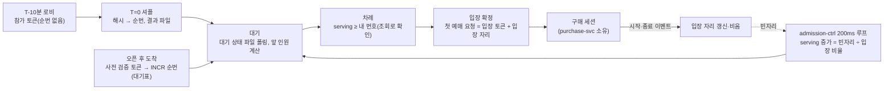
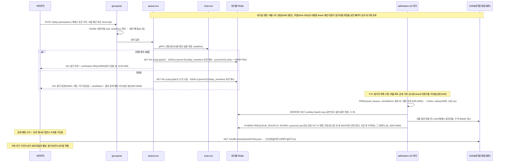
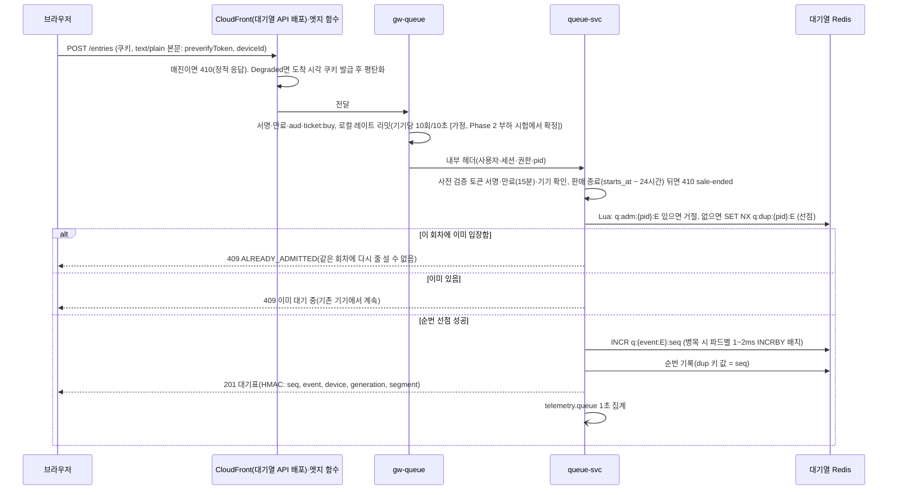
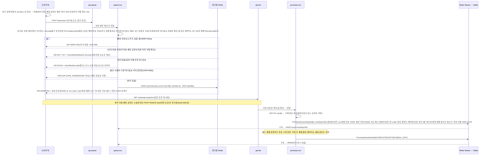

# 기능 설계: 로비·대기열·입장 확정

- **독자와 용도**: queue-svc, admission-ctrl, gw-queue와 소비자 웹 대기 화면을 구현하는 엔지니어가 전체 흐름, 세부 알고리즘, 키·API(프로그램끼리 요청과 응답을 주고받는 창구)·이벤트 계약, 장애 격리 동작, 검증할 시험 지점을 파악할 때 본다.
- **원문 출처**: 초기 설계서 §6 '대기열', '입장 흐름', '매진 처리', §7 전체(정렬 방식과 검증 계획), §3 타임라인 3~4번, §9 대기열 진입·대기 상태 전파 SLO(팀이 정한 서비스 품질 목표)와 Degraded Mode, §10 K1·K6 검증, ADR-0002·0003·0005·0006·0012 (전체 이관표는 [00-diagnosis.md](../../00-diagnosis.md#31-설계서d) §3.1).
- **기준 기획 버전**: v1.0.
- **관련 ID**: FR-005~008, FR-018, FR-020, FR-037, FR-038, FR-039(연결), FR-043, FR-049(연결) · NFR-001, 002, 013, 022, 025 · POL-001~010, 015, 030 · SCR-007, 008, 009, 018, 019 · CMP-015 QueuePanel, CMP-049 ShuffleProofPanel · API `/v1/queues/*`(docs/api/openapi.yaml) · 이벤트 `trade.purchase-sessions`, `telemetry.queue`, `telemetry.trust-candidates`(docs/api/asyncapi.yaml) · 키 docs/data.md §3 · 대기 중 재평가 docs/streaming.md §5(ADR-0071).

## 1. 개요



| 정렬 방식(POL-003) | 로비 | 오픈 후 도착자 | 쓰임새 |
| --- | --- | --- | --- |
| FIFO | 미운영 | 오픈 직후 동시에 도착한 구간(2초 [가정])은 한 묶음으로 셔플(순번을 무작위로 섞는 것)하고, 그 뒤로는 도착한 순서대로 순번을 발급한다. 사전 검증 토큰(권한이나 상태를 증명하려고 주고받는 서명된 문자열)은 필수다(ADR-0041). | 선착순 관행이 강한 공연에만 적용한다. 파트너 콘솔에는 봇 공격에 약하다는 경고를 표시한다. |
| PREQUEUE_SHUFFLE | 운영 (T=0 셔플) | 로비에서 기다린 인원(셔플로 순번 확정) 전원 뒤에 오픈 후 도착자를 도착한 순서대로 붙인다. 동시 도착 묶음은 두지 않는다(사전 검증 토큰 필수, 소유자 결정 2026-10-14, 세부는 추천 적용 2026-10-14, ADR-0064). | 팬클럽 선예매 등에 적용한다. 판매 자격은 진입할 때 판매 정책 규칙이 가린다. |
| HYBRID(기본) | 운영 (T=0 셔플) | 로비에서 기다린 인원 뒤에 오픈 직후 동시에 도착한 묶음 인원을 둔다. 그 뒤로는 도착한 순서대로 붙인다. | 일반 공개 예매 공연에 표준 정책으로 적용한다. |

### 핵심 설계 원칙 5선

- **서버 주도 전진**: 대기열을 전진(`serving` 번호 증가)시키는 제어는 서버(`admission-ctrl`)만 독점 실행하며, 수많은 클라이언트는 CDN 캐시 파일만 읽는 단방향 조회 구조를 유지한다.
- **원자적 입장 확정 (ADR-0005)**: 입장 정원(동시 입장 자리)은 차례가 온 사용자가 처음 예매 화면에 진입하는 순간 원자적(중간 상태 없음)으로 확정된다.
- **진입 전 본인확인 (ADR-0006)**: 모든 정렬 방식에서 대기열 순번을 발급받기 전에 통신사 휴대폰 본인확인을 필수로 완료해야 한다.
- **실명 기반 1인 1순번**: 단순 계정 ID가 아닌 실명 연계정보 기반 고유 식별자(`pid`)로 1인 1순번을 엄격히 강제한다.
- **판매 종료 시점 (ADR-0064)**: 모든 정렬 방식에서 회차별 예매는 공연 시작 24시간 전에 정밀 종료되며, 이후 신규 진입은 차단된다(§3).

## 2. 로비와 셔플(FR-005, FR-038)



- 로비 대기 화면에는 순번을 떠올리게 하는 숫자를 하나도 보여 주지 않는다(POL-004). 같은 사용자가 여러 탭이나 여러 기기로 다시 들어와도 새 토큰을 더 발급하지 않는다(POL-002).
- 로비에 들어올 때 추가 검증 큐로 나뉜 사람도 참가 토큰(1인 1장 선점 포함)을 받고, 전체 참가자 목록에 그대로 들어가 순번을 받는다. 셔플 결과를 게시한 뒤 정규화 작업은 아직 추가 검증 중(`VERIFYING`)인 토큰의 번호만 빠진 번호로 돌린다. 셔플 전에 검증을 통과한 사람의 번호는 돌리지 않는다(§7).
- 셔플 알고리즘은 admission-ctrl의 리더 인스턴스가 실행한다(원문 §7 결정 4). 셔플 결과 파일이 곧 순번을 전하는 수단이므로, T=0에 100만 건 규모의 개별 조회 요청이 원본 서버(origin)로 들어오지 않는다.
- **셔플 결과 받기(ADR-0058)**: 원본 서버는 보호되지만 CDN(사용자 가까운 곳에 파일을 복사해 두고 대신 응답하는 전송망)은 100만 건(약 36 GB)을 받으므로, 한꺼번에 받지 않게 나눈다.
  - 참가 토큰 응답에는 결과 공개 예정 시각(`shuffleResultAt`: 공시한 drand 라운드의 예정 시각 + 셔플·게시 목표 [가정, Q-T6에서 확정])과 분산 창(`shuffleSpreadSec`, 8초 [가정])을 담는다. 대기실은 '오픈 뒤 잠시 안에 순번이 공개되고 사람마다 몇 초씩 나눠 받는다'고 미리 알린다(숫자는 쓰지 않는다, POL-004).
  - 브라우저는 참가 토큰 해시(원래 값으로 되돌릴 수 없게 바꾼 고정 길이 값)의 앞자리로 받을 파일을 고른다. 그리고 해시의 다음 4바이트를 `shuffleSpreadSec × 1000`으로 나눈 나머지(밀리초)만큼 공개 예정 시각 뒤에 기다렸다가 받는다. 이 기다림은 토큰마다 고정이라 새로고침해도 빨라지지 않는다.
  - 파일이 아직 없으면(404) 2초부터 두 배씩 늘려 최대 20초 [가정] 간격으로, 간격 안의 무작위 시각에 다시 묻는다. 그동안 '순서 계산 중'을 보여 준다. 대기열 파일 배포는 결과 파일 경로의 404 오류 응답을 캐시(자주 쓰는 값을 가까운 곳에 복사해 둔 것)하는 최소 TTL(캐시한 응답을 쓸 수 있는 시간)을 1초 [가정]로 둔다. CloudFront(AWS의 CDN)의 기본값은 10초다.
  - 100만 건을 8초에 나눠 받으면 초당 약 12.5만 건, 전송량은 약 36 Gbps다(docs/infra.md §4.1). 첫 입장은 분산 창이 끝난 뒤 시작한다. 그래서 늦게 받는 사람도 첫 입장 전에 자기 순번을 안다(§5).
- 온세일 윈도우(판매가 열리는 시각 앞뒤로 접속이 몰리는 기간)가 끝나면 바로(오픈 60분 뒤) 봉인해 둔 시드 원본을 외부에 공개한다. 누구나 참가자 목록, 무작위 비콘, 시드 값을 조합해 결과를 다시 계산하고 공개 파일과 같은지 대조할 수 있게 한다(SCR-019).
- 커밋과 비콘(ADR-0050 결정 7, POL-005): 대기실을 열 때 `SHA-256("PEAKET-shuffle-v1" ‖ 공연 회차 ID ‖ 시드)` 값을 공시하고, 사용할 drand 체인(quicknet), 라운드 번호, 알고리즘 버전도 함께 공시한다. 라운드는 참가자 목록을 고정한 시각(T=0)에서 3초 이상 지난 뒤 나오는 첫 라운드다 [가정, Phase 2 2.4.1에서 확정].
  - 외부 비콘 값이 늦게 오면 그 라운드를 기다린다. 여러 공개 중계 주소를 차례로 시도하고, 대기실에는 '순서 계산 중'을 보여 준다.
  - 상한 60초 [가정, Phase 2 2.4.1에서 확정]를 넘기면 셔플을 멈춘 채 SEV1(숫자가 작을수록 심각한 장애 심각도 등급) 경보를 내고, 런북(장애가 났을 때 따라 하는 절차서) RB-35 '셔플 비콘 지연과 비상 셔플'을 따른다. 시드만으로 셔플하는 비상 처리는 운영 명령 카탈로그(명령 12종) 밖의 RB-35 런북 CLI 작업이다. 서로 다른 commander 두 명이 각자 KMS(암호 키를 안전하게 보관하고 대신 써 주는 클라우드 서비스) 키로 명령 묶음에 서명해야 실행된다(ADR-0053 결정 11과 같은 방식, 추천 적용 2026-10-20, ADR-0073). 실행하면 검증 페이지에 사유와 '이 경우 시드를 아는 내부자가 결과를 미리 알 수 있다'는 한계를 함께 공시한다.
  - 바로 앞서 공개된 라운드를 대신 쓰지 않는다. 이미 공개된 값이라 시드를 아는 내부자가 목록을 고정하기 전에 결과를 계산할 수 있기 때문이다.
- 재현 규격(ADR-0050 결정 7): 결합 키는 `K = SHA-256(시드 ‖ 비콘 값 ‖ 머클 루트 ‖ 공연 회차 ID)`다. 난수는 `SHA-256(K ‖ i)` 블록(i는 64비트 카운터)에서 뽑는다. Fisher–Yates 섞기에는 거부 표본추출로 얻은 편향 없는 정수를 쓴다. 셔플 전 배열은 참가 토큰 해시의 오름차순이다. 머클 트리는 정렬한 잎에 `SHA-256(0x00 ‖ 토큰 해시)`, 노드(아래 두 값을 묶는 위쪽 마디)에 `SHA-256(0x01 ‖ 왼쪽 ‖ 오른쪽)`을 쓴다(RFC 6962와 같은 구분 바이트).
- 사람 확인(Cloudflare Turnstile)의 서버 검증은 로비 진입과 사전 검증 단계에서만 부른다. 그래서 T=0 핵심 경로에는 전혀 관여하지 않는다. 검증 요청 수는 Free 플랜에서도 제한이 없다(확인 완료, 2026-10-09). 발급된 사람 확인 토큰은 300초 이내에 1회만 검증이 가능하다. 그래서 받는 즉시 서버에서 검증을 마치고, 그 결과로 PEAKET 전용 참가 토큰과 유효 시간이 15분인 사전 검증 토큰을 바꿔 발급한다. 검증이 병목이 되면 로비를 여는 시점을 앞당겨 부하를 미리 분산한다.

## 3. 오픈 후 진입과 순번 발급(FR-006, NFR-001)



- 진입 처리는 '1인 1계정 선점(`SET NX`) → 원자적 순번 발급(`INCR`) → 순번 기록' 순서로 실행한다. 번호를 발급한 뒤 기록하기 전에 장애가 나서 기록이 빠지면, 재시도로 생긴 빈 번호를 빠진 번호 비트맵(번호마다 한 비트로 빠졌는지를 표시한 값)에 바로 등록해 바로잡는다.
- **요청 형식: CORS 사전 요청을 만들지 않는다(추천 적용 2026-10-15, ADR-0065 결정 6)**: 소비자 웹(`www`)에서 `queue` 호스트로 가는 진입과 입장 확정(§6)은 교차 출처 요청(페이지와 다른 주소로 보내는 요청)이다. 본문이 JSON이면 브라우저는 요청마다 OPTIONS 사전 요청을 먼저 보낸다. 사전 요청 결과의 캐시는 URL별로 남는데, 진입 주소는 회차마다 달라 미리 채워 둘 수 없다. 그러면 T=0의 20만 RPS(초당 요청 수)에 같은 수의 사전 요청과 왕복 한 번이 더해진다. 이 몫은 NFR-001의 용량 계산과 대기열 API 배포 한도(docs/infra.md §4.1)에 없었다. 그래서 두 요청은 본문을 JSON 문자열로 담되 `Content-Type: text/plain;charset=UTF-8`로 보내고, safelisted가 아닌 헤더(추적 헤더 포함)는 붙이지 않는다(Fetch 표준·MDN). 서버는 이 두 경로에서 `text/plain`과 `application/json`만 받고(그 밖은 415), 본문은 JSON으로 검사한다(openapi `entries`·`admission`의 `requestBody`).
  - **위조 방지**: 사전 요청이 없으므로 ① 본문의 사전 검증 토큰·대기표(허용한 출처만 응답을 읽어 얻는 값) ② 게이트웨이(클라이언트 종류별로 앞에 둔 입구 서버)의 `Origin` 확인(docs/api/guidelines.md §9) ③ `SameSite=Strict` 쿠키(브라우저가 저장했다가 요청마다 함께 보내는 작은 값)가 함께 위조를 막는다(웹 앱 보안 검증 항목 목록인 ASVS v5.0.0-3.5.1). 남는 한계는 토큰을 주는 경로(사전 검증 `/pre-verifications`)의 CORS(다른 주소에서 온 요청을 브라우저가 허용할지 정하는 규칙) 설정이 틀리면 ①이 약해진다는 점이다. 이 한계는 Q-T41이 막는다.
  - **응답 헤더**: `queue` 호스트는 응답에 `Access-Control-Allow-Origin: https://www.peaket.example`, `Access-Control-Allow-Credentials: true`, `Vary: Origin`, `Access-Control-Expose-Headers: Retry-After, Date`를 붙인다(`Date`는 브라우저 시계 보정용, ADR-0079 결정 3. 503의 `Retry-After`를 스크립트가 읽도록, ADR-0065 결정 7). 사전 요청이 생기는 다른 경로(로비 입장·사전 검증·대기 취소)는 대부분 T=0 전에 일어난다. 그 사전 요청 응답에는 `Access-Control-Max-Age: 7200`을 준다(docs/infra.md §9).
  - **검증**: 사전 요청이 정말 생기지 않는지는 Phase 2의 브라우저 시험으로 확인한다. 그 형식으로 보낸 20만 RPS의 지연은 부하 시험에서 잰다(§11 Q-T41, docs/verification.md §3.1). 브라우저 동작이 바뀌어 사전 요청이 생기면 같은 출처 경로 안을 다시 검토한다(ADR-0065 되돌릴 조건).
- **동시 도착 구간 묶음(ADR-0041)**: 오픈 시각 T=0부터 N초(기본 2초 [가정, Phase 2 부하 시험에서 확정]) 이내에 들어왔고, 사전 검증 토큰의 최초 발급 시각이 T=0 이전인 요청은 `INCR` 대신 `SADD q:{event:E}:batch_members:{batchNo} {사전 검증 토큰 해시}`로 모은다. 이 요청에는 202 `BATCHING` 응답(결과 파일 경로, 결과 공개 예정 시각, 분산 창 포함. 받는 규칙은 §2의 셔플 결과 받기와 같다, ADR-0058)을 돌려준다. 1인 1순번 선점(`SET NX`)은 이 단계 전에 똑같이 처리한다. T=0+N이 되면 admission-ctrl 리더가 로비 셔플과 같은 commit-reveal 방식(추첨에 쓸 비밀 값의 해시를 먼저 공개하고 나중에 원래 값을 공개해, 누구나 조작이 없었는지 확인하게 하는 방법)으로 구간 안의 순서를 정하고 `batch-results/{hashPrefix}.json`으로 게시한다. 이때 묶음마다 시드를 따로 두고, 커밋은 오픈 10분 전까지 공연 상세 화면에 공시하며, 묶음 참가자 머클 루트와 미리 공시한 비콘 라운드, Fisher–Yates를 쓴다. 머클 잎과 결과 파일 키는 사전 검증 토큰 해시이고, pid에서 나온 값은 공개 파일에 싣지 않는다(공연을 넘나드는 추적 방지, ADR-0050 결정 7). 그다음 순번 카운터를 묶음 크기만큼 늘린 뒤(묶음 번호마다 한 번만, 리더 세대를 확인하는 Lua, ADR-0056) 뒤이어 도착한 사람에게 `INCR` 발급을 이어 간다. 선착순 공연은 1번부터 묶음 셔플 결과를 배정하고, 하이브리드 모드는 로비 인원 바로 뒤부터 배정한다. 이 구간 동안 클라이언트 화면에는 순번 대신 '순서를 정하는 중' 메시지를 보여 준다(POL-004, 로비 셔플의 '순서 계산 중'과 나눠 쓴다, design/d5 §1.5 32번). 검증 페이지(SCR-019)에도 묶음 셔플 내역을 같은 투명성 양식으로 게시한다.
- **사전 검증 토큰 발급 시각 검증**: 사전 검증 토큰은 최초 발급 시각(`issued_at`) 정보를 계속 지닌다. 유효기간 만료 전 끊김 없이 갱신할 때도 이 시각은 그대로 유지한다. 오픈 시각 이후에 새로 발급된 토큰으로 동시 도착 구간에 들어오면 묶음 대상에서 빼고, 묶음 다음에 오는 일반 도착 순서로 `INCR` 번호를 준다. 공연 상세 화면과 오픈 알림으로 오픈 전에 미리 사람 확인을 마치도록 계속 안내한다.
- **사전 검증에서 고위험(추천 적용 2026-10-14, ADR-0062)**: 사전 검증 때 위험 점수가 높으면 사전 검증 토큰에 '추가 검증 필요' 표시를 서명해 넣는다. 진입 때는 번호를 정상으로 발급한다. 그리고 순번 발급과 같은 회차 슬롯의 Lua에서 그 번호의 빠진 번호 표시를 켜고, `q:{event:E}:verify`에 `VERIFYING`을 쓴 뒤 201 대기표에 `verification: REQUIRED`를 실어 추가 검증으로 보낸다(브라우저 스크립트가 303 응답을 읽지 못해 303 대신 본문 필드를 쓴다, 추천 적용 2026-10-21, ADR-0079 결정 4). 도착했을 때의 번호가 원래 순번이 되고, 진입 경로의 외부 호출은 늘지 않는다(§7).
- `INCRBY` 배치는 PoC(본 개발 전에 위험한 부분만 먼저 만들어 확인하는 시험)에서 실제로 잰 값으로 도입 여부를 최종 확정한다(docs/architecture.md §9.4). 파드(쿠버네티스에서 앱이 실행되는 가장 작은 단위) 사이의 순서 차이는 1~2ms 이내로 줄어들므로, 클라이언트 사이의 네트워크 지연 차이보다 작다.
- Redis(메모리에 데이터를 두는 빠른 저장소)에서 페일오버(고장 난 쪽 대신 예비 쪽으로 넘기는 것)가 일어나면, 카운터를 복제 지연(수백 ms 이내, docs/infra.md §6) 동안 발급되었을 수 있는 최대 추정치만큼 건너뛰고 대기표 세대 번호(generation)를 갱신한다. 그래서 페일오버 전후에 같은 순번이 나가지 않게 한다. 실제 복제 지연이 추정치를 넘으면 순번이 겹칠 수 있다. 그래도 세대 번호로 두 대기표를 구분할 수 있고, 겹친 번호의 대기자는 같은 차례에 함께 입장 자격을 얻는다. 복제되기 전에 사라진 1인 1순번 중복 확인 키(`q:dup`)가 있으면 같은 사람이 순번을 하나 더 받을 수 있다. 하지만 입장 확정 때 사람별 입장 키로 다시 확인해 한 번만 입장시키고, 나머지 번호는 빠진 번호로 돌린다(§6, ADR-0056).
- 본인확인을 마치지 않은 사용자는 진입을 막고, 그 화면에서 [휴대폰 본인확인]으로 본인확인기관 창을 열도록 안내한다(별도 본인확인 화면은 없다, 소유자 결정 2026-10-14, ADR-0063, docs/features/identity.md §5). 인증을 마친 뒤의 실제 도착 순서대로 대기 순번을 준다(POL-001).
- **사전 셔플 공연의 오픈 뒤 진입(소유자 결정 2026-10-14, ADR-0064)**: PREQUEUE_SHUFFLE 공연도 오픈 뒤 진입을 410으로 거절하지 않고 판매 종료까지 받는다. 오픈 뒤 도착자는 셔플로 순번을 받은 로비 참가자 전원 뒤에 도착 순으로 `INCR` 번호를 받고, 동시 도착 묶음(ADR-0041)은 두지 않는다(추천 적용 2026-10-14, ADR-0064). 오픈 직후부터 `INCR`을 주므로, 순번 카운터에 로비 인원 수를 더하는 일(§2 `INCRBY`)은 참가자 목록을 고정하는 T=0에 오픈 뒤 첫 `INCR`보다 먼저 한다. 그래서 첫 도착자는 로비 마지막 번호의 다음 번호를 받는다(추천 적용 2026-10-14, ADR-0064). 결국 사전 셔플과 하이브리드의 차이는 오픈 직후 동시 도착 묶음을 두는지뿐이다. 판매 자격(선예매 대상 등)은 지금처럼 진입할 때 판매 자격 명단·판매 정책 규칙이 가린다(아래).
- **판매는 온세일 윈도우로 끝나지 않는다(추천 적용 2026-10-14, ADR-0063 결정 11)**: 온세일 윈도우(오픈 10분 전~60분 뒤)는 배포 동결·관제 집중·R0 리포트의 기준이 되는 운영 구간이다. 판매와 대기열은 그 회차의 판매 종료(공연 시작 24시간 전)나 매진까지 같은 대기열 경로로 이어진다. 앞에 대기자가 없으면 들어오자마자 차례가 와 바로 입장한다. 대기 화면의 '판매 시간이 끝났습니다'(ended)는 그 회차의 판매 종료 때 나온다. 셔플 시드 공개(§2, 윈도우 종료 직후)와 R0 리포트 시각은 그대로다.
- **판매 종료(소유자 결정 2026-10-14, ADR-0064)**: 회차의 판매 종료는 `event.starts_at` − 24시간이다(예: 10/25 18:00 회차는 10/24 18:00). 이를 담을 새 데이터 칸은 두지 않고 계산한다(추천 적용 2026-10-14, ADR-0064). 모든 정렬 방식(FIFO·HYBRID·PREQUEUE_SHUFFLE)과 좌석 배정 방식(PICK·AUTO)에 똑같이 적용한다. 판매 종료 뒤에는 ① 대기열 진입(`POST …/entries`)을 410 `sale-ended`로 거절하고 번호를 발급하지 않는다 ② 대기 상태 파일의 판매 상태를 `ENDED`로 바꿔, 차례가 오기 전의 대기를 끝낸다(대기 기록 빠진 사유 `SALE_END`, 대기 화면 ended) ③ 입장 확정도 410 `sale-ended`로 거절해 새 구매 세션을 열지 않는다 ④ 새 좌석 홀드(결제하는 동안 다른 사람이 가져가지 못하게 좌석을 잠시 잡아 두는 것)와 주문 생성은 seat-hold·payment가 거절한다(docs/features/seat-hold.md, docs/features/payment.md). 판매 종료 전에 홀드한 구매 세션은 지금의 홀드·결제 시간 안에서 결제를 마칠 수 있다(추천 적용 2026-10-14, ADR-0064). 취소표 알림 신청은 판매 종료 때 끝난다(design/d5 §9.1.1). 예매 취소(POL-032, 공연 시작 전까지)·양도 마감·가상계좌 입금 기한·온세일 윈도우는 바뀌지 않는다.
- AWS Virtual Waiting Room 참고 아키텍처는 리전의 Lambda(서버 없이 요청마다 함수를 실행하는 AWS 서비스) 동시 실행 한도가 기본값 1,000이면 순번 요청을 초당 500명까지 받는다고 적었다(그 한도를 이 솔루션만 쓸 때). 한도를 1,000 올릴 때마다 초당 500명씩 늘어난다(AWS 문서 2025-10-12 보관본, docs/architecture.md §12). PEAKET은 진입 경로를 메모리 안의 Redis 원자 연산으로 최적화해 초당 20만 명 진입 처리를 목표로 설계한다.
- **판매 자격 명단(추천 적용 2026-10-14, ADR-0062)**: 판매 자격 명단이 걸린 판매 단계라면 로비·진입 때 명단 사본(`q:{event:E}:elig:{listKey}`)으로 확인한다. 대상이 아니면 대기열에 넣지 않고 공연 상세의 예매 제한 상태로 보낸다. 입장 확정 때는 그 사람이 속한 명단 키를 입장 토큰에 싣는다.

## 4. 대기 상태 파일과 폴링(FR-007, NFR-002, ADR-0003)

- 대기 순번을 1,000개 단위의 세그먼트로 나누고, 각 세그먼트의 대기 상태 파일을 1초 주기로 갱신해 CDN에 1초 동안 캐시한다(Origin Shield 적용). 같은 세그먼트에 속한 1,000명의 클라이언트가 같은 캐시 파일을 조회한다. 그래서 100만 명 규모의 대기열에서도 오리진(CDN 뒤에서 원본 파일을 주는 서버) 요청은 초당 약 1,000건 이하로 묶이고, 클라이언트의 폴링(정해진 간격으로 다시 물어보는 방식) 주기에는 영향을 받지 않는다. 대기 인원이 늘면 오리진 요청도 파일 수(1,000명당 1개)만큼 늘어, 200만 명이면 약 2,000건이다.
- 파일 스키마(데이터의 구조 정의, OpenAPI `QueueState`): serving 번호(지금 예매 화면으로 들여보내고 있는 순번의 끝. 은행 번호표 전광판의 호출 번호와 같다), 차례 진행 속도(1초당 serving이 통과하는 유효 순번 수), 판매 상태(판매 중·일시정지·등급별 매진·매진·판매 종료 `ENDED`, ADR-0064), 매진 등급(`soldOutTiers`, 좌석 자동 배정 공연의 희망 조건 줄 경고에만 쓴다, §8), serving까지 누적 빠진 번호 수, 세그먼트 시작 전 누적 빠진 번호 수, 이 세그먼트 1,000개 순번의 빠짐 비트맵(125바이트), 긴급 공지 배너.
- **배포와 대체 원본(ADR-0058)**: 대기 상태 파일은 대기열 파일 배포(`queue-files`)로 나간다. 진입 API와 다른 배포라 서로 한도를 나눠 쓰지 않는다. 대체 원본(S3, AWS의 파일 저장소) 사본은 회차별 접두사 `queue/{eventId}/fallback/…`에 원 파일과 같은 주기(거리별 캐시 수명)로 쓴다. 쓰기 양은 100만 기준 초당 수백 건 이하 [가정, 2.2.2에서 확인]로 접두사 기준치(초당 PUT 3,500건) 안이다. 원본에 오류가 나면 넘기는 CloudFront 원본 그룹은 보조 원본(S3)에 같은 요청 경로를 보낸다. 그래서 사본 키는 S3 원본의 원본 경로를 붙였을 때 요청 경로와 같아야 한다. 위 접두사를 그 모양으로 맞추는 것은 2.2.2에서 확인한다 [가정](ADR-0078 결정 2).
- 모든 대기 상태 파일 조회는 인증 헤더나 쿠키 없이 처리해, CDN 엣지(CDN이 사용자 가까이에 둔 서버)의 캐시 적중률을 가능한 한 높인다. 서버가 응답 헤더의 `Retry-After` 값으로 폴링 주기를 직접 조절하는 백프레셔(받는 쪽이 밀리면 보내는 쪽을 늦추게 하는 장치)를 쓴다.
- **교차 출처 읽기(추천 적용 2026-10-15, ADR-0065 결정 7)**: 소비자 웹 스크립트가 다른 출처(`queue-files`)의 파일과 `Retry-After`를 읽는다. 그래서 대기열 파일 배포와 S3 대체 원본은 `Access-Control-Allow-Origin: https://www.peaket.example`과 `Access-Control-Expose-Headers: Retry-After, Date`를 응답에 붙인다(`Date`는 브라우저 시계 보정용, ADR-0079 결정 3). 쿠키를 받지 않으므로 `Access-Control-Allow-Credentials`는 두지 않는다. 값이 하나로 고정이라 캐시가 출처마다 갈리지 않는다. 폴링과 셔플·묶음 결과 받기는 GET이고 safelisted가 아닌 헤더를 붙이지 않으므로 사전 요청이 생기지 않는다(docs/infra.md §4.1).
- **CDN 안에서의 갱신량**(소유자 질문, 2026-10-12. CloudFront 문서 확인): 뷰어 요청은 가까운 엣지(POP)가 받는다. 엣지는 캐시가 없거나 만료된 파일만 상위 계층에서 가져온다. 같은 엣지에 같은 파일 요청이 겹치면 첫 요청 하나만 위로 보내고, 나머지는 그 응답을 함께 받는다(요청 병합). 엣지 위에는 리전(클라우드 데이터센터가 모인 지역) 엣지 캐시가 있다. 다른 리전에서 오는 요청은 Origin Shield가 한 번 더 모아 origin에는 파일당 하나만 보낸다. origin과 같은 리전의 요청은 Origin Shield를 거치지 않고, 리전 엣지 캐시가 그 역할을 한다. 그래서 CDN 내부 갱신의 상한은 "엣지 수 × 활성 파일 수 ÷ 1초"이고, 국내 트래픽이 서울 엣지 몇 곳에 모이면 초당 수천에서 1만 건 수준이다. 이 양은 CDN이 늘 처리하는 규모이고, origin은 여전히 초당 약 1,000건이다.
- **거리별 TTL** [보완, Phase 2 부하 시험에서 확정]: serving에서 먼 구간의 사용자는 20초마다만 조회하므로 그 대기 상태 파일의 1초 갱신은 낭비다. origin이 대기 상태 파일마다 `Cache-Control: max-age`를 serving과의 거리에 따라 정한다. 예상 대기 1분 이내 구간은 1초, 1~5분은 5초, 그 밖은 10초 [가정]로 둔다. 100만 명 기준으로 1초마다 갱신하는 파일이 1,000개에서 수십 개로 줄어, 엣지와 origin의 갱신이 몇 분의 1로 줄어든다. 구간마다 캐시 수명(1초·5초·10초)이 그 구간의 폴링 주기(1초·5초·20초)보다 길지 않아, 사용자가 느끼는 갱신은 같다. 다만 판매 상태(일시정지·매진)도 이 파일로 알리므로, 채택하면 먼 구간의 매진 감지가 캐시 수명만큼(최대 10초 + stale-while-revalidate 2초) 늦어진다. 채택할 때는 판매 상태가 바뀌는 순간 그 회차 대기 상태 파일 경로를 CloudFront에서 무효화할지도 함께 정한다(FR-018). 채택 전 기본은 모든 구간 1초다.
- **stale-while-revalidate** [보완]: `Cache-Control`에 `stale-while-revalidate=2`를 더한다. 그러면 캐시가 만료되는 순간에도 뷰어는 origin 응답을 기다리지 않고, 엣지가 뒤에서 갱신한다(CloudFront 지원 확인). 1초 경계마다 생기는 작은 대기와 origin 요청 겹침을 없앤다.

| 예상 대기 시간 | 폴링 주기(초기값) | 근거 |
| --- | --- | --- |
| 1분 이내 | 1초 | 본인 차례가 온 것을 2초 이내에 인지해야 좌석 풀이 놀고 있는 시간을 최소로 줄일 수 있다(NFR-002). |
| 1~5분 | 5초 | 네트워크 트래픽을 줄이는 것과 사용자가 느끼는 대기 정보 갱신 사이의 균형을 맞춘 기준이다. |
| 5분 초과 | 20초 | Cloudflare Waiting Room의 표준 20초 주기 정책을 따른다. |

- 예상 대기 시간 = 대기표 기준 남은 앞 인원 ÷ 차례 진행 속도. 실제 입장 완료 속도가 아니라 serving이 늘어나는 속도를 기준으로 계산한다(불린 순번 가운데 떠난 사람이 있어 serving이 늘어나는 속도가 실제 입장 속도보다 빠르기 때문이다). 클라이언트 폴링 주기에는 ±20%의 무작위 지터(요청 시각을 일부러 조금씩 흩뜨리는 것)를 넣어 요청이 한곳에 몰리는 것을 막는다.
- 예상 대기 시간을 보여 주는 근거는 NN/g 'Response Times: The 3 Important Limits'의 10초 한계다(10초 넘게 기다리게 하면 언제 끝나는지 알린다). 예상이 맞는지는 실제 대기를 처음 보인 예상 대기로 나눈 값의 분포(`queue_eta_error_ratio`)로 재고, p90이 1.5배를 넘으면 계산식과 폴링 주기를 다시 검토한다(planning/01 §3.2 결정 규칙 [가정], ADR-0049). 차례 전 입장(입장 확정 때 순번이 그 시각 serving보다 큰 건)은 언제나 0건이어야 하는 불변식이다. 이 값은 차례가 온 뒤 시스템 원인으로 입장하지 못한 건수와 함께 관제 지표로 낸다(docs/observability.md §5).
- 대기가 끝나면(입장 확정, 빠진 번호, 그 회차의 판매 종료(공연 시작 24시간 전, ADR-0064)나 매진) queue-svc는 사람별 대기 기록(`QueueEntryRecord`: 진입 방식, 진입 시각, 처음 보인 예상 대기, 차례가 온 시각, 입장 확정 또는 빠진 사유, 검증 경로)을 `telemetry.queue`로 묶어 보낸다. 분석 저장소는 이 기록을 쌓을 때 가명 처리하고, 공연 리포트의 대기 오차, 차례 뒤 미입장 비율, 진입 인원을 계산한다(ADR-0052, docs/features/analytics.md §3.4).
- **앞 인원 계산식(대기표 기준)** = (내 순번 − serving 번호 − 1) − (그 사이 구간의 빠진 번호 누계). 예: serving이 1,000번, 내 번호가 1,050번이고 1,001~1,049번 사이에서 10개가 빠진 번호로 처리되었다면, 남은 앞 인원은 49 − 10 = 39명이다. 이 값은 파일을 만든 시점(최대 1초 전) 기준으로 오차 없이 계산되고, 화면에는 폴링 주기만큼 늦게 반영된다.
- **대기 화면 네 가지(SCR-008, 소유자 결정 2026-10-14, ADR-0063)**: 기본 화면은 ① 내 앞 대기 인원("앞에 3,214명") ② 진행 막대 ③ 남은 예상 시간("약 2분") ④ [대기 취소]뿐이다. 운영 공지(명령 7), 판매·입장 일시정지, 순서를 정하는 중, 곧 입장, 만료, 다른 기기에서 취소, 연결 확인 중, '현재 순번으로는 구매가 어려울 수 있습니다'(아래 조건), 추가 검증 이동, 이미 입장은 그런 일이 생길 때만 뜬다. 등급별 매진 현황은 보여 주지 않는다. 좌석 자동 배정 공연은 희망 조건을 한 줄 요약으로만 둔다. 정렬 방식 표준 문구(POL-004)와 형사처벌 고지(POL-024 라목)는 화면 아래 '순번 안내 ›'가 여는 시트로 옮긴다. 라목 고지는 공연 상세(SCR-002)에도 늘 보이므로 미리 알리는 요건을 그대로 채운다고 본다(ADR-0063 결정 7). 로비가 없는 선착순(FIFO) 공연은 이 시트가 POL-004의 대기실 화면 고지 자리다.
- **진행 막대 계산**: 진행률 = (처음 받은 앞 인원 − 지금 앞 인원) ÷ 처음 받은 앞 인원이다(추천 적용 2026-10-14, ADR-0063). 값은 0~100%로 자르고, 처음 받은 앞 인원이 0이면 100%다. 앞 인원이 늘어나면(예: 다른 엣지에서 조금 더 오래된 대기 상태 파일을 받은 경우) 막대도 실제 값대로 조금 물러나며, 숨기거나 멈추지 않는다. 처음 받은 앞 인원은 브라우저가 처음 계산한 앞 인원(셔플 공연은 셔플 결과를 받은 뒤, 묶음 진입은 묶음 결과를 받은 뒤의 첫 값)을 세션 저장소(sessionStorage)에 두고 쓰므로, 대기 상태 파일에 새 값이 필요 없다(추천 적용 2026-10-14, ADR-0063). 새 값이 오면 막대를 이전 값에서 부드럽게 채우고, '나' 표시를 앞으로 옮기며, 숫자는 굴리듯 바꾼다. `prefers-reduced-motion`이면 효과 없이 값만 바꾼다. `role="progressbar"`와 `aria-valuenow`, `aria-valuetext`("앞에 3,214명, 약 2분 남음")를 두고, 진행 막대와 앞 인원은 한 live 영역에 합쳐 화면 낭독기(화면의 글자를 소리로 읽어 주는 프로그램)에 1분에 한 번만 알린다(추천 적용 2026-10-14, ADR-0063).
- **진행 막대의 한계**: 세션 저장소는 같은 탭에서 새로 고침해도 남지만, 탭을 닫았다가 다시 열거나 다른 탭·기기에서 열면 비어 있다. 그때 받은 앞 인원이 처음 값이 되어 막대가 0%부터 다시 찬다. 순번과 앞 인원·예상 시간은 그대로이고 막대의 출발점만 바뀐다(추천 적용 2026-10-14, ADR-0063).
- 결번(빠진 번호)이 생기는 4대 원인(모두 서버가 맡아 처리한다): 사용자의 대기 자진 취소, 추가 검증 큐로의 분리 격리(검증을 통과한 후에도 기존 번호 표기는 되돌리지 않는다), 1인 1순번 중복 위반에 따른 무효화, 일시 오류 재시도로 생긴 빈 번호. 공연별 빠진 번호 비트맵(100만 번호 기준 125KB)에 기록하고, 1초마다 읽어 대기 상태 파일을 만든다.
- 다른 기기에서 다시 참가(ADR-0060): 처음 기기를 쓸 수 없는 사람(기기 분실, 브라우저 저장소 초기화, 인앱 브라우저에서 외부 브라우저로 옮긴 경우)은 새 기기에서 기존 참가를 취소하고 다시 참가할 수 있다. 오픈 전에는 로비 참가 취소(`DELETE /v1/queues/{eventId}/lobby-participants/me`)로 참가 토큰을 무효로 하고, 로비 참가자 목록(`q:{event:E}:lobby_members`)에서 그 해시를 뺀다. 오픈 뒤에는 대기 취소(`DELETE /v1/queues/{eventId}/entries/me`)로 번호를 빠진 번호로 돌린다. 두 경우 모두 `q:dup:{pid}:E`를 지워 같은 사람이 다시 참가할 수 있게 한다. 둘 다 팬 쿠키로 부르므로 처음 기기가 없어도 된다. 로비에서 다시 참가하면 셔플 전이라 불리하지 않다(커밋-공개). 오픈 직후 동시 도착 묶음 안에서 다시 참가해도 묶음 결과는 공개 전이라, 결과를 보고 다시 뽑을 수 없다. 오픈 뒤 다시 참가하면 맨 뒤 순번이 된다. 취소된 토큰·대기표로 온 요청은 거절하고, 처음 기기에 '다른 기기에서 취소했습니다'를 알린다. 만료(차례 뒤 15분 초과)된 사람도 같은 회차에 다시 줄을 설 수 있고, 새 번호는 맨 뒤다. 만료 410을 줄 때 `q:dup:{pid}:E`를 지운다(§6). 이 회차에 이미 입장한 사람(`q:adm:{pid}:E`가 있다)이 진입하면 409 `ALREADY_ADMITTED`다(추천 적용 2026-10-14, ADR-0062). 사전 셔플 공연도 오픈 뒤 진입을 받으므로, 만료된 사람이 맨 뒤로 다시 줄을 설 수 있다(ADR-0062의 사전 셔플 예외를 없앴다, 추천 적용 2026-10-14, ADR-0064). 판매 종료 뒤에는 어느 공연도 다시 줄을 설 수 없다(§3).
- 브라우저를 닫거나 잠시 통신이 끊겨도, 발급받은 대기표가 유효기간 안이면 순번은 그대로 유지되고 다시 접속하면 자기 자리로 정확히 돌아온다(재접속 순번 보존율 100%, NFR-025). 클라이언트가 살아 있음을 알리려고 주기적으로 보내는 하트비트 신호는 따로 요구하지 않는다(ADR-0002).
- 차례가 왔지만 바로 들어오지 않은 사용자는 이미 serving 번호 안쪽에 있으므로, 그다음 대기자의 앞 인원 계산에 영향을 주지 않는다. 또 입장 자리는 첫 예매 요청 때만 배정되므로, 이들이 시스템 용량을 쓸데없이 차지하지 않는다(§6).
- 입장 차례가 가까워지면 브라우저 탭 제목 변경, 효과음(소리를 낸 탭은 백그라운드 타이머 제한이 30초간 풀린다), Web Push 알림(권한을 허용한 경우)을 함께 써서 알린다. Chrome 브라우저는 5분 이상 백그라운드에 머문 탭의 타이머를 1분에 1회로 강제로 늦추므로(스로틀) 차례를 늦게 알아챌 수 있다. 이에 대비해 §6에서 정한 대로 입장을 15분 기다려 준다.
- **차례 직전 직접 확인(좌석 자동 배정 공연, ADR-0043)**: 예상 대기가 10초 [가정, Phase 2 부하 시험에서 확정] 이내로 들어오면, 브라우저는 대기 상태 파일 폴링과 함께 입장 확정 요청(§6)을 직접 보낸다. 첫 시도는 예상 도래 시각(앞 인원 ÷ 차례 진행 속도)에 맞춘다. 아직 차례가 아니면 queue-svc가 `NOT_YET`과 남은 예상 시간(밀리초, Redis의 serving 번호와 차례 진행 속도로 계산)을 돌려주고, 브라우저는 그 시각에 다시 보낸다. 시도 간격은 1초 이상이고, 게이트웨이의 레이트 리밋(일정 시간에 받는 요청 수의 상한, 기기·사용자 단위) 안에 있다. 이 규칙은 대기 상태 파일의 CDN 캐시(최대 약 1초)와 폴링 주기 때문에 생기는 차례 인지 지연을, 입장 확정 API를 직접 부르는 봇과 같은 수준으로 맞추려는 것이다. 추가 부하는 10초 창 안의 약 280명이 초당 1건 이하로 보내는 요청으로, origin 기준 초당 수백 건이다. 직접 선택(PICK) 공연에는 적용하지 않는다.
- 남은 앞 인원 × 공연 평균 구매 매수 > 남은 좌석 수이면, 화면에 "현재 순번으로는 구매가 어려울 수 있습니다" 안내를 바로 띄운다(POL-015).
- 공연이 최종 매진되면 파일에 `saleStatus=SOLD_OUT` 표시를 기록하고, 클라이언트는 바로 폴링을 멈춘다. 그 회차의 판매 종료(공연 시작 24시간 전)가 지나면 `saleStatus=ENDED`를 기록하고, 클라이언트는 대기 화면을 ended('판매 시간이 끝났습니다')로 바꾼 뒤 폴링을 멈춘다(ADR-0063 결정 11, ADR-0064). 등급별 매진 때는 매진 등급을 `soldOutTiers`에 반영하고 대기는 그대로 이어진다. 대기 화면은 등급별 현황을 보여 주지 않고, 좌석 자동 배정 공연에서 1순위 등급이 매진되면 희망 조건 줄에 알린다(ADR-0063).

## 5. 입장 제어 루프(admission-ctrl, FR-037, POL-010)

K8s Lease(정해진 시간 동안만 유효한 권한. 갱신하지 않으면 다른 쪽이 가져간다) 방식으로 뽑힌 리더 인스턴스 하나만 제어 루프를 실행하고, 200ms 주기(초기값)로 다음 연산을 한다:

```
slots_used   = ZCOUNT q:{event}:slots (now, +inf)   # 먼저 ZREMRANGEBYSCORE로 지난 자리 정리
free         = admission_target(event) - slots_used
ratio        = admitted(번호가 불린 지 ≥10초인 번호 중 실제 입장 수) / called(같은 번호 수)   # 초기 100%
advance      = min(free / max(ratio, floor), serving_rate_cap × 0.2s)   # 안전 한계: serving 증가 속도 상한
serving     += advance                                             # 모든 공연 합산 동시 입장 상한도 확인
# serving 전진과 리더 상태 기록은 리더 세대를 확인하는 Lua 하나로 한다(ADR-0056)
```

- **첫 전진 시각(ADR-0058)**: 결과 파일로 순번을 알리는 구간(로비 셔플, 동시 도착 묶음)마다, 그 결과를 실제로 게시한 시각에 분산 창(8초 [가정])을 더한 시각이 지나기 전에는 serving을 그 구간의 첫 번호 위로 올리지 않는다. 그래서 순번을 늦게 받은 사람도 첫 입장 전에 자기 순번을 안다. 대신 매진까지 걸리는 시간은 최대 약 8초 늘어난다.
- **입장 통제는 동시 입장 목표(admission_target)만 조절한다.** 초기값은 5,000명이다. AIMD 방식으로, 다운스트림 서비스(purchase-svc, DB)의 p99 지연 시간(요청 백 건 중 아흔아홉 건이 이 시간 안에 끝난다는 뜻)과 오류율(지표를 모아 저장하는 도구인 Prometheus로 조회)이 정상 범위에 있으면 조금씩(선형으로) 늘리고, 기준값을 초과하면 바로 50%를 줄인다. 에러 버짓(목표가 허용하는 실패의 총량) 10배 소진 경보가 울리거나 온세일 중 예산 50% 소진선을 넘을 때도 목표치를 바로 절반으로 낮춘다(50% 소진선 감축은 실행과 함께 콘솔 SEV2로 알린다, docs/observability.md §4, ADR-0077). 에러 버짓 때문에 낮춘 뒤에는 운영자가 목표치를 다시 정할 때까지 자동 증액을 멈춘다(POL-021 C-3). 운영자가 수동으로 덮어쓰면 15분간 AIMD 자동 조정이 멈추고 콘솔에 남은 시간이 표시되며, 시간이 끝나면 운영자의 최종 확인을 거쳐 자동 조정으로 돌아간다(POL-021 C-2). 자동 조정이 멈춘 기간에도 에러 버짓 연동 감축은 하되 지정 뒤 새로 울린 경보나 새로 넘은 소진선일 때만 하고, 감축하면 그 기간이 끝난다(추천 적용 2026-10-14, ADR-0062). 미리 정한 안전 기준 범위(상한은 8,000명과 결제사 상한 중 낮은 값, 하한은 1,000명과 결제사 상한 절반 중 낮은 값, 아래 절대 안전 한계)를 벗어난 수치는 입력을 거부한다.
- **제어 입력 없음(소유자 결정 2026-10-20, ADR-0069)**: 루프는 매 주기, 입력마다 마지막 표본 시각을 본다. 입력은 다운스트림 p99·오류율 쿼리와 에러 버짓 소진 신호다. 쿼리 실패, 빈 결과, 마지막 표본이 30초 [가정, Phase 2 2.3.2에서 확정]보다 오래된 경우 가운데 하나라도 해당하면 그 입력은 '입력 없음'이다. 빈 결과를 0(건강함)으로 읽지 않는다. 입력 없음 상태인 동안 AIMD는 목표를 늘리지도 줄이지도 않고, 에러 버짓 연동 감축도 하지 않는다. 운영 명령(1·2·3·6 등)과 안전 한계·결제사 상한에 따른 축소는 그대로 한다. 리더는 입력 상태와 시작 시각을 `q:{event:E}:ctl`에 쓰고(리더가 바뀌어도 이어진다, ADR-0056), ops-svc가 이를 읽어 콘솔에 SEV2와 위 상태 바 <입력 없음>을 띄운다. 입력이 다시 10초 [가정] 연속으로 들어오면 감축은 바로 다시 하고, 증액은 운영자가 '자동 조절 복귀 확인'을 한 뒤에 한다. 지표는 `admission_control_input_stale{event_id,input}`이다.
- **감축 확인 시간(추천 적용 2026-10-20, ADR-0069)**: AIMD가 목표를 줄인 뒤에는 예매 단계 인원(`slots_used`)이 새 목표 아래로 내려오거나 2분 [가정, Phase 2 2.3.2에서 확정]이 지날 때까지 AIMD의 추가 감축을 하지 않는다. 감축은 새 입장만 멈추고, 이미 들어온 사람은 평균 3분 머문다. 그래서 5,000 → 2,500 감축이면 새 목표에 닿기까지 약 1.5~2분 걸린다(남은 머무는 시간이 고르게 분포하면 90초, 지수 분포면 3분 × ln 2 ≈ 125초). 200ms 루프가 같은 지연 신호에 거듭 반응하면 1초 안에 하한까지 내려갈 수 있기 때문이다. 에러 버짓 연동 감축은 경보 하나·소진선 하나에 한 번만 한다. 두 감축은 서로의 확인 시간을 막지 않는다. 감축 횟수는 `admission_target_decrease_total{reason}`로, 확인 시간 동안 막은 감축은 `admission_decrease_suppressed_total`로 센다.
- 대기 인원이 수백만 명으로 갑자기 늘어도 좌석 선택·결제 계층의 인프라 부하는 일정하다. 이 계층이 실제로 받는 부하는 전체 대기 인원이 아니라 admission_target 값으로 엄격히 제한되기 때문이다.
- serving 번호의 초당 전진 속도 상한, 동시 입장 목표의 절대 상·하한(상한은 8,000명과 그 공연 결제사 상한 중 낮은 값, 하한은 1,000명과 결제사 상한의 절반 중 낮은 값 [가정, Phase 2 2.3.2에서 확정], POL-021 명령 1), 홀드 TTL 범위는 애플리케이션 설정 파일에 고정한 절대 안전 한계다. 그래서 운영자 명령으로 우회할 수 없고, 배포 파이프라인으로만 변경이 가능하다.
- 실제 입장 전환 비율은 호출된 지 10초 이상 지난 번호들만 기준으로 계산한다(직전에 호출된 번호는 사용자가 이동하는 데 실제 시간이 걸려 잠시 낮게 집계되기 때문이다). 루프를 시작할 때는 전환 비율을 100%로 보수적으로 가정해 serving 번호를 천천히 늘리기 시작한다.
- 여러 공연이 동시에 온세일 중이면, 공연별 목표치의 합이 '플랫폼 전체 동시 입장 합산 상한'을 초과하지 않도록 공연별 가중치에 비례해 나눈다[보완]. 좌석·결제 계층의 용량은 이 합산 상한을 기준으로 정한다.
- **결제사별 상한**(ADR-0044): 공연의 동시 입장 목표는 그 공연의 현재 결제사(결제사 지정과 전환 반영) 채널 상한 ÷ 0.06 TPS/명을 넘지 않는다. 같은 결제사를 쓰는 공연들의 목표 합도 그 결제사 상한 안에 둔다. 추정 기준으로, 연동 결제사인 토스는 300 TPS(초당 처리 건수)면 5,000명이고, 포트원은 채널 하나가 초당 50건이면 약 830명이다. 결제사 지정·전환으로 상한이 낮아지면 루프가 다음 주기에 바로 목표를 낮추고(용량 축소 방향이라 자동 허용, POL-021 C-3), 높아지면 AIMD가 천천히 올린다.
- 제어 명령을 실행하기 직전에 리더 Lease 상태를 다시 확인한다. Lease 기반 선출은 한 순간에 리더가 하나뿐임을 보장하지 않으므로(Kubernetes client-go `leaderelection` 패키지 설명, 펜싱 없음), 리더 세대로 쓰기를 막는다(ADR-0056). 리더는 Lease를 얻을 때 `leaseTransitions`를 1 올린 값을 리더 세대로 쓴다. 대기열 Redis 쓰기(serving 전진, 묶음 뒤 카운터 전진, 리더 상태)는 모두 회차별 `q:{event:E}:leader`와 세대를 비교하는 Lua 하나로 한다. 확인한 뒤 멈췄다가 깨어난 옛 리더의 쓰기는 세대가 낮아 `FENCED`로 거절되고, 그 파드는 루프와 명령 처리를 멈추고 대기 파드로 돌아간다. 새 리더는 진행 중인 회차마다 세대를 먼저 올리고 리더 상태(`q:{event:E}:ctl`: 운영자가 정한 목표와 수동 고정 만료 시각, 입장 일시정지와 만료 시각, AIMD 현재 목표)를 읽은 뒤 시작한다. 그래서 리더가 바뀌어도 일시정지가 풀리거나 낮춘 목표가 초기값으로 돌아가지 않는다. 대기열 Redis 장애 전환이 리더 교체와 겹쳐 새 세대 기록이 복제 전에 사라지면, 다음 주기(200ms)까지 옛 리더의 쓰기가 한 번 들어갈 수 있다. 리더 파드 교체 중에는 serving 전진이 잠시 멈추지만 대기열 상태는 안전하게 보존된다. 루프 1회 처리 시간, 리더 공백 지속 시간, 안전 한계 위반 0건 여부, 세대 확인으로 거절된 쓰기 수를 Four Golden Signals 메트릭으로 늘 수집한다.
- 운영자의 입장 일시정지 명령을 받으면 advance=0으로 고정해, 대기열 순번은 그대로 두고 전진만 멈춘다(최대 10분. 운영자가 연장하지 않으면 리더가 `q:{event:E}:ctl`의 만료 시각에 스스로 전진을 다시 시작한다). 일시정지와 목표 수동 고정은 `q:{event:E}:ctl`에 기록한 뒤 ack하므로, 리더가 바뀌어도 이어진다(ADR-0056).
- 판매 일시정지(명령 3)가 걸린 회차는 advance=0으로 고정한다. 만료가 없고, 재개(2인)할 때까지 이어진다. 회차 범위는 `q:{event:E}:ctl`에, 전체 범위는 `q:{admission}:ctl`에 기록한 뒤 ack한다. queue-svc는 그동안 그 회차 대기 상태 파일의 판매 상태를 PAUSED로 쓴다. 차례가 이미 온 사람의 입장 확정은 막지 않고, 로비 셔플은 예정대로 한다. 입장 일시정지(명령 2)와 판매 일시정지 동안에는 AIMD 자동 증액을 멈추고(감축은 허용), 재개한 뒤 다시 시작한다(추천 적용 2026-10-14, ADR-0062).

## 6. 입장 확정과 구매 세션(FR-008, POL-008·009, ADR-0005)



- **요청 형식(추천 적용 2026-10-15, ADR-0065 결정 6)**: 입장 확정(`POST /admission`)도 진입처럼 `text/plain;charset=UTF-8`의 JSON 문자열로 보내 사전 요청을 만들지 않는다. 본문에 대기표·참가 토큰이 들어 있으므로 허용한 출처만 읽어 얻는 값으로 위조를 막고, 게이트웨이의 `Origin` 확인과 `SameSite=Strict` 쿠키도 함께 막는다(§3 '요청 형식').
- 차례가 왔는지는 클라이언트가 대기 상태 파일을 조회해 스스로 판단하며, 서버의 별도 차례 확인 API를 부르지 않는다. 단, 좌석 자동 배정 공연의 차례 직전 직접 확인(§4, ADR-0043)은 입장 확정 요청을 예상 도래 시각에 맞춰 보낸다. 이른 요청에는 `NOT_YET`과 남은 예상 시간으로 응답한다. 자동 배정 공연은 입장 확정에 이어 자동 배정 홀드 요청(docs/features/seat-hold.md §3)이 사람의 조작 없이 나간다.
- 차례가 온 뒤 15분 이내에 입장 요청을 보내면 바로 다음 빈자리로 들어갈 수 있다. 15분을 초과하면 대기표가 만료된다(AWS Virtual Waiting Room 기본값 900초를 따른다). 만료되면 410 Gone 응답과 함께 대기열 재진입 화면으로 안내한다. 410을 줄 때는 같은 처리 안에서 `q:dup:{pid}:E`의 값이 이 대기표 순번이면 지워 같은 사람이 맨 뒤로 다시 줄을 설 수 있게 하고, 본문에 다시 줄을 설 수 있는지(`rejoinAllowed`: 이 회차에 입장한 적이 있거나 판매 종료가 지났으면 false)를 싣는다(추천 적용 2026-10-14, ADR-0062. 사전 셔플 공연의 false를 없애고 판매 종료를 더했다, 추천 적용 2026-10-14, ADR-0064).
- **판매 종료 뒤 입장 확정(추천 적용 2026-10-14, ADR-0064)**: 그 회차의 판매 종료(공연 시작 24시간 전) 뒤의 입장 확정은 차례가 왔더라도 410 `sale-ended`로 거절하고 입장 자리를 주지 않는다(판매 종료 뒤에는 새 홀드를 받지 않아 구매 세션을 열어도 살 수 없다). 그 대기는 빠진 사유 `SALE_END`로 끝난다. 판매 종료 전에 입장 확정한 구매 세션은 그대로이고, 판매 종료 전에 홀드한 좌석은 홀드·결제 시간 안에서 결제할 수 있다(docs/features/seat-hold.md, docs/features/payment.md).
- 발급되는 입장 토큰은 한 번 쓰고 버리는 것이 아니라, 그 구매 세션 전용 인증서 역할을 한다. 결제창 유지 시간(최대 30분) 동안 좌석 홀드, 결제, WebSocket(연결을 열어 둔 채 서버와 브라우저가 주고받는 통신 방식) 재연결 요청에 계속 쓰인다. 다른 기기나 세션에서 부정하게 다시 쓰는 것은 purchase-svc가 jti와 sid 바인딩을 검증해 막는다. realtime-gw는 게이트웨이 수준의 공개키 서명과 유효기간 검증만으로 인가를 처리한다.
- **1인 1순번 재확인(ADR-0056)**: 입장 확정은 입장 자리를 잡기 전에 사람별 입장 키 `q:adm:{pid}:E`를 Lua 하나로 확인한다. 키가 비었으면 이 대기표(로비 진입자는 참가 토큰)의 해시를 넣고 통과시킨다. 같은 대기표면 통과시킨다(입장 자리가 회수된 뒤 같은 대기표로 다시 입장하는 경우). 다른 대기표면 409 `DUPLICATE_ADMISSION`으로 거절하고, 그 번호를 빠진 번호(1인 1순번 위반 무효화, POL-002)로 기록한다. 이 확인은 장애 전환으로 중복 확인 키가 사라져 같은 사람이 대기표를 두 장 받은 경우(§3)를 막는다. 입장 확정(ADMITTED) 때는 `q:dup:{pid}:E`도 지운다(그 뒤에는 `q:adm`이 다시 줄 서기를 막는다, docs/data.md §3). 먼저 입장 확정한 대기표가 남고, 브라우저는 409를 받으면 이미 입장한 기기나 탭에서 계속하라고 안내한다(SCR-008). 첫 입장과 두 번째 대기표의 입장 사이에 다른 장애 전환이 이 키를 지우면 막지 못한다.
- Redis의 입장 자리 만료 시간은 이벤트가 사라질 때를 대비한 안전장치다. 시작 이벤트가 사라지면 5분 뒤 입장 자리를 자동으로 회수하고, 그 사용자는 다음 요청 때 '곧 입장' 상태를 거쳐 새 입장 자리를 안전하게 다시 받는다. 세션 종료 이벤트가 사라져도 최대 체류 시한이 되면 입장 자리를 강제로 정리한다. 최대 체류 시한은 결제창 상한(30분)보다 넉넉하게 잡고(초기값 45분), 무활동 세션 만료 기준은 처음에 5분으로 운영한다(추천 적용, 2026-10-09). 부하 시험에서 잰 값을 반영해 바꿀 때는 ADR(아키텍처 결정과 그 이유를 남긴 기록)로 기록한다(POL-009).
- 입장 확정 때 Redis 쓰기는 한 사람당 2~3회에 그쳐 초당 평균 100건 미만으로 유지되고, 이벤트 발행량도 입장자당 시작·종료 각 1건이라 종류마다 초당 약 28건 수준에 머문다(ADR-0005).
- purchase-svc는 대기열 Redis의 데이터를 직접 갱신하지 않고, 비동기 이벤트로만 상태를 맞춘다(데이터 저장소 공유 금지 원칙 준수, ADR-0007).

## 7. 추가 검증 큐(FR-020, POL-006)

- 로비 입장과 사전 검증 때 trust-svc가 종합 위험 점수를 계산한다(사람 확인 결과, 기기 신뢰도, 행동 패턴 신호, 허니팟을 건드렸는지, IP/ASN 대역 특성, 쿠키·세션 나이, UA와 Client Hints가 서로 맞는지). 무작위 셔플 모드 공연에서는 계정 나이, 기기 신뢰도, 같은 기기에서 본인확인한 계정이 여럿인지에 가중치를 높게 준 전용 프로필을 적용한다. 회차별 기기 공유 수와 호스팅·프록시 대역의 10초 진입 수는 요청 때 trust-svc가 세션·캐시 Redis에서 바로 센다(추천 적용 2026-10-20, ADR-0071, docs/streaming.md §5.5).
- 추가 검증 큐로 나뉜 사용자에게는 사유 범주와 공식 이의 제기 경로를 안내하되, 내부 판정 가중치와 세부 기준값은 공개하지 않는다. 사용자가 사람 확인 챌린지와 휴대폰 본인확인을 다시 통과하면 원래 받았던 대기 순번 위치로 돌아간다. 이미 차례가 지났으면 통과하자마자 다음 빈자리로 우선 입장한다(§6의 지연 도착 처리와 같다). 번호 표시는 나중에 거슬러 고치지 않으므로, 다른 대기자의 앞 인원 계산에는 전혀 영향을 주지 않는다.
- **격리 기록과 복귀(추천 적용 2026-10-14, ADR-0062)**: 격리할 때 queue-svc는 `q:{event:E}:verify`에 대기표(로비 진입자는 참가 토큰) 해시를 `VERIFYING`으로 쓴다. 로비는 참가 토큰을 주고, 셔플 뒤 정규화 작업이 `VERIFYING`인 번호만 빠진 번호로 돌린다. 오픈 뒤 도착자는 §3의 사전 검증 표시로, 대기 중 격리는 같은 방식으로 빠진 번호와 `VERIFYING`을 쓴다. 챌린지와 본인확인을 다시 통과하거나 CS가 이의를 인정하면 `PASSED`와 통과 시각으로 바꾸고, 빠진 번호 비트맵은 그대로 둔다. 입장 확정은 빠진 번호라도 `PASSED`면 통과시키고, `VERIFYING`이면 200 `VERIFYING`으로 추가 검증에 보내며(ADR-0079 결정 4), 그 밖은 지금처럼 거절한다. 복귀한 대기표의 15분은 차례와 통과 가운데 늦은 때부터 세고, 통과 응답에 그 마감 시각을 싣는다. 복귀한 대기표로 대기를 취소하거나 1인 1순번 위반이 되면 그 필드를 지운다.
- **대기 중 재평가(추천 적용 2026-10-20, 같은 날 소유자 승인, ADR-0071)**: 판정을 통과한 뒤 기다리는 동안, Flink(흘러드는 이벤트를 실시간으로 계산하는 스트림 처리 엔진) `trust-reassess`가 한 사람만 봐서는 안 보이는 여러 계정 사이의 패턴을 찾아 후보를 낸다. 기준은 같은 회차·같은 기기 가명에 10분 안 서로 다른 pid 5명 이상(기기 공유 소급, 앞서 통과한 사람 포함), 같은 행동 요약값이 10분 안 20명 이상(녹화 재생 의심)이다 [가정, wbs 4.3.8과 그림자 기간에 확정]. trust-svc는 명령 5의 별도 매개변수인 재평가 모드(끔·그림자·적용, 기본 그림자. 판정 강도 완화·기본·강화와 따로 고른다)를 따른다. 그림자면 판정 기록만 남기고, 적용이면 queue-svc `IsolateWaiting`(gRPC: 서비스끼리 함수를 부르듯 빠르게 호출하는 통신 방식)으로 위 격리 기록을 써 대기 중 격리를 건다. queue-svc는 1인 1순번 중복 확인 키로 그 사람의 대기표(로비 참가자는 참가 토큰)를 찾고, 이미 입장했거나 대기가 끝난 사람은 격리하지 않는다. 재평가로 건 격리는 10분 안에 회차의 지금 대기 인원의 0.5% [가정]를 넘지 않게 하고, 넘는 몫은 그림자로만 남긴다(SEV3). 격리 뒤 절차(추가 검증 재통과, 이의 제기, 설명 요구)는 같다. 그림자에서 적용으로 바꾸는 일은 ADR-0039 그림자 실행 단계에서 사람 오탐(사람을 봇으로 잘못 잡는 것)의 상한(NFR-022)을 확인한 뒤 commander가 한다. 공용 기기(PC방, 가족 태블릿)는 기기 공유로 잡힐 수 있지만, 격리는 차단이 아니라 추가 검증이다.
- 자동화된 결정의 설명 요구와 재검토 청구는 전문 CS 담당자가 직접 접수해 처리한다(개인정보 보호법 제37조의2 준수). 온세일 중 접수한 건은 접수 뒤 30분 [가정] 안에 판정하는 것을 목표로 하고, 결과와 설명은 받은 날부터 10영업일 [가정](법정 상한 30일, 시행령 §44의3⑤) 안에 이메일로 보낸다(transfer-refund §7.1). 요청 내용은 0~1,000자(grapheme)이고 한 대기 참여에 한 번 받으며, 온세일 뒤에는 고객센터에서도 받는다(추천 적용 2026-10-14, ADR-0062). 개인정보 처리방침에 자동화된 의사결정의 기준과 절차를 투명하게 공개한다.
- trust-svc에 장애가 나면 전체 트래픽을 무조건 통과시키는 대신, 기존에 캐시한 규칙과 보수적인 레이트 리밋을 적용하는 축소 운영으로 바꿔 대기열 진입 자체는 막지 않는다(FR-039).
- 품질 측정 지표: 봇 등급별 탐지율과 일반 사용자 오탐률 상한(ADR-0039), 추가 검증 통과율, 검증 통과자의 원래 순번 입장 보장률 100%, 이의 제기 처리 결과를 관제 콘솔에 실시간으로 보여 준다(NFR-022).
- 허니팟 신호(FR-049): 화면에 보이지 않아 일반 사용자가 둘러보거나 누를 일이 없는 숨긴 요소와 경로를 로비와 공연 상세 페이지 곳곳에 둔다. 이를 부른 세션은 봇으로 확정 분류해 위험 점수에 반영한다. 이 요소는 접근성 트리에서도 완전히 숨겨, 화면 낭독기나 키보드 내비게이션 사용자가 닿지 않게 한다(NFR-020).
  - **기록 조건(추천 적용 2026-10-15, ADR-0065 결정 9)**: 숨긴 링크는 GET으로 불리므로, 사람이 일으키지 않은 요청을 봇 확정으로 기록하지 않도록 허니팟 경로는 `Sec-Fetch-Site: same-origin`이고 `Sec-Purpose`에 `prefetch`가 없는 요청만 기록한다. 다른 사이트가 이미지 태그 등으로 부르게 한 요청(`cross-site`)이나 브라우저의 미리 가져오기·미리 그리기 때문에 사람을 봇으로 잘못 잡지 않기 위해서다. 응답은 기록 여부와 상관없이 204이고 본문이 없다. 허니팟 링크는 Next.js(웹 화면을 만드는 프레임워크) `<Link>`가 아니라 일반 `<a>`로 두어 라우터가 미리 가져오지 않게 하고, 라우터 미리 가져오기 표시(`Next-Router-Prefetch`)가 있는 요청도 기록하지 않는다[보완](Next.js 문서는 라우터 미리 가져오기를 `next-router-prefetch` 헤더로 구별한다, 2026-10-15 확인).
  - 남는 한계: `Sec-Fetch-*`를 보내지 않는 HTTP 클라이언트(브라우저가 아닌 스크립트)가 숨긴 경로를 불러도 기록하지 않으므로, 허니팟은 화면을 그리는 브라우저 자동화 봇만 잡는다. 그런 클라이언트는 사람 확인·기기 신뢰도·브라우저 정보 불일치 신호가 맡는다.
- 그림자 실행(Shadow Execution): 새 판정 규칙과 머신러닝 모델은 기존 규칙이 운영되는 동안 같은 세션 트래픽을 판정해 결과만 나란히 기록한다. 두 판정이 다른 세션을 나중에 붙은 라벨 데이터와 대조해, 오탐과 미탐(봇을 놓치는 것)의 변동 폭을 확인한 뒤 정식으로 적용한다. 실제 판정은 기존 규칙이 하므로 사용자 여정에는 아무 영향도 주지 않는다.
- 표본 검토와 실서비스 하한 추정: 공연이 끝나면 검증을 통과한 세션 가운데 무작위로 200건 [가정, Phase 3 3.7.1에서 확정]을 뽑는다. CS 담당자가 이상 행동 신호를 자세히 검토하고, 놓친 봇의 비율을 95% 신뢰구간과 함께 추정한다. 이 결과를 허니팟 탐지 실적, 추가 검증 실패 건수, 부정구매 신고, 본인확인 중복 시도 데이터와 합쳐 관제 '종료 후' 탭(SCR-029)에 '탐지 하한' 지표로 표시한다. 검토는 행동 로그 보존 기간(30일) 이내에 마치고, 최종적으로는 세션 ID와 판정 결과만 보존한다(POL-006).
- 판정 결과와 뒤에 붙는 라벨(허니팟 적중, 표본 검토, 사후 라벨)은 trust-svc가 `telemetry.trust-verdicts`로 보낸다(점수 원값과 규칙 가중치는 싣지 않는다). 분석 저장소는 이것을 대기 기록·주문과 이어, R2에서 봇 점유율 하한과 정렬 방식별 봇 성공률을 확정한다(ADR-0052, docs/features/analytics.md §4.2).
- 알려진 설계 한계(2026-10-11 명문화): (1) 다른 사람 명의를 빌리거나 도용하는 것을 기술로 다 막을 수는 없다. 1인 1계정은 본인확인 연계정보(본인확인 기관이 주는, 사람마다 하나인 연계 식별값)를 기준으로 하므로, 다른 사람 명의로 인증한 계정은 구분할 수 없다. 추가 검증 큐의 재인증도 그 명의자 정보를 넣으면 통과된다. 한 기기에 여러 계정이 있다는 신호로 의심도를 높여, 봇 운용 비용을 크게 높이는 수준으로 막는다. (2) 실서비스 탐지율은 정답지 부재로 수학적 하한으로만 계산한다(FR-049). (3) 3단계 봇에는 탐지율 목표 대신 1장당 획득 비용 목표 형식을 두고, 기준값은 1차 실측 뒤 정한다(ADR-0048). (4) 플랫폼 밖에서 일어나는 계정 대여와 현장 동행 같은 장외 재판매는 감지할 수 없으므로, 신고 포상제와 법정 조치에 기댄다(POL-017·024·025). (5) trust-svc 장애 때의 축소 운영은 탐지 정밀도를 잠시 떨어뜨린다. (6) 이 절의 수치는 설계 목표치이며, Phase 3(작업 목록 WBS 3.7.1)에서 실제 부하를 재어 확정한다. (7) 추가 검증을 통과해 복귀한 사람은 다른 대기자의 앞 인원에서 빠져 있다. 그래서 그 사람이 입장하는 만큼 뒤 대기자의 실제 대기가 예상보다 길어진다(사람 오탐 상한 0.5%면 100만 명 기준 최대 약 5천 명 [추정]). 동시 입장 수는 입장 자리가 묶어 둔다. 이 내용은 planning/01 §5.2 리스크 관리 대장에도 똑같이 적는다.

위험 점수 신호 정의(신호는 하나만 따로 쓰지 않고 가중합으로 점수를 매기며, 세부 가중치는 외부에 공개하지 않는다, POL-006):

| 신호 | 측정 대상 | 봇 환경의 전형적 패턴 | 데이터 출처 및 보존 정책 |
| --- | --- | --- | --- |
| 사람 확인 결과 | 로비와 사전 검증 때 사람 확인 토큰을 서버에서 검증한 결과(성공·실패·재시도 횟수) | 실패와 재시도가 비정상적으로 되풀이되거나 만료된 토큰을 다시 쓴다. 단, 통과했다는 사실만으로는 약한 신호로 본다(ADR-0039). | 검증 응답 헤더. 토큰은 300초 1회용이므로 저장하지 않는다. |
| 기기 신뢰도 | deviceId의 탐지 가명(HMAC-SHA256, 탐지 가명 키, ADR-0053)에 쌓인 이력: 그 기기에서 인증된 계정 수, 과거 온세일 검증 이력, 차단 기기 목록(Bloom filter)에 올랐는지 | 한 기기에 본인확인 계정 여럿이 연결되어 있거나, 과거에 악성 봇으로 확정된 기기 식별자가 발견된다. | trust-svc Redis 피처 스토어. 기기 신뢰 이력은 위험 점수 신호와 같은 30일, 차단 기기 목록은 등재 뒤 90일 [가정]이다(data-classification). Bloom filter는 항목을 지울 수 없어서 30일 단위 필터 묶음을 돌려 쓰고, 90일이 지난 필터는 통째로 버린다(추천 적용 2026-10-20, ADR-0073). 회차별 기기 공유 수는 사전 검증 때 HyperLogLog `tr:{event:E}:devshare:{deviceRef}`(10분)로 세고, 앞서 통과한 사람은 대기 중 재평가가 다시 본다(ADR-0071). |
| 행동 패턴 신호 | 마우스 포인터 이동 엔트로피, 터치·키 입력 간격, 스크롤 궤적 요약값. 공연 상세에서 잰 요약값을 사전 검증 요청 본문(사람 확인 토큰과 함께, openapi `BehaviorSummary`)에 담아 보낸다. 원시 좌표·키 값·입력한 글자는 보내지 않는다(추천 적용 2026-10-15, ADR-0065 결정 9). 로비 입장 본문에도 둘지는 정하지 않았다(§12) | 입력 간격이 기계적으로 고르거나 0ms에 가깝고, 이동 경로가 직선이거나 순간이동한 모양이다. | ClickHouse(대량 이벤트 집계에 강한 분석용 데이터베이스)에 원시 신호를 저장하고, 30일이 지나면 자동으로 파기한다(data-classification). 적재는 Flink `trust-reassess`가 하고, 여러 계정에서 같은 요약값이 나오면 대기 중 재평가 후보가 된다(입력이 없는 요약값은 지문을 만들지 않는다, ADR-0071). 키보드 보조기기 사용자는 고유한 패턴을 가지므로, 이 신호만으로 따로 분리하는 근거로 쓰지 않는다. |
| 허니팟 상호작용 | 사용자에게 숨긴 링크와 가짜 요소를 호출하거나 클릭했는지. `Sec-Fetch-Site: same-origin`이고 미리 가져오기가 아닌 요청만 센다(위 '기록 조건', ADR-0065 결정 9) | 숨긴 경로를 직접 노리고, 바로 봇 확정 라벨이 붙는다. | 적중 여부 표시만 저장하고, 접근성 트리에서도 완전히 숨긴다(NFR-020). |
| IP 및 ASN 대역 | 요청 IP 유형(클라우드 데이터센터, 호스팅 대역, 공개 프록시)과 같은 ASN에서 짧은 시간에 동시에 들어온 양 | 데이터센터 호스팅 대역에서 들어오거나, 특정 네트워크에 비정상적으로 많은 계정이 몰린다. | 게이트웨이 요청 헤더. 법정 접속기록으로 3개월간 보존한다(POL-025). 짧은 시간 동시 진입량은 호스팅·프록시 대역만 trust-svc가 `tr:{event:E}:asnhost:{asn}:{10초 칸}` 카운터(만료 30초)로 센다. 통신사 대역은 사람 대부분이 몇 개 대역에 몰려 신호가 약하고 키에 요청이 몰리므로 세지 않는다(ADR-0071). |
| 쿠키 및 세션 연령 | 브라우저 최초 방문 쿠키 `__Host-peaket_fv`와 로그인 세션을 만든 뒤 지난 시간. 최초 방문 쿠키는 `queue` 호스트의 대기열 API 엣지 함수가, 쿠키가 없는 브라우저의 사전 검증 응답에서 처음 주고 HMAC-SHA256으로 서명한다(형식은 §10 '보안 토큰 및 키' 행). 공연 페이지는 CDN이 캐시해서 사람마다 다른 쿠키를 실을 수 없으므로 대기열 호스트에서 준다. 같은 호스트로 가는 로비 입장 요청에도 실린다(추천 적용 2026-10-15, ADR-0065 결정 9) | 로비 오픈 직전에 급히 만든 계정이거나 한 번 쓰고 버리는 브라우저 인스턴스로 감지된다. | 쿠키 발급 시각과 identity 세션 생성 정보를 참고한다. 쿠키 값은 저장하지 않고, 서명을 확인해 계산한 나이만 신호로 쓴다. 서명이 맞지 않으면 쿠키가 없는 것으로 본다 [가정, wbs 3.2.1에서 확정]. |
| 브라우저 정보 불일치 | 브라우저가 보낸 UA·Client Hints(플랫폼, 모바일 여부, 해상도)와 실제 화면 그리기 특성(뷰포트, 터치 지원, 시스템 폰트) 사이의 모순 | 모바일 환경이라고 하면서 데스크톱 API 특성을 보이거나, 헤더끼리 서로 어긋난다. | 게이트웨이 요청 헤더와 클라이언트가 스스로 알린 값. 개인 식별이 아니라 서로 맞는지 검증하는 용도로만 쓴다. |

## 8. 매진 처리(FR-018·043, POL-015)

1. 예매할 가능성이 낮은 뒷순위 대기자에게 미리 안내 문구를 보여 준다("현재 순번으로는 구매가 어려울 수 있습니다").
2. 매진으로 판정되면 바로 CDN 계층에 우선 반영한다: 공연 상세 페이지의 캐시 태그를 즉시 무효화해 정적 매진 응답으로 바꾸고, 새 진입 요청은 엣지 함수에서 410 Gone으로 바로 끝낸다(추천 적용, 2026-10-09).
3. 이어서 대기 상태 파일의 상태값을 매진으로 갱신한다. 클라이언트는 다음 폴링에서(먼 구간은 20초 ±20% 지터에 캐시 1초를 더해 최대 약 25초) 매진을 알아채고 폴링을 멈춘다(FR-018).
4. 매진 안내 화면(SCR-018)을 보여 준다: '취소표 알림 받기' 신청과 다른 회차 예매 바로가기를 안내하고, 공식 MD 스토어는 링크로만 연결한다(스토어는 따로 떨어진 대기열 인스턴스로 격리해 운영한다).
5. 등급별 매진이면 대기는 그대로 이어지고 매진 등급만 대기 상태 파일(`soldOutTiers`)에 반영한다. 대기 화면 기본 영역에는 등급별 매진 현황을 보여 주지 않고, `soldOutTiers`는 좌석 자동 배정 공연의 희망 조건 줄 경고에만 쓴다(ADR-0063, FR-007·018).
6. k6 부하 시험 도구로 "매진 선언 시점에 대기 중인 잔여 인원(예: 97만 명)의 동시 새로고침 및 재진입" 상황을 흉내 내, 매진 직후 1분간 오리진 요청이 얼마나 늘어나는지 엄격히 잰다.

매진될 때까지 실제로 예매를 마치는 누적 입장 인원은 보통 2.5만~3만 명 수준이다. 전체 용량은 보수적으로 상한인 3만 명을 기준으로 계산한다(C-01 결정, 2026-10-08. 원문 §6 2.5만 명과 §8 2.5만~3만 명 기준을 수렴했다).

## 9. 장애 시 동작(Degraded Mode, POL-029·docs/architecture.md §7)

| 장애 상황 | 발동 임계 조건 | Degraded Mode 동작 | 완화 SLO | 절대적 보장 원칙 |
| --- | --- | --- | --- | --- |
| 진입 과부하 | 진입 p99 지연 > 150ms가 2분 이어지거나 Redis CPU > 75% | 엣지 함수가 HMAC(비밀 키로 만든 위조 확인용 값)으로 서명한 도착 시각 쿠키(형식은 아래 '보안 토큰 및 키' 행, ADR-0053 결정 2)를 바로 발급한다. 오리진 진입은 지터 재시도로 평탄화 큐에 흡수한다. queue-svc는 쿠키의 도착 시각 순서대로 순번을 준다[보완: 순서 보존 방법]. | 진입 확정 p99 1초 | 엣지가 찍은 도착 시각 순서 유지(엣지 거점끼리의 시계 차이는 남는다, ADR-0053), 서비스를 멈춤 없이 쓸 수 있는 정도인 가용성 99.9% |
| 상태 조회 장애 | CDN 오류율 > 1%가 1분 이어지거나 캐시 미스로 오리진 트래픽 급증 | `Retry-After` 헤더로 모든 클라이언트의 폴링 주기를 2배로 늘리고, 대기 상태 파일을 S3 정적 저장소에 직접 게시하는 비상 경로로 바꾼다. | 입장 임박 반영 p99 5초 | 순번 일치(대기표 서명 검증)와 15분 이내 입장 기회 보장 |
| 대기열 Redis 페일오버 | 복제본(원본을 복사해 두고 읽기를 나눠 받거나 장애 때 대신하는 저장소) 승격과 페일오버 이벤트 감지 | 시퀀스 카운터를 안전 추정치만큼 건너뛰고, 대기표 세대 번호(generation)를 1 올려 다시 시작한다. 셔플 결과는 CDN 파일이 원본이므로 영향을 받지 않는다. | — | 같은 세대 안 순번 중복 0건(세대가 다른 겹침은 세대 번호로 구분하고 같은 차례에 함께 입장, §3), 한 사람의 입장은 한 번(입장 확정 재확인, ADR-0056) |
| trust-svc 장애 | 서킷 브레이커(계속 실패하는 호출을 잠시 끊어 장애가 번지지 않게 하는 장치) Open 전환 | 이미 캐시한 판정 규칙과 보수적인 IP 레이트 리밋 모드로 바꿔, 대기열 진입 자체는 막지 않는다. | — | 정상 사용자의 진입 차단 방지 |
| 사람 확인 쿼터 초과 | 외부 Turnstile 검증 API 한도 도달 | 로비를 더 일찍 열어 사람들이 나눠 들어오게 한다(공연별 설정 가능, 기본 10분). | — | T=0 핵심 경로에서 사람 확인 의존성 배제 |
| admission-ctrl 리더 교체 | K8s Lease 만료와 새 리더 선출 | 새 리더가 뽑힐 때까지 serving 전진을 잠시 멈추고, 새 리더는 세대를 올리고 리더 상태를 읽은 뒤 다시 시작한다(ADR-0056). | 리더 공백 = Lease 기간 15초 [가정, Phase 2 부하 시험에서 확정] | serving·묶음 카운터는 현재 세대 리더의 쓰기만 반영(옛 리더의 쓰기는 `FENCED`), 입장 일시정지·수동 고정·낮춘 목표 유지, 동시 입장 수는 입장 자리 수 이내(§5) |
| 운영자 입장 일시정지 | 운영자의 긴급 수동 명령 | advance=0으로 고정해 대기열 상태를 그대로 보존한 채 전진을 멈춘다(최대 10분, 연장하지 않으면 자동 재개). | — | 이미 발급된 순번 100% 보존 |

## 10. 데이터·API·이벤트 참조

| 종류 | 세부 항목 |
| --- | --- |
| Redis 키 | `q:{event:E}:seq`, `q:dup:{pid}:E`(로비 1인 1장 포함), `q:{event:E}:lobby_members`(로비 참가자 목록), `q:lobby:{hash}`(셔플 결과), `q:{event:E}:batch_members:{batchNo}`(동시 도착 묶음 수합), `q:{event:E}:removed`(비트맵), `q:{event:E}:slots`(Sorted Set), `q:{event:E}:admitted`, `q:{event:E}:serving`, `q:{event:E}:leader`, `q:{event:E}:ctl`, `q:{event:E}:batch_done`, `q:adm:{pid}:E`, `q:{event:E}:verify`, `q:{event:E}:elig:{listKey}`, `q:arr:{reqId}:E`(도착 시각 쿠키 요청 ID), `q:{admission}:leader`·`q:{admission}:ctl`(docs/data.md §3) |
| REST API | `POST /v1/queues/{eventId}/lobby-participants`, `DELETE …/lobby-participants/me`, `POST …/pre-verifications`, `POST …/entries`, `DELETE …/entries/me`, `GET …/segment-states/{segment}.json`, `GET …/shuffle-results/{hashPrefix}.json`, `GET …/batch-results/{hashPrefix}.json`, `GET …/shuffle-proof`, `POST …/admission`, `POST …/verification` |
| 비동기 이벤트 | 구독: `trade.purchase-sessions`(Started·Ended). 발행: `telemetry.queue`(1초 집계 `QueueAggregate`, 대기가 끝날 때 사람별 대기 기록 `QueueEntryRecord`, §4). 제어 통신: TCP 대역 외(동시 입장 목표 조정과 입장 일시정지 → admission-ctrl 리더 Service, 판매 일시정지(명령 3) → admission-ctrl 리더 Service·queue-svc(추천 적용 2026-10-14, ADR-0062), 대기실 공지 → queue-svc), `control.settings`(봇 판정 강도 조정 → trust-svc). 대기 중 격리 요청: trust-svc → queue-svc `IsolateWaiting`(gRPC, 양쪽이 서로 인증서를 확인하는 메시 mTLS, 후보 `eventKey`로 멱등, 응답 격리함·대기 중 아님·이미 격리됨, ADR-0071) |
| 보안 토큰 및 키 | 참가 토큰·사전 검증 토큰·대기표: HMAC(queue-svc 자체 발급과 무상태 검증). 서명 대상 앞에 종류 문자열(`PEAKET-lobby-v1`·`PEAKET-preverify-v1`·`PEAKET-queue-v1`)을 넣어 서로 바꿔 쓰지 못하게 한다(ADR-0053 결정 13). 입장 토큰: ES256(`typ` admission+jwt, `aud` purchase, queue-svc 서명, 게이트웨이 캐시 공개키와 purchase-svc jti 검증). 구매 세션 요청 인증: ECDH P-256으로 합의한 키의 HMAC-SHA256(ADR-0050 결정 8). 도착 시각 쿠키: 엣지 함수가 `v1 ‖ kid ‖ 회차 ID ‖ 도착 시각(밀리초) ‖ CloudFront 요청 ID ‖ sid`를 `HMAC-SHA256(키, "PEAKET-arrival-v1" ‖ 필드)`로 서명한 `__Host-peaket_arr`(Secure·HttpOnly·SameSite=Strict, 10분 [가정, Phase 2 2.2.3에서 확정]). 엣지에는 추측할 수 없는 난수가 없어서 요청 ID로 쿠키를 구별하고, 키는 kid별로 CloudFront KeyValueStore에 둔다. queue-svc는 MAC(상수 시간)·회차·10분·sid가 맞는지 확인하고 요청 ID를 `SET NX q:arr:{reqId}:E`(쿠키 수명과 같은 10분 [가정], docs/data.md §3)로 한 번만 받으며, 어긋나면 쿠키를 무시하고 일반 진입으로 처리한다(ADR-0053 결정 2). 최초 방문 쿠키: 같은 엣지 함수 체계로, 사전 검증 응답에 쿠키가 없을 때만 `"PEAKET-firstvisit-v1" ‖ v1 ‖ kid ‖ 발급 시각(밀리초) ‖ CloudFront 요청 ID`를 HMAC-SHA256(최초 방문 쿠키 서명 키, kid별 KeyValueStore)으로 서명한 `__Host-peaket_fv`(Secure·HttpOnly·SameSite=Strict, `Path=/`, 1년 [가정, wbs 3.2.1에서 확정])를 싣는다. queue-svc가 MAC(상수 시간)을 확인하고 발급 시각으로 쿠키 나이를 계산해 trust-svc에 넘긴다(추천 적용 2026-10-15, ADR-0065 결정 9, docs/security/secrets-and-keys.md). 셔플 시드: 로비는 온세일 회차마다, 묶음 셔플은 묶음마다 만들고, 커밋에 drand 체인·라운드·알고리즘 버전을 함께 공시한다(docs/security/secrets-and-keys.md, ADR-0050 결정 7) |
| 화면 정의 | SCR-007 로비, SCR-008 대기 화면, SCR-009 추가 검증 큐, SCR-018 매진 안내, SCR-019 셔플 공정성 검증 |

## 11. 테스트 포인트

| # | 테스트 시나리오 | 검증 방법 | 합격 판정 기준 | 연결 요구사항 |
| --- | --- | --- | --- | --- |
| Q-T1 | 세 가지 정렬 방식 비교 | 같은 인프라 환경에서 k6 개방형 워크로드 모델을 돌리고 속도형·물량형 합성 봇 주입 | T=0 최고 RPS는 셔플·하이브리드 방식이 FIFO보다 뚜렷이 낮아야 하고, 세 방식 모두 진입 p99 ≤ 200ms를 유지한다. 봇 유형별 침투 성공률을 기록한다. 셔플의 대기 시간 분산이 도착 시각과 무관함을 보인다. 일반 사용자 오탐률 ≤ 0.5%와 추가 검증 통과자의 원래 순번 입장 보장률 100%를 달성한다. | 원문 §7 검증 계획, K6, NFR-022 |
| Q-T2 | K1 성능 Before/After | v0(대기 상태 API가 조회마다 `ZRANK`로 앞 인원을 계산해 JSON으로 답한다. 폴링 주기는 v1과 같은 거리별 표)와 v1 아키텍처를 비교하고, 동시 대기자 수를 단계적으로 늘린다(ADR-0096) | 합격은 절대값으로만 판정한다. 로컬 1천·1만·10만 명 실측에서 p99 < 200ms, 오류율 < 0.1%이고, 원 서버 요청이 설계 식 ±10% [가정] 안이다. 20만 RPS에 필요한 대수는 진입 서버 1대 처리량과 Redis 한 키 처리량의 설계 식으로 외삽(잰 범위의 결과를 식으로 늘려 그보다 큰 규모의 값을 구하는 것)해 '외삽(설계 식)'으로 적고, 진입 서버를 늘려 가며 잰 비례 효율(USL은 보조)을 함께 적는다(100만 전체 실측은 하지 않는다, docs/verification.md §3.3·§3.4, ADR-0057). v0가 한계에 닿는 값과 원 서버 요청 절감률은 보조 숫자로 기록한다. | K1 |
| Q-T3 | 도메인 서비스 분리 효과 | 세 구성((가) 한 프로세스 합본, (나) 같은 이미지를 역할별로 띄운 배포, (다) 10개 서비스)을 같은 CPU·메모리 합계로 띄우고, 결제 접수 300 TPS에 대기열 진입 폭주(없음·100%·120% [가정])를 겹친다(docs/verification.md §3.8, ADR-0096) | (다)는 진입 폭주 100% 중에도 결제 접수 트랜잭션(결제를 받아 처리하는 작업 한 건)의 p99 지연 시간과 가용성 SLO(NFR-005)를 지킨다. (가)와 (나)의 차이(실행 분리의 효과)와 (나)와 (다)의 차이(서비스 분리의 효과)를 3회 반복 편차와 함께 적고, 편차 안의 차이는 '차이 없음'으로 적는다. | ADR-0007, ADR-0096 |
| Q-T4 | 1인 1순번 보장 | 같은 pid로 여러 탭과 여러 기기에서 동시에 진입 시도 | 정상 순번은 단 1개만 발급되고, 뒤이은 요청은 409 Conflict를 돌려받고 번호를 받지 않는다(선점이 순번 발급보다 먼저다, §3. 장애 전환으로 생긴 두 번째 번호의 무효화와 빠진 번호 기록은 Q-T31이 본다). | POL-002 |
| Q-T5 | 단일 키 `INCR` 20만/s 한계 | 단일 샤드에 직접 `INCR`하는 방식과 파드별 1~2ms `INCRBY` 배치 처리 방식을 PoC 벤치마크로 비교 | 단일 샤드 직접 호출로 p99 ≤ 200ms를 충족하면 배치 로직을 빼고, 초과하면 배치 모드를 채택한다. | docs/architecture.md §9.4 |
| Q-T6 | 100만 건 셔플 연산 검증 | 리더 노드에서 Fisher–Yates 셔플 + Redis 파이프라이닝 + 1,000개 세그먼트 파일 생성을 실행 | 공시한 drand 라운드를 받은 뒤 5초 이내에 파일 게시를 마친다 [가정, PoC 0.5.3에서 확정]. 라운드는 T=0에서 3초 이상 지나서 나오므로 기준은 T=0이 아니다. 온세일이 끝난 뒤 시드를 공개해 다시 계산한 결과가 게시 파일과 비트 단위로 같다. | FR-038 |
| Q-T7 | 앞 인원 계산 정밀도 | 빠진 번호 비트맵에 무작위로 빠진 번호를 대량 넣은 뒤, 클라이언트 계산 결과와 서버 원장 `ZRANK`를 대조 | 파일 생성 시점 기준으로 앞 인원 오차가 정확히 0건임을 검증한다. | NFR-025 |
| Q-T8 | 입장 비율 보정 로직 | 빈자리 80개, 실제 전환율 80% 모의 주입 | serving 번호가 정확히 100개 증가함을 확인한다. 호출된 지 10초 미만인 번호는 전환율 통계의 모수에서 빠진다. | FR-037 |
| Q-T9 | '곧 입장' 버퍼링 검증 | 입장 비율 추정 오차를 일부러 일으켜, 입장 자리 상한을 초과해 들어오는 상황을 만든다 | 동시 입장 목표 초과가 0건이다. 200 SOON과 본문 `retryAfterSeconds`(openapi `AdmissionResult`)를 돌려주고, 다시 요청하면 순번 순서대로 빈자리를 정확히 배정한다. | POL-008 |
| Q-T10 | 15분 유예 및 만료 | 차례가 온 뒤 14분과 16분이 지난 시점에 각각 입장 API 호출 | 14분이 지난 요청은 다음 빈자리로 바로 입장하고, 16분이 지난 요청은 410 Gone으로 만료 처리된다. | FR-008 |
| Q-T11 | 세션 이벤트 유실 방어 | 세션 시작·종료 이벤트가 사라지는(Drop) 상황을 일부러 주입 | 시작 이벤트가 사라지면 5분 뒤 입장 자리가 자동 회수되고, 종료 이벤트가 사라지면 최대 체류 시한이 되는 즉시 정리된다. 그래서 입장 자리가 영영 묶이는 일이 생기지 않는다. | ADR-0005 |
| Q-T12 | admission-ctrl 리더 강제 종료 | 리더 파드 강제 Kill 주입 (Chaos 테스트) | serving 번호의 중복 증가가 0건이고, 서비스 공백 시간이 K8s Lease 만료 시간 이내에 머문다. | G-09 |
| Q-T13 | Redis 장애 페일오버 | Redis 프라이머리 노드 페일오버를 일으킨다(운영 설계는 AWS FIS, 포트폴리오 기간에는 로컬 주 노드 강제 종료, docs/verification.md §5.3) | 세대 번호를 올려 같은 세대 안 순번 중복이 0건이고(세대가 다른 겹침은 세대 번호로 구분한다, §9), 이미 발급된 대기표는 계속 유효하다. | NFR-015, docs/verification.md §5.3 |
| Q-T14 | 매진 직후 트래픽 급증 | 매진 선언 순간 수십만 대기자가 동시에 새로고침하고 다시 들어오는 상황 모의 | 매진 뒤 1분간 오리진 요청 증가 폭을 재고, 엣지 캐시 응답 비율이 99% 이상 유지되는지 확인한다. | POL-015 |
| Q-T15 | 백그라운드 탭 스로틀링 | Chrome 브라우저가 5분 이상 백그라운드에 있는 탭의 타이머를 늦추는(스로틀) 환경 재현 | 차례가 온 것을 늦게 알아채더라도 15분 유예 기간 안에 정상 입장이 가능하고, 탭 제목 변경과 소리 알림이 정상 작동한다. | POL-008 |
| Q-T16 | Degraded 진입 경로 검증 | Redis CPU 부하 75%를 일부러 주입 | 엣지가 발급한 도착 시각 쿠키 순서대로 순번이 발급되고, 진입 p99 지연 시간이 1초 이하로 지켜진다. | G-01 |
| Q-T17 | 상태 조회 Degraded 경로 | CDN 장애와 오류율 급증 상황 주입 | 폴링 주기가 2배로 정상 연장되고 S3 비상 경로로 매끄럽게 전환되어, 상태 반영 p99가 5초 이내를 유지한다. | G-03 |
| Q-T18 | 재접속 순번 보존율 | 브라우저를 닫고 5분간 네트워크를 끊은 뒤 다시 접속 | 이미 발급된 고유 순번이 그대로 유지되고, 앞 인원이 최신 상태로 정상 갱신된다. | FR-007 |
| Q-T19 | 웹 접근성 보장 | 대기 화면의 `aria-live` 알림 간격 제한(스로틀링)과 화면 낭독기 음성 안내 점검 | axe Core 위반 사항 0건을 달성하고, 차례가 왔다는 알림이 빠짐없이 화면 낭독기로 나온다. | NFR-020 |
| Q-T20 | 봇 등급별 혼동 행렬 측정 | 12칸 등급표(OAT 4유형 × 3단계)마다 합성 봇 1,000세션과 사전 등록한 판정용 사람 세션 947개(층 할당 포함)를 '기본' 판정 강도로 평가하고 '완화'·'강화'도 함께 잰다 | 1·2단계 등급별 탐지율 ≥ 95%(Wilson 95% 신뢰구간을 함께 적는다), 사람 오탐 1건 이하(단측 95% 상한 ≤ 0.5%). 표본이 n에 못 미치면 '판정 보류'로 한다. 층별 오탐 수와 3단계 실측치를 기록한다 | K6, NFR-022, ADR-0039·0048 |
| Q-T21 | 적응형 공격 대응 검증 | 라운드마다 등급당 1,000세션·봇 수정 8시간 예산 안에서, 세션 결과만 보는 공격 스크립트로 3회 반복한다. 라운드 시작 전에 공격 계획과 방어 규칙 버전을 장부에 먼저 적는다 | 등급별로 라운드 1과 비교한 마지막 라운드의 하락 폭(%p)과 규칙 변경 내역을 기록한다. 2단계가 95% 아래로 떨어지면 ADR-0039 되돌릴 조건을 따른다 | K6, ADR-0039·0048 |
| Q-T22 | 실서비스 하한 지표 추정 | 허니팟 상호작용 검출, 접근성 트리에서 숨겨졌는지, 새 규칙 그림자 실행과 표본 검토 모의 | 자동화 봇만 허니팟에 걸리고 화면 낭독기 사용자는 잘못 걸리는 일이 없음을 확인한다. 그림자 판정이 운영 트래픽에 영향을 주지 않고, 관제에 하한 지표가 분명하게 보인다. | FR-049, NFR-020 |
| Q-T23 | 동시 도착 구간 묶음 검증 | FIFO와 HYBRID 모드에서 T=0~T+2초 도착 1만 건과 속도형 봇이 동시에 들어오는 상황 모의 | 묶음 안 순번과 실제 도착 시각 사이의 스피어만 상관계수 절댓값이 ≤ 0.05 [가정]로 수렴한다. 결과 파일은 구간이 닫히고 공시한 비콘 라운드를 받은 뒤 5초 이내 [가정]에 게시되고, 검증 재계산 결과가 정확히 일치한다. 속도형 봇의 성공률을 묶음 적용 전후와 FIFO·HYBRID별로 나눠 기록한다(ADR-0041 결정 5, 되돌릴 조건의 판단 근거). | ADR-0041, POL-003 |
| Q-T24 | 토큰 발급 시각 정책 검증 | 오픈 전 미리 발급한 토큰과 오픈 후 새로 발급한 토큰이 동시 도착 구간에 들어오는 상황 비교 | 미리 발급한 토큰만 무작위 묶음 셔플에 들어가고, 오픈 후 발급한 토큰은 묶음 다음의 도착 순서로 배정된다. 무중단 갱신을 해도 최초 발급 시각이 바뀌지 않는다. | ADR-0041, FR-006 |
| Q-T25 | 차례 직전 직접 확인 규칙 | 좌석 자동 배정 공연에서 예상 대기 10초 창에 든 사용자 300명 모의, 이른 시도와 레이트 리밋 초과 시도 주입 | 이른 시도는 `NOT_YET`과 남은 예상 시간을 받고, 다음 시도는 그 시각에 맞춰진다. 레이트 리밋 위반 요청은 차단되고, 직접 확인으로 늘어난 origin 부하는 초당 수백 건 이내를 유지한다. | FR-008, ADR-0043 |
| Q-T26 | 1장당 획득 비용 산출 | 등급·라운드마다 명의 수, 프록시 GB, 사람 확인 풀이 수, 운영 시간, 얻은 장수를 기록해 단가표(docs/perf-ledger.md §10.4)로 계산 | 장부 `k6_cost`에 1장당 획득 비용과 웃돈(20만·90만 원)·적발 확률(1%·5%)별 손익이 남는다. 3단계는 '1장당 획득 비용 + 기대 처벌 ≥ 기준 웃돈'으로 판정하고 기준값은 첫 측정 뒤 정한다 | K6, ADR-0048 |
| Q-T27 | 비콘 지연 대기와 비상 처리 | 공시한 drand 라운드를 30초·90초 늦게 받게 하고, 중계 주소 하나를 막는다 | 30초 지연에서는 그 라운드를 받은 뒤 셔플하고, 결과가 공개 재계산과 일치한다. 90초 지연에서는 60초에 셔플이 멈추고 SEV1 경보가 난다. 비상 처리는 RB-35 런북 CLI에서 서로 다른 commander 두 명이 서명해야만 실행된다(서명 하나, 같은 commander의 두 서명, commander가 아닌 서명은 거절). 직전 라운드로 대신하는 경로가 없다 | POL-005, ADR-0050, ADR-0073 |
| Q-T28 | 대기 순서 공정성 지표 | 입장 확정 요청에 그 시각 serving보다 큰 순번을 위조해 넣는다. 입장 확정 직전의 serving 갱신을 파드마다 다르게 늦추고, 차례가 온 사용자의 입장 확정을 시스템 오류로 실패시킨다 | 차례 전 입장이 0건이고, 위조 요청은 거부되며, `queue_admit_before_turn_total`이 늘지 않는다. 지표를 일부러 1 올리면 SEV2가 난다. 시스템 원인 입장 실패는 `queue_turn_entry_failed_total{cause="system"}`로 집계되고, 예상 대기 시간 오차 분포가 공연 리포트에 남는다 | NFR-025, POL-029, ADR-0049 |
| Q-T29 | 도착 시각 쿠키 위조·재사용 | 서명을 바꾼 쿠키, 다른 계정 sid로 받은 쿠키, 이미 쓴 요청 ID의 쿠키, 10분 지난 쿠키를 보낸다 | 네 경우 모두 쿠키가 무시되고 일반 진입 순서로 처리되며, 정상 쿠키는 도착 시각 순서대로 순번을 받는다 | NFR-001, ADR-0053 |
| Q-T30 | 옛 리더 펜싱과 리더 상태 이어받기 | 입장 일시정지와 목표 수동 고정을 걸어 둔 상태에서, 리더 프로세스를 Lease 기간보다 길게 멈췄다가 다시 살리거나 API 서버와의 연결만 끊어 새 리더가 서게 한다. 그 뒤 옛 리더가 serving 전진·묶음 카운터 전진·명령 기록을 시도한다 | 옛 리더의 쓰기는 모두 `FENCED`로 거절되고 그 파드는 대기 파드로 돌아간다. serving과 묶음 카운터의 중복 전진이 0건이고, 입장 일시정지와 수동 고정이 리더 교체 뒤에도 유지된다 | FR-037, ADR-0056 |
| Q-T31 | 장애 전환으로 생긴 대기표 두 장 | 같은 pid로 대기표를 받은 뒤 `q:dup`을 지워 장애 전환 때의 유실을 흉내 내고, 다른 탭에서 대기표를 하나 더 받아 두 대기표로 입장 확정을 보낸다. 먼저 입장한 대기표로, 입장 자리가 회수된 뒤 다시 입장 확정한다 | 먼저 입장 확정한 대기표만 입장하고, 다른 대기표는 409 `DUPLICATE_ADMISSION`을 받으며 그 번호가 빠진 번호로 기록된다. 같은 대기표로 다시 입장하는 것은 통과한다 | POL-002, FR-008, ADR-0056 |
| Q-T32 | 셔플 결과 분산 조회 | 로비 10만 명분 [가정]의 합성 조회로 결과 공개 예정 시각을 지나게 하고, 한 번은 게시를 3초 늦춘다 | 게시 전 조회가 0건이고, 조회가 분산 창 8초에 고르게 퍼진다(1초 단위 최대가 평균의 1.3배 [가정] 이하). 게시가 늦으면 404 재시도 간격이 늘어나지만 모두 순번을 받는다. 게시 뒤 순번을 받기까지는 '그때의 재시도 간격 + 404 캐시 1초'를 넘지 않는다(이 시험의 3초 지연에서는 6초 [가정] 이내) | FR-038, NFR-002, ADR-0058 |
| Q-T33 | 첫 전진 시각 | 셔플 결과 게시 직후와 동시 도착 묶음 결과 게시 직후에 입장 자리를 비워 둔다 | 분산 창이 지나기 전에는 serving이 각 구간의 첫 번호를 넘지 않고, 지난 뒤 정상 전진한다 | FR-037, ADR-0058 |
| Q-T34 | 추가 검증 통과자의 입장 | 로비·오픈 뒤 진입·대기 중 세 경로로 격리한 대기표를 만들고 ① 셔플 전 통과 ② 차례 전 통과 ③ 차례가 지난 지 20분 뒤 통과 ④ CS 이의 인정 ⑤ 통과 전 입장 확정 ⑥ 기각 뒤 입장 확정 ⑦ 통과 뒤 대기 취소하고 같은 대기표로 입장 확정 | ① 빠진 번호가 되지 않는다 ②④ 원래 번호의 차례에 ADMITTED ③ 통과 즉시 ADMITTED(15분은 통과 시각부터) ⑤ VERIFYING ⑥⑦ 거절. 모든 경우에 다른 대기자의 앞 인원이 바뀌지 않고, 차례 전 입장은 0건이다 | FR-020, POL-006, K6 |
| Q-T35 | 만료 뒤 다시 줄 서기 | ① 입장하지 않은 채 차례 뒤 16분에 입장 확정 뒤 다시 진입 ② 410 전에 새 기기에서 진입 ③ 입장한 적 있는 사람이 만료 뒤 다시 진입 ④ 사전 셔플 공연에서 만료 뒤 다시 진입 | ① 410(rejoinAllowed=true) 뒤 맨 뒤 새 번호 ② 409(이미 대기 중), 대기 취소 뒤 맨 뒤 새 번호 ③ 409 ALREADY_ADMITTED, 번호 발급 없음 ④ 410(rejoinAllowed=true) 뒤 맨 뒤 새 번호(ADR-0064) | FR-008, POL-002, ADR-0062 결정 30, ADR-0064 |
| Q-T36 | 판매 자격 명단 | 선예매 규칙(명단 키 lumen-fanclub-2026, 1인 2매)이 걸린 시각에 명단에 있는 사람과 없는 사람이 로비·진입하고, 명단에 있는 사람이 3매를 홀드한다 | 없는 사람은 대기열에 들지 않고 예매 제한 안내를 받는다. 있는 사람은 입장 토큰에 명단 키가 실리고, 3매 홀드는 거부된다(1인 2매). 판매 기간 끝 + 1일에 명단 사본이 지워진다 | FR-022, POL-011, ADR-0060 |
| Q-T37 | 대기 화면 진행 막대 | 앞 인원 3,214 → 0을 모의하며 중간에 오래된 대기 상태 파일(앞 인원 증가)을 한 번 섞기, 같은 탭 새로 고침, 탭을 닫고 다시 열기, 처음 앞 인원 0, 모션 축소 설정 | 진행률이 0~100% 안에서 계산식대로 움직이고, 앞 인원이 늘 때는 조금 물러난다. 새로 고침 뒤에는 이어지고, 다시 연 탭은 0%부터 시작한다. 처음 앞 인원이 0이면 100%이고, 모션 축소면 효과 없이 값만 바뀐다. 화면 낭독기 알림은 1분에 한 번 이하다 | FR-007, ADR-0063 |
| Q-T38 | 판매 종료와 사전 셔플 공연의 오픈 뒤 진입 | 데모 시계로 회차 시작 24시간 전을 넘기며 ① 사전 셔플 공연에 로비 1,000명을 셔플한 뒤 T=0~T+5초에 오픈 뒤 진입 100건 ② 판매 종료 1초 전·1초 뒤 진입 ③ 판매 종료 때 차례 전 대기자와 차례가 왔지만 입장 확정 전인 사람 ④ 판매 종료 1분 전에 홀드한 사람이 판매 종료 뒤 주문·결제 ⑤ 판매 종료 뒤 새 홀드·취소표 알림 신청 ⑥ 판매 종료 뒤 만료된 사람의 다시 줄 서기 | ① 410 없이 모두 1,001번부터 도착 순 번호, 202 BATCHING 없음 ② 앞은 201, 뒤는 410 sale-ended이고 번호 발급 없음 ③ 대기 상태 파일 ENDED, 입장 확정 410 sale-ended, 대기 기록 SALE_END ④ 홀드·결제 시간 안이면 주문·결제 성공 ⑤ 410 sale-ended ⑥ rejoinAllowed=false | FR-006, FR-007, POL-003, POL-030, ADR-0064 |
| Q-T39 | 최초 방문 쿠키와 행동 신호 요약 | ① 쿠키가 없는 브라우저로 사전 검증 ② 받은 쿠키로 다시 사전 검증·로비 입장 ③ 발급 시각을 바꾼 쿠키와 다른 kid로 서명한 쿠키 ④ 공연 상세 응답 ⑤ 행동 신호 요약에 범위 밖 값·정의 밖 필드 | ① 응답에 `__Host-peaket_fv`(Secure·HttpOnly·SameSite=Strict, Domain 없음)가 한 번 실린다 ② 새 쿠키 없이 쿠키 나이가 신호로 넘어간다 ③ 쿠키가 없는 것으로 처리되고 다른 진입은 그대로다 ④ CDN 캐시 응답에 `Set-Cookie`가 없다 ⑤ 400. 요청·로그에 원시 좌표·키 값이 0건이다 | FR-039, ADR-0065 |
| Q-T40 | 허니팟 기록 조건 | 숨긴 경로를 ① 같은 출처 페이지의 클릭 ② 다른 사이트의 이미지 태그 ③ 브라우저 미리 가져오기(`Sec-Purpose: prefetch`)·미리 그리기 ④ Next.js 라우터 미리 가져오기 ⑤ `Sec-Fetch-*` 없는 HTTP 클라이언트로 부른다 | 모두 204·빈 본문이다. ①만 허니팟 적중으로 기록되고, ②~⑤는 기록되지 않는다(⑤는 남는 한계로, 다른 신호가 맡는다) | FR-049, ADR-0065 |
| Q-T41 | 진입·입장 확정의 사전 요청 없는 형식과 교차 출처 응답 | `www` 출처 페이지의 `fetch`로 ① 진입·입장 확정을 `text/plain;charset=UTF-8`으로(크로미움·파이어폭스·사파리) ② 같은 요청을 `application/json`으로 ③ `multipart/form-data` 등 허용 밖 `Content-Type`으로 ④ 허용 목록 밖 `Origin` ⑤ `Origin` 없이 `Sec-Fetch-Site: cross-site` ⑥ 본문에 사전 검증 토큰이 없거나 남의 것 ⑦ `queue-files` 파일을 `www`에서 읽고 `Retry-After` 읽기 ⑧ T=0 부하 시험(Phase 2) | ① 네트워크 기록에 OPTIONS가 없고 응답을 스크립트가 읽는다 ② OPTIONS가 먼저 나가고 응답에 `Access-Control-Max-Age: 7200`이 있다 ③ 415 ④⑤ 거절 ⑥ 거절(대기표 미발급) ⑦ 읽힌다, `Access-Control-Allow-Credentials`는 없다 ⑧ 서버가 받은 OPTIONS 요청 수와 진입 지연을 기록한다(k6는 브라우저가 아니라 형식만 따르므로, '브라우저가 사전 요청을 보내지 않는다'는 것은 ①의 브라우저 시험이 증명하고, ⑧은 그 형식으로 낸 20만 RPS의 지연을 잰다. ①에서 OPTIONS가 보이면 ADR-0065 되돌릴 조건이다) | NFR-001, ADR-0065 |
| Q-T42 | 제어 입력 없음 | 루프 단위 시험에서 다운스트림 p99 쿼리가 빈 결과를 돌려주게 하거나 마지막 표본을 31초 전으로 둔다. 그동안 명령 1을 보내고, 결제사 상한을 낮추고, 리더를 바꾼다 | 입력 없음으로 판정하고 목표를 바꾸지 않는다(증가 0, 감소 0). 명령 1은 반영되고, 결제사 상한으로는 줄어든다. 입력이 10초 이어서 들어오면 감축은 바로 다시 하고, 증액은 복귀 확인 전까지 없다. 리더가 바뀌어도 입력 없음 상태가 이어진다 | POL-010, ADR-0056, ADR-0069 |
| Q-T43 | 감축 확인 시간 | 목표 5,000에서 다운스트림 p99를 계속 기준 위에 둔다. 중간에 새 10배 소진 경보를 한 번 울리고, 그 경보를 계속 울린 채 둔다 | AIMD 감축은 한 번(2,500)만 일어난다. 예매 단계 인원이 2,500 아래로 내려오거나 2분이 지난 뒤에야 다음 감축이 일어난다. 그동안 막은 감축은 `admission_decrease_suppressed_total`에 세어진다. 에러 버짓 연동 감축은 새 경보에 한 번만 일어나고, 하한 아래로는 내려가지 않는다 | POL-010, ADR-0069 |
| Q-T44 | 대기 중 재평가 | 한 기기 가명으로 pid 6명이 10분 안에 사전 검증을 받아 모두 통과한다. 그 뒤 모드를 그림자·적용으로 바꿔 가며 후보를 넣는다. 후보 중 1명은 이미 입장 확정 상태이고, 상한을 넘는 후보도 넣는다 | 그림자: 판정 기록이 6건(`shadow` true)이고 격리는 0건이다. 적용: 아직 기다리는 5명만 빠진 번호와 `VERIFYING`이 기록되고, 입장한 1명은 라벨만 남는다. 상한을 넘는 몫은 그림자로 남고 SEV3가 뜬다. 같은 후보를 다시 넣어도 격리는 한 번이다 | FR-039, NFR-022, ADR-0071 |

## 12. 미결정·[가정] 목록

- 무활동 5분, 최대 체류 45분 기준은 부하 시험 전에 초기값으로 정했다(추천 적용, 2026-10-09). 실제로 잰 성능과 전환율에 따라 바꾸면 ADR로 기록한다(POL-009).
- 동시 도착 구간 길이 N(2초)과 Q-T23의 상관계수 판정 기준은 [가정, Phase 2 부하 시험에서 확정]이다(ADR-0041). 묶음 셔플이 N초 안에 끝나지 않으면 구간을 늘리거나 여러 묶음으로 나눠 처리한다.
- 매진 때 엣지 계층의 응답 코드는 410 Gone으로 확정했다(추천 적용, 2026-10-09). 판매 종료 뒤 진입·입장 확정도 같은 410을 쓰고 `sale-ended` 오류로 구분한다(추천 적용 2026-10-14, ADR-0064). 셔플 결과 파일의 CDN 캐시 60초와 진입 레이트 리밋 초기값은 [가정, Phase 2 부하 시험에서 확정]이다(docs/api/guidelines.md).
- drand 비콘이 늦으면 미리 알려 둔 라운드를 기다리고, 바로 앞에 공개된 라운드로 대신하지 않는다(소유자 승인 2026-10-13, ADR-0050 결정 7. 2026-10-08 설계 분기를 대체). 라운드 여유(목록 고정 뒤 3초)와 대기 상한(60초)은 [가정]이다. 상한을 넘긴 뒤의 비상 셔플은 RB-35 런북의 CLI 작업이다(서로 다른 commander 두 명의 서명, 추천 적용 2026-10-20, ADR-0073).
- Degraded 진입 모드에서 도착 시각 쿠키로 순서를 정확히 지키는 구체적인 구현 방식(평탄화 큐의 정렬 단위)을 보완한다[보완: 순서 보존 방법].
- 여러 공연을 동시에 오픈할 때 공연별 목표를 나눠 정하는 알고리즘을 보완한다[보완]. 합산 상한선과 오픈 간격 정책은 docs/architecture.md §9.5와 POL-030을 따른다.
- 엣지 컴퓨팅 기술(CloudFront Functions 대 Lambda@Edge)을 고르는 일과, 단일 샤드 대비 `INCRBY` 배치 처리가 필요한지는 PoC 벤치마크로 확정한다(docs/architecture.md §9.4). 사람 확인 API 한도 위험은 무제한 정책임을 확인해 해소했다(Free 플랜 제한 없음, 2026-10-09).
- CDN 1초 캐시가 만료되는 순간 같은 세그먼트 파일로 요청 수백 건이 몰리면 캐시 스탬피드가 생긴다. 이를 막는 요청 병합(Origin Shield)과 stale-while-revalidate 동작은 CloudFront 문서 인용으로 둔다(ADR-0057). 원 서버 보호는 로컬 캐시(nginx `proxy_cache_lock`)로 실제로 재고, 선택 보정(`cloud-cdn`, wbs 6.1.1)에서 엣지 1곳의 요청 묶기를 확인한다 [보완, 2026-10-11]. 병합이 온전히 지원되지 않아 오리진 부하가 초당 1,000건보다 많아지면, 세그먼트 파일을 S3 정적 스토리지에 매초 직접 올리는 경로(§9 Degraded 경로)를 기본 운영 경로로 바꾼다.
- 거리별 TTL(§4)의 구간 경계값(1초·5초·10초)과 stale-while-revalidate 값(2초)은 [가정, Phase 2 부하 시험에서 확정]이다. 시험 항목은 엣지→origin 갱신 수가 "활성 파일 수 ÷ TTL"의 합과 맞는지, 먼 구간 사용자에게 앞 인원이 반영되는 지연이 폴링 주기 안에 드는지, 판매 상태가 바뀔 때 무효화 없이도 FR-018을 지키는지다.
- 차례 직전 직접 확인 창(10초)과 S-T20(docs/features/seat-hold.md §12)의 공정성 기준은 [가정, Phase 2 부하 시험에서 확정]이다(ADR-0043). Q-T25의 부하 결과와 함께 정한다.
- 셔플 결과 분산 창 8초, 결과 경로 404 오류 캐시 1초, 재시도 최대 간격 20초, 배포별 한도 상향 목표 1.5배는 [가정]이다. Phase 2(2.4.2)와 출시 준비에서 확정한다(ADR-0058).
- 봇 방어에서 브라우저 쪽 빈칸은 추천 적용(2026-10-15, ADR-0065 결정 9)으로 정했다. 최초 방문 쿠키는 `queue` 호스트의 엣지 함수가 사전 검증 응답에 실어 준다(§7·§10). 행동 신호 요약은 사전 검증 요청 본문에 담아 보낸다. 허니팟은 `Sec-Fetch-Site: same-origin`이고 미리 가져오기가 아닌 요청만 기록한다(§7 '기록 조건'). 남은 것: 최초 방문 쿠키 수명(1년)과 행동 신호 요약의 필드 구성·범위는 [가정, wbs 3.2.1에서 확정]이다. 로비 입장 본문에도 행동 신호 요약을 둘지는 정하지 않았다(§7 신호 표). `Sec-Fetch-*`를 보내지 않는 HTTP 클라이언트가 허니팟에 접근하면 기록되지 않는 한계가 있어, wbs 3.2.3의 실측에서 허니팟이 잡는 비율을 확인한다.
- 진입·입장 확정을 `text/plain` 본문으로 보내면 사전 요청이 생기지 않는다는 점은 Fetch 표준과 MDN 문서가 근거이고, 아직 실측 전이다. Phase 2에서 브라우저 시험(Q-T41 ①)으로 OPTIONS가 없는지 확인하고, 부하 시험(Q-T41 ⑧)으로 지연을 잰다. 브라우저 동작이 바뀌거나 보안 점검이 이 방식을 받아들이지 않으면 같은 출처 경로 안을 다시 본다(추천 적용 2026-10-15, ADR-0065 결정 6·되돌릴 조건). 사전 요청이 없는 대신 위조 방지가 토큰 발급 경로(`/pre-verifications`)의 CORS 설정에 기대므로, 그 설정이 틀리면 방어가 약해진다.
- 제어 입력 없음 판정 30초·회복 10초와 감축 확인 시간 최대 2분은 [가정, Phase 2 2.3.2에서 확정]이다(ADR-0069). 입력 없음이 측정·Game Day(일부러 장애를 내고 대응을 연습하는 날)에서 온세일당 1회 이상 나오면 판정 시간과 입력 경로를 다시 본다.
