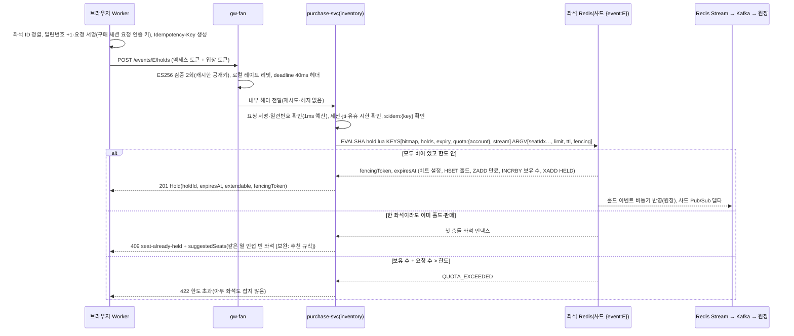
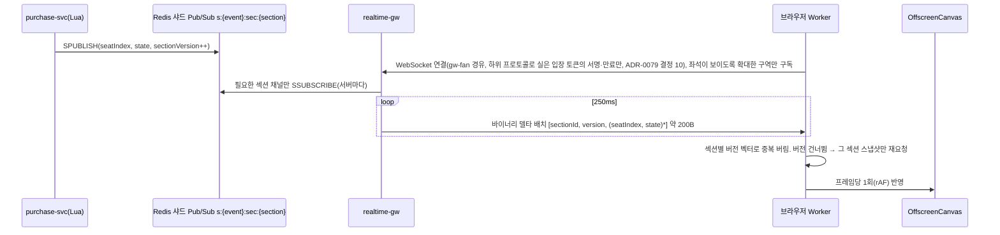

# 기능 설계: 좌석 선택·홀드·실시간 좌석 전파

- **독자와 용도**: purchase-svc의 inventory 모듈, realtime-gw, 소비자 웹 좌석맵을 구현하는 엔지니어가 참조한다. 2단계 일관성 모델(Soft Hold + Hard Sale), Lua 스크립트 계약, 1인당 매수 제한, 홀드(결제하는 동안 다른 사람이 가져가지 못하게 좌석을 잠시 잡아 두는 것)의 TTL(정해 둔 유효 시간. 지나면 지워진다) 수명주기, 좌석 상태 델타(바뀐 좌석만 담은 작은 메시지) 전파, 지연시간 예산, 검증 테스트 포인트를 여기서 파악한다.
- **원문 출처**: [초기 설계서](<../../archive/PEAKET(피켓) — 100만 동시접속 티케팅 + 관제 시스템 프로젝트 설계서.md>) §6 '좌석: 2단계 일관성', '실시간 좌석 전파', '결제 연동' 4번(Hard Sale), §9 좌석 홀드·좌석 상태 전파 SLO(팀이 정한 서비스 품질 목표)와 Degraded Mode, '지연 예산 예시', §10 K2~K5 검증, 21장(인덱스와 동시성 제어 잠금), 11장·12장(대규모 좌석맵 성능 최적화), ADR-0009·0014·0027 (전체 이관표는 [00-diagnosis.md](../../00-diagnosis.md#31-설계서d) §3.1).
- **기준 기획 버전**: v1.0.
- **관련 ID**: FR-009, FR-010, FR-011(사전 예약 단계), FR-042 · NFR-003, 004, 012(좌석맵), 015, 020, 025 · POL-011, 012, 035 · FR-050(자동 배정) · SCR-007, 008, 010, 022 · CMP-021 SeatMap, CMP-022 SeatList · API(프로그램끼리 요청과 응답을 주고받는 창구) `/v1/events/{eventId}/seatmap-snapshot`, `/v1/events/{eventId}/seatmap-layouts/{layoutVersion}.json`, `/v1/events/{eventId}/holds`, `/v1/holds/{holdId}`, `/v1/holds/{holdId}/extension` · 채널 `ws.seat-delta`, 이벤트 `trade.seats` · 키 docs/data.md §3 좌석 클러스터.

## 1. 개요: 2단계 일관성(ADR-0014)

| 단계 | 데이터 저장소 | 핵심 역할 | 일관성 보장 수준 |
| --- | --- | --- | --- |
| Soft Hold | 좌석 Redis(메모리에 데이터를 두는 빠른 저장소)의 비트맵과 Lua | 좌석 선택 단계의 경합을 아주 빠르게 판정한다(p99 ≤ 50ms, 요청 백 건 중 아흔아홉 건이 이 시간 안에 끝난다는 뜻). 1인당 매수 제한을 1차로 검증한다 | 고성능 최종 일관성. 페일오버(고장 난 쪽 대신 예비 쪽으로 넘기는 것) 때 잠깐 생기는 손실은 DB 계층에서 안전하게 흡수한다. |
| Hard Sale | PostgreSQL(관계형 데이터베이스) `seat_sale`의 활성 상태 부분 유니크 인덱스(`UNIQUE (event_id, seat_id) WHERE status IN ('PENDING','SOLD')`) + `purchase_quota` 조건부 갱신 | 결제사(토스페이먼츠·포트원, POL-013) 승인 바로 앞에서 사전 예약(PENDING)을 등록하고, 승인이 끝나면 SOLD로 바꾼다 | 강한 일관성(ACID). 오버셀(같은 좌석이 두 사람 이상에게 팔리는 사고)을 0건으로 지키는 마지막 안전 방어선이다. |

- **동기 경로에서 RDBMS 쓰기 배제**: 사용자가 좌석을 누르는 핫패스(Hot-path)에서는 평소 PostgreSQL에 쓰지 않고 Redis 인메모리 연산만으로 응답한다. 목표는 홀드 p99 50ms 이하다(NFR-003). 좌석 Redis 장애 전환 중에는 PostgreSQL 정렬 잠금 경로로 홀드를 처리한다(§9).
- **비동기 원장 반영**: 홀드 이벤트는 `Redis Stream → Kafka` 파이프라인을 거쳐 원장 DB에 비동기로 적재된다. 적재 전에 좌석 Redis가 통째로 멈추면 그 사이의 홀드는 사라지고 좌석은 빈 좌석으로 돌아간다(§6의 5).
- **최종 일관성과 이중 방어선**: 최종 판매 확정은 PostgreSQL의 활성 상태 부분 유니크 인덱스(`UNIQUE (event_id, seat_id) WHERE status IN ('PENDING','SOLD')`)로 검증한다. 경합에서 진 주문은 결제 승인 요청 전에 걸러지므로 과금과 환불이 생기지 않는다. 다만 사용자는 결제창 인증을 마친 뒤에 실패 안내를 받을 수 있다(§6).

## 2. 좌석 스냅샷과 구매 세션 시작(FR-009)

- 사용자가 대기열을 통과해 예매 영역에 들어오면 바로 `GET /seatmap-snapshot`을 호출해 공연의 전체 좌석 비트맵(좌석 하나를 한 비트로 줄여 담은 전체 좌석 상태. 5만 석 기준 약 6.25KB(5만 비트)의 바이너리 데이터)을 받는다. 이 요청은 입장 토큰(권한이나 상태를 증명하려고 주고받는 서명된 문자열)을 처음 쓰는 요청으로 식별된다. 그래서 purchase-svc가 토큰의 jti 값을 `SET NX`로 원자적으로(중간 상태 없이 한 번에 끝나는 방식으로) 기록하고 구매 세션을 연다(docs/features/queue-admission.md §6 참조). 이 첫 요청은 구매 세션을 만드는 쓰기라 헤지(Hedged) 요청을 보내지 않는다. 구매 세션이 열린 뒤의 스냅샷 재요청(§7)은 읽기만 하므로 지연시간을 줄이는 헤지 요청을 허용한다(ADR-0009).
- 좌석맵 그리기(2026-10-13 전체 점검): 스냅샷(어느 시점의 전체 상태를 찍어 둔 것)은 좌석마다 가용·점유를 1비트로 담는다. 그래서 처음 그릴 때는 점유 좌석을 '선택 불가'(sold 모양)로 그린다. 그 뒤 실시간 변경분(SeatDeltaBatch)의 상태 값으로 다른 분 선택(홀드·결제 예약)과 판매를 나눠 그린다. 판매 제외석(unavailable)과 휠체어석은 좌석 지오메트리 정적 JSON의 속성으로 그린다(design/d2 CMP-023).
- 좌석 자동 배정(AUTO) 공연은 스냅샷을 받지 않는다. 차례가 오면 브라우저가 입장 확정에 이어 자동 배정 홀드 요청(§3)을 자동으로 보낸다. 이 요청이 입장 토큰의 첫 사용이 되어 같은 방식으로 구매 세션을 연다. 클라이언트 임시 공개키는 그 요청 본문(`clientEphemeralPublicKey`)에 싣는다(ADR-0043).
- 구매 세션 소지 증명(ADR-0050 결정 8, ADR-0011 결정 6 대체): 클라이언트는 입장 확정 응답에 담긴 서버 고정 ECDH 공개키와 스스로 만든 임시 개인키로 공유 비밀을 만든다. 그리고 `HKDF-SHA256(공유 비밀, salt = 입장 토큰 jti, info = "PEAKET-purchase-v1")`로 요청 인증 키를 만든다. 자신의 임시 공개키는 첫 스냅샷 요청 헤더에 실어 서버의 구매 세션에 묶는다. 브라우저는 이 요청 인증 키를 추출 불가 `CryptoKey`로 IndexedDB(브라우저 안에 데이터를 저장하는 곳)에 둔다. 일련번호는 Web Locks로 직렬화해(한 번에 하나씩 쓰게 해), 결제창에서 돌아오거나 새로고침해도 이어 쓴다. 이어 붙이기 규칙과 시험 벡터는 docs/frontend.md §5.3에 있다(추천 적용 2026-10-21, ADR-0079 결정 6).
  - 그 뒤 구매 세션의 쓰기 요청(홀드, 홀드 해제·연장, 주문, 결제 시도·접수)마다 일련번호를 1씩 올리고, `HMAC-SHA256(키, 메서드 ‖ 경로 ‖ 일련번호 ‖ 본문 SHA-256)`을 헤더(`X-Purchase-Seq`, `X-Purchase-Mac`)에 싣는다. 다시 보낼 때는 새 일련번호로 다시 서명한다. 같은 요청의 중복 처리는 멱등키가 맡는다.
  - purchase-svc는 어느 파드(쿠버네티스에서 앱이 실행되는 가장 작은 단위)에서든 같은 키를 다시 계산해 상수 시간으로 비교한다. 일련번호가 구매 세션(`s:session:{sid}`)에 저장된 마지막 번호보다 클 때만 받아, 재전송을 거부한다.
  - 목적은 쿠키(브라우저가 사이트별로 저장했다가 요청마다 함께 보내는 작은 값)나 입장 토큰만 훔쳐서는 구매 세션을 쓸 수 없게 하는 것이다. 본문은 암호화하지 않으며, 기밀성은 TLS(통신을 암호화하는 표준)가 맡는다. 브라우저를 조종하는 봇은 페이지가 대신 서명해 주므로 막지 못한다. 효과는 K6 평가에서 이 장치가 있을 때와 없을 때를 비교해 잰다.
- 좌석의 물리적 지오메트리 정보(구역·열·좌표)는 공연 회차별 정적 JSON 파일로 만든다. 이 파일은 CDN(사용자 가까운 곳에 파일을 복사해 두고 대신 응답하는 전송망)의 엣지(가까이 둔 서버)에 캐시(자주 쓰는 값을 가까운 곳에 복사해 둔 것)로 오래 둔다. 입장 차례가 가까워지면 클라이언트가 백그라운드에서 미리 받아 둔다(K5). 실행 중에는 가벼운 비트맵과 실시간 델타 변경분만 네트워크로 받는다.
- 좌석맵 파일(`/v1/events/{eventId}/seatmap-layouts/{layoutVersion}.json`)은 두 층을 함께 싣는다. 배치 층은 공연장 캔버스 크기, 무대 도형, 구역 도형(공연장 좌표계 다각형)·라벨 위치·기본 등급이다. 좌석 층은 구역별 좌석의 열·번호·좌표(x·y)·등급·휠체어석·판매 제외다. 구역마다 좌석이 비트맵 인덱스의 한 범위를 차지하고, 그 범위를 파일에 적어 둔다. 그래서 브라우저가 스냅샷 비트맵에서 구역별 남은 좌석을 바로 센다. 배치를 바꾸면 판(`layoutVersion`)이 올라 새 경로가 되므로 `immutable`로 캐시한다. 입장 확정 응답의 `seatmapLayoutPath`가 미리 받은 판과 다르면 다시 받는다(추천 적용 2026-10-14, ADR-0063). 5만 석 파일의 압축 크기와, 열 단위 배열로 줄일지는 K5에서 잰다 [가정].

## 3. 홀드 요청(FR-010, NFR-003)

- **Lua 스크립트 실행 계약**(트랜잭션 하나로 원자성 보장): (1) 요청한 모든 좌석 인덱스의 비트가 0(가용 상태)인지 검증한다. (2) `현재 보유 수 + 요청 좌석 수 ≤ 1인당 한도`인지 검증한다. (3) 두 조건을 모두 만족할 때에만 비트 설정(1), 홀드 Hash 등록(소유자, 펜싱 토큰, TTL), 만료 Sorted Set 인덱싱, 계정별 보유 수 증가(`INCRBY`), Redis Stream 이벤트(`XADD HELD`) 발행을 한꺼번에 한다. 좌석 하나라도 조건을 만족하지 못하면 모든 상태 변경을 바로 되돌린다(롤백). 여러 좌석을 요청하면 인덱스 오름차순으로 정렬해 처리하므로 데드락이 생길 여지를 막는다.
- 펜싱 토큰(Fencing Token)은 공연별로 앞의 값보다 늘 커지는(엄격한 단조 증가) 정수 카운터로 발급된다. 원장 DB 적재 워커와 실시간 델타 전파 컴포넌트는 자신이 가진 토큰보다 낮은 옛 버전 이벤트를 안전하게 무시한다. 그래서 네트워크 지연으로 뒤늦게 도착한 과거 홀드 이벤트가 최신 상태를 덮어쓰는 이상 현상을 막는다.
- 비트맵, 홀드 메타데이터, 만료 인덱스, 계정 쿼터 키는 `{event:E}` 해시 태그(어느 샤드에 둘지 정하는 키 속 표시)를 함께 써서 같은 Redis 샤드에 물리적으로 함께 놓인다. 자동 파이프라이닝과, 이벤트 루프 지연시간을 p99 ≤ 20ms로 관리하는 것으로 꼬리 지연을 크게 줄인다. 마스터와 복제본(원본을 복사해 두고 읽기를 나눠 받거나 장애 때 대신하는 저장소) 사이의 동기화를 보장하는 `WAIT` 명령은 정밀한 지연 예산 범위 안에서만 골라 적용한다(복제본 1대, 시간 초과 5ms [가정, Phase 2 부하 시험에서 확정]).
- 좌석 홀드 경합에서 진 경우(409 Conflict)는 시스템 장애가 아니라 정상적인 비즈니스 분기로 집계한다. 홀드 요청마다 결과(경합·한도 초과 포함)를 `telemetry.purchase`의 `HoldAttempt`로 내보낸다. 공연 리포트는 이것으로 홀드 경합 패배율과 자동 배정 결과를 계산한다(ADR-0052, docs/features/analytics.md §3.4). 클라이언트에는 0.05초(50ms) 이내에 경합 탈락 안내와 대안 추천 좌석을 바로 돌려준다.
- 멱등키는 좌석 Redis 클러스터의 `s:idem:{key}`에 보관한다. 이 키의 해시 태그는 회차가 아니라 멱등키라서, 홀드 Lua와 같은 샤드에 있다고 볼 수 없다. 그래서 확인은 Lua 호출 전에 따로 한다(§3 순서도). 같은 멱등키로 요청이 다시 들어오면 처음 성공했던 응답 본문을 바로 다시 돌려준다.
- 운영 비상 킬스위치(판매 일시정지, 명령 3)가 발동되면 purchase-svc는 범위 안 회차의 새 홀드 요청, 결제 시도 시작, 결제 접수를 423 Locked로 바로 거절한다. 이미 접수된 결제는 끝까지 처리한다. 그 회차 구매 세션의 무활동 만료(5분)는 일시정지 동안 세지 않고, 재개 때 5분부터 다시 센다. 홀드 TTL과 최대 체류(45분)은 그대로 흐르므로, 고른 좌석은 홀드 시간이 지나면 풀린다(추천 적용 2026-10-14, ADR-0062).
- **판매 종료(소유자 결정 2026-10-14, ADR-0064)**: 회차의 판매 종료(공연 시작 24시간 전, `event.starts_at` - 24시간을 계산, 새 칸 없음, docs/data.md §2) 뒤에는 purchase-svc가 그 회차의 새 홀드 요청(직접 선택·자동 배정 모두)을 410 `sale-ended`로 거절하고 아무 좌석도 잡지 않는다. 판매 종료는 구매 세션 요청을 받을 때 purchase-svc가 회차 캐시의 `starts_at`으로 계산한다. 판매 일시정지와 달리 되돌리지 않는다. 판매 종료 전에 만든 홀드는 그대로 두며, 지금 규칙(홀드 TTL 7분, 1회 3분 연장, 결제창 유지 30분과의 관계, §5) 안에서 주문·결제를 마칠 수 있다(추천 적용 2026-10-14, ADR-0064). 그 홀드가 만료·해제되거나 판매 종료 뒤 예매 취소로 반환된 좌석은 비트맵에서 풀린다. 하지만 새 홀드를 받지 않으므로 다시 팔리지 않는다(남는 한계, ADR-0064). 판매 종료 직전에 홀드한 사람은 판매 종료 뒤에도 최대 홀드·결제 시간만큼 결제를 마칠 수 있다.
- **자동 좌석 배정 모드(POL-035, FR-050, ADR-0041·ADR-0043)**: 클라이언트 요청이 개별 좌석 ID 대신 희망 조건(`auto`: 1순위 등급, 매수, 휠체어석 필요 여부, 선택으로 2순위 등급과 분리 좌석 허용 여부)을 담는다. 희망 조건은 팬이 대기 중에 미리 입력해 브라우저에 저장해 둔다. 차례가 오면 브라우저가 입장 확정에 이어 사람의 조작 없이 보낸다(docs/features/queue-admission.md §6). purchase-svc는 희망 조건을 그대로 믿지 않고 등급·매수·조합을 다시 검증한다(docs/security/asvs/bot-defense.md 2.2.1~2.2.3). 그 뒤 1순위 등급 비트맵에서 파트너사가 미리 정한 선호 순서(기본 무대 중앙에 가까운 순 [가정, 시안에서 확정], POL-035)에 따라 연석 후보를 고르고, 같은 Lua 홀드 스크립트를 호출한다. 경합(409)이 생기면 다음 순위 후보로 최대 3회 [가정, 시안에서 확정] 자동으로 다시 시도한다. 1순위에 연석이 없으면, 분리 좌석을 허용한 경우 같은 등급의 분리 좌석을 고르고, 아니면 2순위 등급에 같은 규칙을 적용한다. 모두 실패하면 아무 좌석도 홀드하지 않고 409 `manual-selection-required`로 응답한다. 화면은 남은 등급·매수를 고르는 수동 선택으로 바뀐다. 응답에는 배정 결과 유형(`FIRST`, `FIRST_SPLIT`, `SECOND`, `SECOND_SPLIT`)을 담는다. 배정 결과를 반납하면 홀드를 풀고 수동 선택으로 간다. 1인당 매수 한도, 펜싱 토큰, TTL 정책은 직접 선택(PICK) 모드와 똑같이 적용된다. 자동 배정 모드 공연은 전체 좌석맵 스냅샷과 델타 전파 트래픽을 관람객에게 보내지 않으므로 K4와 K5 부하를 크게 줄인다.

## 4. 1인당 매수 제한(POL-011)

- 제한을 검증하는 조건식: 그 공연에서 사용자가 이미 확보한 좌석 수(지금 유효한 홀드 수 + 결제 완료 수) + 새로 요청한 좌석 수 ≤ 공연별 설정 한도(판매 정책 기준. 예: 팬클럽 선예매 회차당 1인 2매. 전체 용량은 최대 4매를 기준으로 산정하며, 주문 1.25만~2.5만 건 중 보수적인 상한인 2.5만 건을 택한다, C-03 결정 2026-10-08).
- 계정별 보유 좌석 수는 Soft Hold에 성공하면 원자적으로 늘어난다. 홀드 만료, 명시적 해제, 결제 취소와 환불 때는 바로 줄어든다. 최종 결제를 마친 좌석은 예매 취소와 환불 절차가 공식 확정된 때에만 줄어든다(POL-032).
- 예매 취소로 반환된 좌석은 PostgreSQL의 `seat_sale` 레코드를 `RETURNED` 상태로 바꾸고, Redis 비트맵을 가용 상태(0)로 되돌린 뒤 실시간 델타로 바로 다시 보여 준다(취소표 실시간 방출). 유니크 제약조건은 활성 상태(`PENDING`, `SOLD`)에만 걸린 부분 유니크 인덱스이므로, 반환된 좌석을 다시 판매할 수 있다(docs/data.md §2 참조).
- 매수 제한은 좌석 홀드 때(Redis Lua)와 최종 판매 확정 때(PostgreSQL `purchase_quota` 원자적 조건부 갱신: `used + n ≤ limit_count`를 만족할 때에만 UPDATE), 이렇게 2단계에서 중복으로 검증한다. Redis 페일오버로 메모리 속 쿼터 카운트를 잠시 잃더라도, 최종 판매 확정의 조건부 갱신이 한도를 넘는 판매를 거절한다.
- 1인 1계정 원칙을 본인확인 연계정보(CI: 본인확인 기관이 주는, 사람마다 하나인 연계 식별값)로 엄격히 강제한다. 그래서 계정 단위 제한이 곧 실제 사람 단위의 매수 한도와 정확히 같다. 같은 사용자가 여러 탭이나 여러 기기로 동시에 홀드를 시도해도, 한 Redis 샤드의 Lua 스크립트 하나가 모든 요청을 하나씩 차례로(완전 직렬화) 처리한다. 그래서 한도 초과 건수는 0건으로 유지된다(K2).

## 5. 홀드 TTL·연장·만료·재노출(POL-012, FR-042)

| 항목 | 정책 및 동작 사양 |
| --- | --- |
| 홀드 TTL 초기값 | 기본 7분으로 설정한다(추천 적용, 2026-10-09). 허용 범위는 설정 파일의 안전 한계로 제한된다. |
| 시간 연장 정책 | 1회에 한해 3분 연장을 허용한다(추천 적용, 2026-10-09). 2026-10-14 ADR-0060은 홀드가 온세일(판매가 열리는 시각 앞뒤로 접속이 몰리는 기간)이라는 실시간 경쟁에서 다른 사람이 살 좌석을 묶는 제한이므로, 웹 접근성 국제 기준인 WCAG 2.2.1의 실시간 예외로 본다(2.2.1의 연장 방식은 만료 전 경고와 10회 이상 연장을 요구하므로 1회 연장만으로는 맞지 않는다). 남은 시간 표시와 1회 연장은 접근성 배려로 둔다. `POST /holds/{id}/extension` 호출로 처리하며, 두 번째 연장 시도에는 409 Conflict를 돌려준다. |
| 만료 인덱스 관리 | `s:{event:E}:expiry` Sorted Set을 유지한다(스코어 = 만료 UNIX 타임스탬프). purchase-svc의 백그라운드 작업이 1초 주기 [가정, Phase 2 부하 시험에서 확정]로 `ZRANGE … BYSCORE … LIMIT 0 n`(건너뛰기 0, docs/data.md §3, ADR-0086)으로 조회해 만료 좌석을 한꺼번에 회수한다(BullMQ 큐를 거치지 않고 직접 처리). |
| 만료 및 해제 처리 | Lua 스크립트 하나로 비트맵 해제, 홀드 Hash 삭제, 보유 수 차감, Stream `EXPIRED`/`RELEASED` 발행, 샤드 Pub/Sub 델타 송출을 원자적으로 한다. 만료 좌석은 p99 3초 이내에 좌석맵 화면에 가용 상태로 다시 보인다(NFR-025). |
| 결제창 유지 30분과의 관계 | 결제 접수 때 홀드 TTL이 이미 만료되었더라도 그 좌석이 아직 비어 있으면 Hard Sale PENDING 등록을 시도한다. 이미 다른 사람이 홀드했으면 결제 승인을 하지 않고 사용자에게 안내한다(미승인 종결로 과금 0건 보장, POL-013). |
| 결제사 장애 때 연장 | 결제사 장애(docs/features/payment.md §9)로 승인 재시도 큐에 들어간 결제는 좌석 홀드 TTL을 그 결제의 승인 기한(결제창 인증 뒤 10분)까지 자동으로 연장한다. 고정 시간을 더하는 방식이 아니며, 사용자의 1회 연장(위 '시간 연장 정책')과 별개다. 승인 기한을 넘기면 승인을 시도하지 않고 과금 없이 끝내며, 좌석을 푼다(추천 적용 2026-10-20, ADR-0073). |
| 결제 일시 정지 때 멈춤 | 결제사 장애로 새 결제 진입이 멈춘 동안(docs/features/payment.md §9·§2.2), 그 회차에서 주문을 만들고 결제 접수 전인 홀드는 남은 시간을 세지 않는다. 만료 작업은 그 홀드를 회수하지 않고, 다시 열리면 회차 단위 Lua 하나로 만료 인덱스 점수와 홀드 Hash의 만료 시각을 멈춘 시간(일시 정지 시작과 주문 생성 가운데 늦은 때부터 다시 열린 때까지)만큼 뒤로 민다. 그 구매 세션의 최대 체류 시각은 넘기지 않는다(홀드 Hash에 주문 생성 시각과 최대 체류 시각을 적는다). 주문 전 홀드는 그대로 센다. 일시 정지 여부는 만료 작업이 1초마다 payment-svc에 묻는다(`GetNewPaymentPause`). 답이 10초 [가정] 넘게 없으면 지금처럼 회수한다(소유자 결정 2026-10-22, 세부는 추천 적용, ADR-0085). |
| 잔여 시간 화면 안내 | 좌석 선택 화면과 주문서 화면에 카운트다운 타이머를 보여 준다. 만료가 다가오면 화면 낭독기(화면의 글자를 소리로 읽어 주는 프로그램) 사용자를 위한 `aria-live` 경고 음성 안내를 간격을 두어(스로틀링) 내보낸다. |

## 6. Hard Sale(결제 접수 Saga 단계, FR-011)

1. 결제 접수 API가 202 Accepted를 돌려준 직후, 백그라운드의 Saga(여러 서비스에 걸친 일을 단계별로 처리하고, 중간에 실패하면 앞 단계를 되돌리는 방식) 오케스트레이터가 PostgreSQL `seat_sale` 테이블에 `(event_id, seat_id)`를 `PENDING` 상태로 INSERT한다(활성 상태 부분 유니크 인덱스 적용). 같은 데이터베이스 트랜잭션 안에서 `purchase_quota`를 조건부로 갱신하고, 주문 이벤트를 Outbox(보낼 이벤트를 같은 트랜잭션으로 표에 적어 두었다가 나중에 보내는 방식) 테이블에 기록한다.
2. DB 예약 INSERT에 성공하면 payment-svc에 gRPC(서비스끼리 함수를 부르듯 빠르게 호출하는 통신 방식)로 승인을 요청한다. PG 승인 성공 응답을 받으면 `seat_sale` 상태를 `SOLD`로 바꾸고 티켓 발권을 마친다. 승인 전 실패나 시간 초과가 생기면 `PENDING` 행을 바로 지우고, 좌석 해제 이벤트를 발행해 Redis 비트맵을 가용 상태로 되돌린다.
3. 유니크 제약조건 위반 에러가 나면 좌석 경합에서 진 것으로 판정한다. 이때는 PG 승인 API를 호출하기 전이므로, 과금 없이 주문 실패로 끝내고 사용자를 좌석맵 화면으로 안전하게 돌려보낸다.
4. 홀드 원장(홀드와 해제의 감사 이력)은 Redis Stream → Kafka `trade.seats` → PostgreSQL 파이프라인으로 비동기로 최종 적재된다. 컨슈머(메시지를 읽는 쪽)는 이벤트의 펜싱 토큰을 대조해 순서가 뒤바뀐 것을 바로잡는다.
5. Redis 전체 장애를 복구한 뒤 비트맵을 다시 만드는 절차: PostgreSQL의 `seat_sale`(PENDING 및 SOLD 상태) 레코드와 유효한 홀드 원장 데이터를 조회해 메모리 속 비트맵을 다시 만든다(장애가 났을 때 따라 하는 절차서인 RB-06 런북의 절차). 판매(PENDING·SOLD)는 모두 반영된다. 하지만 원장에 적재되기 전에 Redis와 함께 사라진 홀드는 복원되지 않아, 그 좌석은 빈 좌석으로 돌아간다. 그 홀드의 사용자는 결제 접수 때 좌석이 비어 있으면 그대로 살 수 있다(§5).

## 7. 실시간 좌석 전파(NFR-004, K4, ADR-0027)

- Redis 클러스터의 일반 Pub/Sub은 메시지를 모든 브로커 노드(클러스터를 이루는 서버 한 대)에 보내 부하를 일으킨다. 그래서 특정 샤드 노드에만 따로 보내는 Redis 7.0 샤드 Pub/Sub(`SPUBLISH`/`SSUBSCRIBE`)을 전면 채택한다. realtime-gw는 좌석 Redis의 델타 채널만 구독하고, 다른 데이터 키에는 전혀 접근하지 않는다(ADR-0007).
- **구독 범위(추천 적용 2026-10-14, ADR-0063)**: 실시간 좌석 상태는 좌석이 보이는 구역만 구독한다(구역 단위 채널 `s:{event:E}:sec:{section}`은 그대로). 전체 배치 보기처럼 좌석이 구역 색으로 합쳐진 구역은 구독하지 않는다. 그 구역의 남은 좌석 상태(많음·적음·매진. 경계 값은 아직 정하지 않았다 [가정], design/d5 §1.6 33번)는 스냅샷 비트맵을 5초 [가정]마다 다시 받아 좌석맵 파일의 구역 인덱스 범위로 센다. 입장 5,000명 기준으로 스냅샷 재요청은 초당 약 1,000건(한 번에 6.25KB 이하)이고, 헤지 요청을 허용하는 읽기다. 확대해 좌석이 나타나면 그 구역을 구독하고, 직전에 받은 스냅샷 위에 델타를 얹는다. 축소해 좌석이 합쳐지면 구독을 해제한다. 구독 해제·재구독이 잦지 않도록, 경계에서 1초 [가정] 머문 뒤 바꾼다.
- realtime-gw는 읽기만 하는 프록시이므로, 게이트웨이(클라이언트 종류별로 앞에 둔 입구 서버. 인증, 공통 정책, 안쪽 서비스로 넘기기를 맡는다) 계층의 토큰 서명과 유효기간 검증만 확인한다. 구매 세션 저장소 바인딩은 따로 검증하지 않는다. 입장 토큰의 최대 체류 시한까지 무중단 WebSocket(연결을 열어 둔 채 서버와 브라우저가 주고받는 통신 방식) 재연결을 보장한다.
- 서버 타임스탬프로 클라이언트와 서버 사이의 시계 오차를 보정해, 종단 간 전파 지연시간 p99 ≤ 300ms를 계속 잰다. 일시적인 네트워크 패킷 유실로 버전 갭이 생기더라도, 30초 이내에 섹션 스냅샷 폴링(정해진 간격으로 다시 물어보는 방식)으로 99.9% 확률로 스스로 회복한다. 델타·스냅샷의 바이트 형식과 하트비트(연결이 살아 있음을 알리려고 주기적으로 보내는 신호)·닫힘 코드·재연결 규칙은 docs/frontend.md §4.4의 초안이다(wbs 2.6.4에서 확정).
- 전파 Degraded Mode(큰 장애 때 핵심을 지키려고 부가 기능이나 화면의 새로움을 미리 정한 범위에서 줄여 버티는 운영 모드): 전파 p99 지연이 300ms를 초과하는 상태가 3분간 이어지거나 소켓 송신 버퍼가 기준값에 닿으면, 배치 전송 간격을 1초로 완화한다. 지금 화면에 보이지 않는 뷰포트 밖 구역은 5초 주기 스냅샷 폴링(완화 SLO p99 1.5초)으로 바꾼다. 구독 범위가 '좌석이 보이는 구역'으로 줄었으므로(ADR-0063), 평소에도 좌석이 보이지 않는 구역(축소했거나 화면 밖)은 5초 스냅샷으로 갱신한다. 그래서 이 모드에서 더 바뀌는 것은 배치 전송 간격 1초다. 좌석 홀드를 최종으로 정하는 쪽은 서버이므로, 클라이언트 화면이 늦게 보여도 잘못 팔리는 일로 이어지지 않는다. 헛클릭에 따른 409 경합 탈락만 잠시 늘어난다.

## 8. 지연 예산: 좌석 홀드 p99 50ms

| 처리 구간 | p99 지연 예산 | 핵심 설계 및 지연 방어 기제 |
| --- | --- | --- |
| gw-fan: 토큰 서명 검증 및 라우팅 | 3ms | 메모리에 캐시한 공개키로 하는 ES256 무상태 검증 2회, 로컬 토큰 버킷 레이트 리밋(일정 시간에 받는 요청 수의 상한) 적용, 요청 본문 무버퍼링 스트리밍 |
| gw-fan → purchase-svc 네트워크 왕복 | 5ms | 같은 AZ(가용 영역: 리전 안의 독립된 데이터센터 묶음) 안에 배치, HTTP/2 연결 풀 재사용, deadline 40ms 헤더 전파. 게이트웨이에서 서비스로 갈 때는 메시의 노드 프록시 L4 암호화만 지난다(웨이포인트 없음, ADR-0010·ADR-0082) |
| purchase-svc: 구매 세션 요청 인증 확인 | 1ms [가정, Phase 3 3.4.1에서 확정] | 구매 세션 요청 인증 키(ECDH로 미리 합의)로 하는 HMAC-SHA256 상수 시간 비교와 일련번호 확인(ADR-0050 결정 8), 고성능 프레임워크 Fastify로 실행 |
| inventory 모듈: Redis Lua 다중 좌석 홀드 | 7ms | 한 샤드 안 메모리 비트맵의 원자 연산, 해시 태그 통일, 같은 스크립트 안에서 Stream 이벤트 발행(원장 DB 반영은 백그라운드 비동기 처리) |
| 응답 직렬화 | 5ms | JSON으로 직렬화(openapi `Hold`, 응답 본문은 암호화하지 않는다) |
| 시스템 여유 버퍼 (GC·이벤트 루프·큐잉 지연) | 29ms | Node.js 이벤트 루프 지연 p99 ≤ 20ms 유지. 쓰기 작업인 홀드 요청에는 헤지(Hedged) 요청을 전혀 쓰지 않는다(ADR-0009). 헤지는 구매 세션이 열린 뒤의 스냅샷 재요청에만 쓴다(§2, ADR-0087 결정 21). |

구간별 예산은 목표 지연시간이다. 실제 종단 간 p99 지연시간은 OpenTelemetry(지표·로그·요청 기록을 모으는 공통 표준과 도구)의 분산 트레이싱으로 늘 검증한다(docs/observability.md §6 참조).

## 9. 장애 시 동작(Degraded, NFR-003·015)

| 장애 상황 | 발동 임계치 | Degraded Mode 및 격리 동작 | 완화 SLO | 절대적 보장 원칙 |
| --- | --- | --- | --- | --- |
| 좌석 Redis 프라이머리 페일오버 | 노드 장애와 페일오버 감지 | PostgreSQL 정렬 잠금 경로로 자동 전환한다. 이 경로는 회차·좌석마다 한 행인 `event_seat_price`를 좌석 ID 순으로 `SELECT … FOR UPDATE`하고, 트랜잭션 첫 문장의 `SET LOCAL lock_timeout = '100ms'` [가정]으로 잠금 대기를 끊는다(잠금을 얻지 못하면 409 `seat-already-held`, ADR-0083). 그 뒤 `seat_sale`과 홀드 원장 `seat_hold`에 같은 좌석이 없을 때만 홀드 행을 넣는다. admission-ctrl 동시 입장 목표도 50% 즉시 줄인다. 복구가 끝나면 DB 상태를 기준으로 메모리 속 비트맵을 다시 만든다. | p99 300ms | 초과 판매(오버셀) 0건 유지 |
| 좌석 실시간 전파 과부하 | 전파 p99 > 300ms 3분 지속 또는 송신 큐 기준값 초과 | WebSocket 배치 전송 주기를 1초로 완화하고, 뷰포트 밖 구역은 5초 주기 스냅샷 폴링으로 바꾼다. | p99 1.5초 | 서버의 원자적 홀드 판정이 최종임을 보장 |
| 운영 킬스위치 가동 | 명령 3 발령(commander 요청 + 요청자가 아닌 operator 이상 1인 승인) | 새 홀드와 결제 진입을 423 Locked로 모두 막고, 이미 접수되어 진행 중인 결제는 안전하게 마무리한다. 범위 안 serving 전진도 멈춘다(차례가 이미 온 사람의 입장 확정은 막지 않는다, queue-admission §5). | — | 진행 중인 정상 결제 트랜잭션 보호 |
| purchase-svc 전면 장애 | 서비스 전체 멈춤 | 대기열과 관제 시스템은 영향 없이 정상 작동한다(완전한 도메인 장애 격리). 세션 이벤트가 끊기므로 입장 자리는 5분 안전 시간 초과와 최대 체류 시한에 따라 자동 회수된다. | — | 이미 발급한 대기 순번과 진입 순서 100% 보존 |

## 10. 좌석맵 프론트엔드(K5, NFR-012·020)

- 5만 석 규모의 큰 좌석맵은 무거운 SVG DOM 트리 대신 OffscreenCanvas, Web Worker, 플라이웨이트 디자인 패턴, 바이너리 TypedArray, `requestAnimationFrame`으로 묶어 그리는(배치 렌더링) 파이프라인으로 구현한다. 예매 입장 뒤 화면 표시까지 1초 미만, CPU를 4배 느리게 한(스로틀링) 환경에서도 조작에 화면이 반응하기까지 걸린 시간 INP ≤ 200ms, 좌석 조작 경로의 Long Task(브라우저를 오래 붙잡아 조작을 막는 작업) 0건, v0 대비 힙 메모리 사용량 70% 절감을 달성한다(memlab 누수 검증).
- **전체 배치에서 확대해 좌석 고르기(SCR-010, 소유자 결정 2026-10-14, ADR-0063)**: 처음에는 무대와 구역 배치도 전체를 화면 가득 그리고, 구역마다 등급 색과 남은 좌석 상태를 칠한다. 휠·핀치·[+]·구역 누르기로 확대한다. 구역이 화면 폭의 1/3 이상으로 보이는 배율 [가정]부터는 그 범위 구역들의 좌석을 그려 고를 수 있다. 축소하면 좌석이 다시 구역 색으로 합쳐진다. 미니맵(지금 보는 범위)과 [전체 보기]를 둔다. 데스크톱 오른쪽 패널(선택 좌석·금액·홀드 타이머·[좌석 홀드]), 등급 칩·연석 찾기, 접근성 대안 목록(구역 → 열 → 좌석), 자동 배정(AUTO) 공연의 흐름은 그대로다. 확대·축소는 Worker의 카메라 행렬만 바꾸고, 좌석 그리기는 화면 안 구역으로 한정한다.
- 파트너 좌석맵 에디터(SCR-022)도 같은 두 층 구조다. 배치 층(무대·구역 도형 그리기: 사각형·다각형·부채꼴, 구역 이름·등급·입장 게이트, 구역 라벨 위치)과 좌석 층(구역을 확대해 행 수·좌석 수·간격·곡률·번호 매기기로 행·좌석 배치, 개별 좌석 속성)이다. 미리보기는 팬 화면처럼 전체에서 확대해 보인다. 가져오기(SVG·JSON·CSV)는 도형과 좌표를 함께 받는다(openapi `PUT /v1/partner/productions/{productionId}/seatmap`, `POST …/seatmap-imports`, 소유자 결정 2026-10-14, ADR-0063).
- 좌석맵 소유 단위(추천 적용 2026-10-14, ADR-0063): 공연장 배치는 틀이고, 파트너는 틀을 복제해 그 공연(회차 묶음)용 배치본을 만든다. 편집은 그 배치본에만 미친다. 판매 승인 뒤 바꾸면 다시 승인 대기가 된다. 배치본을 쓰는 회차가 오픈한 뒤에는 도형·좌표·좌석 추가·삭제를 막고(409), 기존 좌석의 속성 변경(판매 제외 등)만 받는다. 좌석 ID·비트맵 인덱스가 판매·홀드 기록과 이어져 있기 때문이다(docs/data.md §2).
- 교차 출처 격리(COOP·COEP)는 고성능 멀티스레딩(SharedArrayBuffer)이 필요한 좌석맵 라우트에만 골라 적용한다. 결제 라우트는 COEP를 두지 않고 COOP는 결제사 지침을 따른다(두 결제사 모두 결제창을 페이지 이동으로 연다, ADR-0079 결정 7, docs/frontend.md §5.14.1).
- 웹 접근성 준수: 좌석 상태는 색상뿐만 아니라 고유 패턴 무늬(디자인 시스템 토큰 `pattern.seat`)로도 함께 나타낸다. 화면 낭독기 사용자를 위해 대체 컴포넌트 CMP-022 SeatList(구역 → 열 → 좌석 번호 키보드 내비게이션)와 '자동 좌석 배정' 버튼을 제공해, 동등한 홀드 요청을 보낼 수 있게 한다. 상태 변경 알림에는 `aria-live` 스로틀링을 적용하고, `prefers-reduced-motion` 미디어 쿼리를 전면 지원한다.
- 클라이언트 상태 소유권 분리: 전체 좌석 그리드 상태는 Web Worker 안의 TypedArray가 맡아 관리한다(서버가 정한 상태를 반영). 사용자가 고른 상태는 Zustand 스토어에 둔다. 전체 화면 전환 흐름(선택 → 홀드 → 주문서)은 XState 유한 상태 기계로 분명하게 통제한다(docs/architecture.md §6.4).

## 11. 데이터·API 참조

| 종류 | 세부 항목 |
| --- | --- |
| Redis 키 | `s:{event:E}:bitmap`, `s:{event:E}:hold:{seat}`, `s:{event:E}:expiry`, `s:{event:E}:quota:{account}`, `s:idem:{key}`, `s:jti:{jti}`, `s:session:{sid}`, `s:{event:E}:stream`, `s:{event:E}:sec:{section}` |
| PostgreSQL | `seat_sale`(status PENDING·SOLD·RETURNED, 활성 상태 PENDING·SOLD만 event_id+seat_id 유일), `purchase_quota`(account_id, event_id, used, limit_count), 홀드 원장 `seat_hold`(event_id, seat_id, 소유 계정, 펜싱 토큰, 상태 HELD·RELEASED·EXPIRED, 만료 시각), `event_seat_price`(회차·좌석별 등급, 대체 경로의 잠금 대상), 주문 이벤트 저장소. 핵심 인덱스: `seat_sale (event_id, seat_id) WHERE status IN ('PENDING','SOLD')` 유일 부분 인덱스, `seat_hold (event_id, seat_id) WHERE status='HELD'` 유일 부분 인덱스, `event_seat_price (event_id, seat_id)` 기본 키, fillfactor는 인덱스 밖 열만 바꾸는 갱신(`purchase_quota.used` 등)을 위해 표마다 정한다(값은 정하지 않았다, docs/data.md §5. 인덱스 밖 열을 바꾸는 갱신만 HOT가 된다. `status` 전이는 부분 인덱스의 조건 열을 바꾸므로 HOT가 아니다. 그래서 `seat_hold`는 표별 `autovacuum_vacuum_scale_factor` 0.02 [가정]로 청소를 앞당긴다, ADR-0083) |
| REST API | `GET /v1/events/{eventId}/seatmap-snapshot`, 좌석맵 파일 `GET /v1/events/{eventId}/seatmap-layouts/{layoutVersion}.json`(공연 페이지 배포 정적 파일, ADR-0063), `POST /v1/events/{eventId}/holds`, `DELETE /v1/holds/{holdId}`, `POST /v1/holds/{holdId}/extension`, 파트너 `GET`·`PUT /v1/partner/productions/{productionId}/seatmap`, `POST /v1/partner/productions/{productionId}/seatmap-imports` |
| 실시간 채널 및 이벤트 | WebSocket 채널 `ws.seat-delta`(SubscribeSections, SeatDeltaBatch), Kafka 토픽(메시지를 종류별로 모아 두는 통로) `trade.seats`(HELD·RELEASED·EXPIRED·PENDING·SOLD·AVAILABLE·RETURNED) |
| UI 컴포넌트 | SCR-010 좌석 선택 화면, SCR-022 좌석맵 에디터, CMP-021 SeatMap, CMP-022 SeatList |

## 12. 테스트 포인트

| # | 테스트 시나리오 | 검증 방법 | 합격 판정 기준 | 연결 요구사항 |
| --- | --- | --- | --- | --- |
| S-T1 | 1개 좌석 1,000명 동시 경합 | k6(부하 시험 도구)로 가장 인기 있는 좌석 단 1석에 요청을 동시에 몰아 넣는다 | 단 1명만 홀드에 성공(201)하고, 나머지 999명은 ≤ 50ms 이내에 409 Conflict를 받는다. 초과 판매 0건, p99 50ms 및 p99.9 150ms를 기록한다. | K2, NFR-003 |
| S-T2 | 데이터베이스 불변식 검사기 | 매 부하 테스트 직후 무결성 SQL 검사 스크립트 실행(판매 좌석 수 ≤ 전체 좌석 수, 좌석당 활성 판매 레코드 정확히 1건, 사용자별 보유 수 ≤ 한도) | 무결성 위반 0건을 검증한다. | K2, QR-FS-1 |
| S-T3 | 다중 탭 및 분산 기기 한도 검증 | 같은 계정의 활성 세션 10개에서 홀드 요청을 동시에 한꺼번에 보낸다 | 1인당 매수 한도 초과 0건을 입증한다. 한도 초과로 실패한 요청은 어떤 좌석도 홀드하지 않는다. | POL-011 |
| S-T4 | 다중 좌석 원자적 홀드 검증 | 좌석 2~4개를 동시에 요청하되, 그중 단 1개 좌석만 다른 사람과 경합하게 한다 | 요청 전체가 한꺼번에 실패(409)하고 부분 홀드가 0건임을 입증한다. | §3 |
| S-T5 | 펜싱 토큰 기반 구버전 무시 | 과거 홀드 이벤트를 일부러 늦춰 넣는다 | 비동기 원장 적재 워커와 실시간 델타 전파기가 토큰을 비교해 옛 버전 이벤트를 안전하게 무시한다. | §3 |
| S-T6 | 홀드 TTL 만료 및 연장 검증 | 만료 대기, 1회 연장 시도, 2회 연속 연장 시도를 차례로 한다 | 만료 좌석이 p99 3초 안에 다시 보이고 사용자 보유 수가 줄어든다. 두 번째 연장 시도는 409 Conflict를 받는다. | FR-042, POL-012 |
| S-T7 | 홀드 만료 후 결제 접수 처리 | TTL이 만료된 직후 주문 결제 접수 API를 호출한다 | 좌석이 비어 있으면 Hard Sale PENDING 예약에 성공한다. 다른 사람이 홀드했으면 무과금 안내로 끝낸다. | POL-013 |
| S-T8 | Hard Sale 최종 경합 검증 | Redis 메모리 속 상태를 일부러 어긋나게 만든 뒤, 같은 좌석에 주문 2개의 결제 접수를 동시에 한다 | PostgreSQL 유니크 제약조건 위반으로 1건만 최종 예약된다. 진 주문은 PG 승인 호출 없이 무과금으로 끝난다. | ADR-0014 |
| S-T9 | Redis 프라이머리 노드 장애 복구 | Redis 프라이머리 노드에 강제로 페일오버를 일으킨다(운영 설계는 AWS FIS, 포트폴리오 기간은 로컬 주 노드 강제 종료, docs/verification.md §5.3) | PostgreSQL 정렬 잠금 비상 경로로 바로 전환되어 초과 판매 0건과 p99 ≤ 300ms를 유지한다. 복구 뒤 DB로 다시 만든 비트맵이 원장과 일치한다. | G-02, NFR-015 |
| S-T10 | 데드락 방지 및 DB 튜닝 검증 | 여러 좌석을 엇갈린 순서로 잠그는 시나리오를 재현한 뒤, 정렬 잠금 알고리즘이 막아 내는지 검증한다 | `pg_stat_database.deadlocks` 발생 건수 0건을 유지한다. 핵심 쿼리 p95 지연시간(요청 백 건 중 아흔다섯 건이 이 시간 안에 끝난다는 뜻)과 HOT(Heap-Only Tuple) 갱신 비율을 표별로 기록한다(`status` 전이는 부분 인덱스의 조건 열을 바꿔 HOT가 아니므로, `seat_hold`·`seat_sale`은 죽은 행 수·인덱스 크기를 함께 본다, ADR-0083). | K3 |
| S-T11 | 트랜잭션 격리 수준 비교 실험 | READ COMMITTED, REPEATABLE READ, SERIALIZABLE 환경에서 쓰기 스큐(Write Skew)를 재현한다 | 부분 유니크 인덱스가 격리 수준과 무관하게 최종 오버셀을 막는 마지막 방어선임을 입증한다. | 21장 |
| S-T12 | 실시간 전파 대역폭 및 지연시간 | 전체 좌석 JSON을 모두에게 보내는 방식(v0)과 바이너리 델타를 묶어 보내는 방식(v1)을 비교한다 | 네트워크 전송 데이터량 99% 절감, 그리고 상태가 바뀐 뒤 화면에 그려지기까지의 종단 p99 지연시간 300ms 이하를 달성한다. | K4 |
| S-T13 | 전파 버전 갭 자가 치유 검증 | 네트워크 패킷 드롭을 주입해 버전이 건너뛰는 상황을 만든다 | 30초 이내에 그 섹션 스냅샷을 다시 받아, 99.9% 확률로 완전히 회복됨을 입증한다. | NFR-004 |
| S-T14 | 실시간 전파 Degraded Mode 검증 | 소켓 송신 버퍼가 가득 찬 상태를 강제로 만든다 | 1초 배치 주기로 자동 완화 전환되어 완화 SLO p99 1.5초를 지키고, 초과 판매 0건을 유지한다. | G-06 |
| S-T15 | 대규모 좌석맵 그리기 성능 검증 | Lighthouse CI(CI: 코드를 올릴 때마다 자동으로 검사하고 빌드하는 과정), Chrome Performance 프로파일링, memlab 메모리 분석을 한다 | 5만 석 화면 표시 1초 미만, 4배 스로틀 환경에서 INP ≤ 200ms, 조작 경로 Long Task 0건, 메모리 사용량 70% 절감을 입증한다. | K5 |
| S-T16 | 구매 세션 소지 증명 검증 | 서명 변조, 같은 일련번호 재전송(Replay), 훔친 쿠키·입장 토큰만으로 보낸 홀드 요청, 다른 세션 키로 서명한 요청 | 서버 계층에서 바로 401로 거부되고, 정상 요청의 확인은 1ms 예산 안에서 끝난다. | NFR-016, ADR-0050 |
| S-T17 | 스냅샷 헤지(Hedged) 요청 검증 | 스냅샷 조회에 일부러 지연을 넣기 전과 뒤의 p99.9 응답시간을 비교한다 | 스냅샷 읽기 지연이 크게 개선됨을 확인하고, 쓰기 작업인 홀드 요청에는 헤지가 전혀 적용되지 않음을 입증한다. | ADR-0009 |
| S-T18 | 화면 낭독기 웹 접근성 검증 | NVDA와 VoiceOver 환경에서 대체 좌석 목록으로 예매 시나리오 전 과정을 완주한다 | 예매 완주율 100%를 달성하고, axe Core 자동 검사 위반 건수 0건을 충족한다. | NFR-020 |
| S-T19 | 자동 좌석 배정 모드 검증 | AUTO 모드 공연에 희망 조건(1순위 R석 2매, 2순위 S석, 분리 허용 여부 조합)을 담은 자동 배정 요청 1,000건을 동시에 넣고, 연석 부족과 1순위 매진 상황을 만든다 | 배정 좌석이 희망 조건 규칙(1순위 연석, 분리 허용 시 1순위 분리, 2순위 순)대로 정확히 할당되고, 중복 홀드는 0건이다. 모든 후보가 실패하면 아무 좌석도 홀드하지 않고 `manual-selection-required`를 돌려준다. 한도 초과 때는 422, 잘못된 조합(같은 등급 중복, 휠체어석 없는 등급) 때는 422를, 그 공연에 없는 등급 때는 400을 돌려준다. | FR-050, POL-035 |
| S-T20 | 자동 배정 순서 공정성 | AUTO 공연에 사람 브라우저 모의(대기 상태 파일 폴링과 차례 직전 직접 확인 규칙)와 봇(레이트 리밋 한도 안에서 입장 확정을 직접 호출)을 순번을 섞어 넣는다 | 순번과 배정 순서의 스피어만 상관계수 0.99 이상, 봇의 평균 순위 이득(순번 순위 − 배정 순위)이 입장 제어 루프 1주기분(약 6명) 이하 [가정, Phase 2 부하 시험에서 확정] | FR-050, ADR-0043, K6 |
| S-T21 | 확대 표시와 구역 구독 | 5만 석 공연에서 전체 보기 → 구역 하나 확대 → 옆 구역으로 이동 → 전체 보기를 반복하며 realtime-gw 구독 목록과 스냅샷 재요청을 기록한다. 다른 세션은 좌석을 홀드한다 | 좌석이 보이는 구역만 구독되고(전체 보기에서 0개) 축소하면 해제된다. 보이는 좌석의 다른 분 선택은 p99 300ms 안에 바뀌고, 전체 보기의 구역 상태는 5초 [가정] 안에 바뀐다. 확대·축소 중 조작 경로 Long Task 0건 | NFR-004, NFR-012, ADR-0063 |
| S-T22 | 판매 종료 뒤 홀드 | 데모 시계로 회차 시작 24시간 전을 넘기며 ① 판매 종료 1초 전·1초 뒤 홀드(PICK·AUTO) ② 판매 종료 1분 전에 만든 홀드의 1회 연장·주문·결제 ③ 판매 종료 뒤 그 홀드 만료와 예매 취소로 좌석 반환 | ① 앞은 201, 뒤는 410 `sale-ended`이고 좌석을 잡지 않는다 ② 홀드 TTL·연장·결제창 유지 규칙 안에서 성공한다 ③ 비트맵은 풀리지만 새 홀드는 410이라 다시 팔리지 않는다 | FR-010, POL-030, ADR-0064 |
| S-T23 | 결제 일시 정지 중 홀드 시간 멈춤 | 데모 시계로 ① 주문을 만들고 홀드가 3분 남았을 때 결제 시뮬레이터 장애로 새 결제 진입을 10분 멈췄다가 연다 ② 주문 전 홀드와 다른 결제사 회차의 홀드를 함께 둔다 ③ 구매 세션의 최대 체류 시각을 넘기도록 오래 멈춘다 ④ payment-svc 조회를 끊는다 | ① 멈춘 동안 회수 0건이고, 다시 열린 뒤 남은 3분에서 이어 센다(±1초) ② 둘 다 원래 시각에 회수된다 ③ 최대 체류 시각에 회수된다 ④ 10초 [가정] 뒤 원래 시각대로 회수된다 | FR-042, POL-013, ADR-0085 |

## 13. 미결정·[가정]

- 홀드 TTL 7분과 연장 3분 정책은 부하 시험 전에 초기값으로 정했다(추천 적용, 2026-10-09). 실제로 잰 성능과 전환율 분석에 따라 고치면 ADR(아키텍처 결정과 그 이유를 남긴 기록)로 기록한다.
- 만료 좌석 정리 주기 1초, 복제본 동기화 `WAIT` 명령을 쓸지와 그 시간 초과 값은 [가정, Phase 2 부하 시험에서 확정]이다. `WAIT` 도입은 지연 예산 범위 안에서 PoC(본 개발 전에 위험한 부분만 먼저 만들어 확인하는 시험)로 최종 결정한다.
- 홀드에 실패했을 때 사용자에게 보여 줄 대체 좌석 추천 알고리즘(같은 구역의 가까운 빈 좌석 찾기)을 보완한다[보완: 추천 규칙].
- 입장한 뒤의 좌석 홀드 속도 경쟁을 줄이는 정책: 직접 선택(PICK) 모드 공연에서는 입장한 사람끼리 선착순으로 홀드한다. 그래서 세션 하나의 홀드 시도 최소 간격 300ms [가정, Phase 2 부하 시험에서 확정]와 비정상 연타 패턴 감지를 위험 점수 신호로 반영한다. 좌석 자동 배정(POL-035) 공연은 희망 조건 미리 입력, 차례가 오면 자동 요청, 차례 직전 직접 확인으로 클릭 경쟁과 입장 뒤 입력 시간의 제출 속도 경쟁을 배정 순서에서 뺀다(ADR-0043). 남는 경쟁(PICK의 클릭 경쟁, AUTO에서 수동 선택으로 넘어간 팬의 제출 속도 경쟁, 차례를 늦게 안 팬의 좌석 질 저하, 입장 제어 루프 주기 안에서 도착 시각이 조금씩 들쭉날쭉한 도착 지터)은 대장에 기록한다(planning/01 §5.2).
- 대규모 좌석 지오메트리 정적 파일의 세부 포맷과 CDN 캐시 키 전략을 보완한다[보완]. 2026-10-14 ADR-0063으로 담는 값(두 층)과 캐시 키(판을 이름에 넣고 `immutable`)는 정했다. 남은 것은 5만 석 파일의 압축 크기와 열 단위 배열 여부(K5)다.
- 좌석이 나타나는 확대 배율(구역이 화면 폭의 1/3 이상), 전체 보기 구역 상태 갱신 주기 5초, 구독 전환 머묾 1초는 [가정]이다. K4·K5 측정에서 정한다(ADR-0063).
