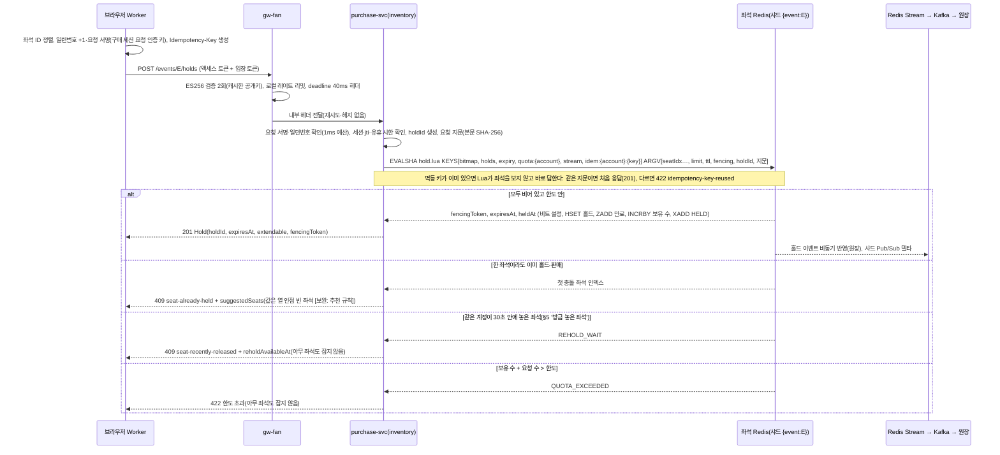
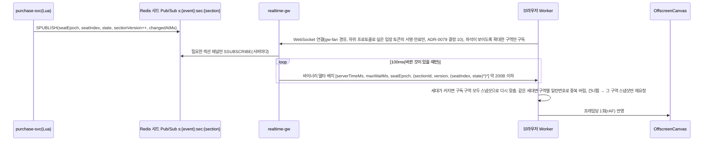

# 기능 설계: 좌석 선택·홀드·실시간 좌석 전파

- **독자와 용도**: purchase-svc의 inventory 모듈, realtime-gw, 소비자 웹 좌석맵을 구현하는 엔지니어가 참조한다. 2단계 일관성 모델(Soft Hold + Hard Sale), Lua 스크립트 계약, 1인당 매수 제한, 홀드(결제하는 동안 다른 사람이 가져가지 못하게 좌석을 잠시 잡아 두는 것)의 TTL(정해 둔 유효 시간. 지나면 지워진다) 수명주기, 좌석 상태 델타(바뀐 좌석만 담은 작은 메시지) 전파, 지연시간 예산, 검증 테스트 포인트를 여기서 파악한다.
- **원문 출처**: 초기 설계서 §6 '좌석: 2단계 일관성', '실시간 좌석 전파', '결제 연동' 4번(Hard Sale), §9 좌석 홀드·좌석 상태 전파 SLO(팀이 정한 서비스 품질 목표)와 Degraded Mode, '지연 예산 예시', §10 K2~K5 검증, 21장(인덱스와 동시성 제어 잠금), 11장·12장(대규모 좌석맵 성능 최적화), ADR-0009·0014·0027 (전체 이관표는 [docs/00-diagnosis.md](../00-diagnosis.md#31-설계서d) §3.1).
- **기준 기획 버전**: v1.0.
- **관련 ID**: FR-009, FR-010, FR-011(사전 예약 단계), FR-042, FR-072(부정 예매 후보 묶음에 쓰는 홀드 기록, ADR-0171) · NFR-003, 004, 012(좌석맵), 015, 020, 025 · POL-011, 012, 035 · FR-050(자동 배정) · SCR-007, 008, 010, 022 · CMP-021 SeatMap, CMP-022 SeatList · API(프로그램끼리 요청과 응답을 주고받는 창구) `/v1/events/{eventId}/seatmap-snapshot`, `/v1/events/{eventId}/seatmap-layouts/{layoutVersion}.json`, `/v1/events/{eventId}/holds`, `/v1/holds/{holdId}`, `/v1/holds/{holdId}/extension` · 채널 `ws.seat-delta`, 이벤트 `trade.seats`·`telemetry.purchase`(`HoldAttempt`)·`telemetry.behavior`(좌석 화면 행동 요약, ADR-0171) · 키 docs/data.md §3 좌석 클러스터.

## 1. 개요: 2단계 일관성(ADR-0014)

| 단계 | 데이터 저장소 | 핵심 역할 | 일관성 보장 수준 |
| --- | --- | --- | --- |
| Soft Hold | 좌석 Redis(메모리에 데이터를 두는 빠른 저장소)의 비트맵과 Lua | 좌석 선택 단계의 경합을 아주 빠르게 판정한다(p99 ≤ 50ms, 요청 백 건 중 아흔아홉 건이 이 시간 안에 끝난다는 뜻). 1인당 매수 제한을 1차로 검증한다 | 고성능 최종 일관성. 페일오버(고장 난 쪽 대신 예비 쪽으로 넘기는 것) 때 잠깐 생기는 손실은 DB 계층에서 안전하게 흡수한다. |
| Hard Sale | PostgreSQL(관계형 데이터베이스) `seat_sale`의 활성 상태 부분 유니크 인덱스(`UNIQUE (event_id, seat_id) WHERE status IN ('PENDING','SOLD')`) + `purchase_quota` 조건부 갱신 | 결제사(토스페이먼츠·포트원, POL-013) 승인 바로 앞에서 사전 예약(PENDING)을 등록하고, 승인이 끝나면 SOLD로 바꾼다 | 강한 일관성(ACID). 오버셀(같은 좌석이 두 사람 이상에게 팔리는 사고)을 0건으로 지키는 마지막 안전 방어선이다. |

- **동기 경로에서 RDBMS 쓰기 배제**: 사용자가 좌석을 누르는 핫패스(Hot-path)에서는 평소 PostgreSQL에 쓰지 않고 Redis 인메모리 연산만으로 응답한다. 목표는 홀드 p99 50ms 이하다(NFR-003). 좌석 Redis 장애 조치 중에는 그 회차의 새 홀드와 구매 요청을 503으로 잠시 미룬다. PostgreSQL로 홀드를 주는 비상 경로는 두지 않는다(§9, 추천 적용 2026-10-28, ADR-0121).
- **비동기 원장 반영**: 홀드 이벤트는 `Redis Stream → Kafka` 파이프라인(Kafka는 이벤트를 순서대로 쌓아 두고 여러 곳에 나눠 주는 메시지 시스템)을 거쳐 원장 DB에 비동기로 적재된다. 적재 전에 좌석 Redis가 통째로 멈추면 그 사이의 홀드는 사라지고 좌석은 빈 좌석으로 돌아간다(§6의 5).
- **최종 일관성과 이중 방어선**: 최종 판매 확정은 PostgreSQL의 활성 상태 부분 유니크 인덱스(`UNIQUE (event_id, seat_id) WHERE status IN ('PENDING','SOLD')`)로 검증한다. 경합에서 진 주문은 결제 승인 요청 전에 걸러지므로 과금과 환불이 생기지 않는다. 다만 사용자는 결제창 인증을 마친 뒤에 실패 안내를 받을 수 있다(§6).

## 2. 좌석 스냅샷과 구매 세션 시작(FR-009)

- 사용자가 대기열을 통과해 예매 영역에 들어오면 바로 `GET /seatmap-snapshot`을 호출해 공연의 전체 좌석 비트맵(좌석 하나를 한 비트로 줄여 담은 전체 좌석 상태. 5만 석 기준 약 6.25KB(5만 비트)의 바이너리 데이터)을 받는다. 이 요청은 입장 토큰(권한이나 상태를 증명하려고 주고받는 서명된 문자열)을 처음 쓰는 요청으로 식별된다. 그래서 purchase-svc가 토큰의 jti 값을 `SET NX`로 원자적으로(중간 상태 없이 한 번에 끝나는 방식으로) 기록하고 구매 세션을 연다(docs/features/queue-admission.md §6 참조). 스냅샷 요청은 첫 요청이든 구매 세션이 열린 뒤의 재요청(§7)이든 헤지(Hedged) 요청(응답이 늦으면 같은 요청을 하나 더 보내 먼저 온 응답을 쓰는 방식)을 쓰지 않는다. 재요청이 늦거나 503이면 시간 초과 뒤 브라우저가 `Retry-After`와 지터를 지켜 다시 묻고, 같은 구역의 재요청은 한 번에 하나만 보낸다(docs/frontend.md §4.1·§4.4.2, 추천 적용 2026-10-28, ADR-0117).
- 좌석맵 그리기(2026-10-13 전체 점검): 스냅샷(어느 시점의 전체 상태를 찍어 둔 것)은 좌석마다 가용·점유를 1비트로 담는다. 그래서 처음 그릴 때는 점유 좌석을 '선택 불가'(sold 모양)로 그린다. 그 뒤 실시간 변경분(SeatDeltaBatch)의 상태 값으로 다른 분 선택(홀드·결제 예약)과 판매를 나눠 그린다. 판매 제외석(unavailable)과 휠체어석은 좌석 지오메트리 정적 JSON의 속성으로 그린다(docs/design/d2 CMP-023).
- 좌석 자동 배정(AUTO) 공연은 스냅샷을 받지 않는다. 차례가 오면 브라우저가 입장 확정에 이어 자동 배정 홀드 요청(§3)을 자동으로 보낸다. 이 요청이 입장 토큰의 첫 사용이 되어 같은 방식으로 구매 세션을 연다. 클라이언트 임시 공개키는 그 요청 본문(`clientEphemeralPublicKey`)에 싣는다(ADR-0043).
- 구매 세션 소지 증명(ADR-0050 결정 8, ADR-0011 결정 6 대체): 클라이언트는 입장 확정 응답에 담긴 서버 고정 ECDH 공개키와 스스로 만든 임시 개인키로 공유 비밀을 만든다. 그리고 `HKDF-SHA256(공유 비밀, salt = 입장 토큰 jti, info = "PEAKET-purchase-v1")`로 요청 인증 키를 만든다. 자신의 임시 공개키는 첫 스냅샷 요청 헤더에 실어 서버의 구매 세션에 묶는다. 브라우저는 이 요청 인증 키를 추출 불가 `CryptoKey`로 IndexedDB(브라우저 안에 데이터를 저장하는 곳)에 둔다. 일련번호는 Web Locks로 직렬화해(한 번에 하나씩 쓰게 해), 결제창에서 돌아오거나 새로고침해도 이어 쓴다. 이어 붙이기 규칙과 시험 벡터는 docs/frontend.md §5.3에 있다(추천 적용 2026-10-21, ADR-0079 결정 6).
  - 그 뒤 구매 세션의 쓰기 요청(홀드, 홀드 해제·연장, 주문, 결제 시도·접수)마다 일련번호를 1씩 올리고, `HMAC-SHA256(키, 메서드 ‖ 경로 ‖ 일련번호 ‖ 본문 SHA-256)`을 헤더(`X-Purchase-Seq`, `X-Purchase-Mac`)에 싣는다. 다시 보낼 때는 새 일련번호로 다시 서명한다. 같은 요청의 중복 처리는 멱등키가 맡는다.
  - purchase-svc는 어느 파드(쿠버네티스에서 앱이 실행되는 가장 작은 단위)에서든 같은 키를 다시 계산해 상수 시간으로 비교한다. 일련번호가 구매 세션(`s:session:{sid}`)에 저장된 마지막 번호보다 클 때만 받아, 재전송을 거부한다.
  - 목적은 쿠키(브라우저가 사이트별로 저장했다가 요청마다 함께 보내는 작은 값)나 입장 토큰만 훔쳐서는 구매 세션을 쓸 수 없게 하는 것이다. 본문은 암호화하지 않으며, 기밀성은 TLS(통신을 암호화하는 표준)가 맡는다. 브라우저를 조종하는 봇은 페이지가 대신 서명해 주므로 막지 못한다.
  - **막는 피해와 남길지 정하는 방법(추천 적용 2026-10-28, ADR-0124)**: 이 장치가 막는 것은 피해자의 팬 쿠키와 입장 토큰을 함께 빼 간 공격자(악성 확장·악성 코드)의 구매 세션 사용이다. 그 공격자가 할 수 있는 것은 홀드 풀기·좌석 바꾸기·주문 만들기·결제 시도 시작(가상계좌 주문으로 좌석을 입금 기한까지 묶기 포함)이고, 할 수 없는 것은 결제 승인(결제창에서 결제 수단 인증을 다시 거친다)과 티켓 가져가기(양도는 소셜 재인증)다. 그래서 검토는 막는 피해를 '방해'로 추정한다. 효과는 봇 비용(K6)이 아니라 탈취 재현 시험 S-T16으로 잰다. wbs 3.4.1에서 S-T16 재현을 먼저 하고, 막는 피해가 방해 수준뿐이면 소지 증명을 빼고 `__Host-` 구매 세션 쿠키(`__Host-peaket_ps`, 서버는 해시만 둔다)·짧은 수명(구매 세션 최대 수명)·기기 표시(구매 세션을 연 `deviceId`와 같은지 확인)로 대신한다. 돈이나 티켓이 공격자 쪽으로 가는 '이득'이 하나라도 나오면 남긴다(ADR-0124 결정 1의 위협·피해 표).
- **구매 세션은 회차 하나에 묶인다(추천 적용 2026-10-30, docs/security/asvs/seat-hold.md 8.2.2)**: gw-fan은 입장 토큰 서명을 확인할 때 주소의 회차 ID가 토큰의 `event`와 같은지도 본다. 주소에 회차가 있는 구매 경로(스냅샷·홀드)와 좌석 델타 WebSocket이 그렇고(해제·연장 `/v1/holds/{holdId}`는 주소에 회차가 없어 §3 '해제·연장은 자기 홀드만' 규칙으로 막는다), 다르면 403(WebSocket은 닫힘 코드 4403)이다. purchase-svc는 구매 세션을 열 때 그 회차를 구매 세션 상태(`s:session:{sid}`)에 적고, 요청마다 다시 대조한다. 주문·결제 경로(`POST /v1/orders`, `/v1/orders/{orderId}/payments`·`/payment-acceptance`)는 주소에 회차가 없어 이 대조를 쓰지 않는다. 대신 자기 것만 규칙을 쓴다: 주문 본문의 `holdId`가 그 구매 세션의 홀드 목록에 없거나, 주소의 주문이 그 구매 세션에서 만든 주문이 아니면 404다. 남의 것, 다른 회차·다른 구매 세션의 것, 없는 것을 같은 404로 답해 있는지 알리지 않는다(§3 '해제·연장은 자기 홀드만'과 같은 규칙, 추천 적용 2026-10-30. 지난 판의 '주문·결제 경로도 회차가 다르면 403'을 openapi에 맞춰 바로잡았다). 그래서 한가한 회차에서 받은 입장 토큰으로 다른 회차의 좌석을 잡거나 다른 회차의 좌석 변경을 받아 볼 수 없다. 시험은 S-T28이다.
- **여정 ID를 구매 세션에 둔다(추천 적용 2026-10-31, ADR-0171)**: 여정 ID `journeyId`는 한 사람이 한 회차의 대기열에 들어와 나갈 때까지를 잇는 조사용 추적 ID다(UUIDv7). 부정 예매 조사(POL-046)에서 대기열·홀드·주문 기록을 한 줄로 잇는 데 쓴다. queue-svc가 만들어 입장 토큰 클레임 `jny`에 싣는다(docs/features/queue-admission.md §6). purchase-svc는 구매 세션을 열 때 이 값을 회차와 함께 구매 세션 상태(`s:session:{sid}`)에 적는다. 그리고 PurchaseSessionStarted, HoldAttempt(§3), 주문 생성 사건(OrderEvent CREATED, docs/features/payment.md §2), 좌석·결제 화면의 행동 신호(BehaviorSignal screen `SEAT`·`PAYMENT`)에 싣는다. 판정·한도·응답에는 쓰지 않는다. 분석 저장소로 가는 적재는 이 칸을 버린다(조사·연구 두 갈래를 잇지 않는다, ADR-0171 결정 2).
- 좌석의 물리적 지오메트리 정보(구역·열·좌표)는 공연 회차별 정적 JSON 파일로 만든다. 이 파일은 CDN(사용자 가까운 곳에 파일을 복사해 두고 대신 응답하는 전송망)의 엣지(가까이 둔 서버)에 캐시(자주 쓰는 값을 가까운 곳에 복사해 둔 것)로 오래 둔다. 입장 차례가 가까워지면 클라이언트가 백그라운드에서 미리 받아 둔다(K5). 실행 중에는 가벼운 비트맵과 실시간 델타 변경분만 네트워크로 받는다.
- 좌석맵 파일(`/v1/events/{eventId}/seatmap-layouts/{layoutVersion}.json`)은 두 층을 함께 싣는다. 배치 층은 공연장 캔버스 크기, 무대 도형, 구역 도형(공연장 좌표계 다각형)·라벨 위치·기본 등급이다. 좌석 층은 구역별 좌석의 열·번호·좌표(x·y)·등급·휠체어석·판매 제외다. 구역마다 좌석이 비트맵 인덱스의 한 범위를 차지하고, 그 범위를 파일에 적어 둔다. 그래서 브라우저가 스냅샷 비트맵에서 구역별 남은 좌석을 바로 센다. 배치를 바꾸면 판(`layoutVersion`)이 올라 새 경로가 되므로 `immutable`로 캐시한다. 입장 확정 응답의 `seatmapLayoutPath`가 미리 받은 판과 다르면 다시 받는다(추천 적용 2026-10-14, ADR-0063). 5만 석 파일의 압축 크기와, 열 단위 배열로 줄일지는 K5에서 잰다 [가정].

## 3. 홀드 요청(FR-010, NFR-003)

- **Lua 스크립트 실행 계약**(여러 변경을 한꺼번에 반영하거나 하나도 반영하지 않는 트랜잭션 하나로 원자성 보장): (1) 요청한 모든 좌석 인덱스의 비트가 0(가용 상태)인지 검증한다. (2) `현재 보유 수 + 요청 좌석 수 ≤ 1인당 한도`인지 검증한다. (3) 두 조건을 모두 만족할 때에만 비트 설정(1), 홀드 Hash 등록(소유자, 펜싱 토큰, TTL), 만료 Sorted Set 인덱싱, 계정별 보유 수 증가(`INCRBY`), Redis Stream 이벤트(`XADD HELD`) 발행을 한꺼번에 한다. 모든 검사를 먼저 하고 쓰기는 마지막에 한꺼번에 하므로, 좌석 하나라도 조건을 만족하지 못하면 아무것도 쓰지 않고 끝난다. Redis(Valkey)는 스크립트를 다른 명령과 섞지 않고 한 번에 돌리지만, 이미 한 쓰기를 되돌리는 기능은 없다(Valkey 트랜잭션 문서, 2026-10-27 확인). 그래서 '되돌린다'가 아니라 '검사 뒤에만 쓴다'로 원자성을 지킨다. 좌석 ID 정렬은 Redis 안의 교착을 막는 장치가 아니다. 스크립트는 샤드에서 하나씩 차례로 돌아 서로 기다리지 않는다. 정렬은 DB 잠금 순서용이다: 판매 확정(Hard Sale)이 여러 좌석의 PENDING 행을 좌석 ID 순으로 넣는 순서(§6, K3)와 같게 맞춘다(추천 적용 2026-10-28, 기술 검토 낮음-068. 검토가 적은 'DB 비상 경로'는 ADR-0121로 없어졌다).
- **좌석 ID 확인(추천 적용 2026-10-30, docs/security/asvs/seat-hold.md 2.2.1)**: purchase-svc는 Lua를 부르기 전에 좌석 ID를 그 회차의 지금 좌석맵 판에서 좌석 색인으로 바꾼다. 없는 좌석, 다른 회차의 좌석, 판매 제외석, 같은 좌석의 중복이 하나라도 있으면 Lua를 부르지 않고 422로 거절한다. 판매 제외석은 비트맵에서 켠 비트가 아니어서(가용 = 판매 대상 좌석 수 − 켜진 비트 수, §4), 화면이 고르지 못하게 하는 것만으로는 API를 직접 부르는 요청을 막지 못하기 때문이다. 시험은 S-T30이다.
- **해제·연장은 자기 홀드만(추천 적용 2026-10-30, docs/security/asvs/seat-hold.md 8.2.2)**: purchase-svc는 홀드를 만들 때 holdId와 그 회차·좌석 목록을 구매 세션 상태에 적고, 좌석 홀드 Hash에도 holdId를 적는다. `DELETE /holds/{holdId}`와 연장은 요청한 구매 세션의 목록에서만 holdId를 찾고, 해제·연장 Lua는 좌석 홀드 Hash의 holdId와 소유 계정이 요청과 같을 때만 바꾼다. 남의 holdId와 없는 holdId는 똑같이 404로 답해, 그런 홀드가 있는지 알리지 않는다. 시험은 S-T29다.
- 펜싱 토큰(Fencing Token)은 공연별로 앞의 값보다 늘 커지는(엄격한 단조 증가) 정수 카운터로 발급된다. 원장 DB 적재 워커와 실시간 델타 전파 컴포넌트는 자신이 가진 토큰보다 낮은 옛 버전 이벤트를 안전하게 무시한다. 그래서 네트워크 지연으로 뒤늦게 도착한 과거 홀드 이벤트가 최신 상태를 덮어쓰는 이상 현상을 막는다. 다만 카운터를 어느 키에 두는지(홀드 Lua는 ARGV `fencing`만 받고 KEYS와 docs/data.md §3 키 표에 카운터가 없다)와, 좌석 Redis 장애 전환으로 카운터가 되돌아갈 때 이미 낸 토큰이 다시 나오지 않게 하는 방법은 정본에 없다. 규칙 모델 검사가 승격 뒤 같은 토큰이 다시 나오는 반례를 찾았고(2026-11-02, `specs/seat.qnt`의 `seat_canon_fencing`, docs/verification.md §2.6), 소유자 결정을 기다린다(PROGRESS OPEN[16]).
- **준비 표시와 회차 세대(추천 적용 2026-10-28, ADR-0121)**: 홀드·해제·연장·만료 Lua와 스냅샷 읽기는 회차 세대 키 `s:{event:E}:epoch`(세대 `seatEpoch`와 그 세대를 연 주 노드)를 같은 샤드에서 함께 읽는다. 이 키는 비트맵을 처음 만들거나 다시 만들 때 마지막에 쓴다. 키가 없으면 좌석을 잡거나 읽지 않고 `NOT_READY`를 돌려주고, purchase-svc는 503 `seat-store-unavailable`로 답한다(§9). 그래서 비트맵이 없는 회차나 장애 뒤 빈 노드에서 팔린 좌석을 빈 좌석(비트 0)으로 읽는 일이 없다. 샤드 Pub/Sub 델타에는 이 세대를 싣는다(§7).
- 비트맵, 홀드 메타데이터, 만료 인덱스, 계정 쿼터 키는 `{event:E}` 해시 태그(어느 샤드에 둘지 정하는 키 속 표시)를 함께 써서 같은 Redis 샤드에 물리적으로 함께 놓인다. 자동 파이프라이닝과, 이벤트 루프 지연시간을 p99 ≤ 20ms로 관리하는 것으로 꼬리 지연을 크게 줄인다. 마스터와 복제본(원본을 복사해 두고 읽기를 나눠 받거나 장애 때 대신하는 저장소) 사이의 복제를 확인하는 `WAIT` 명령은 쓴다면 복제본 1대의 확인을 최대 5ms [가정, Phase 2 부하 시험에서 확정] 기다리고, 시간 초과면 확인 없이 응답한다. `WAIT`는 복제를 보장하지 않고 장애 조치 때 잃는 쓰기를 줄일 뿐이다. 잃은 홀드는 판매 확정(Hard Sale)의 DB 제약이 흡수한다. 쓸지는 PoC로 정한다(§13, ADR-0014 상태 줄, 추천 적용 2026-10-28, 기술 검토 낮음-068).
- 좌석 홀드 경합에서 진 경우(409 Conflict)는 시스템 장애가 아니라 정상적인 비즈니스 분기로 집계한다. 홀드 요청마다 결과(경합·한도 초과 포함)를 `telemetry.purchase`의 `HoldAttempt`로 내보낸다. `firstHeldInSession`은 그 구매 세션의 첫 HELD일 때 true다. purchase-svc가 구매 세션 상태로 정하고, 관제 실시간 표가 첫 홀드 퍼널(입장 → 첫 홀드 → 결제로 이어지는 단계별 인원)을 구매 세션마다 한 번 센다(docs/streaming.md §4.2, ADR-0099). 지표 사전이 바뀌면 이 규칙도 같은 PR(코드 변경을 합쳐 달라는 요청)에서 바꾼다(docs/streaming.md §15). 공연 리포트는 이것으로 홀드 경합 패배율과 자동 배정 결과를 계산한다(ADR-0052, docs/features/analytics.md §3.4). 클라이언트에는 0.05초(50ms) 이내에 경합 탈락 안내와 대안 추천 좌석을 바로 돌려준다.
- **홀드 시도의 조사용 칸(추천 적용 2026-10-31, ADR-0171)**: 부정 예매 조사에서 '여러 계정이 같은 좌석을 거의 같은 순간에 노렸는가'를 보려면, 경합에서 진 시도의 좌석과 잡은 시각이 있어야 한다. 그래서 `HoldAttempt`에 세 칸을 더한다(docs/api/asyncapi.yaml). 시험은 S-T35다.
  - `journeyId`(필수): 구매 세션 상태의 여정 ID(§2).
  - `seatIds`: 직접 선택(PICK)은 결과와 관계없이 요청한 좌석이다. 경합(409)·한도 초과·방금 놓은 좌석으로 아무것도 잡지 못한 시도도 싣는다. 자동 배정(AUTO)은 요청에 좌석이 없으므로, 잡았을 때(HELD)만 잡은 좌석을 싣는다.
  - `heldAt`: 잡았을 때(HELD)만 싣는다. 홀드 Lua가 좌석을 잡은 시각(Lua 안의 Redis `TIME`)이고, Lua가 펜싱 토큰과 함께 돌려준다. 같은 홀드의 SeatEvent HELD `occurredAt`과 같은 값이라 조사 적재가 두 사건을 시각으로도 맞출 수 있다. HoldAttempt의 `occurredAt`은 purchase-svc가 응답 뒤에 낸 시각이라, 샤드가 좌석을 잡은 순서를 그대로 보이지 않는다.
  - HoldAttempt는 텔레메트리라 생산자 버퍼가 차면 버려질 수 있다(`telemetry_dropped_total{record}`, docs/architecture.md §5). 잡은 홀드의 정본은 홀드 원장 `seat_hold`(§6)와 `trade.seats`이고, 경합에서 진 시도의 좌석만 이 사건에 기댄다(남는 한계).
- **좌석 화면 행동 요약(추천 적용 2026-10-31, ADR-0171 결정 4)**: 좌석 화면(SCR-010)에서 잰 행동 요약(openapi `BehaviorSummary`: 포인터 이동 수·이동 방향 엔트로피, 터치·키 입력 간격, 스크롤의 요약값)을 구매 세션의 첫 직접 선택 홀드 요청 본문 `HoldRequest.behavior`에만 싣는다. 구간은 좌석맵을 처음 그린 때부터 그 요청까지다. 원시 좌표, 포인터가 어느 좌석 위를 지나갔는지, 본 좌석은 싣지 않는다(ADR-0065 결정 9, ADR-0171 결정 4 '모으지 않는 것'). 시험은 S-T36이다.
  - purchase-svc는 그 구매 세션에서 처음 받은 요약 하나만, 홀드 결과와 관계없이 `telemetry.behavior`에 `BehaviorSignal`(screen `SEAT`, `journeyId`, pid, 회차)로 낸다. 구매 세션 상태에 '좌석 행동 요약을 냈음'을 적어 두고, 뒤의 홀드 요청에 실려 오면 버린다. 자동 배정 공연은 사람이 좌석을 고르지 않으므로 싣지 않는다.
  - 발행은 홀드 응답을 보낸 뒤 비동기로 한다(trust-svc와 같은 방식, docs/features/bot-defense.md §4.1). 그래서 홀드 경로의 40ms 데드라인(§8) 안에서 늘어나는 것은 본문이 조금 커져 검사·서명 확인에 드는 시간뿐이다. 생산자 버퍼가 차면 버리고 센다.
  - 요약은 홀드 판정·한도·위험 점수에 쓰지 않는다. purchase-svc는 요청 IP의 망 정보를 모르므로 `netClass`·`asn`을 싣지 않는다. 기기 가명도 싣지 않는다(계산하는 곳이 trust-svc·identity-svc뿐이다). 조사 적재가 여정 ID로 잇는다. 대기 중 재평가 작업자 `trust-reassess`는 screen `SEAT`를 건너뛴다(docs/streaming.md).
  - 멱등키 지문(아래 '멱등키')은 좌석 ID 목록이나 희망 조건만으로 만들므로 `behavior`가 들지 않는다. 같은 키로 다시 보낼 때 요약이 달라도 처음 응답을 받는다.
- **멱등키(추천 적용 2026-10-28, 기술 검토 중간-046)**: 멱등키는 좌석 비트맵과 같은 회차 샤드의 `s:{event:E}:idem:{account}:{key}`에 둔다. 키 범위는 계정 × 작업(docs/api/guidelines.md §4)이라 키 이름에 계정을 넣는다. 홀드 Lua가 이 키를 좌석을 잡는 같은 원자 연산에서 확인한다.
  - 키가 없으면 좌석을 잡고, 잡았을 때만 요청 지문(좌석 ID 목록이나 희망 조건 본문의 SHA-256)과 처음 응답(holdId·만료 시각·펜싱 토큰·연장 가능 여부)을 함께 적는다. holdId는 purchase-svc가 Lua 전에 만든다.
  - 키가 있고 지문이 같으면 좌석을 다시 보지 않고 처음 응답(201)을 돌려준다. 지문이 다르면 아무 좌석도 잡지 않고 422 `idempotency-key-reused`다.
  - 경합(409)·한도 초과(422)로 아무것도 잡지 못한 요청은 적지 않으므로, 같은 키로 다시 보내면 다시 시도한다.
  - 수명은 홀드 TTL(7분)과 같다.
  - Lua는 샤드에서 하나씩 차례로 돌므로, 같은 키의 두 요청이 함께 와도 좌석은 한 번만 잡히고 둘 다 같은 응답을 받는다. 그래서 홀드에는 '처리 중'(409) 응답이 생기지 않고, Lua 밖에서 키를 한 번 더 읽는 왕복도 없어진다(이전 키 `s:idem:{key}`는 해시 태그가 멱등키라 Lua 전에 따로 확인했고, 그사이 같은 키의 동시 요청을 막지 못했다). 시험은 S-T24다.
- 운영 비상 킬스위치(판매 일시정지, 명령 3)가 발동되면 purchase-svc는 범위 안 회차의 새 홀드 요청, 결제 시도 시작, 결제 접수를 423 Locked로 바로 거절한다. 이미 접수된 결제는 끝까지 처리한다. 그 회차 구매 세션의 무활동 만료(5분)는 일시정지 동안 세지 않고, 재개 때 5분부터 다시 센다. 홀드 TTL과 최대 체류(45분)은 그대로 흐르므로, 고른 좌석은 홀드 시간이 지나면 풀린다(추천 적용 2026-10-14, ADR-0062).
  - **정지 상태를 두는 곳(추천 적용 2026-10-28, ADR-0103)**: 정지는 메시지가 아니라 상태다. 원본은 purchase DB `sale_control`(범위, 정지 여부, 판 번호, 명령 ID)이고, 좌석 Redis `s:{event:E}:ctl`에 그 회차에 걸린 정지(회차 범위와 전체 범위)의 사본을 둔다. 판매 승인 업무의 판매 중지(ADR-0123)는 같은 표·사본에 따로 둔다(`suspended`, 바꾼 승인 업무 ID `suspension_ref`, 회차 범위만). 홀드 Lua는 비트맵을 보는 같은 원자 연산에서 이 사본을 함께 읽어, 일시정지(`paused`)와 판매 중지(`suspended`) 가운데 하나라도 참이면 좌석을 잡지 않고 423을 낸다. 명령 3 재개는 `paused`만, 판매 재개는 `suspended`만 바꾼다(추천 적용 2026-10-28, ADR-0123). 결제 시도 시작과 결제 접수는 파드 메모리의 같은 상태로 확인한다. 제어 gRPC를 받은 파드는 판 번호가 지금 값보다 클 때만 원본과 사본에 쓰고, 모든 파드는 2초 [가정]마다 원본을 다시 읽어 메모리와 사본을 맞춘다. 전체 범위 정지는 좌석 비트맵이 있는 회차 목록(`s:ctl:events`)의 사본마다 쓴다(순서 규칙은 docs/data.md §3).
  - **새로 뜬 파드**: 오토스케일·재시작으로 뜬 파드는 `sale_control`을 읽은 뒤에야 준비 상태가 된다. 정지 여부를 모르는 파드는 홀드를 받지 않는다(docs/features/control-tower.md §5). 그래서 명령 3이 ACKED된 뒤에 뜬 파드도 정지를 안다(C-T50).
- **판매 종료(소유자 결정 2026-10-14, ADR-0064)**: 회차의 판매 종료(공연 시작 24시간 전, `event.starts_at` - 24시간을 계산, 새 칸 없음, docs/data.md §2) 뒤에는 purchase-svc가 그 회차의 새 홀드 요청(직접 선택·자동 배정 모두)을 410 `sale-ended`로 거절하고 아무 좌석도 잡지 않는다. 판매 종료는 구매 세션 요청을 받을 때 purchase-svc가 회차 캐시의 `starts_at`으로 계산한다. 판매 일시정지와 달리 되돌리지 않는다. 판매 종료 전에 만든 홀드는 그대로 두며, 지금 규칙(홀드 TTL 7분, 1회 3분 연장, 결제창 유지 30분과의 관계, §5) 안에서 주문·결제를 마칠 수 있다(추천 적용 2026-10-14, ADR-0064). 그 홀드가 만료·해제되거나 판매 종료 뒤 예매 취소로 반환된 좌석은 비트맵에서 풀린다. 하지만 새 홀드를 받지 않으므로 다시 팔리지 않는다(남는 한계, ADR-0064). 판매 종료 직전에 홀드한 사람은 판매 종료 뒤에도 최대 홀드·결제 시간만큼 결제를 마칠 수 있다. 예외 하나(추천 적용 2026-10-31, ADR-0171): 우선 구매(이의가 인정된 부정 예매 표 취소의 되돌림, POL-046 ⑦) 입장 토큰(클레임 `prio`)은 판매 종료 뒤에도 그 권리의 우선 구매 보류 좌석 하나를 홀드하고 주문할 수 있다(§5 '우선 구매 보류'). `prio` 토큰은 판매 종료 전후와 상관없이 언제나 그 좌석 하나만 잡는다. 그 밖의 좌석은 판매 종료 전이면 409 `priority-seat-only`, 뒤면 지금처럼 410 `sale-ended`다.
- **자동 좌석 배정 모드(POL-035, FR-050, ADR-0041·ADR-0043)**: 클라이언트 요청이 개별 좌석 ID 대신 희망 조건(`auto`: 1순위 등급, 매수, 휠체어석 필요 여부, 선택으로 2순위 등급과 분리 좌석 허용 여부)을 담는다. 희망 조건은 팬이 대기 중에 미리 입력해 브라우저에 저장해 둔다. 차례가 오면 브라우저가 입장 확정에 이어 사람의 조작 없이 보낸다(docs/features/queue-admission.md §6). purchase-svc는 희망 조건을 그대로 믿지 않고 등급·매수·조합을 다시 검증한다(docs/security/asvs/bot-defense.md 2.2.1~2.2.3). 그 뒤 후보 고르기와 홀드를 자동 배정 Lua 하나에서 한다(추천 적용 2026-10-28, 기술 검토 중간-034).
  - **후보 목록**: 판매를 열 때(좌석맵 판이 정해질 때) 등급·매수마다 파트너사가 정한 선호 순서(기본 무대 중앙에 가까운 순 [가정, 시안에서 확정], POL-035)로 연석 후보 목록을 만들어, 비트맵과 같은 회차 슬롯에 둔다(`s:{event:E}:auto:{tier}:{n}`, docs/data.md §3).
  - **한 번에 찾고 잡는다**: 스크립트는 등급·매수별 커서에서 시작해 후보의 비트를 보고, 빈 연석 블록을 찾으면 그 자리에서 직접 선택과 같은 규칙(비트 설정, 1인 한도, 펜싱 토큰, 만료 인덱스)으로 홀드한다. 찬 후보는 건너뛰며 커서를 앞으로 옮긴다. 커서는 빨리 찾기 위한 표시일 뿐이고, 맞는지는 비트 확인이 지킨다. 홀드가 풀려 돌아온 좌석은 등급별 '돌아온 좌석' 목록에 넣고, 스크립트는 커서보다 먼저 그 목록의 좌석이 든 블록을 본다. 찾은 좌석의 홀드 Hash는 미리 `KEYS`로 넘길 수 없어 스크립트 안에서 같은 해시 태그로 이름을 만든다. 이것이 '쓰는 키를 모두 KEYS로 넘긴다' 규칙의 하나뿐인 예외다(docs/data.md §3 'Lua 스크립트' 항목, 추천 적용 2026-10-30).
  - **Lua가 샤드를 오래 막지 않게**: 한 번에 보는 후보는 32개 [가정]까지다. 못 찾으면 purchase-svc가 옮겨 둔 커서에서 이어 부른다(4회 [가정]까지). 이것은 경합에 진 재시도가 아니라 이어 찾기다(docs/data.md §3 Lua 규칙).
  - **왜 바꿨나**: 예전 방식(앱이 비트맵을 보고 후보를 고른 뒤 홀드하고, 경합(409)이면 다음 순위 후보로 최대 3회 다시 시도)에서는 같은 순간의 요청이 모두 같은 '가장 좋은 연석'을 노린다. 하나만 이기고, 진 요청들은 같은 다음 후보로 함께 옮겨 가 다시 부딪친다. 첫 전진 때 전진 속도 상한만큼 한꺼번에 입장하면 이 몰림이 커져, 좌석이 남았는데도 3회를 다 진 사람이 수동 선택(`manual-selection-required`)으로 떨어진다. 그러면 ADR-0043이 없애려던 제출 속도 경쟁이 그 사람에게 되살아난다. Lua 하나로 하면 Redis가 요청을 하나씩 차례로 처리하므로 같은 후보로 부딪치는 일이 없고, 입장 순서와 배정 순서도 더 잘 맞는다. 대가는 후보 목록을 판매 전에 만들어 두는 일과 Lua 한 번의 시간이 조금 느는 것이다(S-T19에서 잰다).
  - 1순위에 연석이 없으면, 분리 좌석을 허용한 경우 같은 등급의 분리 좌석을 매수 1의 후보 목록으로 같은 Lua에서 고르고, 아니면 2순위 등급에 같은 규칙을 적용한다. 모두 실패하면 아무 좌석도 홀드하지 않고 409 `manual-selection-required`로 응답한다. 화면은 남은 등급·매수를 고르는 수동 선택으로 바뀐다. 응답에는 배정 결과 유형(`FIRST`, `FIRST_SPLIT`, `SECOND`, `SECOND_SPLIT`)을 담는다. 배정 결과를 반납하면 홀드를 풀고 수동 선택으로 간다. 1인당 매수 한도, 펜싱 토큰, TTL 정책은 직접 선택(PICK) 모드와 똑같이 적용된다. 자동 배정 모드 공연은 전체 좌석맵 스냅샷과 델타 전파 트래픽을 관람객에게 보내지 않으므로 K4와 K5 부하를 크게 줄인다.

## 4. 1인당 매수 제한(POL-011)

- 제한을 검증하는 조건식: 그 공연에서 사용자가 이미 확보한 좌석 수(지금 유효한 홀드 수 + 결제 완료 수) + 새로 요청한 좌석 수 ≤ 공연별 설정 한도(판매 정책 기준. 예: 팬클럽 선예매 회차당 1인 2매. 전체 용량은 최대 4매를 기준으로 산정하며, 주문 1.25만~2.5만 건 중 보수적인 상한인 2.5만 건을 택한다, C-03 결정 2026-10-08).
- 계정별 보유 좌석 수는 Soft Hold에 성공하면 원자적으로 늘어난다. 홀드 만료, 명시적 해제, 결제 취소와 환불 때는 바로 줄어든다. 최종 결제를 마친 좌석은 예매 취소와 환불 절차가 공식 확정된 때에만 줄어든다(POL-032).
- 예매 취소로 반환된 좌석은 PostgreSQL의 `seat_sale` 레코드를 `RETURNED` 상태로 바꾸고, Redis 비트맵을 가용 상태(0)로 되돌린 뒤 실시간 델타로 바로 다시 보여 준다(취소표 실시간 방출). 유니크 제약조건은 활성 상태(`PENDING`, `SOLD`)에만 걸린 부분 유니크 인덱스이므로, 반환된 좌석을 다시 판매할 수 있다(docs/data.md §2 참조).
- 매수 제한은 좌석 홀드 때(Redis Lua)와 최종 판매 확정 때(PostgreSQL `purchase_quota` 원자적 조건부 갱신: `used + n ≤ limit_count`를 만족할 때에만 UPDATE), 이렇게 2단계에서 중복으로 검증한다. Redis 페일오버로 메모리 속 쿼터 카운트를 잠시 잃더라도, 최종 판매 확정의 조건부 갱신이 한도를 넘는 판매를 거절한다.
- 1인 1계정 원칙을 본인확인 연계정보(CI: 본인확인 기관이 주는, 사람마다 하나인 연계 식별값)로 엄격히 강제한다. 그래서 계정 단위 제한이 곧 실제 사람 단위의 매수 한도와 정확히 같다. 같은 사용자가 여러 탭이나 여러 기기로 동시에 홀드를 시도해도, 한 Redis 샤드의 Lua 스크립트 하나가 모든 요청을 하나씩 차례로(완전 직렬화) 처리한다. 그래서 한도 초과 건수는 0건으로 유지된다(K2).
- **회차 판매 상태 판정(추천 적용 2026-10-28, ADR-0122)**: 매진·일시 매진은 purchase-svc가 판정한다(docs/planning/03 §2.15). 좌석 수의 정본이 이 서비스에 있기 때문이다.
  - 판매 중인 회차마다 1초 [가정]마다 센다. 가용은 판매 대상 좌석 수 − 비트맵의 켜진 비트 수, 홀드는 만료 인덱스(`s:{event:E}:expiry`)의 수다. 둘은 같은 샤드에서 한 번에 읽는다. 결제 중은 승인 결과를 기다리는 `seat_sale` PENDING의 수이고, 입금 대기·결과 모름의 PENDING은 팔린 쪽으로 센다.
  - ON_SALE → ALL_HELD는 가용 0이 5초 [가정] 이어질 때, ALL_HELD → ON_SALE은 가용이 생기면 바로, → SOLD_OUT은 가용·홀드·결제 중 0이 1초 간격 [가정] 두 번 이어질 때다. 매진 뒤 판매 종료 전에 좌석이 돌아오면 ON_SALE로 되돌린다(매진 풀림).
  - 상태가 바뀌면 purchase DB `event_sale`을 판 번호 조건으로 바꾸고, 같은 트랜잭션의 Outbox로 `trade.seats`에 `EventSaleChanged`를 낸다. 키가 회차라 그 회차의 좌석 사건과 같은 파티션에 온다. 판매 사건(`seat_sale` Outbox)과는 같은 Outbox 릴레이가 `seq` 순서로 보내지만, 홀드 사건(좌석 Redis Stream 릴레이)과의 순서는 보장하지 않는다. 그래서 받는 쪽은 도착 순서에 기대지 않고 판 번호(`version`)로 거른다(docs/api/asyncapi.yaml `EventSaleChanged`, 기술 검토 낮음-025). 판정 작업은 회차마다 한 파드만 돌도록 홀드 만료 작업과 같은 방식으로 나눈다 [가정, wbs 2.5.3].
  - 시험은 S-T25다.

## 5. 홀드 TTL·연장·만료·재노출(POL-012, FR-042)

| 항목 | 정책 및 동작 사양 |
| --- | --- |
| 홀드 TTL 초기값 | 기본 7분으로 설정한다(추천 적용, 2026-10-09). 허용 범위는 설정 파일의 안전 한계로 제한된다. |
| 시간 연장 정책 | 1회에 한해 3분 연장을 허용한다(추천 적용, 2026-10-09). 2026-10-14 ADR-0060은 홀드가 온세일(판매가 열리는 시각 앞뒤로 접속이 몰리는 기간)이라는 실시간 경쟁에서 다른 사람이 살 좌석을 묶는 제한이므로, 웹 접근성 국제 기준인 WCAG 2.2.1의 필수 예외(Essential Exception: 시간 제한이 활동에 꼭 필요해서 늘리면 활동 자체가 성립하지 않는 경우)로 본다. W3C의 2.2.1 해설은 온라인 티켓 구매 사이트가 정한 시간이 지나면 좌석을 돌려놓는 경우를 이 예외의 예로 들고, 실시간 예외의 예로는 경매를 든다(W3C 해설 원문, 2026-10-28 확인). 같은 해설은 시간에 묶이지 않는 입력을 시간 제한 앞으로 옮기라고 하는데, 희망 조건 사전 입력(ADR-0043)과 순번 전 본인확인(ADR-0006)이 그렇게 한 설계다(추천 적용 2026-10-28, 기술 검토 낮음-154). (2.2.1의 연장 방식은 만료 전 경고와 10회 이상 연장을 요구하므로 1회 연장만으로는 맞지 않는다). 남은 시간 표시와 1회 연장은 접근성 배려로 둔다. `POST /holds/{id}/extension` 호출로 처리하며, 두 번째 연장 시도에는 409 Conflict를 돌려준다. |
| 만료 인덱스 관리 | `s:{event:E}:expiry` Sorted Set을 유지한다(스코어 = 만료 UNIX 타임스탬프). purchase-svc의 백그라운드 작업이 1초 주기 [가정, Phase 2 부하 시험에서 확정]로 `ZRANGE … BYSCORE … LIMIT 0 n`(건너뛰기 0, docs/data.md §3, ADR-0086)으로 조회해 만료 좌석을 한꺼번에 회수한다(BullMQ 큐를 거치지 않고 직접 처리). 결제 일시 정지로 멈춘 홀드는 이 인덱스에서 빼 정지 홀드 집합에 두므로, 앞줄을 막지 않는다(아래 '결제 일시 정지 때 멈춤', 기술 검토 중간-041). |
| 만료 및 해제 처리 | Lua 스크립트 하나로 비트맵 해제, 홀드 Hash 삭제, 보유 수 차감, Stream `EXPIRED`/`RELEASED` 발행, 샤드 Pub/Sub 델타 송출을 원자적으로 한다. 같은 Lua가 놓은 좌석을 그 계정의 '방금 놓은 좌석' 키에 넣는다(표 아래). 만료 좌석은 p99 3초 이내에 좌석맵 화면에 가용 상태로 다시 보인다(NFR-025). |
| 다시 잡기 30초 | 같은 계정은 그 회차에서 방금 놓은 좌석을 30초 [가정] 동안 다시 잡지 못한다(소유자 결정 2026-10-30, open-items 67번). 다른 사람은 바로 잡을 수 있다. 자세한 규칙은 표 아래 '방금 놓은 좌석' |
| 결제창 유지 30분과의 관계 | 결제 접수 때 홀드 TTL이 이미 만료되었더라도 그 좌석이 아직 비어 있으면 Hard Sale PENDING 등록을 시도한다. 이미 다른 사람이 홀드했으면 결제 승인을 하지 않고 사용자에게 안내한다(미승인 종결로 과금 0건 보장, POL-013). 이 홀드 확인은 좌석을 바꾸지 않아, 확인과 판매 예약(§6, 202 뒤 Saga) 사이에 홀드 시간이 다 되고 다른 사람이 그 좌석을 잡아도 앞 주문의 판매 예약이 성공하는 틈을 규칙 모델 검사가 찾았다(2026-11-02, `specs/seat.qnt`의 `seat_canon`, docs/verification.md §2.6). 오버셀은 없고 뒤 사람이 결제창 인증 뒤 과금 없이 실패한다. 판매 예약 앞에서 좌석을 묶을지 소유자 결정을 기다린다(PROGRESS OPEN[15]). |
| 결제사 장애 때 연장 | 결제사 장애(docs/features/payment.md §9)로 승인 재시도 큐에 들어간 결제는 좌석 홀드 TTL을 그 결제의 승인 기한(결제창 인증 뒤 10분)까지 자동으로 연장한다. 고정 시간을 더하는 방식이 아니며, 사용자의 1회 연장(위 '시간 연장 정책')과 별개다. 승인 기한을 넘기면 승인을 시도하지 않고 과금 없이 끝내며, 좌석을 푼다(추천 적용 2026-10-20, ADR-0073). |
| 결제 일시 정지 때 멈춤 | 결제사 장애로 새 결제 진입이 멈춘 동안(docs/features/payment.md §9·§2.2), 그 회차에서 주문을 만들고 결제 접수 전인 홀드는 남은 시간을 세지 않는다. 멈춘 시간은 일시 정지 시작과 주문 생성 가운데 늦은 때부터 다시 열린 때까지다. 그 구매 세션의 최대 체류 시각은 넘기지 않는다(홀드 Hash에 주문 생성 시각과 최대 체류 시각을 적는다). 주문 전 홀드는 그대로 센다. 일시 정지 여부는 만료 작업이 1초마다 payment-svc에 묻는다(`GetNewPaymentPause`). 답이 10초 [가정] 넘게 없으면 다시 열린 것으로 보고 표 아래 ④처럼 되돌린다(소유자 결정 2026-10-22, 세부는 추천 적용, ADR-0085). 멈춘 홀드는 만료 인덱스에서 빼 따로 둔다(표 아래, 추천 적용 2026-10-28, 기술 검토 중간-041). |
| 잔여 시간 화면 안내 | 좌석 선택 화면과 주문서 화면에 카운트다운 타이머를 보여 준다. 만료가 다가오면 화면 낭독기(화면의 글자를 소리로 읽어 주는 프로그램) 사용자를 위한 `aria-live` 경고 음성 안내를 간격을 두어(스로틀링) 내보낸다. |

**방금 놓은 좌석은 30초 뒤에 다시(소유자 결정 2026-10-30, open-items 67번, ADR-0161 결정 2)**. 홀드를 풀자마자 같은 좌석을 다시 잡으면 홀드 TTL이 새로 시작해, 한 사람이 좌석을 홀드 시간(7분, 연장 3분)이 아니라 구매 세션 최대 체류(45분)까지 붙잡을 수 있었다(docs/planning/01 §5.2 '홀드를 풀고 다시 잡아 좌석을 오래 붙잡기'). 그래서 같은 계정이 방금 놓은 좌석은 30초 [가정] 동안 그 계정에게만 다시 잡히지 않게 한다. 그 30초 동안 좌석은 모두에게 가능으로 보여 다른 팬이 고를 수 있다. 세부는 추천 적용(2026-10-30)이다.

- **놓은 것으로 세는 때**: 직접 해제(`DELETE /holds/{holdId}`), 홀드 만료, 자동 배정 결과 반납, 예매 제한으로 주문을 거절하며 푼 홀드(docs/features/payment.md §2). 결제 접수 뒤의 처리와 팔린 좌석은 놓은 것이 아니다. 홀드가 만료된 뒤의 결제 접수(위 '결제창 유지 30분과의 관계')는 홀드가 아니라 판매 확정이라 이 규칙과 상관없다.
- **키**: 해제·만료 Lua가 비트를 끄는 같은 원자 연산에서 `s:{event:E}:rel:{account}`(정렬 집합, 멤버 = 좌석 색인, 점수 = 다시 잡을 수 있는 시각(밀리초))에 그 홀드의 좌석을 넣는다. 시각은 Lua 안에서 Redis `TIME`으로 정한다. 넣을 때 지난 멤버를 함께 지우고(`ZREMRANGEBYSCORE … -inf 지금`), 키 수명은 마지막으로 넣은 때부터 30초다. 비트맵과 같은 회차 슬롯이라 홀드 Lua가 함께 읽는다. 만료 작업은 그 홀드의 좌석 키와 함께 홀드 Hash에 적힌 소유 계정의 이 키를 `KEYS`로 넘긴다(docs/data.md §3).
- **홀드 Lua**: 비트 확인 다음에, 요청한 좌석 가운데 하나라도 이 키의 점수가 지금보다 크면 아무 좌석도 잡지 않고 `REHOLD_WAIT`를 돌려준다. purchase-svc는 409 `seat-recently-released`로 답하고, 그 좌석 ID(`recentlyReleasedSeats`)와 그 가운데 가장 늦은 다시 잡을 수 있는 시각(`reholdAvailableAt`)을 싣는다. 다른 사람이 잡은 좌석이 섞여 있으면 경합(409 `seat-already-held`)이 먼저다. 좌석 4개까지의 `ZSCORE`라 홀드 예산(§8)에 드는 시간은 작다. 멱등키는 좌석을 잡았을 때만 적으므로(§3) 30초 뒤 같은 키로 다시 보내면 새로 시도한다.
- **자동 배정 Lua**: 이 키에 든 좌석이 하나라도 든 후보 블록은 그 계정에게만 찬 것으로 보고 건너뛴다. 다른 계정에게는 빈 블록이므로 커서는 옮기지 않는다. 그래서 반납한 좌석을 30초 안에 같은 사람에게 다시 배정하지 않는다.
- **계정 단위로 둔 이유**: 구매 세션은 회차마다 사람 하나에 하나라 평소에는 '같은 구매 세션'과 같은 뜻이다. 그러나 구매 세션을 끝내고(LEFT) 같은 대기표로 15분 안에 다시 입장하면 새 구매 세션이 되므로, 세션 단위면 이 길로 규칙을 피할 수 있다. 1인 한도 키(`s:{event:E}:quota:{account}`)와 같은 단위다.
- **고르지 않은 안**: 좌석별 누적 홀드 시간에 상한을 두는 안은 계정 × 좌석마다 누적 시간을 따로 세야 하고, 만료 작업이 그 값을 홀드마다 고쳐야 해 키와 Lua가 늘어난다. 30초 기다림만으로 붙잡기의 이득(다른 사람이 끼어들 틈이 거의 없음)을 없앨 수 있어 고르지 않았다.
- **남는 것**: 30초가 지나면 같은 사람이 다시 잡을 수 있다. 수요가 낮아 30초 안에 아무도 고르지 않는 좌석은 여전히 최대 체류까지 붙잡힐 수 있지만, 그런 좌석은 노리는 사람이 적다. 정상 사용자가 고른 좌석 일부를 빼려고 홀드를 풀고 남길 좌석을 다시 잡으면 그 좌석도 30초 기다려야 하고, 그사이 다른 분이 고를 수 있다(홀드 하나의 일부만 푸는 경로는 없다). 화면은 놓은 좌석을 30초 동안 흐리게 보여 알린다(docs/design/d5 §5.10). 좌석 Redis 장애 전환으로 복제되지 못한 이 키를 잃으면 그 30초 안에서는 같은 사람이 바로 다시 잡을 수 있다. 시험은 S-T33이다.

**우선 구매 보류(추천 적용 2026-10-31, ADR-0171, POL-046 ⑦)**. 부정 예매 표 취소의 이의가 인정되면 이용 제한은 풀기 요청(`LIFT_RESTRICTION`, POL-038 ⑪ 2인 승인)으로 풀고, 취소한 표는 무상으로 되살리지 않는다. 표마다 ① 그 좌석이 아직 다시 팔리지 않았으면 같은 좌석, ② 팔렸으면 같은 등급의 남은 좌석을 원래 가격·취소 수수료 없이 48시간 [가정] 안에 다시 사는 '우선 구매'를 주고, ③ 그것도 없으면 CS 처리함 '부정 예매 이의 보상'(`FRAUD_OBJECTION_COMPENSATION`) 건으로 정한다(POL-046 ⑦, docs/features/forensic-replay.md §6.7.5, 2026-10-31 정함). 우선 구매 권리의 좌석을 그 팬 몫으로 48시간 잡아 두는 기존 장치가 없어(홀드는 구매 세션의 7분 TTL뿐이다) 홀드 종류를 하나 더한다.

- **잡기**: 이의를 인정한 계정에 이용 제한이 있었으면 그 풀기가 끝난(Done) 뒤에, 없었으면 인정 바로 뒤에 ops-svc가 표마다 purchase-svc `GrantPriorityPurchase`(purchase/v1/account.proto)를 부른다. 48시간은 그때부터다. purchase-svc는 그 좌석의 비트가 꺼져 있고 활성 판매 행이 없으면 그 좌석을, 아니면 그 등급의 자동 배정 후보 목록(매수 1)에서 남은 좌석 하나를 우선 구매 Lua로 잡는다. 같은 Lua가 비트를 켜고 홀드 Hash에 `kind` PRIORITY·권리 ID·소유 계정을 적고, 7분 만료 인덱스가 아니라 우선 구매 보류 집합 `s:{event:E}:prio`(점수 = 만료 시각)에 넣는다. 구매 세션이 없고, 1인 한도에 세지 않으며(주문 때 센다), 홀드 원장 `seat_hold`에는 `kind` PRIORITY로 남는다. 수명은 48시간 [가정]과 입장 시작 가운데 이른 때다. 판매 종료 뒤에도 잡는다(판매 종료 규칙의 예외). 둘 다 없으면 잡지 않고 `NO_SEAT`이다.
- **사기**: 팬은 소명 화면(SCR-042, `GET /v1/fraud-appeal-requests`의 우선 구매 권리)에서 권리 ID로 입장 확정을 부른다(queue-admission §6 '우선 구매 입장'). 받은 입장 토큰(클레임 `prio`)으로 구매 세션을 열고 그 좌석을 홀드하면, 홀드 Lua가 같은 계정·같은 권리의 우선 구매 보류를 일반 홀드(7분 TTL, 1회 연장)로 바꾼다. 비트는 켜진 채이고, 같은 Lua가 우선 구매 보류의 `RELEASED`(holdKind PRIORITY)와 새 홀드의 `HELD`(holdKind FAN)를 함께 내 홀드 원장이 두 행을 맞춘다(asyncapi `SeatEvent.holdKind`·`priorityGrantId`). 방금 놓은 좌석 키에는 넣지 않는다. 다른 계정의 홀드 요청에는 그 좌석이 잡힌 좌석이다(409). 주문은 권리의 원래 가격으로 만들고 결제는 지금과 같다. 한 권리에 진행 중인 주문은 하나다(`priority_grant.active_order_id`). 권리는 결제 완료 때 USED가 된다. 결제가 실패하거나 홀드가 풀리면 권리는 OFFERED 그대로이고 좌석은 권리 만료 전까지 다시 우선 구매 보류로 돌아가, 기한 안에서 다시 시도할 수 있다.
- **만료**: 만료 작업이 1분 [가정]마다 `s:{event:E}:prio`의 지난 것을 해제 Lua로 푼다(방금 놓은 좌석 키에는 넣지 않는다). 판매 종료 전이면 좌석은 취소표로 다시 팔리고, 뒤면 팔지 않는 빈 좌석이 된다. 권리는 EXPIRED이고, 보상 건으로 넘기지 않는다(팬이 사지 않기로 한 것으로 본다, 추천 적용 2026-10-31, ADR-0171).
- **회차 판매 상태**: 우선 구매 보류는 홀드 수에 센다(매진 판정의 '홀드'). 시험은 S-T37이다.

**멈춘 홀드는 만료 인덱스에서 빼 둔다(추천 적용 2026-10-28, 기술 검토 중간-041)**. 멈춘 홀드를 지난 점수 그대로 만료 인덱스에 두면 두 가지가 틀어진다. 그 홀드들이 늘 앞줄에 남아, 수가 한 번에 읽는 수(n)를 넘으면 뒤의 주문 전 홀드를 읽지 못해 버려진 홀드가 풀리지 않는다. 또 다시 열 때 회차 단위 Lua 하나가 만료 인덱스를 훑으며 수천 개 홀드를 고치면 그 회차 좌석 샤드가 수십 ms 멈춰, 다시 열리는 순간의 홀드 p99 50ms(NFR-003)를 해친다. 그래서 다음처럼 한다.

1. 주문 생성 때 홀드 Hash를 고치는 같은 Lua가 그 홀드를 회차의 '주문 뒤 홀드' 집합 `s:{event:E}:ordered`(점수 = 주문 생성 시각)에 넣는다. 결제 접수·해제·만료 Lua는 거기서 뺀다.
2. 일시 정지가 시작되면 만료 작업이 이 집합을 주문 생성 시각 순으로 200개 [가정]씩 Lua 한 번에 처리한다. 홀드를 만료 인덱스에서 빼 회차의 '정지 홀드' 집합 `s:{event:E}:paused`(점수 = 그 구매 세션의 최대 체류 시각)로 옮기고, 남은 시간을 홀드 Hash에 적는다. 정지 중에 만든 주문의 홀드도 다음 1초 주기에 같은 방식으로 옮긴다(남은 시간은 주문 생성 때부터 멈춘 것으로 센다).
3. 정지 동안 만료 작업은 만료 인덱스(주문 전 홀드)를 지금처럼 앞에서부터 읽는다. 정지 홀드 집합은 점수가 지난 것(최대 체류 시각에 닿은 홀드)만 회수한다.
4. 다시 열리면(시험 재개 동안은 정지로 본다, ADR-0105) 정지 홀드 집합을 200개씩 Lua 한 번에 되돌린다. 새 만료 시각은 '지금 + 남은 시간'과 최대 체류 시각 가운데 이른 쪽이다. 아직 되돌리지 않은 홀드는 그동안 정지 홀드로 남아 시간이 흐르지 않는다. 정지가 여러 번 이어지면 번마다 같은 일을 한다.

- Lua 한 번은 홀드 200개와 세 집합의 키만 `KEYS`로 받고 큰 집합을 훑지 않는다(ADR-0086 결정 9). 한 번의 실행 시간과 다시 열 때 그 회차 홀드 p99는 S-T23에서 잰다.
- 고르지 않은 안: 회차의 정지 누적 시간만 한 키에 두고, 만료 작업이 그 홀드를 만날 때마다 한 개씩 다시 점수를 매기는 늦은 방식이다. 정지 동안 그 홀드들이 만료 인덱스 앞줄에 다시 쌓이지 않게 하려면 결국 점수를 옮겨야 하고, 최대 체류 시각 회수와 다시 열린 뒤의 만료를 함께 맞추기 어렵다.

## 6. Hard Sale(결제 접수 Saga 단계, FR-011)

1. 결제 접수 API가 202 Accepted를 돌려준 직후, 백그라운드의 Saga(여러 서비스에 걸친 일을 단계별로 처리하고, 중간에 실패하면 앞 단계를 되돌리는 방식) 오케스트레이터가 PostgreSQL `seat_sale` 테이블에 `(event_id, seat_id)`를 `PENDING` 상태로 INSERT한다(활성 상태 부분 유니크 인덱스 적용). 여러 좌석이면 좌석 ID 오름차순으로 넣어, 겹치는 좌석을 가진 두 주문이 서로를 기다리는 교착을 막는다(K3, 추천 적용 2026-10-28, ADR-0121). 같은 데이터베이스 트랜잭션 안에서 `purchase_quota`를 조건부로 갱신하고, 주문 이벤트를 Outbox(보낼 이벤트를 같은 트랜잭션으로 표에 적어 두었다가 나중에 보내는 방식) 테이블에 기록한다.
2. DB 예약 INSERT에 성공하면 payment-svc에 gRPC(서비스끼리 함수를 부르듯 빠르게 호출하는 통신 방식)로 승인을 요청한다. PG(온라인 결제를 대신 처리해 주는 결제사) 승인 성공 응답을 받으면 `seat_sale` 상태를 `SOLD`로 바꾸고 티켓 발권을 마친다. 승인 전 실패나 시간 초과가 생기면 `PENDING` 행을 바로 지우고, 좌석 해제 이벤트를 발행해 Redis 비트맵을 가용 상태로 되돌린다.
3. 유니크 제약조건 위반 에러가 나면 좌석 경합에서 진 것으로 판정한다. 이때는 PG 승인 API를 호출하기 전이므로, 과금 없이 주문 실패로 끝내고 사용자를 좌석맵 화면으로 안전하게 돌려보낸다.
4. 홀드 원장(홀드와 해제의 감사 이력)은 Redis Stream → Kafka `trade.seats` → PostgreSQL 파이프라인으로 비동기로 최종 적재된다. 컨슈머(메시지를 읽는 쪽)는 이벤트의 펜싱 토큰을 대조해 순서가 뒤바뀐 것을 바로잡는다. 적재는 HELD 사건의 `occurredAt`(홀드 Lua가 잡은 시각, §3)을 `seat_hold.held_at`에 넣는다. 원장만 보고도 언제 잡았는지 알게 하려는 것이다(추천 적용 2026-10-31, ADR-0171. 그 전에는 만료 시각만 있었다).
   - 토픽의 키가 회차라 인기 회차의 홀드 사건은 한 파티션(토픽을 나눈 칸. 한 파티션은 소비자 하나만 읽는다)으로 몰린다. 그래서 적재 소비자는 파티션 안에서 업무 키(좌석 ID) 단위로 동시에 처리하고, 앞 사건이 모두 끝난 위치까지만 커밋(어디까지 읽었는지 Kafka에 적는 것)한다(추천 적용 2026-10-29, ADR-0142). 같은 좌석의 사건은 순서대로, 다른 좌석은 동시에(파티션마다 32개 [가정]) 처리한다.
   - 처리 못 하는 사건은 Kafka 데드 레터 토픽이 아니라 그 서비스 DB의 보류 표 `held_event`로 옮기고, 같은 업무 키의 뒤 사건도 함께 보류한다(ADR-0142). 다시 해도 같은 결과일 실패를 5회 [가정] 겪은 사건이 대상이고, 보류가 1건이라도 있으면 SEV3(장애 심각도 등급. 숫자가 작을수록 심각하다)다(결제·주문 토픽은 SEV2). RB-11 '보류 사건 다시 처리'로 원인을 고친 뒤 다시 넣는다. 보류된 좌석의 홀드 이력은 다시 넣을 때까지 원장에 늦게 들어간다.
5. Redis 전체 장애를 복구한 뒤 비트맵을 다시 만드는 절차: PostgreSQL의 `seat_sale`(PENDING 및 SOLD 상태) 레코드와 유효한 홀드 원장 데이터를 조회해 메모리 속 비트맵을 다시 만든다(장애가 났을 때 따라 하는 절차서인 RB-06 런북의 절차). 순서는 ① 세대 키가 없는 회차는 요청을 503으로 미룬 채 둔다 ② purchase-svc의 다시 만들기 작업이 회차마다 하나만(purchase DB 행 잠금) 비트맵, 원장의 만료 전 HELD 홀드(소유자·펜싱 토큰·만료 시각 그대로), 계정별 보유 수(`purchase_quota`와 원장 홀드), 만료 인덱스, 판매 일시정지 사본(`sale_control`)을 쓴다 ③ 세대 키를 마지막에 쓴다 ④ 그때부터 요청을 받고, 클라이언트는 새 세대로 화면을 다시 맞춘다(§7, 추천 적용 2026-10-28, ADR-0121). 판매(PENDING·SOLD)는 모두 반영된다. 하지만 원장에 적재되기 전에 Redis와 함께 사라진 홀드는 복원되지 않아, 그 좌석은 빈 좌석으로 돌아간다. 그 홀드의 사용자는 결제 접수 때 좌석이 비어 있으면 그대로 살 수 있다(§5).

## 7. 실시간 좌석 전파(NFR-004, K4, ADR-0027)

- Redis 클러스터의 일반 Pub/Sub은 메시지를 모든 브로커 노드(클러스터를 이루는 서버 한 대)에 보내 부하를 일으킨다. 그래서 특정 샤드 노드에만 따로 보내는 Redis 7.0 샤드 Pub/Sub(`SPUBLISH`/`SSUBSCRIBE`)을 전면 채택한다. realtime-gw는 좌석 Redis의 델타 채널만 구독하고, 다른 데이터 키에는 전혀 접근하지 않는다(ADR-0007).
- **구독 범위(추천 적용 2026-10-14, ADR-0063)**: 실시간 좌석 상태는 좌석이 보이는 구역만 구독한다(구역 단위 채널 `s:{event:E}:sec:{section}`은 그대로). 전체 배치 보기처럼 좌석이 구역 색으로 합쳐진 구역은 구독하지 않는다. 그 구역의 남은 좌석 상태(많음·적음·매진. 경계 값은 아직 정하지 않았다 [가정], docs/design/d5 §1.6 33번)는 스냅샷 비트맵을 5초 [가정]마다 다시 받아 좌석맵 파일의 구역 인덱스 범위로 센다. 입장 5,000명 기준으로 스냅샷 재요청은 초당 약 1,000건(한 번에 6.25KB 이하)이고, 헤지 요청은 쓰지 않는다(ADR-0117). 확대해 좌석이 나타나면 그 구역을 구독하고, 직전에 받은 스냅샷 위에 델타를 얹는다. 축소해 좌석이 합쳐지면 구독을 해제한다. 구독 해제·재구독이 잦지 않도록, 경계에서 1초 [가정] 머문 뒤 바꾼다.
- **구독 요청 검사(추천 적용 2026-10-30, docs/security/asvs/seat-hold.md 2.2.1·2.4.1)**: 서버는 브라우저가 정말 '보이는 구역'만 구독하는지 알 수 없다. 그래서 realtime-gw는 한 연결의 부하에 상한을 둔다. `SubscribeSections`의 구역 색인이 그 회차 좌석맵 판의 구역 수 안이고 겹치지 않아야 하며, 아니면 연결을 닫는다(4403). 한 연결이 구독하는 구역은 16개 [가정, K4·S-T21에서 확정]까지이고, 구독 바꾸기는 초당 2번 [가정]까지다. 넘으면 4429로 닫는다. 좌석이 나타나는 배율에서는 화면에 구역이 몇 개만 보이고 바꾸기 전에 1초 머물므로, 정상 화면은 이 상한에 닿지 않는다. 브라우저가 보내는 프레임은 `SubscribeSections`와 `TimeSync`뿐이라, 정한 길이(`SubscribeSections`는 4 + 2 × 구역 수 바이트, `TimeSync`는 10바이트)와 다른 프레임은 받지 않는다. `TimeSync`는 초당 1번 [가정]을 넘으면 답하지 않는다. 시험은 S-T31이고, 화면 쪽 닫힘 처리는 docs/frontend.md §4.4.1이다.
- realtime-gw는 읽기만 하는 프록시이므로, 게이트웨이(클라이언트 종류별로 앞에 둔 입구 서버. 인증, 공통 정책, 안쪽 서비스로 넘기기를 맡는다) 계층의 토큰 서명과 유효기간 검증만 확인한다. 구매 세션 저장소 바인딩은 따로 검증하지 않는다. 입장 토큰의 최대 체류 시한까지 무중단 WebSocket(연결을 열어 둔 채 서버와 브라우저가 주고받는 통신 방식) 재연결을 보장한다.
- **묶음 간격 100ms(추천 적용 2026-10-28, ADR-0110)**: realtime-gw는 연결마다 100ms [가정, K4·S-T12에서 확정]에 한 번, 그 연결이 구독한 구역의 바뀐 것을 묶음 하나에 모아 보낸다. 바뀐 것이 없으면 보내지 않는다. 250ms 묶음은 묶음 대기만으로 p99 약 248ms라, 남는 약 52ms에 서버 처리·망·그리기를 넣을 수 없었다(흔한 모바일 망이면 종단 p99 약 300~330ms, 모형 계산). 연결마다 초당 묶음이 최대 4개에서 10개로 늘지만, 바뀐 좌석 데이터는 같고 묶음 머리만 늘어 전송량은 설계 상한(초당 약 10MB, docs/architecture.md §9.1) 안이다. realtime-gw의 CPU와 초당 묶음 수는 S-T12에서 잰다.
- **구역별 일련번호와 회차 세대(추천 적용 2026-10-28, 기술 검토 중간-040, ADR-0121)**: 구역의 번호(`sectionVersion`)를 쓰는 쪽은 그 샤드의 Lua 하나뿐이다. 그래서 이것은 여러 쓰는 쪽의 순서를 맞추는 버전 벡터가 아니라 구역별 일련번호다(`s:{event:E}:secver`, docs/data.md §3). 장애 조치로 마지막 증가가 복제되지 않으면 새 주 노드는 더 작은 번호부터 다시 센다. 그대로 두면 클라이언트가 새 델타를 '같거나 작다'며 버리고, 건너뜀으로도 잡히지 않아 주기 스냅샷(5초·30초)까지 화면이 틀린다.
  - 그래서 델타 묶음과 스냅샷에 회차 세대 `seatEpoch`를 싣는다. 세대는 장애 조치로 그 회차 슬롯의 주 노드가 바뀌었을 때와 비트맵을 다시 만들었을 때 오르고, 값은 '그때의 Redis 시각(초)과 지금 세대 + 1 가운데 큰 값'이라 되돌아가지 않는다(ADR-0121 결정 5·6).
  - 클라이언트는 받은 세대가 지금 세대보다 크면 구독한 구역을 모두 스냅샷으로 다시 맞추고 새 세대로 바꾼다. 스냅샷 요청이 한꺼번에 몰리지 않게 0~1초 [가정] 무작위로 늦춘다. 받은 세대가 작으면 버린다. 같으면 지금 규칙(구역 번호가 마지막 + 1이면 반영, 같거나 작으면 버림, 건너뛰면 그 구역 스냅샷)을 따른다. 전체 보기의 5초 스냅샷도 세대를 싣고 같은 규칙을 따른다.
  - realtime-gw는 받은 델타의 세대가 바뀌면 그 연결의 묶음을 바로 보내고 새 묶음을 시작한다. 그래서 한 묶음에는 한 세대만 실린다.

**전파 지연 예산(NFR-004, 추천 적용 2026-10-28, ADR-0110)**: 측정이 목표를 넘으면 어느 단계가 넘었는지 이 표로 찾는다. 합은 모형 계산이고 측정이 아니다.

| 단계 | 예산(p99) | 지금 설계 |
| --- | --- | --- |
| 홀드 Lua → 샤드 Pub/Sub → realtime-gw | 10ms 이하 | 같은 샤드 `SPUBLISH`, 보이는 구역의 채널만 구독 |
| 묶음 대기 | 0~100ms | 100ms 묶음(250ms였다) |
| 묶음 만들기·보내기 | 10ms 이하 | 연결마다 바이너리 프레임 하나 |
| 망 한쪽 지연 | 120ms 이하 [가정] | 모바일 망 [가정]. S-T12에서 망 지연을 넣어 잰다 |
| Worker 해독·다음 프레임 그리기 | 20ms 이하 | Worker 해독, rAF(다음 화면 그리기 시점) 반영 |
| 합 | 300ms | 모형 p99 약 130~190ms(250ms 묶음이면 약 280~330ms) |

- 종단 간 전파 지연시간 p99 ≤ 300ms를 계속 잰다. 시작점은 묶음을 보낸 시각이 아니라 상태가 바뀐 시각이다. 홀드 Lua가 샤드 Pub/Sub 메시지에 변경 시각(`changedAtMs`, Redis `TIME`)을 싣고, realtime-gw가 묶음 머리에 `maxWaitMs`(묶음 안에서 가장 먼저 바뀐 변경이 보내질 때까지 기다린 시간)를 싣는다. 브라우저는 '그린 시각 − (`serverTimeMs` − `maxWaitMs`)'를 잰다. 그 묶음에서 가장 오래 걸린 변경을 기준으로 하므로 실제보다 조금 크게 잰다. 단말 시계는 WebSocket 왕복 시각 맞추기(`TimeSync`, docs/frontend.md §3.3·§4.4.1)로 보정한다. 서버가 보내기만 하는 하트비트로 맞추면 망 한쪽 지연만큼 늦게 잡혀, 종단 지연을 그만큼 작게 재기 때문이다(추천 적용 2026-10-28, ADR-0110). 일시적인 네트워크 패킷 유실로 버전 갭이 생기더라도, 30초 이내에 섹션 스냅샷 폴링(정해진 간격으로 다시 물어보는 방식)으로 99.9% 확률로 스스로 회복한다. 델타·스냅샷의 바이트 형식과 하트비트(연결이 살아 있음을 알리려고 주기적으로 보내는 신호)·닫힘 코드·재연결 규칙은 docs/frontend.md §4.4의 초안이다(wbs 2.6.4에서 확정).
- 전파 Degraded Mode(큰 장애 때 핵심을 지키려고 부가 기능이나 화면의 새로움을 미리 정한 범위에서 줄여 버티는 운영 모드): 전파 p99 지연이 300ms를 초과하는 상태가 3분간 이어지거나 소켓 송신 버퍼가 기준값에 닿으면, 배치 전송 간격을 1초로 완화한다. 지금 화면에 보이지 않는 뷰포트 밖 구역은 5초 주기 스냅샷 폴링(완화 SLO p99 1.5초)으로 바꾼다. 구독 범위가 '좌석이 보이는 구역'으로 줄었으므로(ADR-0063), 평소에도 좌석이 보이지 않는 구역(축소했거나 화면 밖)은 5초 스냅샷으로 갱신한다. 그래서 이 모드에서 더 바뀌는 것은 배치 전송 간격 1초다. 좌석 홀드를 최종으로 정하는 쪽은 서버이므로, 클라이언트 화면이 늦게 보여도 잘못 팔리는 일로 이어지지 않는다. 헛클릭에 따른 409 경합 탈락만 잠시 늘어난다.

## 8. 지연 예산: 좌석 홀드 p99 50ms

| 처리 구간 | p99 지연 예산 | 핵심 설계 및 지연 방어 기제 |
| --- | --- | --- |
| gw-fan: 토큰 서명 검증 및 라우팅 | 3ms | 메모리에 캐시한 공개키로 하는 ES256 무상태 검증 2회, 로컬 토큰 버킷 레이트 리밋(일정 시간에 받는 요청 수의 상한) 적용, 요청 본문 무버퍼링 스트리밍 |
| gw-fan → purchase-svc 네트워크 왕복 | 5ms | 같은 AZ(가용 영역: 리전 안의 독립된 데이터센터 묶음) 안에 배치, HTTP/2 연결 풀 재사용, deadline 40ms 헤더 전파. 게이트웨이에서 서비스로 갈 때는 메시의 노드 프록시 L4 암호화만 지난다(웨이포인트 없음, ADR-0010·ADR-0082) |
| purchase-svc: 구매 세션 요청 인증 확인 | 1ms [가정, Phase 3 3.4.1에서 확정] | 구매 세션 요청 인증 키(ECDH로 미리 합의)로 하는 HMAC-SHA256 상수 시간 비교와 일련번호 확인(ADR-0050 결정 8), 고성능 프레임워크 Fastify로 실행. 남기면 3.4.1에서 잰 p99로 확정하고, 1ms를 넘으면 여유 예산에서 빌리지 않는다. 대체안으로 바꾸면 쿠키 해시 비교 하나가 된다(ADR-0124) |
| inventory 모듈: Redis 왕복(샤드 대기 포함, 다중 좌석 홀드 Lua) | 7ms | 한 샤드 안 메모리 비트맵의 원자 연산, 해시 태그 통일, 같은 스크립트 안에서 Stream 이벤트 발행(원장 DB 반영은 백그라운드 비동기 처리). 7ms는 보내고 받기까지이고, 그 가운데 스크립트 실행은 p99 0.1ms 이하 [가정]여야 한다(아래 표 밑, 추천 적용 2026-10-28, 기술 검토 낮음-004) |
| 응답 직렬화 | 5ms | JSON으로 직렬화(openapi `Hold`, 응답 본문은 암호화하지 않는다) |
| 시스템 여유 버퍼 (GC·이벤트 루프·큐잉 지연) | 29ms | Node.js 이벤트 루프 지연 p99 ≤ 20ms 유지. 쓰기 작업인 홀드 요청은 게이트웨이가 다시 보내지 않는다(ADR-0009). 헤지(Hedged) 요청은 홀드와 스냅샷 어디에도 쓰지 않는다(§2, ADR-0117). |

**샤드 하나의 처리량(추천 적용 2026-10-28, 기술 검토 낮음-003·004)**: 회차 하나의 비트맵·홀드·한도 키는 한 샤드에 있고 Lua는 그 샤드에서 하나씩 돈다. 그래서 지연 예산과 따로, '스크립트 실행 시간 × 초당 홀드 수'가 그 샤드의 처리량 상한을 정한다. 피크 초당 2,000건이면 스크립트가 0.5ms만 걸려도 샤드가 쉴 틈이 없다. 또 해시 태그는 회차 키를 한 슬롯에 모을 뿐 어느 샤드에 놓일지는 고르지 않아, 동시에 파는 회차들이 한 샤드에 겹칠 수 있다(docs/architecture.md §9.2). 통과 기준은 스크립트 실행 시간 p99 0.1ms 이하 [가정]와 회차 샤드 CPU 50% 이하 [가정]이고, 회차 다섯이 한 샤드에 겹친 초당 약 6,000건에서도 지켜야 한다(S-T27, docs/architecture.md §9.4). 스크립트 시간은 Valkey의 명령별 지연 분포(`latency-tracking`)와 SLOWLOG로, CPU는 엔진 CPU 지표로 잰다(운영 ElastiCache에도 `latency-tracking`을 켠다, docs/infra.md §1).

구간별 예산은 목표 지연시간이다. 실제 종단 간 p99 지연시간은 OpenTelemetry(지표·로그·요청 기록을 모으는 공통 표준과 도구)의 분산 트레이싱으로 늘 검증한다(docs/observability.md §6 참조).

## 9. 장애 시 동작(Degraded, NFR-003·015)

| 장애 상황 | 발동 임계치 | Degraded Mode 및 격리 동작 | 완화 SLO | 절대적 보장 원칙 |
| --- | --- | --- | --- | --- |
| 좌석 Redis 프라이머리 페일오버 | 노드 장애와 페일오버 감지(Redis 클라이언트의 빠른 실패 100ms, 그 회차 슬롯의 주 노드 바뀜) | 그 샤드 회차의 구매 요청(새 홀드·자동 배정 홀드, 홀드 해제·연장, 스냅샷, 주문 생성·결제 시도 시작·결제 접수의 홀드 확인)을 503 `seat-store-unavailable`과 `Retry-After: 2` [가정]로 미룬다. 구매 세션 키가 그 샤드에 있는 팬도 같은 503을 받는다. 이미 잡은 홀드(승격된 복제본에 남는다)와 접수된 결제의 Saga, 결제 결과 조회는 그대로다. 파드마다 판단하고 준비 상태는 내리지 않는다(좌석 Redis 전체 정지 중 준비 파드 수 변화 0과 생존 프로브(쿠버네티스가 컨테이너가 살아 있는지 주기적으로 묻는 검사) 재시작 0은 Game Day(일부러 장애를 내고 대응을 연습하는 날) G-23이 본다, ADR-0070). 미루는 동안 `seat_store_unavailable{event_id}`가 1이고, admission-ctrl은 그 회차 동시 입장 목표를 바로 50% 줄인다(감축 사유 `seat_store`, docs/features/queue-admission.md §5, ADR-0145 결정 8). 쓰기가 돌아오면 그대로 받고, 세대를 올려 화면을 다시 맞춘다(§7). 전체 장애로 회차 키가 비면 RB-06으로 다시 만든 뒤 받는다(§6의 5). PostgreSQL로 홀드를 주는 비상 경로는 두지 않는다. 홀드를 주는 곳이 Redis 하나라 장애 조치 중 두 곳이 같은 좌석을 주는 일이 없기 때문이다(추천 적용 2026-10-28, ADR-0121) | 미룬 시간 30초 이하(NFR-015 RTO). 이 503은 홀드 가용성의 오류로 센다 | 초과 판매(오버셀) 0건 유지, 홀드를 주는 곳은 늘 하나 |
| 좌석 Redis 메모리 가득(추천 적용 2026-10-28, ADR-0109) | 메모리 사용률(`DatabaseMemoryUsagePercentage`) 70% [가정] 초과 SEV3, 85% [가정] 초과 SEV2(`kind` cause, `dependency` 클러스터 이름). 지운 키 수(`Evictions`)가 0보다 크면 설정 오류라 SEV3(docs/observability.md §5) | 클러스터는 `maxmemory-policy noeviction`이라 메모리가 차면 키를 지우지 않고, 메모리를 더 쓰는 새 쓰기(홀드·연장·멱등키)가 오류를 낸다. 그 요청은 오류 응답으로 끝난다. purchase-svc는 메모리 부족 쓰기 오류를 `redis_command_errors_total{cluster, reason}`으로 세고, 운영자는 RB-06을 따른다 | — | 홀드·펜싱 토큰·한도 키를 조용히 잃지 않는다(지우지 않으므로 실패가 응답으로 드러난다), 초과 판매 0건 |
| 좌석 실시간 전파 과부하 | 전파 p99 > 300ms 3분 지속 또는 송신 큐 기준값 초과 | WebSocket 배치 전송 주기를 1초로 완화하고, 뷰포트 밖 구역은 5초 주기 스냅샷 폴링으로 바꾼다. | p99 1.5초 | 서버의 원자적 홀드 판정이 최종임을 보장 |
| 운영 킬스위치 가동 | 명령 3 발령(commander 1인 실행·재인증. 판매 재개는 2인 승인, ADR-0095) | 새 홀드와 결제 진입을 423 Locked로 모두 막고, 이미 접수되어 진행 중인 결제는 안전하게 마무리한다. 범위 안 serving 전진도 멈춘다(차례가 이미 온 사람의 입장 확정은 막지 않는다, queue-admission §5). 정지 상태는 `sale_control`과 좌석 Redis 사본에 두어, 명령 뒤 확장·재시작으로 뜬 파드에도 걸린다. 좌석 Redis 장애 조치 중에는 홀드를 위 행대로 미루고, 결제 시도·접수의 정지 확인은 파드 메모리 상태로 한다. 장애 조치가 끝나면 다시 맞춤이 사본을 다시 쓴다(ADR-0103·0121). | — | 진행 중인 정상 결제 트랜잭션 보호 |
| purchase-svc 전면 장애 | 서비스 전체 멈춤 | 대기열과 관제 시스템은 영향 없이 정상 작동한다(완전한 도메인 장애 격리). 세션 이벤트가 끊기므로 입장 자리는 5분 안전 시간 초과와 최대 체류 시한에 따라 자동 회수된다. | — | 이미 발급한 대기 순번과 진입 순서 100% 보존 |

## 10. 좌석맵 프론트엔드(K5, NFR-012·020)

- 5만 석 규모의 큰 좌석맵은 무거운 SVG DOM 트리 대신 OffscreenCanvas, Web Worker, 플라이웨이트 디자인 패턴, 바이너리 TypedArray, `requestAnimationFrame`으로 묶어 그리는(배치 렌더링) 파이프라인으로 구현한다. 예매 입장 뒤 화면 표시까지 1초 미만, CPU를 4배 느리게 한(스로틀링) 환경에서도 조작에 화면이 반응하기까지 걸린 시간 INP ≤ 200ms, 좌석 조작 경로의 Long Task(브라우저를 오래 붙잡아 조작을 막는 작업) 0건, v0 대비 힙 메모리 사용량 70% 절감을 달성한다(memlab 누수 검증).
- **전체 배치에서 확대해 좌석 고르기(SCR-010, 소유자 결정 2026-10-14, ADR-0063)**: 처음에는 무대와 구역 배치도 전체를 화면 가득 그리고, 구역마다 등급 색과 남은 좌석 상태를 칠한다. 휠·핀치·[+]·구역 누르기로 확대한다. 구역이 화면 폭의 1/3 이상으로 보이는 배율 [가정]부터는 그 범위 구역들의 좌석을 그려 고를 수 있다. 축소하면 좌석이 다시 구역 색으로 합쳐진다. 미니맵(지금 보는 범위)과 [전체 보기]를 둔다. 데스크톱 오른쪽 패널(선택 좌석·금액·홀드 타이머·[좌석 홀드]), 등급 칩·연석 찾기, 접근성 대안 목록(구역 → 열 → 좌석), 자동 배정(AUTO) 공연의 흐름은 그대로다. 확대·축소는 Worker의 카메라 행렬만 바꾸고, 좌석 그리기는 화면 안 구역으로 한정한다.
- 파트너 좌석맵 에디터(SCR-022)도 같은 두 층 구조다. 배치 층(무대·구역 도형 그리기: 사각형·다각형·부채꼴, 구역 이름·등급·입장 게이트, 구역 라벨 위치)과 좌석 층(구역을 확대해 행 수·좌석 수·간격·곡률·번호 매기기로 행·좌석 배치, 개별 좌석 속성)이다. 미리보기는 팬 화면처럼 전체에서 확대해 보인다. 가져오기(SVG·JSON·CSV)는 도형과 좌표를 함께 받는다(openapi `PUT /v1/partner/productions/{productionId}/seatmap`, `POST …/seatmap-imports`, 소유자 결정 2026-10-14, ADR-0063).
- **좌석맵 가져오기 파일 처리(추천 적용 2026-10-30, docs/security/asvs/seat-hold.md V1·V5)**: 서버에서 해석한다(ADR-0087 결정 23). 해석은 DB 자격 증명이 없는 별도 작업 `seatmap-worker`가 하고, core-svc catalog 모듈은 받은 파일을 해석하지 않고 그대로 맡긴다(소유자 결정 2026-10-30, open-items 70번 ②. 아래 '별도 작업'). 아래 규칙은 그 작업이 지킨다.
  - 한 파일은 10MB [가정] 이하이고 압축 파일은 받지 않는다. 넘으면 413이다. 좌석 5만 석, 구역 500개 [가정], 도형 하나의 꼭짓점 1,000개 [가정]를 넘으면 422이고, 해석은 요청 하나에 CPU 시간 5초 [가정]를 넘기지 않게 끊는다.
  - 요청의 `format`과 내용이 맞아야 한다. 파일 이름과 확장자는 믿지 않는다.
  - SVG는 XML 파서에서 DTD·외부 엔터티·엔터티 확장을 끄고, `<!DOCTYPE`이 있는 파일은 거절한다. 정한 도형 요소(`polygon`·`path`·`rect`·`circle`)의 좌표와 `id`·`data-*` 속성만 읽는다. 그 밖의 요소(`script`·`foreignObject`·`image`·`use` 등), `style`, 바깥 참조(`href`)는 따라가지 않고 무시한 뒤 검증 결과에 경고로 적는다. 경고 코드는 `SVG_IGNORED`이고 읽지 않은 요소·속성 이름만 싣는다(openapi `SeatMapImportResult.warnings`, seatmap.proto `ignored`. 휠체어석 W1~W3·좌석 겹침과 같은 경고 목록에 2026-10-30 더했다, 추천 적용 2026-10-30).
  - JSON은 `SeatMapLayout` 스키마로, CSV는 정한 열로만 읽는다. 구역 이름은 30자 [가정], 열·번호는 8자 [가정]까지이고, 제어 문자와 양방향 제어 문자는 지운다.
  - 원본 파일은 저장하지 않고 검증 결과만 돌려준다. 시험은 S-T32다.
  - **별도 작업 `seatmap-worker`(소유자 결정 2026-10-30, open-items 70번 ②. 세부는 추천 적용 2026-10-30)**: 이미지 처리 작업 `image-worker`와 같은 방식으로, core-svc와 같은 이미지의 다른 진입점으로 띄운 별도 배포다(docs/architecture.md §3.1).
    - **자격 증명**: DB·Kafka·Redis 자격 증명과 AWS 권한이 하나도 없다. image-worker는 격리 버킷 읽기와 파생본 쓰기 권한이 있지만, 이 작업은 저장소를 쓰지 않으므로 그것도 없다.
    - **입력·출력**: 저장소를 두지 않는다. core-svc가 받은 파일 바이트와 요청의 `format`을 gRPC 요청(`SeatmapImportService.ParseSeatmapImport`, docs/api/proto/peaket/seatmap/v1/seatmap.proto)에 실어 보내고, 작업은 해석한 배치(`SeatMapLayout` 모양의 JSON)와 오류·무시한 요소 목록을 응답으로 돌려준다. 원본을 저장하지 않는 위 규칙과 결과를 바로 돌려주는 동기 API(200 `SeatMapImportResult`)라 버킷을 거칠 일이 없다.
    - **크기·시간**: 요청 메시지 상한 12MiB [가정](파일 10MB와 봉투), 응답 상한 8MiB [가정](5만 석 배치 JSON은 수 MB [추정]). gRPC Node 라이브러리(`@grpc/grpc-js`)의 기본 받기 상한이 4MiB라 이 서비스의 양쪽만 늘린다(grpc-node 소스 `packages/grpc-js/src/constants.ts`의 `DEFAULT_MAX_RECEIVE_MESSAGE_LENGTH = 4 * 1024 * 1024`, 보내기 기본값은 상한 없음 `-1`, https://github.com/grpc/grpc-node/blob/master/packages/grpc-js/src/constants.ts, 2026-10-30 확인). 해석 CPU 시간 5초 [가정](위 규칙), core-svc가 거는 데드라인 10초 [가정], 파드마다 동시 처리 1, 컨테이너 메모리 상한 512MiB [가정].
    - **네트워크와 실행**: 받는 쪽은 core-svc 메시 신원만 들이고, 나가는 통신은 NetworkPolicy로 모두 막는다. 비루트 사용자와 읽기 전용 루트 파일 시스템으로 돈다(image-worker와 같다, D-T35).
    - **실패**: 해석이 CPU 시간을 넘으면 작업이 그 요청을 끊고 '해석하지 않음'(`REJECTED`)으로 답하며, core-svc는 422로 돌려준다. 메모리 상한으로 파드가 죽거나 데드라인 안에 답이 없으면 core-svc가 503과 `Retry-After`로 답한다(openapi `seatmap-imports`의 422·503 응답, 2026-10-30 더함). 같은 파일을 되풀이해 작업을 죽이는 것은 게이트웨이의 파트너 요청 한도가 묶는다.
    - **받은 결과를 다시 본다**: core-svc는 응답의 배치 JSON을 그대로 믿지 않고 `SeatMapLayout` 스키마, 개수 상한(좌석 5만, 구역 500, 꼭짓점 1,000 [가정])과 업무 경고(휠체어석 W1~W3, 좌석 겹침)를 한 번 더 본 뒤 `SeatMapImportResult`를 만든다. 업무 경고는 위험한 파서가 필요 없는 계산이라 core-svc에 둔다.
  - 남는 위험: XML 파서 자체의 결함은 위 규칙으로 막지 못한다. 결함이 터져도 닿는 것은 자격 증명과 나가는 길이 없는 작업 파드이고, core-svc의 DB 자격 증명에는 닿지 않는다. 파드를 요청마다 새로 띄우지는 않으므로, 뚫린 파드가 그 파드에 오는 다음 가져오기의 결과를 바꿀 수는 있다. 그 결과는 core-svc의 다시 검사와 파트너가 저장 전에 보는 미리보기를 거친다. 파서는 조치 기한(ASVS 15.1.1)으로 관리한다. 격리 시험은 S-T34다.
- 좌석맵 소유 단위(추천 적용 2026-10-14, ADR-0063): 공연장 배치는 틀이고, 파트너는 틀을 복제해 그 공연(회차 묶음)용 배치본을 만든다. 편집은 그 배치본에만 미친다. 판매 승인 뒤 바꾸면 다시 승인 대기가 된다. 배치본을 쓰는 회차가 오픈한 뒤에는 도형·좌표·좌석 추가·삭제를 막고(409), 기존 좌석의 속성 변경(판매 제외 등)만 받는다. 좌석 ID·비트맵 인덱스가 판매·홀드 기록과 이어져 있기 때문이다(docs/data.md §2).
- 좌석맵 라우트는 교차 출처 격리(COOP·COEP를 함께 둬 다른 출처와 문서를 떼는 것)를 켜지 않는다. 좌석 상태는 Worker 안에만 두고, 메인 스레드(접근성 목록)는 Worker가 보낸 메시지(바뀐 구역만, 배열은 복사하지 않고 넘김)로 받는다. 좌석 상태를 여러 스레드가 함께 읽는 메모리(SharedArrayBuffer)는 쓰지 않는다. 그래서 좌석 라우트에는 COEP를 두지 않고 COOP `same-origin`만 둔다(추천 적용 2026-10-28, 기술 검토 중간-015, docs/frontend.md §5.2). 결제 라우트도 COEP를 두지 않고 COOP는 결제사 지침을 따른다(두 결제사 모두 결제창을 페이지 이동으로 연다, ADR-0079 결정 7, docs/frontend.md §5.14.1).
- 웹 접근성 준수: 좌석 상태는 색상뿐만 아니라 고유 패턴 무늬(디자인 시스템 토큰 `pattern.seat`)로도 함께 나타낸다. 화면 낭독기 사용자를 위해 대체 컴포넌트 CMP-022 SeatList(구역 → 열 → 좌석 번호 키보드 내비게이션)와 '자동 좌석 배정' 버튼을 제공해, 동등한 홀드 요청을 보낼 수 있게 한다. 상태 변경 알림에는 `aria-live` 스로틀링을 적용하고, `prefers-reduced-motion` 미디어 쿼리를 전면 지원한다.
- 클라이언트 상태 소유권 분리: 전체 좌석 그리드 상태는 Web Worker 안의 TypedArray가 맡아 관리한다(서버가 정한 상태를 반영). 사용자가 고른 상태는 Zustand 스토어에 둔다. 전체 화면 전환 흐름(선택 → 홀드 → 주문서)은 XState 유한 상태 기계로 분명하게 통제한다(docs/architecture.md §6.4).

## 11. 데이터·API 참조

| 종류 | 세부 항목 |
| --- | --- |
| Redis 키 | `s:{event:E}:bitmap`, `s:{event:E}:hold:{seat}`, `s:{event:E}:expiry`, `s:{event:E}:quota:{account}`, `s:{event:E}:idem:{account}:{key}`, `s:jti:{jti}`, `s:session:{sid}`, `s:{event:E}:stream`, `s:{event:E}:sec:{section}`, 판매 일시정지 사본 `s:{event:E}:ctl`과 회차 목록 `s:ctl:events`(ADR-0103), 회차 세대·준비 표시 `s:{event:E}:epoch`와 구역별 일련번호 `s:{event:E}:secver`(ADR-0121, 기술 검토 중간-040), 주문 뒤 홀드 `s:{event:E}:ordered`와 정지 홀드 `s:{event:E}:paused`(기술 검토 중간-041), 방금 놓은 좌석 `s:{event:E}:rel:{account}`(open-items 67번, 추천 적용 2026-10-30), 예매 제한 사본 `s:rst:{account}`(open-items 75번, 추천 적용 2026-10-30, docs/features/queue-admission.md §6) |
| PostgreSQL | `seat_sale`(status PENDING·SOLD·RETURNED, 활성 상태 PENDING·SOLD만 event_id+seat_id 유일), `purchase_quota`(account_id, event_id, used, limit_count), 홀드 원장 `seat_hold`(event_id, seat_id, 소유 계정, 펜싱 토큰, 상태 HELD·RELEASED·EXPIRED, 만료 시각, 잡은 시각 `held_at`(추천 적용 2026-10-31, ADR-0171)), `event_seat_price`(회차·좌석별 등급. 2026-10-28 비상 홀드 경로를 없애 잠금 대상이 아니다, ADR-0121), 판매 일시정지 상태 `sale_control`(범위, 정지 여부, 판 번호, ADR-0103. 판매 중지 `suspended`·`suspension_ref`, ADR-0123. 홀드 Lua는 둘 가운데 하나라도 참이면 423), 주문 이벤트 저장소. 핵심 인덱스: `seat_sale (event_id, seat_id) WHERE status IN ('PENDING','SOLD')` 유일 부분 인덱스, `seat_hold (event_id, seat_id) WHERE status='HELD'` 유일 부분 인덱스, `event_seat_price (event_id, seat_id)` 기본 키, fillfactor는 인덱스 밖 열만 바꾸는 갱신(`purchase_quota.used` 등)을 위해 표마다 정한다(값은 정하지 않았다, docs/data.md §5. 인덱스 밖 열을 바꾸는 갱신만 HOT가 된다. `status` 전이는 부분 인덱스의 조건 열을 바꾸므로 HOT가 아니다. 그래서 `seat_hold`는 표별 `autovacuum_vacuum_scale_factor` 0.02 [가정]로 청소를 앞당긴다, ADR-0083) |
| REST API | `GET /v1/events/{eventId}/seatmap-snapshot`, 좌석맵 파일 `GET /v1/events/{eventId}/seatmap-layouts/{layoutVersion}.json`(공연 페이지 배포 정적 파일, ADR-0063), `POST /v1/events/{eventId}/holds`, `DELETE /v1/holds/{holdId}`, `POST /v1/holds/{holdId}/extension`, 파트너 `GET`·`PUT /v1/partner/productions/{productionId}/seatmap`, `POST /v1/partner/productions/{productionId}/seatmap-imports` |
| 실시간 채널 및 이벤트 | WebSocket 채널 `ws.seat-delta`(SubscribeSections, SeatDeltaBatch), Kafka 토픽(메시지를 종류별로 모아 두는 통로) `trade.seats`(HELD·RELEASED·EXPIRED·PENDING·SOLD·AVAILABLE·RETURNED, 회차 판매 상태 `EventSaleChanged`, ADR-0122), PostgreSQL `event_sale`(회차 판매 상태와 판 번호), `telemetry.purchase`의 `HoldAttempt`(여정 ID·좌석·잡은 시각, ADR-0171), `telemetry.behavior`의 `BehaviorSignal` screen `SEAT`(purchase-svc가 낸다, ADR-0171) |
| UI 컴포넌트 | SCR-010 좌석 선택 화면, SCR-022 좌석맵 에디터, CMP-021 SeatMap, CMP-022 SeatList |

## 12. 테스트 포인트

규칙 검사: '규칙이 맞는가'는 docs/verification.md §2.1의 `seat` 명세(좌석당 판매 1건 이하, 1인 한도 초과 판매 0, 낡은 펜싱 토큰으로 판매 확정 0, 홀드는 판매나 만료로 끝남)를 규칙 모델 검사(규칙을 작은 모델로 써서 일이 벌어질 수 있는 순서를 기계로 모두 따져 보는 검사)로 먼저 본다. 같은 규칙을 좌석 Lua와 판매 확정 SQL의 모델 기반 시험(같은 규칙의 동작을 무작위 순서로 실제 코드에 돌려 보는 시험, §2.4, wbs 2.5.5)과 장애 주입 뒤 기록 검사(§2.5)로 코드에서 다시 본다. 명세는 `specs/seat.qnt`, 범위와 검사 기록은 docs/verification.md §2.1·§2.6이다(2026-11-02, wbs 0.9.2). 아래 표는 기능 동작과 시간·처리량 목표를 본다.

| # | 테스트 시나리오 | 검증 방법 | 합격 판정 기준 | 연결 요구사항 |
| --- | --- | --- | --- | --- |
| S-T1 | 1개 좌석 1,000명 동시 경합 | k6(부하 시험 도구)로 가장 인기 있는 좌석 단 1석에 요청을 동시에 몰아 넣는다 | 단 1명만 홀드에 성공(201)하고, 나머지 999명은 ≤ 50ms 이내에 409 Conflict를 받는다. 초과 판매 0건, p99 50ms 및 p99.9 150ms를 기록한다. 좌석 Redis TLS를 켠 상태(운영과 같음)와 끈 상태를 한 번씩 재어 차이를 기록하고, 판정은 켠 값으로 한다(docs/verification.md §3.5 7번, 기술 검토 낮음-072). | K2, NFR-003 |
| S-T2 | 데이터베이스 불변식 검사기 | 매 부하 테스트 직후 무결성 SQL 검사 스크립트 실행(판매 좌석 수 ≤ 전체 좌석 수, 좌석당 활성 판매 레코드 정확히 1건, 사용자별 보유 수 ≤ 한도) | 무결성 위반 0건을 검증한다. | K2, QR-FS-1 |
| S-T3 | 다중 탭 및 분산 기기 한도 검증 | 같은 계정의 활성 세션 10개에서 홀드 요청을 동시에 한꺼번에 보낸다 | 1인당 매수 한도 초과 0건을 입증한다. 한도 초과로 실패한 요청은 어떤 좌석도 홀드하지 않는다. | POL-011 |
| S-T4 | 다중 좌석 원자적 홀드 검증 | 좌석 2~4개를 동시에 요청하되, 그중 단 1개 좌석만 다른 사람과 경합하게 한다 | 요청 전체가 한꺼번에 실패(409)하고 부분 홀드가 0건임을 입증한다. | §3 |
| S-T5 | 펜싱 토큰 기반 구버전 무시 | 과거 홀드 이벤트를 일부러 늦춰 넣는다 | 비동기 원장 적재 워커와 실시간 델타 전파기가 토큰을 비교해 옛 버전 이벤트를 안전하게 무시한다. | §3 |
| S-T6 | 홀드 TTL 만료 및 연장 검증 | 만료 대기, 1회 연장 시도, 2회 연속 연장 시도를 차례로 한다 | 만료 좌석이 p99 3초 안에 다시 보이고 사용자 보유 수가 줄어든다. 두 번째 연장 시도는 409 Conflict를 받는다. | FR-042, POL-012 |
| S-T7 | 홀드 만료 후 결제 접수 처리 | TTL이 만료된 직후 주문 결제 접수 API를 호출한다 | 좌석이 비어 있으면 Hard Sale PENDING 예약에 성공한다. 다른 사람이 홀드했으면 무과금 안내로 끝낸다. | POL-013 |
| S-T8 | Hard Sale 최종 경합 검증 | Redis 메모리 속 상태를 일부러 어긋나게 만든 뒤, 같은 좌석에 주문 2개의 결제 접수를 동시에 한다 | PostgreSQL 유니크 제약조건 위반으로 1건만 최종 예약된다. 진 주문은 PG 승인 호출 없이 무과금으로 끝난다. | ADR-0014 |
| S-T9 | Redis 프라이머리 노드 장애 복구 | 홀드 경합 부하(S-T1 규모)를 건 채 Redis 프라이머리 노드에 강제로 페일오버를 일으킨다(운영 설계는 AWS FIS, 포트폴리오 기간은 로컬 주 노드 강제 종료, docs/verification.md §5.3). 장애 전에 잡은 홀드와 접수된 결제를 함께 둔다 | 장애 조치 동안 그 회차의 구매 요청은 503 `seat-store-unavailable`과 `Retry-After`를 받고, 두 곳에서 홀드를 주는 일(이중 홀드)이 0건이다(복제되지 못해 잃은 홀드는 따로 세어 적는다). 초과 판매 0건이다. 요청을 미룬 시간(첫 503부터 첫 성공까지)을 적고 30초 이하인지 본다. 장애 전 홀드는 남고, 접수된 결제는 끝까지 처리된다. 회복 뒤 세대가 한 번 오르고, 동시 입장 목표가 50% 줄었다가 AIMD로 돌아온다(추천 적용 2026-10-28, ADR-0121). 그 감축은 `admission_target_decrease_total{reason="seat_store"}`로 세어져 AIMD 감축과 나뉜다(추천 적용 2026-10-29, ADR-0145 결정 8) | G-02, NFR-003, NFR-015 |
| S-T10 | 데드락 방지 및 DB 튜닝 검증 | 여러 좌석을 엇갈린 순서로 잠그는 시나리오를 v0 행 잠금 홀드와 v1 Hard Sale의 여러 좌석 PENDING 삽입(겹치는 좌석을 가진 두 주문)에서 재현한 뒤, 좌석 ID 순 정렬이 막아 내는지 검증한다(v1에는 DB 비상 홀드 경로가 없다, ADR-0121) | `pg_stat_database.deadlocks` 발생 건수 0건을 유지한다. 핵심 쿼리 p95 지연시간(요청 백 건 중 아흔다섯 건이 이 시간 안에 끝난다는 뜻)과 HOT(Heap-Only Tuple) 갱신 비율을 표별로 기록한다(`status` 전이는 부분 인덱스의 조건 열을 바꿔 HOT가 아니므로, `seat_hold`·`seat_sale`은 죽은 행 수·인덱스 크기를 함께 본다, ADR-0083). | K3 |
| S-T11 | 트랜잭션 격리 수준 비교 실험 | READ COMMITTED, REPEATABLE READ, SERIALIZABLE 환경에서 쓰기 스큐(Write Skew)를 재현한다 | 부분 유니크 인덱스가 격리 수준과 무관하게 최종 오버셀을 막는 마지막 방어선임을 입증한다. | K2, ADR-0014 |
| S-T12 | 실시간 전파 대역폭 및 지연시간 | 바뀐 좌석의 변경분을 JSON으로 모든 연결에 보내는 방식(v0)과, 고른 구역만 구독해 바이너리 델타를 묶어 보내는 방식(v1)을 비교한다. 5만 석 전체 JSON을 매번 보내는 방식은 계산만으로 실패가 분명해 만들지 않는다(docs/architecture.md §9.1, ADR-0096) | 합격은 절대값으로만 판정한다. 상태가 바뀐 뒤(홀드 Lua의 변경 시각, 묶음 대기 포함) 화면에 그려지기까지의 종단 p99 지연시간 300ms 이하(NFR-004)를 망 지연 없이 한 번, 망 한쪽 지연 p99 100ms [가정]를 넣고(리눅스 `tc netem`) 한 번 잰다. 연결 5,000개 합계 전송량이 설계 상한(묶음 델타 초당 약 10MB와 구역 상태 갱신 초당 최대 약 6MB) 이하다. 100ms 묶음의 초당 묶음 수와 realtime-gw CPU를 함께 적는다(파드 한도의 70% [가정]를 넘으면 ADR-0110 되돌릴 조건). v0 대비 전송량 절감률은 보조 숫자로 적는다. | K4, ADR-0110 |
| S-T13 | 전파 버전 갭 자가 치유 검증 | 네트워크 패킷 드롭을 주입해 버전이 건너뛰는 상황을 만든다 | 30초 이내에 그 섹션 스냅샷을 다시 받아, 99.9% 확률로 완전히 회복됨을 입증한다. 버전 건너뜀을 3,000번 이상 만들고, 30초 안에 회복하지 못한 것이 0번이어야 99.9%로 적는다(실패 비율의 정확 이항 단측 95% 상한 0.1% 이하, docs/planning/02 §3.1 원칙 6, 추천 적용 2026-10-28, 기술 검토 중간-002). | NFR-004 |
| S-T14 | 실시간 전파 Degraded Mode 검증 | 소켓 송신 버퍼가 가득 찬 상태를 강제로 만든다 | 1초 배치 주기로 자동 완화 전환되어 완화 SLO p99 1.5초를 지키고, 초과 판매 0건을 유지한다. | G-06 |
| S-T15 | 대규모 좌석맵 그리기 성능 검증 | 조작 INP와 긴 작업은 Playwright 성능 추적(CPU 4배 스로틀, 확대 → 구역 구독 → 좌석 선택 → 홀드, docs/frontend.md §5.8)으로 재고, 적재 지표(LCP·총 차단 시간)와 번들 크기는 Lighthouse CI(CI: 코드를 올릴 때마다 자동으로 검사하고 빌드하는 과정)로 본다. Lighthouse CI의 탐색 모드는 조작이 필요한 INP를 내지 못한다(추천 적용 2026-10-28, 기술 검토 중간-073). memlab으로 메모리 누수를 본다 | 5만 석 화면 표시 1초 미만, 4배 스로틀 환경에서 INP ≤ 200ms, 조작 경로 Long Task 0건, 화면 이동 뒤 메모리 누수 0건. v0 대비 힙 감축률은 보조 숫자로 적는다(ADR-0096) | K5, FR-009 |
| S-T16 | 구매 세션 탈취 재현과 소지 증명 검증(ADR-0124) | ① 소지 증명 없이: 피해자 브라우저의 팬 쿠키와 입장 토큰을 다른 브라우저로 옮겨 홀드 풀기·좌석 바꾸기·연장·주문 만들기·결제 시도 시작(가상계좌 포함)·결제 승인·양도 요청·예매 취소를 차례로 해 본다 ② 소지 증명을 만들면: 서명 변조, 같은 일련번호 재전송(Replay), 훔친 쿠키·입장 토큰만으로 보낸 홀드 요청, 다른 세션 키로 서명한 요청 | ①은 공격마다 결과를 '방해'(좌석·한도·시간을 묶음)와 '이득'(돈이나 티켓이 공격자 쪽으로 감)으로 나눠 기록하고, ADR-0124 결정 2대로 소지 증명을 남길지 정한다. ②는 서버 계층에서 바로 401로 거부되고, 정상 요청의 확인 p99가 1ms 예산 안에서 끝난다 | NFR-016, ADR-0050, ADR-0124 |
| S-T17 | (없앰 2026-10-28) 스냅샷 헤지(Hedged) 요청 검증 | 헤지 요청을 쓰지 않으므로 하지 않는다. 번호는 다시 쓰지 않는다. 스냅샷 재요청은 S-T13(갭 복구)·S-T21(구독 전환)이, 브라우저 재시도 규칙은 FE-T4·FE-T11(docs/frontend.md §5.17)이 본다 | — | ADR-0117 |
| S-T18 | 화면 낭독기 웹 접근성 검증 | NVDA(Windows Chrome)·VoiceOver(iOS Safari)·TalkBack(Android Chrome) 환경에서 대체 좌석 목록으로 예매 시나리오 전 과정을 조합마다 3회 [가정] 완주한다(NFR-020, 기술 검토 낮음-114) | 모든 회차가 완주해 예매 완주율 100%를 달성하고(개발자 수동 시험으로 표시), axe Core 자동 검사 위반 건수 0건을 충족한다. | NFR-020, FR-009 |
| S-T19 | 자동 좌석 배정 모드 검증 | AUTO 모드 공연에 희망 조건(1순위 R석 2매, 2순위 S석, 분리 허용 여부 조합)을 담은 자동 배정 요청 1,000건을 동시에 넣고, 연석 부족과 1순위 매진 상황을 만든다 | 배정 좌석이 희망 조건 규칙(1순위 연석, 분리 허용 시 1순위 분리, 2순위 순)대로 정확히 할당되고, 중복 홀드는 0건이다. 모든 후보가 실패하면 아무 좌석도 홀드하지 않고 `manual-selection-required`를 돌려준다. 한도 초과 때는 422, 잘못된 조합(같은 등급 중복, 휠체어석 없는 등급) 때는 422를, 그 공연에 없는 등급 때는 400을 돌려준다. 첫 입장 물결(전진 속도 상한만큼의 동시 요청, 예 초당 300건)에서 좌석이 남았는데 수동 선택으로 넘어간 비율이 0 [가정]이다. 같은 순간의 요청 사이에서 배정이 순번 순이고, 자동 배정 Lua 한 번의 p99가 홀드 Lua 예산(§8) 안이며, 돌아온 좌석이 다음 요청에 다시 배정된다(추천 적용 2026-10-28, 기술 검토 중간-034). | FR-050, POL-035 |
| S-T20 | 자동 배정 순서 공정성 | AUTO 공연에 사람 브라우저 모의(대기 상태 파일 폴링과 차례 직전 직접 확인 규칙)와 봇(레이트 리밋 한도 안에서 입장 확정을 직접 호출)을 순번을 섞어 넣는다 | 순번과 배정 순서의 스피어만 상관계수 0.99 이상, 봇의 평균 순위 이득(순번 순위 − 배정 순위)이 입장 제어 루프 1주기분(약 6명) 이하 [가정, Phase 2 부하 시험에서 확정] | FR-050, ADR-0043, K6 |
| S-T21 | 확대 표시와 구역 구독 | 5만 석 공연에서 전체 보기 → 구역 하나 확대 → 옆 구역으로 이동 → 전체 보기를 반복하며 realtime-gw 구독 목록과 스냅샷 재요청을 기록한다. 다른 세션은 좌석을 홀드한다 | 좌석이 보이는 구역만 구독되고(전체 보기에서 0개) 축소하면 해제된다. 보이는 좌석의 다른 분 선택은 p99 300ms 안에 바뀌고, 전체 보기의 구역 상태는 5초 [가정] 안에 바뀐다. 확대·축소 중 조작 경로 Long Task 0건 | NFR-004, NFR-012, ADR-0063 |
| S-T22 | 판매 종료 뒤 홀드 | 데모 시계로 회차 시작 24시간 전을 넘기며 ① 판매 종료 1초 전·1초 뒤 홀드(PICK·AUTO) ② 판매 종료 1분 전에 만든 홀드의 1회 연장·주문·결제 ③ 판매 종료 뒤 그 홀드 만료와 예매 취소로 좌석 반환 | ① 앞은 201, 뒤는 410 `sale-ended`이고 좌석을 잡지 않는다 ② 홀드 TTL·연장·결제창 유지 규칙 안에서 성공한다 ③ 비트맵은 풀리지만 새 홀드는 410이라 다시 팔리지 않는다 | FR-010, POL-030, ADR-0064 |
| S-T23 | 결제 일시 정지 중 홀드 시간 멈춤 | 데모 시계로 ① 주문을 만들고 홀드가 3분 남았을 때 결제 시뮬레이터 장애로 새 결제 진입을 10분 멈췄다가 연다 ② 주문 전 홀드와 다른 결제사 회차의 홀드를 함께 둔다 ③ 구매 세션의 최대 체류 시각을 넘기도록 오래 멈춘다 ④ payment-svc 조회를 끊는다 ⑤ 주문 뒤 홀드 5,000개(만료 작업이 한 번에 읽는 수 n보다 많다)를 멈추고, 그 사이 주문 전 홀드를 버려 둔다 ⑥ 홀드 경합 부하를 건 채 다시 연다(추천 적용 2026-10-28, 기술 검토 중간-041) | ① 멈춘 동안 회수 0건이고, 다시 열린 뒤 남은 3분에서 이어 센다(±1초) ② 둘 다 원래 시각에 회수된다 ③ 최대 체류 시각에 회수된다 ④ 10초 [가정] 뒤 원래 시각대로 회수된다 ⑤ 멈춘 홀드는 만료 인덱스에 없고, 버린 주문 전 홀드가 원래 시각 +1초 안에 회수된다 ⑥ 옮기기·되돌리기 Lua 한 번(200개)의 실행 시간을 적고(1ms [가정] 이하), 다시 여는 동안 그 회차 홀드 p99가 50ms 이하다 | FR-042, POL-013, NFR-003, ADR-0085 |
| S-T24 | 홀드 멱등키(추천 적용 2026-10-28, 기술 검토 중간-046) | ① 같은 키·같은 본문의 홀드 요청 두 개를 동시에 1,000번 보낸다 ② 첫 홀드가 성공한 뒤 같은 키로 다른 좌석을 요청한다 ③ 경합으로 409를 받은 뒤 같은 키로 다시 보낸다 ④ 다른 계정이 같은 키로 요청한다 ⑤ 홀드 TTL(7분)이 지난 뒤 같은 키로 보낸다 | ① 좌석은 한 번만 잡히고(보유 수 증가 1번) 두 응답의 holdId가 같다 ② 422 `idempotency-key-reused`이고 아무 좌석도 잡지 않는다 ③ 새로 시도한다 ④ 남의 응답을 받지 않고 따로 처리된다 ⑤ 새 요청으로 처리된다. 홀드 p99 지연은 이전 방식(Lua 밖 확인)보다 나빠지지 않는다 | FR-010, NFR-003, docs/api/guidelines.md §4 |
| S-T25 | 회차 판매 상태 판정(추천 적용 2026-10-28, ADR-0122) | 좌석 10석 회차에서 ① 10석 모두 홀드 ② 다른 시도에서 10석이 잡힌 지 4초 만에 홀드 하나를 풀고 곧 다시 잡는다 ③ 홀드 9개를 결제 접수(승인 대기)하고 1개를 가상계좌 입금 대기로 둔다 ④ 승인 9개가 끝난다 ⑤ 결과 모름 판매 예약 1개를 둔 채 나머지를 판다 ⑥ 매진 뒤 입금 기한 경과로 1석이 돌아온다 ⑦ 판정 파드를 두 개 띄운다 | ① 5초 뒤 ALL_HELD ② 처음 0이 된 때부터 5초가 지나도 ALL_HELD가 되지 않고, 다시 0이 된 때부터 5초 뒤에 된다 ③ ALL_HELD를 지킨다(결제 중 9) ④ 두 번 이어진 판정 뒤 SOLD_OUT(입금 대기는 팔린 쪽) ⑤ SOLD_OUT ⑥ ON_SALE(매진 풀림) ⑦ 같은 회차를 두 파드가 함께 판정하지 않고, 판 번호가 거꾸로 가는 `EventSaleChanged`가 0건이다 | FR-043, POL-015, ADR-0122 |
| S-T26 | 회차 세대와 준비 표시(추천 적용 2026-10-28, 기술 검토 중간-040, ADR-0121) | 연결 5,000개가 구역을 구독한 채 ① 주 노드 강제 종료로 장애 조치를 일으키고, 그 전에 구역 번호 증가 몇 개가 복제되지 않게 만든다(복제 끊기 뒤 홀드) ② 같은 회차에 파드 여럿이 세대 올리기를 동시에 부른다 ③ 세대 키를 지운 회차에 홀드·스냅샷을 보낸다 ④ 클러스터를 비운 뒤(전체 장애 대체) 다시 만들기를 돌리며 그동안 홀드를 보낸다 | ① 세대가 오르고, 모든 연결이 1초 [가정] 안에 구독 구역의 스냅샷을 다시 받아 맞춘다. 장애 조치 뒤 새 델타를 버린 연결이 0이다 ② 세대는 한 번만 오른다 ③ 503 `seat-store-unavailable`이고 좌석을 잡지 않는다 ④ 다시 만들기가 끝나 세대 키가 서기 전에는 모든 홀드가 503이고, 끝난 뒤 판매된 좌석은 '판매', 원장의 만료 전 홀드는 '다른 분 선택'으로 보이며 오버셀이 0건이다 | NFR-004, NFR-025, RB-06 |
| S-T27 | 좌석 샤드 하나의 처리량 상한(추천 적용 2026-10-28, 기술 검토 낮음-003·004, docs/architecture.md §9.4) | 로컬 Valkey 클러스터(샤드 셋, `latency-tracking` 켬)에서 회차 다섯(5만 석 하나, 1만 5천 석 넷)의 키가 한 샤드에 놓이게 회차 ID를 고른다. 홀드 Lua(1~4석, 경합 섞음)를 ① 한 회차에 초당 2,000건 ② 다섯 회차 합 초당 6,000건으로 10분씩 넣고, 같은 때 5초 주기 구역 스냅샷 읽기·1초 만료 작업·샤드 Pub/Sub 발행을 돌린다. 같은 부하를 회차가 서로 다른 샤드에 놓인 배치로 한 번 더 돈다 | ①② 모두 홀드 Lua 실행 시간 p99 0.1ms 이하 [가정](`INFO latencystats`), SLOWLOG(기록 기준 10ms로 둔다)에 남은 기록 0, 그 샤드 엔진 CPU 50% 이하 [가정], 홀드 p99 50ms 이하(S-T1과 같은 방법으로 잰다)이고 오버셀 0건이다. 결과는 '실측(PC)'으로 성능 장부에 남긴다. ②에서 넘으면 큰 회차를 서로 다른 주 노드에 두는 배치 규칙을 새 ADR로 정한다 | NFR-003, NFR-021. 2026-11-01 실행(`loadtest/poc/bench/src/seat-shard.mjs`, 성능 장부 `2026-11-01-st27-*-local-poc`): ①② 모두 홀드 Lua p99 0.1ms 이하(①64~99µs, ②68~75µs)·엔진 CPU 50% 이하(① 16~21%, ② 36~38%)·홀드 p99(Redis 몫) 50ms 이하(① 2.7~3.9ms, ② 5.7ms)·오버셀 0이다. SLOWLOG 0은 TLS 켬 유효 8회 중 3회에서 만료 작업 Lua 1건씩(10.1~10.9ms)으로 넘었고 홀드 Lua는 0건이다. 정본대로 큰 회차 배치 규칙을 두고, 만료 작업은 한 번에 100석 [가정]으로 하며, 운영 홀드·만료 Lua로 다시 잰다(PRF-130)(ADR-0176 결정 3) |
| S-T28 | 구매 세션의 회차 묶기(추천 적용 2026-10-30, §2, docs/security/asvs/seat-hold.md 8.2.2·4.4.3) | 회차 A의 입장 토큰과 구매 세션으로 ① 회차 B 주소의 스냅샷·홀드를 부른다(해제·연장은 주소에 회차가 없어 S-T29가 본다) ② 회차 B의 좌석 델타 WebSocket에 연결한다 ③ 게이트웨이를 거치지 않은 시험 경로로 회차 B 주소 요청을 purchase-svc에 바로 넣는다 ④ 회차 B의 구매 세션에서 잡은 holdId로 회차 A의 구매 세션에서 주문을 만든다 | ①은 gw-fan에서 모두 403이고 좌석·한도·주문에 변화가 0건이다 ④는 그 구매 세션의 홀드 목록에 없어 404이고 주문이 생기지 않는다(주문·결제 경로는 주소에 회차가 없어 자기 것만 규칙으로 막는다, 추천 적용 2026-10-30) ②는 닫힘 코드 4403이고 회차 B의 델타를 한 프레임도 받지 않는다 ③은 purchase-svc가 구매 세션 상태의 회차와 대조해 403으로 막는다. 거절은 보안 이벤트로 남는다 | NFR-016, ASVS 8.2.2 |
| S-T29 | 자기 홀드만 해제·연장(추천 적용 2026-10-30, §3, docs/security/asvs/seat-hold.md 8.2.2) | 계정 A·B가 같은 회차에서 홀드를 잡는다. ① A가 B의 holdId로 해제·연장을 부른다 ② A가 없는 holdId로 부른다 ③ A가 자기 holdId를 다른 구매 세션(같은 계정의 다른 탭)에서 부른다 ④ 좌석 홀드 Hash의 holdId를 시험으로 바꾼 뒤 A가 자기 holdId로 해제한다 ⑤ A가 B의 holdId를 주문 본문에 넣는다 ⑥ A가 B의 orderId로 결제 시도·결제 접수를 부른다 | ①②는 같은 404이고 본문이 같다. B의 홀드·만료 시각·보유 수는 그대로다 ③은 그 세션 목록에 없어 404다 ④는 Lua가 holdId·소유 계정 대조에서 바꾸지 않는다(좌석 상태 변화 0) ⑤⑥은 404이고 B의 주문·결제 시도에 변화가 없다(⑤⑥은 추천 적용 2026-10-30) | NFR-016, ASVS 8.2.2 |
| S-T30 | 홀드 좌석 ID 검사(추천 적용 2026-10-30, §3, docs/security/asvs/seat-hold.md 2.2.1) | 홀드 요청에 ① 그 좌석맵 판에 없는 좌석 ID ② 다른 회차의 좌석 ID ③ 판매 제외석 ④ 같은 좌석 두 번 ⑤ 정상 좌석과 ①~④ 가운데 하나를 섞은 여러 좌석을 넣어 API를 바로 부른다 | 모두 422이고 홀드 Lua 호출이 0번이다(Lua 호출 지표). 좌석 비트맵·보유 수·Stream에 변화가 0건이다. ⑤도 부분 홀드가 0건이다 | FR-010, ASVS 2.2.1 |
| S-T31 | 좌석 구독 상한과 프레임 검사(추천 적용 2026-10-30, §7, docs/security/asvs/seat-hold.md 2.2.1·2.4.1, docs/frontend.md §4.4.1) | 좌석 델타 WebSocket 한 연결로 ① 구역 16개를 구독한 뒤 17개를 보낸다 ② 1초에 구독 바꾸기를 세 번 보낸다 ③ 좌석맵 판의 구역 수를 넘는 구역 색인과 같은 색인 두 번을 보낸다 ④ 정한 길이와 다른 `SubscribeSections`·`TimeSync` 프레임과 정하지 않은 `type`을 보낸다 ⑤ `TimeSync`를 1초에 두 번 보낸다 ⑥ 정상 화면 시나리오(S-T21)를 돌린다 | ①②는 닫힘 코드 4429다 ③④는 4403이다 ⑤는 두 번째 `TimeSync`에 답이 없다 ⑥은 상한에 닿지 않아 닫힘이 0번이다. 4429로 닫힌 화면은 10초 넘게 지난 뒤 다시 붙는다(docs/frontend.md §4.4.1) | NFR-004, ASVS 2.4.1 |
| S-T32 | 좌석맵 가져오기 공격 파일(추천 적용 2026-10-30, §10, docs/security/asvs/seat-hold.md 1.5.1·5.2.1·5.2.2) | 파트너 관리자로 `seatmap-imports`에 ① 외부 엔터티를 부르는 SVG(XXE: XML 안의 바깥 참조로 서버 파일이나 내부망을 읽게 하는 공격) ② `<!DOCTYPE`와 엔터티 확장으로 크기를 부풀린 SVG ③ `script`·`foreignObject`·`image`·`use`·`style`·바깥 `href`가 든 SVG ④ 10MB [가정] 넘는 파일과 압축 파일 ⑤ 좌석 50,001석, 구역 501개, 꼭짓점 1,001개 [가정]인 JSON ⑥ `format`이 JSON인데 내용이 SVG인 파일 ⑦ 해석에 CPU 5초 [가정]를 넘게 하는 도형 ⑧ 구역 이름에 제어 문자·양방향 제어 문자를 넣은 CSV를 올린다 | ①②는 422이고 바깥 연결이 0번이다(시험 서버 접속 기록) ③은 정한 도형만 읽고 나머지는 검증 결과의 경고로 나온다 ④는 413·422다 ⑤⑥⑦은 422다 ⑧은 그 문자를 지운 이름으로 읽는다. 어느 경우든 원본 파일이 저장소에 남지 않는다 | FR-022, ASVS 1.5.1·5.2.1 |
| S-T33 | 방금 놓은 좌석 다시 잡기(소유자 결정 2026-10-30, open-items 67번, 세부는 추천 적용 2026-10-30, §5) | 계정 A·B가 같은 회차에 있다. ① A가 좌석 2개를 잡고 바로 해제한 뒤 같은 좌석을 다시 잡는다 ② 그 30초 안에 B가 같은 좌석을 잡는다 ③ A의 홀드를 만료시킨 뒤 A가 29초·31초 [가정]에 다시 잡는다 ④ A가 놓은 좌석 하나와 새 좌석 하나를 함께 요청한다 ⑤ 자동 배정 공연에서 A가 배정 결과를 반납하고 바로 같은 조건으로 배정을 요청한다 ⑥ A가 구매 세션을 끝내고(LEFT) 같은 대기표로 다시 입장해 곧바로 같은 좌석을 잡는다 ⑦ 놓은 좌석에 B의 홀드가 걸린 채 A가 잡는다 ⑧ 홀드 경합 부하(S-T1 규모)를 건 채 ①을 되풀이한다 | ① 409 `seat-recently-released`이고 `reholdAvailableAt`이 해제 시각 + 30초(±1초)다. 좌석·보유 수에 변화가 없다 ② B는 201 ③ 29초는 409, 31초는 201 ④ 409이고 부분 홀드가 0건이다 ⑤ 같은 좌석이 다시 배정되지 않는다(남은 좌석이 있으면 다른 좌석, 없으면 `manual-selection-required`) ⑥ 409(계정 단위) ⑦ 409 `seat-already-held`(경합이 먼저) ⑧ 홀드 p99가 50ms 이하이고, 홀드 Lua 실행 p99가 이 확인을 넣기 전보다 나빠진 값을 적는다 | FR-010, POL-012, NFR-003 |
| S-T34 | 좌석맵 해석 작업 격리(소유자 결정 2026-10-30, open-items 70번 ②, 세부는 추천 적용 2026-10-30, §10) | ① `seatmap-worker` 배포의 환경 변수·비밀·서비스 계정 권한을 본다 ② 작업 파드 안에서 DB·Redis·Kafka·S3·바깥 주소로 연결을 시도한다 ③ core-svc가 아닌 서비스 신원으로 `ParseSeatmapImport`를 부른다 ④ CPU 5초 [가정]를 넘기는 파일과 메모리 512MiB [가정]를 넘기는 파일을 올린다 ⑤ 작업 파드를 모두 멈춘 채 가져오기를 부른다 ⑥ 작업 응답의 배치 JSON에 좌석 50,001석을 넣도록 바꾼 시험용 작업을 붙인다 ⑦ 12MiB [가정]를 넘는 요청을 보낸다 | ① DB·Kafka·Redis 자격 증명과 AWS 권한이 0개다 ② 모든 연결이 막힌다 ③ `PERMISSION_DENIED` ④ CPU는 422, 메모리는 파드 재시작과 503이고, core-svc 파드와 다른 가져오기 요청은 영향이 없다 ⑤ 503과 `Retry-After` ⑥ core-svc가 422로 거절한다(다시 검사) ⑦ 413이고 작업을 부르지 않는다 | FR-023, ASVS 15.2.5 |
| S-T35 | 홀드 시도의 조사용 칸(추천 적용 2026-10-31, ADR-0171, §2·§3·§6) | 입장 토큰 `jny`가 다른 계정 A·B가 같은 회차에 들어온다. ① A가 좌석 2개를 잡는다 ② B가 그중 하나를 넣어 직접 선택 홀드를 요청한다(경합) ③ B가 한도를 넘는 좌석 수를 요청한다 ④ A가 방금 놓은 좌석을 다시 잡는다 ⑤ 자동 배정 공연에서 배정에 성공한 요청과 `manual-selection-required`로 끝난 요청을 낸다 ⑥ 홀드 경합 부하(S-T1 규모)를 건 채 ①~④를 되풀이한다 | 모든 HoldAttempt의 `journeyId`가 그 계정 입장 토큰의 `jny`와 같다. ①은 `seatIds`가 잡은 좌석이고 `heldAt`이 같은 홀드의 SeatEvent HELD `occurredAt`·`seat_hold.held_at`과 같다 ②③④는 `seatIds`가 요청한 좌석이고 `heldAt`이 없다 ⑤ 성공은 `seatIds`·`heldAt`이 잡은 좌석·시각이고, 실패는 둘 다 없다 ⑥ 홀드 p99가 50ms 이하이고, 홀드 Lua 실행 p99가 칸을 더하기 전보다 나빠진 값을 적는다 | 연결: FR-072, POL-046, NFR-003 |
| S-T36 | 좌석 화면 행동 요약(추천 적용 2026-10-31, ADR-0171, §3) | 직접 선택 공연에서 ① 구매 세션의 첫 홀드 요청에 `behavior`를 싣는다 ② 그 홀드가 경합(409)이었고 다음 홀드에도 `behavior`를 싣는다 ③ 같은 멱등키로 요약만 바꿔 다시 보낸다 ④ 자동 배정 공연의 홀드에 `behavior`를 싣는다 ⑤ 텔레메트리 Kafka 생산자를 막은 채 홀드를 보낸다 ⑥ 홀드 경합 부하(S-T1 규모)에서 모든 첫 홀드에 요약을 싣는다 | ① `BehaviorSignal`(screen `SEAT`, `journeyId`, pid, 회차) 1건이고 `netClass`·`asn`·기기 가명·좌석 ID가 없다 ② 그 구매 세션의 신호는 1건 그대로다 ③ 처음 응답(201)을 받고 신호가 늘지 않는다 ④ 신호가 0건이다 ⑤ 홀드는 정상 응답이고 버린 신호가 `telemetry_dropped_total`로 세어진다 ⑥ 홀드 p99가 50ms 이하다. `trust-reassess`의 원시 적재와 분석 저장소에 screen `SEAT` 신호가 0건이다 | 연결: FR-072, POL-046, NFR-003 |
| S-T37 | 우선 구매 보류(추천 적용 2026-10-31, ADR-0171, §5 '우선 구매 보류') | ① 판매 종료 뒤, 아직 팔리지 않은 좌석으로 `GrantPriorityPurchase`를 부른다 ② 다시 팔린 좌석이면 같은 등급의 남은 좌석, 그것도 없으면 ③ ④ 권리의 팬이 `prio` 입장 토큰으로 그 좌석을 홀드·주문하고, 다른 팬이 같은 좌석을 홀드하려 한다 ⑤ 결제를 실패시킨 뒤 다시 산다 ⑥ 판매 종료 전 회차에서 `prio` 토큰으로 다른 좌석을 홀드한다 ⑦ 시계를 48시간 뒤로 옮긴다 | ① 같은 좌석이 PRIORITY로 잡히고 비트가 켜지며 7분 만료 인덱스에 없다 ② 같은 등급 좌석 하나가 잡힌다 ③ `NO_SEAT`이고 아무것도 잡히지 않는다 ④ 판매 종료 뒤인데도 홀드·주문이 되고 금액은 원래 가격, 다른 팬은 409 ⑤ 실패 뒤 권리는 OFFERED 그대로이고 좌석이 PRIORITY로 돌아가며, 다시 사서 결제를 마치면 USED ⑥ 409 `priority-seat-only` ⑦ 좌석이 풀리고 권리는 EXPIRED, 보상 건은 생기지 않는다 | 연결: FR-073, POL-046 |

## 13. 미결정·[가정]

- 홀드 TTL 7분과 연장 3분 정책은 부하 시험 전에 초기값으로 정했다(추천 적용, 2026-10-09). 실제로 잰 성능과 전환율 분석에 따라 고치면 ADR(아키텍처 결정과 그 이유를 남긴 기록)로 기록한다.
- 만료 좌석 정리 주기 1초, 복제본 동기화 `WAIT` 명령을 쓸지와 그 시간 초과 값은 [가정, Phase 2 부하 시험에서 확정]이다. `WAIT` 도입은 지연 예산 범위 안에서 PoC(본 개발 전에 위험한 부분만 먼저 만들어 확인하는 시험)로 최종 결정한다.
- 홀드에 실패했을 때 사용자에게 보여 줄 대체 좌석 추천 알고리즘(같은 구역의 가까운 빈 좌석 찾기)을 보완한다[보완: 추천 규칙].
- 입장한 뒤의 좌석 홀드 속도 경쟁을 줄이는 정책: 직접 선택(PICK) 모드 공연에서는 입장한 사람끼리 선착순으로 홀드한다. 그래서 세션 하나의 홀드 시도 최소 간격 300ms [가정, Phase 2 부하 시험에서 확정]와 비정상 연타 패턴 감지를 위험 점수 신호로 반영한다. 좌석 자동 배정(POL-035) 공연은 희망 조건 미리 입력, 차례가 오면 자동 요청, 차례 직전 직접 확인으로 클릭 경쟁과 입장 뒤 입력 시간의 제출 속도 경쟁을 배정 순서에서 뺀다(ADR-0043). 남는 경쟁(PICK의 클릭 경쟁, AUTO에서 수동 선택으로 넘어간 팬의 제출 속도 경쟁, 차례를 늦게 안 팬의 좌석 질 저하, 입장 제어 루프 주기 안에서 도착 시각이 조금씩 들쭉날쭉한 도착 지터)은 대장에 기록한다(docs/planning/01 §5.2).
- 자동 배정의 후보 고르기와 홀드를 한 Lua에서 하는 방식은 추천 적용(2026-10-28, 기술 검토 중간-034)이다. 한 번에 보는 후보 32개, 이어 부르기 4회, 후보 목록의 형식(고정 길이로 이은 값)과 '돌아온 좌석' 목록의 모양은 [가정, wbs 2.5.4 PoC에서 확정]이다. 자동 배정 Lua의 p99가 홀드 예산을 넘거나 후보 목록이 좌석 샤드 메모리를 1MB [가정] 넘게 쓰면 후보 수와 형식을 다시 본다. S-T19에서 좌석이 남았는데 수동 선택으로 넘어간 비율이 0이 아니면 원인을 장부에 남기고 이어 부르기 횟수를 늘린다.
- 대규모 좌석 지오메트리 정적 파일의 세부 포맷과 CDN 캐시 키 전략을 보완한다[보완]. 2026-10-14 ADR-0063으로 담는 값(두 층)과 캐시 키(판을 이름에 넣고 `immutable`)는 정했다. 남은 것은 5만 석 파일의 압축 크기와 열 단위 배열 여부(K5)다.
- 좌석이 나타나는 확대 배율(구역이 화면 폭의 1/3 이상), 전체 보기 구역 상태 갱신 주기 5초, 구독 전환 머묾 1초는 [가정]이다. K4·K5 측정에서 정한다(ADR-0063).
- 델타 묶음 간격 100ms, 전파 지연 예산의 망 한쪽 지연 120ms, S-T12의 주입 망 지연(p99 100ms)은 [가정]이다. K4·S-T12에서 정한다(추천 적용 2026-10-28, ADR-0110). 100ms 묶음으로 realtime-gw CPU가 넘치면 150ms로 늘려 다시 잰다.
- 방금 놓은 좌석을 다시 잡지 못하는 30초는 소유자 결정(2026-10-30, open-items 67번)의 [가정]이고, 계정 단위 키·해제와 만료를 함께 세는 것·409 `seat-recently-released`는 추천 적용(2026-10-30)이다. S-T33과 첫 온세일의 다시 잡기 409 비율로 다시 본다.
- 좌석맵 해석 작업 `seatmap-worker`의 요청 12MiB·응답 8MiB·데드라인 10초·메모리 512MiB는 [가정]이다(추천 적용 2026-10-30, §10). 5만 석 파일로 S-T34·S-T32를 돌려 정한다.
- 판매 일시정지 상태의 다시 맞춤 주기 2초는 [가정]이다. 결제 시도·결제 접수의 정지 확인은 파드 메모리라, ACKED 전에는 이 주기만큼 늦을 수 있다. C-T50에서 정한다(추천 적용 2026-10-28, ADR-0103).
- 좌석 Redis 장애 조치 때의 `Retry-After` 2초, 세대가 바뀐 뒤 스냅샷 요청을 늦추는 0~1초, 전체 장애 뒤 다시 만들기 시간(분 단위)은 [가정]이다. S-T9·S-T26과 G-02에서 정한다. 장애 조치 동안 구매 요청이 멈추고 그 503이 홀드 가용성의 오류로 세어지는 것은 남는 한계다(docs/planning/01 §5.2, 추천 적용 2026-10-28, ADR-0121).

## 14. v0 베이스라인(wbs 1.1.2, K2~K5, 추천 적용 2026-11-02)

K2~K5의 비교 기준인 v0 좌석이다. v0는 '유능한 팀이 처음 만들 법한 단순한 설계'다(ADR-0096 결정 6, docs/architecture.md §9.3). v1과 다른 점은 셋이다. ① 홀드를 Redis Lua가 아니라 PostgreSQL 행 잠금(`SELECT … FOR UPDATE`, 다른 트랜잭션이 그 행을 바꾸지 못하게 잡는 명령)으로 하고, 요청이 고른 순서대로 잠근다(K2·K3). ② 바뀐 좌석을 JSON으로 그 회차에 연결된 모든 브라우저에 바로 보낸다. 구역 구독·묶어 보내기·바이너리·일련번호가 없다(K4). ③ 좌석맵은 메인 스레드에서 Canvas 2D 한 장에 좌석 객체 배열로 그린다. Worker·TypedArray·묶어 그리기가 없다(K5). 좌석이 바뀔 때마다 5만 석 전체 JSON을 보내는 방식은 계산만으로 실패가 분명해 만들지 않는다(docs/architecture.md §9.1).

- **배포 단위**: `services/v0-monolith`의 `inventory` 모듈이다(purchase-svc inventory의 몫, 모듈 나눔은 docs/architecture.md §9.3). 주문·결제는 wbs 1.1.3에서 `booking`·`payment`로 더한다.
- **v0에 없는 것**: 구매 세션과 소지 증명(§2), 입장 토큰(v0는 queue 모듈에 그 회차에 입장했는지 묻는다, docs/features/queue-admission.md §13 동작 5), 홀드 멱등키, 펜싱 토큰, 방금 놓은 좌석 30초(§5), 결제 일시 정지 때 멈춤, 자동 배정(AUTO), 회차 판매 상태 판정(§4), 좌석맵 파일 두 층(v0는 좌석 목록 JSON 하나), 좌석 화면의 접근성 목록(CMP-022)과 확대 단계 화면(제품 좌석 화면 SCR-010은 wbs 2.6.2).
- **표**: v0 모놀리스의 DB에 둔다. 마이그레이션은 Drizzle(`services/v0-monolith/migrations`)이다.

| 표 | 칸 | 뜻 |
| --- | --- | --- |
| `v0_seat_event` | `event_id` 기본 키, `per_person_limit`(1인 한도), `hold_ttl_ms`(기본 7분), `extend_ms`(기본 3분) | 좌석을 연 회차 |
| `v0_seat` | (`event_id`, `seat_id`) 기본 키, `section`, `row_label`, `seat_number`, `x`, `y`, `grade`, `status`(`AVAILABLE`·`HELD`·`SOLD`), `hold_id` | 좌석 하나가 행 하나다. 잠금의 단위 |
| `v0_hold` | `hold_id` 기본 키(UUID), `event_id`, `account_id`, `seat_ids`, `status`(`HELD`·`RELEASED`·`EXPIRED`), `extended`, `held_at`, `expires_at` | 홀드 하나 |
| `v0_quota` | (`event_id`, `account_id`) 기본 키, `held` | 계정이 그 회차에서 잡고 있는 좌석 수(POL-011) |

- **동작**: 판정마다 트랜잭션 하나로 하고 문장 시간 상한은 1초다(docs/architecture.md §5 시간 초과 표의 핫패스 역할 값). 시각은 서비스에 주입한 시계의 값을 넘긴다. 계정은 게이트웨이가 넘긴 계정 ID다. 모든 경로는 팬·`ticket:buy`이고, 좌석 목록·홀드·변경분 연결은 그 회차 대기열에 입장한 사람만 받는다(아니면 403 `not-admitted`).
  1. **좌석 목록** `GET /v0/events/{eventId}/seats`(v0에만 있어 `/v0/` 아래에 둔다. `/v1/`은 openapi 계약의 경로만 쓴다): 좌석마다 `id`·`section`·`row`·`number`·`x`·`y`·`grade`·`status`를 JSON 배열 하나로 준다(`{eventId, seats}`). 좌석을 열지 않은 회차는 404 `seats-not-found`다.
  2. **홀드** `POST /v1/events/{eventId}/holds` 본문 `{seatIds}`(1~10개, 좌석 ID는 영숫자·`-`·`_` 1~64자): 같은 좌석이 두 번 있거나 그 회차에 없는 좌석이 있으면 422 `invalid-seat`다. 좌석 행을 요청에 적힌 순서대로 하나씩 `SELECT … FOR UPDATE`로 잠그고, 하나라도 `AVAILABLE`이 아니면 아무것도 바꾸지 않고 409 `seat-already-held`다. 다음으로 `v0_quota`를 `held + 요청 수 ≤ 한도`일 때만 늘린다(아니면 아무것도 바꾸지 않고 422 `purchase-limit-exceeded`). 좌석을 `HELD`로 바꾸고 홀드 행을 넣고 변경분을 알린 뒤 커밋하고 201 `{holdId, seatIds, expiresAt, extendable}`로 답한다(`expiresAt`은 KST 오프셋의 ISO 8601). 엇갈린 순서로 같은 좌석들을 잡는 두 요청은 교착 상태(서로 상대가 쥔 잠금을 기다려 둘 다 멈춘 상태)가 될 수 있다. 이것이 K3의 v0 한계다. PostgreSQL이 끊은 쪽과 잠금을 1초 넘게 기다린 쪽은 429 `server-busy`(`Retry-After` 1초)이고 아무 좌석도 잡지 않는다. 잠금 대기 상한(1초)과 교착 감지 대기(PostgreSQL 기본 1초)가 같아 교착도 시간 초과로 보일 수 있으므로, 교착 수(S-T10)는 앱이 아니라 DB 통계(`pg_stat_database.deadlocks`)로 센다.
  3. **해제** `DELETE /v1/holds/{holdId}`: 자기 홀드만 놓는다. 남의 홀드와 없는 홀드는 똑같이 404 `hold-not-found`다(그런 홀드가 있는지 알리지 않는다). `HELD`면 좌석을 `AVAILABLE`로 돌리고 보유 수를 줄이고 변경분을 알린다. 이미 끝난 자기 홀드는 아무것도 바꾸지 않고 204다.
  4. **연장** `POST /v1/holds/{holdId}/extension`: 자기 `HELD` 홀드를 한 번만 `extend_ms`만큼 늘린다(200, 홀드와 같은 모양, `extendable` false). 두 번째는 409 `hold-already-extended`, 남의 홀드·없는 홀드·끝난 홀드는 404 `hold-not-found`다.
  5. **만료**: 모놀리스 복제본마다 1초 [가정]마다 만료 시각이 지난 `HELD` 홀드를 `FOR UPDATE SKIP LOCKED`로 500개 [가정]씩 골라 `EXPIRED`로 바꾸고, 좌석을 풀고, 보유 수를 줄이고, 변경분을 알린다. 그래서 만료 좌석은 3초 안에 다시 보인다(NFR-025). 복제본이 여럿이어도 같은 홀드를 두 번 풀지 않는다. 좌석은 홀드 행의 좌석 목록으로 기본 키를 따라 찾고, 보유 수는 (회차, 계정) 순서로 줄여 복제본 둘의 만료가 서로 기다리지 않게 한다.
  6. **변경분**: 홀드·해제·만료 트랜잭션이 `pg_notify('v0_seat_delta', …)`로 `{eventId, changes: [{seatId, status}], atMs}`를 낸다. 알림은 커밋될 때만 나간다. 복제본마다 그 채널을 `LISTEN`하고, 받은 JSON을 그 회차의 WebSocket `GET /v0/events/{eventId}/seat-deltas`(v0에만 있다) 연결 모두에 그대로 보낸다. 연결은 업그레이드 요청의 게이트웨이 신원 머리로 판정한다(팬·`ticket:buy`·pid·입장). 놓친 변경분을 다시 맞추는 장치는 없고, 브라우저는 다시 연결할 때 좌석 목록을 다시 받는다. 그래서 복제본의 받기 연결이 끊기면(그동안의 알림을 잃는다) 그 복제본의 변경분 연결을 모두 닫아(닫힘 코드 1012) 브라우저가 다시 연결하게 한다. 다시 듣기 전에는 새 변경분 연결을 503으로 받지 않고, 다시 들으면 그 사이에 받은 연결도 한 번 더 닫는다. 받기 연결은 TCP 생존 확인을 10초 [가정] 뒤부터 보낸다. 보내기 버퍼가 1MiB [가정]를 넘은 연결(읽지 않는 브라우저)은 끊는다. 서비스를 닫을 때는 HTTP 서버를 닫기 전에 연결을 먼저 닫는다(1001). 거절한 업그레이드는 응답을 쓴 뒤 소켓을 바로 없앤다.
  7. **좌석맵 화면** `GET /v0/seatmap/{eventId}`: v0 비교용 화면이다. 좌석 목록을 받아 좌석 객체 배열을 만들고, 메인 스레드에서 Canvas 2D 한 장에 좌석을 모두 그린다. 변경분이 올 때마다, 확대(휠)·이동(끌기) 때마다 전체를 다시 그린다. 좌석을 누르면 고르고(10석까지, 빈 좌석만), [선택 좌석 잡기]가 홀드를 보내고, 잡은 뒤에는 남은 시간과 [놓기]·[1회 연장]을 보인다. 결과와 오류는 상태 줄(`role="status"`)에 글로 보인다. 좁은 화면에서 캔버스가 줄어 보여도 누른 위치를 캔버스 좌표로 바꾼다(브라우저 확인에서 찾음). 변경분 연결을 먼저 열고 좌석 목록을 받으며, 목록을 받는 동안 온 변경분은 목록 뒤에 적용한다(상태 값이 절대값이라 다시 적용해도 된다). 연결이 끊기거나 목록 받기가 실패하면 3초부터 30초까지 간격을 늘려(위로만 0~20% 흔든다) 다시 연결하고, 간격은 연결이 열릴 때만 되돌린다. 좌석 상태는 색과 모양으로 함께 나눈다: 빈 좌석은 등급 색 원, 다른 분 선택은 회색 원, 판매는 짙은 회색 사각형, 내가 고른 좌석은 굵은 테두리, 내 홀드는 이중 테두리다. 페이지는 같은 출처 파일(HTML·CSS·JS)만 쓰고 인라인 스크립트·바깥 스크립트가 없다(`Content-Security-Policy`).
  8. **좌석 열기**: HTTP로 열지 않는다. 시험·부하 시험 준비 스크립트가 모듈 공개 함수로 좌석 목록과 1인 한도·TTL을 넣는다.
- **오류 이름**: `seat-already-held`는 v1과 같다. `invalid-seat`·`purchase-limit-exceeded`·`hold-not-found`·`hold-already-extended`·`not-admitted`·`seats-not-found`는 v0의 이름이다. 아직 이름이 없는 v1 오류(openapi의 422 한도 초과·좌석 검사, 404 홀드 없음, 409 이미 연장)에 wbs 0.2.3이 다른 이름을 붙이면 v0도 따른다.
- **로컬 실행**: 브라우저에는 게이트웨이가 없으므로 시험용 게이트웨이 대역 `services/v0-monolith/scripts/local-gateway.mjs`가 시험 계정 쿠키를 신원 머리로 바꿔 넘긴다. 루프백 주소에만 묶고 `PEAKET_ENV`가 `local`일 때만 돌며, `Host`가 그 루프백 주소가 아니면 받지 않는다. 브라우저가 보낸 신원 머리(`x-user-*`·`x-session-id`)는 지운다. 시험 계정을 고른 뒤 가는 경로는 같은 사이트의 경로만 받는다(정리한 경로가 `//`로 시작하는 입력도 거절한다). 준비 스크립트 `scripts/local-demo.mjs`가 대기열·좌석을 열고 시험 계정을 입장시킨다.
- **시험**: S-T1(한 좌석 동시 경합에 한 명만 201), S-T3(같은 계정 동시 홀드의 한도), S-T4(여러 좌석 중 하나만 경합하면 전체 실패), S-T6(만료와 1회 연장), S-T10(v0의 엇갈린 순서 잠금), S-T12(v0 변경분이 모든 연결에), S-T29(자기 홀드만 해제·연장), S-T30(좌석 ID 검사)의 v0 쪽 동작은 v0 시험 이름에 그 ID를 단다. 성능 판정(S-T1의 p99, S-T10의 교착 수·지연, S-T12의 전송량, S-T15의 그리기)은 wbs 1.4.1 ②에서 한다.
- **운영 확인(docs/architecture.md §8.4)**: v0는 로컬과 부하 시험의 비교 기준선이라 운영에 배포하지 않는다.

| 확인할 동작 | 사건·필드 | SLI | 대시보드 패널 | 경보 | 배포 뒤 확인 방법 |
| --- | --- | --- | --- | --- | --- |
| 홀드 경합과 잠금 대기 | 정규 로그 줄(`route`, `eventId`, `status`, `dep` postgres), `http_server_request_duration_seconds{route}`, 409·429 수 | 홀드 p99·오류율(NFR-003과 같은 식, 비교용) | 템플릿 대시보드(wbs 1.3.1) | 없음(비교 기준선) | 확인 불가: 운영에 배포하지 않는다. 성능 장부 실행(S-T1·S-T10)으로 본다 |
| 변경분 전송 | 부하 시험이 받은 메시지 수·바이트(받는 쪽에서 잰다) | — | — | 없음 | 확인 불가: 같은 까닭. S-T12 실행으로 본다 |
