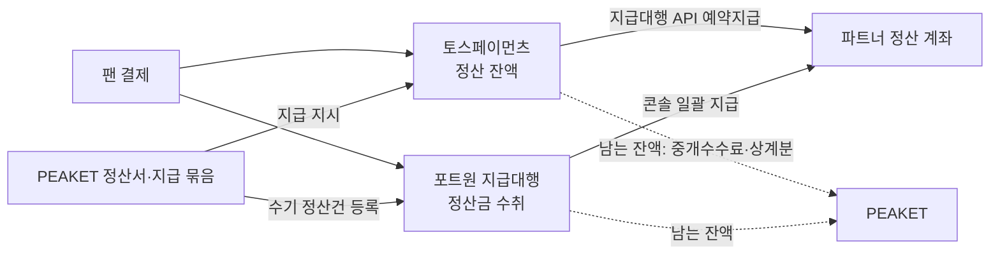
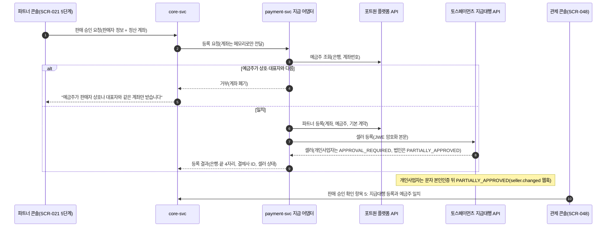
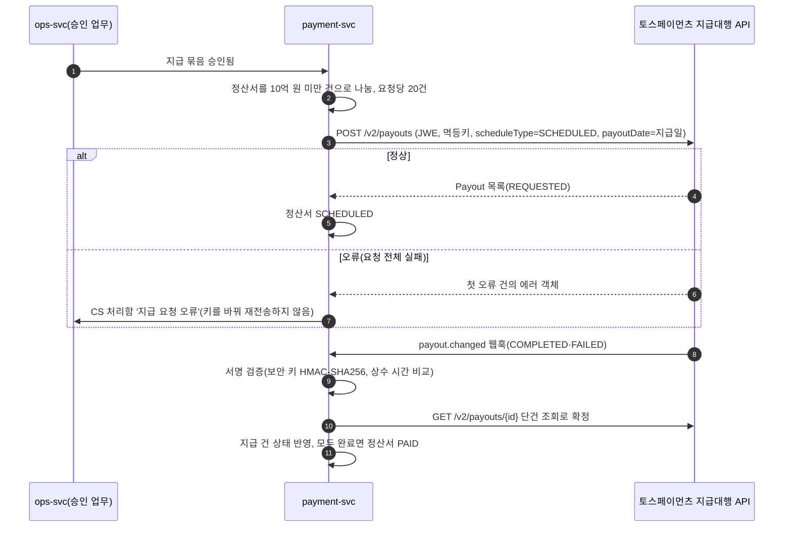

# 기능 설계: 정산과 지급(결제사 지급대행)

- **독자와 용도**: 파트너에게 판매 대금을 보내는 기능을 구현하는 엔지니어와 QA가 함께 보는 문서다. 다루는 것은 다음과 같다.
  - 판매 승인 때 하는 결제사 지급대행(결제사가 PEAKET 대신 파트너 정산 계좌로 판매 대금을 보내는 서비스) 등록과 정산 계좌 확인
  - 회차·결제사 단위 회차 정산서(티켓)와 파트너·결제 상점·주 단위 상품 정산서(굿즈·부가 상품)의 계산, 통지, 이의, 확정
  - 지급 묶음 승인과 결제사별 지급 실행, 상태 동기화
  - KYC(고객 신원 확인 절차)·정산 계좌 변경·이의에 따른 보류, 지급 뒤 환불과 미수금(파트너에게서 돌려받을 돈)
  - 구현하는 쪽은 payment-svc(settlement 모듈과 결제사 지급 어댑터), ops-svc, core-svc와 파트너 콘솔·관제 콘솔 화면이다.
- **원문 출처**: 원문 설계서에는 이 범위의 상세 설계가 없다. 이 문서는 2026-10-13 소유자 결정(00-summary §7 질문 22, "추천안대로 (b)로 가겠습니다")과 결제사 문서 확인에서 나왔다([ADR-0047](../adr/0047-settlement-payout-via-pg-agency.md)). 전체가 [보완]이다.
- **기준 기획 버전**: v1.0.
- **관련 ID**: FR-027, FR-052, FR-062 · POL-014, 037, 038, 039 · SCR-020, 021, 027, 045, 046, 048, 049 · CMP-031, 032, 040, 060, 062 · API(프로그램끼리 요청과 응답을 주고받는 창구) `/v1/partner/events/{eventId}/settlements`, `/v1/partner/product-settlements`, `/v1/partner/settlements/{statementId}/disputes`, `/v1/partner/payout-account`, `/v1/ops/settlements`, `/v1/ops/settlements/{statementId}/dispute-dismissal`, `/v1/ops/settlements/{statementId}/adjustments`, `/v1/ops/payout-batches`, `/v1/ops/payout-batches/{batchId}/portone-execution`, `/v1/ops/receivables`, `/v1/webhooks/toss` · 이벤트 `trade.settlements` · 보안 추적 [asvs/settlement.md](../security/asvs/settlement.md)

## 1. 개요

PEAKET은 판매 대금을 자체 계좌에 묶어두지 않고 전자지급결제대행사의 지급대행 구조를 활용하여 안전하고 투명하게 정산을 처리한다:

- **결제사 지급대행 기반 지급 구조 ([ADR-0047](../adr/0047-settlement-payout-via-pg-agency.md))**:
  - 판매 대금은 결제를 받은 결제사(PG)가 보관하다가, 지급일(기본은 회차 종료일로부터 5영업일 뒤, §5.1)에 파트너 정산 계좌로 직접 지급한다. 결제사가 보관하는 이 돈(정산대상금액)을 은행 등에 신탁·예치하거나 지급보증보험으로 따로 관리할 의무는 결제사(전자지급결제대행업자)에게 있다(전자금융거래법 제25조의4 '정산대상금액의 보호'). 이 조항은 2025-12-16 개정(법률 제21205호)으로 신설되어 2026-12-17부터 시행되고, 시행 뒤 2년 동안은 60%·80% 이상만 관리해도 된다(부칙 제2조). 결제사는 계약할 때 이 보호조치를 알려야 한다(제25조의5). 원문은 2026-10-26 국가법령정보센터에서 확인했다.
- **플랫폼의 3대 핵심 역할**:
  - **정산서 산출**: 티켓 회차별 및 굿즈/부가상품별 매출, 공제액, 플랫폼 수수료를 정밀 계산하여 정산서를 발행한다.
  - **지급 승인 및 지시**: 지급 일정을 통제하고 관리자 승인을 거쳐 결제사에 안전하게 지급 묶음 실행을 지시한다.
  - **미수금 관리**: 정산 후 환불이나 취소 배상금 상계로 발생하는 파트너 미수금을 지속 관리한다.
- **멀티 PG 분리 정산 ([ADR-0044](../adr/0044-dual-pg-selection-and-switchover.md))**:
  - 동적 결제사 선택으로 인해 한 회차의 판매 대금이 토스페이먼츠와 포트원에 분산될 수 있으므로, 정산서 발행과 지급 집행은 결제사별로 독립 운영한다.

## 2. 돈의 흐름과 책임

| 누가 | 하는 일 |
| --- | --- |
| 결제사 | 판매 대금 보관(정산대상금액 외부관리, 전자금융거래법 §25의4, 2026-12-17 시행), 파트너 KYC, 지급 실행 |
| PEAKET | 정산서 계산·통지·확정, 지급 묶음 승인과 지급 지시, 미수금 관리, 지급 상태 확인 |
| 파트너 | 정산 계좌 제출·변경, 정산서 확인과 이의, KYC 응답 |

- PEAKET 몫은 중개수수료와, 상계(줄 돈에서 받을 돈을 빼고 남는 만큼만 주고받는 것)로 남긴 금액이다. 이 몫을 결제사에서 받는 방식은 공개 문서에 없어서 지급대행 계약 때 정한다(§14).
- 팬에게 보내는 배상금은 PEAKET이 자기 돈으로 보내는 계좌 이체라서 이 흐름과 따로 간다(transfer-refund §6).

## 3. 결제사 지급대행 등록(판매 승인 때, FR-052)

- 파트너는 사업자만 받는다(판매자 신원정보에 사업자등록번호가 있다). 토스페이먼츠(포트원과 함께 연동하는 결제사) 셀러 유형은 개인사업자나 법인으로만 등록한다.
- 계좌번호는 결제사 등록 요청에 바로 넘기고, PEAKET에는 은행과 끝 4자리만 남긴다(POL-014와 같은 방식, 웹 앱 보안 검증 항목 목록인 ASVS 14.2.6).
- **예금주 이름 비교 규칙(추천 적용 2026-10-28, 기술 검토 낮음-086)**: 예금주 조회가 돌려준 이름과 판매자 상호·대표자 이름을 같은 규칙으로 정규화(표기를 한 가지 모양으로 맞추는 것)한 뒤 같은지 본다. 이 규칙은 정산 계좌 변경(§6)과 포트원 출금 대사·계좌 대조(§5.3)에도 똑같이 쓴다.
  1. 유니코드 NFKC로 맞춘다(전각·반각 글자를 맞추고 '㈜' 같은 묶음 글자를 '(주)'로 푼다).
  2. 법인 표기를 지운다: '주식회사'·'(주)'·'유한회사'·'(유)'·'합자회사'·'사단법인'·'재단법인'과 영문 'Co.'·'Ltd.'·'Inc.'·'Corp.'·'LLC' 같은 것. 목록은 설정 파일 하나에 둔다.
  3. 공백과 문장부호(괄호·점·쉼표·하이픈·가운뎃점)를 지운다.
  4. 영문은 대소문자를 무시한다. 영문 이름과 한글 이름을 소리로 맞추는 일(음역)은 하지 않는다.
  - 정규화 뒤에도 다르면 거부하고 계좌를 남기지 않는다. 화면은 "예금주 이름이 판매자 상호·대표자와 다릅니다. 표기만 다르면 판매자 정보 확인을 요청하세요"와 요청 경로(SCR-020 판매자 정보 변경 요청)를 안내한다. 운영자 확인은 계좌를 손으로 통과시키는 일이 아니다. 운영자가 사업자등록증으로 판매자 정보의 표기를 바로잡으면, 파트너가 계좌를 다시 내고 같은 규칙으로 다시 비교한다. 바로잡은 사람·근거·전후 표기는 감사 로그에 남긴다.
- 판매 승인(SCR-048)은 다음이 모두 참일 때만 끝난다: 예금주 일치, 포트원 파트너 등록, 토스페이먼츠 셀러 상태가 PARTIALLY_APPROVED 이상.
- 토스페이먼츠 셀러는 일반 상점(`STANDARD`)과 에스크로 상점(`ESCROW`, 굿즈 택배, POL-014)에 함께 등록한다. 계좌번호는 저장하지 않으므로, 정산 계좌를 받는 모든 경우(판매 승인 요청, 상품을 처음 공개할 때 정산 계좌가 없으면 그때, 정산 계좌 변경)에 세 곳(토스페이먼츠 두 상점, 포트원)에 함께 넘긴다. 택배 상품은 `ESCROW` 셀러가 PARTIALLY_APPROVED 이상일 때만 공개된다. 셀러·잔액·KYC가 상점마다 따로인 것은 추정이다(§14, 추천 적용 2026-10-14, ADR-0062).
- 판매 승인 화면과 파트너 안내에 "주 1천만 원 이상 첫 지급에서 결제사 KYC 때문에 지급이 늦어질 수 있다"라는 문구를 보여 준다. KYC는 미리 요청할 수 없다(§6).
- **첫 구현(2026-11-13, LCH-080 부분 적용)**: 회차 판매 설정 사본(`EventSaleConfig` — `salePolicy`·`eligGates`·`eligLists`·회차 시각)을 core DB `event_sale_config`과 대기열 Redis `q:{event:E}:cfg`에 쓰는 빌더·정비 일 `sale-config-publish`를 넣었다. 이 절의 결제사 지급대행 등록(예금주 조회·토스 셀러·포트원 파트너)은 LCH-070·LCH-050·LCH-060 뒤에 한다.

## 4. 정산서(FR-062, POL-039)

### 4.1 계산

회차가 끝난 다음 영업일 06시에 결제사별로 계산한다. 원장은 일일 대사가 끝난 것만 쓴다(payment §8).

| 항목 | 정의 |
| --- | --- |
| 판매 대금 | 그 회차·결제사로 승인된 결제 금액의 합이다. 가상계좌 입금 되돌림(입금 오류)은 승인 취소이므로 그 승인을 뺀다(추천 적용 2026-10-20, ADR-0073). 취소·환불은 여기서 빼지 않고 '환급'으로 따로 센다 |
| 환급 | 그 회차·결제사로 결제한 건의 취소·환불 금액의 합이다(공제한 금액은 판매 대금에 남는다. 재량 면제로 더 돌려준 면제분은 PEAKET이 부담하므로 넣지 않는다, POL-038 ②. 시스템 잘못이 기록으로 확인된 환불(중복 결제, PEAKET 장애로 미발급·입장 실패, POL-038 ①)도 PEAKET이 부담하므로 넣지 않는다, 추천 적용 2026-10-28, 기술 검토 중간-043). 부정 예매 운영자 취소(사유 `FRAUD`)의 공제 없는 환급은 일반 환급처럼 모두 넣는다. 취소 마감 전에만 하고 좌석이 정가 재판매로 돌아가 파트너의 판매 기회가 남으므로, 공제하지 않은 몫을 PEAKET이 메우지 않는다. 결제사 취소가 늦어 그 판의 계산 뒤에 끝난 부정 예매 환급은 다른 환급처럼 §7의 미수금으로 잡는다(추천 적용 2026-11-05, ADR-0197 결정 2) |
| 중개수수료 | (판매 대금 − 환급) × 계약 수수료율(판매 승인 때 공연에 고정한 값, ADR-0060), 원 미만 버림 |
| 수수료 부가세 | 중개수수료 × 10%, 원 미만 버림 |
| 상계 | 그 파트너에게 남아 있는 미수금 중 이 정산서에서 돌려받는 금액(§7) |
| 지급액 | 판매 대금 − 환급 − 중개수수료 − 수수료 부가세 − 상계 |

- 예: 판매 대금 3,000만 원, 환급 200만 원, 수수료율 10%이면 중개수수료 280만 원, 부가세 28만 원, 지급액 2,492만 원이다(J-T1).
- 상계는 지급액이 0이 될 때까지만 한다. 남은 미수금은 다음 정산서로 넘긴다. 상계할 수 있는 미수금의 범위는 §7을 따른다(결제사에서 빠진 돈의 미수금은 같은 결제사 정산서에서만).
- 지급액이 0 이하이면 정산서는 지급 없이 끝난다(CARRIED_OVER). 모자라는 금액은 미수금이 된다. 판매 대금 − 환급은 0보다 작아지지 않고 상계도 0에서 멈추므로, 0 아래로 내려가는 것은 감액 수기 조정(§4.3)이 그 판의 지급액보다 클 때뿐이다. 회차 취소의 배상금은 정산서 줄이 아니다. PEAKET이 먼저 보내고 배상 미수금(`COMPENSATION_ADVANCE`)으로 잡아 상계한다(§7, 추천 적용 2026-10-28, 기술 검토 중간-043).
- **대사가 끝나지 않은 결제(추천 적용 2026-10-28, 기술 검토 중간-043)**: 06시 계산은 일일 대사가 끝난 원장만 쓴다. 대사 불일치가 남은 결제는 그 결제만 빼고 회차를 계산하고, 뺀 결제를 정산서에 적는다. 불일치가 풀리면 그 판을 지급하기 전이면 조정 행(§4.3)으로, 지급한 뒤면 다음 정산서의 조정이나 미수금(§7)으로 넣는다.
- **계산 원본 목록(추천 적용 2026-11-02, wbs 1.2.3)**: 계산 트랜잭션은 그 판이 판매 대금에 넣은 승인과 환급에 넣은 취소·환불을 한 줄씩 `statement_source`(정산서 판, 결제 ID 또는 취소 ID, 종류 GROSS·REFUND, 센 금액)에 정산서 행과 함께 넣고 고치지 않는다. 판매 대금은 GROSS 줄의 합, 환급은 REFUND 줄의 합이다. 다시 계산한 새 판은 자기 목록을 새로 갖고, 옛 판(SUPERSEDED)의 목록은 그대로 남는다. 정산 돈 불변식의 '한 결제의 환급이 두 정산서에 없음'과 '판매 대금 = 그 판이 쓴 대사 완료 승인 합'은 이 목록으로 센다(§13 J-T25, docs/verification.md §2.5). 판이 무엇을 썼는지 남기지 않으면 계산 시각이 없어 늦게 온 승인과 대사로 뺀 결제를 가릴 수 없다.
- **다시 계산(추천 적용 2026-10-28, 기술 검토 중간-043)**: 계산한 뒤의 환불은 보통 미수금으로 잡고 정산서를 다시 계산하지 않는다(§7). 다시 계산하는 '큰 변화'는 회차 취소·연기의 환급과, commander가 승인 업무로 정한 수기 판단 둘뿐이다. 다시 계산하면 같은 정산서의 판본을 1 올린 새 판을 만들고, 옛 판은 고치지 않고 `SUPERSEDED`로 남긴다(파트너에게 알린 금액을 덮어쓰지 않는다). 새 판은 처음 계산처럼 알리고 2영업일 이의 기간을 준다. 지급을 요청한 뒤라면 먼저 예약을 거둔다(§12). 상태 전이는 §4.4와 docs/planning/03 §2.12에 있다.
- 결제사 수수료는 PEAKET이 부담한다. 중개수수료 안에 들어 있다고 보고 파트너에게 따로 떼지 않는다.

### 4.2 통지·이의·확정

- 계산이 끝나면 파트너에게 알린다(NOTIFIED). 파트너는 2영업일 안에 이의를 낼 수 있다(SCR-027, 사유 코드와 설명). 사유 코드는 정산서 항목에 맞춘 다섯 가지다: `GROSS_AMOUNT`(판매 대금), `REFUND_AMOUNT`(환급), `COMMISSION`(중개수수료·부가세), `OFFSET`(미수금 상계), `OTHER`(그 밖, 설명 필수). 설명은 2,000자까지이고, 팬 개인정보를 적지 않도록 안내한다(추천 적용 2026-10-14, ADR-0062).
- 이의가 오면 그 정산서만 멈추고(DISPUTED), CS 처리함에 '정산 이의' 건이 생긴다. 처리 기한은 CS 처리함의 분쟁 건과 같게, 진행 상황은 3영업일 안, 결과는 10영업일 안으로 둔다. 파트너와의 정산 이의는 소비자 분쟁이 아니므로, 이 기한은 법정 기한이 아니라 내부 기준이다.
  - 이의가 맞으면 수기 조정(§4.3)을 거쳐 다시 알린다. 맞지 않으면 사유를 적어 기각하고 다시 알린다. 다시 알릴 때는 이의 기간을 새로 시작하지 않고 1영업일만 준다.
- 이의 없이 기간이 끝나면 자동으로 확정한다(CONFIRMED). 정책대로 계산한 그대로이기 때문이다.

### 4.3 수기 조정

- 계산 규칙 밖의 보정(잘못 잡힌 원장, 계약 수수료율 정정, 합의한 차감)은 승인 업무로 처리한다. `cs_lead`가 근거를 붙여 요청하고 commander가 승인한다(2인, POL-038). 사유 코드는 여덟 가지다. 이의를 받아들인 조정에는 그 이의와 같은 코드(`GROSS_AMOUNT`·`REFUND_AMOUNT`·`COMMISSION`·`OFFSET`·`OTHER`)와 이의 ID를 붙인다. 이의 없는 조정에는 `LEDGER_ERROR`(원장 오류 정정)·`CONTRACT_CORRECTION`(계약 수수료율 정정)·`AGREED_DEDUCTION`(합의한 차감)과 근거 메모를 붙인다. 지급을 요청한 뒤의 정산서는 조정하지 않는다. 차이는 미수금이나 다음 정산서의 조정으로 잡는다(추천 적용 2026-10-14, ADR-0062). 앞으로 적용할 계약 수수료율·보증의 변경은 operator가 요청하고 commander가 승인한다(2인, SCR-065·SCR-046). 바뀐 수수료율은 승인 뒤 판매 승인을 받는 공연부터 쓴다(ADR-0060).
- 조정은 정산서에 조정 행으로 더한다. 원래 계산 행은 고치지 않는다.

### 4.4 상태

상태도는 docs/planning/03 §2.12에 있다. 요약하면 다음과 같다.

| 상태 | 뜻 | 다음 |
| --- | --- | --- |
| CALCULATED | 계산 끝 | NOTIFIED |
| NOTIFIED | 파트너에게 알림, 이의 기간 | DISPUTED, CONFIRMED, CALCULATED(다시 계산) |
| DISPUTED | 이의 처리 중 | NOTIFIED, CALCULATED(다시 계산. 그 이의는 새 판에 다시 낼 수 있다) |
| CONFIRMED | 확정, 지급 묶음 대기 | SCHEDULED, CARRIED_OVER, HELD, CALCULATED(다시 계산) |
| HELD | 보류(KYC, 계좌 변경, 잔액 부족, 포트원 계좌 불일치, 다시 계산 대기) | CONFIRMED(사유가 풀린 뒤 다음 지급 묶음으로), CALCULATED(다시 계산) |
| SCHEDULED | 결제사에 지급을 요청한 상태 | PAID, FAILED, HELD(지급 전 예약 취소. 다시 계산할 사유도 같다) |
| FAILED | 지급 건 실패 | SCHEDULED(새 지급 건) |
| PAID | 모든 지급 건 완료 | 끝 |
| CARRIED_OVER | 지급액 0 이하, 미수금으로 넘긴 상태 | 끝 |
| SUPERSEDED | 다시 계산해 새 판으로 바뀐 옛 판. 금액은 알린 그대로 남는다 | 끝(추천 적용 2026-10-28, 기술 검토 중간-043) |

'CALCULATED(다시 계산)'은 판본을 1 올린 새 판이 CALCULATED로 시작하고 옛 판이 SUPERSEDED가 된다는 뜻이다(§4.1).

### 4.5 상품 정산서(추천 적용 2026-10-14, ADR-0062)

굿즈와 티켓 연동 부가 상품의 판매 당사자는 파트너다(POL-037). 그 판매 대금은 회차 정산서와 따로 상품 정산서로 낸다(POL-039 ②).

- **두 종류**
  - 회차 정산서(`kind=EVENT`): 지금처럼 티켓만 담고, 회차·결제사 단위로 만든다.
  - 상품 정산서(`kind=PRODUCT`): 굿즈와 티켓 연동 부가 상품을 담는다. 파트너·결제사·결제 상점(토스페이먼츠 `STANDARD`·`ESCROW`) 단위로 만든다. 한 주(월요일 00:00~일요일 24:00 KST) 안에 '정산 기준일'이 든 주문 항목을 모은다. 매주 첫 영업일 06시에 계산한다. 담을 항목이 없으면 만들지 않는다.
  - 부가 상품을 회차 정산서에 넣지 않는 이유: 회차 정산서는 공연 리포트 R3에서 '판매 금액이 정산서와 원 단위 일치'하는지 대조하는 대상이다. 또 부가 상품은 shop 주문(`merch_order`)이라, 굿즈와 같은 정산 기준일 규칙을 쓰면 계산 경로가 하나로 끝난다.
- **정산 기준일**: 주문 항목마다 정하고, 이날이 지나야 정산서에 들어간다.

| 경우 | 정산 기준일 |
| --- | --- |
| 굿즈 택배, 에스크로 주문 | 결제사 구매 확정일(구매자 확정 또는 3영업일 무선택 자동 확정, `merch_order.purchase_confirmed_at`). 구매 확정 전에는 넣지 않는다 |
| 굿즈 택배, 에스크로가 아닌 주문(신용카드 등) | 받은 날(`delivered_at`)부터 7일이 지난 다음 날(단순 변심 반품 기한이 끝난 다음 날). 배송 완료 기록이 없으면 송장 등록일부터 14일 [가정]이 지난 다음 날 |
| 굿즈 현장 수령 | 받은 날(`picked_up_at`)부터 7일이 지난 다음 날 |
| 티켓 연동 부가 상품 | 연결 회차가 끝난 다음 날 |

- 반품 요청 중(`RETURN_REQUESTED`·`RETURN_RECEIVED`·`DISPUTED`)인 항목은 결과가 날 때까지 넣지 않는다. 환급으로 끝나면 넣지 않고, 반품 거절이 확정되면 그 확정일을 정산 기준일로 본다.
- 정산 기준일 전에 취소·환급된 항목은 넣지 않는다(판매·환급 모두 빠진다).
- 그 뒤 생긴 환급(설명과 다른 상품의 3개월 반품, 미성년자 계약 취소, 예외 환불)은 그 주 정산서를 아직 계산하지 않았으면 '환급'으로 넣는다. 이미 계산했으면 미수금(`REFUND_AFTER_PAYOUT`)으로 잡는다. 미수금은 환불액에서 그 항목의 수수료 몫(주문 때 복사한 수수료율)과 그 부가세를 뺀 금액이다(§7과 같다, 기술 검토 중간-043).
- **금액과 수수료**: 식은 회차 정산서와 같다(판매 대금 − 환급 − 중개수수료 − 수수료 부가세 − 상계 = 지급액). 판매 대금은 항목의 결제 금액에 구매자가 낸 처음 배송비를 더한 값이다(배송은 판매자가 한다). 중개수수료율은 상품을 처음 공개할 때 그 파트너의 계약 수수료율로 상품에 고정한다(`product.commission_rate_bp`. 공연을 판매 승인 때 고정하는 방식과 같다, ADR-0060). 바뀐 계약 수수료율은 그 뒤 처음 공개하는 상품부터 쓴다. 상품 정의는 PostgreSQL core 논리 DB의 `product` 표에 있고, 주문 때 그 수수료율을 주문 항목에 복사한다(`merch_order_item.commission_rate_bp`, 추천 적용 2026-10-28, ADR-0101). 상품 정산서는 이 복사한 값으로 계산한다.
- **이의·확정·지급**: 회차 정산서와 같은 규칙이다. 통지 → 2영업일 이의(사유 코드 5종, §4.2) → 자동 확정 순서다. 지급일은 계산일로부터 4영업일 뒤다(회차 정산서의 '종료 다음 영업일 계산, 종료 5영업일 뒤 지급'과 같은 간격). 수기 조정은 §4.3과 같다(POL-038 ⑦).
- **에스크로 대금**: 에스크로 대금은 구매자가 구매를 확정해야 결제사가 상점에 지급한다(확인됨, 결제사 공개 문서). 그래서 에스크로 주문은 구매 확정 전에는 정산서에 넣지 않고, 잔액 확인(§5.1)도 상점별로 한다.
- **상계 순서**: 같은 파트너의 다음 정산서(회차·상품 구분 없이 지급일이 먼저 오는 것) → 보증 → 청구(ADR-0046의 재원 순서를 회수 순서로 읽는다, §7·§12, 기술 검토 낮음-088). 결제사에서 빠진 돈의 미수금(지급 뒤 환불·카드 이의제기·감액 조정)은 같은 결제사의 정산서에서만 상계한다(§7, 추천 적용 2026-10-28, 기술 검토 중간-043).
- 주 단위·정산 기준일·14일 [가정]·수수료율 고정은 자체 기준이다(대규모유통업법에 온라인 중개거래의 정산 기한 조항이 없다, 2026-10-14 확인).
- **shop에서 넘겨받는 값**: 상품 정산서는 payment-svc가 계산한다. 하지만 주문 항목·정산 기준일·반품 상태는 core-svc shop(`merch_order`·`merch_order_item`)에 있다. 넘기는 값은 항목마다의 결제 금액·수량·처음 배송비·수수료율(주문 때 복사한 값)·정산 기준일·반품 상태다. 그래서 payment-svc는 core의 상품 표를 읽지 않는다(ADR-0101). 넘기는 형식과 경로는 shop 상세 설계 때 정한다(docs/features/README.md '구현 직전 작성 대상').
- **구현 상태(2026-11-14, R-567)**: payment-svc에는 아직 settlement 모듈이 없다. 정산서·정산 원본·지급·지급 묶음·KYC 표와 주문 항목 원천(core-svc `merch_order`·`merch_order_item`)이 없어 상품 정산서 계산·통지·이의·지급을 구현하지 못했다. 화면은 계약대로 목록·이의 제기를 부르고 404/501/503을 '아직 받을 수 없습니다'로 보인다. 이 절의 계산·지급 규칙은 후속 구현의 정본으로 남는다. 예매자 명단 내보내기(export)도 명단 원천과 `BOOKER_EXPORT` 서버 검증 배선이 없어 후속이다.

## 5. 지급 실행

### 5.1 지급일과 지급 묶음

- 기본 지급일은 회차 종료일로부터 5영업일 뒤다. 여기에는 계산(1영업일), 이의 기간(2영업일), 묶음 승인과 결제사 예약 요청(지급일 전 영업일)이 들어 있다.
- **지급용 영업일(추천 적용 2026-10-28, 기술 검토 낮음-085)**: 지급일·묶음 시각처럼 돈이 실제로 나가는 날은 공휴일 달력이 아니라 은행 영업일 달력으로 센다. 결제사는 예약지급 날짜를 다음 날 09시 이후 1년 안의 영업일로만 받고, 휴일·공휴일이나 지난 날짜를 넣으면 오류를 돌려준다(토스페이먼츠 지급대행 안내, 2026-10-28 확인). 그래서 결제사가 날짜 오류를 돌려주면 다음 은행 영업일로 지급일을 바꿔 한 번 다시 요청하고, 그래도 오류면 CS 처리함 '지급 요청 오류'로 보내며 달력을 고친다. 이의 기한처럼 사람이 일하는 날로 세는 기한은 지금처럼 공휴일 달력을 쓴다. 은행 영업일 달력의 출처(결제사·은행 공지, 공공 자료)와 공휴일 달력과 다른 날이 실제로 있는지는 확인 필요이고, 출처를 정할 때 원문으로 확인한다(wbs 5.3.1).
- 지급일 전 영업일 09시에 지급일·결제사·결제 상점별로 확정 정산서(회차·상품)를 모아 지급 묶음을 만든다. 토스페이먼츠 잔액은 상점마다 따로 본다(추천 적용 2026-10-14, ADR-0062).
- **온세일 때 미루기(추천 적용 2026-10-20, ADR-0069 결정 10)**: 대형·중형 온세일 윈도우(판매가 열리는 시각 앞뒤로 접속이 몰리는 기간, T-10분~T+60분)에는 지급 묶음 실행을 새로 시작하지 않고 미룬다. 이미 시작한 묶음은 끝낸다. 소형 온세일은 미루지 않는다 [가정]. 창은 변경 동결 달력(배포를 멈추는 시간표)과 같은 온세일 일정으로 계산하고, 일정을 읽지 못하면 마지막으로 읽은 일정을 쓰고 SEV3를 낸다 [가정]. 미루는 시간은 최대 70분이라 지급일 기한에 영향이 없다(docs/devops.md §8.2, POL-028). 지급 묶음은 명령 9의 '배경 작업 멈춤' 묶음에 넣지 않고, 이렇게 미루기만 한다(ADR-0069 상태 줄 2026-10-26).
- 묶음을 만들기 전에 결제사의 지급 가능 잔액을 본다. 모자라면 그 묶음의 지급일을 다음 영업일로 미루고 경보를 낸다.
  - 토스페이먼츠: 잔액 조회 API(`GET /v2/balances`)의 `availableAmount`는 묶음을 만들 때, 그리고 승인 뒤 지급 요청 직전에 본다(지급을 요청할 때 잔액이 모자라면 요청이 실패한다). 비교하는 합계는 이 묶음 합계에 아직 끝나지 않은 토스페이먼츠 예약지급 합계를 더한 값이다(예약지급이 잔액에서 바로 빠지는지 결제사 문서에 없어서, 확인 전까지는 안전한 쪽으로 더한다). 화면에는 `pendingAmount`(정산 주기가 지나지 않은 금액)를 '정산 대기'로 함께 보여 준다(추천 적용 2026-10-14, ADR-0062).
  - 포트원: 잔액 조회 API가 없다(API 명세 1.16.0). 그래서 operator가 확인을 요청할 때 포트원 콘솔 '파트너정산 > 정산 내역 관리 > 내 가상계좌'에서 본 지급대행 계좌 잔액과 본 시각을 적는다. 이 값이 이 묶음과, 실행 기록이 없는 포트원 묶음들을 합친 금액보다 작으면 같은 방식으로 지급일을 미룬다. 적은 값은 PEAKET이 검증할 수 없는 확인값이라서 지급을 미루는 쪽으로만 쓴다(추천 적용 2026-10-14, ADR-0062). 이 값은 포트원 이체 원장(가상계좌에 들고 난 돈을 이체마다 남긴 기록)으로 계산한 잔액(그 지급대행 계좌의 마지막 출금 기록의 `balance`에 그 뒤 입금을 더한 값)과도 맞춘다. 두 값 가운데 작은 값으로 판정하고, 다르면 CS 처리함 '포트원 원장 불일치' 건을 만든다(§5.3, 추천 적용 2026-10-28, ADR-0108). `balance`가 '그 출금 뒤 계좌 잔액'이라는 뜻인지는 확인 필요라서 시험 환경에서 먼저 확인한다.
- 지급 묶음은 되돌릴 수 없는 일괄 작업이라서 승인 업무로 처리한다(POL-038).
  - operator가 합계, 건수, 보류·이의 제외 목록을 확인해 요청한다.
  - commander가 승인한다(2인, 요청자 ≠ 승인자).
- 지급일 전 영업일 15시까지 승인되지 않으면 지급일을 다음 영업일로 미루고 파트너에게 알린다. 그 승인 업무는 만료(EXPIRED)되고, 다음 영업일 09시에 새 묶음을 만든다(docs/planning/03 §2.10·POL-038 공통, 추천 적용 2026-10-28, 기술 검토 낮음-087).

### 5.2 토스페이먼츠 결제분

- 결제사가 한 번 요청에 받는 상한은 100건이다(토스페이먼츠 API 참조, 2026-10-14 확인). 요청당 20건은 실패할 때 영향받는 범위를 줄이려고 스스로 정한 제한이다(ADR-0047).
- `refPayoutId`는 `{정산서 ID}-{순번}`이다. 같은 지급 건은 같은 멱등키로만 다시 보낸다.
  - **다시 요청할 때의 순번과 승인(추천 적용 2026-10-28, 기술 검토 낮음-084)**: 지급 건이 `FAILED`가 되어 다시 요청하면(§12 '지급 건 FAILED의 세 갈래') 새 순번을 쓴다. 새 순번은 그 정산서에서 쓴 가장 큰 순번 + 1이고, 정산서 행 잠금 안에서 정한다. 금액과 받는 셀러가 처음 지급 건과 같으면 처음 지급 묶음 승인의 범위 안으로 보고 새 2인 승인을 받지 않는다. 대신 다시 요청한 사람(자동이면 시스템)·사유·옛 순번·새 순번을 감사 로그에 남긴다. 금액이나 셀러가 다르면 새 지급 묶음 승인을 받는다.
  - **지급 API가 응답하지 않을 때(추천 적용 2026-10-28, 기술 검토 낮음-084)**: 지급 묶음은 하루에 몇 번 부르는 일괄 호출이라 서킷 브레이커(계속 실패하는 호출을 잠시 끊어 장애가 번지지 않게 하는 장치)를 두지 않는다. 연결 실패·시간 초과처럼 응답을 받지 못했으면, 같은 묶음·같은 `refPayoutId`·같은 멱등키로 지수 간격(1분에서 시작해 30분 상한 [가정])을 두고 지급일 전 영업일 22시 [가정]까지 다시 보낸다. 결제사는 응답을 받지 못했을 때 같은 멱등키로 다시 보내면 안전하고, 처음 요청이 처리 중이면 409 `IDEMPOTENT_REQUEST_PROCESSING`을 준다고 안내한다(토스페이먼츠 API 안내 '멱등키 헤더', 2026-10-28 확인). 409면 기다렸다가 같은 키로 다시 보낸다. 마감을 넘기면 그 묶음의 지급일을 다음 영업일로 미루고 파트너에게 알린다. 오류 응답(에러 객체)을 받은 경우는 장애가 아니라 '지급 요청 오류'로 처리한다(아래).
- 결제사 안내에 따라, 오류 응답을 받은 뒤에는 멱등키를 바꿔 다시 보내지 않는다. 운영자가 CS 처리함에서 원인을 확인한 뒤 처리한다.
- 예약지급은 REQUESTED 상태에서만 취소할 수 있다(`POST /v2/payouts/{id}/cancel`). 지급 전에 보류 사유가 생기면 예약지급을 취소하고 정산서를 HELD로 둔다.
- 지급일 다음 영업일 12시까지 완료 웹훅(일이 생기면 상대 서버가 우리 주소를 불러 알려 주는 방식)이 없으면 단건 조회로 확인한다. 그래도 끝나지 않았으면 CS 처리함에 올린다.

### 5.3 포트원 결제분

- 묶음이 승인되면 정산서마다 수기 정산건을 만든다(`POST /platform/transfers/manual`, 아이디 = 정산서 ID, 정산 금액 = 지급액, 정산일 = 지급일). 아이디가 같으면 다시 만들지 않는다.
- 지급일 09시에 CS 처리함에 '포트원 일괄 지급 실행' 건이 생긴다. operator가 포트원 콘솔에서 그 정산일의 건을 지급대행(AGENCY)으로 한꺼번에 지급하고, 일괄 지급 ID를 SCR-049에 적는다.
  - 공개 API(명세 v1.16.0)에는 지급을 만드는 엔드포인트(API를 부르는 주소 하나)가 없어서 이렇게 한다. 그런 API가 생기면 바꾼다(ADR-0047 되돌릴 조건).
- PEAKET은 지급 내역 조회(`GET /platform/payouts`, `GET /platform/bulk-payouts`)를 30분마다 불러 상태를 맞춘다. SUCCEEDED면 지급 건을 완료로 두고, FAILED·STOPPED·CANCELLED면 CS 처리함으로 보낸다.
- 실행 직전 콘솔에서 지급대행 계좌 잔액을 다시 본다. 모자라면 실행하지 않고 CS 처리함 건에 '잔액 부족'을 적는다(추천 적용 2026-10-14, ADR-0062). 그다음은 §12 '포트원 실행을 잊음'과 같고, 파트너에게 지급이 미뤄진다고 알린다. 지급대행 계좌 잔액이 모자랄 때 콘솔이 실행을 막는지는 문서에 없다(송금대행 계좌는 막는다).
- 지급일 15시까지 실행 기록이 없으면 경보를 낸다.
- **콘솔로 우회할 수 있는 길과 주 통제(추천 적용 2026-10-28, ADR-0108)**: 포트원 콘솔에서 정산 데이터를 고칠 수 있는 역할은 Owner(가입한 대표 계정)·Admin(Owner가 만드는 관리자 계정) 둘뿐이고, Admin은 상점당 하나다. 같은 역할이 파트너 정산 계좌와 정산 내역을 고치고, 지급대행 가상계좌 잔액을 아무 계좌로나 출금할 수 있다(포트원 안내 2024-07-05·2024-07-11, 2026-10-28 확인). 그래서 한 사람이 콘솔에서 PEAKET의 지급 묶음 2인 승인, 정산 계좌 변경 통제(§6), 수기 조정 2인 승인을 우회할 수 있다. 권한표에 '지급 실행만' 하는 역할이 없어 미리 막을 수 없으므로, 아래 사후 대사(두 기록을 맞춰 보는 일)가 주 통제다.
- **포트원 출금 대사(추천 적용 2026-10-28, ADR-0108)**: 같은 30분 동기화에서 이체 원장(`GET /platform/account-transfers`, 구분 `WITHDRAWAL`, 이체 일시는 지난 대사 시각 − 30분 [가정]부터 지금까지)으로 모든 가상계좌의 출금을 읽는다. 겹쳐 읽은 출금은 이체 ID로 한 번만 처리한다.
  - 출금마다 ① `payoutId`가 PEAKET 지급 건과 이어지는지 ② 금액이 그 지급 건과 같은지 ③ 받는 계좌의 은행·끝 4자리가 그 파트너의 PEAKET 기록과 같은지 ④ 예금주가 판매자 상호나 대표자와 같은지 본다. 출금 유형(`withdrawalType`)과 상관없이 모든 출금을 본다.
  - 다 맞으면 지급 건에 이체 ID와 `MATCHED`를 남긴다. 지급 건과 이어지지 않는 출금, 금액·계좌·예금주가 다른 출금은 SEV2(장애 심각도 등급. 숫자가 작을수록 심각하다. 여기서는 보안 경보) 경보와 CS 처리함 '포트원 원장 불일치' 건으로 올린다. 지급 내역은 SUCCEEDED인데 1시간 [가정] 안에 맞는 출금이 없으면 `MISSING`을 남기고 같은 건을 만든다.
  - 계좌번호 전체와 예금주명은 메모리에서 비교만 하고 저장·로그·트레이스에 남기지 않는다(예금주 조회와 같은 규칙, ADR-0053 결정 5).
- **파트너 정산 계좌 대조(추천 적용 2026-10-28, ADR-0108)**: 하루 한 번 08:00 [가정](지급 묶음을 만들기 전) 모든 포트원 파트너를 조회해(`GET /platform/partners/{id}`, 예약된 변경은 `GET /platform/partners/{id}/schedule`) 정산 계좌의 은행·끝 4자리를 PEAKET 기록과, 예금주를 판매자 상호·대표자와 맞춘다.
  - 지급일 09시에 실행 건을 만들 때 그 묶음의 파트너를 다시 대조한다. 그 정산일 정산 내역(`GET /platform/partner-settlements`)의 파트너·금액이 PEAKET 정산서와 같은지도 본다.
  - 다르면 SEV2(보안)와 CS 처리함 건을 만들고, 그 정산서를 실행에서 뺀다. 계좌가 다른 파트너는 포트원 결제분 정산서를 모두 보류(`ACCOUNT_MISMATCH`, §6)로 돌린다. 실행 건에는 뺀 정산서를 적는다.
- **콘솔 계정 규칙(추천 적용 2026-10-28, ADR-0108)**:
  - Admin은 지급을 실행하는 operator 한 사람만 쓰고, 다른 사람과 나눠 쓰지 않는다. Owner는 평소에 쓰지 않는다. Admin을 다시 만들거나 Admin을 쓸 수 없는 비상 때만 commander가 쓰고, 쓴 날은 CS 처리함에 남긴다. 그날 출금 대사 결과는 다른 commander가 확인한다. 나머지 사람은 조회 계정(Read Only)만 받는다.
  - 콘솔에서는 파트너 정산 계좌와 정산 내역을 고치지 않는다. 계좌 변경은 SCR-020에서 받아 API로만 한다(§6). PEAKET의 API 시크릿은 포트원 권한표상 파트너는 고치고 지급은 조회만 한다.
  - 출금처럼 전자서명이 필요한 이체는 법인 인증서로 서명한다. 인증서는 operator가 아닌 commander가 보관하고, Owner 로그인 정보와는 다른 commander가 갖는다. 그래서 그런 이체는 두 사람이 있어야 실행된다. 2단계 인증(OTP)은 Admin 한 사람이 혼자 서명하게 하므로 신청하지 않는다(포트원 안내 2025-08-28). 지급대행 일괄 지급 실행에도 서명 단계가 있는지는 확인 필요다.
  - 포트원 콘솔이 계정별 활동 기록을 주는지는 확인 필요다. 주면 commander가 월 1회 점검한다. 주지 않으면 출금 대사와 계좌 대조가 그 몫을 한다.
- **대사가 멈출 때(추천 적용 2026-10-28, ADR-0108)**: 이체 원장 API는 포트원 명세에 '바뀔 수 있음'(`x-portone-unstable`) 표시가 있다(v2 OpenAPI 1.16.0). 그래서 응답 형식을 어댑터 계약 시험(payment P-T16)에 넣는다. 출금 대사나 계좌 대조가 1시간 [가정] 넘게 끝나지 않으면 SEV2로 알린다. 다시 돌 때까지는 포트원 실행 전에 commander가 콘솔 입출금 내역·파트너 화면에서 그 묶음의 계좌와 출금을 눈으로 맞춘 뒤 CS 처리함 건에 남긴다.
- 남는 한계: 한 사람이 콘솔에서 바로 보낸 출금은 미리 막지 못하고, 출금 대사로 30분 안에 알아챈다. 09시 대조가 끝난 뒤 실행 직전에 바꾼 계좌도 출금 대사로만 잡힌다(§14).

### 5.4 계산 원본

계산의 원본은 PEAKET 정산서 하나다. 포트원 주문 정산건(`transfers/order`)과 포트원 계약의 수수료 계산은 쓰지 않는다. 포트원 파트너 등록에는 기본 계약이 필요하다. 그래서 중개수수료가 0인 계약 하나만 두고, 금액은 수기 정산건으로만 넣는다. 계약의 나머지 설정 항목은 계약할 때 확인한다.

### 5.5 지급대행 잔액 대사(추천 적용 2026-10-28, 기술 검토 중간-043)

일일 대사(payment §8)는 결제 건마다 결제사 거래와 내부 기록을 맞춘다. 그것만으로는 지급대행 뒤 결제사에 남는 돈(PEAKET 몫, 지급 실패분)이 맞는지 모른다. 그래서 결제사·결제 상점마다 PEAKET 장부로 '있어야 할 잔액'을 계산해 결제사가 보여 주는 잔액과 맞춘다(대사: 두 기록을 맞춰 보는 일).

- **있어야 할 잔액** = 대사가 끝난 승인 − 취소·환불 − 결제사 수수료 − 완료한 지급 − PEAKET 몫 인출이다.
  - 결제사 수수료: 토스페이먼츠는 정산 조회 API(토스페이먼츠 레퍼런스의 `settlements` 조회, PEAKET API가 아니다)의 수수료(`fees`)와 지급 금액(`payOutAmount` = 결제 금액 − 수수료)을 쓴다. 정산 기록은 결제 다음 날부터 조회되고 응답에 최대 60초가 걸린다(토스페이먼츠 API 레퍼런스, 2026-10-28 확인). 포트원은 지급대행 가상계좌에 들어온 입금(이체 원장)을 하위 결제사의 정산 입금으로 쓴다. 하위 결제사 수수료를 건별로 받는 방법은 계약 때 확인한다(§14).
  - PEAKET 몫 인출: 받는 방식이 정해지기 전에는 0이다(§14). 정해지면 인출마다 승인 업무로 남기고 이 줄에 넣는다.
- **결제사가 보여 주는 잔액**: 토스페이먼츠는 잔액 조회(`GET /v2/balances`)의 지급 가능 금액과 정산 대기 금액의 합, 포트원은 이체 원장으로 계산한 잔액과 operator 입력값이다(§5.1).
- **언제**: 지급 묶음을 만들 때(§5.1)와 매월 마지막 영업일 22시 [가정]에 한다.
- **차이가 나면**: 차이가 0이 아니면 CS 처리함 '결제사 잔액 대사 차이'(`PG_BALANCE_MISMATCH`) 건을 만들고, 1만 원 [가정]을 넘으면 SEV3로 알린다. 지급 묶음 때의 차이는 그 묶음을 멈추지 않는다. 잔액이 모자라는지는 지금처럼 따로 본다(§6 결제사 잔액 부족). 원 미만 끝수와 정산 대기 시점 차이로 생기는 작은 차이는 '설명된 차이'로 건에 적고 닫는다.
- **결제사 사이 상계를 막는 이유**: 결제사에서 빠진 돈의 미수금을 다른 결제사의 정산서에서 상계하면, 한 결제사에는 PEAKET 돈이 남고 다른 결제사의 잔액은 그만큼 모자란다. PEAKET 몫을 결제사에서 받거나 결제사 사이로 옮기는 방식이 정해지지 않아(§14), 모자라는 쪽의 다음 지급이 잔액 부족으로 미뤄질 수 있다. 그래서 그 방식이 정해질 때까지 결제사 사이 상계를 하지 않는다(§7). 대가는 회수가 늦어지는 것이다. 같은 결제사의 다음 정산서가 30일 안에 없으면 보증 → 청구로 넘어간다.

## 6. 보류와 KYC, 정산 계좌 변경

| 보류 사유 | 시작 | 끝 | 그동안 |
| --- | --- | --- | --- |
| 토스페이먼츠 KYC 필요 | `seller.changed`로 KYC_REQUIRED가 오거나, 지급 요청이 KYC 문제로 취소된 때 | `seller.changed`로 APPROVED | 그 셀러의 토스페이먼츠 지급을 보류한다. 포트원 결제분은 그대로 지급한다 |
| 정산 계좌 변경 | 변경 완료 시각 | 3영업일 뒤 | 그 사이에 지급일이 오는 정산서를 미룬다 |
| 이의 | DISPUTED | 처리 뒤 다시 알림 | 그 정산서만 |
| 결제사 잔액 부족 | 묶음을 만들 때 확인한다. 토스페이먼츠는 지급 요청 직전에 다시 조회한다. 포트원은 확인 요청 때 운영자가 입력한 값과, 실행일에 콘솔에서 다시 확인한 결과로 본다(§5.1·§5.3, 추천 적용 2026-10-14, ADR-0062) | 잔액이 생긴 영업일 | 그 묶음 |
| 포트원 계좌 불일치(`ACCOUNT_MISMATCH`, 추천 적용 2026-10-28, ADR-0108) | 계좌 대조(§5.3)에서 포트원 파트너의 정산 계좌가 PEAKET 기록이나 판매자 명의와 다를 때 | 파트너 관리자가 아래 정산 계좌 변경으로 계좌를 다시 내고 대조가 맞은 뒤 3영업일 | 그 파트너의 포트원 결제분 지급을 모두 미룬다. 토스페이먼츠 결제분은 계좌가 맞으면 그대로 지급한다. PEAKET은 계좌번호 전체를 두지 않아 바뀐 계좌를 스스로 되돌리지 못한다 |
| 판매 중지(`SALE_SUSPENDED`, 추천 적용 2026-10-28, ADR-0123) | 공연이 판매 중지(docs/planning/03 §2.14)된 때 | 판매 재개. 회차 취소로 이어진 회차는 일괄 환불이 끝난 뒤 그 회차 정산서를 다시 계산해 보류를 푼다 | 그 공연 회차들의 정산서 지급을 결제사와 관계없이 미룬다. 판매자 신원·사기 의심으로 내린 공연에 대금을 먼저 보내지 않으려는 것이다. SCHEDULED면 예약을 취소하거나 실행에서 뺀다(§5) |

- KYC: 파트너에게 KYC 안내(결제사가 셀러 등록 이메일로 보낸 고객확인 신청서를 제출하라는 내용)를 알리고, CS 처리함 'KYC 필요' 건으로 추적한다. 토스페이먼츠는 서류가 갖춰지면 2영업일 안에 심사를 마친다고 공개 안내한다(2026-10-14 확인). 보완 요청을 받으면 보완한 뒤 다시 2영업일 안에 마친다. '승인 보류'(추가 검토)의 기간은 공개 안내가 없다. 그래서 KYC 필요부터 지급까지 약 5영업일로 추정한다(파트너 제출 1영업일 [가정] + 심사 2영업일 안 + 다음 지급 묶음 1~2영업일). 세부 심사 상태(제출대기·수정 요청·승인 보류)는 API 셀러 상태에 없고, 토스페이먼츠 상점관리자 '셀러 KYC 심사'에서만 보인다. 파트너가 이메일을 받지 못했으면 operator가 그 메뉴에서 안내문을 다시 보낸다. 지급은 지난 시간이 아니라 `seller.changed` APPROVED(서명 확인)와 셀러 단건 조회(`GET /v2/sellers/{id}`)로만 다시 시작한다(추천 적용 2026-10-14, ADR-0062). KYC는 1년이나 3년마다 다시 받으므로, 같은 경로로 다시 생길 수 있다.
- KYC 예고: 셀러가 PARTIALLY_APPROVED이고, 지급일 앞뒤 6일 안의 토스페이먼츠 지급(요청한 예약지급과 지급 예정 정산서) 합계가 1천만 원 이상이면, 고객확인 요청이 올 수 있다고 정산서 통지와 SCR-027에서 미리 알린다(결제사 기준 '7일 동안 1천만 원 이상'에서 7일을 어떻게 끊어 세는지가 공개 문서에 없어서 넓게 센다. 추천 적용 2026-10-14, ADR-0062). 지급 동작은 바뀌지 않는다.
- 정산 계좌 변경(SCR-020)
  1. 파트너 관리자(`partner_admin`, docs/planning/03 §3)가 TOTP(인증 앱이 시간에 따라 새로 만드는 일회용 코드)로 다시 인증한다.
  2. 새 계좌를 내면 예금주 조회로 판매자 상호나 대표자와 같은지 본다(§3의 비교 규칙). 다르면 받지 않는다.
  3. 같으면 두 결제사에 바로 수정을 요청한다(토스페이먼츠 셀러 수정, 포트원 파트너 수정). PEAKET은 은행과 끝 4자리만 바꿔 둔다.
  4. 변경을 파트너의 등록 이메일과 전화로 알리고, 3영업일 동안 지급을 미룬다.
- 상호나 대표자가 바뀌었으면 먼저 판매자 정보 변경 요청(SCR-020)을 낸다. PEAKET 운영자가 판매자 정보를 다시 확인한 뒤 새 계좌를 받는다. 이 확인은 공연의 판매 재승인이 아니다(ADR-0066 결정 12. 운영자가 변경 요청을 검토하는 경로와 화면은 docs/design/d5 §1.6 38번 후보). 그래서 확인되지 않은 명의의 계좌를 받을 일이 없다.
- 토스페이먼츠는 사업자등록번호를 고칠 수 없다. 사업자가 바뀌면 셀러를 새로 등록한다.

## 7. 지급 뒤 환불·카드 이의제기와 미수금

- 결제사는 이미 지급한 돈을 되돌려 주지 않는다. 지급 뒤 생긴 환불(공연 중단, 예외 환불)과 카드 이의제기 금액은 결제사가 가맹점인 PEAKET의 정산에서 뺀다. 그래서 PEAKET이 먼저 부담한다.
- 이 금액은 미수금(`partner_receivable`)으로 잡는다. 다만 재량 면제로 더 돌려준 면제분과 시스템 잘못이 기록으로 확인된 환불(POL-038 ①)은 PEAKET이 부담하므로 미수금으로 잡지 않는다(POL-038 ②, ADR-0046 결정 6. 시스템 잘못 환불은 추천 적용 2026-10-28, 기술 검토 중간-043). 미수금이 생기는 경우는 네 가지다: 지급 뒤 환불, 카드 이의제기, 배상금 미리 지급(ADR-0046), 감액 조정으로 지급액이 0 아래가 된 정산서(`NEGATIVE_STATEMENT`, §4.1).
- **환불 미수금에서 수수료 몫을 뺀다(추천 적용 2026-10-28, 기술 검토 중간-043)**: 파트너는 그 표에 대해 중개수수료와 부가세를 뗀 금액만 받았다. 그래서 지급 뒤·계산 뒤 환불의 미수금 = 환불액 − 그 환불의 수수료 몫(원래 회차의 고정 수수료율, 원 미만 버림) − 수수료 몫의 부가세(10%, 원 미만 버림)다. 계산 전에 생긴 환불(§4.1 '환급')과 원 미만 끝수 말고는 결과가 같다. 예: 수수료율 10%에서 50만 원 환불이면 수수료 몫 5만 원, 부가세 5천 원을 빼 미수금은 44만 5천 원이다(J-T11). PEAKET은 환불된 표의 수수료를 갖지 않고, 돌려준 수수료 몫에는 수정세금계산서를 발급한다(§14). 카드 이의제기도 같은 식이다. 미수금 행에는 원래 회차·결제사·수수료율·환불액·뺀 수수료 몫과 부가세를 남긴다(docs/data.md `partner_receivable`).
- 돌려받는 순서는 ADR-0046의 재원 순서를 따른다. 배상금은 늘 PEAKET이 먼저 보내므로 이 순서는 지급 재원이 아니라 회수 순서다. 배상 기록(`compensation`)에는 미수금 ID만 두고, 상계·보증·청구로 어떻게 돌려받았는지는 미수금 이동 기록 하나에만 남긴다(transfer-refund §6, 추천 적용 2026-10-28, 기술 검토 낮음-088).
  1. 같은 파트너의 다음 정산서에서 상계. 결제사에서 빠진 돈의 미수금(지급 뒤 환불, 카드 이의제기, 감액 조정)은 그 결제사의 정산서에서만 상계한다. PEAKET이 자기 계좌로 보낸 배상금 미리 지급은 결제사와 무관하게 상계한다(§5.5의 이유, 추천 적용 2026-10-28, 기술 검토 중간-043)
  2. 계약 보증(보증금·이행보증보험)
  3. 청구(파트너에게 청구서 발송)
- 30일 안에 상계할 다음 정산서가 없으면 보증 → 청구로 넘어간다. 청구 뒤 미회수 금액은 PEAKET 손실로 기록한다.
- 정산서를 계산한 뒤 지급 전에 생긴 환불도 미수금으로 잡는다. 정산서는 다시 계산하지 않는다. 다시 계산하는 것은 회차 취소·연기 환급과 commander가 승인 업무로 정한 수기 판단뿐이다(§4.1·§12).
- 미수금 상계는 행 잠금으로 한 번에 하나씩 처리해(직렬화), 같은 미수금이 두 정산서에서 상계되지 않게 한다(ASVS 2.3.4).
- **미수금 이동 기록(추천 적용 2026-10-28, 기술 검토 중간-043)**: 상계·보증 충당·청구 회수·손실 처리·되돌림을 한 건마다 미수금 이동 기록(`receivable_movement`: 미수금 ID, 정산서 ID, 종류, 금액, 시각, 되돌린 기록 ID)에 덧붙인다. 남은 금액(`remaining`)은 같은 트랜잭션에서 '금액 − 이동 기록 합'으로 함께 고치고, 불변식 검사가 둘이 같은지 본다(§13). 지급이 실패하거나 정산서를 다시 계산하면 그 상계를 지우지 않고 되돌림 행을 더한다. SCR-027의 '미수금 상계 내역'과 이의 사유 `OFFSET`은 이 기록을 근거로 보인다. 복식부기 장부(모든 거래를 두 계정에 함께 적는 회계 장부)까지는 두지 않는다. 결제사 지급과 판매 대금의 원본은 결제사와 대사가 맞추고, PEAKET이 따로 맞춰야 할 것은 미수금이 언제 어디서 얼마나 줄었는지이므로 '덧붙이기만 하는 금액 이동 기록'이면 충분하다.
- 상품 정산서를 만든 뒤 생긴 반품·환급(설명과 다른 상품의 3개월 반품, 미성년자 계약 취소, 예외 환불)도 같은 방식으로 미수금이 된다(§4.5).

## 8. 보안·비밀·로그

| 영역 | 설계 |
| --- | --- |
| 비밀 | 토스페이먼츠 보안 키(64자 hex)·시크릿 키와 포트원 API 시크릿은 Secrets Manager에 두고, External Secrets로 `payment-svc`에 준다. 파드(쿠버네티스에서 앱이 실행되는 가장 작은 단위)에 주는 권한(EKS Pod Identity. EKS는 AWS가 운영해 주는 쿠버네티스다)은 서비스 계정 단위다. 그래서 한 파드 안에서 지급 어댑터만 따로 비밀을 읽게 할 수는 없다(ADR-0050). 토스페이먼츠 API 키는 NAT 고정 IP로 호출을 제한한다(payment §7과 같다) |
| 키 교체 | 보안 키는 1년마다, 그리고 노출이 의심될 때 바로 다시 발급한다. 토스페이먼츠는 교체 중에 지급 웹훅에 서명을 최대 4개 보내므로, 교체 기간에는 새 키와 옛 키를 함께 검증에 쓴다. 보안 키 하나를 JWE와 웹훅 서명에 함께 쓰는 것은 결제사 규격이다. 그래서 키 분리 원칙의 예외로 키 목록에 적는다(docs/security/secrets-and-keys.md) |
| JWE | 검증된 JOSE 라이브러리로 `alg=dir`, `enc=A256GCM`만 만들고 받는다. 결제사가 요구하는 사용자 헤더 `iat`(요청 본문을 만든 시각, ISO 8601)와 `nonce`(CSPRNG로 만든 고유값)를 넣는다. 복호에 실패한 응답은 쓰지 않는다 |
| 웹훅 | `/v1/webhooks/toss`에서 `payout.changed`·`seller.changed`의 `tosspayments-webhook-signature`를 `{본문}:{전송 시각}`의 HMAC-SHA256 값과 상수 시간으로 비교한다. 서명이 맞아도 단건 조회로 확정한다. 서명이 틀리면 버리고 보안 이벤트로 남긴다. 중복은 `tosspayments-webhook-transmission-id`로 막는다(payment §5). `tosspayments-webhook-transmission-time`이 지금과 5분 넘게 다르면 본문은 쓰지 않고 '늦은 웹훅' 보안 이벤트로 남긴다. 그래도 단건 조회는 한다. 재전송 때 발송 시각을 새로 찍는지가 결제사 문서에 없어서 버리지는 않는다(ADR-0053 결정 3) |
| 계좌 | 계좌번호는 등록·수정 요청에 바로 넘기고 저장하지 않는다. 화면·API·로그에는 은행과 끝 4자리만 나온다 |
| 테스트 | 결제사 테스트 환경과 지급 시뮬레이터로 시험한다. 라이브 환경에서는 지급 API를 시험하지 않는다(결제사 수수료가 붙는다). 토스페이먼츠 테스트 환경은 법인 셀러만 등록되고 KYC 승인을 만들 수 없다. 그래서 KYC 흐름은 시뮬레이터로 시험한다 |

| 로그 이벤트 | 기록 위치 | 남기는 것 | 남기지 않는 것 |
| --- | --- | --- | --- |
| 정산서 상태 전이 | payment-svc 이벤트, `trade.settlements` | 정산서 ID, 회차, 결제사, 금액 항목, 상태 | — |
| 지급 요청·결과 | payment-svc 이벤트 | 지급 건 ID, `refPayoutId`, 금액, 결제사 상태, 결제사 `traceId` | JWE 원문, 복호 평문 |
| 지급 웹훅 | payment-svc 보안 로그 | 전송 ID, 시각, 서명 검증 결과 | 보안 키 |
| 정산 계좌 변경 | ops-svc 감사 로그 | 파트너, 재인증 결과, 예금주 일치 여부, 은행·끝 4자리 | 계좌번호 |
| 포트원 예금주 조회 호출 | payment-svc 트레이스(요청 하나가 여러 서비스를 거친 길과 시간을 남긴 기록)·로그 | 경로 템플릿, 결제사 응답 코드, 지연 시간 | 계좌번호가 든 실제 URL, 응답 본문(ADR-0053 결정 5) |
| 수기 조정·지급 묶음 승인 | ops-svc 감사 로그 | 요청자, 승인자, 금액, 근거 종류 | — |
| 포트원 일괄 지급 실행 | ops-svc 감사 로그 | 실행자, 시각, 일괄 지급 ID, 정산일 | — |
| 포트원 잔액 입력(확인 요청 때) | ops-svc 감사 로그, `payout_batch` | 입력자, 입력값(지급대행 계좌 잔액), 본 시각, 묶음 ID(추천 적용 2026-10-14, ADR-0062), 이체 원장 계산값과 차이(추천 적용 2026-10-28, ADR-0108) | 계좌번호 |
| 포트원 출금 대사(추천 적용 2026-10-28, ADR-0108) | payment-svc 보안 로그, `payout` | 이체 ID, 지급 건 ID, 금액, 은행·끝 4자리, 예금주 일치 여부, 대사 결과(`MATCHED`·`MISMATCH`·`MISSING`) | 계좌번호 전체, 예금주명 |
| 포트원 파트너 계좌 대조(추천 적용 2026-10-28, ADR-0108) | payment-svc 보안 로그 | 파트너 ID, 은행·끝 4자리 일치 여부, 예금주 일치 여부, 예약된 변경 여부 | 계좌번호 전체, 예금주명 |
| 포트원 Owner 계정 사용(추천 적용 2026-10-28, ADR-0108) | ops-svc 감사 로그(CS 처리함 건) | 쓴 commander, 시각, 사유, 출금 대사를 확인한 commander | 로그인 정보 |

## 9. 화면과 권한

| 화면 | 바뀌는 것 |
| --- | --- |
| SCR-021 공연 등록 위저드 5단계(판매 승인 요청) | 정산 계좌 입력(CMP-062, 저장하지 않는다), 예금주 일치 결과, KYC 안내 |
| SCR-048 판매 승인 | 확인 항목 5: 지급대행 등록과 예금주 일치 |
| SCR-020 파트너 계정 | 정산 계좌 변경(재인증, 예금주 일치, 3영업일 지급 보류 안내) |
| SCR-027 정산 리포트 | 결제사별 정산서(금액 항목, 상태, 지급 예정일), 이의 제기, KYC·보류 안내, 미수금 상계 내역 |
| SCR-023 상품 빌더 | [상품 정산] 탭: 주·상점별 상품 정산서, 정산 대기 금액, 이의 제기(파트너 관리자), KYC·보류 안내(추천 적용 2026-10-14, ADR-0062) |
| SCR-045 CS 처리함 | 자동 건: 정산 이의, KYC 필요, 지급 요청 오류, 지급 실패, 지급 지연, 포트원 일괄 지급 실행, 포트원 원장 불일치(출금·파트너 계좌·잔액, 추천 적용 2026-10-28, ADR-0108), 결제사 잔액 대사 차이(§5.5, 추천 적용 2026-10-28, 기술 검토 중간-043). 이 가운데 CS 담당자에게 보이는 것은 '정산 이의' 하나다. 정산 이의 건에는 그 정산서 하나의 금액 항목·상태·이의 내용만 붙고, 결제사 내부 ID·결제사 오류 원문·정산 계좌는 싣지 않는다. 나머지 지급·대사·KYC 건은 operator·commander만 보고 처리한다. viewer는 CS 처리함을 보지 않고 정산 화면(SCR-049)의 건수 요약만 본다(소유자 결정 2026-10-30, open-items 82번 ①②)(같은 날 open-items 72번. 건 종류의 나눔은 추천 적용 2026-10-30) |
| SCR-046 승인 업무 | 종류: 지급 묶음, 정산서 수기 조정 |
| SCR-049 정산 지급(새 화면, 관제 콘솔. 관제 역할만 쓰고 CS 담당자는 쓰지 않는다, 소유자 결정 2026-10-30, open-items 72번) | 지급일·결제사·결제 상점별 묶음과 상태, 정산서 종류(회차·상품) 필터, 정산서 목록(이의·보류·실패 필터), 묶음 확인 요청, 포트원 잔액 입력(확인 요청 때 지급대행 계좌 잔액과 본 시각), 결제사 잔액 표시(토스페이먼츠는 API 값과 정산 대기, 포트원은 운영자 입력값과 출처), 포트원 실행 기록, 미수금 목록. 포트원 잔액 옆의 이체 원장 계산값, 지급 건별 출금 대사 결과(맞음·다름·없음), 계좌 불일치로 보류된 정산서(추천 적용 2026-10-28, ADR-0108) |

| 역할 | 할 수 있는 일 |
| --- | --- |
| 파트너 | 자기 정산서를 조회한다. 이의 제기와 정산 계좌 변경은 파트너 관리자(`partner_admin`)만 한다(추천 적용 2026-10-14, ADR-0062) |
| viewer | 정산서·지급·미수금 조회, 정산 계좌는 끝 4자리만(은행 이름과 함께) |
| operator | 지급 묶음 확인 요청, 포트원 일괄 지급 실행과 기록, 정산 계좌는 끝 4자리만 |
| `cs_agent` | 정산 화면(SCR-049)은 쓰지 않는다. CS 처리함 '정산 이의' 건 조회(처리는 `cs_lead`, docs/planning/03 §3) |
| `cs_lead` | 정산 화면(SCR-049)은 쓰지 않는다. CS 처리함 '정산 이의' 건에서 이의 처리(기각, 또는 인정해 수기 조정 요청). 이의 없는 수기 조정은 승인 업무(SCR-046)에서 정산서 ID로 요청하고, 그때 그 정산서의 금액 항목·상태만 본다(추천 적용 2026-10-30) |
| commander | 지급 묶음 승인, 수기 조정 승인, 포트원 원장 불일치 처리, 포트원 Owner 계정과 법인 인증서 보관(서로 다른 commander, §5.3, 추천 적용 2026-10-28, ADR-0108), 정산 계좌는 끝 4자리만 |

- 파트너에게 주는 응답에는 결제사 내부 ID, 계좌번호 전체, 결제사 오류 원문을 넣지 않는다. 결제사 내부 ID와 결제사 오류 원문은 관제 역할(viewer·operator·commander)의 정산 화면에만 보인다. CS 담당자는 이 '운영자 화면'에 들지 않는다(소유자 결정 2026-10-30, open-items 72번). 계좌번호 전체는 PEAKET이 두지 않으므로 누구에게도 보이지 않고, 관제 역할도 정산 계좌를 끝 4자리만 본다(같은 결정, docs/security/authz-matrix.md §4.1).
- CS 담당자가 정산 조회 경로(`GET /v1/ops/settlements`, `GET /v1/ops/receivables`, 지급 묶음 경로)를 부르면 403이다. `cs_lead`의 이의 기각(`…/dispute-dismissal`)과 수기 조정 요청(`…/adjustments`)은 그 정산서에 열린 정산 이의 건이 있거나(이의 인정), 승인 업무 화면에서 정산서 ID로 요청할 때(이의 없는 조정) 받는다(추천 적용 2026-10-30, 시험 J-T27).
- 정산서·지급·미수금 조회는 서버에서 `promoter_id`로 소유자인지 검사한다.

## 10. 데이터·API·이벤트 참조

| 종류 | 세부 |
| --- | --- |
| PostgreSQL(payment) | `settlement_statement`(종류 EVENT·PRODUCT, 회차(상품 정산서는 없음), 결제사, 결제 상점 STANDARD·ESCROW, 기간 시작·끝(상품 정산서), 금액 항목, 상태, 이의 기한, 지급일), 정산서 이의 제기 `statement_dispute`와 수기 조정 `statement_adjustment`(payment DB, 소유자 결정 2026-11-11, open-items 102번 ⑶), `payout_batch`(지급일, 결제사, 결제 상점, 합계, 건수, 승인 ID, 포트원 일괄 지급 ID, 묶음 때 본 결제사 잔액·출처(`PG_API`·`OPERATOR_CONSOLE`)·본 시각·입력자(`pg_balance_krw`·`pg_balance_source`·`pg_balance_observed_at`·`pg_balance_observed_by`), 상태), `payout`(지급 건: 정산서, 순번, 금액, `ref_payout_id`, 결제사 지급 ID, 상태, 오류 코드, 포트원 이체 ID·출금 대사 결과·대사 시각 `pg_transfer_id`·`transfer_check`·`transfer_checked_at`), `partner_receivable`(원인, 금액, 남은 금액, 상태, 근거, 돈이 빠진 결제사, 원래 회차·정산서, 원래 수수료율, 환불액, 뺀 수수료 몫·부가세), 미수금 이동 기록 `receivable_movement`(미수금, 정산서, 종류 OFFSET·GUARANTEE·COLLECTED·WRITE_OFF·REVERSAL, 금액, 되돌린 기록). `settlement_statement`에는 판본·옛 판(`revision`·`supersedes_id`, 상태 SUPERSEDED)과 대사 미완으로 뺀 결제 목록을 둔다(추천 적용 2026-10-28, 기술 검토 중간-043). 정산서 판의 계산 원본 목록 `statement_source`(판 × 결제·환급 한 줄, §4.1, 추천 적용 2026-11-02)도 둔다. `payout_batch`에는 이체 원장으로 계산한 포트원 잔액 `pg_balance_ledger_krw`도 둔다(추천 적용 2026-10-28, ADR-0108) |
| PostgreSQL(core) | `promoter`에 결제사 등록 필드(토스페이먼츠 셀러 ID·상태, 포트원 파트너 ID, 정산 은행·끝 4자리, 계좌 변경 시각, 계약 수수료율), `event.commission_rate_bp`(판매 승인 때 고정한 수수료율, ADR-0060), `product.commission_rate_bp`(상품을 처음 공개할 때 고정)와 `merch_order_item.commission_rate_bp`(주문 때 복사, 상품 정산서의 계산 값, ADR-0101) |
| PostgreSQL(ops) | `approval_request` 종류에 PAYOUT_BATCH·SETTLEMENT_ADJUSTMENT, `cs_case` 종류에 STATEMENT_DISPUTE·SELLER_KYC_REQUIRED·PAYOUT_ERROR·PAYOUT_FAILED·PAYOUT_DELAYED·PORTONE_PAYOUT_EXECUTION·PORTONE_LEDGER_MISMATCH(대상은 포트원 이체 ID·파트너 ID·묶음 ID, 열린 건에서 하나, 추천 적용 2026-10-28, ADR-0108)·PG_BALANCE_MISMATCH(결제사·상점별 잔액 대사 차이, §5.5, 추천 적용 2026-10-28, 기술 검토 중간-043) |
| REST API | 위 '관련 ID'의 경로. docs/api/openapi.yaml. 지급 묶음 목록(SCR-049 ①: 지급일·결제사·결제 상점별 건수·합계·상태·승인 기한)을 읽는 경로는 openapi에 아직 없다(`/v1/ops/payout-batches`에는 확인 요청 POST만 있다). `GET /v1/ops/payout-batches`(viewer·operator·commander, CS 담당자는 403, 커서 페이징)로 더한다 [가정, 추천 적용 2026-10-30] |
| 결제사 API | 토스페이먼츠 `POST /v2/sellers`, `POST /v2/sellers/{id}`, `GET /v2/sellers/{id}`, `GET /v2/balances`, `POST /v2/payouts`, `POST /v2/payouts/{id}/cancel`, `GET /v2/payouts/{id}`. 포트원 `GET /platform/bank-accounts/{bank}/{accountNumber}/holder`(경로에 계좌번호가 들어가므로 트레이스·로그에는 경로 템플릿만 남긴다, ADR-0053), `POST /platform/partners`, `PATCH /platform/partners/{id}`, `POST /platform/transfers/manual`, `GET /platform/payouts`, `GET /platform/bulk-payouts`, 출금 대사·계좌 대조용 `GET /platform/account-transfers`(명세의 '바뀔 수 있음' 표시), `GET /platform/partners/{id}`, `GET /platform/partners/{id}/schedule`, `GET /platform/partner-settlements`(추천 적용 2026-10-28, ADR-0108). 포트원에는 잔액 조회 API가 없어서 operator가 콘솔에서 확인한 값을 적고, 이체 원장으로 계산한 값과 맞춘다(§5.1). |
| 비동기 이벤트 | `trade.settlements`(STATEMENT_NOTIFIED·STATEMENT_DISPUTED·STATEMENT_CONFIRMED·STATEMENT_CARRIED_OVER·PAYOUT_SCHEDULED·PAYOUT_COMPLETED·PAYOUT_FAILED·PAYOUT_HELD·RECEIVABLE_OPENED·RECEIVABLE_CLOSED), 키 = 파트너 ID |
| 보존 | 정산서·지급·미수금 기록을 5년 보관한다(전자상거래법 시행령 §6①3호, data.md §6) |

## 11. 관측과 경보

| 지표 | 경보 |
| --- | --- |
| `settlement_payout_overdue_total{pg}`: 지급일 다음 영업일 12시까지 완료되지 않은 지급 건 | 1건 이상이면 SEV3(장애 심각도 등급. 숫자가 작을수록 심각하다)로 알리고 CS 처리함 '지급 지연' 건을 만든다 |
| `settlement_payout_failed_total{pg, reason}` | 1건 이상이면 SEV3 |
| `settlement_batch_unapproved{pg}`: 지급일 전 영업일 15시에 미승인 묶음 | 1건 이상이면 commander에게 알린다 |
| `settlement_portone_execution_pending`: 지급일 15시까지 실행 기록 없음 | 1건 이상이면 operator에게 알린다 |
| `settlement_seller_kyc_required{pg}` | 보류 금액과 함께 대시보드에 보여 준다 |
| `settlement_webhook_signature_invalid_total` | 10분에 5건 이상이면 SEV2(보안) |
| `settlement_receivable_open_krw` | 30일이 넘은 미수금은 주간 보고에 넣는다 |
| `settlement_portone_withdrawal_unmatched_total`: 지급 건과 이어지지 않거나 금액·받는 계좌·예금주가 다른 포트원 출금, 출금이 없는 완료 지급(추천 적용 2026-10-28, ADR-0108) | 1건 이상이면 SEV2(보안)로 알리고 CS 처리함 '포트원 원장 불일치' 건을 만든다 |
| `settlement_portone_partner_account_mismatch`: 정산 계좌가 PEAKET 기록이나 판매자 명의와 다른 포트원 파트너 수 | 1 이상이면 SEV2(보안)로 알리고, 그 파트너의 포트원 결제분을 보류한다 |
| `settlement_portone_balance_diff_krw`: operator가 입력한 포트원 잔액과 이체 원장 계산값의 차이 | 0이 아니면 CS 처리함 건을 만든다(작은 값으로 판정) |
| `settlement_portone_ledger_sync_age_seconds`: 마지막 출금 대사·계좌 대조가 끝난 뒤 지난 시간 | 3,600초 [가정]를 넘으면 SEV2로 알린다 |
| `settlement_pg_balance_diff_krw{pg, store}`: 있어야 할 잔액과 결제사가 보여 주는 잔액의 차이(§5.5, 추천 적용 2026-10-28, 기술 검토 중간-043) | 0이 아니면 CS 처리함 건, 1만 원 [가정]을 넘으면 SEV3 |

## 12. 예외 상황 대응표

| 상황 | 처리 |
| --- | --- |
| 이의 기간 중 회차 취소가 확정됨 | 판본을 1 올려 다시 계산하고 다시 알린다(옛 판은 SUPERSEDED, 이의 기간 2영업일 새로). 환급은 새 판의 '환급'에 든다. 배상은 정산서 줄이 아니라 PEAKET이 먼저 보낸 뒤 배상 미수금을 만들어 상계한다(추천 적용 2026-10-28, 기술 검토 중간-043) |
| 확정 뒤나 지급 요청 뒤 회차 취소가 확정됨 | 토스페이먼츠 예약지급이 REQUESTED면 취소하고, 포트원이면 실행에서 빼 HELD로 둔 뒤 다시 계산한다. 이미 IN_PROGRESS·COMPLETED인 지급 건이 있으면 다시 계산하지 않고, 환불을 미수금으로 잡는다(§7) |
| 대사 불일치가 남은 결제가 있는 회차 | 그 결제만 빼고 계산하고 뺀 결제를 정산서에 적는다. 풀리면 지급 전이면 조정 행, 지급 뒤면 다음 정산서의 조정이나 미수금으로 넣는다(§4.1) |
| 결제사 잔액 대사 차이 | CS 처리함 '결제사 잔액 대사 차이' 건을 만들고, 1만 원 [가정]을 넘으면 SEV3로 알린다. 끝수·정산 대기 시점 차이로 설명되면 건에 적고 닫는다(§5.5) |
| 지급 요청 오류(요청 전체 실패) | 멱등키를 바꾸지 않는다. CS 처리함에서 첫 오류 건의 원인을 보고, 그 건만 고쳐 같은 묶음을 다시 보낸다 |
| 지급 건 FAILED(은행 사정, 계좌 해지, 한도 초과) | 정산서를 FAILED로 두고, 실패 이유를 아래 세 갈래로 나눠 처리한다. 다시 요청하면 새 순번(그 정산서의 가장 큰 순번 + 1)의 `refPayoutId`를 쓴다(§5.2, 추천 적용 2026-10-28, 기술 검토 낮음-084) |
| 예약지급 날짜 오류(휴일·공휴일로 거절, 추천 적용 2026-10-28, 기술 검토 낮음-085) | 지급일을 다음 은행 영업일로 바꿔 한 번 다시 요청한다(요청 전체가 거절되어 지급 건이 생기지 않았고 원인이 날짜로 확인됐으므로, 날짜만 바꾼 새 요청으로 보고 새 멱등키를 쓴다). 그래도 오류면 CS 처리함 '지급 요청 오류'로 보내고 은행 영업일 달력을 고친다. 파트너에게 바뀐 지급일을 알린다(§5.1) |
| KYC 필요가 지급 요청 뒤에 생김 | REQUESTED면 취소하고 HELD로 둔다. 이미 IN_PROGRESS면 결과를 기다린다 |
| 웹훅 서명 불일치 | 버리고 보안 이벤트로 남긴다. 단건 조회로만 상태를 맞춘다 |
| 토스페이먼츠 지급 API 장애(응답 없음·시간 초과) | 같은 묶음·같은 멱등키로 지수 간격(1분 → 30분 상한 [가정])을 두고 지급일 전 영업일 22시 [가정]까지 다시 보낸다. 마감을 넘기면 그 묶음의 지급일을 다음 영업일로 미루고 파트너에게 알린다. 서킷 브레이커는 두지 않는다(§5.2, 추천 적용 2026-10-28, 기술 검토 낮음-084) |
| 포트원 실행을 잊음 | 지급일 15시에 경보를 낸다. 정산일을 다음 영업일로 바꿔 다시 실행한다 |
| 포트원 지급대행 계좌 잔액 부족(확인 요청 때 입력값이 합계보다 작거나 실행일 콘솔 잔액이 모자람) | 지급일을 다음 영업일로 미루고 파트너에게 알린다. 실행일에 모자라면 실행하지 않는다 |
| 지급과 이어지지 않는 포트원 출금(콘솔에서 아무 계좌로 보낸 출금 등, 추천 적용 2026-10-28, ADR-0108) | SEV2(보안)와 CS 처리함 건을 만든다. commander가 콘솔 입출금 내역으로 확인할 때까지 그날 남은 포트원 실행을 멈춘다. 정당한 출금이 아니면 보안 사고(RB-20)로 다룬다 |
| 콘솔에서 바뀐 포트원 파트너 정산 계좌 | 그 파트너의 포트원 결제분을 보류(`ACCOUNT_MISMATCH`)하고 그날 실행에서 뺀다. 파트너에게 SCR-020으로 계좌를 다시 내 달라고 알린다 |
| 포트원 정산 내역 금액이 PEAKET 정산서와 다름 | 그 정산서를 그날 실행에서 빼고 SEV2(보안)와 CS 처리함 건을 만든다 |
| operator 입력 잔액이 이체 원장 계산값과 다름 | 작은 값으로 잔액 부족을 판정하고 CS 처리함 건을 만든다 |
| 이체 원장 조회 실패·응답 형식 변경 | 1시간 [가정] 넘으면 SEV2로 알린다. 다시 돌 때까지 commander가 포트원 실행 전에 콘솔에서 그 묶음의 계좌와 출금을 맞추고 기록한다 |
| 지급 뒤 공연 중단으로 환불 | 환불액에서 수수료 몫과 그 부가세를 뺀 금액을 미수금으로 잡고, 같은 결제사 정산서 상계 → 보증 → 청구 순서로 돌려받는다(§7) |
| 결제사 전환으로 한 회차가 두 결제사에 나뉨 | 결제사별로 정산서를 둘 만든다. 상계는 같은 결제사 정산서 가운데 지급일이 먼저 오는 것부터 한다(배상 미리 지급의 미수금은 결제사와 무관하다, §7) |

**지급 건 FAILED의 세 갈래(추천 적용 2026-10-28, 기술 검토 낮음-084)**: 결제사는 한도 초과나 원천사(돈을 받는 은행) 점검 중이면 지급대행이 실패해 지급 건이 `FAILED`가 되고 `error` 칸에 이유를 준다고 안내한다. 셀러에게 일주일에 1천만 원 이상 보내려 하면 셀러가 `KYC_REQUIRED`가 되어 그동안 지급할 수 없다(토스페이먼츠 지급대행 안내, 2026-10-28 확인). 그래서 이유를 셋으로 나눈다. 결제사 오류 코드 하나하나를 세 갈래에 대는 표는 결제사 오류 코드 원문으로 wbs 7.2.3에서 채운다. 표에 없는 코드는 '보류' 갈래로 보내 사람이 원인을 본다. 포트원 결제분의 `FAILED`·`STOPPED`·`CANCELLED`(§5.3)도 같은 세 갈래로 나누되, 다시 지급은 콘솔 실행이라 operator가 한다.

| 갈래 | 예 | 처리 |
| --- | --- | --- |
| 계좌 문제 | 해지된 계좌, 없는 계좌, 예금주 불일치 | 파트너에게 정산 계좌 확인을 요청한다(계좌를 바꾸면 §6의 3영업일 보류). 확인되면 새 순번으로 다시 요청한다 |
| 점검·일시 오류 | 원천사 점검, 일시적인 은행 오류 | 자동으로 다시 요청한다. 새 순번으로 다음 영업일 예약지급을 건다(예약지급은 다음 날 09시 이후 영업일만 정할 수 있다). 같은 지급 건의 자동 재요청은 2번 [가정]까지이고, 넘으면 CS 처리함으로 보낸다 |
| 한도·KYC | 결제사·셀러 한도 초과, `KYC_REQUIRED` | 그 셀러의 토스페이먼츠 지급을 보류(§6 'KYC 필요')로 두고 CS 처리함에 올린다. `seller.changed` APPROVED와 셀러 조회로 풀린 것을 확인한 뒤 새 순번으로 다시 요청한다 |

## 13. 테스트 포인트

| ID | 시나리오 | 통과 기준 |
| --- | --- | --- |
| J-T1 | 정산서 계산 | 판매 3,000만 원, 환급 200만 원, 수수료율 10%에서 수수료 280만 원, 부가세 28만 원, 지급액 2,492만 원이 나온다. 지급 건 합계 = 지급액. 연결: FR-062 |
| J-T2 | 이의 기간 | 2영업일 안에 이의를 내면 DISPUTED가 되고, 그 정산서만 묶음에서 빠진다. 같은 파트너의 다른 정산서는 지급된다 |
| J-T3 | 지급 묶음 2인 승인 | 요청자와 같은 사람이 승인하면 403이다. 승인 전에는 결제사에 요청이 나가지 않는다. 합계가 25억 원인 묶음(`int` 상한 약 21억 4,748만 원을 넘는다)도 승인 업무에 금액이 그대로 저장되고, 승인 화면·감사 로그·결제사 요청 합계가 같은 금액이다(추천 적용 2026-10-28, 기술 검토 높음-20). 연결: FR-062 |
| J-T4 | 토스페이먼츠 분할 | 25억 원 정산서는 10억 원 미만 3건으로 나눈다. 요청당 20건을 넘으면 요청을 나눈다 |
| J-T5 | 멱등 | 같은 지급 건을 다시 보내도 중복 지급이 없다. 오류 응답 뒤 자동 재시도가 멱등키를 바꾸지 않는다(시뮬레이터). 지급 API가 응답하지 않게 하면(시간 초과) 같은 멱등키로 지수 간격을 두고 다시 보내고, 409 `IDEMPOTENT_REQUEST_PROCESSING`이면 기다렸다가 다시 보낸다. 22시 [가정]를 넘기면 지급일이 다음 영업일로 미뤄지고 파트너 알림이 나간다(추천 적용 2026-10-28, 기술 검토 낮음-084) |
| J-T6 | 지급 웹훅 서명 | 서명 불일치는 버리고 보안 이벤트로 남긴다. 키 교체 중에는 서명 4개 중 하나가 맞으면 받는다. 받은 뒤에도 단건 조회로 확정한다 |
| J-T7 | KYC 보류 | 시뮬레이터 셀러가 KYC_REQUIRED면 토스페이먼츠 결제분만 HELD가 되고 CS 처리함 건이 생긴다. APPROVED 웹훅 뒤 다시 요청한다. 연결: FR-062 |
| J-T8 | 정산 계좌 변경 | 예금주가 다르면 거부하고 계좌를 남기지 않는다. 같으면 두 결제사 정보를 수정하고, 등록 이메일·전화로 알리고, 3영업일 지급을 보류한다. 표기 차이(추천 적용 2026-10-28, 기술 검토 낮음-086): 판매자 상호 '주식회사 피켓엔터'에 예금주 '㈜피켓엔터'·'피켓 엔터(주)'·'(주)피켓엔터'는 같다고 보고, 'PEAKET Co., Ltd.'와 'peaket'도 같다고 본다. '피켓엔터테인먼트'와 '피켓엔터', 영문 'PEAKET ENT'와 한글 '피켓엔터'는 다르다고 보고 거부하며 판매자 정보 확인 요청 경로를 안내한다 |
| J-T9 | 포트원 지급 | 수기 정산건 아이디 중복 생성이 없다. 지급일에 '포트원 일괄 지급 실행' 건이 생기고, 실행을 기록한 뒤 지급 내역 조회로 PAID가 된다 |
| J-T10 | 테넌트 격리 | 파트너 A가 B의 정산서 ID로 조회·이의하면 404를 돌려주고 인가 실패 로그를 남긴다 |
| J-T11 | 지급 뒤 환불 | J-T1의 정산서(수수료율 10%)를 지급한 뒤 토스페이먼츠 결제분 50만 원을 환불하면, 미수금은 50만 원 − 수수료 몫 5만 원 − 부가세 5천 원 = 44만 5천 원이다. 같은 50만 원을 계산 전에 환불했을 때의 지급액 차이(2,492만 원 → 2,447만 5천 원)와 같다. 미수금은 같은 파트너의 다음 토스페이먼츠 정산서에서 상계되고, 다음 포트원 정산서에서는 상계되지 않는다. 30일 안에 상계할 정산서가 없으면 보증 → 청구 순서로 간다. 시스템 잘못이 확인된 환불(POL-038 ①)은 미수금이 생기지 않는다(추천 적용 2026-10-28, 기술 검토 중간-043) |
| J-T12 | 0 이하 정산서 | 지급액이 70만 원인 정산서에 감액 조정(`AGREED_DEDUCTION`) 100만 원을 승인하면 지급액이 −30만 원이 되어 CARRIED_OVER가 되고, 지급 요청 없이 미수금 30만 원(`NEGATIVE_STATEMENT`)이 생긴다. 회차 취소의 배상금은 정산서 줄이 아니라 배상 미수금으로 생긴다 |
| J-T13 | 잔액 부족 | 토스페이먼츠 `availableAmount`(묶음 생성 때와 요청 직전)나 포트원 운영자 입력값이 비교 합계보다 작으면 지급일을 미루고 경보를 낸다. 포트원 묶음 확인 요청에 잔액 입력이 없으면 422다 |
| J-T14 | 민감 정보 | 계좌번호, 보안 키, JWE 원문이 로그·응답·분석 이벤트에 없다(정적 검사와 로그 표본 검사) |
| J-T15 | 지급 실패 | 은행 오류를 재현하는 계좌로 FAILED가 되면 정산서가 FAILED가 되고 CS 처리함 건이 생긴다. 새 `refPayoutId`로 다시 요청해 PAID가 된다. 세 갈래(추천 적용 2026-10-28, 기술 검토 낮음-084): 시뮬레이터에서 ① 계좌 해지 ② 원천사 점검 ③ `KYC_REQUIRED` 실패를 만든다. ①은 파트너 계좌 확인 요청이 가고 자동 재요청이 없다. ②는 새 순번(가장 큰 순번 + 1)으로 다음 영업일 예약지급이 자동으로 걸리고, 같은 건을 세 번째로 실패시키면 CS 처리함으로 간다. ③은 그 셀러의 토스페이먼츠 지급이 HELD가 된다. 금액이 같은 재요청은 새 2인 승인 없이 나가고 감사 로그에 옛 순번·새 순번이 남는다. 금액을 바꾼 재요청은 승인 업무가 생긴다 |
| J-T16 | 늦은 지급 웹훅 | 서명은 맞고 `transmission-time`이 10분 전인 `payout.changed`를 보낸다. 이때 본문으로 상태를 바꾸지 않고, '늦은 웹훅' 보안 이벤트를 남긴 뒤 단건 조회 결과로만 확정한다. 같은 전송 ID를 다시 보내면 처리하지 않는다 |
| J-T17 | 예금주 조회 URL 가림 | 예금주 조회를 부른 뒤 트레이스·로그·OTel Collector 출력 어디에도 계좌번호가 없고 경로 템플릿만 남는다 |
| J-T18 | 상품 정산서 | 에스크로 구매 확정 전 주문, 받은 지 7일이 안 된 택배·현장 수령, 반품 요청 중인 항목은 빠진다. 부가 상품은 연결 회차가 끝난 다음 날 들어간다. 지급일은 계산일로부터 4영업일 뒤이고, 묶음은 상점별로 만든다. 연결: FR-062 |
| J-T19 | KYC 예고 | PARTIALLY_APPROVED 셀러의 지급일 앞뒤 6일 합계가 1,000만 원이면 통지와 SCR-027에 예고가 나오고, 999만 원이면 나오지 않는다. 지급 요청은 예고와 무관하게 같다 |
| J-T20 | 포트원 출금 대사(추천 적용 2026-10-28, ADR-0108) | 시험 환경에서 ① 정상 일괄 지급 ② 지급 건과 금액이 다른 출금 ③ 다른 계좌로 간 지급 ④ 지급 건과 이어지지 않는 가상계좌 출금 ⑤ 지급 내역은 SUCCEEDED인데 출금이 없는 경우를 만든다. ①은 `MATCHED`이고 경보가 없다. ②③④는 다음 30분 동기화에서 SEV2(보안)와 CS 처리함 건이 하나씩 생기고, 그다음 동기화에서 같은 건이 다시 생기지 않는다. ④가 있는 날은 그날 남은 포트원 실행이 멈춘다. ⑤는 1시간 [가정] 뒤 `MISSING`과 건이 생긴다. 로그·트레이스에 계좌번호 전체와 예금주명이 0건이다 |
| J-T21 | 포트원 계좌 대조와 보류(추천 적용 2026-10-28, ADR-0108) | 시험 환경 콘솔에서 파트너 A의 정산 계좌를 바꾸고, B의 정산 내역 금액을 고친 뒤, 다음 날 A·B가 든 포트원 묶음의 실행 건을 만든다. 08시 대조에서 A에 SEV2와 CS 처리함 건이 생기고, A의 포트원 결제분 정산서가 HELD(`ACCOUNT_MISMATCH`)가 된다. 09시 실행 건에서 A와 B의 정산서가 빠지고 뺀 목록이 적힌다. A가 SCR-020으로 계좌를 다시 내 대조가 맞으면 3영업일 뒤 다음 묶음에 들어간다. A의 토스페이먼츠 결제분은 그대로 지급된다 |
| J-T22 | 포트원 잔액 대조와 대사 멈춤(추천 적용 2026-10-28, ADR-0108) | ① operator가 원장 계산값보다 큰 잔액을 적는다 ② 이체 원장 조회를 1시간 넘게 실패하게 한다 ③ 녹화한 원장 응답의 칸 이름을 바꿔 어댑터 계약 시험에 넣는다. ①은 원장 계산값으로 판정하고 CS 처리함 건이 생긴다. ②는 SEV2가 뜨고, 실행 건에 'commander 확인 필요'가 붙는다. ③은 계약 시험(payment P-T16)이 실패한다 |
| J-T26 | 정산 리포트·관람객 명단 내려받기(추천 적용 2026-10-28, 기술 검토 중간-005): ① 명단 내려받기를 사유 없이 부르고, 다시 사유를 넣어 부른다 ② 정산 데이터 50만 행 [가정]을 CSV·XLSX로 내려받는다 ③ 회차가 끝나고 1개월이 지난 회차의 명단을 부른다 | ① 사유가 없으면 거절되고, 사유를 넣으면 내려받은 건수와 함께 접속기록에 남는다(control-tower C-T19). ② 스트리밍으로 보내 내려받는 동안 서버 RSS 증가가 100MB 이하 [가정]이고 첫 바이트가 2초 [가정] 안에 온다. ③ 410과 보유 기간 끝 안내가 나온다. 연결: FR-027 |
| J-T23 | 다시 계산과 대사 미완 결제(추천 적용 2026-10-28, 기술 검토 중간-043) | ① NOTIFIED·DISPUTED·CONFIRMED 정산서마다 회차 취소를 확정한다 ② 토스페이먼츠 예약지급이 REQUESTED인 정산서와 IN_PROGRESS인 정산서에서 회차 취소를 확정한다 ③ 대사 불일치 결제 1건이 남은 회차를 계산한 뒤, 지급 전과 지급 뒤에 각각 불일치를 푼다. 결과: ① 판본 2인 새 판이 CALCULATED로 생기고 옛 판은 금액 그대로 SUPERSEDED가 되며, 새 판에 2영업일 이의 기간이 붙는다 ② REQUESTED는 예약 취소 → HELD → 새 판이고, IN_PROGRESS는 다시 계산하지 않고 환불이 미수금이 된다 ③ 그 결제만 빠진 정산서와 뺀 목록이 나오고, 풀린 뒤 지급 전이면 조정 행, 지급 뒤면 미수금이나 다음 정산서 조정이 생긴다 |
| J-T24 | 미수금 이동 기록과 되돌림(추천 적용 2026-10-28, 기술 검토 중간-043) | 미수금 100만 원을 정산서 A(30만 원)·B(70만 원)에서 나눠 상계하고, B의 지급을 실패시킨 뒤 다시 계산한다. 같은 미수금을 두 정산서가 동시에 상계하게 한다. 결과: 이동 기록이 A·B 두 행, 되돌림 한 행으로 남고, 남은 금액이 늘 '금액 − 이동 기록 합'과 같다(불변식). 동시 상계에서 합계가 미수금을 넘지 않는다. SCR-027 상계 내역이 이동 기록과 같다 |
| J-T25 | 지급대행 잔액 대사(추천 적용 2026-10-28, 기술 검토 중간-043) | 시뮬레이터에서 ① 승인·취소·수수료·지급이 장부와 맞는 상점 ② 결제사 쪽 잔액만 3만 원 적은 상점 ③ 끝수 차이 1원만 나는 상점을 둔 채 지급 묶음을 만들고 월말 대사를 돌린다. 결과: ①은 차이 0이고 건이 없다 ② CS 처리함 '결제사 잔액 대사 차이' 건과 SEV3가 생기고, 묶음은 멈추지 않는다 ③ 건이 생기고 '설명된 차이'로 닫을 수 있다. 정산 불변식 SQL(완료 지급 합 = 지급액, 한 정산서의 지급 건 합계 ≤ 그 판의 지급액, 미수금 남은 금액 = 금액 − 이동 기록 합 ≥ 0, 한 결제의 환급이 두 정산서에 없음, 판매 대금 = 대사 완료 승인 합)이 시험 데이터에서 위반 0건이다(docs/verification.md §2.5). 불변식 검사기(`services/invariant-checker`)의 M1~M5가 이 다섯이고, J-T24·J-T1의 금액으로 만든 시험 데이터에서 0건, 하나씩 깬 데이터에서 그 불변식만 위반이 나오는 것을 통합 시험으로 본다(추천 적용 2026-11-02) |
| J-T27 | 정산 화면의 역할(소유자 결정 2026-10-30, open-items 72번, 세부는 추천 적용 2026-10-30) | `cs_agent`·`cs_lead`로 정산서 목록·미수금 목록·지급 묶음 경로를 부르면 403이다. CS 처리함 목록에는 정산 건 가운데 '정산 이의'만 나오고, 그 건 상세에는 그 정산서의 금액 항목·상태·이의 내용만 있으며 결제사 내부 ID·결제사 오류 원문·정산 계좌가 0건이다. `cs_lead`는 그 건에서 기각과 수기 조정 요청을 할 수 있고, 이의 없는 조정은 승인 업무에서 정산서 ID로 요청한다. viewer·operator·commander의 응답에서 정산 계좌는 은행과 끝 4자리뿐이다. 연결: FR-062, docs/security/authz-matrix.md §4.1(AZ-T8) |

## 14. 미결정·한계

- **계약 때 확인할 것**: PEAKET 몫을 받는 방식, KYC 보완 요청·승인 보류 때의 기간(서류가 갖춰진 심사는 2영업일 안이라고 공개 안내한다, 2026-10-14 확인), 지급대행 이용료의 실제 계약 조건(토스페이먼츠 공개 안내: 월 고정 300,000원(부가세 별도), 월 1,000건 지급까지는 추가 요금 없음, 넘으면 건당 100원, 첫 셀러 지급이 생긴 달부터는 지급이 없어도 매월 내고, 다음 달 초 정산대금에서 뺀다. 2026-10-14 확인. 결제 상점이 둘일 때 상점마다 붙는지와 포트원 이용료는 계약 때 확인한다), 토스페이먼츠 두 상점(일반·에스크로)의 셀러 등록·잔액·KYC·지급대행 이용료가 상점마다 따로인지(추정: 따로), 포트원이 지급 생성 API를 주는지, 포트원 지급대행이 되는 하위 결제사 범위, 결제사 정산 주기(이용료 밖의 항목은 공개 문서에 없다). 포트폴리오 기간에는 라이브 지급을 하지 않으므로 이용료는 생기지 않는다(§8, 추천 적용 2026-10-14, ADR-0062).
- **지급일과 이의 기간**: 5영업일과 2영업일은 추천 적용(2026-10-13)으로 정한 값이다. 결제사 정산 주기가 더 길면 지급일을 늦춘다.
- **첫 큰 지급**: 주 1천만 원 이상 첫 지급은 KYC 때문에 늦어질 수 있다. KYC는 미리 받을 수 없다. 추정(2026-10-14)으로는 약 5영업일 늦어진다(§6).
- **지급 뒤 손실**: 지급 뒤 환불과 카드 이의제기는 PEAKET이 먼저 부담한다. 상계·보증·청구로도 돌려받지 못하면 손실이 된다.
- **세무**: 중개수수료 세금계산서 발행과 부가가치세 처리는 검토하지 않았다. §4.1의 부가세 항목은 일반 과세를 가정한 계산식이다. 지급 뒤 환불의 미수금에서 수수료 몫을 빼면(§7) 처음 발급한 중개수수료 세금계산서의 공급가액이 줄어든다. 부가가치세법 시행령 제70조 제1항 제3호는 이렇게 공급가액에서 차감되는 금액이 생기면, 증감 사유가 생긴 날을 작성일로 적고 음(陰)의 표시를 한 수정세금계산서를 발급할 수 있게 한다(2026-02-27 시행본, 2026-10-28 국가법령정보센터 원문 확인). 그래서 돌려준 수수료 몫마다 수정세금계산서를 발급하는 것으로 설계한다. 발급 단위(환불마다·정산서마다)와 세금계산서 발행 방식은 세무 검토 때 정한다(추천 적용 2026-10-28, 기술 검토 중간-043).
- **결제사 사이 상계를 막은 대가(추천 적용 2026-10-28, 기술 검토 중간-043)**: 결제사에서 빠진 돈의 미수금은 같은 결제사 정산서에서만 상계하므로(§5.5·§7), 그 결제사의 다음 정산서가 없으면 보증·청구로 넘어가 회수가 늦어진다. PEAKET 몫을 받는 방식과 결제사 사이로 옮기는 방식이 계약으로 정해지면 결제사 사이 상계를 다시 연다. 포트원 하위 결제사 수수료를 건별로 받는 방법도 그때 확인한다(§5.5).
- **법률**: 'PEAKET이 정산 금액을 계산해 지급을 지시하는 일은 전자지급결제대행이 아니다'는 해석이다(POL-027).
- **포트원 콘솔 통제(추천 적용 2026-10-28, ADR-0108)**: 콘솔에는 '지급 실행만' 하는 역할이 없고 Admin이 상점당 하나라, 한 사람이 콘솔에서 보낸 돈은 미리 막지 못하고 출금 대사로 30분 안에 알아챈다(§5.3). 09시 대조 뒤 실행 직전에 바꾼 계좌, 서명이 없는 콘솔 작업(파트너 계좌·정산 내역 수정)도 사후 대사로만 잡는다.
  - 확인 필요(시험 환경 wbs 7.2.4와 계약 때, docs/review/open-items.md 40): 이미 나간 출금을 되돌릴 수 있는지, 이체 원장 `balance`의 뜻, 콘솔에서 아무 계좌로 보낸 출금의 출금 유형(`withdrawalType`), 지급대행 일괄 지급 실행의 서명 단계, 콘솔의 계정별 활동 기록, 포트원 API 호출 한도.
  - 토스페이먼츠 상점관리자에서 셀러 계좌를 바꿀 수 있는지도 확인 필요다. 바꿀 수 있으면 셀러 조회(`GET /v2/sellers/{id}`)가 계좌를 돌려주는지 함께 확인하고, 같은 계좌 대조를 더한다.
  - PEAKET 몫을 포트원 가상계좌 출금으로 받기로 하면(위 '계약 때 확인할 것'), 그 출금을 미리 승인 업무로 등록하고 받는 계좌를 PEAKET 법인 계좌로 한정해 같은 대사에 넣는다. 그 전에는 지급과 이어지지 않는 출금이 모두 경보다.

## 15. 운영 확인(architecture §8.4)

| 확인할 동작 | 사건·필드 | SLI | 대시보드 패널 | 경보 | 배포 뒤 확인 방법 |
| --- | --- | --- | --- | --- | --- |
| 정산서가 계산·통지·확정 순서로 끝난다 | `statement`·`statement_line`·`statement_source`, `settlement_batch_unapproved{pg}`, 감사 로그 | 지급일 전 영업일 15시까지 승인, 이의 2영업일 | 정산서 패널(상태·판·이의) | 미승인 묶음 1건 이상이면 commander 알림 | J-T1~J-T8과 첫 정산 주기에 상태 전이·판 번호·이의 처리를 확인한다 |
| 지급 묶음이 기한 안에 실행된다 | `settlement_payout_overdue_total{pg}`, `settlement_payout_failed_total{pg,reason}`, `settlement_portone_execution_pending` | 지급일 다음 영업일 12시까지 완료, 실패 0 | 지급 실행 패널(결제사·묶음·건수) | 지연·실패 1건 이상이면 SEV3, 포트원 15시 미실행은 operator 알림 | J-T13·J-T20과 지급 리허설에서 묶음 생성·승인·실행·실패 재시도를 확인한다 |
| 결제사 웹훅 서명을 검증한다 | `settlement_webhook_signature_invalid_total`, 웹훅 수신 기록 | 잘못된 서명 거절 100% | 웹훅 패널 | 10분에 5건 이상이면 SEV2(보안) | J-T6으로 잘못된 서명·필수 머리 누락·5분 초과를 주입해 거절과 경보를 확인한다 |
| 포트원 출금이 지급 건과 맞는다 | `settlement_portone_withdrawal_unmatched_total`, `settlement_portone_ledger_sync_age_seconds` | 불일치 0건, 대사 3,600초 [가정] 이내 | 포트원 대사 패널 | 불일치 1건 이상 SEV2(보안), 3,600초 [가정] 초과 SEV2 | J-T20·J-T22로 금액·계좌가 다른 출금과 이체 원장 지연을 주입해 CS 건과 SEV2를 확인한다 |
| 포트원 파트너 계좌가 명의와 맞는다 | `settlement_portone_partner_account_mismatch`, 08시 계좌 대조 결과 | 불일치 0건 | 포트원 계좌 패널 | 1건 이상 SEV2(보안), 그 파트너 포트원 결제분 보류 | J-T21로 파트너 계좌를 바꿔 다음 날 대조에서 보류와 CS 건이 생기는지 본다 |
| 결제사 잔액과 장부가 맞는다 | `settlement_pg_balance_diff_krw{pg,store}`, `settlement_portone_balance_diff_krw`, `settlement_receivable_open_krw` | 차이 0원, 30일 넘은 미수금 주간 보고 | 잔액·미수금 패널 | 1만 원 [가정] 초과 SEV3, 미수금은 주간 보고 | J-T25로 승인·취소·수수료·지급이 맞는 상점과 3만 원 차이 상점을 만들어 대조한다 |
| 지급 뒤 환불·이의·회수가 장부에 남는다 | `partner_receivable`(원인 `REFUND_AFTER_PAYOUT`·`CHARGEBACK`·`COMPENSATION_ADVANCE`·`NEGATIVE_STATEMENT`)·`receivable_movement`(종류 `OFFSET`·`GUARANTEE`·`COLLECTED`·`WRITE_OFF`·`REVERSAL`), 감사 로그 | 환불 3영업일, 회수 순서 상계→보증→청구 | 미수금 패널 | 30일 넘은 미수금 주간 보고, 회수 실패는 CS 처리함 | J-T11·J-T12·J-T24로 지급 뒤 환불·카드 이의·회수 순서를 확인한다 |
