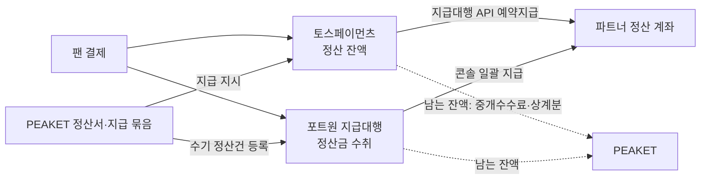
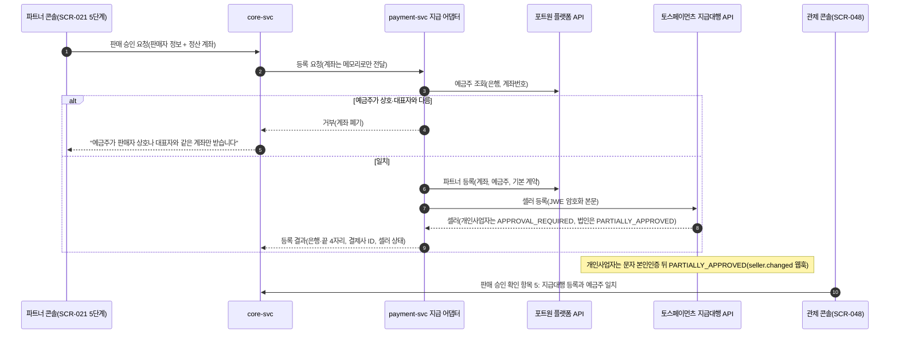
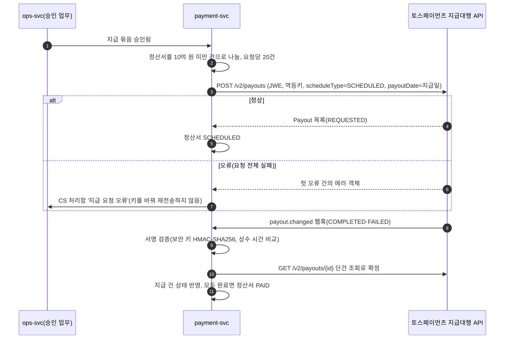

# 기능 설계: 정산과 지급(결제사 지급대행)

- **독자와 용도**: 파트너에게 판매 대금을 보내는 기능을 구현하는 엔지니어와 QA가 함께 보는 문서다. 다루는 것은 다음과 같다.
  - 판매 승인 때 하는 결제사 지급대행(결제사가 PEAKET 대신 파트너 정산 계좌로 판매 대금을 보내는 서비스) 등록과 정산 계좌 확인
  - 회차·결제사 단위 회차 정산서(티켓)와 파트너·결제 상점·주 단위 상품 정산서(굿즈·부가 상품)의 계산, 통지, 이의, 확정
  - 지급 묶음 승인과 결제사별 지급 실행, 상태 동기화
  - KYC(고객 신원 확인 절차)·정산 계좌 변경·이의에 따른 보류, 지급 뒤 환불과 미수금(파트너에게서 돌려받을 돈)
  - 구현하는 쪽은 payment-svc(settlement 모듈과 결제사 지급 어댑터), ops-svc, core-svc와 파트너 콘솔·관제 콘솔 화면이다.
- **원문 출처**: 원문 설계서에는 이 범위의 상세 설계가 없다. 이 문서는 2026-10-13 소유자 결정(00-summary §7 질문 22, "추천안대로 (b)로 가겠습니다")과 결제사 문서 확인에서 나왔다(ADR-0047). 전체가 [보완]이다.
- **기준 기획 버전**: v1.0.
- **관련 ID**: FR-027, FR-052, FR-062 · POL-014, 037, 038, 039 · SCR-020, 021, 027, 045, 046, 048, 049 · CMP-031, 032, 040, 060, 062 · API(프로그램끼리 요청과 응답을 주고받는 창구) `/v1/partner/events/{eventId}/settlements`, `/v1/partner/product-settlements`, `/v1/partner/settlements/{statementId}/disputes`, `/v1/partner/payout-account`, `/v1/ops/settlements`, `/v1/ops/settlements/{statementId}/dispute-dismissal`, `/v1/ops/settlements/{statementId}/adjustments`, `/v1/ops/payout-batches`, `/v1/ops/payout-batches/{batchId}/portone-execution`, `/v1/ops/receivables`, `/v1/webhooks/toss` · 이벤트 `trade.settlements` · 보안 추적 [asvs/settlement.md](../security/asvs/settlement.md)

## 1. 개요

PEAKET은 판매 대금을 자기 계좌로 받아 두지 않는다. 결제를 받은 결제사가 회차가 끝난 뒤 파트너 정산 계좌로 직접 보낸다(ADR-0047). PEAKET이 하는 일은 세 가지다.

- 얼마를 보낼지 계산한다(정산서).
- 언제 보낼지 정하고 결제사에 지시한다(지급 묶음).
- 돌려받을 돈을 관리한다(미수금).

결제사는 결제를 시도할 때마다 고른다(ADR-0044). 그래서 한 회차의 판매 대금이 두 결제사에 나뉘어 있을 수 있고, 정산서와 지급도 결제사별로 따로 만든다. 굿즈와 티켓 연동 부가 상품은 회차와 따로 움직이므로 상품 정산서로 낸다(§4.5).

## 2. 돈의 흐름과 책임

| 누가 | 하는 일 |
| --- | --- |
| 결제사 | 판매 대금 보관(정산대상금액 외부관리, 전자금융거래법 §25의4, 2026-12-17 시행), 파트너 KYC, 지급 실행 |
| PEAKET | 정산서 계산·통지·확정, 지급 묶음 승인과 지급 지시, 미수금 관리, 지급 상태 확인 |
| 파트너 | 정산 계좌 제출·변경, 정산서 확인과 이의, KYC 응답 |

- PEAKET 몫은 중개수수료와, 상계(줄 돈에서 받을 돈을 빼고 남는 만큼만 주고받는 것)로 남긴 금액이다. 이 몫을 결제사에서 받는 방식은 공개 문서에 없어서 지급대행 계약 때 정한다(§14).
- 팬에게 보내는 배상금은 PEAKET이 자기 돈으로 보내는 계좌 이체라서 이 흐름과 따로 간다(transfer-refund §6).

## 3. 결제사 지급대행 등록(판매 승인 때, FR-052)

- 파트너는 사업자만 받는다(판매자 신원정보에 사업자등록번호가 있다). 토스페이먼츠(포트원과 함께 연동하는 결제사) 셀러 유형은 개인사업자나 법인으로만 등록한다.
- 계좌번호는 결제사 등록 요청에 바로 넘기고, PEAKET에는 은행과 끝 4자리만 남긴다(POL-014와 같은 방식, 웹 앱 보안 검증 항목 목록인 ASVS 14.2.6).
- 판매 승인(SCR-048)은 다음이 모두 참일 때만 끝난다: 예금주 일치, 포트원 파트너 등록, 토스페이먼츠 셀러 상태가 PARTIALLY_APPROVED 이상.
- 토스페이먼츠 셀러는 일반 상점(`STANDARD`)과 에스크로 상점(`ESCROW`, 굿즈 택배, POL-014)에 함께 등록한다. 계좌번호는 저장하지 않으므로, 정산 계좌를 받는 모든 경우(판매 승인 요청, 상품을 처음 공개할 때 정산 계좌가 없으면 그때, 정산 계좌 변경)에 세 곳(토스페이먼츠 두 상점, 포트원)에 함께 넘긴다. 택배 상품은 `ESCROW` 셀러가 PARTIALLY_APPROVED 이상일 때만 공개된다. 셀러·잔액·KYC가 상점마다 따로인 것은 추정이다(§14, 추천 적용 2026-10-14, ADR-0062).
- 판매 승인 화면과 파트너 안내에 "주 1천만 원 이상 첫 지급에서 결제사 KYC 때문에 지급이 늦어질 수 있다"라는 문구를 보여 준다. KYC는 미리 요청할 수 없다(§6).

## 4. 정산서(FR-062, POL-039)

### 4.1 계산

회차가 끝난 다음 영업일 06시에 결제사별로 계산한다. 원장은 일일 대사가 끝난 것만 쓴다(payment §8).

| 항목 | 정의 |
| --- | --- |
| 판매 대금 | 그 회차·결제사로 승인된 결제 금액의 합이다. 가상계좌 입금 되돌림(입금 오류)은 승인 취소이므로 그 승인을 뺀다(추천 적용 2026-10-20, ADR-0073). 취소·환불은 여기서 빼지 않고 '환급'으로 따로 센다 |
| 환급 | 그 회차·결제사로 결제한 건의 취소·환불 금액의 합이다(공제한 금액은 판매 대금에 남는다. 재량 면제로 더 돌려준 면제분은 PEAKET이 부담하므로 넣지 않는다, POL-038 ②) |
| 중개수수료 | (판매 대금 − 환급) × 계약 수수료율(판매 승인 때 공연에 고정한 값, ADR-0060), 원 미만 버림 |
| 수수료 부가세 | 중개수수료 × 10%, 원 미만 버림 |
| 상계 | 그 파트너에게 남아 있는 미수금 중 이 정산서에서 돌려받는 금액(§7) |
| 지급액 | 판매 대금 − 환급 − 중개수수료 − 수수료 부가세 − 상계 |

- 예: 판매 대금 3,000만 원, 환급 200만 원, 수수료율 10%이면 중개수수료 280만 원, 부가세 28만 원, 지급액 2,492만 원이다(J-T1).
- 상계는 지급액이 0이 될 때까지만 한다. 남은 미수금은 다음 정산서로 넘긴다.
- 지급액이 0 이하이면 정산서는 지급 없이 끝난다(CARRIED_OVER). 모자라는 금액은 미수금이 된다.
- 결제사 수수료는 PEAKET이 부담한다. 중개수수료 안에 들어 있다고 보고 파트너에게 따로 떼지 않는다.

### 4.2 통지·이의·확정

- 계산이 끝나면 파트너에게 알린다(NOTIFIED). 파트너는 2영업일 안에 이의를 낼 수 있다(SCR-027, 사유 코드와 설명). 사유 코드는 정산서 항목에 맞춘 다섯 가지다: `GROSS_AMOUNT`(판매 대금), `REFUND_AMOUNT`(환급), `COMMISSION`(중개수수료·부가세), `OFFSET`(미수금 상계), `OTHER`(그 밖, 설명 필수). 설명은 2,000자까지이고, 팬 개인정보를 적지 않도록 안내한다(추천 적용 2026-10-14, ADR-0062).
- 이의가 오면 그 정산서만 멈추고(DISPUTED), CS 처리함에 '정산 이의' 건이 생긴다. 처리 기한은 CS 처리함의 분쟁 건과 같게, 진행 상황은 3영업일 안, 결과는 10영업일 안으로 둔다. 파트너와의 정산 이의는 소비자 분쟁이 아니므로, 이 기한은 법정 기한이 아니라 내부 기준이다.
  - 이의가 맞으면 수기 조정(§4.3)을 거쳐 다시 알린다. 맞지 않으면 사유를 적어 기각하고 다시 알린다. 다시 알릴 때는 이의 기간을 새로 시작하지 않고 1영업일만 준다.
- 이의 없이 기간이 끝나면 자동으로 확정한다(CONFIRMED). 정책대로 계산한 그대로이기 때문이다.

### 4.3 수기 조정

- 계산 규칙 밖의 보정(잘못 잡힌 원장, 계약 수수료율 정정, 합의한 차감)은 승인 업무로 처리한다. `cs_lead`가 근거를 붙여 요청하고 commander가 승인한다(2인, POL-038). 사유 코드는 여덟 가지다. 이의를 받아들인 조정에는 그 이의와 같은 코드(`GROSS_AMOUNT`·`REFUND_AMOUNT`·`COMMISSION`·`OFFSET`·`OTHER`)와 이의 ID를 붙인다. 이의 없는 조정에는 `LEDGER_ERROR`(원장 오류 정정)·`CONTRACT_CORRECTION`(계약 수수료율 정정)·`AGREED_DEDUCTION`(합의한 차감)과 근거 메모를 붙인다. 지급을 요청한 뒤의 정산서는 조정하지 않는다. 차이는 미수금이나 다음 정산서의 조정으로 잡는다(추천 적용 2026-10-14, ADR-0062). 앞으로 적용할 계약 수수료율·보증의 변경은 operator가 요청하고 commander가 승인한다(2인, SCR-065·SCR-046). 바뀐 수수료율은 승인 뒤 판매 승인을 받는 공연부터 쓴다(ADR-0060).
- 조정은 정산서에 조정 행으로 더한다. 원래 계산 행은 고치지 않는다.

### 4.4 상태

상태도는 planning/03 §2.12에 있다. 요약하면 다음과 같다.

| 상태 | 뜻 | 다음 |
| --- | --- | --- |
| CALCULATED | 계산 끝 | NOTIFIED |
| NOTIFIED | 파트너에게 알림, 이의 기간 | DISPUTED, CONFIRMED |
| DISPUTED | 이의 처리 중 | NOTIFIED |
| CONFIRMED | 확정, 지급 묶음 대기 | SCHEDULED, CARRIED_OVER, HELD |
| HELD | 보류(KYC, 계좌 변경, 잔액 부족) | CONFIRMED(사유가 풀린 뒤 다음 지급 묶음으로) |
| SCHEDULED | 결제사에 지급을 요청한 상태 | PAID, FAILED, HELD(지급 전 예약 취소) |
| FAILED | 지급 건 실패 | SCHEDULED(새 지급 건) |
| PAID | 모든 지급 건 완료 | 끝 |
| CARRIED_OVER | 지급액 0 이하, 미수금으로 넘긴 상태 | 끝 |

### 4.5 상품 정산서(추천 적용 2026-10-14, ADR-0062)

굿즈와 티켓 연동 부가 상품의 판매 당사자는 파트너다(POL-037). 그 판매 대금은 회차 정산서와 따로 상품 정산서로 낸다(POL-039 ②).

- **두 종류**
  - 회차 정산서(`kind=EVENT`): 지금처럼 티켓만 담고, 회차·결제사 단위로 만든다.
  - 상품 정산서(`kind=PRODUCT`): 굿즈와 티켓 연동 부가 상품을 담는다. 파트너·결제사·결제 상점(토스페이먼츠 `STANDARD`·`ESCROW`) 단위로 만든다. 한 주(월요일 00:00~일요일 24:00 KST) 안에 '정산 기준일'이 든 주문 항목을 모은다. 매주 첫 영업일 06시에 계산한다. 담을 항목이 없으면 만들지 않는다.
  - 부가 상품을 회차 정산서에 넣지 않는 이유: 회차 정산서는 공연 리포트 R3에서 '판매 금액이 정산서와 원 단위 일치'하는지 대조하는 대상이다. 또 부가 상품은 shop 주문(`merch_order`)이라, 굿즈와 같은 정산 기준일 규칙을 쓰면 계산 경로가 하나로 끝난다.
- **정산 기준일**: 주문 항목마다 정하고, 이날이 지나야 정산서에 들어간다.

| 경우 | 정산 기준일 |
| --- | --- |
| 굿즈 택배, 에스크로 주문 | 결제사 구매 확정일(구매자 확정 또는 3영업일 무선택 자동 확정, `merch_order.purchase_confirmed_at`). 구매 확정 전에는 넣지 않는다 |
| 굿즈 택배, 에스크로가 아닌 주문(신용카드 등) | 받은 날(`delivered_at`)부터 7일이 지난 다음 날(단순 변심 반품 기한이 끝난 다음 날). 배송 완료 기록이 없으면 송장 등록일부터 14일 [가정]이 지난 다음 날 |
| 굿즈 현장 수령 | 받은 날(`picked_up_at`)부터 7일이 지난 다음 날 |
| 티켓 연동 부가 상품 | 연결 회차가 끝난 다음 날 |

- 반품 요청 중(`RETURN_REQUESTED`·`RETURN_RECEIVED`·`DISPUTED`)인 항목은 결과가 날 때까지 넣지 않는다. 환급으로 끝나면 넣지 않고, 반품 거절이 확정되면 그 확정일을 정산 기준일로 본다.
- 정산 기준일 전에 취소·환급된 항목은 넣지 않는다(판매·환급 모두 빠진다).
- 그 뒤 생긴 환급(설명과 다른 상품의 3개월 반품, 미성년자 계약 취소, 예외 환불)은 그 주 정산서를 아직 계산하지 않았으면 '환급'으로 넣는다. 이미 계산했으면 미수금(`REFUND_AFTER_PAYOUT`)으로 잡는다(§7과 같다).
- **금액과 수수료**: 식은 회차 정산서와 같다(판매 대금 − 환급 − 중개수수료 − 수수료 부가세 − 상계 = 지급액). 판매 대금은 항목의 결제 금액에 구매자가 낸 처음 배송비를 더한 값이다(배송은 판매자가 한다). 중개수수료율은 상품을 처음 공개할 때 그 파트너의 계약 수수료율로 상품에 고정한다(`commission_rate_bp`. 공연을 판매 승인 때 고정하는 방식과 같다, ADR-0060). 바뀐 계약 수수료율은 그 뒤 처음 공개하는 상품부터 쓴다.
- **이의·확정·지급**: 회차 정산서와 같은 규칙이다. 통지 → 2영업일 이의(사유 코드 5종, §4.2) → 자동 확정 순서다. 지급일은 계산일로부터 4영업일 뒤다(회차 정산서의 '종료 다음 영업일 계산, 종료 5영업일 뒤 지급'과 같은 간격). 수기 조정은 §4.3과 같다(POL-038 ⑦).
- **에스크로 대금**: 에스크로 대금은 구매자가 구매를 확정해야 결제사가 상점에 지급한다(확인됨, 결제사 공개 문서). 그래서 에스크로 주문은 구매 확정 전에는 정산서에 넣지 않고, 잔액 확인(§5.1)도 상점별로 한다.
- **상계 순서**: 지금 규칙 그대로다. 같은 파트너의 다음 정산서(회차·상품 구분 없이 지급일이 먼저 오는 것) → 보증 → 청구(ADR-0046 재원 순서, §7·§12).
- 주 단위·정산 기준일·14일 [가정]·수수료율 고정은 자체 기준이다(대규모유통업법에 온라인 중개거래의 정산 기한 조항이 없다, 2026-10-14 확인).
- **shop에서 넘겨받는 값**: 상품 정산서는 payment-svc가 계산한다. 하지만 주문 항목·정산 기준일·반품 상태는 core-svc shop(`merch_order`·`merch_order_item`)에 있다. 넘기는 계약은 shop 상세 설계 때 정한다(docs/features/README.md '구현 직전 작성 대상').

## 5. 지급 실행

### 5.1 지급일과 지급 묶음

- 기본 지급일은 회차 종료일로부터 5영업일 뒤다. 여기에는 계산(1영업일), 이의 기간(2영업일), 묶음 승인과 결제사 예약 요청(지급일 전 영업일)이 들어 있다.
- 지급일 전 영업일 09시에 지급일·결제사·결제 상점별로 확정 정산서(회차·상품)를 모아 지급 묶음을 만든다. 토스페이먼츠 잔액은 상점마다 따로 본다(추천 적용 2026-10-14, ADR-0062).
- 묶음을 만들기 전에 결제사의 지급 가능 잔액을 본다. 모자라면 그 묶음의 지급일을 다음 영업일로 미루고 경보를 낸다.
  - 토스페이먼츠: 잔액 조회 API(`GET /v2/balances`)의 `availableAmount`는 묶음을 만들 때, 그리고 승인 뒤 지급 요청 직전에 본다(지급을 요청할 때 잔액이 모자라면 요청이 실패한다). 비교하는 합계는 이 묶음 합계에 아직 끝나지 않은 토스페이먼츠 예약지급 합계를 더한 값이다(예약지급이 잔액에서 바로 빠지는지 결제사 문서에 없어서, 확인 전까지는 안전한 쪽으로 더한다). 화면에는 `pendingAmount`(정산 주기가 지나지 않은 금액)를 '정산 대기'로 함께 보여 준다(추천 적용 2026-10-14, ADR-0062).
  - 포트원: 잔액 조회 API가 없다(API 명세 1.16.0). 그래서 operator가 확인을 요청할 때 포트원 콘솔 '파트너정산 > 정산 내역 관리 > 내 가상계좌'에서 본 지급대행 계좌 잔액과 본 시각을 적는다. 이 값이 이 묶음과, 실행 기록이 없는 포트원 묶음들을 합친 금액보다 작으면 같은 방식으로 지급일을 미룬다. 적은 값은 PEAKET이 검증할 수 없는 확인값이라서 지급을 미루는 쪽으로만 쓴다(추천 적용 2026-10-14, ADR-0062).
- 지급 묶음은 되돌릴 수 없는 일괄 작업이라서 승인 업무로 처리한다(POL-038).
  - operator가 합계, 건수, 보류·이의 제외 목록을 확인해 요청한다.
  - commander가 승인한다(2인, 요청자 ≠ 승인자).
- 지급일 전 영업일 15시까지 승인되지 않으면 지급일을 다음 영업일로 미루고 파트너에게 알린다.

### 5.2 토스페이먼츠 결제분

- 결제사가 한 번 요청에 받는 상한은 100건이다(토스페이먼츠 API 참조, 2026-10-14 확인). 요청당 20건은 실패할 때 영향받는 범위를 줄이려고 스스로 정한 제한이다(ADR-0047).
- `refPayoutId`는 `{정산서 ID}-{순번}`이다. 같은 지급 건은 같은 멱등키로만 다시 보낸다.
- 결제사 안내에 따라, 오류 응답을 받은 뒤에는 멱등키를 바꿔 다시 보내지 않는다. 운영자가 CS 처리함에서 원인을 확인한 뒤 처리한다.
- 예약지급은 REQUESTED 상태에서만 취소할 수 있다(`POST /v2/payouts/{id}/cancel`). 지급 전에 보류 사유가 생기면 예약지급을 취소하고 정산서를 HELD로 둔다.
- 지급일 다음 영업일 12시까지 완료 웹훅(일이 생기면 상대 서버가 우리 주소를 불러 알려 주는 방식)이 없으면 단건 조회로 확인한다. 그래도 끝나지 않았으면 CS 처리함에 올린다.

### 5.3 포트원 결제분

- 묶음이 승인되면 정산서마다 수기 정산건을 만든다(`POST /platform/transfers/manual`, 아이디 = 정산서 ID, 정산 금액 = 지급액, 정산일 = 지급일). 아이디가 같으면 다시 만들지 않는다.
- 지급일 09시에 CS 처리함에 '포트원 일괄 지급 실행' 건이 생긴다. operator가 포트원 콘솔에서 그 정산일의 건을 지급대행(AGENCY)으로 한꺼번에 지급하고, 일괄 지급 ID를 SCR-049에 적는다.
  - 공개 API(명세 v1.16.0)에는 지급을 만드는 엔드포인트(API를 부르는 주소 하나)가 없어서 이렇게 한다. 그런 API가 생기면 바꾼다(ADR-0047 되돌릴 조건).
- PEAKET은 지급 내역 조회(`GET /platform/payouts`, `GET /platform/bulk-payouts`)를 30분마다 불러 상태를 맞춘다. SUCCEEDED면 지급 건을 완료로 두고, FAILED·STOPPED·CANCELLED면 CS 처리함으로 보낸다.
- 실행 직전 콘솔에서 지급대행 계좌 잔액을 다시 본다. 모자라면 실행하지 않고 CS 처리함 건에 '잔액 부족'을 적는다(추천 적용 2026-10-14, ADR-0062). 그다음은 §12 '포트원 실행을 잊음'과 같고, 파트너에게 지급이 미뤄진다고 알린다. 지급대행 계좌 잔액이 모자랄 때 콘솔이 실행을 막는지는 문서에 없다(송금대행 계좌는 막는다).
- 지급일 15시까지 실행 기록이 없으면 경보를 낸다.

### 5.4 계산 원본

계산의 원본은 PEAKET 정산서 하나다. 포트원 주문 정산건(`transfers/order`)과 포트원 계약의 수수료 계산은 쓰지 않는다. 포트원 파트너 등록에는 기본 계약이 필요하다. 그래서 중개수수료가 0인 계약 하나만 두고, 금액은 수기 정산건으로만 넣는다. 계약의 나머지 설정 항목은 계약할 때 확인한다.

## 6. 보류와 KYC, 정산 계좌 변경

| 보류 사유 | 시작 | 끝 | 그동안 |
| --- | --- | --- | --- |
| 토스페이먼츠 KYC 필요 | `seller.changed`로 KYC_REQUIRED가 오거나, 지급 요청이 KYC 문제로 취소된 때 | `seller.changed`로 APPROVED | 그 셀러의 토스페이먼츠 지급을 보류한다. 포트원 결제분은 그대로 지급한다 |
| 정산 계좌 변경 | 변경 완료 시각 | 3영업일 뒤 | 그 사이에 지급일이 오는 정산서를 미룬다 |
| 이의 | DISPUTED | 처리 뒤 다시 알림 | 그 정산서만 |
| 결제사 잔액 부족 | 묶음을 만들 때 확인한다. 토스페이먼츠는 지급 요청 직전에 다시 조회한다. 포트원은 확인 요청 때 운영자가 입력한 값과, 실행일에 콘솔에서 다시 확인한 결과로 본다(§5.1·§5.3, 추천 적용 2026-10-14, ADR-0062) | 잔액이 생긴 영업일 | 그 묶음 |

- KYC: 파트너에게 KYC 안내(결제사가 셀러 등록 이메일로 보낸 고객확인 신청서를 제출하라는 내용)를 알리고, CS 처리함 'KYC 필요' 건으로 추적한다. 토스페이먼츠는 서류가 갖춰지면 2영업일 안에 심사를 마친다고 공개 안내한다(2026-10-14 확인). 보완 요청을 받으면 보완한 뒤 다시 2영업일 안에 마친다. '승인 보류'(추가 검토)의 기간은 공개 안내가 없다. 그래서 KYC 필요부터 지급까지 약 5영업일로 추정한다(파트너 제출 1영업일 [가정] + 심사 2영업일 안 + 다음 지급 묶음 1~2영업일). 세부 심사 상태(제출대기·수정 요청·승인 보류)는 API 셀러 상태에 없고, 토스페이먼츠 상점관리자 '셀러 KYC 심사'에서만 보인다. 파트너가 이메일을 받지 못했으면 operator가 그 메뉴에서 안내문을 다시 보낸다. 지급은 지난 시간이 아니라 `seller.changed` APPROVED(서명 확인)와 셀러 단건 조회(`GET /v2/sellers/{id}`)로만 다시 시작한다(추천 적용 2026-10-14, ADR-0062). KYC는 1년이나 3년마다 다시 받으므로, 같은 경로로 다시 생길 수 있다.
- KYC 예고: 셀러가 PARTIALLY_APPROVED이고, 지급일 앞뒤 6일 안의 토스페이먼츠 지급(요청한 예약지급과 지급 예정 정산서) 합계가 1천만 원 이상이면, 고객확인 요청이 올 수 있다고 정산서 통지와 SCR-027에서 미리 알린다(결제사 기준 '7일 동안 1천만 원 이상'에서 7일을 어떻게 끊어 세는지가 공개 문서에 없어서 넓게 센다. 추천 적용 2026-10-14, ADR-0062). 지급 동작은 바뀌지 않는다.
- 정산 계좌 변경(SCR-020)
  1. 파트너 관리자(`partner_admin`, planning/03 §3)가 TOTP(인증 앱이 시간에 따라 새로 만드는 일회용 코드)로 다시 인증한다.
  2. 새 계좌를 내면 예금주 조회로 판매자 상호나 대표자와 같은지 본다. 다르면 받지 않는다.
  3. 같으면 두 결제사에 바로 수정을 요청한다(토스페이먼츠 셀러 수정, 포트원 파트너 수정). PEAKET은 은행과 끝 4자리만 바꿔 둔다.
  4. 변경을 파트너의 등록 이메일과 전화로 알리고, 3영업일 동안 지급을 미룬다.
- 상호나 대표자가 바뀌었으면 먼저 판매자 정보 변경 요청(SCR-020)을 낸다. PEAKET 운영자가 판매자 정보를 다시 확인한 뒤 새 계좌를 받는다. 이 확인은 공연의 판매 재승인이 아니다(ADR-0066 결정 12. 운영자가 변경 요청을 검토하는 경로와 화면은 design/d5 §1.6 38번 후보). 그래서 확인되지 않은 명의의 계좌를 받을 일이 없다.
- 토스페이먼츠는 사업자등록번호를 고칠 수 없다. 사업자가 바뀌면 셀러를 새로 등록한다.

## 7. 지급 뒤 환불·카드 이의제기와 미수금

- 결제사는 이미 지급한 돈을 되돌려 주지 않는다. 지급 뒤 생긴 환불(공연 중단, 예외 환불)과 카드 이의제기 금액은 결제사가 가맹점인 PEAKET의 정산에서 뺀다. 그래서 PEAKET이 먼저 부담한다.
- 이 금액은 미수금(`partner_receivable`)으로 잡는다. 다만 재량 면제로 더 돌려준 면제분은 PEAKET이 부담하므로 미수금으로 잡지 않는다(POL-038 ②, ADR-0046 결정 6). 미수금이 생기는 경우는 네 가지다: 지급 뒤 환불, 카드 이의제기, 배상금 미리 지급(ADR-0046), 지급액이 0 이하인 정산서.
- 돌려받는 순서는 ADR-0046의 재원 순서를 따른다.
  1. 같은 파트너의 다음 정산서에서 상계(결제사 무관)
  2. 계약 보증(보증금·이행보증보험)
  3. 청구(파트너에게 청구서 발송)
- 30일 안에 다음 정산서가 없으면 보증 → 청구로 넘어간다. 청구 뒤 미회수 금액은 PEAKET 손실로 기록한다.
- 정산서를 계산한 뒤 지급 전에 생긴 환불도 미수금으로 잡는다. 정산서는 다시 계산하지 않는다. 회차 취소처럼 큰 변화만 다시 계산한다(§12).
- 미수금 상계는 행 잠금으로 한 번에 하나씩 처리해(직렬화), 같은 미수금이 두 정산서에서 상계되지 않게 한다(ASVS 2.3.4).
- 상품 정산서를 만든 뒤 생긴 반품·환급(설명과 다른 상품의 3개월 반품, 미성년자 계약 취소, 예외 환불)도 같은 방식으로 미수금이 된다(§4.5).

## 8. 보안·비밀·로그

| 영역 | 설계 |
| --- | --- |
| 비밀 | 토스페이먼츠 보안 키(64자 hex)·시크릿 키와 포트원 API 시크릿은 Secrets Manager에 두고, External Secrets로 `payment-svc`에 준다. 파드(쿠버네티스에서 앱이 실행되는 가장 작은 단위)에 주는 권한(EKS Pod Identity. EKS는 AWS가 운영해 주는 쿠버네티스다)은 서비스 계정 단위다. 그래서 한 파드 안에서 지급 어댑터만 따로 비밀을 읽게 할 수는 없다(ADR-0050). 토스페이먼츠 API 키는 NAT 고정 IP로 호출을 제한한다(payment §7과 같다) |
| 키 교체 | 보안 키는 1년마다, 그리고 노출이 의심될 때 바로 다시 발급한다. 토스페이먼츠는 교체 중에 지급 웹훅에 서명을 최대 4개 보내므로, 교체 기간에는 새 키와 옛 키를 함께 검증에 쓴다. 보안 키 하나를 JWE와 웹훅 서명에 함께 쓰는 것은 결제사 규격이다. 그래서 키 분리 원칙의 예외로 키 목록에 적는다(docs/security/secrets-and-keys.md) |
| JWE | 검증된 JOSE 라이브러리로 `alg=dir`, `enc=A256GCM`만 만들고 받는다. 결제사가 요구하는 사용자 헤더 `iat`(요청 본문을 만든 시각, ISO 8601)와 `nonce`(CSPRNG로 만든 고유값)를 넣는다. 복호에 실패한 응답은 쓰지 않는다 |
| 웹훅 | `/v1/webhooks/toss`에서 `payout.changed`·`seller.changed`의 `tosspayments-webhook-signature`를 `{본문}:{전송 시각}`의 HMAC-SHA256 값과 상수 시간으로 비교한다. 서명이 맞아도 단건 조회로 확정한다. 서명이 틀리면 버리고 보안 이벤트로 남긴다. 중복은 `tosspayments-webhook-transmission-id`로 막는다(payment §5). `tosspayments-webhook-transmission-time`이 지금과 5분 넘게 다르면 본문은 쓰지 않고 '늦은 웹훅' 보안 이벤트로 남긴다. 그래도 단건 조회는 한다. 재전송 때 발송 시각을 새로 찍는지가 결제사 문서에 없어서 버리지는 않는다(ADR-0053 결정 3) |
| 계좌 | 계좌번호는 등록·수정 요청에 바로 넘기고 저장하지 않는다. 화면·API·로그에는 은행과 끝 4자리만 나온다 |
| 테스트 | 결제사 테스트 환경과 지급 시뮬레이터로 시험한다. 라이브 환경에서는 지급 API를 시험하지 않는다(결제사 수수료가 붙는다). 토스페이먼츠 테스트 환경은 법인 셀러만 등록되고 KYC 승인을 만들 수 없다. 그래서 KYC 흐름은 시뮬레이터로 시험한다 |

| 로그 이벤트 | 기록 위치 | 남기는 것 | 남기지 않는 것 |
| --- | --- | --- | --- |
| 정산서 상태 전이 | payment-svc 이벤트, `trade.settlements` | 정산서 ID, 회차, 결제사, 금액 항목, 상태 | — |
| 지급 요청·결과 | payment-svc 이벤트 | 지급 건 ID, `refPayoutId`, 금액, 결제사 상태, 결제사 `traceId` | JWE 원문, 복호 평문 |
| 지급 웹훅 | payment-svc 보안 로그 | 전송 ID, 시각, 서명 검증 결과 | 보안 키 |
| 정산 계좌 변경 | ops-svc 감사 로그 | 파트너, 재인증 결과, 예금주 일치 여부, 은행·끝 4자리 | 계좌번호 |
| 포트원 예금주 조회 호출 | payment-svc 트레이스(요청 하나가 여러 서비스를 거친 길과 시간을 남긴 기록)·로그 | 경로 템플릿, 결제사 응답 코드, 지연 시간 | 계좌번호가 든 실제 URL, 응답 본문(ADR-0053 결정 5) |
| 수기 조정·지급 묶음 승인 | ops-svc 감사 로그 | 요청자, 승인자, 금액, 근거 종류 | — |
| 포트원 일괄 지급 실행 | ops-svc 감사 로그 | 실행자, 시각, 일괄 지급 ID, 정산일 | — |
| 포트원 잔액 입력(확인 요청 때) | ops-svc 감사 로그, `payout_batch` | 입력자, 입력값(지급대행 계좌 잔액), 본 시각, 묶음 ID(추천 적용 2026-10-14, ADR-0062) | 계좌번호 |

## 9. 화면과 권한

| 화면 | 바뀌는 것 |
| --- | --- |
| SCR-021 공연 등록 위저드 5단계(판매 승인 요청) | 정산 계좌 입력(CMP-062, 저장하지 않는다), 예금주 일치 결과, KYC 안내 |
| SCR-048 판매 승인 | 확인 항목 5: 지급대행 등록과 예금주 일치 |
| SCR-020 파트너 계정 | 정산 계좌 변경(재인증, 예금주 일치, 3영업일 지급 보류 안내) |
| SCR-027 정산 리포트 | 결제사별 정산서(금액 항목, 상태, 지급 예정일), 이의 제기, KYC·보류 안내, 미수금 상계 내역 |
| SCR-023 상품 빌더 | [상품 정산] 탭: 주·상점별 상품 정산서, 정산 대기 금액, 이의 제기(파트너 관리자), KYC·보류 안내(추천 적용 2026-10-14, ADR-0062) |
| SCR-045 CS 처리함 | 자동 건: 정산 이의, KYC 필요, 지급 요청 오류, 지급 실패, 지급 지연, 포트원 일괄 지급 실행 |
| SCR-046 승인 업무 | 종류: 지급 묶음, 정산서 수기 조정 |
| SCR-049 정산 지급(새 화면, 관제 콘솔) | 지급일·결제사·결제 상점별 묶음과 상태, 정산서 종류(회차·상품) 필터, 정산서 목록(이의·보류·실패 필터), 묶음 확인 요청, 포트원 잔액 입력(확인 요청 때 지급대행 계좌 잔액과 본 시각), 결제사 잔액 표시(토스페이먼츠는 API 값과 정산 대기, 포트원은 운영자 입력값과 출처), 포트원 실행 기록, 미수금 목록 |

| 역할 | 할 수 있는 일 |
| --- | --- |
| 파트너 | 자기 정산서를 조회한다. 이의 제기와 정산 계좌 변경은 파트너 관리자(`partner_admin`)만 한다(추천 적용 2026-10-14, ADR-0062) |
| viewer | 정산서·지급·미수금 조회 |
| operator | 지급 묶음 확인 요청, 포트원 일괄 지급 실행과 기록 |
| `cs_agent` | 정산 이의 조회(처리는 `cs_lead`, planning/03 §3) |
| `cs_lead` | 정산 이의 처리, 수기 조정 요청 |
| commander | 지급 묶음 승인, 수기 조정 승인 |

- 파트너에게 주는 응답에는 결제사 내부 ID, 계좌번호 전체, 결제사 오류 원문을 넣지 않는다. 이 값들은 운영자 화면에만 보인다.
- 정산서·지급·미수금 조회는 서버에서 `promoter_id`로 소유자인지 검사한다.

## 10. 데이터·API·이벤트 참조

| 종류 | 세부 |
| --- | --- |
| PostgreSQL(payment) | `settlement_statement`(종류 EVENT·PRODUCT, 회차(상품 정산서는 없음), 결제사, 결제 상점 STANDARD·ESCROW, 기간 시작·끝(상품 정산서), 금액 항목, 상태, 이의 기한, 지급일), `payout_batch`(지급일, 결제사, 결제 상점, 합계, 건수, 승인 ID, 포트원 일괄 지급 ID, 묶음 때 본 결제사 잔액·출처(`PG_API`·`OPERATOR_CONSOLE`)·본 시각·입력자(`pg_balance_krw`·`pg_balance_source`·`pg_balance_observed_at`·`pg_balance_observed_by`), 상태), `payout`(지급 건: 정산서, 순번, 금액, `ref_payout_id`, 결제사 지급 ID, 상태, 오류 코드), `partner_receivable`(원인, 금액, 남은 금액, 상태, 근거) |
| PostgreSQL(core) | `promoter`에 결제사 등록 필드(토스페이먼츠 셀러 ID·상태, 포트원 파트너 ID, 정산 은행·끝 4자리, 계좌 변경 시각, 계약 수수료율), `event.commission_rate_bp`(판매 승인 때 고정한 수수료율, ADR-0060) |
| PostgreSQL(ops) | `approval_request` 종류에 PAYOUT_BATCH·SETTLEMENT_ADJUSTMENT, `cs_case` 종류에 STATEMENT_DISPUTE·SELLER_KYC_REQUIRED·PAYOUT_ERROR·PAYOUT_FAILED·PAYOUT_DELAYED·PORTONE_PAYOUT_EXECUTION |
| REST API | 위 '관련 ID'의 경로. docs/api/openapi.yaml |
| 결제사 API | 토스페이먼츠 `POST /v2/sellers`, `POST /v2/sellers/{id}`, `GET /v2/sellers/{id}`, `GET /v2/balances`, `POST /v2/payouts`, `POST /v2/payouts/{id}/cancel`, `GET /v2/payouts/{id}`. 포트원 `GET /platform/bank-accounts/{bank}/{accountNumber}/holder`(경로에 계좌번호가 들어가므로 트레이스·로그에는 경로 템플릿만 남긴다, ADR-0053), `POST /platform/partners`, `PATCH /platform/partners/{id}`, `POST /platform/transfers/manual`, `GET /platform/payouts`, `GET /platform/bulk-payouts`. 포트원에는 잔액 조회 API가 없어서 operator가 콘솔에서 확인한 값을 적는다(§5.1). |
| 비동기 이벤트 | `trade.settlements`(STATEMENT_NOTIFIED·STATEMENT_DISPUTED·STATEMENT_CONFIRMED·STATEMENT_CARRIED_OVER·PAYOUT_SCHEDULED·PAYOUT_COMPLETED·PAYOUT_FAILED·PAYOUT_HELD·RECEIVABLE_OPENED·RECEIVABLE_CLOSED), 키 = 파트너 ID |
| 보존 | 정산서·지급·미수금 기록을 5년 보관한다(전자상거래법 시행령 §6①3호, data.md §6) |

## 11. 관측과 경보

| 지표 | 경보 |
| --- | --- |
| `settlement_payout_overdue_total{pg}`: 지급일 다음 영업일 12시까지 완료되지 않은 지급 건 | 1건 이상이면 SEV3(장애 심각도 등급. 숫자가 작을수록 심각하다)로 알리고 CS 처리함 '지급 지연' 건을 만든다 |
| `settlement_payout_failed_total{pg, reason}` | 1건 이상이면 SEV3 |
| `settlement_batch_unapproved{pg}`: 지급일 전 영업일 15시에 미승인 묶음 | 1건 이상이면 commander에게 알린다 |
| `settlement_portone_execution_pending`: 지급일 15시까지 실행 기록 없음 | 1건 이상이면 operator에게 알린다 |
| `settlement_seller_kyc_required{pg}` | 보류 금액과 함께 대시보드에 보여 준다 |
| `settlement_webhook_signature_invalid_total` | 10분에 5건 이상이면 SEV2(보안) |
| `settlement_receivable_open_krw` | 30일이 넘은 미수금은 주간 보고에 넣는다 |

## 12. 예외 상황 대응표

| 상황 | 처리 |
| --- | --- |
| 이의 기간 중 회차 취소가 확정됨 | 정산서를 다시 계산해 다시 알린다(환급·배상 반영) |
| 지급 요청 오류(요청 전체 실패) | 멱등키를 바꾸지 않는다. CS 처리함에서 첫 오류 건의 원인을 보고, 그 건만 고쳐 같은 묶음을 다시 보낸다 |
| 지급 건 FAILED(은행 사정, 계좌 해지) | 정산서를 FAILED로 두고, 파트너에게 계좌 확인을 요청한다. 새 `refPayoutId`로 다시 요청한다 |
| KYC 필요가 지급 요청 뒤에 생김 | REQUESTED면 취소하고 HELD로 둔다. 이미 IN_PROGRESS면 결과를 기다린다 |
| 웹훅 서명 불일치 | 버리고 보안 이벤트로 남긴다. 단건 조회로만 상태를 맞춘다 |
| 토스페이먼츠 지급 API 장애 | 서킷 브레이커(계속 실패하는 호출을 잠시 끊어 장애가 번지지 않게 하는 장치)를 열고, 그 묶음의 지급일을 다음 영업일로 미룬다 |
| 포트원 실행을 잊음 | 지급일 15시에 경보를 낸다. 정산일을 다음 영업일로 바꿔 다시 실행한다 |
| 포트원 지급대행 계좌 잔액 부족(확인 요청 때 입력값이 합계보다 작거나 실행일 콘솔 잔액이 모자람) | 지급일을 다음 영업일로 미루고 파트너에게 알린다. 실행일에 모자라면 실행하지 않는다 |
| 지급 뒤 공연 중단으로 환불 | 미수금으로 잡고 상계 → 보증 → 청구 순서로 돌려받는다 |
| 결제사 전환으로 한 회차가 두 결제사에 나뉨 | 결제사별로 정산서를 둘 만든다. 상계는 지급일이 먼저 오는 정산서부터 한다 |

## 13. 테스트 포인트

| ID | 시나리오 | 통과 기준 |
| --- | --- | --- |
| J-T1 | 정산서 계산 | 판매 3,000만 원, 환급 200만 원, 수수료율 10%에서 수수료 280만 원, 부가세 28만 원, 지급액 2,492만 원이 나온다. 지급 건 합계 = 지급액 |
| J-T2 | 이의 기간 | 2영업일 안에 이의를 내면 DISPUTED가 되고, 그 정산서만 묶음에서 빠진다. 같은 파트너의 다른 정산서는 지급된다 |
| J-T3 | 지급 묶음 2인 승인 | 요청자와 같은 사람이 승인하면 403이다. 승인 전에는 결제사에 요청이 나가지 않는다 |
| J-T4 | 토스페이먼츠 분할 | 25억 원 정산서는 10억 원 미만 3건으로 나눈다. 요청당 20건을 넘으면 요청을 나눈다 |
| J-T5 | 멱등 | 같은 지급 건을 다시 보내도 중복 지급이 없다. 오류 응답 뒤 자동 재시도가 멱등키를 바꾸지 않는다(시뮬레이터) |
| J-T6 | 지급 웹훅 서명 | 서명 불일치는 버리고 보안 이벤트로 남긴다. 키 교체 중에는 서명 4개 중 하나가 맞으면 받는다. 받은 뒤에도 단건 조회로 확정한다 |
| J-T7 | KYC 보류 | 시뮬레이터 셀러가 KYC_REQUIRED면 토스페이먼츠 결제분만 HELD가 되고 CS 처리함 건이 생긴다. APPROVED 웹훅 뒤 다시 요청한다 |
| J-T8 | 정산 계좌 변경 | 예금주가 다르면 거부하고 계좌를 남기지 않는다. 같으면 두 결제사 정보를 수정하고, 등록 이메일·전화로 알리고, 3영업일 지급을 보류한다 |
| J-T9 | 포트원 지급 | 수기 정산건 아이디 중복 생성이 없다. 지급일에 '포트원 일괄 지급 실행' 건이 생기고, 실행을 기록한 뒤 지급 내역 조회로 PAID가 된다 |
| J-T10 | 테넌트 격리 | 파트너 A가 B의 정산서 ID로 조회·이의하면 404를 돌려주고 인가 실패 로그를 남긴다 |
| J-T11 | 지급 뒤 환불 | 50만 원 환불이 미수금이 되고 다음 정산서에서 상계된다. 30일 안에 정산서가 없으면 보증 → 청구 순서로 간다 |
| J-T12 | 0 이하 정산서 | 회차 취소로 지급액이 −30만 원이면 CARRIED_OVER가 되고, 지급 요청 없이 미수금 30만 원이 생긴다 |
| J-T13 | 잔액 부족 | 토스페이먼츠 `availableAmount`(묶음 생성 때와 요청 직전)나 포트원 운영자 입력값이 비교 합계보다 작으면 지급일을 미루고 경보를 낸다. 포트원 묶음 확인 요청에 잔액 입력이 없으면 422다 |
| J-T14 | 민감 정보 | 계좌번호, 보안 키, JWE 원문이 로그·응답·분석 이벤트에 없다(정적 검사와 로그 표본 검사) |
| J-T15 | 지급 실패 | 은행 오류를 재현하는 계좌로 FAILED가 되면 정산서가 FAILED가 되고 CS 처리함 건이 생긴다. 새 `refPayoutId`로 다시 요청해 PAID가 된다 |
| J-T16 | 늦은 지급 웹훅 | 서명은 맞고 `transmission-time`이 10분 전인 `payout.changed`를 보낸다. 이때 본문으로 상태를 바꾸지 않고, '늦은 웹훅' 보안 이벤트를 남긴 뒤 단건 조회 결과로만 확정한다. 같은 전송 ID를 다시 보내면 처리하지 않는다 |
| J-T17 | 예금주 조회 URL 가림 | 예금주 조회를 부른 뒤 트레이스·로그·OTel Collector 출력 어디에도 계좌번호가 없고 경로 템플릿만 남는다 |
| J-T18 | 상품 정산서 | 에스크로 구매 확정 전 주문, 받은 지 7일이 안 된 택배·현장 수령, 반품 요청 중인 항목은 빠진다. 부가 상품은 연결 회차가 끝난 다음 날 들어간다. 지급일은 계산일로부터 4영업일 뒤이고, 묶음은 상점별로 만든다 |
| J-T19 | KYC 예고 | PARTIALLY_APPROVED 셀러의 지급일 앞뒤 6일 합계가 1,000만 원이면 통지와 SCR-027에 예고가 나오고, 999만 원이면 나오지 않는다. 지급 요청은 예고와 무관하게 같다 |

## 14. 미결정·한계

- **계약 때 확인할 것**: PEAKET 몫을 받는 방식, KYC 보완 요청·승인 보류 때의 기간(서류가 갖춰진 심사는 2영업일 안이라고 공개 안내한다, 2026-10-14 확인), 지급대행 이용료의 실제 계약 조건(토스페이먼츠 공개 안내: 월 고정 300,000원(부가세 별도), 월 1,000건 지급까지는 추가 요금 없음, 넘으면 건당 100원, 첫 셀러 지급이 생긴 달부터는 지급이 없어도 매월 내고, 다음 달 초 정산대금에서 뺀다. 2026-10-14 확인. 결제 상점이 둘일 때 상점마다 붙는지와 포트원 이용료는 계약 때 확인한다), 토스페이먼츠 두 상점(일반·에스크로)의 셀러 등록·잔액·KYC·지급대행 이용료가 상점마다 따로인지(추정: 따로), 포트원이 지급 생성 API를 주는지, 포트원 지급대행이 되는 하위 결제사 범위, 결제사 정산 주기(이용료 밖의 항목은 공개 문서에 없다). 포트폴리오 기간에는 라이브 지급을 하지 않으므로 이용료는 생기지 않는다(§8, 추천 적용 2026-10-14, ADR-0062).
- **지급일과 이의 기간**: 5영업일과 2영업일은 추천 적용(2026-10-13)으로 정한 값이다. 결제사 정산 주기가 더 길면 지급일을 늦춘다.
- **첫 큰 지급**: 주 1천만 원 이상 첫 지급은 KYC 때문에 늦어질 수 있다. KYC는 미리 받을 수 없다. 추정(2026-10-14)으로는 약 5영업일 늦어진다(§6).
- **지급 뒤 손실**: 지급 뒤 환불과 카드 이의제기는 PEAKET이 먼저 부담한다. 상계·보증·청구로도 돌려받지 못하면 손실이 된다.
- **세무**: 중개수수료 세금계산서 발행과 부가가치세 처리는 검토하지 않았다. §4.1의 부가세 항목은 일반 과세를 가정한 계산식이다.
- **법률**: 'PEAKET이 정산 금액을 계산해 지급을 지시하는 일은 전자지급결제대행이 아니다'는 해석이다(POL-027).
