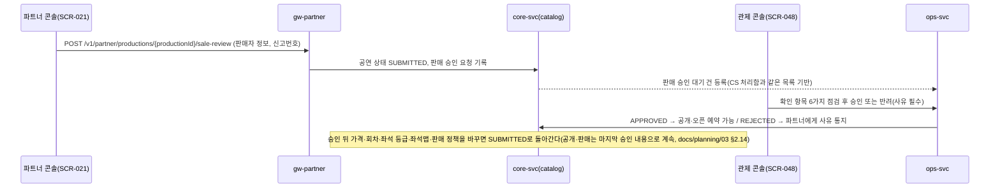
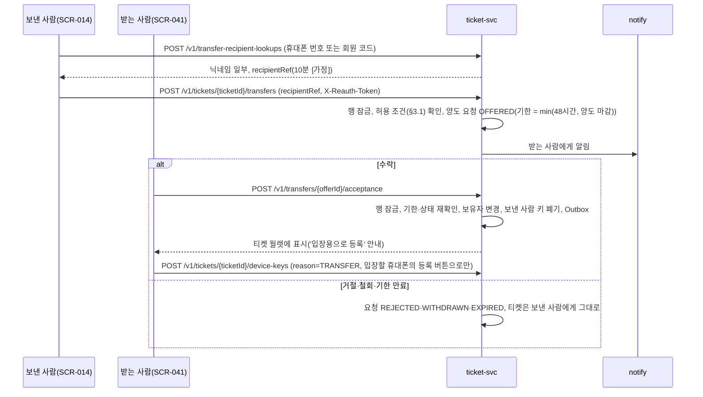
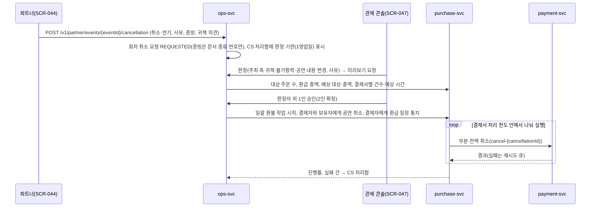
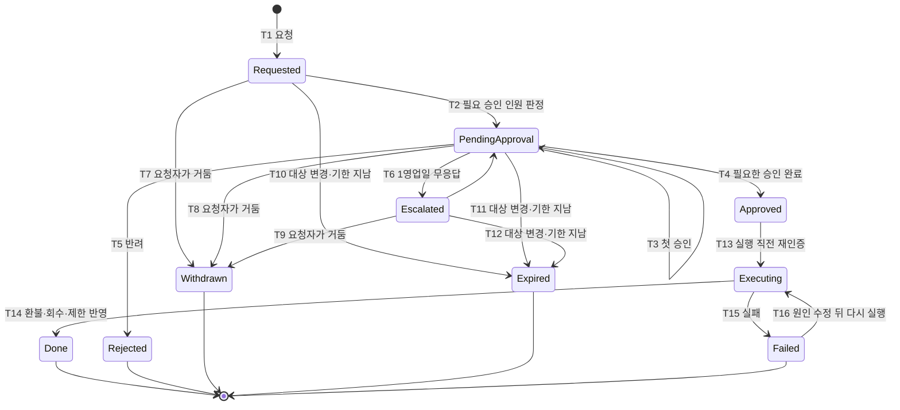

# 기능 설계: 양도·취소·환불 운영(판매 승인, 중개자 고지, 승인 업무, CS 처리함, 회차 취소, 배상)

- **독자와 용도**: 이 기능을 구현하는 엔지니어와 QA가 함께 보는 문서다. 다루는 것은 다음과 같다.
  - 양도의 수락·돌려주기·회수
  - 결제자만 하는 예매 취소
  - 회차 취소의 판정과 일괄 환불 작업, 배상 지급
  - 승인 업무와 CS 처리함
  - 판매 승인과 중개자 고지, 공연예술통합전산망 전송
  - 구현하는 쪽은 ticket-svc, purchase-svc, payment-svc, ops-svc, core-svc와 소비자 웹·파트너 콘솔·관제 콘솔 화면이다.
- **원문 출처**: 원문 설계서에는 이 범위의 상세 설계가 없다. 2026-10-13 소유자 질문("관리자가 승인을 해줘야 할 수도 있잖아요")의 검토와 제안, 소유자 동의, 판매 구조 판단에서 나왔다([ADR-0045](../adr/0045-intermediary-legal-status.md), [ADR-0046](../adr/0046-cancel-transfer-refund-approvals.md)). 전체가 [보완]이다.
- **기준 기획 버전**: v1.0.
- **관련 ID**: FR-013, FR-027, FR-047, FR-052~FR-061, FR-073 · POL-014, 017, 024, 032, 037, 038, 046 · SCR-001, 002, 011, 012, 013, 014, 021, 027, 038, 041~048, 071 · CMP-028, 040, 054, 058~063 · API(프로그램끼리 요청과 응답을 주고받는 창구) `/v1/tickets/{ticketId}/transfers`, `/v1/transfers/*`, `/v1/tickets/{ticketId}/returns`, `/v1/compensations/*`, `/v1/appeals`, `/v1/partner/productions/{productionId}/sale-review`(ADR-0093, 2026-11-01 정합 점검), `/v1/partner/events/{eventId}/cancellation`, `/v1/ops/cases`, `/v1/ops/approval-requests/*`, `/v1/ops/event-cancellations/*`, `/v1/ops/sale-reviews/*`, `/v1/ops/fraud-cases/*`(부정 예매 사건, ADR-0171) · 보안 추적 [asvs/transfer-refund.md](../security/asvs/transfer-refund.md)

## 1. 개요

PEAKET은 통신판매중개자(직접 팔지 않고 판매자와 구매자의 거래를 알선하는 사업자)로서 파트너와 관람객 사이의 티켓 소유권 이전과 환불 절차를 다음 원칙으로 운영한다:

- **법적 지위와 책임 분담 ([ADR-0045](../adr/0045-intermediary-legal-status.md))**:
  - PEAKET은 통신판매중개자이며 공연을 등록·판매하는 파트너가 판매 당사자다.
  - 다만 예매 취소 및 환불 처리는 PEAKET 시스템이 직접 집행하고 관리 책임을 파트너와 함께 부담한다.
- **운영 대원칙: "정책 안이면 자동, 정책 밖이면 승인"**:
  - **정책 내 자동 환급**: 전자상거래법 제18조 제2항(3영업일 이내 환급) 준수를 위해 기준 안의 정상 취소는 별도 승인 없이 자동으로 처리하고, 3영업일 안에 환급한다.
  - **정책 외 통제 승인**: 정책 기준을 벗어난 예외 환불, 양도 회수, 회차 취소처럼 되돌리기 어려운 자금 이동이나 권리 소멸은 승인을 거친다. 건의 종류와 금액에 따라 1인(`cs_lead`, operator) 또는 2인(`cs_lead`+`commander`, 회차 취소는 판정 뒤 2인 확정)이 승인한다(§3.2).
  - **결제자 중심 단일 권한**: 티켓 취소와 환급 권한은 결제자에게만 귀속된다. 양도받은 수신자는 결제자에게 '돌려주기'만 가능하다.

## 2. 판매 구조와 법정 의무(ADR-0045, POL-037)

### 2.1 판매 승인(FR-052, SCR-021·048)

- **확인 항목**
  1. 판매자 신원정보와 사업자 진위: 상호, 대표자, 주소, 전화, 전자우편, 사업자등록번호, 통신판매업 신고번호나 면제 근거
  2. 공연 정보의 표시 사항(휠체어석 검사 결과와 파트너 확인·부족 이유 포함, FR-023)과 공연예술통합전산망 항목(§2.4)
  3. 판매 정책이 POL-032 공제율 상한과 POL-017 양도 규칙 안에 있는지
  4. 결제사 지정(POL-036): 이 공연의 회차에 쓸 기본·대체 결제사와 그 결제사 기준 동시 입장 상한을 본다(결제사 지정은 회차 칸이다, ADR-0093 결정 2, 2026-11-01 정합 점검). 지정이 없으면 그때의 플랫폼 기본값을 승인 때 회차마다 지정으로 저장하고, 다르게 하려면 명령 12로 바꾼다. 지정 결제사 채널이 서버 승인을 지원하지 않거나 꺼져 있으면 승인할 수 없다(추천 적용 2026-10-14, ADR-0062)
  5. 결제사 지급대행(결제사가 PEAKET 대신 파트너 정산 계좌로 판매 대금을 보내는 서비스) 등록: 정산 계좌 예금주가 상호나 대표자와 같은지, 연동 결제사 토스페이먼츠의 셀러가 지급 가능 상태인지, 연동 결제사 포트원의 파트너가 등록되어 있는지(POL-039 ①, docs/features/settlement.md §3)
  6. 아티스트·공연장 연결: 공연의 아티스트와 공연장이 기존 대상에 이어졌는지, 새로 만들어야 하는지(ADR-0093 결정 4)
- **판매 조건은 고치지 않는다.** 승인은 확인과 반려만 한다. 가격과 조건을 PEAKET이 정하면 판매 대행형으로 볼 여지가 커지기 때문이다(ADR-0045 결정 4).
- **권한과 기록**: operator 1인이 승인한다. 승인과 반려는 감사 로그에 남는다.
- **판매 중지와 재개(추천 적용 2026-10-28, ADR-0123)**: 승인한 공연을 판매자 신원 문제·법적 요청·사기 의심으로 내려야 할 때는 판매 중지(SUSPENDED, docs/planning/03 §2.14)로 간다. operator 이상이 SCR-048에서 사유 코드와 사유를 적어 요청하고, 요청자가 아닌 commander가 승인 업무(SCR-046)로 승인한다. 실행하면 core-svc가 한 트랜잭션으로 비공개·검색과 홈에서 빼기·오픈 예약 멈춤을 쓰고(`RecordSaleReviewResult` SUSPENDED), ops-svc가 판매 종료 전 회차마다 판매 일시정지와 같은 제어 상태를 따로 건다(`ApplyControl` SALE_SUSPENSION). 이미 판 티켓은 그대로이고, 정산서 지급은 보류한다(docs/features/settlement.md §6). 다음은 판매 재개(같은 2인)나, commander가 직접 만드는 회차 취소 요청(§5, `POST /v1/ops/event-cancellations`)이다. 시험은 R-T23이다. **2026-11-15 R-584 첫 구현**: 운영 명령 `SALE_STOP`·`SALE_RESUME`(둘 다 2인 승인, `params`의 `eventId`·`reasonCode`·`suspensionRef`)이 purchase-svc `sale_control`(0019)과 좌석 Redis `s:{event:E}:ctl`의 `suspended`·`suspRef`·`rev`·`cmd`, queue-svc `q:{event:E}:notice`·`ctl`의 같은 칸을 쓴다. 홀드 Lua는 이미 `suspended`를 읽어 423 `sale-paused`로 거절하고 대기 상태 파일은 PAUSED가 되며, 명령 3의 재개는 `paused`만 내려 판매 중지가 풀리지 않는다. 제어 gRPC `CONTROL_KIND_SALE_SUSPENSION`의 ack(판 번호)도 넣었다. **2026-11-22 BAT-620**: core-svc가 내부 HTTP `POST /internal/v1/events/{eventId}/sale-review-result`(`SUSPENDED`·`RESUMED`)로 한 트랜잭션에서 `production.sale_review`와 검색 읽기 모델을 함께 바꾸고, 커밋 뒤 CDN `/v1/search*`·`event:{id}`·`production:{id}`를 비운다(core 0045). 중지 때 판매 중이던 회차 목록(`suspension_open_event_ids`)을 남겨, 재개는 그 회차와 아직 오픈 전인 회차만 다시 열고 중지 동안 오픈 시각이 지난 회차는 열지 않는다. ops-svc 집행은 `GET /internal/v1/events/{eventId}/sale-review-scope`로 회차 목록을 먼저 받아 모두 막은 뒤 core를 내리고, 재개는 core를 먼저 올린 뒤 core가 준 회차만 연다. SCR-048 단추와 정산 보류(`SALE_SUSPENDED`)는 아직이다(정산 보류는 LCH-100).

### 2.2 중개자 고지와 판매자 정보(FR-053, CMP-058)

| 위치 | 화면 | 표시 |
| --- | --- | --- |
| 사이버몰 초기 화면 | SCR-001 하단 사업자 정보 | "PEAKET은 통신판매중개자로서 공연과 상품 거래의 당사자가 아닙니다. 공연의 개최·변경·취소와 상품의 제공·품질에 따른 책임은 각 판매자에게 있고, 예매·주문 취소와 환불은 PEAKET이 처리합니다. 판매자 정보는 각 공연·상품 상세에 있습니다." 분쟁 해결 기준 문서 링크, 구매안전서비스 줄 "구매안전서비스: 굿즈 택배 주문은 토스페이먼츠 결제대금예치를 이용할 수 있습니다 ( 서비스 가입 사실 확인 › )"(POL-014) |
| 공연 상세 | SCR-002 본문의 판매자 줄과 [판매자 정보] 안내 모달 | 본문에 늘 '판매자: {상호}'와 공연용 고지 문장(POL-037) 한 줄을 두고, 신원정보 7항목은 본문 아래 [판매자 정보] 모달에 둔다(소유자 결정 2026-10-14, ADR-0063). 7항목을 늘 보이는 곳은 결제 직전 화면(SCR-011)이다(아래 행) |
| 청약 확인 단계 | SCR-011 결제 직전 | 판매자 신원정보 7항목과 고지 문장을 본문에 늘 보인다(접거나 모달로 숨기지 않는다, 추천 적용 2026-10-14, ADR-0063). 전자상거래법 §20②는 판매자 정보를 청약이 이루어지기 전까지 소비자에게 제공하라고만 정하므로(2026-07-21 시행본, 2026-10-14 원문 확인) 청약 직전 화면에 늘 보이는 것으로 충족한다. 약관 링크로 대신하지 않는다. 글씨는 판매자 표시와 같거나 크게 한다 |
| 계약 내용 서면 | SCR-012 결과, 예매 확인 이메일, SCR-013 티켓 상세 | 판매자 신원정보와 고지 문장. 글씨 규칙은 같다 |
| 상품 상세 | SCR-015 판매자 정보 | 신원정보 7항목, 상품용 문장 |
| 주문서 결제 직전 | SCR-015 주문서 | 판매자 이름과 상품용 문장(글씨 규칙은 같다) |
| 주문 확인서 | SCR-055·확인 이메일 | 위와 같다 |
| 결제 직전·약관·확인서 | SCR-011 ⑨, SCR-015 주문서, SCR-057, SCR-055·확인 이메일 | 미성년자 계약 취소 고지 "만 19세 미만 미성년자가 법정대리인(부모 등)의 동의 없이 결제하면, 미성년자 본인이나 법정대리인이 이 계약을 취소할 수 있습니다."(전자상거래법 §13③, 모든 결제자에게 같은 문장, 결제 버튼 바로 위 본문, 추천 적용 2026-10-14, ADR-0062) |

- 굿즈와 티켓 연동 부가 상품의 판매 당사자는 그 상품을 상품 빌더(SCR-023)로 등록한 파트너다. 상품용 문장은 "판매자: {판매자 상호}. PEAKET은 통신판매중개자로서 이 상품 거래의 당사자가 아닙니다. 상품의 제공(배송·이용)과 품질에 따른 책임은 판매자에게 있고, 주문 취소·반품과 환불은 PEAKET이 처리합니다."이고, 상품 카드에는 "판매자 {상호}"를 보인다(POL-037, 추천 적용 2026-10-14, ADR-0062).

### 2.3 분쟁 처리 기한(FR-057)

- 분쟁과 불만은 CS 처리함에 '분쟁 접수'로 들어온다(§7).
- 접수 뒤 3영업일 안에 진행 경과를, 10영업일 안에 조사 결과나 처리 방안을 팬에게 알린다(전자상거래법 시행령 §25의2).
- 분쟁 해결 기준 문서는 취소·환불·배상·양도 규칙 요약이다. 사이버몰에 게시하고, 정책이 바뀌면 함께 바꾼다.

### 2.4 공연예술통합전산망 전송(FR-054)

- **보내는 것**: 공연법 시행규칙 §2의 10개 항목이다. 공연 명칭·종류, 기간·장소, 시간, 예매·결제 금액, 관람자 수, 관람 가능 연령, 출연진·제작진·기획사·제작사, 좌석 등급·요금, 입장권 판매처, 안내 사항.
- **보내는 방식**: 1일 단위로 집계되도록 보낸다(시행령 §3의2). core-svc 일 단위 작업이 대사가 끝난 원장(payment §8)을 집계해 보낸다.
- **실패 처리**: 전송에 실패하면 재시도한다. 다음 날까지 실패하면 CS 처리함에 올리고 경보를 낸다.
- **온세일 때 미루기(추천 적용 2026-10-20, ADR-0069 결정 10)**: 대형·중형 온세일 윈도우(판매가 열리는 시각 앞뒤로 접속이 몰리는 기간, T-10분~T+60분)에는 재전송의 새 묶음을 시작하지 않고 미룬다. 이미 시작한 묶음은 끝낸다. 소형 온세일은 미루지 않는다 [가정]. 창은 변경 동결 달력(배포를 멈추는 시간표)과 같은 온세일 일정으로 계산하고, 일정을 읽지 못하면 마지막으로 읽은 일정을 쓰고 SEV3를 낸다 [가정]. 미루는 시간은 최대 70분이다(docs/devops.md §8.2, POL-028). 그 밖의 때 멈춰야 하면 명령 9의 '배경 작업 멈춤'으로 멈춘다.
- **연동 규격**: 운영기관에서 받아 확인한다. 그 전에는 시뮬레이터 어댑터로 시험한다.
- **위험**: 고의로 빠뜨리거나 조작해 보내면 과태료 대상이다(공연법 §43③1호). 전송 기록은 원장 대조값(원래 값으로 되돌릴 수 없게 바꾼 고정 길이 값인 해시)과 함께 남긴다.

### 2.5 공연법 부정구매·부정판매 방지 조치(POL-024)

PEAKET은 판매를 위탁받아 하는 자(시행령 §3의3 1호, 해석)이면서 통신판매중개업자(2호)라서 두 조치를 모두 한다. 2호 때문에 더하는 것은 다음과 같다.
- 판매자 본인 확인. 판매 승인(§2.1)에서 한다.
- 부정판매 게시물 신고 기능
- 부정판매의 형사처벌과 과징금(판매금액 50배 이하) 사전 고지(문안은 POL-024 라목, 양도 화면에도 싣는다)
- 통보받은 게시물이 고시 사항에 해당하면 24시간이 아니라 10시간 안에 차단한다(2호 바목 단서)
- 통보로 차단한 게시물과 내용이 같은 게시물의 자동 노출 차단과 결과 제출(2호 마목). 정규화한 본문 지문으로 대조하므로 글자를 바꾼 게시물은 막지 못하고, 신고와 통보로 처리한다.
- 두 목이 가리키는 문화체육관광부 고시는 확인 필요다.
- 과징금 부과를 위한 자료 제출 요청 대응(POL-025)

## 3. 권리와 상태 규칙

### 3.1 결제자와 보유자

| 개념 | 정의 | 저장 위치 |
| --- | --- | --- |
| 결제자 | 그 티켓의 주문을 결제한 계정. 바뀌지 않는다 | `ticket.payer_account_id`(주문에서 복사), `purchase_order.account_id` |
| 보유자 | 지금 티켓을 가진 계정. 양도 수락, 돌려주기, 회수로 바뀐다 | `ticket.account_id` |

| 하려는 일 | 허용 조건 |
| --- | --- |
| 예매 취소 | 요청자 = 결제자 = 보유자이고, 진행 중인 양도 요청이 없으며, 공연 시작 전 |
| 회차 취소 일괄 환급 | 요청자가 없다(시스템). 보유자와 진행 중인 양도 요청에 관계없이 결제자에게 환급한다. 진행 중인 양도 요청은 같은 트랜잭션에서 시스템이 먼저 철회한다(§5, 추천 적용 2026-10-28, 기술 검토 중간-044). 입장 상태(입장 전·입장·퇴장)와도 관계없고, 입장 시작 뒤에도 입장 기록 마감을 기다리지 않는다(§5, 기술 검토 중간-050) |
| 양도 요청 | 요청자 = 보유자 = 결제자(재양도 금지)이고, 양도 마감(공연 시작 2시간 전과 입장 시작 중 이른 때, ADR-0051) 전이며, 상품 유형이 양도 가능(POL-016). 부정 예매 양도 잠금이 걸려 있으면 409 `transfer-locked`다(§4.1, 추천 적용 2026-10-31) |
| 양도 수락·거절 | 요청자 = 지정된 받는 사람(본인확인 완료 회원)이고, 요청이 기한 안이다. 수락은 입장 시작 전에만 한다(ADR-0051) |
| 양도 철회 | 요청자 = 보낸 사람이고, 수락 전 |
| 돌려주기 | 요청자 = 보유자 ≠ 결제자이고, 입장 시작 전이며, 입장 기록이 없다. 입장 시작부터 입장 기록 마감까지는 409 `ENTRY_STARTED`다(ADR-0051). 부정 예매 양도 잠금은 돌려주기를 막지 않는다. 표가 결제자(사건 계정)에게 돌아갈 뿐 퍼지지 않기 때문이고, 돌아온 표는 잠긴 채로 남는다(§4.1, ADR-0173 결정 3. 2026-10-31 처음에는 409 `transfer-locked`였다) |
| 양도 회수 | 승인 업무(2인) 승인이 있고, 입장 시작 전이며, 입장 기록이 없다(ADR-0051) |
| 탈퇴 | 보유자 탈퇴 → 받은 티켓은 돌려주기(입장 시간대에는 키를 폐기한 뒤 마감 때 돌려준다), 보낸 요청은 철회, 받은 요청은 거절(docs/planning/03 §1.5, 추천 적용 2026-10-14, ADR-0062) |

**첫 구현(2026-11-13, GAT-080)**: purchase-svc의 취소 Saga가 결제자 확인·견적(공제) 뒤 ticket-svc `CancelTickets`로 키를 폐기하고, `order_cancellation`(진행 중 취소 1건 유일)을 쓴 뒤 payment-svc 일반 취소로 환급한다. 사유 `FRAUD`는 공제율 0으로 계산한다. R-540에서 HTTP 견적과 `@PurchaseSigned` 취소(재인증 계약이 없어 403 `reauth-required`), Redis 비트맵 취소표 즉시 방출, 입장 기록 마감 뒤 환급 정비 일을 더했다. 2026-11-20 ADR-0328로 이 처리기의 구매 요청 서명을 떼고 재인증·Origin 검사로 바꿨다. 마감 시각은 core `event.entry_closed_at` 연결 전까지 공연 시작 + 50시간의 보수적 상한을 쓴다(known gap). 부정 예매 운영자 취소는 ticket-svc `OperatorCancelTickets`가 없어 보류다.

**팬 취소의 재인증 확인(추천 적용, 2026-11-18, BUILD_ORDER GAT-080, 계획 docs/review/plans/BAT-415-reauth.md)**: 위 첫 구현이 403 `reauth-required`로 닫아 둔 팬 취소(`POST /v1/tickets/{ticketId}/cancellation`)를 다음처럼 연다. 재인증 토큰(결제자가 방금 소셜 제공자로 다시 로그인했다는 5분짜리 증명, docs/features/identity.md §7.1)은 `X-Reauth-Token` 머리로만 받는다. 새 마이그레이션은 없다.
- 확인하는 것: purchase-svc가 팬 토큰 공개키 묶음(identity-svc `GET /internal/jwks/fan.json`)과 플랫폼 공용 확인기(`packages/platform`의 `TokenVerifier.verifyReauth`, 키 셋 fan)로 ES256 서명·`typ` reauth+jwt·`iss`·`aud` fan·`exp`를 보고, 클레임이 요청과 맞는지 본다: `sid` = 요청의 로그인 세션, `sub` = 요청 계정, `act` = 아래 작업 묶음, `op` = 아래 받는 쪽 작업(추천 적용, 2026-11-18, BAT-408 계획, ADR-0293). 제공자 강도(`strength`)와 로그인 판정은 보지 않는다(identity가 토큰을 줄 때 본다, docs/features/identity.md §7.1 ③).
- 공개키 묶음 읽기: 한 번 읽기의 시간 상한은 1,000ms [가정]이다. 요청 마감(5초)과 주문 만들기와 함께 쓰는 쓰기 칸막이를 오래 잡지 않으려는 것이다. 넘으면 읽기 실패로 보아, 키를 한 번도 받지 못했으면 아래 503이고 받은 키가 있으면 그 키로 계속 확인한다(docs/features/identity.md §3 '공개키 배포', 추천 적용, 2026-11-18, BAT-415-reauth 리뷰 RV-04·RV-09).
- 작업 묶음: 본문에 환급 계좌(`refundAccount`)가 없으면 `FAN_SENSITIVE`만, 있으면 `FAN_HIGH_RISK`만 받는다. 계좌를 담은 취소는 '환급 계좌 입력'이기 때문이다(docs/security/authz-matrix.md §6 '작업 묶음 `act`의 값'). 반대 묶음의 토큰도 거절한다. 받는 쪽 작업(`op`)은 계좌가 없으면 `TICKET_CANCEL`, 있으면 `TICKET_CANCEL_REFUND_ACCOUNT`만 받는다. `act`와 `op`는 따로 본다(어느 하나만 맞아도 거절). `op`가 없거나 다른 작업(예 identity의 `SESSION_END`·`ACCOUNT_WITHDRAW`)의 토큰은 같은 세션·같은 `act`여도 거절한다. 기대값은 본문으로 정하고 토큰에서 읽지 않는다(docs/security/authz-matrix.md §6 '받는 쪽 작업 `op`의 값', 추천 적용, 2026-11-18, ADR-0293).
- 한 번 쓰기: 위 확인을 모두 통과한 뒤에만 토큰의 `jti`(토큰마다 다른 번호)를 좌석 Redis의 `reauth:jti:{jti}`에 `SET NX PX`로 잡는다(docs/data.md §3). 남은 수명(`exp` − 지금)이 5분 30초(5분 + 시계 차이 허용 30초 [가정], docs/features/identity.md §7.1의 시계 차이와 같은 값)를 넘는 토큰은 `jti`를 잡지 않고 거절한다. 기록의 수명은 토큰의 남은 시간 그대로라 토큰보다 먼저 사라지지 않는다(공용 저장소의 상한 `REAUTH_JTI_TTL_MS`도 5분 30초다, 추천 적용, 2026-11-18, BAT-415-reauth 리뷰 RV-02). 이미 있으면 다시 쓴 토큰이다.
- 차례: 인증 가드 → 멱등 키 → 본문 검사(계좌 모양) → 재인증 → 취소 Saga. 재인증에서 막히면 ticket-svc·payment-svc를 부르지 않고 `order_cancellation`도 쓰지 않는다. 계좌 모양이 틀린 요청(400 `invalid-body`)은 재인증 앞에서 막아 `jti`를 잡지 않는다. 이 처리기는 구매 세션 서명을 쓰지 않는다(ADR-0328): 취소 화면은 며칠 뒤에 열려 살아 있는 구매 세션이 없고, 팬 쿠키·gw-fan의 Origin 검사·아래 재인증 토큰이 그 자리를 지킨다. 사유·답·한 번 쓰기는 아래와 같다.
- 답: 토큰이 없거나, 형식·서명·`typ`·`iss`·`aud`·만료·`sid`·`sub`·`act`·`op`가 맞지 않거나, 남은 수명이 5분 30초를 넘거나, 이미 쓴 토큰이면 403 `reauth-required`다. 팬 공개키 묶음을 한 번도 받지 못했거나 `jti` 저장소가 오류를 내 확인하지 못하면 503 `reauth-unavailable`과 `Retry-After: 5` [가정]이다(docs/features/identity.md §3 '공개키 배포'의 '한 번도 받지 못했으면 503'). 공개키 묶음 안의 키를 쓸 수 없어 생긴 확인기 오류(jose 오류 코드 `ERR_JWK_INVALID`·`ERR_JWKS_INVALID`·`ERR_JWKS_MULTIPLE_MATCHING_KEYS`, 그리고 좌표가 곡선 밖이거나 `y`가 없는 키를 들여올 때 나는 `DOMException`(name `DataError`), 추천 적용, 2026-11-18)와 처음 읽기의 시간 초과도 확인하지 못한 것이라 같은 503이다. 토큰 머리에서도 나는 `ERR_JOSE_NOT_SUPPORTED`(모르는 `crit` 머리 등)는 토큰 거절(403)로 본다. `crv`가 없는 키는 jose가 맞는 키를 찾지 못한 것(`ERR_JWKS_NO_MATCHING_KEY`)으로 보아 403(까닭 `kid`)이다(추천 적용, 2026-11-18). 그 밖의 뜻밖 오류(`TypeError` 같은 코드 결함)는 확인하지 못한 것으로 덮지 않고 500이며 `Retry-After`가 없다. 어느 경우든 Saga는 돌지 않는다(추천 적용, 2026-11-18, BAT-415-reauth 리뷰 RV-05·검증 V7). 견적(`cancellation-quote`)은 지금처럼 재인증 없이 연다.
- 거절 기록(추천 적용, 2026-11-18, BAT-415-reauth 리뷰 RV-06): 403마다 서비스 로그 한 줄(`info`)에 까닭 하나를 정해진 이름표로 남긴다. 이름표는 `missing`(없음·빈 값), 확인기 까닭 `format`·`alg`·`kid`·`signature`·`typ`·`iss`·`aud`·`expired`·`claims`(`sid`·`act`·`op` 어긋남과 `ERR_JOSE_NOT_SUPPORTED` 포함), `sub`, `lifetime`(남은 수명 초과), `replay`(이미 씀)다. 503은 `warn` 한 줄에 `keys`(공개키)·`store`(`jti` 저장소)다. 토큰·`jti`·계정 ID·세션 ID는 싣지 않는다(docs/observability.md 필드 규칙).
- 시작 조립: `PEAKET_IDENTITY_FAN_JWKS_URL`(팬 공개키 묶음 주소)과 `PEAKET_IDENTITY_ISSUER`(발급자)를 읽는다. 발급자가 없거나 빈 값이면 local·ci는 `https://identity.peaket.example` [가정]을 쓰고, 그 밖의 환경은 주소가 있어도 시작하지 않는다(기본값 발급자로 조용히 떠 모든 팬 취소가 403이 되는 것을 막는다, 추천 적용, 2026-11-18, BAT-415-reauth 리뷰 RV-06). purchase DB가 있는데 주소가 없으면 local·ci는 지금처럼 닫힌 대역(늘 403)으로 뜨고 시작 로그에 경고를 남기며, 그 밖의 환경(`PEAKET_ENV`가 없으면 운영으로 본다)은 시작하지 않는다(환급 실행기의 입장 기록 대조 조립과 같은 규칙).
- 남는 한계: 토큰을 잡은 뒤 Saga가 실패하거나 응답을 잃으면, 같은 `Idempotency-Key`로 다시 보낼 때 새 재인증이 필요하다(토큰은 이미 썼다). 화면은 403 `reauth-required`를 받으면 재인증 뒤 같은 키로 한 번 다시 보내고(docs/frontend.md §4.1·§4.3), Saga는 같은 취소 ID에 앞 결과를 준다. 좌석 Redis가 장애로 데이터를 잃으면 5분 안에 쓴 `jti` 기록이 사라져 같은 토큰을 한 번 더 쓸 수 있다(같은 표의 두 번째 취소는 Saga가 409나 앞 결과로 막아 돈이 두 번 나가지 않는다). `jti` 저장소 오류로 503을 준 요청도 기록이 실제로 들어갔을 수 있어(응답 시간 초과), `Retry-After` 뒤 같은 토큰으로 다시 보내면 403일 수 있다. 화면은 503 뒤에도 새 재인증을 받아 보낸다(닫힌 쪽이라 돈 위험은 없다, 추천 적용, 2026-11-18, BAT-415-reauth 리뷰 RV-07). 한 번 쓰기는 받는 서비스 안에서만이다(identity가 직접 받는 작업은 PostgreSQL `reauth_token_use`, 팬 취소는 좌석 Redis). 그래도 토큰 하나가 두 받는 곳에서 쓰이지 않는 것은 위 받는 쪽 작업(`op`) 확인 덕이다. 이 확인이 들어가기 전(GAT-045, 묶음 BAT-408이 합쳐지기 전)에는 같은 세션의 `FAN_SENSITIVE` 토큰 하나를 5분 안에 identity 작업(탈퇴, 다른 기기 로그아웃, 로그인 수단 추가·해제, 계정 합치기)에 한 번, 팬 취소에 한 번 쓸 수 있었다(BAT-415-reauth 리뷰 RV-01·RN-01, 소유자 결정 OPEN[50] (나) 2026-11-18, ADR-0293). 취소 화면을 잇는 단계(GAT-090)는 재인증을 시작할 때 계좌가 없으면 `purpose` `ticket-cancel`, 있으면 `ticket-cancel-refund-account`를 싣는다(docs/frontend.md §4.1 '재인증'). 시험은 R-T39다.
- **굿즈 취소의 같은 확인(추천 적용, 2026-11-19, BAT-605, ADR-0315)**: core-svc shop은 purchase-svc `JwksFanReauthGate`와 같은 꼴을 복제해 계좌를 보낸 굿즈 취소만 `act = FAN_HIGH_RISK`·`op = SHOP_CANCEL_REFUND_ACCOUNT`로 본다. `jti` 한 번 쓰기는 샵 Redis(`PEAKET_SHOP_REDIS_URL`)의 `reauth:jti:{jti}`이고, 주소가 없으면 local·ci는 닫힌 대역(늘 403), 그 밖 환경은 시작하지 않는다. 없거나 틀리면 403 `reauth-required`, 확인기·저장소 장애는 503 `reauth-unavailable`과 `Retry-After: 5` [가정]이다(P-T63 ②, docs/features/payment.md §6 '굿즈 취소·반품의 첫 구현'). 지연 환급 계좌 다시 받기(`POST /v1/shop/orders/{orderId}/cancellations/{cancellationId}/account`)도 같은 `op = SHOP_CANCEL_REFUND_ACCOUNT`·`act = FAN_HIGH_RISK`를 쓴다(BAT-425, ADR-0316 결정 5, R-T43 ②).
- **지연 환급 계좌를 다시 받는 두 작업(추천 적용, 2026-11-20, BAT-425, ADR-0316)**: 예매 취소의 환급이 계좌 없음·계좌 거절로 미뤄졌거나(계좌 대기), 입장 기록 마감·회차 취소·연기로 환급이 미뤄졌으면 팬이 `POST /v1/cancellations/{cancellationId}/account`로 계좌를 다시 넣는다. 재인증은 `act = FAN_HIGH_RISK`·`op = REFUND_ACCOUNT`만 받고, `jti` 한 번 쓰기는 팬 취소와 같은 좌석 Redis(`reauth:jti:{jti}`)다. 결제자 본인이고 `order_cancellation`이 `REFUND_PENDING`이며 `refund_account_required_at`이 있고 `refund_attempt < 3` [가정]일 때만 받는다. 그 밖은 409 `cancellation-not-account-pending`, 없거나 남의 취소는 같은 404이고 쓰기가 0이다. 같은 `Idempotency-Key`의 다시 보냄은 시도를 올리지 않고, 다른 키는 `refund_attempt`를 1 올려 새 멱등키 `cancel-{cancellationId}-a{n}`으로 결제사를 부른다(§5 '일괄 환불'의 계좌 대기 항목도 이 길로 풀린다). 그 키의 답을 적기 전에 끊기거나 두 요청이 겹치면 그 시도를 진행 중으로 보고 첫 답과 같은 202 `REFUND_PENDING`을 재생하며 payment를 다시 부르지 않는다(RV-30). payment-svc가 앞 시도 `CANCEL_PENDING` 때문에 새 시도 행을 만들지 않았으면 답은 `UNKNOWN`이고, purchase-svc는 `refund_attempt`를 앞 시도 번호로 되돌려 재시도가 앞 시도를 계속 조회하게 한다(그 재확인 간격은 15분 [가정], RV-28).
- **배상 계좌 입력(추천 적용, 2026-11-20, BAT-425, ADR-0317)**: `POST /v1/compensations/{compensationId}/account`는 `ACCOUNT_PENDING`일 때만 받고(그 밖 409 `compensation-not-account-pending`), 결제자 본인만 쓴다(없거나 남의 건은 같은 404). 재인증은 `act = FAN_HIGH_RISK`·`op = COMPENSATION_ACCOUNT`다. 계좌 모양은 위 환급 계좌와 같은 공용 규칙이고, 계좌번호 원문은 저장·로그·사건·Outbox·지표에 남기지 않는다(끝 4자리만, POL-014). purchase-svc가 payment-svc `RequestCompensationTransfer`를 `compensation_id` 멱등으로 부르고, `REQUESTED`·`PAID`면 202, `UNAVAILABLE`이면 503 `compensation-transfer-unavailable`(Retry-After 5초 [가정]), `FAILED`면 422 `compensation-transfer-failed`와 CS `COMPENSATION_PENDING` 한 건이다(§6).

**GAT-090 환급 상태·부분 환불·재시도(2026-11-13, R-547)**: 취소가 주문 항목을 모두 덮으면 주문을 `REFUNDED`(T24·T23), 일부만 덮으면 `PARTIALLY_REFUNDED`(T22·T25)로 전이하고 이력·Outbox에 남긴다. 결제사 결과가 `PENDING`·`UNKNOWN`이면 `order_cancellation`을 `REFUND_PENDING`으로 두고 `refund_attempts`·`next_refund_at`(1분→5분→15분→1시간→6시간 [가정])·`refund_last_error`를 적는다. 환급 실행기 `cancellation-refund-retry`가 릴레이 리더에서 1분 [가정]마다 입장 기록 마감 뒤 `REQUESTED`와 재시도할 `REFUND_PENDING`을 함께 집어 같은 `cancel-{cancellationId}` 멱등키로 다시 부른다. 업무 거절(`REJECTED`)이나 5회 [가정] 소진은 `refund_failed_at`을 남겨 CS 처리함 '환급 실패' 대상으로 보낸다. ops-svc가 없어 실제 CS 건 생성 계약은 아직 연결하지 못했고, 실행기는 경보 로그와 `refund_failed_at`까지만 남긴다(known gap).

**입장 기록 대조와 환급 집기(추천 적용 2026-11-16, BUILD_ORDER GAT-090, P-T19 ①③)**: 입장 시작 뒤 취소(`REQUESTED`, 마감 시각 `refund_due_at`이 지난 것)는 환급 실행기가 결제사로 보내기 전에 아래 차례로 본다. 결제사 결과 모름으로 남은 `REFUND_PENDING`의 재시도는 지금 그대로다. 다만 회차 취소 요청이 만들거나 전환한 행(`event_cancellation_request_id`가 있음)은 이 실행기가 집지 않는다(§5 '일괄 환불 항목의 주인과 겹침 막기', 추천 적용 2026-11-16, 웨이브 끝 리뷰 K1). 그 회차에 회차 취소 미룸이 걸려 있거나 진행 중인 회차 취소 일괄 환불이 있으면 아래를 하지 않고 건너뛴다(§5 '회차 취소 요청 중 보류 취소의 환급 미룸', 소유자 결정 2026-11-16 OPEN[45]).
- ① ticket-svc `GetEntryRecords`(한 번에 100장 [가정], 데드라인 2초 [가정], 부르는 쪽 검사는 §5 `EventCancelTickets`와 같다)로 그 표에 들어감·통과 스캔(`scan_event` direction `IN`, result `PASS`)이 있는지 묻는다. 거절·나감 스캔만 있으면 입장 기록이 아니다.
- ② 기록이 있으면 결제사를 부르지 않는다. 그 취소 행에 `entry_recorded_at`(가장 이른 들어감 시각)을 쓰고 `refund_due_at`을 비워 다시 집지 않으며, CS 처리함 '이상 표시'(`FLAGGED`, category `ENTRY_AFTER_CANCEL`, 대상은 취소 ID, eventKey는 `entry-after-cancel:{취소 ID}`의 SHA-256 앞 16바이트로 만든 UUID) 건을 연다. 팬 화면(SCR-038)은 '취소 확인 중'이다. 취소를 무효(`VOIDED`)로 끝낼지, 기록 오류로 보고 환급할지는 CS가 정한다(GAT-280). CS 건을 연 것은 ops-svc가 2xx로 답했을 때만이고 그때 `entry_flag_opened_at`을 쓴다. 못 열면(401·5xx·시간 초과) 경고 로그·지표 뒤 다음 틱에 `entry_recorded_at`이 있고 `entry_flag_opened_at`이 빈 행을 다시 연다(추천 적용 2026-11-16, 웨이브 끝 리뷰 S1). 언제·얼마나 여는지는 ⑥이다.
- ③ 그 표를 ticket-svc가 모르거나(`found` 거짓), 조회가 실패·시간 초과면 환급하지 않고 다음 틱에 다시 묻는다. 재시도 횟수는 세지 않는다(결제사 호출이 아니다). 모르는 것을 입장하지 않은 것으로 보지 않는다.
- ④ 기록이 없으면 그 행을 조건부 갱신(`status = 'REQUESTED' AND entry_recorded_at IS NULL`, 그리고 그 회차에 미룸·진행 중 일괄 환불이 없음)으로 `REFUND_PENDING`(`next_refund_at` 빔)으로 바꾼 뒤에만 결제사로 보낸다(집기). 바뀐 행이 0이면 다른 쪽(회차 취소 전환 §5, 다른 파드)이 먼저 가져간 것이라 건너뛴다.
- ⑤ 상태 쓰기는 모두 조건부다. 환급 성공(`REFUNDED`)·재시도 예약·환급 실패 표시는 그 행이 `REFUND_PENDING`일 때만 쓴다. CS가 무효(`VOIDED`)로 끝낸 행을 실행기가 덮지 않는다(R-540 known gap 6을 닫는다). 결제사가 환급했다고 답했는데 `REFUNDED` 쓰기가 0행이면 그 행을 다시 읽는다. `VOIDED`일 때만 SEV1 로그 `cancellation-refunded-after-void`(취소 ID만)이고, `REFUNDED`면 다른 길(같은 요청 안에서 결제사를 부른 예매 취소·회차 취소 표 취소·보류 취소 전환)이 먼저 끝낸 것이라 환급한 것으로 세고 로그를 남기지 않으며, 그 밖이면 경고 로그 `cancellation-refund-state-unexpected`다(추천 적용 2026-11-16, BAT-420 리뷰 D1).
- ⑥ CS 건 열기와 다시 열기(두 실행기 공통, 추천 적용 2026-11-17, BAT-420 다시 보기 2 N1·N2): CS 처리함 내부 HTTP(docs/api/guidelines.md §8.1)가 늦거나 내려가도 환급이 멈추지 않게, 건마다 '열 대상' 표시와 '연 시각'을 따로 적는다. 연 시각은 ops-svc가 2xx로 받은 뒤에만 쓴다.
  - 건 넷: 이상 표시(`FLAGGED`, 표시 `entry_recorded_at`, 연 시각 `entry_flag_opened_at`)와 환급 실패(`REFUND_FAILED`·category `REFUND`, 표시 `refund_failed_at`, 연 시각 `refund_failed_opened_at`, 회차 취소 요청 ID가 없는 행만)는 이 실행기가 연다. 일괄 환불 실패(같은 종류, 표시 `event_refund_item.failure_case_at`, 연 시각 `failure_case_opened_at`)와 공제 차액(§5 '그래도 남는 건')은 일괄 환불 실행기가 연다. 회차 취소 요청 ID가 달린 행의 실패는 일괄 환불 실패 건 하나만이다(§5 '주인'). 예매 취소가 결제사 거절로 남긴 실패 표시 행(팬·부정 예매 취소)도 이 실행기가 환급 실패 건으로 연다.
  - 다섯째 건 '환불 대기'(`REFUND_ACCOUNT_PENDING`·category `REFUND`, 표시 `refund_account_required_at`, 연 시각 `refund_account_case_opened_at`, docs/features/payment.md §6 '계좌 대기')는 마감 뒤 환급 실행기가 환급 실패 다음 차례로 연다. 회차 취소 요청 ID가 달린 계좌 대기 행(일괄 환불 항목 `ACCOUNT_PENDING`)도 이 실행기가 연다(일괄 환불 실행기는 열지 않는다, 계좌 대기는 실패가 아니라 일괄 환불 실패 건이 없다). 실패 기록의 경고는 `cancellation-refund-account-notice-failed`, 지표 kind는 `REFUND_ACCOUNT_PENDING`이다(추천 적용, 2026-11-19, BUILD_ORDER GAT-090, BAT-420-rest 구현).
  - 처리 중에는 부르지 않는다: 다시 열기 포트가 꽂힌 조립(운영 조립 둘)에서는 입장 기록 남기기·환급 실패 표시·항목 끝내기가 표시만 쓰고 ops-svc를 부르지 않는다. API 파드의 Start·Resume·Apply·CloseWindow도 같아서, 그 건은 릴레이 리더의 틱이 연다. 포트가 없는 옛 조립(시험)만 처리 중에 한 번 연다.
  - 틱 끝 한 곳: 다시 열기는 그 틱의 환급 처리(이 실행기의 집기·결제사 호출, 일괄 환불 실행기의 창 닫기·쓸어 담기·항목 처리)가 끝난 뒤에 돈다. 차례는 환급 실패 → 이상 표시, 일괄 환불 실패 → 공제 차액이다(돈을 돌려받지 못한 건 먼저). 종류마다 100건 [가정]까지, 표시 시각 순이다.
  - 시간 예산: 한 틱의 다시 열기는 5초 [가정] 안에서만 한다. 행마다 부르기 전에 남은 예산을 보고, 다 썼으면 남은 행은 다음 틱이다. 시간 초과·연결 실패(ops-svc가 답하지 않음)가 두 번 [가정] 잇따르면 그 틱의 다시 열기를 멈춘다. 2xx 밖의 답(401·4xx·5xx)은 ops-svc가 답한 것이라 잇따름을 끊고 다음 행으로 간다. 호출 한도(5초)와 예산이 같아 시간 초과 한 번이 예산을 다 쓰므로, 그 틱에 ops-svc가 아직 한 번도 답하지 않았으면(부른 것이 모두 시간 초과·연결 실패) 예산을 다 써도 잇따름 상한(두 번)까지는 부르고 멈춘 이유는 `unreachable`이다. 한 번이라도 답했으면(2xx든 2xx 밖이든) 예산대로 멈추고 이유는 `budget`이다(추천 적용 2026-11-17, BAT-420 구현의 정본 빈칸). 호출 한도는 지금처럼 5초 [가정]이라 ops-svc가 답하지 않아도 한 틱이 늘어나는 것은 약 10초까지다(호출 한도 5초 × 2, 또는 예산 5초 + 호출 한도 5초). 멈추거나 예산을 넘기면 경고 로그 `cs-case-reopen-cut`(이유 `budget`·`unreachable`)과 지표 `purchase_cs_case_reopen_cut_total{reason}`을 하나씩 남긴다.
  - 실패 기록: 열기가 실패한 행은 연 시각을 빈 채로 두고, 경고 로그(`cancellation-entry-flag-failed`·`cancellation-refund-failure-notice-failed`·`event-refund-failure-notice-failed`·`event-refund-deduction-gap-failed`)와 지표 `purchase_cs_case_open_failures_total{kind}`(kind `FLAGGED`·`REFUND_FAILED`·`EVENT_REFUND_FAILED`·`DEDUCTION_GAP`)를 하나 올린다. 건 열기의 실패는 취소 행·항목 상태를 바꾸지 않는다. 늘 거절되는 행(계약 결함)은 틱마다 다시 보내 지표가 오르고, 그 지표로 사람이 본다. CS가 이미 끝낸 행(환급·무효)은 다시 열지 않는다. 같은 건을 다시 보내도 eventKey가 같아 ops-svc에서 한 건이다. CS 건을 연 것은 ops-svc가 2xx로 답하고 본문이 `accepted: true`일 때뿐이다. 2xx `accepted: false`(ops-svc가 그 종류를 받지 않음)는 열기 실패와 같다(연 시각 빔, 지표, 다음 틱). ops-svc는 환불 대기(`REFUND_ACCOUNT_PENDING`)를 받는 종류에 더해 건을 만든다(추천 적용, 2026-11-19, BAT-420-rest 리뷰 반영 RV-01, P-T75. 처음에는 상태 코드만 봐 ops-svc가 만들지 않은 건을 연 것으로 적었다).
- core `event.entry_closed_at` 연결(GAT-180) 전에는 마감 시각이 지금처럼 공연 시작 + 50시간이다.

모든 판정은 티켓 행 잠금(`SELECT … FOR UPDATE`) 안에서 상태·기한을 다시 확인해 한다. 양도, 취소, 회수, 스캔 수신이 한 티켓에서 겹쳐도 하나만 성공한다. 버전 칸은 CS 처리함처럼 사람이 화면에서 읽고 나중에 저장하는 흐름이 본 판과 비교하는 데만 쓴다(docs/features/payment.md §4.1, 추천 적용 2026-10-28, 기술 검토 낮음-071). 오프라인 스캐너의 입장 기록은 늦게 올라오므로, 입장 시간대에는 서버가 누가 들어갔는지 모른다. 그래서 입장 시작부터 입장 기록 마감까지는 소유권과 키를 바꾸는 수락·돌려주기·회수를 막는다(ADR-0051, docs/features/offline-gate.md §5).

### 3.2 승인 업무 종류(POL-038)

| 종류 | 요청 | 승인 | 기한 |
| --- | --- | --- | --- |
| 시스템 잘못이 확인된 환불(중복 결제, PEAKET 장애로 미발급·입장 실패, 결제 상태 불명 사후 확정) | `cs_agent` | `cs_lead` 1인 | 환급 3영업일 |
| 재량 면제, 주문 1건 30만 원 이하 | `cs_agent` | 요청자가 아닌 `cs_lead` 1인 | 기본 환불은 자동 3영업일, 면제분은 승인 뒤 |
| 재량 면제, 30만 원 초과·여러 주문·같은 팬 90일 안 두 번째 | `cs_agent` | `cs_lead` + `commander` 2인 | 위와 같다 |
| 양도 회수(계정 탈취) | `cs_lead` | `commander` | 받은 사람의 소명(회수 대상이 된 팬이 사정을 설명하는 절차) 기간 1일 이상이 지난 뒤, 입장 시작 전이고 입장 기록이 없을 때(ADR-0051 결정 10) |
| 예매 제한(남용) | 시스템 표시 | `cs_lead` 확인 | 소명 기한 1일 이상 |
| 회차 취소 확정 | 파트너 요청, `commander` 판정 | 판정자 외 operator 이상 1인(2인) | 판정 1영업일, 확정 즉시 통지 |
| 판매 승인 | 파트너 | operator 1인 | — |
| 판매 중지·판매 재개(승인한 공연을 내리고 다시 엶, `SALE_SUSPENSION`·`SALE_RESUMPTION`, 추천 적용 2026-10-28, ADR-0123) | operator 이상(사유 코드·사유 필수) | 요청자가 아닌 `commander` 1인(2인 [가정]) | 1영업일 무응답이면 상위 승인자 알림. 급하면 명령 3으로 판매만 먼저 멈춘다 |
| 미성년자 계약 취소(전자상거래법 §13③, 민법 §5②) | `cs_agent`(확인 결과 첨부) | 요청자가 아닌 `cs_lead` 1인 | 확인 결과 3영업일, 승인 뒤 환급 3영업일. 공제·반품 배송비는 없다(POL-038 ⑧, 추천 적용 2026-10-14, ADR-0062) |
| 부정 예매 조치(표 취소, 이용 제한 걸기·풀기. `FRAUD_ACTION`의 `fraudAction` `CANCEL_TICKETS`·`RESTRICT`·`LIFT_RESTRICTION`, POL-038 ⑪, 추천 적용 2026-10-31, ADR-0171) | 지정 부정 거래 조사관. 사건 작업대의 조치 요청(`POST /v1/ops/fraud-cases/{caseId}/action-requests`)으로만 만든다(§7.4) | 요청자가 아니고 가명정보 취급자 지정이 없는 `commander` 1인(2인). 승인 업무 상세(`GET /v1/ops/approval-requests/{approvalId}`)의 사건 요약 `fraudCaseSummary`를 읽기 전용으로 보고 재인증한 뒤 승인한다 | 표 취소는 취소 마감 시각(판매 종료에서 재판매 준비 2시간 [가정]을 뺀 시각), 이용 제한 걸기·풀기는 POL-038 공통의 요청 뒤 5영업일 [가정]에 만료(추천 적용 2026-10-31, ADR-0171). 풀기가 반려·만료되면 사건은 이의 접수(OBJECTED)에 남고 조사관이 다시 요청하거나 이의를 기각한다 |

공통 규칙은 다음과 같다.
- 사유는 필수다. 증빙은 확인 사실만 남긴다.
- 요청자와 승인자는 서버가 분리한다.
- 1영업일 동안 승인이 없으면 상위 승인자에게 알린다.
- 실행 직전에는 관리 계정을 재인증한다.

## 4. 양도 흐름(FR-013, FR-060, POL-017)

- **수락 화면 고지**: "이 티켓은 결제한 사람만 취소할 수 있고, 공연이 취소되면 환불도 결제한 사람에게 갑니다. 티켓값을 주고받았다면 두 분이 직접 정산해야 합니다." 여기에 "결제자의 부정 예매로 확인되면 이 표가 취소될 수 있고, 환급은 결제자에게 갑니다"를 더한다. 같은 문장을 약관에도 적는다(POL-017, 약관법 제3조 제4항, ADR-0173 결정 4. 화면 배치는 docs/design/d5 SCR-041).
- **돌려주기**: 지금 보유자가 결제자에게 바로 돌려준다(`POST /v1/tickets/{ticketId}/returns`). 결제자가 수락하는 단계는 없다. 보유자의 키를 폐기하고, 결제자는 '입장용으로 등록'으로 키를 다시 등록한다(reason=`TRANSFER`).
- **양도 회수**: 승인 업무가 승인되면 ticket-svc가 돌려주기와 같은 절차로 결제자에게 되돌린다. 받은 사람에게는 소명 결과와 회수 사실을 알린다.
- **스캐너 반영**: 폐기된 키는 1분 변경분으로 스캐너에 간다(offline-gate §5).
- **멱등키(추천 적용 2026-10-15, ADR-0065 결정 12)**: 거절(`POST /v1/transfers/{offerId}/rejection`)과 철회(`…/withdrawal`)도 수락처럼 `Idempotency-Key`를 받는다. 같은 키로 다시 와도 처음 결과를 돌려준다. 이 헤더는 safelisted 헤더가 아니어서 브라우저가 사전 요청을 먼저 보낸다. 하지만 같은 사이트의 `www`가 `api` 호스트로 보내는 교차 출처 일반 요청이므로, 대기열 진입 같은 T=0 부하가 아니다.
- **알림 링크로 들어오는 첫 요청(추천 적용 2026-10-15, ADR-0065 결정 8)**: 받는 사람은 알림(이메일·메시지)의 링크로 양도 받기 화면(SCR-041)에 들어온다. 소명 제출(SCR-042)과 배상금 계좌 입력(SCR-043)도 알림 링크가 연다(docs/planning/04). 팬 쿠키(브라우저가 사이트별로 저장했다가 요청마다 함께 보내는 작은 값)는 `SameSite=Strict`라서, 다른 사이트(메일 앱 등)에서 온 첫 이동 요청에는 쿠키가 실리지 않는다. 그래서 이 첫 화면은 쿠키 없이 정적 셸만 보낸다. 양도 요청 조회·수락·거절처럼 쿠키가 필요한 호출은 페이지 스크립트가 같은 사이트 요청으로 한다(docs/features/identity.md §5 '복귀 화면'과 같은 규칙, 웹 앱 보안 검증 항목 목록인 ASVS v5.0.0-3.3.2).

### 4.1 부정 예매 양도 잠금(POL-046 ③, FR-073)

부정 거래 조사관이 소명(의심받은 사람이 정상 구매라고 해명하는 절차)을 요청하면 시스템이 그 표의 양도를 잠근다. 시스템이 스스로 거는 부정 예매 조치는 이 잠금 하나뿐이고 되돌릴 수 있다. 소명 결과를 기다리는 동안 의심 표가 다른 사람에게 넘어가 되팔리지 않게 하려는 것이다(docs/planning/03 §2.5). 세부는 추천 적용(2026-10-31, ADR-0171)이다. 2026-10-31 자체 법률 조사(ADR-0173 결정 3)로 잠금에 끝을 두고 돌려주기를 풀었다. 상당한 이유 없이 급부를 일방적으로 멈추거나(약관법 제10조 제2호) 제3자와의 계약을 부당하게 막는(제11조 제3호) 조항이 되지 않게, 막는 범위를 양도로 좁히고 기간을 한정하려는 것이다(해석). 시험은 R-T31이다.

- **거는 때**: 조사관이 사건 작업대(SCR-071)에서 소명 요청을 보내면(`POST /v1/ops/fraud-cases/{caseId}/appeal-requests`) ops-svc가 ticket-svc `TransferLockService.SetTransferLock`(case_id, event_id, account_ids, locked, version, expires_at)으로 사건 계정이 그 회차에서 결제한 표 전부를 잠근다. `expires_at`은 잠금 최대 기한이고, 그 계정의 첫 소명 요청 + 14일 [가정]이다. 연장은 없고, 같은 계정에 소명을 다시 요청해도 늘지 않는다. ticket-svc는 이 값을 `fraud_transfer_lock.expires_at`에 둔다(ADR-0173 결정 3). ticket-svc는 계정 단위 잠금 기록(`fraud_transfer_lock`)을 두어, 잠금 뒤에 그 계정이 산 그 회차 표도 발권 때 잠근다(2026-10-31 같은 날 표 목록에서 계정 목록으로 바꿨다). 이 호출을 부르는 쪽은 ops-svc뿐이다. ticket-svc는 티켓 행 잠금 안에서 `ticket.fraud_lock_case_id`에 사건 ID를, `ticket.fraud_lock_version`에 판을 적는다. 판은 같은 case_id 안에서만 견준다. 그 사건이 그 티켓에 적은 판보다 클 때만 바꾸므로, 늦게 도착한 옛 잠금·풀기가 새 상태를 덮지 않고 같은 요청을 다시 보내도 결과가 같다. 한 티켓에는 사건 하나의 잠금만 두고, 다른 사건의 잠금이 걸린 티켓은 판을 견주지 않는다. 다른 사건이 이미 잠근 티켓, 입장 시작 뒤이거나 이미 환급·무효로 끝난 티켓은 바꾸지 않고 응답에 그 결과를 티켓마다 돌려준다 [추천].
- **알림 순서**: ops-svc는 잠금이 모두 반영된 뒤에 팬에게 소명 요청 알림을 보낸다. 알림을 먼저 받은 팬이 표를 넘기는 틈을 막으려는 것이다 [추천]. 잠금 호출이 실패하면 ops-svc 작업 워커가 같은 판으로 다시 보낸다.
- **잠글 때와 풀 때 알린다(ADR-0173 결정 3)**: 결제자에게 가는 소명 요청 알림(`FRAUD_APPEAL_REQUESTED`)에 잠긴 표 수, 잠금 최대 기한("늦어도 14일 뒤 풀립니다"), 잠금 범위(양도만 막고 입장과 본인 취소는 된다. 본인 취소에는 보통의 취소 수수료가 붙는다)를 싣는다. 잠금이 풀리면 `FRAUD_TRANSFER_LOCK_RELEASED`를 보낸다. 입장 시작으로 풀린 때(그때는 양도 마감이 지났다)와 남은 표가 없을 때는 보내지 않는다(docs/features/notify.md §4.5).
- **받은 사람(보유자 ≠ 결제자, ADR-0173 결정 4)**: 잠그는 표 가운데 지금 보유자가 양도로 받은 다른 계정인 표가 있으면, ops-svc가 그 받은 사람에게도 알리고(`FRAUD_HOLDER_NOTICE`, 사유 범주 없음) 결제자와 같은 기한의 소명 기회를 준다(§7.1 '부정 예매 사건의 소명'). 보유자는 `SetTransferLock` 응답의 티켓마다 결과로 안다. 받은 사람은 원래 다시 양도할 수 없고(재양도 금지, §3.1) 돌려주기는 막지 않으므로, 잠금은 받은 사람의 쓰임을 바꾸지 않는다.
- **진행 중 양도 요청**: 잠그는 같은 트랜잭션에서 그 티켓의 진행 중 양도 요청(OFFERED)을 시스템이 철회한다(WITHDRAWN, 철회 사유 `FRAUD_LOCK` [추천]). 티켓은 보낸 사람에게 남는다(docs/planning/03 §2.5 T6·T7). 받는 사람에게는 일반 철회 알림만 보내고 사건이나 사유는 알리지 않는다. 잠금과 받는 사람의 수락이 같은 순간에 오면 티켓 행 잠금으로 하나만 먼저 된다. 수락이 먼저면 받은 사람이 가진 티켓이 잠기고, 잠금이 먼저면 수락은 이미 철회된 요청이라 409다.
- **잠긴 동안**: 양도 요청(`POST /v1/tickets/{ticketId}/transfers`)만 409 `transfer-locked`(별칭 `TRANSFER_LOCKED`)이고, 키와 보유자는 바뀌지 않는다. 돌려주기(`POST /v1/tickets/{ticketId}/returns`)는 잠금 때문에 409를 내지 않는다. 표가 사건 계정으로 돌아갈 뿐 퍼지지 않기 때문이다. 돌아온 표는 그 계정이 결제한 표라 잠긴 채로 남고, 그 받은 사람의 소명 화면용 사본에서 빠진다(ADR-0173 결정 3). 입장은 막지 않는다. 스캐너 회차 목록과 판정 표에는 잠금 표시가 없다(docs/features/offline-gate.md §5). 결제자의 예매 취소와 승인된 양도 회수는 막지 않고 지금 규칙대로 한다 [추천]. 취소하면 공제율대로 환급되고 좌석은 취소표로 돌아간다.
- **표시**: `Ticket.transferLocked`(참·거짓, 읽기 전용)와 잠겼을 때의 최대 기한 `Ticket.transferLockExpiresAt`으로 보인다. 마이 티켓(SCR-013)과 티켓 양도(SCR-014)는 이 값으로 양도 버튼을 막고 "늦어도 14일 뒤 풀립니다"(최대 기한)를 보인다. 보유자가 결제자가 아니면(받은 사람) 잠금 표시를 하지 않는다. 받은 사람은 원래 양도 버튼이 없고 돌려주기는 되기 때문이다. 받은 사람에게는 `FRAUD_HOLDER_NOTICE`와 소명 제출(SCR-042)로 기한과 가진 표만 알리고 사유 범주는 알리지 않는다. 결제자에게는 소명 요청 알림과 소명 제출(SCR-042)로 사유 범주와 기한을 알린다(§7.1). 화면 문구는 docs/design/d5에서 정한다.
- **사전 고지(ADR-0173 결정 3)**: 약관과 공연 상세에 잠금을 거는 때(조사관이 소명을 요청할 때), 범위(양도만 막고 입장·본인 취소는 된다. 본인 취소에는 POL-032 공제율이 적용된다), 풀리는 때(아래 일곱), 최대 기간(14일 [가정])을 적는다. 잠긴 동안 그 계정이 그 회차 표를 새로 사면 결제 직전 화면(SCR-011 주문·결제)에 "이 회차 표는 부정 예매 조사가 끝날 때까지 양도가 잠깁니다"를 보인다. 화면은 `GET /v1/fraud-appeal-requests`에서 그 회차의 결제자 항목(`party` `PAYER`)이 잠금 중(`lockActive` 참)일 때만 보인다. 받은 사람 항목(`HOLDER`)과 풀린 항목으로는 보이지 않는다(추천 적용 2026-10-31, ADR-0173. 약관법 제3조 제3항 설명의무).
- **푸는 때**: 그 계정에 대해 다음 일곱 가운데 먼저 오는 때다(ADR-0173 결정 3): ① 소명 인정 ② 사건 CLEARED ③ 조치 실행 끝(취소된 표 말고 남은 표) ④ 조사관이 계정을 뺌 ⑤ 입장 시작 ⑥ 그 계정 대상 조치 요청의 반려·만료(다른 열린 조치 요청이 없을 때. 승인자가 범위에서 뺀 계정도 그 요청이 반려된 것으로 본다) ⑦ 최대 기한(`expires_at`). 요청자의 철회로는 풀지 않는다(조사관이 고쳐 다시 내려는 것이라서, 추천 적용 2026-10-31, ADR-0173). ⑤·⑦ 말고는 ops-svc가 같은 호출(locked = false)로 푼다. ⑤와 ⑦은 ticket-svc가 min(`expires_at`, 입장 시작)에 스스로 푼다 [추천]. 그 시각에 잠금 칸을 비우고, 비우는 작업이 늦어도 그 시각 뒤에는 칸이 남아 있어도 판정과 `Ticket.transferLocked`에서 잠금으로 보지 않는다. ops-svc 호출이 늦거나 실패해도 정책대로 반드시 풀리게 하려는 것이다. ops-svc도 그 시각에 팬 화면용 사본의 잠금 상태(`lock_active`)를 풀림으로 바꿔 보낸다. 입장 시작 뒤에는 양도 마감과 입장 중 소유권 동결(§3.1)이 따로 막으므로 잠금이 풀려도 표가 움직이지 않는다. 사건은 이용 제한만 남긴 채 계속한다(POL-046 ③).
- **기록**: 잠금·풀기는 ops-svc 사건 기록(`fraud_case_event`)과 ticket-svc 감사 기록에 남는다. 풀기에는 일곱 가운데 어느 때인지를 남긴다(§8).

## 5. 회차 취소와 일괄 환불 작업(FR-055, POL-032)

- **요청을 받아 표에 쓰는 곳(소유자 결정 2026-11-11, open-items 102번 ⑵)**: 파트너의 회차 취소 요청은 ops-svc가 REST로 접수하고, purchase-svc gRPC가 `event_cancellation_request`를 purchase DB에 쓴다. ops-svc는 자기 DB의 멱등 기록(같은 요청을 두 번 처리하지 않는 표)을 그대로 유지하고, purchase-svc 호출에는 요청 ID를 멱등 키로 싣는다.
- **첫 골격(2026-11-14, R-552)**: `services/ops-svc`가 생겼다. 운영 명령 접수·목록·상세·2인 승인·거부, 감사 해시 체인, `support.cases-requested`의 `REFUND_FAILED` CS 처리함 건 계약까지다. 이 절의 회차 취소 요청 REST·판정·일괄 환불 작업·진행률은 아직이다.
- **첫 일괄 환불(2026-11-14, R-558)**: ops-svc에 `EVENT_CANCEL` 명령 유형을 더해 2인 승인 뒤 purchase-svc 내부 HTTP(`POST /internal/v1/event-refunds`)로 넘긴다. purchase-svc는 `event_cancellation_request`·`event_refund_item`(마이그레이션 0016)를 두고, 대상 티켓마다 기존 예매 취소 Saga(`CancelTicket` → ticket-svc `CancelTickets` → payment-svc `CancelPayment`, `cancel-{cancellationId}`)를 `EVENT_CANCELLED`·공제 0으로 실행한다. 진행률·부분 실패·수동 일시정지·재개와 CS 처리함 `REFUND_FAILED` 내부 HTTP 연결까지다. 정본의 `refund.proto` gRPC `EventRefundService` 연결, 자동 정지(실패율·연속 실패·서킷·거절률), 연기(POSTPONE)·환급 신청 기간, 백그라운드 실행기, 팬 알림 발송은 후속이다. 정본의 `event_refund_pg_part` 대신 이 첫 몫은 `event_refund_item`과 `event_cancellation_request.progress` JSONB로 진행률을 센다.
- **GAT-130 잔여(2026-11-15, R-583)**: `refund.proto`의 `EventRefundService`를 purchase-svc gRPC 서버로 열고 ops-svc가 `StartEventRefund`·`GetEventRefundJob`·`PauseEventRefundJob`·`ResumeEventRefundJob`·`ApplyEventRefund`·`CloseEventRefundWindow`를 부른다. 내부 HTTP(`/internal/v1/event-refunds*`)는 같은 `EventRefundService`·같은 멱등 키를 쓰는 호환 경로로 남긴다(구버전 ops-svc·로컬·CI). `StartEventRefund`는 요청과 항목을 만든 뒤 첫 묶음(기본 200건)만 처리하고 `job_id`(=`cancellation_request_id`)를 돌려준다. 나머지는 purchase-svc 릴레이 리더의 `event-refund-runner`(10초 [가정] 틱)가 `event_refund_item`의 `PENDING`/`UNKNOWN`을 `next_attempt_at`(1분→5분→15분→1시간→6시간, 5회 [가정])에 따라 처리하고, `UNKNOWN`은 같은 `cancel-{cancellationId}` 멱등키로 다시 보낸다. 5회를 넘기거나 업무 거절이면 `FAILED`로 끝내 CS `REFUND_FAILED`를 열고 팬에게도 `REFUND_FAILED`를 남긴다.
  - **자동 정지**: 결제사 몫마다 1분 창의 취소 실패율 5% [가정](호출 20건 이상), 실패 금액 500만 원 [가정], 연속 실패 20건 [가정], 결제사 서킷 열림이면 그 몫을 `PAUSED`로 두고 ops-svc 경보 `AUTO_FAILURE_RATE`·`AUTO_FAILED_AMOUNT`·`AUTO_CONSECUTIVE_FAILURES`·`AUTO_CIRCUIT_OPEN`(SEV2)를 남긴다. 1분 창 업무 거절률 5% [가정]이면 작업 전체를 `AUTO_REJECT_RATE`로 멈춘다. 이미 보낸 호출의 답은 기다리고 새 호출만 보내지 않는다. 자동 재개는 없고, ops 명령 `EVENT_REFUND_RESUME`(1인 승인, 사유 필수)이 결과 모름 건의 `next_attempt_at`을 지금으로 당겨 다시 본다. `EVENT_REFUND_PAUSE`가 수동 일시정지다. ops-svc는 경보를 `ops_alert`에 `(event_key, kind)` 하나로 모으되, event_key에 1분 버킷을 넣어 재개 뒤 다시 멈춘 경우는 새 경보로 남긴다.
  - **진행 중 요청과 새 CANCEL**: 같은 회차에 진행 중인 요청(`REQUESTED`·`JUDGED`·`PENDING_APPROVAL`·`APPROVED`·`RUNNING`·`PAUSED`·`REFUND_WINDOW`)이 있으면 새 CANCEL은 409로 거절하고 기존 요청 ID를 알린다. 특히 연기(POSTPONE)의 환급 신청 창(`REFUND_WINDOW`)이 열려 있어도 새 CANCEL을 겹쳐 만들지 않는다. 창을 먼저 닫거나 기존 요청을 반려한 뒤 새로 요청한다.
  - **연기와 신청 창**: `StartEventRefund`의 `kind=POSTPONE`은 `postponed_to`(바뀐 공연 시작)와 `refund_window_closes_at`(기본 `postponed_to`)을 받아 `REFUND_WINDOW`로 시작한다. 팬은 `ApplyEventRefund`(멱등 키 `application_id`)로 신청하고, 신청한 티켓만 같은 결제사 몫·멈춤 규칙으로 환급한다. 창이 닫히면(자동 10초 틱 또는 commander의 `CloseEventRefundWindow`) 신청하지 않은 티켓은 `NOT_APPLIED`로 끝나고 환급하지 않는다. 신청 건의 환급이 끝나면 `COMPLETED`다.
  - **팬 알림**: 대상 주문마다 `trade.orders` Outbox를 남긴다. 확정은 `EVENT_CANCELLATION_CONFIRMED`/`EVENT_POSTPONED`(바뀐 일시·신청 창 닫힘), 완료는 `REFUNDED`(`refundAmount`), 실패는 `REFUND_FAILED`다. 2026-11-15 R-592 첫 몫: core-svc notify에 `NotificationSender` 포트·가짜 전송기·내부 `POST /internal/v1/notify/trade-events`를 넣어 사건을 문안으로 바꿔 보낸다(`PEAKET_NOTIFY_SENDER_MODE=fake`가 아니면 UNAVAILABLE·503). 발송 원장 `notification_job`·`notification_delivery` 표와 Kafka 소비자는 이번 마이그레이션 허용 밖이라 후속이다.
  - **배상·지급**: `compensationTargets`·`compensationTotal`은 미리보기·요청에 남긴다. 2026-11-15 R-592 첫 몫: payment-svc에 `CompensationTransferService` gRPC 계약(`RequestCompensationTransfer`·`GetCompensationTransfer`, `compensation_id` 멱등)과 `CompensationTransferPort`·가짜 어댑터를 넣었다. `PEAKET_COMPENSATION_TRANSFER_MODE=fake`가 아니면 UNAVAILABLE을 돌려주고 받는 쪽이 503으로 드러낸다. 실제 지급대행·정산 계좌·KYC 연결은 외부 계정·업체가 없어 그대로 막혀 있고, 정확한 막힘은 `docs/review/measurements/BAT-425-wave5.md`에 적는다.
  - **저장**: 마이그레이션 0018이 `event_cancellation_request.postponed_to`·`refund_window_closes_at`, `event_refund_item.applied_at`·`next_attempt_at`, `event_refund_attempt`(결제사 호출 한 번의 결과·금액·시각)를 더한다. 진행률은 계속 `event_refund_item`과 `progress` JSONB로 센다.
- **증빙 형식(추천 적용 2026-10-28, 기술 검토 낮음-092)**: 파트너의 회차 취소·연기 요청 증빙은 파일을 받지 않는다. 파트너가 보관한 문서의 종류(예: 공연장 대관 취소 통지, 출연자 측 공문, 기상 특보)와 발급 번호·날짜만 `evidenceRef`로 적는다. 판정자가 원본을 봐야 하면 파트너에게 화면 공유나 대면으로 보여 달라고 하고, 확인했다는 사실과 확인한 사람만 남긴다(예외 환불 증빙과 같은 규칙, §8). 파일을 받으면 업로드 검사(ASVS V5)와 악성 파일 위험, 보관 기간 관리가 새로 생기는데, 판정에는 확인 사실만 있으면 되기 때문이다.
- **나눠 실행**: 결제사마다 토큰 버킷(일정한 속도로 채워지는 허용량 안에서만 요청을 보내게 하는 방식)을 두어 처리 한도를 지킨다. 대형·중형 온세일 윈도우(판매가 열리는 시각 앞뒤로 접속이 몰리는 기간, T-10분~T+60분)에는 새 묶음을 시작하지 않고 미룬다(이미 시작한 묶음은 끝낸다, POL-028, ADR-0069). 소형 온세일 중에는 미루지 않는다. 결제사 취소 호출이 승인과 같은 한도를 쓰면 실행 속도를 낮추고(계약 때 확인, ADR-0069), 필요하면 명령 9의 '배경 작업 멈춤'으로 멈춘다(가용성: 서비스를 멈춤 없이 쓸 수 있는 정도, ASVS 15.1.3).
- **스스로 멈춤(결제사별, 추천 적용 2026-10-28, 기술 검토 중간-045)**: 작업은 결제사마다 몫을 나눠 돌린다(결제사 몫). 결제사 몫 하나가 아래 셋 가운데 하나에 닿으면 그 몫만 스스로 멈추고 SEV2로 알린다. 다른 결제사 몫은 계속한다.
  1. 1분 창의 취소 실패율이 5% [가정] 이상이다. 그 창의 취소 호출이 20건 [가정] 이상일 때만 센다. 실패는 결제사 오류 응답(5xx)·시간 초과·결과 모름(`UNKNOWN`)·한도 초과 응답(429)이다.
  2. 연속 실패가 20건 [가정]이다.
  3. 그 결제사의 서킷 브레이커(계속 실패하는 호출을 잠시 끊어 장애가 번지지 않게 하는 장치)가 열렸다(payment-svc, docs/features/payment.md §9).
  - **서킷 연결(추천 적용, 2026-11-20, BAT-425, R-T45)**: purchase-svc 일괄 환불 실행기가 payment-svc 내부 `GET /internal/v1/circuits`를 내부 토큰으로 읽어 결제사 몫마다 `circuitOpen(pg)`를 본다. 값은 10초 [가정] 캐시하고 `state = open`만 열림으로 본다(`half_open`·`closed`는 계속한다). 읽기 실패·시간 초과는 모든 몫을 닫힘(거짓)으로 두고 경고 로그 `event-refund-pg-circuits-read-failed`만 남긴다. 환급을 읽기 장애로 세우지 않는다. 자동 재개는 없다(아래 '재개').
  - 결제사의 업무 거절(`REJECTED`, 예: 남은 취소 가능 금액 부족)은 실패율에 넣지 않고 그 건만 CS 처리함 '일괄 환불 실패'로 보낸다. 다만 1분 창의 거절률이 5% [가정] 이상이면 우리 쪽 금액·대상 계산이 틀렸을 수 있어 작업 전체를 멈춘다(사유 `AUTO_REJECT_RATE`).
  - 멈출 때는 이미 보낸 호출의 답을 기다리고 새 호출만 보내지 않는다. 결과 모름 건은 재시도 큐에 그대로 둔다. 이미 환급된 건은 `cancel-{cancellationId}` 멱등키 때문에 다시 환급되지 않는다.
  - 자동으로 다시 시작하지 않는다. 되돌릴 수 없는 돈의 이동이라 사람이 확인한 뒤 연다. 멈춘 동안에도 환급 3영업일 기한(§7.1 '일괄 환불 실패')은 흐르므로, 멈춘 지 1시간 [가정]마다 다시 알린다.
- **재개(추천 적용 2026-10-28, 기술 검토 중간-045)**: 멈춘 몫은 2인 확정 범위 안에서 commander가 다시 시작한다(`ResumeEventRefundJob`, 결제사 몫마다 또는 한꺼번에, 사유 필수).
  - 재개 화면(SCR-047)은 그 결제사의 서킷 상태와 최근 5분의 취소 실패율을 보이고, 서킷이 닫혀 있고 실패율이 기준 아래로 5분 [가정] 이어졌으면 '재개 조건 충족'으로 표시한다. 그 5분 동안 그 결제사 호출이 없었으면 '표본 없음'으로 보이고 commander가 판단한다.
  - 재개하면 결과 모름 건부터 결제사 조회로 끝낸 뒤 새 취소를 보낸다(docs/features/payment.md §2.1·§4.1. 포트원 멱등키 보관 3시간이 지난 건은 조회 없이 다시 보내지 않는다).
  - 재개 뒤에도 자동 정지 기준은 그대로다. 그래서 서킷이 열린 채 재개하면 바로 다시 멈추고, 잘못 재개해도 연속 실패 20건 [가정] 안에 다시 멈춘다.
- **수동 일시정지**: commander는 언제든 작업 전체나 결제사 몫 하나를 멈출 수 있다(`PauseEventRefundJob`, 사유 필수, 감사 로그). 수동으로 멈춘 몫도 재개로만 다시 시작한다. 시험은 R-T9·R-T22다.
- **멈춤 표시는 합쳐 쓴다(추천 적용 2026-11-17, W9-fix1, BAT-420 다시 보기 2 N8)**: 결제사 몫의 멈춤(진행률의 결제사별 `PAUSED`와 사유)은 겹쳐 도는 실행(API 파드와 릴레이 리더)이나 사람의 멈춤·재개가 서로의 것을 지우지 않게 다음처럼만 바꾼다.
  - 요청 행을 잠근(`FOR NO KEY UPDATE`, 잡기와 같은 잠금) 한 트랜잭션에서 지금 DB에 있는 멈춤을 읽고, 거기에 더하거나 빼서 쓴다. 실행이 시작할 때 읽은 멈춤 목록으로 통째로 덮지 않는다.
  - 실행이 끝날 때의 진행률 쓰기는 그 실행이 새로 판정한 자동 정지만 더하고, 아무것도 빼지 않는다. 요청이 그사이 `PAUSED`가 됐으면 상태는 바꾸지 않되 새 자동 정지는 더한다. 신청 창 닫기도 잠근 DB 값의 멈춤을 그대로 쓴다.
  - 이미 멈춘 결제사에 다시 더하면 DB의 사유를 둔다. 수동 멈춤만 사유를 `MANUAL`로 바꾼다.
  - 멈춤을 빼는 것은 재개뿐이다. 결제사 몫 하나를 재개하면 그 결제사만, 한꺼번에 재개하면 재개가 읽은 멈춤만 뺀다. 읽은 뒤에 생긴 자동 정지는 남는다.
  - 그래서 겹친 두 실행이 서로 다른 결제사를 멈춰도 둘 다 남고, 사람이 재개하기 전에는 멈춘 결제사로 새 환불 호출이 나가지 않는다. 재개 전에 시작한 실행이 늦게 끝나도 사람이 푼 멈춤을 되살리지 않는다. 다만 그 실행이 스스로 새로 판정한 자동 정지는 더한다(멈추는 쪽으로 기울고, SEV2 경보가 함께 간다).
- **되돌리지 않음**: 이미 실행된 환불은 되돌리지 않는다. 실수는 미리보기와 2인 확정으로 줄일 뿐이다.
- **연기**: 환급을 원하는 팬만 신청한다. 신청 기한은 바뀐 공연이 시작하기 전까지다(제안값). 일괄 환불이 아니라 신청한 주문만 환급하는 흐름이라, 회차 취소 요청은 연기 확정 뒤 Running이 아니라 환급 신청 기간(RefundWindow)에 머물다가 기간이 끝나고 신청 건 환급이 끝나면 Completed가 된다. 신청 건의 환급은 일괄 환불 작업과 같은 결제사 몫·멈춤 규칙으로 돈다(docs/planning/03 §2.11, 추천 적용 2026-10-28, 기술 검토 중간-044).
- **진행 중인 양도 요청(추천 적용 2026-10-28, 기술 검토 중간-044)**: 예매 취소는 진행 중인 양도 요청이 없을 때만 받는다(§3.1). 이 규칙을 일괄 환불에 그대로 쓰면 양도 요청 중인 티켓의 환급이 막혀 3영업일 기한을 넘길 수 있다. 그래서 일괄 환불 작업은 티켓마다 티켓 행 잠금 안에서 진행 중인 양도 요청(OFFERED)을 시스템 철회(WITHDRAWN, 사유 `EVENT_CANCELLED`)하고, 같은 트랜잭션에서 결제자에게 환급을 건다. 받는 사람에게는 공연 취소로 양도 요청이 철회되었다고 알리고, 보낸 사람(결제자)에게는 환급 일정을 알린다. 철회와 수락이 겹치면 행 잠금으로 먼저 온 쪽만 성공한다. 수락이 먼저면 받은 사람이 보유자인 채로 환급은 결제자에게 간다(수락 화면 고지와 같다). 연기가 확정되면 진행 중인 양도 요청을 같은 방식으로 철회하고(사유 `EVENT_POSTPONED`) 두 사람에게 바뀐 일시와 함께 알린다. 보낸 사람은 바뀐 일시로 다시 양도할 수 있다. 시험은 R-T25다.
- **가상계좌 결제자**: 알림으로 환불받을 계좌를 입력해 달라고 요청한다. 입력하기 전까지는 CS 처리함 '환불 대기'에 남는다.
- **계좌 대기 항목의 계좌 다시 받기(추천 적용, 2026-11-20, BAT-425, ADR-0316)**: 일괄 환불 항목이 `REFUND_ACCOUNT_REQUIRED`로 `ACCOUNT_PENDING`이 되면 그 취소 행(`order_cancellation`)은 `REFUND_PENDING`·`refund_account_required_at` 있음이다. 팬이 `POST /v1/cancellations/{cancellationId}/account`로 계좌를 넣으면 §3.1의 같은 길(시도 1 올리기, 새 멱등키 `cancel-{id}-a{n}`)로 결제사를 부른다. `CANCELLED`면 그 항목을 `REFUNDED`로, 결과 모름이면 재시도, 계좌 거절이면 `ACCOUNT_PENDING` 유지다. 회차 취소 요청이 만든 행은 일괄 환불 실행기만 결제사로 보내는 규칙(§5 '일괄 환불 항목의 주인')과 겹치지 않게, 계좌 다시 받기 뒤의 첫 호출은 이 경로가 하고 그 뒤 재시도는 기존 주인 규칙을 따른다.
- **확정 때 배상 행(추천 적용, 2026-11-20, BAT-425, ADR-0317)**: 회차 취소(CANCEL) 확정이 주최 측 귀책·공연 내용 변경이면 `StartEventRefund`가 요청·항목과 같은 트랜잭션에 `compensation` 행을 주문마다 만든다. 금액은 미리보기에서 주문 단위 함수로 한 번만 계산해 `dry_run.compensationOrders`에 남기고, 확정은 그 목록(`StartEventRefundRequest.compensation_orders`)을 그대로 쓴다. 확정 때 표·주문이 바뀌어도 팬이 본 금액과 저장·송금액이 달라지지 않는다(BAT-425 RV-02). 목록이 없는 옛 호출은 purchase-svc가 같은 프로세스의 미리보기를 쓰고, 그것도 없으면 같은 함수로 다시 계산한다. `FORCE_MAJEURE`는 0행이고, `(event_cancellation_request_id, order_id)` 유일이라 다시 확정해도 한 행이다. 배상 계좌 입력·송금은 §6이다.
- **발권 대기 주문**: 결제는 승인됐지만 발권을 다시 시도하는 중인 주문(APPROVED, 발권 재시도 큐에 있음)도 대상에 넣는다. 작업은 그 주문의 발권 재시도를 멈추고 결제를 취소해 주문을 COMPENSATED로 끝낸다. 회차 취소 확정은 업무상 발권이 불가능한 경우라, 승인 뒤 결제를 취소하는 두 경우 가운데 하나다(추천 적용 2026-10-28, ADR-0106).
- **입장 상태와 대상(추천 적용 2026-10-28, 기술 검토 중간-050)**: 대상은 티켓의 소유·결제 상태(docs/planning/03 §2.5 영역 1)로만 고르고, 입장 상태(영역 2: 입장 전·입장·퇴장)는 보지 않는다. 공연이 열리지 않았으므로 이미 입장했거나 퇴장한 티켓도 환급한다.
  - 입장 시작 뒤에 확정된 회차 취소는 입장 기록 마감을 기다리지 않고 바로 환급한다. 입장 기록 마감은 '취소한 뒤 들어왔는지'를 가려 부정 환급을 막는 장치인데(§3.1, ADR-0051), 회차 취소는 입장 여부와 관계없이 모두 돌려주므로 가릴 것이 없다.
  - 입장 시작 뒤 예매 취소로 환급을 보류 중인 티켓(CANCEL_REQUESTED)과 이상 표시 티켓(FLAGGED)도 대상이다. 보류 중인 예매 취소는 그 취소 행을 이어 쓰되, 공제 없는 회차 취소 환급(POL-032)으로 금액을 바꿔 처리한다.
  - 양도 요청 중인 티켓(TRANSFER_PENDING)은 위 '진행 중인 양도 요청'대로 시스템이 먼저 철회한 뒤 결제자에게 환급한다(docs/planning/03 §2.9, R-T25).
  - 시험은 R-T24다.
- **대상 선택과 보류 취소 전환(추천 적용 2026-11-16, BUILD_ORDER GAT-110, R-T24)**: 위 '입장 상태와 대상'을 다음처럼 만든다.
  - 대상: 회차의 결제 완료·부분 환불 주문(`CONFIRMED`·`PARTIALLY_REFUNDED`)의 발권된 표 가운데 ⑴ 진행 중 취소가 없는 표 ⑵ 진행 중 취소가 입장 시작 뒤 보류(`REQUESTED`)인 표다. ⑵에는 입장 기록 대조(§3.1)에서 기록이 나온 표도 든다. 회차 취소는 입장과 관계없이 돌려주기 때문이다. 진행 중 취소가 `REFUND_PENDING`·`REFUNDED`인 표(이미 결제사로 보낸 팬 취소·부정 예매 취소)는 대상이 아니다. 예외로 그 회차 취소 요청이 스스로 만든 취소 행(`event_cancellation_request_id`가 그 요청이고 `REFUND_PENDING`)의 표는 대상에 남긴다. 결과 모름으로 다시 부를 때 대상에서 사라지지 않게 하려는 것이고, 다시 부르면 ticket-svc가 `ALREADY_ENDED`를 주어 그 행에 저장한 금액·멱등키로 결제사를 다시 부른다(추천 적용 2026-11-16, BAT-420 리뷰 D6).
  - ⑵는 그 취소 행을 이어 쓴다. 주문 행 잠금 안에서 조건부 갱신(`status = 'REQUESTED'`)으로 사유 `EVENT_CANCELLED`, 공제 0(`deduction_bp`·`deduction_amount` 0), 환급액 = 권면, `event_cancellation_request_id`, `refund_due_at` 빔, `REFUND_PENDING`으로 바꾼다. 일괄 환불 항목의 취소 ID는 그 행의 ID이고 결제사 멱등키는 `cancel-{그 행의 ID}`다(그 행은 아직 결제사로 간 적이 없다). 바뀐 행이 0이면(그사이 환급 실행기가 공제한 금액으로 집었으면) 그 항목은 `FAILED`(`cancellation-in-progress`)이고, 아래 '회차 취소 요청 중 보류 취소의 환급 미룸'의 차액 건으로 CS에 간다(소유자 결정 2026-11-16 OPEN[45]).
  - ⑴은 ticket-svc `EventCancelTickets`로 표를 끝낸다. 표마다 행 잠금 안에서 상태가 환급·무효(`REFUNDED`·`VOIDED`)면 바꾸지 않고 `ALREADY_ENDED`다. 그 밖(`ISSUED`·`ACTIVE`·`TRANSFER_PENDING`·`CANCEL_REQUESTED`·`FLAGGED`)은 진행 중 양도 표시(`transfer_pending`)를 끄고, 키를 폐기하고, `REFUNDED`·`key_revoked_at`·`version + 1`을 쓰고, 스캐너 변경분 `TICKET_STATUS`·`KEY_REVOKED`를 남기고, `ticket_cancellation`(그 취소 ID, 결과 `EVENT_CANCELED`)을 쓴 뒤 `CANCELED`다. 결제자·보유자·입장 기록·공연 시작은 보지 않는다. 부르는 쪽 검사(추천 적용 2026-11-16, BAT-420 리뷰 D4): 결제자·보유자 검사를 건너뛰는 호출이라 §7.4 `OperatorCancelTickets`와 같은 방식으로 묶는다. 내부 토큰이 설정된 환경에서 토큰이 없거나 틀리거나 호출자 머리가 `purchase-svc`가 아니면 `PERMISSION_DENIED`이고 아무것도 바꾸지 않는다(읽기만 하는 `GetEntryRecords`도 같다). purchase-svc는 서버와 릴레이(일괄 환불·환급 실행기) 두 조립 모두 ticket 클라이언트에 내부 토큰과 호출자 머리를 싣는다. 토큰이 없는 local·ci는 지금처럼 받는다. `CANCELED`면 purchase-svc가 `order_cancellation`(사유 `EVENT_CANCELLED`, 공제 0, 환급액 = 권면, `days_before`는 공연일까지 남은 달력일이고 지났으면 0, `within_24h` 거짓, `REFUND_PENDING`, actor `system:event-cancellation`)을 쓰고 결제사 취소를 부른다. `ALREADY_ENDED`인데 그 표의 진행 중 취소가 purchase에 없으면 항목은 `FAILED`(`ticket-already-ended`)다.
  - 견적(공제 계산)을 부르지 않는다. 그래서 공연 시작 뒤에 확정해도 `EVENT_STARTED`로 막히지 않고, 입장 기록 마감도 기다리지 않는다.
  - 양도 요청 중인 표는 이 호출로 `transfer_pending` 표시만 끈다. 양도 요청 행을 `WITHDRAWN`(사유 `EVENT_CANCELLED`)으로 바꾸고 두 사람에게 알리는 일은 ticket-svc에 양도 요청 표가 생기는 GAT-050과 GAT-120(R-T25)이다.
  - 연기(POSTPONE)의 신청 환급은 지금처럼 예매 취소 Saga(결제자 = 보유자, 공제 0)로 하고, 보류 취소(`REQUESTED`)인 표는 신청 대상이 아니다.
  - 가상계좌 결제의 표는 환불 계좌 전달(GAT-090, 같은 묶음의 뒤 몫)이 생기기 전까지 결제사가 계좌 없는 취소를 거절해 '일괄 환불 실패'로 간다(남는 한계).
- **회차 취소 요청 중 보류 취소의 환급 미룸(소유자 결정 2026-11-16 OPEN[45], BUILD_ORDER GAT-090·GAT-110, R-T38)**: 입장 시작 뒤 보류 취소가 마감 뒤에 공제한 금액으로 환급된 다음에 회차 취소가 확정되면, 그 팬도 전액 대상인데 같은 표에 진행 중 취소 1건 유일 규칙 때문에 차액 행을 만들 수 없다. 그래서 판정이 끝날 때까지 환급을 미루고, 그래도 남는 건은 고객센터(CS)로 보낸다. 세부는 추천 적용 2026-11-16이다.
  - 미룸 걸기: ops-svc는 회차 취소(CANCEL) 요청을 저장하기 전에(파트너·commander 둘 다) purchase-svc `SetEventRefundHold`(걸기, 기한 지금 + 72시간 [가정])를 부른다. 걸지 못하면 요청을 받지 않는다(503 `event-refund-unavailable`, 아무것도 쓰지 않음). 저장이 실패하면(진행 중 요청 409 등) 같은 요청 ID로 푼다. 풀기가 실패해도 기한에 저절로 풀린다. 판정·다시 판정·확정 시도 때마다 다시 걸어 기한을 늘린다. 차례(추천 적용, 2026-11-16): 요청 검사(재인증·판매 중지·소속·종료·연기 일시)를 마친 뒤 ops DB의 진행 중 요청을 먼저 보고, 있으면 걸지 않고 409 `event-cancellation-active`(그 요청 ID)다. 없으면 건다. 걸기가 `ALREADY_EXISTS`(그 회차에 다른 요청 ID의 열린 미룸)이면 진행 중 요청을 다시 보아, 그사이 생긴 요청이 있으면 409 `event-cancellation-active`(그 ID), 없으면(풀기를 놓친 옛 미룸) 503 `event-refund-unavailable`과 경고 로그 `event-refund-hold-conflict`(회차 ID만)이고 그 미룸은 기한에 풀린다. 걸기 뒤 저장이 진행 중 요청 유일 색인에 걸리면(동시에 들어온 두 요청) 자기 요청 ID로 풀고 409다. ops 어댑터는 `ALREADY_EXISTS`를 다른 실패와 갈라 알린다.
  - 미룸 풀기: 판정 전 반려(REJECTED)는 푼다. 확정되면 `StartEventRefund`가 일괄 환불 요청을 만드는 트랜잭션에서 푼다(그 뒤로는 진행 중인 일괄 환불이 같은 몫을 한다). 연기(POSTPONE) 요청은 미루지 않는다. 걸기·늘리기는 그 요청 ID의 일괄 환불 요청이 purchase에 이미 있으면 미룸을 열지 않고 `held` 거짓을 준다(확정이 커밋된 뒤 답을 잃어 ops가 다시 확정할 때 풀린 미룸이 다시 걸려 72시간 뒤 거짓 SEV2가 나지 않게, 추천 적용 2026-11-16, BAT-420 리뷰 D3).
  - 미루는 동안: 환급 실행기는 그 회차의 보류 취소(`REQUESTED`)를 집지 않는다. 그 회차에 진행 중인 회차 취소 일괄 환불(RUNNING·PAUSED)이 있을 때도 같다(대상 선택이 전환한다). 집기(§3.1 ④)의 조건부 갱신이 같은 조건을 함께 보아, 확인과 집기 사이에 미룸이 걸려도 집지 않는다. 결제사 결과 모름(`REFUND_PENDING`)의 재시도는 미루지 않는다.
  - 기한이 지나면 미룸은 저절로 풀리고(실행기가 처음 본 때 `released_at`을 쓰고 SEV2 로그 `event-refund-hold-expired`를 한 번 낸다), 마감 뒤 환급이 다시 돈다. 판정이 72시간 넘게 아무 일 없이 멈춘 경우뿐이다. 기한이 지났는지는 집기 조건(`expires_at > 지금`)이 정하므로, 그 풀기 기록(`releaseExpired`)이 실패해도 실행기는 그 틱을 이어 간다(경고 로그 `event-refund-hold-release-failed`, 다음 틱에 다시 풀고 SEV2를 낸다, 추천 적용 2026-11-16).
  - 그래도 남는 건(차액): 확정 때 `StartEventRefund`가 그 회차에서 입장 시작 뒤에 접수돼 이미 공제하고 결제사로 보낸 취소(사유 `USER`, `deduction_amount` > 0, 접수 시각 ≥ 입장 시작, `REFUND_PENDING`·`REFUNDED`)와 전환에서 진 항목(`cancellation-in-progress`)마다 CS 처리함 '일괄 환불 실패'(`REFUND_FAILED`, category `DEDUCTION_GAP`, 대상은 그 취소 ID, eventKey는 `deduction-gap:{취소 ID}`의 SHA-256 앞 16바이트로 만든 UUID) 건을 한 번 연다. 건을 잃지 않게(추천 적용 2026-11-16, 웨이브 끝 리뷰 C2·S1): 차액 대상으로 정하는 일은 그 행에 `deduction_gap_at`·`deduction_gap_request_id`를 쓰는 것이고, 확정 때 찾기는 일괄 환불 요청을 만드는 트랜잭션에서, 전환에서 지거나 겹친 항목은 그 항목을 끝내는 트랜잭션에서 쓴다. CS 건은 그 뒤 일괄 환불 실행기 틱이 `deduction_gap_opened_at`이 빈 행마다 하나씩 따로 연다(틱 끝, 시간 예산은 §3.1 ⑥). ops-svc가 2xx로 답해야 연 것으로 보고 `deduction_gap_opened_at`을 쓴다. 한 행이 실패해도 나머지는 이어 열고, 실패한 행은 경고 로그 `event-refund-deduction-gap-failed`와 지표 뒤 다음 틱에 다시 연다. 건 열기의 실패는 항목 상태를 바꾸지 않는다. 전환에서 진 항목은 일반 '일괄 환불 실패' 건을 따로 열지 않고 이 건 하나만 연다(같은 대상의 열린 건은 하나로 모인다). CS는 그 건으로 승인 업무 '시스템 잘못이 확인된 환불'(§3.2, `cs_agent` 요청·`cs_lead` 1인 승인, 3영업일)을 만들어 공제액을 돌려준다. 자동으로 더 돌려주지 않는다. 입장 시작 시각은 그 회차의 판매 설정(`CancellationConfigs`의 `entryOpensAtMs`)에서 읽는다. 대상 표가 하나도 없어도(남은 표가 모두 이미 공제 환급됐어도) 차액을 찾기 때문이다. 설정에 입장 시작이 없으면 찾지 않고 경고 로그다. 같은 취소에 차액 알림이 두 번 가도(확정 때 찾기와 전환에서 진 항목이 같은 행을 볼 때) eventKey가 같아 CS 건은 하나다(세부 추천 적용 2026-11-16).
  - 입장 시작 전에 팬이 스스로 취소한 표(공제하고 바로 환급)는 회차 취소 대상도 차액 건도 아니다(지금 규칙 그대로).
  - 확정 뒤 팬 취소(추천 적용 2026-11-16, BAT-420 리뷰 D5. POL-032대로 확정된 회차는 일괄 환불이 공제 없이 돌려주므로, 공제하는 팬 취소 길을 닫는다): 그 회차에 CANCEL 일괄 환불 요청(RUNNING·PAUSED·COMPLETED)이 있으면 예매 취소 견적·예매 취소는 409 `event-cancelled`다. 예매 취소는 이 확인을 ticket-svc 티켓 단계(키 폐기)보다 먼저 한다. 티켓을 끝낸 뒤에 취소 행만 거절하면 키는 폐기됐는데 환급할 행이 없는 표가 생기기 때문이다. 확인과 확정이 겹쳐 확인을 지난 팬 취소는 확정 전 취소로 본다: `REQUESTED`면 대상 ⑵로 전환되고(쓸어 담기가 다시 골라 그 행 ID로), 이미 결제사로 보냈으면 그 표의 일괄 환불 항목이 `ticket-already-ended`·`cancellation-conflict`로 끝날 때 그 표에 공제 > 0인 다른 진행 중 취소(사유 `USER`)가 있으면 일반 실패 건 대신 위 차액 건(`DEDUCTION_GAP`)을 연다. 연기(POSTPONE)는 팬 취소를 막지 않는다. 지금은 모든 팬 취소가 재인증 계약 전이라 403 `reauth-required`로 닫혀 있지만, 그 길을 여는 웨이브(팬 재인증·가상계좌) 전에 이 규칙을 넣는다.
- **일괄 환불 항목의 주인과 겹침 막기(추천 적용 2026-11-16, BUILD_ORDER GAT-110, 웨이브 끝 리뷰 K1·K2·C1)**: 같은 표의 환급을 두 실행기가 따로 결제사로 보내거나, 같은 항목을 두 프로세스가 겹쳐 처리해 끝난 상태를 덮지 않게 한다.
  - 주인: 회차 취소 요청 ID가 달린 취소 행(이 요청이 만들거나 전환한 행, 연기 신청 환급 행 포함)은 일괄 환불 실행기 하나만 결제사로 보낸다. 마감 뒤 환급 실행기의 `REFUND_PENDING` 갈래는 `event_cancellation_request_id IS NULL`인 행만 집는다(부정 예매 취소 행은 지금처럼 바로 집힌다). 일괄 환불 항목이 FAILED로 끝나면 그 항목을 끝내는 트랜잭션에서 그 행에 `refund_failed_at`·`refund_last_error`를 쓰고, CS 건은 '일괄 환불 실패' 하나만 연다. 그 건은 같은 트랜잭션에서 항목에 `failure_case_at`을 쓰고 틱 끝에 연다(§3.1 ⑥, 추천 적용 2026-11-17, BAT-420 다시 보기 2 N2). FAILED로 끝나는 길(업무 거절, 시도 상한, 그 밖 실패의 FAILED 쓰기, 즉시 실패)은 모두 같고, 차액 건으로 대신하는 항목만 `failure_case_at`을 쓰지 않는다. 팬 실패 알림도 모든 FAILED 길이 같다. 항목을 FAILED로 끝내는 같은 트랜잭션에 그 표의 주문으로 `trade.orders` `REFUND_FAILED` 하나를 남긴다(다른 FAILED 길과 같은 꼴, 중복 제거 키는 요청·표·종류로 정해진다). 그 밖 실패의 FAILED 쓰기(시도 상한 전, 업무 거절 목록 밖의 실패 답, 예: 연기 신청 Saga의 `NOT_FOUND`)도 시도 상한과 같은 끝내기로 쓴다(추천 적용 2026-11-17, W9-fix1, BAT-420 다시 보기 3 P3). 연기 신청 환급(예매 취소 Saga)은 회차 취소 요청 ID가 달린 행에 실패 표시(`refund_failed_at`)를 쓰지 않는다. 결제사 업무 거절이면 시도 수·마지막 결과만 적고 그 답(`REFUND_PENDING`, payment `REJECTED`)을 돌려주며, 일괄 환불 실행기가 이를 FAILED(`REJECTED`)로 받아 회차 취소 항목의 실패와 같은 길로 끝낸다(항목 FAILED·행 실패 표시·팬 실패 알림 Outbox·`failure_case_at`이 한 트랜잭션, '일괄 환불 실패' 건 하나). 결과 모름(`PENDING`·`UNKNOWN`)은 지금처럼 항목 재시도다. 거절을 받고 끝내기 전에 파드가 끝나면 행에 표시가 없어 잡기 기한 뒤 다시 잡히고, 같은 `cancel-{취소 ID}`로 결제사를 다시 불러 같은 답을 받는다(돈은 많아야 한 번). Saga의 재시도 상한도 이 행에는 쓰지 않고 항목의 시도 상한(5회 [가정])이 정한다(추천 적용 2026-11-17, BAT-420 다시 보기 2 N7). 요청은 항목이 다 끝나야 COMPLETED이므로 끝난 요청에 주인 없는 `REFUND_PENDING` 행이 남지 않는다.
  - 잡기 표시: 항목은 주문 단위로 잡은 뒤 처리한다. 한 문장의 조건부 갱신으로 그 주문의 처리할 항목(PENDING·UNKNOWN, 다음 시각이 지남)에 `claim_token`(새 무작위 값)과 `claimed_until`(지금 + 60초 [가정])을 쓰되, 그 주문의 어떤 항목도 살아 있는 다른 잡기가 없을 때만 쓴다. 잡은 쪽만 처리하고, 같은 주문의 표는 잡은 한 작업자가 차례로 처리한다(BAT-415 몫 E를 프로세스 사이에도 지킨다). API 파드의 Start 첫 묶음·Resume·Apply·CloseWindow와 릴레이 리더의 runDue가 모두 같은 잡기를 거친다. 잡기 기한이 지나면(파드가 죽음) 다른 쪽이 다시 잡고, 결제사 호출은 같은 `cancel-{취소 ID}`라 다시 보내도 한 번이다.
  - 잡기 늘리기(추천 적용 2026-11-17, W9-fix1, BAT-420 다시 보기 2 N3): 표가 여럿인 주문은 한 표에 표 한도(취소기 호출의 기한, 30초 [가정])까지 걸리므로 처리 도중 잡기 기한이 지날 수 있다. 그러면 다른 쪽이 그 주문을 다시 잡아 같은 결제의 취소가 겹치고, 돈은 한 번이지만 겹친 결과 모름이 자동 정지 셈에 든다. 그래서 잡은 작업자는 표를 결제사로 보내기 직전에 남은 기한(그 작업자가 아는 `claimed_until` − 지금)을 보고, 40초 [가정](표 한도 30초 + 끝내기 쓰기 여유 10초 [가정])보다 짧으면 기한을 늘린다. 늘리기는 한 문장의 조건부 갱신이다. 그 잡기 값이 같고 기한이 아직 지나지 않은(`claimed_until` > 지금) 그 주문의 처리할 항목(PENDING·UNKNOWN)에 `claimed_until` = 지금 + 60초 [가정]을 쓴다. 0행이면(잡기를 잃었거나 기한이 이미 지남) 그 표를 보내지 않고 그 주문의 나머지도 이번 실행에서 부르지 않는다. 경고 로그는 `event-refund-item-claim-lost`이고 시도 기록은 없다. 기한이 지난 잡기를 같은 값으로 되살리지 않는다. 따로 도는 타이머(심장박동)로 늘리지 않고 표를 보낼 때만 늘린다. 멈춘 호출이 잡기를 끝없이 붙들지 않게 하려는 것이다. 잡기 기한(60초)은 늘리기 기준(40초)보다, 늘리기 기준은 표 한도(30초)보다 길어야 한다. 그래서 살아 있는 작업자가 처리하는 동안에는 다른 쪽이 그 주문을 다시 잡지 않는다.
  - 조건부 끝내기: 항목 상태 쓰기는 `claim_token`이 자기 것이고 상태가 PENDING·UNKNOWN일 때만 한다. 끝난 상태(REFUNDED·FAILED·NOT_APPLIED)를 덮지 않는다. 0행이면(잡기를 잃었거나 다른 쪽이 끝냄) 시도 기록·팬 알림 Outbox·CS 건을 남기지 않고 경고 로그 `event-refund-item-claim-lost`다. 팬 알림 Outbox와 차액 대상 표시는 끝내기 쓰기와 같은 트랜잭션이다.
  - 전환 멱등: 보류 취소 전환은 그 행이 이미 같은 요청 ID로 전환돼 있으면(`event_cancellation_request_id` = 그 요청, 사유 `EVENT_CANCELLED`) `CONVERTED`로 답한다. 그래서 잡기를 잃은 쪽의 다시 처리가 `cancellation-in-progress`로 끝나지 않는다.
- **확정 때 판매 멈춤·좌석·늦게 끝난 주문(추천 적용 2026-11-16, BUILD_ORDER GAT-110, R-T37 ④~⑦, ADR-0280)**:
  - 회차 취소(CANCEL) 확정은 일괄 환불을 시작하기 전에 그 회차의 판매를 멈춘다. ops-svc가 판매 중지 집행(ADR-0123 결정 3과 같은 길, purchase-svc → queue-svc 차례)을 `commandId`·`suspensionRef` = 회차 취소 요청 ID, 사유 `EVENT_CANCELLATION`으로 부른다. 그래서 새 홀드·결제 접수는 423 `sale-paused`이고 대기열 serving이 멈춘다. 이미 판매 중지인 회차는 그대로다. 멈춤이 실패하면 확정하지 않고 503 `sale-stop-unavailable`이며 PENDING_APPROVAL에 머문다(같은 요청 ID로 다시 부르면 다시 멈춘다, 받는 쪽은 멱등이다). 연기(POSTPONE)는 판매를 멈추지 않는다.
  - 그 회차에 CANCEL 요청이 APPROVED·RUNNING·PAUSED·COMPLETED면 운영 명령 `SALE_RESUME`은 만들 때 409 `event-cancelled`이고, 실행 때 다시 보아 `FAILED`(`event-cancelled`, 받는 쪽 호출 없음)다.
  - 회차 취소 환급은 좌석을 취소표로 되돌리지 않는다. `seat_sale`은 SOLD 그대로이고 좌석 Redis 비트맵·취소표 변경분·1인 한도도 그대로다. 취소된 회차의 좌석을 다시 팔지 않기 위해서다. 연기 신청 환급은 지금처럼 되돌린다(바뀐 일시로 다시 판다).
  - 확정 뒤에 결제가 끝난 주문(확정 직전에 결제를 접수한 주문, 입금 대기에서 입금된 주문)도 환급한다. 일괄 환불 실행기(10초 [가정] 틱)가 RUNNING·PAUSED인 CANCEL 요청마다 대상을 다시 골라 항목이 없는 표를 더한다(취소 ID가 요청·표에서 정해지는 값이라 다시 더해도 하나다). 새로 더한 주문에도 확정 알림(`EVENT_CANCELLATION_CONFIRMED`)을 주문마다 한 번 남긴다. 그 회차에 끝나지 않은 주문(`CREATED`·`AUTHENTICATED`·`ACCEPTED`·`RESERVED`·`AWAITING_DEPOSIT`·`APPROVED`·`UNKNOWN`)이 있는 동안은 항목이 다 끝나도 COMPLETED로 가지 않는다. 입금 대기·발권 대기 주문을 확정 때 바로 끝내는 일(입금 전 취소, 발권 막기 뒤 결제 취소)은 PRF-173이다.
  - 회차를 core에 CANCELLED로 쓰고 검색에서 빼는 일(T8의 '회차 CANCELLED', search SR-T8 ③)은 갈래 2 BAT-165의 검색 표가 develop에 합쳐진 뒤 같은 단계에서 한다.
  - **core 회차 상태 반영(추천 적용, 2026-11-19, BUILD_ORDER GAT-110, 계획 docs/review/plans/BAT-420-rest.md, R-T41, SR-T8 ③, ADR-0280 결정 6)**: 위 줄을 이렇게 한다. 확정이 일괄 환불 시작(Start)까지 끝낸 뒤 ops-svc가 core-svc 내부 HTTP `POST /internal/v1/events/{eventId}/cancellation-status`(본문 요청 ID·종류 `CANCEL`·`POSTPONE`, 연기면 바뀐 시작 `postponedTo`)를 부른다. core-svc에는 gRPC 서버가 없고 ops-svc가 이미 core-svc 내부 HTTP(판매 설정 읽기)를 부르므로 같은 길을 쓴다(docs/architecture.md §3.2 REST 행의 '내부 HTTP', 메시 허용 정책의 부르는 쪽 목록 ADR-0285 결정 9에 이 경로를 더한다). core-svc는 한 트랜잭션에서 회차를 CANCELLED(연기면 POSTPONED와 바뀐 시작)로 쓰고 같은 트랜잭션에서 검색 동기화(`withSearchSync`, docs/features/search.md §2.3 '구현 자리')를 부른다. 회차가 모두 취소돼 공연이 검색에서 빠지면 커밋 뒤 `/v1/search*` 무효화를 한 번 부르고 `search_removed` 줄(이유 `EVENT_CANCELLED`)을 남긴다. 답은 204다. 이미 같은 상태면 아무것도 바꾸지 않고 204다(멱등. 두 번째 부름은 무효화·줄을 남기지 않는다). 없는 회차는 404 `not-found`, CANCELLED 회차를 연기로 받거나 연기 시작이 지금보다 이르면 409 `event-status-conflict`, 본문이 틀리면 400 `invalid-body`다. 서비스 사이 공유 토큰(`x-peaket-internal-token`)이 없거나 틀리면 401이다(판매 설정 읽기와 같은 가드). 시간 상한 3초 [가정], 실패 모양은 docs/api/guidelines.md §8.1의 판매 설정 읽기 행과 같다(무응답·연결 실패·5xx·4xx 모두 아래 다시 하기가 잇고, 4xx는 계약 결함이라 경고 대신 오류 로그다).
  - **core 반영의 구현에서 정한 것(추천 적용, 2026-11-19, BUILD_ORDER GAT-110, BAT-420-rest 구현)**: ① 연기는 회차의 시작을 `postponedTo`로 옮기고 끝(`ends_at`)과 입장 시작(`entry_opens_at`)도 같은 만큼 옮긴다(회차 시각 검사 `open_at < starts_at < ends_at`를 지키고 공연 길이·입장 간격을 그대로 둔다). 오픈 시각(`open_at`)·입장 기록 마감은 바꾸지 않는다. 회차 판(`version`)은 1 오른다. 판매 설정 사본(`event_sale_config`)과 purchase·queue 쪽 사본은 이 호출이 고치지 않는다(남는 한계, 연기 회차의 판매 설정 다시 내기는 LCH-090과 함께 본다). ② 같은 상태의 판정: CANCEL은 이미 CANCELLED면, POSTPONE은 이미 POSTPONED이고 시작이 `postponedTo`와 같으면 바꾼 것이 없다(204). POSTPONED 회차의 CANCEL은 받는다(CANCELLED로). 연기된 회차를 다른 시각으로 다시 연기하면 받는다. ③ 쓰기는 core-svc 운영 역할(`core_ops`, 0012) 연결이고, 그 역할에 `event.status` 고치기 권한을 더하는 마이그레이션이 하나 든다(core-svc, 상태 칸만). 경로는 판매 설정 읽기와 같은 내부 토큰 가드(401)를 쓰는 별도 컨트롤러이고 DB 조립에서만 연다. 본문 모양 검사(모르는 칸, UUID·ISO 시각이 아님)는 플랫폼 공통 검사라 400 about:blank이고, 종류와 연기 시작이 맞지 않으면(CANCEL에 `postponedTo`, POSTPONE에 없음) 400 `invalid-body`다(부르는 쪽은 둘 다 4xx로 같게 다룬다). ④ 요청 ID는 로그(`event-cancellation-status-applied`, 회차·요청 ID·종류·바뀜 여부)에만 싣는다. 멱등은 상태로 정한다. ⑤ ops-svc 다시 하기의 대상은 Start까지 끝낸(`refund_job_state`가 있는) 확정 뒤 요청이다(확정 도중 끊겨 RUNNING에 남은 요청은 다시 확정이 Start를 마친 뒤에 반영한다). 여러 파드가 겹쳐 부르지 않게 잡을 때 다음 볼 시각 `core_apply_next_at`(ops 0016의 셋째 칸)을 지금 + 1분으로 미룬다(`FOR UPDATE SKIP LOCKED`). 10분 경계는 확정 시각(`approved_at`) + 10분 ≤ 지금(경계 포함)이고, 그 바퀴의 다시 하기가 끝난 뒤에 본다. ⑥ 요청 사이의 차례(추천 적용, 2026-11-19, BAT-420-rest 리뷰 반영 RV-06): 다시 하기는 같은 회차의 요청을 확정 시각(`approved_at`) 차례로만 반영한다. 한 요청이 반영되면(`core_applied_at`) 같은 회차에서 그보다 먼저 확정됐는데 아직 반영되지 않은 요청은 반영하지 않고 `core_apply_superseded_at`을 쓴다(뒤 요청이 앞 요청의 상태를 덮는다. 옛 연기 시각으로 되돌리거나 CANCEL 뒤 연기가 409로 영원히 남지 않게). 확정 직후 반영도 같다. 잡기는 `core_apply_next_at` 차례(빈 값 먼저)라 실패를 이어 가는 요청이 뒤로 돌아 새 요청을 막지 않는다. core가 4xx(401 제외)로 답하면 계약 결함이라 오류 로그를 남기고 다음 볼 시각을 10분 [가정] 뒤로 둔다(5xx·무응답은 1분). core-svc의 판정은 '이미 같은 상태'를 '연기 시작이 지금보다 이름'보다 먼저 본다(같은 시각으로 이미 연기된 회차를 그 시각이 지난 뒤 다시 받아도 204). ops-svc 0016에 칸 하나(`core_apply_superseded_at`)가 더 든다.
  - 반영이 실패해도 확정은 되돌리지 않는다(판매는 결정 1의 판매 멈춤이 이미 막는다). ops-svc는 요청 행의 `core_applied_at`을 비운 채 두고, 1분 [가정]마다 도는 다시 하기가 APPROVED·RUNNING·PAUSED·COMPLETED인 CANCEL 요청과 APPROVED 이후의 POSTPONE 요청 가운데 `core_applied_at`이 빈 것을 20건 [가정]까지 다시 부르며, 성공하면 `core_applied_at`을 쓴다. 실패마다 경고 로그 `event-cancellation-core-apply-failed`(요청 ID만)와 지표 `ops_event_cancellation_core_apply_failures_total`을 남기고, 확정 뒤 10분 [가정]이 지나도 비어 있으면 SEV2 로그 `event-cancellation-core-apply-overdue`를 요청마다 한 번 남긴다(`core_apply_overdue_at`으로 묶는다). ops-svc는 마이그레이션이 하나 든다(두 칸과 다시 하기 인덱스).
- **요청 두 길(추천 적용 2026-11-16, BUILD_ORDER GAT-110, R-T36·R-T23 ⑤⑥)**:
  - 파트너 요청(T1): ops-svc가 `POST /v1/partner/events/{eventId}/cancellation`(파트너 관리자만, `Idempotency-Key` 필수)을 받는다. gw-partner는 이 경로(`/v1/partner/events/{eventId}/cancellation`)만 ops-svc로 보내고 나머지 `/v1/partner/*`는 core-svc로 보낸다. 소속은 core-svc 내부 판매 설정(`GET /internal/v1/events/{eventId}/sale-config`의 `promoterId`)과 세션의 테넌트를 견주어 본다. 판매 설정이 없거나(승인 전 회차) 다른 파트너의 회차면 둘 다 404 `not-found`다. core-svc가 답하지 않으면 503 `authz-unavailable`이다.
  - 본문: `kind`(CANCEL·POSTPONE), `reason`(1~1,000자 [가정]), `faultOpinion`(참고값), `evidenceRef`(문서 종류·발급 번호·날짜를 적은 글 1~200자 [가정], 파일은 받지 않는다), `newStartsAt`. POSTPONE은 `newStartsAt`이 필수이고 지금 공연 시작보다 늦어야 한다(아니면 422 `postponement-date-invalid`). CANCEL에 `newStartsAt`을 보내면 400 `invalid-body`다. 공연이 끝났으면(판매 설정의 `endsAtMs`, 없으면 공연 시작 + 24시간 [가정]) 409 `event-ended`다.
  - 같은 회차에 진행 중 요청(REQUESTED·JUDGED·PENDING_APPROVAL·APPROVED·RUNNING·PAUSED·REFUND_WINDOW)이 있으면 파트너 요청·commander 요청 모두 409 `event-cancellation-active`이고 기존 요청 ID를 확장 칸 `requestId`에 싣는다.
  - 같은 키·같은 본문을 다시 보내면 처음 응답을 그대로 주고 새 요청을 만들지 않는다. 같은 키·다른 본문은 422다(docs/api/guidelines.md §4). 멱등 기록은 요청 행과 같은 트랜잭션의 첫 쓰기다(ops DB 멱등 기록 표).
  - 접수하면 REQUESTED이고 요청 경로(`requested_via` PARTNER·COMMANDER)·테넌트(`promoter_id`)·파트너가 낸 값을 저장하고 감사 체인에 남긴다. CS 처리함에 '판정 대기'(`JUDGEMENT_PENDING`, 대상은 요청 ID) 건을 연다. 판정 기한(요청 + 1영업일)은 영업일 계산이 ops-svc에 들어오는 GAT-280 전까지 응답의 `judgementDueAt`을 null로 둔다.
  - `GET /v1/partner/events/{eventId}/cancellation`(관리자·실무자): 같은 소속 확인 뒤 그 회차의 가장 최근 요청 하나를 `PartnerEventCancellationStatus`로 준다. 미리보기·결제사별 몫·판정자·내부 판정 사유는 싣지 않는다. 판정 사유 칸 `judgementSummary`에는 팬 통지 사유를, 반려면 `rejectionReason`에 반려 사유를 싣는다. 진행률·멈춤 종류·연기 신청 현황은 purchase-svc `GetEventRefundJob`에서 합계만 옮기고, 읽기가 실패하면 그 칸만 null이다.
  - commander 요청(T2, ADR-0123 결정 6): `POST /v1/ops/event-cancellations`는 `Idempotency-Key`와 재인증 토큰(`act` APPROVAL, 패스키 필요, 회차 취소 확정과 같은 검증기)을 받는다. 판매 중지 여부는 core-svc 공연의 판매 중지(LCH-090)가 생기기 전까지 ops-svc 자기 명령 기록으로 본다. 그 회차의 `SALE_STOP`·`SALE_RESUME` 가운데 마지막으로 `SUCCEEDED`가 된 것이 `SALE_STOP`이면 판매 중지다. 아니면 409 `sale-not-suspended`다. 연기는 받지 않는다(400 `invalid-body`).
- **판정·미리보기·확정의 차례(추천 적용 2026-11-16, BUILD_ORDER GAT-110, R-T37 ①②③)**:
  - 판정(T3·T5): commander가 `POST …/judgement`를 부르면 판정을 JUDGED로 저장한 뒤 purchase-svc `PreviewEventRefund`로 미리보기를 계산해 `dry_run`에 쓰고 PENDING_APPROVAL로 둔다. 미리보기가 실패하면 503 `event-refund-unavailable`이고 JUDGED에 머문다. REQUESTED·JUDGED·PENDING_APPROVAL에서 다시 판정할 수 있고, 그때마다 미리보기를 새로 계산한다.
  - 미리보기 값: 대상 주문 수는 주문 단위다(표 둘인 주문 하나는 1). 환급 총액은 대상 표 권면의 합이다. 배상은 주최 측 귀책·공연 내용 변경일 때만 셈하고, 주문(결제)마다 그 주문의 대상 표 권면 합에 §6의 공용 함수(10%, 원 미만 올림)를 한 번 쓴다. 배상 대상 수는 그 주문 수다(표마다 올림해 더하지 않는다. 33,333원 표 둘인 주문은 6,667원이다). 결제사별 값은 주문 수와 예상 시간(그 결제사의 대상 표 수 ÷ 초당 300건 [가정], 올림)이다.
  - 확정(T6·T8)은 PENDING_APPROVAL에서만 한다. JUDGED(미리보기 없음)는 409 `preview-required`, REQUESTED는 409 `judgement-required`, 판정자 본인은 403 `approver-ineligible`이다. 예외(추천 적용 2026-11-16, 웨이브 끝 리뷰 K4): 확정이 RUNNING을 먼저 저장한 뒤 바깥 호출(미룸 늘리기·판매 멈춤·Start) 도중 파드가 끝나거나 되돌리기 저장이 실패해 ops는 RUNNING인데 purchase-svc에 그 요청 ID의 일괄 환불이 없으면(`GetEventRefundJob` NOT_FOUND), approve가 RUNNING도 받아 같은 요청 ID로 미룸 늘리기·판매 멈춤·Start를 다시 부른다(셋 다 멱등, 판정자 아님·재인증 검사는 같다). 일괄 환불이 있으면 지금처럼 409 `already-approved`이고, 읽기가 실패하면 503 `event-refund-unavailable`이다. 되돌리기 저장이 실패하면 오류 로그 `event-cancellation-revert-failed`와 지표를 남긴다.
  - 반려: 판정 전(REQUESTED) 반려는 commander만 하고 REJECTED로 끝나며 반려 사유를 저장한다. operator는 403 `rejection-not-allowed`다. 판정 뒤(JUDGED·PENDING_APPROVAL) 반려는 판정자가 아닌 operator 이상이 하고 JUDGED(재판정 대기, T7)로 돌아가 미리보기를 지운다. 그래서 다시 판정해야 확정할 수 있다.
  - 상세(`GET /v1/ops/event-cancellations/{requestId}`)는 `dryRun`과, RUNNING·PAUSED·REFUND_WINDOW·COMPLETED면 purchase-svc `GetEventRefundJob`의 진행률(`total`·`done`·`failed`·`accountPending`·`perPg`)을 싣는다. 진행률 읽기가 실패하면 상태만 싣는다. 목록에는 둘 다 싣지 않는다.
- **화면 잇기(추천 적용 2026-11-20, BUILD_ORDER BAT-421, ADR-0328)**: SCR-044는 `getPartnerProduction`으로 회차를 골라 `POST /v1/partner/events/{eventId}/cancellation`(멱등키)로 요청하고 `GET`으로 상태를 읽는다. 화면은 아홉 상태를 d5 §6.12 이름으로 그리고 `refundProgress` 합계만 본다. SCR-047은 `getOpsEventCancellation`으로 상세·`dryRun`·진행률을 읽고, commander가 판정한 뒤 판정자가 아닌 operator·commander가 공용 admin 재인증(비밀번호·TOTP·패스키, `act APPROVAL`) 뒤 확정한다. 미리보기는 `dryRun`의 다섯 값만 해석하고 모르는 키·모양 틀린 값을 버리며, 진행률 퍼센트는 `done/total`(내림)이고 `accountPending`은 '계좌 대기 n건'으로 따로 센다. 일시정지·재개는 재개 조건(최근 5분 실패율·서킷)을 읽는 계약이 없어 이 묶음에서 부르지 않는다. 서버 계약·마이그레이션은 늘지 않는다.
- **팬 통지 문안**: 회차 취소나 연기가 확정되면 결제자용과 보유자용 이메일을 따로 보낸다. 문안은 docs/design/d5 §9.3에 있다. 사유 요약은 판정자가 통지 문안 미리보기에서 팬이 읽을 글로 쓴다. 환급 마감일은 확정일부터 3영업일로 적는다(전자상거래법 §15②, 해석. 추천 적용 2026-10-14, ADR-0062).

- **첫 실행 몫(2026-11-14, R-568, BAT-465 GAT-300·GAT-310)**: ops-svc가 승인된 `EVENT_CANCEL`을 purchase-svc 내부 HTTP로 실행하고 `SUCCEEDED`/`FAILED`·시도 횟수·마지막 실패 사유를 남긴다. 실패한 명령은 `POST /v1/ops/commands/{commandId}/retries`로 같은 명령 ID를 다시 실행한다. 실행 전후 감사 체크포인트를 만들고 검증 API로 구간 루트와 직전 사슬을 확인한다. 관제 콘솔 SCR-030은 명령 목록·상세·2인 승인/거부·재시도와 감사 체크포인트를 실제 API로 보인다. 판매 중지·재개 명령의 실제 집행은 purchase-svc/queue-svc 판매 정지 사본 API가 없어 후속이고, Kafka 소비자 어댑터·SSE 스트림도 후속이다.

## 6. 배상 지급(FR-056)

| 항목 | 규칙 |
| --- | --- |
| 대상 | 판정이 '주최 측 귀책' 또는 '공연 내용 변경'인 회차의 결제자 |
| 금액 | 실제 결제 금액(할인 판매는 거래가격)의 10%. '분쟁해결기준에 따른 배상금'이라고 부른다. 원 미만은 올린다(결제자에게 불리하지 않은 쪽, 공제액의 버림과 같은 원칙). 계산은 정수 연산(⌈결제 금액 × 1,000 ÷ 10,000⌉)으로 공제액과 같은 공용 함수에서만 한다. 예: 33,333원이면 3,334원이다(추천 적용 2026-10-28, 기술 검토 낮음-095). 소비자분쟁해결기준 원문에 끝수 규칙이 따로 있는지는 확인 필요다 |
| 지급과 회수 순서(추천 적용 2026-10-28, 기술 검토 낮음-088) | 지급: 배상금은 언제나 PEAKET이 배상 송금 포트로 결제자에게 먼저 보낸다. 파트너 돈으로 바로 보내지 않는다. 회수 순서: 보낸 배상금은 파트너 미수금(원인 `COMPENSATION_ADVANCE`)으로 잡고 ① 같은 파트너의 다른 회차 미지급 정산금과 상계(줄 돈에서 받을 돈을 빼고 남는 만큼만 주고받는 것) → ② 계약 보증(보증금·이행보증보험, 회차 예상 매출의 10%) → ③ 파트너에게 청구 순서로 돌려받는다. 실제로 어떻게 돌려받았는지는 미수금과 그 이동 기록 하나에만 남긴다(settlement §7). ADR-0046 결정 5의 '재원 순서'는 이 회수 순서로 읽는다 |
| 지급 수단 | 계좌 입금. 결제 취소로는 결제액을 넘겨 돌려줄 수 없다 |
| 계좌 | 결제자가 SCR-043에서 입력한다. 입력한 계좌는 송금 요청에 바로 넘기고 저장하지 않는다. 기록에는 끝 4자리와 송금 결과만 남긴다 |
| 실패 | 계좌 오류로 송금이 실패하면 계좌를 다시 입력해 달라고 요청한다. 미입력·실패 건은 CS 처리함 '배상 대기'에 등록한다 |
| 정산 | 정산 리포트(FR-027)에 상계 내역, 보증으로 메운 내역, 청구 내역을 회차별로 남긴다. 미리 지급한 배상금은 미수금(파트너에게서 돌려받을 돈)으로 잡아 다음 정산서에서 상계한다(docs/features/settlement.md §7) |

송금은 payment-svc의 배상 송금 포트(`CompensationTransferPort`)가 맡는다. 정산 지급(결제사 지급대행, `payout` 표와 지급 어댑터)과 섞이지 않게, 예전 이름 `PayoutPort`를 바꿨다(추천 적용 2026-10-28, 기술 검토 낮음-088). 실제로 쓸 어댑터(은행 이체 API)는 계약 단계에서 고른다. 그 전에는 시뮬레이터를 쓴다.

**첫 구현(추천 적용, 2026-11-20, BAT-425, ADR-0317)**: 회차 취소 확정이 배상 대상이면 purchase-svc가 `compensation` 행을 주문마다 만든다(§5 '확정 때 배상 행'). 팬은 `GET /v1/compensations`·`GET /v1/compensations/{compensationId}`로 자기 건만 보고(계좌는 `accountLast4`만), `POST /v1/compensations/{compensationId}/account`로 계좌를 넣는다(재인증 `op = COMPENSATION_ACCOUNT`·`act = FAN_HIGH_RISK`, `ACCOUNT_PENDING`일 때만). purchase-svc가 payment-svc `RequestCompensationTransfer`를 `compensation_id` 멱등으로 부르고, payment-svc는 `compensation_transfer` 한 행에 상태·`transfer_id`·끝 4자리만 남긴다(계좌 원문 없음). 송금이 `PAID`일 때만 payment-svc가 `partner_receivable`(`cause = COMPENSATION_ADVANCE`, `pg = NULL`, `source_ref = compensation:{id}`) 한 행을 만들고 `receivable_id`를 돌려주며, purchase `compensation.receivable_id`에 적는다. `REQUESTED`·`FAILED`·`UNAVAILABLE`에는 미수금 0행이다. `FAILED`는 422 `compensation-transfer-failed`와 CS `COMPENSATION_PENDING` 한 건으로 이 묶음에서 끝내고, 재송금은 CS가 판단한다. `UNAVAILABLE`(지급대행·계정 없음)은 503 `compensation-transfer-unavailable`과 `Retry-After: 5` [가정]이다. `PEAKET_COMPENSATION_TRANSFER_MODE=fake`가 아니면 payment-svc가 `UNAVAILABLE`을 돌려주고, 운영에서 fake 모드면 시작 실패다.

## 7. 승인 업무, CS 처리함, 권한과 노출 필드

### 7.1 CS 처리함(FR-057, SCR-045)

| 건 종류 | 자동 등록 조건 | 기한 표시 |
| --- | --- | --- |
| 결제 상태 불명 | UNKNOWN 상태 1시간 초과(payment §4.2 14) | 환급·확정 3영업일 |
| 결제 뒤 미발권(`TICKET_NOT_ISSUED`) | 승인 뒤 발권 기한(30분 [가정]) 초과, 또는 다시 보내도 같은 오류로 발권 자동 재시도를 멈춤(payment §3, ADR-0106) | 확인 4시간 [가정]. 처리: 원인을 고쳐 다시 발권하거나, 결제자가 환불을 원하거나 발권할 수 없으면 승인 업무 '시스템 잘못이 확인된 환불'(§3.2)로 결제를 취소한다(추천 적용 2026-10-28) |
| 환급 실패 | 결제사 취소 재시도 소진 | 3영업일 |
| 이상 표시 | 취소 뒤 입장, 중복 입장(POL-032, FR-036) | 다음 영업일 |
| 환불 대기 | 가상계좌 결제자의 환불 계좌 미입력 | 첫 요청 뒤 3영업일(재발송: 다음 영업일·그다음 영업일 10:00, 그 뒤 7일마다 [가정]) |
| 배상 대기 | 배상 계좌 미입력·송금 실패 | 회차 취소 확정 뒤 10영업일 [가정](재발송은 환불 대기와 같음) |
| 남용 표시 | 취소·양도 남용 기준에 해당하는 경우(ADR-0046 결정 9) | 확인 1영업일 |
| 소명(`APPEAL`) | 예매 제한·양도 회수 대상 팬의 소명 제출(SCR-042, `POST /v1/appeals`). core-svc support 모듈이 받아 건을 요청한다(아래 '소명이 들어오는 길', 추천 적용 2026-10-30). 부정 예매 사건의 소명·이의(대상 종류 `FRAUD_CASE`)도 같은 길로 온다(아래 '부정 예매 사건의 소명', 추천 적용 2026-10-31) | 예매 제한 소명은 결과 3영업일 [가정], 양도 회수 소명은 그 승인 업무의 기한(입장 시작 전)을 따른다. 부정 예매 소명의 제출 기한은 POL-046 ③(3일 [가정], 공연이 가까우면 줄이되 24시간 [가정] 아래로 내리지 않는다)이고 그 사건의 조사관이 처리한다 |
| 부정 예매 이의 보상(`FRAUD_OBJECTION_COMPENSATION`) | 부정 예매 표 취소에 대한 이의가 인정됐는데 같은 좌석도 같은 등급 남은 좌석도 없어 우선 구매를 줄 수 없는 경우, 또는 입장 시작 뒤라 우선 구매를 줄 수 없는 경우(§7.4, 추천 적용 2026-10-31, ADR-0171) | 3영업일 [가정]. 처리자는 `cs_lead`이고, 보상(돈·다른 회차 좌석 안내 등)은 정책 밖 돈이면 승인 업무로 한다(§3.2). 처음 이름은 '부정 예매 되돌림'이었고 2026-10-31에 우선 구매가 생기며 보상만 맡게 바꿨다(POL-046 ⑦) |
| 분쟁 접수 | 팬 문의(SCR-056) 중 분쟁 유형·불만 | 진행 경과 3영업일, 결과 10영업일 |
| 문의(`INQUIRY`) | 팬 문의(SCR-056). 분쟁 유형은 '분쟁 접수'로, 미성년자 계약 취소 유형은 같은 이름의 종류로 등록한다(추천 적용 2026-10-19, ADR-0066). 외부 되팔이 게시물 신고 유형(`RESALE_POST_REPORT`)도 이 종류다(아래 '외부 되팔이 게시물 신고', 추천 적용 2026-10-31, ADR-0173) | 답변 3영업일 [가정] |
| 게시물 신고(`CONTENT_REPORT`) | 후기 신고(SCR-016). 같은 후기에 들어온 신고는 한 건으로 모으고 신고 수를 센다(추천 적용 2026-10-19, ADR-0066, POL-044) | 결과 3영업일 [가정]. 음란물·불법 촬영물을 사유로 한 신고는 들어오는 즉시 가리고 1영업일 [가정] 안에 판단한다 |
| 권리 침해 삭제 요청(`RIGHTS_REQUEST`) | 권리를 침해받은 본인이 개인정보 노출·명예훼손을 사유로 한 신고(SCR-016, 추천 적용 2026-10-19, ADR-0066, POL-044) | 1영업일 [가정]('지체 없이', 정보통신망법 §44의2②) |
| 판정 대기 | 회차 취소 요청 | 1영업일 |
| 반품 처리 지연(`RETURN_DELAYED`) | 굿즈·부가 상품 반품 요청 뒤 7일 [가정] 동안 판매자의 도착 확인이 없는 경우(POL-016 §1.4, 추천 적용 2026-10-14, ADR-0062) | 3영업일. 처리: 판매자에게 도착 확인을 요청한다. 3영업일 기한을 넘기면 CS 담당자가 반품을 인정하고 환급한다(POL-016 §1.4에 처리 행동이 없어 정했다. 추천 적용 2026-10-20, ADR-0073) |
| 추가 검증 이의(`VERIFICATION_APPEAL`) | SCR-009 설명 요청·재검토 신청 | 판정: 온세일 중에 접수한 건은 접수 뒤 30분 [가정] 안이 목표다(늦어도 온세일 윈도우 안). 결과·설명 통지: 받은 날부터 10영업일 [가정], 법정 상한 30일(시행령 §44의3⑤) |
| 미보고 스캐너(`SCANNER_UNREPORTED`) | 입장 기록 마감 때 큐를 비웠다고 보고하지 않은 기기 | 진행: 1영업일 안에 파트너에게 기기 확인을 요청한다. 결과: 3영업일 [가정] |
| 예외 통과 사후 검토(`FLAGGED`, OVERRIDE_REVIEW) | 모든 예외 통과 | 입장 기록 마감 뒤 3영업일 [가정] |
| 현장 확인 결과 부정 의심·판단 불가(`FLAGGED`, SUSPECT·UNDETERMINED) | 현장 책임자의 확인 기록 | 3영업일 [가정] |
| 일괄 환불 실패(`REFUND_FAILED`) | 회차 취소 일괄 환불 작업에서 실패한 건 | 회차 취소 확정 뒤 3영업일(POL-027 해석: 회차 취소에 전자상거래법 §15②·④의 3영업일을 적용한다) |
| 승인 업무 실행 실패(`APPROVAL_EXECUTION_FAILED`) | 승인 업무를 실행하다 실패한 경우 | 원래 승인 업무의 기한을 이어받는다(시스템 잘못 환불·재량 면제 추가 환불은 3영업일, 양도 회수는 입장 시작 전, 예매 제한·해제는 1영업일) |
| 양도 회수 실패(`DISPUTE`, FR-059) | 회수를 승인한 뒤 입장이 시작되는 등의 이유로 회수에 실패한 경우 | 분쟁 접수와 같다(진행 경과 3영업일, 결과 10영업일) |
| 분실 기기 기록 손실(`SCANNER_UNREPORTED`, RB-22) | 분실·도난 기기 폐기 | 3영업일 [가정] |
| 미성년자 계약 취소(`MINOR_CONTRACT_CANCEL`) | SCR-056 문의·고객센터 | 확인 결과 3영업일, 승인 뒤 환급 3영업일 |
| 정산 이의(`STATEMENT_DISPUTE`) | 파트너 관리자의 정산서 이의 제기(통지 뒤 2영업일 안, docs/features/settlement.md §4.2) | 진행 경과 3영업일, 결과 10영업일(내부 기준, settlement §4.2). 처리: `cs_lead`가 이 건 상세에서 이의를 기각하거나, 이의를 인정해 수기 조정을 요청한다(commander 승인). 건에는 그 정산서 하나의 금액 항목·상태·이의 내용만 붙고 결제사 내부 ID·결제사 오류 원문·정산 계좌는 없다(소유자 결정 2026-10-30, open-items 72번, 세부는 추천 적용 2026-10-30) |

- **CS 담당자에게 보이는 정산 건(소유자 결정 2026-10-30, open-items 72번, 건 종류의 나눔은 추천 적용 2026-10-30)**: CS 처리함의 정산 건 가운데 CS 담당자(`cs_agent`·`cs_lead`)의 목록에 나오는 것은 '정산 이의' 하나다. 지급·대사·KYC 건(KYC 필요, 지급 요청 오류·실패·지연, 포트원 일괄 지급 실행, 포트원 원장 불일치, 결제사 잔액 대사 차이)은 operator·commander만 보고 처리한다. viewer는 CS 처리함을 보지 않고 정산 화면(SCR-049)의 건수 요약만 본다(소유자 결정 2026-10-30, open-items 82번 ①②), CS 담당자가 그 건 상세를 열면 없는 건과 같은 404다(openapi `/v1/ops/cases`·`/v1/ops/cases/{caseId}`, docs/features/settlement.md §9, 시험 J-T27). 종류별 기한과 처리 행동은 docs/design/d5 §7.6 표에 있다.
- 종류별 기한과 처리 행동은 2026-10-14에 추천 적용으로 정했다(ADR-0062, 처리 행동은 docs/design/d5 §7.6 표, 기한·주기 수치는 [가정]). 문의·게시물 신고·권리 침해 삭제 요청 세 종류는 2026-10-19에 더했다(ADR-0066, POL-044). 가상계좌 결제자가 환불 계좌를 주지 않아 3영업일을 넘긴 환급이 전자상거래법 §18②의 지연배상금 대상인지는 확인 필요다. 의무인지와 관계없이 첫 요청은 환급을 실행하는 즉시 보내고, 3영업일 안에 세 번 보내 지연을 줄인다.
- **소명이 들어오는 길(추천 적용 2026-10-30)**: 소명(예매 제한이나 양도 회수 대상이 된 팬이 사정을 설명하는 절차, POL-038 ③·⑤)은 고객 문의와 같은 길로 받는다(ADR-0066). 소명의 원본 대상인 예매 제한(`booking_restriction`)과 양도 회수 승인 업무는 ops DB에 있지만, ops-svc는 팬 요청을 받지 않는다(독립 제어 평면). 그래서 gw-fan → core-svc support 모듈이 `POST /v1/appeals`를 받아 소명 글을 core DB `appeal`에 두고, 같은 트랜잭션의 Outbox(보낼 이벤트를 같은 트랜잭션으로 DB 표에 먼저 적어 두고 나중에 보내는 방식)로 CS 처리함 건 요청(`support.cases-requested`, kind `APPEAL`, 본문 없음)을 낸다. ops-svc는 건 `APPEAL`을 만들고 support 모듈 내부 API로 대상 ID·계정을 읽어 그 예매 제한이나 승인 업무에 잇는다. 대상이 그 계정의 것인지와 소명 기한은 원본을 가진 ops-svc가 이때 확인하고, 맞지 않으면 그 소명을 '대상 아님·기한 경과'로 닫고 팬에게 알린다. 예매 제한 소명은 support가 가진 화면용 사본(queue-admission §6)으로 기한 경과를 먼저 409로 돌려준다. 예매 제한 소명은 `cs_lead`가 읽고 제한을 풀거나 유지하며, 양도 회수 소명은 그 승인 업무(SCR-046)의 '받은 분 소명 <제출됨>'으로 붙어 commander가 승인 때 본다. 결과는 ops-svc가 support 모듈 내부 API로 적고 팬에게 알린다(docs/design/d5 SCR-042 결과). 소명이 열리고 닫힐 때 ops-svc가 계정 병합을 막는 건 알림(`SetAccountHold`, kind `APPEAL`)을 보낸다(docs/data.md `account_hold`). support 모듈의 소명 읽기·결과 기록 호출은 proto 초안에 아직 없다(wbs 0.2.3).
- **부정 예매 사건의 소명(추천 적용 2026-10-31, ADR-0171, POL-046 ③·⑦)**: 소명 대상 종류에 `FRAUD_CASE`를 더한다(`POST /v1/appeals`의 kind `FRAUD_CASE`, targetId = 사건 ID). 시험은 R-T32다.
  - support 모듈은 같은 길로 받아 `support.cases-requested`(kind `APPEAL`)의 category를 `FRAUD_CASE`로 낸다. ops-svc는 건을 그 사건에 잇고, 소명을 낸 계정이 그 사건에서 소명 요청을 받은 계정인지와 기한을 확인한다. 맞지 않으면 위와 같이 '대상 아님·기한 경과'로 닫고 알린다. support에는 이 기한의 화면용 사본이 없어 409로 미리 막지 않는다.
  - 처리자는 그 사건의 조사관이고, 소명 판단은 사건 작업대(SCR-071)에서 한다. 그 건은 조사관 지정이 있는 사람에게만 보이고, 지정이 없는 CS 담당자에게는 없는 건과 같은 404다 [추천]. 조사 내용을 업무에 필요한 사람에게만 보이려는 것이다.
  - 조치 뒤(사건이 조치됨 `ACTIONED`)에 같은 대상으로 낸 글은 이의로 받아 사건을 이의 접수(`OBJECTED`)로 바꾼다 [추천]. 사유가 `FRAUD`인 예매 제한에 예매 제한 소명(대상 종류 `RESTRICTION`)으로 낸 글도 ops-svc가 그 제한의 사건에 잇는다.
  - **받은 사람의 진술(ADR-0173 결정 4, 세부는 추천 적용 2026-10-31, ADR-0173)**: 사건 계정이 결제한 표를 양도로 받아 가진 사람(§4.1 '받은 사람')도 같은 경로(kind `FRAUD_CASE`, targetId 사건 ID)로 낸다. ops-svc는 그 계정이 그 사건에서 받은 사람 알림(`FRAUD_HOLDER_NOTICE`)을 받은 계정이고 기한 안이면 '보유자 진술'로 사건에 잇는다. 받은 사람은 사건 계정이 아니라 소명 판단(인정·불인정)이 없다. 조사관은 진술을 보고 표마다 취소 대상에 넣을지 정해 조치 요청의 표 목록에 적는다. 결과는 표마다 `FRAUD_HOLDER_RESULT`로 알린다(§7.4). 그 밖의 계정이면 위와 같이 '대상 아님·기한 경과'로 닫는다.
- **외부 되팔이 게시물 신고(FR-069, ADR-0173 결정 9, 세부는 추천 적용 2026-10-31, ADR-0173)**: 고객센터 문의하기(SCR-056)의 문의 유형에 '외부 되팔이 게시물 신고'(`InquiryCategory` `RESALE_POST_REPORT`)를 더한다(문의 유형 12개). 다른 사이트에 올라온 되팔이 글을 PEAKET에 알리는 창구다. 문의에는 첨부가 없으므로 신고는 공개 게시물의 주소와 설명 글만 담고, 신고자가 받은 비공개 메시지는 받지 않는다.
  - 건은 CS 처리함 '문의'(`INQUIRY`)이고 category가 `RESALE_POST_REPORT`다. CS 담당자도 볼 수 있고, 지정 부정 거래 조사관이 그 주소의 공개 글을 직접 확인해 외부 게시물로 등록한다(출처 `REPORT`, 이 건 ID, docs/features/forensic-replay.md §6.7.7). 출처 `REPORT`는 이 유형의 문의만 받고, 다른 건 ID면 422다.
  - 신고자의 이름·연락처·계정은 수집본에 넣지 않고 이 문의 건에만 남는다.
  - 답변은 받았다는 것만 알린다. 조사 결과나 다른 사람에 대한 판단은 신고자에게 알리지 않는다.
- 기한이 1영업일 남으면 담당자와 `cs_lead`에게 알린다. 영업일은 공휴일 달력으로 센다(payment §12).
- 처리함의 건 하나에서 바로 승인 업무(SCR-046)를 만들 수 있다.
- **첫 구현(GAT-280, 기능 F-06-2, 추천 적용 2026-11-23, ADR-0364)**: 세부는 ADR-0364 결정 1~7이 정본이고, 여기에는 동작만 적는다.
  - **영업일과 기한**: KST 날짜로 토·일과 공휴일 파일(`PEAKET_HOLIDAY_CALENDAR_FILE`, purchase-svc와 같은 파일)의 날을 뺀다. 'N영업일'은 시작 시각의 같은 KST 시각에서 영업일을 N번 넘긴 때다. 시작은 건 요청의 `dueBaseAt`, 없으면 `createdAt`이다. 기한 값은 위 표와 d5 §7.6 표의 기한 칸이고, 건을 열 때 `progress_due_at`·`result_due_at`에 둔다(data.md `cs_case`). 회차 취소 요청의 `judgementDueAt`(요청 + 1영업일)도 같은 달력으로 센다.
  - **알림**: 1영업일 전이 지나면 운영 경보 `CS_CASE_DUE_SOON`(SEV3), 기한이 지나면 `CS_CASE_OVERDUE`(SEV2)를 건마다·기한마다 한 번 남긴다. 받는 사람은 담당자와 `cs_lead`이고 경보에는 팬 정보가 없다. 건을 해결하면 경보를 푼다. 목록·상세의 `dueState`(`ON_TRACK`·`DUE_SOON`·`OVERDUE`·`NONE`)로 SCR-045가 배지와 위 배너를 그린다.
  - **받는 종류**: 환급 실패·이상 표시·판정 대기·환불 대기·배상 대기·추가 검증 이의·분쟁 접수·미보고 스캐너·승인 업무 실행 실패다. 같은 `eventKey`는 해결 뒤에도 새 건을 열지 않는다. 내부 HTTP와 Kafka `support.cases-requested`가 같은 처리기로 간다. 나머지 종류는 그 건을 처리할 기능이 받기 시작한다(ADR-0364 결정 4).
  - **배정과 해결**: `cs_agent`는 자기에게만 맡고 풀며, `cs_lead`는 CS 담당자 누구에게나 맡긴다. 상태는 열림 → 진행 중 → 해결이고, 해결에는 결과 메모가 필요하며 해결된 건은 다시 고치지 못한다(409). 갱신은 `If-Match`로 판을 맞추고(412·428) 감사 체인에 남는다.
  - **승인 업무 실행 실패**: 실행이 실패한 승인 업무마다 '승인 업무 실행 실패' 건이 열리고, 승인자가 approve를 다시 불러 성공하면 시스템이 닫는다.
  - **이 단계가 하지 않는 것**: 계좌 입력 요청의 첫 발송·재발송은 GAT-130에 합친 GAT-100, 이상 표시 건의 취소 무효·환급(P-T19 ②)과 결제 뒤 미발권의 시스템 잘못 환불(`csConfirm`)은 GAT-300, 팬 문의의 분쟁 접수 생산은 GAT-330이다(ADR-0364 결정 7).

### 7.2 승인 업무(FR-058, FR-059, SCR-046)

전이 표(번호는 그림과 같다. 조건의 정본은 이 표다, docs/planning/03 §5.5):

| 번호 | 출발 | 도착 | 전이와 조건 |
| --- | --- | --- | --- |
| T1 | (시작) | Requested | 요청(사유, 증빙 확인, 대상, 금액) |
| T2 | Requested | PendingApproval | 서버가 필요한 승인 인원 판정(1인·2인) |
| T3 | PendingApproval | PendingApproval | 첫 승인(2인 업무) |
| T4 | PendingApproval | Approved | 필요한 승인 완료(요청자 제외) |
| T5 | PendingApproval | Rejected | 반려(사유) |
| T6 | PendingApproval | Escalated | 1영업일 무응답 → 상위 승인자 알림 |
| T7 | Requested | Withdrawn | 요청자가 거둠(사유 필수) |
| T8 | PendingApproval | Withdrawn | 요청자가 거둠(사유 필수) |
| T9 | Escalated | Withdrawn | 요청자가 거둠(사유 필수) |
| T10 | Requested | Expired | 대상 상태가 바뀜·처리 기한 지남(시스템) |
| T11 | PendingApproval | Expired | 대상 상태가 바뀜·처리 기한 지남(시스템) |
| T12 | Escalated | Expired | 대상 상태가 바뀜·처리 기한 지남(시스템) |
| T13 | Approved | Executing | 실행 직전 관리 계정 재인증 |
| T14 | Executing | Done | 환불·회수·제한 반영. 예매 제한·해제의 '제한 반영'은 집행하는 두 서비스가 모두 반영한 것이다: queue-svc(대기열 Redis `q:rst:{account}`, 입장 확정에서 막음)와 purchase-svc(좌석 Redis `s:rst:{account}`, 주문 생성에서 막음). ops-svc가 두 곳에 `SetBookingRestriction`을 보내고 둘 다 반영해야 Done이다. 하나라도 실패하면 ops-svc 작업 워커가 다시 보내고, 처리 기한(1영업일) 안에 끝나지 않으면 T15다. 공연 상세·계정 설정이 읽는 화면용 사본(core-svc support, `SetBookingRestrictionView`)은 집행 사본이 아니라 Done을 기다리게 하지 않는다(소유자 결정 2026-10-30, open-items 75번, 세부는 추천 적용 2026-10-30, docs/features/queue-admission.md §6) |
| T15 | Executing | Failed | 실패 → CS 처리함 |
| T16 | Failed | Executing | 원인을 고친 뒤 승인자가 approve를 다시 부르면(재인증) 같은 대상·금액으로 다시 실행(처리 기한 안, 새 경로 없음) |

- **철회와 만료(추천 적용 2026-10-28, 기술 검토 낮음-087)**: 요청자는 승인 전에 사유를 적어 요청을 거둔다(`POST /v1/ops/approval-requests/{approvalId}/withdrawals`). 대상이 사라져 쓸모없어진 요청은 시스템이 만료한다. 그래서 1영업일마다 상위 승인자 알림이 되풀이되거나, 늦게 승인한 뒤 실행 단계에서야 실패하는 일을 줄인다. 만료 조건은 종류마다 POL-038 공통 규칙에 있다(양도 회수: 입장 시작이나 대상 티켓 환급·무효, 지급 묶음: 지급일 전 영업일 15시 등). 만료 판정은 승인 직전에도 한 번 더 해서, 조건을 넘긴 요청은 승인해도 실행하지 않는다.
- **부정 예매 조치의 승인(T3·T4·T5, ADR-0173 결정 2, 세부는 추천 적용 2026-10-31, ADR-0173)**: `FRAUD_ACTION`은 승인자가 형식적으로 결재하지 않고 실질적으로 판단했다는 흔적을 남긴다. 승인(`POST /v1/ops/approval-requests/{approvalId}/approvals`)의 본문 `ApprovalDecisionBody`에 판단 이유 `reason`(1~1000자)이 필수이고(없으면 422 `approval-reason-required`), 계정·표를 빼 범위를 줄일 수 있다(`excludeAccountIds`·`excludeTicketIds`. 요청 범위 밖이거나 모두 빼면 422 `approval-scope-invalid`). 서버는 승인 자격자가 그 승인 업무 상세를 처음 연 시각을 사람마다 남기고(ops DB `approval_summary_view`: 승인 업무 ID, 관리 계정 ID, `first_viewed_at`), 승인하는 사람이 스스로 연 기록이 없으면 409 `fraud-summary-not-viewed`다. 다른 사람이 연 기록은 세지 않는다. 반려(`…/rejections`)도 사유가 필수다. 한 번 부를 때 승인 업무 하나만 승인하고, 여러 건을 한꺼번에 승인하는 경로와 화면 기능은 두지 않는다. 다른 종류의 승인 업무에서는 `reason`이 필수가 아니다(§7.4).

### 7.3 권한과 노출 필드

- **역할**: `cs_agent`는 요청을 한다. `cs_lead`는 1인 승인과 예매 제한 확인을 한다. `commander`는 2인 승인에서 제2승인자를 맡고 회차 취소를 판정한다. 권한 전체는 docs/planning/03 §3을 따른다.
- **노출 필드**
  - 받는 사람이 보는 양도 요청에는 보낸 사람 닉네임, 공연, 좌석, 기한만 보인다. 결제 금액과 결제자 연락처는 보이지 않는다.
  - CS 화면은 결제자 이름과 전화번호를 가려서 보여 준다. 열람하면 사유를 남긴다.
  - 파트너는 배상 대상 수와 금액 합계만 본다. 개인 명단은 보지 않는다. 명단이 필요하면 FR-027의 동의 범위 안에서 내려받는다(파트너 관리자만, docs/planning/03 §3).
  - 증빙(진단서 등)은 화면으로 확인만 하고 저장하지 않는다. 확인했다는 사실과 확인한 사람만 남긴다.

### 7.4 부정 예매 조치의 실행(POL-046 ④~⑦, FR-073)

조사관이 사건 작업대(SCR-071)에서 조치를 요청하면(`POST /v1/ops/fraud-cases/{caseId}/action-requests`) ops-svc가 승인 업무 `FRAUD_ACTION`을 만든다. `fraudAction`은 표 취소(`CANCEL_TICKETS`), 이용 제한 걸기(`RESTRICT`), 풀기(`LIFT_RESTRICTION`) 가운데 하나다. 일반 승인 요청(`POST /v1/ops/approval-requests`)으로는 만들지 못한다(422). 승인·반려·철회는 다른 승인 업무와 같은 경로다(§7.2). 승인자는 조사 화면에 들어가지 않고, 승인 업무 상세(`GET /v1/ops/approval-requests/{approvalId}`)에 붙은 사건 요약 `fraudCaseSummary`(묶음 요약·근거 신호·소명 결과·조사관 의견, 읽기 전용)만 본다. 가명정보 취급자 지정이 있는 commander가 승인하면 403 `fraud-approver-ineligible`이다. 세부는 추천 적용(2026-10-31, ADR-0171)이다. 시험은 R-T33·R-T34다.

- **승인자의 실질 관여(POL-038 ⑪, ADR-0173 결정 2)**: 승인자는 자기가 사건 요약을 연 뒤에만(그 사람이 연 기록 `approval_summary_view`가 없으면 409 `fraud-summary-not-viewed`) 판단 이유를 직접 적어(`reason` 필수, 없으면 422 `approval-reason-required`) 승인하거나 반려한다. 계정·표를 빼 범위를 줄여 승인할 수 있고(`excludeAccountIds`·`excludeTicketIds`), 뺀 계정·표는 그 요청이 반려된 것으로 본다. 그래서 뺀 계정의 양도 잠금은 그 계정을 대상으로 한 다른 열린 조치 요청이 없으면 승인 때 풀린다(§4.1 ⑥). 여러 사건을 한꺼번에 승인하지 못한다(§7.2). 이유·뺀 범위·요약을 연 시각은 사건 기록과 감사 기록에 남는다(§8).

- **표 취소와 환급(`CANCEL_TICKETS`)**: 승인되면 실행 단계(§7.2 T13, 실행 직전 재인증)에서 ops-svc가 purchase-svc에 대상 티켓의 운영자 취소를 요청한다(`FraudCancellationService.CancelFraudTickets`, 승인 ID가 멱등키, docs/api/proto/peaket/purchase/v1/fraud_cancellation.proto, 추천 적용 2026-11-05, ADR-0197). 실행 순서(추천 적용 2026-10-31, ADR-0171): ① 그 표의 진행 중 양도 요청을 먼저 시스템이 철회한다(`FRAUD_LOCK`) ② 이미 환급·무효로 끝난 표는 건너뛰고 결과에 '건너뜀'으로 남긴다(승인 업무 실행 결과와 사건 기록) ③ 남은 표마다 purchase-svc가 `order_cancellation`(사유 `FRAUD`, `fraud_case_id`, `approval_id`는 그 승인 업무)을 만들고, POL-032의 환급 절차(취소 Saga, 결제사 취소, 3영업일)로 결제자에게 돌려준다(docs/features/payment.md §4.1).
  - 공제·위약금·몰수 없이 전액 환급한다(법률 확인 33번 결론대로, POL-046 ⑤, ADR-0173 결정 4). 공제율 기준점은 0이다. 결정을 알린 뒤(조치 결과 알림 `FRAUD_ACTION_NOTICE`) 3영업일 [가정] 안에 원래 결제 수단으로 돌려준다(전자상거래법 제15조 제2항·전자상거래 표준약관 제14조). 공제하지 않는 까닭은 취소한 좌석이 정가로 다시 팔려 PEAKET의 실제 손해가 거의 없고, 실제 손해를 넘는 위약금은 무효 위험이 크기 때문이다(약관법 제8조, 민법 제398조). 소비자분쟁해결기준의 공연업 공제율은 관객이 스스로 취소할 때의 기준이라 이 취소의 근거가 아니다.
  - 보유자가 받은 사람이어도 취소하고, 환급은 결제자에게 간다(docs/planning/03 §2.5 T10·T11). 다만 받은 사람에게는 소명을 요청할 때 알리고 같은 기한의 소명 기회를 주며(§4.1 '받은 사람'), 조사관이 그 진술을 보고 표마다 취소 대상에 넣을지 정한다(ADR-0173 결정 4). 잠금이 풀린 뒤 넘어가 소명 기회를 받지 못한 받은 사람이 지금 가진 표는 취소하지 않고 '건너뜀'으로 남긴다(그 계정에는 이용 제한과 신고가 남는다, 추천 적용 2026-10-31, ADR-0173). 키는 바로 폐기 목록에 올라 스캐너 변경분 1분으로 간다(docs/features/offline-gate.md §5). 받은 사람에게는 표마다 결과(취소됨과 "환급은 결제자에게 갑니다", 또는 취소 대상에서 빠짐)를 `FRAUD_HOLDER_RESULT`로 알리고, 사건 내용과 사유 범주는 알리지 않는다(docs/features/notify.md §4.5). 빠졌다고 알린 표는 그 사건에서 다시 취소 대상에 넣지 못한다(docs/features/forensic-replay.md §6.7.5).
  - 좌석은 `seat_sale` RETURNED가 되고 취소표로 바로 다시 팔린다(정가 재판매, docs/features/seat-hold.md §4). 표 취소는 취소 마감 시각(판매 종료 − 재판매 준비 2시간 [가정] = 공연 시작 26시간 전)까지만 요청·승인하고, 그 뒤에는 이용 제한만 한다. 취소한 좌석은 언제나 정가 재판매(취소표)로 돌린다(2026-10-31 정함, POL-038 ⑪·POL-046 ⑤, ADR-0171). 그래서 실행은 늘 판매 종료 전이고, 판매 종료 뒤의 재판매 없는 부정 예매 취소는 없다. 승인 뒤 실행이 실패해 다시 실행할 때도 취소 마감을 넘기면 실행하지 않고 실패로 끝내 이용 제한으로 넘긴다.
  - 결제사 취소가 실패하면 지금처럼 환급 재시도 큐로 가고, 다 쓰면 CS 처리함 '환급 실패'다(§7.1). 실행 자체가 실패하면 T15 '승인 업무 실행 실패'(FAILED)다. FAILED는 취소 마감 시각 전까지만 다시 실행하고(docs/planning/03 §2.10 T16의 '처리 기한 안'), 지나면 Failed로 끝난다(같은 표 T15 뒤의 끝 상태. 사건은 이용 제한만 남는다, 추천 적용 2026-10-31, ADR-0171).
  - 실행이 끝나면(Done) ops-svc가 사건을 조치됨(`ACTIONED`)으로 바꾸고 양도 잠금을 푼다(§4.1).
  - **purchase-svc·ticket-svc 쪽 세부(추천 적용 2026-11-16, BUILD_ORDER GAT-080, BAT-415)**: 계약은 docs/api/proto/peaket/purchase/v1/fraud_cancellation.proto와 ticket.proto `OperatorCancelTickets`다. 부르는 쪽(ops-svc의 실행 단계)은 LCH-270이 만든다. 정본에 없던 작은 세부를 아래처럼 정한다.
    - 호출자: 내부 토큰이 설정된 환경에서 `FraudCancellationService`는 토큰이 없으면 `UNAUTHENTICATED`, 호출자 머리가 `ops-svc`가 아니거나 처리자(`approved_by`)의 토큰 증명이 맞지 않으면 `PERMISSION_DENIED`다(trust-svc `ApplyLabel`과 같은 방식). 토큰이 없는 local·ci는 지금처럼 받는다. ticket-svc `OperatorCancelTickets`도 결제자·보유자 검사를 건너뛰는 호출이라 같은 방식으로 묶는다. 내부 토큰이 설정된 환경에서 토큰이 없거나 틀리거나 호출자 머리가 `purchase-svc`가 아니면 `PERMISSION_DENIED`이고 아무것도 바꾸지 않는다. purchase-svc는 그 호출에 내부 토큰과 호출자 머리를 싣는다. 호출자 머리(`purchase-svc`)는 토큰이 없는 조립에서도 늘 싣는다. 클라이언트가 환경 변수의 토큰을 대신 실을 때도 호출자가 맞게 하려는 것이다(추천 적용 2026-11-16, 구현에서 정함). 이 검사는 그 메서드 처리기가 하고, `TicketService`의 다른 메서드(`CancelTickets` 등)의 부르는 쪽 검사는 이번에 바꾸지 않는다(추천 적용 2026-11-16, BUILD_ORDER GAT-080 리뷰 B6).
    - 입력: `approval_id`·`fraud_case_id`·`event_id`·대상 표·기대 보유자는 소문자 UUID, 대상은 1~500장 [가정], 같은 표를 두 번 싣지 않는다. `requested_by`·`approved_by`는 1~128자이고 서로 다르다. 없는 표나 다른 회차의 표가 있으면 아무것도 쓰지 않고 `INVALID_ARGUMENT`다.
    - 같은 요청의 판정: (사건 ID, 회차, 대상 표와 기대 보유자의 짝을 표 ID 순으로 늘어놓은 것)의 SHA-256 지문을 승인 ID에 묶어 둔다. 지문이 다르면 `ALREADY_EXISTS`이고, 대상의 순서만 다르면 같은 요청이다.
    - 취소 마감: 처음 부를 때 지금 시각이 판매 종료 − 2시간 [가정] 이상이면(그 시각 정각 포함) `FAILED_PRECONDITION`이고 아무것도 쓰지 않는다. 같은 승인으로 다시 부르면 마감 검사보다 저장한 결과를 먼저 본다. 마감 전이면 `FAILED`인 표와 저장 결과가 아직 없는 표(앞 호출이 처리 중이거나 도중에 멈춘 표)를 다시 한다. 마감 뒤면 새 취소를 하지 않는다. 다만 티켓 단계가 끝난 뒤 실패한 표(`SEAT_RETURN_FAILED`·`CANCELLATION_CONFLICT`·`ORDER_STATE`)는 나머지 단계(좌석 되돌리기·`order_cancellation`)를 마친다. 키를 이미 폐기한 표를 환급 없이 남기지 않기 위해서다. 그 표로 ticket-svc를 다시 불러도 (승인 ID, 표) 기록이 처음 결과를 주므로 새 취소가 아니다. 그 밖의 `FAILED`(`TICKET_UNAVAILABLE`·`INTERNAL`)와 저장 결과가 없는 표는 티켓 단계가 됐는지 모르므로 마감 뒤에는 다시 하지 않고 `FAILED`로 준다(결과 없는 표는 `INTERNAL`로 저장한다). 남는 한계: 티켓 단계가 커밋된 뒤 응답이 끊긴 `TICKET_UNAVAILABLE`이 마감 뒤까지 남으면 표만 취소되고 환급이 없다. ticket-svc 운영자 취소 기록의 `CANCELED`와 purchase-svc `order_cancellation`을 견주는 대사로 찾아 CS로 넘긴다(known gap, GAT-090 '실제 CS 건', 추천 적용 2026-11-16).
    - 다시 부르기 세부(추천 적용 2026-11-16, BUILD_ORDER GAT-080 구현에서 정함): 다시 부르기에서 회차 판매 설정을 읽지 못하면 마감이 지난 것으로 보고 새 취소를 하지 않는다(처음 부를 때 판매 설정이 없으면 `INVALID_ARGUMENT`다). 다시 부르기에서 ticket-svc 호출이 실패하면 그 표들은 `TICKET_UNAVAILABLE`이지만, 앞 호출에서 티켓 단계 뒤 실패(`SEAT_RETURN_FAILED`·`CANCELLATION_CONFLICT`·`ORDER_STATE`)였던 표는 그 까닭을 그대로 둔다. 까닭을 `TICKET_UNAVAILABLE`로 덮으면 마감 뒤에 나머지를 마칠 수 없기 때문이다. 공연이 시작된 뒤 나머지를 마치는 표는 견적 없이 권면 금액 전부를 환급액으로 쓰고 `days_before`를 0으로 적는다(공제 0원은 그대로). 표 확인(주문 읽기)은 한 번에 16개 [가정]씩 겹쳐 읽는다.
    - 표마다 차례: ticket-svc `OperatorCancelTickets`(대상 행을 표 ID 차례로 한 트랜잭션에서 잠근다. 다른 차례로 겹친 요청과 교착하지 않게 하려는 것이고, 답은 요청 차례다(추천 적용 2026-11-16). 행 잠금 안에서 이미 끝난 표 → 입장 기록 → 보유자 차례로 건너뜀을 가리고, 나머지는 키 폐기·REFUNDED·진행 중 양도 거두기) → 받은 표는 좌석 되돌리기(seat_sale RETURNED, 취소표 비트맵) → `order_cancellation`(사유 `FRAUD`, `fraud_case_id`, `approval_id`, 공제 0원, 환급 = 그 표의 권면 금액, `REFUND_PENDING`)이다. 취소 ID는 승인 ID와 표 ID에서 정해지는 UUID라 같은 표를 다시 해도 취소 행은 하나다. 결제사 취소는 이 호출 안에서 부르지 않고 환급 재시도 실행기(`cancellation-refund-retry`, 1분 [가정])가 바로 집어 같은 `cancel-{cancellationId}`로 부른다(환급 결과를 기다리지 않는다).
    - 결과 매핑: ticket-svc `SKIPPED_ALREADY_ENDED`·`SKIPPED_ENTRY_RECORDED`·`SKIPPED_HOLDER_CHANGED`는 각각 `SKIPPED_ALREADY_ENDED`·`SKIPPED_ENTRY_STARTED`·`SKIPPED_HOLDER_CHANGED`다. 입장 기록은 그 표의 들어감(`IN`)·통과(`PASS`) 스캔 기록이 하나라도 있는 것이다. ticket-svc가 이미 끝났다고 보는 상태는 `REFUNDED`·`VOIDED`·`CANCEL_REQUESTED`·`FLAGGED`다.
    - 실패 까닭(`failure_code`, 닫힌 값): `TICKET_UNAVAILABLE`(ticket-svc 호출 실패), `SEAT_RETURN_FAILED`(좌석 되돌리기 실패), `CANCELLATION_CONFLICT`(그 표에 다른 진행 중 취소가 있음), `ORDER_STATE`(주문 상태 전이 실패), `INTERNAL`. 실패한 표만 다시 하면 ticket-svc는 (승인 ID, 표) 기록으로 처음 결과를 다시 준다.
    - 결과 저장: 끝난 결과(`ACCEPTED`·`SKIPPED_*`)는 덮어 쓰지 않는다. 저장은 (승인 ID, 표) 행이 없거나 `FAILED`일 때만 바꾼다(DB 문장에서도 `FAILED`일 때만 갱신한다). 같은 승인의 겹친 호출 둘 가운데 늦게 저장한 쪽이 실패여도 먼저 끝난 결과가 이긴다. 답은 저장한 뒤 다시 읽은 결과이므로 두 호출의 답도 끝난 결과로 같다(추천 적용 2026-11-16, BUILD_ORDER GAT-080 리뷰 B5). `FAILED`끼리는 티켓 단계 뒤 실패 까닭(`SEAT_RETURN_FAILED`·`CANCELLATION_CONFLICT`·`ORDER_STATE`)을 티켓 단계가 됐는지 모르는 까닭(`TICKET_UNAVAILABLE`·`INTERNAL`)으로 바꾸지 않는다(DB 문장 조건에도 넣는다). 늦게 저장한 실패가 앞 실패의 '키는 이미 폐기됨'을 지워 마감 뒤 마치지 못하게 되는 것을 막는다. 티켓 단계 뒤 까닭끼리, 모르는 까닭에서 티켓 단계 뒤 까닭으로, 모르는 까닭끼리는 늦게 저장한 쪽으로 바꾼다(추천 적용 2026-11-16, 다시 보기 R2).
    - 진행 읽기(`GetFraudCancellation`): 없는 승인 ID는 `NOT_FOUND`다. 받은 표의 환급 상태는 `order_cancellation`이 `REFUNDED`면 `REFUNDED`(환급 시각은 그 상태로 바뀐 시각), `refund_failed_at`이 있거나 `VOIDED`면 `NEEDS_CS`, 그 밖은 `PENDING`이다.
    - 양도 요청 표(`transfer_offer`)는 아직 ticket-svc에 없어(GAT-050) 진행 중 양도는 티켓의 양도 진행 표시를 끄는 것으로 거두고 `withdrawn_transfer_offer_id`는 빈 값이다. 그 표가 생기면 같은 트랜잭션에서 그 요청을 `WITHDRAWN`(사유 `FRAUD_LOCK`)으로 바꾸고 ID를 싣는다. 받은 사람 알림(`FRAUD_HOLDER_RESULT`)·사건 기록·잠금 풀기는 ops-svc 몫이다(LCH-270).
- **이용 제한(`RESTRICT`·`LIFT_RESTRICTION`)**: 예매 제한 기록(`booking_restriction`)에 사유 `FRAUD`로 걸고 푼다. 기록·화면·기간과 집행(queue-svc·purchase-svc 두 곳이 모두 반영해야 Done, §7.2 T14)은 남용 제한(POL-038 ⑤)과 같다. 다만 `RESTRICT`는 두 곳에 걸기 전에 identity-svc `SetRestrictedCiHold`(RESTRICTED)가 먼저 성공해야 하고, 그 뒤에 걸고 알린다. 그래서 제한을 알린 뒤 탈퇴해 다시 가입해도 제한이 이어진다(docs/features/identity.md §8, 추천 적용 2026-10-31, ADR-0171). 다른 점은 걸기와 풀기 모두 POL-038 ⑪의 2인 승인이라는 것이다. 사유가 `FRAUD`인 제한은 `cs_lead`가 혼자 풀지 못한다(403). 그 제한의 소명·이의는 사건 소명으로 받는다(§7.1 '부정 예매 사건의 소명'). 제한받은 사람이 탈퇴하면 CI HMAC을 제한 기간 동안만 남긴다(POL-046 ⑥, §9 15번).
  - **기간의 상한(ADR-0173 결정 7)**: 사유 `FRAUD` 이용 제한의 끝은 건 날 + 1년 [가정]을 넘지 못한다. 조치 요청의 끝 시각이 요청 시각 + 1년을 넘으면 422 `restriction-too-long`이다. 더 늘리려면 끝이 오기 전에 새 `RESTRICT` 요청을 2인 승인으로 받는다. 그래서 CI HMAC 보관(`restricted_ci_hold`)도 한 번에 1년을 넘지 않는다(docs/features/identity.md §8).
- **이의 인정과 되돌림(POL-046 ⑦)**: 이의는 계정별이다. 조치 결과를 알린 날부터 30일 [가정](이의 창) 안이면 조치받은 계정 누구나 같은 소명 경로(`POST /v1/appeals` kind FRAUD_CASE)로 낸다. support 모듈은 이의를 소명 기한이 아니라 이의 창으로 검사한다. 결정되지 않은 이의가 하나라도 있으면 사건은 이의 접수(`OBJECTED`)다. 조사관은 계정마다 인정·기각과 이유를 사건 고치기(`objectionDecisions`)로 남긴다. 모든 이의가 결정되면, 조치받은 계정 모두가 인정되어 되돌림을 마쳤을 때 되돌림(`REVERSED`), 아니면 다시 조치됨(`ACTIONED`)이다. 인정된 계정은 계정별로 되돌린다(추천 적용 2026-10-31, ADR-0171). 결과와 사유 범주는 팬에게 알리고, 설명 요구에는 30일 안에 답한다(시행령 §44의3).
  - 이용 제한은 풀기(`LIFT_RESTRICTION`) 승인 업무로 되돌린다. 풀기 요청 중에도 사건은 OBJECTED에 머물고(결정 대기로 가지 않는다), 풀기가 반려·만료되면 OBJECTED에 남아 조사관이 다시 요청하거나 이의를 기각한다.
  - 취소한 표: 이용 제한은 풀기 요청(`LIFT_RESTRICTION`, POL-038 ⑪ 2인 승인)으로 풀고, 취소한 표는 무상으로 되살리지 않는다. 표마다 ① 그 좌석이 아직 다시 팔리지 않았으면 같은 좌석, ② 팔렸으면 같은 등급의 남은 좌석을 원래 가격·취소 수수료 없이 48시간 [가정] 안에 다시 사는 '우선 구매'를 주고, ③ 그것도 없으면 CS 처리함 '부정 예매 이의 보상'(`FRAUD_OBJECTION_COMPENSATION`) 건으로 정한다(POL-046 ⑦, docs/features/forensic-replay.md §6.7.5, 2026-10-31 정함). 표가 아니라 사는 권리를 주는 까닭은 환급이 이미 끝나 무상 발권이 되면 돈이 맞지 않기 때문이다.
  - 흐름: 이의를 인정한 계정에 이용 제한이 있었으면 그 풀기가 끝난(Done) 뒤에, 없었으면 인정 바로 뒤에 ops-svc가 취소한 표마다 purchase-svc `GrantPriorityPurchase`를 부른다. 48시간은 그때부터라 권리를 열 때 제한 검사와 부딪치지 않는다. `SAME_SEAT`·`SAME_TIER`면 그 좌석이 48시간 [가정] 그 팬 몫으로 잡히고(우선 구매 보류, docs/features/seat-hold.md §5), ops-svc가 queue-svc `SetPriorityGrant`와 core-svc `SetFraudAppealView`로 사본을 보낸 뒤 팬에게 알린다. 팬은 소명 화면에서 권리를 보고 입장 확정(`priorityGrantId`) → 홀드 → 주문 → 결제로 산다. 권리는 결제 완료 때 USED가 되고, 결제가 실패하면 권리 기한 안에서 다시 시도할 수 있다. 사건 기록에는 표마다 우선 구매 부여(`PRIORITY_GRANTED`)나 보상 건 생성(`COMPENSATION_CASE_CREATED`)이 남는다. 판매 종료 뒤에도 이 길만 열린다(판매 종료 규칙의 예외, queue-admission §6 '우선 구매 입장'). `NO_SEAT`·`ENTRY_STARTED`면 ops-svc가 CS 처리함 '부정 예매 이의 보상' 건을 만든다(§7.1).
  - 사지 않고 48시간이 지나면 권리는 만료하고 좌석은 풀린다. 보상 건으로 넘기지 않는다. 이의가 모두 결정되고, 조치받은 계정 모두가 인정되어 풀기가 끝나고 표가 모두 처리되면(우선 구매 권리를 열었거나 보상 건을 만들었으면) 사건은 되돌림(`REVERSED`)이 된다. 시험은 R-T35다.

## 8. 로그와 감사

| 이벤트 | 기록 위치 | 남기는 것 | 남기지 않는 것 |
| --- | --- | --- | --- |
| 양도 요청·수락·거절·철회·만료·돌려주기·회수 | ticket-svc 이벤트, `trade.tickets` | 계정 ID, 티켓 ID, 시각, 사유 코드 | 연락처 |
| 부정 예매 양도 잠금·풀기(추천 적용 2026-10-31, ADR-0171) | ticket-svc 감사 기록, ops-svc 사건 기록 `fraud_case_event` | 사건 ID, 티켓 ID, 잠금·풀기, 판, 시각, 철회한 양도 요청 ID, 잠금 최대 기한, 풀린 때(§4.1의 일곱 가운데 하나, ADR-0173) | 사유 범주·근거 신호(사건에만 둔다), 연락처 |
| 부정 예매 받은 사람 알림·진술(추천 적용 2026-10-31, ADR-0173) | ops-svc 사건 기록 `fraud_case_event`(소명 요청과 소명 받음의 세부) | 사건 ID, 받은 사람 계정 ID, 가진 표, 알린 시각, 진술 접수 시각(본문은 support 모듈에만), 표마다의 결과 | 사유 범주(받은 사람에게 알리지 않는다), 진술 본문, 연락처 |
| 부정 예매 조치 승인·반려(추천 적용 2026-10-31, ADR-0173 결정 2) | ops-svc 감사 로그, 사건 기록 `fraud_case_event` | 승인자, 판단 이유, 뺀 계정·표, 승인자가 사건 요약을 처음 연 시각(`approval_summary_view.first_viewed_at`), 승인·반려 시각 | 계정 원문·IP·연락처 |
| 예매 취소·환급 | purchase·payment 이벤트 | 주문, 금액, 공제율, 결제사 결과 | 계좌번호(끝 4자리만) |
| 승인 업무 | ops-svc 감사 로그(이벤트 소싱) | 요청자, 승인자, 사유 코드, 대상, 금액, 확인한 증빙 종류 | 증빙 내용, 진단명 |
| 회차 취소 판정·확정·작업 진행 | ops-svc 감사 로그 | 판정, 사유, 미리보기 수치, 승인자, 진행률 | — |
| 배상 송금 | payment-svc 이벤트 | 대상 주문, 금액, 미수금 ID, 송금 결과 | 계좌번호(끝 4자리만) |
| 판매 승인 | ops-svc 감사 로그 | 승인자, 확인 항목 결과, 반려 사유 | — |
| 공연예술통합전산망 전송 | core-svc 작업 기록 | 날짜, 회차, 원장 대조 해시, 결과 | — |

자유롭게 입력하는 글(사유, 소명)은 구조화된 필드에만 넣고, 줄바꿈은 인코딩한다. 감사 로그는 추가만 되고 수정되지 않는다(control-tower §4).

## 9. 예외 상황 대응표

| # | 상황 | 대응 |
| --- | --- | --- |
| 1 | 양도 요청 중에 결제자가 취소를 누른 경우 | 409. "양도 요청을 철회한 뒤 취소할 수 있습니다". 오류 이름은 `transfer-pending`이고 제목이 이 문구다. 결제자가 넘겨 남이 가진 티켓의 취소도 같은 409다(docs/design/d5 §9.2 '취소 409 양도 요청 중·남이 보유', 추천 적용 2026-11-16, BUILD_ORDER GAT-080) |
| 2 | 받은 사람이 취소를 누른 경우 | 취소 버튼이 없다. 돌려주기만 안내한다. API를 직접 호출하면 403이다 |
| 3 | 수락과 기한 만료가 동시에 일어난 경우 | 행 잠금 안에서 기한을 다시 확인한다. 기한이 지났으면 수락은 409다 |
| 4 | 수락과 스캔이 동시에 일어난 경우 | 입장 시작 전의 온라인 스캔 수신과 수락은 한 티켓 행 잠금으로 직렬화한다(한 번에 하나씩 차례로 처리한다). 스캔이 먼저면 수락은 409다. 입장 시작 뒤에는 수락 자체가 409 `ENTRY_STARTED`다 |
| 5 | 양도 회수 대상 티켓이 소명 기간 중 입장 시작 | 입장 시작 뒤에는 회수하지 않는다. 회수는 실패로 끝나고 CS 처리함에서 분쟁으로 이어진다 |
| 6 | 일괄 환불 중 결제사 장애 | 그 결제사 몫만 스스로 멈추고(1분 창 실패율 5% [가정]·연속 실패 20건 [가정]·서킷 열림, §5) 결과 모름 건은 재시도 큐에 둔다. 다른 결제사 몫은 계속한다. 다시 시작하는 것은 commander가 하고, 결과 모름 건을 조회로 먼저 끝낸다 |
| 7 | 배상 송금 계좌 오류 | 계좌를 다시 입력해 달라고 요청한다. 3회 실패하면 CS 처리함에서 상담한다 |
| 8 | 재량 면제 요청자가 자기 요청을 승인 | 403을 돌려주고 보안 이벤트를 기록한다 |
| 9 | 판매 승인 뒤 파트너가 가격을 바꾼 경우 | 공연이 SUBMITTED로 돌아간다. 오픈 전이면 오픈 예약이 멈춘다. 이미 판 표의 가격은 바뀌지 않는다. 판매는 승인된 가격으로 계속되고, 새 가격은 다시 승인받을 때 반영된다. 파트너 관리자는 변경을 취소해 마지막 승인 내용으로 되돌릴 수 있다 |
| 10 | 공연예술통합전산망 전송 실패가 하루를 넘긴 경우 | CS 처리함에 올리고 경보를 보낸다. 빠진 분량은 다음 날 함께 보낸다 |
| 11 | 받은 사람이 입장한 뒤 결제자에게 돌려주려는 경우 | 409 `ENTRY_STARTED`. 돌려주면 결제자도 새 키로 들어갈 수 있어 표 한 장에 두 명이 들어가게 되기 때문이다(ADR-0051) |
| 12 | 입장 시간대에 받은 티켓의 보유자가 탈퇴한 경우 | 키를 즉시 폐기한다. 입장 기록을 마감한 뒤 결제자에게 돌린다(docs/planning/03 §1.5) |
| 13 | 결제자가 탈퇴한 티켓의 보유자가 탈퇴한 경우 | 예매 취소와 같은 방식으로 결제자가 처음 결제한 수단으로 환급한다(공제율 POL-032, docs/planning/03 §1.5) |
| 14 | 양도 수락과 보낸 사람의 탈퇴가 겹친 경우 | 티켓 행 잠금으로 먼저 온 쪽만 성공한다(docs/planning/03 §1.5) |
| 15 | 예매 제한 중인 팬이 탈퇴한 경우 | 탈퇴를 막지 않는다(POL-033). 쓰지 않은 티켓은 docs/planning/03 §1.5대로 취소·환급하고, 제한 기록은 분쟁 처리 기록으로 3년 분리 보관한다. 제한 기록에는 연계정보·pid가 없어 다시 가입한 계정에는 제한이 이어지지 않는다(재가입을 막으려고 개인정보를 남길 법적 근거가 없다, ADR-0087 결정 18과 같은 원칙). 남는 한계로 둔다(추천 적용 2026-10-26, ADR-0089). 다만 사유가 `FRAUD`(부정 예매)인 제한은 CI HMAC을 제한 기간 동안만 남겨 다시 가입한 계정에도 잇고, 제한이 끝나면 지운다(POL-046 ⑥, POL-033의 예외, 법률 확인 36번, 추천 적용 2026-10-31, ADR-0171). 그 제한은 건 날 + 1년 [가정]을 넘지 않고, 탈퇴 확인 화면에서 보관을 알린다(ADR-0173 결정 7, docs/features/identity.md §8) |

## 10. 데이터·API 참조

| 종류 | 세부 |
| --- | --- |
| PostgreSQL(ticket) | `ticket`(`payer_account_id` 추가, 상태 `TRANSFER_PENDING` 추가, 부정 예매 양도 잠금 `fraud_lock_case_id`·`fraud_lock_version`(§4.1, ADR-0171)), `fraud_transfer_lock`(계정 단위 잠금, 최대 기한 `expires_at`, ADR-0173), `transfer_offer`(OFFERED·ACCEPTED·REJECTED·WITHDRAWN·EXPIRED·RECLAIMED, 기한, 철회 사유. 회차 취소·연기의 시스템 철회는 `EVENT_CANCELLED`·`EVENT_POSTPONED`, 기술 검토 중간-044. 부정 예매 양도 잠금의 시스템 철회는 `FRAUD_LOCK`, 추천 적용 2026-10-31) |
| 내부 gRPC | ticket-svc `TransferLockService.SetTransferLock`(부르는 쪽은 ops-svc뿐, 최대 기한 `expires_at`, §4.1). ops-svc가 부정 예매 운영자 취소를 purchase-svc에 부르는 호출은 `FraudCancellationService.CancelFraudTickets`·`GetFraudCancellation`이고, 티켓 단계는 ticket-svc `OperatorCancelTickets`다(표마다 받음·건너뜀 셋·실패, (승인 ID, 티켓) 멱등, 진행은 환급 상태, §7.4, ADR-0197) |
| PostgreSQL(purchase) | `event_cancellation_request`(요청·판정·미리보기·진행률. ops-svc가 접수하고 purchase-svc gRPC가 이 표에 쓴다, 소유자 결정 2026-11-11, open-items 102번 ⑵), `event_refund_pg_part`(일괄 환불의 결제사 몫: RUNNING·PAUSED·COMPLETED와 멈춘 이유, 기술 검토 중간-045), `event_cancellation_approval`(판정자가 아닌 승인자, ADR-0086), `order_cancellation`(공제율 기준점·환급액·사유·상태, 티켓당 진행 중 취소 1건 유일. 부정 예매 취소는 사유 `FRAUD`와 `fraud_case_id`, §7.4), `compensation`(대상, 금액, 미수금 ID, 상태) |
| PostgreSQL(ops) | `approval_request`(종류, 대상, 금액, 필요한 승인 수, 상태, 기한. 승인자는 자식 표 `approval_vote`, ADR-0086. 종류 `FRAUD_ACTION`과 `fraud_action`, §7.4), 회차 취소 요청의 멱등 기록(ops-svc가 접수할 때 남기고 purchase DB 표와 요청 ID로 맞춘다, 소유자 결정 2026-11-11, open-items 102번 ⑵), `approval_summary_view`(승인 자격자마다 그 승인 업무의 사건 요약을 처음 연 시각, §7.2, ADR-0173), `cs_case`(종류, 대상, 기한들, 상태), `booking_restriction`(사유 `FRAUD` 추가, §7.4), 부정 거래 조사 모듈의 `fraud_case`·`fraud_case_event`(docs/data.md, ADR-0171) |
| PostgreSQL(core) | `appeal`(소명, support 모듈. 대상 종류·대상 ID·본문·결과, 추천 적용 2026-10-30, §7.1 '소명이 들어오는 길'), `promoter` 판매자 신원정보, `production` 판매 승인 상태(`sale_review`, 공연 단위, ADR-0093. `SUSPENDED`는 판매 중지, ADR-0123), `kopis_report` |
| REST API | 위 '관련 ID'의 경로. docs/api/openapi.yaml |
| 비동기 이벤트 | `trade.tickets`(TRANSFER_OFFERED·TRANSFER_ACCEPTED·TRANSFER_REJECTED·TRANSFER_WITHDRAWN·TRANSFER_EXPIRED·TICKET_RETURNED·TICKET_RECLAIMED. 부정 예매 양도 잠금의 철회도 TRANSFER_WITHDRAWN이다), `trade.orders`(EVENT_CANCELLATION_CONFIRMED·COMPENSATION_PAID), `support.cases-requested`(소명 category `FRAUD_CASE`, §7.1, ADR-0171) |
| UI 화면 | SCR-041 양도 받기, SCR-042 소명 제출, SCR-043 배상금 계좌 입력, SCR-044 회차 취소·연기 요청, SCR-045 CS 처리함, SCR-046 승인 업무, SCR-047 회차 취소 판정·일괄 환불, SCR-048 판매 승인 |

## 11. 테스트 포인트

규칙 검사: 양도와 입장이 맞물리는 규칙은 docs/verification.md §2.1의 `entry` 명세(입장 시작부터 입장 기록 마감까지 소유권 이전 0, 같은 티켓의 두 스캔 기록이 모두 서버에 올라오면 중복 입장 표시)를 규칙 모델 검사(규칙을 작은 모델로 써서 일이 벌어질 수 있는 순서를 기계로 모두 따져 보는 검사)로 먼저 본다(docs/features/offline-gate.md §11과 같은 명세). 아래 표는 기능 동작을 본다.

| ID | 시나리오 | 기대 결과 | 관련 |
| --- | --- | --- | --- |
| R-T1 | 양도 요청 뒤 48시간 경과 | 요청은 EXPIRED, 티켓은 보낸 사람에게, 받는 사람이 수락하면 409 | POL-017 |
| R-T2 | 받은 사람이 다른 회원에게 양도 시도 | 409, 보안 이벤트 기록 | FR-060 |
| R-T3 | 양도 요청 중 결제자 취소 | 409, 안내 문구 | FR-047 |
| R-T4 | 돌려받은 뒤 결제자 취소 | 공제율대로 결제자가 처음 결제한 수단으로 환급 | POL-032 |
| R-T5 | 수락·스캔·취소 동시 경합 1,000회 | 각 시도에서 정확히 하나만 성공 | ASVS 15.4.2 |
| R-T6 | 재량 면제 29만 원과 31만 원 | 29만 원은 `cs_lead` 1인 승인, 31만 원은 2인 승인이 필요하다 | POL-038, FR-058 |
| R-T7 | 요청자가 자기 승인 업무를 승인 | 403 | ASVS 8.3.1, FR-058 |
| R-T29 | 승인 업무 철회와 만료(추천 적용 2026-10-28, 기술 검토 낮음-087): ① 요청자가 승인 대기 중인 재량 면제를 사유와 함께 거둔다 ② 요청자가 아닌 사람이 거두려 한다 ③ 양도 회수 요청이 승인 대기인 채 그 회차의 입장이 시작된다 ④ 지급 묶음 승인이 지급일 전 영업일 15시까지 없다 ⑤ ③의 요청을 입장 시작 1초 뒤 승인한다 | ①은 WITHDRAWN과 사유가 남고 상위 승인자 알림이 멈춘다 ②는 403 ③은 EXPIRED(`TARGET_CHANGED`)이고 요청자·승인자에게 알림이 간다 ④는 EXPIRED, 지급일이 다음 영업일로 미뤄지고 다음 영업일 09시에 새 묶음이 생긴다 ⑤는 승인 직전 만료 판정으로 실행되지 않는다. 모든 전이가 감사 로그에 남는다 | POL-038, FR-058 |
| R-T8 | 회차 취소 1만 건 일괄 환불, 결제사 한도 300 TPS(초당 처리 건수) 시뮬레이터 | 한도 초과 0, 중복 환급 0, 진행률이 실제와 일치 | FR-055 |
| R-T9 | 일괄 환불 중 결제사 오류율 급증(추천 적용 2026-10-28, 기술 검토 중간-045): 토스형·포트원형 시뮬레이터에 회차 취소 1만 건을 나눠 두고, 토스형의 1분 창 취소 실패율을 4.9%와 5%로, 연속 실패를 19건과 20건으로, 서킷 열림으로 각각 만든다. 포트원형은 정상으로 둔다 | 4.9%·19건은 멈추지 않는다. 5%·20건·서킷 열림은 토스형 몫만 멈추고 SEV2가 나며, 포트원형 몫은 계속한다. 멈춘 동안 토스형 새 취소 호출은 0건이다. 다시 시작하면 결과 모름 건을 조회로 먼저 끝낸 뒤 남은 건을 처리하고, 중복 환급은 0건이다 | §5 |
| R-T22 | 일괄 환불 수동 일시정지·재개와 업무 거절(추천 적용 2026-10-28, 기술 검토 중간-045): ① commander가 작업 전체를 멈춘다 ② 결제사 몫 하나만 멈춘다 ③ operator가 멈추려 한다 ④ 시뮬레이터가 1분 창 호출의 5%에 '남은 취소 가능 금액 부족' 거절을 낸다 ⑤ 서킷이 열린 채 재개한다 ⑥ 1시간 넘게 멈춰 둔다 | ① 모든 몫이 멈추고 이미 보낸 호출만 답을 받는다 ② 그 몫만 멈춘다 ③ 403 ④ 작업 전체가 `AUTO_REJECT_RATE`로 멈추고 거절 건은 CS 처리함 '일괄 환불 실패'에 오른다 ⑤ 기준 3으로 바로 다시 멈춘다 ⑥ 1시간마다 다시 알린다. 모든 정지·재개가 사유와 함께 감사 로그에 남는다 | §5, POL-038 |
| R-T23 | 판매 중지·재개·회차 취소 요청(추천 적용 2026-10-28, ADR-0123): 회차 둘(하나는 판매 중, 하나는 오픈 전)인 승인된 공연에 ① operator가 판매 중지를 요청하고 자기가 승인하려 한다 ② commander가 승인한다 ③ 판매 중지 중에 명령 3 재개를 보낸다 ④ 판매 중지 중에 오픈 전 회차의 오픈 시각을 넘긴 뒤 판매를 재개한다 ⑤ 판매 중지가 아닌 공연에 commander가 회차 취소를 요청한다 ⑥ 판매 중지된 공연의 회차에 commander가 회차 취소를 요청한다 | ① 403 ② 같은 트랜잭션으로 비공개가 되고 검색·홈에서 빠지며 CDN 무효화를 부른다. 판매 중인 회차의 새 홀드·결제 접수는 423이고 serving이 멈추며, 대기 상태 파일은 PAUSED다. 이미 판 티켓으로 입장·예매 취소가 되고, 그 회차들의 정산서 지급은 `SALE_SUSPENDED`로 보류된다 ③ 판매 중지가 풀리지 않는다 ④ 판매 중이던 회차는 다시 열리고, 오픈 시각이 지난 회차는 열리지 않으며 파트너에게 오픈 시각을 바꾸라고 알린다 ⑤ 409 `sale-not-suspended` ⑥ 요청이 생기고 판정·판정자 외 1인 확정·일괄 환불이 docs/planning/03 §2.11대로 이어진다 | FR-052, FR-055, POL-038 |
| R-T24 | 입장 시작 뒤 회차 취소(추천 적용 2026-10-28, 기술 검토 중간-050): 입장이 시작된 회차에 입장한 티켓, 재입장 공연에서 퇴장한 티켓, 아직 입장하지 않은 티켓, 입장 시작 뒤 예매 취소로 환급을 보류 중인 티켓, 이상 표시 티켓, 양도 요청 중인 티켓을 섞어 두고 회차 취소를 확정한다 | 여섯 가지 모두 환급 대상이고, 입장 기록 마감을 기다리지 않고 일괄 환불이 시작된다. 보류 중이던 예매 취소는 공제 없이 전액으로 바뀌고, 양도 요청은 먼저 철회된다. 티켓마다 진행 중 취소는 하나뿐이고 중복 환급은 0건이다 | FR-055, POL-032, ADR-0051 |
| R-T25 | 회차 취소·연기 때 진행 중인 양도 요청(추천 적용 2026-10-28, 기술 검토 중간-044): ① 양도 요청 중인 티켓 100장이 있는 회차의 취소를 확정한다 ② 그중 한 장은 받는 사람이 확정과 같은 순간에 수락을 누른다 ③ 다른 회차의 연기를 확정한 뒤, 바뀐 공연 시작 전에 결제자 일부가 환급을 신청하고 기간을 넘긴다 | ① 양도 요청이 모두 WITHDRAWN(사유 `EVENT_CANCELLED`)이 되고, 같은 트랜잭션에서 결제자 환급이 걸려 3영업일 안에 끝난다. 받는 사람과 보낸 사람이 각각 알림을 받는다 ② 철회와 수락 가운데 하나만 성공하고, 어느 쪽이든 환급은 결제자에게 한 번만 간다 ③ 연기 확정 때 양도 요청이 WITHDRAWN(사유 `EVENT_POSTPONED`)이 되고, 회차 취소 요청은 REFUND_WINDOW에 머물다가 기간이 끝나고 신청 건 환급이 끝나면 COMPLETED가 된다. 신청하지 않은 주문은 환급되지 않는다 | FR-055, POL-017, POL-032 |
| R-T10 | 주최 측 귀책 판정, 할인 판매 표 포함 | 배상액이 실제 결제 금액의 10%이고(33,333원 결제는 원 미만 올림으로 3,334원, 기술 검토 낮음-095), PEAKET이 먼저 송금한 뒤 그 금액의 미수금(`COMPENSATION_ADVANCE`)이 생겨 상계 → 보증 → 청구 순서로 회수된다. 배상 기록에는 미수금 ID만 있고 회수 방식은 미수금 이동 기록에만 있다(기술 검토 낮음-088) | FR-056 |
| R-T11 | 배상 계좌 입력 | DB·로그에 계좌번호가 없다(끝 4자리만) | POL-014 |
| R-T12 | 분쟁 접수 후 영업일 경과 | 3영업일·10영업일 기한 배지와 1영업일 전 알림 | FR-057 |
| R-T13 | 남용 기준 해당 계정 | 시스템은 표시만 한다. `cs_lead`가 확인하기 전에는 예매할 수 있다. `cs_lead`가 제한을 걸면 예매가 막히고 1일 이상의 소명 기한이 안내된다. 기한 안의 소명을 `cs_lead`가 받아들이면 제한이 풀린다(추천 적용 2026-10-28, 기술 검토 중간-005) | ADR-0046 결정 9, FR-061 |
| R-T14 | 판매 승인 전 공연 URL 직접 접근 | 404 또는 비공개 안내가 나오고, 대기열에 들어갈 수 없다 | FR-052 |
| R-T15 | 결제 직전 화면 | 판매자 이름과 중개자 고지 문장이 보이고, 글씨 크기 규칙을 통과한다 | FR-053 |
| R-T16 | 공연예술통합전산망 시뮬레이터 하루 장애 | 다음 날 누락분을 포함해 보내고, 원장 해시가 일치한다 | FR-054 |
| R-T17 | 입장 시작 뒤 수락·돌려주기·회수 | 모두 409 `ENTRY_STARTED`이고, 키와 보유자에 변화가 없다 | ADR-0051 |
| R-T18 | 재승인 대기 중 공개와 판매: 판매 중인 공연의 가격을 바꾼 뒤 공연 상세·대기열·결제를 확인한다. 변경 취소와 재승인을 각각 해 본다 | 재승인을 기다리는 동안 공개·판매는 마지막 승인 가격으로 계속된다. 재승인하면 새 가격이 반영되고 캐시(자주 쓰는 값을 가까운 곳에 복사해 둔 것)가 무효화된다. 변경을 취소하면 마지막 승인 내용으로 돌아간다. 첫 승인 전 공연은 비공개다 | FR-052, FR-022 |
| R-T19 | 판매 승인 때 결제사 지정 고정: 지정 없는 공연을 승인한 뒤 플랫폼 기본값 설정을 바꿔 배포한다. 지정 결제사 채널을 끈 공연의 승인을 시도한다 | 승인할 때 그 시점의 기본값이 그 공연의 회차마다 지정으로 저장되고(결제사 지정은 회차 칸, §2.1 확인 항목 4, 2026-11-01 정합 점검), 배포 뒤에도 그 회차들의 결제사·동시 입장 상한이 바뀌지 않는다. 채널이 꺼져 있으면 승인은 422다 | POL-036, ADR-0044 |
| R-T20 | CS 처리함 기한과 재발송: 추가 검증 이의·미보고 스캐너·환불 대기 건을 만들고 시계를 영업일 단위로 넘긴다. 승인 업무 실행을 한 번 실패시킨 뒤 다시 실행한다 | ① 기한 배지(10영업일·3영업일·3영업일)와 1영업일 전 알림이 맞다 ② 환불 계좌 요청이 다음 영업일·그다음 영업일 10:00과 그 뒤 7일마다 나간다(GAT-130에 합친 GAT-100이 한다, 추천 적용 2026-11-23, ADR-0364 결정 7) ③ 실패한 승인 업무는 승인자가 approve를 다시 부르면(재인증) 같은 대상·금액으로만 다시 실행된다. 실행이 실패할 때 '승인 업무 실행 실패' 건이 하나 열리고 다시 실행이 성공하면 닫힌다(추천 적용 2026-11-23, ADR-0364 결정 6) | POL-038, POL-006 |
| R-T21 | 양도 거절·철회의 멱등키와 알림 링크로 들어오는 경우: ① 같은 `Idempotency-Key`로 거절을 두 번, 철회를 두 번 ② 키 없이 거절·철회 ③ 로그인한 상태로 메일 앱에서 양도 알림 링크(SCR-041)를 연다 | ① 두 번째도 처음 결과를 돌려주고 상태는 한 번만 바뀐다 ② 400 `idempotency-key-invalid`로 거절된다(키 필수, guidelines §4) ③ 링크의 첫 요청에는 팬 쿠키가 실리지 않고 응답은 정적 셸이다. 양도 요청 조회와 수락·거절은 화면 스크립트가 같은 사이트로 보내는 요청으로 간다 | FR-013, FR-060, ADR-0065 |
| R-T26 | 예외 환불의 증빙과 미성년자 계약 취소(추천 적용 2026-10-28, 기술 검토 중간-005): ① 중복 결제 환불(시스템 잘못이 기록으로 확인됨) ② 진단서를 화면으로 확인한 재량 면제 ③ 결제일에 만 17세였던 결제자의 입장 시작 전 티켓 | ① CS 책임자 1인 승인으로 3영업일 안에 환급된다. ② 확인 사실과 확인자만 기록되고 파일은 저장되지 않는다. ③ 휴대폰 본인확인 대조 뒤 CS 책임자 1인이 승인하면 공제 없이 전액이 환급되고 좌석이 취소표로 돌아간다. 생년월일은 DB·로그에 0건이다 | FR-058, POL-038 |
| R-T27 | 고객 문의(추천 적용 2026-10-28, 기술 검토 중간-005): 로그인한 팬이 ① '굿즈·상품' 유형, 제목 5자 이상, 내용 10자 이상으로 접수한다 ② 유형 없이 제목 4자로 접수한다 ③ 같은 날 11번째를 접수한다 ④ 공연(판매자) 관련 분쟁 문의의 상세를 연다 ⑤ 답변을 받은 뒤 14일 [가정] 동안 추가 문의가 없다 ⑥ 다른 계정의 문의 상세 주소를 연다 ⑦ '외부 되팔이 게시물 신고'(`RESALE_POST_REPORT`) 유형으로 공개 게시물 주소와 설명을 적어 접수하고, 조사관이 그 건 ID로 외부 게시물을 등록한 뒤 답변한다(추천 적용 2026-10-31, ADR-0173) | ① 201, 접수 번호 토스트, CS 처리함에 '문의' 건. ② 오류 요약 두 줄과 첫 오류로 초점 이동. ③ 429와 안내 문구. ④ 진행 경과 3영업일·결과 10영업일 기한이 보인다. ⑤ 문의가 닫히고 추가 문의는 409. ⑥ 없는 문의와 같은 404. ⑦ 유형 목록이 12개이고 첨부 칸이 없다. CS 처리함에 category `RESALE_POST_REPORT`인 '문의' 건이 생긴다. 등록된 수집본(출처 `REPORT`)에 신고자 정보가 없다. 다른 유형의 건 ID로 `REPORT` 등록을 하면 422다. 신고자가 받는 답변은 '받았다'뿐이고 조사 결과·다른 사람에 대한 판단이 없다 | FR-069, FR-057, FR-072, POL-038 |
| R-T28 | 후기 신고와 처리(추천 적용 2026-10-28, 기술 검토 중간-005): ① 남의 후기를 '광고·도배'로 신고한다 ② 사유 없이 [신고 보내기]를 누른다 ③ '개인정보 노출·명예훼손'에서 본인이라고 고르고 내용 없이 보낸 뒤, 내용과 결과 받을 곳을 채워 보낸다 ④ 그 건에 `cs_agent`가 끝 날짜 31일 뒤, 이어서 30일 뒤로 임시조치한다 ⑤ '음란물·불법 촬영물'로 신고한다 ⑥ 같은 후기를 다시 신고하고, 하루 11번째 신고를 보낸다 | ① 확인 모달을 거친 뒤 201, 버튼이 비활성 [신고함]. ② 오류 요약으로 초점이 가고 확인 모달은 열리지 않는다. ③ 처음은 오류, 다음은 CS 처리함에 '권리 침해 삭제 요청' 건(기한 1영업일 [가정]). ④ 31일은 거부되고, 30일은 후기 자리에 임시조치 공시와 신청인·글쓴이 알림이 생긴다(글쓴이 알림에 신고한 사람이 없다). ⑤ 접수하자마자 후기와 사진이 가려진다. ⑥ 409와 429 | FR-070, FR-057, POL-044 |
| R-T30 | 소명이 들어오는 길(추천 적용 2026-10-30, §7.1 '소명이 들어오는 길', ADR-0164 결정 7): ① 예매 제한을 받은 팬이 기한 안에 소명을 낸다 ② 같은 팬이 소명 기한이 지난 뒤 낸다 ③ 다른 계정의 예매 제한 ID로 낸다 ④ 양도 회수 대상인 받은 사람이 소명을 낸다 ⑤ ops-svc를 멈춘 채 ①을 낸 뒤 되살린다 | ①은 core DB `appeal`에 한 행, `support.cases-requested`(kind `APPEAL`) 한 건, 그 예매 제한에 이어진 CS 처리함 `APPEAL` 건(결과 3영업일 [가정])이 생기고, 계정 병합을 막는 `SetAccountHold`(kind `APPEAL`)가 간다. ②는 support의 화면용 사본으로 409다. ③은 접수되지만 ops-svc가 '대상 아님'으로 닫고 팬에게 알린다. ④는 그 승인 업무(SCR-046)에 '받은 분 소명 <제출됨>'으로 붙는다. ⑤는 Outbox에 남았다가 ops-svc가 돌아오면 건이 한 번만 생긴다. ops-svc로 바로 가는 팬 요청은 0건이다 | FR-059, FR-061, POL-038 |
| R-T31 | 부정 예매 양도 잠금(추천 적용 2026-10-31, ADR-0171, §4.1): 사건 대상 표로 진행 중 양도 요청이 있는 티켓, 받은 사람이 가진 티켓, 결제자가 가진 티켓을 둔다. ① 조사관이 소명을 요청한다 ② 잠긴 티켓으로 양도 요청·돌려주기를 부른다 ③ 결제자가 잠긴 티켓을 예매 취소한다 ④ 같은 판의 잠금을 두 번 보내고, 옛 판의 풀기를 늦게 보낸다 ⑤ 다른 사건이 같은 티켓을 잠그려 한다 ⑥ ops-svc가 아닌 신원으로 `SetTransferLock`을 부른다 ⑦ 잠금과 받는 사람의 수락을 같은 순간에 1,000번 넣는다 ⑧ 소명을 인정한다 ⑨ ops-svc를 멈춘 채 다른 사건 표의 입장 시작 시각을 넘긴다(추천 적용 2026-10-31, ADR-0173으로 아래 ⑩~⑬을 더함) ⑩ ops-svc를 멈춘 채 시계를 소명 요청 + 14일 [가정]로 옮긴다(입장 시작 전) ⑪ 같은 계정에 소명을 다시 요청한다 ⑫ 그 계정 대상 조치 요청이 반려된다, 다른 사건에서는 만료된다, 또 다른 사건에서는 요청자가 철회한다 ⑬ 잠긴 계정이 그 회차 표를 새로 사려고 주문·결제 화면(SCR-011)을 연다 | ① 양도 요청이 WITHDRAWN(사유 `FRAUD_LOCK`)이 되고 티켓은 보낸 사람에게 남는다. 세 티켓의 `fraud_lock_case_id`가 사건 ID이고 `Ticket.transferLocked`가 참이며 `transferLockExpiresAt`이 소명 요청 + 14일이다. 소명 요청 알림은 잠금이 반영된 뒤에 나가고 잠금 최대 기한과 범위 문구가 있다. 받은 사람에게는 `FRAUD_HOLDER_NOTICE`가 사유 범주 없이 가고, 진행 중 양도 요청의 받는 사람 알림에는 사건·사유가 없다 ② 양도 요청은 409 `transfer-locked`이고 키·보유자가 그대로다. 받은 사람의 돌려주기는 성공하고, 돌아온 표는 결제자에게 `fraud_lock_case_id`가 그대로인 채 잠겨 있다 ③ 공제율대로 환급된다 ④ 한 번 보낸 것과 결과가 같고 옛 판은 무시된다 ⑤ 그 티켓은 바뀌지 않고 응답에 따로 나온다 ⑥ `PERMISSION_DENIED` ⑦ 매번 하나만 먼저 되고, 잠긴 뒤 넘어간 표가 0장이다 ⑧ 잠금이 풀리고 결제자에게 `FRAUD_TRANSFER_LOCK_RELEASED`가 한 번 간다 ⑨ ops-svc 호출 없이 `Ticket.transferLocked`가 거짓이 되고, 풀림 알림은 가지 않는다 ⑩ ops-svc 호출 없이 `Ticket.transferLocked`가 거짓이 되고, ops-svc가 다시 뜨면 사본의 잠금 상태를 풀림으로 보내 풀림 알림이 한 번 간다 ⑪ `lockExpiresAt`이 처음 값 그대로다 ⑫ 반려·만료는 잠금이 풀리고, 철회는 잠금이 남는다 ⑬ "이 회차 표는 부정 예매 조사가 끝날 때까지 양도가 잠깁니다"가 보이고, 결제 뒤 발권한 표도 잠긴다 | FR-073, FR-060, POL-046 |
| R-T32 | 부정 예매 사건 소명(추천 적용 2026-10-31, ADR-0171, §7.1): ① 소명 요청을 받은 팬이 기한 안에 kind `FRAUD_CASE`, targetId = 사건 ID로 낸다 ② 소명 요청을 받지 않은 계정이 같은 사건 ID로 낸다 ③ 기한이 지난 뒤 낸다 ④ 조사관 지정이 없는 `cs_agent`·`cs_lead`가 그 CS 건 상세를 연다 ⑤ 조치 뒤(`ACTIONED`) 같은 대상으로 낸다 ⑥ 사유가 `FRAUD`인 예매 제한에 kind `RESTRICTION`으로 낸다 ⑦ 받은 사람 알림(`FRAUD_HOLDER_NOTICE`)을 받은 계정이 기한 안에 같은 사건 ID로 진술을 낸다(추천 적용 2026-10-31, ADR-0173) | ① `support.cases-requested`(kind `APPEAL`, category `FRAUD_CASE`) 한 건, 그 사건에 이어진 CS 건(처리자는 그 사건의 조사관), `SetAccountHold`(kind `APPEAL`)가 생긴다 ② '대상 아님'으로 닫고 알린다 ③ '기한 경과'로 닫고 알린다 ④ 없는 건과 같은 404 ⑤ 이의로 받아 사건이 `OBJECTED`가 된다 ⑥ 그 제한의 사건에 이어지고 처리자가 조사관이다 ⑦ '보유자 진술'로 사건에 이어지고(사건 기록 `APPEAL_RECEIVED`, party `HOLDER`), 사건 계정의 소명 상태와 사건 상태는 바뀌지 않으며, 그 사람의 사본에는 사유 범주가 없다 | FR-073, FR-061, POL-046 |
| R-T33 | 부정 예매 표 취소와 환급(추천 적용 2026-10-31, ADR-0171, §7.4): ① 판매 종료 전, 공연 2일 전 회차의 표 둘(하나는 받은 사람이 보유)에 표 취소가 승인된다 ② ①을 실행하는 중 결제사 취소 한 건이 실패한다 ③ 표 취소 요청이 승인 대기인 채 취소 마감 시각이 지난다 ④ 이의가 인정된 표 취소 두 건(좌석이 다시 팔린 것과 안 팔린 것)이 있다 ⑤ `POST /v1/ops/approval-requests`로 `FRAUD_ACTION`을 만든다 ⑥ 요청자가 스스로, 가명정보 취급자 지정이 있는 commander가 각각 승인하려 한다(추천 적용 2026-10-31, ADR-0173으로 아래 ⑦~⑩을 더함) ⑦ 승인자가 승인 업무 상세를 열지 않고 승인한다. 다른 commander가 연 뒤 이 승인자가 승인한다 ⑧ 승인자가 `reason` 없이 승인한다 ⑨ 계정 둘의 요청에서 승인자가 한 계정을 `excludeAccountIds`로 빼고 승인한다. 요청 밖 계정을 빼거나 모두 빼 본다 ⑩ 잠금이 풀린 뒤 결제자가 넘긴 표(받은 사람 알림을 받지 않은 사람이 가짐)가 대상에 들어 있다 | ① `order_cancellation`(사유 `FRAUD`, `fraud_case_id`, `approval_id`)이 생기고 공제 0원으로 결제자에게 결정을 알린 뒤 3영업일 안에 원래 결제 수단으로 전액 환급된다. 두 티켓 모두 Refunded이고 키가 폐기된다. 받은 사람에게는 `FRAUD_HOLDER_RESULT`(취소됨, '환급은 결제자에게 갑니다')가 가고 사유 범주가 없다. 좌석은 RETURNED가 되어 다시 팔린다. 사건은 `ACTIONED`이고 잠금이 풀린다 ⑦ 두 경우 모두 409 `fraud-summary-not-viewed`다(연 기록은 승인자마다 따로다) ⑧ 422 `approval-reason-required` ⑨ 남은 계정의 표만 취소되고, 뺀 계정은 반려된 것으로 보아 다른 열린 조치 요청이 없으면 양도 잠금이 풀린다. 요청 밖이나 모두 빼면 422 `approval-scope-invalid` ⑩ 그 표는 '건너뜀'이고 그대로 남는다 ② 그 건만 재시도 큐로 가고, 다 쓰면 CS '환급 실패'다 ③ EXPIRED이고 표가 바뀌지 않는다 ④ 두 건 모두 자동으로 다시 발권되지 않는다. 안 팔린 좌석은 같은 좌석, 팔린 좌석은 같은 등급 남은 좌석의 우선 구매 권리가 생기고, 남은 좌석도 없으면 CS 처리함 '부정 예매 이의 보상'(`FRAUD_OBJECTION_COMPENSATION`) 건이 생긴다(R-T35) ⑤ 422 ⑥ 403, 403 `fraud-approver-ineligible` | FR-073, POL-046, POL-032 |
| R-T34 | 부정 예매 이용 제한(추천 적용 2026-10-31, ADR-0171, §7.4): ① `RESTRICT`가 승인된다 ② 그 제한을 `cs_lead`가 혼자 풀려 한다 ③ `LIFT_RESTRICTION`이 승인 대기인 동안 그 팬이 예매를 시도한다 ④ ③이 승인된다 ⑤ ①의 실행 중 purchase-svc 반영이 한 번 실패한다 ⑥ 끝 시각이 요청 시각 + 1년 [가정]을 넘는 `RESTRICT`를 요청한다. 제한이 끝나기 전에 새 `RESTRICT`로 늘린다(추천 적용 2026-10-31, ADR-0173) | ① `booking_restriction`(사유 `FRAUD`)이 queue-svc·purchase-svc 두 곳에 반영된 뒤 Done이고, 입장 확정과 주문 생성이 막힌다 ② 403 ③ 제한이 그대로라 막힌다 ④ 두 곳에서 풀린 뒤 Done ⑤ ops-svc가 다시 보내 Done이 되고, 처리 기한 안에 끝나지 않으면 '승인 업무 실행 실패'다 ⑥ 넘는 요청은 422 `restriction-too-long`이고 승인 업무가 생기지 않는다. 늘리는 요청은 2인 승인 뒤 Done이 되고, `restricted_ci_hold`의 `until`이 새 끝으로 바뀌되 새 요청 시각 + 1년을 넘지 않는다 | FR-073, FR-061, POL-046 |
| R-T35 | 이의 인정 뒤 우선 구매(추천 적용 2026-10-31, ADR-0171, §7.4): 표 셋을 취소한 사건의 이의를 판매 종료 뒤에 인정한다. 표 A의 좌석은 아직 팔리지 않았고, 표 B의 좌석은 다시 팔렸고 같은 등급 좌석이 남았고, 표 C의 등급은 매진이다. 이용 제한도 걸려 있다 | A는 같은 좌석, B는 같은 등급 좌석의 우선 구매 권리(48시간 [가정], 원래 가격·수수료 없음)가 생기고 팬의 `GET /v1/fraud-appeal-requests`에 보인다. C는 CS 처리함 `FRAUD_OBJECTION_COMPENSATION` 건이 생긴다. 표는 무상으로 되살아나지 않는다. 이용 제한은 `LIFT_RESTRICTION` 2인 승인으로만 풀린다. 팬이 A를 판매 종료 뒤에 사면 새 주문·새 티켓이고 원래 환급 기록은 그대로다. 사건은 REVERSED가 된다 | FR-073, POL-046, POL-038 |
| R-T36 | 파트너의 회차 취소·연기 요청과 상태(추천 적용 2026-11-16, §5 '요청 두 길'): ① 파트너 관리자가 소속 회차 하나에 취소를, 다른 회차에 연기(바뀐 일시 포함)를 요청한다 ② 실무자가 요청하고 상태를 본다 ③ 다른 파트너의 회차와 판매 승인 전 회차에 요청한다 ④ 진행 중 요청이 있는 회차에 다시 요청한다 ⑤ 공연이 끝난 회차에 요청한다 ⑥ 연기에 바뀐 일시를 빼거나 지금 시작보다 이르게 보내고, 취소에 바뀐 일시를 보낸다 ⑦ 같은 `Idempotency-Key`로 같은 본문과 다른 본문을 다시 보낸다 ⑧ 판정·반려·확정 뒤 상태를 본다 | ① 202 REQUESTED이고 요청 경로 PARTNER·테넌트·귀책 의견·증빙 참조·바뀐 일시가 저장되며, 감사 체인 기록과 CS 처리함 '판정 대기' 건이 하나씩 생긴다 ② 요청은 403, 상태 보기는 200 ③ 둘 다 404 `not-found`(같은 응답) ④ 409 `event-cancellation-active`와 기존 요청 ID ⑤ 409 `event-ended` ⑥ 422 `postponement-date-invalid`, 400 `invalid-body` ⑦ 같은 본문은 같은 요청 ID로 한 건만 생기고, 다른 본문은 422다 ⑧ 미리보기·결제사별 몫·판정자·내부 판정 사유가 없고, 판정 사유 칸은 팬 통지 사유, 반려면 반려 사유, 진행 중이면 진행 합계다 | FR-055, POL-038, ADR-0046 |
| R-T37 | 판정·미리보기·확정과 확정 뒤 판매(추천 적용 2026-11-16, §5 '판정·미리보기·확정의 차례'·'확정 때 판매 멈춤', ADR-0280): 표 둘인 주문 하나와 표 하나인 주문 둘(결제사 둘)이 있는 회차에 ① commander가 주최 측 귀책으로 판정한다 ② 미리보기가 실패한 판정 뒤에, 그리고 판정 전에 확정하려 한다 ③ 판정자가 아닌 operator가 판정 뒤 요청을 반려하고, 판정 전 요청을 operator가 반려하려 한다 ④ 판정자가 아닌 operator가 확정한다(판매 멈춤이 한 번 실패한 뒤 다시) ⑤ 확정 뒤 그 회차의 판매 재개 명령을 만든다 ⑥ 확정 직전에 결제를 접수한 주문이 확정 뒤 결제를 마친다 ⑦ 확정 뒤 좌석을 본다 | ① PENDING_APPROVAL이고 미리보기의 대상 주문 수는 3, 환급 총액은 표 넷의 권면 합, 배상 대상 수는 3이고 배상 총액은 주문마다 대상 표 권면 합의 10%를 원 미만 올림한 값의 합이며, 결제사별로 주문 수와 예상 시간이 있다 ② 둘 다 확정되지 않고 409 `preview-required`·409 `judgement-required`다 ③ JUDGED로 돌아가 미리보기가 지워지고 다시 판정해야 확정된다. 판정 전 반려는 403 `rejection-not-allowed`다 ④ 판매 멈춤이 실패하면 503 `sale-stop-unavailable`이고 PENDING_APPROVAL 그대로이며 일괄 환불 호출이 0번이다. 다시 확정하면 새 홀드·결제 접수가 423 `sale-paused`가 된 뒤에 일괄 환불이 시작된다 ⑤ 409 `event-cancelled` ⑥ 그 주문의 표도 환급되고, 그 주문이 끝나기 전에는 요청이 COMPLETED가 아니다 ⑦ 회차 취소로 환급한 표의 좌석은 SOLD 그대로이고 비트맵·취소표 변경분·1인 한도가 바뀌지 않는다(연기 신청 환급은 되돌린다) | FR-055, POL-032, POL-038, ADR-0123 |
| R-T38 | 회차 취소 요청 중 보류 취소의 환급 미룸(소유자 결정 2026-11-16 OPEN[45], §5 '회차 취소 요청 중 보류 취소의 환급 미룸'): 입장 시작 뒤 취소한 표(공제 90%)가 있는 회차에 ① 회차 취소 요청이 들어온 뒤 그 표의 입장 기록 마감이 지난다 ② 그 요청을 판정 전에 반려한다 ③ 다른 요청을 받아 확정한다 ④ 요청이 들어오기 전에 공제하고 환급이 나간 표가 하나 있다 ⑤ 판정이 72시간 동안 멈춘다 ⑥ purchase-svc가 멈춘 채 회차 취소를 요청한다 | ① 마감이 지나도 그 표는 환급되지 않는다(결제사 호출 0) ② 반려 뒤 다음 틱에 공제한 금액으로 한 번 환급된다 ③ 그 표는 공제 없이 권면 전액으로 한 번 환급된다 ④ 그 취소마다 CS 처리함 '일괄 환불 실패'(`DEDUCTION_GAP`) 건이 한 번 생기고 자동 추가 환급은 0이다 ⑤ 미룸이 풀리고 SEV2 로그가 한 번 남은 뒤 마감 뒤 환급이 돈다 ⑥ 요청은 503이고 ops·purchase에 아무것도 남지 않는다 | FR-055, POL-032, ADR-0051 |
| R-T39 | 예매 취소의 재인증 토큰(추천 적용 2026-11-18, §3.1 '팬 취소의 재인증 확인'): 결제자가 가진 표를 ① 같은 세션·계정의 `FAN_SENSITIVE` 토큰(받는 쪽 작업 `op` `TICKET_CANCEL`, 2026-11-18 BAT-408에서 더함)으로 취소한다 ② 토큰 없이, 만료된 토큰, 다른 세션(`sid`)이나 다른 계정(`sub`)의 토큰, `FAN_HIGH_RISK`·`BOOKER_EXPORT` 토큰, 관리 키로 서명한 토큰, 액세스 토큰(`typ` at+jwt), 남은 수명이 5분 30초를 넘는 토큰, `alg` none·HS256 토큰, 모르는 `crit` 머리 토큰으로 각각 취소한다 ③ ①에서 쓴 토큰으로 다른 표를 취소한다. 새 토큰 하나로 다른 표 둘을 동시에 취소한다 ④ 본문에 환급 계좌를 담아 `FAN_SENSITIVE` 토큰과 `FAN_HIGH_RISK` 토큰(`op` `TICKET_CANCEL_REFUND_ACCOUNT`)으로 각각 취소한다 ⑤ 팬 공개키 묶음을 한 번도 받지 못했을 때, `jti` 저장소가 오류를 낼 때, 공개키 묶음 안의 키가 깨졌을 때, 처음 공개키 읽기가 답하지 않을 때 각각 취소한다 ⑥ 운영 환경에서 purchase DB는 있고 팬 공개키 묶음 주소 없이, 또 주소는 있고 `PEAKET_IDENTITY_ISSUER` 없이 purchase-svc를 띄운다 ⑦ 확인기가 뜻밖의 오류(`TypeError`)를 낸다(추천 적용 2026-11-18, BAT-415-reauth 리뷰 RV-02·RV-05·RV-06·RV-09, 검증 V7·V8) ⑧ 받는 쪽 작업(추천 적용, 2026-11-18, BAT-408 계획, ADR-0293): 같은 세션·계정의 `FAN_SENSITIVE` 토큰 가운데 `op`가 `SESSION_END`·`ACCOUNT_WITHDRAW`·`TICKET_CANCEL_REFUND_ACCOUNT`인 것과 `op`가 없는 것으로 계좌 없이 각각 취소하고(`act`는 맞고 `op`만 다름), 계좌를 담아 `act` `FAN_HIGH_RISK`에 `op`가 `TICKET_CANCEL`·`TRANSFER_REQUEST`인 토큰(`op`만 다름)과 `act` `FAN_SENSITIVE`에 `op`가 `TICKET_CANCEL_REFUND_ACCOUNT`인 토큰(`act`만 다름)으로 각각 취소한다. 취소 POST는 구매 세션 서명(`X-Purchase-Seq`·`X-Purchase-Mac`)을 요구하지 않고 팬 쿠키·gw-fan `Origin` 검사·재인증 토큰으로 지킨다(2026-11-20 BAT-421, ADR-0328). | ① 202이고 Saga가 한 번 돈다 ② 모두 403 `reauth-required`이고 ticket-svc·payment-svc 호출과 `order_cancellation` 쓰기가 0이다. 거절마다 로그에 까닭 이름표 하나가 남고 토큰·계정 ID는 없다 ③ 앞은 403 `reauth-required`이고 호출 0, 동시 둘은 202 하나·403 하나이고 ticket-svc 호출 1 ④ `FAN_SENSITIVE`는 403, `FAN_HIGH_RISK`는 202 ⑤ 모두 503 `reauth-unavailable`과 `Retry-After`이고 호출 0이며, 답하지 않는 읽기는 1,000ms [가정] 안팎에 503이다 ⑥ 둘 다 시작하지 않는다 ⑦ 500이고 `Retry-After`가 없으며 호출 0 ⑧ 모두 403 `reauth-required`이고 ticket-svc·payment-svc 호출, `order_cancellation` 쓰기, `jti` 잡기가 0이며 거절 로그의 까닭은 `claims`다. 구매 서명 머리가 없거나 틀려도 401이 아니라 재인증·쿠키 검사로만 가른다(2026-11-20 BAT-421, ADR-0328) | FR-047, POL-019, ADR-0001 |
| R-T40 | 회차 취소 일괄 환불의 가상계좌 항목(추천 적용, 2026-11-19, BUILD_ORDER GAT-090, docs/features/payment.md §6 '가상계좌 환불 계좌 전달의 첫 구현'): 카드 주문 둘과 가상계좌로 결제한 주문 하나(표 둘)가 있는 회차를 확정한다. 결제사 시뮬레이터는 실제 payment-svc 뒤에 둔다 | ① 카드 주문은 환급되고 가상계좌 주문의 두 표는 결제사 호출 0으로 항목이 `ACCOUNT_PENDING`, 취소 행은 `REFUND_PENDING`·`next_refund_at` 빔·`refund_account_required_at` 있음이다 ② 그 두 취소마다 CS 처리함 '환불 대기'(`REFUND_ACCOUNT_PENDING`) 건이 한 번씩 열리고(같은 틱을 다시 돌려도 한 건), ops-svc가 내려가 있으면 다음 틱에 다시 연다 ③ 계좌 대기 항목은 자동 정지의 실패율·연속 실패·실패 금액에 들지 않고, 다음 틱에 결제사로 다시 가지 않는다 ④ 남은 항목이 계좌 대기뿐이면 요청이 COMPLETED이고 진행 합계에 계좌 대기 2가 따로 있다 ⑤ 관제 상세 `GET /v1/ops/event-cancellations/{requestId}`의 `progress.accountPending`이 2다(ops-svc가 purchase-svc 진행 답에서 읽음, 추천 적용, 2026-11-19, BAT-420-rest 리뷰 반영 RV-05) | FR-055, POL-014 |
| R-T41 | core 회차 상태 반영(추천 적용, 2026-11-19, BUILD_ORDER GAT-110, §5 'core 회차 상태 반영', ADR-0280 결정 6): 회차 둘인 공연의 한 회차를 취소 확정하고, 이어 다른 회차도 확정한다. 연기(POSTPONE) 요청 하나를 따로 확정한다 | ① 첫 확정 뒤 core 회차가 CANCELLED이고 공연은 검색에 남으며 무효화·`search_removed`가 0이다. 둘째 확정 뒤 공연이 검색에서 빠지고 무효화 1번·`search_removed`(이유 `EVENT_CANCELLED`) 1줄이다 ② 같은 요청으로 다시 부르면 바뀐 것·무효화·줄이 0이다 ③ core가 실패하면 확정은 202 그대로이고 `core_applied_at`이 비며, core가 살아나면 다시 하기가 한 번 반영하고 칸을 쓴다. 10분이 지나도 비면 SEV2 로그가 요청마다 한 번이다 ④ 연기 확정 뒤 core 회차가 POSTPONED와 바뀐 시작이고 판매 멈춤은 없다 ⑤ 없는 회차는 404, CANCELLED 회차의 연기는 409 `event-status-conflict`, 공유 토큰이 없거나 틀리면 401이고 셋 다 core에 쓰기 0이다 ⑥ 같은 회차의 연기 P1이 반영 못 한 채 뒤 연기 P2(또는 CANCEL)가 반영되면 다음 바퀴가 P1을 부르지 않고 `core_apply_superseded_at`을 쓰며 회차 시작은 P2의 값 그대로다. 늘 4xx인 요청 21건이 있어도 새 요청이 그 바퀴에 반영된다. 같은 시각으로 이미 연기된 회차를 그 시각이 지난 뒤 다시 받으면 204다(추천 적용, 2026-11-19, BAT-420-rest 리뷰 반영 RV-06) | FR-055, ADR-0123 |
| R-T42 | 지연 환급 계좌 다시 받기의 HTTP 경계(추천 적용, 2026-11-20, BAT-425, ADR-0316, §3.1 '지연 환급 계좌를 다시 받는 두 작업'): 결제자 본인이고 `REFUND_PENDING`이며 `refund_account_required_at`이 있는 취소에 계좌를 보낸다. ① 본인·없는 취소·남의 취소·`REFUNDED`·`REQUESTED`·계좌 대기 아님 ② 재인증 없음·만료·`sid`/`sub`/`act`/`op` 어긋남·이미 쓴 `jti`·`TICKET_CANCEL` 토큰, 확인기·jti 저장소 장애 ③ 계좌 모양 경계(은행 코드 26개·목록 밖 `99`·계좌 20/30자·예금주 60자) ④ 같은 `Idempotency-Key` 두 번·다른 키 두 번·동시 두 요청·3회 [가정] 뒤 ⑤ 결제사 답 `CANCELLED`·`CANCEL_PENDING`·`UNKNOWN`·`REFUND_ACCOUNT_REQUIRED`·`REJECTED` | ① 202이고 결제사가 받은 계좌가 본문과 같다. 다른 계정·없는 취소는 같은 404이고 쓰기 0, 그 밖 상태는 409 `cancellation-not-account-pending` ② 403 `reauth-required`(장애는 503 `reauth-unavailable`·Retry-After 5초 [가정])이고 payment 호출·행 쓰기 0 ③ 틀리면 400 `invalid-body`이고 재인증·payment·행 쓰기 0, 26개 코드는 202 ④ 같은 키는 같은 202·시도 1회·payment 1건, 다른 키는 시도 2·새 멱등키 2, 동시 두 요청은 행 잠금으로 하나만 시도가 오르고 3회 뒤 409 ⑤ `CANCELLED`→`REFUNDED`, `CANCEL_PENDING`·`UNKNOWN`→`REFUND_PENDING`·`next_refund_at` 1분 [가정], `REFUND_ACCOUNT_REQUIRED`→422 `refund-account-required`·계좌 대기 유지, `REJECTED`→422 `refund-rejected`·CS '환급 실패'. 계좌는 DB·로그·Outbox에 0건이고 요청 뒤 메모리에도 없다 | FR-047, POL-014 |
| R-T43 | 굿즈 지연 환급 계좌 다시 받기(core-svc shop, 추천 적용, 2026-11-20, BAT-425, ADR-0316 결정 5): `REJECTED`·`fail_reason = REFUND_ACCOUNT_REQUIRED`·`account_required_at` 있음인 `merch_refund`에 계좌를 보낸다. ① 조건에 맞는 행·그 밖 상태(`REQUESTED`·`CANCELLED`·`CANCEL_PENDING`)·남의 주문·없는 행 ② 재인증 `SHOP_CANCEL_REFUND_ACCOUNT`·`FAN_HIGH_RISK`만 ③ 결제사 답 `CANCELLED`·`CANCEL_PENDING`·`UNKNOWN`·`REFUND_ACCOUNT_REQUIRED`·`REJECTED`, 같은 키 두 번 | ① 202이고 새 `merch_refund` 행(새 취소 ID·`replaces_refund_id`·같은 금액)과 새 `merch_refund_item` 자리 1, 옛 행은 `REJECTED` 그대로다. 그 밖 상태는 409 `merch-cancel-not-allowed`, 남의 주문·없는 행은 같은 404 ② 없음·틀림·`op`/`act` 어긋남은 403, 장애는 503이고 새 행·payment 0 ③ `CANCELLED`→항목 `REFUNDED`·환급 행 `CANCELLED`, `CANCEL_PENDING`·`UNKNOWN`→항목 `CANCELLED`·재시도, `REFUND_ACCOUNT_REQUIRED`→422·새 행 `REJECTED`·`account_required_at`, `REJECTED`→422. 같은 키 두 번은 새 행 1·payment 1, 계좌는 어디에도 0건 | FR-015, POL-014 |
| R-T45 | 회차 취소 자동 정지의 결제사 서킷 연결(추천 적용, 2026-11-20, BAT-425, §5 '서킷 연결'): ① `open`인 결제사 하나만 멈추고 다른 결제사는 계속한다. `half_open`·`closed`는 계속한다 ② 서킷 상태 읽기 실패·시간 초과는 모든 몫을 거짓으로 두고 환급을 계속하며 경고·지표를 남긴다. 캐시 10초 [가정] 안에는 다시 읽지 않고 지나면 다시 읽는다 ③ 자동 정지 뒤 재개 명령으로만 풀리고, 재개 뒤에도 서킷이 열려 있으면 바로 다시 멈춘다 | ① 열린 결제사 몫만 `PAUSED`(`AUTO_CIRCUIT_OPEN`)이고 그 몫의 새 취소 호출은 0, 이미 보낸 호출의 답은 기다린다. 다른 몫은 그대로 환급한다 ② 읽기 실패에 멈추지 않고 환급이 끝나며 경고 로그·지표가 하나씩 남는다. 10초 안의 두 번째 판정은 같은 값을 쓰고, 지나면 다시 읽는다 ③ 재개 없이는 새 호출 0이고 `EVENT_REFUND_RESUME` 뒤 서킷이 닫혀 있으면 이어 가고 열려 있으면 다시 `PAUSED`다. 감사·경보에 사유가 남는다 | FR-055 |
| R-T46 | 배상 대상 기록과 목록(추천 적용, 2026-11-20, BAT-425, ADR-0317, §5 '확정 때 배상 행', §6 '첫 구현'): ① `ORGANIZER`·`CONTENT_CHANGE` 회차 취소를 확정한다(33,333원 표 둘인 주문, 47,500원 표 하나인 주문). `FORCE_MAJEURE`도 확정한다 ② 같은 요청을 다시 확정하고, 확정 때 주문·표가 바뀐다 ③ 팬이 `GET /v1/compensations`·`/{id}`를 부른다(다른 계정·없는 건 포함) | ① 대상 주문마다 `compensation` 한 행이고 `ACCOUNT_PENDING`·`account_last4` 빔이다. 금액은 주문 단위 10%·원 미만 올림 한 번이다(33,333원 표 둘은 6,667원, 47,500원은 4,750원). `FORCE_MAJEURE`는 0행, 0원 주문도 0행 ② 행이 늘지 않고(유일) 저장한 금액이 그대로다. `StartEventRefund` 트랜잭션이 실패하면 배상 행도 0이다 ③ 그 계정 건만 최근 순으로 오고, 남의 건·없는 건은 같은 404이며 응답에 `accountLast4`만 있고 계좌번호 원문은 0건이다(Cache-Control: private, no-store) | FR-056, POL-014 |
| R-T47 | 배상 계좌 입력과 송금(추천 적용, 2026-11-20, BAT-425, ADR-0317, §3.1 '배상 계좌 입력'): ① `ACCOUNT_PENDING`에만 계좌를 넣고 `PAID`·`FAILED`·`REQUESTED`·남의 건·없는 건, 재인증 없음·틀림, 지급대행 없음 ② `REQUESTED`·`PAID` 답을 저장하고 `FAILED`를 받는다 | ① 202 `Compensation`이고 `account_last4`는 끝 4자리다. `ACCOUNT_PENDING`이 아니면 409 `compensation-not-account-pending`, 남의 건·없는 건은 같은 404, 재인증 없음·틀림은 403 `reauth-required`(장애는 503 `reauth-unavailable`), `UNAVAILABLE`은 503 `compensation-transfer-unavailable`·Retry-After 5초 [가정] ② `REQUESTED`·`PAID`는 그 상태와 `transfer_id`(PAID는 `receivable_id`도)를 저장하고, `FAILED`는 422 `compensation-transfer-failed`·status `FAILED`·CS `COMPENSATION_PENDING` 한 건이다(같은 보상으로 두 번 열어도 1). 계좌 원문은 DB·로그·Outbox 0건이다 | FR-056, POL-014 |
| R-T48 | CS 처리함 자동 등록(추천 적용, 2026-11-23, 기능 F-06-2, ADR-0364 결정 4, §7.1 '첫 구현'): ① 받는 종류 아홉을 내부 HTTP로 하나씩 보낸다(`dueBaseAt`이 있는 것과 없는 것) ② 같은 `eventKey`를 다시, 같은 대상의 다른 `eventKey`를, 해결한 뒤 같은 `eventKey`를 보낸다 ③ 받지 않는 종류(`INQUIRY`·`CONTENT_REPORT`)와 칸이 빠진 본문을 보낸다 ④ 같은 본문을 Kafka `support.cases-requested`로 보낸다 | ① 종류마다 OPEN 건 하나이고 category와 두 기한이 위 표·d5 §7.6 표의 기한이다(시작은 `dueBaseAt`, 없으면 `createdAt`). 기한이 없는 종류는 두 칸이 비고 목록 끝에 온다 ② 앞의 둘은 같은 건 ID이고, 해결된 건의 같은 `eventKey`는 새 건 0이다 ③ `accepted: false`이고 행 0, 지표 결과가 `ignored`다 ④ HTTP로 보낸 것과 합쳐 건 하나이고, 받지 않는 종류도 보류 행 0으로 넘어간다 | FR-057, POL-038 |
| R-T49 | CS 처리함 목록·상세·갱신의 권한(추천 적용, 2026-11-23, 기능 F-06-2, ADR-0364 결정 5): ① `cs_agent`·`cs_lead`·operator·commander·viewer로 목록·상세를 부른다(지급·대사·KYC 건과 정산 이의 건이 섞인 자료) ② `cs_agent`가 다른 담당자에게 배정, 자기에게 배정, 자기 배정 풀기를 한다. `cs_lead`가 `cs_agent`에게, 활성 CS 담당자가 아닌 계정에게 배정한다 ③ `If-Match` 없이, 옛 판으로, 지금 판으로 고친다 ④ 결과 메모 없이 해결, 메모와 함께 해결, 해결된 건을 다시 고친다 ⑤ operator가 CS 건을, `cs_lead`가 지급 건을 고친다 ⑥ 종류·상태·`dueWithinDays`로 거르고 커서로 끝까지 읽는다 | ① CS 담당자의 목록에는 지급·대사·KYC 건이 0건이고 그 상세는 없는 건과 같은 404다. operator·commander는 모두 본다. viewer는 403이다. 응답에 팬 이름·연락처·계좌 칸이 없다 ② 403 `case-update-not-allowed`, 200, 200, 200, 422 `case-assignee-invalid` ③ 428 `precondition-required`, 412 `precondition-failed`, 200이고 `ETag`의 판이 1 오른다 ④ 422 `case-result-note-required`, 200 RESOLVED와 `resolvedAt`, 409 `case-already-resolved` ⑤ 둘 다 403 `case-update-not-allowed` ⑥ `next_due_at`·ID 차례이고 기한 없는 건은 끝에 온다. `dueWithinDays` n은 n영업일 안에 기한이 드는 건만이고, 빠지거나 겹친 건이 0이다. 모르는 종류·상태와 0~30 밖의 `dueWithinDays`는 400 `invalid-query`다. 갱신마다 감사 체인에 행위자·이전·다음 상태·배정이 한 줄 남고 메모 본문은 남지 않는다 | FR-057, POL-038 |
| R-T50 | 영업일 달력과 기한 알림(추천 적용, 2026-11-23, 기능 F-06-2, ADR-0364 결정 1~3): ① 평일 공휴일 하나를 넣은 파일로, KST와 UTC 날짜가 다른 때(금요일 23:30 KST, 토요일 08:00 KST)와 비영업일에 시작한 건의 1·3·10영업일을 센다 ② 시계를 1영업일 전 − 1ms, 1영업일 전, 기한 − 1ms, 기한으로 넘기며 배경 작업을 두 번씩 돌린다 ③ 경보가 열린 건을 해결한다 ④ 공휴일 파일 없이 local·ci와 staging·prod로 시작하고, 읽지 못하는 파일로 시작한다 ⑤ 회차 취소 요청을 접수하고 판정한다 | ① 정한 날의 같은 KST 시각이고 토·일·공휴일은 세지 않는다. 비영업일에 시작하면 다음 영업일이 첫째 날이다 ② 1영업일 전 − 1ms에는 경보 0, 1영업일 전에 `CS_CASE_DUE_SOON` SEV3 하나(두 번 돌려도 하나), 기한 − 1ms에는 `CS_CASE_OVERDUE` 0, 기한에 SEV2 하나다. 경보 세부의 받는 사람은 `ASSIGNEE`·`CS_LEAD`이고 팬 정보가 없다 ③ 두 경보가 풀리고 그 뒤 새 경보 0 ④ local·ci는 주말만 빼고 시작한다. staging·prod와 읽지 못하는 파일은 시작하지 않는다 ⑤ REQUESTED 응답의 `judgementDueAt`이 요청 + 1영업일이고, 판정 뒤에는 null이다 | FR-055, FR-057 |
| R-T51 | SCR-045 CS 처리함 화면을 실제 서버에 잇는다(추천 적용, 2026-11-23, 기능 F-06-2, d5 §7.6): ① `cs_agent`로 `/cs/inbox`를 연다 ② 건을 골라 '나에게 배정', 진행 중, 결과 메모로 해결을 차례로 누른다 ③ 다른 창에서 먼저 고친 건을 고친다 ④ 없는 건 주소와 지급 건 주소를 `cs_agent`로 연다 ⑤ viewer와 operator로 연다 ⑥ 해결 메모를 쓰다 새로고침한다 | ① 목록이 `GET /v1/ops/cases` 응답으로 채워지고 행마다 종류·대상·기한 배지(영업일·시간)·상태가 보인다. `DUE_SOON`·`OVERDUE` 건이 있으면 위에 danger 배너가 있고, 0건이면 "처리할 건이 없습니다"다 ② PATCH가 `If-Match`와 함께 가고 상태가 바뀐다. 메모가 비면 보내지 않고 오류 요약으로 초점이 간다 ③ 412를 받으면 다른 곳에서 먼저 고쳤다는 안내와 [다시 불러오기]가 보인다 ④ 둘 다 "없는 건입니다" ⑤ viewer는 d5 §7.6 viewer 안내, operator는 CS 건에 처리 버튼이 없다 ⑥ 서버 값으로 다시 그리고, 메모 초안은 브라우저 저장소에 0건이다. 서버 글은 글자 노드로만 그리고 모르는 칸은 버린다 | FR-057, SCR-045 |

## 12. 미결정·[가정]

- **자체 기준 숫자**: 1인 승인 기준 30만 원, 수락 기한 48시간, 같은 팬 재요청 90일, 판정 기한 1영업일은 자체 기준이다(ADR-0046). 운영 데이터를 보고 조정한다.
- **송금 어댑터**: 실제 은행 이체 API는 아직 고르지 않았다. 파트너 정산 지급은 결제사 지급대행으로 정했다(ADR-0047). 하지만 팬 배상금은 PEAKET이 자기 돈으로 보내는 이체라서 따로 고른다.
- **공연예술통합전산망**: 연동 규격과 전송 시각은 운영기관에서 받아서 정한다.
- **응답 필드**: 받는 사람용 양도 요청 요약에서 결제 금액을 빼는 것은 [가정]이다. 사용성 시험 때 확인한다.
- **영업일 달력**: CS 처리함 기한은 운영자가 해마다 갱신하는 공휴일 파일로 센다(추천 적용 2026-11-23, ADR-0364 결정 1, §7.1 '첫 구현'). 공공데이터포털 API를 직접 부르지 않는다. 배상 송금처럼 돈이 실제로 나가는 날은 은행 영업일 달력으로 센다(docs/features/settlement.md §5.1, 추천 적용 2026-10-28, 기술 검토 낮음-085).
- **부정 예매 조치(추천 적용 2026-10-31, ADR-0171)**:
  - 이의가 인정된 표 취소는 무상 발권이 아니라 우선 구매로 되돌린다(§7.4, 2026-10-31 정함). 우선 구매 권리를 산 표는 새 주문·새 티켓이고, 원래 표의 주문·환급 기록은 그대로다. 그래서 정산서에는 환급 하나와 새 판매 하나로 보인다.
  - 판매 종료 뒤 입장 시작 전의 표 취소는 받지 않기로 정했다: 표 취소는 취소 마감 시각(판매 종료 − 재판매 준비 2시간 [가정] = 공연 시작 26시간 전)까지만 요청·승인하고, 그 뒤에는 이용 제한만 한다. 취소한 좌석은 언제나 정가 재판매(취소표)로 돌린다(2026-10-31 정함, POL-038 ⑪·POL-046 ⑤, ADR-0171).
  - ops-svc가 purchase-svc에 부정 예매 운영자 취소를 부르는 내부 호출은 `FraudCancellationService`로 정했다(추천 적용 2026-11-05, ADR-0197 결정 1). 공제 없이 돌려준 부정 예매 환급은 파트너 정산에서 일반 환급처럼 환급 행에 모두 넣어 매출에서 뺀다. 공제하지 않은 몫은 PEAKET도 파트너도 따로 부담하지 않는다: 취소 마감(공연 시작 26시간 전) 전에만 취소하고 좌석은 정가 재판매로 돌아가 파트너의 판매 기회가 남기 때문이다. 팬에게 정책보다 '더' 돌려준 재량 면제·시스템 잘못의 환급을 PEAKET이 내는 것과 다르다(docs/features/settlement.md §4.1 환급 행, 추천 적용 2026-11-05, ADR-0197 결정 2). 이의 인정 뒤 우선 구매가 환급 하나와 새 판매 하나로 보이는 것(바로 위)과는 다른 질문이다.
  - 한 티켓에 사건 하나의 잠금만 두는 규칙, 잠금 반영 뒤 소명 요청 알림, 입장 시작과 최대 기한에 ticket-svc가 스스로 푸는 것, 잠긴 동안 예매 취소·양도 회수를 막지 않는 것은 [추천]이다(§4.1). 돌려주기를 막지 않는 것, 일곱 때와 14일 [가정] 상한, 받은 사람 보호는 ADR-0173 결정 3·4의 추천 적용이다. 요청자의 철회로 잠금을 풀지 않는 것과, 잠금이 풀린 뒤 넘어가 소명 기회를 받지 못한 받은 사람의 표를 취소하지 않는 것은 이 문서의 추천이다(2026-10-31, ADR-0173).

## 13. 운영 확인(architecture §8.4)

| 확인할 동작 | 사건·필드 | SLI | 대시보드 패널 | 경보 | 배포 뒤 확인 방법 |
| --- | --- | --- | --- | --- | --- |
| 양도 요청이 정해진 수명주기로 끝난다 | `trade.tickets`의 `TRANSFER_OFFERED`·`ACCEPTED`·`REJECTED`·`WITHDRAWN`·`EXPIRED`, `ticket` 상태, 감사 로그 | 요청 뒤 48시간 [가정] 안에 종결, 같은 티켓의 진행 중 요청 1건 | 양도·취소 패널 | 없음(업무 거절은 409 정상 분기), 48시간 [가정] 넘게 `OFFERED`가 쌓이면 SEV3 | R-T1~R-T8과 첫 양도 리허설에서 요청·수락·거절·철회·만료를 확인한다 |
| 부정 예매 양도 잠금이 걸리고 풀린다 | `fraud_transfer_lock`, `Ticket.transferLocked`·`transferLockExpiresAt`, `ticket_fraud_lock_changes_total{op}`, 양도 경로의 409 `transfer-locked` 수, `fraud_case_event`·감사 로그 | 잠금 반영 5초 [가정], 최대 기한 14일 [가정], 잠금 중 양도 409 `transfer-locked` | 부정 거래 조사 패널 '잠금', 마이 티켓 잠금 표시 | 잠금 요청 뒤 1분 [가정] 안에 반영되지 않으면 SEV3, 입장 시작 뒤나 최대 기한(14일 [가정]) 뒤 잠금이 남은 표가 있으면 SEV2 | R-T31로 잠금·진행 중 양도 철회·일곱 때의 풀기를 확인하고, FX-T15로 시험 계정의 잠금·풀기를 한 번 해 본다 |
| 회차 취소 일괄 환불이 결제사별로 끝난다 | `event_cancellation_request`, `event_refund_pg_part`(RUNNING·PAUSED·DONE), `REFUND_FAILED`, 감사 로그 | 취소 확정 뒤 3영업일 안에 환불, 결제사 몫별 실패율 5% [가정] 미만 | 회차 취소 패널(진행률·결제사 몫) | 실패율 5% [가정]·연속 실패 20건 [가정]·서킷 열림이면 그 몫 SEV2, 3영업일 초과 SEV2 | R-T9·R-T22로 1만 건을 두 결제사에 나눠 실패·일시정지·재개를 확인한다 |
| 배상금 지급과 회수가 장부에 남는다 | `CompensationTransferPort` 실행 기록, 미수금 `COMPENSATION_ADVANCE`, 정산서 상계, 감사 로그 | 배상 지급 3영업일, 회수 순서 상계→보증→청구 | 배상·미수금 패널 | 30일 넘은 미수금 주간 보고, 송금 실패 SEV2 | R-T10·R-T11로 10% 배상·계좌 끝 4자리만 저장·회수 순서를 확인한다 |
| 공연예술통합전산망 전송이 하루 안에 끝난다 | `core-svc` 작업 기록(날짜·회차·원장 대조 해시·결과) | 매일 전송, 실패 0 | 전송 패널 | 하루 넘게 실패하면 CS 처리함과 경보 | R-T16으로 시뮬레이터를 하루 멈춘 뒤 다음 날 누락분과 원장 해시를 확인한다 |
| 승인 업무와 CS 기한을 놓치지 않는다 | `approval_request` 상태, `ops_event`, CS 처리함 기한, 감사 로그 | 1영업일 무응답 에스컬레이션, 분쟁 3·10영업일 | 승인 업무·CS 처리함 패널 | 1영업일 무응답 알림, 기한 넘김 SEV2/SEV3 | R-T12·R-T29로 승인 대기·철회·만료·기한 배지를 확인한다 |
| CS 처리함 건이 빠짐없이 열리고 기한 알림이 한 번씩 간다(GAT-280, 추천 적용 2026-11-23, ADR-0364) | `cs_case`(`next_due_at`·상태·배정·판), `cs_case_request`, ops_alert `CS_CASE_DUE_SOON`·`CS_CASE_OVERDUE`, 지표 `ops_cs_case_requests_total{kind,result}`(결과 `opened`·`existing`·`duplicate`·`ignored`)·`ops_cs_case_open{kind,due_state}`·`ops_cs_case_due_tick_seconds`, 감사 체인 `CS_CASE_UPDATED` | 받는 종류의 요청이 건이 되지 않은 수 0, 기한을 넘긴 열린 건 0, 알림 작업 한 바퀴 1분 [가정] 안 | CS 처리함 패널(종류별 열린 건·임박·넘김, 요청 결과별 수) | `ignored`가 받는 종류에서 1건 이상이면 SEV3, 넘긴 건 1건 이상 SEV2(경보 자체), 알림 작업이 5분 [가정] 넘게 돌지 않으면 SEV3 | R-T48·R-T50으로 건 열기·기한 경보를 시험하고, 배포 뒤 시험 건 하나를 내부 경로로 열어 SCR-045에 보이는지와 경보 원장을 본다(R-T51) |
| 감사 기록과 권한이 맞다 | 승인·회차 취소·잠금 감사 로그, `admin_data_access` | 권한 밖 조회 0건, 감사 누락 0건 | 감사 패널 | 권한 밖 조회 1건 이상 SEV2(보안) | R-T14·R-T15로 역할별 조회·다운로드를 확인한다 |
