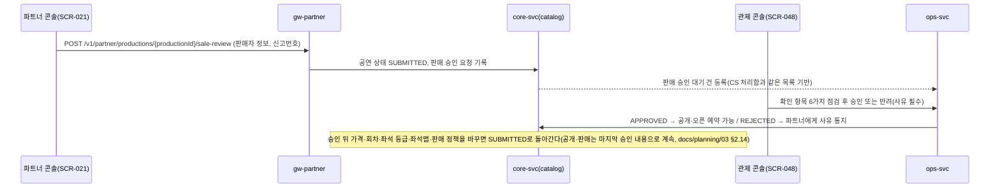
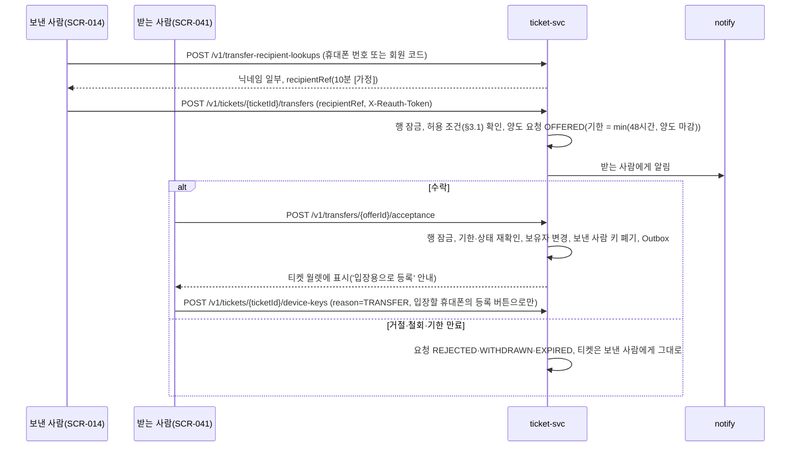
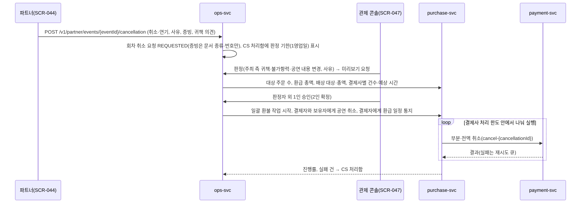
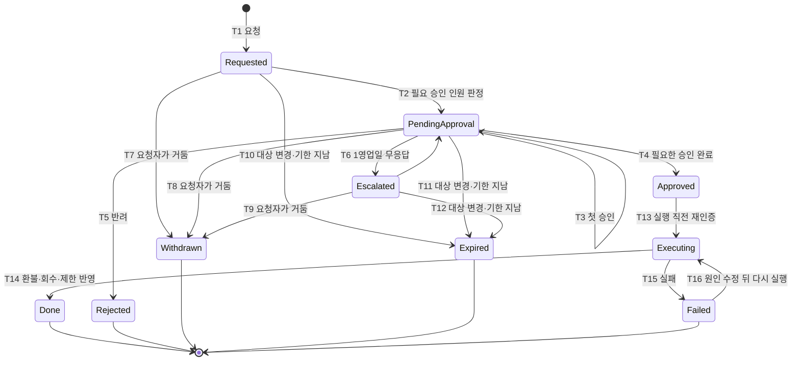

# 기능 설계: 양도·취소·환불 운영(판매 승인, 중개자 고지, 승인 업무, CS 처리함, 회차 취소, 배상)

- **독자와 용도**: 이 기능을 구현하는 엔지니어와 QA가 함께 보는 문서다. 다루는 것은 다음과 같다.
  - 양도의 수락·돌려주기·회수
  - 결제자만 하는 예매 취소
  - 회차 취소의 판정과 일괄 환불 작업, 배상 지급
  - 승인 업무와 CS 처리함
  - 판매 승인과 중개자 고지, 공연예술통합전산망 전송
  - 구현하는 쪽은 ticket-svc, purchase-svc, payment-svc, ops-svc, core-svc와 소비자 웹·파트너 콘솔·관제 콘솔 화면이다.
- **원문 출처**: 원문 설계서에는 이 범위의 상세 설계가 없다. 2026-10-13 소유자 질문("관리자가 승인을 해줘야 할 수도 있잖아요")의 검토와 제안, 소유자 동의, 판매 구조 판단에서 나왔다([ADR-0045](../adr/0045-intermediary-legal-status.md), [ADR-0046](../adr/0046-cancel-transfer-refund-approvals.md)). 전체가 [보완]이다.
- **기준 기획 버전**: v1.0.
- **관련 ID**: FR-013, FR-027, FR-047, FR-052~FR-061, FR-073 · POL-014, 017, 024, 032, 037, 038, 046 · SCR-001, 002, 011, 012, 013, 014, 021, 027, 038, 041~048, 071 · CMP-028, 040, 054, 058~063 · API(프로그램끼리 요청과 응답을 주고받는 창구) `/v1/tickets/{ticketId}/transfers`, `/v1/transfers/*`, `/v1/tickets/{ticketId}/returns`, `/v1/compensations/*`, `/v1/appeals`, `/v1/partner/productions/{productionId}/sale-review`(ADR-0093, 2026-11-01 정합 점검), `/v1/partner/events/{eventId}/cancellation`, `/v1/ops/cases`, `/v1/ops/approval-requests/*`, `/v1/ops/event-cancellations/*`, `/v1/ops/sale-reviews/*`, `/v1/ops/fraud-cases/*`(부정 예매 사건, ADR-0171) · 보안 추적 [asvs/transfer-refund.md](../security/asvs/transfer-refund.md)

## 1. 개요

PEAKET은 통신판매중개자(직접 팔지 않고 판매자와 구매자의 거래를 알선하는 사업자)로서 파트너와 관람객 사이의 티켓 소유권 이전과 환불 절차를 다음 원칙으로 운영한다:

- **법적 지위와 책임 분담 ([ADR-0045](../adr/0045-intermediary-legal-status.md))**:
  - PEAKET은 통신판매중개자이며 공연을 등록·판매하는 파트너가 판매 당사자다.
  - 다만 예매 취소 및 환불 처리는 PEAKET 시스템이 직접 집행하고 관리 책임을 파트너와 함께 부담한다.
- **운영 대원칙: "정책 안이면 자동, 정책 밖이면 승인"**:
  - **정책 내 자동 환급**: 전자상거래법 제18조 제2항(3영업일 이내 환급) 준수를 위해 기준 안의 정상 취소는 별도 승인 없이 자동으로 처리하고, 3영업일 안에 환급한다.
  - **정책 외 통제 승인**: 정책 기준을 벗어난 예외 환불, 양도 회수, 회차 취소처럼 되돌리기 어려운 자금 이동이나 권리 소멸은 승인을 거친다. 건의 종류와 금액에 따라 1인(`cs_lead`, operator) 또는 2인(`cs_lead`+`commander`, 회차 취소는 판정 뒤 2인 확정)이 승인한다(§3.2).
  - **결제자 중심 단일 권한**: 티켓 취소와 환급 권한은 결제자에게만 귀속된다. 양도받은 수신자는 결제자에게 '돌려주기'만 가능하다.

## 2. 판매 구조와 법정 의무(ADR-0045, POL-037)

### 2.1 판매 승인(FR-052, SCR-021·048)

- **확인 항목**
  1. 판매자 신원정보와 사업자 진위: 상호, 대표자, 주소, 전화, 전자우편, 사업자등록번호, 통신판매업 신고번호나 면제 근거
  2. 공연 정보의 표시 사항(휠체어석 검사 결과와 파트너 확인·부족 이유 포함, FR-023)과 공연예술통합전산망 항목(§2.4)
  3. 판매 정책이 POL-032 공제율 상한과 POL-017 양도 규칙 안에 있는지
  4. 결제사 지정(POL-036): 이 공연의 회차에 쓸 기본·대체 결제사와 그 결제사 기준 동시 입장 상한을 본다(결제사 지정은 회차 칸이다, ADR-0093 결정 2, 2026-11-01 정합 점검). 지정이 없으면 그때의 플랫폼 기본값을 승인 때 회차마다 지정으로 저장하고, 다르게 하려면 명령 12로 바꾼다. 지정 결제사 채널이 서버 승인을 지원하지 않거나 꺼져 있으면 승인할 수 없다(추천 적용 2026-10-14, ADR-0062)
  5. 결제사 지급대행(결제사가 PEAKET 대신 파트너 정산 계좌로 판매 대금을 보내는 서비스) 등록: 정산 계좌 예금주가 상호나 대표자와 같은지, 연동 결제사 토스페이먼츠의 셀러가 지급 가능 상태인지, 연동 결제사 포트원의 파트너가 등록되어 있는지(POL-039 ①, docs/features/settlement.md §3)
  6. 아티스트·공연장 연결: 공연의 아티스트와 공연장이 기존 대상에 이어졌는지, 새로 만들어야 하는지(ADR-0093 결정 4)
- **판매 조건은 고치지 않는다.** 승인은 확인과 반려만 한다. 가격과 조건을 PEAKET이 정하면 판매 대행형으로 볼 여지가 커지기 때문이다(ADR-0045 결정 4).
- **권한과 기록**: operator 1인이 승인한다. 승인과 반려는 감사 로그에 남는다.
- **판매 중지와 재개(추천 적용 2026-10-28, ADR-0123)**: 승인한 공연을 판매자 신원 문제·법적 요청·사기 의심으로 내려야 할 때는 판매 중지(SUSPENDED, docs/planning/03 §2.14)로 간다. operator 이상이 SCR-048에서 사유 코드와 사유를 적어 요청하고, 요청자가 아닌 commander가 승인 업무(SCR-046)로 승인한다. 실행하면 core-svc가 한 트랜잭션으로 비공개·검색과 홈에서 빼기·오픈 예약 멈춤을 쓰고(`RecordSaleReviewResult` SUSPENDED), ops-svc가 판매 종료 전 회차마다 판매 일시정지와 같은 제어 상태를 따로 건다(`ApplyControl` SALE_SUSPENSION). 이미 판 티켓은 그대로이고, 정산서 지급은 보류한다(docs/features/settlement.md §6). 다음은 판매 재개(같은 2인)나, commander가 직접 만드는 회차 취소 요청(§5, `POST /v1/ops/event-cancellations`)이다. 시험은 R-T23이다.

### 2.2 중개자 고지와 판매자 정보(FR-053, CMP-058)

| 위치 | 화면 | 표시 |
| --- | --- | --- |
| 사이버몰 초기 화면 | SCR-001 하단 사업자 정보 | "PEAKET은 통신판매중개자로서 공연과 상품 거래의 당사자가 아닙니다. 공연의 개최·변경·취소와 상품의 제공·품질에 따른 책임은 각 판매자에게 있고, 예매·주문 취소와 환불은 PEAKET이 처리합니다. 판매자 정보는 각 공연·상품 상세에 있습니다." 분쟁 해결 기준 문서 링크, 구매안전서비스 줄 "구매안전서비스: 굿즈 택배 주문은 토스페이먼츠 결제대금예치를 이용할 수 있습니다 ( 서비스 가입 사실 확인 › )"(POL-014) |
| 공연 상세 | SCR-002 본문의 판매자 줄과 [판매자 정보] 안내 모달 | 본문에 늘 '판매자: {상호}'와 공연용 고지 문장(POL-037) 한 줄을 두고, 신원정보 7항목은 본문 아래 [판매자 정보] 모달에 둔다(소유자 결정 2026-10-14, ADR-0063). 7항목을 늘 보이는 곳은 결제 직전 화면(SCR-011)이다(아래 행) |
| 청약 확인 단계 | SCR-011 결제 직전 | 판매자 신원정보 7항목과 고지 문장을 본문에 늘 보인다(접거나 모달로 숨기지 않는다, 추천 적용 2026-10-14, ADR-0063). 전자상거래법 §20②는 판매자 정보를 청약이 이루어지기 전까지 소비자에게 제공하라고만 정하므로(2026-07-21 시행본, 2026-10-14 원문 확인) 청약 직전 화면에 늘 보이는 것으로 충족한다. 약관 링크로 대신하지 않는다. 글씨는 판매자 표시와 같거나 크게 한다 |
| 계약 내용 서면 | SCR-012 결과, 예매 확인 이메일, SCR-013 티켓 상세 | 판매자 신원정보와 고지 문장. 글씨 규칙은 같다 |
| 상품 상세 | SCR-015 판매자 정보 | 신원정보 7항목, 상품용 문장 |
| 주문서 결제 직전 | SCR-015 주문서 | 판매자 이름과 상품용 문장(글씨 규칙은 같다) |
| 주문 확인서 | SCR-055·확인 이메일 | 위와 같다 |
| 결제 직전·약관·확인서 | SCR-011 ⑨, SCR-015 주문서, SCR-057, SCR-055·확인 이메일 | 미성년자 계약 취소 고지 "만 19세 미만 미성년자가 법정대리인(부모 등)의 동의 없이 결제하면, 미성년자 본인이나 법정대리인이 이 계약을 취소할 수 있습니다."(전자상거래법 §13③, 모든 결제자에게 같은 문장, 결제 버튼 바로 위 본문, 추천 적용 2026-10-14, ADR-0062) |

- 굿즈와 티켓 연동 부가 상품의 판매 당사자는 그 상품을 상품 빌더(SCR-023)로 등록한 파트너다. 상품용 문장은 "판매자: {판매자 상호}. PEAKET은 통신판매중개자로서 이 상품 거래의 당사자가 아닙니다. 상품의 제공(배송·이용)과 품질에 따른 책임은 판매자에게 있고, 주문 취소·반품과 환불은 PEAKET이 처리합니다."이고, 상품 카드에는 "판매자 {상호}"를 보인다(POL-037, 추천 적용 2026-10-14, ADR-0062).

### 2.3 분쟁 처리 기한(FR-057)

- 분쟁과 불만은 CS 처리함에 '분쟁 접수'로 들어온다(§7).
- 접수 뒤 3영업일 안에 진행 경과를, 10영업일 안에 조사 결과나 처리 방안을 팬에게 알린다(전자상거래법 시행령 §25의2).
- 분쟁 해결 기준 문서는 취소·환불·배상·양도 규칙 요약이다. 사이버몰에 게시하고, 정책이 바뀌면 함께 바꾼다.

### 2.4 공연예술통합전산망 전송(FR-054)

- **보내는 것**: 공연법 시행규칙 §2의 10개 항목이다. 공연 명칭·종류, 기간·장소, 시간, 예매·결제 금액, 관람자 수, 관람 가능 연령, 출연진·제작진·기획사·제작사, 좌석 등급·요금, 입장권 판매처, 안내 사항.
- **보내는 방식**: 1일 단위로 집계되도록 보낸다(시행령 §3의2). core-svc 일 단위 작업이 대사가 끝난 원장(payment §8)을 집계해 보낸다.
- **실패 처리**: 전송에 실패하면 재시도한다. 다음 날까지 실패하면 CS 처리함에 올리고 경보를 낸다.
- **온세일 때 미루기(추천 적용 2026-10-20, ADR-0069 결정 10)**: 대형·중형 온세일 윈도우(판매가 열리는 시각 앞뒤로 접속이 몰리는 기간, T-10분~T+60분)에는 재전송의 새 묶음을 시작하지 않고 미룬다. 이미 시작한 묶음은 끝낸다. 소형 온세일은 미루지 않는다 [가정]. 창은 변경 동결 달력(배포를 멈추는 시간표)과 같은 온세일 일정으로 계산하고, 일정을 읽지 못하면 마지막으로 읽은 일정을 쓰고 SEV3를 낸다 [가정]. 미루는 시간은 최대 70분이다(docs/devops.md §8.2, POL-028). 그 밖의 때 멈춰야 하면 명령 9의 '배경 작업 멈춤'으로 멈춘다.
- **연동 규격**: 운영기관에서 받아 확인한다. 그 전에는 시뮬레이터 어댑터로 시험한다.
- **위험**: 고의로 빠뜨리거나 조작해 보내면 과태료 대상이다(공연법 §43③1호). 전송 기록은 원장 대조값(원래 값으로 되돌릴 수 없게 바꾼 고정 길이 값인 해시)과 함께 남긴다.

### 2.5 공연법 부정구매·부정판매 방지 조치(POL-024)

PEAKET은 판매를 위탁받아 하는 자(시행령 §3의3 1호, 해석)이면서 통신판매중개업자(2호)라서 두 조치를 모두 한다. 2호 때문에 더하는 것은 다음과 같다.
- 판매자 본인 확인. 판매 승인(§2.1)에서 한다.
- 부정판매 게시물 신고 기능
- 부정판매의 형사처벌과 과징금(판매금액 50배 이하) 사전 고지(문안은 POL-024 라목, 양도 화면에도 싣는다)
- 통보받은 게시물이 고시 사항에 해당하면 24시간이 아니라 10시간 안에 차단한다(2호 바목 단서)
- 통보로 차단한 게시물과 내용이 같은 게시물의 자동 노출 차단과 결과 제출(2호 마목). 정규화한 본문 지문으로 대조하므로 글자를 바꾼 게시물은 막지 못하고, 신고와 통보로 처리한다.
- 두 목이 가리키는 문화체육관광부 고시는 확인 필요다.
- 과징금 부과를 위한 자료 제출 요청 대응(POL-025)

## 3. 권리와 상태 규칙

### 3.1 결제자와 보유자

| 개념 | 정의 | 저장 위치 |
| --- | --- | --- |
| 결제자 | 그 티켓의 주문을 결제한 계정. 바뀌지 않는다 | `ticket.payer_account_id`(주문에서 복사), `purchase_order.account_id` |
| 보유자 | 지금 티켓을 가진 계정. 양도 수락, 돌려주기, 회수로 바뀐다 | `ticket.account_id` |

| 하려는 일 | 허용 조건 |
| --- | --- |
| 예매 취소 | 요청자 = 결제자 = 보유자이고, 진행 중인 양도 요청이 없으며, 공연 시작 전 |
| 회차 취소 일괄 환급 | 요청자가 없다(시스템). 보유자와 진행 중인 양도 요청에 관계없이 결제자에게 환급한다. 진행 중인 양도 요청은 같은 트랜잭션에서 시스템이 먼저 철회한다(§5, 추천 적용 2026-10-28, 기술 검토 중간-044). 입장 상태(입장 전·입장·퇴장)와도 관계없고, 입장 시작 뒤에도 입장 기록 마감을 기다리지 않는다(§5, 기술 검토 중간-050) |
| 양도 요청 | 요청자 = 보유자 = 결제자(재양도 금지)이고, 양도 마감(공연 시작 2시간 전과 입장 시작 중 이른 때, ADR-0051) 전이며, 상품 유형이 양도 가능(POL-016). 부정 예매 양도 잠금이 걸려 있으면 409 `transfer-locked`다(§4.1, 추천 적용 2026-10-31) |
| 양도 수락·거절 | 요청자 = 지정된 받는 사람(본인확인 완료 회원)이고, 요청이 기한 안이다. 수락은 입장 시작 전에만 한다(ADR-0051) |
| 양도 철회 | 요청자 = 보낸 사람이고, 수락 전 |
| 돌려주기 | 요청자 = 보유자 ≠ 결제자이고, 입장 시작 전이며, 입장 기록이 없다. 입장 시작부터 입장 기록 마감까지는 409 `ENTRY_STARTED`다(ADR-0051). 부정 예매 양도 잠금은 돌려주기를 막지 않는다. 표가 결제자(사건 계정)에게 돌아갈 뿐 퍼지지 않기 때문이고, 돌아온 표는 잠긴 채로 남는다(§4.1, ADR-0173 결정 3. 2026-10-31 처음에는 409 `transfer-locked`였다) |
| 양도 회수 | 승인 업무(2인) 승인이 있고, 입장 시작 전이며, 입장 기록이 없다(ADR-0051) |
| 탈퇴 | 보유자 탈퇴 → 받은 티켓은 돌려주기(입장 시간대에는 키를 폐기한 뒤 마감 때 돌려준다), 보낸 요청은 철회, 받은 요청은 거절(docs/planning/03 §1.5, 추천 적용 2026-10-14, ADR-0062) |

모든 판정은 티켓 행 잠금(`SELECT … FOR UPDATE`) 안에서 상태·기한을 다시 확인해 한다. 양도, 취소, 회수, 스캔 수신이 한 티켓에서 겹쳐도 하나만 성공한다. 버전 칸은 CS 처리함처럼 사람이 화면에서 읽고 나중에 저장하는 흐름이 본 판과 비교하는 데만 쓴다(docs/features/payment.md §4.1, 추천 적용 2026-10-28, 기술 검토 낮음-071). 오프라인 스캐너의 입장 기록은 늦게 올라오므로, 입장 시간대에는 서버가 누가 들어갔는지 모른다. 그래서 입장 시작부터 입장 기록 마감까지는 소유권과 키를 바꾸는 수락·돌려주기·회수를 막는다(ADR-0051, docs/features/offline-gate.md §5).

### 3.2 승인 업무 종류(POL-038)

| 종류 | 요청 | 승인 | 기한 |
| --- | --- | --- | --- |
| 시스템 잘못이 확인된 환불(중복 결제, PEAKET 장애로 미발급·입장 실패, 결제 상태 불명 사후 확정) | `cs_agent` | `cs_lead` 1인 | 환급 3영업일 |
| 재량 면제, 주문 1건 30만 원 이하 | `cs_agent` | 요청자가 아닌 `cs_lead` 1인 | 기본 환불은 자동 3영업일, 면제분은 승인 뒤 |
| 재량 면제, 30만 원 초과·여러 주문·같은 팬 90일 안 두 번째 | `cs_agent` | `cs_lead` + `commander` 2인 | 위와 같다 |
| 양도 회수(계정 탈취) | `cs_lead` | `commander` | 받은 사람의 소명(회수 대상이 된 팬이 사정을 설명하는 절차) 기간 1일 이상이 지난 뒤, 입장 시작 전이고 입장 기록이 없을 때(ADR-0051 결정 10) |
| 예매 제한(남용) | 시스템 표시 | `cs_lead` 확인 | 소명 기한 1일 이상 |
| 회차 취소 확정 | 파트너 요청, `commander` 판정 | 판정자 외 operator 이상 1인(2인) | 판정 1영업일, 확정 즉시 통지 |
| 판매 승인 | 파트너 | operator 1인 | — |
| 판매 중지·판매 재개(승인한 공연을 내리고 다시 엶, `SALE_SUSPENSION`·`SALE_RESUMPTION`, 추천 적용 2026-10-28, ADR-0123) | operator 이상(사유 코드·사유 필수) | 요청자가 아닌 `commander` 1인(2인 [가정]) | 1영업일 무응답이면 상위 승인자 알림. 급하면 명령 3으로 판매만 먼저 멈춘다 |
| 미성년자 계약 취소(전자상거래법 §13③, 민법 §5②) | `cs_agent`(확인 결과 첨부) | 요청자가 아닌 `cs_lead` 1인 | 확인 결과 3영업일, 승인 뒤 환급 3영업일. 공제·반품 배송비는 없다(POL-038 ⑧, 추천 적용 2026-10-14, ADR-0062) |
| 부정 예매 조치(표 취소, 이용 제한 걸기·풀기. `FRAUD_ACTION`의 `fraudAction` `CANCEL_TICKETS`·`RESTRICT`·`LIFT_RESTRICTION`, POL-038 ⑪, 추천 적용 2026-10-31, ADR-0171) | 지정 부정 거래 조사관. 사건 작업대의 조치 요청(`POST /v1/ops/fraud-cases/{caseId}/action-requests`)으로만 만든다(§7.4) | 요청자가 아니고 가명정보 취급자 지정이 없는 `commander` 1인(2인). 승인 업무 상세(`GET /v1/ops/approval-requests/{approvalId}`)의 사건 요약 `fraudCaseSummary`를 읽기 전용으로 보고 재인증한 뒤 승인한다 | 표 취소는 취소 마감 시각(판매 종료에서 재판매 준비 2시간 [가정]을 뺀 시각), 이용 제한 걸기·풀기는 POL-038 공통의 요청 뒤 5영업일 [가정]에 만료(추천 적용 2026-10-31, ADR-0171). 풀기가 반려·만료되면 사건은 이의 접수(OBJECTED)에 남고 조사관이 다시 요청하거나 이의를 기각한다 |

공통 규칙은 다음과 같다.
- 사유는 필수다. 증빙은 확인 사실만 남긴다.
- 요청자와 승인자는 서버가 분리한다.
- 1영업일 동안 승인이 없으면 상위 승인자에게 알린다.
- 실행 직전에는 관리 계정을 재인증한다.

## 4. 양도 흐름(FR-013, FR-060, POL-017)

- **수락 화면 고지**: "이 티켓은 결제한 사람만 취소할 수 있고, 공연이 취소되면 환불도 결제한 사람에게 갑니다. 티켓값을 주고받았다면 두 분이 직접 정산해야 합니다." 여기에 "결제자의 부정 예매로 확인되면 이 표가 취소될 수 있고, 환급은 결제자에게 갑니다"를 더한다. 같은 문장을 약관에도 적는다(POL-017, 약관법 제3조 제4항, ADR-0173 결정 4. 화면 배치는 docs/design/d5 SCR-041).
- **돌려주기**: 지금 보유자가 결제자에게 바로 돌려준다(`POST /v1/tickets/{ticketId}/returns`). 결제자가 수락하는 단계는 없다. 보유자의 키를 폐기하고, 결제자는 '입장용으로 등록'으로 키를 다시 등록한다(reason=`TRANSFER`).
- **양도 회수**: 승인 업무가 승인되면 ticket-svc가 돌려주기와 같은 절차로 결제자에게 되돌린다. 받은 사람에게는 소명 결과와 회수 사실을 알린다.
- **스캐너 반영**: 폐기된 키는 1분 변경분으로 스캐너에 간다(offline-gate §5).
- **멱등키(추천 적용 2026-10-15, ADR-0065 결정 12)**: 거절(`POST /v1/transfers/{offerId}/rejection`)과 철회(`…/withdrawal`)도 수락처럼 `Idempotency-Key`를 받는다. 같은 키로 다시 와도 처음 결과를 돌려준다. 이 헤더는 safelisted 헤더가 아니어서 브라우저가 사전 요청을 먼저 보낸다. 하지만 같은 사이트의 `www`가 `api` 호스트로 보내는 교차 출처 일반 요청이므로, 대기열 진입 같은 T=0 부하가 아니다.
- **알림 링크로 들어오는 첫 요청(추천 적용 2026-10-15, ADR-0065 결정 8)**: 받는 사람은 알림(이메일·메시지)의 링크로 양도 받기 화면(SCR-041)에 들어온다. 소명 제출(SCR-042)과 배상금 계좌 입력(SCR-043)도 알림 링크가 연다(docs/planning/04). 팬 쿠키(브라우저가 사이트별로 저장했다가 요청마다 함께 보내는 작은 값)는 `SameSite=Strict`라서, 다른 사이트(메일 앱 등)에서 온 첫 이동 요청에는 쿠키가 실리지 않는다. 그래서 이 첫 화면은 쿠키 없이 정적 셸만 보낸다. 양도 요청 조회·수락·거절처럼 쿠키가 필요한 호출은 페이지 스크립트가 같은 사이트 요청으로 한다(docs/features/identity.md §5 '복귀 화면'과 같은 규칙, 웹 앱 보안 검증 항목 목록인 ASVS v5.0.0-3.3.2).

### 4.1 부정 예매 양도 잠금(POL-046 ③, FR-073)

부정 거래 조사관이 소명(의심받은 사람이 정상 구매라고 해명하는 절차)을 요청하면 시스템이 그 표의 양도를 잠근다. 시스템이 스스로 거는 부정 예매 조치는 이 잠금 하나뿐이고 되돌릴 수 있다. 소명 결과를 기다리는 동안 의심 표가 다른 사람에게 넘어가 되팔리지 않게 하려는 것이다(docs/planning/03 §2.5). 세부는 추천 적용(2026-10-31, ADR-0171)이다. 2026-10-31 자체 법률 조사(ADR-0173 결정 3)로 잠금에 끝을 두고 돌려주기를 풀었다. 상당한 이유 없이 급부를 일방적으로 멈추거나(약관법 제10조 제2호) 제3자와의 계약을 부당하게 막는(제11조 제3호) 조항이 되지 않게, 막는 범위를 양도로 좁히고 기간을 한정하려는 것이다(해석). 시험은 R-T31이다.

- **거는 때**: 조사관이 사건 작업대(SCR-071)에서 소명 요청을 보내면(`POST /v1/ops/fraud-cases/{caseId}/appeal-requests`) ops-svc가 ticket-svc `TransferLockService.SetTransferLock`(case_id, event_id, account_ids, locked, version, expires_at)으로 사건 계정이 그 회차에서 결제한 표 전부를 잠근다. `expires_at`은 잠금 최대 기한이고, 그 계정의 첫 소명 요청 + 14일 [가정]이다. 연장은 없고, 같은 계정에 소명을 다시 요청해도 늘지 않는다. ticket-svc는 이 값을 `fraud_transfer_lock.expires_at`에 둔다(ADR-0173 결정 3). ticket-svc는 계정 단위 잠금 기록(`fraud_transfer_lock`)을 두어, 잠금 뒤에 그 계정이 산 그 회차 표도 발권 때 잠근다(2026-10-31 같은 날 표 목록에서 계정 목록으로 바꿨다). 이 호출을 부르는 쪽은 ops-svc뿐이다. ticket-svc는 티켓 행 잠금 안에서 `ticket.fraud_lock_case_id`에 사건 ID를, `ticket.fraud_lock_version`에 판을 적는다. 판은 같은 case_id 안에서만 견준다. 그 사건이 그 티켓에 적은 판보다 클 때만 바꾸므로, 늦게 도착한 옛 잠금·풀기가 새 상태를 덮지 않고 같은 요청을 다시 보내도 결과가 같다. 한 티켓에는 사건 하나의 잠금만 두고, 다른 사건의 잠금이 걸린 티켓은 판을 견주지 않는다. 다른 사건이 이미 잠근 티켓, 입장 시작 뒤이거나 이미 환급·무효로 끝난 티켓은 바꾸지 않고 응답에 그 결과를 티켓마다 돌려준다 [추천].
- **알림 순서**: ops-svc는 잠금이 모두 반영된 뒤에 팬에게 소명 요청 알림을 보낸다. 알림을 먼저 받은 팬이 표를 넘기는 틈을 막으려는 것이다 [추천]. 잠금 호출이 실패하면 ops-svc 작업 워커가 같은 판으로 다시 보낸다.
- **잠글 때와 풀 때 알린다(ADR-0173 결정 3)**: 결제자에게 가는 소명 요청 알림(`FRAUD_APPEAL_REQUESTED`)에 잠긴 표 수, 잠금 최대 기한("늦어도 14일 뒤 풀립니다"), 잠금 범위(양도만 막고 입장과 본인 취소는 된다. 본인 취소에는 보통의 취소 수수료가 붙는다)를 싣는다. 잠금이 풀리면 `FRAUD_TRANSFER_LOCK_RELEASED`를 보낸다. 입장 시작으로 풀린 때(그때는 양도 마감이 지났다)와 남은 표가 없을 때는 보내지 않는다(docs/features/notify.md §4.5).
- **받은 사람(보유자 ≠ 결제자, ADR-0173 결정 4)**: 잠그는 표 가운데 지금 보유자가 양도로 받은 다른 계정인 표가 있으면, ops-svc가 그 받은 사람에게도 알리고(`FRAUD_HOLDER_NOTICE`, 사유 범주 없음) 결제자와 같은 기한의 소명 기회를 준다(§7.1 '부정 예매 사건의 소명'). 보유자는 `SetTransferLock` 응답의 티켓마다 결과로 안다. 받은 사람은 원래 다시 양도할 수 없고(재양도 금지, §3.1) 돌려주기는 막지 않으므로, 잠금은 받은 사람의 쓰임을 바꾸지 않는다.
- **진행 중 양도 요청**: 잠그는 같은 트랜잭션에서 그 티켓의 진행 중 양도 요청(OFFERED)을 시스템이 철회한다(WITHDRAWN, 철회 사유 `FRAUD_LOCK` [추천]). 티켓은 보낸 사람에게 남는다(docs/planning/03 §2.5 T6·T7). 받는 사람에게는 일반 철회 알림만 보내고 사건이나 사유는 알리지 않는다. 잠금과 받는 사람의 수락이 같은 순간에 오면 티켓 행 잠금으로 하나만 먼저 된다. 수락이 먼저면 받은 사람이 가진 티켓이 잠기고, 잠금이 먼저면 수락은 이미 철회된 요청이라 409다.
- **잠긴 동안**: 양도 요청(`POST /v1/tickets/{ticketId}/transfers`)만 409 `transfer-locked`(별칭 `TRANSFER_LOCKED`)이고, 키와 보유자는 바뀌지 않는다. 돌려주기(`POST /v1/tickets/{ticketId}/returns`)는 잠금 때문에 409를 내지 않는다. 표가 사건 계정으로 돌아갈 뿐 퍼지지 않기 때문이다. 돌아온 표는 그 계정이 결제한 표라 잠긴 채로 남고, 그 받은 사람의 소명 화면용 사본에서 빠진다(ADR-0173 결정 3). 입장은 막지 않는다. 스캐너 회차 목록과 판정 표에는 잠금 표시가 없다(docs/features/offline-gate.md §5). 결제자의 예매 취소와 승인된 양도 회수는 막지 않고 지금 규칙대로 한다 [추천]. 취소하면 공제율대로 환급되고 좌석은 취소표로 돌아간다.
- **표시**: `Ticket.transferLocked`(참·거짓, 읽기 전용)와 잠겼을 때의 최대 기한 `Ticket.transferLockExpiresAt`으로 보인다. 마이 티켓(SCR-013)과 티켓 양도(SCR-014)는 이 값으로 양도 버튼을 막고 "늦어도 14일 뒤 풀립니다"(최대 기한)를 보인다. 보유자가 결제자가 아니면(받은 사람) 잠금 표시를 하지 않는다. 받은 사람은 원래 양도 버튼이 없고 돌려주기는 되기 때문이다. 받은 사람에게는 `FRAUD_HOLDER_NOTICE`와 소명 제출(SCR-042)로 기한과 가진 표만 알리고 사유 범주는 알리지 않는다. 결제자에게는 소명 요청 알림과 소명 제출(SCR-042)로 사유 범주와 기한을 알린다(§7.1). 화면 문구는 docs/design/d5에서 정한다.
- **사전 고지(ADR-0173 결정 3)**: 약관과 공연 상세에 잠금을 거는 때(조사관이 소명을 요청할 때), 범위(양도만 막고 입장·본인 취소는 된다. 본인 취소에는 POL-032 공제율이 적용된다), 풀리는 때(아래 일곱), 최대 기간(14일 [가정])을 적는다. 잠긴 동안 그 계정이 그 회차 표를 새로 사면 결제 직전 화면(SCR-011 주문·결제)에 "이 회차 표는 부정 예매 조사가 끝날 때까지 양도가 잠깁니다"를 보인다. 화면은 `GET /v1/fraud-appeal-requests`에서 그 회차의 결제자 항목(`party` `PAYER`)이 잠금 중(`lockActive` 참)일 때만 보인다. 받은 사람 항목(`HOLDER`)과 풀린 항목으로는 보이지 않는다(추천 적용 2026-10-31, ADR-0173. 약관법 제3조 제3항 설명의무).
- **푸는 때**: 그 계정에 대해 다음 일곱 가운데 먼저 오는 때다(ADR-0173 결정 3): ① 소명 인정 ② 사건 CLEARED ③ 조치 실행 끝(취소된 표 말고 남은 표) ④ 조사관이 계정을 뺌 ⑤ 입장 시작 ⑥ 그 계정 대상 조치 요청의 반려·만료(다른 열린 조치 요청이 없을 때. 승인자가 범위에서 뺀 계정도 그 요청이 반려된 것으로 본다) ⑦ 최대 기한(`expires_at`). 요청자의 철회로는 풀지 않는다(조사관이 고쳐 다시 내려는 것이라서, 추천 적용 2026-10-31, ADR-0173). ⑤·⑦ 말고는 ops-svc가 같은 호출(locked = false)로 푼다. ⑤와 ⑦은 ticket-svc가 min(`expires_at`, 입장 시작)에 스스로 푼다 [추천]. 그 시각에 잠금 칸을 비우고, 비우는 작업이 늦어도 그 시각 뒤에는 칸이 남아 있어도 판정과 `Ticket.transferLocked`에서 잠금으로 보지 않는다. ops-svc 호출이 늦거나 실패해도 정책대로 반드시 풀리게 하려는 것이다. ops-svc도 그 시각에 팬 화면용 사본의 잠금 상태(`lock_active`)를 풀림으로 바꿔 보낸다. 입장 시작 뒤에는 양도 마감과 입장 중 소유권 동결(§3.1)이 따로 막으므로 잠금이 풀려도 표가 움직이지 않는다. 사건은 이용 제한만 남긴 채 계속한다(POL-046 ③).
- **기록**: 잠금·풀기는 ops-svc 사건 기록(`fraud_case_event`)과 ticket-svc 감사 기록에 남는다. 풀기에는 일곱 가운데 어느 때인지를 남긴다(§8).

## 5. 회차 취소와 일괄 환불 작업(FR-055, POL-032)

- **증빙 형식(추천 적용 2026-10-28, 기술 검토 낮음-092)**: 파트너의 회차 취소·연기 요청 증빙은 파일을 받지 않는다. 파트너가 보관한 문서의 종류(예: 공연장 대관 취소 통지, 출연자 측 공문, 기상 특보)와 발급 번호·날짜만 `evidenceRef`로 적는다. 판정자가 원본을 봐야 하면 파트너에게 화면 공유나 대면으로 보여 달라고 하고, 확인했다는 사실과 확인한 사람만 남긴다(예외 환불 증빙과 같은 규칙, §8). 파일을 받으면 업로드 검사(ASVS V5)와 악성 파일 위험, 보관 기간 관리가 새로 생기는데, 판정에는 확인 사실만 있으면 되기 때문이다.
- **나눠 실행**: 결제사마다 토큰 버킷(일정한 속도로 채워지는 허용량 안에서만 요청을 보내게 하는 방식)을 두어 처리 한도를 지킨다. 대형·중형 온세일 윈도우(판매가 열리는 시각 앞뒤로 접속이 몰리는 기간, T-10분~T+60분)에는 새 묶음을 시작하지 않고 미룬다(이미 시작한 묶음은 끝낸다, POL-028, ADR-0069). 소형 온세일 중에는 미루지 않는다. 결제사 취소 호출이 승인과 같은 한도를 쓰면 실행 속도를 낮추고(계약 때 확인, ADR-0069), 필요하면 명령 9의 '배경 작업 멈춤'으로 멈춘다(가용성: 서비스를 멈춤 없이 쓸 수 있는 정도, ASVS 15.1.3).
- **스스로 멈춤(결제사별, 추천 적용 2026-10-28, 기술 검토 중간-045)**: 작업은 결제사마다 몫을 나눠 돌린다(결제사 몫). 결제사 몫 하나가 아래 셋 가운데 하나에 닿으면 그 몫만 스스로 멈추고 SEV2로 알린다. 다른 결제사 몫은 계속한다.
  1. 1분 창의 취소 실패율이 5% [가정] 이상이다. 그 창의 취소 호출이 20건 [가정] 이상일 때만 센다. 실패는 결제사 오류 응답(5xx)·시간 초과·결과 모름(`UNKNOWN`)·한도 초과 응답(429)이다.
  2. 연속 실패가 20건 [가정]이다.
  3. 그 결제사의 서킷 브레이커(계속 실패하는 호출을 잠시 끊어 장애가 번지지 않게 하는 장치)가 열렸다(payment-svc, docs/features/payment.md §9).
  - 결제사의 업무 거절(`REJECTED`, 예: 남은 취소 가능 금액 부족)은 실패율에 넣지 않고 그 건만 CS 처리함 '일괄 환불 실패'로 보낸다. 다만 1분 창의 거절률이 5% [가정] 이상이면 우리 쪽 금액·대상 계산이 틀렸을 수 있어 작업 전체를 멈춘다(사유 `AUTO_REJECT_RATE`).
  - 멈출 때는 이미 보낸 호출의 답을 기다리고 새 호출만 보내지 않는다. 결과 모름 건은 재시도 큐에 그대로 둔다. 이미 환급된 건은 `cancel-{cancellationId}` 멱등키 때문에 다시 환급되지 않는다.
  - 자동으로 다시 시작하지 않는다. 되돌릴 수 없는 돈의 이동이라 사람이 확인한 뒤 연다. 멈춘 동안에도 환급 3영업일 기한(§7.1 '일괄 환불 실패')은 흐르므로, 멈춘 지 1시간 [가정]마다 다시 알린다.
- **재개(추천 적용 2026-10-28, 기술 검토 중간-045)**: 멈춘 몫은 2인 확정 범위 안에서 commander가 다시 시작한다(`ResumeEventRefundJob`, 결제사 몫마다 또는 한꺼번에, 사유 필수).
  - 재개 화면(SCR-047)은 그 결제사의 서킷 상태와 최근 5분의 취소 실패율을 보이고, 서킷이 닫혀 있고 실패율이 기준 아래로 5분 [가정] 이어졌으면 '재개 조건 충족'으로 표시한다. 그 5분 동안 그 결제사 호출이 없었으면 '표본 없음'으로 보이고 commander가 판단한다.
  - 재개하면 결과 모름 건부터 결제사 조회로 끝낸 뒤 새 취소를 보낸다(docs/features/payment.md §2.1·§4.1. 포트원 멱등키 보관 3시간이 지난 건은 조회 없이 다시 보내지 않는다).
  - 재개 뒤에도 자동 정지 기준은 그대로다. 그래서 서킷이 열린 채 재개하면 바로 다시 멈추고, 잘못 재개해도 연속 실패 20건 [가정] 안에 다시 멈춘다.
- **수동 일시정지**: commander는 언제든 작업 전체나 결제사 몫 하나를 멈출 수 있다(`PauseEventRefundJob`, 사유 필수, 감사 로그). 수동으로 멈춘 몫도 재개로만 다시 시작한다. 시험은 R-T9·R-T22다.
- **되돌리지 않음**: 이미 실행된 환불은 되돌리지 않는다. 실수는 미리보기와 2인 확정으로 줄일 뿐이다.
- **연기**: 환급을 원하는 팬만 신청한다. 신청 기한은 바뀐 공연이 시작하기 전까지다(제안값). 일괄 환불이 아니라 신청한 주문만 환급하는 흐름이라, 회차 취소 요청은 연기 확정 뒤 Running이 아니라 환급 신청 기간(RefundWindow)에 머물다가 기간이 끝나고 신청 건 환급이 끝나면 Completed가 된다. 신청 건의 환급은 일괄 환불 작업과 같은 결제사 몫·멈춤 규칙으로 돈다(docs/planning/03 §2.11, 추천 적용 2026-10-28, 기술 검토 중간-044).
- **진행 중인 양도 요청(추천 적용 2026-10-28, 기술 검토 중간-044)**: 예매 취소는 진행 중인 양도 요청이 없을 때만 받는다(§3.1). 이 규칙을 일괄 환불에 그대로 쓰면 양도 요청 중인 티켓의 환급이 막혀 3영업일 기한을 넘길 수 있다. 그래서 일괄 환불 작업은 티켓마다 티켓 행 잠금 안에서 진행 중인 양도 요청(OFFERED)을 시스템 철회(WITHDRAWN, 사유 `EVENT_CANCELLED`)하고, 같은 트랜잭션에서 결제자에게 환급을 건다. 받는 사람에게는 공연 취소로 양도 요청이 철회되었다고 알리고, 보낸 사람(결제자)에게는 환급 일정을 알린다. 철회와 수락이 겹치면 행 잠금으로 먼저 온 쪽만 성공한다. 수락이 먼저면 받은 사람이 보유자인 채로 환급은 결제자에게 간다(수락 화면 고지와 같다). 연기가 확정되면 진행 중인 양도 요청을 같은 방식으로 철회하고(사유 `EVENT_POSTPONED`) 두 사람에게 바뀐 일시와 함께 알린다. 보낸 사람은 바뀐 일시로 다시 양도할 수 있다. 시험은 R-T25다.
- **가상계좌 결제자**: 알림으로 환불받을 계좌를 입력해 달라고 요청한다. 입력하기 전까지는 CS 처리함 '환불 대기'에 남는다.
- **발권 대기 주문**: 결제는 승인됐지만 발권을 다시 시도하는 중인 주문(APPROVED, 발권 재시도 큐에 있음)도 대상에 넣는다. 작업은 그 주문의 발권 재시도를 멈추고 결제를 취소해 주문을 COMPENSATED로 끝낸다. 회차 취소 확정은 업무상 발권이 불가능한 경우라, 승인 뒤 결제를 취소하는 두 경우 가운데 하나다(추천 적용 2026-10-28, ADR-0106).
- **입장 상태와 대상(추천 적용 2026-10-28, 기술 검토 중간-050)**: 대상은 티켓의 소유·결제 상태(docs/planning/03 §2.5 영역 1)로만 고르고, 입장 상태(영역 2: 입장 전·입장·퇴장)는 보지 않는다. 공연이 열리지 않았으므로 이미 입장했거나 퇴장한 티켓도 환급한다.
  - 입장 시작 뒤에 확정된 회차 취소는 입장 기록 마감을 기다리지 않고 바로 환급한다. 입장 기록 마감은 '취소한 뒤 들어왔는지'를 가려 부정 환급을 막는 장치인데(§3.1, ADR-0051), 회차 취소는 입장 여부와 관계없이 모두 돌려주므로 가릴 것이 없다.
  - 입장 시작 뒤 예매 취소로 환급을 보류 중인 티켓(CANCEL_REQUESTED)과 이상 표시 티켓(FLAGGED)도 대상이다. 보류 중인 예매 취소는 그 취소 행을 이어 쓰되, 공제 없는 회차 취소 환급(POL-032)으로 금액을 바꿔 처리한다.
  - 양도 요청 중인 티켓(TRANSFER_PENDING)은 위 '진행 중인 양도 요청'대로 시스템이 먼저 철회한 뒤 결제자에게 환급한다(docs/planning/03 §2.9, R-T25).
  - 시험은 R-T24다.
- **팬 통지 문안**: 회차 취소나 연기가 확정되면 결제자용과 보유자용 이메일을 따로 보낸다. 문안은 docs/design/d5 §9.3에 있다. 사유 요약은 판정자가 통지 문안 미리보기에서 팬이 읽을 글로 쓴다. 환급 마감일은 확정일부터 3영업일로 적는다(전자상거래법 §15②, 해석. 추천 적용 2026-10-14, ADR-0062).

## 6. 배상 지급(FR-056)

| 항목 | 규칙 |
| --- | --- |
| 대상 | 판정이 '주최 측 귀책' 또는 '공연 내용 변경'인 회차의 결제자 |
| 금액 | 실제 결제 금액(할인 판매는 거래가격)의 10%. '분쟁해결기준에 따른 배상금'이라고 부른다. 원 미만은 올린다(결제자에게 불리하지 않은 쪽, 공제액의 버림과 같은 원칙). 계산은 정수 연산(⌈결제 금액 × 1,000 ÷ 10,000⌉)으로 공제액과 같은 공용 함수에서만 한다. 예: 33,333원이면 3,334원이다(추천 적용 2026-10-28, 기술 검토 낮음-095). 소비자분쟁해결기준 원문에 끝수 규칙이 따로 있는지는 확인 필요다 |
| 지급과 회수 순서(추천 적용 2026-10-28, 기술 검토 낮음-088) | 지급: 배상금은 언제나 PEAKET이 배상 송금 포트로 결제자에게 먼저 보낸다. 파트너 돈으로 바로 보내지 않는다. 회수 순서: 보낸 배상금은 파트너 미수금(원인 `COMPENSATION_ADVANCE`)으로 잡고 ① 같은 파트너의 다른 회차 미지급 정산금과 상계(줄 돈에서 받을 돈을 빼고 남는 만큼만 주고받는 것) → ② 계약 보증(보증금·이행보증보험, 회차 예상 매출의 10%) → ③ 파트너에게 청구 순서로 돌려받는다. 실제로 어떻게 돌려받았는지는 미수금과 그 이동 기록 하나에만 남긴다(settlement §7). ADR-0046 결정 5의 '재원 순서'는 이 회수 순서로 읽는다 |
| 지급 수단 | 계좌 입금. 결제 취소로는 결제액을 넘겨 돌려줄 수 없다 |
| 계좌 | 결제자가 SCR-043에서 입력한다. 입력한 계좌는 송금 요청에 바로 넘기고 저장하지 않는다. 기록에는 끝 4자리와 송금 결과만 남긴다 |
| 실패 | 계좌 오류로 송금이 실패하면 계좌를 다시 입력해 달라고 요청한다. 미입력·실패 건은 CS 처리함 '배상 대기'에 등록한다 |
| 정산 | 정산 리포트(FR-027)에 상계 내역, 보증으로 메운 내역, 청구 내역을 회차별로 남긴다. 미리 지급한 배상금은 미수금(파트너에게서 돌려받을 돈)으로 잡아 다음 정산서에서 상계한다(docs/features/settlement.md §7) |

송금은 payment-svc의 배상 송금 포트(`CompensationTransferPort`)가 맡는다. 정산 지급(결제사 지급대행, `payout` 표와 지급 어댑터)과 섞이지 않게, 예전 이름 `PayoutPort`를 바꿨다(추천 적용 2026-10-28, 기술 검토 낮음-088). 실제로 쓸 어댑터(은행 이체 API)는 계약 단계에서 고른다. 그 전에는 시뮬레이터를 쓴다.

## 7. 승인 업무, CS 처리함, 권한과 노출 필드

### 7.1 CS 처리함(FR-057, SCR-045)

| 건 종류 | 자동 등록 조건 | 기한 표시 |
| --- | --- | --- |
| 결제 상태 불명 | UNKNOWN 상태 1시간 초과(payment §4.2 14) | 환급·확정 3영업일 |
| 결제 뒤 미발권(`TICKET_NOT_ISSUED`) | 승인 뒤 발권 기한(30분 [가정]) 초과, 또는 다시 보내도 같은 오류로 발권 자동 재시도를 멈춤(payment §3, ADR-0106) | 확인 4시간 [가정]. 처리: 원인을 고쳐 다시 발권하거나, 결제자가 환불을 원하거나 발권할 수 없으면 승인 업무 '시스템 잘못이 확인된 환불'(§3.2)로 결제를 취소한다(추천 적용 2026-10-28) |
| 환급 실패 | 결제사 취소 재시도 소진 | 3영업일 |
| 이상 표시 | 취소 뒤 입장, 중복 입장(POL-032, FR-036) | 다음 영업일 |
| 환불 대기 | 가상계좌 결제자의 환불 계좌 미입력 | 첫 요청 뒤 3영업일(재발송: 다음 영업일·그다음 영업일 10:00, 그 뒤 7일마다 [가정]) |
| 배상 대기 | 배상 계좌 미입력·송금 실패 | 회차 취소 확정 뒤 10영업일 [가정](재발송은 환불 대기와 같음) |
| 남용 표시 | 취소·양도 남용 기준에 해당하는 경우(ADR-0046 결정 9) | 확인 1영업일 |
| 소명(`APPEAL`) | 예매 제한·양도 회수 대상 팬의 소명 제출(SCR-042, `POST /v1/appeals`). core-svc support 모듈이 받아 건을 요청한다(아래 '소명이 들어오는 길', 추천 적용 2026-10-30). 부정 예매 사건의 소명·이의(대상 종류 `FRAUD_CASE`)도 같은 길로 온다(아래 '부정 예매 사건의 소명', 추천 적용 2026-10-31) | 예매 제한 소명은 결과 3영업일 [가정], 양도 회수 소명은 그 승인 업무의 기한(입장 시작 전)을 따른다. 부정 예매 소명의 제출 기한은 POL-046 ③(3일 [가정], 공연이 가까우면 줄이되 24시간 [가정] 아래로 내리지 않는다)이고 그 사건의 조사관이 처리한다 |
| 부정 예매 이의 보상(`FRAUD_OBJECTION_COMPENSATION`) | 부정 예매 표 취소에 대한 이의가 인정됐는데 같은 좌석도 같은 등급 남은 좌석도 없어 우선 구매를 줄 수 없는 경우, 또는 입장 시작 뒤라 우선 구매를 줄 수 없는 경우(§7.4, 추천 적용 2026-10-31, ADR-0171) | 3영업일 [가정]. 처리자는 `cs_lead`이고, 보상(돈·다른 회차 좌석 안내 등)은 정책 밖 돈이면 승인 업무로 한다(§3.2). 처음 이름은 '부정 예매 되돌림'이었고 2026-10-31에 우선 구매가 생기며 보상만 맡게 바꿨다(POL-046 ⑦) |
| 분쟁 접수 | 팬 문의(SCR-056) 중 분쟁 유형·불만 | 진행 경과 3영업일, 결과 10영업일 |
| 문의(`INQUIRY`) | 팬 문의(SCR-056). 분쟁 유형은 '분쟁 접수'로, 미성년자 계약 취소 유형은 같은 이름의 종류로 등록한다(추천 적용 2026-10-19, ADR-0066). 외부 되팔이 게시물 신고 유형(`RESALE_POST_REPORT`)도 이 종류다(아래 '외부 되팔이 게시물 신고', 추천 적용 2026-10-31, ADR-0173) | 답변 3영업일 [가정] |
| 게시물 신고(`CONTENT_REPORT`) | 후기 신고(SCR-016). 같은 후기에 들어온 신고는 한 건으로 모으고 신고 수를 센다(추천 적용 2026-10-19, ADR-0066, POL-044) | 결과 3영업일 [가정]. 음란물·불법 촬영물을 사유로 한 신고는 들어오는 즉시 가리고 1영업일 [가정] 안에 판단한다 |
| 권리 침해 삭제 요청(`RIGHTS_REQUEST`) | 권리를 침해받은 본인이 개인정보 노출·명예훼손을 사유로 한 신고(SCR-016, 추천 적용 2026-10-19, ADR-0066, POL-044) | 1영업일 [가정]('지체 없이', 정보통신망법 §44의2②) |
| 판정 대기 | 회차 취소 요청 | 1영업일 |
| 반품 처리 지연(`RETURN_DELAYED`) | 굿즈·부가 상품 반품 요청 뒤 7일 [가정] 동안 판매자의 도착 확인이 없는 경우(POL-016 §1.4, 추천 적용 2026-10-14, ADR-0062) | 3영업일. 처리: 판매자에게 도착 확인을 요청한다. 3영업일 기한을 넘기면 CS 담당자가 반품을 인정하고 환급한다(POL-016 §1.4에 처리 행동이 없어 정했다. 추천 적용 2026-10-20, ADR-0073) |
| 추가 검증 이의(`VERIFICATION_APPEAL`) | SCR-009 설명 요청·재검토 신청 | 판정: 온세일 중에 접수한 건은 접수 뒤 30분 [가정] 안이 목표다(늦어도 온세일 윈도우 안). 결과·설명 통지: 받은 날부터 10영업일 [가정], 법정 상한 30일(시행령 §44의3⑤) |
| 미보고 스캐너(`SCANNER_UNREPORTED`) | 입장 기록 마감 때 큐를 비웠다고 보고하지 않은 기기 | 진행: 1영업일 안에 파트너에게 기기 확인을 요청한다. 결과: 3영업일 [가정] |
| 예외 통과 사후 검토(`FLAGGED`, OVERRIDE_REVIEW) | 모든 예외 통과 | 입장 기록 마감 뒤 3영업일 [가정] |
| 현장 확인 결과 부정 의심·판단 불가(`FLAGGED`, SUSPECT·UNDETERMINED) | 현장 책임자의 확인 기록 | 3영업일 [가정] |
| 일괄 환불 실패(`REFUND_FAILED`) | 회차 취소 일괄 환불 작업에서 실패한 건 | 회차 취소 확정 뒤 3영업일(POL-027 해석: 회차 취소에 전자상거래법 §15②·④의 3영업일을 적용한다) |
| 승인 업무 실행 실패(`APPROVAL_EXECUTION_FAILED`) | 승인 업무를 실행하다 실패한 경우 | 원래 승인 업무의 기한을 이어받는다(시스템 잘못 환불·재량 면제 추가 환불은 3영업일, 양도 회수는 입장 시작 전, 예매 제한·해제는 1영업일) |
| 양도 회수 실패(`DISPUTE`, FR-059) | 회수를 승인한 뒤 입장이 시작되는 등의 이유로 회수에 실패한 경우 | 분쟁 접수와 같다(진행 경과 3영업일, 결과 10영업일) |
| 분실 기기 기록 손실(`SCANNER_UNREPORTED`, RB-22) | 분실·도난 기기 폐기 | 3영업일 [가정] |
| 미성년자 계약 취소(`MINOR_CONTRACT_CANCEL`) | SCR-056 문의·고객센터 | 확인 결과 3영업일, 승인 뒤 환급 3영업일 |
| 정산 이의(`STATEMENT_DISPUTE`) | 파트너 관리자의 정산서 이의 제기(통지 뒤 2영업일 안, docs/features/settlement.md §4.2) | 진행 경과 3영업일, 결과 10영업일(내부 기준, settlement §4.2). 처리: `cs_lead`가 이 건 상세에서 이의를 기각하거나, 이의를 인정해 수기 조정을 요청한다(commander 승인). 건에는 그 정산서 하나의 금액 항목·상태·이의 내용만 붙고 결제사 내부 ID·결제사 오류 원문·정산 계좌는 없다(소유자 결정 2026-10-30, open-items 72번, 세부는 추천 적용 2026-10-30) |

- **CS 담당자에게 보이는 정산 건(소유자 결정 2026-10-30, open-items 72번, 건 종류의 나눔은 추천 적용 2026-10-30)**: CS 처리함의 정산 건 가운데 CS 담당자(`cs_agent`·`cs_lead`)의 목록에 나오는 것은 '정산 이의' 하나다. 지급·대사·KYC 건(KYC 필요, 지급 요청 오류·실패·지연, 포트원 일괄 지급 실행, 포트원 원장 불일치, 결제사 잔액 대사 차이)은 operator·commander만 보고 처리한다. viewer는 CS 처리함을 보지 않고 정산 화면(SCR-049)의 건수 요약만 본다(소유자 결정 2026-10-30, open-items 82번 ①②), CS 담당자가 그 건 상세를 열면 없는 건과 같은 404다(openapi `/v1/ops/cases`·`/v1/ops/cases/{caseId}`, docs/features/settlement.md §9, 시험 J-T27). 종류별 기한과 처리 행동은 docs/design/d5 §7.6 표에 있다.
- 종류별 기한과 처리 행동은 2026-10-14에 추천 적용으로 정했다(ADR-0062, 처리 행동은 docs/design/d5 §7.6 표, 기한·주기 수치는 [가정]). 문의·게시물 신고·권리 침해 삭제 요청 세 종류는 2026-10-19에 더했다(ADR-0066, POL-044). 가상계좌 결제자가 환불 계좌를 주지 않아 3영업일을 넘긴 환급이 전자상거래법 §18②의 지연배상금 대상인지는 확인 필요다. 의무인지와 관계없이 첫 요청은 환급을 실행하는 즉시 보내고, 3영업일 안에 세 번 보내 지연을 줄인다.
- **소명이 들어오는 길(추천 적용 2026-10-30)**: 소명(예매 제한이나 양도 회수 대상이 된 팬이 사정을 설명하는 절차, POL-038 ③·⑤)은 고객 문의와 같은 길로 받는다(ADR-0066). 소명의 원본 대상인 예매 제한(`booking_restriction`)과 양도 회수 승인 업무는 ops DB에 있지만, ops-svc는 팬 요청을 받지 않는다(독립 제어 평면). 그래서 gw-fan → core-svc support 모듈이 `POST /v1/appeals`를 받아 소명 글을 core DB `appeal`에 두고, 같은 트랜잭션의 Outbox(보낼 이벤트를 같은 트랜잭션으로 DB 표에 먼저 적어 두고 나중에 보내는 방식)로 CS 처리함 건 요청(`support.cases-requested`, kind `APPEAL`, 본문 없음)을 낸다. ops-svc는 건 `APPEAL`을 만들고 support 모듈 내부 API로 대상 ID·계정을 읽어 그 예매 제한이나 승인 업무에 잇는다. 대상이 그 계정의 것인지와 소명 기한은 원본을 가진 ops-svc가 이때 확인하고, 맞지 않으면 그 소명을 '대상 아님·기한 경과'로 닫고 팬에게 알린다. 예매 제한 소명은 support가 가진 화면용 사본(queue-admission §6)으로 기한 경과를 먼저 409로 돌려준다. 예매 제한 소명은 `cs_lead`가 읽고 제한을 풀거나 유지하며, 양도 회수 소명은 그 승인 업무(SCR-046)의 '받은 분 소명 <제출됨>'으로 붙어 commander가 승인 때 본다. 결과는 ops-svc가 support 모듈 내부 API로 적고 팬에게 알린다(docs/design/d5 SCR-042 결과). 소명이 열리고 닫힐 때 ops-svc가 계정 병합을 막는 건 알림(`SetAccountHold`, kind `APPEAL`)을 보낸다(docs/data.md `account_hold`). support 모듈의 소명 읽기·결과 기록 호출은 proto 초안에 아직 없다(wbs 0.2.3).
- **부정 예매 사건의 소명(추천 적용 2026-10-31, ADR-0171, POL-046 ③·⑦)**: 소명 대상 종류에 `FRAUD_CASE`를 더한다(`POST /v1/appeals`의 kind `FRAUD_CASE`, targetId = 사건 ID). 시험은 R-T32다.
  - support 모듈은 같은 길로 받아 `support.cases-requested`(kind `APPEAL`)의 category를 `FRAUD_CASE`로 낸다. ops-svc는 건을 그 사건에 잇고, 소명을 낸 계정이 그 사건에서 소명 요청을 받은 계정인지와 기한을 확인한다. 맞지 않으면 위와 같이 '대상 아님·기한 경과'로 닫고 알린다. support에는 이 기한의 화면용 사본이 없어 409로 미리 막지 않는다.
  - 처리자는 그 사건의 조사관이고, 소명 판단은 사건 작업대(SCR-071)에서 한다. 그 건은 조사관 지정이 있는 사람에게만 보이고, 지정이 없는 CS 담당자에게는 없는 건과 같은 404다 [추천]. 조사 내용을 업무에 필요한 사람에게만 보이려는 것이다.
  - 조치 뒤(사건이 조치됨 `ACTIONED`)에 같은 대상으로 낸 글은 이의로 받아 사건을 이의 접수(`OBJECTED`)로 바꾼다 [추천]. 사유가 `FRAUD`인 예매 제한에 예매 제한 소명(대상 종류 `RESTRICTION`)으로 낸 글도 ops-svc가 그 제한의 사건에 잇는다.
  - **받은 사람의 진술(ADR-0173 결정 4, 세부는 추천 적용 2026-10-31, ADR-0173)**: 사건 계정이 결제한 표를 양도로 받아 가진 사람(§4.1 '받은 사람')도 같은 경로(kind `FRAUD_CASE`, targetId 사건 ID)로 낸다. ops-svc는 그 계정이 그 사건에서 받은 사람 알림(`FRAUD_HOLDER_NOTICE`)을 받은 계정이고 기한 안이면 '보유자 진술'로 사건에 잇는다. 받은 사람은 사건 계정이 아니라 소명 판단(인정·불인정)이 없다. 조사관은 진술을 보고 표마다 취소 대상에 넣을지 정해 조치 요청의 표 목록에 적는다. 결과는 표마다 `FRAUD_HOLDER_RESULT`로 알린다(§7.4). 그 밖의 계정이면 위와 같이 '대상 아님·기한 경과'로 닫는다.
- **외부 되팔이 게시물 신고(FR-069, ADR-0173 결정 9, 세부는 추천 적용 2026-10-31, ADR-0173)**: 고객센터 문의하기(SCR-056)의 문의 유형에 '외부 되팔이 게시물 신고'(`InquiryCategory` `RESALE_POST_REPORT`)를 더한다(문의 유형 12개). 다른 사이트에 올라온 되팔이 글을 PEAKET에 알리는 창구다. 문의에는 첨부가 없으므로 신고는 공개 게시물의 주소와 설명 글만 담고, 신고자가 받은 비공개 메시지는 받지 않는다.
  - 건은 CS 처리함 '문의'(`INQUIRY`)이고 category가 `RESALE_POST_REPORT`다. CS 담당자도 볼 수 있고, 지정 부정 거래 조사관이 그 주소의 공개 글을 직접 확인해 외부 게시물로 등록한다(출처 `REPORT`, 이 건 ID, docs/features/forensic-replay.md §6.7.7). 출처 `REPORT`는 이 유형의 문의만 받고, 다른 건 ID면 422다.
  - 신고자의 이름·연락처·계정은 수집본에 넣지 않고 이 문의 건에만 남는다.
  - 답변은 받았다는 것만 알린다. 조사 결과나 다른 사람에 대한 판단은 신고자에게 알리지 않는다.
- 기한이 1영업일 남으면 담당자와 `cs_lead`에게 알린다. 영업일은 공휴일 달력으로 센다(payment §12).
- 처리함의 건 하나에서 바로 승인 업무(SCR-046)를 만들 수 있다.

### 7.2 승인 업무(FR-058, FR-059, SCR-046)

전이 표(번호는 그림과 같다. 조건의 정본은 이 표다, docs/planning/03 §5.5):

| 번호 | 출발 | 도착 | 전이와 조건 |
| --- | --- | --- | --- |
| T1 | (시작) | Requested | 요청(사유, 증빙 확인, 대상, 금액) |
| T2 | Requested | PendingApproval | 서버가 필요한 승인 인원 판정(1인·2인) |
| T3 | PendingApproval | PendingApproval | 첫 승인(2인 업무) |
| T4 | PendingApproval | Approved | 필요한 승인 완료(요청자 제외) |
| T5 | PendingApproval | Rejected | 반려(사유) |
| T6 | PendingApproval | Escalated | 1영업일 무응답 → 상위 승인자 알림 |
| T7 | Requested | Withdrawn | 요청자가 거둠(사유 필수) |
| T8 | PendingApproval | Withdrawn | 요청자가 거둠(사유 필수) |
| T9 | Escalated | Withdrawn | 요청자가 거둠(사유 필수) |
| T10 | Requested | Expired | 대상 상태가 바뀜·처리 기한 지남(시스템) |
| T11 | PendingApproval | Expired | 대상 상태가 바뀜·처리 기한 지남(시스템) |
| T12 | Escalated | Expired | 대상 상태가 바뀜·처리 기한 지남(시스템) |
| T13 | Approved | Executing | 실행 직전 관리 계정 재인증 |
| T14 | Executing | Done | 환불·회수·제한 반영. 예매 제한·해제의 '제한 반영'은 집행하는 두 서비스가 모두 반영한 것이다: queue-svc(대기열 Redis `q:rst:{account}`, 입장 확정에서 막음)와 purchase-svc(좌석 Redis `s:rst:{account}`, 주문 생성에서 막음). ops-svc가 두 곳에 `SetBookingRestriction`을 보내고 둘 다 반영해야 Done이다. 하나라도 실패하면 ops-svc 작업 워커가 다시 보내고, 처리 기한(1영업일) 안에 끝나지 않으면 T15다. 공연 상세·계정 설정이 읽는 화면용 사본(core-svc support, `SetBookingRestrictionView`)은 집행 사본이 아니라 Done을 기다리게 하지 않는다(소유자 결정 2026-10-30, open-items 75번, 세부는 추천 적용 2026-10-30, docs/features/queue-admission.md §6) |
| T15 | Executing | Failed | 실패 → CS 처리함 |
| T16 | Failed | Executing | 원인을 고친 뒤 승인자가 approve를 다시 부르면(재인증) 같은 대상·금액으로 다시 실행(처리 기한 안, 새 경로 없음) |

- **철회와 만료(추천 적용 2026-10-28, 기술 검토 낮음-087)**: 요청자는 승인 전에 사유를 적어 요청을 거둔다(`POST /v1/ops/approval-requests/{approvalId}/withdrawals`). 대상이 사라져 쓸모없어진 요청은 시스템이 만료한다. 그래서 1영업일마다 상위 승인자 알림이 되풀이되거나, 늦게 승인한 뒤 실행 단계에서야 실패하는 일을 줄인다. 만료 조건은 종류마다 POL-038 공통 규칙에 있다(양도 회수: 입장 시작이나 대상 티켓 환급·무효, 지급 묶음: 지급일 전 영업일 15시 등). 만료 판정은 승인 직전에도 한 번 더 해서, 조건을 넘긴 요청은 승인해도 실행하지 않는다.
- **부정 예매 조치의 승인(T3·T4·T5, ADR-0173 결정 2, 세부는 추천 적용 2026-10-31, ADR-0173)**: `FRAUD_ACTION`은 승인자가 형식적으로 결재하지 않고 실질적으로 판단했다는 흔적을 남긴다. 승인(`POST /v1/ops/approval-requests/{approvalId}/approvals`)의 본문 `ApprovalDecisionBody`에 판단 이유 `reason`(1~1000자)이 필수이고(없으면 422 `approval-reason-required`), 계정·표를 빼 범위를 줄일 수 있다(`excludeAccountIds`·`excludeTicketIds`. 요청 범위 밖이거나 모두 빼면 422 `approval-scope-invalid`). 서버는 승인 자격자가 그 승인 업무 상세를 처음 연 시각을 사람마다 남기고(ops DB `approval_summary_view`: 승인 업무 ID, 관리 계정 ID, `first_viewed_at`), 승인하는 사람이 스스로 연 기록이 없으면 409 `fraud-summary-not-viewed`다. 다른 사람이 연 기록은 세지 않는다. 반려(`…/rejections`)도 사유가 필수다. 한 번 부를 때 승인 업무 하나만 승인하고, 여러 건을 한꺼번에 승인하는 경로와 화면 기능은 두지 않는다. 다른 종류의 승인 업무에서는 `reason`이 필수가 아니다(§7.4).

### 7.3 권한과 노출 필드

- **역할**: `cs_agent`는 요청을 한다. `cs_lead`는 1인 승인과 예매 제한 확인을 한다. `commander`는 2인 승인에서 제2승인자를 맡고 회차 취소를 판정한다. 권한 전체는 docs/planning/03 §3을 따른다.
- **노출 필드**
  - 받는 사람이 보는 양도 요청에는 보낸 사람 닉네임, 공연, 좌석, 기한만 보인다. 결제 금액과 결제자 연락처는 보이지 않는다.
  - CS 화면은 결제자 이름과 전화번호를 가려서 보여 준다. 열람하면 사유를 남긴다.
  - 파트너는 배상 대상 수와 금액 합계만 본다. 개인 명단은 보지 않는다. 명단이 필요하면 FR-027의 동의 범위 안에서 내려받는다(파트너 관리자만, docs/planning/03 §3).
  - 증빙(진단서 등)은 화면으로 확인만 하고 저장하지 않는다. 확인했다는 사실과 확인한 사람만 남긴다.

### 7.4 부정 예매 조치의 실행(POL-046 ④~⑦, FR-073)

조사관이 사건 작업대(SCR-071)에서 조치를 요청하면(`POST /v1/ops/fraud-cases/{caseId}/action-requests`) ops-svc가 승인 업무 `FRAUD_ACTION`을 만든다. `fraudAction`은 표 취소(`CANCEL_TICKETS`), 이용 제한 걸기(`RESTRICT`), 풀기(`LIFT_RESTRICTION`) 가운데 하나다. 일반 승인 요청(`POST /v1/ops/approval-requests`)으로는 만들지 못한다(422). 승인·반려·철회는 다른 승인 업무와 같은 경로다(§7.2). 승인자는 조사 화면에 들어가지 않고, 승인 업무 상세(`GET /v1/ops/approval-requests/{approvalId}`)에 붙은 사건 요약 `fraudCaseSummary`(묶음 요약·근거 신호·소명 결과·조사관 의견, 읽기 전용)만 본다. 가명정보 취급자 지정이 있는 commander가 승인하면 403 `fraud-approver-ineligible`이다. 세부는 추천 적용(2026-10-31, ADR-0171)이다. 시험은 R-T33·R-T34다.

- **승인자의 실질 관여(POL-038 ⑪, ADR-0173 결정 2)**: 승인자는 자기가 사건 요약을 연 뒤에만(그 사람이 연 기록 `approval_summary_view`가 없으면 409 `fraud-summary-not-viewed`) 판단 이유를 직접 적어(`reason` 필수, 없으면 422 `approval-reason-required`) 승인하거나 반려한다. 계정·표를 빼 범위를 줄여 승인할 수 있고(`excludeAccountIds`·`excludeTicketIds`), 뺀 계정·표는 그 요청이 반려된 것으로 본다. 그래서 뺀 계정의 양도 잠금은 그 계정을 대상으로 한 다른 열린 조치 요청이 없으면 승인 때 풀린다(§4.1 ⑥). 여러 사건을 한꺼번에 승인하지 못한다(§7.2). 이유·뺀 범위·요약을 연 시각은 사건 기록과 감사 기록에 남는다(§8).

- **표 취소와 환급(`CANCEL_TICKETS`)**: 승인되면 실행 단계(§7.2 T13, 실행 직전 재인증)에서 ops-svc가 purchase-svc에 대상 티켓의 운영자 취소를 요청한다. 이 내부 호출 이름은 proto 초안에 아직 없다(§12). 실행 순서(추천 적용 2026-10-31, ADR-0171): ① 그 표의 진행 중 양도 요청을 먼저 시스템이 철회한다(`FRAUD_LOCK`) ② 이미 환급·무효로 끝난 표는 건너뛰고 결과에 '건너뜀'으로 남긴다(승인 업무 실행 결과와 사건 기록) ③ 남은 표마다 purchase-svc가 `order_cancellation`(사유 `FRAUD`, `fraud_case_id`, `approval_id`는 그 승인 업무)을 만들고, POL-032의 환급 절차(취소 Saga, 결제사 취소, 3영업일)로 결제자에게 돌려준다(docs/features/payment.md §4.1).
  - 공제·위약금·몰수 없이 전액 환급한다(법률 확인 33번 결론대로, POL-046 ⑤, ADR-0173 결정 4). 공제율 기준점은 0이다. 결정을 알린 뒤(조치 결과 알림 `FRAUD_ACTION_NOTICE`) 3영업일 [가정] 안에 원래 결제 수단으로 돌려준다(전자상거래법 제15조 제2항·전자상거래 표준약관 제14조). 공제하지 않는 까닭은 취소한 좌석이 정가로 다시 팔려 PEAKET의 실제 손해가 거의 없고, 실제 손해를 넘는 위약금은 무효 위험이 크기 때문이다(약관법 제8조, 민법 제398조). 소비자분쟁해결기준의 공연업 공제율은 관객이 스스로 취소할 때의 기준이라 이 취소의 근거가 아니다.
  - 보유자가 받은 사람이어도 취소하고, 환급은 결제자에게 간다(docs/planning/03 §2.5 T10·T11). 다만 받은 사람에게는 소명을 요청할 때 알리고 같은 기한의 소명 기회를 주며(§4.1 '받은 사람'), 조사관이 그 진술을 보고 표마다 취소 대상에 넣을지 정한다(ADR-0173 결정 4). 잠금이 풀린 뒤 넘어가 소명 기회를 받지 못한 받은 사람이 지금 가진 표는 취소하지 않고 '건너뜀'으로 남긴다(그 계정에는 이용 제한과 신고가 남는다, 추천 적용 2026-10-31, ADR-0173). 키는 바로 폐기 목록에 올라 스캐너 변경분 1분으로 간다(docs/features/offline-gate.md §5). 받은 사람에게는 표마다 결과(취소됨과 "환급은 결제자에게 갑니다", 또는 취소 대상에서 빠짐)를 `FRAUD_HOLDER_RESULT`로 알리고, 사건 내용과 사유 범주는 알리지 않는다(docs/features/notify.md §4.5). 빠졌다고 알린 표는 그 사건에서 다시 취소 대상에 넣지 못한다(docs/features/forensic-replay.md §6.7.5).
  - 좌석은 `seat_sale` RETURNED가 되고 취소표로 바로 다시 팔린다(정가 재판매, docs/features/seat-hold.md §4). 표 취소는 취소 마감 시각(판매 종료 − 재판매 준비 2시간 [가정] = 공연 시작 26시간 전)까지만 요청·승인하고, 그 뒤에는 이용 제한만 한다. 취소한 좌석은 언제나 정가 재판매(취소표)로 돌린다(2026-10-31 정함, POL-038 ⑪·POL-046 ⑤, ADR-0171). 그래서 실행은 늘 판매 종료 전이고, 판매 종료 뒤의 재판매 없는 부정 예매 취소는 없다. 승인 뒤 실행이 실패해 다시 실행할 때도 취소 마감을 넘기면 실행하지 않고 실패로 끝내 이용 제한으로 넘긴다.
  - 결제사 취소가 실패하면 지금처럼 환급 재시도 큐로 가고, 다 쓰면 CS 처리함 '환급 실패'다(§7.1). 실행 자체가 실패하면 T15 '승인 업무 실행 실패'(FAILED)다. FAILED는 취소 마감 시각 전까지만 다시 실행하고(docs/planning/03 §2.10 T16의 '처리 기한 안'), 지나면 Failed로 끝난다(같은 표 T15 뒤의 끝 상태. 사건은 이용 제한만 남는다, 추천 적용 2026-10-31, ADR-0171).
  - 실행이 끝나면(Done) ops-svc가 사건을 조치됨(`ACTIONED`)으로 바꾸고 양도 잠금을 푼다(§4.1).
- **이용 제한(`RESTRICT`·`LIFT_RESTRICTION`)**: 예매 제한 기록(`booking_restriction`)에 사유 `FRAUD`로 걸고 푼다. 기록·화면·기간과 집행(queue-svc·purchase-svc 두 곳이 모두 반영해야 Done, §7.2 T14)은 남용 제한(POL-038 ⑤)과 같다. 다만 `RESTRICT`는 두 곳에 걸기 전에 identity-svc `SetRestrictedCiHold`(RESTRICTED)가 먼저 성공해야 하고, 그 뒤에 걸고 알린다. 그래서 제한을 알린 뒤 탈퇴해 다시 가입해도 제한이 이어진다(docs/features/identity.md §8, 추천 적용 2026-10-31, ADR-0171). 다른 점은 걸기와 풀기 모두 POL-038 ⑪의 2인 승인이라는 것이다. 사유가 `FRAUD`인 제한은 `cs_lead`가 혼자 풀지 못한다(403). 그 제한의 소명·이의는 사건 소명으로 받는다(§7.1 '부정 예매 사건의 소명'). 제한받은 사람이 탈퇴하면 CI HMAC을 제한 기간 동안만 남긴다(POL-046 ⑥, §9 15번).
  - **기간의 상한(ADR-0173 결정 7)**: 사유 `FRAUD` 이용 제한의 끝은 건 날 + 1년 [가정]을 넘지 못한다. 조치 요청의 끝 시각이 요청 시각 + 1년을 넘으면 422 `restriction-too-long`이다. 더 늘리려면 끝이 오기 전에 새 `RESTRICT` 요청을 2인 승인으로 받는다. 그래서 CI HMAC 보관(`restricted_ci_hold`)도 한 번에 1년을 넘지 않는다(docs/features/identity.md §8).
- **이의 인정과 되돌림(POL-046 ⑦)**: 이의는 계정별이다. 조치 결과를 알린 날부터 30일 [가정](이의 창) 안이면 조치받은 계정 누구나 같은 소명 경로(`POST /v1/appeals` kind FRAUD_CASE)로 낸다. support 모듈은 이의를 소명 기한이 아니라 이의 창으로 검사한다. 결정되지 않은 이의가 하나라도 있으면 사건은 이의 접수(`OBJECTED`)다. 조사관은 계정마다 인정·기각과 이유를 사건 고치기(`objectionDecisions`)로 남긴다. 모든 이의가 결정되면, 조치받은 계정 모두가 인정되어 되돌림을 마쳤을 때 되돌림(`REVERSED`), 아니면 다시 조치됨(`ACTIONED`)이다. 인정된 계정은 계정별로 되돌린다(추천 적용 2026-10-31, ADR-0171). 결과와 사유 범주는 팬에게 알리고, 설명 요구에는 30일 안에 답한다(시행령 §44의3).
  - 이용 제한은 풀기(`LIFT_RESTRICTION`) 승인 업무로 되돌린다. 풀기 요청 중에도 사건은 OBJECTED에 머물고(결정 대기로 가지 않는다), 풀기가 반려·만료되면 OBJECTED에 남아 조사관이 다시 요청하거나 이의를 기각한다.
  - 취소한 표: 이용 제한은 풀기 요청(`LIFT_RESTRICTION`, POL-038 ⑪ 2인 승인)으로 풀고, 취소한 표는 무상으로 되살리지 않는다. 표마다 ① 그 좌석이 아직 다시 팔리지 않았으면 같은 좌석, ② 팔렸으면 같은 등급의 남은 좌석을 원래 가격·취소 수수료 없이 48시간 [가정] 안에 다시 사는 '우선 구매'를 주고, ③ 그것도 없으면 CS 처리함 '부정 예매 이의 보상'(`FRAUD_OBJECTION_COMPENSATION`) 건으로 정한다(POL-046 ⑦, docs/features/forensic-replay.md §6.7.5, 2026-10-31 정함). 표가 아니라 사는 권리를 주는 까닭은 환급이 이미 끝나 무상 발권이 되면 돈이 맞지 않기 때문이다.
  - 흐름: 이의를 인정한 계정에 이용 제한이 있었으면 그 풀기가 끝난(Done) 뒤에, 없었으면 인정 바로 뒤에 ops-svc가 취소한 표마다 purchase-svc `GrantPriorityPurchase`를 부른다. 48시간은 그때부터라 권리를 열 때 제한 검사와 부딪치지 않는다. `SAME_SEAT`·`SAME_TIER`면 그 좌석이 48시간 [가정] 그 팬 몫으로 잡히고(우선 구매 보류, docs/features/seat-hold.md §5), ops-svc가 queue-svc `SetPriorityGrant`와 core-svc `SetFraudAppealView`로 사본을 보낸 뒤 팬에게 알린다. 팬은 소명 화면에서 권리를 보고 입장 확정(`priorityGrantId`) → 홀드 → 주문 → 결제로 산다. 권리는 결제 완료 때 USED가 되고, 결제가 실패하면 권리 기한 안에서 다시 시도할 수 있다. 사건 기록에는 표마다 우선 구매 부여(`PRIORITY_GRANTED`)나 보상 건 생성(`COMPENSATION_CASE_CREATED`)이 남는다. 판매 종료 뒤에도 이 길만 열린다(판매 종료 규칙의 예외, queue-admission §6 '우선 구매 입장'). `NO_SEAT`·`ENTRY_STARTED`면 ops-svc가 CS 처리함 '부정 예매 이의 보상' 건을 만든다(§7.1).
  - 사지 않고 48시간이 지나면 권리는 만료하고 좌석은 풀린다. 보상 건으로 넘기지 않는다. 이의가 모두 결정되고, 조치받은 계정 모두가 인정되어 풀기가 끝나고 표가 모두 처리되면(우선 구매 권리를 열었거나 보상 건을 만들었으면) 사건은 되돌림(`REVERSED`)이 된다. 시험은 R-T35다.

## 8. 로그와 감사

| 이벤트 | 기록 위치 | 남기는 것 | 남기지 않는 것 |
| --- | --- | --- | --- |
| 양도 요청·수락·거절·철회·만료·돌려주기·회수 | ticket-svc 이벤트, `trade.tickets` | 계정 ID, 티켓 ID, 시각, 사유 코드 | 연락처 |
| 부정 예매 양도 잠금·풀기(추천 적용 2026-10-31, ADR-0171) | ticket-svc 감사 기록, ops-svc 사건 기록 `fraud_case_event` | 사건 ID, 티켓 ID, 잠금·풀기, 판, 시각, 철회한 양도 요청 ID, 잠금 최대 기한, 풀린 때(§4.1의 일곱 가운데 하나, ADR-0173) | 사유 범주·근거 신호(사건에만 둔다), 연락처 |
| 부정 예매 받은 사람 알림·진술(추천 적용 2026-10-31, ADR-0173) | ops-svc 사건 기록 `fraud_case_event`(소명 요청과 소명 받음의 세부) | 사건 ID, 받은 사람 계정 ID, 가진 표, 알린 시각, 진술 접수 시각(본문은 support 모듈에만), 표마다의 결과 | 사유 범주(받은 사람에게 알리지 않는다), 진술 본문, 연락처 |
| 부정 예매 조치 승인·반려(추천 적용 2026-10-31, ADR-0173 결정 2) | ops-svc 감사 로그, 사건 기록 `fraud_case_event` | 승인자, 판단 이유, 뺀 계정·표, 승인자가 사건 요약을 처음 연 시각(`approval_summary_view.first_viewed_at`), 승인·반려 시각 | 계정 원문·IP·연락처 |
| 예매 취소·환급 | purchase·payment 이벤트 | 주문, 금액, 공제율, 결제사 결과 | 계좌번호(끝 4자리만) |
| 승인 업무 | ops-svc 감사 로그(이벤트 소싱) | 요청자, 승인자, 사유 코드, 대상, 금액, 확인한 증빙 종류 | 증빙 내용, 진단명 |
| 회차 취소 판정·확정·작업 진행 | ops-svc 감사 로그 | 판정, 사유, 미리보기 수치, 승인자, 진행률 | — |
| 배상 송금 | payment-svc 이벤트 | 대상 주문, 금액, 미수금 ID, 송금 결과 | 계좌번호(끝 4자리만) |
| 판매 승인 | ops-svc 감사 로그 | 승인자, 확인 항목 결과, 반려 사유 | — |
| 공연예술통합전산망 전송 | core-svc 작업 기록 | 날짜, 회차, 원장 대조 해시, 결과 | — |

자유롭게 입력하는 글(사유, 소명)은 구조화된 필드에만 넣고, 줄바꿈은 인코딩한다. 감사 로그는 추가만 되고 수정되지 않는다(control-tower §4).

## 9. 예외 상황 대응표

| # | 상황 | 대응 |
| --- | --- | --- |
| 1 | 양도 요청 중에 결제자가 취소를 누른 경우 | 409. "양도 요청을 철회한 뒤 취소할 수 있습니다" |
| 2 | 받은 사람이 취소를 누른 경우 | 취소 버튼이 없다. 돌려주기만 안내한다. API를 직접 호출하면 403이다 |
| 3 | 수락과 기한 만료가 동시에 일어난 경우 | 행 잠금 안에서 기한을 다시 확인한다. 기한이 지났으면 수락은 409다 |
| 4 | 수락과 스캔이 동시에 일어난 경우 | 입장 시작 전의 온라인 스캔 수신과 수락은 한 티켓 행 잠금으로 직렬화한다(한 번에 하나씩 차례로 처리한다). 스캔이 먼저면 수락은 409다. 입장 시작 뒤에는 수락 자체가 409 `ENTRY_STARTED`다 |
| 5 | 양도 회수 대상 티켓이 소명 기간 중 입장 시작 | 입장 시작 뒤에는 회수하지 않는다. 회수는 실패로 끝나고 CS 처리함에서 분쟁으로 이어진다 |
| 6 | 일괄 환불 중 결제사 장애 | 그 결제사 몫만 스스로 멈추고(1분 창 실패율 5% [가정]·연속 실패 20건 [가정]·서킷 열림, §5) 결과 모름 건은 재시도 큐에 둔다. 다른 결제사 몫은 계속한다. 다시 시작하는 것은 commander가 하고, 결과 모름 건을 조회로 먼저 끝낸다 |
| 7 | 배상 송금 계좌 오류 | 계좌를 다시 입력해 달라고 요청한다. 3회 실패하면 CS 처리함에서 상담한다 |
| 8 | 재량 면제 요청자가 자기 요청을 승인 | 403을 돌려주고 보안 이벤트를 기록한다 |
| 9 | 판매 승인 뒤 파트너가 가격을 바꾼 경우 | 공연이 SUBMITTED로 돌아간다. 오픈 전이면 오픈 예약이 멈춘다. 이미 판 표의 가격은 바뀌지 않는다. 판매는 승인된 가격으로 계속되고, 새 가격은 다시 승인받을 때 반영된다. 파트너 관리자는 변경을 취소해 마지막 승인 내용으로 되돌릴 수 있다 |
| 10 | 공연예술통합전산망 전송 실패가 하루를 넘긴 경우 | CS 처리함에 올리고 경보를 보낸다. 빠진 분량은 다음 날 함께 보낸다 |
| 11 | 받은 사람이 입장한 뒤 결제자에게 돌려주려는 경우 | 409 `ENTRY_STARTED`. 돌려주면 결제자도 새 키로 들어갈 수 있어 표 한 장에 두 명이 들어가게 되기 때문이다(ADR-0051) |
| 12 | 입장 시간대에 받은 티켓의 보유자가 탈퇴한 경우 | 키를 즉시 폐기한다. 입장 기록을 마감한 뒤 결제자에게 돌린다(docs/planning/03 §1.5) |
| 13 | 결제자가 탈퇴한 티켓의 보유자가 탈퇴한 경우 | 예매 취소와 같은 방식으로 결제자가 처음 결제한 수단으로 환급한다(공제율 POL-032, docs/planning/03 §1.5) |
| 14 | 양도 수락과 보낸 사람의 탈퇴가 겹친 경우 | 티켓 행 잠금으로 먼저 온 쪽만 성공한다(docs/planning/03 §1.5) |
| 15 | 예매 제한 중인 팬이 탈퇴한 경우 | 탈퇴를 막지 않는다(POL-033). 쓰지 않은 티켓은 docs/planning/03 §1.5대로 취소·환급하고, 제한 기록은 분쟁 처리 기록으로 3년 분리 보관한다. 제한 기록에는 연계정보·pid가 없어 다시 가입한 계정에는 제한이 이어지지 않는다(재가입을 막으려고 개인정보를 남길 법적 근거가 없다, ADR-0087 결정 18과 같은 원칙). 남는 한계로 둔다(추천 적용 2026-10-26, ADR-0089). 다만 사유가 `FRAUD`(부정 예매)인 제한은 CI HMAC을 제한 기간 동안만 남겨 다시 가입한 계정에도 잇고, 제한이 끝나면 지운다(POL-046 ⑥, POL-033의 예외, 법률 확인 36번, 추천 적용 2026-10-31, ADR-0171). 그 제한은 건 날 + 1년 [가정]을 넘지 않고, 탈퇴 확인 화면에서 보관을 알린다(ADR-0173 결정 7, docs/features/identity.md §8) |

## 10. 데이터·API 참조

| 종류 | 세부 |
| --- | --- |
| PostgreSQL(ticket) | `ticket`(`payer_account_id` 추가, 상태 `TRANSFER_PENDING` 추가, 부정 예매 양도 잠금 `fraud_lock_case_id`·`fraud_lock_version`(§4.1, ADR-0171)), `fraud_transfer_lock`(계정 단위 잠금, 최대 기한 `expires_at`, ADR-0173), `transfer_offer`(OFFERED·ACCEPTED·REJECTED·WITHDRAWN·EXPIRED·RECLAIMED, 기한, 철회 사유. 회차 취소·연기의 시스템 철회는 `EVENT_CANCELLED`·`EVENT_POSTPONED`, 기술 검토 중간-044. 부정 예매 양도 잠금의 시스템 철회는 `FRAUD_LOCK`, 추천 적용 2026-10-31) |
| 내부 gRPC | ticket-svc `TransferLockService.SetTransferLock`(부르는 쪽은 ops-svc뿐, 최대 기한 `expires_at`, §4.1). ops-svc가 부정 예매 운영자 취소를 purchase-svc에 부르는 호출은 proto 초안에 아직 없다(§7.4) |
| PostgreSQL(purchase) | `event_cancellation_request`(요청·판정·미리보기·진행률), `event_refund_pg_part`(일괄 환불의 결제사 몫: RUNNING·PAUSED·COMPLETED와 멈춘 이유, 기술 검토 중간-045), `event_cancellation_approval`(판정자가 아닌 승인자, ADR-0086), `order_cancellation`(공제율 기준점·환급액·사유·상태, 티켓당 진행 중 취소 1건 유일. 부정 예매 취소는 사유 `FRAUD`와 `fraud_case_id`, §7.4), `compensation`(대상, 금액, 미수금 ID, 상태) |
| PostgreSQL(ops) | `approval_request`(종류, 대상, 금액, 필요한 승인 수, 상태, 기한. 승인자는 자식 표 `approval_vote`, ADR-0086. 종류 `FRAUD_ACTION`과 `fraud_action`, §7.4), `approval_summary_view`(승인 자격자마다 그 승인 업무의 사건 요약을 처음 연 시각, §7.2, ADR-0173), `cs_case`(종류, 대상, 기한들, 상태), `booking_restriction`(사유 `FRAUD` 추가, §7.4), 부정 거래 조사 모듈의 `fraud_case`·`fraud_case_event`(docs/data.md, ADR-0171) |
| PostgreSQL(core) | `appeal`(소명, support 모듈. 대상 종류·대상 ID·본문·결과, 추천 적용 2026-10-30, §7.1 '소명이 들어오는 길'), `promoter` 판매자 신원정보, `production` 판매 승인 상태(`sale_review`, 공연 단위, ADR-0093. `SUSPENDED`는 판매 중지, ADR-0123), `kopis_report` |
| REST API | 위 '관련 ID'의 경로. docs/api/openapi.yaml |
| 비동기 이벤트 | `trade.tickets`(TRANSFER_OFFERED·TRANSFER_ACCEPTED·TRANSFER_REJECTED·TRANSFER_WITHDRAWN·TRANSFER_EXPIRED·TICKET_RETURNED·TICKET_RECLAIMED. 부정 예매 양도 잠금의 철회도 TRANSFER_WITHDRAWN이다), `trade.orders`(EVENT_CANCELLATION_CONFIRMED·COMPENSATION_PAID), `support.cases-requested`(소명 category `FRAUD_CASE`, §7.1, ADR-0171) |
| UI 화면 | SCR-041 양도 받기, SCR-042 소명 제출, SCR-043 배상금 계좌 입력, SCR-044 회차 취소·연기 요청, SCR-045 CS 처리함, SCR-046 승인 업무, SCR-047 회차 취소 판정·일괄 환불, SCR-048 판매 승인 |

## 11. 테스트 포인트

규칙 검사: 양도와 입장이 맞물리는 규칙은 docs/verification.md §2.1의 `entry` 명세(입장 시작부터 입장 기록 마감까지 소유권 이전 0, 같은 티켓의 두 스캔 기록이 모두 서버에 올라오면 중복 입장 표시)를 규칙 모델 검사(규칙을 작은 모델로 써서 일이 벌어질 수 있는 순서를 기계로 모두 따져 보는 검사)로 먼저 본다(docs/features/offline-gate.md §11과 같은 명세). 아래 표는 기능 동작을 본다.

| ID | 시나리오 | 기대 결과 | 관련 |
| --- | --- | --- | --- |
| R-T1 | 양도 요청 뒤 48시간 경과 | 요청은 EXPIRED, 티켓은 보낸 사람에게, 받는 사람이 수락하면 409 | POL-017 |
| R-T2 | 받은 사람이 다른 회원에게 양도 시도 | 409, 보안 이벤트 기록 | FR-060 |
| R-T3 | 양도 요청 중 결제자 취소 | 409, 안내 문구 | FR-047 |
| R-T4 | 돌려받은 뒤 결제자 취소 | 공제율대로 결제자가 처음 결제한 수단으로 환급 | POL-032 |
| R-T5 | 수락·스캔·취소 동시 경합 1,000회 | 각 시도에서 정확히 하나만 성공 | ASVS 15.4.2 |
| R-T6 | 재량 면제 29만 원과 31만 원 | 29만 원은 `cs_lead` 1인 승인, 31만 원은 2인 승인이 필요하다 | POL-038, FR-058 |
| R-T7 | 요청자가 자기 승인 업무를 승인 | 403 | ASVS 8.3.1, FR-058 |
| R-T29 | 승인 업무 철회와 만료(추천 적용 2026-10-28, 기술 검토 낮음-087): ① 요청자가 승인 대기 중인 재량 면제를 사유와 함께 거둔다 ② 요청자가 아닌 사람이 거두려 한다 ③ 양도 회수 요청이 승인 대기인 채 그 회차의 입장이 시작된다 ④ 지급 묶음 승인이 지급일 전 영업일 15시까지 없다 ⑤ ③의 요청을 입장 시작 1초 뒤 승인한다 | ①은 WITHDRAWN과 사유가 남고 상위 승인자 알림이 멈춘다 ②는 403 ③은 EXPIRED(`TARGET_CHANGED`)이고 요청자·승인자에게 알림이 간다 ④는 EXPIRED, 지급일이 다음 영업일로 미뤄지고 다음 영업일 09시에 새 묶음이 생긴다 ⑤는 승인 직전 만료 판정으로 실행되지 않는다. 모든 전이가 감사 로그에 남는다 | POL-038, FR-058 |
| R-T8 | 회차 취소 1만 건 일괄 환불, 결제사 한도 300 TPS(초당 처리 건수) 시뮬레이터 | 한도 초과 0, 중복 환급 0, 진행률이 실제와 일치 | FR-055 |
| R-T9 | 일괄 환불 중 결제사 오류율 급증(추천 적용 2026-10-28, 기술 검토 중간-045): 토스형·포트원형 시뮬레이터에 회차 취소 1만 건을 나눠 두고, 토스형의 1분 창 취소 실패율을 4.9%와 5%로, 연속 실패를 19건과 20건으로, 서킷 열림으로 각각 만든다. 포트원형은 정상으로 둔다 | 4.9%·19건은 멈추지 않는다. 5%·20건·서킷 열림은 토스형 몫만 멈추고 SEV2가 나며, 포트원형 몫은 계속한다. 멈춘 동안 토스형 새 취소 호출은 0건이다. 다시 시작하면 결과 모름 건을 조회로 먼저 끝낸 뒤 남은 건을 처리하고, 중복 환급은 0건이다 | §5 |
| R-T22 | 일괄 환불 수동 일시정지·재개와 업무 거절(추천 적용 2026-10-28, 기술 검토 중간-045): ① commander가 작업 전체를 멈춘다 ② 결제사 몫 하나만 멈춘다 ③ operator가 멈추려 한다 ④ 시뮬레이터가 1분 창 호출의 5%에 '남은 취소 가능 금액 부족' 거절을 낸다 ⑤ 서킷이 열린 채 재개한다 ⑥ 1시간 넘게 멈춰 둔다 | ① 모든 몫이 멈추고 이미 보낸 호출만 답을 받는다 ② 그 몫만 멈춘다 ③ 403 ④ 작업 전체가 `AUTO_REJECT_RATE`로 멈추고 거절 건은 CS 처리함 '일괄 환불 실패'에 오른다 ⑤ 기준 3으로 바로 다시 멈춘다 ⑥ 1시간마다 다시 알린다. 모든 정지·재개가 사유와 함께 감사 로그에 남는다 | §5, POL-038 |
| R-T23 | 판매 중지·재개·회차 취소 요청(추천 적용 2026-10-28, ADR-0123): 회차 둘(하나는 판매 중, 하나는 오픈 전)인 승인된 공연에 ① operator가 판매 중지를 요청하고 자기가 승인하려 한다 ② commander가 승인한다 ③ 판매 중지 중에 명령 3 재개를 보낸다 ④ 판매 중지 중에 오픈 전 회차의 오픈 시각을 넘긴 뒤 판매를 재개한다 ⑤ 판매 중지가 아닌 공연에 commander가 회차 취소를 요청한다 ⑥ 판매 중지된 공연의 회차에 commander가 회차 취소를 요청한다 | ① 403 ② 같은 트랜잭션으로 비공개가 되고 검색·홈에서 빠지며 CDN 무효화를 부른다. 판매 중인 회차의 새 홀드·결제 접수는 423이고 serving이 멈추며, 대기 상태 파일은 PAUSED다. 이미 판 티켓으로 입장·예매 취소가 되고, 그 회차들의 정산서 지급은 `SALE_SUSPENDED`로 보류된다 ③ 판매 중지가 풀리지 않는다 ④ 판매 중이던 회차는 다시 열리고, 오픈 시각이 지난 회차는 열리지 않으며 파트너에게 오픈 시각을 바꾸라고 알린다 ⑤ 409 `sale-not-suspended` ⑥ 요청이 생기고 판정·판정자 외 1인 확정·일괄 환불이 docs/planning/03 §2.11대로 이어진다 | FR-052, FR-055, POL-038 |
| R-T24 | 입장 시작 뒤 회차 취소(추천 적용 2026-10-28, 기술 검토 중간-050): 입장이 시작된 회차에 입장한 티켓, 재입장 공연에서 퇴장한 티켓, 아직 입장하지 않은 티켓, 입장 시작 뒤 예매 취소로 환급을 보류 중인 티켓, 이상 표시 티켓, 양도 요청 중인 티켓을 섞어 두고 회차 취소를 확정한다 | 여섯 가지 모두 환급 대상이고, 입장 기록 마감을 기다리지 않고 일괄 환불이 시작된다. 보류 중이던 예매 취소는 공제 없이 전액으로 바뀌고, 양도 요청은 먼저 철회된다. 티켓마다 진행 중 취소는 하나뿐이고 중복 환급은 0건이다 | FR-055, POL-032, ADR-0051 |
| R-T25 | 회차 취소·연기 때 진행 중인 양도 요청(추천 적용 2026-10-28, 기술 검토 중간-044): ① 양도 요청 중인 티켓 100장이 있는 회차의 취소를 확정한다 ② 그중 한 장은 받는 사람이 확정과 같은 순간에 수락을 누른다 ③ 다른 회차의 연기를 확정한 뒤, 바뀐 공연 시작 전에 결제자 일부가 환급을 신청하고 기간을 넘긴다 | ① 양도 요청이 모두 WITHDRAWN(사유 `EVENT_CANCELLED`)이 되고, 같은 트랜잭션에서 결제자 환급이 걸려 3영업일 안에 끝난다. 받는 사람과 보낸 사람이 각각 알림을 받는다 ② 철회와 수락 가운데 하나만 성공하고, 어느 쪽이든 환급은 결제자에게 한 번만 간다 ③ 연기 확정 때 양도 요청이 WITHDRAWN(사유 `EVENT_POSTPONED`)이 되고, 회차 취소 요청은 REFUND_WINDOW에 머물다가 기간이 끝나고 신청 건 환급이 끝나면 COMPLETED가 된다. 신청하지 않은 주문은 환급되지 않는다 | FR-055, POL-017, POL-032 |
| R-T10 | 주최 측 귀책 판정, 할인 판매 표 포함 | 배상액이 실제 결제 금액의 10%이고(33,333원 결제는 원 미만 올림으로 3,334원, 기술 검토 낮음-095), PEAKET이 먼저 송금한 뒤 그 금액의 미수금(`COMPENSATION_ADVANCE`)이 생겨 상계 → 보증 → 청구 순서로 회수된다. 배상 기록에는 미수금 ID만 있고 회수 방식은 미수금 이동 기록에만 있다(기술 검토 낮음-088) | FR-056 |
| R-T11 | 배상 계좌 입력 | DB·로그에 계좌번호가 없다(끝 4자리만) | POL-014 |
| R-T12 | 분쟁 접수 후 영업일 경과 | 3영업일·10영업일 기한 배지와 1영업일 전 알림 | FR-057 |
| R-T13 | 남용 기준 해당 계정 | 시스템은 표시만 한다. `cs_lead`가 확인하기 전에는 예매할 수 있다. `cs_lead`가 제한을 걸면 예매가 막히고 1일 이상의 소명 기한이 안내된다. 기한 안의 소명을 `cs_lead`가 받아들이면 제한이 풀린다(추천 적용 2026-10-28, 기술 검토 중간-005) | ADR-0046 결정 9, FR-061 |
| R-T14 | 판매 승인 전 공연 URL 직접 접근 | 404 또는 비공개 안내가 나오고, 대기열에 들어갈 수 없다 | FR-052 |
| R-T15 | 결제 직전 화면 | 판매자 이름과 중개자 고지 문장이 보이고, 글씨 크기 규칙을 통과한다 | FR-053 |
| R-T16 | 공연예술통합전산망 시뮬레이터 하루 장애 | 다음 날 누락분을 포함해 보내고, 원장 해시가 일치한다 | FR-054 |
| R-T17 | 입장 시작 뒤 수락·돌려주기·회수 | 모두 409 `ENTRY_STARTED`이고, 키와 보유자에 변화가 없다 | ADR-0051 |
| R-T18 | 재승인 대기 중 공개와 판매: 판매 중인 공연의 가격을 바꾼 뒤 공연 상세·대기열·결제를 확인한다. 변경 취소와 재승인을 각각 해 본다 | 재승인을 기다리는 동안 공개·판매는 마지막 승인 가격으로 계속된다. 재승인하면 새 가격이 반영되고 캐시(자주 쓰는 값을 가까운 곳에 복사해 둔 것)가 무효화된다. 변경을 취소하면 마지막 승인 내용으로 돌아간다. 첫 승인 전 공연은 비공개다 | FR-052, FR-022 |
| R-T19 | 판매 승인 때 결제사 지정 고정: 지정 없는 공연을 승인한 뒤 플랫폼 기본값 설정을 바꿔 배포한다. 지정 결제사 채널을 끈 공연의 승인을 시도한다 | 승인할 때 그 시점의 기본값이 그 공연의 회차마다 지정으로 저장되고(결제사 지정은 회차 칸, §2.1 확인 항목 4, 2026-11-01 정합 점검), 배포 뒤에도 그 회차들의 결제사·동시 입장 상한이 바뀌지 않는다. 채널이 꺼져 있으면 승인은 422다 | POL-036, ADR-0044 |
| R-T20 | CS 처리함 기한과 재발송: 추가 검증 이의·미보고 스캐너·환불 대기 건을 만들고 시계를 영업일 단위로 넘긴다. 승인 업무 실행을 한 번 실패시킨 뒤 다시 실행한다 | 기한 배지(10영업일·3영업일·3영업일)와 1영업일 전 알림이 맞다. 환불 계좌 요청이 다음 영업일·그다음 영업일 10:00과 그 뒤 7일마다 나간다. 실패한 승인 업무는 승인자가 approve를 다시 부르면(재인증) 같은 대상·금액으로만 다시 실행된다 | POL-038, POL-006 |
| R-T21 | 양도 거절·철회의 멱등키와 알림 링크로 들어오는 경우: ① 같은 `Idempotency-Key`로 거절을 두 번, 철회를 두 번 ② 키 없이 거절·철회 ③ 로그인한 상태로 메일 앱에서 양도 알림 링크(SCR-041)를 연다 | ① 두 번째도 처음 결과를 돌려주고 상태는 한 번만 바뀐다 ② 400 `idempotency-key-invalid`로 거절된다(키 필수, guidelines §4) ③ 링크의 첫 요청에는 팬 쿠키가 실리지 않고 응답은 정적 셸이다. 양도 요청 조회와 수락·거절은 화면 스크립트가 같은 사이트로 보내는 요청으로 간다 | FR-013, FR-060, ADR-0065 |
| R-T26 | 예외 환불의 증빙과 미성년자 계약 취소(추천 적용 2026-10-28, 기술 검토 중간-005): ① 중복 결제 환불(시스템 잘못이 기록으로 확인됨) ② 진단서를 화면으로 확인한 재량 면제 ③ 결제일에 만 17세였던 결제자의 입장 시작 전 티켓 | ① CS 책임자 1인 승인으로 3영업일 안에 환급된다. ② 확인 사실과 확인자만 기록되고 파일은 저장되지 않는다. ③ 휴대폰 본인확인 대조 뒤 CS 책임자 1인이 승인하면 공제 없이 전액이 환급되고 좌석이 취소표로 돌아간다. 생년월일은 DB·로그에 0건이다 | FR-058, POL-038 |
| R-T27 | 고객 문의(추천 적용 2026-10-28, 기술 검토 중간-005): 로그인한 팬이 ① '굿즈·상품' 유형, 제목 5자 이상, 내용 10자 이상으로 접수한다 ② 유형 없이 제목 4자로 접수한다 ③ 같은 날 11번째를 접수한다 ④ 공연(판매자) 관련 분쟁 문의의 상세를 연다 ⑤ 답변을 받은 뒤 14일 [가정] 동안 추가 문의가 없다 ⑥ 다른 계정의 문의 상세 주소를 연다 ⑦ '외부 되팔이 게시물 신고'(`RESALE_POST_REPORT`) 유형으로 공개 게시물 주소와 설명을 적어 접수하고, 조사관이 그 건 ID로 외부 게시물을 등록한 뒤 답변한다(추천 적용 2026-10-31, ADR-0173) | ① 201, 접수 번호 토스트, CS 처리함에 '문의' 건. ② 오류 요약 두 줄과 첫 오류로 초점 이동. ③ 429와 안내 문구. ④ 진행 경과 3영업일·결과 10영업일 기한이 보인다. ⑤ 문의가 닫히고 추가 문의는 409. ⑥ 없는 문의와 같은 404. ⑦ 유형 목록이 12개이고 첨부 칸이 없다. CS 처리함에 category `RESALE_POST_REPORT`인 '문의' 건이 생긴다. 등록된 수집본(출처 `REPORT`)에 신고자 정보가 없다. 다른 유형의 건 ID로 `REPORT` 등록을 하면 422다. 신고자가 받는 답변은 '받았다'뿐이고 조사 결과·다른 사람에 대한 판단이 없다 | FR-069, FR-057, FR-072, POL-038 |
| R-T28 | 후기 신고와 처리(추천 적용 2026-10-28, 기술 검토 중간-005): ① 남의 후기를 '광고·도배'로 신고한다 ② 사유 없이 [신고 보내기]를 누른다 ③ '개인정보 노출·명예훼손'에서 본인이라고 고르고 내용 없이 보낸 뒤, 내용과 결과 받을 곳을 채워 보낸다 ④ 그 건에 `cs_agent`가 끝 날짜 31일 뒤, 이어서 30일 뒤로 임시조치한다 ⑤ '음란물·불법 촬영물'로 신고한다 ⑥ 같은 후기를 다시 신고하고, 하루 11번째 신고를 보낸다 | ① 확인 모달을 거친 뒤 201, 버튼이 비활성 [신고함]. ② 오류 요약으로 초점이 가고 확인 모달은 열리지 않는다. ③ 처음은 오류, 다음은 CS 처리함에 '권리 침해 삭제 요청' 건(기한 1영업일 [가정]). ④ 31일은 거부되고, 30일은 후기 자리에 임시조치 공시와 신청인·글쓴이 알림이 생긴다(글쓴이 알림에 신고한 사람이 없다). ⑤ 접수하자마자 후기와 사진이 가려진다. ⑥ 409와 429 | FR-070, FR-057, POL-044 |
| R-T30 | 소명이 들어오는 길(추천 적용 2026-10-30, §7.1 '소명이 들어오는 길', ADR-0164 결정 7): ① 예매 제한을 받은 팬이 기한 안에 소명을 낸다 ② 같은 팬이 소명 기한이 지난 뒤 낸다 ③ 다른 계정의 예매 제한 ID로 낸다 ④ 양도 회수 대상인 받은 사람이 소명을 낸다 ⑤ ops-svc를 멈춘 채 ①을 낸 뒤 되살린다 | ①은 core DB `appeal`에 한 행, `support.cases-requested`(kind `APPEAL`) 한 건, 그 예매 제한에 이어진 CS 처리함 `APPEAL` 건(결과 3영업일 [가정])이 생기고, 계정 병합을 막는 `SetAccountHold`(kind `APPEAL`)가 간다. ②는 support의 화면용 사본으로 409다. ③은 접수되지만 ops-svc가 '대상 아님'으로 닫고 팬에게 알린다. ④는 그 승인 업무(SCR-046)에 '받은 분 소명 <제출됨>'으로 붙는다. ⑤는 Outbox에 남았다가 ops-svc가 돌아오면 건이 한 번만 생긴다. ops-svc로 바로 가는 팬 요청은 0건이다 | FR-059, FR-061, POL-038 |
| R-T31 | 부정 예매 양도 잠금(추천 적용 2026-10-31, ADR-0171, §4.1): 사건 대상 표로 진행 중 양도 요청이 있는 티켓, 받은 사람이 가진 티켓, 결제자가 가진 티켓을 둔다. ① 조사관이 소명을 요청한다 ② 잠긴 티켓으로 양도 요청·돌려주기를 부른다 ③ 결제자가 잠긴 티켓을 예매 취소한다 ④ 같은 판의 잠금을 두 번 보내고, 옛 판의 풀기를 늦게 보낸다 ⑤ 다른 사건이 같은 티켓을 잠그려 한다 ⑥ ops-svc가 아닌 신원으로 `SetTransferLock`을 부른다 ⑦ 잠금과 받는 사람의 수락을 같은 순간에 1,000번 넣는다 ⑧ 소명을 인정한다 ⑨ ops-svc를 멈춘 채 다른 사건 표의 입장 시작 시각을 넘긴다(추천 적용 2026-10-31, ADR-0173으로 아래 ⑩~⑬을 더함) ⑩ ops-svc를 멈춘 채 시계를 소명 요청 + 14일 [가정]로 옮긴다(입장 시작 전) ⑪ 같은 계정에 소명을 다시 요청한다 ⑫ 그 계정 대상 조치 요청이 반려된다, 다른 사건에서는 만료된다, 또 다른 사건에서는 요청자가 철회한다 ⑬ 잠긴 계정이 그 회차 표를 새로 사려고 주문·결제 화면(SCR-011)을 연다 | ① 양도 요청이 WITHDRAWN(사유 `FRAUD_LOCK`)이 되고 티켓은 보낸 사람에게 남는다. 세 티켓의 `fraud_lock_case_id`가 사건 ID이고 `Ticket.transferLocked`가 참이며 `transferLockExpiresAt`이 소명 요청 + 14일이다. 소명 요청 알림은 잠금이 반영된 뒤에 나가고 잠금 최대 기한과 범위 문구가 있다. 받은 사람에게는 `FRAUD_HOLDER_NOTICE`가 사유 범주 없이 가고, 진행 중 양도 요청의 받는 사람 알림에는 사건·사유가 없다 ② 양도 요청은 409 `transfer-locked`이고 키·보유자가 그대로다. 받은 사람의 돌려주기는 성공하고, 돌아온 표는 결제자에게 `fraud_lock_case_id`가 그대로인 채 잠겨 있다 ③ 공제율대로 환급된다 ④ 한 번 보낸 것과 결과가 같고 옛 판은 무시된다 ⑤ 그 티켓은 바뀌지 않고 응답에 따로 나온다 ⑥ `PERMISSION_DENIED` ⑦ 매번 하나만 먼저 되고, 잠긴 뒤 넘어간 표가 0장이다 ⑧ 잠금이 풀리고 결제자에게 `FRAUD_TRANSFER_LOCK_RELEASED`가 한 번 간다 ⑨ ops-svc 호출 없이 `Ticket.transferLocked`가 거짓이 되고, 풀림 알림은 가지 않는다 ⑩ ops-svc 호출 없이 `Ticket.transferLocked`가 거짓이 되고, ops-svc가 다시 뜨면 사본의 잠금 상태를 풀림으로 보내 풀림 알림이 한 번 간다 ⑪ `lockExpiresAt`이 처음 값 그대로다 ⑫ 반려·만료는 잠금이 풀리고, 철회는 잠금이 남는다 ⑬ "이 회차 표는 부정 예매 조사가 끝날 때까지 양도가 잠깁니다"가 보이고, 결제 뒤 발권한 표도 잠긴다 | FR-073, FR-060, POL-046 |
| R-T32 | 부정 예매 사건 소명(추천 적용 2026-10-31, ADR-0171, §7.1): ① 소명 요청을 받은 팬이 기한 안에 kind `FRAUD_CASE`, targetId = 사건 ID로 낸다 ② 소명 요청을 받지 않은 계정이 같은 사건 ID로 낸다 ③ 기한이 지난 뒤 낸다 ④ 조사관 지정이 없는 `cs_agent`·`cs_lead`가 그 CS 건 상세를 연다 ⑤ 조치 뒤(`ACTIONED`) 같은 대상으로 낸다 ⑥ 사유가 `FRAUD`인 예매 제한에 kind `RESTRICTION`으로 낸다 ⑦ 받은 사람 알림(`FRAUD_HOLDER_NOTICE`)을 받은 계정이 기한 안에 같은 사건 ID로 진술을 낸다(추천 적용 2026-10-31, ADR-0173) | ① `support.cases-requested`(kind `APPEAL`, category `FRAUD_CASE`) 한 건, 그 사건에 이어진 CS 건(처리자는 그 사건의 조사관), `SetAccountHold`(kind `APPEAL`)가 생긴다 ② '대상 아님'으로 닫고 알린다 ③ '기한 경과'로 닫고 알린다 ④ 없는 건과 같은 404 ⑤ 이의로 받아 사건이 `OBJECTED`가 된다 ⑥ 그 제한의 사건에 이어지고 처리자가 조사관이다 ⑦ '보유자 진술'로 사건에 이어지고(사건 기록 `APPEAL_RECEIVED`, party `HOLDER`), 사건 계정의 소명 상태와 사건 상태는 바뀌지 않으며, 그 사람의 사본에는 사유 범주가 없다 | FR-073, FR-061, POL-046 |
| R-T33 | 부정 예매 표 취소와 환급(추천 적용 2026-10-31, ADR-0171, §7.4): ① 판매 종료 전, 공연 2일 전 회차의 표 둘(하나는 받은 사람이 보유)에 표 취소가 승인된다 ② ①을 실행하는 중 결제사 취소 한 건이 실패한다 ③ 표 취소 요청이 승인 대기인 채 취소 마감 시각이 지난다 ④ 이의가 인정된 표 취소 두 건(좌석이 다시 팔린 것과 안 팔린 것)이 있다 ⑤ `POST /v1/ops/approval-requests`로 `FRAUD_ACTION`을 만든다 ⑥ 요청자가 스스로, 가명정보 취급자 지정이 있는 commander가 각각 승인하려 한다(추천 적용 2026-10-31, ADR-0173으로 아래 ⑦~⑩을 더함) ⑦ 승인자가 승인 업무 상세를 열지 않고 승인한다. 다른 commander가 연 뒤 이 승인자가 승인한다 ⑧ 승인자가 `reason` 없이 승인한다 ⑨ 계정 둘의 요청에서 승인자가 한 계정을 `excludeAccountIds`로 빼고 승인한다. 요청 밖 계정을 빼거나 모두 빼 본다 ⑩ 잠금이 풀린 뒤 결제자가 넘긴 표(받은 사람 알림을 받지 않은 사람이 가짐)가 대상에 들어 있다 | ① `order_cancellation`(사유 `FRAUD`, `fraud_case_id`, `approval_id`)이 생기고 공제 0원으로 결제자에게 결정을 알린 뒤 3영업일 안에 원래 결제 수단으로 전액 환급된다. 두 티켓 모두 Refunded이고 키가 폐기된다. 받은 사람에게는 `FRAUD_HOLDER_RESULT`(취소됨, '환급은 결제자에게 갑니다')가 가고 사유 범주가 없다. 좌석은 RETURNED가 되어 다시 팔린다. 사건은 `ACTIONED`이고 잠금이 풀린다 ⑦ 두 경우 모두 409 `fraud-summary-not-viewed`다(연 기록은 승인자마다 따로다) ⑧ 422 `approval-reason-required` ⑨ 남은 계정의 표만 취소되고, 뺀 계정은 반려된 것으로 보아 다른 열린 조치 요청이 없으면 양도 잠금이 풀린다. 요청 밖이나 모두 빼면 422 `approval-scope-invalid` ⑩ 그 표는 '건너뜀'이고 그대로 남는다 ② 그 건만 재시도 큐로 가고, 다 쓰면 CS '환급 실패'다 ③ EXPIRED이고 표가 바뀌지 않는다 ④ 두 건 모두 자동으로 다시 발권되지 않는다. 안 팔린 좌석은 같은 좌석, 팔린 좌석은 같은 등급 남은 좌석의 우선 구매 권리가 생기고, 남은 좌석도 없으면 CS 처리함 '부정 예매 이의 보상'(`FRAUD_OBJECTION_COMPENSATION`) 건이 생긴다(R-T35) ⑤ 422 ⑥ 403, 403 `fraud-approver-ineligible` | FR-073, POL-046, POL-032 |
| R-T34 | 부정 예매 이용 제한(추천 적용 2026-10-31, ADR-0171, §7.4): ① `RESTRICT`가 승인된다 ② 그 제한을 `cs_lead`가 혼자 풀려 한다 ③ `LIFT_RESTRICTION`이 승인 대기인 동안 그 팬이 예매를 시도한다 ④ ③이 승인된다 ⑤ ①의 실행 중 purchase-svc 반영이 한 번 실패한다 ⑥ 끝 시각이 요청 시각 + 1년 [가정]을 넘는 `RESTRICT`를 요청한다. 제한이 끝나기 전에 새 `RESTRICT`로 늘린다(추천 적용 2026-10-31, ADR-0173) | ① `booking_restriction`(사유 `FRAUD`)이 queue-svc·purchase-svc 두 곳에 반영된 뒤 Done이고, 입장 확정과 주문 생성이 막힌다 ② 403 ③ 제한이 그대로라 막힌다 ④ 두 곳에서 풀린 뒤 Done ⑤ ops-svc가 다시 보내 Done이 되고, 처리 기한 안에 끝나지 않으면 '승인 업무 실행 실패'다 ⑥ 넘는 요청은 422 `restriction-too-long`이고 승인 업무가 생기지 않는다. 늘리는 요청은 2인 승인 뒤 Done이 되고, `restricted_ci_hold`의 `until`이 새 끝으로 바뀌되 새 요청 시각 + 1년을 넘지 않는다 | FR-073, FR-061, POL-046 |
| R-T35 | 이의 인정 뒤 우선 구매(추천 적용 2026-10-31, ADR-0171, §7.4): 표 셋을 취소한 사건의 이의를 판매 종료 뒤에 인정한다. 표 A의 좌석은 아직 팔리지 않았고, 표 B의 좌석은 다시 팔렸고 같은 등급 좌석이 남았고, 표 C의 등급은 매진이다. 이용 제한도 걸려 있다 | A는 같은 좌석, B는 같은 등급 좌석의 우선 구매 권리(48시간 [가정], 원래 가격·수수료 없음)가 생기고 팬의 `GET /v1/fraud-appeal-requests`에 보인다. C는 CS 처리함 `FRAUD_OBJECTION_COMPENSATION` 건이 생긴다. 표는 무상으로 되살아나지 않는다. 이용 제한은 `LIFT_RESTRICTION` 2인 승인으로만 풀린다. 팬이 A를 판매 종료 뒤에 사면 새 주문·새 티켓이고 원래 환급 기록은 그대로다. 사건은 REVERSED가 된다 | FR-073, POL-046, POL-038 |

## 12. 미결정·[가정]

- **자체 기준 숫자**: 1인 승인 기준 30만 원, 수락 기한 48시간, 같은 팬 재요청 90일, 판정 기한 1영업일은 자체 기준이다(ADR-0046). 운영 데이터를 보고 조정한다.
- **송금 어댑터**: 실제 은행 이체 API는 아직 고르지 않았다. 파트너 정산 지급은 결제사 지급대행으로 정했다(ADR-0047). 하지만 팬 배상금은 PEAKET이 자기 돈으로 보내는 이체라서 따로 고른다.
- **공연예술통합전산망**: 연동 규격과 전송 시각은 운영기관에서 받아서 정한다.
- **응답 필드**: 받는 사람용 양도 요청 요약에서 결제 금액을 빼는 것은 [가정]이다. 사용성 시험 때 확인한다.
- **영업일 달력**: 공휴일 달력을 연동하는 방식은 payment §12와 마찬가지로 구현 단계에서 정한다. 배상 송금처럼 돈이 실제로 나가는 날은 은행 영업일 달력으로 센다(docs/features/settlement.md §5.1, 추천 적용 2026-10-28, 기술 검토 낮음-085).
- **부정 예매 조치(추천 적용 2026-10-31, ADR-0171)**:
  - 이의가 인정된 표 취소는 무상 발권이 아니라 우선 구매로 되돌린다(§7.4, 2026-10-31 정함). 우선 구매 권리를 산 표는 새 주문·새 티켓이고, 원래 표의 주문·환급 기록은 그대로다. 그래서 정산서에는 환급 하나와 새 판매 하나로 보인다.
  - 판매 종료 뒤 입장 시작 전의 표 취소는 받지 않기로 정했다: 표 취소는 취소 마감 시각(판매 종료 − 재판매 준비 2시간 [가정] = 공연 시작 26시간 전)까지만 요청·승인하고, 그 뒤에는 이용 제한만 한다. 취소한 좌석은 언제나 정가 재판매(취소표)로 돌린다(2026-10-31 정함, POL-038 ⑪·POL-046 ⑤, ADR-0171).
  - ops-svc가 purchase-svc에 부정 예매 운영자 취소를 부르는 내부 호출, 그리고 공제 없이 돌려준 부정 예매 환급을 파트너 정산에서 일반 환급처럼 매출에서 빼는지와 공제하지 않은 수수료 몫을 누가 부담하는지(docs/features/settlement.md)는 아직 정하지 않았다(wbs 0.2.3). 이의 인정 뒤 우선 구매가 환급 하나와 새 판매 하나로 보이는 것(바로 위)과는 다른 질문이다.
  - 한 티켓에 사건 하나의 잠금만 두는 규칙, 잠금 반영 뒤 소명 요청 알림, 입장 시작과 최대 기한에 ticket-svc가 스스로 푸는 것, 잠긴 동안 예매 취소·양도 회수를 막지 않는 것은 [추천]이다(§4.1). 돌려주기를 막지 않는 것, 일곱 때와 14일 [가정] 상한, 받은 사람 보호는 ADR-0173 결정 3·4의 추천 적용이다. 요청자의 철회로 잠금을 풀지 않는 것과, 잠금이 풀린 뒤 넘어가 소명 기회를 받지 못한 받은 사람의 표를 취소하지 않는 것은 이 문서의 추천이다(2026-10-31, ADR-0173).
