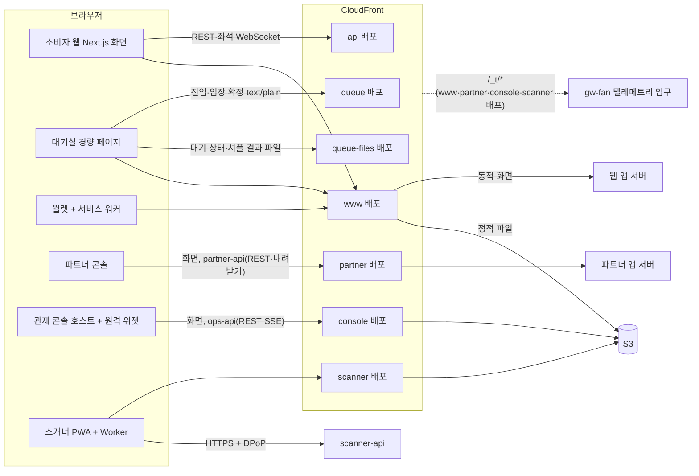
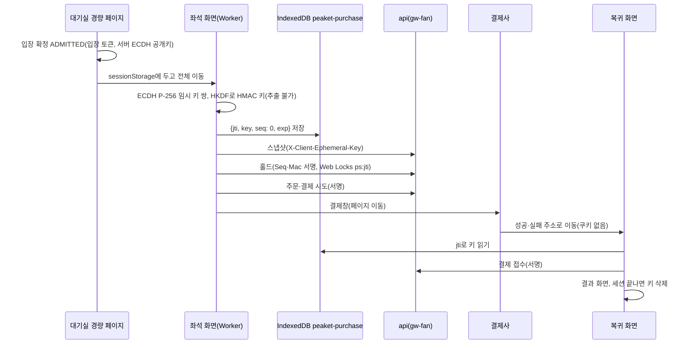

# 프론트엔드 상세 설계 (RADIO)

- **독자와 용도**: 프론트엔드 엔지니어가 모노레포(코드 전부를 저장소 하나에 폴더로 나눠 담는 방식) `peaket`의 화면 쪽(`apps/`의 앱 넷과 포렌식 리플레이 데모·관제 원격 위젯, `packages/`의 화면용 공용 패키지)을 만들 때, 그리고 리뷰어가 화면 쪽 설계가 요구사항·API(프로그램끼리 요청과 응답을 주고받는 창구) 계약·보안 판정과 맞는지 검증할 때 기준으로 읽는 정본이다. 화면을 무엇으로 그리는지, 어디에 캐시(자주 쓰는 값을 가까운 곳에 복사해 둔 것)하는지, 상태를 어느 층에 두는지, 서버·실시간 채널·다른 앱 조각과 어떤 계약으로 말하는지를 RADIO 순서로 적는다. 성능·접근성·보안·오프라인·관측(지표·로그·요청 기록으로 시스템 안을 들여다보는 일)·시험·배포를 어떻게 지키는지도 같은 순서로 적는다.
- **원문 출처**: 틀은 GreatFrontEnd 'Front End System Design Playbook'의 The RADIO Framework(2026-10-21 열람)를 따른다. 내용은 docs/architecture.md §6·§10(원문 설계서 3·4·5·6장의 프론트엔드 부분), docs/planning/02·04, docs/design/d1~d5, docs/api/*, docs/features/*, docs/security/asvs/*, docs/observability.md §11, docs/devops.md, docs/infra.md, prototype/을 모아 자세히 정했다. 결정은 [ADR-0079](adr/0079-frontend-radio-detailed-design.md)에 있다. 전역 상태 도구를 Zustand 하나로 줄인 결정은 [ADR-0092](adr/0092-single-client-state-library-zustand.md)에 있다.
- **기준 기획 버전**: v1.0.
- **표시 규칙**: 잴 값은 [가정]으로, 이 문서에서 처음 정한 세부는 '추천 적용, 2026-10-21'(ADR-0079 결정 번호)로 적는다. 2026-10-27에 더한 콘솔의 켜 둔 동안 성능 규칙(화면별 늦게 싣기, 안 보이는 위젯의 구독 멈춤, Canvas 그래프와 들고 있는 양의 상한, 장시간 시험)은 '추천 적용 2026-10-27'(ADR-0091)로 적는다. 같은 날 정한 상태 도구의 세부(에디터 문서 모양, 관제 상태 통로, 동작 이름 규칙)는 '추천 적용 2026-10-27'(ADR-0092)로 적는다. 숫자에는 증명 수준을 붙인다(docs/planning/02 §3.1 원칙 5). 증명 수준은 실측(PC), 외삽(잰 범위의 결과를 식으로 늘려 더 큰 규모의 값을 구한 것), 문서 인용, 설계 목표다. 외부 사실(라이브러리 판·브라우저 지원·표준 문장)은 2026-10-21에(ADR-0091의 것은 2026-10-27에) 원문으로 확인했고, 확인한 곳은 §6.4에 모았다.
- **쉬운 설명**: 해설서 [docs/walkthrough/](walkthrough/README.md)(ADR-0177)의 분야 편 [06 프론트엔드](walkthrough/fields/06-frontend.md)가 이 문서를 푼다. 해설서는 규범이 아니다. 쉬운 설명서 docs/guide/는 2026-11-01 소유자가 지웠다.

## 0. 이 문서를 읽는 법

### 0.1 RADIO 단계와 이 문서의 대응

RADIO 원문은 다섯 단계를 정해진 순서가 아니라 '빠뜨리지 않기 위한 목록'으로 쓰라고 한다. 요구사항(R)으로 시작하고, 아키텍처(A)와 데이터 모델(D)을 세운 뒤 인터페이스(I)를 정한다. 최적화와 깊이 파기(O)는 비기능 요구를 하나씩 파고드는 마지막 단계다. 원문의 면접용 시간 비중(R 10%, A 20%, D 10%, I 20%, O 40%)을 이 문서에서는 분량 비중으로 옮겼다.

| 단계 | 원문이 요구하는 것 | 이 문서의 절 |
| --- | --- | --- |
| R 요구사항 탐색 | 주요 사용 사례, 기능·비기능 요구, 핵심과 있으면 좋은 것, 기기·플랫폼, 주 사용자, 오프라인, 성능 요구. 합의한 요구를 적어 두고 계속 대 본다 | §1 |
| A 아키텍처 | 핵심 구성 요소와 관계, 서버는 검은 상자, 뷰 층·저장소 층·데이터 접근 층, 관심사 분리, 계산을 서버와 클라이언트 중 어디서 할지, 상자마다 맡는 일 | §2 |
| D 데이터 모델 | 서버 출처 데이터와 클라이언트 출처 데이터(보존할 것·잃어도 되는 것), 엔터티의 필드·타입·소유 구성 요소 | §3 |
| I 인터페이스 | 서버-클라이언트 통신(HTTP, 연결을 열어 둔 채 주고받는 WebSocket, 서버가 브라우저로 한 방향으로 계속 보내는 SSE, 답이 올 때까지 기다렸다가 다시 묻는 롱 폴링, GraphQL)의 이름·매개변수·반환값, 클라이언트 안 통신(속성·콜백, 저장소 액션, 발행·구독), UI 컴포넌트 API(데이터·이벤트·설정·스타일·렌더 함수 속성) | §4 |
| O 최적화와 깊이 파기 | 제품에 고유하고 중요한 영역에 집중한다: 성능, 네트워크, UX, 접근성, SEO, 다국어, 다기기, 보안. 아키텍처에 영향이 없는 주제는 다루지 않는다. 다만 화면을 그리는 전략(브라우저에서 그리는 CSR, 서버에서 그려 보내는 SSR, SSG, 미리 그려 두고 정해진 주기로 다시 그리는 ISR)과 엣지(CDN이 사용자 가까이에 둔 서버) 캐시처럼 아키텍처를 바꾸는 것은 다룬다 | §5 |

RADIO는 서버를 검은 상자로 두라고 한다. 이 문서도 게이트웨이(클라이언트 종류별로 앞에 둔 입구 서버) 뒤의 동작은 docs/architecture.md와 docs/features/*에 맡기고, 브라우저가 보는 계약(응답 코드·헤더·파일 형식·채널 메시지)만 적는다. 다만 PEAKET은 100만 명이 한꺼번에 들어오는 제품이라 브라우저의 요청 방식(간격, 요청 시각을 일부러 조금씩 흩뜨리는 지터, 캐시, 사전 요청 여부)이 서버 용량을 정한다. 그래서 '클라이언트가 만드는 부하'는 요구사항(§1.6)과 깊이 파기(§5.9)에서 숫자로 다룬다.

### 0.2 정본의 경계

이 문서가 정본인 것과 다른 문서에 맡기는 것을 아래처럼 나눈다. 두 문서가 다르게 말하면 아래 '정본' 열의 문서가 이긴다. 이 문서를 쓰면서 찾은 어긋남과 그 처리는 §6.2에 적었다.

| 주제 | 정본 | 이 문서의 몫 |
| --- | --- | --- |
| 프론트엔드 구조(앱·패키지·계층·경계), 경로별 렌더링·캐시·헤더 표, 클라이언트 상태 모델, 브라우저 저장소 규칙, 클라이언트 인터페이스(api-client·실시간 채널 클라이언트·원격 위젯 계약·핵심 컴포넌트 API), 성능 예산 표, 프론트엔드 시험·빌드·배포 | **이 문서** | 전부 |
| 기술 스택 요약과 상태 소유권 매트릭스 | docs/architecture.md §6(요약) → 세부는 이 문서 | §2.3·§3.1에서 자세히 정하고, 고친 곳은 §6.2에 있다 |
| 화면 목록·배치·셸·흐름·알림·오류 문구 | docs/design/d5-screen-blueprint.md, docs/planning/04 §3 | SCR·CMP ID로 참조만 한다 |
| 디자인 토큰·컴포넌트 시각 규칙·대비 | docs/design/d2-design-system.md, docs/design/tokens.json | 토큰 파이프라인과 번들(브라우저가 내려받는 자바스크립트 묶음) 예산만 |
| REST·실시간 계약(경로·필드·코드) | docs/api/openapi.yaml, docs/api/asyncapi.yaml, docs/api/guidelines.md | 클라이언트 쪽 정책(재시도·시간 초과·오류 표시)과, 계약이 비어 있어 이 문서가 먼저 낸 초안(§4, wbs 0.2.3에서 계약으로 옮긴다) |
| 기능 동작(대기열·좌석·결제·발권·현장·관제·정산·분석) | docs/features/*.md | 브라우저가 맡는 몫만 |
| 보안 판정 | docs/security/asvs/*.md(공통 웹 클라이언트는 asvs/frontend.md) | 구현 위치와 헤더 값 |
| 브라우저 지표의 표본·보호·전송 | docs/observability.md §11 | 계측 지점과 사건 이름(§5.16) |
| 빌드·서명·승격·동결 창 | docs/devops.md | 프론트엔드 산출물의 특수 규칙(§5.18) |
| CDN 배포·호스트·보안 헤더를 붙이는 곳 | docs/infra.md | 경로별 표에서 참조 |

### 0.3 이 문서에서 쓰는 이름

- **앱**: 소비자 웹(`apps/web`, `www.peaket.example`), 파트너 콘솔(`apps/partner`, `partner.peaket.example`), 관제 콘솔(`apps/console-host`, `console.peaket.example`), 게이트 스캐너 PWA(설치형 앱처럼 쓰는 웹 앱. `apps/scanner`, `scanner.peaket.example`). 소비자 웹 안의 **대기실 경량 페이지**(`apps/web/queue-room`)와 **월렛**(`/my/tickets`)은 따로 부른다.
- **API 호스트**: `api`(gw-fan), `queue`(gw-queue), `queue-files`(대기열 파일 배포), `partner-api`(gw-partner, partner 배포), `ops-api`(gw-ops, console 배포), `scanner-api`(gw-scanner). 모두 화면 호스트와 다른 출처이고 같은 사이트(`peaket.example`)다.
- **원격 위젯**: 관제 콘솔에 Module Federation으로 끼우는 화면 조각이다. 그 서비스를 맡은 가상 팀이 `apps/widgets/<원격 이름>`(대기열 `queue`, 구매 `purchase`)에서 만들고, 관제 호스트와 따로 배포한다(ADR-0165).
- **흐름 표시값**: 브라우저가 재서 보내는 업무 지연(대기 반영 시간, 좌석 델타 종단 지연, 좌석맵 준비 시간, 결제 확정 시간, 스캔 판정 시간).

## 1. 요구사항(R)

### 1.1 제품과 사용자

| 앱 | 주 사용자 | 기기 | 규모(설계 목표) | 셸(CMP-065) | 테마 | 인증 |
| --- | --- | --- | --- | --- | --- | --- |
| 소비자 웹 | 팬(현장 스태프의 휴대폰 화면 SCR-050·051·061 포함) | 휴대폰 우선, 태블릿, 데스크톱. iOS·iPadOS 16.4 이상(NFR-019) | 동시 대기 100만, T=0 진입 초당 20만, 공연 페이지 초당 30만, 좌석 단계 동시 5,000(architecture §9.1) | web-default, web-focus(대기실·좌석·결제), web-staff | 시스템 따라 | 소셜 로그인 + 휴대폰 본인확인, 팬 쿠키(브라우저가 사이트별로 저장했다가 요청마다 함께 보내는 작은 값) |
| 파트너 콘솔 | `partner_admin`·`partner_member` | 데스크톱·태블릿, 휴대폰은 보기와 일부 일(docs/design/d5 §3.9) | 운영자 수십 명 [가정] | partner | 시스템 따라 | 비밀번호 + 인증 앱이 시간에 따라 새로 만드는 일회용 코드(TOTP), 파트너 쿠키 |
| 관제 콘솔 | viewer·operator·commander·`cs_agent`·`cs_lead` | 데스크톱 1280×800 기본, 태블릿·휴대폰(360px부터) | 운영자 10명 동시, 설계 50명(NFR-008) | console | 데스크톱 배치는 다크 기본, 휴대폰·태블릿 배치는 OS 테마가 처음 값(`/me`의 [화면 테마]로 바꿈, docs/design/d1 §4, 기술 검토 낮음-104) | 비밀번호 + 인증 앱, 허용 IP·VPN, 운영자 쿠키 |
| 게이트 스캐너 | `gate_staff`·`gate_lead` | 관리형 Android 휴대폰·태블릿, Chrome 설치형 PWA | 게이트당 분당 60명(NFR-010) | scanner | 라이트 고정 | 기기 키 DPoP(요청마다 기기 안의 키로 서명한 증명, RFC 9449. mTLS는 운영 선택지) + 기기 승인 로그인(RFC 8628) |
| 포렌식 리플레이 1단계 데모(ADR-0080) | 누구나(합성 데이터라 개인정보가 없다) | 데스크톱·태블릿, 휴대폰은 리플레이 보기만 | 사건 300만·좌석 10만 [가정] | 없다(자체 머리) | 다크 고정(관제와 같은 디자인 토큰) | 없다(2단계는 관제 콘솔 인증) |

### 1.2 핵심 사용 사례와 있으면 좋은 것

| 앱 | 핵심(이것이 안 되면 제품이 아님) | 있으면 좋은 것(꺼져도 핵심은 동작) |
| --- | --- | --- |
| 소비자 웹 | 공연 상세 보기, 본인확인, 로비 참가와 무작위로 섞은 셔플 순번 받기, 오픈 뒤 진입·대기·차례 입장, 좌석 고르기·홀드(결제하는 동안 좌석을 잠시 잡아 두는 것), 주문·결제·결과 확인, 월렛 회전 QR(오프라인), 양도·예매 취소, 로그인·세션 | 홈 랭킹·테마, 자동완성·관련 공연, 후기와 신고, 찜(공연 단위), 굿즈·부가 상품, 셔플 검증 화면, 오픈 알림 웹 푸시 |
| 파트너 콘솔 | 공연 등록 위저드, 좌석맵 에디터, 판매 승인 요청, 실시간 판매 현황, 현장 스태프·현장 운영, 정산서·명단 | 상품 빌더, 웹훅(일이 생기면 서버가 미리 등록한 주소를 불러 알려 주는 방식), 판매 요약 리포트 |
| 관제 콘솔 | 온세일(판매가 열리는 시각 앞뒤로 접속이 몰리는 기간) 대시보드(T-30분 점검·T=0·판매 중), 운영 명령과 2인 승인, 경보 패널, 판매 승인, 법정 조치 | 봇 표본 검토, 홈 구성, 리포트 판 보기 |
| 게이트 스캐너 | 기기 승인 로그인, 근무 준비(목록 받기·시계 보정), 오프라인 판정, 기록 업로드·변경분, 현장 관리(책임자) | 기기 목록 보기, 이상 표시 처리 화면의 부가 정보 |

명령 9(비핵심 기능 끄기)로 끌 수 있는 것은 후기, 인접 좌석 추천, 찜이다(POL-021). 과부하 때 게이트웨이가 먼저 막는 것도 후기와 굿즈다(architecture §5). 그래서 화면은 이 기능이 503을 돌려주거나 꺼진 상태일 때도 핵심 흐름을 막지 않고 그 자리만 비운다.

### 1.3 앱별 기능 요구

기능 요구의 정본은 docs/planning/02 §2이고 화면 정본은 docs/planning/04 §3이다. 아래는 브라우저가 맡는 몫을 묶은 것이다.

| 묶음 | FR | 화면 | 브라우저가 할 일 |
| --- | --- | --- | --- |
| 탐색·공연 정보 | FR-003·004·016·018·019·053 | SCR-001·002·003·016·018·054·057 | ISR로 화면 그리기, 개인 영역(찜·알림 상태)만 클라이언트에서 요청, 고지 문장을 본문에 늘 노출, 자동완성 combobox·이전 요청 취소·한글 조합 중 키 거르기·정규화한 요청(docs/features/search.md), 오프라인 찜 대기열 |
| 계정·본인확인 | FR-001·002·017·048 | SCR-004·005·006·017·039·040 | 버튼을 누를 때만 로그인 시작, 기관 창을 사용자 동작 안에서 열고 결과를 `BroadcastChannel`로 받기, 재인증 대화상자, 세션 끝 사유 표시 |
| 로비·대기열 | FR-005·006·007·008·020·038·050 | SCR-007·008·009·018·019 | 참가 토큰(로비 참가를 증명하는 서명된 문자열)·대기표 보관, 셔플·묶음 결과 분산 조회, 대기 상태 파일 적응형 폴링, 앞 인원·진행 막대 계산, 차례 판정과 입장 확정, 희망 조건 보관, 탭 제목·소리·웹 푸시 |
| 좌석·홀드 | FR-009·010·042·050 | SCR-010 | 5만 석 Canvas, 구역 구독과 델타(바뀐 좌석만 담은 작은 메시지) 반영, 스냅샷(어느 시점의 전체 상태를 찍어 둔 것)으로 재동기화, 접근성 목록, 홀드 서명 요청, 카운트다운과 1회 연장, 자동 배정 결과 |
| 결제 | FR-011·014·015·053 | SCR-011·012·015 | 서버 금액 표시, 결제사별 결제창, 복귀 화면에서 결제 접수, 결과 롱 폴링, 초안 복구(개인정보 제외) |
| 월렛·현장(팬) | FR-012·013·047·060 | SCR-013·014·038·041·043·060 | 입장용 휴대폰 등록(밖으로 꺼낼 수 없는 키), 15초 회전 QR(완전 오프라인), 오프라인 캐시, 양도·돌려주기·취소, 부스 재발급 |
| 파트너 | FR-021~027·046·052·055·062·066 | SCR-020~027·037·044·062·063 | 위저드 자동 임시저장, 좌석맵 에디터(브라우저 자동 채우기 계산, Undo·Redo 10단계 정확 복원), DSL 시뮬레이션, 판매 현황 1분 주기 조회(2026-10-28 SSE에서 바꿈, §4.4.3, 기술 검토 낮음-024), 명단 사유 입력과 스트리밍 내려받기, 현장 운영 10초 [가정] 갱신 |
| 관제 | FR-028~034·051·052·057~059·062~065·068 | SCR-028~032·045~049·053·064~068 | 단계 탭과 위젯, 신선도 표시, 명령 수명주기(dry-run·재인증·2인 승인·ack), 경보 패널, 판매 승인과 수요 예측, 법정 기한 카운트다운 |
| 스캐너 | FR-035·036·046·065·066·067 | SCR-033~036·052 | 기기 승인 로그인, 목록 받기, 시계 보정, Worker 디코딩·판정, 로컬 큐와 업로드, 60초 변경분, 화면 꺼짐 방지, 책임자 기능 |

### 1.4 비기능 요구

| NFR | 목표(정본 숫자) | 브라우저 쪽 의미 | 재는 곳 |
| --- | --- | --- | --- |
| NFR-002 대기 상태 전파 | 입장 임박군 차례 반영 p99 3초(2026-11-04 ADR-0185로 2초에서 바꿈, p99: 백 건 중 아흔아홉 건이 이 시간 안에 끝난다는 뜻), 그 밖은 '폴링 주기 × 1.2 + 생성 1초 + 그 구간 캐시 수명'(설계 식) | 0.5초 폴링 구간에서 차례(serving ≥ 내 번호)를 그린 시각과 serving이 내 번호를 넘은 전진 시각(`servingSteps`)의 차이를 흐름 표시값 `queue_reflect_ms`로 잰다(ADR-0110) | RUM(밀리초 서버 시각 보정, §3.3) |
| NFR-004 좌석 상태 전파 | 종단 p99 300ms(변경 → 화면, 묶음 대기 포함), 버전 갭을 30초 안에 스스로 메우는 비율 99.9% | 델타 머리의 서버 시각에서 묶음 대기(`maxWaitMs`)를 뺀 변경 시각과 화면에 반영한 시각의 차이 `seat_delta_e2e_ms`(ADR-0110) | RUM(WebSocket 왕복 시계 보정) |
| NFR-006 결제 확정 | 결제 요청부터 확정 화면을 그릴 때까지 p99 3초 | 결제 접수 직전부터 확정 화면을 그릴 때까지 `payment_confirm_ms` | RUM + 서버 추적 |
| NFR-007 공연 페이지 | 엣지 TTFB p99 150ms, LCP p75 2.5초(LCP: 화면의 가장 큰 요소가 보이기까지 걸린 시간) | ISR·엣지 캐시, 이미지·글꼴 최적화 | CloudFront(AWS의 CDN) 지표, RUM |
| NFR-010 현장 판정 | 단말 판정 p95 150ms(오프라인 포함, 판정 백 건 중 아흔다섯 건이 이 시간 안에 끝난다는 뜻) | Worker 디코딩·검증 | 스캐너 지표(§5.5) |
| NFR-012 사용자 체감 | INP 200ms·LCP 2.5초·CLS 0.1 이하(p75, 모바일·데스크톱 따로. INP: 조작에 화면이 반응하기까지 걸린 시간, CLS: 화면이 갑자기 밀리는 정도), FCP 1.8초·TTFB 0.8초, 주요 경로에서 50ms 이상 걸리는 긴 작업 0, 좌석맵은 대기실 통과 뒤 1초 미만, 힙 v0 대비 70% 감축, 대기실 JS 50KB(gzip)·CSS 10KB 미만 | 경로별 예산 표(§5.8), 대기실 경량 페이지(§5.1) | 포트폴리오 판정은 랩(Playwright 조작 + web-vitals, 20회 [가정] 반복 p75), 운영 판정은 RUM(§5.8). Lighthouse CI(코드를 올릴 때마다 자동으로 도는 페이지 검사)는 회귀 방지, memlab |
| NFR-016 보안 | 웹 앱 보안 검증 항목 목록인 ASVS 5.0.0 L2의 모든 항목 판정 | 화면 묶음별 헤더, 저장소 규칙, 공급망 | asvs/frontend.md와 기능 표 |
| NFR-019 지원 플랫폼 | Baseline(주요 브라우저가 모두 지원하는지 알려 주는 웹 기능 기준)의 'Widely available'(모두 지원한 지 30개월이 지난 단계) 기능은 모두 쓰고, 그보다 새 기술은 점진적 향상(지원하지 않는 브라우저에서도 핵심 기능은 그대로 돌게 하는 방식)으로만 쓴다. 소비자 웹은 Chrome·Safari·Samsung Internet·Edge·Whale 최신 2개 메이저 버전과 iOS·iPadOS 16.4 이상을 지원한다 | §1.5 표의 대체 동작 | Playwright 3엔진(Chromium·WebKit·Firefox) + 실제 기기 시험(§1.5) |
| NFR-020 접근성 | 웹 접근성 국제 기준 WCAG 2.2 AA 위반 0, 좌석 선택·결제·양도를 NVDA·VoiceOver·TalkBack으로 끝까지 마치는 비율 100%(조합·시나리오마다 3회 [가정], 개발자 수동 시험) | §5.11 | axe, 수동 시나리오 |
| NFR-024 국제화 | ko·en·ja·zh, 로케일이 늘어도 초기 번들은 그대로, 누락 키 0 | §5.12 | 번역 키 검사, 로케일별 번들 크기 |
| NFR-025 정합성 | 재접속 순번 보존 100%, 다중 탭·다기기 한도 초과 0 | 저장소 규칙(§3.12), 다중 탭 조정(§5.9) | 시험 FE-T5·FE-T6 |

K5(5만 석 좌석맵 프론트 성능)와 K10(오프라인 입장)은 docs/planning/01 §3.1의 증명 과제다. 이 문서의 좌석맵 구조(§5.2)와 스캐너 구조(§5.5)가 그 해결책이고, 측정은 wbs 7.5.2에서 한다.

### 1.5 기기·브라우저와 기능별 대체 동작

지원 범위는 NFR-019가 정본이다. 아래 표는 이 설계가 기대는 브라우저 기능과, 그 기능이 없을 때 화면이 하는 일이다(ASVS 3.1.1·3.7.5 채택, asvs/frontend.md). 지원 판은 web-features 3.43.0과 @mdn/browser-compat-data 8.1.6(2026-10-21 조회) 기준이다.

| 기능 | 쓰는 곳 | 지원(요지) | 없을 때 |
| --- | --- | --- | --- |
| WebCrypto ECDSA·ECDH P-256, HKDF, HMAC | 구매 세션 키(§5.3), 월렛 QR 서명(§5.4), 스캐너 검증(§5.5) | Baseline 넓게 지원(Safari 7부터 P-256) | 예매 단계와 입장용 등록에 들어가지 않고 SCR-059 '미지원'을 보인다 |
| Ed25519·X25519 | 쓰지 않는다 | Safari 17·Chrome 133~137부터 | iOS 16.4를 지원하려고 P-256만 쓴다 |
| IndexedDB(추출 불가 `CryptoKey` 저장) | 구매 세션 키, 월렛, 스캐너 | Baseline | 사생활 보호 모드 등에서 열리지 않으면 예매 단계는 SCR-059 '미지원'을, 월렛은 '이 브라우저에서는 입장용 등록을 할 수 없습니다'를 보인다 |
| Web Locks, BroadcastChannel | 일련번호 잠금, 탭 조정 | Safari 15.4부터 | 지원 범위(16.4) 안이라 대체 동작을 두지 않는다 |
| OffscreenCanvas 2D, Worker 안 `requestAnimationFrame` | 좌석맵 | Safari 16.4부터 | 같은 그리기 모듈을 메인 스레드에서 돌린다(§5.2) |
| SharedArrayBuffer(교차 출처 격리) | 포렌식 리플레이 데모가 성능 목표를 못 맞출 때만 더한다(§5.19, 1단계는 복사 방식 하나, 기술 검토 낮음-049). 좌석맵은 쓰지 않고, 바뀐 구역만 메시지로 받는 한 길이다(§5.2, 추천 적용 2026-10-28, 기술 검토 중간-015) | COOP·COEP로 교차 출처 격리를 켠 문서에서만. 좌석 라우트에는 COEP를 두지 않는다 | 포렌식 데모는 복사 방식으로 돈다(docs/features/forensic-replay.md §3.3) |
| Service Worker, Push | 월렛 오프라인, 웹 푸시 | Baseline. iOS 웹 푸시는 홈 화면 앱에서만 | 오프라인 QR은 IndexedDB(브라우저 안에 데이터를 저장하는 곳)만으로도 그린다(앱 셸이 캐시에 없으면 '연결이 필요합니다'). 웹 푸시가 없으면 탭 제목·소리·이메일(CMP-068)로 알린다 |
| `StorageManager.persist()`·`estimate()` | 월렛·스캐너 | persist Safari 15.2, estimate Safari 17 | 요청 실패를 기록하고 iOS 7일 안내(§5.4)를 보인다 |
| Screen Wake Lock | 월렛 QR, 스캐너 | iOS 18.4, Android Chrome 84 | 밝기·자동 잠금 안내 글자만 보인다 |
| BarcodeDetector | 스캐너 | Android Chrome만 | zxing-wasm(§5.5) |
| Battery Status API | 저전력 때 로비 효과 끄기(SCR-007) | Chromium만(Safari는 지원하지 않는다) | 움직임 줄이기 설정만 따른다(§6.3 한계) |
| `scheduler.yield()` | 긴 작업 나누기 | Safari는 지원하지 않는다 | `MessageChannel`로 다음 작업에 넘기는 공용 함수 |
| `AbortSignal.any` | api-client의 시간 초과와 화면을 떠날 때의 취소 신호 묶기(§4.1) | Chrome 116·Firefox 124·Safari 17.4부터(BCD 8.1.7, 2026-10-28 조회). 그래서 지원 범위 안의 iOS·iPadOS 16.4~17.3에는 없다. `AbortSignal.timeout`은 Safari 16부터라 범위 안이다 | 공용 함수 `anySignal(signals)`가 대신한다(추천 적용 2026-10-28, 기술 검토 중간-095). `AbortController` 하나를 만들어 두 신호의 `abort` 사건을 잇고, 먼저 끊긴 신호의 `reason`(`TimeoutError`·`AbortError`)을 그대로 넘긴다. 이미 끊긴 신호가 있으면 바로 끊고, 끝나면 듣기를 지워 오래 사는 신호에 쌓이지 않게 한다. `AbortSignal.any`가 있으면 그것을 쓴다 |
| Trusted Types | 악성 스크립트를 페이지에 끼워 넣는 DOM XSS 줄이기(보고 모드) | Baseline 2026-02(Safari 26, Firefox 148) | 무시된다(보고만 비어 있다) |
| `fetch` keepalive | `/_t/*` 전송 | Firefox 133·Safari 13부터 | `sendBeacon`(쿠키가 실려 가므로 게이트웨이가 지운다, observability §11) |
| CSP `report-to`·`Reporting-Endpoints` | 위반 보고 | Safari 16.4, Firefox 149 | 보고가 빠질 뿐 차단은 동작한다 |
| LCP·INP 측정 | RUM | LCP·INP Safari 26.2, Firefox 122·144. CLS는 Chromium만 | 그 지표 칸을 비운다(0으로 채우지 않는다) |
| `Element.ariaNotify` | 쓰지 않는다 | 새 기능(Baseline이 아니다) | `aria-live` 영역 |
| 인앱 브라우저 | 둘러보기·상세까지 | 앱마다 다르다 | 대기실·입장용 등록 전에 SCR-058을 보인다 |

새 브라우저 기능은 쓰기 전에 지원 판을 확인한다. `packages/config`의 ESLint 설정(`eslint/web-compat.mjs`)에 `eslint-plugin-compat`을 두고, 목표 브라우저는 browserslist 질의로 NFR-019와 같게 적는다(주요 브라우저의 최신 2개 판과 iOS·iPadOS Safari 16.4 이상). 이 린트는 목표 밖의 웹 API(예: `AbortSignal.any`)를 쓴 PR을 막는다. ES 내장 기능(예: `Promise.withResolvers`, Safari 17.4부터)은 실험 설정 `lintAllEsApis`를 켜야 보므로 켠다. `if (AbortSignal.any)`처럼 기능을 먼저 확인하고 쓰는 코드는 보고하지 않는다(추천 적용 2026-10-28, 기술 검토 중간-095).

다만 `eslint-plugin-compat` 7.0.2는 판 자료를 ast-metadata-inferer 0.8.1에서 가져와 `AbortSignal.any`·`Promise.withResolvers`·`Object.groupBy` 같은 새 기능을 아예 모른다(2026-11-04 BAS-210에서 확인). 그래서 MDN 브라우저 지원 자료(`@mdn/browser-compat-data`, 판은 잠금 파일)를 직접 읽는 보조 규칙 `peaket-compat/bcd`(`eslint/bcd-rule.mjs`)를 함께 건다. 이 규칙은 전역 이름(`OffscreenCanvas`), 전역 이름의 속성(`AbortSignal.any`), `navigator`·`document` 같은 전역 객체의 속성을 본다. 타입을 알아야 하는 인스턴스 메서드(`[].toSorted()`)와 두 단계 넘는 속성(`navigator.storage.estimate`)은 보지 않는다. 같은 함수(또는 모듈 맨 위) 안에서 `typeof`·`if`·`?:`·`&&`·`||`·`in`·`?.`로 먼저 확인한 뒤(소스 차례로 확인보다 뒤)의 사용은 보고하지 않는다. TypeScript 문법(`as`·`!`)을 거친 확인도 알아보고, `globalThis.X.y`·`window.X.y`는 `X.y`로 본다(2026-11-04 구간 1 끝 정리). 목표 브라우저 질의에는 스캐너·관제의 Android Chrome(`last 2 ChromeAndroid versions`)도 든다. 계약 생성물(`packages/contracts/src/gen`)만 린트에서 빼고, 화면이 묶는 생성물(`packages/ds/src/gen` 토큰, BAS-040의 `packages/api-client/src/gen`)은 이 린트를 받는다. 부분 지원은 지원으로 친다(대개 특정 인자에서만 다르게 돌아 이름만으로 막으면 헛보고가 많다. 예: iOS의 `window.open`은 `_blank` 대상만 안 된다). 위 표의 대체 함수(`anySignal` 등)는 기능을 먼저 확인하고 쓰므로 `polyfills` 설정에 적지 않는다. 거기 적으면 그 기능을 바로 부르는 코드도 통과하기 때문이다. Node에서 도는 시험 파일(`*.test.*` 등)은 보지 않는다. 린트는 뿌리 `pnpm lint`가 화면 앱과 화면 패키지(ds·api-client·telemetry·validation·console-contract)에 돌린다. 린트가 쓰는 판 자료가 늦거나 부분 지원을 놓칠 수 있어 정본은 위 표다.

브라우저 사이의 차이는 Playwright 3엔진(Chromium·WebKit·Firefox)으로 PR(코드 변경을 합쳐 달라는 요청)마다 하는 시험과, 메이저 릴리스마다 실제 기기로 하는 시험(iOS Safari·Samsung Internet·카카오톡 인앱, 콘솔은 iOS·iPadOS Safari·Android Chrome)으로 본다(NFR-019).

### 1.6 클라이언트가 만드는 부하

브라우저가 요청을 어떻게 보내는지가 서버 용량을 정한다. 아래 숫자는 architecture §9.1과 verification §3.1의 설계 식을 브라우저 쪽에서 다시 적은 것이다.

| 상황 | 브라우저 동작 | 요청량(증명 수준) | 이 문서의 규칙 |
| --- | --- | --- | --- |
| T=0 오픈 직후 진입 | 진입 `POST`를 `text/plain` 본문으로, 사용자 헤더 없이 보낸다 | 초당 20만(새로고침 증폭 포함, 설계 목표). 사전 요청은 0 | §4.1 T=0 두 호출 규칙, FE-T3 |
| 셔플 결과 받기 | 참가 토큰의 해시(원래 값으로 되돌릴 수 없게 바꾼 고정 길이 값)로 정한 0~8초 [가정] 안에 한 번 받는다 | 초당 약 12.5만, 약 36Gbps(외삽) | 해시로 정한 지연은 토큰마다 고정이라 새로고침해도 빨라지지 않는다(§4.2) |
| 대기 상태 폴링 | 예상 대기 1분 이내면 0.5초, 1~5분이면 5초, 그 밖은 20초 간격, ±20% 지터, `cache: "no-store"`(ADR-0110) | CDN(사용자 가까운 곳에 파일을 복사해 두고 대신 응답하는 전송망) 초당 약 5.4만, 원본 초당 약 1,000(외삽) | 같은 회차를 연 여러 탭 가운데 한 탭만 폴링한다(§5.9) |
| 차례 직전 직접 확인(자동 배정) | 예상 대기 10초 [가정] 안에서 1초 이상 간격 | 원본 초당 수백 건(외삽) | `NOT_YET`의 `retryAfterMs`를 지킨다 |
| 좌석 단계 | WebSocket 1개, 보이는 구역만 구독, 전체 보기 구역은 5초 [가정] 스냅샷 | 연결 5,000, 스냅샷 초당 약 1,000건(외삽) | 구독 전환은 1초 머문 뒤, 재연결 지터(§4.4) |
| 구매 경로 사전 요청 | `X-Admission-Token`·`X-Purchase-*`·`Idempotency-Key` 때문에 교차 출처 사전 요청이 생긴다 | 홀드 경로는 첫 요청에 한 번(캐시 7,200초), 홀드 ID·주문 ID가 든 경로는 매번 한 번 | 지연 예산에 왕복 한 번을 넣고 wbs 7.5.2에서 잰다(§5.9) |
| 브라우저 지표 | 표본은 대기·로비 1%, 좌석·결제 100%, 그 밖 10% [가정]. 화면이 보이는 동안 60초 [가정]마다 한 묶음, 화면을 숨길 때 한 묶음을 보낸다 | 대기실 100만 명(표본 1%면 1만 세션)이면 초당 약 170건, 좌석·결제 5,000이면 초당 약 80건(외삽, 표본 비율 [가정]) | 한 묶음은 64KiB 이하(§5.16) |

### 1.7 오프라인 요구

| 앱 | 오프라인에서 되어야 하는 것 | 되지 않아도 되는 것 |
| --- | --- | --- |
| 소비자 웹 월렛 | 등록한 티켓의 회전 QR 생성과 표시(비행기 모드), 마지막 동기화 시각 | 양도·취소·재발급, 새 티켓 받기 |
| 소비자 웹 그 밖 | 오프라인 배너와 '연결되면 저장됩니다'(찜, FR-019), 대기실은 마지막 값 유지와 '연결 확인 중' | 대기·예매·결제 진행 |
| 스캐너 | 근무 준비 뒤 판정 전부(목록·키·폐기 목록·입장 상태), 스캔 기록 쌓기 | 기기 배치 변경, 부스 허용(책임자), 새 목록 받기 |
| 파트너·관제 | 없다(오프라인 배너와 다시 시도) | 전부 |

### 1.8 범위 밖과 전제

- 네이티브 앱은 만들지 않는다. 하드웨어 보안 모듈에 키를 묶는 일은 네이티브에서만 되므로 남는 한계로 둔다(docs/planning/01 §5.2).
- 데스크톱 브라우저에서도 월렛 QR은 보이지만 입장용 등록은 휴대폰을 먼저 권한다(SCR-013).
- 서버 동작은 검은 상자다. 브라우저 계약이 비어 있는 곳은 이 문서가 초안을 내고 wbs 0.2.3에서 계약 문서로 옮긴다(ADR-0079 결정 32).
- 디자인 캔버스(아티팩트)는 이 문서와 따로 고친다. 화면 정본은 docs/design/d5다.

## 2. 아키텍처(A)

### 2.1 전체 그림

서버 쪽(게이트웨이 뒤)은 검은 상자로 둔다. 브라우저가 무엇을 어디서 받는지만 그린다.



- 화면 호스트 넷과 API 호스트 여섯은 서로 다른 출처이고 같은 사이트다(ADR-0065 결정 1). 그래서 화면에서 API로 가는 호출은 모두 교차 출처이고, CORS(다른 주소에서 온 요청을 브라우저가 허용할지 정하는 규칙)를 거친다.
- CloudFront 배포는 그림의 일곱이다. API 호스트 `partner-api`는 partner 배포에, `ops-api`는 console 배포에 대체 도메인으로 두고, 경로 `/v1/*`가 각 게이트웨이(gw-partner·gw-ops)로 간다. 화면과 같은 배포를 쓰지만 호스트가 달라 출처도 다르다. `scanner-api`만 CloudFront를 거치지 않고 스캐너 NLB로 바로 간다(추천 적용 2026-10-29, ADR-0144 결정 3).
- 브라우저 지표(`/_t/*`)만 화면 호스트의 같은 출처 경로다. 네 배포 모두 이 지표를 gw-fan의 텔레메트리(시스템이 내보내는 지표·로그·요청 기록 같은 운영 신호) 입구로 보낸다(ADR-0079 결정 13).
- 요청이 가장 많이 지나는 핫패스(대기열 진입, 좌석 홀드, 결제 접수)는 Next.js(웹 화면을 만드는 프레임워크) 앱 서버를 거치지 않고, 브라우저에서 게이트웨이로 바로 간다(architecture §4).

### 2.2 저장소와 패키지 구조

화면 코드는 모노레포 `peaket`의 `apps/`와 `packages/`에 있다. 빌드 도구는 Turborepo 2.11 + pnpm 12이고, 서버·작업자 코드와 같은 pnpm 작업 공간(한 저장소 안의 여러 패키지를 함께 설치하고 서로 잇게 묶은 것) 하나에 든다(architecture §10, ADR-0165). 아래는 그 가운데 화면 쪽 폴더이고, 구조는 이 문서가 정한 것이다(ADR-0079 결정 21). 문서·서버·데이터·인프라 폴더는 devops §2.1에 있다.

```text
peaket/
  apps/
    web/                 소비자 웹(Next.js 16 App Router)
      app/               Next.js 경로(App Router). src/_app·src/_pages의 것을 다시 내보내기만 한다. 루트 레이아웃이 다른 경로 묶음 둘: (cached) 묶음 A, (request) 묶음 B·E·F(§2.5)
      src/_app/ _pages/  FSD의 app·pages 층(Next.js 폴더 이름과 겹치지 않게 밑줄을 붙인다)
      src/widgets/ features/ entities/ shared/   FSD 층
      queue-room/        대기실 경량 페이지(별도 빌드, React 없음)
      workers/           좌석 Worker 진입점(packages/seatmap + purchase-signer)
      wallet-sw/         월렛 서비스 워커
    partner/             파트너 콘솔(Next.js 16, api-client 훅, 묶는 화면만 서버 컴포넌트)
    console-host/        관제 콘솔 호스트(webpack 5 + Module Federation)
    scanner/             스캐너 PWA(Vite 8 + vite-plugin-pwa)
    forensics/           포렌식 리플레이 1단계 데모(Vite 8, 정적, ADR-0080)
    widgets/queue/       관제 원격 위젯(대기열 팀 주인, §4.5)
    widgets/purchase/    관제 원격 위젯(구매 팀 주인, §4.5)
  packages/
    api-client/          orval 생성물 + 실행 정책(§4.1)
    telemetry/           lite(대기실)·full 두 판(§5.16)
    validation/          Zod 4 스키마(요청·응답은 @peaket/contracts의 생성 스키마를 다시 내보내고, 손으로는 계약에 적을 수 없는 규칙만) + 판매 정책 DSL AST 평가기(서버와 같이 씀)
    contracts/           계약(openapi·asyncapi)에서 orval이 만든 Zod 스키마·타입과 Pact 파일(서버와 같이 씀, ADR-0165)
    ds/                  디자인 토큰 빌드(Style Dictionary 5) + 컴포넌트(@seed-design/react 3)
    console-contract/    관제 원격 위젯 계약(§4.5)
    seatmap/             좌석맵 열 배열·격자 색인·그리기 Worker(web·forensics, ADR-0080 결정 5)
    config/              ESLint·TypeScript·Steiger·size-limit 설정
```

| 규칙 | 내용 |
| --- | --- |
| 층 의존 | FSD 층은 위에서 아래로만 가져온다(`_app` → `_pages` → `widgets` → `features` → `entities` → `shared`). 이 규칙은 FSD 구조 검사 도구 Steiger의 `fsd/forbidden-imports`(위 층 가져오기와 같은 층 조각끼리 가져오기를 막는 규칙) 하나로 막는다. ESLint 가져오기 제한은 앱·패키지 사이 경계(아래 '앱 사이'·'대기실 경량 페이지'·'원격 위젯' 행)만 맡는다. 같은 규칙을 두 도구로 막지 않는다(architecture §6.5, 추천 적용 2026-10-28, 기술 검토 낮음-098) |
| Next.js 경로 폴더 | 소비자 웹과 파트너 콘솔은 Next.js `app/`을 앱 뿌리에 두고, 그 안의 `page.tsx`·`layout.tsx`·경로 처리기는 `src/_pages`·`src/_app`의 것을 다시 내보내기만 한다. FSD 층 `app`·`pages`는 `src/_app`·`src/_pages`로 이름을 바꾼다. FSD 공식 Next.js 안내가 이름이 겹치지 않게 이렇게 하라고 하고, 그래야 Steiger가 pages 층을 따로 본다(추천 적용 2026-10-28, 기술 검토 낮음-098) |
| 앱 사이 | 앱은 다른 앱을 가져오지 않는다. 함께 쓰는 것은 `packages/`로 올린다 |
| 대기실 경량 페이지 | `queue-room/`은 `packages/api-client`의 대기열 부분, `packages/telemetry`의 lite 판, `packages/ds`의 토큰 부분집합 CSS만 가져온다. React(화면 라이브러리)·Next.js를 가져오면 린트가 막는다 |
| 소비자 웹 경로 묶음 | `app/(cached)/`에는 CDN이 캐시하는 화면(헤더 묶음 A)만, `app/(request)/`에는 요청마다 nonce로 그리는 화면(B·E·F)만 둔다. 두 묶음은 루트 레이아웃(모든 화면을 감싸는 맨 바깥 레이아웃)을 따로 갖는다. `(request)`의 루트 레이아웃은 요청의 nonce를 읽어 정적 셸 없이 그린다(§2.5). 어느 묶음에 둘지는 §2.5 표의 헤더 묶음 열을 따르고, 맞지 않으면 린트가 막는다(추천 적용 2026-10-28, 기술 검토 중간-094) |
| SEED CSS | SEED 전체 CSS(`all*.css`)는 가져오지 않는다(린트가 막는다). 부품 CSS는 `@seed-design/react` 부품이 가져오는 자기 recipe만 실리고, base·recipe 모두 층 판(`*.layered.css`)이다. 층 순서 선언 `@layer theme, base, seed-base, seed-components, components, utilities;`는 앱이 가장 먼저 싣는 CSS 파일 맨 앞에 둔다. 층 판은 내보내기 조건 `seed-layered`로 고르는데(Vite `resolve.conditions`, webpack `resolve.conditionNames`), Next.js 앱은 `turbopack.resolveAlias`에 `@peaket/ds/seed-layered-alias`가 만든 표(recipe → 층 판 파일)를 준다(PoC FE-T36 2026-11-04). Vite·webpack 앱의 진입점은 전역 CSS(층 순서 선언이 맨 앞)를 다른 무엇보다 먼저 가져온다(docs/design/d2 §1, 추천 적용 2026-10-28, 기술 검토 중간-097) |
| 원격 위젯 | `apps/widgets/<원격 이름>`의 원격 모듈은 `@peaket/console-contract`와 공유 싱글턴만 가져온다(§4.5). 같은 소스를 작업 공간 패키지 `@peaket/widget-<원격 이름>`로도 내보내고, 호스트가 그것을 `workspace:`로 이어 한 앱 기준선을 빌드한다(FE-T29, 추천 적용 2026-10-28, ADR-0100). 이 패키지는 게시하지 않는다(ADR-0165) |
| 좌석맵 패키지 | `packages/seatmap`은 화면 상태를 모르고 열 배열·격자 색인·그리기만 한다. 소비자 웹은 실시간 델타를, 포렌식 앱은 재생 사건을 넣는다(ADR-0080 결정 5) |
| 생성물 | `packages/contracts/src/gen/`(orval이 계약에서 만든 요청·응답 Zod 스키마와 타입)과 `packages/api-client/src/gen/`(orval이 만든 호출 함수·훅·MSW 핸들러)은 손으로 고치지 않는다. 요청·응답 Zod는 `contracts` 한 곳에만 만들고 `validation`은 그것을 다시 내보낸다. ADR-0165(2026-10-30)와 devops §2.1이 계약에서 만든 코드를 `packages/contracts`에 두므로 같은 Zod를 두 곳에 만들지 않는다(추천 적용 2026-11-01, openspec 변경 `add-contracts-package`). 계약(openapi·asyncapi)이 바뀌면 다시 만들고, CI가 다시 만든 결과와 차이가 없는지 본다(`contract-check`). 손으로 쓰는 Zod는 생성 스키마를 넓히지 않고 규칙만 덧붙인다(계약에 적을 수 없는 grapheme 단위 길이, 금칙어, 판매 정책 DSL. 이름은 그 필드의 openapi 설명에 적는다, docs/api/guidelines.md §1, 추천 적용 2026-10-28, 기술 검토 중간-085) `@peaket/api-client`의 생성물(추천 적용 2026-11-05, BUILD_ORDER BAS-041, ADR-0196)은 `pnpm --filter @peaket/api-client gen`이 만들고 같은 패키지 시험이 계약에서 다시 만든 것과 견준다. 작업 서술 표 `OPERATIONS`(작업 이름 → 메서드·경로·호스트·작업 종류·멱등 키·쿠키·If-Match·T=0·캐시)와 오류 목록 `PROBLEM_TYPES`는 계약에서 바로 만들고, 호출 함수·TanStack Query 5 훅(`@peaket/api-client/endpoints/<태그>`)과 MSW 2 처리기(`@peaket/api-client/mocks`, faker 값)는 orval이 만든다. 생성 함수는 사용자 함수 `orvalFetch`를 거쳐 메서드·주소로 작업을 찾아 §4.1 정책으로 보낸다. 앱은 시작 때 `setOrvalClient(createApiClient({ baseUrls }))`를 한 번 부른다. MSW 처리기는 시험과 개발 화면만 가져온다(운영 코드의 가져오기를 막는 린트와 FE-T21의 MSW 검사는 HOT-300에서 더한다) |
| 게시 | `packages/*`는 레지스트리에 게시하지 않고 판 번호도 매기지 않는다. 앱·원격 위젯·서버는 `@peaket/*` 의존성을 `workspace:` 프로토콜(같은 작업 공간 안의 패키지만 가리키는 의존성 표기)로만 적어 같은 커밋의 소스를 쓴다. 이 표기는 작업 공간 밖의 패키지로 풀리지 않아, 공개 레지스트리에 같은 이름이 올라와도 설치되지 않는다. 린트가 이 표기를 검사한다(devops §2.1, ADR-0165). 함께 쓰는 곳은 원격 위젯이 `console-contract`·`ds`·`telemetry`, 서버가 `validation`이다(devops §3.2) |

Turborepo 작업은 `lint`·`typecheck`·`test`·`build`·`size`·`e2e`이고, PR에서는 `peaket`의 `ci.yml`이 Turborepo `--affected`로 고른 범위(바뀐 앱·패키지와 그것에 기대는 것)의 작업만 돈다(devops §3, ADR-0165 결정 3).

**지금 있는 것(2026-10-31, ADR-0170)**: 위 구조 가운데 `apps/web`(+`queue-room`), `apps/partner`, `apps/console-host`, `apps/widgets/queue`·`purchase`, `apps/scanner`, `apps/forensics`, `packages/ds`, `packages/config`가 있다. 69개 화면(출시 당시 개수. 그 뒤 ADR-0171로 SCR-070·071이 더해져 화면 목록은 지금 71개다. docs/design/d5-screen-blueprint.md §2)을 디자인 캔버스 보드대로 목업 데이터로 그린 퍼블리싱 단계라, 데이터 접근 층(`api-client`)·`telemetry`·`validation`·`console-contract`·`seatmap` 패키지와 Steiger·ESLint·size-limit은 아직 없다(2026-11-04 BAS-210에서 앞의 넷과 화면 코드 ESLint를 더했다. 아래 문단). 화면마다 `?state=`로 캔버스 보드의 상태를 고르고, 앱마다 `/preview`(개발 서버에서만)에 화면·상태 목록이 있다. `@peaket/ds`의 겉모양은 캔버스 키트(`src/styles/kit.css`)이고, 부품 속을 `@seed-design/react`로 바꾸는 일은 wbs 0.6.2에서 같은 API를 지키며 한다. Cache Components·nonce(FE-T35), Module Federation 원격 적재(FE-T29), PWA, 다국어 주소는 각자의 단계에서 켠다. 2026-11-04 BAS-210에서 `packages/api-client`(§4.1의 실행 정책: 호스트별 자격 증명, T=0 두 호출의 `text/plain`, 멱등 키 재사용, 작업 종류별 시간 초과와 `anySignal`, 자동 재시도·기다림·분당 예산, problem+json → `ApiError`. 작업 서술은 지금 손으로 적고 orval 생성물(호출 함수·훅·MSW 처리기)은 BAS-040에서 더한다), `packages/telemetry`(lite·full 두 판, §5.16의 지표 묶음과 `traceparent`), `packages/validation`(계약 생성 Zod를 태그별로 다시 내보내고, `__proto__`·`constructor`·`prototype` 키를 거절하는 `parseJsonSafe`를 둔다, asvs/frontend.md 15.3.6), `packages/console-contract`(§4.5의 위젯 정보·속성·서비스 형식과 계약 주판 확인. 원격 무결성·대체 카드는 OPS-350)를 더했고, 화면 코드 브라우저 지원 린트(§1.5)를 뿌리 `pnpm lint`에 걸었다. Steiger는 아직 없다(size-limit은 BAS-220, `packages/seatmap`은 HOT-110에서 더했다). 2026-11-01에 `packages/contracts`(계약에서 만든 Zod 스키마·타입, packages/contracts/README.md)와 작업 공간 시험 작업(`pnpm test` = Turborepo `test`)을 더했다(openspec 변경 `add-contracts-package`, BUILD_ORDER FND-030).

### 2.3 앱별 구조

| 앱 | 프레임워크와 판(2026-10-21 레지스트리) | 서버 쪽 | 브라우저 쪽 핵심 구성 요소 |
| --- | --- | --- | --- |
| 소비자 웹 | Next.js 16.4(App Router, Cache Components, `proxy.ts`), React 19.3, TanStack Query 5, Zustand 5, XState 5, React Hook Form 7 + Zod 4, Serwist 9(월렛), `openid-client` 6(`oauth4webapi` 3 위, 소셜 로그인의 얇은 OIDC 클라이언트, ADR-0119, I-T51에서 고름 2026-11-03) | 웹 앱 서버: ISR·동적 화면, 소셜 로그인(인가 코드 교환과 ID 토큰 확인, 로그인 진행 쿠키), 연결 제안 쿠키를 읽는 경로 | 좌석맵 Worker, 구매 세션 서명기, 결제사 SDK 적재기, 월렛 QR Worker, 본인확인 창 관리자 |
| 대기실 경량 페이지 | TypeScript + rolldown(Vite 8) 빌드, 프레임워크는 쓰지 않는다 | 없다(AWS 파일 저장소인 S3의 정적 파일) | 상태표(§3.4), 폴러, 시계, 저장소, 탭 조정, 텔레메트리 lite |
| 파트너 콘솔 | Next.js 16.4, React 19.3, TanStack Query 5(`@peaket/api-client` 훅), Zustand 5, RHF + Zod, TanStack Table 9(CMP-031 표 논리, 기술 검토 낮음-100), Chart.js 4.6, Konva 10.9(좌석맵 에디터 편집 캔버스, 명령형으로 쓴다, §5.6) | 파트너 앱 서버: 요청마다 셸(nonce), 여러 호출을 묶는 화면의 서버 컴포넌트. 로그인은 화면이 gw-partner를 바로 부르고 앱 서버에는 로그인 상태가 없다(ADR-0119). tRPC는 쓰지 않는다(ADR-0100) | 좌석맵 에디터 캔버스와 계산 Worker, DSL 시뮬레이터. 판매 현황은 SSE가 아니라 1분 주기 조회다(§4.4.3, 기술 검토 낮음-024, 2026-11-01 정합 점검). 무거운 부분은 `next/dynamic`으로 쓸 때 싣는다(§5.6) |
| 관제 콘솔 | webpack 5.112 + `@module-federation/enhanced` 2.9, React 19.3, React Router 8.5(데이터 라우터), Zustand 5, TanStack Query 5(`@peaket/api-client` 훅), TanStack Table 9(CMP-031 표 논리), EventSource(브라우저 내장 SSE), Chart.js 4.6 | 없다(S3 정적 파일, 원격은 같은 출처 `/remotes/`) | 원격 적재기(무결성·대체·미리 받기), 화면별로 늦게 싣는 경로, 호스트 Zustand 저장소와 원격에 넘기는 읽기 전용 `host` 통로, 스트림 어댑터, SSE 흐름 관리(늘 여는 흐름, 보이는 위젯 목록이 바뀌면 위젯 흐름 다시 열기, §5.7, ADR-0100) |
| 스캐너 | Vite 8 + vite-plugin-pwa 2(Workbox 7), Dexie 4, zxing-wasm 3, React 19.3, Zustand 5, XState 5 | 없다(S3 정적 파일) | 카메라·디코딩·판정 Worker, Dexie 저장소, 업로드 큐, 변경분 수신기, 화면 꺼짐 방지 |

- 판 번호는 2026-10-21 npm 레지스트리의 `latest`다. React Router 8.5와 Chart.js 4.6은 2026-10-27 레지스트리의 `latest`다(ADR-0091). Konva 10.9는 2026-10-28 레지스트리의 `latest`다(기술 검토 중간-016). 실제 고정은 착수 때 잠금 파일이 정하고, 판 올리기는 pnpm `minimumReleaseAge` 3일과 Renovate가 맡는다(devops §4.4).
- 관제 콘솔은 정본대로 webpack 5 Module Federation이다. Rspack도 같은 런타임을 쓰지만 이번에는 바꾸지 않는다. Module Federation은 가상 팀이 위젯을 따로 배포하는 구조를 보이는 쇼케이스이고, 같은 위젯 패키지로 만든 한 앱 빌드와 FE-T29로 견준다. 한 앱보다 느리거나 크고 따로 배포할 이득을 쓰는 원격이 하나뿐이면 한 앱으로 바꾼다(추천 적용 2026-10-28, ADR-0100 결정 6).
- 스캐너는 React로 화면을 그리지만 판정 경로(카메라 → 디코딩 → 판정)는 React 밖 Worker에서 돈다(§5.5).

### 2.4 계층과 관심사 분리

RADIO가 말하는 뷰 층·저장소 층·데이터 접근 층을 앱마다 이렇게 나눈다.

| 층 | 소비자 웹 | 대기실 경량 페이지 | 파트너 콘솔 | 관제 콘솔 | 스캐너 |
| --- | --- | --- | --- | --- | --- |
| 뷰 | React 서버·클라이언트 컴포넌트, `@peaket/ds` | DOM 템플릿 + `textContent` 갱신 | React 클라이언트 컴포넌트 | 호스트 셸 + 원격 위젯(React) | React 화면 + 판정 오버레이 |
| 저장소(클라이언트 상태) | TanStack Query(서버 캐시), Zustand(UI·좌석 선택), XState(예매·소켓·결제 결과 흐름) | 손으로 쓴 상태표 | TanStack Query(api-client 훅), Zustand(에디터 문서·화면 상태), RHF(폼) | Zustand(호스트 저장소 하나 + 원격마다 저장소) + 호스트 스트림 어댑터(작은 유틸 둘, §3.1) | Dexie(영속) + Zustand(화면 상태) + XState(로그인·동기화) |
| 데이터 접근 | `@peaket/api-client`(교차 출처 REST·롱 폴링), 좌석 WebSocket 클라이언트(Worker 안) | 대기열 부분 클라이언트(폴러·진입·입장 확정) | `@peaket/api-client`(`partner-api` 직접, 판매 현황은 1분 주기 조회, §4.4.3) + 내려받기 | `@peaket/api-client`(REST: 명령·조회) + SSE 흐름 둘 | `@peaket/api-client` 스캐너 부분(요청마다 기기 키로 DPoP 증명을 붙인다. mTLS 선택지면 인증서는 브라우저가 처리한다) |
| 서버 쪽 조합 | 웹 앱 서버(ISR, 소셜 로그인 경로) | 없다 | 파트너 앱 서버의 서버 컴포넌트(여러 호출을 묶는 화면만 gw-partner REST를 묶어 읽는다) | 없다 | 없다 |

뷰는 데이터 접근 층을 직접 부르지 않고 저장소 층의 훅(쿼리·액션)만 부른다. 원격 위젯은 데이터 접근 층을 갖지 않고 호스트가 넘긴 `ConsoleServices`만 쓴다(§4.5).

### 2.5 경로별 렌더링·캐시·헤더 표

헤더 묶음은 §5.14의 CSP(페이지가 실행할 수 있는 스크립트의 출처를 정하는 브라우저 규칙) 표를 가리킨다(A 캐시 화면, A′ 대기실 경량 페이지, B 요청마다 그리는 화면, E 결제 화면, F 좌석 화면, C 관제, D 스캐너). 캐시 숫자는 모두 [가정]이고 wbs 2.11.2·7.5.2에서 바꾼다.

| 경로 | SCR | 렌더링 | HTML 캐시(엣지 / 브라우저) | 데이터 | 헤더 묶음 | 비고 |
| --- | --- | --- | --- | --- | --- | --- |
| `/`, `/{en,ja,zh}` | 001 | ISR(`'use cache'` + `cacheLife` 60초 + `cacheTag('home')`) | `s-maxage=30, stale-while-revalidate=60, stale-if-error=600` / `max-age=0` | 홈 피드(서버), 랭킹 파일(클라이언트, 같은 출처 정적 JSON), 찜·알림 상태(클라이언트) | A | 홈 구성 저장·판매 승인·매진 때 태그를 무효화한다(architecture §6.3) |
| `/events/[id]`, `/{en,ja,zh}/events/[id]` | 002·016 | ISR(`cacheTag('event:{id}')`, `cacheLife` 300초) | 위와 같다 | 공연·회차·고지(서버. 공개 회차 요약 `GET /v1/events/{eventId}`가 공연 상세 칸을 함께 준다(ADR-0200. 등급별 판매 상태·후기 요약·개인 값은 싣지 않는다). 승인 이력이 없는 회차는 404, 판매 중지는 410이다(ADR-0201): 없는 회차는 `proxy.ts`가 서버 API에 물어 먼저 거르고(시간 초과 300ms [가정]·실패하면 그대로 통과(원본 장애 때 POL-029 고정 문구를 막지 않게)·결과를 60초 [가정] 기억, 기억 항목 1만 개 [가정]), 판매 중지는 화면이 안내와 상태 표시(`<meta name="peaket-status" content="410">`)를 그리면 앞 서버가 410으로 맞춘다), 후기 요약(공개 CDN), 본인확인·사람 확인·찜·알림·예매 제한 상태(`GET /v1/booking-restrictions/me`)(클라이언트) | A + 사람 확인 | 원본에 장애가 나면 `stale-if-error`와 '판매 중' 고정 문구를 쓴다(POL-029). 급한 변경(매진·승인 취소)은 CDN 태그 무효화(`#event:{id}`)도 함께 부른다. 공개 회차 요약 API(`max-age=300`)도 판매 승인·판매자 정보 변경·판매 중지·회차 변경 때 같은 태그(`event:{eventId}`)로 함께 무효화한다(openapi `GET /v1/events/{eventId}`). 스캐너 승인 화면(SCR-051)은 같은 API에서 배정 파트너의 상호를 읽는다(소유자 결정 2026-10-30, open-items 78번, 2026-10-30 맞춤). 응답은 ISR 태그와 같은 값을 CDN 태그 헤더 `x-peaket-cache-tag` [가정]에 싣는다(docs/infra.md §4.1, 기술 검토 낮음-067) |
| `/search` | 003 | 정적 셸 + CSR(주소의 매개변수로 검색 API를 부른다, ADR-0094. 2026-11-05 HOT-312: 서버는 주소 값을 읽지 않고 결과 부품이 Suspense 안에서 `useSearchParams`로 읽는다) | `s-maxage=300` / `max-age=0`(검색 API는 CDN 30초, 자동완성 API는 60초) | 검색 API·자동완성 API | A, `noindex, follow` | 요청마다 서버가 그리지 않아 오픈 직전 검색이 몰려도 화면 서버로 가지 않는다. 검색어는 주소 쿼리라 접근 로그에 남는다(data-classification) |
| `/events/[id]/shuffle-proof` | 019 | 정적 셸 + CSR | `s-maxage=300` / `max-age=0` | 셔플 검증 정보 API, 같은 브라우저의 토큰 해시 | A | 시드는 오픈 60분 뒤에 공개한다 |
| `/queue/[eventId]`, `/{en,ja,zh}/queue/[eventId]`, `/shop/[productId]/queue` | 007·008·018·015 | 대기실 경량 페이지(S3, CloudFront Function이 셸로 바꿔 읽는다) | `s-maxage=300, stale-while-revalidate=60` / `max-age=0` | 대기열 API·파일(§4.2) | A′ | 배포 때 셸을 무효화한다. 셸은 로케일별로 넷이다 |
| `/queue/[eventId]/verify` | 009 | 요청마다 셸 + CSR | `private, no-store` | 추가 검증 API | B + 사람 확인 | 심층 챌린지와 본인확인 재통과 |
| `/booking/[eventId]/seats` | 010 | 요청마다 셸 + CSR(Worker) | `private, no-store` | 스냅샷·좌석맵 파일·WebSocket·홀드 | F | COOP `same-origin`만 둔다. COEP는 두지 않는다(좌석 상태를 공유 메모리로 나누지 않는다, 추천 적용 2026-10-28, 기술 검토 중간-015) |
| `/booking/[eventId]/checkout` | 011 | 요청마다 셸 + CSR | `private, no-store` | 주문·결제 시도, 결제사 SDK | E | 결제사 SDK는 nonce를 붙인 적재기로 불러온다 |
| `/booking/[eventId]/checkout/return` | 011 | 정적 셸 + CSR | `s-maxage=300` / `max-age=0` | 결제 접수(서명) | A, `Referrer-Policy: no-referrer` | 쿠키 없이 들어오는 첫 요청이다(ADR-0065 결정 8). 주소에 담긴 결제 값은 바로 지운다 |
| `/booking/[eventId]/result` | 012 | 요청마다 셸 + CSR | `private, no-store` | 결제 결과 롱 폴링 | B | 서버는 쿠키로 로그인 여부를 정하지 않는다 |
| `/my/tickets`, `/my/tickets/[ticketId]` | 013 | 정적 셸 + CSR + 서비스 워커 | `s-maxage=300` / `max-age=0`, 서비스 워커가 셸을 미리 저장한다 | 티켓 API → IndexedDB | A | ADR-0079 결정 14·18. 기기 키·QR v1·Dexie `peaket-wallet`은 BAT-350 R-554 |
| `/~offline` | — | 정적 셸 | `s-maxage=300` / `max-age=0` | 없다 | A | 서비스 워커가 캐시 못 한 문서를 대체한다(BAT-350) |
| `/serwist/sw.js` | — | 빌드 때 만든 정적 서비스 워커 | `public, max-age=0, must-revalidate` | 없다 | `nosniff` | Serwist 9 + Turbopack, `Service-Worker-Allowed: /my/tickets`(BAT-350) |
| `/my/tickets/[ticketId]/transfer`·`/cancel`·`/addons` | 014·038·015 | 요청마다 셸 + CSR | `private, no-store` | 양도·취소·부가 상품 API | B | 서비스 워커 범위 안이지만 네트워크로만 받는다 |
| `/my/orders*`, `/my/transfers/*`, `/my/compensations/*`, `/my/refunds/*`, `/my/appeals/*`, `/my/likes`, `/my/settings*`, `/staff` | 055·041·043·060·042·054·017·040·061 | 요청마다 셸 + CSR | `private, no-store` | 각 API | B | 알림 링크로 들어와도 서버는 쿠키로 로그인 여부를 정하지 않는다. 화면 스크립트가 401을 받으면 로그인 뒤 같은 주소로 돌아온다 |
| `/verify/return` | 006 | 요청마다(기관이 POST로 보낸 결과 값을 받는 서버 처리기, 값은 저장·로그하지 않는다) + CSR | `private, no-store` | 본인확인 결과 경로 | A, `no-referrer` | 결과는 `BroadcastChannel`로 알리고 창을 닫는다. COOP는 `unsafe-none`이다(기관 화면에서 넘어와도 부르는 화면과 창 관계를 잃지 않게, docs/features/identity.md §5, 추천 적용 2026-11-04) |
| `/staff/invitations`, `/staff/approve` | 050·051 | 정적 셸 + CSR | `s-maxage=300` / `max-age=0` | 조회·수락·승인 API | A, `no-referrer` | URL 조각은 바로 지운다(ADR-0065 결정 10) |
| `/login`, `/{en,ja,zh}/login`, `/login/link`, `/signup/consent` | 004·039·005 | 요청마다(앱 서버 로그인 경로) | `private, no-store` | 소셜 로그인(얇은 OIDC 클라이언트, ADR-0119), 연결 제안 | B | 로그인 진행 쿠키와 연결 제안 쿠키는 앱 서버만 읽는다 |
| `/shop`, `/shop/[productId]` | 015 | ISR(`cacheTag('product:{id}')`, 300초) | 위 ISR과 같다 | 상품 목록(공개) | A | docs/design/d5의 ISR 제안을 채택했다(추천 적용, ADR-0079) |
| `/shop/cart`, `/shop/checkout` | 015 | 요청마다 셸 + CSR | `private, no-store` | 굿즈 주문·결제 | E | 굿즈 결제 경로는 계약에 없다(§6.2) |
| `/help` | 056 FAQ | ISR(1일) | ISR과 같다 | 정적 문서 | A | |
| `/help/inquiries*` | 056 | 요청마다 셸 + CSR | `private, no-store` | 문의 API | B | 입력은 화면에만(ADR-0066) |
| `/policy/[slug]` | 057 | ISR(1일, 시행일이 바뀌면 무효화) | ISR과 같다 | 정적 문서 | A | |
| `/open-in-browser?next=` | 058 | 정적 셸 + CSR(인앱 브라우저를 알아낸 화면이 보낸다) | `s-maxage=300` / `max-age=0` | 없다(`next`는 대기실·티켓 경로 모양만 받아 다른 사이트로 넘기지 않는다) | A | 공연 상세의 로비·대기열 진입과 마이 티켓의 입장용 휴대폰 등록 직전에 끼어든다(d5 §5.32). 경로 이름은 퍼블리싱 때 정했다(추천 적용 2026-10-31, ADR-0170) |
| 매진 엣지 응답 | 018 | S3 정적 410 페이지 | 엣지 함수 | 없다 | A′와 같은 정적 규칙 | `queue` 배포 엣지 함수가 낸다 |
| 판매 일시 중단 대체 | 059 | S3 정적 페이지 | 원본 장애 때 | 없다 | 정적 | 공개 상태 페이지 링크 |
| `/_next/static/*`, `/_q/assets/*` | — | 빌드 산출물(내용 해시로 지은 이름) | `public, max-age=31536000, immutable` | — | `nosniff` | 30일 또는 최근 5빌드를 보존한다(devops §6.6) |
| `/v1/events/*/seatmap-layouts/*.json`, `/v1/home/rankings.json` | 010·001 | S3 정적 JSON | 좌석맵 `immutable`, 랭킹 3,600초·게시 때 무효화(정본) | — | — | |
| `/_t/rum`, `/_t/csp`, `/_t/err` | — | POST만, gw-fan 텔레메트리 입구 | 캐시하지 않는다 | — | — | 응답은 204, 본문은 없다(§5.16) |
| 허니팟 링크(`/_t/` 아래 경로 하나, 정확한 경로 [가정, wbs 3.2.3에서 확정]) | 002·007 | GET, `www` 배포만. gw-fan이 trust-svc의 허니팟 기록 처리기로 넘긴다 | 캐시하지 않는다(`/_t/*` 캐시 동작) | — | — | 응답은 늘 204, 본문은 없다. 공연 상세와 로비 화면에 숨긴 일반 `<a>`로만 둔다(§5.15). 같은 출처라 `Sec-Fetch-Site: same-origin`과 팬 로그인 쿠키가 실린다. gw-fan은 그 쿠키의 팬 액세스 토큰을 검증해 pid만 내부 헤더로 넘기고 쿠키 원문은 다른 `/_t/*`처럼 지운다. `/_t/*` 가운데 이 경로 하나만 GET이다(추천 적용 2026-10-30, docs/features/bot-defense.md §7, docs/api/guidelines.md §9) |
| 파트너 콘솔 전 경로 | 020~027·037·044·062·063 | 요청마다 셸(nonce) + CSR(여러 호출을 묶는 화면은 서버 컴포넌트가 첫 화면을 묶어 읽는다) | `private, no-store` | `partner-api` 직접(api-client 훅), 판매 현황 1분 주기 조회(§4.4.3, 기술 검토 낮음-024)·내려받기도 직접(ADR-0100) | B | |
| 관제 콘솔 전 경로, `/remotes/*` | 028~032·045~049·053·064~068·070·071 | 정적 SPA(S3), 모든 경로를 `index.html`로 | `index.html`은 `no-cache`, 자산은 `immutable` | ops-api | C | 관리자 IP로 제한한 배포 |
| `/forensics?event=`(포렌식 리플레이 조사·연구 원천, 2026-10-31 출시 범위, ADR-0171) | 069 | 따로 여는 정적 페이지(S3 `/forensics/`, `apps/forensics` 운영 빌드). 콘솔이 모든 경로를 `index.html`로 보내는 규칙에서 이 경로를 뺀다 | `index.html`은 `no-cache`, 자산은 `immutable` | ops-api 조사 원천 리플레이 파일·연구 내보내기(docs/features/forensic-replay.md §6.7.1·§6.3) | C + COEP `require-corp`(이 경로만) | 관리자 IP로 제한한 배포다. 관제 셸·실시간 연결을 싣지 않고 새 탭으로 연다(추천 적용 2026-10-21, ADR-0080 상태 줄) |
| 스캐너 전 경로, `/enroll` | 033~036·052 | 정적 PWA(S3) | `index.html`·서비스 워커 `no-cache`, 자산 `immutable` | scanner-api | D | 새 판은 근무 준비 때만 적용한다(devops §6.6) |

- **HTTP에서 HTTPS로**: 화면 배포 넷(`www`·`partner`·`console`·`scanner`)은 시청자 규칙을 'HTTP를 HTTPS로 이동'으로 둔다. API 배포와 게이트웨이는 HTTPS만 받고 이동시키지 않는다(ASVS 4.1.2, asvs/frontend.md).
- **알림·외부 링크 착지 규칙**: 다른 사이트에서 오는 첫 이동에는 `SameSite=Strict` 팬 쿠키가 실리지 않는다. 그래서 링크로 처음 들어올 수 있는 화면은 정적 셸이든 요청마다 그리는 셸이든 서버가 쿠키로 로그인 여부를 정하지 않는다. 화면 스크립트가 같은 사이트 요청으로 확인한다(ADR-0065 결정 8). 이 규칙이 걸리는 화면은 docs/design/d5 §9.1의 알림 34묶음이 여는 화면 전부다. 로그인·본인확인 상태를 확인하는 요청은 팬 계정 요약 `GET /v1/identity/me` 하나다. 페이지마다 한 번 부르고, 셸 머리와 화면이 나눠 쓴다(`apps/web/src/entities/me` `useFanSession`, 추천 적용 2026-11-05, ADR-0202). 답을 받기 전에는 머리의 계정 자리를 빈자리로 둔다.
- **배포 식별자**: 출시 후보 커밋 SHA가 Next.js `deploymentId`다(devops §6.6). 대기실 → 좌석 → 결제는 페이지 전체를 다시 불러오는 이동으로 오간다. 그래서 식별자 차이로 새로고침이 생겨도 구매 상태(입장 토큰·구매 세션 키·홀드)는 저장소와 서버에 있어 잃지 않는다(ADR-0079 결정 26).
- **Cache Components와 nonce 화면**(추천 적용 2026-10-28, 기술 검토 중간-094): 소비자 웹은 Cache Components(`cacheComponents`, 화면 조각마다 캐시를 정하는 Next.js 16 기능)를 켠다. 그러면 PPR(부분 사전 렌더링. 빌드 때 화면의 정적 껍데기인 정적 셸을 미리 만들고, 요청 때 바뀌는 부분만 채워 보내는 방식)이 App Router 전체의 기본이 된다. 그런데 정적 셸은 빌드 때 만들어져 그 안의 스크립트가 요청마다 바뀌는 nonce를 받지 못한다. 그래서 Next.js CSP 문서는 PPR과 nonce CSP를 함께 쓸 수 없다고 적는다. 그래서 묶음 B·E·F 화면은 `(request)` 경로 묶음에 모으고, 그 묶음의 루트 레이아웃이 `<html>`을 그리기 전에 요청 헤더의 nonce를 읽는다. 요청 값을 맨 바깥에서 읽으면 그 아래 전체가 요청 때 그려져 정적 셸이 생기지 않는다. 그 루트 레이아웃에는 `instant = false`(Next.js 16.3부터, 이 경로가 정적 셸 없이 기다려도 된다고 표시하는 설정)를 둔다. 묶음 A 화면은 `(cached)` 경로 묶음에 두고, 그 루트 레이아웃은 요청 값을 읽지 않는다. 루트 레이아웃이 다른 화면 사이의 이동은 페이지 전체를 다시 불러온다(Next.js 경로 묶음 문서). 구매 흐름(대기실 → 좌석 → 결제)은 이미 전체 이동이라 바뀌지 않는다. 새로 전체 이동이 되는 것은 홈·상세에서 로그인·마이 화면으로, 월렛 티켓에서 양도·취소로, 굿즈 상세에서 장바구니로, 고객센터에서 문의로 가는 이동이다. 이때 해시 이름이 붙은 자산은 브라우저 캐시에서 오고, 같은 묶음 안의 이동은 그대로 페이지 안 이동이다. 이 구조는 PoC FE-T35(wbs 2.10.1)로 확정한다. 빌드 산출물에 `(request)` 경로의 정적 셸이 남거나 nonce 없는 `<script>`가 하나라도 나오면, 묶음 B·E·F 화면을 Cache Components를 끈 별도 Next.js 앱으로 나누고 같은 `www` 배포의 다른 원본 경로(CloudFront 경로 규칙)로 낸다. 두 앱은 `packages/`의 코드를 같이 쓰고 같은 `deploymentId`로 함께 배포한다. 2026-11-04(BUILD_ORDER HOT-290)에 켰다: `next.config.ts`의 `cacheComponents`·`partialPrefetching`, `(request)` 루트 레이아웃의 nonce 읽기와 `instant = false`, `(cached)` 묶음의 `instant = false`(주소 값을 읽는 퍼블리싱 화면은 요청 때 통째로 그리고, 읽지 않는 화면은 빌드 때 그린다. 루트 Suspense는 화면의 `notFound()`를 200으로 굳혀 두지 않는다). 다만 Cache Components에서는 요청 때 그리는 화면이 `notFound()`를 불러도 메타데이터 등이 먼저 흘러 200에 `noindex` 표시가 붙는다(Next.js 'Status codes', 2026-11-04 확인: 끈 빌드 404, 켠 빌드 200). 지금 그런 화면은 `no-store`라 CDN에 캐시되지 않는다. 2026-11-05(HOT-311, ADR-0201)부터 안내를 화면 내용으로 그리는 화면(공연 상세의 판매 중지)은 상태 표시(`<meta name="peaket-status" content="410">`)를 그리고, 앞 서버가 모은 HTML에서 그 표시를 읽어 상태를 맞춘다(그때 `Cache-Control: public, max-age=60` [가정]). Next.js의 재작성은 상태 코드를 넘기지 않아 proxy가 상태를 정할 수 없기 때문이다. 화면 안 `notFound()`는 not-found 화면이 화면 데이터로만 흘러 표시가 HTML에 실리지 않으므로(첫 응답 200 `no-store`), 없는 ID가 많이 들어오는 경로(공연 상세)는 `proxy.ts`가 먼저 걸러 맞는 경로가 없는 주소로 재작성한다(Next.js의 404, 주소마다 ISR 항목이 생기지 않는다). 앞 서버가 없는 개발 서버에서는 410도 200으로 남는다. 화면 묶음별 보안 헤더는 `proxy.ts`가 경로 표(`src/_app/security/page-headers.ts`, 시험이 `app/` 폴더와 대조)로 달고, 캐시 화면의 막는 CSP는 앞 서버가 응답 때 해시를 채워 단다(ADR-0193). Cache Components와 함께 쓸 수 없는 처리기의 `dynamic`·`runtime` 설정은 뺐다(요청을 읽는 처리기는 그대로 요청마다 돈다).

### 2.6 계산 위치

| 계산 | 어디서 | 왜 |
| --- | --- | --- |
| 앞 대기 인원, 진행 막대, 예상 대기 | 브라우저(대기 상태 파일의 serving·빠짐 비트맵·속도와 내 순번) | 같은 구간의 1,000명이 같은 파일을 받으므로 서버가 사람마다 계산하지 않는다(queue-admission §4) |
| 차례 판정(serving ≥ 내 순번) | 브라우저가 판정하고, 서버가 입장 확정 때 다시 확인한다 | 차례 확인 API를 따로 두지 않는다(queue-admission §6) |
| '현재 순번으로는 구매가 어려울 수 있습니다' | 서버가 재료(잔여 좌석·평균 구매 매수)를 대기 상태 파일에 실으면 브라우저가 계산한다 | 재료는 같은 구간의 모두에게 같은 회차 값이라 파일에 싣는다(`remainingSeats`·`avgTicketsPerOrder`, BAS-042). 셈이 30초 [가정]보다 오래되면 두 칸이 빠지고 안내도 뜨지 않는다(queue-admission §4 '엣지 매진 표시와 좌석 수 칸의 첫 구현', ADR-0219) |
| 구역별 남은 좌석 상태(많음·적음·매진) | 브라우저(스냅샷 비트맵을 좌석맵 파일의 구역 범위로 센다) | 구역 요약 API 없이 5초 스냅샷으로 충분하다(seat-hold §7) |
| 금액 | 서버 | 클라이언트 금액은 믿지 않는다(payment §2) |
| 좌석 자동 채우기(에디터) | 브라우저 Worker가 하고, 저장할 때 서버가 다시 검사한다 | FR-023 인수 조건(완료로 인정하는 조건) |
| 판매 정책 시뮬레이션 | 브라우저와 서버가 같은 Zod 스키마와 DSL AST 평가기(`@peaket/validation`)를 쓴다. 파트너 화면은 규칙 종류별 폼만 두고 JSON 텍스트 편집기는 두지 않는다(JSON은 SCR-048의 읽기 전용 미리보기와 파트너 화면의 [JSON 보기](읽기 전용, 복사 가능, 기술 검토 낮음-110), docs/design/d5 §6.7, 추천 적용 2026-10-28, 기술 검토 낮음-134). 오류는 줄·열 위치 대신 폼 칸에 붙인다 | SCR-024 |
| 좌석맵 내보내기(SVG·JSON·CSV) | 브라우저. CSV 칸 앞 작은따옴표 규칙도 브라우저가 지킨다 | 정본은 '서버가 파일을 만들 때'라 적었지만 이 내보내기는 브라우저가 만든다(§6.2) |
| 회전 QR 서명 | 브라우저(밖으로 꺼낼 수 없는 키, Worker) | 완전 오프라인(offline-gate §3) |
| QR 검증·입장 판정 | 스캐너 브라우저(Worker) | 완전 오프라인(offline-gate §6.4) |
| 셔플 재계산(검증 화면) | 브라우저가 공개된 시드·비콘·머클 루트로 다시 계산해 대조할 수 있게 한다 | 누구나 검증할 수 있다(POL-005). 계산은 화면 Worker에서 하고, 목록이 크면 내려받아 따로 돌리라고 안내한다 |
| 수요 예측, 규모 제안 | 서버(ops-svc) | ADR-0078 |
| 시계 보정 | 브라우저(서버 시각과의 차이, §3.3) | 카운트다운·셔플 대기·홀드 남은 시간 |

### 2.7 앱 셸과 탐색

- **셸**: 화면마다 CMP-065의 변형 하나를 쓴다(docs/design/d5 §3). 소비자 웹은 일반·집중·스태프 셸을 쓰고, 대기실 경량 페이지는 집중 셸과 같은 모양을 React 없이 직접 그린다.
- **전체 이동과 클라이언트 이동**: 대기실 경량 페이지 → 좌석 → 결제 → 결과는 전체 이동이다. 그 밖의 소비자 웹 화면 사이는 Next.js 클라이언트 이동이다. 파트너·관제·스캐너는 SPA 이동이다.
- **경로가 바뀔 때**: 새 화면의 h1로 초점을 옮기고 제목을 알린다. 스크롤은 맨 위로 올리고, 뒤로 가기 때의 위치는 브라우저 복원에 맡긴다(§5.11).
- **주소에 담는 상태**: 후기 모달(`?reviews=all` 등), 검색 쿼리와 페이지, 관제 대시보드의 회차·탭(`?event=&tab=`), 법정 조치 탭이다. 뒤로 가기로 모달이 닫힌다(docs/design/d5 §4).
- **세션이 끝났을 때**: 401과 세션 종료 사유(`SessionTerminated` 문구, docs/design/d5 §3.5)를 보인다. 다시 로그인하면 원래 주소로 돌아온다. 돌아갈 주소는 같은 출처 상대 경로만 받는다(§5.14 `safeNext()`).
  - 사유는 토큰 갱신 401의 오류 본문 `ended`로 받는다(추천 적용 2026-11-09, ADR-0235). `refreshOnce`(shared/lib/token-refresh)가 허용 목록(팬 사유 일곱)으로 걸러 그 문서의 메모리에 둔다.
  - 갱신이 거절된 뒤 로그인 화면으로 보내는 곳은 `loginHrefAfterRefresh(next)`로 `/login?next=&ended=` 주소를 만든다. 사유는 한 번 쓰면 지운다.
  - 셸 머리의 계정 요약은 비로그인으로 그리기만 하고 로그인 화면으로 보내지 않는다(ADR-0202 결정 2). 이때는 안내가 없을 수 있다.
- **새 판 안내**: 대기실·좌석·결제·티켓 화면에서는 새 판을 적용하지 않고, 그 밖의 화면에서 "새 버전이 있습니다 [새로고침]" 토스트를 보인다(docs/design/d5 §3.1, devops §6.6).

## 3. 데이터 모델(D)

### 3.1 상태 소유권

architecture §6.4의 원칙('앱 × 상태 종류'마다 도구 하나)을 그대로 두고 칸을 고친다(ADR-0079 결정 31). 가져오기 제한 린트가 이 표대로 지키게 한다. 전역 UI 상태 도구는 네 앱 모두 Zustand 하나다(소유자 결정 2026-10-27, ADR-0092). Jotai와 Redux Toolkit(`jotai`·`jotai-family`·`@reduxjs/toolkit`·`react-redux`·`redux`)은 쓰지 않고, 모든 앱과 원격 위젯 저장소에서 가져오면 공용 ESLint 설정(`packages/config`)이 막는다.

| 상태 종류 | 소비자 웹 | 대기실 경량 페이지 | 파트너 콘솔 | 관제 콘솔 | 스캐너 |
| --- | --- | --- | --- | --- | --- |
| 서버 상태 캐시 | TanStack Query | 상태표 안 값(마지막 파일) | TanStack Query(api-client 훅) | TanStack Query(api-client 훅, REST 조회) + Zustand(SSE로 받은 값, ADR-0100) | Dexie(목록·변경분) |
| 주소 상태 | Next.js 경로·검색 매개변수 | 경로(회차 ID) | Next.js 경로 | React Router 경로·`?event=&tab=` | 경로 |
| 폼 상태 | React Hook Form + Zod | 없다 | React Hook Form + Zod | React Hook Form + Zod | 예외 통과 사유 폼만(RHF) |
| 전역 UI 상태 | Zustand | 없다 | Zustand | Zustand(호스트 저장소 하나, 원격마다 저장소, §3.10) | Zustand |
| 흐름 상태 기계 | XState(예매 흐름, 좌석 연결, 결제 결과, 본인확인 창) | 손으로 쓴 상태표(§3.4) | XState(위저드 단계) | Zustand `commands` 슬라이스 + 명령 수명주기 표 | XState(로그인, 근무 준비, 동기화) |
| 대규모 세밀 편집 | — | — | Zustand(정규화한 문서와 바뀐 ID 묶음, §3.9) | — | — |
| 스트림 결합 | — | — | — | 호스트 스트림 어댑터(작은 유틸 둘: `latestEvery`·`shareByKey`)가 묶어 Zustand 동작으로 쓴다(아래, 기술 검토 낮음-097) | — |
| Worker가 가진 상태 | 좌석 상태 배열·좌표·연결(§3.5), QR 서명 | — | 자동 채우기·검증 계산 | — | 판정 목록 사본·디코더 |
| 영속 저장 | §3.12 표 | §3.12 표 | sessionStorage 초안만 | 화면 설정만 | Dexie(§3.8) |
| 환경(테마·로케일) | React Context | 빌드에 넣는다 | React Context | React Context | React Context |

- **흐름 상태 기계는 XState로 두고, 시험은 기계에서 만든다(추천 적용 2026-10-28, 기술 검토 낮음-096)**: XState를 고른 이유는 둘이다. 안 되는 전이를 구조로 막는 것과, 기계 정의에서 시험 경로를 만들어 모든 전이를 도는 모델 기반 시험이다. 그래서 XState 기계마다 시험 파일이 `@xstate/graph`(MIT, 3.0)의 `createTestModel`로 기계에서 경로(`getShortestPaths`·`getSimplePaths`)를 만들고, 경로마다 가짜 서버나 화면으로 같은 사건을 일으켜 도착한 상태를 본다. 사람이 고른 경우 목록이 아니라 기계가 시험 범위를 정하므로, 전이를 더하면 시험 경로도 함께 는다. 좌석 연결(FE-T11)과 결제 결과(FE-T24)가 이 방식이고, 예매 흐름·본인확인 창·파트너 위저드·스캐너 로그인과 동기화 기계도 같다. 대기실 경량 페이지는 번들 예산 때문에 XState 없이 손으로 쓴 타입 있는 상태표이고(§3.4), FE-T2가 그 표의 모든 전이를 돈다. 바꿀 조건: 모든 전이를 덮는 최단 경로만 돌려도 PR 시험이 5분 [가정]을 넘거나, XState 기계가 셋 이하로 줄면, 대기실과 같은 타입 있는 손 상태표 하나로 맞추고 XState를 빼는 안을 다시 본다(번들과 익힐 도구가 하나 준다).
- **관제 스트림 결합은 RxJS 없이 작은 유틸 둘로 한다(추천 적용 2026-10-28, 기술 검토 낮음-097)**: RxJS(여러 비동기 흐름을 연산자로 합치는 라이브러리)는 둘 이상의 흐름을 시간 창과 함께 합치는 곳이 있을 때만 둔다. 예를 들면 화면에서 경보를 묶는 규칙이나, 명령 확인을 REST 응답·SSE 사건·시간 초과를 합쳐 판정하는 곳이다. 지금 설계에는 그런 곳이 없다. 경보 묶기·억제는 서버의 경보 관리자가 하고(control-tower C-T32), 명령 확인의 정본은 REST 명령 상태라 `commands` 슬라이스가 명령마다 타이머 하나(3초 '전파 지연', 10초 실패, §5.7)로 처리한다. 남는 쓰임은 위젯마다 250ms 묶기와 위젯 키별 구독 나눠 쓰기 둘이다. 그래서 호스트 스트림 어댑터에 작은 함수 둘을 둔다. `latestEvery(ms)`는 값이 오면 `ms` 뒤에 그동안의 마지막 값 하나만 넘긴다(RxJS `auditTime`과 같은 동작). `shareByKey(key, open, lingerMs)`는 같은 키의 구독을 하나로 묶어 구독자 수를 세고, 0이 되면 `lingerMs` 뒤에 닫으며 그 전에 다시 구독하면 타이머를 지운다. 원격 위젯 계약(§4.5)은 콜백 방식이라 원격은 이 함수를 모르고, `rxjs`를 공유 싱글턴으로 두지 않는다(원격과 판을 맞출 패키지가 하나 준다). 위 조건에 맞는 곳이 생기면 RxJS를 호스트 안에서만 쓰는 안을 그때 다시 본다.

### 3.2 서버 출처 데이터

| 엔터티(계약 이름) | 출처 | 브라우저가 쓰는 필드 | 소유 구성 요소 | 신선도·보관 |
| --- | --- | --- | --- | --- |
| 홈 피드 `HomeFeed`, 공연 카드 `ProductionCard`(공연 단위, ADR-0093) | `GET /v1/home`(CDN 30초), ISR | 배너·오픈 예정·판매 중·테마·공연장, `saleStatus`·`saleEndsAt`·`badges` | 홈 서버 컴포넌트 | ISR 태그 무효화 |
| 랭킹 파일 `RankingFile` | www 정적 JSON | `basisDate`, `overall`, `genres` | 홈 랭킹 섹션(클라이언트) | `basisDate`가 2일 [가정] 넘게 지나면 섹션을 숨긴다(정본) |
| 공연 상세 `EventPublicSummary`(ADR-0200) | `GET /v1/events/{eventId}`(CDN 300초, 태그 `event:{eventId}`·`production:{productionId}`, 판매 중지 410) | 공연·회차 칸, 회차 목록 `rounds`, 등급별 정가 `priceTiers`, 판매자 정보 `seller`, 판매 단계 요약 `salePhases`·공제율 구간 `refundFees`·배지 `PRESALE`(HOT-250, ADR-0261 결정 5). 등급별 판매 상태(HOT-010)·후기 요약·개인 값·셔플 커밋·좌석맵 판은 각자 출처 | 상세 서버 컴포넌트 | ISR(`cacheTag('event:{id}')`, 300초) |
| 팬별 판매 자격 `FanSaleEligibility`(ADR-0261 결정 5) | `GET /v1/events/{eventId}/sale-eligibility`(팬 로그인, no-store, 비로그인 401) | 단계마다 이 계정이 대상인지 `eligible`·한도, 이 계정이 든 명단의 표시 이름·파기 예정 시각(명단 키는 없다) | 예매 버튼·선예매 안내(HOT-346) | 캐시 없음. 공개 요약에 `PRESALE` 조각이 있을 때만 문서마다 한 번(추천 적용, 2026-11-10, 리뷰) |
| 참가 토큰 `LobbyToken` | `POST …/lobby-participants` 201 | `lobbyToken`, `seedHash`, `drand*`, `shuffleResultAt`, `shuffleSpreadSec`, `verification`(ADR-0079 결정 4) | 대기실 상태표 | localStorage(§3.12) |
| 사전 검증 토큰 `PreverifyResult` | `POST …/pre-verifications` 201 | `preverifyToken`, `expiresAt`, `serverTimeMs` | 공연 상세 진입 도우미 | localStorage, 만료 2분 [가정] 전에 갱신 |
| 대기표 `QueueTicket` | `POST …/entries` 201 | `queueTicket`, `seq`, `generation`, `segment`, `verification` | 대기실 상태표 | localStorage |
| 묶음 응답 `BatchingResponse` | `POST …/entries` 202 | `entryRequestId`, `resultPath`, `resultAt`, `spreadSec`, `serverTimeMs` | 대기실 상태표 | localStorage(그때 보낸 사전 검증 토큰과 함께, ADR-0207) |
| 대기 상태 `QueueState` | `queue-files` 파일(1초) | `serving`, `servingRate`, `saleStatus`, `soldOutTiers`, `removedUpToServing`, `removedBeforeSegment`, `removedBitmap`, `banner`, `generatedAtMs`, `pollHintMs`, `servingSteps`, `admissionPaused`, `remainingSeats`, `avgTicketsPerOrder`, `seatmapLayoutPath` | 대기실 상태표 | 메모리(마지막 값) |
| 셔플·묶음 결과 파일 | `queue-files` 파일(60초 [가정]) | 키 → 순번 지도(§4.2 초안) | 대기실 상태표 | 받은 순번만 localStorage에 둔다 |
| 입장 결과 `AdmissionResult` | `POST …/admission` 200 | `status`, `admissionToken`, `retryAfterSeconds`·`retryAfterMs`, `serverEcdhPublicKey`, `seatmapLayoutPath` | 대기실 상태표 → 좌석 화면 | 입장 토큰·공개키는 sessionStorage에 둔다 |
| 좌석맵 파일 `SeatMapLayout` | www 정적 JSON(`immutable`) | 캔버스, 무대, 구역(도형·라벨·등급·게이트·`seatIndexRange`), 좌석(색인·열·번호·좌표·등급·휠체어석·판매 제외) | 좌석 Worker | HTTP 캐시 |
| 좌석 스냅샷 | `GET …/seatmap-snapshot`(이진, §4.4) | 구역 판, 점유 비트 | 좌석 Worker | 메모리 |
| 좌석 델타 `SeatDeltaBatch` | WebSocket(이진, §4.4) | 구역 색인, 구역 판, (구역 안 좌석 위치인 좌석 오프셋, 상태) | 좌석 Worker | 메모리 |
| 홀드 `Hold` | `POST …/holds` 201 | `holdId`, `seatIds`, `expiresAt`, `extendable`, `assignResult` | 예매 흐름 기계 | 메모리(새로고침 때 다시 읽는 경로는 계약에 없다, §6.2) |
| 주문 `Order`, 결제 시도 `PaymentAttempt` | `POST /v1/orders`, `…/payments` | `orderId`, `amount`, `status` / `pg`, `switched`, `checkout` | 결제 흐름 기계 | 메모리, 주문 ID는 복귀 주소의 `order` 쿼리에 담는다 |
| 결제 상태 `PaymentStatus` | `GET …/payment-status`(롱 폴링) | `status`(8가지), `virtualAccount`, `reason`, `pg` | 결제 결과 기계(§3.6) | 메모리 |
| 티켓 `Ticket` | `GET /v1/tickets` | `ticketId`, `eventId`, `seatLabel`, `gateZone`, `status`, 기한들. 표시 값(공연명·장소·시각)은 계약에 없다(docs/design/d5 §1.6 25번) | 월렛 | IndexedDB(§3.7) |
| 양도 `TransferOffer`, 취소 견적 `CancellationQuote` | 양도·취소 경로 | 상태·기한·공제율·환급액 | 양도·취소 화면 | 메모리 |
| 본인확인 `VerificationStart`·`VerificationResult` | 본인확인 경로 | `verificationId`, `window`, `status`, `next` | 본인확인 창 관리자 | sessionStorage(진행 표시만) |
| 파트너 실시간 `LiveSnapshot` | REST 1분 주기 조회(§4.4.3. 2026-10-28 SSE에서 바꿈, 기술 검토 낮음-024) | 판매·잔여·대기·구역별 잔여·분당 판매(최근 180분 [가정]) | 판매 현황 화면 | 메모리(받을 때마다 통째로 바꾼다) |
| 관제 명령 `CommandState`, 경보 `OpsAlert`, ack `CommandAck` | REST·SSE 늘 여는 흐름(`/v1/ops/live`) | 상태 11가지, 승인, 만료 / 경보 필드 / ack 시각 | 명령·경보 슬라이스 | 메모리 |
| 관제 위젯 데이터 | REST 위젯 조회(`/v1/ops/widgets/{widgetKey}`) + SSE 위젯 흐름(`/v1/ops/events/{eventId}/live`) | 위젯마다 다르다(위젯 키별 응답 모양, wbs 0.2.3) | 원격 위젯(호스트 서비스를 거쳐) | TanStack Query 캐시(조회), 위젯 저장소(흐름) |
| 스캐너 목록 `ScannerPackage`, 변경분 `ScannerChanges` | scanner-api | 티켓별 구역·좌석 표시·상태·유효 키·입장 상태, 폐기 keyId, 마지막 일련번호 / `seq`, `kind`, `payload` | 스캐너 판정 Worker | Dexie(§3.8) |

### 3.3 시간과 시계 보정

- **단조 시계와 벽시계를 나눈다**: 주기·시간 초과·애니메이션은 `performance.now()`로 잰다. 서버와 비교하는 시각(셔플 공개 시각, 홀드 만료, 카운트다운)은 '보정한 벽시계'로 계산한다. 보정한 벽시계는 '고른 표본의 서버 시각 + 그 뒤 `performance.now()`로 잰 경과'다. 기기 시계가 그사이 바뀌어도 흔들리지 않게 하려는 것이다(추천 적용 2026-10-28, ADR-0110).
- **보정값 재기**(ADR-0079 결정 3, 표본 규칙은 추천 적용 2026-10-28, ADR-0110): 서버 시각과 요청 왕복 시간으로 `offset = 서버 시각 + rtt/2 − 받은 시각`을 구한다. 최근 8개 [가정] 표본 가운데 왕복이 가장 짧은 표본을 쓴다.
  - **캐시한 응답은 표본이 아니다**: CDN이 캐시한 응답(`queue-files`, 캐시하는 공개 카탈로그 읽기)의 `Date`는 어느 화면도 쓰지 않는다. CloudFront는 캐시 응답의 `Date`를 원본이 만든 시각 그대로 두고 `Age`만 붙인다(docs/review/tech-review.md §9). 그래서 왕복이 가장 짧은 표본(대개 캐시 적중)이 오히려 가장 늦은 시각을 준다. `queue-files`는 `Date`를 노출하지 않는다(`Access-Control-Expose-Headers: Retry-After`).
  - **대기실**: 본문에 `serverTimeMs`(밀리초)가 실린 대기열 API 응답(로비 입장·진입·입장 확정, 모두 캐시하지 않는다)만 표본으로 쓴다(openapi `LobbyToken`·`QueueTicket`·`BatchingResponse`·`AdmissionResult`).
  - **그 밖의 화면**: 캐시하지 않는(`no-store`) `api`·`scanner-api` 응답의 `Date`(초 단위)를 쓴다. 캐시하지 않는 응답의 `Date`는 맞는 시각이라 `queue`·`api`·`scanner-api`는 `Access-Control-Expose-Headers`에 `Date`를 그대로 넣는다.
  - **다시 연 탭**: 보정값(서버 시각과의 차, 표본 시각, 왕복)은 `peaket.clock`(§3.12)에 두고, 30분 [가정] 안이면 다시 연 탭도 그 값을 쓴다. 대기 중에 다시 열면 입장 확정 전까지 대기열 API를 부르지 않기 때문이다. 값이 없거나 낡았으면 다음 대기열 API 응답까지 기기 시계를 그대로 쓰고, 그동안의 `queue_reflect_ms`는 재지 않는다. 로비에서 다시 열었는데 값이 없으면 셔플 결과를 받는 시각이 기기 시계의 오차만큼 어긋난다. 이르면 404 뒤 다시 받기(§4.2.1)가, 늦으면 그만큼의 대기가 남는다(추천 적용 2026-10-28, ADR-0110).
- **더 정확한 원천**: 좌석 화면은 WebSocket 왕복으로 맞춘다. 연결 직후와 60초 [가정]마다 `TimeSync{clientTimeMs}`를 보내고, 서버가 바로 돌려준 하트비트의 `serverTimeMs`와 `echoClientTimeMs`로 왕복을 잰다(§4.4.1, 추천 적용 2026-10-28, ADR-0110). 서버가 보내기만 하는 하트비트는 망 한쪽 지연만큼 늦게 잡혀, 종단 지연을 그만큼 작게 쟀다. 스캐너는 근무 준비 때 잰 보정값을 근무 준비 완료 보고(`PUT /v1/scanner/shift/readiness`)의 `clockOffsetMs`로 보고하고, 판정의 ±30초 창에 쓴다(offline-gate §3).
- **표시**: 팬 화면은 공연장 현지 시각(국내는 KST)으로 보인다. 기기 시간대가 다르면 괄호로 내 시각을 붙인다. 파트너·관제 화면은 시간대를 붙인 KST, 기록은 UTC다(docs/design/d5 §3). 표시는 `Intl.DateTimeFormat`으로 한다.
- **흐름 표시값의 시각**(추천 적용 2026-10-28, ADR-0110): 둘 다 밀리초 서버 시각으로 잰다. 초 단위 `Last-Modified`·`Date`로 재면 두 번 버림한 오차가 각각 최대 1초라 2초 목표를 판정할 수 없었다.
  - `queue_reflect_ms`(NFR-002) = 내 차례(serving ≥ 내 번호)를 화면에 그린 시각(보정 시계) − serving이 내 번호를 넘은 전진의 시각. 전진 시각은 입장 임박 구간 파일의 `servingSteps`에서 찾는다. 사람마다 차례가 올 때 한 번 재고, 대기실 표본(1%)과 상관없이 모두 보낸다(초당 약 28건, 좌석 화면으로 넘어가기 전에 `keepalive`로). 넘은 시각이 기록 밖이거나(5초 [가정] 넘게 파일을 받지 못함) 탭이 숨겨져 있었으면 재지 않는다.
  - `seat_delta_e2e_ms`(NFR-004) = 그린 시각(보정 시계) − (`serverTimeMs` − `maxWaitMs`). 묶음 대기를 넣은 값이고, 묶음에서 가장 오래 걸린 변경 기준이다.

### 3.4 대기실 상태 기계

대기실 경량 페이지는 아래 상태표 하나로 동작한다. 상태 이름은 CMP-015와 docs/design/d5 §5.7·§5.8의 상태 표를 따랐다. 다만 `shuffle-fetch`는 화면 상태 `calculating`, `duplicate`는 `invalid`에 대응한다.

| 상태 | 화면(SCR) | 들어오는 조건 | 하는 일 | 나가는 조건 → 다음 상태 |
| --- | --- | --- | --- | --- |
| `boot` | — | 페이지 열림 | 저장소에서 회차 표 읽기, 시계 보정, 다른 탭 확인(§5.9) | 참가 토큰만 있으면 → `lobby` / 대기표(참가 토큰과 셔플 순번 포함)가 있으면 → `waiting` / 진입 요청 ID와 묶음 응답만 있으면 → `batching`(ADR-0207) / 둘 다 없고 오픈 전이며 로비가 열렸으면 → `lobby-join` / 오픈 뒤 → `enter`(사전 검증 토큰이 없으면 공연 상세로). 오픈 시각·로비 개방 시각은 공연 공개 요약의 `openAt`·`lobbyOpensAt`이다(참가 토큰 응답에는 오픈 시각이 없다). 사전 검증 토큰이 있는데 오픈 전이고 로비가 없으면 진입을 보내 서버의 409 `queue-not-open`으로 공연 상세에 간다. 로비 개방 전이면 공연 상세로 간다(ADR-0208 결정 2) |
| `lobby-join` | 007 | 참가 전 | 이 기기의 로비 버튼 열리는 시각(§5.9 '로비 버튼은 기기마다 고정된 지연') 전이면 "곧 들어갈 수 있습니다"와 남은 초를 보이며 기다린다. 그 뒤 사람 확인 위젯을 카드 안에 늦게 싣고(`action` `lobby`), 토큰을 받으면 `POST …/lobby-participants`(JSON) | 201 → `lobby` / `verification: REQUIRED` → 참가 토큰을 저장한 뒤 `verify-redirect` / 401 → 갱신 한 번 뒤 같은 토큰으로, 또 401이면 `login-expired` / 403 `identity-verification-required` → 공연 상세(본인확인 흐름은 공연 상세가 갖는다) / 그 밖 403·428 → '사람 확인 실패'와 [다시 시도] / 409 → 다른 탭이 받은 참가 토큰이 저장소에 있으면 `lobby`, 없으면 `other-device` / 429 → `Retry-After` 뒤 같은 토큰으로 / 503·연결 실패 → 기다린 뒤 새 사람 확인 토큰으로(ADR-0208 결정 3) / 403 `sale-eligibility-required` → 참가 실패가 아니라 공연 상세의 예매 제한 안내(Q-T36 ⑧, 추천 적용, 2026-11-10, 리뷰, ADR-0261 결정 10. 표 칸 밖에 있던 글을 칸 안으로 옮김, BUILD_ORDER HOT-253) |
| `lobby` | 007 | 참가 토큰이 있다 | 오픈까지 카운트다운(남은 5분·1분·10초에 낭독, §4.8), 공시 값 표시 | 셔플 공개 시각 + 분산 지연 → `shuffle-fetch` |
| `shuffle-fetch` | 007 '순서 계산 중' | 공개 시각이 지났다 | 결과 파일 받기, 404면 간격을 2초→20초로 두 배씩 늘리며 다시 받기(정본) | 순번 받음 → `waiting` / 60초 넘음 → `shuffle-delayed`(SEV1 화면 안내. 장애 심각도 등급은 숫자가 작을수록 심각하다) / 200인데 내 해시가 두 번 연달아 없음 → `cancelled-elsewhere`(목록 고정 뒤 파일은 바뀌지 않는다, ADR-0208 결정 4) |
| `enter` | 008 | 오픈 뒤 첫 진입 | `POST …/entries`(`text/plain`) | 201 → `waiting` / 202 → `batching` / 409 → `other-device` 또는 `already-admitted` / 410 → `sold-out` 또는 `ended` / 429·503 → `Retry-After` 뒤 같은 요청 ID로 다시 보내기 / 403 `preverify-invalid`·`identity-verification-required`, 404, 409 `queue-not-open` → 공연 상세(ADR-0207) / 403 `sale-eligibility-required` → 공연 상세의 예매 제한 안내(번호를 받지 않았다, Q-T36 ⑧, 추천 적용, 2026-11-10, 리뷰, ADR-0261 결정 10) |
| `batching` | 008 '순서를 정하는 중' | 202 | 묶음 결과 파일을 같은 규칙으로 받기 | 순번 받음 → `waiting` |
| `waiting` | 008 | 순번이 있다 | 내 대기 상태 파일 폴링(§5.1), 앞 인원·진행 막대·예상 시간 표시, 차례 1분 전 토큰 갱신, 좌석 자원 미리 받기 | serving ≥ 순번 → 리더 탭이면 `turn`, 아니면 `grace`(ADR-0208 결정 6) / `PAUSED` → `paused` / `ALL_HELD` → `all-held` / `SOLD_OUT` → `sold-out` / `ENDED` → `ended` / 연속 실패 → `stale` |
| `stale` | 008 '연결 확인 중' | 연속 3회 [가정] 실패 또는 30초 [가정] 무응답 | 마지막 값을 그대로 두기, 실패 뒤 대기 간격 늘리기 | 성공 → 이전 상태 |
| `paused` | 008 '판매가 잠시 멈췄습니다' | `saleStatus=PAUSED` | 폴링 계속 | `ON_SALE` → `waiting` |
| `all-held` | 008 '남은 좌석이 모두 결제 중입니다' | `saleStatus=ALL_HELD`(일시 매진, 추천 적용 2026-10-28, ADR-0122) | 폴링 계속. 앞 인원은 그대로 보이고 예상 시간은 숨긴다. "결제되지 않은 좌석이 풀리면 차례대로 이어집니다" | `ON_SALE` → `waiting` / `SOLD_OUT` → `sold-out` / `ENDED` → `ended` |
| `turn` | 008 '입장 중' | 차례가 왔다 | `POST …/admission`(`text/plain`) | `ADMITTED` → `admitted` / `SOON` → `soon` / `NOT_YET` → `waiting`(`retryAfterMs` 전에는 다시 보내지 않는다) / `VERIFYING` → `verify-redirect` / 409 → `duplicate` / 410 → `expired` 또는 `ended` / 401 → 갱신 한 번 뒤 다시, 또 401이면 `login-expired` / 403 `booking-restricted` → `restricted`, `queue-ticket-invalid` → `duplicate`, `identity-verification-required` → 공연 상세 / 410 `sold-out` → `sold-out`, `queue-ticket-removed` → `cancelled-elsewhere` / 503 → `Retry-After` 뒤 같은 대기표로(ADR-0207) |
| `soon` | 008 '곧 입장합니다' | `SOON` | 남은 초 표시, 지터를 넣어 다시 `turn` | `retryAfterSeconds` × (1 + U(0, 0.2)) 뒤 → `turn` |
| `grace` | 008 '차례 도래 유예' | 차례가 왔는데 이 탭이 지금 입장 확정을 보내지 않는다(숨김·리더 아님·실패 뒤 기다림. `NOT_YET`의 서버 하한 동안은 `waiting`이고 [지금 입장]도 그 하한을 깨지 않는다) | "차례가 되었습니다. m:ss 안에 입장하세요" + [[ 지금 입장 ]], 탭 제목 바꾸기. 남은 시간 = 차례가 온 시각 + 15분 − 보정 시계. 차례가 온 시각은 브라우저가 정한다: `servingSteps`의 내 번호를 넘은 전진 시각, 없으면 차례 전이던 마지막 파일의 생성 시각, 그것도 없으면 생성 시각 − (serving − 순번 + 1) ÷ `servingRate`(ADR-0208 결정 6) | 리더가 되거나 [지금 입장] → `turn` |
| `admitted` | → 010 | 입장 토큰을 받았다 | 토큰을 sessionStorage에 두고 좌석 화면으로 전체 이동 | — |
| `verify-redirect` | → 009 | 추가 검증 필요 | `/queue/[eventId]/verify`로 이동 | — |
| `other-device` | 007·008 | 409 다른 기기·탭(같은 기기의 다른 탭이 받은 값이 저장소에 있으면 그 값을 쓰고 여기 오지 않는다, ADR-0208 결정 5) | "처음 기기에서 계속하세요" + ( 이 기기에서 다시 참가 › ) | 확인 → 오픈 전이면 `DELETE …/lobby-participants/me` 뒤 `lobby-join`, 오픈 뒤(또는 그 취소가 409)면 `DELETE …/entries/me` 뒤 `enter` |
| `cancelled-elsewhere` | 007·008 | 취소된 토큰으로 요청해 받은 거절 | "다른 기기에서 이 참가를 취소했습니다" | 공연 상세 화면으로 |
| `already-admitted`, `duplicate` | 008 | 409 `ALREADY_ADMITTED`·`DUPLICATE_ADMISSION`, 또는 리더 탭의 입장 결과 방송(`duplicate`, §5.1 '여러 탭') | 정본 문구 | 끝 |
| `expired` | 008 | 410 대기표 만료 | `rejoinAllowed`면 [다시 줄 서기], 아니면 버튼 없이 안내(ADR-0207) | 확인 → 저장소를 지우고 `enter` |
| `restricted` | 008 '예매 제한' | 입장 확정 403 `booking-restricted` | 폴링 멈춤. 팬 API `GET /v1/booking-restrictions/me`로 제한 ID를 한 번 받아 소명 기한 전이면 ( 소명하기 › ) → SCR-042, 실패·NONE·기한 지남이면 ( 공연 상세 › ). 대기표는 지우지 않는다(ADR-0213 결정 4) | 끝 |
| `sold-out` | 018 | 매진 | 폴링 바로 멈춤, 취소표 알림(처음 그릴 때 신청 상태 확인, 누르면 한 번 신청, ADR-0213 결정 5)·다른 회차 | 끝 |
| `ended` | 008 '판매 시간이 끝났습니다' | `ENDED` 또는 410 `sale-ended` | 폴링 멈춤, 저장소 지움 | 끝 |
| `login-expired` | 008 | 갱신 뒤에도 401 | 순번이 유지된다는 안내, 로그인 뒤 같은 주소로 | 로그인 → `boot` |
| `offline` | 008 | `offline` 이벤트 | 오프라인 배너, 마지막 값 표시 | `online` → 바로 한 번 묻고 이전 상태로 |

- **앞 인원**: `(내 순번 − serving − 1) − (그 사이 빠진 번호)`. 빠진 번호는 `removedUpToServing`, `removedBeforeSegment`, 내 구간의 `removedBitmap`으로 센다(queue-admission §4). 결과가 음수면 0으로 본다.
- **오래된 파일 버리기(단조 읽기, 추천 적용 2026-10-28, 기술 검토 낮음-105)**: 폴러는 마지막으로 반영한 파일의 `generatedAtMs`와 serving을 기억한다. 받은 파일의 `generatedAtMs`가 그보다 늦지 않으면 버린다. 생성 시각은 새롭지만 serving이 작으면 `saleStatus`·공지·`pollHintMs`만 반영하고 앞 인원·진행 막대·예상 시간은 그대로 둔다. 그런 파일만 10초 [가정] 넘게 이어지면(대기열 Redis 장애 조치로 serving이 정말 되돌아간 경우) 새 값을 받는다(queue-admission §4, Q-T37).
- **진행 막대**: `(처음 앞 인원 − 지금 앞 인원) ÷ 처음 앞 인원`을 0~100% 범위로 자른다. 처음 값이 0이면 100%다. 처음 앞 인원은 sessionStorage에 둔다(정본).
- **예상 대기**: 앞 인원 ÷ `servingRate`로 구한다. 속도가 0이거나 일시정지면 숫자를 보이지 않고 '잠시 멈춤'으로 표시한다.
  - 표기는 분으로 반올림하고 1분 미만도 '약 1분'이다. 60분부터 '약 N시간 M분'이다(ADR-0207).
  - 처음 보인 예상 대기(초)와 그때의 보정된 서버 시각을 `peaket.queue.{eventId}`에 두고, 입장 확정 본문의 `firstEtaSec`·`firstEtaAtMs`로 보낸다(ADR-0183 결정 10).
- **구매가 어려울 수 있음**: 앞 인원 × `avgTicketsPerOrder` > `remainingSeats`이면 '현재 순번으로는 구매가 어려울 수 있습니다'를 띄운다(queue-admission §4). 두 값이 파일에 없으면 띄우지 않는다.

### 3.5 좌석맵 데이터와 연결 상태

**Worker 안 데이터**(5만 석 기준이며, 좌석마다 객체를 만들지 않는다)

| 배열 | 형식 | 크기(5만 석) | 내용 |
| --- | --- | --- | --- |
| `state` | `Uint8Array(N)`(Worker 안에만 둔다. 메인 스레드는 바뀐 구역만 메시지로 받는다, §5.2) | 50KB | 0 가능, 1 다른 분 선택(홀드·결제 예약), 2 판매, 3 선택 불가(스냅샷으로 처음 그릴 때의 점유) |
| `mine` | `Uint8Array(⌈N/8⌉)` | 6.25KB | 내 홀드 좌석 비트(서버 델타에서는 '다른 분 선택'으로 오므로 겹쳐 그린다) |
| `x`, `y` | `Float32Array(N)` 둘 | 400KB | 공연장 좌표(1단위 = 1cm [가정]) |
| `attr` | `Uint8Array(N)` | 50KB | 등급 색인, 휠체어석, 판매 제외 비트 |
| `sectionStart`, `sectionEnd` | `Uint32Array(S)` | 구역 수 × 8B | `seatIndexRange` |
| `sectionVersion` | `Uint32Array(S)` | 구역 수 × 4B | 마지막으로 반영한 구역별 일련번호(같은 회차 세대 안에서만 비교한다) |
| `seatEpoch` | 숫자 하나 | 4B | 마지막으로 맞춘 회차 세대. 장애 조치·다시 만들기 뒤 오르면 구역을 모두 스냅샷으로 다시 맞춘다(§4.4.1, 추천 적용 2026-10-28, 기술 검토 중간-040) |
| 공간 색인 | 구역별 격자 칸 → 좌석 색인 목록 | 좌석 수에 비례 | 누른 좌석 찾기 |

- 좌석 ID 문자열은 좌석맵 파일에만 있다. Worker는 좌석을 색인으로 다룬다. 홀드 요청을 만들 때만 색인을 ID로 바꾼다.
- 그리기는 화면에 보이는 구역만, 프레임마다 한 번(`requestAnimationFrame`) 한다. 구역 전체가 보이는 배율에서는 구역 모양과 정적 좌석을 구역별 비트맵으로 미리 그려 두고 상태가 바뀐 좌석만 덧칠한다. 좌석을 고를 수 있는 배율에서는 비트맵 없이 보이는 좌석만 바로 그린다(§5.2 '그리기', PoC 2026-11-04).

**연결 상태 기계**(XState. 메인 스레드가 Worker 안의 연결을 상태로 본다. CMP-021의 화면 상태와 짝이다)

| 상태 | 화면 | 들어오는 조건 | 나가는 조건 |
| --- | --- | --- | --- |
| `connecting` | 로딩(구역 외곽선) | 좌석 화면 진입 | 연결 열림 → `live` / 4401 → `ended` |
| `live` | 실시간 | 하위 프로토콜 합의 | 하트비트 35초 [가정] 없음·연결 끊김 → `reconnecting` / 델타 간격이 1초 묶음으로 바뀜 → `live`(Degraded 표시) |
| `reconnecting` | "실시간 연결 복구 중" | 연결 끊김 | 다시 열림 → 구독을 다시 보내고 구독 구역의 스냅샷 받기 → `live` / 입장 토큰 만료 → `ended` |
| `ended` | 구매 세션 끝 | 4401, 입장 토큰 만료 | 대기실로(차례가 온 뒤 15분 안이면 같은 대기표로 다시 입장) |

### 3.6 예매 흐름과 결제 결과

**예매 흐름 기계**(XState, 좌석 화면 → 결제 → 결과. 2026-11-09 HOT-353: `selecting`·`holding`·`held`와 일시 정지·판매 종료, 요청 결과를 이벤트로 넣는다. 자동 배정은 고른 좌석 없이 희망 조건으로 첫 홀드를 보낸다, ADR-0225)

| 상태 | 화면 | 다음 |
| --- | --- | --- |
| `selecting` | 010 | 홀드 요청 → `holding` |
| `holding` | 010 버튼 로딩 | 201 → `held` / 409 경합 → `selecting`(고른 좌석을 되돌리는 롤백, 흔들림, 인접 좌석 추천) / 422 한도 → `selecting` / 423 → `paused` / 410 → 판매 종료 안내 / 401 → §4.1 401 규칙 |
| `held` | 010 바텀 시트·카운트다운 | [결제하기] → 주문 생성 → `checkout` / 만료 → `selecting` / [예매 그만두기] → 홀드 풀기 → 대기실 |
| `checkout` | 011 | 결제 시도 시작 → 결제사 SDK로 결제창 열기 → 페이지 이동(`redirecting`) / 503(새 결제 일시 정지) → 결제 버튼을 막고 홀드 타이머를 `holdRemainingSeconds`에서 멈춤, `Retry-After` 뒤 버튼을 다시 켬(ADR-0085) |
| `returning` | 011 복귀 | 결제 값을 읽고 지우기 → 서명한 결제 접수 → 202 → `result` / 400 금액 불일치 → `checkout` / 409 진행 중 → `result` |
| `result` | 012 | 결제 결과 기계로 |

**결제 결과 기계**(ADR-0079 결정 8)

| 결제 상태 | 화면 상태 | 하는 일 |
| --- | --- | --- |
| `ACCEPTED`·`RESERVED`·`APPROVED` | 확인 중(진행 표시) | 롱 폴링으로 다시 묻는다(0.5~1.5초 [가정] 지터). 접수부터 120초 [가정]가 지나면 '결과 확인 중'과 알림 안내, 주문 내역 링크를 보인다 |
| `APPROVED` + `issueDelayed` | 결제 완료·티켓 발급 중 | "결제가 완료되었습니다. 티켓을 발급하고 있습니다. 발급되면 알림으로 알려 드립니다"와 주문 내역 링크. 롱 폴링을 이어 가고 `CONFIRMED`가 오면 확정으로 바꾼다(추천 적용 2026-10-28, ADR-0106) |
| `CONFIRMED` | 확정(`role="alert"` 한 번) | 예매번호 복사, 마이 티켓, 홈 화면 추가 안내, 구매 세션 저장물 정리 |
| `AWAITING_DEPOSIT` | 입금 대기 | 은행·계좌·기한 표시, 구매 세션 저장물 정리(세션은 끝난다) |
| `FAILED` | 과금 없는 실패 | `reason`별 문구(docs/design/d5 §9.2), 좌석 선택 화면으로(세션은 이어진다) |
| `UNKNOWN` | 결과 불명 | "결과가 확정되는 대로 알림으로" + "중복 청구는 발생하지 않습니다"(1시간이 넘으면 정본 문구) |
| `COMPENSATED` | 발권 불가 결제 취소 | "티켓을 발급하지 못해 결제를 취소(환불)했습니다". 회차 취소 확정이나 CS 확인 뒤에만 생긴다(ADR-0106). 결제는 이미 승인됐으므로 '요금은 청구되지 않습니다'는 쓰지 않는다(ADR-0087 결정 35) |

- 화면이 보이는 동안에는 120초가 지난 뒤에도 30초 [가정]마다, 10분 [가정]까지 확인한다. 화면을 닫았다면 알림 링크와 주문 내역(SCR-055)에서 다시 본다.
- 401(팬 쿠키 만료)이면 갱신한 뒤 다시 묻는다. 결과 확인 경로에는 구매 세션 서명이 없다.

### 3.7 월렛과 회전 QR

**IndexedDB `peaket-wallet`**(판 1)

| 표 | 키 | 값 | 비고 |
| --- | --- | --- | --- |
| `tickets` | `ticketId` | `eventId`, `seatLabel`, `gateZone`, `status`, 표시 값(공연명·장소·시작·입장 시각. 계약에 보강할 대상), 양도·취소 기한, `keyId`, `syncedAt` | 개인정보는 없다(이름·연락처도 없다) |
| `keys` | `ticketId` | `{privateKey: CryptoKey(ECDSA P-256, extractable=false), keyId}` | 공개키는 등록 때 서버에 보낸다(`publicKeyJwk`) |
| `meta` | 고정 키 | `lastSyncAt`, `persistGranted`, `schemaVersion` | |

- **QR v1**(offline-gate §3): 형식 버전 1바이트 ‖ 티켓 ID 16바이트 ‖ keyId 8바이트 ‖ 시각 4바이트(부호 없는 32비트 빅엔디언 UNIX 초) ‖ 서명 64바이트(P1363) = 93바이트. 서명 대상은 `"PEAKET-QR-v1" ‖ 티켓 ID ‖ keyId ‖ 시각`이다.
- **회전**(추천 적용 2026-10-28, 기술 검토 낮음-076): 화면이 다시 보이는 순간(`visibilitychange`)과 보이는 동안 15초마다, 그 순간의 보정 시각으로 다시 서명해 그린다. QR 그림은 한 프레임에 바로 바꾸고 겹치는 전환은 쓰지 않는다(겹친 두 QR은 어느 쪽도 읽히지 않는다. 스캐너가 ±30초 안의 시각을 받으므로 바뀌기 직전 QR도 통과한다, offline-gate §6.4, 추천 적용 2026-10-28, 기술 검토 낮음-106). `aria-live`는 두지 않는다(정본). 서명은 메인 스레드에서 해도 되고, QR Worker는 선택이다. 보정 시각은 마지막 보정 때의 서버 시각에 그 뒤 흐른 단조 시계(`performance.now()`) 값을 더해 센다. 그래서 화면이 켜진 동안에는 사용자가 기기 시계를 바꿔도 틀어지지 않는다. Windows가 아닌 기기의 브라우저는 기기가 잠든 동안 단조 시계가 멈추므로(MDN), 화면이 다시 보이거나 페이지를 새로 열면 보정한 벽시계(§3.3, 기기 시계 + 마지막 오차)로 기준을 다시 잡고, 온라인이면 다시 잰다.
- **QR 글자 인코딩**은 base45(RFC 9285)이고 QR 영숫자 모드로 싣는다(93바이트 → 140자). 스캐너의 BarcodeDetector가 읽은 값을 글자로만 돌려주기 때문이다(offline-gate §3, 추천 적용 2026-10-28, 기술 검토 낮음-075). 오류 정정 수준은 wbs 5.1.3 PoC(본 개발 전에 위험한 부분만 먼저 만들어 확인하는 시험)에서 인식 시간을 기준으로 정한다(정본).

### 3.8 스캐너 로컬 데이터

**Dexie DB `peaket-scanner`**(판 1, ADR-0079 결정 20). 관람객 이름·연락처는 받지도 저장하지도 않는다(identity §6.1).

| 표 | 키·색인 | 값 | 지우는 때 |
| --- | --- | --- | --- |
| `meta` | 고정 키 | 기기 이름, 배정, 앱 판, `clockOffsetMs`, `packageSeq`, `versionVector`(GAT-160 버전 벡터), 스키마(데이터의 구조 정의) 판 | 기기 등록을 풀 때 |
| `deviceKey` | 고정 키 | 기기 키(WebCrypto ECDSA P-256 `CryptoKey`, `extractable=false`. 화면과 서비스 워커가 함께 꺼내 DPoP 증명에 서명한다), 공개키 지문 `jkt`, 등록한 기기 ID(추천 적용 2026-10-28, 기술 검토 중간-057) | 기기 폐기·다시 등록 때. 로그아웃해도 남긴다 |
| `tickets` | `ticketId`, 색인 `gateZone` | 좌석 표시, 구역, 상태, 유효 `keyId` 목록 | 회차 끝 + 24시간 [가정] |
| `keys` | `keyId` | 공개키(검증용 `CryptoKey` 캐시는 Worker 메모리에 둔다), `ticketId` | 위와 같다 |
| `revoked` | `keyId` | 폐기 사유(옛 QR·위조 구분) | 위와 같다 |
| `entryState` | `ticketId` | 마지막 방향·시각·구역·출처(이 기기·변경분) | 위와 같다 |
| `scanQueue` | `id`(UUIDv7), 색인 `nextAttemptAtMs` | `ScanEvent` 전체. 아래 따로 둔 DB `peaket-scanner-queue`에 있다 | 업로드 확인(`acceptedIds`) 뒤 7일 [가정] |
| `cursor` | `eventId` | 마지막 변경분 `seq` | 회차 끝 |
| `telemetry` | 자동 키 | 판정 지연 표본, 오류 사건 | 보낸 뒤 바로 |
| `session` | 고정 키 | 현장 스태프 토큰, 역할, 유효 기간 끝 | 로그아웃(업로드를 비운 뒤)·유효 기간 끝 |

**Dexie DB `peaket-scanner-queue`**(판 1, 추천 적용 2026-10-28, 기술 검토 중간-059). `scanQueue` 표 하나만 두고, DB 옵션 `chromeTransactionDurability: 'strict'`로 연다. 크롬은 121부터 IndexedDB 쓰기의 기본 내구성을 strict에서 relaxed로 바꿨다. relaxed는 변경이 운영체제 버퍼에 닿으면 바로 '완료'를 알리고, 디스크에는 보통 몇 초 뒤에 쓴다(크롬 블로그, IndexedDB 3.0 `durability`). 그래서 배터리가 갑자기 꺼지면 통과시킨 마지막 기록을 잃을 수 있다. strict는 디스크에 쓴 뒤 완료를 알린다. Dexie의 이 옵션은 DB 단위라 스캔 큐만 따로 DB로 나누고, 나머지 표(목록·텔레메트리 등)는 `peaket-scanner`에서 기본(relaxed)으로 둔다. 통과 화면은 이 쓰기가 끝난 뒤에 띄운다(§5.5). 저장 장치 고장이나 기기 분실로 잃는 기록은 그대로 남는 위험이다(offline-gate §9).

- **2026-11-13 BAT-445 구현 상태**: 이 작업 트리에는 Dexie 4가 설치되어 있지 않아 `apps/scanner/src/storage/scan-queue.ts`가 브라우저 IndexedDB로 같은 계약(DB `peaket-scanner-queue`, 표 `scanQueue`, 색인 `nextAttemptAtMs`, 쓰기 트랜잭션 `durability: 'strict'`, complete 뒤 완료)을 구현했다. Dexie를 쓰게 되면 `ScanQueue` 포트의 어댑터만 바꾼다. `apps/scanner/src/storage/decoder.ts`는 BarcodeDetector가 있으면 QR 원문을 읽고, 없거나 QR 형식을 지원하지 않으면 디코더를 만들지 않는다(zxing-wasm 대체는 남음). 브라우저에서 스캔 큐 DB를 열지 못하면 메모리 큐로 숨기지 않고 오류를 내 통과 화면을 막는다(내구성 약속을 지키기 위해서다). 전원 차단 실기는 아직 확인하지 않았다.

### 3.9 파트너 좌석맵 에디터 문서 모델

- **문서**: openapi `SeatMapLayout`(배치 층 + 좌석 층 + `layoutVersion`)이 저장 단위다. 에디터는 문서를 Zustand 저장소 하나에 정규화해(같은 값을 한 곳에만 두고 ID로 찾게 나눠) 둔다. 구역은 ID로 찾는 표, 좌석은 구역마다 배열이다(추천 적용 2026-10-27, ADR-0092 결정 2).
- **갱신과 그리기**: 한 번의 편집(채우기·옮기기·줄 맞추기·번호 다시 매기기·지우기)은 저장소를 한 번만 바꾼다. 바뀐 구역만 새 배열을 만들고 나머지 구역은 그대로 같이 쓰며, 바뀐 구역·좌석 ID 묶음을 함께 남긴다. 캔버스(Konva 장면, §5.6)는 저장소를 React 밖에서 구독해(`subscribeWithSelector`) 그 묶음의 구역 노드와 그 구역의 좌석 도형만 고쳐 다시 그린다. 트리는 화면에 보이는 줄만 그리고(가상 스크롤), 줄마다 그 줄의 값만 선택자로 읽는다. 속성 패널은 고른 것만 읽는다. 5만 석 템플릿에서 채우기·되돌리기·고른 좌석 옮기기의 INP 200ms(§5.8)는 측정 캠페인(wbs 7.5.2)에서 잰다.
- **되돌리기**: 명령 객체(바꾼 구역·좌석과 앞뒤 값)를 쌓은 스택이다. FR-023 인수 조건(10단계 정확 복원)을 넘는 200단계 [가정]까지 두고, 이 수를 넘으면 오래된 것부터 버린다. 화면 문구의 '무제한'은 이 상한으로 읽는다(§6.2).
- **계산**: 자동 채우기, 겹침·도형 밖 검사, 휠체어석 W1~W3 검사는 에디터 Worker가 한다. 서버는 저장할 때 다시 검사한다.
- **저장**: [좌석맵 저장]을 누를 때만 `PUT …/seatmap`을 보낸다. `If-Match`(불러온 응답의 `ETag`, 곧 `layoutVersion`. 배치본이 없으면 `"0"`)로 동시 수정을 막는다(412면 '다른 곳에서 바뀌었습니다'와 [JSON으로 내보내기]·[다시 불러오기]. 409는 오픈 뒤 도형 잠금 `seatmap-geometry-locked`다. 판 불일치를 409에서 412로 바꾼 것은 docs/api/guidelines.md §12 '동시 수정', 추천 적용 2026-10-28, 기술 검토 낮음-030). 2초 뒤 자동 임시저장은 하지 않는다. 저장 한 번이 판 번호를 새로 잡고 회차마다 팬 좌석맵 파일을 쓰며, 승인 이력이 있는 공연은 재승인 대기로 돌리기 때문이다(ADR-0260 결정 5·6·9). 저장하지 않은 편집은 탭 메모리에만 두고 '변경 n건 · 저장 전'과 떠나기 확인으로 알린다. 저장에 성공하면 서버 응답(좌석 ID·색인)으로 문서를 갈아끼우고 되돌리기 기록을 비운다(추천 적용 2026-11-10, ADR-0264 결정 4·8). 저장 요청이 오가는 동안에는 편집(캔버스·키보드·속성·가격 등급·채우기·다듬기·가져오기·다시 불러오기)을 막아, 응답이 그 사이 편집을 덮지 않게 한다. 저장 전 변경이 있으면 앱 안 링크 이동도 확인을 묻는다(추천 적용, 2026-11-10, 리뷰, ADR-0264 결정 30·32). 공연 등록 위저드의 초안 저장 경로는 계약에 없다(docs/design/d5 §1.6 16번, §6.2 32번).

### 3.10 관제 콘솔 상태

호스트 상태는 호스트의 Zustand 저장소 하나에 슬라이스(기능별 조각)로 나눠 둔다(추천 적용 2026-10-27, ADR-0092 결정 3). 원격 위젯은 이 저장소를 바꾸지 못하고, 읽을 수 있는 슬라이스는 §4.5의 `host`가 정한다.

| 슬라이스 | 내용 | 출처 |
| --- | --- | --- |
| `session` | 계정·역할·유휴 시각·재인증 상태 | REST |
| `scope` | 고른 회차, 단계 탭, 시간대 | 주소 |
| `control` | 자동 제어의 5가지 값(정상·일시정지·자동 증액 멈춤·입력 없음·긴급 정지)과 우선순위(docs/design/d5 §3.3) | SSE 늘 여는 흐름 `control` |
| `autoActions` | 걸려 있는 자동 조치(이름·대상·묶음·상태·시작 시각·왜·풀림 조건·지금 값·조건을 채운 시간), 최근 10분 [가정] 사이에 풀린 조치, 상태 바의 수(docs/design/d5 §3.3·§7.2, ADR-0078 결정 2) | SSE 늘 여는 흐름 `autoAction` |
| `alerts` | 경보 목록, 접힌 경보, SEV별 수 | SSE 늘 여는 흐름 `alert` |
| `commands` | 명령 상태, 내 승인 대기, 잠금 | REST + SSE 늘 여는 흐름 `command`·`approval` |
| `presence` | 접속한 운영자 | SSE 늘 여는 흐름 `presence` |
| (원격 위젯 상태) | 호스트 저장소에 넣지 않는다. 원격마다 자기 Zustand 저장소(이름은 `widgets/<원격 이름>`)를 위젯 자리마다 하나 만들고, 자리가 없어지면 버린다 | 원격 안 |

- 위젯마다 `lastUpdatedAt`과 출처를 두고 신선도를 그린다. 출처는 실시간 표 또는 Prometheus(지표를 모아 저장하는 도구)다. 5초가 넘으면 경고 색으로 그린다(docs/design/d5 §7.2).
- 개발 빌드에서는 Zustand `devtools` 미들웨어로 저장소의 동작 기록을 Redux DevTools에 남겨 화면 상태를 다시 본다. 동작마다 이름(§4.7)을 붙이고, 초당 여러 번 오는 스트림 동작은 `actionsDenylist`로 거르며, 호스트와 원격 저장소는 한 연결에서 이름으로 나눠 본다(ADR-0092 결정 3). 감사 기록과 인시던트 리플레이(SCR-031, 대응이 필요한 장애나 보안 사건을 다시 보는 화면)의 정본은 서버 감사 로그와 관측 기록이다(control-tower §7). 운영 빌드에는 상태 저장소의 개발 도구 연결을 넣지 않는다(FE-T21).
- **들고 있는 양의 상한**(추천 적용 2026-10-27, ADR-0091 결정 4): `alerts`에는 걸린 경보 전부와 풀린 지 60분 [가정] 안의 경보를 합쳐 500건 [가정]까지 두고, 넘으면 풀린 것 가운데 오래된 것부터 버린다. 지난 경보는 감사 로그(SCR-031)와 Grafana에서 본다. 위젯 그래프의 데이터는 선마다 최근 15분(1초 점 900개) [가정]만 고리 버퍼(정해진 크기를 돌려 쓰며 오래된 값부터 덮어쓰는 배열)에 둔다(§5.7).

### 3.11 클라이언트 출처 데이터

| 데이터 | 보존 | 어디 | 잃어도 되나 |
| --- | --- | --- | --- |
| 좌석 선택(홀드 전) | 아니오 | Zustand | 된다(다시 고른다) |
| 예매자 정보 입력 | 아니오 | RHF | 된다(저장된 예매자 정보로 다시 채운다) |
| 결제 화면 초안(동의 체크·고른 수단) | 탭 안 | sessionStorage | 된다 |
| 자동 배정 희망 조건 | 예(회차 판매 종료까지) | localStorage | 안 된다(차례가 오면 사람 조작 없이 보낸다) |
| 최근 검색어 | 예 | localStorage | 된다 |
| 오프라인 찜 대기열 | 예(보낼 때까지) | localStorage | 된다(다시 누른다) |
| 후기·신고·문의 입력 | 아니오 | 화면 메모리 | 된다. 실패해도 화면에는 남긴다(정본: 저장소에는 남기지 않는다) |
| 위저드 초안(개인정보 없음) | 탭 안 | sessionStorage | 된다(서버 임시저장이 정본이다) |
| 관제 화면 설정(접은 위젯) | 예 | localStorage | 된다 |
| 스캐너 기록 | 예(업로드까지) | Dexie | 안 된다(기기 분실·고장은 남는 한계다) |

### 3.12 브라우저 저장소 규칙

이 표에 없는 값은 브라우저에 저장하지 않는다(ADR-0079 결정 5, ASVS 14.3.3). 키 이름 앞의 `peaket.`은 같은 출처 안의 이름 충돌을 막는다. '로그아웃 정리'는 §5.14의 클라이언트 정리 루틴이다.

| 저장소 | 키 | 값 | 수명 | 지우는 때 | 등급 |
| --- | --- | --- | --- | --- | --- |
| localStorage | `peaket.device` | `deviceId`(CSPRNG 128비트, base64url 22자) | 사용자가 지울 때까지 | 사이트 데이터 삭제 | P2(기기 식별값) |
| localStorage | `peaket.queue.{eventId}` | 참가 토큰과 그 응답의 시드 해시·drand 체인과 라운드·결과 공개 시각·분산 창, 사전 검증 토큰과 발급 시각·만료 시각(공연 상세가 쓴다, ADR-0211), 진행 중인 진입의 요청 ID와 묶음 응답(202 본문, 추천 적용 2026-11-03)과 그때 보낸 사전 검증 토큰, 대기표(또는 참가 토큰과 셔플 순번), 순번·구간, 처음 예상 대기(`firstEtaSec`·`firstEtaAtMs`), 차례가 온 시각(`turnAtMs`, 브라우저 추정, ADR-0208 결정 6. 추가 검증을 통과하면 SCR-009가 이 값을 통과 시각 쪽으로 옮겨 쓴다(지금 값과 통과 시각 가운데 늦은 것). 서버가 유예 15분을 차례와 통과 가운데 늦은 때부터 세므로 대기실의 '차례 도래 유예' 마감이 서버와 같아진다, 추천 적용 2026-11-10, BUILD_ORDER BOT-090, ADR-0259), 저장 시각 | 회차 판매 종료까지 | 로그아웃, 대기 취소, 410(`rejoinAllowed`인 대기표 만료는 다시 줄 서기에 쓸 사전 검증 토큰만 남긴다), 진입 403 `preverify-invalid`(사전 검증 칸, ADR-0211), 판매 종료, 입장(`ADMITTED`면 모두, ADR-0207), 앱 시작 때 2일 [가정]이 지난 항목 | P2 |
| sessionStorage | `peaket.queue.{eventId}.firstAhead` | 처음 앞 인원 | 탭 | 탭 닫힘 | 등급 밖(숫자) |
| localStorage | `peaket.clock` | 서버 시각 보정값(밀리초 차), 표본 시각, 왕복(§3.3, ADR-0110) | 30분 [가정] | 앱 시작 때 30분이 지난 값, 로그아웃 | 등급 밖(숫자) |
| sessionStorage | `peaket.admission.{eventId}` | 입장 토큰, 서버 ECDH 공개키(JWK), 좌석맵 파일 경로, 구매 세션 만료 시각(`purchaseSessionExpiresAt`, ADR-0207), 받은 시각 | 구매 세션 | 세션 끝·로그아웃·만료 | P1(구매 세션 자격) |
| IndexedDB `peaket-purchase` | `sessions/{jti}` | HMAC `CryptoKey`(위조 확인용 값을 만드는 비밀 키. 추출 불가), 일련번호, 만료, 첫 사용 요청에 보낸 클라이언트 임시 공개키(새로고침해도 같은 키를 다시 보낸다, ADR-0221 결정 3) | 구매 세션 | 세션 끝·로그아웃·만료, 앱 시작 때 만료 항목 | P1 |
| 메모리 | — | 재인증 토큰(로그인 수단 추가만 `POST /link/{provider}` 양식 칸으로 앱 서버에 넘겨 로그인 진행 쿠키에 봉인한다, 2026-11-04 BOT-041) | 5분, 한 번 | 쓴 뒤 | P1 |
| sessionStorage | `peaket.withdraw.reauth` | 탈퇴 재인증으로 떠난 시각(밀리초. 토큰은 넣지 않는다, docs/features/identity.md §8 '탈퇴 화면 연결', 추천 적용 2026-11-04) | 탭(남긴 지 10분 [가정] 안일 때만 믿는다) | 재인증에서 돌아왔을 때(늘 지운다), 로그아웃. 같은 탭에 다른 계정이 로그인해도 지난 계정의 재인증 실패 창이 뜨지 않게 한다(2026-11-05, BOT-036이 넘긴 것) | 등급 밖(숫자) |
| sessionStorage | `peaket.providers.pending` | 로그인 수단 해제·추가·계정 합치기로 재인증을 떠날 때의 할 일(종류 unlink·add·merge, 제공자, 합치기면 병합 제안 ID, 떠난 시각. 토큰은 넣지 않는다, docs/features/identity.md §2.1 '설정의 로그인 수단 연결·해제의 첫 구현'·'계정 병합의 첫 구현', 추천 적용 2026-11-04, BOT-043) | 탭(남긴 지 10분 [가정] 안일 때만 믿는다) | 재인증에서 돌아왔을 때(늘 지운다), 로그아웃(위 줄과 같은 까닭, 2026-11-05, BOT-036이 넘긴 것) | 등급 밖 |
| sessionStorage | `peaket.devices.reauth` | 원격 로그아웃 재인증으로 떠날 때의 할 일(끝낼 세션 ID, 토스트에 보일 기기 이름, 범위(그 기기 `device`·이 기기의 다른 로그인 `others`), 떠난 시각. 토큰은 넣지 않는다, docs/features/identity.md §8 '로그인한 기기와 다른 세션 끝내기의 첫 구현', 추천 적용 2026-11-05, ADR-0209) | 탭(남긴 지 10분 [가정] 안일 때만 믿는다) | 재인증에서 돌아왔을 때(늘 지운다. 탈퇴 재인증 표시와 함께 있으면 나중에 남긴 쪽만 잇는다), 로그아웃 | 등급 밖 |
| sessionStorage | `peaket.providers.merged` | 지금 계정이 계정 합치기로 흡수되어 흡수 안내로 떠난 시각(밀리초). 흡수 안내(`?ended=MERGED`)를 방금 흡수 확정을 받은 이 탭에만 보이려고 둔다(docs/features/identity.md §2.1 '계정 병합의 첫 구현' 화면, 2026-11-05, BOT-043이 넘긴 것) | 탭(남긴 지 1분 [가정] 안일 때만 믿는다) | 흡수 안내 화면이 열릴 때(늘 지운다). 로그아웃 정리는 이 표시를 남기기 전에 돈다 | 등급 밖(숫자) |
| localStorage | `peaket.autoassign.{eventId}` | 희망 조건 `{v: 1, firstTierId, count, wheelchair, secondTierId?, allowSplit, savedAt}`(등급 ID는 공개 요약 `priceTiers`, 매수 상한은 `perPersonLimit`, ADR-0212) | 판매 종료까지 | 로그아웃, 배정 확정, 판매 종료 | 등급 밖 |
| sessionStorage | `peaket.hold.{eventId}` | 지금 홀드(`holdId`, `seatIds`, `expiresAt`). 결제 화면이 `GET /v1/holds/{holdId}`로 다시 읽을 때 쓴다(ADR-0225) | 탭 | 홀드 만료·해제, 구매 세션 끝, 로그아웃 | 등급 밖 |
| sessionStorage | `peaket.checkout.{holdId}` | 동의 체크, 고른 결제 수단(이름·전화는 없다) | 탭 | 결제 접수, 구매 세션 끝, 홀드 만료(2026-11-09 HOT-355, ADR-0228) | 등급 밖 |
| sessionStorage | `peaket.checkout.attempt.{orderId}` | 결제 시도 멱등 키·수단·결제창을 열었는지(값은 무작위 키뿐이다, 추천 적용 2026-11-09, BUILD_ORDER HOT-358 리뷰 H1) | 탭 | 결제 접수, 구매 세션 끝, 홀드 만료 | 등급 밖 |
| sessionStorage | `peaket.checkout.{holdId}.order` | 만든 주문 ID(새로고침해도 같은 주문으로 돌아온다, ADR-0228) | 탭 | 결제 접수, 구매 세션 끝, 홀드 만료 | 등급 밖 |
| sessionStorage | `peaket.accept.{orderId}` | 결제 접수를 보낸 시각과 그 멱등키(결제사 값은 넣지 않는다) | 탭 | 결과 확정, 구매 세션 끝 | 등급 밖 |
| localStorage | `peaket.recentSearches` | 검색어 최대 10개 [가정] | 사용자가 지울 때까지 | 하나씩·전체 지우기. 로그아웃 때는 지우지 않는다(비로그인 상태에서도 쓴다) | 수집 안 함(data-classification) |
| localStorage | `peaket.wishQueue` | 오프라인 찜·해제 대기(공연 ID, 동작, 시각. 같은 공연은 마지막 동작 하나만 남긴다, ADR-0093, 기술 검토 낮음-060) | 보낼 때까지 | 보낸 뒤, 로그아웃 | 등급 밖 |
| sessionStorage | `peaket.staff.fragment` | 초대 토큰 또는 승인 코드(URL 조각에서 옮겨 온 값) | 10분 [가정] | 조회 성공, 탭 닫힘 | P1 |
| sessionStorage | `peaket.verify.return` | 페이지 이동으로 돌아온 본인확인 건 ID와 남긴 시각, 복귀 화면이 토큰 갱신까지 마쳤는지(못 했으면 부르는 화면이 갱신한다, 2026-11-05)(결과 값은 넣지 않는다, docs/features/identity.md §5 '복귀 화면의 스크립트'). 앞 판의 `peaket.verify.{verificationId}`(목적·시작 시각) 줄은 구현이 쓰지 않아 이 줄로 바꿨다(2026-11-05, BOT-010이 넘긴 것) | 탭(남긴 지 1분 [가정] 안일 때만 믿는다. 복귀 화면은 남기자마자 `next`로 가므로 부르는 화면이 곧 읽는다) | 부르는 화면이 열려 읽을 때(늘 지운다), 로그아웃 | 등급 밖 |
| IndexedDB `peaket-push`(웹 푸시 서비스 워커 `/push/sw.js`와 화면이 함께 쓴다, §5.4) | `pending` | '다시 등록 필요' 표시와 브라우저가 바꾼 새 구독(구독 주소, 암호화 키 `p256dh`·`auth`, `expirationTime`), 적은 시각. 서비스 워커의 `pushsubscriptionchange`가 적는다. 서비스 워커는 액세스 토큰을 새로 받지 못할 수 있어 직접 등록하지 않는다 | 다음에 화면이 열려 등록할 때까지 | 로그인한 화면이 `POST /v1/push-subscriptions`로 등록에 성공했을 때, 로그아웃 | P2(Web Push 구독 정보, data-classification). 추천 적용 2026-10-30, docs/features/notify.md §3.4 |
| IndexedDB `peaket-wallet` | §3.7 | 오프라인 티켓 표시 값, 기기 키(추출 불가) | 공연 끝 + 7일 [가정] | 기본은 로그아웃해도 남긴다. '이 기기의 입장 키도 지우기'를 고르면 지운다. 키를 폐기·재발급할 때는 그 티켓 | P2 |
| Cache Storage(월렛 서비스 워커) | `wallet-shell-{판}` | 월렛 셸 HTML·JS·CSS·글꼴 | 다음 판까지 | 새 판 활성화, 킬 스위치, 입장 키 지우기 선택 | 개인정보는 없다 |
| Dexie `peaket-scanner`(스캐너 출처) | §3.8 | 회차 목록·키·폐기 목록·입장 상태 | §3.8 | §3.8 | P2(현장 검표 기록) |
| Dexie `peaket-scanner-queue`(스캐너 출처) | §3.8 | 스캔 큐(`scanQueue`. 쓰기 내구성 strict로 여는 따로 둔 DB, 2026-11-02 정합 점검) | §3.8 | §3.8 | P2(현장 검표 기록) |
| localStorage(관제 출처) | `peaket.console.ui` | 접은 위젯, 표 열 너비, 한 글자 단축키 켬(처음은 끔, 값이 없으면 끔으로 본다, docs/design/d3 §0), 화면 테마(자동·다크·라이트, 값이 없으면 자동, docs/design/d1 §4) | 사용자가 지울 때까지 | 로그아웃 정리 루틴(§5.14.4 2번. 관제 로그아웃 응답은 교차 출처인 `ops-api`에서 와서 `Clear-Site-Data`로는 이 출처를 지우지 못한다, 추천 적용 2026-10-28, 기술 검토 중간-067) | 등급 밖 |
| IndexedDB `peaket-forensics`(포렌식 데모 출처) | `scenarios/{시드}` | 합성 시나리오 사건(개인정보는 없다) | 사용자가 지울 때까지 | [캐시 지우기], 사이트 데이터 삭제 | 개인정보는 없다(ADR-0080) |

- **저장하지 않는 것**: 이름·전화·이메일·주소·계좌번호·카드 값·결제사 토큰(`paymentKey`·`paymentToken`)·인증 앱 코드·비밀번호·문의·신고·소명(예매 제한이나 양도 회수 대상이 된 팬이 사정을 설명하는 절차) 본문·본인확인 결과 값·서버 오류 원문. 결제창 복귀 주소의 값은 읽자마자 주소에서 지우고, 저장하지 않는다(asvs/payment).
- **쿠키**: 프론트엔드 코드는 쿠키를 쓰지 않는다(`document.cookie` 쓰기를 금지하는 린트). 쿠키 이름과 속성은 identity §3이 정본이다.
- **HTTP 캐시에 맡기는 것**: 좌석맵 파일(`SeatMapLayout`, 배치 버전이 이름에 든 `immutable` 파일)은 위 표의 저장소에 넣지 않고 브라우저 HTTP 캐시에 맡긴다. 대기 중에 미리 받아 두는 것도 HTTP 캐시다(§3.2·§5.2, 2026-11-02 정합 점검, docs/data.md §1 클라이언트 로컬 저장소 행).
- **정리 루틴이 도는 때**: 앱 시작(만료 항목), 로그아웃(§5.14), 세션 만료 통지(`peaket.session` 채널), 구매 세션 끝, 판매 종료(대기실이 `ENDED`를 보면). 탈퇴 완료(탈퇴 204·202)와 지금 계정의 흡수(병합 확정 202에 `requesterRole` MERGED)도 그 자리에서 세션이 끝나므로 로그아웃과 같은 정리를 한다(§5.14.4, 2026-11-05, BOT-036·BOT-043이 넘긴 것).
- **용량**: localStorage는 한 출처에 몇 MB 수준이라 위 키만 둔다. 큰 데이터(월렛·스캐너 목록)는 IndexedDB에 둔다. `QuotaExceededError`가 나면 오래된 회차 키부터 지우고 다시 쓴다.

## 4. 인터페이스(I)

### 4.1 api-client 공통 정책

`@peaket/api-client`는 openapi에서 orval로 만든 타입·호출 함수·MSW 처리기를 바탕으로, 그 위에 아래 실행 정책을 한 곳에 모아 둔다(ADR-0079 결정 21). 폼과 요청 본문의 검사는 같은 계약에서 만든 `@peaket/validation`의 생성 Zod 스키마로 한다(§2.2 생성물, 추천 적용 2026-10-28, 기술 검토 중간-085). 화면 코드는 `fetch`를 직접 부르지 않는다(린트로 막는다. `/_t/*` 전송만 예외다).

| 항목 | 규칙 |
| --- | --- |
| 호스트 | 호스트는 openapi 맨 위 `x-peaket-gateways`(경로 접두사 → 서버, 위에서 처음 맞는 것)와 경로의 `servers`(정적 파일 `queue-files`·`www`, 계정 연결 제안 `www` 앱 서버)가 정한다. api-client는 이 표를 생성 단계에서 읽고, 태그로 호스트를 고르지 않는다. 태그는 화면 묶음이라 게이트웨이와 일대일이 아니기 때문이다(태그 표대로면 identity 태그의 계정 연결 제안을 `api`로 잘못 보낸다). 환경마다 기본 주소만 바뀐다(docs/api/guidelines.md §10, 추천 적용 2026-10-28, 기술 검토 낮음-031) |
| 자격 증명 | 쿠키를 쓰는 API(`api`·`queue`·`partner-api`·`ops-api`)는 `credentials: 'include'`로 보낸다. 대기열 파일과 정적 JSON은 `'omit'`이다. 쿠키 없이 배포하므로 자격 증명을 실으면 브라우저가 응답을 막는다. 스캐너는 `'omit'`이다. 기기 자격은 브라우저가 알아서 싣는 쿠키·인증서가 아니라, 요청마다 기기 키로 만드는 `DPoP` 헤더와 `Authorization: DPoP` 토큰이다(docs/features/offline-gate.md §6.1, 추천 적용 2026-10-28, 기술 검토 중간-057). mTLS 선택지를 쓰면 인증서가 실리도록 `'include'`로 바꾸고 선택 PoC(wbs 5.4.3)로 확인한다. 같은 호스트에 쿠키를 쓰는 경로와 쓰지 않는 경로가 함께 있는 `www`(정적 JSON과, `linkCookie`를 쓰는 계정 연결 제안 앱 서버 경로)는 호스트가 아니라 작업의 openapi `security`로 정한다(2026-11-04 BAS-210 새 맥락 리뷰). 생성한 작업 서술 표는 모든 작업을 `security`로 정하고, 인증 없이(`security: []`) 응답으로 `Set-Cookie`를 주는 로그인(파트너·운영자 로그인)도 쿠키를 받아야 하므로 `'include'`다(`'omit'`이면 브라우저가 `Set-Cookie`를 버린다, 2026-11-05 BAS-041 새 맥락 리뷰) |
| 이동 | `redirect: 'error'`. API는 이동을 쓰지 않는다(303은 ADR-0079 결정 4로 없앴다) |
| 동시 수정 | openapi가 `IfMatch`를 붙인 PUT·PATCH는 읽은 응답의 `ETag`를 `ifMatch`로 넘겨야 보낸다(없으면 보내지 않고 거절한다). 412 `precondition-failed`는 다시 보내지 않는다. 화면은 `isPreconditionFailed`로 가려 '다른 곳에서 바뀌었습니다'와 지금 값과의 비교 보기를 띄우고, 사람이 고른 뒤 새 판으로 보낸다. 읽은 응답을 고쳐 다시 보낼 때는 `pickRequestFields(요청용 스키마, 값)`으로 요청용 칸만 고른다(응답에 칸이 늘어도 400이 되지 않게, docs/api/guidelines.md §1·§12, 추천 적용 2026-11-05, BUILD_ORDER BAS-041) |
| 본문 | `application/json`을 쓴다. 예외는 T=0의 두 호출(대기열 진입, 입장 확정)이다. 이 둘은 본문을 JSON 문자열로 보내고 `Content-Type: text/plain;charset=UTF-8`을 쓰며, safelisted가 아닌 헤더는 금지한다(`Idempotency-Key`·`traceparent` 포함). 이 두 경로 밖에서 `text/plain`을 쓰면 클라이언트가 거절한다(FE-T3). 올리기(`multipart/form-data`)는 `FormData`를 그대로 보내고 `Content-Type`은 브라우저가 경계와 함께 정한다(2026-11-05, BAS-041) |
| 멱등키 | openapi가 `IdempotencyKey`를 붙인 쓰기 요청은 사용자 동작 하나에 `crypto.randomUUID()`(UUID v4, 따옴표 없이)로 키 하나를 만든다. 그 동작을 다시 시도할 때는 같은 키와 처음 만든 본문 문자열을 그대로 쓴다(서버는 본문 지문으로 같은 요청인지 본다. 일련번호·서명 헤더는 지문에 들지 않는다). 한 요청 안의 자동 재시도는 api-client가 같은 키를 쓰고, 사람이 [다시 시도]를 누를 때는 화면이 처음 키를 api-client에 넘긴다(`idempotencyKey`). 422 `idempotency-key-reused`는 버그로 보고 다시 보내지 않고 오류 수집에 남긴다. 409 `idempotency-request-in-progress`는 `Retry-After` 뒤 같은 키로 다시 보낸다(guidelines §4, 추천 적용 2026-10-28, 기술 검토 중간-046) 생성 훅의 `mutate`는 훅을 만들 때 정한 요청 옵션을 쓰므로 시도마다 새 키가 생긴다. 같은 키를 다시 써야 하는 [다시 시도]는 생성 함수를 직접 부르며 `request.headers`로 처음 키(`Idempotency-Key`)를 넘긴다(api-client가 그 키를 그대로 쓴다, 2026-11-05 BAS-041 새 맥락 리뷰). 구매 세션 쓰기(결제 접수 포함)는 생성 함수로 부르지 않으므로 `client.send(OPERATIONS.…, { idempotencyKey, purchase })`로 처음 키를 넘긴다(§5.3, ADR-0221 결정 5) |
| 재인증 | `X-Reauth-Token`은 메모리에서만 꺼내 붙이고, 한 번 쓰면 버린다. 403 `reauth-required`면 CMP-064를 띄우고 새 토큰으로 한 번 다시 보낸다 |
| 구매 세션 | 여섯 작업(홀드, 홀드 해제, 연장, 주문, 결제 시도, 결제 접수)은 서명기(§5.3)를 거쳐 `X-Admission-Token`·`X-Purchase-Seq`·`X-Purchase-Mac`을 붙인다. 스냅샷 요청에는 `X-Admission-Token`을 붙인다(첫 사용 때는 `X-Client-Ephemeral-Key`도). 홀드 다시 읽기(`GET /v1/holds/{holdId}`)도 서명 없이 `X-Admission-Token`만 붙인다(읽기는 무활동 시간을 늘리지 않는다, 2026-11-05 BAS-042) |
| 시간 초과 | 읽기 10초, 쓰기 15초(좌석맵 저장은 서버 경로 한도 60초 + 5초 = 65초, 좌석맵 가져오기는 서버 한도 15초 + 5초 = 20초 [가정]. 화면 한도는 서버 상한보다 길게 둔다. 호출마다 `timeoutMs`로 넘긴다, 추천 적용, 2026-11-10, 리뷰, ADR-0264 결정 34), 결제 결과 롱 폴링 30초(서버 상한 25초 + 5초. 게이트웨이 27초·CloudFront 원본 응답 시간 초과 30초와의 순서는 docs/infra.md §4.1, 추천 적용 2026-10-28, 기술 검토 중간-047), 대기 상태 파일 5초, 올리기 120초 [가정]. `AbortSignal.timeout`과 화면을 떠날 때의 신호를 `AbortSignal.any`로 묶는다. `AbortSignal.any`가 없는 브라우저(iOS·iPadOS 16.4~17.3)에서는 §1.5의 대체 함수 `anySignal`로 묶는다(기술 검토 중간-095). 응답은 JSON이면 공용 안전 파서로, 글자(`text/*`)는 글자로, 그 밖의 이진(좌석 스냅샷 `application/octet-stream`, pdf·xlsx·arrow 내보내기)은 `Blob`으로 돌려주고(생성 형과 같다, 좌석 스냅샷은 `blob.arrayBuffer()`로 읽는다, 2026-11-05 BAS-041), 대기 상태 파일처럼 캐시를 쓰지 않는 작업은 작업 서술의 `cache: 'no-store'`를 fetch에 넘긴다(2026-11-04 구간 1 끝 정리) |
| 자동 재시도 | 읽기와 멱등키가 있는 쓰기만 자동으로 다시 시도한다. 네트워크 오류·시간 초과·`Retry-After`가 붙은 503일 때 최대 2회 [가정] 다시 시도한다. 구매 세션 쓰기는 같은 멱등키로 1회 다시 보내되, 일련번호와 MAC은 새로 만든다. 멱등키가 없는 생성형 쓰기(소명, 부스 요청, 알림 신청 등)는 자동으로 다시 시도하지 않는다 |
| 기다림 | 서버가 준 다시 시도 시각(`Retry-After`(초 또는 HTTP 날짜), 본문의 `retryAfterSeconds`·`pollHintMs`)은 하한이다. 기다림 = `하한 × (1 + U(0, 0.2))`로, 하한보다 이르게 보내지 않고 위쪽으로만 0~20% 퍼뜨린다(U는 0~0.2의 고른 무작위 값, guidelines §5, 추천 적용 2026-10-28, 기술 검토 중간-038). 하한으로 자르기만 하면 503을 같은 1초에 받은 사람들이 정확히 같은 때 다시 온다. 예외로 `NOT_YET`의 `retryAfterMs`는 사람마다 계산한 예상 도래 시각이라 지터 없이 그 시각에 보낸다(§5.1). 하한이 없으면 전체 지터(0부터 지금 상한 사이의 고른 무작위 값)를 쓰고, 시작 0.5초·상한 8초 [가정]로 한다. 한 페이지의 자동 재시도는 분당 60회를 넘지 않는다(guidelines §5의 재시도 예산) |
| 오류 모양 | `application/problem+json`이면 `ApiError{status, type, title, detail, traceId, 확장 필드}`로 읽는다. `type`은 주소의 끝 경로(케밥 표기)다. 화면은 `type` → 문구 키 표(§5.12)로 문구를 고르고, 서버의 `title`·`detail` 원문은 보이지 않는다. 5xx 화면에는 문의용 `traceId`만 보인다 |
| 401 | 팬: 갱신을 한 번만 한다(`POST /v1/identity/access-tokens`, Web Locks `peaket.refresh`로 탭 사이에서도 한 번만. 코드는 apps/web/src/shared/lib/refresh-lock.ts, 이름은 2026-11-05 코드에 맞춤). 그 뒤 원래 요청을 한 번 다시 보낸다. 갱신 요청이 401이면 세션이 끝난다(SCR-004). 갱신이 401이 아닌 이유(연결 끊김·5xx)로 실패하면 세션이 끝난 것으로 보지 않는다. 로그인 화면으로 보내지 않고 그 화면의 '잠시 뒤 다시' 안내를 보인다. 본인확인·탈퇴·로그인 수단 흐름과 공용 팬 API 클라이언트(`withFanRefresh`)가 모두 이 규칙을 따른다. 공용 클라이언트는 그때 401이 아닌 오류(503 `refresh-unavailable`)를 던진다. 홈·공연 상세의 찜·알림 버튼 동작은 비로그인으로 바꾸지 않고 '잠시 뒤 다시'를 보인다. 두 화면의 개인 값 첫 조회는 '다시 불러오기' 상태가 없어 그때도 비로그인 모양으로 둔다(남는 한계, 2026-11-05 새 맥락 마지막 검토)(2026-11-05, BOT-010·BOT-036·BOT-041 새 맥락 리뷰). 구매 경로의 401은 `type`으로 가른다(추천 적용 2026-11-05, BUILD_ORDER BAS-040, ADR-0194 결정 3): `about:blank`(팬 쿠키 없음·만료)는 위처럼 갱신 한 번 뒤 다시 보낸다. `purchase-seq-reused`는 IndexedDB의 일련번호가 서버보다 뒤로 간 것이라 번호를 1,000 [가정] 건너뛰어 같은 멱등 키로 한 번 다시 보낸다(서버는 마지막 번호보다 큰 번호만 받는다). `purchase-session-ended`·`admission-token-invalid`·`purchase-signature-invalid`(키가 없거나 어긋남)는 구매 세션이 끝난 것으로 본다(§5.3). 다시 보낸 뒤에도 401이면 끝난 것으로 본다. api-client의 `purchaseUnauthorizedAction`이 이 셋(`refresh`·`skip-seq-and-retry`·`session-ended`)으로 가른다(BAS-041). 구매 서비스가 스스로 내는 401도 이름이 있다(스냅샷의 입장 토큰 거절은 `admission-token-invalid`, 끝난 세션의 입장 토큰과 홀드의 세션 없음은 `purchase-session-ended`, 추천 적용 2026-11-09, BUILD_ORDER PRF-192). 그래서 스냅샷·홀드의 `about:blank` 401은 팬 쿠키 만료뿐이고, 갱신 한 번 뒤에도 401이면 끝난 것으로 본다. 관리 계정: 결정 11의 사람 동작 조건을 지킨다 |
| 추적 | `traceparent`는 같은 출처 요청(웹·파트너 앱 서버의 경로)에만 붙인다(observability §2·§11). API 호스트로 가는 요청에는 붙이지 않는다. 엣지 게이트웨이가 바깥에서 온 추적 문맥을 지우고 새 trace를 시작하므로, 붙여도 이어지지 않는다. 앱 서버도 받은 값을 부모로 쓰지 않고 span 링크로만 남긴다(observability §6, 추천 적용 2026-10-28, 기술 검토 중간-066). 그래서 브라우저 추적은 앱 서버 요청만 링크로 서버 추적과 이어지고, API 호출은 오류 응답의 `traceId`로 찾는다 |
| 지표 | 실패를 `rum_api_fail_total{app, route, class}`로 센다(§5.16). 409 홀드 경합과 423은 실패로 세지 않는다(guidelines §2) |
| api-client 밖의 호출(추천 적용 2026-11-06, BOT-044 뒤처리) | 소비자 웹의 로그인한 기기 흐름(`apps/web/src/features/device-sessions/flow.ts`)과 토큰 갱신 한 번(`shared/lib/token-refresh.ts`)은 api-client를 거치지 않고 넘겨받은 `fetch`를 부른다. 이 호출도 위 '시간 초과'의 값(읽기 10초, 쓰기 15초. 토큰 갱신은 쓰기)을 본문을 다 읽을 때까지 두고, 쓰지 않는 응답 본문은 버린다(`body.cancel()`, 버리기를 기다리지는 않는다). 공용 함수는 `shared/lib/timed-fetch.ts`다. 까닭은 둘이다. 첫째, Chromium은 응답 본문을 읽거나 버리기 전에는 그 요청을 끝난 것으로 보지 않는다(Chromium 156에서 확인). 개발자 도구에 끝나지 않은 요청으로 남고, 브라우저 검사 도구(Playwright)가 '요청이 모두 끝남'(`networkidle`)을 기다리다 시간 초과가 된다. 둘째, 시간 한도가 없으면 갱신이 답하지 않을 때 창끼리 나눠 쓰는 갱신 잠금 `peaket.refresh`를 쥔 채 다른 탭의 갱신까지 멈춘다. 남는 한계: 본인확인·탈퇴·로그인 수단 흐름의 손 호출은 아직 이 함수를 쓰지 않는다(그 흐름을 다음에 고치는 단계가 옮긴다) |

### 4.2 흐름별 호출 순서

#### 4.2.1 로비·대기열·입장 확정(대기실 경량 페이지)

| 순서 | 호출 | 본문·헤더 | 응답과 처리 |
| --- | --- | --- | --- |
| 1 | `POST https://queue…/v1/queues/{eventId}/lobby-participants` | JSON `{humanCheckToken, deviceId}`, 쿠키, 사전 요청이 있다(T=0 전) | 201 참가 토큰(`verification`이 `REQUIRED`면 SCR-009) / 403 본인확인 전 / 409 다른 기기. 응답별 동작은 §3.4 `lobby-join`(ADR-0208 결정 3) |
| 2 | 셔플 결과 파일 `GET https://queue-files…/v1/queues/{eventId}/shuffle-results/{hashPrefix}.json` | 쿠키는 없고, 사용자 헤더도 없다 | `shuffleResultAt` + 지연이 지난 뒤 한 번 받는다. 404면 간격을 2초부터 두 배씩 늘리고(최대 20초), 간격 안의 무작위 시각에 다시 받는다. 200인데 내 해시가 두 번 연달아 없으면 다른 기기에서 취소된 참가다(ADR-0208 결정 4) |
| 3 | 사전 검증(공연 상세에서) `POST …/pre-verifications` | JSON `{humanCheckToken, deviceId, behaviorSummary}`(갱신이면 지금 `preverifyToken`도) | 201 토큰(만료 2분 [가정] 전, 사람 확인을 보이지 않는 모드로 다시 실행해 갱신한다. 조작이 필요하면 위젯을 보인다). 카드가 보이는 때·응답별 동작·저장은 ADR-0211 결정 2·4 |
| 4 | 진입 `POST https://queue…/v1/queues/{eventId}/entries` | `text/plain` JSON 문자열 `{preverifyToken, deviceId, entryRequestId}`. `entryRequestId`는 진입 시도 하나에 `crypto.randomUUID()`로 만들고, 응답을 못 받아 다시 보낼 때와 묶음 결과 뒤 다시 보낼 때 같은 값을 쓴다(헤더가 아니라 본문이라 사전 요청이 생기지 않는다, 기술 검토 중간-035). 보내기 전에 localStorage에 두어 새로 고침·탭을 다시 열어도 같은 값으로 잇는다(서버는 진입 시도를 이 값으로만 가른다, 추천 적용 2026-11-03) | 201 대기표(같은 `entryRequestId`로 다시 보내면 같은 번호의 대기표) / 202 묶음(`entryRequestId`를 함께 준다) / 409 / 410 / 503 `Retry-After` |
| 5 | 대기 상태 파일 `GET https://queue-files…/v1/queues/{eventId}/segment-states/{segment}.json` | 쿠키·사용자 헤더가 없다. `cache: "no-store"`(ADR-0110) | 주기·지터·본문 `pollHintMs`(503이면 `Retry-After`, 기술 검토 중간-032, §5.1). `segment = floor((순번 − 1) ÷ 1000)` [가정, 순번은 1부터]. 입장 임박 구간 파일의 `servingSteps`로 차례 반영 지연을 잰다(§3.3) |
| 6 | 입장 확정 `POST https://queue…/v1/queues/{eventId}/admission` | `text/plain` JSON 문자열 `{queueTicket}` 또는 `{lobbyToken}`(선택 칸 `firstEtaSec`·`firstEtaAtMs`) | `ADMITTED`·`SOON`·`NOT_YET`·`VERIFYING` / 401 / 403 / 409 / 410 / 503(§3.4 `turn`) |
| 7 | 대기 취소 `DELETE …/entries/me`, 로비 취소 `DELETE …/lobby-participants/me` | 쿠키 | 204 → 저장소를 지운다 |
| 8 | 추가 검증 제출 `POST https://queue…/v1/queues/{eventId}/verification`(SCR-009, 추천 적용 2026-11-10, BUILD_ORDER BOT-090, ADR-0259) | JSON `{challengeToken, deviceId}` 또는 `{appeal}`(둘 가운데 하나만), 쿠키, 사전 요청이 있다 | 200 `result`(`PASSED`면 원래 순번의 차례 전은 SCR-008, 지났으면 `graceUntil`까지 입장 확정 → SCR-010 / `CHALLENGE_FAILED`는 위젯 다시 / `REVERIFY_REQUIRED`는 본인확인 창 다시 / `PERSON_MISMATCH`) / 202 이의 접수 `{appealId, receivedAt}`(이미 접수했으면 처음 값) / 400 / 403 / 404 / 409 `not-verifying` / 410(`removeReason` `BLOCKED`면 '기각') / 429 `Retry-After` / 503: 받았던 사람 확인 토큰을 버리고 위젯을 다시 돌린 새 토큰으로만 `Retry-After`를 지켜 다시 보낸다(쓴 토큰을 다시 보내면 Turnstile이 중복으로 거절해 실패가 기록된다). 자동 다시 보내기는 3번 [가정]까지이고 그 뒤에는 '다시 시도' 버튼을 보인다. 이의 503은 같은 글로 다시 보낸다(추천 적용 2026-11-10, BUILD_ORDER BOT-090, ADR-0259, docs/features/bot-defense.md §5.2) |
| 9 | 추가 검증 상태 `GET https://queue…/v1/queues/{eventId}/verification`(SCR-009 새로고침 뒤, 추천 적용 2026-11-10, BUILD_ORDER BOT-090, ADR-0259) | 쿠키 | 200 `state`(`VERIFYING`·`PASSED`·`BLOCKED`)·사유 범주·`passedVia`(`CHALLENGE`·`APPEAL`, PASSED일 때)·`graceUntil`(PASSED이고 차례가 지났을 때, 차례와 통과 가운데 늦은 때 + 유예)·`appeal`(접수 여부·시각·본인이 보낸 글 `text`)로 화면을 되살린다. 몇 초 [가정] 간격으로 다시 묻는다. 새로고침 뒤에는 이 탭의 본인확인 기억에 기대지 않고 바로 제출해 보고, `REVERIFY_REQUIRED`면 본인확인 창을 연다 / 404 이 회차에 대기 참여 없음 → 공연 상세 / 409 `not-verifying`(대기 참여는 있지만 추가 검증 중이 아님, 제출과 같다) → 대기실 / 503 `Retry-After`(추천 적용 2026-11-10, BUILD_ORDER BOT-090, ADR-0259 리뷰 뒤 칸 더함) |

**셔플·묶음 결과 파일**(2026-11-05 BAS-042에서 openapi `QueueResultFile`로 계약에 올렸다. 형식은 정본 docs/features/queue-admission.md §3 '결과 게시'와 그 구현을 따른다. 처음 적은 초안의 10비트 파일 번호·22자 키·`seqs` 감싸기는 정본·구현과 달라 버렸다(BAS-042 새 맥락 리뷰))

- `h = SHA-256(UTF-8(참가 토큰))`의 소문자 16진 64자(묶음 결과 파일에서는 사전 검증 토큰을 쓴다).
- 파일 이름의 `hashPrefix`는 `h`의 앞 세 자리다(`000`~`fff`, 파일 4,096개 [가정]). 100만 명이면 파일마다 약 250건이다.
- 본문은 `{"<h 64자>": <순번>, …}` 평평한 표다. 내 `h`를 키로 찾는다.
- 받는 시각은 결과 공개 시각 뒤 응답의 분산 창(`shuffleSpreadSec`·`spreadSec`) 안에서 `h`로 정한 지연만큼 늦춘다. 지연 = `u32be(h의 바이트 2~5) mod (분산 창 × 1000)` 밀리초 [가정]. 파일 이름의 앞 세 자리(바이트 0~1.5)와 겹치지 않는 네 바이트다(ADR-0207)

#### 4.2.2 좌석·홀드

| 순서 | 호출 | 본문·헤더 | 처리 |
| --- | --- | --- | --- |
| 1 | 좌석맵 파일 `GET https://www…/v1/events/{eventId}/seatmap-layouts/{layoutVersion}.json` | 없다 | 대기 중에 미리 받은 판과 `seatmapLayoutPath`가 다르면 다시 받는다 |
| 2 | 스냅샷 `GET https://api…/v1/events/{eventId}/seatmap-snapshot` | `X-Admission-Token`, 첫 요청에 `X-Client-Ephemeral-Key`(직접 선택하는 공연) | 입장 토큰을 처음 쓰는 때가 구매 세션의 시작이다. 이진 형식은 §4.4.2 |
| 3 | WebSocket `wss://api…/v1/events/{eventId}/seats/stream` | 하위 프로토콜 `peaket.seats.v1`, `peaket.auth.{입장 토큰}` | §4.4.1 |
| 4 | 구역 스냅샷 `GET …/seatmap-snapshot?section={구역 색인}` | 위와 같다 | 버전 갭(중간 판을 놓친 경우), 재연결, 전체 보기 구역의 5초 [가정] 갱신 |
| 5 | 홀드 `POST https://api…/v1/events/{eventId}/holds` | `HoldRequest`(직접 선택은 `seatIds`를 정렬해 보내고, 자동 배정은 `auto` + `clientEphemeralPublicKey`), 멱등키, 구매 세션 헤더 | 201 / 409(`seat-already-held`면 `suggestedSeats`, `seat-recently-released`면 `recentlyReleasedSeats`·`reholdAvailableAt`) / 422 / 423 / 410 / 401 |
| 6 | 연장 `POST …/holds/{holdId}/extension`, 해제 `DELETE …/holds/{holdId}` | 구매 세션 헤더 | 이름 있는 401·403은 구매 세션 끝이고 이름 없는 401의 토큰 갱신이 일시 장애면 끝으로 보지 않는다(M7). 해제의 답을 잃었으면 다시 읽어 서버에서 풀렸는지 본다. 홀드 응답을 잃은 뒤 좌석을 바꾸면 앞 요청을 같은 키로 먼저 확인한다(L13, 추천 적용 2026-11-09, BUILD_ORDER HOT-358 리뷰). 두 번째 연장은 409 `hold-already-extended`이고 화면은 다시 읽기로 실제 만료를 받는다. 404는 홀드가 끝난 것으로 본다. 409 `hold-in-payment`는 결제 중이라고 알린다(홀드를 지우지 않는다, 추천 적용 2026-11-09, BUILD_ORDER HOT-356). 해제가 204로 끝나거나 홀드가 만료되면 그 좌석 ID와 시각을 좌석 Worker 상태에 30초 [가정] 동안 둔다. 그동안 그 좌석은 이 화면에서만 '방금 놓은 좌석'으로 흐리게 그리고 홀드 요청을 보내지 않는다. 30초는 서버 설정과 같은 상수이고, 다르면 409의 `reholdAvailableAt`으로 맞춘다(소유자 결정 2026-10-30, open-items 67번, 화면 동작은 추천 적용 2026-10-30, docs/design/d5 §5.10) |
| 7 | 구매 세션 나가기 | `DELETE https://api…/v1/events/{eventId}/purchase-session`(구매 세션 서명) | 세션을 LEFT로 끝내고 홀드를 놓는다(PRF-138). 새로고침·좌석 ↔ 결제 화면을 오갈 때 홀드는 `GET /v1/holds/{holdId}`로 다시 읽는다(좌석 이름·등급·가격, 2026-11-05 BAS-042) |

#### 4.2.3 주문·결제·결과

| 순서 | 호출 | 처리 |
| --- | --- | --- |
| 1 | `POST https://api…/v1/orders`(멱등키, 구매 세션 헤더, `{holdId, buyer, consents}`) | 201 금액(서버가 계산한다) |
| 2 | `POST …/orders/{orderId}/payments`(멱등키, 구매 세션 헤더, `{payMethod}`) | 201 `PaymentAttempt`(`pg`, `switched`, `checkout`). `switched`면 CMP-027의 pg-switched 안내를 보인다 |
| 3 | 결제사 SDK 결제창(§5.3) | 연동한 두 결제사 가운데 토스페이먼츠는 `successUrl`·`failUrl`로, 포트원은 `redirectUrl` + `forceRedirect: true`로 복귀 화면에 이동한다 |
| 4 | 복귀 화면이 `POST …/payment-acceptance`(멱등키, 구매 세션 헤더, 결제사별 `PaymentAccept`) | 202 → 결과 / 400 금액 불일치 / 409 다른 탭에서 진행 중 / 423 |
| 5 | `GET …/orders/{orderId}/payment-status`(롱 폴링 최대 25초 [가정]) | §3.6 결제 결과 기계 |

- 복귀 주소는 서버가 정한다. `https://www.peaket.example/booking/{eventId}/checkout/return?order={orderId}` 뒤에 결제사가 자기 쿼리를 붙인다(ADR-0079 결정 7). 화면은 결제 값(`paymentKey`·`amount`, 또는 `paymentId`·`txId`·`paymentToken`)을 읽자마자 `history.replaceState`로 지운다.

#### 4.2.4 월렛·양도·취소·본인확인

| 흐름 | 호출 | 브라우저 쪽 규칙 |
| --- | --- | --- |
| 티켓 목록 | `GET /v1/tickets`(cursor·limit, `nextCursor`가 없을 때까지 받는다, ADR-0081) | 받은 값을 IndexedDB에 쓰고, 화면은 IndexedDB에서 그린다(오프라인 우선) |
| 입장용 휴대폰 등록 | `POST /v1/tickets/{ticketId}/device-keys`(`{publicKeyJwk, reason, boothRequestId}`, 필요하면 `X-Reauth-Token`) | 키는 이 버튼으로만 만든다(정본). 응답의 `keyId`를 키와 함께 저장한다 |
| 부스 재발급 | `POST /v1/identity/booth-reverifications` → `POST /v1/tickets/{ticketId}/booth-requests` | 부스 코드 QR 10분, 허용된 뒤 `reason: BOOTH`로 등록 |
| 양도 | `POST /v1/transfer-recipient-lookups` → 재인증 → `POST /v1/tickets/{ticketId}/transfers` | 참조값 10분 > 재인증 5분 순서(정본) |
| 예매 취소 | `GET …/cancellation-quote` → 재인증 → `POST …/cancellation` | 환불 계좌는 저장하지 않고 요청 본문으로만 보낸다 |
| 본인확인 | 버튼 동작 안에서 빈 창 열기 → `POST /v1/identity/verifications` → 창에 기관 양식 제출 → 복귀 화면이 `POST …/result` → `BroadcastChannel('peaket.verify')`로 `{verificationId, status}`만 알린다 | 메시지가 없으면 `GET …/result`로 확인한다. 끝나면 토큰을 바로 갱신해, 다음 요청에 `ticket:buy`를 싣는다. 부르는 화면은 맞는 메시지에 받은 표시(`ack`)를 돌려주고 화면은 조회 값으로만 그린다. 받은 표시가 없으면 복귀 화면은 페이지 이동으로 보고 `next`로 간다(docs/features/identity.md §5 '모의 기관과 기관 창 흐름', 추천 적용 2026-11-04) |
| 웹 푸시 구독 등록(추천 적용 2026-10-30, docs/features/notify.md §3.4) | 권한을 받은 버튼 동작 안에서 웹 푸시 워커 등록(`/push/sw.js`, 범위 `/push/`, §5.4)의 `pushManager.subscribe()` → `POST /v1/push-subscriptions`(`{endpoint, keys: {p256dh, auth}, expirationTime}`, 본문으로만) | 201·200이면 끝이다. 422 `push-service-not-allowed`면 "이메일로 알려 드립니다"를 보인다. 구독 주소는 주소창·로그·저장소 밖으로 내지 않는다(서버 응답의 `subscriptionKey`도 저장하지 않는다) |
| 웹 푸시 다시 묶기(로그인 뒤) | 로그인이 끝나 앱 셸이 다시 그려질 때, `Notification.permission`이 허용이고 웹 푸시 워커 등록(`getRegistration('/push/')`)의 `getSubscription()`이 구독을 주면 `POST /v1/push-subscriptions`로 지금 계정에 묶는다. `peaket-push`의 `pending`이 있으면 그 구독을 먼저 등록하고 지운다 | 권한을 새로 묻지 않으므로 사용자 조작이 필요 없다. 실패하면 다음 화면 열림에 한 번 더 한다. 그래서 한 기기를 여러 사람이 쓰면 마지막에 로그인한 사람의 알림만 간다 |
| 웹 푸시 해제(로그아웃 때) | `DELETE /v1/push-subscriptions/{subscriptionKey}`를 로그아웃 요청보다 먼저 | §5.14.4 2번 |

#### 4.2.5 파트너·관제·스캐너

| 앱 | 흐름 | 호출 |
| --- | --- | --- |
| 파트너 | 화면 데이터 | 브라우저 → `partner-api` REST(api-client 훅). 여러 호출을 묶어 첫 화면을 그리는 곳만 파트너 앱 서버의 서버 컴포넌트가 gw-partner REST를 묶어 읽는다(§4.6, ADR-0100) |
| 파트너 | 실시간 판매 | `GET https://partner-api…/v1/partner/events/{id}/live-snapshot`(1분 주기 조회, TanStack Query, §4.4.3) |
| 파트너 | 명단·리포트 내려받기, 이미지·좌석맵 올리기 | 브라우저 → `partner-api`로 직접(스트리밍·다중 파트) |
| 파트너 | 로그인 | 브라우저 → `POST https://partner-api…/v1/partner/auth/sessions`(이메일·비밀번호 → TOTP 두 단계, 쿠키는 gw-partner 응답이 준다. 관제와 같은 모양, ADR-0119) |
| 파트너 | 토큰 갱신 | 브라우저 → `POST https://partner-api…/v1/partner/auth/access-tokens`(리프레시 쿠키의 경로가 이 주소이기 때문이다) |
| 관제 | 로그인·갱신 | `POST https://ops-api…/v1/ops/auth/sessions`(요청 본문과 다중 인증 절차가 계약에 없다, wbs 0.2.3) · `…/access-tokens` |
| 관제 | 명령 | `POST /v1/ops/commands`(멱등키, 위험 명령은 재인증) → 2인 명령은 `…/approvals`(재인증) → ack는 늘 여는 SSE 흐름의 `command`(§4.4.4) |
| 관제 | 실시간 | 늘 여는 흐름 `GET https://ops-api…/v1/ops/live` · 위젯 흐름 `GET https://ops-api…/v1/ops/events/{eventId}/live`(§4.4.4·§4.4.5) |
| 관제 | 위젯 데이터 | `GET https://ops-api…/v1/ops/widgets/{widgetKey}`(처음 그릴 때와 다시 보일 때의 지난 값, §4.4.5) |
| 스캐너 | 기기 등록 | `deviceKey`가 없으면(처음 켤 때, 저장소를 잃었을 때) WebCrypto 키를 만들고, 등록 코드(QR `#code=` 조각이나 입력)와 그 키의 DPoP 증명으로 `POST /v1/scanner/device-enrollments`를 보낸다. 그 뒤 모든 스캐너 요청에 새 `DPoP` 증명을 붙인다(`jti`·`htm`·`htu`·보정한 `iat`, 토큰이 있으면 `ath`). 스태프 토큰은 `Authorization: DPoP <토큰>`이다(추천 적용 2026-10-28, 기술 검토 중간-057) |
| 스캐너 | 로그인 | `POST /v1/scanner/device-authorizations`(빈 객체 JSON) → QR·코드 표시 → `POST /v1/scanner/token`을 `interval`(기본 5초)마다 보낸다. `slow_down`이면 간격을 5초 늘린다 |
| 스캐너 | 근무 준비 | `GET /v1/scanner/shift` → `GET …/package` → `PUT /v1/scanner/shift/readiness`(준비 완료 보고) → `GET …/changes?after=` 60초 주기 |
| 스캐너 | 업로드 | `POST /v1/scanner/scans`(최대 500건 [가정], 기기 인증만으로도) → `acceptedIds` 표시 |

### 4.3 오류와 상태 코드 처리

화면 문구의 정본은 docs/design/d5 §9.2다. 아래 표는 api-client와 흐름 기계가 상태 코드를 어떻게 넘기는지 보여 준다.

| 응답 | 기본 처리 | 덮어쓰는 흐름 |
| --- | --- | --- |
| 400 | 폼이면 필드 오류를 표시하고 첫 오류로 초점을 옮긴다. 폼이 아니면 일반 문구를 보인다 | 결제 접수 400(금액 불일치)은 결제 화면에서 다시 확인하게 한다 |
| 401 | §4.1 401 규칙 | 구매 경로, 관리 계정 유휴 |
| 403 `reauth-required` | 재인증 대화상자를 거친 뒤 한 번 다시 보낸다 | — |
| 403 그 밖 | '권한이 없습니다' + 이유 한 줄 | 본인확인 전(로비)은 [휴대폰 본인확인] |
| 404 | '찾을 수 없습니다'(남의 자원이어도 같다) | — |
| 409 | 흐름 기계가 처리한다(경합·중복·상태 충돌) | 홀드 409는 정상 분기라 실패로 세지 않는다 |
| 410 | 흐름 기계가 처리한다(`sale-ended`, 만료, 매진) | 진입 410은 Problem `type`이 `sale-ended`면 판매 종료, `sold-out`(엣지 정적 응답, ADR-0081)이면 매진으로 본다 |
| 413·415·422 | 입력 오류 표시 | 사진 422는 `reason`별 문구 |
| 423 | '판매가 잠시 멈췄습니다' | 홀드·결제 버튼을 막고, 고른 좌석은 그대로 둔다 |
| 429·503 | `Retry-After`의 남은 초를 보이고 자동으로 다시 시도한다(SCR-059) | 대기실은 주기를 조절해 흡수한다 |
| 5xx | 일반 문구 + `traceId` + [다시 시도] | — |

### 4.4 실시간 채널 계약

계약에 비어 있던 바이트 형식·인증·하트비트·이벤트 이름을 아래 초안으로 정한다(ADR-0079 결정 10~12. 관제 채널은 2026-10-28 ADR-0100이 SSE로 바꿨다). wbs 0.2.3에서 asyncapi에 옮기고 서버와 맞춘다. 모든 숫자는 [가정]이다.

- **SSE 경로의 게이트웨이 설정(추천 적용 2026-10-28, ADR-0100)**: SSE 경로(관제 두 흐름. 파트너 판매 현황은 2026-10-28 1분 주기 조회로 바꿔 SSE가 아니다, 기술 검토 낮음-024)는 HTTPRoute `timeouts.request: 0s`로 시간 초과를 끄고 응답을 버퍼에 모으지 않는다. Envoy 경로 시간 초과의 기본값은 15초이고 응답이 끝날 때까지를 재므로, 그대로 두면 흐름이 15초마다 끊긴다(Envoy 문서). Gateway API는 0초를 '시간 초과를 끈다'로 읽게 한다. 끊긴 연결은 서버의 15초 주석 줄과 브라우저의 35초 [가정] 무응답 판단으로 찾는다.
- **HTTP/2**: SSE는 HTTP/2가 아니면 브라우저당 열린 연결 6개 한도에 걸린다(MDN). 화면과 API 호스트 사이는 HTTP/2이고, 탭 하나의 흐름과 REST는 한 연결을 나눠 쓴다.

#### 4.4.1 좌석 델타 WebSocket

- **주소**: `wss://api.peaket.example/v1/events/{eventId}/seats/stream`(정본).
- **연결**: `new WebSocket(주소, ["peaket.seats.v1", "peaket.auth." + 입장 토큰])`. 서버는 `peaket.seats.v1`을 고른다(토큰 값은 되돌려 보내지 않는다). 게이트웨이는 연결을 맺는 핸드셰이크에서 `Sec-WebSocket-Protocol`의 토큰(서명·만료)과 `Origin`(`https://www.peaket.example`)을 확인하고, 이 헤더를 접근 로그에서 가린다. 하위 프로토콜 값은 RFC 6455의 토큰 문자열이어야 한다. JWT(서명된 정보 묶음 형식의 토큰)는 base64url 문자와 점으로 이뤄져 그 범위 안에 든다.
- **바이트 순서**: 리틀 엔디언이다. 모든 프레임의 머리는 `u8 version(=1)`, `u8 type`이다.

| type | 방향 | 이름 | 본문 |
| --- | --- | --- | --- |
| 1 | 서버 → 클라이언트 | `SeatDeltaBatch` | `u64 serverTimeMs`(묶음을 보낸 서버 시각), `u16 maxWaitMs`(묶음 안에서 가장 먼저 바뀐 변경이 보내질 때까지 기다린 시간, ADR-0110), `u32 seatEpoch`(회차 세대. 한 묶음에는 한 세대만 싣는다, 기술 검토 중간-040), `u16 sectionCount`, 구역마다 `u16 sectionIndex`, `u32 sectionVersion`, `u16 count`, 그리고 `count`번 `u16 seatOffset`(그 구역 `seatIndexRange.from`에서의 거리), `u8 state` |
| 2 | 서버 → 클라이언트 | `Heartbeat` | `u64 serverTimeMs`, `u64 echoClientTimeMs`(15초마다. `TimeSync`를 받으면 바로 보내고 받은 `clientTimeMs`를 싣는다. 그 밖에는 0, ADR-0110) |
| 3 | 서버 → 클라이언트 | `BatchInterval` | `u16 intervalMs`(100 또는 Degraded 1000, 연결 직후 한 번과 바뀔 때, ADR-0240) |
| 16 | 클라이언트 → 서버 | `SubscribeSections` | `u16 count`, `count`번 `u16 sectionIndex`. 매번 지금 구독할 전체 집합을 보낸다(증분이 아니다) |
| 18 | 클라이언트 → 서버 | `TimeSync` | `u64 clientTimeMs`(보낼 때의 `performance.now()`). 연결 직후와 60초 [가정]마다 보낸다(ADR-0110) |

- `state` 값: 0 가능, 1 다른 분 선택(홀드·결제 예약), 2 판매. 종단 전파 지연(NFR-004)은 '그린 시각 − (`serverTimeMs` − `maxWaitMs`)'로 잰다(묶음 대기 포함, ADR-0110). 묶음 간격은 100ms이고 바뀐 것이 있을 때만 보낸다(250ms였다, 추천 적용 2026-10-28, ADR-0110). 한 묶음 약 200B(정본) 이하이고, 한 묶음에 그 연결이 구독한 구역을 모두 싣는다(외삽).
- **시계 맞추기**: `TimeSync`에 대한 하트비트를 받으면 왕복 = 지금 `performance.now()` − `echoClientTimeMs`, 보정값 = `serverTimeMs` + 왕복 ÷ 2 − 받은 시각이다. 최근 8개 [가정] 가운데 왕복이 가장 짧은 값을 쓴다(§3.3).
- **판 처리**: 먼저 `seatEpoch`를 본다. 지금 세대보다 크면 구독한 구역을 모두 스냅샷으로 다시 받고 새 세대로 바꾼다. 스냅샷 요청은 0~1초 [가정] 무작위로 늦춰 보낸다. 지금 세대보다 작으면 버린다. 같으면 구역별 일련번호를 본다. 받은 `sectionVersion`이 마지막 번호 + 1이면 반영한다. 같거나 작으면 버린다. 건너뛰면 그 구역 스냅샷을 다시 받는다(seat-hold §7). 스냅샷을 받는 동안 온 델타는 세대와 번호로 걸러 다시 얹는다. 장애 조치로 새 주 노드가 더 작은 번호부터 다시 세면 세대가 함께 오르므로, 새 델타를 중복으로 버리지 않는다(추천 적용 2026-10-28, 기술 검토 중간-040, ADR-0121).
- **닫힘 코드**: 1000 정상, 1012 서버 재시작(0~5초 사이 무작위 시간이 지난 뒤 다시 연결, 정본), 4401 토큰 무효·만료(다시 붙지 않는다), 4403 출처·권한, 4429 연결 과다(10초 이상 지난 뒤 다시). 그 밖의 비정상 종료는 0.5초부터 두 배씩 늘리는 전체 지터로 다시 붙는다(상한 10초). 다시 붙는 것은 입장 토큰 만료 시각까지다.
- **구독 상한과 서버가 닫는 경우(추천 적용 2026-10-30, docs/features/seat-hold.md §2·§7)**: realtime-gw는 한 연결의 부하에 상한을 두고, 넘으면 연결을 닫는다. 화면은 아래 상한 안에서만 보낸다.

| 서버가 보는 것 | 상한·규칙 | 넘으면 | 화면이 하는 일 |
| --- | --- | --- | --- |
| 주소의 회차와 입장 토큰의 `event` | 같아야 한다(구매 세션은 회차 하나에 묶인다) | 4403 | 다시 붙지 않는다. 그 회차의 입장 토큰이 아니므로 대기실로 돌아간다. 오류 수집에 남긴다(버그) |
| `SubscribeSections`의 구역 색인 | 그 회차 좌석맵 판의 구역 수 안이고 겹치지 않는다 | 4403 | 다시 붙지 않는다. 좌석맵 파일 판이 바뀌었을 수 있으므로 좌석맵 파일과 스냅샷을 다시 받고 새로 연결한다(한 번만) |
| 한 연결의 구독 구역 수 | 16개 [가정] | 4429 | 10초 넘게 지난 뒤 다시 붙는다. 화면에 보이는 구역만 구독하고, 넘치면 화면 가운데에 가까운 구역부터 16개만 보낸다. 나머지는 5초 스냅샷으로 갱신한다(§3.5) |
| 구독 바꾸기 | 초당 2번 [가정] | 4429 | 위와 같다. 경계에서 1초 [가정] 머문 뒤 바꾸므로(seat-hold §7) 정상 조작으로는 닿지 않는다 |
| 프레임 형식 | `SubscribeSections`는 4 + 2 × 구역 수 바이트, `TimeSync`는 10바이트. 그 밖의 `type`과 길이는 받지 않는다 | 4403 | 다시 붙지 않고 오류 수집에 남긴다(버그) |
| `TimeSync` 빈도 | 초당 1번 [가정] | 답하지 않는다(닫지 않는다) | 60초 [가정]마다 보내므로 닿지 않는다. 답이 없으면 그 표본을 버린다 |

  - 4403과 4429로 닫힌 수는 텔레메트리(§5.16)에 닫힘 코드와 함께 보낸다. 정상 화면에서는 0이어야 한다. 지표 이름은 wbs 2.6.4에서 정한다 [가정]. 시험은 seat-hold S-T31이다.
- **살아 있음**: 35초 동안 어떤 프레임도 없으면 끊고 다시 연결한다. 다시 붙으면 `SubscribeSections`를 먼저 보내고, 구독 구역의 스냅샷을 받는다.
- **대체**: 게이트웨이가 하위 프로토콜 값을 읽어 검증하지 못하면(PoC wbs 2.6.4), 연결한 뒤 2초 안에 `type` 17 `Auth{u16 length, 토큰 바이트}`를 보내는 방식으로 바꾼다.
- **핸드셰이크 거절(2026-11-09, ADR-0240)**: 게이트웨이가 핸드셰이크에서 토큰을 거절하면 브라우저에는 닫힘 코드 1006만 보인다(세 엔진 확인). 그래서 한 번도 열리지 못한 닫힘이 3번 [가정] 이어지면 HTTP로 토큰을 확인하고(스냅샷 경로), 401·403이면 `ended`로 간다. 4403은 좌석맵 파일과 스냅샷을 다시 받고 한 번만 새로 붙으며, 다시 4403이면 끝낸다. 실패 횟수는 10초 [가정] 붙어 있어야 처음으로 돌린다. 여는 중에 10초 [가정] 답이 없으면 포기하고 다시 붙는다.
- **구현 위치(2026-11-09, ADR-0240)**: 연결·시계·다시 맞추기는 `packages/seatmap`의 `connection`·`clock`·`delta-sync`이고 Worker에서 돈다. 화면 상태 기계는 `apps/web _pages/seats/model/connection-machine`이다. 화면에 잇는 일은 HOT-357이다.

#### 4.4.2 좌석 스냅샷 이진 형식

| 필드 | 형식 | 뜻 |
| --- | --- | --- |
| `version` | u8 | 1 |
| `flags` | u8 | 비트 0: 구역 하나만(`?section=`) |
| `layoutVersion` | u32 | 좌석맵 판. 내가 가진 판과 다르면 좌석맵 파일을 다시 받는다 |
| `seatEpoch` | u32 | 회차 세대. 델타의 세대와 같은 규칙으로 비교한다(§4.4.1, 기술 검토 중간-040) |
| `sectionCount` | u16 | 실린 구역 수(전체면 모든 구역) |
| 구역 표 | `sectionCount` × (`u16 sectionIndex`, `u32 sectionVersion`) | 구역별 일련번호 |
| 비트맵 | 좌석 색인 순서. 바이트 안에서는 낮은 비트부터 | 1 = 점유(홀드·결제 예약·판매), 0 = 가능. 구역 하나만 실으면 그 구역 범위만 담는다 |

- **바이트 순서**: 수는 §4.4.1 델타와 같은 리틀 엔디언이다(정본에 비어 있어 서버는 빅, 화면은 리틀로 어긋났던 것을 실제 화면 연결에서 찾았다, 추천 적용 2026-11-10, BUILD_ORDER HOT-358 리뷰 V2).
- 전체 비트맵은 5만 석에 6,250바이트다. seat-hold §2의 '약 6.25KB'가 이 크기다. 전송할 때의 압축은 HTTP `Content-Encoding`(br·gzip)에 맡긴다(§6.2).
- 응답은 `application/octet-stream`이고 `Cache-Control: no-store`다. 스냅샷 요청은 첫 요청(구매 세션을 연다)이든 재요청이든 헤지 요청(응답이 늦으면 같은 요청을 하나 더 보내 먼저 온 응답을 쓰는 방식)을 쓰지 않는다(seat-hold §2, 추천 적용 2026-10-28, ADR-0117). 재요청은 읽기라 §4.1의 읽기 규칙(시간 초과, `Retry-After`와 지터를 지킨 자동 재시도, 분당 재시도 예산)을 따른다. 같은 구역의 재요청은 한 번에 하나만 보내고, 그 사이 갭이 또 생기면 앞 요청의 결과를 기다린다.

#### 4.4.3 파트너 판매 현황(1분 주기 조회)

2026-10-28에 SSE에서 1분 주기 조회로 바꿨다(추천 적용 2026-10-28, 기술 검토 낮음-024). 값은 1분 늦게 집계한 전체 상태가 1분마다 한 번 바뀌는 것이라, 조회로도 같은 신선도를 얻는다. 그 대신 열린 연결(파트너 수만큼), 게이트웨이 경로 시간 초과 끄기, `Last-Event-ID` 복구, 배포 때의 연결 비우기가 필요 없다. 같은 콘솔의 현장 운영 화면도 이미 조회(10초)다.

```http
GET https://partner-api.peaket.example/v1/partner/events/{eventId}/live-snapshot
200 application/json, Cache-Control: no-store
{"asOf":"2026-10-25T09:41:00Z","nextUpdateAt":"2026-10-25T09:42:00Z","sold":1234,"remaining":13766,"projectedSoldOutAt":null,"waiting":3214,"queueEntries":50120,"sections":[{"sectionId":"R1","remaining":120}],"soldPerMinute":[{"minute":"2026-10-25T09:41:00Z","sold":42}]}
```

- 응답은 늘 전체 상태다(변경분이 아니다). `asOf`는 집계 시각, `nextUpdateAt`은 다음 집계 시각이다.
- 화면(TanStack Query)은 `nextUpdateAt`에 0~5초 [가정] 무작위를 더한 때 다시 묻는다. 그래서 집계가 나온 직후에 받아, SSE와 같이 '1분 지연 + 몇 초'로 보인다. 여러 탭이 같은 때 몰리지 않게 무작위를 둔다. ops-svc는 회차마다 1분에 한 번 계산한 값을 메모리에 두고 나눠 준다.
- 화면은 '마지막 갱신 n초 전'(`asOf` 기준)과 '잠정'을 보인다. 조회가 두 번 잇달아 실패하거나 `asOf`가 3분 [가정]보다 오래되면 연결 표시등을 경고로 바꾼다.
- 숨긴 탭은 5분 [가정]마다 묻고, 다시 보이면 바로 한 번 묻는다(ADR-0091의 숨긴 탭 규칙. 2026-10-27에는 '연결을 그대로 둔다'였다).
- 교차 출처 요청이라 `credentials: 'include'`와 `Access-Control-Allow-Credentials`가 필요하다.
- `soldPerMinute`는 최근 180분 [가정](점 180개)만 싣는다. 응답마다 전체 상태라, 판매가 길어져도 응답과 화면이 들고 있는 양이 늘지 않게 하려는 것이다(ADR-0091 결정 4).
- 되돌릴 조건: 파트너에게 1분보다 짧은 지연(예: 10초 안)을 약속하게 되면, 그때 SSE(관제와 같은 `@Sse()` 흐름)나 짧은 주기 조회를 견준다.

#### 4.4.4 관제 SSE: 늘 여는 흐름

관제 콘솔의 서버 통신은 REST와 SSE 둘이다. GraphQL과 Socket.IO는 쓰지 않는다(소유자 승인 2026-10-28 '추천안 동의', 세부는 추천 적용, ADR-0100).

```text
retry: 10000
event: command
id: 48213
data: {"commandId":"…","state":"ACKED","appliedVersion":7,"ackedAt":"2026-10-28T10:00:02Z"}

: hb
```

| 항목 | 값 |
| --- | --- |
| 연결 | `new EventSource("https://ops-api.peaket.example/v1/ops/live?eventId={eventId}", {withCredentials: true})`. 고른 회차가 없으면 `eventId`를 뺀다 |
| 인증 | 운영자 쿠키와 gw-ops의 `Origin`(`https://console.peaket.example`) 확인. EventSource는 요청 헤더를 붙일 수 없어 재인증 토큰 같은 헤더를 쓰지 않는다(명령은 REST다) |
| 사건(`event:`) | `command`(명령 상태가 바뀔 때, `CommandState`의 요약과 ack), `approval`(내 승인 대기), `alert`(`OpsAlert`), `control`(자동 제어 다섯 값), `autoAction`(걸린 자동 조치와 풀림), `presence`(`{eventId, operators: [{accountRef, role, screen}]}`), `reset`(아래) |
| `id`와 다시 붙기 | `id`는 ops DB 알림 표 `ops_push_event`의 순번이다. 다시 붙을 때 브라우저가 보내는 `Last-Event-ID` 뒤의 사건을 서버가 다시 보낸다. 표에 남은 1시간 [가정]보다 오래된 번호면 `reset`을 보내고, 화면은 명령·경보·승인 대기를 REST로 다시 읽는다 |
| 하트비트 | 서버는 15초 [가정]마다 주석 줄(`: hb`)을 보낸다. 35초 [가정] 동안 아무것도 오지 않으면 끊고 다시 연다. `retry` 10초에 0~5초 [가정] 무작위를 더한다 |
| 닫힘 | 서버는 액세스 토큰의 만료 시각과 세션 종료(종료 세션 목록)에 흐름을 닫는다. 브라우저는 토큰을 갱신한 뒤 다시 붙는다. 갱신이 401이면 로그인 화면으로 간다 |
| 명령 확인 | 명령 확인의 정본은 REST의 명령 상태다. 흐름은 빨리 알리는 길이고, 다시 붙은 뒤 빠진 것은 `Last-Event-ID`로 받는다 |
| 숨긴 탭 | 끊지 않는다. 경보·명령 확인·자동 제어 상태·접속자는 화면을 숨겨도 받는다(ADR-0091 결정 3, §5.7) |

#### 4.4.5 관제 SSE: 위젯 흐름과 위젯 조회

- **위젯 흐름**: `new EventSource("https://ops-api.peaket.example/v1/ops/events/{eventId}/live?widgets=<위젯 키 목록>", {withCredentials: true})`. 사건은 `widget`(`{widgetKey, at, value}`, 위젯 키마다 그 위젯의 전체 값) 하나다. `id`는 값을 계산한 시각(밀리초)이고, 메시지마다 전체 값이라 다시 붙으면 지금 값부터 받는다. 하트비트·닫힘은 늘 여는 흐름과 같다.
- **위젯 조회**: `GET https://ops-api.peaket.example/v1/ops/widgets/{widgetKey}?eventId=&from=&to=`. 위젯을 처음 그리거나 다시 보일 때 그래프의 최근 15분 창 같은 지난 값을 받는다. 응답 모양은 위젯 키마다 openapi에 적는다(wbs 0.2.3). `@peaket/api-client`의 `ops` 묶음이고 TanStack Query로 캐시한다.
- **구독 수명(ADR-0091 결정 3의 수단을 바꿈)**: 호스트가 보이는 위젯 키를 모은다. 같은 위젯 키는 한 번만 받아 나눠 주고, 마지막 구독자가 떠나도 10초 [가정] 뒤에 목록에서 뺀다. 브라우저 탭을 30초 [가정] 넘게 숨기면 위젯 키를 모두 뺀다. 목록이 바뀌면 1초 [가정] 묶어 위젯 흐름만 새 `widgets`로 다시 연다. 늘 여는 흐름은 그대로다(§4.5, §5.7).
- **서버**: ops-svc가 NestJS 기본 SSE(`@Sse()`)로 낸다. 클라이언트가 읽지 않아 쌓이는 양에 상한을 두고 넘으면 연결을 끊는다. 위젯 값은 파드마다 회차별로 한 번 계산해 그 파드의 연결에 나눠 준다(docs/streaming.md §4). 파드 사이 전달은 공유 Redis가 아니라 ops DB 알림 표를 파드마다 0.5초 [가정]마다 읽는 방식이다(ADR-0100 결정 4).

#### 4.4.6 HTTP로 하는 준실시간

| 채널 | 주기 | 근거 |
| --- | --- | --- |
| 대기 상태 파일 | 0.5·5·20초 ±20% | ADR-0003, ADR-0110 |
| 결제 결과 | 롱 폴링 최대 25초 [가정] + 다시 묻기(§3.6) | payment §2, docs/infra.md §4.1 |
| 스캐너 변경분 | 화면이 켜진 동안 60초 | offline-gate §6.3 |
| 파트너 판매 현황 | 1분(응답의 다음 집계 시각 + 0~5초 [가정]). 숨긴 탭은 5분 [가정], 다시 보이면 바로 한 번(ADR-0091) | §4.4.3, 기술 검토 낮음-024 |
| 파트너 현장 운영 | 10초 [가정]. 숨긴 탭은 60초 [가정]로 늘리고, 다시 보이면 바로 한 번 묻는다(ADR-0091) | docs/design/d5 §10.5 |
| 관제 오류 요약 | 1분 [가정]. 숨긴 탭에서는 멈춘다(ADR-0091) | observability §11 |

### 4.5 관제 원격 위젯 계약

`@peaket/console-contract`가 정본이다(ADR-0079 결정 16). 아래에 그 핵심만 적는다. 원격에 넘기는 상태 통로는 읽기 전용 `host`다(추천 적용 2026-10-27, ADR-0092 결정 3).

```ts
// 원격이 내보내는 위젯 정보
export interface WidgetManifest {
  name: string;               // 예: "queue-monitor"
  contractMajor: 1;           // 호스트와 다르면 싣지 않음
  title: MessageKey;          // 문구 키
  permissions: Permission[];  // 예: ["ops:read"], 호스트가 역할로 걸러 보임
  refresh: "subscription" | { pollMs: number };
  load: () => Promise<{ default: React.ComponentType<WidgetProps> }>;
}

// 호스트가 위젯에 넘기는 속성(데이터·이벤트·설정·스타일)
export interface WidgetProps {
  eventId: string | null;       // 고른 회차
  timeRange: { from: string; to: string };
  density: "comfortable" | "dense";
  collapsed: boolean;           // 참이면 머리(제목·상태 점·핵심 숫자 한 줄)만 그린다(ADR-0091)
  services: ConsoleServices;
  onOpenDetail(link: DetailLink): void;  // '자세히 보기 ↗'(Grafana·Sentry 새 탭)
  onStatus(s: { freshnessMs: number; source: "rt" | "prometheus"; error?: MessageKey }): void;
}

// 원격이 쓰는 유일한 바깥 통로(통신은 2026-10-28 ADR-0100이 REST·SSE로 바꿨다)
export interface ConsoleServices {
  data: { query<T>(key: WidgetKey, vars?: object): Promise<T>;       // REST 위젯 조회(§4.4.5)
          subscribe<T>(key: WidgetKey, vars: object, next: (v: T) => void): Unsubscribe };  // 위젯 흐름
  live: { on(event: "alert" | "command" | "presence", h: (p: unknown) => void): Unsubscribe };  // 늘 여는 흐름(§4.4.4)
  host: { use<T>(f: (s: HostView) => T): T;   // 호스트 상태를 읽는 훅. 바꾸는 통로는 없다
          get(): HostView;
          subscribe(listener: (s: HostView) => void): Unsubscribe };
  telemetry: { mark(name: string, ms: number): void; error(e: unknown): void };
  i18n: { t(key: MessageKey, vars?: object): string };
  can(permission: Permission): boolean;
  flags: { isOn(name: string): boolean };
}

// 원격이 읽을 수 있는 호스트 상태(§3.10). session·commands는 넘기지 않는다
export type HostView = Readonly<Pick<HostState, "scope" | "control" | "autoActions" | "alerts" | "presence">>;
```

- **`remotes.json`**(저장소에 적어 둔 대로 배포를 맞추는 GitOps로 관리하고, 호스트가 읽는다): `[{name, sha, entry: "/remotes/<name>/<sha>/remoteEntry.js", integrity: "sha384-…", contractMajor}]`.
- **싣는 순서**: 목록 읽기 → 계약 판 확인 → 런타임 플러그인 `createScript`가 `integrity`·`crossorigin="anonymous"`를 붙인 스크립트 요소를 만든다(시간 초과 5초 [가정]) → 실패하면 `loadEntryError`로 한 번 다시 → 또 실패하면 `errorLoadRemote`가 대체 위젯을 돌려준다. 대체 위젯은 그 칸만 docs/design/d5 §7.2 '위젯 오류'와 같은 카드('이 위젯만 불러오지 못했습니다', [다시 시도], 지표와 로그를 그래프로 보여 주는 도구인 Grafana 링크)로 바꾼다. 위젯 안의 그리기 오류는 CMP-035 오류 경계가 그 칸만 바꾼다.
- **공유 싱글턴**: `react`, `react-dom`, `zustand`, `chart.js`(처음 그래프를 그릴 때 한 번 받는다, ADR-0091 결정 4), `@peaket/ds`, `@peaket/telemetry`, `@peaket/console-contract`(이것만 `strictVersion`). 버전 범위는 E2E로 검사한다(devops §6.6).
- **금지**: 원격 위젯이 `fetch`·WebSocket·`localStorage`를 직접 쓰거나 토큰을 갖는 것, 전역(`window`)에 값을 두는 것(ASVS 3.2.3 채택), 호스트 상태를 바꾸는 것(바꿀 일은 `WidgetProps`의 콜백으로 호스트에 알린다, ADR-0092). 공용 ESLint 설정과 원격 위젯 폴더를 검사하는 CI 잡이 막는다.
- **원격 위젯의 상태**: 원격 안의 Zustand 저장소에 둔다. 위젯 자리마다 하나를 만들고 자리가 없어지면 버리며, 호스트 저장소에 끼워 넣지 않는다(§3.10, ADR-0092 결정 3).
- **구독 수명과 보이기**(추천 적용 2026-10-27, ADR-0091 결정 3. 통로 이름은 ADR-0100): 위젯은 `data.subscribe`를 효과(`useEffect`) 안에서 열고 정리 함수에서 닫는다. 그리는 중에는 구독하지 않는다. 호스트는 위젯 자리마다 따로 만든 `ConsoleServices`를 넘기고, 그 자리가 안 보이면(고르지 않은 탭, 숨긴 브라우저 탭) 그 안에서 구독을 멈췄다가 다시 연다. 화면 밖으로 스크롤된 자리에는 값을 넘기지 않고 마지막 값만 들고 있다가, 보이면 넘긴다. 위젯은 자기가 보이는지 따지지 않는다. 다만 `collapsed`가 참이면 머리(제목·상태 점·핵심 숫자 한 줄)만 그린다(§5.7, FE-T26).
- **한 앱 기준선(추천 적용 2026-10-28, ADR-0100 결정 6)**: 원격 위젯 폴더(`apps/widgets/<원격 이름>`)는 같은 위젯 소스를 작업 공간 패키지(`@peaket/widget-<원격 이름>`)로도 내보낸다. 게시하지 않는다(ADR-0165). 호스트는 같은 커밋의 그 패키지를 `workspace:`로 이어 한 앱(경로별 `lazy` + 위젯 자리 오류 경계 + 위젯마다 Zustand 저장소)으로도 빌드해, 같은 화면에서 첫 그림 시간·첫 JS·원격 실패 때 격리·위젯 하나를 내보내는 시간을 Module Federation 빌드와 견준다(FE-T29). 두 빌드는 같은 계약을 쓰므로 위젯 코드는 하나다.

### 4.6 관제 REST·SSE와 파트너 REST(ADR-0100)

관제 GraphQL과 파트너 tRPC는 2026-10-28에 뺐다(소유자 승인 '추천안 동의', 세부는 추천 적용, ADR-0100). 두 콘솔 모두 openapi에서 orval로 만든 `@peaket/api-client`를 쓴다.

| 항목 | 관제 콘솔 | 파트너 콘솔 |
| --- | --- | --- |
| 계약 원천 | openapi의 `ops` 경로(명령·조회·위젯 조회·SSE 흐름 둘)와 asyncapi의 `sse.ops-live`·`sse.ops-event-live` | openapi의 `partner` 경로(판매 현황 조회 `live-snapshot` 포함. asyncapi 채널은 없다, 기술 검토 낮음-024) |
| 이름 | 위젯 키는 `위젯이름.대상`(예: `queue-monitor.serving`) [가정]이고 openapi `widgetKey` 열거로 적는다 | 훅 이름은 REST `operationId`에서 orval이 만든다 |
| 범위 | 명령·승인·위젯 조회·감사 로그 조회는 REST, 서버가 미는 것은 SSE 흐름 둘 | 화면은 훅으로 `partner-api`를 직접 부른다. 여러 호출을 묶어 첫 화면을 그리는 곳(예: 공연 허브 한 번에 읽기)만 파트너 앱 서버의 서버 컴포넌트가 REST를 묶어 읽고, 쿠키는 그대로 넘긴다. 업무 규칙은 앱 서버에 두지 않는다 |
| 오류 | REST는 Problem(§4.1). SSE는 흐름을 닫고 브라우저가 다시 붙는다(토큰 만료면 갱신 뒤) | Problem(§4.1). 서버 컴포넌트도 같은 문구 표(§5.12)를 쓴다 |
| 출력 | 위젯이 쓰는 필드만 | 화면이 쓰는 필드만(ASVS 15.3.1. 서버 컴포넌트는 묶은 응답에서 화면 필드만 고른다) |
| 다시 볼 조건 | 브라우저에서 서버로 자주 보내는 실시간 입력이 생기면 WebSocket을 다시 비교한다 | 앱 서버에 업무 로직이 생기거나 서버에서 묶는 화면이 열 개 [가정]를 넘으면 tRPC를 다시 비교한다 |

### 4.7 클라이언트 안 인터페이스

**Worker 메시지**(구조화 복제로 보내고, 받는 쪽이 Zod로 검사한다)

| Worker | 메인 → Worker | Worker → 메인 |
| --- | --- | --- |
| 좌석맵(`seatmap.worker`, 지금 있는 것은 `@peaket/seatmap/worker`, 2026-11-04 HOT-110: `init{canvas, layoutUrl, snapshotUrl, admission{token, ephemeralKey}, tierRank, tierNames, width, height, dpr, theme}`(상대 주소는 `createSeatMap`이 문서 주소 기준 절대 주소로 바꾼다)·`viewport`·`camera`·`zoomBy{factor, x, y}`·`pan{dx, dy}`·`tiers{tierRank, tierNames}`(HOT-350 ①)·`fit`·`focusSection{section}`(HOT-120)·`pointer{kind, x, y}`·`select`·`theme`·`dispose` → `ready{firstPaintAt}`(절대 시각)·`view{level, zoom, maxZoom, selectable, camera}`(HOT-120)·`hit{seatIndex, seatId, label, tier}`(가격은 좌석 화면이 등급으로 찾는다)·`selection{seatIndexes}`·`error{message, source, status, problem, retryAfter}`(HOT-350 ①, 화면이 다음 동작을 고른다, ADR-0224 결정 5). 접근성 목록(2026-11-09 HOT-354, ADR-0227): `listSections`·`listSection{section|null}` → `sectionList{sections}`·`sectionState{section, version, baseIndex, states, seats, tiers}`·`stateChanged{section, version, offsets, states}`. 나머지는 좌석 화면 단계에서 더한다: 구역 구독·연결은 HOT-357, 홀드는 HOT-353) | `init{canvas: OffscreenCanvas, layoutUrl, admission, dpr, theme}`, `viewport{w, h, dpr}`, `camera{zoom, x, y}`, `pointer{type, x, y}`, `select{seatIndex}`, `hold{seatIndexes}`, `listSection{section}`(접근성 목록이 연 구역, 닫으면 `null`), `subscribe{sections}`(디버그용), `dispose` | `ready{firstPaintMs}`, `hit{seatIndex, seatId, label, tier, price}`, `sections{visible, subscribed}`, `sectionState{section, version, states}`(목록이 구역을 열 때 한 번), `stateChanged{section, version, offsets, states}`(목록이 연 구역과 고른 좌석에 바뀐 것이 있을 때만. 두 배열은 복사하지 않고 넘긴다(Transferable), §5.2, 추천 적용 2026-10-28, 기술 검토 중간-015), `connection{state}`, `holdResult{…}`, `metrics{…}` |
| 월렛 QR(`qr.worker`) | `start{ticketId, keyRef}`, `stop` | `frame{payload: Uint8Array, at}`, `error{code}` |
| 스캐너 판정(`judge.worker`) | `frame{bitmap: ImageBitmap}`(옮김), `setPlacement{…}`, `syncDone{seq}` | `result{verdict, reason, seat, ms}`, `decodeError` |
| 파트너 에디터(`editor.worker`) | `fill{rule, shape}`, `validate{layout}`, `import{file, format}`, `export{format}` | `fillResult{…}`, `report{rows}`, `progress{pct}`, `file{blob}` |

**탭 사이와 잠금**

| 이름 | 종류 | 쓰임 |
| --- | --- | --- |
| `peaket.session` | BroadcastChannel | `logout`, `session-ended{reason}`, `token-refreshed` |
| `peaket.queue.{eventId}` | BroadcastChannel | 폴링 리더가 받은 `QueueState`·상태 전이(입장 확정 결과 포함)를 다른 탭에 나눠 준다. 리더가 없을 때 폴링한 숨긴 탭도 같은 채널로 나눈다(§5.1). 메시지는 셋이다: `{t: 'file', file}`(대기 상태 파일 원문, 받는 탭이 다시 검사하고 틀리면 버린다), `{t: 'stored'}`(참가 토큰·대기표를 저장소에 썼다, 자기 값과 다른 탭은 끝 상태에서도 저장소에서 다시 시작한다), `{t: 'result', state}`(끝 상태 이름과 로비·대기 구분. `admitted`를 받은 탭은 `duplicate`, 대기 취소도 알린다). 셋 모두 그 탭이 쓰는 대기표·참가 토큰의 지문 `k`를 싣고, 받는 탭은 `file`·`result`를 자기 지문과 같을 때만 쓴다(원문 토큰은 싣지 않는다, ADR-0208 결정 5) |
| `peaket.verify` | BroadcastChannel | 본인확인 결과 `{verificationId, status}` |
| `queue-poll:{eventId}` | Web Locks | 그 회차 대기실 폴링 리더. 대기 중이고 보이는 탭만 청하고, 리더가 숨겨지거나 대기가 끝나면 바로 놓는다(숨긴 탭·끝 상태 탭은 청하지 않는다, ADR-0208 결정 5). 입장 확정도 이 잠금을 쥔 탭만 보낸다(추천 적용 2026-10-28, 기술 검토 중간-037, §5.1) |
| `ps:{jti}` | Web Locks | 구매 세션 일련번호와 요청 직렬화(§5.3) |
| `peaket.refresh` | Web Locks | 팬 토큰 갱신을 탭 사이에서 한 번만 하게 한다(이름은 2026-11-05 코드에 맞춤, shared/lib/refresh-lock) |

**저장소 액션 이름 규칙**(추천 적용 2026-10-27, ADR-0092 결정 4): Zustand 동작 이름은 `슬라이스/동작`으로 짓는다. 사람이 한 동작은 동사(예: `seat/select`)로, 바깥에서 온 사건은 과거형(예: `alerts/received`)으로 짓고, `set`의 셋째 인자로 넘겨 개발 도구 기록에 남긴다. 상태는 저장소가 내보낸 동작으로만 바꾸고, 저장소 밖에서 `setState`를 부르지 않는다. XState 이벤트는 대문자 뱀 표기(예: `HOLD_SUCCEEDED`)로 짓는다. 원격 위젯 저장소의 이름은 `widgets/<원격 이름>`으로 시작한다.

### 4.8 핵심 컴포넌트 API

RADIO의 컴포넌트 API 분류(데이터·이벤트·설정·스타일·렌더 함수)로 핵심 컴포넌트를 적는다. 시각 규칙은 docs/design/d2가 정본이다.

| 컴포넌트 | 데이터 | 이벤트 | 설정 | 렌더 함수·합성 |
| --- | --- | --- | --- | --- |
| `SeatPicker`(CMP-026) | `eventId`, `layoutPath`, `admission` | `onHold(seatIds)`, `onError(e)` | `mode: "pick" \| "auto"`, `maxSeats`, `stateReducer`(`useSeatSelection`) | `.Map`·`.Legend`·`.Summary` 합성 |
| `SeatMap`(CMP-021) | (SeatPicker 문맥) | `onSeatFocus`, `onZoomChange` | `minSeatPx: 24`(2.5.8), `showMinimap` | 없다(Canvas, `aria-hidden`) |
| `SeatList`(CMP-022) | 보이는 구역 상태 | `onSelect` | 그룹 방식(구역 → 열), 구조는 `tree`(가상 스크롤 때 `aria-level`·`aria-setsize`·`aria-posinset`, 기술 검토 중간-098) | `getSeatProps(seat)` 속성 함수 |
| `QueuePanel`(CMP-015) | `QueueViewModel`(앞 인원·진행률·예상 대기 글·곧 입장 남은 초·공지·구매 어려움·상태) | `onCancel`, `onNotify`, `onInfo`(다시 줄 서기는 만료 화면 CMP-045가 맡는다) | 없음(상태는 `model.state`가 정하고, 매진은 화면을 바꾸는 쪽이 SCR-018로 그린다) | `renderNotice(state)`(React 판). 대기실 경량 페이지는 같은 뷰 모델을 DOM 템플릿으로 그리고, 둘은 같은 마크업·같은 CSS(`@peaket/ds/queue-room.css`·`queue-room-screens.css`)라 같은 그림이다(FE-T40, ADR-0220) |
| `Countdown`(CMP-014) | `deadline`(보정한 벽시계) | `onExpire` | `announce: "milestones" \| "threshold"`, `milestonesSec`(기본 `[300, 60, 10]`), `thresholdSec` | — |
| `RotatingQR`(CMP-029) | `ticketId` | `onStale`, `onError` | `rotateMs: 15000` | — |
| `PaymentWidgetFrame`(CMP-027) | `attempt: PaymentAttempt` | `onReady`, `onRedirecting`, `onError` | `pg` | — |
| `HumanCheckBox`(CMP-047) | `siteKey` | `onToken(token)`, `onExpire`, `onError` | `mode: "managed" \| "invisible"`(Turnstile `appearance`의 `always`·`interaction-only`. 공연 상세는 대화상자에서 managed, 조용한 갱신은 숨긴 자리에서 invisible이고 조작이 필요하면 멈춘다, ADR-0211) | — |
| `ReauthPrompt`(CMP-064) | `provider` 또는 관리 계정 | `onVerified(token)`, `onCancel` | `variant: "fan-social" \| "admin"` | — |
| `ScanResult`(CMP-041) | `verdict`, `reason`, `seat` | `onDismiss` | `holdMs: 2000`(정본 2초 [가정]) | — |
| `CameraView`(CMP-042) | — | `onFrame(bitmap)`, `onPermission(state)` | `fps: 15`, `facing: "environment"` | — |
| `Widget`(CMP-035) | `manifest`, `props` | `onOpenDetail` | — | `.Header`·`.Body`·`.Actions`, 오류 경계 |
| `CommandCard`(CMP-036) | `command`, `state`, `disabledReason`(권한이 모자랄 때 카드에 늘 보이는 이유 글, docs/design/d2 §3.6) | `onRequest`, `onApprove`, `onRevert` | `approval: "one-person" \| "two-person"` | — |
| `AppShell`(CMP-065) | 세션·셸 상태 | `onLogout` | `variant` 여섯 가지 | 머리·내비·본문 슬롯 |

- 스타일은 모든 컴포넌트가 `className`(Tailwind v4 유틸)과 토큰 변수만 받는다. 원시 색을 코드에 직접 적는 것은 린트가 막는다(docs/design/d2 §1).
- 표 칸 안의 `\|`는 '또는'이다.
- **Countdown 갱신 방식(추천 적용 2026-10-28, 기술 검토 낮음-101)**: 다음 초 경계까지 `setTimeout`으로 기다렸다 깨어나고, 깰 때마다 보정한 벽시계(§3.3)로 남은 시간을 다시 계산한다. 타이머가 늦게 깨어나도 다음 계산에서 맞으므로 오차가 쌓이지 않는다. 화면이 다시 보이면(`visibilitychange`) 바로 한 번 다시 맞춘다. 움직임 줄이기 설정이면 숫자만 바꾼다. `requestAnimationFrame`은 쓰지 않는다. 보이는 동안 화면 갱신마다(흔히 초당 60번) 깨어나 1초 단위 표시에는 배터리와 CPU를 더 쓰고, 숨긴 탭에서는 멈추기 때문이다(MDN). 로비에는 T-10분부터 100만 명이 이 화면을 연다. 밀리초 단위로 움직이는 진행 막대 보간(CMP-016)만 `requestAnimationFrame`을 쓴다. 낭독은 `announce`로 고른다. `milestones`는 남은 시간이 `milestonesSec`의 값(기본 5분·1분·10초)을 지날 때 한 번씩, `threshold`는 `thresholdSec` 전에 한 번 읽는다(docs/design/d1 §5). 시험은 FE-T42다.

## 5. 최적화와 깊이 파기(O)

RADIO는 이 단계에 시간의 40%를 쓰고, 그 제품에만 있는 곳을 깊이 파라고 한다. PEAKET에서 그런 곳은 T=0의 100만 명(§5.1), 5만 석 실시간 좌석맵(§5.2), 결제창을 오가는 구매 세션(§5.3), 오프라인 입장(§5.4·§5.5), 그리고 여러 팀이 화면 조각을 만들어 넣는 관제 콘솔(§5.7. 가상 팀의 따로 배포를 보이는 쇼케이스이고 한 앱 기준선과 견준다, ADR-0100)이다. 그 뒤에 성능 예산·네트워크·UX·접근성·다국어·다기기·보안·SEO·관측·시험·배포를 차례로 다룬다.

### 5.1 T=0 순간: 대기실 경량 페이지

**왜 따로 만드나**(ADR-0079 결정 2)

| 비교 | gzip | 근거 |
| --- | --- | --- |
| 예산(NFR-012) | JS 50KB 이하, CSS 10KB 미만 | 설계 목표 |
| React 19.3 최소 화면(`createRoot` + `useState`) | 66.0 KiB | 실측(PC), rolldown 1.2.13 최소화 |
| 프레임워크 없는 대기실 모형(145줄) | 2.73 KiB | 실측(PC) |
| SEED CSS 전체 `all.min.css` / `base.min.css` | 42.2 KiB / 7.8 KiB | 실측(PC), `@seed-design/css` 3.0.2 |

React 런타임만으로도 JS 예산을 넘고, SEED CSS 전체는 CSS 예산의 네 배다. 대기실 화면 요소는 넷(앞 인원·진행 막대·예상 시간·대기 취소)과, 생길 때만 뜨는 안내뿐이다(docs/design/d5 §5.8). 그래서 손으로 쓴 상태표와 DOM 갱신으로 충분하다.

**빌드와 배포**

| 산출물 | 내용 | 크기 목표 |
| --- | --- | --- |
| `shell.{ko,en,ja,zh}.html` | 집중 셸 머리, 문구가 들어간 화면 뼈대, CSS·JS 링크(인라인 스크립트·스타일은 없다) | 각 3KB 이하 [가정] |
| `queue-room.{해시}.js` | 상태표, 폴러, 시계, 저장소, 탭 조정, 대기열 API 부분, 텔레메트리 lite | gzip 15KB 이하 [가정](예산 50KB) |
| `queue-room.{해시}.css` | `@peaket/ds`의 토큰 부분집합(색·간격·글자·움직임) + 버튼·진행 막대·배너 몇 개 | gzip 8KB 이하 [가정](예산 10KB) |
| 사람 확인 위젯 | Cloudflare Turnstile `api.js` | 제3자 것이라 예산 밖이다. 로비 참가와 공연 상세 사전 검증(ADR-0211)에서 필요할 때만 늦게 싣는다 |

- CSP는 CloudFront 응답 헤더 정책에 넣은 고정 문자열이다(빌드마다 바뀌는 해시를 넣지 않으려고). 그래서 인라인 스크립트·스타일을 쓰지 않고, 묶음 A′의 `script-src`는 `'self'`와 사람 확인 출처뿐이다(§5.14).
- 글꼴은 싣지 않고 시스템 글꼴을 쓴다(토큰 글꼴 스택의 앞쪽). 핵심 숫자(앞 인원)는 display 48px다(docs/design/d2).
- CloudFront Function(시청자 요청 단계)이 `/queue/{eventId}`·`/{en,ja,zh}/queue/{eventId}`·`/shop/{productId}/queue` 요청을 `/_q/shell.{locale}.html`로 바꿔 읽는다. 회차 ID는 페이지 스크립트가 `location.pathname`에서 읽는다. **BAT-175(2026-11-13)**: 빌드가 로케일 셸 넷(`shell.{ko,en,ja,zh}.html`)을 모두 내고, 함수 코드는 `apps/web/queue-room/edge/queue-room-viewer-request.js`, S3 `/_q/` 업로드 목록은 `apps/web/queue-room/scripts/upload-manifest.mjs`가 만든다. 화면 문구의 다국어는 다국어 단계에서 잇는다. 실제 함수 게시는 HOT-012·BAT-185 몫이다.
- 배포 때 `/_q/shell.*`만 무효화한다. 해시 이름이 붙은 자산은 30일 또는 최근 5빌드를 보존하는 규칙이 있어, 옛 탭에서도 404가 나지 않는다(devops §6.6). 업로드 목록은 셸을 `max-age=0, must-revalidate`, `assets/*`를 1년 immutable로 표시하고 `preview.html`·소스 맵은 뺀다.

**폴링 알고리즘**(ADR-0003, ADR-0079 결정 3)

```ts
function nextDelayMs(s: QueueView, net: NetState, vis: DocumentVisibilityState): number {
  const eta = s.aheadCount / Math.max(s.servingRate, 0.001);      // 초
  let base = eta <= 60 ? 500 : eta <= 300 ? 5000 : 20000;          // 정본 0.5·5·20초(ADR-0110)
  if (net.consecutiveFailures > 0) base = Math.min(base * 2 ** net.consecutiveFailures, 60000); // [가정] 상한 60초
  // [가정] 숨긴 탭 최소 5초: 바닥에 걸리면 하한처럼 위로만 흔든다(아래로 흔들면 4초까지 내려간다, ADR-0217 결정 4)
  const hiddenFloor = vis === "hidden" && base <= 5000 ? 5000 : 0;
  // 서버 하한: 본문 pollHintMs(중간-032)와 503의 Retry-After. retryAfterMs는 503에서만 채우고 200을 받으면 지운다
  const floor = Math.max(s.pollHintMs ?? 0, net.retryAfterMs ?? 0, hiddenFloor);
  if (floor > 0) return Math.max(base, floor) * (1 + Math.random() * 0.2); // 하한 위로만 0~20%(중간-038)
  return base * (0.8 + Math.random() * 0.4);                        // 하한이 없으면 ±20%
}
```

- **속도가 0이면(ADR-0207)**: `servingRate`가 0이면 예상 대기를 셀 수 없다. 이때 내 구간이 serving의 구간이나 바로 다음 구간이면 기본 0.5초, 아니면 20초다. 서버의 입장 임박 정의(queue-admission §4)와 맞춰, 묶음 첫 전진을 기다리는 동안 차례가 가까운 사람이 20초마다 묻지 않게 한다.
- **폴링 힌트는 본문으로 온다(추천 적용 2026-10-28, 기술 검토 중간-032)**: 서버가 폴링을 늦추라고 주는 값은 대기 상태 파일 본문의 `pollHintMs`(다음 폴링까지의 최소 간격, 밀리초)다. 상태 조회 Degraded 때 queue-svc의 파일 생성 작업과 S3 사본이 같은 값(그 구간 거리별 주기의 2배)을 싣는다. 그래서 원본이 S3 사본으로 넘어가도 모든 클라이언트의 주기가 두 배가 된다. S3 객체 메타데이터로는 `Retry-After`를 줄 수 없다(queue-admission §4). `Retry-After` 헤더는 503 응답에서만 읽고(`queue-files`가 노출한다, guidelines §9), 200 응답에 헤더가 있어도 읽지 않는다. 본문 값이 늘 앞선다.
- **하한이 있으면 위쪽으로만 흔든다(추천 적용 2026-10-28, 기술 검토 중간-038)**: `Math.max(지터 값, 하한)`으로 자르면 `Retry-After`가 기본 간격보다 클 때 지터가 사라져, T=0에 같은 1초 안에 503을 받은 사람들이 정확히 N초 뒤 한꺼번에 다시 온다. 그래서 하한이 있으면 하한~1.2배 사이에 고르게 퍼뜨린다. 하한이 없는 보통 폴링은 지금처럼 ±20%라, 입장 임박 구간은 0.4~0.6초 간격이고 ADR-0110의 지연 예산(다음 폴링까지 0~0.6초)이 그대로다.
- **브라우저 캐시를 건너뛴다(추천 적용 2026-10-28, ADR-0110)**: 폴링은 `fetch(주소, {cache: "no-store"})`로 보낸다. 입장 임박 구간 파일은 `Expires`(다음 생성 시각)로 캐시되는데, 브라우저는 그 수명을 초 단위 `Date`로 계산해 같은 파일을 생성 뒤 최대 1초 더 내줄 수 있기 때문이다. 이때 브라우저가 스스로 붙이는 `Cache-Control: no-cache`·`Pragma: no-cache`는 사전 요청을 만들지 않고(Fetch 표준은 사전 요청 여부를 정한 뒤 이 두 헤더를 붙인다), CloudFront는 시청자 요청의 두 헤더를 무시해 엣지 캐시로 답한다(AWS 개발자 안내서, 2026-10-28 확인). 쿼리 문자열로 캐시를 깨는 방식은 CDN 캐시 키가 갈라져 쓰지 않는다.
- 매진(`SOLD_OUT`)·판매 종료(`ENDED`)면 폴링을 멈춘다. 먼 구간의 매진 감지는 최대 약 28초 걸린다(폴링 24초 + 생성 1초 + 캐시 1초 + 낡은 값 허용 2초, docs/features/queue-admission.md §8, 2026-11-01 정합 점검). 일시 매진(`ALL_HELD`)은 좌석이 돌아올 수 있으므로 폴링을 그대로 이어 간다(ADR-0122).
- **여러 탭: 보이는 탭이 리더다(추천 적용 2026-10-28, 기술 검토 중간-037)**: 같은 회차를 연 탭이 여럿이면 Web Locks `queue-poll:{eventId}`를 쥔 탭(리더)만 폴링하고, 받은 값을 `BroadcastChannel`로 다른 탭에 나눈다(§4.7·§5.9). 숨긴 탭이 리더면 간격이 최소 5초가 되고, Chrome은 5분 넘게 숨긴 소리 없는 탭의 연쇄 타이머를 1분에 한 번만 깨운다(Chrome 88부터, Chrome 개발자 블로그 'Heavy throttling of chained JS timers', 2026-10-28 확인). 그러면 보고 있는 탭도 1분에 한 번만 값을 받아 차례 판정·'곧 입장' 표시·입장 확정이 늦어진다. 그래서 다음처럼 한다.
  - 잠금은 보이는 탭만 청한다. 리더가 숨겨지면(`visibilitychange`) 잠금을 바로 놓고, 기다리던 보이는 탭이 이어받는다. 숨겨진 탭은 청해 둔 요청도 거둔다(`AbortSignal`).
  - 리더가 아닌 보이는 탭은 리더의 마지막 방송이 자기 간격의 2배보다 오래되면 스스로 한 번 묻고 방송한다(리더가 멈췄거나 잠금 넘김이 늦은 경우).
  - 보이는 탭이 하나도 없으면 리더도 없다. 숨긴 탭은 각자 숨긴 간격(최소 5초)으로 묻되, 다른 탭의 방송이 자기 간격의 2배 안에 있었으면 묻지 않는다. 그래서 숨긴 탭이 여럿이어도 대개 한 탭만 묻는다.
  - 차례가 오면 입장 확정은 리더(보이는 탭)만 보낸다. 자동 배정 공연의 차례 직전 직접 확인도 같다. 보이는 탭이 없으면 숨긴 탭은 입장 확정을 보내지 않고 탭 제목·소리·웹 푸시로 알린다. 탭이 보이면 그 탭이 리더가 되어 바로 보낸다. 보는 사람이 없는 동안 입장 자리(첫 사용 기한 5분)를 잡아 두지 않으려는 것이고, 늦게 와도 15분 유예가 있다(POL-008). 다른 탭은 리더의 입장 결과 방송을 받으면 `duplicate` 상태(화면 invalid, "이미 다른 기기나 탭의 대기표로 입장했습니다. 처음 입장한 곳에서 계속하세요", docs/design/d5 §5.8)로 끝낸다.
  - 두 탭이 동시에 진입·로비 참가를 보내 한쪽이 409(`already-waiting`·이미 참가)를 받으면, 그 탭은 저장소를 다시 읽어 다른 탭이 받은 대기표나 참가 토큰을 쓴다. 다른 기기라고 잘못 알리지 않게 하려는 것이다. 차례가 왔는데 입장 확정을 보내지 않는 탭(숨김·리더 아님)은 '차례 도래 유예' 화면과 남은 시간을 보인다(§3.4 `grace`, ADR-0208 결정 5·6).
  - Web Locks가 없는 맥락(보안 맥락이 아닌 주소)에서는 보이는 탭이 저마다 리더다. 지원 범위에는 늘 있다(§1.5).
  - 남는 한계: 리더가 바뀌는 순간에는 묻기가 한 번 겹치거나 한 간격만큼 빌 수 있다. 모든 탭이 숨겨진 동안은 지금처럼 차례를 늦게 알아챌 수 있고, 15분 유예가 받는다.

**차례와 입장**

- serving ≥ 내 순번이면 리더 탭(보이는 탭)이 바로 입장 확정을 보낸다(위 '여러 탭'). 자동 배정 공연은 예상 대기가 10초 [가정] 안으로 들어오면, 차례가 올 예상 시각에 맞춰 직접 확인을 보낸다. `NOT_YET`이면 `retryAfterMs` 뒤 지터 없이 다시 보낸다(정본, 시도 간격 1초 이상, §4.1). `SOON`의 `retryAfterSeconds`는 하한이라 위쪽으로만 0~20% 흔든다(§4.1).
- 차례 1분 [가정] 전에 팬 토큰을 미리 갱신한다. 좌석 화면 자원(좌석맵 파일과 좌석 화면 자산 목록 `/_q/seat-preload.json`의 파일)은 `fetch(…, {priority: "low"})`로 미리 받는다. 좌석맵 파일 경로는 대기 상태 파일의 `seatmapLayoutPath`다(ADR-0207). Safari는 `<link rel="prefetch">`를 지원하지 않으므로 `fetch`로 HTTP 캐시를 미리 채운다.
  - 정한 값(ADR-0216 결정 2~5): 예상 대기 60초 [가정] 안에 리더 탭(보이는 탭)만 받는다. 차례가 온 뒤에는 받지 않는다. 같은 경로는 페이지마다 한 번, 경로가 바뀌면 다시 받고, 실패해도 다시 받지 않는다.
  - 좌석맵은 `/v1/events/{이 회차 ID}/seatmap-layouts/{판 번호}.json` 꼴의 같은 출처 경로만 받는다(ASVS 1.2.2, 판 번호는 정수 `layoutVersion`). 좌석 화면 Worker와 같은 `credentials: 'omit'`이다.
  - `/_q/seat-preload.json`은 `{v: 1, assets: string[]}`이고 `/_next/static/` 아래 `.js`·`.css`만 받는다(`same-origin`, 목록은 `cache: 'no-cache'`). 404면 건너뛴다. 이 목록은 소비자 웹 빌드가 `<distDir>/seat-preload.json`으로 만들고(공통 런타임과 좌석 경로의 첫 화면 JS·CSS, `next.config.ts` 컴파일 직후, HOT-352), 배포가 `/_q/seat-preload.json`으로 올린다. 늦게 가져오는 묶음(좌석맵 패키지·서명기·Worker)은 매니페스트에 이름이 없어 담지 못한다.
  - `priority`를 모르는 엔진은 이 칸을 무시하고 보통 우선순위로 받는다.
- 차례가 가까울 때의 알림: 탭 제목 카운트다운, 짧은 효과음(사용자가 [차례 알림 받기]를 누른 동작으로 오디오를 열어 둔다), 웹 푸시(권한이 있을 때 서버가 보낸다). 백그라운드 탭은 타이머가 제한되어 늦게 알아챌 수 있다. 그래서 15분 유예가 있다(POL-008).
  - 정한 값(ADR-0212 결정 4): 탭 제목은 숨긴 탭이고 예상 대기 5분 [가정] 안이면 `(약 N분)`·`(N초)`를 앞에 붙인다(버튼과 관계없이). 알림음·브라우저 알림은 켠 뒤 예상 대기 60초 [가정] 안이거나 차례 도래 유예·곧 입장이 되면 한 번이고, 브라우저 알림은 탭이 숨겨져 있고 권한이 있을 때만 띄운다. 켠 상태는 저장하지 않는다. 웹 푸시 구독은 GAT-250(알림 서비스) 뒤에 잇는다.

**인앱 브라우저**: 대기실과 입장용 등록 전에, 사용자 에이전트 문자열(카카오톡·네이버·인스타그램·페이스북·라인 등의 인앱 표지)로 인앱 브라우저를 감지해 SCR-058로 보낸다 [가정, 표지 목록은 wbs 2.10.6에서 실기로 확정]. 감지는 안내용이고, 서버 판정에는 쓰지 않는다.

**텔레메트리 lite**: 표본(1% [가정])에 든 브라우저는 폴링 실패·화면 오류 수를 60초마다, 그리고 탭이 숨겨질 때 `/_t/rum`으로 보낸다. 차례 반영 지연(`queue_reflect_ms`)은 표본과 상관없이 모든 브라우저가 차례가 올 때 한 번 보낸다(초당 약 28건. p99를 판정할 표본 수를 얻으려는 것이다, 추천 적용 2026-10-28, ADR-0110). 오류 도구 SDK는 싣지 않고, `error`·`unhandledrejection`을 최소 사건으로 보낸다(§5.16).

### 5.2 좌석맵 렌더링과 실시간 델타

**대기실 통과 뒤 1초 안에 그리는 순서**(K5, NFR-012)

| 단계 | 일 | 예산 [가정] |
| --- | --- | --- |
| 1 | 대기 중 미리 받은 좌석맵 파일·좌석 화면 자산이 HTTP 캐시에 있다 | 0(대기 중) |
| 2 | 좌석 화면 HTML(요청마다 셸) + 자산 실행 | 300ms |
| 3 | Worker 시작, `transferControlToOffscreen`, 좌석맵 파일을 열 단위 배열로 풀기 | 250ms |
| 4 | 스냅샷 요청(첫 사용, 임시 공개키 헤더)과 해독 | 250ms |
| 5 | 전체 배치도(무대·구역 도형과 구역 상태) 첫 그림 | 100ms |
| 합 | 통과부터 첫 그림 | 900ms(목표 1초 미만) |

- **좌석 화면 잇기(2026-11-09 HOT-350 ①, ADR-0224)**: 경로는 요청마다 셸이고 서버는 회차 값을 읽지 않는다. 화면이 탭 저장소의 입장 저장값을 읽어 구매 세션 키를 열고(첫 스냅샷의 임시 공개키) 좌석맵 Worker에 파일·스냅샷을 맡긴다. 좌석맵 파일은 이 회차의 같은 출처 경로만, 스냅샷은 설정한 API 출처로만 부른다. 스냅샷의 판이 다르면 그 판 파일을 한 번 다시 받는다. 스냅샷의 이름 없는 401은 토큰을 한 번 갱신하고 다시 받고, 또 401이거나 이름 있는 401·403이거나 입장 저장값이 없으면 '예매 시간이 끝났습니다'다. 그때 입장 저장값과 구매 세션 키를 지운 뒤 대기실로 옮긴다(지우지 않으면 대기실이 좌석 화면으로 되돌려 보낸다). `Retry-After`가 있는 503·429는 스스로 다시 받는다.
- WebSocket 연결과 구독은 첫 그림 뒤에 한다. 전체 배치도에서는 구독하는 구역이 없다(정본). 확대해서 한 구역이 화면 폭의 1/3 [가정] 이상이 되고, 그 구역에 1초 [가정] 머물면 그 구역을 구독한다.
- **두 단계 그리기(2026-11-04 HOT-120, `@peaket/seatmap` engine)**: 단계는 loading(스냅샷 전, 구역 외곽선만) → overview(무대·구역 면, 좌석은 그리지 않는다) → seats(화면에 보이는 구역 하나라도 화면 폭의 1/3 이상 [가정]이면 보이는 구역의 좌석)이고, 축소하면 다시 구역 면으로 합쳐진다. 구역 면은 그 구역에 좌석이 가장 많은 등급의 가격 차례(화면이 회차 가격표로 넘긴 `tierRank`, 없으면 파일 `tiers` 차례)로 heat.3·heat.2·heat.1을 칠하고 넷째 등급부터는 칠하지 않는다. 좌석 단계에서는 면을 칠하지 않고 외곽선만 긋는다(면을 깔면 가능 좌석과 바탕의 대비가 3:1에 못 미친다). 면 위에는 늘 '구역 이름 등급'과 남은 상태 글자(많음·적음·매진. 남은 좌석 0이면 매진, 10% 이하 [가정]면 적음, 판매 제외 좌석은 세지 않는다)를 heat.ink로 쓰고 둘레에 border를 긋는다. seats에서 좌석이 24 CSS px 미만이면 구역 비트맵(√2 배율 단계마다, 하나 8MB·합 64MB LRU [가정])을 늘려 그리고(위 '그리기'의 바뀐 좌석만 덧칠하기 대신, 지금은 델타·고르기로 바뀐 구역의 비트맵을 버리고 다시 만든다), 24px 이상이면 보이는 좌석만 바로 그린다. 배율은 전체가 맞는 배율과 좌석 64 CSS px [가정] 사이로 묶고, 이동은 배치 밖 빈 곳이 보이지 않게 묶는다(끝까지 축소하면 [전체 보기]와 같다). [+]·[−]는 1.5배 [가정]이다. 전체 배치에서 구역을 누르면 그 구역으로 확대하고, 그 동작은 좌석을 누른 것으로 보지 않는다. 미니맵을 누르면 그 밑 좌석을 고르지 않는다. 미니맵은 seats 단계에서 캔버스 오른쪽 아래(폭 120 CSS px [가정])에 구역 외곽선과 지금 보는 범위 사각형을 그린다. Worker는 단계·배율이 바뀔 때마다 `view{level, zoom, selectable, camera}`를 보낸다(화면의 '구역을 확대하면 좌석을 고를 수 있습니다' 안내와 CMP-021 `onZoomChange`).
- **마우스 올림과 낮은 배율 클릭(2026-11-09, ADR-0236)**: 화면은 누르지 않은 마우스·펜의 움직임을 `pointer{kind:'move'}`로, 캔버스를 떠나면 `pointer{kind:'leave'}`로 Worker에 보낸다. Worker는 그 점의 고를 수 있는 좌석이 바뀔 때만 프레임에 맞춰 다시 그리고, 좌석 위인지가 바뀌면 `hover{selectable}`로 알려 화면이 커서를 바꾼다. 카메라가 바뀌면 같은 점으로 다시 판정한다. seats인데 고를 수 없는 배율에서 좌석을 누르면 고르지 않고 그 점을 고정해 좌석 32px [가정]까지 확대한다.
- **좌석 색 + 무늬(2026-11-04 HOT-110)**: 좌석은 상태마다 색 토큰(`seatColor`)과 무늬(`pattern.seat`)를 함께 그린다. 무늬 잉크는 체크(mine)·휠체어 아이콘이 그 모드의 glyph 토큰이고, 빗금·X·점은 두 모드의 glyph 토큰(#ffffff·#16171b) 가운데 칠한 색과 대비가 큰 쪽이다. 같은 모드의 좌석 색만으로는 다크의 빗금·점이 3:1에 못 미쳐서다. 모든 상태에서 무늬와 바탕이 3:1 이상인지 `packages/seatmap` 시험이 본다. 판매 제외가 가장 앞서고, 판매·선택 불가는 내가 골랐어도 판매 모양이며, 내 좌석은 가능·다른 분 선택보다 앞선다. 휠체어석은 다른 상태여도 휠체어 표시를 겹친다(CMP-023). 좌석이 24 CSS px보다 작은 배율에서는 누른 좌석이 없고(§5.11), 판매·선택 불가·판매 제외 좌석은 고를 수 없다.
- **좌석맵 파일 크기**: 5만 석 JSON은 객체 배열로 내면 수 MB가 될 수 있다. 구역별 열 단위 배열(`seatId[]`, `row[]`, `number[]`, `x[]`, `y[]`, `tier[]`, `flags[]`)로 낸다. 형식 이름은 `peaket.seatmap.columns.v1`이고 계약은 openapi `SeatMapColumns`다(에디터 저장 문서 `SeatMapLayout`과 나눔, 2026-11-04 BUILD_ORDER HOT-110). 브라우저는 `@peaket/seatmap`의 `decodeLayout`이 색인 규칙(구역 순서대로 빈틈 없는 범위, 열 길이, 등급 16개 이하, 구역마다 65,536석 이하)을 검사하고 형식 배열로 푼다. PoC(2026-11-04, wbs 0.5.4, `tools/web-checks/seatmap/RESULT.md`)에서 5만 석은 열 단위(좌석 ID 열 포함)가 압축 전 1.60MB·gzip 274KB·brotli 83KB, 객체 배열이 5.42MB·549KB·245KB였고, 열 단위를 형식 배열로 옮겨 풀기는 Chromium에서 5ms 안팎이었다. 판 번호가 파일 이름에 들어가 `immutable`이고 대기 중에 미리 받으므로, 통과 뒤 경로에서는 대개 내려받지 않는다.
- **그리기**: 전체 배치도는 구역 도형만 그린다. 구역 비트맵(구역 모양과 정적 좌석을 미리 그린 것)은 그 배율에서 크기가 8MB [가정] 이하일 때만 만들고, 그 위에 바뀐 좌석만 덧칠한다. 비트맵 캐시는 LRU로 64MB [가정]를 넘지 않는다. 그보다 크게 확대하면 비트맵 없이 화면에 보이는 좌석만 바로 그린다. PoC(2026-11-04, `tools/web-checks/seatmap/RESULT.md`)에서 구역 하나가 화면 폭을 채우는 배율의 구역 비트맵은 4.0MB였고, 좌석을 고를 수 있는 배율(24 CSS px)의 구역 비트맵은 약 3,630만 화소·145MB로 64MB 상한과 iOS Safari 캔버스 넓이 상한(약 1,680만 화소)을 넘었다. 그 배율에서 보이는 418석 바로 그리기는 Chromium 1.4ms·Firefox 5ms였고, 리눅스 WebKit은 28ms(최대 127ms, 화소 읽기 포함)라 iOS 실기기 프레임 시간을 보고 넘으면 작은 타일 비트맵으로 바꾼다(추천 적용 2026-11-04). 실기기는 이 PC에 없어 소유자가 확인한다(2026-11-04 HOT-110에서 BUILD_ORDER HOT-120으로 넘김). 확대·축소는 카메라 행렬만 바꾼다(seat-hold §10).
- **메인 스레드**: 입력 처리기는 16ms 안에 끝내고, 계산은 Worker로 보낸다. 긴 작업은 `MessageChannel`로 다음 작업에 넘기는 공용 함수로 쪼갠다(`scheduler.yield()`는 Safari에 없다).
- **접근성 목록**(CMP-022): 지금 구역의 열·좌석만 DOM으로 그리고, 가상 스크롤(TanStack Virtual)을 쓴다. 좌석 상태는 Worker가 보내는 메시지로만 받는다(추천 적용 2026-10-28, 기술 검토 중간-015). 목록이 구역을 열면 그 구역의 상태 전체(`sectionState`)를 한 번 받고, 그 뒤에는 바뀐 좌석만(`stateChanged`) 받는다(§4.7). 메인 스레드에는 좌석맵 파일이 없어 열·좌석 이름도 `sectionState`에 한 번 함께 받는다. 보이는 줄만 DOM에 두므로 트리는 한 줄로 늘어놓고 위치 속성으로 계층을 알린다(ADR-0227). 배열은 복사하지 않고 소유권을 넘겨 보낸다(Transferable). 구역 하나의 상태는 좌석 수만큼의 바이트라, 큰 구역도 수 KB [가정]다.
- **공유 메모리를 쓰지 않는 이유**(추천 적용 2026-10-28, 기술 검토 중간-015): 좌석 상태를 SharedArrayBuffer(여러 스레드가 함께 읽고 쓰는 메모리)로 메인 스레드와 나누려면 문서에 교차 출처 격리를 켜야 한다. 그러려면 좌석 라우트에 COEP `require-corp`를 두어야 하고, 그 경로의 모든 교차 출처 자원(이미지·사람 확인 위젯 등)이 CORP나 CORS 헤더를 보내야 한다. 메시지 길은 격리가 없는 브라우저 때문에 어차피 있어야 하고, 공유 메모리로 얻는 이득은 잰 적이 없다. 그래서 길을 하나만 둔다.
- **메시지 비용 예산과 바꿀 조건**: 메인 스레드가 상태 메시지 하나를 받아 목록에 반영하는 시간은 p95 2ms [가정] 이하이고, 이 처리가 조작 경로의 긴 작업(50ms를 넘는 작업)이 되지 않아야 한다. FE-T10이 측정 캠페인(wbs 7.5.2)에서 잰다. 이 예산을 넘고 원인이 메시지 복사·해독으로 확인되면, 그때 공유 메모리 길을 새 ADR로 다시 검토한다. 그 ADR에는 COEP와 교차 출처 자원 헤더의 비용을 함께 적는다.
- **누른 좌석 찾기**: Worker의 구역별 격자 색인으로 찾고, 결과(`hit`)를 메인 스레드에 보낸다. 좌석은 고를 수 있는 배율에서 24×24 CSS px 이상으로 그린다(WCAG 2.5.8, §5.11).
- **Degraded**: 서버가 `BatchInterval`(1초)을 보내면 화면에 '지연 표시'를 띄우고, 헛클릭 409가 늘 수 있다고 안내한다. 전체 보기 구역의 5초 스냅샷은 평시와 같다(정본, §6.2).
- **측정**: `seatmap_ready_ms`(통과부터 첫 그림), `seat_delta_e2e_ms`, 조작 INP, 긴 작업, 힙(memlab). Lighthouse CI는 CPU를 4배 느리게 하는 스로틀로 돈다(NFR-012).
- **PoC**(wbs 2.6.4, 2.10.1): iOS 16.4~17의 OffscreenCanvas 성능, 5만 석 파일 크기와 해독 시간. 좌석 라우트의 COEP·SharedArrayBuffer PoC는 공유 메모리 길을 두지 않으므로 하지 않는다(기술 검토 중간-015).

### 5.3 구매 세션 서명과 결제 복귀

**키 수명**(ADR-0079 결정 6)



- **남길지(추천 적용 2026-10-28, ADR-0124)**: 이 서명기는 wbs 3.4.1의 탈취 재현 시험(S-T16)이 '막는 피해가 방해 수준뿐'으로 나오면 빠진다. 그때는 아래 키 저장(`peaket-purchase`)·Web Locks `ps:{jti}`·서명 시험 벡터(FE-T7)를 지우고, 구매 세션은 gw-fan이 주는 `__Host-peaket_ps` 쿠키(HttpOnly)와 기기 식별값 확인으로 묶는다. 화면이 따로 할 일은 없다(쿠키는 브라우저가 싣는다).
- **서명**: `mac = base64url(HMAC-SHA256(key, utf8(METHOD + "\n" + pathAndQuery + "\n" + seq + "\n" + base64url(SHA-256(body)))))`. `pathAndQuery`는 보낸 주소의 경로와 쿼리를 호스트 없이 그대로 쓴다. 본문이 없으면 빈 바이트의 해시를 쓴다. 요청 인증 키는 32바이트다: `deriveKey`의 HMAC 키 매개변수에 `length: 256`을 준다(주지 않으면 해시 블록 크기 512비트 키가 되어 서버와 MAC이 달라진다, 추천 적용 2026-11-01). 서버와 같은 시험 벡터를 `@peaket/api-client`와 purchase-svc가 함께 쓴다(FE-T7). 벡터는 계약 옆 `docs/api/vectors/purchase-request-mac.v1.json`이고 서버 시험(`packages/platform`)과 화면 시험(`packages/api-client`, 세 엔진 `tools/web-checks/purchase`)이 같은 파일을 읽는다(공유 비밀·jti → 키, MAC 입력 → MAC. 구현과 따로 계산했다, openspec 변경 add-breakers-purchase-auth-and-grpc-channel, 2026-11-06 ADR-0221 결정 6에서 옮김). 서명기는 `@peaket/api-client/purchase`다. 구매 세션 만료(`purchaseSessionExpiresAt`·토큰 `exp`)는 기기 시계로 재므로 세션을 거절하는 데 쓰지 않고 저장소를 지울 때만 쓰며 24시간 [가정]의 여유를 둔다(살아 있는지는 서버가 401로 정한다, ADR-0221 결정 3). api-client는 계약에서 `PurchaseSeq`가 있는 작업(`purchaseSigned`)을 서명기 없이 보내지 않으며 시도마다 일련번호·MAC을 새로 단다. 그런 작업은 orval 생성 함수로 부르지 않고 `client.send(OPERATIONS.…, { purchase })`로 보낸다. 자동 재시도의 기다림이 10초 [가정]를 넘으면 잠금을 쥔 채 기다리지 않고 화면에 올린다(ADR-0221 결정 5).
- **순서 보장**: Web Locks `ps:{jti}`를 잡고, IndexedDB에서 일련번호를 올린 뒤 요청을 보낸다. 잠금은 응답(또는 시간 초과)이 올 때까지 놓지 않는다. 복제한 탭이 같은 입장 토큰을 가져도, 두 요청이 겹쳐 날아가 번호가 뒤집히는 일이 없다. 구매 세션 요청은 사람이 누를 때만 생기므로, 하나씩 차례로 보내도(직렬화) 느려지지 않는다.
- **401**: `type`으로 가른다(§4.1 '401', BAS-040). 서명 머리 없음·형식·불일치는 `purchase-signature-invalid`, 구매 세션이 없거나 끝남은 `purchase-session-ended`, 입장 토큰 없음·만료·첫 사용 기한 지남은 `admission-token-invalid`, 일련번호 재사용은 `purchase-seq-reused`다. 일련번호 재사용만 번호를 건너뛰어 한 번 다시 보내고, 팬 쿠키 401(`about:blank`)은 한 번 갱신한다. 그 밖이거나 다시 보낸 뒤에도 401이면 구매 세션이 끝난 것으로 본다. 키를 지우고 SCR-010 '예매 시간이 끝났습니다'로 간다. 차례가 온 뒤 15분 안이면 대기실에서 같은 대기표로 다시 입장한다.
- **결제사 SDK 싣기**: 결제 화면에서만 동적 import한다(`@tosspayments/tosspayments-sdk`의 `loadTossPayments`, `@portone/browser-sdk/v2`). 토스 주문서형은 결제 수단 UI가 위젯 안에 있다. 그래서 결제 시도 시작(`POST …/payments`)을 위젯을 그리기 직전에 부른다. 포트원은 화면 목록에서 수단을 고른 뒤 [결제하기]를 누를 때 부른다(정본 '결제창을 열기 직전'). 결제 시도 응답이 `switched`면 다른 결제사로 결제한다고 알린다. 어느 결제사인지는 응답을 받아야 알므로, 주문을 만든 직후 `payMethod` 없이 결제 시도를 시작하고 응답의 `pg`로 창을 고른다. 포트원에서 지금 시도의 수단과 다른 수단을 골라 [결제하기]를 누르면 그 수단으로 시도를 한 번 더 시작한다(앞 시도는 대체된다. 추천 적용 2026-11-09, BUILD_ORDER HOT-358). 시작이 실패하면(503·400 등) 결제창을 열지 않는다. **시도 멱등 키는 주문별로 탭 저장소 `peaket.checkout.attempt.{orderId}`에 `{key, method, opened}`로 둔다.** 결제창을 실제로 열기 전이면 같은 수단은 같은 키라 새로고침·좌석 왕복이 시도 행을 늘리지 않고, 결제창을 연 뒤(취소·실패 복귀 포함)에만 새 키를 쓴다(P-T25). 결제창을 열지도 못한 실패(스크립트·값)는 시도를 쓰지 않는다. 바꾼 수단도 이 기록으로 이어진다. 처음 자동으로 시작한 시도 하나는 수단을 바꾸면 대체되어 행 하나를 쓴다(추천 적용 2026-11-09, BUILD_ORDER HOT-358 리뷰 H1·M2). 위젯까지 그린 뒤에만 결제 버튼을 켜고, 결제창 코드나 위젯을 싣지 못하면 사유와 [다시 시도]를 보이고 `sdk_load_failed{pg}`를 낸다(시도를 새로 만들지 않는다). 주문 뒤에도 결제창을 열기 전에 홀드가 끝나면 만료 대화상자를 보인다(M6). 새 결제 일시 정지(503)나 응답의 `frozen`이면 타이머를 그 값에서 멈추고 만료·저장값 삭제를 하지 않는다(H3, ADR-0254). 자동 재시도는 서버 시각을 하한으로 0~20% 위로 퍼뜨린다. bfcache로 돌아오면 멈춘 버튼을 풀고 새 시도를 준비한다. 화면은 결제사별 구현을 `PaymentWindow`(`mount`·`pay`) 뒤에서 `pg`에 따라 동적 import한다(ADR-0253). 토스 위젯에서 `allowedPayMethods`에 없는 수단을 고르면 결제를 시작하지 않고 다른 수단을 고르라고 알린다.
- **결제창 방식**: 두 결제사 모두 페이지 이동으로 끝난다(ADR-0079 결정 7). 포트원의 `windowType`은 결제사 기본값에 맡기고, `forceRedirect: true`로 결과만 페이지 이동으로 받는다. 결제창이 보내는 창 메시지는 우리 코드가 받지 않는다(결제사 스크립트 안의 처리는 우리가 확인할 수 없고, 결제 결과는 서버 대조로만 정한다, ADR-0253). 결제창으로 넘어가기 전에 `attemptId`를 탭 저장소 `peaket.attempt.{orderId}`에 두고, 복귀 화면이 접수 본문에 싣는다(BUILD_ORDER PRF-191이 넘긴 것).
- **복귀 화면**: 정적 셸이 뜨면, 스크립트가 주소의 결제 값을 읽고 `history.replaceState`로 지운다. 그 뒤 같은 사이트 요청으로 서명한 결제 접수를 보낸다. 실패 주소(토스 `failUrl`의 코드, 포트원 `code`)면 사유를 보이고 결제 화면으로 돌아가며, 홀드는 그대로 남는다(결제창 실패 3회 [가정]까지, 정본). 복귀 화면은 결제 접수를 보낸 사실과 그 멱등키(UUID v4)를 탭 세션 저장소에 둔다. 그래서 새로고침하면 결제 값 없이 결과 확인으로 바로 간다. 접수를 보내기 전에 새로고침해 결제 값을 잃으면 '결제가 끝나지 않았습니다'와 다시 시도를 보인다(결제사 인증은 승인 기한 10분이 지나면 과금 없이 만료된다, 정본).
- **결제 화면 헤더**: 묶음 E(nonce + `'strict-dynamic'`)를 쓴다. COOP는 소비자 웹 기본값인 `same-origin-allow-popups`를 두고, COEP는 두지 않는다(정본). 결제사가 쓰는 하위 출처는 스테이징의 보고 모드로 모은다(§5.14).
- **데모**: `pg: SIMULATOR`는 데모 환경에서만 켜지고, 운영 번들에는 시뮬레이터 화면이 들어가지 않는다(FE-T21). 시뮬레이터 창은 빌드 값 `NEXT_PUBLIC_PEAKET_PG_SIMULATOR=1`일 때만 묶음에 들고, 값이 없으면 빌드 별칭이 빈 대역으로 바꾼다. 그 값을 켠 이미지가 그대로 스테이징·운영으로 승격되지 않게, 출시 후보의 묶음 검사(`tools/web-checks/static/assets.mjs`)가 데모 경로 표식을 찾으면 실패하고 데모 빌드만 `allowSimulator`로 지나간다(추천 적용 2026-11-09, BUILD_ORDER HOT-358 리뷰 M8). 시뮬레이터 비밀 키는 브라우저로 보내지 않고, 데모 전용 경로 `POST /demo/pg-simulator/authenticate`가 `PEAKET_ENV`가 `local`·`ci`·`demo`(로컬 kind 데모 오버레이)일 때만 대신 부른다(그 밖은 404, ADR-0253). 관제 콘솔의 데모 빌드에는 2인 승인 시연용 데모 막대 버튼 둘을 둔다. '데모 승인자로 승인'은 승인을 기다리는 요청을 데모 도우미(데모 오버레이에만 있는 서비스)에게 넘겨 데모 승인자 계정으로 보통의 승인 API를 부르게 하고, '요청자 본인으로 승인 시도'는 서버의 거절(403)을 보인다. 서버에는 데모용 분기가 없고, 데모 막대는 운영 묶음에 들어가지 않는다(FE-T21, 소유자 결정 2026-10-27, ADR-0095).

### 5.4 월렛과 회전 QR, PWA

- **서비스 워커**(ADR-0079 결정 18): `/my/tickets/sw.js`, 범위는 `/my/tickets/`다. 미리 저장하는 것은 월렛 셸(HTML·JS·CSS·글꼴)뿐이다. 페이지 이동 요청 가운데 `/my/tickets`와 `/my/tickets/{ticketId}`만 캐시 우선으로 받고, 나머지(양도·취소·부가 상품)는 네트워크로만 받는다. API 응답은 저장하지 않는다. Serwist 9의 Turbopack 안내 방식으로 만들고, 안 되면 워커만 따로 빌드한다 [PoC wbs 5.1.4].
- **웹 푸시를 받는 서비스 워커는 따로 둔다(추천 적용 2026-10-30, docs/features/notify.md §3.4·§3.5)**: 웹 푸시는 월렛 워커가 아니라 전용 등록 `/push/sw.js`(범위 `/push/` [가정])가 받는다. 이 워커는 `push`·`notificationclick`·`pushsubscriptionchange` 처리기만 두고, `fetch` 처리기와 Cache Storage를 두지 않는다. 범위 `/push/` 아래에는 화면이 없으므로 이 워커는 어떤 화면도 제어하지 않는다. 스크립트를 범위의 맨 위에 두어 `Service-Worker-Allowed` 머리가 필요 없다. 구독은 신청 버튼(CMP-068)을 누른 처리기 안에서 `navigator.serviceWorker.register('/push/sw.js', {scope: '/push/'})`로 받은 등록의 `pushManager.subscribe()`로 만들고, 다시 묶기·해제는 `navigator.serviceWorker.getRegistration('/push/')`의 구독을 쓴다(§4.2.4). 알림을 누르면 범위와 상관없이 같은 출처의 허용한 경로를 연다(notify §3.5).
  - 나눈 이유: 푸시 구독은 그것을 만든 서비스 워커 등록에 묶이고, 그 등록을 풀면 구독도 사라진다(W3C Push API 3.4·3.4.1, Working Draft 2026-10-05, https://www.w3.org/TR/push-api/ , 2026-10-30 확인). 월렛 워커는 로그아웃 3번('이 기기의 입장 키도 지우기', §5.14.4)과 킬 스위치(RB-23)에서 등록을 푼다. 같은 등록에 구독을 두면 그때마다 웹 푸시 구독이 함께 사라지고, 서버에는 404·410이 올 때까지 죽은 구독이 남는다. 월렛 워커의 갱신 규칙(QR을 보이는 동안 활성화하지 않음)도 푸시 처리기 고치기를 늦춘다.
  - 검토한 다른 안: 월렛 워커에 푸시 처리기를 더하는 안은 위 이유로 고르지 않았다. 범위 `/`의 워커 하나로 모으는 안은 대기실·좌석 화면까지 워커가 제어하게 되어, 월렛만 범위를 좁힌 규칙(ADR-0079 결정 18)과 어긋나 고르지 않았다.
  - 갱신과 킬 스위치: 화면을 제어하지 않으므로 새 판은 바로 활성화한다(`skipWaiting`). 웹 푸시 워커의 킬 스위치는 등록을 풀어 모든 구독을 잃으므로 마지막 수단이고, 그 전에는 처리기만 고친 새 판을 낸다. Safari는 받은 푸시를 바로 보여 주지 않으면 권한을 거두므로, 어느 판이든 `push` 처리기는 늘 `showNotification`을 부른다(notify §3.5).
  - 남는 것: 한 출처에 워커 등록이 둘이 된다. 브라우저 저장소를 지우면 두 등록이 함께 사라지는 것은 지금과 같다.
- **갱신**: 새 워커는 `waiting`에 둔다. QR을 보이는 월렛 화면이 열려 있으면 활성화하지 않고, 다른 화면에서 '새 버전이 있습니다'를 보인다(정본). 오프라인 QR 표시는 옛 워커로도 동작해야 한다(devops §6.6).
- **킬 스위치**: 같은 주소로 '등록 풀기와 캐시 지우기'만 하는 워커를 내면, 다음 방문 때 정리된다. 이 방법은 RB-23(되돌리기)에서 쓴다.
- **입장용 휴대폰 등록**: 데스크톱이면 휴대폰을 먼저 권한다. iOS 브라우저 탭이면 홈 화면 앱에서 등록하라고 안내하고, 인앱 브라우저면 SCR-058로 보낸다(정본). 등록할 때 `navigator.storage.persist()`를 요청하고, 결과를 `meta.persistGranted`에 둔다.
- **iOS 7일 삭제**(ADR-0079 결정 19, offline-gate §4): 월렛을 열 때마다 `persist()`를 다시 요청한다. 서버가 등록했다는 티켓의 키가 이 기기에 없으면 docs/design/d5 §5.13의 '저장소 유실' 상태를 보인다. 입장 시작 전이면 "이 기기에서 티켓을 다시 받아야 합니다"와 함께 재인증 뒤 다시 받기를 보인다(티켓당 24시간 1회). 입장이 시작된 뒤면 부스 재발급을 안내한다. 공연 전날·당일 알림(docs/design/d5 §9.1 8번)에는 '티켓 화면을 한 번 열어 주세요'라고 쓴다.
- **QR 그리기**: 화면이 다시 보이는 순간과 보이는 동안 15초마다 그 순간의 보정 시각으로 서명하고(메인 스레드에서 해도 되고 QR Worker는 선택이다, §3.7, 추천 적용 2026-10-28, 기술 검토 낮음-076), 메인 스레드가 QR 부호화 라이브러리로 base45 글자를 영숫자 모드로 Canvas에 그린다. 라이브러리는 wbs 5.1.3 PoC에서 인식 시간을 기준으로 고른다(후보의 마지막 게시가 2024년이라 위험 구성 요소로 본다, §5.14). 화면 폭 90%, 밝기 안내, QR이 보이는 동안 화면 꺼짐 방지(iOS 18.4부터)를 둔다.
- **로그아웃**: 기본은 키와 오프라인 티켓을 남긴다. '이 기기의 입장 키도 지우기'를 고르면 `peaket-wallet`과 서비스 워커 캐시를 지우고 월렛 워커 등록을 푼다(ADR-0079 결정 17). 웹 푸시 워커(`/push/`) 등록은 풀지 않는다(위 '웹 푸시를 받는 서비스 워커'). 그 계정에 묶인 구독은 로그아웃 정리 루틴 2번이 서버에서 먼저 지운다.

### 5.5 스캐너 오프라인 판정

**판정 지연 예산**(NFR-010 p95 150ms. 숫자는 [가정]이고, wbs 5.4.7에서 관리형 기기로 잰다)

| 단계 | 일 | 예산 |
| --- | --- | --- |
| 1 | 카메라 프레임 → `createImageBitmap` → 판정 Worker로 옮긴다 | 10ms |
| 2 | 디코딩: Worker에 `BarcodeDetector`가 있으면 그것을 쓰고, 없으면 zxing-wasm을 쓴다 | 60ms |
| 3 | base45 글자를 93바이트로 풀고 형식 해독, 시각 창 ±30초 확인 | 1ms |
| 4 | Dexie 조회(티켓·키·폐기·입장 상태) | 10ms |
| 5 | WebCrypto ECDSA P-256 검증(공개키 `CryptoKey`는 Worker 메모리에 캐시해 둔다) | 5ms |
| 6 | 스캔 기록을 `peaket-scanner-queue`에 strict 내구성으로 쓰고 완료를 기다린다(추천 적용 2026-10-28, 기술 검토 중간-059) | 20ms [가정, wbs 5.4.7에서 측정] |
| 7 | 결과를 메인 스레드에 보내 오버레이·소리·진동으로 알린다 | 20ms |
| 합 | | 약 126ms |

- **카메라**: 후면, 1280×720, 초당 15프레임 [가정]. 같은 QR을 2초 [가정] 안에 다시 읽으면 무시하고, 판정 오버레이가 떠 있는 2초 동안은 다음 프레임을 버린다(정본: 2초 [가정] 뒤 뷰파인더로 돌아온다).
- **판정 순서**: offline-gate §6.4가 정본이다. 판정 중 예외는 통과가 아니라 '다시 찍어 주세요'로 처리한다(fail-closed).
- **CSP**: zxing-wasm 때문에 스캐너에만 `'wasm-unsafe-eval'`을 둔다. JavaScript 문자열 실행(`eval`)은 여전히 막힌다.
- **기록과 업로드**: 판정마다 `ScanEvent`(UUIDv7)를 Dexie `scanQueue`(DB `peaket-scanner-queue`, strict, §3.8)에 먼저 쓰고, 쓰기 트랜잭션이 끝난 뒤에 통과·거부 화면을 띄운다. 그래서 통과를 보인 기록은 배터리가 갑자기 꺼져도 남는다. strict 쓰기가 판정 지연 예산(p95 150ms)을 넘기면 wbs 5.4.7에서 잰 값으로 단계 6을 다시 정하되, 쓰기 완료 전에 통과를 보이지는 않는다. 온라인이면 5초 [가정] 단위로 묶어 올린다. 실패하면 지수적으로 늘어나는 대기(1초 → 30초 상한 [가정])를 두고 다시 올린다. 업로드가 401 `invalid_token`이면(해제·교대·만료로 세션이 끝남) `session`의 토큰을 지우고 같은 묶음을 토큰 없이 기기 키 증명만으로 바로 다시 보낸다. `invalid_dpop_proof`면 토큰은 두고 증명만 새로 만든다(offline-gate §6.5, 추천 적용 2026-10-28, 기술 검토 낮음-074). 일회성 Background Sync는 예비 수단이다(ADR-0051). 로그아웃은 업로드를 비운 뒤 한다.
- **변경분**: 화면이 켜진 동안 60초마다 `after=cursor`로 받는다. 2분 [가정] 넘게 받지 못하면 상단 띠와 관제·파트너에 동기화 경보가 간다(정본).
- **화면 유지**: 스캔 화면에서 Wake Lock을 잡고, 화면이 다시 보이면(`visibilitychange`) 다시 잡는다(잠금은 화면을 숨기면 풀린다). 관리형 기기라 전체 화면·화면 방향 잠금(Android Chrome)도 쓴다.
- **새 판**: 근무 준비 때만 적용하고, 입장 시간에는 보류한다. 스캐너 API는 최근 두 앱 판과 호환된다(devops §6.6).
- **텔레메트리**: 판정 지연 표본과 오류를 Dexie `telemetry`에 모았다가, 온라인일 때 60초 [가정]마다 `/_t/rum`으로 보낸다. 관측의 '단말 판정 지연 p95(업로드 때 함께)'는 이 경로로 읽는다(§6.2).

### 5.6 파트너 콘솔: 좌석맵 에디터와 늦게 싣기

- **구성**: 왼쪽 계층 트리(`role="tree"`) · 가운데 캔버스 · 오른쪽 속성 패널(docs/design/d5 §6.5). 캔버스는 배치 층과 좌석 층 두 겹이다. 도구 막대는 [① 배치 그리기][② 좌석 채우기][③ 좌석 다듬기][미리보기]다.
- **편집 캔버스는 Konva로 만든다(추천 적용 2026-10-28, 기술 검토 중간-016)**: 편집 캔버스는 MIT 라이브러리 Konva 10.9로 만든다. Konva는 도형마다 사건·끌기·변형을 가진 장면 그래프(그릴 것을 나무 모양으로 들고 있는 구조)를 Canvas 2D 위에 주는 라이브러리이고, 런타임 의존 패키지가 없다. React 묶음(react-konva)은 쓰지 않는다. CMP-051이 Stage(Konva의 그리기 판)를 만들어 명령형으로 다루고, 저장소 구독으로 고친다(§3.9).
  - Konva에 맡기는 것: 고른 도형의 모서리·변 손잡이와 회전(`Transformer`), 끌기, 누른 도형 찾기, 화면 확대·이동(Stage 변형), 끌어 상자 고르기.
  - Konva 위에 만드는 것: 다각형 꼭짓점과 '＋ 꼭짓점 더하기' 점, 부채꼴·곡선 띠의 반지름·각도 손잡이(끌 수 있는 작은 도형), 정렬 안내선·치수·격자 맞춤(끄는 동안의 사건에서 계산), 좌우 대칭 복제.
  - 좌석은 노드로 만들지 않는다. 구역마다 사용자 도형 하나가 그 구역의 좌석 배열을 한 번에 그린다. 5만 석을 노드 5만 개로 만들면 장면을 관리하는 비용이 커지기 때문이다 [가정, FE-T33으로 확인]. 그래서 좌석 누르기·상자 고르기·행 고르기는 팬 좌석맵처럼 구역별 격자 색인으로 찾는다.
  - 좌석맵만의 계산(자동 채우기, 줄 맞추기·간격 고르게·통로 만들기·번호 다시 매기기, 검사, 내보내기)은 지금처럼 에디터 Worker와 저장소 명령이 한다. Konva는 그리기와 조작만 맡는다.
  - 직접 만들지 않는 이유: 손잡이·회전·끌기·누른 도형 찾기는 좌석맵만의 일이 아니라 흔한 편집기의 일이다. 오래 다듬어진 라이브러리를 쓰면 마우스·터치·펜과 고해상도 화면에서 생기는 가장자리 경우를 다시 겪지 않는다. 팬 좌석맵과 그리기 엔진을 나눠 쓰는 이득은 작다. 팬 좌석맵은 Worker 안 OffscreenCanvas에서 보기와 누르기만 하고, 에디터는 메인 스레드에서 고르고 끈다. 그래서 미리보기만 팬 렌더러(`packages/seatmap`)를 쓴다. 숫자 입력과도 맞는다. 노드의 x·y·크기·회전을 속성 패널 값과 1:1로 잇는다.
  - 견준 것: Fabric.js 7.4(MIT, 손잡이가 들어 있지만 전체 배포 파일이 gzip 89.8 KiB로 Konva 57.0 KiB보다 크고, 자체 객체 모델을 따로 익혀야 한다), PixiJS 8(MIT, WebGL로 많은 점을 빨리 그리지만 손잡이·고르기가 없어 직접 만들어야 한다), tldraw(운영 환경에는 라이선스 키가 필요해 뺐다), 직접 만들기(위 이유).
  - 덩어리 예산: 에디터 300KB [가정]은 그대로다. Konva는 핵심 묶음(`konva/lib/Core`)에 쓰는 도형만 더해 싣는다.
  - 성능 목표와 바꿀 조건: FE-T33(§5.17)이 잰다. 목표를 못 맞추고 원인이 Konva 장면(노드 수·손잡이 계산)이면, 먼저 좌석 층을 Konva 밖의 캔버스 한 장으로 뺀다. 그래도 못 맞추면 편집 캔버스를 직접 만드는 쪽을 새 ADR로 정한다.
  - Trusted Types(DOM에 HTML을 넣는 곳을 정책으로만 허용하는 브라우저 규칙): Konva 10.9.0은 Stage를 만들 때 담는 요소를 `innerHTML = ""`로 비운다(배포 파일에서 확인). 파트너 콘솔에 Trusted Types를 강제하기 전에, 기본 정책이 이 빈 문자열만 통과시켜도 되는지 확인한다(확인 필요, ADR-0079 결정 14의 넓히는 순서). 결과(2026-11-10, BUILD_ORDER HOT-220, 운영 빌드의 에디터 경로, Chromium·WebKit·Firefox): 보고 모드에서 `Element innerHTML` 위반 1건(빈 글)으로 보고된다. 강제할 때는 기본 정책이 빈 문자열만 받게 한다(남은 확인: 강제 모드에서 Stage가 그대로 그려지는지).
- **계산은 Worker**: 자동 채우기, 겹침·도형 밖 검사, 휠체어석 W1~W3, 내보내기를 에디터 Worker가 맡는다. 가져오기(SVG·JSON·CSV)는 서버(`POST …/seatmap-imports`)가 해석해 행별 검증 결과를 돌려준다. 큰 파일은 진행률(CMP-016)을 보이고, 취소할 수 있다. 서버는 저장할 때 다시 검사한다.
- **키보드와 끌기 대안**: 이동 폭은 화살표 10cm·Shift+화살표 1m [가정]이다. 모든 끌기는 숫자 입력으로도 된다(WCAG 2.5.7). 목록 순서 바꾸기(CMP-050 ReorderList: 가격 등급, 관제 홈 구성의 배너·테마)는 위로·아래로 버튼으로만 한다. 끌어 놓기 라이브러리(`@hello-pangea/dnd`)는 쓰지 않는다. 목록이 짧아 버튼으로 충분하고, 버튼은 어차피 필수이며(2.5.7), 그 라이브러리는 2025-02 뒤로 새 판이 없는 위험 구성 요소였다(§5.14.5, 추천 적용 2026-10-28, 기술 검토 낮음-098).
- **되돌리기와 저장**: §3.9를 따른다. 저장은 [좌석맵 저장]으로만 하고(자동 임시저장 없음), 저장 중 표시와 마지막 저장 시각, 저장 전 변경 수를 보인다(추천 적용 2026-11-10, ADR-0264 결정 8).
- **화면 잇기(추천 적용 2026-11-10, BUILD_ORDER HOT-220, ADR-0264)**: Konva 층 넷(격자·배치·좌석·조작)과 저장소 명령·Worker 명령·채우기와 좌석 다듬기의 계산 규칙·가져오기 대화상자·내보내기 형식·가격 등급 패널·잠금 표시는 ADR-0264 결정 2~13이다. Konva는 CMP-051 폴더(`apps/partner/src/widgets/seatmap-canvas/`)에서만 가져온다. 미리보기와 좌석 고르기는 `@peaket/seatmap`의 그리기 엔진과 격자 색인을 쓴다. 시험은 FE-T46·FE-T38이다.
- **내보내기의 수식 방지**: CSV 칸이 `=`·`+`·`-`·`@`·탭·CR로 시작하면 앞에 작은따옴표를 붙인다. guidelines §9의 규칙을 브라우저가 만드는 파일에도 적용한다(§6.2).
- **SVG 가져오기**: 화면에 SVG를 그대로 넣지 않는다. 서버 가져오기가 돌려준 도형·좌표 데이터만 에디터가 그린다(ASVS 1.3.4, asvs/frontend.md).
- **늦게 싣기**(추천 적용 2026-10-27, ADR-0091 결정 2): 경로 사이의 코드 분할(코드를 화면별로 쪼개 필요한 만큼만 보내는 것)은 Next.js App Router가 한다. 서버 컴포넌트는 경로마다 저절로 나뉘고, 한 경로 안의 무거운 클라이언트 부분은 클라이언트 컴포넌트 파일 안에서 `next/dynamic`으로 쓸 때 싣는다(`ssr: false`는 클라이언트 컴포넌트 안에서만 쓸 수 있다). 늦게 싣는 것은 아래 넷이고(끌어 놓기 목록은 기술 검토 낮음-098로 빼고, 서식 글 편집기는 낮음-100으로 더했다), 이것이 경로의 첫 화면 묶음에 들어가면 CI가 실패한다(FE-T25).

| 부분 | 화면 | 싣는 때 | 덩어리 예산(gzip) |
| --- | --- | --- | --- |
| 좌석맵 에디터 캔버스·에디터 Worker·도구 | SCR-022 | 에디터 경로에서 계층 트리와 뼈대를 그린 뒤(`ssr: false`) | 300KB [가정](§5.8) |
| 판매 정책 시뮬레이터(DSL AST 평가기, `@peaket/validation/sale-policy` 하위 진입점, ADR-0261 결정 11, 추천 적용, 2026-11-10, 리뷰) | SCR-024 | [시뮬레이션]을 열 때 | 30KB [가정] |
| 서식 글 편집기(CMP-070, Lexical, 기술 검토 낮음-100, ADR-0204) | SCR-021 공연 설명 칸 | 그 단계에 들어올 때 | 90KB(FE-T41로 확정, 2026-11-05 잰 값 88.5kB) |
| 그래프·히트맵(Chart.js, CMP-033·034) | SCR-023·026·027 | 숫자 타일을 먼저 그린 뒤 | 60KB [가정] |

### 5.7 관제 콘솔: 원격 위젯과 명령

- **위젯 격자**: xl 4열·lg 3열·md 2열·sm 접힌 목록(docs/design/d5 §3.3). 위젯마다 오류 경계와 스켈레톤이 따로 있어, 하나가 실패해도 나머지는 그린다(CMP-035).
- **신선도**: 위젯 머리에 'n초 전'을 두고, 5초를 넘으면 경고 색으로 바꾼다. 실시간 표가 3분 넘게 늦으면 Prometheus 대체 표시와 <대체 표시> 배지를 보인다(정본). 실시간 숫자의 화면 갱신은 위젯마다 250ms [가정] 단위로 묶어(호스트 스트림 어댑터의 `latestEvery`, §3.1), 그리기가 몰리는 것을 막는다.
- **원격 실패**: §4.5의 대체 카드를 보인다. 실패는 `remote_load_failed_total{remote, reason}`로 센다(§5.16).
- **명령 수명주기 화면**: CMP-036 상태(disabled·pending-approval·rejected·propagating·acked·failed·revert-pending·reverted·auto-expired)를 REST 상태와 늘 여는 SSE 흐름의 `command`로 갱신한다(ADR-0100). ack는 받는 쪽에서 집행하는 모든 곳이 판 N 이상을 적용했다는 뜻이다(ADR-0103). ack가 3초를 넘으면 '전파 지연'을 보인다. 10초 [가정]를 넘으면 실패로 보고 수동 재시도와 비상 런북(장애가 났을 때 따라 하는 절차서) CLI를 안내한다(docs/design/d5 §7.3). 2인 승인 요청은 승인 권한자에게 푸시 팝업으로 온다.
- **재인증과 유휴**: 위험 명령은 비밀번호·인증 앱 코드로 5분짜리 재인증 토큰을 받는다. 토큰은 지난 갱신 뒤 사람 입력이 있을 때만 갱신하고, 58분 [가정]에 '2분 뒤 자동으로 잠깁니다'를 띄운다(ADR-0079 결정 12, docs/design/d5 §3.5).
- **휴대폰**: 휴대폰 범위 밖의 일은 버튼을 숨기지 않고 안내 카드로 바꾼다. 서버는 화면 크기를 믿지 않는다(ADR-0061).
- **콘솔 밖 도구**: Grafana·Sentry(앱 오류를 모아 알려 주는 서비스)는 '자세히 보기 ↗' 새 탭 링크로만 연다. 콘솔 안에 iframe으로 끼우지 않는다(ADR-0067).
- **화면별 늦게 싣기**(추천 적용 2026-10-27, ADR-0091 결정 1): 관제 호스트는 React Router 8 데이터 라우터(`createBrowserRouter`)의 경로 `lazy`로 화면 16개(SCR-028~032·045~049·053·064~068)를 화면마다 따로 싣는다. 첫 화면 묶음에는 셸(위 상태 바·메뉴·경보 패널)과 로그인·대시보드 틀만 넣는다. 대시보드를 처음 그린 뒤 2초 [가정]가 지나면 명령 화면(SCR-030) 덩어리를 낮은 우선순위로 받아, 비상 때 첫 클릭이 내려받기를 기다리지 않게 한다. 그다음 다음 단계 탭(T-30분 점검 → T=0 → 판매 중 → 종료 후. 입장 탭은 공연 당일)의 원격을 Module Federation 런타임 `preloadRemote`로 미리 받는다. 메뉴 항목에 포인터가 올라가거나 초점이 가면 그 화면의 `lazy`를 미리 부른다. 화면 덩어리를 받지 못하면 그 화면 자리만 "화면을 불러오지 못했습니다 [다시 시도]"로 바꾸고, 배포 식별자가 바뀌었으면 "새 버전이 있습니다 [새로고침]"을 함께 보인다. 셸과 경보 패널은 그대로 둔다.
- **안 보이는 위젯**(ADR-0091 결정 3, 수단은 ADR-0100): 호스트가 위젯 자리마다 구독을 멈추고 다시 연다(§4.5). 같은 위젯 키의 구독은 하나로 묶고, 마지막 구독자가 떠나도 10초 [가정] 뒤에 목록에서 뺀다(호스트 스트림 어댑터의 `shareByKey`에 10초 타이머, §3.1). 보이는 위젯 목록이 바뀌면 1초 [가정] 묶어 위젯 SSE 흐름을 새 목록으로 다시 연다(§4.4.5). 그래서 탭을 오가며 확인해도 흐름을 닫았다 여는 일이 반복되지 않는다.

| 상황 | 위젯 구독 | 그리기 |
| --- | --- | --- |
| 대시보드에서 고르지 않은 탭 | 10초 [가정] 뒤 닫는다 | 그리지 않는다 |
| 접은 위젯 | 그대로 둔다(접힌 줄의 핵심 숫자가 계속 바뀌어야 한다) | 머리(제목·상태 점·핵심 숫자 한 줄)만 그린다. 휴대폰의 접힌 위젯 목록(docs/design/d5 §3.3)과 같다 |
| 화면 밖으로 스크롤됨 | 그대로 둔다(위젯마다 초당 1건 안팎이라 작다) | 멈춘다. 다시 보이면 마지막 값으로 한 번 그린다(`IntersectionObserver`) |
| 브라우저 탭을 30초 [가정] 넘게 숨김 | 닫는다. 주기 조회도 멈춘다 | 그리지 않는다 |
| 회차를 바꿈 | 이전 회차 것을 10초를 기다리지 않고 바로 닫는다. 위젯 흐름을 새 회차 주소로 다시 열고, 늘 여는 흐름도 새 `eventId`(접속자)로 다시 붙는다(`Last-Event-ID`로 빠진 사건은 없다) | — |

- **멈추지 않는 것**: 늘 여는 SSE 흐름(`command`·`approval`·`alert`·`control`·`autoAction`·`presence`)과 세션·유휴 처리. 탭을 숨긴 동안 SEV1·SEV2 경보나 내 승인 대기가 있으면 탭 제목 앞에 그 수를 붙인다(예: `(SEV1 1 · 승인 1) 관제`, docs/design/d5 §3.3).
- **다시 보일 때**: 닫았던 구독을 다시 연다. 그래프 위젯은 최근 15분 창을 REST 위젯 조회(`/v1/ops/widgets/{widgetKey}`)로 한 번 받아 채운다. 첫 값이 오기 전에는 마지막 값을 'n초 전'과 함께 보인다(5초가 넘으면 경고 색, 위 신선도 규칙). 늘 여는 흐름은 그대로이고 위젯 흐름만 새 목록으로 다시 연다.
- **Module Federation 쇼케이스와 기준선(추천 적용 2026-10-28, ADR-0100 결정 6)**: 같은 위젯 패키지로 만든 한 앱 빌드와 같은 화면을 견준다(FE-T29). 잴 것은 대시보드 첫 그림 시간(4배 느린 CPU, 빈 캐시·채운 캐시), 첫 화면 JS와 화면별 덩어리 크기, 원격 하나가 실패할 때 나머지 위젯·셸·경보 패널이 그대로인지, 위젯 하나를 고쳐 운영에 내기까지 다시 빌드·배포하는 저장소 수와 시간이다. 첫 그림 p75가 300ms [가정] 넘게 늦거나 첫 JS가 20% [가정] 넘게 크고, 따로 배포할 이득을 쓰는 원격이 하나뿐이면 한 앱으로 바꾼다.
- **그래프와 들고 있는 양**(ADR-0091 결정 4): CMP-033 TimeSeriesChart는 Chart.js 4로 Canvas 2D에 그린다. 선·막대 컨트롤러와 요소, `LinearScale`, `Filler`·`Decimation`·`Tooltip` 플러그인만 등록한다. x축은 `linear`(밀리초)이고 눈금 글자는 `Intl.DateTimeFormat`으로 쓴다(시간 축은 날짜 라이브러리와 어댑터가 더 필요해서 쓰지 않는다). 실시간 갱신은 `animation: false`, `parsing: false`, `normalized: true`, 축의 최소·최대 지정, `chart.update('none')`로 한다. 점이 캔버스 폭의 4배(플러그인 기본값)를 넘으면 `min-max` 방식으로 줄인다(꼭짓점을 지킨다). 라이브러리는 `@peaket/ds`의 `TimeSeriesChart` API 뒤에 둔다. 그래프 한 선은 최근 15분(1초 점 900개) [가정]만 들고, 한 장의 선은 6개 [가정]까지다. 더 긴 기간은 '자세히 보기 ↗'(Grafana)로 본다(ADR-0067). Canvas 내용은 화면 낭독기가 읽지 못하므로 `<canvas role="img" aria-label="{요약}">`과 표 보기 전환을 둔다. CMP-034 HeatmapGrid는 DOM 격자로 그리고 값이 바뀐 칸만 다시 그리며, 구역이 400개 [가정]를 넘으면 표 보기로 연다. 경보 목록은 500건 [가정]까지 두고(§3.10), 50줄 [가정]을 넘으면 가상 스크롤로 그린다.
- **관제 PC 브라우저 설정**(ADR-0091 결정 3): Chrome의 메모리 절약 기능(기본으로 켜짐)은 쓰지 않는 탭을 비활성화하고, 다시 열면 새로 불러온다. 그래서 관제 PC는 기업 정책 `TabDiscardingExceptions`(Chrome 108부터) 또는 설정의 '항상 활성 상태로 유지할 사이트'에 콘솔 주소를 넣는다. Chrome 133부터 에너지 절약 모드는 5분 넘게 숨겨지고 소리가 없으며 CPU를 많이 쓰는 탭을 얼린다. 숨긴 동안 위젯을 멈추면 CPU를 덜 쓰지만, 얼리지 않는다고 장담하지는 못한다(§6.3).

### 5.8 성능 예산 표

정본 숫자(NFR-012, K5)는 그대로 두고, 경로 묶음마다 번들 예산을 [가정]으로 정한다(ADR-0079 결정 24). 번들 숫자는 첫 화면에 실리는 JS(gzip, 프레임워크 포함)의 크기다. 이 값은 wbs 7.5.2 측정 캠페인에서 바꾼다.

| 경로 묶음 | 첫 JS | CSS | 체감 목표 | 그 밖 | 강제 도구 |
| --- | --- | --- | --- | --- | --- |
| 대기실 경량 페이지 | 50KB 이하(정본), 목표 15KB [가정] | 10KB 미만(정본), 목표 8KB [가정] | LCP 2.5초, CLS 0.1 | 대기 반영 p99 3초(NFR-002) | size-limit(PR 실패), Lighthouse CI |
| 홈·공연 상세·굿즈(ISR) | 170KB [가정] | 25KB [가정] | LCP p75 2.5초, TTFB 0.8초, CLS 0.1 | 공연 이미지 AVIF·WebP(올릴 때 만든 파생본을 `srcset`으로 고른다, §5.14.1), Pretendard 서브셋 | size-limit, Lighthouse CI(모바일 4배 CPU) |
| 좌석 화면 | 200KB [가정] + Worker 60KB [가정] | 20KB [가정] | 통과 뒤 첫 그림 1초 미만, INP 200ms(4배 CPU), 긴 작업 0 | 비트맵 캐시 64MB [가정]. v0(메인 스레드 Canvas) 대비 힙 감축률은 보조 숫자로 적고 합격 판정에 쓰지 않는다(ADR-0096) | size-limit, Playwright 성능 추적, memlab, Lighthouse CI |
| 결제 화면 | 180KB [가정](결제사 SDK 제외) | 20KB [가정] | INP 200ms, 결제 확정 p99 3초(NFR-006) | 결제사 SDK를 싣는 시간은 따로 잰다(G-25) | size-limit, RUM |
| 월렛 | 120KB [가정] | 15KB [가정] | 오프라인 첫 그림 1초 [가정] | QR 회전 그리기 50ms [가정] | size-limit, Playwright 오프라인 |
| 그 밖 소비자 화면 | 200KB [가정] | 25KB [가정] | INP 200ms, LCP 2.5초 | | size-limit |
| 파트너 콘솔 | 경로마다 250KB [가정]. 늦게 싣는 덩어리: 에디터 300KB [가정], 시뮬레이터 30KB [가정], 그래프 60KB [가정], 서식 글 편집기 90KB(FE-T41로 확정, ADR-0204)(§5.6. 끌어 놓기 덩어리는 기술 검토 낮음-098로 없앴다) | 30KB [가정] | INP 200ms(전 화면, NFR-012) | 10MB 파일 가져오기의 진행률 표시, 판매 현황을 8시간 [가정] 켜 둔 뒤의 힙·DOM 기준(FE-T27) | size-limit, FE-T25, Lighthouse CI(판매 현황 데모), Playwright, memlab(FE-T27) |
| 관제 콘솔 | 호스트 250KB [가정], 화면으로 처음 이동할 때 더 받는 덩어리마다 80KB [가정], 원격마다 80KB [가정], 그래프 공유 덩어리 60KB [가정] | 30KB [가정] | INP 200ms, 지표 반영 p95 5초(NFR-009) | 위젯 그리기 묶음 250ms [가정], 4시간 [가정] 켜 둔 뒤의 힙 증가 시간당 5% [가정] 이하·긴 작업 0(FE-T27) | size-limit(원격 위젯 폴더의 CI 잡에도), FE-T25·FE-T26, Lighthouse CI(대시보드 데모), Playwright 성능 추적·memlab(FE-T27), 한 앱 기준선 비교(FE-T29, ADR-0100) |
| 스캐너 | 150KB [가정] + 디코더 WebAssembly(서비스 워커가 미리 저장해 둔다) | 15KB [가정] | 판정 p95 150ms(NFR-010) | 첫 실행은 근무 준비 때 | 기기 벤치, size-limit |
| 포렌식 리플레이(1단계 데모, 2단계 페이지) | 200KB [가정](`apache-arrow` 포함) + Worker 80KB [가정] | 20KB [가정] | 필터 반영 p95 50ms [가정], 재생 p95 프레임 20ms [가정], INP 200ms | 사건 300만·파일 200MB [가정] 상한(docs/features/forensic-replay.md §4.3) | size-limit, Playwright 성능 추적, memlab |

- **판정은 둘로 나눈다(추천 적용 2026-10-28, 기술 검토 중간-003)**: 운영 판정은 RUM(실제 사용자 브라우저에서 잰 값) p75(모바일·데스크톱 따로, 28일과 온세일 윈도우 따로)다(NFR-012). 포트폴리오에는 실제 사용자가 없어 RUM 판정을 할 수 없다. 그래서 포트폴리오 판정은 랩으로 하고 '랩 판정'으로 표시한다. 합성 세션을 RUM이라 부르지 않는다. 랩 판정은 Playwright 스크립트 조작 + web-vitals 계측이고(v0 좌석맵의 K5 Before도 같은 계측을 `window.__peaketVitals`로 읽는다, docs/features/seat-hold.md §14 동작 7), 중급 모바일 프로필(Lighthouse 모바일 기본값: 화면 412×823, CPU 4배 느림, 망 왕복 150ms·내려받기 1.6Mbps)에서 같은 시나리오를 20회 [가정] 반복해 p75로 낸다. CPU 4배는 고성능 PC를 중급 모바일 쪽으로 옮기는 Lighthouse 기본 배수다. 측정 PC가 다르면 Lighthouse 안내의 성능 지수(`benchmarkIndex`) 표로 배수를 고쳐 `infra.txt`에 적는다(docs/perf-ledger.md §2.1). 반복마다 INP·긴 작업 수·LoAF 수를 성능 장부에 남긴다.
- **회귀 방지와 판정의 도구가 다르다**: Lighthouse CI의 탐색 모드(기본 모드)는 페이지 적재 한 번만 분석해 INP를 내지 못한다. Lighthouse의 INP 감사는 조작이 들어간 시간 구간을 재는 타임스팬 모드에서만 돈다(Lighthouse 13 소스와 사용자 흐름 문서, 2026-10-28 확인). 그래서 INP는 Playwright(아래 좌석맵 INP 시나리오)나 Lighthouse 타임스팬 모드로 재고, Lighthouse CI는 적재 지표(LCP·CLS·총 차단 시간)와 번들 예산의 회귀를 막는 데만 쓴다.
- **Lighthouse CI**: PR마다 대표 주소(홈, 공연 상세, 대기실 셸, 좌석 화면 데모, 결제 데모, 월렛, 관제 대시보드 데모, 파트너 판매 현황 데모. 콘솔 둘은 가짜 API로 띄운다, ADR-0091)를 검사한다. 도구는 `@lhci/cli`가 아니라 `lighthouse` 13.5.0의 Node API를 `tools/web-checks/budgets/`에서 부르는 자체 예산 검사다(아래 '위험 구성 요소' 표가 미리 적어 둔 대안, 2026-11-04 BAS-220). `@lhci/cli`는 결과 보관 서버·대화형 설정처럼 쓰지 않는 의존성(express·inquirer 등)을 함께 끌어온다. 판을 고정한 Playwright 컨테이너의 Chromium을 원격 디버깅 포트로 띄우고, 주소마다 Lighthouse 모바일 기본값(위 '판정은 둘로 나눈다'의 중급 모바일 프로필, 모의 느리게 하기)으로 3번 [가정] 재 가운데 값을 본다. 한도는 그 행의 체감 목표(LCP·CLS)와 총 차단 시간 200ms [가정](Lighthouse 모바일 점수가 '좋음'이 되는 경계)이다. 행에 LCP가 없으면(좌석·결제·월렛·파트너·관제) 잰 값(기준선) + 10% [가정]로 회귀만 막고, CLS가 없으면 NFR-012의 0.1을 쓴다. 넘으면 병합을 막는다(observability §11). 목표를 넘은 주소는 이 숫자를 다시 정하는 wbs 7.5.2까지 잰 값(`tools/web-checks/budgets/lighthouse-baseline.json`) + 여유(시간 25%, CLS 0.02 [가정], 같은 빌드도 CI 러너마다 13~16% 흔들려 2026-11-09 10%에서 넓혔다)를 넘지 않게만 막는다. 지금 주소는 퍼블리싱 화면(목업 데이터, ADR-0170)이다. 2026-11-04 첫 측정(CI 컨테이너)에서 소비자 웹 다섯 주소의 LCP가 12.5~12.8초였다. Pretendard 가변 글꼴 전체(woff2 2,010KiB)를 미리 받아서이고, 위 표 '홈·공연 상세' 행의 'Pretendard 서브셋'으로 바꾸는 일은 BUILD_ORDER HOT-290에 넘겼다. 대기실 셸 1.4초, 파트너 2.4초, 관제 6.8초였고 총 차단 시간은 모두 110ms 이하, CLS는 모두 0.07 이하였다. `@lhci/cli` 설정 문서에는 사용자 흐름(타임스팬) 설정이 없다(2026-10-28 확인).
- **좌석맵 INP 시나리오**: Playwright가 CPU를 4배 느리게 한 상태(Chrome DevTools 프로토콜)에서 확대 → 구역 구독 → 좌석 10개 연속 선택 → 홀드 버튼 누르기를 하고, 이벤트 타이밍(`interactionId`)과 긴 작업, 긴 애니메이션 프레임(LoAF: 화면 한 장을 그리기까지 50ms 넘게 걸린 프레임과 그 원인 스크립트, `long-animation-frame` 항목)을 모은다. web-vitals의 속성 정보 빌드(`attribution`)는 INP에 겹친 LoAF 항목을 함께 준다. 긴 작업은 무엇이 막았는지 알려 주지 않지만 LoAF는 원인 스크립트와 그리기 시간을 나눠 준다. Chromium에서만 잰다(LoAF는 Chrome 123부터 있고 Firefox·Safari에는 없다. Safari는 INP를 26.2부터 낸다).
- **첫 JS 열(2026-11-04 BAS-220)**: 경로 묶음마다 PR에서 막는 것은 `tools/web-checks/budgets/js.spec.mjs`다. 첫 화면 HTML이 싣는 스크립트(`<script src>`·modulepreload·script preload. 요즘 브라우저가 받지 않는 `nomodule` 보충 스크립트는 뺀다)를 모아 gzip 크기를 잰다. 칸의 첫 숫자만 본다. 좌석·포렌식의 Worker, 파트너의 늦게 싣는 덩어리, 관제의 화면 덩어리·원격은 아직 막지 않는다(관제·파트너 덩어리는 FE-T25, 좌석 Worker는 좌석 화면이 `@peaket/seatmap/worker`를 묶는 BUILD_ORDER HOT-350에서 더한다). 경로마다 실리는 덩어리 이름이 빌드마다 바뀌는 해시라 파일 경로로 고르는 size-limit 대신 HTML에서 모은다(CSS 열과 같은 까닭). 파일 이름이 정해진 대기실 경량 페이지(FE-T1)만 size-limit이 본다(`apps/web/queue-room/.size-limit.json`, `pnpm --filter @peaket/queue-room size`). 2026-11-04 첫 측정(운영 빌드, 퍼블리싱 화면)에서 소비자 웹 공연 상세 186.5kB(예산 170kB)와 월렛 158.2kB(예산 120kB)가 넘었다. 소비자 웹 경로마다 같이 실리는 프레임워크와 퍼블리싱 키트가 약 155kB라서다. 그래서 넘은 경로는 wbs 7.5.2까지 잰 값 + 1kB [가정]를 넘지 않게만 막는다(기준선 `tools/web-checks/budgets/js-baseline.json`). 나머지 아홉 경로(홈 160.8kB, 결제 158.1kB, 좌석 159.8kB, 그 밖 소비자 155~157kB, 파트너 149.8kB, 관제 111.1kB, 스캐너 87.6kB, 포렌식 72.2kB)는 예산 안이다. 대기실 경량 페이지는 JS 14.2kB·CSS 6.6kB다.
- **관측 라이브러리의 몫**(추천 적용 2026-10-28, 기술 검토 낮음-053): 첫 JS에 드는 관측 코드는 web-vitals(속성 정보 빌드)와 `@peaket/telemetry`, 그리고 대기실 경량 페이지를 뺀 앱의 Sentry 오류 SDK다. 브라우저 span을 내보내지 않으므로 OTel 브라우저 SDK는 예산에 넣지 않는다(observability §11). 셋의 크기는 size-limit 보고에 따로 적는다.
- **콘솔 장시간 시나리오**(FE-T27, 추천 적용 2026-10-27, ADR-0091 결정 5): 처음 열 때의 크기만으로는 하루 종일 켜 두는 콘솔의 부담을 볼 수 없다. 그래서 가짜 스트림을 몇 시간 흘리며 힙·DOM 노드 수·긴 작업·조작 반응을 잰다(§5.17).
- **CSS 열**(추천 적용 2026-10-28, 기술 검토 중간-097): 첫 화면에 실리는 CSS 전체(gzip)다. SEED 층 판 base, 그 화면이 쓰는 SEED 부품 recipe, Tailwind 유틸, 피켓 토큰·부품 CSS를 더한 값이다. SEED 전체 CSS(42.2KiB)는 싣지 않는다(docs/design/d2 §1). 경로 묶음마다 PR에서 막는 것은 FE-T36 검사기다. 첫 화면 HTML이 싣는 CSS를 모아 gzip 크기를 잰다(경로마다 실리는 CSS 파일 이름이 빌드마다 바뀌는 해시라 파일 경로로 고르는 size-limit 대신, 추천 적용 2026-11-04). 2026-11-04 첫 측정(FE-T36 PoC, 운영 빌드)에서 다섯 앱의 첫 화면 CSS는 29.5~34.2kB로 모두 예산을 넘었다. 화면마다 쓰는 부품과 상관없이 퍼블리싱 키트(`packages/ds/src/styles/kit.css`, 약 18kB)와 SEED base(약 8kB)가 모든 화면에 실려서다. 그래서 넘은 경로는 이 숫자를 다시 정하는 wbs 7.5.2까지 잰 값 + 0.5kB [가정]를 넘지 않게만 막는다(기준선 `tools/web-checks/seed-css/css-baseline.json`). 2026-10-28 실측으로 base 7.8KiB에 소비자 화면에 흔한 부품 34개의 recipe(최소화 전 17.7KiB)를 더하면 약 25.5KiB, 결제 화면 부품 21개면 약 19.1KiB다. 그래서 홈·상세 25KB와 결제 20KB 예산이 빠듯하다. 넘치면 그 화면에 실린 부품을 줄이거나, 실제로 잰 크기와 LCP로 예산을 고친다(wbs 7.5.2). 층 순서와 Next.js 앱의 층 판 선택은 FE-T36이 본다.

- **ISR 저장 확인**: `budgets/isr.spec.mjs`가 표의 ISR 화면을 다시 열어 `x-nextjs-cache: HIT`인지 본다(`pnpm run budgets`의 `isr` 프로젝트). 그리는 중에 시계·난수를 읽는 코드가 Suspense 밖에 있으면 미리 그리기가 중단돼 저장되지 않고, 응답은 200이라 서버 로그에만 드러나기 때문이다.

### 5.9 네트워크: 서버를 지키는 클라이언트 규칙

| 규칙 | 어디서 | 왜 | 시험 |
| --- | --- | --- | --- |
| 하한이 없는 주기 요청에 ±20% 지터 | 대기 상태 폴링, 결제 결과 다시 묻기, 스캐너 변경분 | 같은 시각에 몰리지 않게 한다(guidelines §5) | FE-T4 |
| 서버가 준 하한(`Retry-After`, 본문 `retryAfterSeconds`·`pollHintMs`)은 지키고 위쪽으로만 0~20% 지터 | 모든 api-client 호출, 대기 폴링, 곧 입장 다시 시도 | 서버가 부하를 조절하고(ADR-0003), 503을 같은 1초에 받은 사람들이 같은 때 다시 오지 않게 한다. 기다림 = 하한 × (1 + U(0, 0.2)). `NOT_YET`의 `retryAfterMs`만 지터 없이 그 시각에 보낸다(추천 적용 2026-10-28, 기술 검토 중간-038). `Retry-After`는 0 이상의 정수 초나 HTTP 날짜만 읽고(`1.5` 같은 값은 버린다), 날짜는 같은 응답의 `Date` 머리(서버 시계)와 견준다(2026-11-04 구간 1 끝 정리) | FE-T4 |
| 실패하면 두 배씩 기다림, 상한 있음 | 폴링 60초, 재연결 10초, 업로드 30초 [가정] | 장애 때 재시도가 한꺼번에 몰리는 것을 막는다 | FE-T4 |
| 같은 회차는 보이는 탭 하나만 폴링 | 대기실(Web Locks 리더는 보이는 탭만 맡고, 숨겨지면 놓는다. 보이는 탭이 없으면 숨긴 탭은 다른 탭의 방송이 자기 간격의 2배 안이면 묻지 않는다. 입장 확정도 리더만 보낸다) | 새로고침·여러 탭으로 요청이 불어나는 것을 줄인다(초당 20만 계산의 '새로고침 증폭'). 숨긴 리더는 브라우저가 1분에 한 번만 깨워 보이는 탭까지 늦어지므로 맡기지 않는다(추천 적용 2026-10-28, 기술 검토 중간-037, §5.1) | FE-T6 |
| 숨긴 탭은 최소 5초 [가정] | 대기실 | 배터리·CDN 부하 때문이다. 브라우저도 숨긴 탭의 타이머를 늦춘다(POL-008). 숨긴 탭은 폴링 리더가 되지 않는다 | FE-T4 |
| T=0 두 호출은 사전 요청 없이 | 진입, 입장 확정 | OPTIONS 요청이 같은 수만큼 더 붙는 것을 막는다(ADR-0065 결정 6) | FE-T3 |
| 셔플 결과는 토큰마다 고정된 지연 | 셔플·묶음 결과 받기 | 새로고침해도 빨라지지 않으므로 분산이 지켜진다(ADR-0058) | FE-T4 |
| 로비 버튼은 기기마다 고정된 지연(소유자 결정 2026-10-30, open-items 66번) | 공연 상세(SCR-002) ⑦ [로비 입장]과 로비 화면(SCR-007)의 참가 전 상태. 열리는 시각 = 로비 개방 시각 + `u32be(SHA-256("PEAKET-lobby-open-v1" ‖ 회차 ID ‖ deviceId)[0..4]) mod (lobbySpreadSec × 1000)` 밀리초, `lobbySpreadSec` 60 [가정](queue-admission §2와 같은 설정값). `deviceId`는 `peaket.device`(§3.12)의 값이다. 비교는 보정한 벽시계(§3.3)로 한다. 공연 상세에는 대기열 API 응답이 없으므로 캐시하지 않는 `api` 응답의 `Date`를 표본으로 쓰고(초 단위라 1초 안에서 어긋난다), 표본이 없으면 기기 시계를 쓴다 | 공연 상세를 열어 둔 채 기다리던 사람이 로비 개방 순간 함께 누르는 몰림을 첫 1분에 고르게 편다. 기기마다 고정이라 새로고침이나 탭을 여럿 여는 것으로 빨라지지 않는다. 열리기 전에는 "로비 안에서는 언제 들어와도 순번이 같습니다"를 보인다(POL-004, docs/design/d5 §5.2. 식과 화면 동작은 추천 적용 2026-10-30) | Q-T57 ②·③ |
| 대기열 파일에 쿠키·사용자 헤더·캐시 버스터를 붙이지 않음 | `queue-files` | 캐시 키가 갈리지 않게, 사전 요청이 없게 한다. 브라우저 HTTP 캐시만 `cache: "no-store"`로 건너뛴다(ADR-0110) | FE-T3, FE-T32 |
| 미리 연결 | 공연 상세·대기실 셸의 `<link rel="preconnect">`: `https://queue.peaket.example`(`crossorigin="use-credentials"`), `https://queue-files.peaket.example`(`crossorigin="anonymous"`) | T=0 직전의 TLS 왕복을 미리 해 둔다. 자격 증명 방식이 실제 요청과 같아야 그 연결을 다시 쓴다 | FE-T10(측정) |
| 구독 전환 1초 머묾 | 좌석 구역 구독 | 확대·축소할 때마다 구독 해제·재구독이 쏟아지지 않게 한다(정본) | FE-T11 |
| 안 보이는 위젯은 구독을 닫음 | 관제 위젯(고르지 않은 탭은 10초 [가정] 뒤, 숨긴 브라우저 탭은 30초 [가정] 뒤) | 보지 않는 숫자를 받고 그리지 않는다. 경보·명령 확인·자동 제어 상태는 그대로 받는다(ADR-0091) | FE-T26 |
| 같은 구독은 하나로 | 관제 위젯 흐름(같은 위젯 키) | 위젯 여럿이 같은 숫자를 따로 구독하지 않게 한다(ADR-0091·0100) | FE-T26 |
| 숨긴 탭은 주기 조회를 늦춤 | 파트너 현장 운영 60초 [가정], 관제 오류 요약은 멈춤 | 보지 않는 동안 요청을 줄인다. 다시 보이면 바로 한 번 묻는다(ADR-0091) | FE-T4 |
| 재연결 무작위 지연 | 좌석 WebSocket(1012는 0~5초), SSE `retry`(관제 흐름 둘, 10초에 0~5초 무작위. 파트너 판매 현황은 1분 주기 조회라 SSE가 아니다) | 서버 재시작 직후에 몰리는 것을 막는다(devops §6.4) | FE-T11 |
| 같은 요청 묶기·늦은 요청 취소 | TanStack Query 중복 제거, 자동완성 입력이 바뀌면 이전 요청 취소, 받은 후보가 8개보다 적으면 더 긴 입력은 그 안에서 거르고 다시 요청하지 않음(앞선 입력이 두 글자(한글은 두 음절) 이상이고 입력 종류가 같으며 거른 결과가 0건이 아닐 때만, docs/features/search.md §4.5, 기술 검토 낮음-036), 정규화한 값과 정해진 매개변수 순서로 요청(CDN 캐시 키, ADR-0094) | 불필요한 원본 요청을 줄인다 | 단위 시험 |
| 낮은 우선순위 미리 받기 | 좌석 자원(대기 중), 다음 화면 덩어리 | 핵심 요청과 다투지 않게 한다 | FE-T10 |
| 텔레메트리는 묶어서 | `/_t/rum` 60초 [가정] 묶음 + 탭을 숨길 때 | 요청 수를 줄인다 | FE-T22 |
| 구매 경로 사전 요청 | 홀드 ID·주문 ID가 든 경로는 매번 사전 요청이 한 번 붙는다 | 지연 예산에 왕복 한 번을 넣고 잰다. 넘치면 새 ADR(아키텍처 결정과 그 이유를 남긴 기록)로 본문 헤더 방식을 검토한다 | FE-T10(측정) |

### 5.10 UX: 로딩·오류·Degraded·시간 제한

- **다섯 표준 상태**: 모든 화면이 기본·로딩·빈 화면·오류·권한 없음 상태를 그린다(docs/planning/04 §3). 문구는 docs/design/d2 §4 규칙(무엇이 문제인가 + 어떻게 하면 되는가)을 따른다.
- **로딩**: 전체 화면을 막는 스피너 대신 위젯·카드 단위로 스켈레톤을 보인다. 정적 셸은 바로 그리고, 개인 영역만 스켈레톤으로 둔다(docs/design/d2 §3.3).
- **낙관적 갱신**: 찜·알림 토글(React 19 `useOptimistic`)과 좌석 선택에 쓴다. 좌석 선택은 경합에서 지면 되돌리고, 흔들림과 인접 좌석 추천을 보인다. 돈이 오가는 동작(홀드 확정·결제·취소)은 서버 응답 전에 성공으로 보이지 않는다.
- **시간 제한**: 홀드 7분 + 1회 연장과 최대 체류 45분은 WCAG 2.2.1의 필수 예외(W3C 해설이 온라인 티켓 구매의 좌석 확정 시간을 이 예로 든다. 실시간 예외가 아니다)로 본다. 시간에 묶이지 않는 입력(희망 조건, 본인확인)은 차례가 오기 전으로 옮겼다(docs/features/seat-hold.md §5, 기술 검토 낮음-154). 그래도 남은 시간·1분 전 경고·1회 연장을 둔다. 구매 세션 무활동 4분 [가정] 경고와 관리 계정 유휴 58분 [가정] 경고는 `role="alertdialog"`로 띄우고, 초점은 [계속하기]·[계속 사용] 버튼에 둔다(docs/design/d5 §3.5).
- **Degraded 문구**: 공연 상세는 '판매 중' 고정 문구, 대기는 '연결 확인 중', 좌석은 '실시간 연결 복구 중'·지연 표시, 결제는 '결제가 잠시 멈췄습니다. 홀드 시간을 늘려 두었습니다', 관제는 <대체 표시>를 보인다(POL-029). 원인이 되는 내부 정보는 보이지 않는다(ASVS 16.5.1).
- **자동 재시도 안내**: 429·503은 남은 초를 글자로 보이고 자동으로 다시 시도한다(SCR-059).
- **뒤로 가기·새로고침**: 주소에 상태를 담은 모달은 뒤로 가기로 닫힌다. 대기실은 같은 탭에서 새로고침해도 순번·진행 막대 기준을 유지한다. 결제 화면은 초안(개인정보 제외)을 되살린다. 결제 결과 화면은 주문 ID로 다시 들어온다(docs/design/d5 §4).

### 5.11 접근성

목표는 WCAG 2.2 AA 위반 0이다(NFR-020). 화면별 규칙은 docs/design/d1·d2·d4가 정본이고, 아래는 구현 규칙이다(ADR-0079 결정 28).

| 주제 | 규칙 |
| --- | --- |
| 경로 바뀜 | 새 화면의 h1로 초점을 옮기고(`tabindex="-1"`) 제목을 알린다. Next.js 경로 알림기와 겹치지 않게 앱이 직접 한다 |
| 랜드마크 | `header`·`nav`·`main`·`footer`와 본문 바로가기(CMP-065) |
| 라이브 영역 빈도 | 로비 카운트다운은 남은 5분·1분·10초에 한 번씩(그 사이는 사용자가 카운트다운으로 옮겨 가면 읽는다, docs/design/d1 §5, 기술 검토 낮음-102), 대기 앞 인원·막대는 합쳐서 1분에 한 번, 홀드는 만료 1분 전에만 알린다. 회전 QR은 알림이 없다. 결제 확정·매진·판정은 `role="alert"`로 한 번 알린다(docs/design/d4). 단 `role="alert"`는 같은 화면 안에서 상태가 바뀔 때(대기열이 매진으로, 결과 확인 중이 확정으로 바뀌는 순간)에만 쓴다. 화면 이동으로 처음 연 매진·결과 화면은 위 '경로 바뀜' 규칙대로 h1 초점으로 읽게 한다. 페이지를 열 때 이미 있는 alert는 화면 낭독기가 알리지 않는다(W3C APG 알림 패턴, 추천 적용 2026-10-28, 기술 검토 낮음-108) |
| 초점이 가려지지 않게 | 고정 머리·하단 바텀 시트에는 `scroll-padding-top`·`scroll-padding-bottom`을 그 높이만큼 둔다(2.4.11) |
| 재배치·글자 확대·글자 간격 | 폭 320 CSS px(1280 화면의 400% 확대)까지 두 방향 스크롤이 없다(1.4.10). 표·좌석맵·좌석맵 에디터·그래프는 예외이고 그 상자 안에서만 두 방향으로 민다. 글자 200%(화면 전체 확대)와 글자 간격(줄 높이 1.5배·문단 뒤 2배·글자 사이 0.12배·단어 사이 0.16배)에서 글자가 잘리거나 겹치지 않는다(1.4.4·1.4.12). 그래서 글자가 든 상자는 높이를 고정하지 않고 넘친 글자를 숨겨 자르지 않는다(docs/design/d2 §1). 브라우저 글자 크기 설정만으로는 SEED 상한 때문에 1.5배까지 커진다(docs/review/open-items.md 43번). 시험은 FE-T31이다(추천 적용 2026-10-28, 기술 검토 높음-28) |
| 대상 크기 | 최소 24×24 CSS px, 모바일 핵심 버튼은 44×44(정본). 스캐너의 주요 버튼은 장갑 낀 손을 생각해 높이 56·버튼 사이 16 이상 [가정](docs/design/d1 §5, 기술 검토 낮음-111). 좌석은 고를 수 있는 배율에서 24×24 이상으로 그린다. 그보다 작으면 고르지 못하게 하고, 확대·목록을 안내한다(2.5.8) |
| 끌기 | 좌석맵 확대·이동은 [+]·[−]·[전체 보기]·키보드로, 에디터의 모든 끌기는 숫자 입력으로, 순서 바꾸기는 위로·아래로 버튼으로(2.5.7) |
| 좌석 상태 | 색 + 무늬 + 글자로 보인다(무늬 값 `pattern.seat`: tokens.json의 확장 칸에서 만든 TS 상수, docs/design/d2 §1). 색만으로 구분하는 것은 금지한다(NFR-020) |
| 좌석 대안 | Canvas는 `aria-hidden`으로 숨긴다. 같은 탭 순서 자리에 SeatList(구역 → 열 → 좌석, 방향키)와 [자동 좌석 배정](CMP-022)을 둔다. SeatList는 `tree`(구역·열·좌석이 모두 `treeitem`)이고, 가상 스크롤로 일부만 그리므로 `aria-level`·`aria-setsize`·`aria-posinset`를 둔다. 중첩 `listbox`는 ARIA가 허용하지 않아 쓰지 않는다(docs/design/d2 CMP-022, 추천 적용 2026-10-28, 기술 검토 중간-098) |
| 일부만 그리는 표·트리 | 가상 스크롤 표(CMP-031: 감사 로그·CS 처리함·명단)는 `aria-rowcount`(전체, 모르면 -1)와 행마다 `aria-rowindex`를 둔다. 펼친 가지만 그리는 트리(좌석맵 에디터 계층 트리 CMP-051, SeatList)는 `treeitem`마다 `aria-setsize`·`aria-posinset`를 둔다. ARIA는 모든 항목이 DOM에 없을 때 이 값을 쓰라고 한다(docs/design/d2 CMP-031·CMP-051, 추천 적용 2026-10-28, 기술 검토 낮음-107) |
| 인증 | 비밀번호·인증 앱 코드 칸은 붙여넣기와 비밀번호 관리자를 허용한다(3.3.8). 인증 앱 코드는 칸을 여섯 개로 나누지 않고, 입력 칸 하나를 여섯 칸처럼 보이게 그린다(CMP-007, 기술 검토 중간-098). 사람 확인은 기본으로 비대화형이다(사람 확인 서비스 Turnstile) |
| 움직임 | `prefers-reduced-motion`이면 이동·크기 변화를 투명도 변화로만 보인다. 모션은 `transform`·`opacity`만 쓴다 |
| 저전력 | Battery Status API가 있는 브라우저(Chromium)에서는 배터리가 15% 이하면 효과를 끈다. 다른 브라우저는 움직임 줄이기 설정만 따른다(§1.5) |
| 폼 | 라벨은 필수다. 오류 요약과 첫 오류로 초점 옮기기, `autocomplete`·`inputmode`를 쓴다(docs/design/d2 §3.1). 아주 빠른 입력·같은 문자 반복을 화면에서 막지 않고, 성명 칸의 문자 집합을 제한하지 않는다(길이와 제어 문자만 거른다). 악용 판정은 서버가 한다(기술 검토 중간-098) |
| 다시 입력 | 같은 과정(예매·주문·탈퇴, 단계별 입력) 안에서 앞서 넣었거나 이미 아는 값은 다시 묻지 않고, 다시 보여야 하면 채워 두거나 고르게 한다(3.3.7). 브라우저 자동 완성은 이것을 대신하지 않는다. 재인증 비밀번호·인증 앱 코드처럼 보안 때문에 다시 넣는 값과 만료된 값은 예외다. 채운 값은 화면 메모리에만 두고 §3.12에 없는 저장소에 남기지 않는다(docs/design/d2 §3.1) |
| 도움말 위치 | 여러 화면에 되풀이되는 고객센터 링크는 셸(CMP-065)만 그려, 같은 셸을 쓰는 화면에서 같은 순서에 있다(3.2.6). 본문의 ( 문의하기 › ) 같은 상황별 링크는 셸 링크를 대신하지 않는다 |
| 한 글자 단축키 | 관제 콘솔에만 있고, 처음에 꺼져 있다. `/me`의 스위치로 켜고(값은 `peaket.console.ui`), 켜도 입력 칸·선택 상자·편집 영역에 초점이 있으면 동작하지 않는다. 감사 리플레이 Space는 플레이어에 초점이 있을 때만이다(2.1.4, docs/design/d3 §0, docs/design/d5 §3.3) |
| 비활성 버튼 | 이유를 알려야 하는 비활성 버튼(권한 밖·조건 미충족·품절)은 `disabled` 대신 `aria-disabled="true"`로 둬 초점을 받게 하고, 공용 버튼 부품(CMP-001)이 누르기·Enter·Space를 막는다. 모양은 SEED 비활성 표시(`data-disabled`)를 같이 붙인다. 이유는 버튼 바로 위·아래의 늘 보이는 글로 두고 `aria-describedby`로 잇는다. 툴팁만으로 이유를 전하지 않는다(2.1.1·1.4.13, docs/design/d2 §3.6, 추천 적용 2026-10-28, 기술 검토 중간-101) |
| 글자 모션의 이름 | 글자를 하나씩 보이는 모션은 원래 문장을 화면에서만 숨긴 글로 두고 글자 묶음은 `aria-hidden`이다. 역할 없는 span·div에는 `aria-label`을 쓰지 않는다(ARIA가 금지한다, docs/design/d1 §5, 기술 검토 중간-100) |
| 쓰지 않는 것 | `Element.ariaNotify`(Baseline이 아니다) |
| 시험 | `@axe-core/playwright`(PR), Storybook `addon-a11y`, NVDA·VoiceOver·TalkBack 수동 시나리오(좌석 선택·결제·양도 완주, 조합·시나리오마다 3회 [가정], 메이저 릴리스마다, 개발자 수동 시험으로 표시, NFR-020, 기술 검토 낮음-114)(FE-T18). axe-core는 WCAG 2.2 규칙(대상 크기 `target-size`)을 기본으로 끄므로 `wcag22aa` 태그를 켜서 돌리고, axe가 보지 않는 재배치·초점 가림은 FE-T31·FE-T18이 본다. 기준마다 막는 장치는 docs/design/d4 §1의 '자동 검사' 열이 정본이다 |

### 5.12 다국어

- **범위**(ADR-0079 결정 29): 소비자 웹은 ko·en·ja·zh를 지원한다(NFR-024). 파트너·관제·스캐너는 v1에서 한국어만 내되, 문구는 같은 키 구조로 둔다. 관제의 대기실 공지 템플릿은 네 언어가 있어야 승인된다(정본).
- **구매 조건 알림(추천 적용 2026-10-28, 기술 검토 중간-113)**: 구매(로비·대기열 진입)는 언어와 관계없이 한국 휴대폰 본인확인이 필요하다(POL-001). 한국 휴대폰이 없는 해외 팬은 둘러보기와 안내만 쓸 수 있다(docs/planning/01 §4.2). 그래서 en·ja·zh 화면은 공연 상세의 예매 버튼 가까이와 로그인 화면에 이 조건을 한 줄로 미리 알린다(문구 키 `identity.domesticPhoneRequired`). 대기열 앞에서 막힌 뒤에야 알게 되지 않게 하려는 것이다.
- **번역 품질 표시(추천 적용 2026-10-28, 기술 검토 중간-113)**: 기계 번역으로 만든 문구는 번역 파일의 문구마다 `review: machine | native` 표시를 둔다. 원어민 검토 전 문구가 남은 언어는 출시 전 점검 목록에 남기고, 품질 한계로 적는다(docs/planning/01 §5.2).
- **주소**: 한국어 주소에는 접두가 없고, 다른 언어는 `/en`·`/ja`·`/zh`로 시작한다. 페이지마다 `hreflang`을 둔다. 브라우저 언어로 자동 이동하지 않고, 언어 쿠키도 없다(ADR-0060).
- **도구**: i18next 26 + ICU MessageFormat(i18next-icu)을 쓴다. 경로별 네임스페이스와 동적 import로, 첫 번들이 로케일 수에 따라 늘지 않게 한다. 대기실 경량 페이지는 문구를 빌드에 넣어, 로케일마다 셸을 따로 낸다.
- **첫 구현(2026-11-13, BAT-580)**: 구매 조건 알림 한 키를 `apps/web/src/shared/i18n/messages/{ko,en,ja,zh}.json`에 두고, 문구마다 `review: machine | native`를 단다. 로케일 파일은 `catalog.ts`의 동적 import로 하나만 읽고, `translate`는 `{이름}` 자리만 바꾼다. `tools/ci/i18n-check.mjs`가 네 로케일 키·빈 문구·review·`{자리}` 일치를 검사한다. 로케일 접두 로그인(`/en/login` 등)과 공연 상세(`/en/events/{id}` 등)가 같은 화면을 로케일만 달리 그리며, `hreflang` 대안 주소를 단다. 화면 뼈대는 아직 한국어이므로 번역문에만 `lang`을 달아 낭독기가 번역문을 한국어로 읽지 않게 한다(WCAG 3.1.2). 전체 화면 문구의 i18next 연결은 다국어 단계에서 이 카탈로그 모양을 그대로 쓴다.
- **형식**: 날짜·시각·통화는 `Intl`로 표시한다. 공연 일시는 공연장 현지 시각과 기기 시각을 함께 보인다(§3.3). 글자 수는 `Intl.Segmenter` grapheme 단위로 센다(docs/design/d2).
- **오류 `type` → 문구 키**(일부. 전체 표는 `@peaket/api-client`의 `PROBLEM_COPY_KEYS`·`copyKeyOf`가 정본이다. 이름은 계약 목록에서 오고, 아래 표에 없는 이름은 `problem.<이름>`, 이름 없는 오류는 429·503 + `Retry-After`면 `common.retryAfter`, 그 밖은 `common.http.<상태 코드>`다, 2026-11-05 BAS-041):

| `type` 또는 응답 | 문구 키 | 화면 문구(docs/design/d5 §9.2) |
| --- | --- | --- |
| `seat-already-held` | `seat.hold.conflict` | 17번 |
| `seat-recently-released` | `seat.hold.recentlyReleased` | 55번(추천 적용 2026-10-30, open-items 67번) |
| `booking-restricted` | `queue.admission.restricted`, `order.create.restricted` | 56·57번(추천 적용 2026-10-30, open-items 75번. openapi 입장 확정·주문 생성의 403, 2026-10-30 더함) |
| `manual-selection-required` | `seat.auto.noMatch` | 22번 |
| `sale-ended` | `sale.ended` | 12·20번 |
| `reauth-required` | `auth.reauth.expired` | 3·41번 |
| `not-payer` | `ticket.cancel.notPayer` | 42번 |
| `duplicate-admission` | `queue.admission.duplicate` | 13번 |
| `already-admitted` | `queue.entry.alreadyAdmitted` | 15번 |
| `entry-started` | `transfer.entryStarted` | 38·39번 |
| `payment-attempts-exceeded` | `payment.attemptsExceeded` | 29번 |
| `trigger-deferred` | `ops.decision.deferred` | 51번 |
| `no-placement` | `scanner.shift.noPlacement` | 54번 |
| `open-interval-conflict`, `scale-change-closed` | `ops.saleReview.*` | SCR-048 상태 표 |
| `sale-paused`(423) | `sale.paused` | 19번 |
| `sold-out`(410 엣지 정적 응답, ADR-0081) | `queue.soldOut` | 12번 |
| 429·503 + `Retry-After` | `common.retryAfter` | 1번 |

- 이름 붙은 `type`의 정본 목록은 openapi `x-peaket-problem-types`다(2026-11-05, BAS-040, docs/api/guidelines.md §2). 423은 `sale-paused`, 대기표 만료 410은 `queue-ticket-expired`, 이미 대기 중 409는 `already-waiting`이다. 목록에 없는 오류(`about:blank`)는 `copyKeyOf`가 상태 코드로 키를 고른다(429·503 + `Retry-After`는 `common.retryAfter`).
- 빠진 번역 키는 CI가 0으로 막는다(FE-T19).

### 5.13 다기기·반응형

- **구간**: `sm` 480 · `md` 768 · `lg` 1280 · `xl` 1440(토큰 `breakpoint.*`, SEED 값 그대로. 추천 적용 2026-10-28, 기술 검토 중간-096). 배치는 휴대폰(`md` 미만)·태블릿(768~1279)·데스크톱(1280부터)·고밀도(1440부터)이고, `sm`은 배치를 바꾸지 않는다(docs/design/d1 §4). SEED 부품의 반응형 속성(`hideFrom`, 반응형 스타일 값, `ResponsiveDialog`, `useBreakpoint`)과 SEED CSS의 매체 질의가 이 값에서 바뀌므로, Tailwind 중단점도 토큰으로 같은 값만 만든다(Tailwind 기본 중단점은 `--breakpoint-*: initial`로 지운다). 휴대폰 시안 폭 360부터 1440까지 전 구간에서 비정상 가로 스크롤은 0이다(docs/design/d4 #17).
- **재배치 하한**: 중단점과 따로, 폭 320 CSS px(1280 화면의 400% 확대)까지 두 방향 스크롤이 없다(WCAG 1.4.10. 표·좌석맵·좌석맵 에디터·그래프는 예외). 360보다 좁은 폭에서는 휴대폰 배치를 그대로 쓴다. 글자 200%·글자 간격 규칙은 §5.11이고, 시험은 FE-T31이다(docs/design/d1 §4, 추천 적용 2026-10-28, 기술 검토 높음-28).
- **콘솔의 휴대폰·태블릿**: 태블릿은 데스크톱과 기능이 같고 배치만 다르다. 휴대폰 범위 밖의 일은 안내 카드로 바꾼다(docs/design/d5 §3.9, ADR-0061).
- **입력 방식**: `@media (pointer: coarse)`에서는 대상 크기를 키운다. `hover`가 없는 기기에서는 팝오버(좌석 정보)를 길게 누르기나 초점으로 연다.
- **높이**: 대기실·좌석 화면은 `100dvh`·`svh`를 쓴다(docs/design/d1). 바텀 시트에는 `env(safe-area-inset-bottom)`을 둔다.
- **기기 종류(RUM 라벨)**: 뷰포트 폭과 `pointer: coarse`로 `mobile`·`tablet`·`desktop`을 정한다. 사용자 에이전트 원문은 보내지 않는다(observability §7).
- **스캐너**: 관리형 Android 휴대폰(세로·가로)과 태블릿(세로)을 쓴다. 태블릿은 뷰파인더와 판정을 위아래로 크게 배치한다(docs/design/d5 §8.3).

### 5.14 보안

보안 판정의 정본은 docs/security/asvs/frontend.md(공통)와 기능별 표다. 아래는 값과 구현 규칙이다.

#### 5.14.1 화면 묶음별 헤더 값

Worker 안의 요청에는 페이지의 `connect-src`가 걸리지 않는다. Worker는 자기 스크립트 응답의 CSP를 따르고, 지금 정적 자산 응답에는 CSP 머리가 없다. 그래서 셔플 검증의 Worker는 네트워크를 직접 쓰지 않고, 화면 쪽이 파일을 받아 넘긴다(ADR-0232 결정 9).

모든 묶음에 공통으로 `object-src 'none'`, `base-uri 'none'`, `frame-ancestors 'none'`, `report-to csp`(보고를 받을 주소인 엔드포인트: `Reporting-Endpoints: csp="/_t/csp"`)를 둔다. HSTS와 `nosniff`는 배포·게이트웨이 정책이 붙인다(ADR-0065 결정 3). `{n}`은 요청마다 만드는 nonce, `{h}`는 인라인 스크립트 해시다. 소비자 웹 캐시 화면(A)은 응답 때 낸다: 앞 서버(`apps/web/server/csp-hash-server.mjs`)가 HTML을 다 받은 뒤 실행되는 인라인 스크립트마다 SHA-256을 내어 채운다(소유자 결정 2026-11-04, ADR-0193. Next.js 해시 방식(SRI)은 외부 스크립트에 `integrity`만 달고 App Router 인라인 스크립트는 덮지 못했다). 관제 콘솔(C)은 빌드 때 정한 해시다. 모든 묶음의 `connect-src`에 `'self'`가 있는 것은 같은 출처 `/_t/*` 전송 때문이다(ADR-0079 결정 14).

스타일은 요소와 속성을 나눠 받는다(추천 적용 2026-10-28, ADR-0111). `<style>` 요소와 스타일시트 파일은 `style-src`(A는 `'self'`, B·E·F는 `'self'`와 nonce)로만 받는다. HTML 요소의 `style="…"` 속성은 묶음 A·B(그 위의 E·F 포함)에서 `style-src-attr 'unsafe-inline'`으로 받는다. SEED 부품이 여백·색·글자 크기를 CSS 변수(이름을 붙인 스타일 값)로 `style` 속성에 넣고 `next/image`도 `style` 속성을 내는데, Next.js가 이것을 서버에서 HTML로 그리기 때문이다. nonce는 속성에 걸리지 않고, React는 하이드레이션(서버가 보낸 HTML에 브라우저 쪽 React를 붙이는 일) 때 막힌 속성을 다시 넣지 않는다. 브라우저에서만 그리는 C·D·G와 React를 쓰지 않는 A′는 속성을 받지 않는다. 스크립트 허용 방식은 바꾸지 않는다. 이 값은 기본안이고 PoC FE-T30(wbs 2.10.1)으로 확정한다. 실패하면 서버가 그리는 부품은 클래스만 쓰는 쪽(ADR-0111 결정 5)으로 바꾼다.

```text
[A 캐시 화면: 홈·공연 상세·검색 셸·굿즈·정적 문서·복귀 화면·스태프 화면·셔플 검증·월렛 셸]  붙이는 곳: 웹 앱 서버(ISR 응답), 정적 셸은 www 배포 정책
default-src 'self'; script-src 'self' {h}; style-src 'self'; style-src-attr 'unsafe-inline'; img-src 'self' data: blob: https://img.peaket.example; font-src 'self';
connect-src 'self' https://api.peaket.example https://queue.peaket.example https://queue-files.peaket.example;
worker-src 'self'; manifest-src 'self'; frame-src 'none'; form-action 'self';
object-src 'none'; base-uri 'none'; frame-ancestors 'none'; report-to csp
  + 사람 확인을 싣는 화면(공연 상세): script-src와 frame-src에 https://challenges.cloudflare.com
  + 본인확인을 여는 화면(공연 상세·월렛·스태프 초대 수락): form-action에 본인확인기관 출처(연동 계약 때 확정)

[A′ 대기실 경량 페이지]  붙이는 곳: www 배포의 /_q/·대기실 경로 응답 헤더 정책(고정 문자열)
default-src 'none'; script-src 'self' https://challenges.cloudflare.com; style-src 'self'; img-src 'self' data:;
connect-src 'self' https://queue.peaket.example https://queue-files.peaket.example https://api.peaket.example;
frame-src https://challenges.cloudflare.com; manifest-src 'self'; form-action {본인확인기관 출처(연동 계약 때 확정)};
object-src 'none'; base-uri 'none'; frame-ancestors 'none'; report-to csp

[B 요청마다 그리는 화면: 추가 검증·결과·/my/*(월렛 셸 제외)·로그인·파트너 콘솔]  붙이는 곳: 앱 서버의 proxy.ts
default-src 'self'; script-src 'nonce-{n}' 'strict-dynamic'; style-src 'self' 'nonce-{n}'; style-src-attr 'unsafe-inline'; img-src 'self' data: blob: https://img.peaket.example; font-src 'self';
connect-src 'self' https://api.peaket.example https://queue.peaket.example https://queue-files.peaket.example;
worker-src 'self'; manifest-src 'self'; frame-src 'none'; form-action 'self';
object-src 'none'; base-uri 'none'; frame-ancestors 'none'; report-to csp
  + 파트너 콘솔: connect-src는 'self' https://partner-api.peaket.example
  + 본인확인을 여는 화면(추가 검증 SCR-009 포함): form-action에 본인확인기관 출처(연동 계약 때 확정)
  + 로그인 화면(로그인 수단 잇기 확인 포함): form-action에 세 소셜 제공자 인가 출처 https://kauth.kakao.com https://accounts.kakao.com https://nid.naver.com https://accounts.google.com  ([가정], 연동 때 제공자 문서로 확정. 카카오는 인가 주소가 카카오계정 로그인으로 넘기고 form-action은 제출 뒤 넘김마다 본다. 로컬·CI에서 제공자 issuer를 모의 제공자로 바꾸면 그 출처, ADR-0215)
  + 재인증을 시작하는 화면(계정 설정의 탈퇴, 로그인 수단 화면의 해제·추가(추가는 `POST /link/{provider}`도 같은 form-action, 2026-11-04 BOT-041) 등, POST /reauth/{provider} 뒤 303으로 제공자로 간다): 로그인 화면과 같은 form-action(추천 적용 2026-11-04, BUILD_ORDER BOT-036)

[E 결제 화면: 주문·결제, 굿즈 결제]  B에 더해
script-src 'nonce-{n}' 'strict-dynamic' https://js.tosspayments.com https://cdn.portone.io   (호스트는 CSP2 브라우저용. CSP3 브라우저는 strict-dynamic이 호스트를 무시하므로 호스트 목록은 보안 경계가 아니다, ADR-0253)
frame-src, connect-src, form-action에 결제사 출처: 스테이징 보고 모드로 모아 확정 [가정, wbs 2.10.2]. 지금 값(`frame-src 'none'`)으로는 실제 결제 위젯이 뜨지 않는다. 출시 차단 항목이다(ADR-0253 결과)

[F 좌석 화면]  B에 더해
connect-src에 wss://api.peaket.example   ('self'가 ws 스킴을 모든 브라우저에서 덮지는 않아 출처를 적는다)

[C 관제 콘솔]  붙이는 곳: console 배포 응답 헤더 정책
default-src 'none'; script-src 'self' {h}; style-src 'self'; img-src 'self' data:; font-src 'self';
connect-src 'self' https://ops-api.peaket.example;   (관제 실시간은 SSE라 wss 출처가 없다, ADR-0100)
worker-src 'self'; manifest-src 'self'; form-action 'self';
object-src 'none'; base-uri 'none'; frame-ancestors 'none'; report-to csp
  + Content-Security-Policy-Report-Only: require-trusted-types-for 'script'; trusted-types peaket peaket-webpack-host peaket-webpack-{원격 이름…} peaket-remote default; report-to csp   (정책 이름 목록은 아래 'Trusted Types')

[D 스캐너]  붙이는 곳: scanner 배포 응답 헤더 정책
default-src 'none'; script-src 'self' 'wasm-unsafe-eval'; style-src 'self'; img-src 'self' data: blob:; font-src 'self';
connect-src 'self' https://scanner-api.peaket.example;
worker-src 'self'; manifest-src 'self'; form-action 'none';
object-src 'none'; base-uri 'none'; frame-ancestors 'none'; report-to csp

[G 포렌식 리플레이 1단계 데모(ADR-0080)]  붙이는 곳: 공개 위치의 응답 헤더(정할 수 있는 곳만). 서버가 없어 report-to는 두지 않는다
default-src 'none'; script-src 'self'; style-src 'self'; img-src 'self' blob:; font-src 'self';
connect-src 'self'; worker-src 'self'; manifest-src 'self'; form-action 'none';
object-src 'none'; base-uri 'none'; frame-ancestors 'none'
  + 2단계 페이지(관제 콘솔 주소 `/forensics`)는 묶음 C를 쓰고 COEP `require-corp`를 이 경로에만 더한다(추천 적용 2026-10-21)
```

| 헤더 | 소비자 웹 | 좌석 화면 | 결제 화면 | 파트너 | 관제 | 스캐너 |
| --- | --- | --- | --- | --- | --- | --- |
| `Referrer-Policy` | `strict-origin-when-cross-origin`, 복귀·스태프 화면은 `no-referrer` | 기본 | `no-referrer` | `no-referrer` | `no-referrer` | `no-referrer` |
| `Cross-Origin-Opener-Policy` | `same-origin-allow-popups`(본인확인 새 창). 예외: 본인확인 복귀 화면 `/verify/return`은 `unsafe-none`(기관 화면에서 넘어올 때 창 관계가 끊기지 않게, docs/features/identity.md §5, 추천 적용 2026-11-04) | `same-origin`(이 화면은 새 창을 열지 않는다) | `same-origin-allow-popups`(소비자 웹 기본값, 결제창은 페이지 이동) | `same-origin` | `same-origin` | `same-origin` |
| `Cross-Origin-Embedder-Policy` | 없다 | 없다(좌석 상태를 메시지로만 받는다, 추천 적용 2026-10-28, 기술 검토 중간-015) | 없다 | 없다 | 없다(포렌식 리플레이 2단계 `/forensics`만 `require-corp`) | 없다 |
| `Permissions-Policy` | `camera=(), microphone=(), geolocation=(), usb=(), serial=(), hid=(), bluetooth=()` | 같다 | 같다(`payment`는 두지 않는다. 결제사 수단과 호환하려고) | 같다 | 같다 | `camera=(self)`, 나머지는 끈다 |

- **CSP 길이**: CloudFront 응답 헤더 정책의 CSP 값은 1,783자 이하다(ADR-0065). 위 묶음 C·D·A′는 그 안에 든다.
- **값의 한 곳(2026-11-04 BAS-220)**: 위 글 상자와 헤더 표의 값은 코드에서 `packages/config/headers/security-headers.mjs` 한 곳에만 적는다. 묶음 CSP는 `renderCsp(묶음, { nonce, hashes, origins, variants })`(nonce는 128비트 이상, 출처는 https·wss만, 글 상자의 '+' 줄은 변형 `humanCheck`·`identityForm`·`partner`. 자리 표시가 남거나 꼴이 틀리면 만들지 않는다. 아직 정하지 않은 본인확인기관 출처는 쓰는 곳이 넘긴다), 정적 앱 헤더는 `staticAppHeaders(앱)`(관제는 Trusted Types 보고 모드 헤더 포함)가 만든다. 로그인 화면의 소셜 제공자 form-action 출처는 연동 때 더한다. `headers.test.mjs`가 이 값과 위 글 상자·헤더 표가 글자까지 같은지 본다(`pnpm --filter @peaket/config test`). 소비자 웹 셸 CSP(BUILD_ORDER HOT-290), 파트너 셸, 배포 응답 헤더 정책(HOT-450)이 이 값을 가져다 붙인다.
- **변형은 실제 화면에 걸려야 한다**(추천 적용 2026-11-10, BUILD_ORDER BOT-090, ADR-0259): 글 상자의 '+' 줄은 값만 정하는 것이 아니라, 그 줄이 가리키는 화면의 응답에 그 변형이 실제로 실려야 한다. 본인확인기관 창을 여는 화면(공연 상세·월렛·스태프 초대 수락, 요청마다 그리는 추가 검증 SCR-009)은 변형 `identityForm`을 쓴다. 이 변형 없이 `form-action 'self'`만 실리면 본인확인기관으로 가는 양식 제출을 브라우저가 막아 본인확인 창이 열리지 않는다. 소비자 웹은 경로 표(`apps/web/src/_app/security/page-headers.ts`의 화면마다 변형 목록)에 적고, `page-headers.test.mjs`가 그 화면들의 CSP에 본인확인기관 출처가 든 `form-action`이 있는지 본다. 본인확인기관 출처가 아직 없으면(연동 계약 전) 쓰는 곳이 자리 값을 넘긴다: 로컬·CI는 모의 기관 출처(`PEAKET_TEST_VERIFICATION_URL`의 출처), 운영은 예약 이름 `https://identity-agency.example`(연동 계약 때 바꾼다). `PEAKET_CSP_ORIGINS`의 `identity`가 있으면 그것이 앞선다.
- **포렌식 리플레이 데모(묶음 G, ADR-0080)**: `Referrer-Policy: no-referrer`, `Cross-Origin-Opener-Policy: same-origin`, `Cross-Origin-Embedder-Policy: require-corp`(있으면 좋은 헤더다. 1단계는 복사 방식 하나로 돌고, 공유 시계는 성능 목표를 못 맞출 때만 더해 이 헤더가 있는 곳에서 켠다, docs/features/forensic-replay.md §3.3, 기술 검토 낮음-049. 같은 출처 자산만 써서 막히는 자원이 없다), `Permissions-Policy`는 관제와 같다. 헤더를 줄 수 없는 공개 위치에는 올리지 않는다. 2단계 페이지는 관제 묶음 C에 COEP `require-corp`만 더한다(관제는 이미 COOP `same-origin`이고, 같은 출처 자산만 쓴다).
- **Trusted Types**(ADR-0079 결정 14): 관제 콘솔에서 보고 모드로 시작해, 30일 [가정] 위반이 없으면 파트너, 소비자 웹 순으로 넓힌다. 기본 정책 `peaket`에서는 `@peaket/ds`의 정화한 서식 글 컴포넌트만 HTML을 만든다(서식 글이 구조 문서 기본안으로 정해지면 이 정책으로 HTML을 만드는 곳이 없어진다, §5.14.3).
  - **보고 모드를 켜기 전 조건(추천 적용 2026-10-28, 기술 검토 낮음-098)**: webpack은 Trusted Types 지원(`output.trustedTypes`)이 기본으로 꺼져 있어, 켜지 않으면 화면별 덩어리와 원격을 실을 때마다 스크립트 주소를 문자열로 넣어 위반 보고가 늘 난다(webpack 설정 문서). 그래서 ① 관제 호스트와 원격 빌드마다 `output.trustedTypes.policyName`을 켜고 이름을 따로 준다(호스트 `peaket-webpack-host`, 원격 `peaket-webpack-<원격 이름>`). 목록에 없는 이름이나 이미 만든 이름으로 정책을 만들면 실패하므로(보고 모드에서는 위반 보고로 남는다) 이름을 나누고, `'allow-duplicates'`는 쓰지 않는다 ② 원격 적재기(§4.5의 런타임 플러그인 `createScript`)는 스크립트 주소를 정책 `peaket-remote`로 만든다. 이 정책은 `remotes.json`에 있는 `/remotes/<이름>/<sha>/remoteEntry.js`만 통과시킨다 ③ 이 이름들을 묶음 C의 `trusted-types` 목록에 넣는다. 원격을 더하거나 빼면 목록도 함께 고친다 ④ FE-T39가 덩어리와 모든 원격을 싣는 동안 위반 보고 0을 확인한다. 넷을 다 채운 뒤 보고 모드를 켠다. 파트너·소비자 웹으로 넓힐 때 Next.js 빌드의 덩어리 적재가 Trusted Types 정책을 쓰는지는 그때 확인한다(확인 필요).
- **이미지 출처**: 공연 포스터·후기 사진 파생본의 호스트가 계약에 없다(openapi `posterUrl` 등). 그래서 www 배포의 같은 출처 경로로 내는 것을 기본으로 둔다 [가정]. 다른 호스트로 내면 `img-src`에 그 출처를 더한다(§6.2).
- **이미지 경로는 하나다(추천 적용 2026-10-28, 기술 검토 중간-068)**: 이미지는 올릴 때 `image-worker`가 만든 파생본(폭 단계 × 형식, docs/data.md §1 'S3 공개 정적 객체')을 CDN에서 바로 받는다. Next.js 이미지 최적화(`/_next/image`)는 쓰지 않는다. `next/image`는 파생본 주소를 돌려주는 사용자 로더(`images.loader: 'custom'`, 폭 목록은 파생본 단계와 같다)로만 쓰고, AVIF·WebP는 `<picture>`가 고른다(AVIF 먼저, WebP 대체). `<picture>`의 srcset은 파생본 폭 단계에서 바로 만든다. `getImageProps()`는 클라이언트 부품에서 이미지 설정 코드를 첫 화면 JS에 싣게 해 쓰지 않는다(2026-11-05 HOT-300 측정, ADR-0199 결정 4). 계약의 이미지 주소(`posterUrl`·배너 `imageUrl`)는 파생본 묶음의 기준 주소이고, 파생본 하나는 `{기준 주소}/{폭}.{avif|webp}`다(폭 320·640·960·1280 [가정]). 이미지 출처(운영 `https://img.peaket.example` [가정])는 CSP `img-src`에 넣고, 환경마다 다른 값은 `PEAKET_CSP_ORIGINS`의 `img`로 바꾼다(ADR-0199 결정 4). CloudFront와 게이트웨이에는 `/_next/image` 경로를 두지 않는다. 그래서 앱 서버는 이미지를 가져오지도 다시 인코딩하지도 않아, 같은 이미지를 두 번 처리하지 않고, 온세일 직전 새 포스터의 첫 요청이 앱 서버 CPU를 쓰지 않으며, 앱 서버 쪽 SSRF·자원 고갈 경로가 하나 준다(asvs/frontend 1.3.6).

#### 5.14.2 외부 스크립트 결정(ASVS 3.6.1)

| 스크립트 | 싣는 화면 | SRI를 못 거는 이유 | 결정 | 못 불러오면 |
| --- | --- | --- | --- | --- |
| Cloudflare Turnstile `https://challenges.cloudflare.com/turnstile/v0/api.js` | 로비 참가, 공연 상세 사전 검증, 추가 검증, 관리 로그인 3회 [가정] 실패 뒤 | 버전이 없는 주소이고, 프록시·캐시를 하지 말라고 한다(Cloudflare 문서, ADR-0065) | 그 화면에만 늦게 싣는다. T=0 진입 경로에는 없다. 위젯은 판정하는 때마다 `action` 값을 달고 그린다: 로비 참가 `lobby`, 공연 상세 사전 검증 `preverify`, 추가 검증의 심층 챌린지 `verify`, 관리 로그인 `login` [가정, 값은 docs/features/bot-defense.md §6]. 서버는 검증 응답의 `action`이 그 판정 맥락과 맞는지와 `hostname`을 보고, 다르면 실패로 센다. 로비·사전 검증·추가 검증 토큰은 trust-svc가 `www` 호스트로, 관리 로그인 토큰은 identity-svc가 파트너는 `partner`, 운영자·CS는 `console` 호스트로 검증한다(맥락별 표는 bot-defense §6, 추천 적용 2026-10-30). 팬 로그인 화면에는 위젯이 없다. 다른 화면이나 목적에서 받은 토큰을 옮겨 쓰지 못하게 하려는 것이다(추천 적용 2026-10-30, docs/features/bot-defense.md §6) | 다시 시도를 안내한다. 위젯 불러오기 실패는 사람 확인 실패와 나눠 센다 |
| 토스페이먼츠 SDK v2(`js.tosspayments.com/v2/standard`) | 결제 화면 | 버전이 없는 주소다. npm 적재기(`loadTossPayments`, 2.10.0)가 이 주소를 부르는 것을 확인했다(2026-11-09, ADR-0253) | 결제 화면에서만, nonce를 붙인 적재기로 싣는다 | '결제창을 불러오지 못했습니다'와 다시 시도를 보인다. 다른 결제사로 몰래 넘기지 않는다(POL-036). 처리량 급감은 RB-33 |
| 포트원 V2 SDK(`cdn.portone.io/v2/browser-sdk.js`, npm `@portone/browser-sdk`) | 결제 화면 | npm 판(0.1.13)도 이 주소를 불러오는 적재기라 적재기만 우리 묶음에 든다(2026-11-09 확인, ADR-0253). 결제창 안 스크립트는 결제사 출처다 | npm 판을 쓴다 [가정]. CDN 판으로 바꾸면 이 표를 고친다 | 위와 같다 |

#### 5.14.3 출력·주소·메시지 규칙

- **출력**: React 텍스트 노드(문자열을 글자 그대로 넣는 화면 조각)와 `textContent`만 쓴다. `dangerouslySetInnerHTML`·`innerHTML`은 공용 ESLint가 막는다. 공연 설명(서식 글)의 기본안은 허용 노드만 담은 구조 문서(JSON)를 노드마다 React 요소로 그리는 것이라 예외가 없다(docs/design/d2 CMP-070, 추천 적용 2026-10-28, 기술 검토 낮음-100). 편집기 PoC(FE-T41)가 이 안을 못 넘어 HTML 정화 대체안으로 가면, 정화한 공연 설명을 그리는 `@peaket/ds` 서식 글 컴포넌트 하나만 예외다(asvs/catalog-review 1.3.1). 그때 정화기는 DOMPurify 하나다. 서버(저장할 때·ISR로 그릴 때)에서는 최신 jsdom과 함께 쓰고, happy-dom은 쓰지 않는다(DOMPurify 안내는 서버에서 최신 jsdom을 강하게 권하고 happy-dom은 안전하지 않다고 밝힌다, 2026-10-28 확인). 허용 목록 설정은 공용 패키지 하나에 두어 저장 때와 표시 때가 같은 목록을 쓴다(추천 적용 2026-10-28, 기술 검토 낮음-094).
- **돌아갈 주소 `safeNext()`**: 512자 이하이고, `/`로 시작하며, `//`·`/\`로 시작하지 않고, 제어 문자·백슬래시·`%2f%2f`·`%5c`(대소문자 무시)가 없는 같은 출처 경로만 받는다. 결과는 경로와 쿼리이고, 조각(`#`)은 버린다. 아니면 앱 첫 화면으로 보낸다. 로그인 `next`, 본인확인 `next`, 알림 착지 주소가 모두 이 함수를 쓴다(FE-T12).
- **URL 조각 비밀값**: `#token=`·`#code=`는 읽자마자 `history.replaceState`로 지우고, 탭 세션 저장소에 잠시 둔다(ADR-0065 결정 10).
- **창·탭 메시지**: 우리가 받는 창 메시지는 본인확인 결과 하나다. 이 메시지는 같은 출처 `BroadcastChannel`로 받고, `verificationId`와 형식을 확인한다. 창의 `message` 수신기는 `eslint.config.mjs`의 `NO_WINDOW_MESSAGE`가 막는다(ADR-0253). `postMessage`를 보낼 때는 `targetOrigin`에 정확한 출처를 쓰고 `*`를 쓰지 않는다. Worker·탭 메시지는 Zod로 검사한다.
- **전역 금지**: `window`·`document`에 앱 값을 두지 않고, TypeScript `strict`와 `eqeqeq`를 둔다(ASVS 3.2.3·15.3.5).

#### 5.14.4 로그아웃 정리 루틴(ADR-0079 결정 17)

1. 화면이 로그아웃 확인 대화상자를 띄운다("로그아웃합니다", ☐ 이 기기의 입장 키도 지우기, 기본은 해제, docs/design/d5 §3).
2. 서버 응답을 기다리지 않고, §3.12 표에서 지우는 때에 '로그아웃'이 있는 값을 지운다: 회차 대기 정보, 입장 토큰, 구매 세션 키, 희망 조건, 결제 초안, 오프라인 찜 대기열, 웹 푸시 '다시 등록 필요' 표시(`peaket-push`), 재인증 토큰, 재인증 뒤 할 일 표시(`peaket.withdraw.reauth`·`peaket.providers.pending`·`peaket.devices.reauth`), 본인확인 복귀 건(`peaket.verify.return`), 텔레메트리 버퍼, 관제 콘솔의 `peaket.console.ui`(재인증 뒤 할 일 표시와 본인확인 복귀 건은 2026-11-05, BOT-010·BOT-036이 넘긴 것).
   - **탈퇴 완료와 계정 흡수(2026-11-05, BOT-036·BOT-043이 넘긴 것)**: 서버가 그 자리에서 세션을 끝내므로 확인 대화상자 없이 이 2번과 4번을 한다(월렛 입장 키는 기본대로 남긴다). 탈퇴는 204·202를 받은 직후, 계정 합치기는 확정 202에 지금 계정이 흡수되는 쪽(`requesterRole` MERGED)일 때 흡수 안내로 떠나기 직전이다. 흡수면 정리를 마친 뒤에 흡수 표시(`peaket.providers.merged`)를 남긴다. 이 루틴은 BUILD_ORDER GAT-040이 붙이고, 그때 두 자리에서도 부른다.
   - **웹 푸시 구독 풀기(소비자 웹, 추천 적용 2026-10-30, docs/features/notify.md §3.4)**: 이 브라우저에 웹 푸시 구독이 있으면(`registration.pushManager.getSubscription()`), 로그아웃 요청보다 먼저 `DELETE /v1/push-subscriptions/{subscriptionKey}`를 보낸다. `subscriptionKey`는 구독 주소의 SHA-256을 base64url로 쓴 값이라 브라우저가 바로 계산한다. 로그아웃 뒤에는 쿠키가 없어 서버가 그 계정의 구독인지 확인할 수 없기 때문에 순서를 지킨다. 브라우저의 구독 자체(`unsubscribe()`)는 풀지 않는다. 다음에 로그인한 계정이 같은 구독을 다시 묶는다(§4.2.4). 해제 요청이 실패해도 로그아웃은 이어 간다. 남는 위험: 그때는 같은 기기에 다음 사람이 로그인하거나 푸시 서비스가 404·410을 줄 때까지 로그아웃한 계정의 알림이 그 브라우저로 갈 수 있다. 오픈·취소표 알림 본문에는 이름·연락처가 없다(notify §4.4). 기기 식별값과 최근 검색어는 남긴다. 화면 출처의 저장물은 이 루틴이 정본이다. 서버 응답의 `Clear-Site-Data`는 응답 주소의 출처에만 걸려 교차 출처 API 응답으로는 화면 출처를 지우지 못하기 때문이다(5번).
3. 체크했다면 `peaket-wallet`을 지우고, 월렛 서비스 워커 등록(`/my/tickets/`)을 풀고, 캐시를 지운다. 웹 푸시 서비스 워커 등록(`/push/`)은 풀지 않는다. 풀면 브라우저의 구독이 사라져 다음에 로그인한 사람이 다시 묶을 수 없기 때문이다(§5.4, 추천 적용 2026-10-30).
4. `BroadcastChannel('peaket.session')`으로 `logout`을 알린다. 다른 탭도 같은 정리를 하고 로그인 화면으로 간다.
   - **대기실 경량 페이지(2026-11-05, ADR-0208 결정 7)**: 대기실의 계정 메뉴도 같은 확인 대화상자를 띄우고 2~4번을 한다. 2번은 이름으로 지울 수 있는 값(위 저장소 키와 IndexedDB `peaket-purchase`·`peaket-push`)이고, 웹 푸시 구독 풀기는 등록이 아직 없어 GAT-040에서 함께 쓴다. 서버 로그아웃은 폼 보내기 대신 같은 출처 `POST /logout`을 `fetch`(`redirect: 'manual'`)로 보낸다. 대기실 CSP(A′)의 `form-action`에는 `'self'`가 없고, `connect-src 'self'`는 이미 있기 때문이다. 응답이 이동이나 2xx면 홈으로 가고, 503·연결 실패면 대화상자 안에 다시 시도를 안내한다.
5. 로그아웃 응답은 그 앱이 준 쿠키만 `Set-Cookie`(같은 이름·`Domain`·`Path`, `Max-Age=0`)로 지운다(docs/features/identity.md §3, 추천 적용 2026-10-28, 기술 검토 중간-067). `Clear-Site-Data`에는 `"cookies"`를 넣지 않는다. 이 값은 응답 출처의 등록 도메인(`peaket.example`) 전체 쿠키를 지워, 같은 브라우저의 다른 앱 로그인과 도착 시각·최초 방문 쿠키까지 지우기 때문이다(W3C Clear Site Data 명세, 2026-10-28 확인). `"cache"`·`"storage"`는 응답 주소의 출처에만 걸리므로 화면과 같은 출처에서 응답할 때만 보낸다. 소비자 웹 앱 서버는 `"cache"`만 보낸다(월렛 입장 키를 기본으로 남기려고 `"storage"`는 넣지 않는다, 결정 17). 파트너 콘솔은 로그인·갱신과 같이 로그아웃 응답도 `gw-partner`(`partner-api`, 교차 출처)가 주고(ADR-0119), 관제 콘솔은 앱 서버가 없어 `ops-api`(교차 출처)가 준다. 둘은 `Clear-Site-Data`를 보내지 않고, 화면 출처는 2번이 지운다. 스캐너는 업로드를 비운 뒤 Dexie `session`만 지운다. 시험은 FE-T34다.

#### 5.14.5 공급망과 위험 구성 요소(ADR-0079 결정 22)

pnpm 공급망 설정(`minimumReleaseAge`·`trustPolicy`·`blockExoticSubdeps`·`strictDepBuilds`·`trustLockfile`·`allowBuilds`)과 판(pnpm 12)은 docs/devops.md §4.4가 정본이다. `peaket`의 pnpm 작업 공간은 하나라 화면과 서버가 같은 설정 파일을 쓴다. 화면 쪽은 그 공통 설정을 그대로 쓰고, 설치 스크립트 허용 목록에 화면이 쓰는 것만 더한다(추천 적용 2026-10-28, 기술 검토 낮음-014, ADR-0165).

```yaml
# peaket 뿌리의 pnpm-workspace.yaml 가운데 화면 쪽 때문에 더하는 것(공통 설정은 devops §4.4 그대로)
allowBuilds:
  esbuild: true
```

표에 올리는 기준은 devops §4.4와 같다. 오래된 판의 기준은 '어느 배포 태그든(베타 포함) 마지막 게시가 12개월보다 오래됨' 하나다. 안정판만 오래되고 다음 판을 12개월 안에 내고 있으면 올리지 않는다(추천 적용 2026-10-28, 기술 검토 낮음-172). ADR-0091의 uPlot 기각과 Chart.js를 바꿀 조건도 같은 기준이다. 표에 올린 것은 쓰지 않는다는 뜻이 아니라 대안과 바꿀 조건을 적는다는 뜻이다.

| 구성 요소 | 걱정(2026-10-21 레지스트리) | 결정 |
| --- | --- | --- |
| redux-observable | `latest`가 3.0.0-rc.3(2025-12-09)이고, 안정판 3.0은 없다 | 쓰지 않는다. 스트림은 호스트 스트림 어댑터(작은 유틸 둘, §3.1)가 묶어 Zustand 저장소의 동작으로 쓴다(ADR-0092. RxJS도 2026-10-28 기술 검토 낮음-097로 뺐다) |
| next-auth(Auth.js) v5 | 베타(5.0.0-beta.32, 2026-07-20)이고, 저장소 README가 Better Auth의 일부가 됐다며 새 프로젝트에 Better Auth를 권한다. 자기 세션 쿠키를 두어 identity와 세션이 두 층이 된다 | 기본으로 쓰지 않는다. 소셜 로그인은 얇은 OIDC 클라이언트(`openid-client` 6, I-T51에서 고름 2026-11-03. 의존성 없는 `oauth4webapi` 3 위에 만들었고 Auth.js core도 `oauth4webapi` 위에서 돈다)를 기본안으로 두고, 인증 구현 전 PoC(I-T51)에서 C가 실패하면 v5 고정 판으로 간다. Better Auth는 무상태 모드도 자기 세션 쿠키를 둬 문서로 뺐다. 파트너 콘솔의 Credentials는 뺐다(추천 적용 2026-10-28, ADR-0119) |
| `@lhci/cli` | 0.15.1(2025-06-25) 뒤로 1년 넘게 게시가 없다가 2026-11-02에 0.16.0이 나왔다. 결과 보관 서버·대화형 설정 같은 쓰지 않는 의존성을 끌어온다 | 쓰지 않는다. 미리 적어 둔 대안대로 `lighthouse` Node API와 자체 예산 검사(`tools/web-checks/budgets/`)로 바꿨다(2026-11-04 BAS-220, §5.8) |
| `lighthouse` | 13.6.0(2026-10-27)과 13.5.0이 부르는 puppeteer-core 25.13 이후는 chromium-bidi 157.0.8090-0을 고정한다. chromium-bidi는 17.0.2까지 GitHub Actions 출처 증명으로 게시됐고, 150 이후 판(크롬 빌드 번호 판)은 출처 증명 없이 사람 계정(`chrome-devtools-npm`)으로 게시돼 `trustPolicy: no-downgrade`에 막힌다(2026-11-04 확인) | devops §4.4대로 먼저 쓰는지 본다. Lighthouse는 크롬 개발자 도구 프로토콜(CDP)로 브라우저를 다뤄 chromium-bidi(WebDriver BiDi 쪽)를 실제로 부르지 않지만, puppeteer-core가 정해진 판으로 요구해 하위 의존성에서 뺄 수 없다. 그래서 부르는 쪽의 앞선 판을 고른다. `lighthouse` 13.5.0(puppeteer-core ^25.9.0)을 고정하고, 출처 증명 있는 chromium-bidi 17.0.2를 고정하는 마지막 판 puppeteer-core 25.12.0을 `tools/web-checks/pnpm-workspace.yaml`의 `overrides`로 고정한다. 검사 도구 작업 공간에만 들고 화면 묶음에는 들지 않는다. 새 판이 나오면 다시 본다 |
| `storybook`·`@storybook/react-vite`(10.6.5) | react-docgen 8 → @babel/core 7이 semver ^6.3.1을 요구하고, semver 6.3.1은 출처 증명 없이 게시돼 `trustPolicy: no-downgrade`에 막힌다(2026-11-04) | 쓴다. `@peaket/ds`의 부품 이야기(FE-T18·FE-T40)에만 쓰고 운영 배포에 올리지 않는다. 뿌리와 따로 둔 작업 공간 `tools/storybook`에 두어 화면 앱 의존성에 섞이지 않게 하고, 그 작업 공간에만 `semver@6.3.1` 하나를 판 번호까지 예외로 둔다(devops §4.4 예외 표, ADR-0191). 사용 통계 전송과 개발 서버의 새 판 확인은 끈다(`core.disableTelemetry`, `--no-version-updates`) |
| `@seed-design/react-dialog` | 2.0.3과 그것이 요구하는 `react-dismissible-layer` 1.0.2가 출처 증명 없이 사람 계정으로 게시됐다(2026-08-07) | 쓴다. 출처 증명 있는 2.0.2를 정확한 판으로 적고 `react-dismissible-layer`를 1.0.1로 `overrides` 고정한다(devops §4.4, ADR-0191·0192) |
| `@hello-pangea/dnd` | 18.0.1(2025-02-09) 뒤로 새로 게시된 판이 없다 | 쓰지 않는다. 순서 바꾸기는 위로·아래로 버튼으로만 한다(§5.6, 추천 적용 2026-10-28, 기술 검토 낮음-098. 그 전에는 키보드 대안을 필수로 두고 썼다) |
| Konva | npm 게시 권한이 한 사람에게만 있다. 판은 자주 나온다(2026-09-08~10-15에 6판, 2026-10-28 레지스트리) | 쓴다(§5.6). 판을 잠금 파일로 고정하고 새 판 3일 대기를 지킨다. CMP-051 밖에서는 부르지 않아, 바꿀 때 고칠 곳을 한 곳에 모은다(기술 검토 중간-016) |
| comlink | 4.4.2(2024-11) | 쓰지 않는다. Worker 메시지는 §4.7의 작은 형식을 쓴다 |
| QR 생성 라이브러리 | 후보는 `qrcode` 1.5.4(2024-08)와 `uqr` 0.1.3이다 | wbs 5.1.3 PoC에서 인식 시간과 함께 보고 고른다 |
| `@portone/browser-sdk` | 0.1.13(2026-09-29, 2026-10-28 레지스트리)으로 아직 0.x이고, 결제 화면에 들어간다 | 쓴다. 포트원 V2 결제창을 여는 결제사 SDK라 바꿀 곳이 없다. 판을 잠금 파일로 고정하고 새 판 3일 대기를 지키며, 결제 화면에서만 동적 import한다(§5.3). 같은 기준으로 서버 쪽 목록은 docs/devops.md §4.4다(기술 검토 낮음-145) |
| `@opentelemetry/sdk-trace-web` | 지원 중단 표시가 붙었다("Use @opentelemetry/sdk-trace package") | 싣지 않는다. 브라우저 span을 내보내지 않으므로 OTel 브라우저 SDK를 빼고, `traceparent`는 `@peaket/telemetry`의 작은 함수가 만든다(observability §11, 추천 적용 2026-10-28, 기술 검토 낮음-053) |

- **SBOM**: 앱 서버 이미지만이 아니라 앱마다 정적 자산 묶음의 CycloneDX SBOM(소프트웨어에 들어간 부품(라이브러리) 목록)도 만든다. 결제사·사람 확인처럼 실행 중에 외부에서 받아 오는 스크립트는 SBOM 비고에 적는다(ADR-0079 결정 22). 2026-11-04 BAS-220부터 `tools/web-checks/static/assets.mjs`가 숨김 소스 맵의 원본 경로(pnpm 저장 경로와 작업 공간 패키지)에서 묶음에 실제로 든 패키지를 읽어 앱마다 `sbom.cdx.json`(CycloneDX 1.6)을 만들고, 밖에서 받는 스크립트 출처를 `peaket:external-script` 속성으로 적는다. Vite는 CSS 소스 맵을 내지 않아 CSS로만 실리는 패키지(`@peaket/ds`·`@seed-design/css`)가 소스 맵에서 빠지므로, `--package <앱 폴더>`로 앱이 기대는 작업 공간 패키지와 그 실행 의존성을 함께 더한다(2026-11-04 구간 1 끝 정리). 이것은 묶음에 없을 수도 있는 '선언한 의존성'이라 부품마다 `peaket:source` 속성(`source-map` = 숨김 소스 맵에서 읽은 묶음에 든 것, `declared` = 선언한 의존성)으로 가른다. 소스 맵을 내지 않는 Next.js 앱은 실행 의존성 SBOM(`pnpm sbom --prod`, 묶음보다 넓다)을 함께 남긴다. 둘 다 CI 화면 잡 `budgets`의 산출물이다.

#### 5.14.6 비밀과 빌드 변수

- 브라우저 묶음에는 비밀을 넣지 않는다(secrets-and-keys 관리 규칙). 브라우저로 가는 값은 `NEXT_PUBLIC_*`(Next.js)·`VITE_*`(스캐너) 접두사가 붙은 값만이다. 이 값은 공개해도 되는 값(사람 확인 사이트 키, 결제사 클라이언트 키, 배포 식별자)뿐이다. CI가 묶음에서 비밀처럼 생긴 문자열을 찾는다(FE-T21).
- 서버에만 있는 값: 소셜 제공자 OAuth 클라이언트 시크릿과 로그인 진행 쿠키 암호화 키(소비자 웹 앱 서버만, ADR-0119), `NEXT_SERVER_ACTIONS_ENCRYPTION_KEY`(모든 앱 서버 파드가 같은 값을 쓴다, devops §6.6), 사람 확인 비밀 키(서버 검증용), 소스 맵 올리기 토큰(CI). 이 값들을 docs/security/secrets-and-keys.md에 행으로 올린다.

### 5.15 SEO와 공유

- 공개 화면(홈, 공연 상세, 굿즈, FAQ, 정책 문서)에는 Next.js Metadata API, `next/og` 오픈그래프 이미지, schema.org `Event` JSON-LD, `sitemap.xml`, `robots.txt`, 정규 주소, 네 언어 `hreflang`을 둔다(architecture §6.3).
- **회차 상세의 정규 주소와 공연 단위 주소(소유자 결정 2026-10-29, ADR-0153)**: 회차 상세(`/events/[id]`)는 저마다 자기 주소를 정규 주소(`<link rel="canonical">`)로 두고, 그 회차 하나의 schema.org `Event` JSON-LD(시작 일시, 장소, 판매 상태, 가격)를 둔다. 구글은 이벤트마다 고유한 주소(하나의 이벤트만 다루는 끝 페이지)와 그 주소의 표시를 요구하고, 여러 날에 따로 표를 파는 공연은 공연마다 Event를 따로 두라고 한다(Google 검색 센터 'Event structured data', 2026-10-29 원문 확인). 그래서 회차 상세의 정규 주소를 대표 회차로 모으지 않는다. 모으면 나머지 회차가 검색에서 빠지고 회차별 이벤트 표시도 잃는다. 같은 공연의 회차 상세가 비슷한 페이지로 묶이지 않도록, 페이지 제목과 첫 화면 위쪽에 회차마다 다른 정보(공연 일시, 판매 상태, 남은 등급)를 둔다. 공연 단위 주소(`/productions/[id]`)는 두지 않고, 카드는 지금처럼 대표 회차로 간다(ADR-0093 결정 8). 공연 단위 허브는 아래 둘러보기 페이지를 만들 때 함께 다시 본다.
- **아티스트·공연장 둘러보기 페이지(소유자 결정 2026-10-29, ADR-0153)**: 지금은 만들지 않는다. 출시 뒤 구글 Search Console에서 아티스트·공연장 이름만 친 검색어(공연 이름 없이)의 노출·클릭을 공연 상세와 견줘, 그런 검색어가 PEAKET 페이지로 잘 이어지지 않으면 만든다. 만들면 아티스트·공연장마다 둘러보기 페이지 하나(그 대상의 공연 목록과 설명)를 두고 sitemap에 넣는다. Event 표시는 회차 상세에만 둔다. 구글은 일정이나 여러 이벤트를 나열한 페이지보다 이벤트 페이지에 표시를 두라고 권한다. 내용이 얇은 목록 페이지를 여럿 만들면 유입용 중간 페이지 남용(도어웨이)으로 보일 수 있어, 장르별 목록은 만들지 않는다.
- 검색 결과 화면(`/search`)은 `<meta name="robots" content="noindex, follow">`를 두고 sitemap에 넣지 않는다. robots.txt로 막지 않아 검색 엔진이 noindex를 읽고 결과의 공연 상세 링크를 따라간다. 구글 스팸 정책이 '분명한 둘러보기 구조보다 검색 결과에 가까운 비슷한 페이지 만들기'를 도어웨이 남용의 예로 들기 때문이다(2026-10-27 확인, ADR-0094). 검색 엔진 유입은 공연 상세(구조화 데이터)와 sitemap이 맡는다.
- 대기실·예매·결제·마이·스태프 화면은 `noindex`로 두고 `robots.txt`에서 막는다. 대기실 경량 페이지 셸에도 `<meta name="robots" content="noindex">`를 넣는다.
- 허니팟 요소는 화면과 접근성 트리에서 숨기고 일반 `<a>`로 둔다(라우터의 미리 가져오기를 막는다, queue-admission §7). 사이트맵에는 넣지 않는다. 형식은 이 숨긴 링크 하나로 정하고, 숨긴 입력 칸은 두지 않는다(자동 완성과 비밀번호 관리자(3.3.8에서 허용한다)가 사람 대신 채울 수 있다). 적중은 확정 라벨이 아니라 높은 확신 신호이고, 정밀도는 표본 검토로 잰다(FR-049, 추천 적용 2026-10-28, 기술 검토 낮음-122). 경로 값은 저장소에 두지 않는다: 소비자 웹은 서버 환경 값 `PEAKET_HONEYPOT_PATH`, 대기실은 빌드 환경 값 `VITE_PEAKET_HONEYPOT_PATH`이고, 없으면 링크를 그리지 않는다. 화면 원본에는 `hidden`을 단 일반 링크만 나가고 용도를 드러내는 이름을 붙이지 않는다(추천 적용 2026-11-09, ADR-0249).
  - **경로(추천 적용 2026-10-30, docs/features/bot-defense.md §7)**: 링크 주소는 소비자 웹과 같은 출처의 `/_t/` 아래 경로 하나다(§2.5 표). `www` 배포의 `/_t/*` 캐시 동작이 이미 캐시하지 않고 gw-fan으로 보내고, gw-fan이 그 하위 경로를 trust-svc로 넘긴다. 같은 출처라 `Sec-Fetch-Site: same-origin`과 팬 로그인 쿠키(`__Secure-peaket_at`)가 실려, 로그인한 사람의 적중은 그 사람의 다음 로비 입장·사전 검증을 추가 검증으로 보낸다. 화면 코드는 이 링크를 api-client·`fetch`로 부르지 않고, 미리 가져오지도 않는다. 정확한 경로와 gw-fan 라우트는 [가정, wbs 3.2.3에서 확정]이다.
- JSON-LD는 특수 문자를 이스케이프하는 직렬화기로만 넣는다(ASVS 1.2.3).

### 5.16 관측

- **지표 보내기(2026-11-04 구간 1 끝 정리, `@peaket/telemetry` lite)**: `startRumSchedule`이 화면이 보이는 동안 60초 [가정]마다, 화면을 숨길 때 바로 묶음을 보낸다. 화면을 숨길 때는 keepalive 한도(문서 하나에서 아직 나가는 중인 keepalive 본문의 합 64KiB, Fetch 표준) 안의 묶음만 바로 내보내고 나머지는 남겨 다시 보일 때 주기 보내기가 하나씩 보낸다(한도를 넘겨 내보내면 브라우저가 바로 거절해 잃는다). keepalive를 아는 브라우저는 fetch(keepalive, 쿠키 없음)만 쓰고 실패한 묶음은 버리며, keepalive를 모르는 브라우저만 sendBeacon을 쓴다. 경로 틀은 맞는 틀 가운데 고정 조각이 많은 틀을 고른다(`/events/new`가 `/events/[id]`보다 먼저).

**브라우저 지표 묶음 판 2**(asyncapi `RumSample`, ADR-0079 결정 15)

| 필드 | 형식 | 내용 |
| --- | --- | --- |
| `schemaVersion` | 정수 | 2 |
| `eventKey` | UUID | 중복 제거 키(정본) |
| `app` | `web` \| `queue-room` \| `partner` \| `console` \| `scanner` | 보낸 앱(게이트웨이의 `X-Peaket-App`과 대조한다. `queue-room`은 `web`과 맞는 것으로 본다) |
| `route` | 문자열 | 경로 템플릿(예: `/events/[id]`). 실제 주소·쿼리·조각은 싣지 않는다 |
| `deviceClass` | `mobile` \| `tablet` \| `desktop` | §5.13 |
| `navType` | `navigate` \| `reload` \| `back_forward` \| `prerender` \| `soft` | web-vitals 6 |
| `dpl` | 문자열 | 배포 식별자(커밋 SHA) |
| `sampleRate` | 수 | 이 묶음의 표본 비율 |
| `metrics` | `{lcp, inp, cls, fcp, ttfb}` | 지원될 때만 싣는다. 없으면 칸을 비운다 |
| `longTasks` | `{count, totalMs}` | Chromium에서만 |
| `errors` | `{count}` | 화면 오류 수 |
| `apiFail` | `{network, http4xx, http5xx, timeout}` | 실패 분류별 수(409 경합·423 제외) |
| `marks` | `{queue_reflect_ms, seat_delta_e2e_ms, seatmap_ready_ms, payment_confirm_ms, ws_reconnects, scan_judge_ms}` | 흐름 표시값(있는 것만) |
| `attribution` | 객체 | 정본(원인 요소, 선택자 수준) |

- **보내기**: `fetch(…, {method: "POST", keepalive: true, credentials: "omit"})`로 보낸다. 묶음은 64KiB 이하다. 화면이 보이는 동안 60초 [가정]마다 보내고, `visibilitychange`로 화면이 숨김 상태가 될 때도 보낸다. keepalive를 지원하지 않으면 `sendBeacon`을 쓴다(observability §11).
- **Prometheus 이름**(게이트웨이 수집기가 만든다): `rum_lcp_seconds`, `rum_inp_seconds`, `rum_cls`, `rum_fcp_seconds`, `rum_ttfb_seconds`, `rum_long_task_total`, `rum_js_error_total`, `rum_api_fail_total`, `queue_reflect_seconds`, `seat_delta_e2e_seconds`, `seatmap_ready_seconds`, `payment_confirm_seconds`, `ws_reconnect_total`, `scanner_judge_seconds`, `remote_load_failed_total`. 라벨은 `app`, `route`, `device_class`와 값의 가짓수가 정해진 분류 라벨(`rum_api_fail_total`의 `class`, `remote_load_failed_total`의 `remote`·`reason`, `csp_violation_total`의 `directive`)만 쓴다(카디널리티 규칙: 지표에 붙는 이름표 값의 가짓수가 많으면 저장 비용이 커진다, observability §8). 히스토그램(값을 구간별로 나눠 센 분포 지표)의 구간 경계에는 SLO(팀이 정한 목표) 기준값을 넣는다(ADR-0077).
- **오류 도구**: Sentry 브라우저 SDK는 대기실 경량 페이지를 뺀 앱에 싣는다. 오류는 같은 출처의 터널 `/_t/err` [가정]로 보내므로 `connect-src`에 Sentry 출처를 넣지 않는다. 수집 설정 잠금(IP 끔, 본문 끔, 쿠키·헤더·쿼리 거름, `beforeSend` 마스킹, `accountRef`만)의 정본은 observability §11이다. 화면 녹화는 운영에서 쓰지 않는다. 릴리스 이름은 `dpl`이다.
- **추적**: 브라우저 span(요청 하나가 지난 구간의 기록)은 내보내지 않고, OpenTelemetry(지표·로그·요청 기록을 모으는 공통 표준과 도구) 브라우저 SDK도 싣지 않는다. `@peaket/telemetry` 전체 판의 작은 함수가 같은 출처 요청(앱 서버)에만 무작위 `traceparent`(표본 표시 `00`)를 붙이고, 그 요청이 실패하면 같은 trace-id를 Sentry 사건 태그 `browserTraceId`에 싣는다. Sentry는 `tracePropagationTargets: []`로 자기 추적 헤더를 붙이지 않는다(§4.1, observability §11, 추천 적용 2026-10-28, 기술 검토 낮음-053).

**운영 확인 표**(architecture §8.4)

| 확인할 동작 | 사건·필드 | SLI | 대시보드 패널 | 경보(종류·심각도) | 배포 뒤 확인 방법 |
| --- | --- | --- | --- | --- | --- |
| 대기 화면이 3초 안에 차례를 반영 | `marks.queue_reflect_ms`(0.5초 폴링 구간의 차례 순간, 사람마다 한 번, ADR-0110) | p99 3초(NFR-002, ADR-0185) | RUM '대기 반영' | 없음(브라우저 지표로는 사람을 부르지 않는다, observability §11) | 카나리 전후 p99 비교 |
| 대기실이 예산 안 | 빌드 크기 보고 | — | — | PR 실패(size-limit) | CI |
| 좌석 델타가 300ms 안 | `marks.seat_delta_e2e_ms` | p99 300ms(NFR-004) | RUM '좌석 전파' | 없음(서버 쪽 경보는 realtime-gw가 맡는다) | 카나리 전후 |
| 좌석맵이 1초 안에 뜸 | `marks.seatmap_ready_ms` | 1초 미만(NFR-012) | RUM '좌석맵 준비' | 없음 | 카나리 전후 |
| 결제 확정이 3초 안에 화면에 | `marks.payment_confirm_ms` | p99 3초(NFR-006) | RUM '결제 확정' | 없음(경보는 서버 SLO가 낸다) | 카나리 전후 |
| 결제사 SDK가 뜸 | `apiFail`·오류 사건 `sdk_load_failed{pg}` | — | 결제 화면 패널 | 처리량 급감 SEV2(서버 퍼널, RB-33) | G-25 |
| 원격 위젯이 뜸 | `remote_load_failed_total{remote, reason}` | — | 관제 엔지니어 화면 | SEV3(위생, 10분에 3회 [가정]) | 원격 배포 뒤 E2E |
| CSP 위반이 늘지 않음 | `csp_violation_total{app,directive}` | — | 보안 패널 | 급증 SEV3(정본) | 배포 뒤 1시간 비교 |
| 스캐너 판정이 150ms 안 | `marks.scan_judge_ms`(온라인일 때 묶어 보낸다) | p95 150ms(NFR-010) | 입장 탭 판정 p95 | 없음 | 근무 준비 뒤 첫 30분 |
| 화면 오류가 늘지 않음 | `errors`, Sentry 새 오류 종류 | — | 관제 '새 오류 종류'(Sentry 요약) | 정본 규칙 | 카나리 판정의 RUM 항목 |

### 5.17 시험

프론트엔드 시험 ID는 FE-T로 둔다(ADR-0079 결정 25). 시험 배치는 devops §3.3을 따른다.

**실행 도구(추천 적용 2026-10-28, 기술 검토 중간-020)**: 시험을 돌리는 러너(시험 실행기)·단언·가짜 함수 도구는 한 벌로 맞춘다.

| 종류 | 도구 | 쓰는 시험(예) |
| --- | --- | --- |
| 단위·컴포넌트(jsdom: Node 안에서 흉내 낸 브라우저 환경) | Vitest + React Testing Library. 가짜 시계는 `vi.useFakeTimers` | FE-T2·FE-T4·FE-T9·FE-T12·FE-T23·FE-T24 |
| 실제 브라우저 Web API(WebCrypto·IndexedDB·Web Locks·BroadcastChannel·EventSource) | Vitest 브라우저 모드 + Playwright 공급자(`@vitest/browser-playwright`), Chromium·Firefox·WebKit 세 엔진. FE-T7은 공급자를 새로 들이지 않고 `tools/web-checks/purchase`의 Playwright 검사(원본을 타입만 지워 내는 작은 서버)로 보고, Node 단위 시험이 같은 벡터를 본다(2026-11-06 ADR-0221 결정 7). FE-T15의 브라우저 칸은 대기실 검사(HOT-347)가 본다 | FE-T7·FE-T13·FE-T15·FE-T28 |
| E2E·성능 | Playwright(`@playwright/test`) 세 엔진(CI의 kind), 성능 추적, memlab | FE-T3·FE-T5·FE-T6·FE-T8·FE-T10·FE-T14·FE-T27 |
| 접근성 | axe-core(`@axe-core/playwright`, Storybook 접근성 검사)와 키보드·화면 낭독기 수동 확인 | FE-T18 |
| 빌드 산출물 검사 | size-limit, Lighthouse CI, 빌드 목록 검사 스크립트 | FE-T1·FE-T21·FE-T22·FE-T25 |
| 시각 회귀 | Playwright `toHaveScreenshot`(판을 고정한 같은 컨테이너 이미지), Storybook 정적 빌드. 유료 서비스는 쓰지 않는다(docs/design/d2 §1, 기술 검토 낮음-100) | FE-T40 |
| 토큰 검사 | Node 내장 시험 실행기(`node --test`)로 도는 `packages/ds`의 검사 스크립트. tokens.json과 d2 §5 대비표를 읽는다(추천 적용 2026-11-04) | FE-T44·FE-T45 |
| CSS 층 검사 | 빌드 산출물의 CSS를 읽는 검사 스크립트와 Playwright 3엔진의 계산된 스타일(`tools/web-checks/seed-css/`, 추천 적용 2026-11-04) | FE-T36 |

대기실 경량 페이지(React 밖)의 FE-T3·FE-T4·FE-T6·FE-T15 브라우저 칸은 Playwright 세 엔진 검사(`tools/web-checks/queue-room/`)가 맡는다. 여러 탭(FE-T6)은 한 브라우저 문맥의 탭 셋으로 보고 탭마다 자기 요청을 센다(ADR-0218). 운영 빌드에 출처만 검사용 가짜 API로 바꾼 대기실 빌드를 같은 출처 검사 틀로 띄우고, 사전 요청·폴링 간격·끊긴 시각은 가짜 API의 검사 기록으로 센다(Playwright가 가로챈 경로의 사전 요청에 스스로 답하기 때문이다). 위 표의 jsdom(FE-T4)·Vitest 브라우저 모드(FE-T15) 칸은 React 앱 쪽 시험이고, 대기실 상태 기계·fetch 층의 단위 시험은 node 시험(`apps/web/queue-room/test`)이다(추천 적용 2026-11-06, ADR-0217).

- 단언과 가짜 함수는 Vitest 하나(`expect`, `vi.fn`, `vi.useFakeTimers`)로 쓴다. 원문 ADR-0018의 `@web/test-runner` + mocha + chai + sinon은 쓰지 않는다. 같은 시험 파일을 jsdom과 실제 브라우저에서 같은 러너로 돌리기 때문이다.
- 지금 있는 것(2026-11-01, openspec 변경 `add-contracts-package`): Vitest 5.0.5를 `packages/contracts`가 처음 쓴다(설정도 그 패키지에 있고, 함께 쓸 패키지가 생기면 `@peaket/config`로 올린다). 뿌리 `pnpm test`가 Turborepo `test` 작업으로 모든 패키지의 시험을 돌린다. 퍼블리싱 화면(ADR-0170)의 목업 시험은 Node 내장 시험 실행기(`node --test`)로 돌고, 그 화면에 데이터를 잇는 단계에서 Vitest로 옮긴다(추천 적용 2026-11-01).
- Vitest 브라우저 모드는 Vitest 4.0(2025-10-22)부터 안정판이다. 공급자는 따로 받는 패키지다. 2026-10-28 레지스트리 판은 vitest 5.0.5, `@vitest/browser-playwright` 5.0.5, `@playwright/test` 1.64.1, axe-core 4.14.0이다.
- 지금 있는 것(2026-11-04, BUILD_ORDER BAS-170): 토큰 검사 FE-T44·FE-T45는 `pnpm --filter @peaket/ds test`가 돈다(생성물 차이 `tokens:check` 포함). 시각 회귀 FE-T40은 대기실 경량 페이지 셸 네 상태 × 라이트·다크 × Chromium·WebKit(휴대폰 폭 360)부터 찍는다(`tools/web-checks/visual/`, 기준 이미지는 그 폴더의 `__screenshots__/`). 브라우저 검사 도구 `tools/web-checks/`는 뿌리 작업 공간과 따로 둔 작업 공간이다(자기 잠금 파일, `tools/poc/login-compare`와 같은 꼴). Storybook 이야기는 Storybook이 생기는 BAS-180에서, 같은 상태의 React 대기 패널(`QueuePanel`, CMP-015)과 셸은 같은 상태에서 패널 자리를 견준다(2026-11-06 HOT-349, ADR-0220, `tools/web-checks/visual/queue-panel.spec.mjs`). Playwright는 1.64.1이고, 기준 이미지를 찍는 컨테이너는 `mcr.microsoft.com/playwright:v1.64.1-noble`(다이제스트 고정, CI 화면 잡 `ci-web.yml`)이다. 층 순서 검사 FE-T36은 `tools/web-checks/seed-css/`에 있다(앱 다섯을 `PEAKET_POC=seed-css`로 빌드하면 탐침 화면이 함께 묶인다. 결과는 §6.3 PoC 표). 세 검사 모두 화면 잡이 바뀐 범위 `web`에서 돈다(devops §3.1).
- 지금 있는 것(2026-11-04, BUILD_ORDER BAS-180): `@peaket/ds` Storybook 10.6.5와 `addon-a11y`가 있다. Storybook은 뿌리와 따로 둔 작업 공간 `tools/storybook`(자기 잠금 파일, 사용 통계 전송·새 판 확인 끔)이고, 이야기 71개는 부품 옆 `packages/ds/src/components/*/*.stories.tsx`에 둔다(CMP-001·002·004·006·008~011·017~020·030·040·044, 상태마다 하나). 뿌리에 두면 Storybook이 들여온 Babel 7이 화면 앱의 `next → styled-jsx` 선택 의존성으로 이어져 semver 6.3.1이 앱 의존성에 섞였다(2026-11-04 새 맥락 리뷰). 정적 빌드(`tools/storybook`에서 `pnpm run build`)를 판을 고정한 컨테이너에서 세 검사가 연다. ① FE-T40: 모든 이야기 × 라이트·다크 × Chromium·WebKit 시각 회귀(`tools/web-checks/visual/ds-stories.spec.mjs`, 대기실 셸과 같은 틀·문턱) ② FE-T18: 모든 이야기 × 라이트·다크 axe 검사(WCAG 2.2 AA까지, `tools/web-checks/ds/a11y.spec.mjs`, Storybook 화면의 `addon-a11y`와 같은 axe-core) ③ 부품 동작: 이유 있는 비활성 버튼(d2 §3.6, 누르기·Enter·Space·폼 제출 막기, 설명 잇기, `data-disabled`), 대화상자(초점 가두기·바깥 숨기기·Esc·바깥 누르기·초점 되돌리기·스크롤 잠금), 위험 확인, 탭 화살표, 알림 영역, 입력의 이름·설명을 Chromium·WebKit·Firefox에서 본다(`tools/web-checks/ds/behavior.spec.mjs`). 컨테이너 명령은 `node lib/docker.mjs ds`·`visual`이다. 부품 속을 SEED 동작 부품으로 바꿀 때는 바꾸기 전 구현으로 기준 이미지를 먼저 만들고 바꾼 뒤 같은지 본다(ADR-0192).
- 지금 있는 것(2026-11-04, BUILD_ORDER HOT-120): `packages/seatmap`의 node 시험이 두 단계 전환·등급 면 색과 넷째 등급·남은 상태 경계·구역 비트맵 캐시(만들기·다시 쓰기·고르면 그 구역만 다시 만들기, LRU)·미니맵·배율 범위·구역 누르기 확대와 view 알림을 본다. 실제 브라우저 검사 `tools/web-checks/seatmap-pkg/`(시연 페이지 `packages/seatmap/demo`, `pnpm --filter @peaket/seatmap demo:build` 뒤 `pnpm run seatmap-pkg`, 컨테이너는 `node lib/docker.mjs seatmap-pkg`, CI 화면 잡 `seatmap-pkg`)가 Chromium·Firefox·WebKit에서 첫 그림의 구역 면 색, 고를 수 있는 배율의 판매·가능 좌석 색, 누른 좌석의 ID와 mine 색, 미니맵의 지금 보는 범위를 화면을 찍어 본다. Windows WebKit은 OffscreenCanvas가 없어 메인 스레드 대체 길을, 컨테이너의 세 엔진은 Worker 길을 본다. Chromium에서는 그리기 명령을 다 낸 시각(`ready.drawnAt`) 뒤의 첫 프레임 그리기 기록(DrawFrame, 성능 추적)을 첫 그림을 화면에 낸 프레임으로 보고, 그 프레임이 그리기 뒤 두 프레임(34ms [가정]) 안에 나가는지와 Worker가 잰 첫 그림 시각(`ready.firstPaintAt`, 다음 화면 갱신 뒤)이 그 프레임과 두 프레임 안인지 본다. 같은 검사를 메인 스레드 대체 길(`?main=1`)로도 돈다. iOS 실기기 확인은 소유자 몫이다(확인 목록 `tools/web-checks/seatmap-pkg/OWNER-CHECK.md`).
- 지금 있는 것(2026-11-04, BUILD_ORDER HOT-110): `packages/seatmap`의 Vitest 시험(node 환경)이 열 단위 좌석맵 파일 검사·풀기, 누른 좌석 찾기(격자 색인 결과가 모든 좌석을 다 훑은 결과와 같은지 무작위 점 5,000개로 보고, 이웃 구역 좌석이 반경 안에 함께 드는 경계에서 가장 가까운 좌석을 고르는지 본다), 파일 상한(캔버스 1km, 좌표·도형은 캔버스 안, 격자 칸 400만 개), 스냅샷·델타 이진 형식과 적용 순서(같은 세대 +1 반영, 같거나 작으면 버림, 건너뛰면 그 구역 스냅샷, 세대가 크면 모두 다시 맞춤), 상태 → 색 토큰·무늬, Worker 처리기, OffscreenCanvas가 없을 때 메인 스레드 대체(FE-T15의 단위 부분)를 본다. 실제 브라우저에서 그리는 좌석맵과 첫 그림 시각을 화면 제시 기록과 맞춰 보는 일은 HOT-120, 좌석 화면에 잇는 일은 HOT-350에서 한다.
- 지금 있는 것(2026-11-04, BUILD_ORDER BAS-220): FE-T1은 `pnpm --filter @peaket/queue-room size`(size-limit, gzip)가 막고, 그 한도가 §5.8 대기실 행과 같은지는 `pnpm --filter @peaket/queue-room test`가 본다. 경로별 첫 JS와 Lighthouse 적재 지표는 `tools/web-checks/`의 `pnpm run budgets`(설정 `playwright.budgets.config.mjs`, 컨테이너에서는 `node lib/docker.mjs budgets`)이고, 올릴 파일 목록·SBOM 도구(`static/assets.mjs`)와 판정 함수의 단위 시험은 `pnpm test`에 든다. 첫 JS·Lighthouse·올릴 파일 목록·SBOM과 두 정본 대조 시험(`@peaket/config`·`@peaket/queue-room`의 `test`)은 화면 잡 `budgets`에서, 검사 도구 단위 시험은 화면 잡 `visual`의 `pnpm test`에서 돈다. 두 정본 대조 시험은 Turborepo 시험 입력에 docs/frontend.md를 넣어 문서만 바뀌어도 캐시를 쓰지 않는다. FE-T21의 나머지(개발 도구·MSW·데모 막대·비밀처럼 생긴 문자열)는 출시 후보 검사를 만드는 단계에서 더한다.
- 지금 있는 것(2026-11-04, BUILD_ORDER BAS-210): `api-client`·`telemetry`·`validation`·`console-contract`의 Vitest 시험(node 환경, 브라우저 표준 API만 쓴다)이 `pnpm test`로 돈다. FE-T3은 api-client가 T=0 두 호출을 `text/plain` JSON 문자열로 보내고 다른 경로의 `text/plain`을 거절하는 부분과, 정본 openapi에서 `text/plain` 본문을 받는 작업이 그 둘뿐인지 보는 부분이다. FE-T4는 api-client의 다시 시도 규칙(하한 위쪽 0~20% 지터를 하한이 기본 간격보다 큰 값 3초와 작은 값 0.2초로 1만 번씩 뽑아 열 칸마다 9~11%인지, `NOT_YET` 시각 그대로, 전체 지터 0.5~8초, 분당 60회 예산, 멱등 키 재사용, 409·422 처리, 작업 종류별 시간 초과)이다. FE-T15는 `anySignal`(`AbortSignal.any`가 없을 때 먼저 끊긴 신호의 `reason`을 넘기고, 끊기지 않고 끝난 요청과 다시 시도 사이 기다림 뒤에도 화면 신호에 남은 듣기가 0)이고, FE-T22는 지표 묶음(앱의 경로 틀 목록에 있는 route만, 원인 정보는 선택자·숫자만, 64KiB, 계약 `RumSample` 검사)이다. Playwright 3엔진에서 OPTIONS를 지켜보는 FE-T3, `addInitScript`로 `AbortSignal.any`를 지운 페이지의 FE-T15, 대기 폴링·숨긴 탭·셔플 지연·200 응답의 `Retry-After` 무시 같은 FE-T4의 나머지 칸은 그 호출을 쓰는 대기열 화면 단계(BUILD_ORDER HOT-340)에서 더한다. 브라우저 지원 린트(§1.5)의 시험은 `pnpm --filter @peaket/config test`가 돈다.

| ID | 무엇 | 어떻게 | 언제 | 통과 기준 |
| --- | --- | --- | --- | --- |
| FE-T1 | 대기실 경량 페이지 예산 | size-limit(gzip) | PR | JS ≤ 50KB, CSS < 10KB |
| FE-T2 | 대기실 상태표 | 상태·전이를 빠짐없이 보는 단위 시험(가짜 시계, 응답 표본) | PR | §3.4의 모든 전이 |
| FE-T3 | T=0 두 호출의 사전 요청 0 | Playwright 3엔진에서 OPTIONS를 지켜보고, api-client가 다른 경로의 `text/plain`을 거절하는지 본다 | PR·출시 후보 | OPTIONS 0, 거절 동작 |
| FE-T4 | 서버를 지키는 규칙 | 가짜 시계로 지터 분포, `Retry-After`·본문 하한(`pollHintMs`·`retryAfterSeconds`), 실패 뒤 대기, 숨긴 탭의 최소 간격, 재연결 상한, 셔플 고정 지연을 본다. 하한은 기본 간격보다 큰 값(예 `Retry-After: 3`)과 작은 값을 함께 넣고 1만 번 뽑는다 | PR | §5.9 표의 값. 하한이 있으면 모든 기다림이 하한 이상이고 1.2배 이하로 고르게 퍼진다(0.1배 칸마다 9~11% [가정], 기술 검토 중간-038). 200 응답의 `Retry-After` 헤더는 쓰지 않고 본문 값을 쓴다(중간-032) |
| FE-T5 | 재접속 순번 보존 | 창을 닫고 다시 열기, 5분 끊김, 새로고침 | develop | 순번·앞 인원 유지(NFR-025) |
| FE-T6 | 여러 탭 | 같은 회차를 연 탭 3개, 복제한 탭에서 구매. 리더 탭을 숨김(다른 탭은 보임), 모든 탭을 숨김, 리더 탭을 멈춤(방송 끊김), 숨긴 채 차례가 옴(기술 검토 중간-037) | develop | 폴링 리더 하나, 일련번호 역전 0. 리더를 숨기면 1초 [가정] 안에 보이는 탭이 리더가 되어 자기 간격으로 묻는다. 모든 탭이 숨겨지면 묻기가 숨긴 간격마다 대개 한 번이다. 방송이 끊기면 보이는 탭이 자기 간격의 2배 뒤에 스스로 묻는다. 입장 확정은 보이는 리더만 보내고, 숨긴 탭은 보내지 않는다 |
| FE-T7 | 구매 세션 서명 | 서버와 같은 시험 벡터(MAC 입력·HKDF·키 형식) | PR | 벡터 일치 |
| FE-T8 | 결제 복귀 | 시뮬레이터로 두 결제사의 성공·실패·새로고침과 쿠키 없는 첫 요청을 본다 | develop | 결제 값이 담긴 주소를 바로 지운다, 접수 202 |
| FE-T9 | 이진 해독기 경계 | 잘린 프레임, 큰 개수, 모르는 판, 음수 없는 범위를 넣는 퍼징 | PR | 예외 없이 버리고, 경계 밖 읽기 0 |
| FE-T10 | 좌석맵 성능과 네트워크 | Playwright 성능 추적(CPU 4배. 이 느리게 하기는 메인 스레드에만 걸리고 Worker에는 걸리지 않으므로 Worker 몫은 보정하거나 기기 벤치로 본다, PoC 2026-11-04), memlab, 사전 요청 수, 접근성 목록을 연 채 다른 세션이 그 구역 좌석을 홀드할 때의 상태 메시지 처리 시간(§5.2, 기술 검토 중간-015) | 측정 캠페인(wbs 7.5.2) | 첫 그림 1초, INP 200ms, 긴 작업 0, 상태 메시지 처리 p95 2ms [가정]. 힙 감축률(v0 대비 70%)은 보조 숫자로 적는다(ADR-0096, 2026-11-01 정합) |
| FE-T11 | 좌석 연결 상태 | 가짜 서버로 1012·4401·하트비트 끊김·버전 갭·구독 전환을 만든다. 스냅샷 재요청에 지연과 503을 넣고 같은 구역에 갭을 잇따라 만든다(ADR-0117). 연결 기계에서 `@xstate/graph`로 만든 최단 경로로 모든 전이를 한 번 이상 돈다(§3.1, 기술 검토 낮음-096) | PR | §3.5 전이, 기계의 모든 전이를 경로가 덮는다, 30초 안에 스스로 회복, 같은 구역 스냅샷 재요청은 동시에 하나 |
| FE-T12 | 돌아갈 주소와 URL 조각 | `//evil`, `/\evil`, `%2F%2F`, 제어 문자, 조각 토큰 | PR | 모두 첫 화면으로 보내고 조각은 바로 지운다 |
| FE-T13 | 저장소 정리 | 시작할 때 만료된 항목, 로그아웃, 다른 탭에 알리기 | develop | §3.12 표대로 |
| FE-T14 | 월렛 오프라인 | 비행기 모드에서 QR 15초 회전, 서비스 워커 범위, 킬 스위치 | develop | 오프라인 QR, 범위 밖 가로채기 0 |
| FE-T15 | 미지원 기능 대체 | WebCrypto·IndexedDB·OffscreenCanvas를 없앤 브라우저. `AbortSignal.any`를 지운 페이지(Playwright가 페이지 스크립트보다 먼저 넣는 `addInitScript`로 지운다)에서 api-client의 읽기·쓰기를 부르고, 시간 초과와 화면 떠남을 일으킨다(기술 검토 중간-095). PR에서는 브라우저 지원 린트(`eslint-plugin-compat`과 MDN 자료 보조 규칙)가 목표 밖 API를 막는다(§1.5) | develop | §1.5 표대로. `AbortSignal.any`가 없어도 호출이 예외 없이 나가고, 시간 초과는 `TimeoutError`, 화면 떠남은 `AbortError`로 끝나며, 끝난 뒤 남은 사건 듣기가 0이다 |
| FE-T16 | 헤더 값과 메서드 | 빌드한 앱과 배포 정책의 CSP·COOP·COEP·Permissions-Policy 스냅샷. 화면 배포마다 정적 경로·앱 서버 경로·`/_t/*`에 PUT·DELETE·TRACE 요청을 보낸 응답 스냅샷(기술 검토 낮음-099, docs/infra.md) | 출시 후보 | §5.14.1과 같다. 앱 서버 경로와 `/_t/*`의 PUT·DELETE는 405, 정적 경로는 CloudFront가 거절하고, 어느 경로든 TRACE와 허용 밖 메서드에 2xx 0 |
| FE-T17 | 원격 위젯 | 무결성 불일치·시간 초과·계약 판 불일치 | develop | 그 칸만 대체 카드로 바뀐다 |
| FE-T18 | 접근성 | axe(PR. axe는 WCAG 2.2 규칙을 기본으로 끄므로 `wcag22aa` 태그를 켠다), 키보드 완주(좌석·결제·양도), NVDA·VoiceOver·TalkBack 수동 확인(조합·시나리오마다 3회 [가정], NFR-020. VoiceOver·iOS Safari 몫은 기기를 구할 때까지 미실행으로 적는다, ADR-0237). 키보드 시나리오에 한 글자 단축키(꺼짐·입력 칸 초점, 2.1.4), Tab으로 옮긴 초점이 고정 머리·하단 바에 다 가려지지 않는지(2.4.11), 로그인 칸의 붙여넣기(3.3.8)를 더한다(추천 적용 2026-10-28, 기술 검토 높음-28). 인증 앱 코드 여섯 자리를 한 번에 붙여넣기, 이유가 있는 비활성 버튼(`aria-disabled`)에 Tab이 닿는지와 Enter·Space·클릭이 아무 일도 하지 않는지, 그 버튼의 `aria-describedby`가 가리키는 이유 글이 화면에 보이는지를 더한다. axe의 `aria-required-children`·`aria-required-parent`(SeatList `tree` 구조)와 `aria-prohibited-attr`(span·div에 붙인 `aria-label`)를 켠다. SeatList는 구현 전에 시안으로 NVDA·VoiceOver 완주를 한 번 돌린다(기술 검토 중간-098·100·101) | PR·메이저 릴리스 | 위반 0, 완주 100%, 단축키가 꺼졌거나 입력 칸에 초점이 있을 때 동작 0, 다 가려진 초점 0, 비활성 버튼의 동작 0과 이유 글 연결 100% |
| FE-T19 | 다국어 | 누락 키, 로케일별 초기 번들 크기, 대기실 셸 넷 | PR | 누락 0, 크기가 같다 |
| FE-T20 | 스캐너 판정 | 관리형 기기 벤치, 판정 표 14행 | 측정 캠페인 | p95 150ms, 표대로 |
| FE-T21 | 운영 묶음 검사 | 개발 도구·MSW·데모 막대(2인 승인 시연 버튼 포함, ADR-0095)·시뮬레이터·소스 맵 링크·비밀처럼 생긴 문자열, 허용 확장자 | 출시 후보 | 0건 |
| FE-T22 | 지표 묶음 | 64KiB, 식별값·쿼리·조각 없음, 표본 | PR | 규칙대로 |
| FE-T23 | 관리 계정 유휴 | 사람 입력 없이 폴링만 할 때 갱신 안 하기, 58분 경고 | PR | 갱신 0, 경고 시각 |
| FE-T24 | 결제 결과 기계 | 상태 8가지, 120초 뒤 결과 확인 중, 다시 들어오기. 기계에서 `@xstate/graph`로 만든 최단 경로로 모든 전이를 돈다(가짜 시계, §3.1, 기술 검토 낮음-096) | PR | §3.6 표대로, 기계의 모든 전이를 경로가 덮는다 |
| FE-T25 | 콘솔 덩어리 나눔 | 빌드 산출물의 덩어리 목록에서 관제 첫 화면 묶음에 다른 화면 덩어리가 있는지, 화면 덩어리 크기, 파트너 첫 화면 묶음에 에디터·시뮬레이터·그래프가 있는지, 파트너·관제 묶음에 끌어 놓기 라이브러리가 있는지(기술 검토 낮음-098) 본다 | PR | 관제 화면 덩어리 80KB 이하 [가정], 첫 화면 묶음에 늦게 싣는 부분 0 |
| FE-T26 | 안 보이는 위젯 | 가짜 SSE 서버(늘 여는 흐름·위젯 흐름)와 가짜 시계로 탭 전환·위젯 접기·브라우저 탭 숨김·회차 바꾸기를 만든다(ADR-0100) | PR | 위젯 흐름의 위젯 목록에서 떠난 탭의 위젯은 10초 뒤, 숨긴 탭은 30초 뒤 0. 목록이 바뀔 때 위젯 흐름을 1초 묶어 한 번만 다시 연다. 접은 위젯은 머리만 그린다. 늘 여는 흐름은 끊기지 않고 경보·명령 확인 수신 유지, 탭 제목의 수, 다시 보일 때 위젯 조회로 15분 창 채우기·신선도 표시(§5.7) |
| FE-T27 | 콘솔 장시간·스트림 부하 | Playwright로 관제 판매 중 탭을 열고 가짜 스트림(위젯마다 초당 1건, 1분 동안 경보 초당 20건 [가정])을 4시간 [가정] 흘리며 탭과 회차를 20번 [가정] 바꾼다. memlab 탭 순환 시나리오를 돌린다. 파트너 판매 현황은 1분 주기 조회를 8시간 [가정] 돌린다(숨김·보임 전환 20번 [가정] 포함, 기술 검토 낮음-024) | 측정 캠페인(wbs 7.5.2) | 처음 30분 뒤 JS 힙(가비지 수거 뒤)의 시간당 증가 5% [가정] 이하, DOM 노드 수가 늘지 않음, 평상 구간 긴 작업 0, 탭 전환·명령 화면 열기 INP 200ms(데스크톱 프로필과 CPU 4배 태블릿 프로필), memlab 누수 0, 그래프 점 수가 상한 안 |
| FE-T28 | 관제 SSE 흐름 계약 | 가짜 SSE 서버로 ① 늘 여는 흐름을 끊었다 붙이고 ② 1시간 넘은 `Last-Event-ID`로 다시 붙고 ③ 35초 동안 하트비트를 멈추고 ④ 액세스 토큰 만료·세션 종료로 서버가 흐름을 닫고 ⑤ 보이는 위젯 목록을 바꾼다. 게이트웨이 설정 검사로 SSE 경로의 `timeouts.request: 0s`를 본다(ADR-0100) | PR | ① 빠진 `command`·`alert`가 없다 ② `reset` 뒤 명령·경보·승인 대기를 REST로 다시 읽는다 ③ 35초 뒤 다시 연다(10초 + 0~5초 무작위) ④ 토큰을 갱신한 뒤 다시 붙고, 갱신이 401이면 로그인으로 간다 ⑤ 위젯 흐름만 다시 열고 늘 여는 흐름은 그대로다. 콘솔 번들에 urql·graphql-ws·socket.io-client가 없다 |
| FE-T29 | 관제 Module Federation과 한 앱 기준선 | 같은 위젯 판으로 Module Federation 빌드와 한 앱 빌드(위젯 패키지 + 경로별 `lazy` + 오류 경계)를 만들어, 같은 대시보드에서 ① 첫 그림 시간(CPU 4배, 빈 캐시·채운 캐시) ② 첫 화면 JS와 화면별 덩어리 크기 ③ 원격 하나(한 앱은 위젯 덩어리 하나)를 막았을 때의 격리 ④ 위젯 하나를 고쳐 운영에 내기까지 다시 빌드·배포하는 저장소 수와 시간을 3회씩 잰다(ADR-0100 결정 6) | 측정 캠페인(wbs 4.5.6) | 판정이 아니라 기록이다. 결과를 성능 장부(`kpi: FE-T29`)에 두고, 바꿀 조건(첫 그림 p75 300ms [가정] 넘게 늦음 또는 첫 JS 20% [가정] 넘게 큼, 그리고 따로 배포할 이득을 쓰는 원격이 하나뿐)에 닿으면 한 앱으로 바꾸는 새 ADR을 쓴다. ③은 두 빌드 모두 셸·경보 패널과 다른 위젯이 그대로여야 한다 |
| FE-T30 | 서버가 그린 SEED 부품의 스타일과 CSP(ADR-0111) | 운영 빌드와 운영 헤더(묶음 A·B·E·F)로 SEED 부품(Box·Flex·Stack·Text·ActionButton·Dialog·Grid)과 `next/image`(`fill` 포함)를 담은 시험 화면을 서버에서 그린다. Playwright 3엔진에서 CSP를 끄지 않고(`bypassCSP` 없이) 열어, 계산된 스타일을 브라우저에서만 그린 같은 부품과 비교한다. 경로별 서버 HTML의 `style` 속성 수와 그 출처(우리 스타일 속성·SEED 내부·`next/image`), `style-src-attr`를 넣기 전과 뒤의 위반 보고 수를 남기고, nonce 없는 `<style>` 요소와 인라인 스크립트가 계속 막히는지 본다 | PoC(wbs 2.10.1)·출시 후보 | 세 엔진 모두 계산된 스타일 차이 0, style 속성 위반 보고 0, nonce 없는 `<style>`·인라인 스크립트는 막힘 |
| FE-T31 | 재배치·확대·글자 간격(WCAG 1.4.10·1.4.4·1.4.12, 추천 적용 2026-10-28, 기술 검토 높음-28) | Playwright 뷰포트 프로젝트 둘을 더한다. 320×256(1280×1024 화면을 400% 확대한 것과 같은 크기 [가정])에서는 표·좌석맵·좌석맵 에디터·그래프 밖의 가로 스크롤을 본다. 640×400(1280×800 화면을 200% 확대한 것과 같은 배치)과, 글자 간격을 줄 높이 1.5배·문단 뒤 2배·글자 사이 0.12배·단어 사이 0.16배로 덮어쓴 화면에서는 글자를 담은 요소가 잘리거나 겹치는지 센다(`overflow`를 숨긴 요소의 `scrollWidth`·`scrollHeight`가 보이는 크기보다 큰 것). 글자 간격은 스크립트로 스타일 규칙을 더하는 CSSOM `insertRule`로 넣어 CSP를 끄지 않는다(MDN: 브라우저가 이 방식은 막지 않는다). 소비자 웹·파트너·관제의 주요 흐름을 ko·en 두 로케일로 돈다 | PR(주요 흐름)·출시 후보(전 화면) | 예외 영역 밖 가로 스크롤 0, 잘림·겹침 0, 모든 조작 요소에 닿는다 |
| FE-T32 | 시계 표본 규칙과 차례 반영 측정(추천 적용 2026-10-28, ADR-0110) | 가짜 시계와 응답 표본으로 기기 시계를 서버보다 3초 [가정] 늦게 둔다. ① 캐시 적중 응답(오래된 `Date`·큰 `Age`)만 받는 동안 ② 대기열 API 응답(`serverTimeMs`)을 받은 뒤 ③ 기기 시계를 중간에 2초 바꾼 뒤 ④ 탭을 닫았다가 29분·31분 [가정] 뒤 다시 연 뒤 보정값을 본다. `servingSteps`가 있는 파일로 차례를 만들고, 파일을 6초 받지 못한 경우와 탭을 숨긴 경우도 넣는다. Playwright 3엔진에서 `cache: "no-store"` 폴링의 네트워크 기록을 본다 | PR | ① 보정값이 바뀌지 않는다 ② `serverTimeMs`로만 바뀐다 ③ 보정 시계가 흔들리지 않는다 ④ 29분 뒤에는 저장한 보정값을 쓰고, 31분 뒤에는 다음 대기열 API 응답 전까지 `queue_reflect_ms`를 보내지 않는다. `queue_reflect_ms`가 가짜 시계 기준 ±20ms [가정] 안이고, 기록 밖·숨긴 탭이면 보내지 않는다. 폴링에 OPTIONS가 0이고 HTTP 캐시에서 답한 응답이 0이다 |
| FE-T33 | 좌석맵 에디터 편집 캔버스(Konva, 추천 적용 2026-10-28, 기술 검토 중간-016) | Playwright 성능 추적으로 STADIUM 템플릿(약 5만 석)을 연다. ① 구역 하나를 5초 끌기 ② 회전 손잡이로 5초 돌리기 ③ 좌석 다듬기에서 상자로 1,000석 [가정]을 골라 화살표로 옮기기를 CPU 스로틀 없이 한 번, 4배 느린 CPU로 한 번 한다. 장면의 노드 수와 프레임별 그리기 시간을 함께 남긴다 | 측정 캠페인(wbs 7.5.2) | 끌기·돌리기 중 프레임 시간 p95 16.7ms [가정](스로틀 없음)·50ms [가정](4배), 조작 INP 200ms(NFR-012), 스로틀 없음에서 긴 작업 0. 못 맞추면 §5.6의 바꿀 조건 |
| FE-T34 | 로그아웃 쿠키 격리(추천 적용 2026-10-28, 기술 검토 중간-067) | 한 브라우저에서 소비자 웹·파트너 콘솔·관제 콘솔에 모두 로그인하고 대기열 호스트의 도착 시각·최초 방문 쿠키를 받은 뒤 ① 소비자 웹 ② 파트너 콘솔 ③ 관제 콘솔 순으로 하나씩 로그아웃한다. 단계마다 Playwright로 쿠키 저장소와 출처별 저장소(localStorage·IndexedDB), 로그아웃 응답 헤더를 기록한다 | PR(CI의 kind)·출시 후보 | 로그아웃 응답의 `Clear-Site-Data`에 `"cookies"`가 없다. 각 단계에서 그 앱의 쿠키만 사라지고 다른 두 앱은 로그인 상태로 남는다. 도착 시각·최초 방문 쿠키는 셋 다 끝나도 남는다. ③ 뒤 관제 출처의 `peaket.console.ui`가 지워지고, ① 뒤 월렛 입장 키는 기본으로 남는다 |
| FE-T35 | Cache Components와 nonce 화면 묶음(추천 적용 2026-10-28, 기술 검토 중간-094) | 운영 빌드에서 `(request)` 경로 묶음의 화면(추가 검증·좌석·결제·결과·마이·로그인·굿즈 결제)과 `(cached)` 묶음의 화면(홈·상세·월렛 셸)을 운영 헤더로 연다. 빌드 산출물의 사전 렌더 목록과 HTML에서 `(request)` 경로의 정적 셸이 있는지, 응답마다 모든 `<script>`(Next.js 부트스트랩·스트리밍 조각 포함)에 그 응답의 nonce가 붙었는지, 두 번 요청한 nonce가 다른지 본다. 두 묶음 사이를 링크로 오가 전체 이동이 되는지, 같은 묶음 안에서는 페이지 안 이동인지 본다 | PoC(wbs 2.10.1)·출시 후보 | `(request)` 경로의 정적 셸 0, nonce 없는 `<script>` 0, CSP 위반 보고 0, `(cached)` 화면은 CDN 캐시 적중. 실패하면 §2.5의 별도 앱 대안으로 간다 |
| FE-T36 | SEED CSS 싣기와 층 순서(추천 적용 2026-10-28, 기술 검토 중간-097) | 앱 다섯(웹·파트너·관제·스캐너·포렌식)의 운영 빌드에서 경로 묶음마다 첫 화면 CSS를 모은다. ① 층을 가진 첫 CSS 파일이 층 여섯을 정한 차례로 처음 선언하는지(빌드 도구가 층 순서 선언문을 그 차례의 층 블록으로 바꾸고 Tailwind가 자기 `properties` 층을 맨 앞에 두므로, 첫 규칙이 아니라 처음 나온 차례로 본다. `properties`는 맨 앞만 받는다. PoC 2026-11-04) ② SEED 부품 CSS가 `seed-components` 층 안에 있는지(Next.js 앱은 `turbopack.resolveAlias`로 recipe를 층 판으로 돌린 빌드) ③ SEED 전체 CSS(`all*.css`)가 없는지 ④ 같은 요소에 SEED 부품 클래스와 Tailwind 유틸을 함께 준 시험 부품에서 유틸이 이기는지, Tailwind 초기화가 SEED 부품을 덮지 않는지를 Playwright 3엔진의 계산된 스타일로 본다. 경로 묶음마다 CSS 크기(gzip)를 남긴다 | PoC(wbs 0.6.1)·PR | ①~④ 모두 맞고, 크기는 §5.8 CSS 열 안. 예산을 넘은 경로는 예산을 다시 정하는 wbs 7.5.2까지 잰 값(`tools/web-checks/seed-css/css-baseline.json`) + 0.5kB [가정]를 넘지 않는다(추천 적용 2026-11-04). Next.js 앱에서 ②가 안 되면 SEED 부품 요소에 Tailwind 유틸을 겹치지 않는 린트로 바꾼다(docs/design/d2 §1) |
| FE-T37 | 찜 오프라인 동기화(추천 적용 2026-10-28, 기술 검토 중간-005) | Playwright로 오프라인(`context.setOffline`)에서 공연 셋을 찜하고 하나를 다시 푼 뒤 온라인으로 돌린다. 다른 탭에서도 같은 공연 하나를 찜한다 | PR | 오프라인에서 화면이 바로 바뀌고, 온라인이 된 뒤 백그라운드에서 서버 저장이 끝나 서버 찜 목록이 화면과 같다(공연 둘). 같은 공연의 중복 저장은 0건이다. 연결: FR-019 |
| FE-T38 | 좌석맵 에디터 가져오기·내보내기와 검사(추천 적용 2026-10-28, 기술 검토 중간-005. 번호는 2026-11-10 ADR-0264) | ① 템플릿 하나(템플릿이 들어오기 전에는 시험 배치 하나, HOT-230)로 배치 층(구역 도형·이름·등급·입장 게이트)과 좌석 층(행·좌석 배치 도구)을 만든 뒤 JSON으로 내보내고 다시 가져온다 ② 같은 배치를 SVG·CSV로 내보내고 다시 가져온다 ③ 구역 도형 밖 좌석과 겹친 좌석을 하나씩 넣는다 ④ 미리보기를 연다 | PR | ① JSON으로 다시 가져온 배치의 구역·좌석 수와 좌표가 내보낸 것과 같다 ② SVG·CSV 가져오기도 같은 구역·좌석 수를 만든다 ③ 도형 밖 좌석과 겹침은 경고가 글자로 보이고 저장은 막지 않는다(ADR-0063·0066) ④ 미리보기는 전체 → 확대 순서다. 연결: FR-023 |
| FE-T39 | 관제 Trusted Types 보고 모드 시작 조건(추천 적용 2026-10-28, 기술 검토 낮음-098) | 관제 호스트와 원격의 운영 빌드를 묶음 C 헤더(보고 모드 Trusted Types 포함)로 연다. Playwright로 화면 16개를 모두 열어 화면 덩어리를 싣고, `remotes.json`의 원격을 모두 싣고, 원격 하나의 주소를 목록에 없는 주소로 바꿔 싣는다. `/_t/csp`로 온 위반 보고와 페이지가 만든 정책 이름을 기록한다 | PR(관제 호스트)·원격 배포 뒤 E2E | 덩어리·원격 적재에서 나온 Trusted Types 위반 보고 0, 만든 정책 이름이 모두 `trusted-types` 목록에 있고 이름이 겹치지 않는다, 목록에 없는 원격 주소는 `peaket-remote`가 거절한다(§5.14.1) |
| FE-T40 | 시각 회귀(추천 적용 2026-10-28, 기술 검토 낮음-100) | Storybook 정적 빌드의 이야기(부품 상태마다 하나)와 대기실 경량 페이지 셸(waiting·soon·paused·stale), 같은 상태의 소비자 웹 React 대기 화면을 판을 고정한 같은 Playwright 컨테이너 이미지의 Chromium·WebKit에서 `toHaveScreenshot`으로 찍어 기준 이미지와 견준다. 라이트·다크를 모두 찍는다(관제는 다크 기본·라이트, 스캐너는 라이트). 기준 이미지는 저장소에 두고, 바꿀 때는 PR에서 그림 차이를 보고 승인한다 | PR(토큰·`@peaket/ds`를 바꾼 PR은 필수) | 픽셀 차이 비율이 문턱 0.1% [가정] 이하. 대기실 셸과 React 대기 화면의 같은 상태 사이도 같은 문턱(§6.3) |
| FE-T41 | 서식 글 편집기 PoC(추천 적용 2026-10-28, 기술 검토 낮음-100) | 후보 Lexical·Tiptap으로 CMP-070을 만들어 파트너 운영 헤더(묶음 B)와 Trusted Types 보고 모드에서 연다. Word·웹 페이지에서 표·그림·스타일이 든 글을 붙여넣고, 구조 문서(JSON)로 저장한 뒤 소비자 웹에서 React 요소로 그린다. 늦게 싣는 덩어리 크기(gzip)와 키보드·낭독기(`textbox`·`toolbar`) 동작을 본다 | PoC(wbs 2.10.1) | CSP·Trusted Types 위반 보고 0(Tiptap은 기본으로 `<style>` 요소를 넣으므로 `injectCSS: false`나 nonce 설정으로 맞춘다), 저장 문서에 허용 노드 다섯 가지 밖 노드·속성 0, 다시 그린 글이 편집기 화면과 같다, 덩어리 80KB [가정] 이하. 두 후보가 모두 통과하면 덩어리가 작은 쪽을 고른다. 둘 다 구조 문서 기준을 못 넘으면 HTML 정화 대체안(asvs/catalog-review 1.3.1)으로 간다 결과(2026-11-05, BUILD_ORDER HOT-322, ADR-0204, tools/web-checks/rich-text/RESULT.md): 두 후보 모두 구조 문서 기준을 넘었고, 편집기 위반은 Lexical 0·Tiptap Trusted Types 1(ProseMirror 안 DOMParser), 덩어리는 Lexical 88.5kB·Tiptap 123.8kB라 Lexical을 고르고 예산을 90KB로 확정했다. 붙여넣은 HTML은 해석 전에 걷어 낸다(Chromium이 해석 문서의 `<style>`·`on…`을 막고 보고한다). Next.js가 늦게 싣는 덩어리의 Trusted Types 위반은 OPS-340에 넘겼다. 2026-11-09부터 실제 위저드(`/events/new`)에서 세 엔진으로 CI가 돈다(ADR-0247) |
| FE-T42 | 카운트다운 갱신과 낭독(추천 적용 2026-10-28, 기술 검토 낮음-101·102) | 가짜 시계(`vi.useFakeTimers`)로 로비 카운트다운 10분을 돌리며 타이머를 300ms 늦게 깨우기, 탭을 숨겼다가 2분 뒤 다시 보이기, 기기 시계를 2초 바꾸기, 움직임 줄이기를 넣는다. 실제 브라우저(Playwright 성능 추적)에서는 보이는 동안 1분의 깨어남 수를 센다 | PR(가짜 시계)·측정 캠페인(wbs 7.5.2, 실제 브라우저) | 보이는 동안 초당 깨어남 2회 이하, 표시 숫자는 늦게 깨어난 바로 다음 표시부터 보정 시계의 남은 초와 같다, 다시 보이면 첫 표시가 맞는 숫자다, 카운트다운이 `requestAnimationFrame`을 부르지 않는다, 낭독은 남은 5분·1분·10초에 한 번씩(10분 동안 3번) |
| FE-T43 | 웹 푸시 구독이 로그아웃과 월렛 정리를 넘어 남는지(추천 적용 2026-10-30, §5.4·§5.14.4) | Playwright로 웹 푸시 권한을 준 브라우저에서 구독한 뒤 로그아웃(3번 입장 키 지우기 포함)과 월렛 킬 스위치를 차례로 실행 | PR | 서버 쪽 구독 해제 `DELETE`가 로그아웃 요청보다 먼저 나간다. `/push/` 범위의 서비스 워커 등록과 브라우저의 푸시 구독은 남고, 월렛 워커(`/my/tickets/`)만 풀린다. 다시 로그인하면 `pending` 표시에 따라 다시 묶는다 |
| FE-T44 | 토큰 대비 계산(추천 적용 2026-11-04, docs/design/d4 §1 #3·#4) | docs/design/d2 §5 대비표의 짝마다 tokens.json의 라이트·다크 의미 색을 별칭까지 풀어 WCAG 2.2 상대 휘도 식으로 계산한다. 표에 적은 기준(4.5:1·3.0:1)을 넘는지, 표에 적은 측정치가 계산값(소수 둘째 자리 반올림)과 같은지 본다. 표의 이름이 tokens.json의 의미 색에 없거나 값이 불투명한 `#rrggbb`가 아니면 실패다. '비활성 예외' 짝은 기준을 보지 않고 측정치만 맞춘다 | PR(tokens.json·d2·`@peaket/ds`가 바뀐 PR) | 기준 미달 0, 표와 계산값의 차이 0 |
| FE-T45 | 토큰 형식 검사(추천 적용 2026-11-04, 기술 검토 중간-096·099, docs/design/d2 §1 '단일 소스 관리 체계') | tokens.json을 읽어 ① 토큰·그룹 이름에 마침표·중괄호가 없고 `$`로 시작하지 않는지 ② 모든 토큰에 DTCG 형식(`$type`, 그룹에서 물려받은 것 포함)이 있고 값이 그 형식의 표기(색 `#rrggbb`·`#rrggbbaa`, 치수 `px`·`rem`, 시간 `ms`, 3차 베지어 수 넷, 그림자 칸 다섯, 글꼴 굵기 1~1000)인지 ③ 별칭(`{…}`)이 모두 있는 토큰으로 풀리고 돌지 않는지 ④ 확장 키가 `seed`·`override`나 역도메인 `com.peaket.*`인지 ⑤ `$extensions.seed`가 가리키는 SEED 이름이 붙인 `@seed-design/css` 판의 변수(`--seed-*`)나 중단점에 있는지 ⑥ 중단점 값이 `@seed-design/css/breakpoints`와 같은지 ⑦ 토큰 빌드가 SEED 색 변수를 덮을 때 쓰는 라이트·다크 선택자가 SEED base의 색 모드 선택자를 모두 담는지(피켓이 더한 `.pk.dark`는 괜찮다) 본다 | PR(같은 범위) | 위반 0 |
| FE-T46 | 좌석맵 에디터 편집과 저장(추천 적용 2026-11-10, BUILD_ORDER HOT-220, ADR-0264, §3.9·§5.6, docs/design/d5 §6.5) | 파트너 콘솔 운영 빌드의 `/events/{id}/seatmap`(계약 모양 가짜 API, 저장 본문·응답은 실제 core-svc 시험과 같은 골든 파일)과 편집 모델 단위 시험으로 ① 배치본이 있는 공연과 없는 공연(404)을 연다 ② 사각형·다각형·부채꼴·곡선 띠 구역과 무대를 그리고 손잡이로 크기·회전·꼭짓점 더하기·반지름·각도를 바꾼 뒤 같은 값을 속성 패널 숫자로 넣는다 ③ 격자 맞춤·정렬 안내선·좌우 대칭 복제와 화살표·Shift+화살표 ④ 구역 하나에 좌석 수 600으로 [채우기 미리보기]·[이 구역에 채우기]를 한다(좌석이 있는 구역 포함) ⑤ 누름·상자·행·Shift로 좌석을 고르고 옮기기·줄 맞추기·간격 고르게·통로 만들기·지우기·좌석 넣기·번호 다시 매기기를 한다 ⑥ 편집 10번 뒤 되돌리기 10번, 201번째 편집 ⑦ 처음 저장(판 0)과 다시 저장, 옛 판 저장(412), 잠긴 배치본(409), 승인 이력 공연의 실무자(403), 검증 오류(422), 칸막이·장애(429·503), 12MiB 넘는 문서, 저장 전 떠나기 ⑧ 가져오기 대화상자로 행 오류가 있는 CSV, `script`·`image`가 든 SVG, 10MB 넘는 파일과 압축 파일, 정상 JSON을 올린다(지금 배치가 있을 때 포함) ⑨ 가격 등급 셋을 만들고 차례를 바꾼 뒤 저장하고 17번째를 더하려 한다 ⑩ 부채꼴 구역을 저장하고 다시 연다 ⑪ 구역 이름 ``로 저장·가져오기를 한다 ⑫ 불러오기 응답의 `geometryLocked`가 참인 공연을 연다 ⑬ 운영 빌드의 첫 화면 JS와 늦게 싣는 에디터 덩어리를 잰다 | PR | ① 있는 공연은 서버 판(`ETag`)의 구역·좌석 수로 그리고 없는 공연은 시작 화면이다 ② 저장 문서의 도형은 캔버스 안의 정수 꼭짓점 목록이고 손잡이로 바꾼 값과 숫자로 넣은 값이 같다 ③ 꼭짓점이 격자·안내선 위로 맞고, 복제본은 대칭축의 거울 꼴이며, 이동 폭은 10cm·1m다 ④ 흐린 좌석과 결과 줄(놓은 수·목표와의 차이)이 보이고, 놓은 좌석은 모두 도형 안이고 중심 사이가 좌석 간격 이상이며 수는 목표와 도형이 받는 수 가운데 작은 쪽이다. 좌석이 있는 구역은 지우고 채울지 먼저 묻는다 ⑤ 고른 좌석 수와 바뀐 좌표·번호가 ADR-0264 결정 6·7의 규칙과 같다 ⑥ 10단계 전 문서와 정확히 같고(FR-023), 201번째에는 가장 오래된 한 단계가 버려진다 ⑦ 판 0은 `If-Match: "0"`으로 보내 판 1·서버 색인·서버 좌석 ID로 갈아끼우고 변경 수가 0이 된다. 412는 '다른 곳에서 바뀌었습니다'와 [JSON으로 내보내기]·[다시 불러오기], 409·403은 그 뜻의 문구, 422는 오류 표, 429·503은 `Retry-After` 동안 [좌석맵 저장]이 잠긴다. 12MiB 넘는 문서는 보내지 않고, 저장 전에 떠나면 확인을 묻는다. 요청 본문에 `index`·`seatIndexRange`·응답 전용 칸이 없다 ⑧ 행 오류 표(줄·칸·쉬운 문구)가 보이고 반영하지 않는다. SVG는 읽지 않은 요소 이름이 글자로 보이고 반영할 수 있다. 10MB·압축 파일은 보내지 않는다. 정상 JSON은 확인 뒤 명령 하나로 반영되고 되돌릴 수 있다 ⑨ 저장 본문 `priceTiers` 차례가 화면 차례와 같고 17번째는 더할 수 없다 ⑩ 다시 연 부채꼴에 같은 반지름·각도 손잡이 값이 있다(`arc`) ⑪ 이름이 글자로만 그려지고 문서에 그 요소가 생기지 않는다 ⑫ 도형·좌석 더하기·지우기·옮기기·채우기·가격 등급이 꺼지고 좌석의 판매 제외·휠체어석·게이트만 바꿀 수 있다 ⑬ 첫 화면 JS에 Konva와 에디터 덩어리가 없고(§5.8 파트너 콘솔 행), 늦게 싣는 에디터 덩어리(캔버스·도구·Worker) 합이 300KB [가정] 이하다. 연결: FR-023, ADR-0063, ADR-0066, ADR-0128 |

- 기능 설계서의 시험(Q-T·S-T·P-T·I-T·O-T·C-T)은 서버와 흐름 전체를 본다. FE-T는 브라우저 쪽만 본다. 검색의 브라우저 쪽 시험은 docs/features/search.md의 SR-T1(정규화)·SR-T10(한글 조합 중 키)·SR-T11(캐시 키)·SR-T14(noindex)다. 겹치는 시험(Q-T41 사전 요청, P-T38 복귀 화면, S-T15 좌석맵 성능)에서는 FE-T가 그 시험의 브라우저 부분이다.
- Pact 소비자 계약은 `@peaket/api-client`가 만든다(devops §3.3). Pact 파일은 따로 모아 두는 서버(브로커) 없이 `packages/contracts/pacts/`에 두고, 제공자는 지금 소비자의 Pact와 마지막 출시 태그의 소비자 Pact를 모두 검증한다(ADR-0165 결정 4).

### 5.18 빌드·배포·동결

| 산출물 | 만드는 곳 | 올리는 곳 | 바꾸는 법 | 되돌리기 |
| --- | --- | --- | --- | --- |
| 웹 앱 서버 이미지 | `peaket` 릴리스 가지의 `apps/web`(마지막 출시 태그 뒤 바뀌었을 때만 새로 빌드, ADR-0165 결정 5) | ECR(서명, SBOM, 어느 커밋에서 어떤 빌드 절차로 만들었는지 서명해 남긴 출처 증명) | 카나리(devops §6.2) | 카나리 중단·GitOps 되돌리기 |
| 웹 정적 자산(`/_next/static`) | 같은 빌드 | www 배포 S3(더하기만 한다) | 앱 서버보다 먼저 올린다 | 옛 자산이 남아 있다 |
| 대기실 경량 페이지 셸·자산 | 같은 저장소의 별도 빌드 | www 배포 S3 `/_q/` | 셸 무효화 | 옛 셸을 다시 올린다 |
| 월렛 서비스 워커 | 같은 빌드 | www 배포 S3 `/my/tickets/sw.js` | 다음 방문 때 활성화 | 킬 스위치 워커 |
| 웹 푸시 서비스 워커(추천 적용 2026-10-30, §5.4) | 같은 빌드 | www 배포 S3 `/push/sw.js` [가정] | 다음 방문 때 바로 활성화(`skipWaiting`) | 처리기를 고친 새 판. 등록을 푸는 킬 스위치는 모든 구독을 잃으므로 마지막 수단 |
| 파트너 앱 서버 이미지 | 같은 저장소의 `apps/partner` | ECR | 카나리 | 위와 같다 |
| 관제 호스트 | 같은 저장소의 `apps/console-host` | console 배포 S3 | 목록과 함께 | 목록 되돌리기 |
| 관제 원격 위젯 | `apps/widgets/<원격>`(재사용 워크플로 `build-remote.yml`) | console 배포 S3 `/remotes/<원격>/<SHA>/` | GitOps로 `remotes.json`을 바꾼다 | 목록 되돌리기 |
| 관제 위젯 패키지(한 앱 기준선) | `apps/widgets/<원격>`(작업 공간 패키지 `@peaket/widget-<원격 이름>`) | 올리지 않는다. 비교 빌드가 `workspace:`로 같은 커밋의 소스를 쓴다(ADR-0165) | 운영에는 내지 않는다. FE-T29 비교 빌드에만 쓴다(ADR-0100) | — |
| 포렌식 리플레이 2단계 페이지(출시 뒤 선택) | `apps/forensics` 운영 빌드 | console 배포 S3 `/forensics/` | 관제 호스트와 같다 | 목록 되돌리기 |
| 스캐너 PWA | `apps/scanner` | scanner 배포 S3 | 근무 준비 때 적용 | 목록 되돌리기 |
| 경로를 바꿔 읽는 엣지 함수 | `infra/` | CloudFront Functions(개발 단계 시험 뒤 게시) | 정본 절차(devops §6.6) | 이전 코드를 다시 게시 |

- **CI**(devops §3.2의 '프론트엔드' 유형, 곧 `ci.yml`의 화면 잡에 더한다, ADR-0165 결정 3): size-limit, Lighthouse CI, Playwright 3엔진, axe, 번역 키 검사, 운영 묶음 검사(FE-T21), 앱별 SBOM, 숨김 소스 맵을 오류 도구에 올리기(공개 버킷에는 올리지 않는다, ADR-0079 결정 23).
- **정적 업로드 허용 확장자**: `js`·`mjs`·`css`·`woff2`·`avif`·`webp`·`png`·`svg`·`ico`·`json`·`webmanifest`·`wasm`·`html`. `.map`·`.env`·`.git`은 올리지 않는다(ASVS 13.4.7). 올릴 파일은 `tools/web-checks/static/assets.mjs`가 고른다(2026-11-04 BAS-220). 허용 확장자 밖과 숨은 파일·폴더는 까닭과 함께 빼고, 올릴 글자 파일에 소스 맵 링크(`sourceMappingURL`)가 있으면 실패한다. 결과(`upload.json`: 파일·크기·SHA-256)는 CI 화면 잡 `budgets`의 산출물이다. 소비자 웹의 `public/`(판매 일시 중지 정적 화면 등)도 같은 규칙으로 본다. 첫 JS·Lighthouse 표는 같은 잡의 요약에 남긴다(`tools/web-checks/budgets/report.mjs`). 실제로 S3에 올리는 일은 배포 단계에서 이 목록을 쓴다.
- **숨김 소스 맵(2026-11-04 BAS-220)**: Vite 앱(대기실·스캐너·포렌식)은 `build.sourcemap: 'hidden'`, 관제 호스트(webpack)는 `devtool: 'hidden-source-map'`으로 링크 없는 맵을 만들고 올리지 않는다. Next.js 앱은 Turbopack에 숨김 맵 설정이 없어, 소비자 웹은 2026-11-05(HOT-291)부터 `productionBrowserSourceMaps`를 켜고 Next.js의 컴파일 직후 훅(`compiler.runAfterProductionCompile`, 정적 화면을 만들기 전)에서 `apps/web/scripts/hide-source-maps.mjs`가 ① `static/`의 JS·CSS 끝 링크를 지우고 ② 지운 JS의 새 SHA-256으로 SRI 표(전체·화면별)를 고치며 ③ 맵을 `static/` 밖(`.next/browser-source-maps/`, 배포·올리기 대상 아님)으로 옮긴다. 그래서 뒤이어 만드는 HTML의 `integrity`가 링크를 지운 파일과 맞는다(HTTP 검사 `csp/web.spec.mjs` 'SRI 값과 소스 맵 링크', 화면 시험은 세 엔진에서 스크립트가 막히지 않음을 본다). 파트너는 아직 맵을 내지 않는다(파트너 셸 단계). 맵을 오류 도구에 올리는 일은 오류 도구를 붙이는 단계에서 한다(소스 맵 올리기 토큰은 그때 secrets-and-keys에 올린다).
- **동결**(ADR-0079 결정 26, devops §8.1): 대기실 경량 셸, 웹 정적 자산 목록, 월렛 서비스 워커, 웹 푸시 서비스 워커(오픈 알림을 받으므로, 추천 적용 2026-10-30), 경로를 바꿔 읽는 엣지 함수는 소형 온세일 동결 묶음에 든다(대형·중형은 모든 변경을 동결한다). 관제 원격 위젯은 규모와 상관없이 온세일 윈도우(T-10분~T+60분)에 바꾸지 않는다 [가정].
- **원격 위젯 계약 판**: 호스트와 계약 주판이 다른 원격 위젯은 싣지 않는다. 계약을 깨는 변경은 새 주판으로 내고, 호스트가 두 판을 함께 읽는 기간을 둔다.
- **Next.js 앱 서버 실행**(ADR-0079 결정 27): 네임스페이스 `web`에 웹 앱 서버(최소 3 [가정])와 파트너 앱 서버(최소 2 [가정])를 둔다. 이미지는 `output: 'standalone'`으로 만들고, HPA(CPU와 요청 수)와 PDB를 둔다. 시작·준비·생존 프로브(쿠버네티스가 컨테이너 상태를 주기적으로 묻는 검사)는 ADR-0070 규칙을 따른다. 공유 캐시 처리기는 세션·캐시용 Redis(메모리에 데이터를 두는 빠른 저장소)를 쓰고, 메모리 캐시는 0으로 둔다(devops §6.6). CloudFront www 배포의 동적 경로는 gw-fan의 앱 서버 경로로, 파트너 배포는 gw-partner의 앱 서버 경로로 간다.
- **Turborepo 원격 캐시(2026-11-04 BAS-220에서 정함)**: 외부 원격 캐시(Vercel Remote Cache 등) 계정과 토큰을 두지 않는다(소유자 조건: 외부 계정·비용 없이). `ci-node.yml`이 GitHub Actions 캐시(`actions/cache`, SHA 고정)에 `.turbo/cache`를 둔다. 열쇠는 운영체제·잠금 파일 해시·커밋이고, 같은 잠금 파일의 앞선 캐시를 이어 받는다. PR이 쓴 캐시는 그 PR 가지에만 남아 `develop` 캐시를 덮지 못한다(GitHub 캐시 범위 규칙). 저장하기 전에 7일 [가정] 넘은 항목을 지워 캐시 묶음이 끝없이 자라지 않게 한다(Turborepo 로컬 캐시는 오래된 것을 지우지 않는다). 토큰이 없어 secrets-and-keys에 올릴 것이 없다.

### 5.19 포렌식 리플레이 데모(ADR-0080)

- 지난 온세일을 좌석맵 위에서 다시 보고 걸러 가며 봇 후보를 찾는 화면(SCR-069)이 있다. 그 1단계는 합성 데이터만 쓰는 정적 앱 `apps/forensics`다. 정본은 docs/features/forensic-replay.md이고, 보안 요구사항 추적은 docs/security/asvs/forensic-replay.md에서 한다.
- 이 문서와 맞춘 것: 좌석맵을 그리는 렌더러는 `packages/seatmap`으로 올려 소비자 웹과 같이 쓴다(§2.2). 긴 작업 나누기는 §5.2의 공용 함수를 쓴다. 그리기는 OffscreenCanvas 2D와 WebGL2로 한다. 1단계는 공유 메모리 없이 복사 방식 하나로 만들고, 성능 목표를 못 맞출 때만 교차 출처 격리가 있는 곳에서 공유 시계를 더한다(docs/features/forensic-replay.md §3.3, 기술 검토 낮음-049). 헤더는 §5.14.1 묶음 G, 예산은 §5.8 표, 브라우저 저장은 §3.12의 `peaket-forensics` 행을 따른다.
- 쓰지 않는 것: DuckDB-WASM, WebGPU, `scheduler.yield`. 사건 값은 지표·오류 도구로 보내지 않는다(§5.16).
- 2단계(출시 뒤 선택)는 관제 콘솔 화면 묶음 안의 경로나 원격 위젯으로 옮기지 않는다. 같은 `apps/forensics` 코드를 운영 모드로 빌드해, 콘솔 주소 아래 따로 여는 페이지(`/forensics?event=`)로 둔다(추천 적용 2026-10-21, ADR-0080 상태 줄, docs/features/forensic-replay.md §6.8). 관제 메뉴와 SCR-031·SCR-067에서 새 탭으로 연다. 같은 출처이므로 운영자 쿠키·관리자 IP 제한·서버의 역할 확인을 그대로 받는다. 관제 셸(머리·메뉴·경보 패널)과 실시간 연결(관제 SSE 흐름 둘)은 싣지 않는다. 헤더는 묶음 C에 COEP `require-corp`를 이 경로에만 더해 교차 출처 격리를 켠다(관제는 이미 COOP `same-origin`). 앱은 복사 방식 하나로 돌고, 공유 시계는 docs/features/forensic-replay.md §3.3의 더할 조건이 생겼을 때만 켠다(기술 검토 낮음-049). 예산은 §5.8의 포렌식 행을 따르고, 관제 호스트 예산에는 들지 않는다. 내려받은 가명 기록은 메모리에만 두고, §3.12 표에 행을 더하지 않는다.

## 6. 결정·어긋남·한계

### 6.1 결정 목록

ADR-0079의 결정 32개가 이 문서의 어디에 반영되어 있는지 보여 주는 표다. 모두 추천 적용(2026-10-21)이고, 소유자가 검토할 대상이다.

| 결정 | 요지 | 이 문서 |
| --- | --- | --- |
| 1 | 프론트엔드 정본 둘(이 문서, asvs/frontend.md) | §0.2 |
| 2 | 대기실 경량 페이지 | §2.2, §2.5, §5.1 |
| 3 | 대기실 폴링·재시도·시계·토큰 갱신 | §3.3, §3.4, §5.1 |
| 4 | 303 대신 2xx 본문 | §3.4, §4.2.1 |
| 5 | 브라우저 저장소 규칙 | §3.12 |
| 6 | 구매 세션 키(IndexedDB 추출 불가, 일련번호 잠금, MAC 입력) | §5.3 |
| 7 | 결제창 페이지 이동 통일, 결제 화면 CSP | §4.2.3, §5.3, §5.14.1 |
| 8 | 결제 결과 확인 | §3.6 |
| 9 | 좌석맵 Worker 구조 | §3.5, §5.2 |
| 10 | 좌석 델타 WebSocket 계약 | §4.4.1, §4.4.2 |
| 11 | 파트너 통신 경계, SSE 형식, 사람 동작 갱신(tRPC는 2026-10-28 ADR-0100이 빼고 api-client 훅으로 바꿈) | §4.2.5, §4.4.3, §4.6 |
| 12 | 관제 실시간 계약(2026-10-28 ADR-0100이 Socket.IO·GraphQL을 SSE 흐름 둘과 REST 위젯 조회로 바꿈) | §4.4.4, §4.4.5, §5.7 |
| 13 | 브라우저 지표 입구 하나 | §2.1, §5.16 |
| 14 | 화면 묶음별 헤더, 월렛 묶음, Trusted Types 보고 모드 | §2.5, §5.14.1 |
| 15 | 지표 묶음 판 2와 오류 수집 | §5.16 |
| 16 | 관제 원격 위젯 계약(상태 통로는 2026-10-27 ADR-0092가 읽기 전용 `host`로, 통신 통로는 2026-10-28 ADR-0100이 `data`·`live`로 바꿈. Module Federation은 쇼케이스로 남기고 FE-T29로 견줌) | §4.5, §5.7 |
| 17 | 로그아웃 정리 | §5.14.4 |
| 18 | 월렛 서비스 워커 | §5.4 |
| 19 | iOS 7일 삭제 대비 | §5.4 |
| 20 | 스캐너 디코딩·저장·화면 유지 | §3.8, §5.5 |
| 21 | 공용 패키지와 api-client 정책 | §2.2, §4.1 |
| 22 | 공급망·위험 구성 요소·정적 자산 SBOM | §5.14.5 |
| 23 | 소스 맵과 정적 업로드 허용 확장자 | §5.18 |
| 24 | 경로별 성능 예산 | §5.8 |
| 25 | 시험 ID FE-T | §5.17 |
| 26 | 배포와 동결 | §2.5, §5.18 |
| 27 | Next.js 앱 서버 실행 자리 | §5.18 |
| 28 | 접근성 세부 | §5.11 |
| 29 | 다국어 범위 | §5.12 |
| 30 | 여러 탭 조정 | §4.7, §5.9 |
| 31 | 상태 관리 표 고침(파트너 에디터·관제 칸은 2026-10-27 ADR-0092가 Zustand로 다시 고침) | §3.1 |
| 32 | 화면이 쓰는 API 계약 보강(wbs 0.2.3) | §6.2 |

ADR-0091의 결정 6개는 콘솔이 켜져 있는 동안의 성능을 정한다. 모두 추천 적용(2026-10-27)이다.

| 결정 | 요지 | 이 문서 |
| --- | --- | --- |
| 1 | 관제 화면별 늦게 싣기, 명령 화면 덩어리와 다음 단계 원격 미리 받기 | §2.3, §5.7, §5.8 |
| 2 | 파트너 콘솔의 무거운 부분 늦게 싣기(`next/dynamic`) | §5.6, §5.8 |
| 3 | 안 보이는 위젯의 구독 멈춤(호스트가 한다), 같은 구독 묶기, 숨긴 탭 30초, 접은 위젯은 머리만(`collapsed`), 탭 제목의 수, 관제 PC 브라우저 설정 | §4.4.3~§4.4.6, §4.5, §5.7, §5.9 |
| 4 | Canvas 그래프(Chart.js)와 들고 있는 양의 상한 | §2.3, §3.2, §3.10, §4.4.3, §4.5, §5.7 |
| 5 | 시험 FE-T25~FE-T27, Lighthouse CI 대상에 콘솔 둘 | §5.8, §5.17 |
| 6 | docs/design/d2 §3.3의 관제 위젯 오류 격리 문장 고침 | §6.2 |

ADR-0111의 결정은 서버가 그린 화면의 SEED 스타일 속성과 CSP를 맞춘다. 방향(PoC로 확인해 둘 중 하나)은 소유자 승인이고, 기본안과 세부는 추천 적용(2026-10-28)이다.

| 결정 | 요지 | 이 문서 |
| --- | --- | --- |
| 1·2 | 기본안: 묶음 A·B(E·F 포함)에 `style-src-attr 'unsafe-inline'`만 더하고 `style-src`·스크립트 규칙은 그대로 | §5.14.1 |
| 3 | 스타일 속성 값은 토큰과 코드 상수에서만 | §5.14.1, docs/design/d2 §1 |
| 4 | PoC FE-T30 | §5.17, §6.3 |
| 5 | 클래스만 쓰는 쪽으로 바꿀 조건과 속성 허용을 뺄 조건 | §6.3 |

### 6.2 정본과 어긋난 곳과 처리

'고침'은 이번에 그 문서를 고쳤다는 뜻이다. 'wbs 0.2.3'은 계약 보강 작업으로 넘긴다는 뜻이다. 이 문서에 초안이 있으면 그 절을 적었다.

| # | 어긋남·빈칸 | 출처 | 처리 |
| --- | --- | --- | --- |
| 1 | 'SWR(대기실 전용)'로 적혔지만 React 런타임만으로 대기실 JS 예산을 넘는다 | architecture §6.2·§6.4, NFR-012 | 고침: 대기실 경량 페이지(결정 2·31), ADR-0024 상태 줄 |
| 2 | '제어 명령 통신: Socket.IO'로 적혔지만, 명령은 REST로 보내고 Socket.IO는 ack·경보를 맡는다 | architecture §6.2, openapi | 고침(결정 12). 2026-10-28 ADR-0100으로 Socket.IO를 빼고 ack·경보는 SSE 늘 여는 흐름이 맡는다 |
| 3 | redux-observable은 안정판 3.0이 없다 | architecture §6.2·§6.4 | 고침: RTK listener + RxJS(결정 16·31). 2026-10-27 ADR-0092로 RxJS 어댑터 + Zustand가 됐다. 2026-10-28 기술 검토 낮음-097로 RxJS를 빼고 호스트의 작은 유틸 둘(`latestEvery`·`shareByKey`)로 바꿨다(§3.1) |
| 4 | 월렛 CSP가 정해지지 않았다 | architecture §6.3, asvs/offline-gate 3.4.3 | 닫음: 캐시 화면 묶음(결정 14) |
| 5 | 구매 세션 키를 '페이지 메모리'에 두면 결제창에서 돌아오거나 새로고침할 때 잃는다 | secrets-and-keys, asvs/queue-admission·payment 14.3.1 | 고침: IndexedDB 추출 불가 키(결정 6) |
| 6 | 303은 스크립트가 읽지 못한다 | openapi(로비·진입·입장 확정), queue-admission, docs/design/d5 | 고침: 2xx 본문(결정 4) |
| 7 | MAC 이어 붙이기 규칙·HKDF `info`·서버 공개키 형식이 계약에 없다 | openapi `PurchaseMac`, seat-hold §2 | 고침: openapi 설명(결정 6), 시험 벡터는 wbs 2.10.7 |
| 8 | 로그아웃 때 보내는 `Clear-Site-Data`의 `"storage"`가 월렛 키를 기본으로 유지하는 것과 부딪친다 | asvs/auth 14.3.1, ADR-0051 결정 10, docs/design/d5 §3 | 고침(결정 17) |
| 9 | 결제 화면 CSP가 '호스트 허용 목록만'으로 적혔다 | asvs/payment 3.4.3, ADR-0065 결정 4 | 고침: nonce + `'strict-dynamic'`, 호스트는 CSP2용(결정 7) |
| 10 | 스캐너 `/_t/*`가 CloudFront → gw-scanner로 간다고 적혔다(gw-scanner는 CloudFront를 거치지 않는 mTLS) | observability §11 | 고침: gw-fan 텔레메트리 입구(결정 13), ADR-0076 상태 줄 |
| 11 | 관제·스캐너 CSP `connect-src`에 `'self'`가 없어 같은 출처 `/_t/*`로 보내는 것이 막힌다 | architecture §6.3, asvs/offline-gate 3.4.3 | 고침(결정 14) |
| 12 | `RumSample`이 INP·LCP·CLS뿐이다(JS 오류율·API 실패율·긴 작업·FCP·TTFB·흐름 표시값이 없다) | asyncapi, observability §3·§4·§11, NFR-012 | 고침: 판 2(결정 15) |
| 13 | NFR-012 관측 행에 FCP·TTFB·긴 작업이 빠졌다 | observability §4, docs/planning/02 §3.2 | 고침 |
| 14 | 좌석 델타에 입장 토큰을 싣는 법·바이트 형식·하트비트·닫힘 코드·재연결 | asyncapi, seat-hold §7 | 초안 §4.4.1, asyncapi 설명 고침, 확정은 wbs 2.6.4 |
| 15 | 스냅샷 형식이 비어 있고, '압축 약 6.25KB'는 비트 압축 크기다 | openapi, seat-hold §2 | 초안 §4.4.2, 기록 |
| 16 | SSE `event`·`id`·`retry`·전체 상태 여부 | asyncapi, openapi | 초안 §4.4.3, asyncapi 설명 고침 |
| 17 | Socket.IO 이벤트 이름·방향·인증, 그리고 본문이 기본값 `application/avro`로 잡힌다 | asyncapi | 고침: 이벤트와 `application/json`(결정 12). 2026-10-28 ADR-0100으로 채널을 `sse.ops-live`·`sse.ops-event-live`(본문 JSON)로 바꿨다 |
| 18 | graphql-ws 구독 주소·하위 프로토콜이 asyncapi에 없다 | openapi `/graphql` | 2026-10-28 ADR-0100으로 GraphQL을 빼서 닫혔다. 관제 흐름 둘과 위젯 조회는 openapi·asyncapi에 적었다 |
| 19 | 셔플·묶음 파일의 해시 함수·앞자리·키 표기·지연 계산 | openapi, queue-admission §2 | 고침(2026-11-05, BAS-042): openapi `QueueResultFile`(정본 queue-admission §3과 구현의 형식, §4.2.1) |
| 20 | 교차 출처에서 `Date`가 읽히지 않아 시계 보정 근거가 없다 | guidelines §9, Fetch 표준 | 고침: `Access-Control-Expose-Headers`에 `Date`(결정 3). 2026-10-28 다시 고침: CDN이 캐시한 응답의 `Date`는 원본 시각 그대로라 쓰지 않는다. 대기실은 대기열 API 응답 본문의 `serverTimeMs`를 쓰고, `queue-files`는 `Date`를 노출하지 않는다(§3.3, ADR-0110) |
| 21 | `deviceId` 만드는 법·보관 위치, 토큰 보관 위치 | openapi, queue-admission §2·§3 | 결정 5, §3.12 |
| 22 | 사전 검증 토큰 만료 시각, 입장 토큰 최대 체류 시각이 응답에 없다 | openapi | 고침(2026-11-05, BAS-042): 사전 검증은 `PreverifyResult.expiresAt`, 입장 토큰 최대 체류는 `AdmissionResult.purchaseSessionExpiresAt`. 토큰 본문을 읽지 않는다 |
| 23 | 구매 경로 401이 쿠키 만료·입장 토큰 만료·서명 불일치를 가르지 않는다 | openapi | 고침(2026-11-05, BAS-040): `purchase-session-ended`·`admission-token-invalid`·`purchase-signature-invalid`·`purchase-seq-reused`(§4.1 401) |
| 24 | '구매 어려움' 재료·입장 일시정지·좌석맵 파일 경로가 대기 상태 파일에 없다 | queue-admission §4, docs/design/d5 §1.6 20번 | 고침(2026-11-05, BAS-042): `QueueState`에 `remainingSeats`·`avgTicketsPerOrder`·`admissionPaused`·`seatmapLayoutPath`를 더했다(queue-svc가 채우는 일은 HOT-010) |
| 25 | 결제창 방식(팝업·주문서형·이동)이 정해지지 않았다 | payment §2 | 결정 7 |
| 26 | 결제 결과 롱 폴링의 다시 묻기·상한 | openapi, payment §2 | 결정 8 |
| 27 | payment.md에 423이 없고 순서도에 구매 세션 서명 표시가 없다 | payment §2, seat-hold §3 | 고침 |
| 28 | 결제 복귀가 '브라우저 저장소를 쓰지 않는다'고 적혔다(결정 6과 부딪친다) | asvs/payment 14.3.1 | 고침: 구매 세션 키·입장 토큰만 두고 세션이 끝나면 지운다. 복귀 주소에 `order` 쿼리를 붙인다 |
| 29 | 구매 세션 나가기(LEFT)와 홀드 다시 읽기 경로가 없다 | docs/design/d5 §1.6 19·26번 | 고침: 나가기는 `DELETE /v1/events/{eventId}/purchase-session`(PRF-138), 홀드 다시 읽기는 `GET /v1/holds/{holdId}`와 `Hold.seats`·`totalAmount`(2026-11-05, BAS-042) |
| 30 | 굿즈 결제 경로가 입장 토큰·구매 세션 서명을 요구하는 경로뿐이다 | openapi(굿즈 주문·결제) | 해소(2026-11-09, BAS-043, ADR-0238): `/v1/shop/orders/{orderId}/payments`·`/payment-acceptance`·`/payment-status` |
| 31 | 인기 MD 대기열이 어떤 대기열 식별자를 쓰는지 | openapi 굿즈 주문 | 해소(2026-11-09, BAS-043, ADR-0238): 상품 ID를 `{eventId}` 자리에 쓴다 [가정] |
| 32 | 화면이 쓰는데 openapi에 없는 경로가 20개 항목이다(대부분 읽기). docs/design/d5 §1.6에는 공연 상세(21번), 주문 내역(2번), 계정 설정·소명·배상 조회(18번), 티켓 표시 값(25번), 지연 환급 계좌(4번), 내 현장 배정(5번), 파트너 공연 목록·등록 임시저장·상품·웹훅·정산 리포트·회차 취소 요청 상태(16번), 관리 계정·파트너사·팬 조회·봇 표본·공지(8~12번)가 있다. 그 표에 없는 것은 웹 푸시 구독 정보 등록, 월렛의 티켓 상세·부가 상품 목록(SCR-013), 굿즈 상품 상세와 상품 목록 응답 형식(SCR-015), 받은 양도 요청 목록(SCR-041), 관제 명령 목록·상세(SCR-030), 법정 조치 목록·상세(SCR-032), 승인 업무·회차 취소 요청·판매 승인 대기·지급 묶음 목록(SCR-046~049)이다. 관제 목록을 REST로 둘지 GraphQL로 읽을지도 정해지지 않았다 | docs/planning/04 화면 표, openapi, docs/design/d5 §1.6 | wbs 0.2.3. 2026-10-30 일부 해소: 웹 푸시 구독 정보 등록·해제(`POST /v1/push-subscriptions`, `DELETE /v1/push-subscriptions/{subscriptionKey}`)와 docs/design/d5 §1.6 16번 가운데 웹훅 조회·고치기·비밀 재발급·발송 이력·다시 보내기(`/v1/partner/webhooks*`, `/v1/partner/webhook-deliveries/{deliveryId}/redeliveries`)가 openapi에 들어갔다(docs/features/notify.md §3.4·§9, 호출 순서는 §4.2.4). 같은 날 법정 조치 목록·상세(`GET /v1/ops/compliance/notices`·`…/data-requests`·`…/incidents`와 그 단건, open-items 74번)와 docs/design/d5 §1.6 8번 가운데 관리 계정 관리(`/v1/ops/admin-accounts`와 그 아래, `GET /v1/partner/team-accounts`, open-items 73번)도 들어갔다. 2026-11-05에는 공연 상세(docs/design/d5 §1.6 21번)를 `GET /v1/events/{eventId}`에 칸을 더해 풀었다(ADR-0200). 나머지는 그대로 wbs 0.2.3이다 2026-11-05: 공연 상세 계약은 HOT-310 ①(ADR-0200)이, 검색은 HOT-312가, 나머지 초안은 BAS-043이 그 화면 단계 전에 더한다. 2026-11-09 초안을 더했다(BAS-043, ADR-0238). 칸은 구현 단계가 정본과 함께 다듬는다 |
| 33 | `operationId` 0/180, Problem 선언 6/242, 429·503 `Retry-After` 미선언 | openapi, guidelines §2 | Problem 선언(243/244)·`Retry-After`(429·503 19개)·401 `WWW-Authenticate`(16개)는 고쳤다(ADR-0081). Problem을 선언하지 않은 1개는 기기 승인 토큰 엔드포인트 `POST /v1/scanner/token`의 400으로, OAuth(다른 서비스 계정으로 로그인하게 하는 표준) 오류 형식을 쓴다. 이때 작업이 180개에서 181개로, 4xx·5xx 응답이 242개에서 244개로 늘어 어긋남 칸과 전체 수가 다르다. `operationId`는 2026-11-05에 272개 모두 달았다(BAS-040, docs/api/guidelines.md §10 '작업 이름') |
| 34 | 파트너 콘솔 통신이 tRPC(architecture)와 REST(openapi)로 갈린다 | architecture §6.4, openapi | 결정 11: tRPC BFF가 REST를 부른다. 2026-10-28 ADR-0100으로 tRPC를 빼고 화면이 api-client 훅으로 REST를 직접 부른다 |
| 35 | 관제 원격 위젯의 빌드·업로드 주체가 불분명하다 | architecture §10, devops §6.6 | 고침(결정 16) |
| 36 | CI 유형 표가 `ds`·`telemetry`를 '라이브러리'에 두고, `validation`·`api-client`는 어느 행에도 없다 | devops §3.2 | 고침 |
| 37 | `NEXT_SERVER_ACTIONS_ENCRYPTION_KEY`·소스 맵 올리기 토큰·사람 확인 비밀 키가 비밀 목록에 없다 | devops §6.6, secrets-and-keys | 고침 |
| 38 | Next.js 앱 서버가 네임스페이스 지도에 없다 | devops §5.2 | 고침(결정 27) |
| 39 | 정적 자산 SBOM이 없다(앱 서버 이미지만) | devops §4.1 | 고침(결정 22) |
| 40 | 소형 동결 묶음에 대기실 셸·정적 자산 목록·서비스 워커가 드는지 불분명하다 | devops §8.1 | 고침(결정 26) |
| 41 | 접근성 도구가 'Storybook과 axe'(devops)와 `@axe-core/playwright`(기획)로 적혔다 | devops §3.2, NFR-020 | 기록: 둘 다 쓴다(FE-T18) |
| 42 | CMP-036 상태에 `revert-pending`이 없다. CMP-021 'degraded = 5초 폴링 스냅샷'이 ADR-0063 뒤의 평시 동작과 같다 | docs/design/d2, docs/design/d5 §5.10 | 고침: CMP-036에 더하고 CMP-021 degraded를 '델타 1초 묶음'으로 바꿨다 |
| 43 | '확대 4단계'라는 말은 없다(팬 좌석맵 확대는 전체·좌석 2단계, '네 단계'는 에디터 도구 막대) | docs/design/d2·d5 | 기록 |
| 44 | 명령 ack 시간 초과가 3초(SCR-030)와 10초(F-05)로 적혔다 | docs/planning/04 | 기록: 3초는 '지연' 표시, 10초 [가정]는 실패로 본다(docs/design/d5 §7.3 상태 표) |
| 45 | 좌석맵 내보내기(CSV)는 브라우저가 만드는데, 수식 방지 규칙은 '서버가 만들 때'로 적혔다 | guidelines §9 | 고침: 브라우저 내보내기에도 같은 규칙을 둔다 |
| 46 | 에디터 되돌리기가 '무제한'(SCR-022)과 '10단계 정확 복원'(FR-023)으로 적혔다 | docs/planning/02·04 | 기록: 200단계 [가정] 상한(§3.9) |
| 47 | 스캐너 '단말 판정 지연 p95(업로드 때 함께)'의 전송 경로 | observability §3 | 기록: Dexie 버퍼 → `/_t/rum`(§5.5) |
| 48 | 공연 이미지 파생본의 호스트 | openapi `posterUrl` 등 | 기록: www 같은 출처 경로를 기본으로 한다 [가정] (§5.14.1) |
| 49 | '배터리 15% 이하 효과 끔'의 판정 방법과 지원 범위 | docs/planning/04 SCR-007 | 기록: Battery Status API(Chromium만, §1.5) |
| 50 | Degraded 완화 항목 '뷰포트 밖 5초 스냅샷'이 평시 동작과 같아졌다 | docs/planning/03 §1.3 | 기록: 감내 모드에서 바뀌는 것은 델타 1초 묶음뿐이다(seat-hold §9와 같다) |
| 51 | 관제 RTK의 '액션 로그 자체가 불변 감사 기록·인시던트 리플레이로 직결'이라는 설명 | architecture §6.4, appendix-learning-map | 고침: architecture §6.4(감사·리플레이의 정본은 서버 감사 로그와 관측 기록이다, control-tower §7). 부록은 원문이라 고치지 않는다 |
| 52 | 관제 위젯의 오류 격리를 `useSuspenseQuery`·`QueryErrorResetBoundary`(TanStack Query 라이브러리의 기능)로 적었다. 관제 콘솔의 서버 데이터 도구는 urql이다(§3.1) | docs/design/d2 §3.3, appendix-learning-map | 고침(2026-10-27, ADR-0091 결정 6): 위젯마다 오류 경계(CMP-035)가 그 칸만 바꾸고 [다시 시도]는 그 위젯의 쿼리만 다시 실행한다. 부록은 원문이라 고치지 않는다. 2026-10-28 ADR-0100으로 관제의 서버 데이터 도구는 urql이 아니라 api-client 훅(TanStack Query)과 SSE 흐름이다 |

### 6.3 PoC와 남는 한계

**PoC**(시작 전 확인)

| 확인할 것 | 실패하면 | wbs |
| --- | --- | --- |
| Next.js 해시 방식(SRI)이 App Router 인라인 스크립트까지 덮는지. 결과(2026-11-04, BUILD_ORDER HOT-290, `tools/web-checks/csp/web.spec.mjs`): 덮지 못한다. 외부 스크립트에는 `integrity`가 붙지만(`/system-notice` 10개 가운데 6개, 화면 데이터가 가리키는 화면별 덩어리 4개는 빠짐), Turbopack 시작 코드·화면 데이터(`self.__next_f.push`) 같은 인라인 스크립트 11개는 남는다. 빌드 때 해시는 통째로 정적인 화면에서만 맞고(위반 0), 요청 때 채우는 화면은 빌드 셸의 해시로 막혔다(위반 4). 응답 전체의 해시면 세 엔진 모두 위반 0이라, 소유자 결정으로 응답 때 해시를 쓴다(ADR-0193) | 캐시 화면 CSP를 새 ADR로 정한다(ADR-0065를 되돌릴 조건) | 2.10.1 |
| Cache Components를 켠 앱 안에서 nonce 화면 묶음(B·E·F)을 정적 셸 없이 그리는지: `(request)` 경로 묶음의 루트 레이아웃이 요청 nonce를 읽고 `instant = false`를 둘 때, 빌드 산출물에 그 경로의 정적 셸이 없고 응답의 모든 `<script>`에 그 응답의 nonce가 붙는지(§2.5, FE-T35, 기술 검토 중간-094). 결과(2026-11-04, HOT-290): 그린다. `(request)` 25개 경로의 사전 렌더 HTML이 0바이트(요청 때 그림)이고, 일곱 화면의 응답마다 모든 `<script>`에 그 응답의 nonce가 붙고 두 요청의 nonce가 달랐으며, 세 엔진에서 CSP를 켠 채 위반·페이지 오류 0, 같은 묶음 안은 페이지 안 이동, 묶음 사이는 전체 이동이었다. 손님이 보낸 요청 CSP의 nonce를 Next.js가 그대로 쓰던 결함을 찾아 `proxy.ts`가 그 머리를 지우게 고쳤다(ADR-0193 결정 5) | 묶음 B·E·F 화면을 Cache Components를 끈 별도 Next.js 앱으로 나눠 같은 `www` 배포의 다른 원본 경로로 낸다 | 2.10.1 |
| Next.js 앱(Turbopack)이 SEED 층 판 recipe를 고를 수 있는지(`turbopack.resolveAlias`), 빌드 산출물의 첫 CSS가 층 순서 선언으로 시작하는지, 경로별 CSS가 예산 안인지(FE-T36, 기술 검토 중간-097). 결과(2026-11-04, BUILD_ORDER BAS-170, `tools/web-checks/seed-css/RESULT.md`): 고를 수 있다. 다만 별칭 대상을 패키지 이름으로 주면 Turbopack이 그것을 앱 폴더에서 풀다 못 찾고 오류 없이 층 없는 판을 써서, `@peaket/ds`가 잇는 판의 파일 경로를 준다(`@peaket/ds/seed-layered-alias`). 층 차례는 다섯 앱 모두 맞다(선언문 대신 처음 나온 차례로 본다). Vite·webpack 앱은 진입점이 부품을 전역 CSS보다 먼저 가져오면 부품 CSS의 층이 가장 약한 층이 되어(관제에서 SEED 여백이 Tailwind 초기화에 지워졌다) 진입점이 전역 CSS를 맨 먼저 가져오게 고쳤다. PoC 빌드는 탐침 진입점 하나만 묶고 경로 검사는 운영 빌드로 한다(진입점이 둘이면 Vite가 전역 CSS를 공유 덩어리로 빼 차례 결함을 가린다). SEED base가 루트를 `color-scheme: light dark`로 바꿔 운영체제 다크에서 밝은 화면의 바깥 스크롤바가 어두워지던 것은 `@peaket/ds` 규칙으로 막았다. 이 규칙은 맨 바깥을 키트 테마(`.pk`·`.pk.dark`)로 고정해, 메타를 따라 운영체제를 따르던 웹·관제·포렌식의 바깥도 이제 키트 테마를 따른다(SEED 색 모드 스크립트를 실을 때 HOT-290에서 다시 맞춘다). 크기는 다섯 앱 모두 예산을 넘는다(첫 화면 CSS 29.5~34.2kB. 퍼블리싱 키트 한 덩어리 약 18kB와 SEED base 약 8kB) | Next.js 앱에서는 SEED 부품 CSS를 층 밖에 두고, SEED 부품 요소에 Tailwind 유틸을 겹치지 않는 린트로 막는다(docs/design/d2 §1) | 0.6.1 |
| 서버가 그린 SEED 부품과 `next/image`의 `style` 속성이 `style-src-attr 'unsafe-inline'`에서 세 엔진 모두 살아 있는지, nonce 없는 `<style>`과 인라인 스크립트는 계속 막히는지(FE-T30, ADR-0111). 결과(2026-11-04, HOT-290): 살아 있다. SEED 스타일 부품은 쓰지 않으므로(ADR-0192) 키트 부품과 화면 코드의 `style` 속성으로 봤다. `/my/settings`의 속성 31개가 CSP를 켠 것과 끈 것(`bypassCSP`)에서 계산된 스타일이 세 엔진 모두 같았고 `style-src-attr` 위반 0, 응답 HTML에 끼워 넣은 nonce 없는 `<style>`·인라인 스크립트는 막혔다 | 서버가 그리는 부품은 SEED 스타일 속성 대신 클래스만 쓰고, 서버 HTML의 `style` 속성 0을 검사로 막는다(ADR-0111 결정 5) | 2.10.1 |
| CloudFront Function으로 대기실 경로를 셸로 바꿔 읽기, 셸 캐시와 무효화 | 대기실 셸을 회차 경로마다 S3에 미리 올린다 | 2.10.6 |
| 게이트웨이가 WebSocket 하위 프로토콜의 입장 토큰을 읽어 검증 | 첫 메시지 인증(§4.4.1 대체) | 2.6.4 |
| iOS 16.4~17 OffscreenCanvas 성능, 5만 석 파일 크기·해독 시간, 좌석 상태 메시지 비용(FE-T10). 좌석 라우트 COEP·SharedArrayBuffer는 두지 않아 PoC하지 않는다(기술 검토 중간-015). 결과(2026-11-04, wbs 0.5.4 BUILD_ORDER BAS-190, `tools/web-checks/seatmap/RESULT.md`, 다섯 번의 중앙값): K5 랩 조건의 Chromium에서 §5.2 예산 안이다(처음 잰 값: 단계 3 어림 140ms·최대 162ms, 단계 5 어림 44ms·최대 46ms, 풀기를 넣은 메시지 처리 p95 0.1ms, 긴 작업 0). 열 단위 파일은 객체 배열보다 압축 전 3.4배·brotli 3.0배·gzip 2.0배 작다. CPU 느리게 하기는 Worker에 걸리지 않아(Chromium이 Worker 대상의 `Emulation.setCPUThrottlingRate`를 거절한다) Worker 몫은 4를 곱해 어림한다. 2026-11-04 구간 1 끝 정리에서 'Worker 시작까지'의 Worker 쪽과 첫 프레임 기다림도 4배로 세고, 대기 중 미리 받아 HTTP 캐시에 둔 brotli 파일(82.7KB)을 Worker가 캐시에서 받게 바꿔 다시 쟀다: 단계 3 어림 141ms·최대 149ms, 단계 5 어림 60ms·최대 76ms로 여전히 예산 안이고, 캐시에서 받기와 brotli 풀기는 Chromium 12~13ms·Firefox 67ms·WebKit 29ms(리눅스 WebKit은 127.0.0.1에 br을 청하지 않아 압축 없이 받았다), 풀기 뒤 Worker 힙(GC 뒤, Chromium)은 JSON 전체를 쥐지 않게 바꿔 3.31MB에서 1.54MB로 줄었다. 리눅스 WebKit은 전체 배치도 그리기가 한 번 175ms로 튀어 iOS 실기기 확인이 남는다(소유자 몫 확인 목록) | 열 단위 파일 형식을 조정한다. 메시지 비용이 예산을 넘으면 공유 메모리 길을 새 ADR로 다시 검토한다(§5.2) | 2.6.4, 7.5.2 |
| Serwist 9 + Turbopack으로 월렛 서비스 워커 | 워커를 따로 빌드한다 | 5.1.4 |
| 좌석맵 에디터 Konva 편집 캔버스의 끌기·돌리기 프레임(FE-T33)과, Trusted Types를 강제할 때 Stage의 `innerHTML = ""`(기술 검토 중간-016) | 좌석 층을 Konva 밖 캔버스로 빼고, 그래도 넘으면 편집 캔버스를 직접 만든다(새 ADR). 기본 정책이 빈 문자열만 받게 한다 | 2.9.2, 7.5.2 |
| Module Federation `createScript` 훅으로 원격 무결성, 그리고 `preloadRemote`로 미리 받을 때도 같은 확인을 거치는지(ADR-0091) | 호스트가 받아 해시를 확인한 뒤 실행하는 적재기. 미리 받기가 확인을 거치지 않으면 원격은 미리 받지 않는다 | 4.5.5 |
| 스캐너 Worker 안 `BarcodeDetector`, zxing-wasm 판정 시간(관리형 기기) | 디코딩을 메인 스레드 `BarcodeDetector`로 옮긴다 | 5.4.7 |
| 결제사 npm 적재기가 부르는 주소와 결제창 하위 출처 | CSP 보고 모드 기간을 늘린다 | 2.10.2 |
| 소셜 로그인 구현 비교(I-T51, ADR-0119): A next-auth v5 고정 판 대 C 앱 서버의 얇은 OIDC 클라이언트(`oauth4webapi`·`openid-client`), B Better Auth 무상태 모드는 문서로 판정. 기준은 세션 층 수·판 유지 상태·코드 양·ASVS 10.x·제공자 설정(네이버 이메일, `sub`) | C가 ASVS 10.x나 제공자 설정을 통과하지 못하고 고칠 수 없으면 A(Auth.js v5 고정 판)로 간다. 결과(2026-11-03): C를 `openid-client` 6으로 확정(`tools/poc/login-compare/RESULT.md`) | 인증 구현 시작 전(wbs 2.1) |
| 인앱 브라우저 사용자 에이전트 표지 | 표지를 늘린다(안내용이라 판정에는 쓰지 않는다) | 2.10.6 |

**남는 한계**(docs/planning/01 §5.2에도 적었다. 쉬운 해설은 해설서 docs/walkthrough/fields/06-frontend.md이고 규범이 아니다, 2026-11-01 정합 점검, ADR-0177)

- 대기실 경량 페이지와 소비자 웹 React 화면이 대기 화면 요소를 두 벌로 갖는다. 디자인 토큰·문구 키를 같이 쓰고, 시각 회귀 시험(FE-T40)으로 둘을 맞춘다.
- 구매 세션 키와 월렛 키는 꺼낼 수 없다. 하지만 같은 출처의 XSS가 서명을 부를 수 있다(ADR-0065와 같은 한계). CSP·Trusted Types(보고 모드)·출력 규칙으로 줄일 뿐이다.
- 화면 묶음 A·B(E·F 포함)는 HTML의 `style` 속성을 받는다(ADR-0111). 그래서 스크립트 없는 HTML 주입이 생기면, 주입한 요소의 모양을 바꿔 결제 버튼 위에 가짜 버튼을 겹치는 식으로 화면을 위장할 수 있다. 스크립트는 돌지 않고, 바깥 주소로 보내는 것은 `img-src`·`font-src`가 막는다. 출력 규칙·서식 글 정화·Trusted Types로 주입 자체를 줄일 뿐이다.
- 소비자 웹의 캐시 화면 묶음과 nonce 화면 묶음은 루트 레이아웃이 달라, 둘 사이를 오가면 페이지 전체를 다시 불러온다(§2.5, 기술 검토 중간-094). 로그인·마이·월렛 양도·장바구니로 들어갈 때 화면이 한 번 새로 그려진다. 이 구조가 Cache Components 안에서 정적 셸 없이 도는지는 PoC FE-T35 전이고, 안 되면 앱을 둘로 나눈다.
- SEED 부품 CSS는 쓰는 부품만 실어도 홈·결제 CSS 예산에 빠듯하다(§5.8). Next.js 앱이 SEED 층 판을 고르지 못하면 SEED 부품 CSS가 층 밖에 실려, 그 앱에서는 Tailwind 유틸로 SEED 부품의 모양을 덮지 못한다(FE-T36 전, 기술 검토 중간-097).
- 구매 경로에서는 홀드 ID·주문 ID 경로마다 교차 출처 사전 요청이 생긴다. 이 지연을 예산에 넣어 재지만, 없애지는 못한다(§5.9).
- iOS의 7일 삭제는 홈 화면 앱·`persist()`·알림으로 줄일 뿐, 막지는 못한다.
- CLS는 Chromium에서만 재고, INP·LCP는 Safari 26.2부터 잰다. 그래서 iOS 16.4~26.1의 체감 지표가 비어 있다.
- 대기실과 좌석 화면의 서버 시각 보정은 밀리초 서버 시각과 왕복으로 한다. 그래도 왕복이 한쪽으로 치우친 몫의 절반(대개 수십 ms [추정])과 표본 뒤 단조 시계의 흔들림(수십 ppm [추정])이 남는다. 그 밖 화면은 캐시하지 않는 응답의 `Date`(초 단위)라 ±1초 안팎이다(ADR-0110).
- 배터리 상태에 따라 효과를 끄는 기능은 Android Chrome에서만 동작한다.
- 셔플 파일 규칙, 좌석 이진 형식, MAC 입력, SSE 형식(관제)과 파트너 판매 현황 조회 형식은 서버와 맞추기 전의 초안이다(wbs 0.2.3·2.6.4·2.10.7).
- 관제 SSE는 HTTP/2가 아니면 브라우저당 연결 6개 한도에 걸린다. 관제 PC가 HTTP/2를 쓰지 못하는 프록시 뒤에 있으면 탭 셋째부터 흐름이 막힌다. 접속자 표시는 나간 운영자가 최대 45초 [가정] 남아 보인다. 알림 표 보관(1시간 [가정])보다 오래 끊겼다 붙으면 `reset` 뒤 REST로 다시 읽는 몇 초 동안 목록이 비어 보인다(ADR-0100).
- 인앱 브라우저 감지는 사용자 에이전트 문자열에 기댄다. 그래서 새 앱이나 표지를 바꾼 앱은 못 잡는다.
- 브라우저가 숨긴 관제 탭을 얼리면(Chrome 133부터 에너지 절약 모드, 5분 넘게 숨겨지고 CPU를 많이 쓰는 탭) 경보와 2인 승인 요청도 탭이 다시 보일 때까지 처리되지 않는다. 숨긴 동안 위젯을 멈춰 CPU 사용을 줄일 뿐이다. 경보의 1차 통로는 온콜 알림이고, 2인 승인 요청도 관제 푸시 팝업과 함께 승인 권한자의 온콜 앱 푸시로 온다(소유자 결정 2026-10-29, ADR-0152, docs/observability.md §5). 그래서 탭이 얼어도 승인자는 요청을 알고, 탭을 다시 열면 승인 목록이 바로 채워진다. 휴대폰 방해 금지나 IRM 장애로 푸시를 놓치면 요청은 10분 뒤 만료되고 요청자가 다시 요청한다.
- 관제 PC의 브라우저 설정(탭 비활성화 예외)은 사람이 한다. 빠진 PC에서는 숨긴 콘솔 탭이 돌아올 때 새로 불린다(주소의 회차·탭과 세션은 남는다).
- 관제 그래프는 최근 15분 [가정]만 들고, 숨겼다가 돌아오면 숫자가 1초 안팎 늦게 채워진다(그동안 마지막 값과 'n초 전'). 장시간 시험(FE-T27)은 가짜 스트림으로 하므로 실제 온세일의 경보 폭주 모양과 다를 수 있다.

### 6.4 확인한 외부 사실과 출처

모두 2026-10-21에 열어 보고 조회했다. 판 번호는 그날 npm 레지스트리의 `latest`다.

| 사실 | 출처 |
| --- | --- |
| RADIO 다섯 단계와 시간 비중, 순서가 고정이 아님 | https://www.greatfrontend.com/front-end-system-design-playbook/framework |
| nonce CSP는 동적 렌더링이 필요하고 ISR·CDN 캐시·PPR과 맞지 않음, SRI는 실험 기능·App Router 전용·빌드 때 스크립트만, WebAssembly는 `'wasm-unsafe-eval'` | https://nextjs.org/docs/app/guides/content-security-policy |
| Next.js 16: Cache Components, `proxy.ts`, Turbopack 기본, 브라우저 Chrome·Edge·Firefox 111+·Safari 16.4+ | https://nextjs.org/blog/next-16 |
| Turbopack의 SRI 지원(16.2) | https://nextjs.org/blog/next-16-2-turbopack |
| `deploymentId`: `?dpl=`, 차이를 보면 전체 새로고침, `?dpl=`로 라우팅하지 않음 | https://nextjs.org/docs/app/api-reference/config/next-config-js/deploymentId |
| Module Federation 런타임 훅(`createScript` 기본 시간 초과 20,000ms, `errorLoadRemote`, `loadEntryError`) | https://module-federation.io |
| Fetch `redirect: 'manual'`은 가린 응답, `keepalive` 64KiB | https://developer.mozilla.org/en-US/docs/Web/API/RequestInit |
| 교차 출처에서 읽히는 응답 헤더 목록(`Date` 없음) | https://fetch.spec.whatwg.org/ |
| `connect-src`가 막는 API | https://developer.mozilla.org/en-US/docs/Web/HTTP/Headers/Content-Security-Policy/connect-src |
| WebSocket 생성자는 주소와 하위 프로토콜만 받음 | https://developer.mozilla.org/en-US/docs/Web/API/WebSocket/WebSocket |
| 하위 프로토콜 값은 U+0021~U+007E 토큰 | https://www.rfc-editor.org/rfc/rfc6455.txt |
| CloudFront 원본 사용자 지정 헤더는 같은 이름의 시청자 헤더를 덮어씀 | https://docs.aws.amazon.com/AmazonCloudFront/latest/DeveloperGuide/add-origin-custom-headers.html |
| 브라우저 지원(OffscreenCanvas, Web Locks, BroadcastChannel, StorageManager, Wake Lock, Trusted Types, LCP·INP·CLS, BarcodeDetector, `scheduler.yield`, `ariaNotify`, CSP `report-to`, Ed25519·X25519) | web-features 3.43.0, @mdn/browser-compat-data 8.1.6(unpkg) |
| Battery Status API: Chromium만, Firefox 52에서 제거, Safari 없음 | https://raw.githubusercontent.com/mdn/browser-compat-data/main/api/BatteryManager.json |
| WebKit 저장소 정책(할당량·축출·`persist()` 휴리스틱) | https://webkit.org/blog/14403/ |
| ITP 7일 스크립트 저장소 삭제, 홈 화면 앱의 사용일 계수 | https://webkit.org/blog/10218/ |
| WCAG 2.2 새 성공 기준(2.4.11, 2.5.7, 2.5.8, 3.3.8 등) | https://www.w3.org/TR/WCAG22/ |
| 토스페이먼츠 SDK v2 주소와 npm 적재기 | https://docs.tosspayments.com/sdk/v2/js/environment |
| 포트원 V2 `requestPayment`의 `windowType`·`redirectUrl`·`forceRedirect` | https://developers.portone.io/sdk/ko/v2-sdk/payment-request |
| Auth.js가 Better Auth의 일부가 됐다는 알림(2026-10-28 README 재확인: 새 프로젝트에 Better Auth 권장) | https://authjs.dev, https://github.com/nextauthjs/next-auth |
| pnpm `minimumReleaseAge`·`trustPolicy`·`blockExoticSubdeps`·`strictDepBuilds`·`allowBuilds`·`trustLockfile` | https://pnpm.io/settings |
| web-vitals 6(소프트 내비게이션) | https://github.com/GoogleChrome/web-vitals |
| Jotai 3(`atomFamily`가 `jotai-family`로). ADR-0092 뒤로는 쓰지 않는다 | https://github.com/pmndrs/jotai |
| Redux Toolkit `combineSlices().inject`, `createListenerMiddleware`. ADR-0092 뒤로는 쓰지 않는다 | https://redux.js.org/toolkit/api |
| Sentry 브라우저 민감 데이터 처리 | https://docs.sentry.io/platforms/javascript/data-management/sensitive-data/ |
| 디자인 토큰 형식은 W3C 커뮤니티 그룹 명세(DTCG, 2025.10 첫 안정판)다. 다만 docs/design/tokens.json은 Style Dictionary 5가 2025.10의 객체 값을 다 지원할 때까지 이전 초안의 문자열 값 표기로 적고, 이름 규칙(마침표·중괄호 금지)과 정한 형식만 쓰는 규칙은 지킨다(docs/design/d2 §1, 2026-10-28 고침, 기술 검토 중간-099) | https://www.designtokens.org, https://www.designtokens.org/tr/2025.10/format/ |
| 레지스트리 판(next 16.4.2, react 19.3.1, jotai 3.0.1, redux-observable 3.0.0-rc.3, `@lhci/cli` 0.15.1, next-auth 5.0.0-beta.32, `@module-federation/enhanced` 2.9.2, serwist 9.5.13, `@tosspayments/tosspayments-sdk` 2.10.0, `@portone/browser-sdk` 0.1.13 등) | https://registry.npmjs.org |
| 로컬 실측(React 19.3 최소 66.0 KiB gzip, 대기실 모형 2.73 KiB, SEED CSS 42.2 KiB) | 실측(PC), rolldown 1.2.13, 이 작업의 측정 스크립트 |

ADR-0091의 사실은 2026-10-27에 열어 보고 조회했다. 판 번호는 그날 npm 레지스트리의 `latest`다.

| 사실 | 출처 |
| --- | --- |
| 서버 컴포넌트는 기본으로 코드가 나뉘고, 늦게 싣기는 클라이언트 컴포넌트에 `next/dynamic`이나 `React.lazy()`로 한다. `ssr: false`는 클라이언트 컴포넌트 안에서만(2026-03-10 갱신판) | https://nextjs.org/docs/app/guides/lazy-loading |
| React Router 데이터 라우터의 경로 객체 `lazy`로 첫 묶음을 줄인다(8.5.0, 2026-10-19) | https://reactrouter.com/start/data/route-object |
| Module Federation 런타임 `preloadRemote`: 진입 파일·내보낸 모듈·동기·비동기 자원을 미리 받고, 실패·시간 초과면 거절 | https://module-federation.io/guide/runtime/runtime-api.html |
| RxJS `share`의 `resetOnRefCountZero`에 알림 함수를 주면 원천 구독을 늦춰 끊을 수 있다(7.8.2) | https://rxjs.dev/api/index/interface/ShareConfig |
| graphql-ws: 작업마다 ID, 클라이언트의 `Complete`는 그 구독만 멈춘다(2026-10-28 ADR-0100으로 관제에서 GraphQL을 빼 쓰지 않는다) | https://github.com/enisdenjo/graphql-ws/blob/master/PROTOCOL.md |
| SSE는 HTTP/2가 아니면 브라우저당 열린 연결 수 한도(6)에 걸리고, HTTP/2에서는 동시 스트림 수를 협상한다(기본 100)(2026-10-28 확인, ADR-0100) | https://developer.mozilla.org/en-US/docs/Web/API/EventSource |
| Envoy 경로 시간 초과는 지정하지 않으면 15초이고 요청을 다 받은 뒤부터 응답을 다 받을 때까지를 잰다. 0이면 끈다(2026-10-28 확인) | https://www.envoyproxy.io/docs/envoy/latest/api-v3/config/route/v3/route_components.proto |
| Gateway API `HTTPRouteTimeouts.request`를 0초로 두면 시간 초과를 꺼야 한다(SHOULD). 끌 수 없는 구현은 가장 긴 값으로 읽는다(2026-10-28 확인) | https://github.com/kubernetes-sigs/gateway-api/blob/main/apis/v1/httproute_types.go |
| NestJS `@Sse()`: 기본 메서드 GET, 읽지 않는 클라이언트에 쌓이는 양의 상한 `maxPendingDataLength`(기본 4M 글자)를 넘으면 연결을 끊는다(2026-10-28 확인) | https://github.com/nestjs/nest/blob/master/packages/common/decorators/http/sse.decorator.ts |
| Chart.js: 필요한 컨트롤러·요소·축·플러그인만 등록(트리 셰이킹), 점 줄이기 플러그인 조건(선 그래프, x축 `linear`·`time`, `parsing: false`)과 방식(`lttb`, `min-max`), 기본 시작 기준 캔버스 폭의 4배 | https://www.chartjs.org/docs/latest/getting-started/integration.html, https://www.chartjs.org/docs/latest/configuration/decimation.html |
| Chart.js 성능 안내(`parsing: false`, `normalized: true`, 애니메이션 끄기와 Path2D 캐시, 축 최소·최대), 시간 축은 날짜 어댑터가 필요, Canvas 접근성은 `role`·`aria-label`이나 대체 내용으로 | https://www.chartjs.org/docs/latest/general/performance.html, https://www.chartjs.org/docs/latest/axes/cartesian/time.html, https://www.chartjs.org/docs/latest/general/accessibility.html |
| CSP `style-src`는 `style` 속성·`setAttribute("style")`·`cssText`를 막고, `element.style.속성 = 값`은 막지 않는다. Chart.js 4.6.1 배포 파일은 뒤의 방식(`.style.width`·`.style.height`)만 쓴다 | https://developer.mozilla.org/en-US/docs/Web/HTTP/Reference/Headers/Content-Security-Policy/style-src, jsDelivr `chart.js@4.6.1/dist/chart.umd.js` 검색 |
| Chrome 메모리 절약: 쓰지 않는 탭을 비활성화하고 다시 열면 새로 불러옴, '항상 활성 상태로 유지할 사이트' 목록 | https://support.google.com/chrome/answer/12929150 |
| 기업 정책 `TabDiscardingExceptions`(Chrome 108부터, 일치하는 주소는 버리지 않음) | https://chromium.googlesource.com/chromium/src/+/main/components/policy/resources/templates/policy_definitions/Miscellaneous/TabDiscardingExceptions.yaml |
| Chrome 133 에너지 절약 모드의 숨긴 탭 얼리기(5분 넘게 숨김·소리 없음·CPU를 많이 씀, 다시 보이면 이어서 처리) | https://developer.chrome.com/blog/freezing-on-energy-saver |
| 레지스트리 판(chart.js 4.6.1 2026-10-22, uplot 1.6.32 2025-03-14, echarts 6.1.0 2026-05-19, react-router 8.5.0, `@module-federation/enhanced` 2.9.2, rxjs 7.8.2, graphql-ws 6.4.1, memlab 2.0.5, `@tanstack/react-virtual` 3.14.23, `@hello-pangea/dnd` 18.0.1) | https://registry.npmjs.org |
| 크기(gzip -9): Chart.js 전체 UMD 69.2 KiB, uPlot 21.5 KiB, ECharts 전체 359.3 KiB·`simple` 164.9 KiB, `@hello-pangea/dnd` UMD 28.6 KiB | jsDelivr 배포 파일을 받아 잰 값(2026-10-27) |
| Konva 10.9.0(2026-10-15 게시, MIT, 런타임 의존 없음): 도형마다 사건·끌기·변형·캐시를 가진 장면 그래프, 고른 도형의 크기·회전 손잡이 `Transformer`, 필요한 것만 싣는 `konva/lib/Core`. react-konva 19.3.2는 React ^19.3을 받지만 쓰지 않는다(2026-10-28 확인, 기술 검토 중간-016) | https://registry.npmjs.org/konva, https://raw.githubusercontent.com/konvajs/konva/master/README.md, https://registry.npmjs.org/react-konva/latest |
| 크기(gzip -9): Konva 10.9.0 전체 `konva.min.js` 57.0 KiB(원본 196,260바이트), Fabric.js 7.4.0 전체 `index.min.js` 89.8 KiB(둘 다 MIT). Konva 배포 파일은 Stage를 만들 때 담는 요소를 `innerHTML = ""`로 비우는 곳이 1곳이고, `eval`·`new Function`·`cssText`·`setAttribute("style")`는 없다. PixiJS 8.22.0은 MIT이고 런타임 의존 10개다 | jsDelivr 배포 파일을 받아 잰 값과 문자열 검색, npm 레지스트리(2026-10-28) |
| tldraw 5.5.2는 tldraw license다. 운영 환경에서는 라이선스 키(평가판·상용)가 있어야 쓸 수 있다 | https://raw.githubusercontent.com/tldraw/tldraw/main/LICENSE.md |

ADR-0092의 사실은 2026-10-27에 열어 보고 조회했다. 판 번호는 그날 npm 레지스트리의 `latest`다.

| 사실 | 출처 |
| --- | --- |
| Zustand: React 밖에서 만드는 저장소(`zustand/vanilla`의 `createStore`, `getState`·`setState`·`subscribe`), 다시 그리지 않고 구독하기(transient updates), 선택자로 고른 값만 구독하기(`subscribeWithSelector`) | https://github.com/pmndrs/zustand |
| Zustand 슬라이스 패턴(큰 저장소를 기능별 조각으로 나눠 만들기) | https://github.com/pmndrs/zustand/blob/main/docs/learn/guides/slices-pattern.md |
| Zustand `devtools` 미들웨어: Redux DevTools 연결, `set`의 셋째 인자로 액션 이름 붙이기, `actionsDenylist`로 거르기, 여러 저장소를 한 연결에서 이름으로 나눠 보기 | https://github.com/pmndrs/zustand/blob/main/docs/reference/middlewares/devtools.md |
| Jotai 3.0.0(2026-09-08): `atomFamily`가 `jotai/utils`에서 `jotai-family` 패키지로 옮겨지고 `loadable`과 `setSelf`가 빠졌다 | https://github.com/pmndrs/jotai/blob/main/docs/guides/migrating-to-v3.mdx |
| RTK `combineSlices`는 만든 뒤에도 리듀서를 더 끼워 넣게 한다(`inject`, `withLazyLoadedSlices`). listener 미들웨어는 saga·observable 같은 비동기 미들웨어의 가벼운 대안이다 | https://github.com/reduxjs/redux-toolkit/blob/master/docs/api/combineSlices.mdx, https://github.com/reduxjs/redux-toolkit/blob/master/docs/api/createListenerMiddleware.mdx |
| 레지스트리 판(zustand 5.0.16 2026-10-22·5.0.0 2024-10-14, jotai 3.0.1, jotai-family 1.1.0, `@reduxjs/toolkit` 2.13.0 2026-09-29·2.0.0 2023-12-04, react-redux 9.3.0) | https://registry.npmjs.org |
| 크기(압축): zustand 490B, jotai 3,329B, jotai-family 757B, `@reduxjs/toolkit` 14,546B, react-redux 3,771B | https://bundlephobia.com (2026-10-27) |
| SEED React의 Box(그 위의 Flex·Stack)·ActionButton·Dialog 본문은 스타일 속성을 `useStyleProps`로 CSS 변수(`--seed-box-*`)로 바꿔 `style` 속성에 넣고, Text·Grid도 `--seed-text-*`·`--seed-grid-*`를 같은 방식으로 넣는다. 값을 넘긴 속성만 나간다(dev 커밋 69ae3e6, 2026-10-28) | https://github.com/daangn/seed-design/blob/dev/packages/react/src/utils/styled.tsx, 같은 저장소 `components/Box/Box.tsx`·`Text/Text.tsx`·`ActionButton/ActionButton.tsx`·`Dialog/Dialog.tsx`·`Grid/Grid.tsx` |
| React 서버 렌더링은 `style`의 빈 값을 건너뛰고 남는 값이 없으면 속성을 쓰지 않는다. 브라우저 쪽은 `style.setProperty`·`style[이름]`으로 넣는다. 하이드레이션은 속성 차이를 고쳐 넣는다는 보장이 없다(2026-10-28) | https://github.com/facebook/react/blob/main/packages/react-dom-bindings/src/server/ReactFizzConfigDOM.js, 같은 저장소 `client/CSSPropertyOperations.js`, https://react.dev/reference/react-dom/client/hydrateRoot |
| `next/image`는 `style` 속성으로 `color: transparent`를 넣고, `fill`이면 위치·크기 값을 넣는다(2026-10-28) | https://github.com/vercel/next.js/blob/canary/packages/next/src/shared/lib/get-img-props.ts |
| `style-src-attr`는 요소의 `style` 속성만 정하고 `'unsafe-inline'`·`'unsafe-hashes'`를 받는다. 지원은 Chrome 75·Firefox 108·Safari 15.4부터다. `style-src-elem`은 Safari 15.4~26.1에서 효과가 없었다(WebKit 버그 276931). 한 지시어에 nonce나 해시가 있으면 `'unsafe-inline'`은 무시된다(2026-10-28) | https://developer.mozilla.org/en-US/docs/Web/HTTP/Reference/Headers/Content-Security-Policy/style-src-attr, https://github.com/mdn/browser-compat-data/blob/main/http/headers/Content-Security-Policy.json, https://developer.mozilla.org/en-US/docs/Web/HTTP/Reference/Headers/Content-Security-Policy |
| ASVS 5.0 3.4.3은 CSP의 목적을 악성 JavaScript 실행을 줄이는 것으로 적는다(2026-10-28) | https://github.com/OWASP/ASVS/blob/master/5.0/en/0x12-V3-Web-Frontend-Security.md |
| WCAG 2.2 원문: 1.4.10 재배치는 320 CSS px(1280 폭의 400% 확대) 기준이고 두 방향 배치가 필요한 부분은 예외다. 1.4.4는 글자 200%, 1.4.12는 줄 높이 1.5배·문단 뒤 2배·글자 사이 0.12배·단어 사이 0.16배, 2.1.4는 한 글자 단축키를 끄기·바꾸기·초점이 있을 때만 중 하나로, 3.2.6은 여러 화면에 되풀이되는 도움말을 같은 순서에, 3.3.7은 같은 과정에서 앞서 넣은 값을 채우거나 고르게 한다(2026-10-28) | https://github.com/w3c/wcag/tree/main/guidelines/sc (21/reflow·20/resize-text·21/text-spacing·21/character-key-shortcuts·22/consistent-help·22/redundant-entry) |
| W3C 이해 문서: 1.4.4는 화면 전체 확대로도 맞출 수 있다. 3.3.7은 브라우저 자동 완성으로는 충분하지 않다고 본다. 3.2.6은 상황별 도움말을 따로 본다(2026-10-28) | https://github.com/w3c/wcag/tree/main/understanding (20/resize-text·22/redundant-entry·22/consistent-help) |
| axe-core 4.14.0은 WCAG 2.2 규칙(`target-size`)을 기본으로 끈다. 1.4.12 관련 `avoid-inline-spacing`, 1.4.4 관련 `meta-viewport`가 있다. 1.4.10·1.4.11·2.4.11을 보는 규칙은 없다(2026-10-28) | https://github.com/dequelabs/axe-core/blob/develop/doc/rule-descriptions.md |
| SEED 글자 크기는 rem(브라우저 기본 글자 크기)을 따라 커지되 기본 크기의 1.5배(`--seed-font-size-limit-max`)에서 멈춘다(2026-10-28) | https://github.com/daangn/seed-design/blob/dev/packages/css/base.css |

기술 검토 중간-094~101 반영에 쓴 사실은 2026-10-28에 원문을 열어 보거나 npm 패키지를 받아 열어 확인했다. 판 번호는 그날 npm 레지스트리의 `latest`다.

| 사실 | 출처 |
| --- | --- |
| `cacheComponents`를 켜면 PPR이 App Router의 기본 동작이 된다 | https://github.com/vercel/next.js/blob/canary/docs/01-app/03-api-reference/05-config/01-next-config-js/cacheComponents.mdx |
| nonce는 동적 렌더링이 있어야 하고, PPR은 정적 셸 스크립트가 nonce를 받지 못해 nonce CSP와 함께 쓸 수 없다 | https://nextjs.org/docs/app/guides/content-security-policy |
| `instant` 설정은 16.3.0에서 안정판이 됐다(Cache Components 전용). 경로 맨 위의 `false`는 정적 셸 검사를 끈다. 루트 레이아웃에서 쿠키·헤더 값을 읽으면 그 아래 전체가 요청에 묶인다 | https://github.com/vercel/next.js/blob/canary/docs/01-app/03-api-reference/03-file-conventions/02-route-segment-config/instant.mdx, https://github.com/vercel/next.js/blob/canary/docs/01-app/02-guides/migrating-to-cache-components.mdx |
| 루트 레이아웃이 다른 경로 사이를 오가면 페이지 전체를 다시 불러온다 | https://github.com/vercel/next.js/blob/canary/docs/01-app/03-api-reference/03-file-conventions/route-groups.mdx |
| Turbopack 설정은 `root`·`rules`·`resolveAlias`·`resolveExtensions`·`debugIds`이고, 조건부 별칭은 `browser` 조건만 받는다 | https://github.com/vercel/next.js/blob/canary/docs/01-app/03-api-reference/05-config/01-next-config-js/turbopack.mdx |
| `AbortSignal.any`는 Chrome 116·Firefox 124·Safari 17.4부터, `AbortSignal.timeout`은 Safari 16부터(Chrome 103~123은 시간 초과를 `AbortError`로 낸다), `Promise.withResolvers`는 Safari 17.4부터다(@mdn/browser-compat-data 8.1.7) | https://github.com/mdn/browser-compat-data/blob/main/api/AbortSignal.json, 같은 저장소 `javascript/builtins/Promise.json` |
| eslint-plugin-compat 7.0.2는 browserslist 목표로 웹 API를 검사하고, ES 내장 기능은 실험 설정 `lintAllEsApis`를 켜야 본다. `if (fetch)` 같은 기능 검사는 기본으로 보고하지 않고, `polyfills` 설정으로 대체한 이름을 알린다 | npm `eslint-plugin-compat@7.0.2` README |
| SEED CSS 3.0.3의 중단점은 sm 480·md 768·lg 1280·xl 1440이다. 만들어진 CSS에는 `min-width: 1280px` 매체 질의가 48개(입력 칸·선택 상자의 `responsive` 크기, 레이아웃 중밀도 폭 720 → 1040 등), 768px가 10개, 480·1440px가 하나씩 있다 | https://unpkg.com/@seed-design/css@3.0.3/breakpoints/index.mjs, 같은 패키지 `all.css`·`recipes/*.css` |
| SEED React 3.0.1의 Box `hideFrom`, 반응형 스타일 값, `ResponsiveDialog`·`ResponsiveSidePanel`·`useBreakpoint`는 `@seed-design/css/breakpoints` 값을 쓴다. 부품은 자기 recipe(`@seed-design/css/recipes/<부품>`)를 가져오고, recipe 모듈은 자기 CSS를 가져온다. 내보내기 조건 `seed-layered`는 층 판(`*.layered.css`)을 고른다. 층 이름은 `seed-base`·`seed-components`다. 비활성 모양은 `:disabled`·`[disabled]`·`[data-disabled]`에 걸린다 | npm `@seed-design/react@3.0.1`·`@seed-design/css@3.0.3` 패키지 파일 |
| `@seed-design/vite-plugin`·`webpack-plugin` 2.1.1은 `color-scheme` 메타와 색 모드 스크립트를 HTML에 넣는 일만 한다(vite 플러그인 README의 'recipe 주석으로 CSS 자동 가져오기'는 2.1.1 소스에 없다). webpack 플러그인은 html-webpack-plugin이나 Rspack의 HTML 플러그인이 있어야 돈다 | npm `@seed-design/vite-plugin@2.1.1`·`@seed-design/webpack-plugin@2.1.1` 패키지 `src/index.ts` |
| SEED CSS gzip(-9): 층 판 base 7.8 KiB, 층 판 전체 42.3 KiB. 소비자 화면에 흔한 부품 34개의 층 판 recipe(최소화 전) 17.7 KiB, 결제 화면 부품 21개 11.3 KiB | 실측(PC), `@seed-design/css` 3.0.3 |
| Tailwind CSS 4.3.3은 `@layer theme, base, components, utilities;`를 선언하고 초기화 규칙(preflight)을 `base` 층에 넣는다. 기본 중단점은 sm 40rem·md 48rem·lg 64rem·xl 80rem·2xl 96rem이고 `--breakpoint-*: initial`로 모두 지울 수 있다. `@seed-design/tailwind4-theme` 3.0.2는 중단점을 정하지 않는다 | npm `tailwindcss@4.3.3` `index.css`·`theme.css`, https://github.com/tailwindlabs/tailwindcss.com/blob/main/src/docs/responsive-design.mdx |
| CSS 층은 처음 나온 순서로 정해지고 먼저 선언된 층이 가장 약하다. `@import`는 `@charset`과 `@layer` 문장만 앞에 둘 수 있다. 층 밖 규칙은 층 안 규칙을 이긴다 | https://developer.mozilla.org/en-US/docs/Web/CSS/Reference/At-rules/@layer |
| DTCG 2025.10(최종 커뮤니티 그룹 보고서, 2025-10-28): 토큰·그룹 이름은 `$`로 시작하지 않고 `{`·`}`·`.`을 쓰지 않는다. 모든 토큰은 명세가 정한 형식(색·치수·글꼴·글꼴 두께·시간·3차 베지어·수와 복합 형식) 가운데 하나를 쓴다. 치수·시간 값은 `{value, unit}` 객체이고 색 값은 `colorSpace`·`components` 객체다. `$extensions` 키는 역도메인 이름을 권하고, 값을 이해하는 데 꼭 필요한 정보는 넣지 말라고 권한다. JSON 스키마는 아직 검토 중이다 | https://www.designtokens.org/tr/2025.10/format/, https://www.designtokens.org/tr/2025.10/color/ |
| Style Dictionary는 2025.10 형식을 아직 다 지원하지 않는다(v5에서 작업 중). 5.7.1은 별칭 경로를 점(`.`)으로 나눈다 | https://styledictionary.com/info/dtcg/, npm `style-dictionary@5.7.1` `lib/utils/references/getPathFromName.js` |
| ARIA: `listbox` 아래에는 `option`이나 `option`을 담은 `group`만 온다. `tree` 아래에는 `treeitem`이 오고, `treeitem`은 `tree`나 `treeitem` 안의 `group`에 든다. 일부 항목만 문서에 있으면 `aria-setsize`·`aria-posinset`를 반드시 둔다. `generic` 역할(span·div)에는 `aria-label`·`aria-labelledby`를 쓸 수 없다(이름을 받지 않는다) | https://raw.githubusercontent.com/w3c/aria/main/index.html |
| HTML `disabled` 버튼은 초점을 받지 못하고 마우스·초점 사건도 받지 않는다. `aria-disabled`는 초점 순서를 바꾸지 않아, 동작은 스크립트로 막고 모양은 따로 입힌다 | https://developer.mozilla.org/en-US/docs/Web/HTML/Reference/Attributes/disabled, https://developer.mozilla.org/en-US/docs/Web/Accessibility/ARIA/Reference/Attributes/aria-disabled |
| axe-core 4.14에는 `aria-prohibited-attr`(역할이 막은 ARIA 속성)·`aria-required-children`·`aria-required-parent` 규칙이 있다 | https://github.com/dequelabs/axe-core/blob/develop/doc/rule-descriptions.md |

기술 검토 중간-019·020 반영(ADR-0119, §5.17 실행 도구)에 쓴 사실은 2026-10-28에 원문을 열어 보고 조회했다. 판 번호는 그날 npm 레지스트리의 `latest`다.

| 사실 | 출처 |
| --- | --- |
| next-auth `latest` 4.24.15·`beta` 5.0.0-beta.32(둘 다 2026-07-20). README: Auth.js가 Better Auth의 일부가 됐고 새 프로젝트에 Better Auth를 권한다 | https://registry.npmjs.org/next-auth, https://github.com/nextauthjs/next-auth |
| `@auth/core` 0.41.3은 `oauth4webapi` ^3.3.0에 기댄다. `oauth4webapi` 3.8.8(의존성 없음, MIT), `openid-client` 6.8.8(`oauth4webapi`·`jose` 위, MIT), 둘 다 2026-09-05 | https://registry.npmjs.org/@auth/core, https://registry.npmjs.org/oauth4webapi, https://registry.npmjs.org/openid-client |
| Auth.js Credentials는 비밀번호 방식을 권하지 않으려고 기능을 일부러 줄였다(소스 주석) | https://github.com/nextauthjs/next-auth/blob/main/packages/core/src/providers/credentials.ts |
| Better Auth 1.7.14: 세션은 기본으로 자기 DB에, DB가 없으면 서명·암호화한 쿠키에 두고 제공자 계정 자료를 `account_data` 쿠키에 둔다 | https://github.com/better-auth/better-auth/blob/main/docs/content/docs/concepts/session-management.mdx |
| OIDC 발견 문서: 카카오 `https://kauth.kakao.com`, 네이버 `https://nid.naver.com`(이메일 클레임 없음), 구글 `https://accounts.google.com`. 셋 모두 PKCE `S256`, ID 토큰 RS256 | 각 issuer의 `/.well-known/openid-configuration` |
| Vitest 브라우저 모드는 4.0(2025-10-22)부터 안정판이고 공급자 패키지(`@vitest/browser-playwright`)를 따로 받는다. Playwright 공급자는 Chromium·Firefox·WebKit을 돌린다. vitest 5.0.5(2026-10-15), `@playwright/test` 1.64.1, `@web/test-runner` 1.0.0 | https://vitest.dev/blog/vitest-4, https://vitest.dev/guide/browser/, https://registry.npmjs.org/vitest |
| `@xstate/graph` 3.0.4(MIT, xstate ^5.19.4 위)는 `createTestModel`·`getShortestPaths`·`getSimplePaths`를 내보낸다(기계에서 시험 경로를 만든다). xstate 5.33.3(2026-10-28 확인, 기술 검토 낮음-096) | https://registry.npmjs.org/@xstate/graph, https://unpkg.com/@xstate/graph@3.0.4/dist/declarations/src/index.d.ts |
| FSD 공식 Next.js 안내: 이름이 겹치지 않게 FSD 층 `app`·`pages`를 `_app`·`_pages`로 바꾸고, Next.js `app`에는 `src/_pages`의 것을 다시 내보낸다. Steiger와 맞는다. Steiger `fsd/forbidden-imports`는 위 층 가져오기와 같은 층 조각끼리 가져오기를 막는다(steiger 0.8.0, 기술 검토 낮음-098) | https://github.com/feature-sliced/documentation(guides/tech/with-nextjs.mdx), https://github.com/feature-sliced/steiger(forbidden-imports/README.md) |
| webpack `output.trustedTypes`(5.37.0부터)는 기본으로 꺼져 있고, 켜면 동적으로 싣는 스크립트 주소를 Trusted Types 정책으로 만든다. 정책 이름은 `policyName`. 이름이 CSP `trusted-types` 목록에 없거나 이미 있으면 정책 만들기가 실패한다(`onPolicyCreationFailure` 기본 `stop`, 기술 검토 낮음-098) | https://webpack.js.org/configuration/output/#outputtrustedtypes |
| CloudFront 캐시 동작의 허용 메서드는 GET·HEAD / GET·HEAD·OPTIONS / GET·HEAD·OPTIONS·PUT·POST·PATCH·DELETE 세 묶음 가운데 하나다(기술 검토 낮음-099) | https://docs.aws.amazon.com/AmazonCloudFront/latest/DeveloperGuide/DownloadDistValuesCacheBehavior.html |
| Playwright `toHaveScreenshot`은 기준 이미지와 견주고, 브라우저 그리기가 OS·판·설정에 따라 달라 기준을 만든 환경과 같은 환경에서 찍으라고 한다. TanStack Table 9.3.1(MIT, 화면 없이 표 논리만 주는 라이브러리). Lexical 0.52.0(MIT, 편집기 상태를 JSON으로 꺼낸다). Tiptap 3.32.0(MIT 핵심, 기본으로 `<style>` 요소를 넣고 `injectCSS`·`injectNonce`로 바꾼다, `getJSON()`). DOMPurify 3.4.17(MPL-2.0 또는 Apache-2.0)(2026-10-28 확인, 기술 검토 낮음-100) | https://playwright.dev/docs/test-snapshots, https://registry.npmjs.org/@tanstack/react-table, https://unpkg.com/lexical@0.52.0/README.md, https://github.com/ueberdosis/tiptap(packages/core/src/Editor.ts), https://registry.npmjs.org/dompurify |
| `requestAnimationFrame`은 보통 화면 갱신율(흔히 60Hz)만큼 부르고, 대부분 브라우저가 숨긴 탭에서 멈춘다(기술 검토 낮음-101) | https://developer.mozilla.org/docs/Web/API/Window/requestAnimationFrame |
| WAI-ARIA 1.2: `timer`는 기본 `aria-live`가 off다. `aria-rowcount`·`aria-rowindex`는 행 일부만 DOM에 있을 때 둔다(전체를 모르면 -1). `aria-setsize`·`aria-posinset`는 모든 항목이 DOM에 있지 않을 때 둔다(기술 검토 낮음-102·107) | https://www.w3.org/TR/wai-aria-1.2/#timer, https://github.com/w3c/aria(index.html) |
| W3C APG: 자동으로 도는 캐러셀은 키보드 초점이 들어오면 멈추고 사용자가 다시 켜기 전에는 다시 돌지 않으며, 마우스가 올라가 있는 동안 멈춘다. 페이지를 다 열기 전에 이미 있는 alert는 화면 낭독기가 알리지 않는다(기술 검토 낮음-108) | https://github.com/w3c/aria-practices(content/patterns/carousel·alert) |
