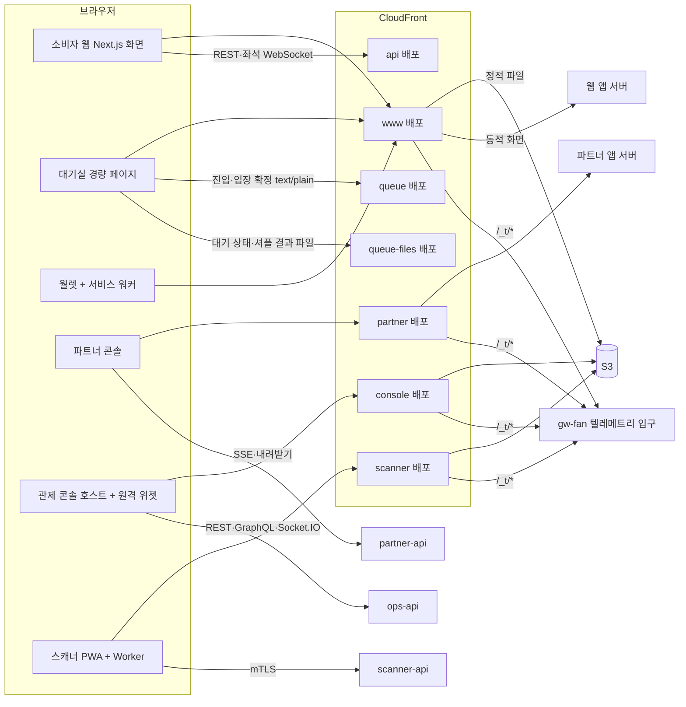
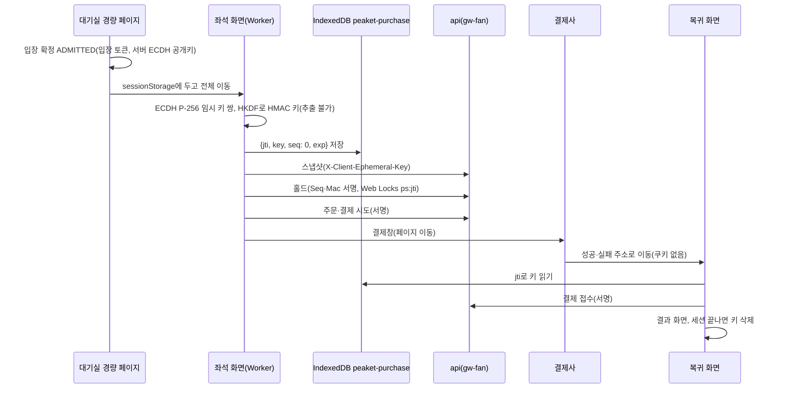

# 프론트엔드 상세 설계 (RADIO)

- **독자와 용도**: 프론트엔드 엔지니어가 `peaket-frontend` 저장소(앱 넷과 포렌식 리플레이 데모, 공용 패키지)를 만들 때, 그리고 리뷰어가 화면 쪽 설계가 요구사항·API(프로그램끼리 요청과 응답을 주고받는 창구) 계약·보안 판정과 맞는지 검증할 때 기준으로 읽는 정본이다. 화면을 무엇으로 그리는지, 어디에 캐시(자주 쓰는 값을 가까운 곳에 복사해 둔 것)하는지, 상태를 어느 층에 두는지, 서버·실시간 채널·다른 앱 조각과 어떤 계약으로 말하는지를 RADIO 순서로 적는다. 성능·접근성·보안·오프라인·관측(지표·로그·요청 기록으로 시스템 안을 들여다보는 일)·시험·배포를 어떻게 지키는지도 같은 순서로 적는다.
- **원문 출처**: 틀은 GreatFrontEnd 'Front End System Design Playbook'의 The RADIO Framework(2026-10-21 열람)를 따른다. 내용은 docs/architecture.md §6·§10(원문 설계서 3·4·5·6장의 프론트엔드 부분), planning/02·04, design/d1~d5, docs/api/*, docs/features/*, docs/security/asvs/*, docs/observability.md §11, docs/devops.md, docs/infra.md, prototype/을 모아 자세히 정했다. 결정은 [ADR-0079](adr/0079-frontend-radio-detailed-design.md)에 있다. 전역 상태 도구를 Zustand 하나로 줄인 결정은 [ADR-0092](adr/0092-single-client-state-library-zustand.md)에 있다.
- **기준 기획 버전**: v1.0.
- **표시 규칙**: 잴 값은 [가정]으로, 이 문서에서 처음 정한 세부는 '추천 적용, 2026-10-21'(ADR-0079 결정 번호)로 적는다. 2026-10-27에 더한 콘솔의 켜 둔 동안 성능 규칙(화면별 늦게 싣기, 안 보이는 위젯의 구독 멈춤, Canvas 그래프와 들고 있는 양의 상한, 장시간 시험)은 '추천 적용 2026-10-27'(ADR-0091)로 적는다. 같은 날 정한 상태 도구의 세부(에디터 문서 모양, 관제 상태 통로, 동작 이름 규칙)는 '추천 적용 2026-10-27'(ADR-0092)로 적는다. 숫자에는 증명 수준을 붙인다(planning/02 §3.1 원칙 5). 증명 수준은 실측(PC), 외삽(잰 범위의 결과를 식으로 늘려 더 큰 규모의 값을 구한 것), 문서 인용, 설계 목표다. 외부 사실(라이브러리 판·브라우저 지원·표준 문장)은 2026-10-21에(ADR-0091의 것은 2026-10-27에) 원문으로 확인했고, 확인한 곳은 §6.4에 모았다.
- **쉬운 설명**: 이 문서를 처음 읽는다면 [guide/17-frontend.md](../guide/17-frontend.md)를 먼저 본다. 그 편은 이 문서의 번역이고 규범이 아니다.

## 0. 이 문서를 읽는 법

### 0.1 RADIO 단계와 이 문서의 대응

RADIO 원문은 다섯 단계를 정해진 순서가 아니라 '빠뜨리지 않기 위한 목록'으로 쓰라고 한다. 요구사항(R)으로 시작하고, 아키텍처(A)와 데이터 모델(D)을 세운 뒤 인터페이스(I)를 정한다. 최적화와 깊이 파기(O)는 비기능 요구를 하나씩 파고드는 마지막 단계다. 원문의 면접용 시간 비중(R 10%, A 20%, D 10%, I 20%, O 40%)을 이 문서에서는 분량 비중으로 옮겼다.

| 단계 | 원문이 요구하는 것 | 이 문서의 절 |
| --- | --- | --- |
| R 요구사항 탐색 | 주요 사용 사례, 기능·비기능 요구, 핵심과 있으면 좋은 것, 기기·플랫폼, 주 사용자, 오프라인, 성능 요구. 합의한 요구를 적어 두고 계속 대 본다 | §1 |
| A 아키텍처 | 핵심 구성 요소와 관계, 서버는 검은 상자, 뷰 층·저장소 층·데이터 접근 층, 관심사 분리, 계산을 서버와 클라이언트 중 어디서 할지, 상자마다 맡는 일 | §2 |
| D 데이터 모델 | 서버 출처 데이터와 클라이언트 출처 데이터(보존할 것·잃어도 되는 것), 엔터티의 필드·타입·소유 구성 요소 | §3 |
| I 인터페이스 | 서버-클라이언트 통신(HTTP, 연결을 열어 둔 채 주고받는 WebSocket, 서버가 브라우저로 한 방향으로 계속 보내는 SSE, 답이 올 때까지 기다렸다가 다시 묻는 롱 폴링, GraphQL)의 이름·매개변수·반환값, 클라이언트 안 통신(속성·콜백, 저장소 액션, 발행·구독), UI 컴포넌트 API(데이터·이벤트·설정·스타일·렌더 함수 속성) | §4 |
| O 최적화와 깊이 파기 | 제품에 고유하고 중요한 영역에 집중한다: 성능, 네트워크, UX, 접근성, SEO, 다국어, 다기기, 보안. 아키텍처에 영향이 없는 주제는 다루지 않는다. 다만 화면을 그리는 전략(브라우저에서 그리는 CSR, 서버에서 그려 보내는 SSR, SSG, 미리 그려 두고 정해진 주기로 다시 그리는 ISR)과 엣지(CDN이 사용자 가까이에 둔 서버) 캐시처럼 아키텍처를 바꾸는 것은 다룬다 | §5 |

RADIO는 서버를 검은 상자로 두라고 한다. 이 문서도 게이트웨이(클라이언트 종류별로 앞에 둔 입구 서버) 뒤의 동작은 docs/architecture.md와 docs/features/*에 맡기고, 브라우저가 보는 계약(응답 코드·헤더·파일 형식·채널 메시지)만 적는다. 다만 PEAKET은 100만 명이 한꺼번에 들어오는 제품이라 브라우저의 요청 방식(간격, 요청 시각을 일부러 조금씩 흩뜨리는 지터, 캐시, 사전 요청 여부)이 서버 용량을 정한다. 그래서 '클라이언트가 만드는 부하'는 요구사항(§1.6)과 깊이 파기(§5.9)에서 숫자로 다룬다.

### 0.2 정본의 경계

이 문서가 정본인 것과 다른 문서에 맡기는 것을 아래처럼 나눈다. 두 문서가 다르게 말하면 아래 '정본' 열의 문서가 이긴다. 이 문서를 쓰면서 찾은 어긋남과 그 처리는 §6.2에 적었다.

| 주제 | 정본 | 이 문서의 몫 |
| --- | --- | --- |
| 프론트엔드 구조(앱·패키지·계층·경계), 경로별 렌더링·캐시·헤더 표, 클라이언트 상태 모델, 브라우저 저장소 규칙, 클라이언트 인터페이스(api-client·실시간 채널 클라이언트·원격 위젯 계약·핵심 컴포넌트 API), 성능 예산 표, 프론트엔드 시험·빌드·배포 | **이 문서** | 전부 |
| 기술 스택 요약과 상태 소유권 매트릭스 | docs/architecture.md §6(요약) → 세부는 이 문서 | §2.3·§3.1에서 자세히 정하고, 고친 곳은 §6.2에 있다 |
| 화면 목록·배치·셸·흐름·알림·오류 문구 | design/d5-screen-blueprint.md, planning/04 §3 | SCR·CMP ID로 참조만 한다 |
| 디자인 토큰·컴포넌트 시각 규칙·대비 | design/d2-design-system.md, design/tokens.json | 토큰 파이프라인과 번들(브라우저가 내려받는 자바스크립트 묶음) 예산만 |
| REST·실시간 계약(경로·필드·코드) | docs/api/openapi.yaml, docs/api/asyncapi.yaml, docs/api/guidelines.md | 클라이언트 쪽 정책(재시도·시간 초과·오류 표시)과, 계약이 비어 있어 이 문서가 먼저 낸 초안(§4, wbs 0.2.3에서 계약으로 옮긴다) |
| 기능 동작(대기열·좌석·결제·발권·현장·관제·정산·분석) | docs/features/*.md | 브라우저가 맡는 몫만 |
| 보안 판정 | docs/security/asvs/*.md(공통 웹 클라이언트는 asvs/frontend.md) | 구현 위치와 헤더 값 |
| 브라우저 지표의 표본·보호·전송 | docs/observability.md §11 | 계측 지점과 사건 이름(§5.16) |
| 빌드·서명·승격·동결 창 | docs/devops.md | 프론트엔드 산출물의 특수 규칙(§5.18) |
| CDN 배포·호스트·보안 헤더를 붙이는 곳 | docs/infra.md | 경로별 표에서 참조 |

### 0.3 이 문서에서 쓰는 이름

- **앱**: 소비자 웹(`apps/web`, `www.peaket.example`), 파트너 콘솔(`apps/partner`, `partner.peaket.example`), 관제 콘솔(`apps/console-host`, `console.peaket.example`), 게이트 스캐너 PWA(설치형 앱처럼 쓰는 웹 앱. `apps/scanner`, `scanner.peaket.example`). 소비자 웹 안의 **대기실 경량 페이지**(`apps/web/queue-room`)와 **월렛**(`/my/tickets`)은 따로 부른다.
- **API 호스트**: `api`(gw-fan), `queue`(gw-queue), `queue-files`(대기열 파일 배포), `partner-api`(gw-partner), `ops-api`(gw-ops), `scanner-api`(gw-scanner). 모두 화면 호스트와 다른 출처이고 같은 사이트(`peaket.example`)다.
- **원격 위젯**: 관제 콘솔에 Module Federation으로 끼우는 서비스 저장소의 화면 조각이다.
- **흐름 표시값**: 브라우저가 재서 보내는 업무 지연(대기 반영 시간, 좌석 델타 종단 지연, 좌석맵 준비 시간, 결제 확정 시간, 스캔 판정 시간).

## 1. 요구사항(R)

### 1.1 제품과 사용자

| 앱 | 주 사용자 | 기기 | 규모(설계 목표) | 셸(CMP-065) | 테마 | 인증 |
| --- | --- | --- | --- | --- | --- | --- |
| 소비자 웹 | 팬(현장 스태프의 휴대폰 화면 SCR-050·051·061 포함) | 휴대폰 우선, 태블릿, 데스크톱. iOS·iPadOS 16.4 이상(NFR-019) | 동시 대기 100만, T=0 진입 초당 20만, 공연 페이지 초당 30만, 좌석 단계 동시 5,000(architecture §9.1) | web-default, web-focus(대기실·좌석·결제), web-staff | 시스템 따라 | 소셜 로그인 + 휴대폰 본인확인, 팬 쿠키(브라우저가 사이트별로 저장했다가 요청마다 함께 보내는 작은 값) |
| 파트너 콘솔 | `partner_admin`·`partner_member` | 데스크톱·태블릿, 휴대폰은 보기와 일부 일(design/d5 §3.9) | 운영자 수십 명 [가정] | partner | 시스템 따라 | 비밀번호 + 인증 앱이 시간에 따라 새로 만드는 일회용 코드(TOTP), 파트너 쿠키 |
| 관제 콘솔 | viewer·operator·commander·`cs_agent`·`cs_lead` | 데스크톱 1280×800 기본, 태블릿·휴대폰(360px부터) | 운영자 10명 동시, 설계 50명(NFR-008) | console | 다크 고정 | 비밀번호 + 인증 앱, 허용 IP·VPN, 운영자 쿠키 |
| 게이트 스캐너 | `gate_staff`·`gate_lead` | 관리형 Android 휴대폰·태블릿, Chrome 설치형 PWA | 게이트당 분당 60명(NFR-010) | scanner | 라이트 고정 | 기기 인증서(mTLS, 양쪽이 서로 인증서를 확인하는 TLS) + 기기 승인 로그인(RFC 8628) |
| 포렌식 리플레이 1단계 데모(ADR-0080) | 누구나(합성 데이터라 개인정보가 없다) | 데스크톱·태블릿, 휴대폰은 리플레이 보기만 | 사건 300만·좌석 10만 [가정] | 없다(자체 머리) | 다크 고정(관제와 같은 디자인 토큰) | 없다(2단계는 관제 콘솔 인증) |

### 1.2 핵심 사용 사례와 있으면 좋은 것

| 앱 | 핵심(이것이 안 되면 제품이 아님) | 있으면 좋은 것(꺼져도 핵심은 동작) |
| --- | --- | --- |
| 소비자 웹 | 공연 상세 보기, 본인확인, 로비 참가와 무작위로 섞은 셔플 순번 받기, 오픈 뒤 진입·대기·차례 입장, 좌석 고르기·홀드(결제하는 동안 좌석을 잠시 잡아 두는 것), 주문·결제·결과 확인, 월렛 회전 QR(오프라인), 양도·예매 취소, 로그인·세션 | 홈 랭킹·테마, 자동완성·관련 공연, 후기와 신고, 찜(공연 단위), 굿즈·부가 상품, 셔플 검증 화면, 오픈 알림 웹 푸시 |
| 파트너 콘솔 | 공연 등록 위저드, 좌석맵 에디터, 판매 승인 요청, 실시간 판매 현황, 현장 스태프·현장 운영, 정산서·명단 | 상품 빌더, 웹훅(일이 생기면 서버가 미리 등록한 주소를 불러 알려 주는 방식), 판매 요약 리포트 |
| 관제 콘솔 | 온세일(판매가 열리는 시각 앞뒤로 접속이 몰리는 기간) 대시보드(T-30분 점검·T=0·판매 중), 운영 명령과 2인 승인, 경보 패널, 판매 승인, 법정 조치 | 봇 표본 검토, 홈 구성, 리포트 판 보기 |
| 게이트 스캐너 | 기기 승인 로그인, 근무 준비(목록 받기·시계 보정), 오프라인 판정, 기록 업로드·변경분, 현장 관리(책임자) | 기기 목록 보기, 이상 표시 처리 화면의 부가 정보 |

명령 9(비핵심 기능 끄기)로 끌 수 있는 것은 후기, 인접 좌석 추천, 찜이다(POL-021). 과부하 때 게이트웨이가 먼저 막는 것도 후기와 굿즈다(architecture §5). 그래서 화면은 이 기능이 503을 돌려주거나 꺼진 상태일 때도 핵심 흐름을 막지 않고 그 자리만 비운다.

### 1.3 앱별 기능 요구

기능 요구의 정본은 planning/02 §2이고 화면 정본은 planning/04 §3이다. 아래는 브라우저가 맡는 몫을 묶은 것이다.

| 묶음 | FR | 화면 | 브라우저가 할 일 |
| --- | --- | --- | --- |
| 탐색·공연 정보 | FR-003·004·016·018·019·053 | SCR-001·002·003·016·018·054·057 | ISR로 화면 그리기, 개인 영역(찜·알림 상태)만 클라이언트에서 요청, 고지 문장을 본문에 늘 노출, 자동완성 combobox·이전 요청 취소·한글 조합 중 키 거르기·정규화한 요청(docs/features/search.md), 오프라인 찜 대기열 |
| 계정·본인확인 | FR-001·002·017·048 | SCR-004·005·006·017·039·040 | 버튼을 누를 때만 로그인 시작, 기관 창을 사용자 동작 안에서 열고 결과를 `BroadcastChannel`로 받기, 재인증 대화상자, 세션 끝 사유 표시 |
| 로비·대기열 | FR-005·006·007·008·020·038·050 | SCR-007·008·009·018·019 | 참가 토큰(로비 참가를 증명하는 서명된 문자열)·대기표 보관, 셔플·묶음 결과 분산 조회, 대기 상태 파일 적응형 폴링, 앞 인원·진행 막대 계산, 차례 판정과 입장 확정, 희망 조건 보관, 탭 제목·소리·웹 푸시 |
| 좌석·홀드 | FR-009·010·042·050 | SCR-010 | 5만 석 Canvas, 구역 구독과 델타(바뀐 좌석만 담은 작은 메시지) 반영, 스냅샷(어느 시점의 전체 상태를 찍어 둔 것)으로 재동기화, 접근성 목록, 홀드 서명 요청, 카운트다운과 1회 연장, 자동 배정 결과 |
| 결제 | FR-011·014·015·053 | SCR-011·012·015 | 서버 금액 표시, 결제사별 결제창, 복귀 화면에서 결제 접수, 결과 롱 폴링, 초안 복구(개인정보 제외) |
| 월렛·현장(팬) | FR-012·013·047·060 | SCR-013·014·038·041·043·060 | 입장용 휴대폰 등록(밖으로 꺼낼 수 없는 키), 15초 회전 QR(완전 오프라인), 오프라인 캐시, 양도·돌려주기·취소, 부스 재발급 |
| 파트너 | FR-021~027·046·052·055·062·066 | SCR-020~027·037·044·062·063 | 위저드 자동 임시저장, 좌석맵 에디터(브라우저 자동 채우기 계산, Undo·Redo 10단계 정확 복원), DSL 시뮬레이션, SSE 현황, 명단 사유 입력과 스트리밍 내려받기, 현장 운영 10초 [가정] 갱신 |
| 관제 | FR-028~034·051·052·057~059·062~065·068 | SCR-028~032·045~049·053·064~068 | 단계 탭과 위젯, 신선도 표시, 명령 수명주기(dry-run·재인증·2인 승인·ack), 경보 패널, 판매 승인과 수요 예측, 법정 기한 카운트다운 |
| 스캐너 | FR-035·036·046·065·066·067 | SCR-033~036·052 | 기기 승인 로그인, 목록 받기, 시계 보정, Worker 디코딩·판정, 로컬 큐와 업로드, 60초 변경분, 화면 꺼짐 방지, 책임자 기능 |

### 1.4 비기능 요구

| NFR | 목표(정본 숫자) | 브라우저 쪽 의미 | 재는 곳 |
| --- | --- | --- | --- |
| NFR-002 대기 상태 전파 | 입장 임박군 serving 반영 p99 2초(p99: 백 건 중 아흔아홉 건이 이 시간 안에 끝난다는 뜻), 그 밖은 폴링 주기 + 1초 | 1초 폴링 구간의 반영 시간을 흐름 표시값 `queue_reflect_ms`로 잰다 | RUM(서버 시각 보정, §3.3) |
| NFR-004 좌석 상태 전파 | 종단 p99 300ms, 버전 갭을 30초 안에 스스로 메우는 비율 99.9% | 델타 머리에 적힌 서버 시각과 화면에 반영한 시각의 차이 `seat_delta_e2e_ms` | RUM |
| NFR-006 결제 확정 | 결제 요청부터 확정 화면을 그릴 때까지 p99 3초 | 결제 접수 직전부터 확정 화면을 그릴 때까지 `payment_confirm_ms` | RUM + 서버 추적 |
| NFR-007 공연 페이지 | 엣지 TTFB p99 150ms, LCP p75 2.5초(LCP: 화면의 가장 큰 요소가 보이기까지 걸린 시간) | ISR·엣지 캐시, 이미지·글꼴 최적화 | CloudFront(AWS의 CDN) 지표, RUM |
| NFR-010 현장 판정 | 단말 판정 p95 150ms(오프라인 포함, 판정 백 건 중 아흔다섯 건이 이 시간 안에 끝난다는 뜻) | Worker 디코딩·검증 | 스캐너 지표(§5.5) |
| NFR-012 사용자 체감 | INP 200ms·LCP 2.5초·CLS 0.1 이하(p75, 모바일·데스크톱 따로. INP: 조작에 화면이 반응하기까지 걸린 시간, CLS: 화면이 갑자기 밀리는 정도), FCP 1.8초·TTFB 0.8초, 주요 경로에서 50ms 이상 걸리는 긴 작업 0, 좌석맵은 대기실 통과 뒤 1초 미만, 힙 v0 대비 70% 감축, 대기실 JS 50KB(gzip)·CSS 10KB 미만 | 경로별 예산 표(§5.8), 대기실 경량 페이지(§5.1) | RUM, Lighthouse CI(코드를 올릴 때마다 자동으로 도는 페이지 검사), Playwright 추적, memlab |
| NFR-016 보안 | 웹 앱 보안 검증 항목 목록인 ASVS 5.0.0 L2의 모든 항목 판정 | 화면 묶음별 헤더, 저장소 규칙, 공급망 | asvs/frontend.md와 기능 표 |
| NFR-019 지원 플랫폼 | Baseline(주요 브라우저가 모두 지원하는지 알려 주는 웹 기능 기준)의 'Widely available'(모두 지원한 지 30개월이 지난 단계) 기능은 모두 쓰고, 그보다 새 기술은 점진적 향상(지원하지 않는 브라우저에서도 핵심 기능은 그대로 돌게 하는 방식)으로만 쓴다. 소비자 웹은 Chrome·Safari·Samsung Internet·Edge·Whale 최신 2개 메이저 버전과 iOS·iPadOS 16.4 이상을 지원한다 | §1.5 표의 대체 동작 | Playwright 3엔진(Chromium·WebKit·Firefox) + 실제 기기 시험(§1.5) |
| NFR-020 접근성 | 웹 접근성 국제 기준 WCAG 2.2 AA 위반 0, 좌석 선택·결제·양도를 NVDA·VoiceOver로 끝까지 마치는 비율 100% | §5.11 | axe, 수동 시나리오 |
| NFR-024 국제화 | ko·en·ja·zh, 로케일이 늘어도 초기 번들은 그대로, 누락 키 0 | §5.12 | 번역 키 검사, 로케일별 번들 크기 |
| NFR-025 정합성 | 재접속 순번 보존 100%, 다중 탭·다기기 한도 초과 0 | 저장소 규칙(§3.12), 다중 탭 조정(§5.9) | 시험 FE-T5·FE-T6 |

K5(5만 석 좌석맵 프론트 성능)와 K10(오프라인 입장)은 planning/01 §3.1의 증명 과제다. 이 문서의 좌석맵 구조(§5.2)와 스캐너 구조(§5.5)가 그 해결책이고, 측정은 wbs 7.5.2에서 한다.

### 1.5 기기·브라우저와 기능별 대체 동작

지원 범위는 NFR-019가 정본이다. 아래 표는 이 설계가 기대는 브라우저 기능과, 그 기능이 없을 때 화면이 하는 일이다(ASVS 3.1.1·3.7.5 채택, asvs/frontend.md). 지원 판은 web-features 3.43.0과 @mdn/browser-compat-data 8.1.6(2026-10-21 조회) 기준이다.

| 기능 | 쓰는 곳 | 지원(요지) | 없을 때 |
| --- | --- | --- | --- |
| WebCrypto ECDSA·ECDH P-256, HKDF, HMAC | 구매 세션 키(§5.3), 월렛 QR 서명(§5.4), 스캐너 검증(§5.5) | Baseline 넓게 지원(Safari 7부터 P-256) | 예매 단계와 입장용 등록에 들어가지 않고 SCR-059 '미지원'을 보인다 |
| Ed25519·X25519 | 쓰지 않는다 | Safari 17·Chrome 133~137부터 | iOS 16.4를 지원하려고 P-256만 쓴다 |
| IndexedDB(추출 불가 `CryptoKey` 저장) | 구매 세션 키, 월렛, 스캐너 | Baseline | 사생활 보호 모드 등에서 열리지 않으면 예매 단계는 SCR-059 '미지원'을, 월렛은 '이 브라우저에서는 입장용 등록을 할 수 없습니다'를 보인다 |
| Web Locks, BroadcastChannel | 일련번호 잠금, 탭 조정 | Safari 15.4부터 | 지원 범위(16.4) 안이라 대체 동작을 두지 않는다 |
| OffscreenCanvas 2D, Worker 안 `requestAnimationFrame` | 좌석맵 | Safari 16.4부터 | 같은 그리기 모듈을 메인 스레드에서 돌린다(§5.2) |
| SharedArrayBuffer(교차 출처 격리) | 좌석 상태 공유(선택) | COOP·COEP를 둔 좌석 라우트에서만 | 바뀐 구역만 메시지로 받는다 |
| Service Worker, Push | 월렛 오프라인, 웹 푸시 | Baseline. iOS 웹 푸시는 홈 화면 앱에서만 | 오프라인 QR은 IndexedDB(브라우저 안에 데이터를 저장하는 곳)만으로도 그린다(앱 셸이 캐시에 없으면 '연결이 필요합니다'). 웹 푸시가 없으면 탭 제목·소리·이메일(CMP-068)로 알린다 |
| `StorageManager.persist()`·`estimate()` | 월렛·스캐너 | persist Safari 15.2, estimate Safari 17 | 요청 실패를 기록하고 iOS 7일 안내(§5.4)를 보인다 |
| Screen Wake Lock | 월렛 QR, 스캐너 | iOS 18.4, Android Chrome 84 | 밝기·자동 잠금 안내 글자만 보인다 |
| BarcodeDetector | 스캐너 | Android Chrome만 | zxing-wasm(§5.5) |
| Battery Status API | 저전력 때 로비 효과 끄기(SCR-007) | Chromium만(Safari는 지원하지 않는다) | 움직임 줄이기 설정만 따른다(§6.3 한계) |
| `scheduler.yield()` | 긴 작업 나누기 | Safari는 지원하지 않는다 | `MessageChannel`로 다음 작업에 넘기는 공용 함수 |
| Trusted Types | 악성 스크립트를 페이지에 끼워 넣는 DOM XSS 줄이기(보고 모드) | Baseline 2026-02(Safari 26, Firefox 148) | 무시된다(보고만 비어 있다) |
| `fetch` keepalive | `/_t/*` 전송 | Firefox 133·Safari 13부터 | `sendBeacon`(쿠키가 실려 가므로 게이트웨이가 지운다, observability §11) |
| CSP `report-to`·`Reporting-Endpoints` | 위반 보고 | Safari 16.4, Firefox 149 | 보고가 빠질 뿐 차단은 동작한다 |
| LCP·INP 측정 | RUM | LCP·INP Safari 26.2, Firefox 122·144. CLS는 Chromium만 | 그 지표 칸을 비운다(0으로 채우지 않는다) |
| `Element.ariaNotify` | 쓰지 않는다 | 새 기능(Baseline이 아니다) | `aria-live` 영역 |
| 인앱 브라우저 | 둘러보기·상세까지 | 앱마다 다르다 | 대기실·입장용 등록 전에 SCR-058을 보인다 |

브라우저 사이의 차이는 Playwright 3엔진(Chromium·WebKit·Firefox)으로 PR(코드 변경을 합쳐 달라는 요청)마다 하는 시험과, 메이저 릴리스마다 실제 기기로 하는 시험(iOS Safari·Samsung Internet·카카오톡 인앱, 콘솔은 iOS·iPadOS Safari·Android Chrome)으로 본다(NFR-019).

### 1.6 클라이언트가 만드는 부하

브라우저가 요청을 어떻게 보내는지가 서버 용량을 정한다. 아래 숫자는 architecture §9.1과 verification §3.1의 설계 식을 브라우저 쪽에서 다시 적은 것이다.

| 상황 | 브라우저 동작 | 요청량(증명 수준) | 이 문서의 규칙 |
| --- | --- | --- | --- |
| T=0 오픈 직후 진입 | 진입 `POST`를 `text/plain` 본문으로, 사용자 헤더 없이 보낸다 | 초당 20만(새로고침 증폭 포함, 설계 목표). 사전 요청은 0 | §4.1 T=0 두 호출 규칙, FE-T3 |
| 셔플 결과 받기 | 참가 토큰의 해시(원래 값으로 되돌릴 수 없게 바꾼 고정 길이 값)로 정한 0~8초 [가정] 안에 한 번 받는다 | 초당 약 12.5만, 약 36Gbps(외삽) | 해시로 정한 지연은 토큰마다 고정이라 새로고침해도 빨라지지 않는다(§4.2) |
| 대기 상태 폴링 | 예상 대기 1분 이내면 1초, 1~5분이면 5초, 그 밖은 20초 간격, ±20% 지터 | CDN(사용자 가까운 곳에 파일을 복사해 두고 대신 응답하는 전송망) 초당 약 5.3만, 원본 초당 약 1,000(외삽) | 같은 회차를 연 여러 탭 가운데 한 탭만 폴링한다(§5.9) |
| 차례 직전 직접 확인(자동 배정) | 예상 대기 10초 [가정] 안에서 1초 이상 간격 | 원본 초당 수백 건(외삽) | `NOT_YET`의 `retryAfterMs`를 지킨다 |
| 좌석 단계 | WebSocket 1개, 보이는 구역만 구독, 전체 보기 구역은 5초 [가정] 스냅샷 | 연결 5,000, 스냅샷 초당 약 1,000건(외삽) | 구독 전환은 1초 머문 뒤, 재연결 지터(§4.4) |
| 구매 경로 사전 요청 | `X-Admission-Token`·`X-Purchase-*`·`Idempotency-Key` 때문에 교차 출처 사전 요청이 생긴다 | 홀드 경로는 첫 요청에 한 번(캐시 7,200초), 홀드 ID·주문 ID가 든 경로는 매번 한 번 | 지연 예산에 왕복 한 번을 넣고 wbs 7.5.2에서 잰다(§5.9) |
| 브라우저 지표 | 표본은 대기·로비 1%, 좌석·결제 100%, 그 밖 10% [가정]. 화면이 보이는 동안 60초 [가정]마다 한 묶음, 화면을 숨길 때 한 묶음을 보낸다 | 대기실 100만 명(표본 1%면 1만 세션)이면 초당 약 170건, 좌석·결제 5,000이면 초당 약 80건(외삽, 표본 비율 [가정]) | 한 묶음은 64KiB 이하(§5.16) |

### 1.7 오프라인 요구

| 앱 | 오프라인에서 되어야 하는 것 | 되지 않아도 되는 것 |
| --- | --- | --- |
| 소비자 웹 월렛 | 등록한 티켓의 회전 QR 생성과 표시(비행기 모드), 마지막 동기화 시각 | 양도·취소·재발급, 새 티켓 받기 |
| 소비자 웹 그 밖 | 오프라인 배너와 '연결되면 저장됩니다'(찜, FR-019), 대기실은 마지막 값 유지와 '연결 확인 중' | 대기·예매·결제 진행 |
| 스캐너 | 근무 준비 뒤 판정 전부(목록·키·폐기 목록·입장 상태), 스캔 기록 쌓기 | 기기 배치 변경, 부스 허용(책임자), 새 목록 받기 |
| 파트너·관제 | 없다(오프라인 배너와 다시 시도) | 전부 |

### 1.8 범위 밖과 전제

- 네이티브 앱은 만들지 않는다. 하드웨어 보안 모듈에 키를 묶는 일은 네이티브에서만 되므로 남는 한계로 둔다(planning/01 §5.2).
- 데스크톱 브라우저에서도 월렛 QR은 보이지만 입장용 등록은 휴대폰을 먼저 권한다(SCR-013).
- 서버 동작은 검은 상자다. 브라우저 계약이 비어 있는 곳은 이 문서가 초안을 내고 wbs 0.2.3에서 계약 문서로 옮긴다(ADR-0079 결정 32).
- 디자인 캔버스(아티팩트)는 이 문서와 따로 고친다. 화면 정본은 design/d5다.

## 2. 아키텍처(A)

### 2.1 전체 그림

서버 쪽(게이트웨이 뒤)은 검은 상자로 둔다. 브라우저가 무엇을 어디서 받는지만 그린다.



- 화면 호스트 넷과 API 호스트 여섯은 서로 다른 출처이고 같은 사이트다(ADR-0065 결정 1). 그래서 화면에서 API로 가는 호출은 모두 교차 출처이고, CORS(다른 주소에서 온 요청을 브라우저가 허용할지 정하는 규칙)를 거친다.
- 브라우저 지표(`/_t/*`)만 화면 호스트의 같은 출처 경로다. 네 배포 모두 이 지표를 gw-fan의 텔레메트리(시스템이 내보내는 지표·로그·요청 기록 같은 운영 신호) 입구로 보낸다(ADR-0079 결정 13).
- 요청이 가장 많이 지나는 핫패스(대기열 진입, 좌석 홀드, 결제 접수)는 Next.js(웹 화면을 만드는 프레임워크) 앱 서버를 거치지 않고, 브라우저에서 게이트웨이로 바로 간다(architecture §4).

### 2.2 저장소와 패키지 구조

`peaket-frontend`는 Turborepo 2.11 + pnpm 12 모노레포다(architecture §10). 아래 구조는 이 문서가 정한 것이다(ADR-0079 결정 21).

```text
peaket-frontend/
  apps/
    web/                 소비자 웹(Next.js 16 App Router)
      src/app/           경로(App Router). FSD의 app·pages 층
      src/widgets/ features/ entities/ shared/   FSD 층
      queue-room/        대기실 경량 페이지(별도 빌드, React 없음)
      workers/           좌석 Worker 진입점(packages/seatmap + purchase-signer)
      wallet-sw/         월렛 서비스 워커
    partner/             파트너 콘솔(Next.js 16, tRPC BFF)
    console-host/        관제 콘솔 호스트(webpack 5 + Module Federation)
    scanner/             스캐너 PWA(Vite 8 + vite-plugin-pwa)
    forensics/           포렌식 리플레이 1단계 데모(Vite 8, 정적, ADR-0080)
  packages/
    api-client/          orval 생성물 + 실행 정책(§4.1)
    telemetry/           lite(대기실)·full 두 판(§5.16)
    validation/          Zod 4 스키마 + 판매 정책 DSL AST 평가기(서버와 같이 씀)
    ds/                  디자인 토큰 빌드(Style Dictionary 5) + 컴포넌트(@seed-design/react 3)
    console-contract/    관제 원격 위젯 계약(§4.5)
    seatmap/             좌석맵 열 배열·격자 색인·그리기 Worker(web·forensics, ADR-0080 결정 5)
    config/              ESLint·TypeScript·Steiger·size-limit 설정
```

| 규칙 | 내용 |
| --- | --- |
| 층 의존 | FSD 층은 위에서 아래로만 가져온다(`app` → `pages` → `widgets` → `features` → `entities` → `shared`). Steiger와 `eslint-plugin-boundaries`로 이를 어기는 가져오기를 막는다(architecture §6.5) |
| 앱 사이 | 앱은 다른 앱을 가져오지 않는다. 함께 쓰는 것은 `packages/`로 올린다 |
| 대기실 경량 페이지 | `queue-room/`은 `packages/api-client`의 대기열 부분, `packages/telemetry`의 lite 판, `packages/ds`의 토큰 부분집합 CSS만 가져온다. React(화면 라이브러리)·Next.js를 가져오면 린트가 막는다 |
| 원격 위젯 | 서비스 저장소의 원격 모듈은 `@peaket/console-contract`와 공유 싱글턴만 가져온다(§4.5) |
| 좌석맵 패키지 | `packages/seatmap`은 화면 상태를 모르고 열 배열·격자 색인·그리기만 한다. 소비자 웹은 실시간 델타를, 포렌식 앱은 재생 사건을 넣는다(ADR-0080 결정 5) |
| 생성물 | `packages/api-client/src/gen/`은 손으로 고치지 않는다. 계약(openapi·asyncapi)이 바뀌면 다시 만든다 |
| 게시 | `packages/*`는 Changesets로 SemVer 판을 매겨 GitHub Packages의 `@peaket` 범위에 게시한다(devops §2.2). 대상은 `ds`·`telemetry`·`validation`·`api-client`·`console-contract`다(원격 위젯 저장소는 `console-contract`·`ds`·`telemetry`를, 서버는 `validation`을 쓴다, devops §3.2) |

Turborepo 작업은 `lint`·`typecheck`·`test`·`build`·`size`·`e2e`이고, PR에서는 바뀐 앱·패키지의 작업만 돈다(devops §3.2).

### 2.3 앱별 구조

| 앱 | 프레임워크와 판(2026-10-21 레지스트리) | 서버 쪽 | 브라우저 쪽 핵심 구성 요소 |
| --- | --- | --- | --- |
| 소비자 웹 | Next.js 16.4(App Router, Cache Components, `proxy.ts`), React 19.3, TanStack Query 5, Zustand 5, XState 5, React Hook Form 7 + Zod 4, Serwist 9(월렛), Auth.js(next-auth v5 베타, §5.14 위험 구성 요소) | 웹 앱 서버: ISR·동적 화면, Auth.js(소셜 인가 코드 교환), 연결 제안 쿠키를 읽는 경로 | 좌석맵 Worker, 구매 세션 서명기, 결제사 SDK 적재기, 월렛 QR Worker, 본인확인 창 관리자 |
| 대기실 경량 페이지 | TypeScript + rolldown(Vite 8) 빌드, 프레임워크는 쓰지 않는다 | 없다(AWS 파일 저장소인 S3의 정적 파일) | 상태표(§3.4), 폴러, 시계, 저장소, 탭 조정, 텔레메트리 lite |
| 파트너 콘솔 | Next.js 16.4, React 19.3, tRPC 11, TanStack Query 5, Zustand 5, RHF + Zod, `@hello-pangea/dnd` 18, Chart.js 4.6 | 파트너 앱 서버: 요청마다 셸(nonce), tRPC BFF(`/api/trpc`), Auth.js Credentials | 좌석맵 에디터 캔버스와 계산 Worker, DSL 시뮬레이터, SSE 클라이언트. 무거운 부분은 `next/dynamic`으로 쓸 때 싣는다(§5.6) |
| 관제 콘솔 | webpack 5.112 + `@module-federation/enhanced` 2.9, React 19.3, React Router 8.5(데이터 라우터), Zustand 5, RxJS 7.8, urql 5 + graphql-ws 6, socket.io-client 4.8, Chart.js 4.6 | 없다(S3 정적 파일, 원격은 같은 출처 `/remotes/`) | 원격 적재기(무결성·대체·미리 받기), 화면별로 늦게 싣는 경로, 호스트 Zustand 저장소와 원격에 넘기는 읽기 전용 `host` 통로, 스트림 어댑터, 소켓·구독 연결 관리(위젯 자리별 멈춤·재개, §5.7) |
| 스캐너 | Vite 8 + vite-plugin-pwa 2(Workbox 7), Dexie 4, zxing-wasm 3, React 19.3, Zustand 5, XState 5 | 없다(S3 정적 파일) | 카메라·디코딩·판정 Worker, Dexie 저장소, 업로드 큐, 변경분 수신기, 화면 꺼짐 방지 |

- 판 번호는 2026-10-21 npm 레지스트리의 `latest`다. React Router 8.5와 Chart.js 4.6은 2026-10-27 레지스트리의 `latest`다(ADR-0091). 실제 고정은 착수 때 잠금 파일이 정하고, 판 올리기는 pnpm `minimumReleaseAge` 3일과 Renovate가 맡는다(devops §4.4).
- 관제 콘솔은 정본대로 webpack 5 Module Federation이다. Rspack도 같은 런타임을 쓰지만 이번에는 바꾸지 않는다.
- 스캐너는 React로 화면을 그리지만 판정 경로(카메라 → 디코딩 → 판정)는 React 밖 Worker에서 돈다(§5.5).

### 2.4 계층과 관심사 분리

RADIO가 말하는 뷰 층·저장소 층·데이터 접근 층을 앱마다 이렇게 나눈다.

| 층 | 소비자 웹 | 대기실 경량 페이지 | 파트너 콘솔 | 관제 콘솔 | 스캐너 |
| --- | --- | --- | --- | --- | --- |
| 뷰 | React 서버·클라이언트 컴포넌트, `@peaket/ds` | DOM 템플릿 + `textContent` 갱신 | React 클라이언트 컴포넌트 | 호스트 셸 + 원격 위젯(React) | React 화면 + 판정 오버레이 |
| 저장소(클라이언트 상태) | TanStack Query(서버 캐시), Zustand(UI·좌석 선택), XState(예매·소켓·결제 결과 흐름) | 손으로 쓴 상태표 | TanStack Query(tRPC), Zustand(에디터 문서·화면 상태), RHF(폼) | Zustand(호스트 저장소 하나 + 원격마다 저장소) + RxJS 어댑터 | Dexie(영속) + Zustand(화면 상태) + XState(로그인·동기화) |
| 데이터 접근 | `@peaket/api-client`(교차 출처 REST·롱 폴링), 좌석 WebSocket 클라이언트(Worker 안) | 대기열 부분 클라이언트(폴러·진입·입장 확정) | tRPC 클라이언트(같은 출처) + SSE·내려받기 직접 호출 | urql(GraphQL)·Socket.IO·REST(명령) | `@peaket/api-client` 스캐너 부분(mTLS는 브라우저가 처리한다) |
| 서버 쪽 조합 | 웹 앱 서버(ISR, Auth.js) | 없다 | 파트너 앱 서버(tRPC → gw-partner REST) | 없다 | 없다 |

뷰는 데이터 접근 층을 직접 부르지 않고 저장소 층의 훅(쿼리·액션)만 부른다. 원격 위젯은 데이터 접근 층을 갖지 않고 호스트가 넘긴 `ConsoleServices`만 쓴다(§4.5).

### 2.5 경로별 렌더링·캐시·헤더 표

헤더 묶음은 §5.14의 CSP(페이지가 실행할 수 있는 스크립트의 출처를 정하는 브라우저 규칙) 표를 가리킨다(A 캐시 화면, A′ 대기실 경량 페이지, B 요청마다 그리는 화면, E 결제 화면, F 좌석 화면, C 관제, D 스캐너). 캐시 숫자는 모두 [가정]이고 wbs 2.11.2·7.5.2에서 바꾼다.

| 경로 | SCR | 렌더링 | HTML 캐시(엣지 / 브라우저) | 데이터 | 헤더 묶음 | 비고 |
| --- | --- | --- | --- | --- | --- | --- |
| `/`, `/{en,ja,zh}` | 001 | ISR(`'use cache'` + `cacheLife` 60초 + `cacheTag('home')`) | `s-maxage=30, stale-while-revalidate=60, stale-if-error=600` / `max-age=0` | 홈 피드(서버), 랭킹 파일(클라이언트, 같은 출처 정적 JSON), 찜·알림 상태(클라이언트) | A | 홈 구성 저장·판매 승인·매진 때 태그를 무효화한다(architecture §6.3) |
| `/events/[id]` | 002·016 | ISR(`cacheTag('event:{id}')`, `cacheLife` 300초) | 위와 같다 | 공연·회차·고지(서버), 후기 요약(공개 CDN), 본인확인·사람 확인·찜·알림(클라이언트) | A + 사람 확인 | 원본에 장애가 나면 `stale-if-error`와 '판매 중' 고정 문구를 쓴다(POL-029). 급한 변경(매진·승인 취소)은 경로 무효화도 함께 부른다 |
| `/search` | 003 | 정적 셸 + CSR(주소의 매개변수로 검색 API를 부른다, ADR-0094) | `s-maxage=300` / `max-age=0`(검색 API는 CDN 30초, 자동완성 API는 60초) | 검색 API·자동완성 API | A, `noindex, follow` | 요청마다 서버가 그리지 않아 오픈 직전 검색이 몰려도 화면 서버로 가지 않는다. 검색어는 주소 쿼리라 접근 로그에 남는다(data-classification) |
| `/events/[id]/shuffle-proof` | 019 | 정적 셸 + CSR | `s-maxage=300` / `max-age=0` | 셔플 검증 정보 API, 같은 브라우저의 토큰 해시 | A | 시드는 오픈 60분 뒤에 공개한다 |
| `/queue/[eventId]`, `/{en,ja,zh}/queue/[eventId]`, `/shop/[productId]/queue` | 007·008·018·015 | 대기실 경량 페이지(S3, CloudFront Function이 셸로 바꿔 읽는다) | `s-maxage=300, stale-while-revalidate=60` / `max-age=0` | 대기열 API·파일(§4.2) | A′ | 배포 때 셸을 무효화한다. 셸은 로케일별로 넷이다 |
| `/queue/[eventId]/verify` | 009 | 요청마다 셸 + CSR | `private, no-store` | 추가 검증 API | B + 사람 확인 | 심층 챌린지와 본인확인 재통과 |
| `/booking/[eventId]/seats` | 010 | 요청마다 셸 + CSR(Worker) | `private, no-store` | 스냅샷·좌석맵 파일·WebSocket·홀드 | F | COOP `same-origin` + COEP `require-corp`(이 경로와 Worker 스크립트만) |
| `/booking/[eventId]/checkout` | 011 | 요청마다 셸 + CSR | `private, no-store` | 주문·결제 시도, 결제사 SDK | E | 결제사 SDK는 nonce를 붙인 적재기로 불러온다 |
| `/booking/[eventId]/checkout/return` | 011 | 정적 셸 + CSR | `s-maxage=300` / `max-age=0` | 결제 접수(서명) | A, `Referrer-Policy: no-referrer` | 쿠키 없이 들어오는 첫 요청이다(ADR-0065 결정 8). 주소에 담긴 결제 값은 바로 지운다 |
| `/booking/[eventId]/result` | 012 | 요청마다 셸 + CSR | `private, no-store` | 결제 결과 롱 폴링 | B | 서버는 쿠키로 로그인 여부를 정하지 않는다 |
| `/my/tickets`, `/my/tickets/[ticketId]` | 013 | 정적 셸 + CSR + 서비스 워커 | `s-maxage=300` / `max-age=0`, 서비스 워커가 셸을 미리 저장한다 | 티켓 API → IndexedDB | A | ADR-0079 결정 14·18 |
| `/my/tickets/[ticketId]/transfer`·`/cancel`·`/addons` | 014·038·015 | 요청마다 셸 + CSR | `private, no-store` | 양도·취소·부가 상품 API | B | 서비스 워커 범위 안이지만 네트워크로만 받는다 |
| `/my/orders*`, `/my/transfers/*`, `/my/compensations/*`, `/my/refunds/*`, `/my/appeals/*`, `/my/likes`, `/my/settings*`, `/staff` | 055·041·043·060·042·054·017·040·061 | 요청마다 셸 + CSR | `private, no-store` | 각 API | B | 알림 링크로 들어와도 서버는 쿠키로 로그인 여부를 정하지 않는다. 화면 스크립트가 401을 받으면 로그인 뒤 같은 주소로 돌아온다 |
| `/verify/return` | 006 | 요청마다(기관이 POST로 보낸 결과 값을 받는 서버 처리기, 값은 저장·로그하지 않는다) + CSR | `private, no-store` | 본인확인 결과 경로 | A, `no-referrer` | 결과는 `BroadcastChannel`로 알리고 창을 닫는다 |
| `/staff/invitations`, `/staff/approve` | 050·051 | 정적 셸 + CSR | `s-maxage=300` / `max-age=0` | 조회·수락·승인 API | A, `no-referrer` | URL 조각은 바로 지운다(ADR-0065 결정 10) |
| `/login`, `/login/link`, `/signup/consent` | 004·039·005 | 요청마다(Auth.js) | `private, no-store` | Auth.js, 연결 제안 | B | 연결 제안 쿠키는 앱 서버만 읽는다 |
| `/shop`, `/shop/[productId]` | 015 | ISR(`cacheTag('product:{id}')`, 300초) | 위 ISR과 같다 | 상품 목록(공개) | A | design/d5의 ISR 제안을 채택했다(추천 적용, ADR-0079) |
| `/shop/cart`, `/shop/checkout` | 015 | 요청마다 셸 + CSR | `private, no-store` | 굿즈 주문·결제 | E | 굿즈 결제 경로는 계약에 없다(§6.2) |
| `/help` | 056 FAQ | ISR(1일) | ISR과 같다 | 정적 문서 | A | |
| `/help/inquiries*` | 056 | 요청마다 셸 + CSR | `private, no-store` | 문의 API | B | 입력은 화면에만(ADR-0066) |
| `/policy/[slug]` | 057 | ISR(1일, 시행일이 바뀌면 무효화) | ISR과 같다 | 정적 문서 | A | |
| 매진 엣지 응답 | 018 | S3 정적 410 페이지 | 엣지 함수 | 없다 | A′와 같은 정적 규칙 | `queue` 배포 엣지 함수가 낸다 |
| 판매 일시 중단 대체 | 059 | S3 정적 페이지 | 원본 장애 때 | 없다 | 정적 | 공개 상태 페이지 링크 |
| `/_next/static/*`, `/_q/assets/*` | — | 빌드 산출물(내용 해시로 지은 이름) | `public, max-age=31536000, immutable` | — | `nosniff` | 30일 또는 최근 5빌드를 보존한다(devops §6.6) |
| `/v1/events/*/seatmap-layouts/*.json`, `/v1/home/rankings.json` | 010·001 | S3 정적 JSON | 좌석맵 `immutable`, 랭킹 3,600초·게시 때 무효화(정본) | — | — | |
| `/_t/rum`, `/_t/csp`, `/_t/err` | — | POST만, gw-fan 텔레메트리 입구 | 캐시하지 않는다 | — | — | 응답은 204, 본문은 없다(§5.16) |
| 파트너 콘솔 전 경로 | 020~027·037·044·062·063 | 요청마다 셸(nonce) + CSR, tRPC `/api/trpc/*` | `private, no-store` | tRPC BFF, SSE·내려받기는 직접 호출 | B | |
| 관제 콘솔 전 경로, `/remotes/*` | 028~032·045~049·053·064~068 | 정적 SPA(S3), 모든 경로를 `index.html`로 | `index.html`은 `no-cache`, 자산은 `immutable` | ops-api | C | 관리자 IP로 제한한 배포 |
| `/forensics?event=`(포렌식 리플레이 2단계, 출시 뒤 선택) | 069 | 따로 여는 정적 페이지(S3 `/forensics/`, `apps/forensics` 운영 빌드). 콘솔이 모든 경로를 `index.html`로 보내는 규칙에서 이 경로를 뺀다 | `index.html`은 `no-cache`, 자산은 `immutable` | ops-api 내보내기(docs/features/forensic-replay.md §6.3) | C + COEP `require-corp`(이 경로만) | 관리자 IP로 제한한 배포다. 관제 셸·실시간 연결을 싣지 않고 새 탭으로 연다(추천 적용 2026-10-21, ADR-0080 상태 줄) |
| 스캐너 전 경로, `/enroll` | 033~036·052 | 정적 PWA(S3) | `index.html`·서비스 워커 `no-cache`, 자산 `immutable` | scanner-api | D | 새 판은 근무 준비 때만 적용한다(devops §6.6) |

- **HTTP에서 HTTPS로**: 화면 배포 넷(`www`·`partner`·`console`·`scanner`)은 시청자 규칙을 'HTTP를 HTTPS로 이동'으로 둔다. API 배포와 게이트웨이는 HTTPS만 받고 이동시키지 않는다(ASVS 4.1.2, asvs/frontend.md).
- **알림·외부 링크 착지 규칙**: 다른 사이트에서 오는 첫 이동에는 `SameSite=Strict` 팬 쿠키가 실리지 않는다. 그래서 링크로 처음 들어올 수 있는 화면은 정적 셸이든 요청마다 그리는 셸이든 서버가 쿠키로 로그인 여부를 정하지 않는다. 화면 스크립트가 같은 사이트 요청으로 확인한다(ADR-0065 결정 8). 이 규칙이 걸리는 화면은 design/d5 §9.1의 알림 34묶음이 여는 화면 전부다.
- **배포 식별자**: 출시 후보 커밋 SHA가 Next.js `deploymentId`다(devops §6.6). 대기실 → 좌석 → 결제는 페이지 전체를 다시 불러오는 이동으로 오간다. 그래서 식별자 차이로 새로고침이 생겨도 구매 상태(입장 토큰·구매 세션 키·홀드)는 저장소와 서버에 있어 잃지 않는다(ADR-0079 결정 26).

### 2.6 계산 위치

| 계산 | 어디서 | 왜 |
| --- | --- | --- |
| 앞 대기 인원, 진행 막대, 예상 대기 | 브라우저(대기 상태 파일의 serving·빠짐 비트맵·속도와 내 순번) | 같은 구간의 1,000명이 같은 파일을 받으므로 서버가 사람마다 계산하지 않는다(queue-admission §4) |
| 차례 판정(serving ≥ 내 순번) | 브라우저가 판정하고, 서버가 입장 확정 때 다시 확인한다 | 차례 확인 API를 따로 두지 않는다(queue-admission §6) |
| '현재 순번으로는 구매가 어려울 수 있습니다' | 서버가 재료(잔여 좌석·평균 구매 매수)를 대기 상태 파일에 실으면 브라우저가 계산한다 | 재료가 파일에 없다(wbs 0.2.3, §6.2) |
| 구역별 남은 좌석 상태(많음·적음·매진) | 브라우저(스냅샷 비트맵을 좌석맵 파일의 구역 범위로 센다) | 구역 요약 API 없이 5초 스냅샷으로 충분하다(seat-hold §7) |
| 금액 | 서버 | 클라이언트 금액은 믿지 않는다(payment §2) |
| 좌석 자동 채우기(에디터) | 브라우저 Worker가 하고, 저장할 때 서버가 다시 검사한다 | FR-023 인수 조건(완료로 인정하는 조건) |
| 판매 정책 시뮬레이션 | 브라우저와 서버가 같은 DSL AST 평가기(`@peaket/validation`)를 쓴다 | SCR-024 |
| 좌석맵 내보내기(SVG·JSON·CSV) | 브라우저. CSV 칸 앞 작은따옴표 규칙도 브라우저가 지킨다 | 정본은 '서버가 파일을 만들 때'라 적었지만 이 내보내기는 브라우저가 만든다(§6.2) |
| 회전 QR 서명 | 브라우저(밖으로 꺼낼 수 없는 키, Worker) | 완전 오프라인(offline-gate §3) |
| QR 검증·입장 판정 | 스캐너 브라우저(Worker) | 완전 오프라인(offline-gate §6.4) |
| 셔플 재계산(검증 화면) | 브라우저가 공개된 시드·비콘·머클 루트로 다시 계산해 대조할 수 있게 한다 | 누구나 검증할 수 있다(POL-005). 계산은 화면 Worker에서 하고, 목록이 크면 내려받아 따로 돌리라고 안내한다 |
| 수요 예측, 규모 제안 | 서버(ops-svc) | ADR-0078 |
| 시계 보정 | 브라우저(서버 시각과의 차이, §3.3) | 카운트다운·셔플 대기·홀드 남은 시간 |

### 2.7 앱 셸과 탐색

- **셸**: 화면마다 CMP-065의 변형 하나를 쓴다(design/d5 §3). 소비자 웹은 일반·집중·스태프 셸을 쓰고, 대기실 경량 페이지는 집중 셸과 같은 모양을 React 없이 직접 그린다.
- **전체 이동과 클라이언트 이동**: 대기실 경량 페이지 → 좌석 → 결제 → 결과는 전체 이동이다. 그 밖의 소비자 웹 화면 사이는 Next.js 클라이언트 이동이다. 파트너·관제·스캐너는 SPA 이동이다.
- **경로가 바뀔 때**: 새 화면의 h1로 초점을 옮기고 제목을 알린다. 스크롤은 맨 위로 올리고, 뒤로 가기 때의 위치는 브라우저 복원에 맡긴다(§5.11).
- **주소에 담는 상태**: 후기 모달(`?reviews=all` 등), 검색 쿼리와 페이지, 관제 대시보드의 회차·탭(`?event=&tab=`), 법정 조치 탭이다. 뒤로 가기로 모달이 닫힌다(design/d5 §4).
- **세션이 끝났을 때**: 401과 세션 종료 사유(`SessionTerminated` 문구, design/d5 §3.5)를 보인다. 다시 로그인하면 원래 주소로 돌아온다. 돌아갈 주소는 같은 출처 상대 경로만 받는다(§5.14 `safeNext()`).
- **새 판 안내**: 대기실·좌석·결제·티켓 화면에서는 새 판을 적용하지 않고, 그 밖의 화면에서 "새 버전이 있습니다 [새로고침]" 토스트를 보인다(design/d5 §3.1, devops §6.6).

## 3. 데이터 모델(D)

### 3.1 상태 소유권

architecture §6.4의 원칙('앱 × 상태 종류'마다 도구 하나)을 그대로 두고 칸을 고친다(ADR-0079 결정 31). 가져오기 제한 린트가 이 표대로 지키게 한다. 전역 UI 상태 도구는 네 앱 모두 Zustand 하나다(소유자 결정 2026-10-27, ADR-0092). Jotai와 Redux Toolkit(`jotai`·`jotai-family`·`@reduxjs/toolkit`·`react-redux`·`redux`)은 쓰지 않고, 모든 앱과 원격 위젯 저장소에서 가져오면 공용 ESLint 설정(`packages/config`)이 막는다.

| 상태 종류 | 소비자 웹 | 대기실 경량 페이지 | 파트너 콘솔 | 관제 콘솔 | 스캐너 |
| --- | --- | --- | --- | --- | --- |
| 서버 상태 캐시 | TanStack Query | 상태표 안 값(마지막 파일) | TanStack Query(tRPC 통합) | urql 문서 캐시 + Zustand(구독으로 받은 값) | Dexie(목록·변경분) |
| 주소 상태 | Next.js 경로·검색 매개변수 | 경로(회차 ID) | Next.js 경로 | React Router 경로·`?event=&tab=` | 경로 |
| 폼 상태 | React Hook Form + Zod | 없다 | React Hook Form + Zod | React Hook Form + Zod | 예외 통과 사유 폼만(RHF) |
| 전역 UI 상태 | Zustand | 없다 | Zustand | Zustand(호스트 저장소 하나, 원격마다 저장소, §3.10) | Zustand |
| 흐름 상태 기계 | XState(예매 흐름, 좌석 연결, 결제 결과, 본인확인 창) | 손으로 쓴 상태표(§3.4) | XState(위저드 단계) | Zustand `commands` 슬라이스 + 명령 수명주기 표 | XState(로그인, 근무 준비, 동기화) |
| 대규모 세밀 편집 | — | — | Zustand(정규화한 문서와 바뀐 ID 묶음, §3.9) | — | — |
| 스트림 결합 | — | — | — | RxJS 어댑터가 묶어 Zustand 동작으로 쓴다 | — |
| Worker가 가진 상태 | 좌석 상태 배열·좌표·연결(§3.5), QR 서명 | — | 자동 채우기·검증 계산 | — | 판정 목록 사본·디코더 |
| 영속 저장 | §3.12 표 | §3.12 표 | sessionStorage 초안만 | 화면 설정만 | Dexie(§3.8) |
| 환경(테마·로케일) | React Context | 빌드에 넣는다 | React Context | React Context | React Context |

### 3.2 서버 출처 데이터

| 엔터티(계약 이름) | 출처 | 브라우저가 쓰는 필드 | 소유 구성 요소 | 신선도·보관 |
| --- | --- | --- | --- | --- |
| 홈 피드 `HomeFeed`, 공연 카드 `ProductionCard`(공연 단위, ADR-0093) | `GET /v1/home`(CDN 30초), ISR | 배너·오픈 예정·판매 중·테마·공연장, `saleStatus`·`saleEndsAt`·`badges` | 홈 서버 컴포넌트 | ISR 태그 무효화 |
| 랭킹 파일 `RankingFile` | www 정적 JSON | `basisDate`, `overall`, `genres` | 홈 랭킹 섹션(클라이언트) | `basisDate`가 2일 [가정] 넘게 지나면 섹션을 숨긴다(정본) |
| 공연 상세 | 계약에 없다(design/d5 §1.6 21번, §6.2 32번) | 회차·등급별 가격·판매 정책·판매자 정보·셔플 커밋·좌석맵 판 | 상세 서버 컴포넌트 | ISR. wbs 0.2.3에서 경로를 정한다 |
| 참가 토큰 `LobbyToken` | `POST …/lobby-participants` 201 | `lobbyToken`, `seedHash`, `drand*`, `shuffleResultAt`, `shuffleSpreadSec`, `verification`(ADR-0079 결정 4) | 대기실 상태표 | localStorage(§3.12) |
| 사전 검증 토큰 | `POST …/pre-verifications` 201 | 토큰, 만료 시각(계약에 없다, wbs 0.2.3) | 공연 상세 진입 도우미 | localStorage, 만료 2분 [가정] 전에 갱신 |
| 대기표 `QueueTicket` | `POST …/entries` 201 | `queueTicket`, `seq`, `generation`, `segment`, `verification` | 대기실 상태표 | localStorage |
| 묶음 응답 `BatchingResponse` | `POST …/entries` 202 | `resultPath`, `resultAt`, `spreadSec` | 대기실 상태표 | 메모리 |
| 대기 상태 `QueueState` | `queue-files` 파일(1초) | `serving`, `servingRate`, `saleStatus`, `soldOutTiers`, `removedUpToServing`, `removedBeforeSegment`, `removedBitmap`, `banner` | 대기실 상태표 | 메모리(마지막 값) |
| 셔플·묶음 결과 파일 | `queue-files` 파일(60초 [가정]) | 키 → 순번 지도(§4.2 초안) | 대기실 상태표 | 받은 순번만 localStorage에 둔다 |
| 입장 결과 `AdmissionResult` | `POST …/admission` 200 | `status`, `admissionToken`, `retryAfterSeconds`·`retryAfterMs`, `serverEcdhPublicKey`, `seatmapLayoutPath` | 대기실 상태표 → 좌석 화면 | 입장 토큰·공개키는 sessionStorage에 둔다 |
| 좌석맵 파일 `SeatMapLayout` | www 정적 JSON(`immutable`) | 캔버스, 무대, 구역(도형·라벨·등급·게이트·`seatIndexRange`), 좌석(색인·열·번호·좌표·등급·휠체어석·판매 제외) | 좌석 Worker | HTTP 캐시 |
| 좌석 스냅샷 | `GET …/seatmap-snapshot`(이진, §4.4) | 구역 판, 점유 비트 | 좌석 Worker | 메모리 |
| 좌석 델타 `SeatDeltaBatch` | WebSocket(이진, §4.4) | 구역 색인, 구역 판, (구역 안 좌석 위치인 좌석 오프셋, 상태) | 좌석 Worker | 메모리 |
| 홀드 `Hold` | `POST …/holds` 201 | `holdId`, `seatIds`, `expiresAt`, `extendable`, `assignResult` | 예매 흐름 기계 | 메모리(새로고침 때 다시 읽는 경로는 계약에 없다, §6.2) |
| 주문 `Order`, 결제 시도 `PaymentAttempt` | `POST /v1/orders`, `…/payments` | `orderId`, `amount`, `status` / `pg`, `switched`, `checkout` | 결제 흐름 기계 | 메모리, 주문 ID는 복귀 주소의 `order` 쿼리에 담는다 |
| 결제 상태 `PaymentStatus` | `GET …/payment-status`(롱 폴링) | `status`(8가지), `virtualAccount`, `reason`, `pg` | 결제 결과 기계(§3.6) | 메모리 |
| 티켓 `Ticket` | `GET /v1/tickets` | `ticketId`, `eventId`, `seatLabel`, `gateZone`, `status`, 기한들. 표시 값(공연명·장소·시각)은 계약에 없다(design/d5 §1.6 25번) | 월렛 | IndexedDB(§3.7) |
| 양도 `TransferOffer`, 취소 견적 `CancellationQuote` | 양도·취소 경로 | 상태·기한·공제율·환급액 | 양도·취소 화면 | 메모리 |
| 본인확인 `VerificationStart`·`VerificationResult` | 본인확인 경로 | `verificationId`, `window`, `status`, `next` | 본인확인 창 관리자 | sessionStorage(진행 표시만) |
| 파트너 실시간 `LiveSnapshot` | SSE(§4.4) | 판매·잔여·대기·구역별 잔여·분당 판매(최근 180분 [가정]) | 판매 현황 화면 | 메모리(받을 때마다 통째로 바꾼다) |
| 관제 명령 `CommandState`, 경보 `OpsAlert`, ack `CommandAck` | REST·Socket.IO | 상태 11가지, 승인, 만료 / 경보 필드 / ack 시각 | 명령·경보 슬라이스 | 메모리 |
| 관제 위젯 데이터 | GraphQL(영속 쿼리) | 위젯마다 다르다 | 원격 위젯(호스트 서비스를 거쳐) | urql 캐시 |
| 스캐너 목록 `ScannerPackage`, 변경분 `ScannerChanges` | scanner-api | 티켓별 구역·좌석 표시·상태·유효 키·입장 상태, 폐기 keyId, 마지막 일련번호 / `seq`, `kind`, `payload` | 스캐너 판정 Worker | Dexie(§3.8) |

### 3.3 시간과 시계 보정

- **단조 시계와 벽시계를 나눈다**: 주기·시간 초과·애니메이션은 `performance.now()`로 잰다. 서버와 비교하는 시각(셔플 공개 시각, 홀드 만료, 카운트다운)은 '보정한 벽시계' = `Date.now() + offset`으로 계산한다.
- **보정값 재기**(ADR-0079 결정 3): 응답의 `Date` 헤더(초 단위)와 요청 왕복 시간으로 `offset = Date + rtt/2 − 받은 시각`을 구한다. 최근 8개 [가정] 표본 가운데 왕복이 가장 짧은 표본을 쓴다. `Date`는 교차 출처 응답에서는 기본으로 읽히지 않는다. 그래서 `queue`·`queue-files`·`api`·`scanner-api` 응답이 `Access-Control-Expose-Headers`에 `Date`를 넣는다.
- **더 정확한 원천**: 좌석 화면은 WebSocket 하트비트(연결이 살아 있음을 알리려고 주기적으로 보내는 신호)에 담긴 서버 시각(밀리초)을 쓴다(§4.4). 스캐너는 근무 준비 때 잰 보정값을 근무 준비 완료 보고(`PUT /v1/scanner/shift/readiness`)의 `clockOffsetMs`로 보고하고, 판정의 ±30초 창에 쓴다(offline-gate §3).
- **표시**: 팬 화면은 공연장 현지 시각(국내는 KST)으로 보인다. 기기 시간대가 다르면 괄호로 내 시각을 붙인다. 파트너·관제 화면은 시간대를 붙인 KST, 기록은 UTC다(design/d5 §3). 표시는 `Intl.DateTimeFormat`으로 한다.
- **흐름 표시값의 시각**: `queue_reflect_ms`(파일을 만든 시각부터 화면에 반영될 때까지)는 대기 상태 파일의 `Last-Modified`(교차 출처에서 읽히는 헤더)와 보정한 벽시계로 잰다. `seat_delta_e2e_ms`는 델타 묶음 머리에 담긴 서버 시각으로 잰다.

### 3.4 대기실 상태 기계

대기실 경량 페이지는 아래 상태표 하나로 동작한다. 상태 이름은 CMP-015와 design/d5 §5.7·§5.8의 상태 표를 따랐다. 다만 `shuffle-fetch`는 화면 상태 `calculating`, `duplicate`는 `invalid`에 대응한다.

| 상태 | 화면(SCR) | 들어오는 조건 | 하는 일 | 나가는 조건 → 다음 상태 |
| --- | --- | --- | --- | --- |
| `boot` | — | 페이지 열림 | 저장소에서 회차 표 읽기, 시계 보정, 다른 탭 확인(§5.9) | 참가 토큰만 있으면 → `lobby` / 대기표가 있으면 → `waiting` / 둘 다 없고 오픈 전 → `lobby-join` / 오픈 뒤 → `enter` |
| `lobby-join` | 007 | 참가 전 | 본인확인 여부 확인(없으면 [휴대폰 본인확인]), 사람 확인 위젯을 필요할 때 불러오기, `POST …/lobby-participants` | 201 → `lobby` / `verification: REQUIRED` → `verify-redirect` / 409 → `other-device` |
| `lobby` | 007 | 참가 토큰이 있다 | 오픈까지 카운트다운(30초 낭독), 공시 값 표시 | 셔플 공개 시각 + 분산 지연 → `shuffle-fetch` |
| `shuffle-fetch` | 007 '순서 계산 중' | 공개 시각이 지났다 | 결과 파일 받기, 404면 간격을 2초→20초로 두 배씩 늘리며 다시 받기(정본) | 순번 받음 → `waiting` / 60초 넘음 → `shuffle-delayed`(SEV1 화면 안내. 장애 심각도 등급은 숫자가 작을수록 심각하다) |
| `enter` | 008 | 오픈 뒤 첫 진입 | `POST …/entries`(`text/plain`) | 201 → `waiting` / 202 → `batching` / 409 → `other-device` 또는 `already-admitted` / 410 → `sold-out` 또는 `ended` / 503 → `Retry-After` 뒤 다시 보내기 |
| `batching` | 008 '순서를 정하는 중' | 202 | 묶음 결과 파일을 같은 규칙으로 받기 | 순번 받음 → `waiting` |
| `waiting` | 008 | 순번이 있다 | 내 대기 상태 파일 폴링(§5.1), 앞 인원·진행 막대·예상 시간 표시, 차례 1분 전 토큰 갱신, 좌석 자원 미리 받기 | serving ≥ 순번 → `turn` / `PAUSED` → `paused` / `SOLD_OUT` → `sold-out` / `ENDED` → `ended` / 연속 실패 → `stale` |
| `stale` | 008 '연결 확인 중' | 연속 3회 [가정] 실패 또는 30초 [가정] 무응답 | 마지막 값을 그대로 두기, 실패 뒤 대기 간격 늘리기 | 성공 → 이전 상태 |
| `paused` | 008 '판매가 잠시 멈췄습니다' | `saleStatus=PAUSED` | 폴링 계속 | `ON_SALE` → `waiting` |
| `turn` | 008 '입장 중' | 차례가 왔다 | `POST …/admission`(`text/plain`) | `ADMITTED` → `admitted` / `SOON` → `soon` / `NOT_YET` → `waiting`(자동 배정의 이른 확인) / `VERIFYING` → `verify-redirect` / 409 → `duplicate` / 410 → `expired` 또는 `ended` |
| `soon` | 008 '곧 입장합니다' | `SOON` | 남은 초 표시, 지터를 넣어 다시 `turn` | — |
| `admitted` | → 010 | 입장 토큰을 받았다 | 토큰을 sessionStorage에 두고 좌석 화면으로 전체 이동 | — |
| `verify-redirect` | → 009 | 추가 검증 필요 | `/queue/[eventId]/verify`로 이동 | — |
| `other-device` | 007·008 | 409 다른 기기·탭 | "처음 기기에서 계속하세요" + ( 이 기기에서 다시 참가 › ) | 확인 → 기존 참가·대기를 취소한 뒤 `lobby-join` 또는 `enter` |
| `cancelled-elsewhere` | 007·008 | 취소된 토큰으로 요청해 받은 거절 | "다른 기기에서 이 참가를 취소했습니다" | 공연 상세 화면으로 |
| `already-admitted`, `duplicate` | 008 | 409 `ALREADY_ADMITTED`·`DUPLICATE_ADMISSION` | 정본 문구 | 끝 |
| `expired` | 008 | 410 대기표 만료 | `rejoinAllowed`면 [다시 줄 서기] | 확인 → 저장소를 지우고 `enter` |
| `sold-out` | 018 | 매진 | 폴링 바로 멈춤, 취소표 알림·다른 회차 | 끝 |
| `ended` | 008 '판매 시간이 끝났습니다' | `ENDED` 또는 410 `sale-ended` | 폴링 멈춤, 저장소 지움 | 끝 |
| `login-expired` | 008 | 갱신 뒤에도 401 | 순번이 유지된다는 안내, 로그인 뒤 같은 주소로 | 로그인 → `boot` |
| `offline` | 008 | `offline` 이벤트 | 오프라인 배너, 마지막 값 표시 | `online` → 바로 한 번 묻고 이전 상태로 |

- **앞 인원**: `(내 순번 − serving − 1) − (그 사이 빠진 번호)`. 빠진 번호는 `removedUpToServing`, `removedBeforeSegment`, 내 구간의 `removedBitmap`으로 센다(queue-admission §4). 결과가 음수면 0으로 본다.
- **진행 막대**: `(처음 앞 인원 − 지금 앞 인원) ÷ 처음 앞 인원`을 0~100% 범위로 자른다. 처음 값이 0이면 100%다. 처음 앞 인원은 sessionStorage에 둔다(정본).
- **예상 대기**: 앞 인원 ÷ `servingRate`로 구한다. 속도가 0이거나 일시정지면 숫자를 보이지 않고 '잠시 멈춤'으로 표시한다.

### 3.5 좌석맵 데이터와 연결 상태

**Worker 안 데이터**(5만 석 기준이며, 좌석마다 객체를 만들지 않는다)

| 배열 | 형식 | 크기(5만 석) | 내용 |
| --- | --- | --- | --- |
| `state` | `Uint8Array(N)`(교차 출처 격리 상태면 `SharedArrayBuffer` 위에 둔다) | 50KB | 0 가능, 1 다른 분 선택(홀드·결제 예약), 2 판매, 3 선택 불가(스냅샷으로 처음 그릴 때의 점유) |
| `mine` | `Uint8Array(⌈N/8⌉)` | 6.25KB | 내 홀드 좌석 비트(서버 델타에서는 '다른 분 선택'으로 오므로 겹쳐 그린다) |
| `x`, `y` | `Float32Array(N)` 둘 | 400KB | 공연장 좌표(1단위 = 1cm [가정]) |
| `attr` | `Uint8Array(N)` | 50KB | 등급 색인, 휠체어석, 판매 제외 비트 |
| `sectionStart`, `sectionEnd` | `Uint32Array(S)` | 구역 수 × 8B | `seatIndexRange` |
| `sectionVersion` | `Uint32Array(S)` | 구역 수 × 4B | 마지막으로 반영한 판 |
| 공간 색인 | 구역별 격자 칸 → 좌석 색인 목록 | 좌석 수에 비례 | 누른 좌석 찾기 |

- 좌석 ID 문자열은 좌석맵 파일에만 있다. Worker는 좌석을 색인으로 다룬다. 홀드 요청을 만들 때만 색인을 ID로 바꾼다.
- 그리기는 화면에 보이는 구역만, 프레임마다 한 번(`requestAnimationFrame`) 한다. 구역 모양과 정적 좌석은 구역별 비트맵으로 미리 그려 두고, 상태가 바뀐 좌석만 덧칠한다 [가정, K5 측정으로 확정].

**연결 상태 기계**(XState. 메인 스레드가 Worker 안의 연결을 상태로 본다. CMP-021의 화면 상태와 짝이다)

| 상태 | 화면 | 들어오는 조건 | 나가는 조건 |
| --- | --- | --- | --- |
| `connecting` | 로딩(구역 외곽선) | 좌석 화면 진입 | 연결 열림 → `live` / 4401 → `ended` |
| `live` | 실시간 | 하위 프로토콜 합의 | 하트비트 35초 [가정] 없음·연결 끊김 → `reconnecting` / 델타 간격이 1초 묶음으로 바뀜 → `live`(Degraded 표시) |
| `reconnecting` | "실시간 연결 복구 중" | 연결 끊김 | 다시 열림 → 구독을 다시 보내고 구독 구역의 스냅샷 받기 → `live` / 입장 토큰 만료 → `ended` |
| `ended` | 구매 세션 끝 | 4401, 입장 토큰 만료 | 대기실로(차례가 온 뒤 15분 안이면 같은 대기표로 다시 입장) |

### 3.6 예매 흐름과 결제 결과

**예매 흐름 기계**(XState, 좌석 화면 → 결제 → 결과)

| 상태 | 화면 | 다음 |
| --- | --- | --- |
| `selecting` | 010 | 홀드 요청 → `holding` |
| `holding` | 010 버튼 로딩 | 201 → `held` / 409 경합 → `selecting`(고른 좌석을 되돌리는 롤백, 흔들림, 인접 좌석 추천) / 422 한도 → `selecting` / 423 → `paused` / 410 → 판매 종료 안내 / 401 → §4.1 401 규칙 |
| `held` | 010 바텀 시트·카운트다운 | [결제하기] → 주문 생성 → `checkout` / 만료 → `selecting` / [예매 그만두기] → 홀드 풀기 → 대기실 |
| `checkout` | 011 | 결제 시도 시작 → 결제사 SDK로 결제창 열기 → 페이지 이동(`redirecting`) / 503(새 결제 일시 정지) → 결제 버튼을 막고 홀드 타이머를 `holdRemainingSeconds`에서 멈춤, `Retry-After` 뒤 버튼을 다시 켬(ADR-0085) |
| `returning` | 011 복귀 | 결제 값을 읽고 지우기 → 서명한 결제 접수 → 202 → `result` / 400 금액 불일치 → `checkout` / 409 진행 중 → `result` |
| `result` | 012 | 결제 결과 기계로 |

**결제 결과 기계**(ADR-0079 결정 8)

| 결제 상태 | 화면 상태 | 하는 일 |
| --- | --- | --- |
| `ACCEPTED`·`RESERVED`·`APPROVED` | 확인 중(진행 표시) | 롱 폴링으로 다시 묻는다(0.5~1.5초 [가정] 지터). 접수부터 120초 [가정]가 지나면 '결과 확인 중'과 알림 안내, 주문 내역 링크를 보인다 |
| `CONFIRMED` | 확정(`role="alert"` 한 번) | 예매번호 복사, 마이 티켓, 홈 화면 추가 안내, 구매 세션 저장물 정리 |
| `AWAITING_DEPOSIT` | 입금 대기 | 은행·계좌·기한 표시, 구매 세션 저장물 정리(세션은 끝난다) |
| `FAILED` | 과금 없는 실패 | `reason`별 문구(design/d5 §9.2), 좌석 선택 화면으로(세션은 이어진다) |
| `UNKNOWN` | 결과 불명 | "결과가 확정되는 대로 알림으로" + "중복 청구는 발생하지 않습니다"(1시간이 넘으면 정본 문구) |
| `COMPENSATED` | 발권 실패 자동 취소 | "요금은 청구되지 않습니다" |

- 화면이 보이는 동안에는 120초가 지난 뒤에도 30초 [가정]마다, 10분 [가정]까지 확인한다. 화면을 닫았다면 알림 링크와 주문 내역(SCR-055)에서 다시 본다.
- 401(팬 쿠키 만료)이면 갱신한 뒤 다시 묻는다. 결과 확인 경로에는 구매 세션 서명이 없다.

### 3.7 월렛과 회전 QR

**IndexedDB `peaket-wallet`**(판 1)

| 표 | 키 | 값 | 비고 |
| --- | --- | --- | --- |
| `tickets` | `ticketId` | `eventId`, `seatLabel`, `gateZone`, `status`, 표시 값(공연명·장소·시작·입장 시각. 계약에 보강할 대상), 양도·취소 기한, `keyId`, `syncedAt` | 개인정보는 없다(이름·연락처도 없다) |
| `keys` | `ticketId` | `{privateKey: CryptoKey(ECDSA P-256, extractable=false), keyId}` | 공개키는 등록 때 서버에 보낸다(`publicKeyJwk`) |
| `meta` | 고정 키 | `lastSyncAt`, `persistGranted`, `schemaVersion` | |

- **QR v1**(offline-gate §3): 형식 버전 1바이트 ‖ 티켓 ID 16바이트 ‖ keyId 8바이트 ‖ 시각 4바이트(UNIX 초) ‖ 서명 64바이트(P1363) = 93바이트. 서명 대상은 `"PEAKET-QR-v1" ‖ 티켓 ID ‖ keyId ‖ 시각`이다.
- **회전**: 15초마다 QR Worker가 새 시각으로 서명하고, 메인 스레드가 교차 전환(fast)으로 바꿔 보인다. `aria-live`는 두지 않는다(정본). 시각은 보정한 벽시계(§3.3)를 쓰고, 오프라인이면 마지막으로 잰 보정값을 쓴다.
- **QR 문자 인코딩**(바이너리 모드인지 base45인지)과 오류 정정 수준은 wbs 5.1.3 PoC(본 개발 전에 위험한 부분만 먼저 만들어 확인하는 시험)에서 인식 시간을 기준으로 정한다(정본).

### 3.8 스캐너 로컬 데이터

**Dexie DB `peaket-scanner`**(판 1, ADR-0079 결정 20). 관람객 이름·연락처는 받지도 저장하지도 않는다(identity §6.1).

| 표 | 키·색인 | 값 | 지우는 때 |
| --- | --- | --- | --- |
| `meta` | 고정 키 | 기기 이름, 배정, 앱 판, `clockOffsetMs`, `packageSeq`, 스키마(데이터의 구조 정의) 판 | 기기 등록을 풀 때 |
| `tickets` | `ticketId`, 색인 `gateZone` | 좌석 표시, 구역, 상태, 유효 `keyId` 목록 | 회차 끝 + 24시간 [가정] |
| `keys` | `keyId` | 공개키(검증용 `CryptoKey` 캐시는 Worker 메모리에 둔다), `ticketId` | 위와 같다 |
| `revoked` | `keyId` | 폐기 사유(옛 QR·위조 구분) | 위와 같다 |
| `entryState` | `ticketId` | 마지막 방향·시각·구역·출처(이 기기·변경분) | 위와 같다 |
| `scanQueue` | `id`(UUIDv7), 색인 `uploaded` | `ScanEvent` 전체 | 업로드 확인(`acceptedIds`) 뒤 7일 [가정] |
| `cursor` | `eventId` | 마지막 변경분 `seq` | 회차 끝 |
| `telemetry` | 자동 키 | 판정 지연 표본, 오류 사건 | 보낸 뒤 바로 |
| `session` | 고정 키 | 현장 스태프 토큰, 역할, 유효 기간 끝 | 로그아웃(업로드를 비운 뒤)·유효 기간 끝 |

### 3.9 파트너 좌석맵 에디터 문서 모델

- **문서**: openapi `SeatMapLayout`(배치 층 + 좌석 층 + `layoutVersion`)이 저장 단위다. 에디터는 문서를 Zustand 저장소 하나에 정규화해(같은 값을 한 곳에만 두고 ID로 찾게 나눠) 둔다. 구역은 ID로 찾는 표, 좌석은 구역마다 배열이다(추천 적용 2026-10-27, ADR-0092 결정 2).
- **갱신과 그리기**: 한 번의 편집(채우기·옮기기·줄 맞추기·번호 다시 매기기·지우기)은 저장소를 한 번만 바꾼다. 바뀐 구역만 새 배열을 만들고 나머지 구역은 그대로 같이 쓰며, 바뀐 구역·좌석 ID 묶음을 함께 남긴다. 캔버스는 저장소를 React 밖에서 구독해(`subscribeWithSelector`) 그 묶음의 좌석만 다시 그린다. 트리는 화면에 보이는 줄만 그리고(가상 스크롤), 줄마다 그 줄의 값만 선택자로 읽는다. 속성 패널은 고른 것만 읽는다. 5만 석 템플릿에서 채우기·되돌리기·고른 좌석 옮기기의 INP 200ms(§5.8)는 측정 캠페인(wbs 7.5.2)에서 잰다.
- **되돌리기**: 명령 객체(바꾼 구역·좌석과 앞뒤 값)를 쌓은 스택이다. FR-023 인수 조건(10단계 정확 복원)을 넘는 200단계 [가정]까지 두고, 이 수를 넘으면 오래된 것부터 버린다. 화면 문구의 '무제한'은 이 상한으로 읽는다(§6.2).
- **계산**: 자동 채우기, 겹침·도형 밖 검사, 휠체어석 W1~W3 검사는 에디터 Worker가 한다. 서버는 저장할 때 다시 검사한다.
- **저장**: 자동 임시저장은 `PUT …/seatmap`의 `layoutVersion`으로 동시 수정을 막는다(409면 '다른 곳에서 바뀌었습니다'와 비교 보기). 공연 등록 위저드의 초안 저장 경로는 계약에 없다(design/d5 §1.6 16번, §6.2 32번).

### 3.10 관제 콘솔 상태

호스트 상태는 호스트의 Zustand 저장소 하나에 슬라이스(기능별 조각)로 나눠 둔다(추천 적용 2026-10-27, ADR-0092 결정 3). 원격 위젯은 이 저장소를 바꾸지 못하고, 읽을 수 있는 슬라이스는 §4.5의 `host`가 정한다.

| 슬라이스 | 내용 | 출처 |
| --- | --- | --- |
| `session` | 계정·역할·유휴 시각·재인증 상태 | REST |
| `scope` | 고른 회차, 단계 탭, 시간대 | 주소 |
| `control` | 자동 제어의 5가지 값(정상·일시정지·자동 증액 멈춤·입력 없음·긴급 정지)과 우선순위(design/d5 §3.3) | GraphQL 구독 |
| `autoActions` | 걸려 있는 자동 조치(이름·대상·묶음·상태·시작 시각·왜·풀림 조건·지금 값·조건을 채운 시간), 최근 10분 [가정] 사이에 풀린 조치, 상태 바의 수(design/d5 §3.3·§7.2, ADR-0078 결정 2) | GraphQL 구독 |
| `alerts` | 경보 목록, 접힌 경보, SEV별 수 | Socket.IO `alert` |
| `commands` | 명령 상태, 내 승인 대기, 잠금 | REST + Socket.IO `command:ack` |
| `presence` | 접속한 운영자 | Socket.IO `presence` |
| (원격 위젯 상태) | 호스트 저장소에 넣지 않는다. 원격마다 자기 Zustand 저장소(이름은 `widgets/<원격 이름>`)를 위젯 자리마다 하나 만들고, 자리가 없어지면 버린다 | 원격 안 |

- 위젯마다 `lastUpdatedAt`과 출처를 두고 신선도를 그린다. 출처는 실시간 표 또는 Prometheus(지표를 모아 저장하는 도구)다. 5초가 넘으면 경고 색으로 그린다(design/d5 §7.2).
- 개발 빌드에서는 Zustand `devtools` 미들웨어로 저장소의 동작 기록을 Redux DevTools에 남겨 화면 상태를 다시 본다. 동작마다 이름(§4.7)을 붙이고, 초당 여러 번 오는 스트림 동작은 `actionsDenylist`로 거르며, 호스트와 원격 저장소는 한 연결에서 이름으로 나눠 본다(ADR-0092 결정 3). 감사 기록과 인시던트 리플레이(SCR-031, 대응이 필요한 장애나 보안 사건을 다시 보는 화면)의 정본은 서버 감사 로그와 관측 기록이다(control-tower §7). 운영 빌드에는 상태 저장소의 개발 도구 연결을 넣지 않는다(FE-T21).
- **들고 있는 양의 상한**(추천 적용 2026-10-27, ADR-0091 결정 4): `alerts`에는 걸린 경보 전부와 풀린 지 60분 [가정] 안의 경보를 합쳐 500건 [가정]까지 두고, 넘으면 풀린 것 가운데 오래된 것부터 버린다. 지난 경보는 감사 로그(SCR-031)와 Grafana에서 본다. 위젯 그래프의 데이터는 선마다 최근 15분(1초 점 900개) [가정]만 고리 버퍼(정해진 크기를 돌려 쓰며 오래된 값부터 덮어쓰는 배열)에 둔다(§5.7).

### 3.11 클라이언트 출처 데이터

| 데이터 | 보존 | 어디 | 잃어도 되나 |
| --- | --- | --- | --- |
| 좌석 선택(홀드 전) | 아니오 | Zustand | 된다(다시 고른다) |
| 예매자 정보 입력 | 아니오 | RHF | 된다(저장된 예매자 정보로 다시 채운다) |
| 결제 화면 초안(동의 체크·고른 수단) | 탭 안 | sessionStorage | 된다 |
| 자동 배정 희망 조건 | 예(회차 판매 종료까지) | localStorage | 안 된다(차례가 오면 사람 조작 없이 보낸다) |
| 최근 검색어 | 예 | localStorage | 된다 |
| 오프라인 찜 대기열 | 예(보낼 때까지) | localStorage | 된다(다시 누른다) |
| 후기·신고·문의 입력 | 아니오 | 화면 메모리 | 된다. 실패해도 화면에는 남긴다(정본: 저장소에는 남기지 않는다) |
| 위저드 초안(개인정보 없음) | 탭 안 | sessionStorage | 된다(서버 임시저장이 정본이다) |
| 관제 화면 설정(접은 위젯) | 예 | localStorage | 된다 |
| 스캐너 기록 | 예(업로드까지) | Dexie | 안 된다(기기 분실·고장은 남는 한계다) |

### 3.12 브라우저 저장소 규칙

이 표에 없는 값은 브라우저에 저장하지 않는다(ADR-0079 결정 5, ASVS 14.3.3). 키 이름 앞의 `peaket.`은 같은 출처 안의 이름 충돌을 막는다. '로그아웃 정리'는 §5.14의 클라이언트 정리 루틴이다.

| 저장소 | 키 | 값 | 수명 | 지우는 때 | 등급 |
| --- | --- | --- | --- | --- | --- |
| localStorage | `peaket.device` | `deviceId`(CSPRNG 128비트, base64url 22자) | 사용자가 지울 때까지 | 사이트 데이터 삭제 | P2(기기 식별값) |
| localStorage | `peaket.queue.{eventId}` | 참가 토큰, 사전 검증 토큰과 발급 시각, 대기표, 순번·구간, 저장 시각 | 회차 판매 종료까지 | 로그아웃, 대기 취소, 410, 판매 종료, 앱 시작 때 2일 [가정]이 지난 항목 | P2 |
| sessionStorage | `peaket.queue.{eventId}.firstAhead` | 처음 앞 인원 | 탭 | 탭 닫힘 | 등급 밖(숫자) |
| sessionStorage | `peaket.admission.{eventId}` | 입장 토큰, 서버 ECDH 공개키(JWK), 좌석맵 파일 경로, 받은 시각 | 구매 세션 | 세션 끝·로그아웃·만료 | P1(구매 세션 자격) |
| IndexedDB `peaket-purchase` | `sessions/{jti}` | HMAC `CryptoKey`(위조 확인용 값을 만드는 비밀 키. 추출 불가), 일련번호, 만료 | 구매 세션 | 세션 끝·로그아웃·만료, 앱 시작 때 만료 항목 | P1 |
| 메모리 | — | 재인증 토큰 | 5분, 한 번 | 쓴 뒤 | P1 |
| localStorage | `peaket.autoassign.{eventId}` | 희망 조건(등급 ID·매수·휠체어석·분리 허용) | 판매 종료까지 | 로그아웃, 배정 확정, 판매 종료 | 등급 밖 |
| sessionStorage | `peaket.checkout.{holdId}` | 동의 체크, 고른 결제 수단(이름·전화는 없다) | 탭 | 결제 접수, 구매 세션 끝 | 등급 밖 |
| sessionStorage | `peaket.accept.{orderId}` | 결제 접수를 보낸 시각과 그 멱등키(결제사 값은 넣지 않는다) | 탭 | 결과 확정, 구매 세션 끝 | 등급 밖 |
| localStorage | `peaket.recentSearches` | 검색어 최대 10개 [가정] | 사용자가 지울 때까지 | 하나씩·전체 지우기. 로그아웃 때는 지우지 않는다(비로그인 상태에서도 쓴다) | 수집 안 함(data-classification) |
| localStorage | `peaket.wishQueue` | 오프라인 찜·해제 대기(회차 ID, 동작, 시각) | 보낼 때까지 | 보낸 뒤, 로그아웃 | 등급 밖 |
| sessionStorage | `peaket.staff.fragment` | 초대 토큰 또는 승인 코드(URL 조각에서 옮겨 온 값) | 10분 [가정] | 조회 성공, 탭 닫힘 | P1 |
| sessionStorage | `peaket.verify.{verificationId}` | 목적, 시작 시각(결과 대조용) | 10분 [가정] | 결과를 받았을 때 | 등급 밖 |
| IndexedDB `peaket-wallet` | §3.7 | 오프라인 티켓 표시 값, 기기 키(추출 불가) | 공연 끝 + 7일 [가정] | 기본은 로그아웃해도 남긴다. '이 기기의 입장 키도 지우기'를 고르면 지운다. 키를 폐기·재발급할 때는 그 티켓 | P2 |
| Cache Storage(월렛 서비스 워커) | `wallet-shell-{판}` | 월렛 셸 HTML·JS·CSS·글꼴 | 다음 판까지 | 새 판 활성화, 킬 스위치, 입장 키 지우기 선택 | 개인정보는 없다 |
| Dexie `peaket-scanner`(스캐너 출처) | §3.8 | 회차 목록·키·폐기 목록·입장 상태·스캔 큐 | §3.8 | §3.8 | P2(현장 검표 기록) |
| localStorage(관제 출처) | `peaket.console.ui` | 접은 위젯, 표 열 너비 | 사용자가 지울 때까지 | 로그아웃 때 `Clear-Site-Data` | 등급 밖 |
| IndexedDB `peaket-forensics`(포렌식 데모 출처) | `scenarios/{시드}` | 합성 시나리오 사건(개인정보는 없다) | 사용자가 지울 때까지 | [캐시 지우기], 사이트 데이터 삭제 | 개인정보는 없다(ADR-0080) |

- **저장하지 않는 것**: 이름·전화·이메일·주소·계좌번호·카드 값·결제사 토큰(`paymentKey`·`paymentToken`)·인증 앱 코드·비밀번호·문의·신고·소명(예매 제한이나 양도 회수 대상이 된 팬이 사정을 설명하는 절차) 본문·본인확인 결과 값·서버 오류 원문. 결제창 복귀 주소의 값은 읽자마자 주소에서 지우고, 저장하지 않는다(asvs/payment).
- **쿠키**: 프론트엔드 코드는 쿠키를 쓰지 않는다(`document.cookie` 쓰기를 금지하는 린트). 쿠키 이름과 속성은 identity §3이 정본이다.
- **정리 루틴이 도는 때**: 앱 시작(만료 항목), 로그아웃(§5.14), 세션 만료 통지(`peaket.session` 채널), 구매 세션 끝, 판매 종료(대기실이 `ENDED`를 보면).
- **용량**: localStorage는 한 출처에 몇 MB 수준이라 위 키만 둔다. 큰 데이터(월렛·스캐너 목록)는 IndexedDB에 둔다. `QuotaExceededError`가 나면 오래된 회차 키부터 지우고 다시 쓴다.

## 4. 인터페이스(I)

### 4.1 api-client 공통 정책

`@peaket/api-client`는 openapi에서 orval로 만든 타입·호출 함수·MSW 처리기를 바탕으로, 그 위에 아래 실행 정책을 한 곳에 모아 둔다(ADR-0079 결정 21). 화면 코드는 `fetch`를 직접 부르지 않는다(린트로 막는다. `/_t/*` 전송만 예외다).

| 항목 | 규칙 |
| --- | --- |
| 호스트 | openapi는 경로마다 서버를 묶어 두지 않았다(5개 경로만 묶었다). 그래서 태그 → 호스트 표를 둔다: `queue` → `queue`(파일 세 경로는 `queue-files`), `seats`·`orders`·`tickets`·`shop`·`catalog`·`reviews`·`support`·`identity` → `api`(좌석맵·랭킹 파일은 `www`), `partner` → `partner-api`, `ops` → `ops-api`, `scanner` → `scanner-api`. 환경마다 기본 주소만 바뀐다 |
| 자격 증명 | 쿠키를 쓰는 API(`api`·`queue`·`partner-api`·`ops-api`)는 `credentials: 'include'`로 보낸다. 대기열 파일과 정적 JSON은 `'omit'`이다. 쿠키 없이 배포하므로 자격 증명을 실으면 브라우저가 응답을 막는다. 스캐너는 `'include'`다. 기기 인증서는 브라우저가 TLS(통신을 암호화하는 표준) 연결을 맺을 때 고른다(PoC 5.4.3) |
| 이동 | `redirect: 'error'`. API는 이동을 쓰지 않는다(303은 ADR-0079 결정 4로 없앴다) |
| 본문 | `application/json`을 쓴다. 예외는 T=0의 두 호출(대기열 진입, 입장 확정)이다. 이 둘은 본문을 JSON 문자열로 보내고 `Content-Type: text/plain;charset=UTF-8`을 쓰며, safelisted가 아닌 헤더는 금지한다(`Idempotency-Key`·`traceparent` 포함). 이 두 경로 밖에서 `text/plain`을 쓰면 클라이언트가 거절한다(FE-T3) |
| 멱등키 | openapi가 `IdempotencyKey`를 붙인 쓰기 요청은 사용자 동작 하나에 `crypto.randomUUID()`(UUID v4)로 키 하나를 만든다. 그 동작을 다시 시도할 때는 같은 키를 쓴다(guidelines §4) |
| 재인증 | `X-Reauth-Token`은 메모리에서만 꺼내 붙이고, 한 번 쓰면 버린다. 403 `reauth-required`면 CMP-064를 띄우고 새 토큰으로 한 번 다시 보낸다 |
| 구매 세션 | 여섯 작업(홀드, 홀드 해제, 연장, 주문, 결제 시도, 결제 접수)은 서명기(§5.3)를 거쳐 `X-Admission-Token`·`X-Purchase-Seq`·`X-Purchase-Mac`을 붙인다. 스냅샷 요청에는 `X-Admission-Token`을 붙인다(첫 사용 때는 `X-Client-Ephemeral-Key`도) |
| 시간 초과 | 읽기 10초, 쓰기 15초, 결제 결과 롱 폴링 35초, 대기 상태 파일 5초, 올리기 120초 [가정]. `AbortSignal.timeout`과 화면을 떠날 때의 신호를 `AbortSignal.any`로 묶는다 |
| 자동 재시도 | 읽기와 멱등키가 있는 쓰기만 자동으로 다시 시도한다. 네트워크 오류·시간 초과·`Retry-After`가 붙은 503일 때 최대 2회 [가정] 다시 시도한다. 구매 세션 쓰기는 같은 멱등키로 1회 다시 보내되, 일련번호와 MAC은 새로 만든다. 멱등키가 없는 생성형 쓰기(소명, 부스 요청, 알림 신청 등)는 자동으로 다시 시도하지 않는다 |
| 기다림 | `Retry-After`(초 또는 HTTP 날짜)를 하한으로 삼아 ±20% 지터를 준다(guidelines §5). 없으면 전체 지터를 쓰고, 시작 0.5초·상한 8초 [가정]로 한다. 한 페이지의 자동 재시도는 분당 60회를 넘지 않는다(guidelines §5의 재시도 예산) |
| 오류 모양 | `application/problem+json`이면 `ApiError{status, type, title, detail, traceId, 확장 필드}`로 읽는다. `type`은 주소의 끝 경로(케밥 표기)다. 화면은 `type` → 문구 키 표(§5.12)로 문구를 고르고, 서버의 `title`·`detail` 원문은 보이지 않는다. 5xx 화면에는 문의용 `traceId`만 보인다 |
| 401 | 팬: 갱신을 한 번만 한다(`POST /v1/identity/access-tokens`, Web Locks `token-refresh`로 탭 사이에서도 한 번만). 그 뒤 원래 요청을 한 번 다시 보낸다. 갱신 요청이 401이면 세션이 끝난다(SCR-004). 구매 경로의 401에는 쿠키 만료·입장 토큰 만료·서명 불일치를 가를 `type`이 없다(wbs 0.2.3). 그래서 갱신 한 번 뒤에도 401이면 구매 세션이 끝난 것으로 본다. 관리 계정: 결정 11의 사람 동작 조건을 지킨다 |
| 추적 | `traceparent`는 같은 출처 요청(웹·파트너 앱 서버의 경로)에만 붙인다(observability §2·§11). API 호스트로 가는 요청에는 붙이지 않는다. 그래서 브라우저 추적이 서버 추적과 이어지는 것은 앱 서버 요청뿐이다 |
| 지표 | 실패를 `rum_api_fail_total{app, route, class}`로 센다(§5.16). 409 홀드 경합과 423은 실패로 세지 않는다(guidelines §2) |

### 4.2 흐름별 호출 순서

#### 4.2.1 로비·대기열·입장 확정(대기실 경량 페이지)

| 순서 | 호출 | 본문·헤더 | 응답과 처리 |
| --- | --- | --- | --- |
| 1 | `POST https://queue…/v1/queues/{eventId}/lobby-participants` | JSON `{humanCheckToken, deviceId}`, 쿠키, 사전 요청이 있다(T=0 전) | 201 참가 토큰(`verification`이 `REQUIRED`면 SCR-009) / 403 본인확인 전 / 409 다른 기기 |
| 2 | 셔플 결과 파일 `GET https://queue-files…/v1/queues/{eventId}/shuffle-results/{hashPrefix}.json` | 쿠키는 없고, 사용자 헤더도 없다 | `shuffleResultAt` + 지연이 지난 뒤 한 번 받는다. 404면 간격을 2초부터 두 배씩 늘리고(최대 20초), 간격 안의 무작위 시각에 다시 받는다 |
| 3 | 사전 검증(공연 상세에서) `POST …/pre-verifications` | JSON `{humanCheckToken, deviceId, behaviorSummary}` | 201 토큰(만료 2분 [가정] 전, 사람 확인을 보이지 않는 모드로 다시 실행해 갱신한다. 조작이 필요하면 위젯을 보인다) |
| 4 | 진입 `POST https://queue…/v1/queues/{eventId}/entries` | `text/plain` JSON 문자열 `{preverifyToken, deviceId}` | 201 대기표 / 202 묶음 / 409 / 410 / 503 `Retry-After` |
| 5 | 대기 상태 파일 `GET https://queue-files…/v1/queues/{eventId}/segment-states/{segment}.json` | 쿠키·사용자 헤더가 없다 | 주기·지터·`Retry-After`(§5.1). `segment = floor((순번 − 1) ÷ 1000)` [가정, 순번은 1부터] |
| 6 | 입장 확정 `POST https://queue…/v1/queues/{eventId}/admission` | `text/plain` JSON 문자열 `{queueTicket}` 또는 `{lobbyToken}` | `ADMITTED`·`SOON`·`NOT_YET`·`VERIFYING` / 409 / 410 |
| 7 | 대기 취소 `DELETE …/entries/me`, 로비 취소 `DELETE …/lobby-participants/me` | 쿠키 | 204 → 저장소를 지운다 |

**셔플·묶음 결과 파일 초안**(정본에는 해시 함수·앞자리 길이·키 표기가 비어 있다. 아래는 서버와 맞출 초안이다 [가정, wbs 0.2.3·2.4.x])

- `h = SHA-256(UTF-8(참가 토큰))`(묶음 결과 파일에서는 사전 검증 토큰을 쓴다).
- 파일 번호 `p = (h[0] << 2) | (h[1] >> 6)`(10비트, 0~1023). `hashPrefix`는 세 자리 소문자 16진수다(`000`~`3ff`). 파일은 1,024개다. 100만 명이면 파일마다 약 1,000건이다(정본의 '약 1,000개'와 같다).
- 키 = `base64url(h[0..16])`(채움 문자 없이 22자). 지연 = `u32be(h[2..6]) mod (shuffleSpreadSec × 1000)` 밀리초(정본의 '해시의 다음 4바이트').
- 본문 `{"v":1,"eventId":"…","seqs":{"<키>":<순번>,…}}`. 키 22자와 순번 7자리면 한 항목이 약 34바이트, 파일은 약 33KB다. 그래서 정본의 '각 약 36KB'와 맞는다(외삽).

#### 4.2.2 좌석·홀드

| 순서 | 호출 | 본문·헤더 | 처리 |
| --- | --- | --- | --- |
| 1 | 좌석맵 파일 `GET https://www…/v1/events/{eventId}/seatmap-layouts/{layoutVersion}.json` | 없다 | 대기 중에 미리 받은 판과 `seatmapLayoutPath`가 다르면 다시 받는다 |
| 2 | 스냅샷 `GET https://api…/v1/events/{eventId}/seatmap-snapshot` | `X-Admission-Token`, 첫 요청에 `X-Client-Ephemeral-Key`(직접 선택하는 공연) | 입장 토큰을 처음 쓰는 때가 구매 세션의 시작이다. 이진 형식은 §4.4.2 |
| 3 | WebSocket `wss://api…/v1/events/{eventId}/seats/stream` | 하위 프로토콜 `peaket.seats.v1`, `peaket.auth.{입장 토큰}` | §4.4.1 |
| 4 | 구역 스냅샷 `GET …/seatmap-snapshot?section={구역 색인}` | 위와 같다 | 버전 갭(중간 판을 놓친 경우), 재연결, 전체 보기 구역의 5초 [가정] 갱신 |
| 5 | 홀드 `POST https://api…/v1/events/{eventId}/holds` | `HoldRequest`(직접 선택은 `seatIds`를 정렬해 보내고, 자동 배정은 `auto` + `clientEphemeralPublicKey`), 멱등키, 구매 세션 헤더 | 201 / 409(`suggestedSeats`) / 422 / 423 / 410 / 401 |
| 6 | 연장 `POST …/holds/{holdId}/extension`, 해제 `DELETE …/holds/{holdId}` | 구매 세션 헤더 | 두 번째 연장은 409 |
| 7 | 구매 세션 나가기 | 계약에 없다(design/d5 §1.6 19번) | 지금은 홀드를 해제한 뒤 대기실로 가고, 무활동 5분이 지나면 서버가 세션을 닫는다. 경로는 wbs 0.2.3에서 정한다 |

#### 4.2.3 주문·결제·결과

| 순서 | 호출 | 처리 |
| --- | --- | --- |
| 1 | `POST https://api…/v1/orders`(멱등키, 구매 세션 헤더, `{holdId, buyer, consents}`) | 201 금액(서버가 계산한다) |
| 2 | `POST …/orders/{orderId}/payments`(멱등키, 구매 세션 헤더, `{payMethod}`) | 201 `PaymentAttempt`(`pg`, `switched`, `checkout`). `switched`면 CMP-027의 pg-switched 안내를 보인다 |
| 3 | 결제사 SDK 결제창(§5.3) | 연동한 두 결제사 가운데 토스페이먼츠는 `successUrl`·`failUrl`로, 포트원은 `redirectUrl` + `forceRedirect: true`로 복귀 화면에 이동한다 |
| 4 | 복귀 화면이 `POST …/payment-acceptance`(멱등키, 구매 세션 헤더, 결제사별 `PaymentAccept`) | 202 → 결과 / 400 금액 불일치 / 409 다른 탭에서 진행 중 / 423 |
| 5 | `GET …/orders/{orderId}/payment-status`(롱 폴링 최대 30초) | §3.6 결제 결과 기계 |

- 복귀 주소는 서버가 정한다. `https://www.peaket.example/booking/{eventId}/checkout/return?order={orderId}` 뒤에 결제사가 자기 쿼리를 붙인다(ADR-0079 결정 7). 화면은 결제 값(`paymentKey`·`amount`, 또는 `paymentId`·`txId`·`paymentToken`)을 읽자마자 `history.replaceState`로 지운다.

#### 4.2.4 월렛·양도·취소·본인확인

| 흐름 | 호출 | 브라우저 쪽 규칙 |
| --- | --- | --- |
| 티켓 목록 | `GET /v1/tickets`(cursor·limit, `nextCursor`가 없을 때까지 받는다, ADR-0081) | 받은 값을 IndexedDB에 쓰고, 화면은 IndexedDB에서 그린다(오프라인 우선) |
| 입장용 휴대폰 등록 | `POST /v1/tickets/{ticketId}/device-keys`(`{publicKeyJwk, reason, boothRequestId}`, 필요하면 `X-Reauth-Token`) | 키는 이 버튼으로만 만든다(정본). 응답의 `keyId`를 키와 함께 저장한다 |
| 부스 재발급 | `POST /v1/identity/booth-reverifications` → `POST /v1/tickets/{ticketId}/booth-requests` | 부스 코드 QR 10분, 허용된 뒤 `reason: BOOTH`로 등록 |
| 양도 | `POST /v1/transfer-recipient-lookups` → 재인증 → `POST /v1/tickets/{ticketId}/transfers` | 참조값 10분 > 재인증 5분 순서(정본) |
| 예매 취소 | `GET …/cancellation-quote` → 재인증 → `POST …/cancellation` | 환불 계좌는 저장하지 않고 요청 본문으로만 보낸다 |
| 본인확인 | 버튼 동작 안에서 빈 창 열기 → `POST /v1/identity/verifications` → 창에 기관 양식 제출 → 복귀 화면이 `POST …/result` → `BroadcastChannel('peaket.verify')`로 `{verificationId, status}`만 알린다 | 메시지가 없으면 `GET …/result`로 확인한다. 끝나면 토큰을 바로 갱신해, 다음 요청에 `ticket:buy`를 싣는다 |

#### 4.2.5 파트너·관제·스캐너

| 앱 | 흐름 | 호출 |
| --- | --- | --- |
| 파트너 | 화면 데이터 | 브라우저 → 같은 출처 tRPC(`POST /api/trpc/{프로시저}`) → 파트너 앱 서버 → gw-partner REST(§4.6) |
| 파트너 | 실시간 판매 | `new EventSource('https://partner-api…/v1/partner/events/{id}/live', {withCredentials: true})`(§4.4.3) |
| 파트너 | 명단·리포트 내려받기, 이미지·좌석맵 올리기 | 브라우저 → `partner-api`로 직접(스트리밍·다중 파트) |
| 파트너 | 토큰 갱신 | 브라우저 → `POST https://partner-api…/v1/partner/auth/access-tokens`(리프레시 쿠키의 경로가 이 주소이기 때문이다) |
| 관제 | 로그인·갱신 | `POST https://ops-api…/v1/ops/auth/sessions`(요청 본문과 다중 인증 절차가 계약에 없다, wbs 0.2.3) · `…/access-tokens` |
| 관제 | 명령 | `POST /v1/ops/commands`(멱등키, 위험 명령은 재인증) → 2인 명령은 `…/approvals`(재인증) → ack는 Socket.IO `command:ack` |
| 관제 | 위젯 데이터 | `POST https://ops-api…/graphql`(영속 쿼리) · 구독 `wss://ops-api…/graphql`(§4.4.5) |
| 스캐너 | 로그인 | `POST /v1/scanner/device-authorizations`(빈 객체 JSON) → QR·코드 표시 → `POST /v1/scanner/token`을 `interval`(기본 5초)마다 보낸다. `slow_down`이면 간격을 5초 늘린다 |
| 스캐너 | 근무 준비 | `GET /v1/scanner/shift` → `GET …/package` → `PUT /v1/scanner/shift/readiness`(준비 완료 보고) → `GET …/changes?after=` 60초 주기 |
| 스캐너 | 업로드 | `POST /v1/scanner/scans`(최대 500건 [가정], 기기 인증만으로도) → `acceptedIds` 표시 |

### 4.3 오류와 상태 코드 처리

화면 문구의 정본은 design/d5 §9.2다. 아래 표는 api-client와 흐름 기계가 상태 코드를 어떻게 넘기는지 보여 준다.

| 응답 | 기본 처리 | 덮어쓰는 흐름 |
| --- | --- | --- |
| 400 | 폼이면 필드 오류를 표시하고 첫 오류로 초점을 옮긴다. 폼이 아니면 일반 문구를 보인다 | 결제 접수 400(금액 불일치)은 결제 화면에서 다시 확인하게 한다 |
| 401 | §4.1 401 규칙 | 구매 경로, 관리 계정 유휴 |
| 403 `reauth-required` | 재인증 대화상자를 거친 뒤 한 번 다시 보낸다 | — |
| 403 그 밖 | '권한이 없습니다' + 이유 한 줄 | 본인확인 전(로비)은 [휴대폰 본인확인] |
| 404 | '찾을 수 없습니다'(남의 자원이어도 같다) | — |
| 409 | 흐름 기계가 처리한다(경합·중복·상태 충돌) | 홀드 409는 정상 분기라 실패로 세지 않는다 |
| 410 | 흐름 기계가 처리한다(`sale-ended`, 만료, 매진) | 진입 410은 Problem `type`이 `sale-ended`면 판매 종료, `sold-out`(엣지 정적 응답, ADR-0081)이면 매진으로 본다 |
| 413·415·422 | 입력 오류 표시 | 사진 422는 `reason`별 문구 |
| 423 | '판매가 잠시 멈췄습니다' | 홀드·결제 버튼을 막고, 고른 좌석은 그대로 둔다 |
| 429·503 | `Retry-After`의 남은 초를 보이고 자동으로 다시 시도한다(SCR-059) | 대기실은 주기를 조절해 흡수한다 |
| 5xx | 일반 문구 + `traceId` + [다시 시도] | — |

### 4.4 실시간 채널 계약

계약에 비어 있던 바이트 형식·인증·하트비트·이벤트 이름을 아래 초안으로 정한다(ADR-0079 결정 10~12). wbs 0.2.3에서 asyncapi에 옮기고 서버와 맞춘다. 모든 숫자는 [가정]이다.

#### 4.4.1 좌석 델타 WebSocket

- **주소**: `wss://api.peaket.example/v1/events/{eventId}/seats/stream`(정본).
- **연결**: `new WebSocket(주소, ["peaket.seats.v1", "peaket.auth." + 입장 토큰])`. 서버는 `peaket.seats.v1`을 고른다(토큰 값은 되돌려 보내지 않는다). 게이트웨이는 연결을 맺는 핸드셰이크에서 `Sec-WebSocket-Protocol`의 토큰(서명·만료)과 `Origin`(`https://www.peaket.example`)을 확인하고, 이 헤더를 접근 로그에서 가린다. 하위 프로토콜 값은 RFC 6455의 토큰 문자열이어야 한다. JWT(서명된 정보 묶음 형식의 토큰)는 base64url 문자와 점으로 이뤄져 그 범위 안에 든다.
- **바이트 순서**: 리틀 엔디언이다. 모든 프레임의 머리는 `u8 version(=1)`, `u8 type`이다.

| type | 방향 | 이름 | 본문 |
| --- | --- | --- | --- |
| 1 | 서버 → 클라이언트 | `SeatDeltaBatch` | `u64 serverTimeMs`(묶음을 보낸 서버 시각), `u16 sectionCount`, 구역마다 `u16 sectionIndex`, `u32 sectionVersion`, `u16 count`, 그리고 `count`번 `u16 seatOffset`(그 구역 `seatIndexRange.from`에서의 거리), `u8 state` |
| 2 | 서버 → 클라이언트 | `Heartbeat` | `u64 serverTimeMs`(15초마다) |
| 3 | 서버 → 클라이언트 | `BatchInterval` | `u16 intervalMs`(250 또는 Degraded 1000, 바뀔 때만) |
| 16 | 클라이언트 → 서버 | `SubscribeSections` | `u16 count`, `count`번 `u16 sectionIndex`. 매번 지금 구독할 전체 집합을 보낸다(증분이 아니다) |

- `state` 값: 0 가능, 1 다른 분 선택(홀드·결제 예약), 2 판매. 묶음의 `serverTimeMs`는 종단 전파 지연(NFR-004)을 재는 데 쓴다. 한 묶음 약 200B(정본)는 구역 셋·변경 수십 건 정도다(외삽).
- **판 처리**: 받은 `sectionVersion`이 마지막 판 + 1이면 반영한다. 같거나 작으면 버린다. 건너뛰면 그 구역 스냅샷을 다시 받는다(seat-hold §7). 스냅샷을 받는 동안 온 델타는 판 번호로 걸러 다시 얹는다.
- **닫힘 코드**: 1000 정상, 1012 서버 재시작(0~5초 사이 무작위 시간이 지난 뒤 다시 연결, 정본), 4401 토큰 무효·만료(다시 붙지 않는다), 4403 출처·권한, 4429 연결 과다(10초 이상 지난 뒤 다시). 그 밖의 비정상 종료는 0.5초부터 두 배씩 늘리는 전체 지터로 다시 붙는다(상한 10초). 다시 붙는 것은 입장 토큰 만료 시각까지다.
- **살아 있음**: 35초 동안 어떤 프레임도 없으면 끊고 다시 연결한다. 다시 붙으면 `SubscribeSections`를 먼저 보내고, 구독 구역의 스냅샷을 받는다.
- **대체**: 게이트웨이가 하위 프로토콜 값을 읽어 검증하지 못하면(PoC wbs 2.6.4), 연결한 뒤 2초 안에 `type` 17 `Auth{u16 length, 토큰 바이트}`를 보내는 방식으로 바꾼다.

#### 4.4.2 좌석 스냅샷 이진 형식

| 필드 | 형식 | 뜻 |
| --- | --- | --- |
| `version` | u8 | 1 |
| `flags` | u8 | 비트 0: 구역 하나만(`?section=`) |
| `layoutVersion` | u32 | 좌석맵 판. 내가 가진 판과 다르면 좌석맵 파일을 다시 받는다 |
| `sectionCount` | u16 | 실린 구역 수(전체면 모든 구역) |
| 구역 표 | `sectionCount` × (`u16 sectionIndex`, `u32 sectionVersion`) | 구역 판 |
| 비트맵 | 좌석 색인 순서. 바이트 안에서는 낮은 비트부터 | 1 = 점유(홀드·결제 예약·판매), 0 = 가능. 구역 하나만 실으면 그 구역 범위만 담는다 |

- 전체 비트맵은 5만 석에 6,250바이트다. seat-hold §2의 '약 6.25KB'가 이 크기다. 전송할 때의 압축은 HTTP `Content-Encoding`(br·gzip)에 맡긴다(§6.2).
- 응답은 `application/octet-stream`이고 `Cache-Control: no-store`다. 구매 세션이 열린 뒤의 재요청은 헤지 요청을 허용하는 읽기다. 구매 세션을 여는 첫 요청은 헤지하지 않는다(seat-hold §2, ADR-0087 결정 21).

#### 4.4.3 파트너 SSE

```text
retry: 10000
event: live
id: 1792834567000
data: {"sold":1234,"remaining":13766,"projectedSoldOutAt":null,"waiting":3214,"queueEntries":50120,"sections":[{"sectionId":"R1","remaining":120}],"soldPerMinute":[{"minute":"2026-10-25T09:41:00Z","sold":42}]}

: hb
```

- `id`는 집계 시각(밀리초)이다. 다시 붙을 때 브라우저가 이 값을 `Last-Event-ID`로 보내면, 서버는 그 뒤의 첫 전체 상태부터 보낸다. 메시지는 늘 전체 상태다(변경분이 아니다).
- 서버는 1분 늦게 집계한 값을 1분마다 보내고, 15초마다 주석 줄(`: hb`)을 보낸다. 화면은 '마지막 갱신 n초 전'과 '잠정'을 보인다. 2분 [가정] 넘게 새 `live`가 없으면 연결 표시등을 경고로 바꾼다.
- 교차 출처 연결이라 `withCredentials: true`와 `Access-Control-Allow-Credentials`가 필요하다.
- `soldPerMinute`는 최근 180분 [가정](점 180개)만 싣는다. 메시지마다 전체 상태라, 판매가 길어져도 메시지와 화면이 들고 있는 양이 늘지 않게 하려는 것이다. 화면을 숨겨도 연결은 그대로 둔다(1분에 한 번이라 작다. 추천 적용 2026-10-27, ADR-0091 결정 3·4).

#### 4.4.4 관제 Socket.IO

| 항목 | 값 |
| --- | --- |
| 연결 | `io("https://ops-api.peaket.example/ops", {path: "/socket.io/", transports: ["websocket"], withCredentials: true})`. 롱 폴링을 끄면 여러 파드(쿠버네티스에서 앱이 실행되는 가장 작은 단위) 앞의 고정 세션이 필요 없다 |
| 인증 | 핸드셰이크에 실린 운영자 쿠키와 `Origin`(`https://console.peaket.example`)으로 인증한다 |
| 클라이언트 → 서버 | `room:join {eventId}`, `room:leave {eventId}`, `presence:hello {screen}` |
| 서버 → 클라이언트 | `command:ack`(`CommandAck`), `alert`(`OpsAlert`), `presence {eventId, operators: [{accountRef, role}]}` |
| 본문 | JSON(asyncapi의 기본값 `application/avro`를 이 채널에서는 `application/json`으로 고쳤다) |
| 재연결 | Socket.IO에 들어 있는 재연결을 쓴다. 첫 지연 1초·상한 10초·무작위 0.5. 다시 붙으면 방에 다시 들어가고, 명령 상태를 REST로 다시 읽는다 |
| 숨긴 탭 | 끊지 않는다. 경보·명령 확인·접속자는 화면을 숨겨도 받는다(추천 적용 2026-10-27, ADR-0091 결정 3, §5.7) |

#### 4.4.5 관제 GraphQL

- HTTP: `POST https://ops-api.peaket.example/graphql`. 본문은 `{id: 영속 쿼리 ID, variables}`만 보낸다. 임의 쿼리 문자열은 보내지 않는다(asvs/analytics의 허용 목록·깊이 제한과 맞춘다).
- 구독: `wss://ops-api.peaket.example/graphql`에 하위 프로토콜 `graphql-transport-ws`(graphql-ws 6)로 붙는다. 인증은 쿠키와 `Origin`으로 하고, `connection_init` 본문은 비운다.
- 타입: 운영에서는 인트로스펙션을 끈다. 그래서 ops-svc가 내는 스키마 산출물(`schema.graphql`)과 영속 쿼리 목록으로 타입을 만든다(§4.6).
- 구독 수명(추천 적용 2026-10-27, ADR-0091 결정 3): 같은 영속 쿼리·변수의 구독은 호스트가 하나로 묶어 나눠 주고, 마지막 구독자가 떠나도 10초 [가정] 뒤에 닫는다. 브라우저 탭을 30초 [가정] 넘게 숨기면 위젯 구독을 닫는다(`control`·`autoActions`는 그대로). 닫을 때는 연결을 끊지 않고 그 구독에만 `complete`를 보낸다(§4.5, §5.7).

#### 4.4.6 HTTP로 하는 준실시간

| 채널 | 주기 | 근거 |
| --- | --- | --- |
| 대기 상태 파일 | 1·5·20초 ±20% | ADR-0003 |
| 결제 결과 | 롱 폴링 최대 30초 + 다시 묻기(§3.6) | payment §2 |
| 스캐너 변경분 | 화면이 켜진 동안 60초 | offline-gate §6.3 |
| 파트너 현장 운영 | 10초 [가정]. 숨긴 탭은 60초 [가정]로 늘리고, 다시 보이면 바로 한 번 묻는다(ADR-0091) | design/d5 §10.5 |
| 관제 오류 요약 | 1분 [가정]. 숨긴 탭에서는 멈춘다(ADR-0091) | observability §11 |

### 4.5 관제 원격 위젯 계약

`@peaket/console-contract`가 정본이다(ADR-0079 결정 16). 아래에 그 핵심만 적는다. 원격에 넘기는 상태 통로는 읽기 전용 `host`다(추천 적용 2026-10-27, ADR-0092 결정 3).

```ts
// 원격이 내보내는 위젯 정보
export interface WidgetManifest {
  name: string;               // 예: "queue-monitor"
  contractMajor: 1;           // 호스트와 다르면 싣지 않음
  title: MessageKey;          // 문구 키
  permissions: Permission[];  // 예: ["ops:read"], 호스트가 역할로 걸러 보임
  refresh: "subscription" | { pollMs: number };
  load: () => Promise<{ default: React.ComponentType<WidgetProps> }>;
}

// 호스트가 위젯에 넘기는 속성(데이터·이벤트·설정·스타일)
export interface WidgetProps {
  eventId: string | null;       // 고른 회차
  timeRange: { from: string; to: string };
  density: "comfortable" | "dense";
  collapsed: boolean;           // 참이면 머리(제목·상태 점·핵심 숫자 한 줄)만 그린다(ADR-0091)
  services: ConsoleServices;
  onOpenDetail(link: DetailLink): void;  // '자세히 보기 ↗'(Grafana·Sentry 새 탭)
  onStatus(s: { freshnessMs: number; source: "rt" | "prometheus"; error?: MessageKey }): void;
}

// 원격이 쓰는 유일한 바깥 통로
export interface ConsoleServices {
  graphql: { query<T>(id: PersistedQueryId, vars?: object): Promise<T>;
             subscribe<T>(id: PersistedQueryId, vars: object, next: (v: T) => void): Unsubscribe };
  socket: { on(event: "alert" | "command:ack" | "presence", h: (p: unknown) => void): Unsubscribe };
  host: { use<T>(f: (s: HostView) => T): T;   // 호스트 상태를 읽는 훅. 바꾸는 통로는 없다
          get(): HostView;
          subscribe(listener: (s: HostView) => void): Unsubscribe };
  telemetry: { mark(name: string, ms: number): void; error(e: unknown): void };
  i18n: { t(key: MessageKey, vars?: object): string };
  can(permission: Permission): boolean;
  flags: { isOn(name: string): boolean };
}

// 원격이 읽을 수 있는 호스트 상태(§3.10). session·commands는 넘기지 않는다
export type HostView = Readonly<Pick<HostState, "scope" | "control" | "autoActions" | "alerts" | "presence">>;
```

- **`remotes.json`**(저장소에 적어 둔 대로 배포를 맞추는 GitOps로 관리하고, 호스트가 읽는다): `[{name, sha, entry: "/remotes/<name>/<sha>/remoteEntry.js", integrity: "sha384-…", contractMajor}]`.
- **싣는 순서**: 목록 읽기 → 계약 판 확인 → 런타임 플러그인 `createScript`가 `integrity`·`crossorigin="anonymous"`를 붙인 스크립트 요소를 만든다(시간 초과 5초 [가정]) → 실패하면 `loadEntryError`로 한 번 다시 → 또 실패하면 `errorLoadRemote`가 대체 위젯을 돌려준다. 대체 위젯은 그 칸만 design/d5 §7.2 '위젯 오류'와 같은 카드('이 위젯만 불러오지 못했습니다', [다시 시도], 지표와 로그를 그래프로 보여 주는 도구인 Grafana 링크)로 바꾼다. 위젯 안의 그리기 오류는 CMP-035 오류 경계가 그 칸만 바꾼다.
- **공유 싱글턴**: `react`, `react-dom`, `zustand`, `rxjs`, `chart.js`(처음 그래프를 그릴 때 한 번 받는다, ADR-0091 결정 4), `@peaket/ds`, `@peaket/telemetry`, `@peaket/console-contract`(이것만 `strictVersion`). 버전 범위는 E2E로 검사한다(devops §6.6).
- **금지**: 원격 위젯이 `fetch`·WebSocket·`localStorage`를 직접 쓰거나 토큰을 갖는 것, 전역(`window`)에 값을 두는 것(ASVS 3.2.3 채택), 호스트 상태를 바꾸는 것(바꿀 일은 `WidgetProps`의 콜백으로 호스트에 알린다, ADR-0092). 공용 ESLint 설정과 원격 저장소 CI가 막는다.
- **원격 위젯의 상태**: 원격 안의 Zustand 저장소에 둔다. 위젯 자리마다 하나를 만들고 자리가 없어지면 버리며, 호스트 저장소에 끼워 넣지 않는다(§3.10, ADR-0092 결정 3).
- **구독 수명과 보이기**(추천 적용 2026-10-27, ADR-0091 결정 3): 위젯은 `graphql.subscribe`를 효과(`useEffect`) 안에서 열고 정리 함수에서 닫는다. 그리는 중에는 구독하지 않는다. 호스트는 위젯 자리마다 따로 만든 `ConsoleServices`를 넘기고, 그 자리가 안 보이면(고르지 않은 탭, 숨긴 브라우저 탭) 그 안에서 구독을 멈췄다가 다시 연다. 화면 밖으로 스크롤된 자리에는 값을 넘기지 않고 마지막 값만 들고 있다가, 보이면 넘긴다. 위젯은 자기가 보이는지 따지지 않는다. 다만 `collapsed`가 참이면 머리(제목·상태 점·핵심 숫자 한 줄)만 그린다(§5.7, FE-T26).

### 4.6 관제 GraphQL과 파트너 tRPC

| 항목 | 관제 GraphQL | 파트너 tRPC |
| --- | --- | --- |
| 스키마 원천 | ops-svc가 빌드 때 내는 `schema.graphql`과 영속 쿼리 목록(원격·호스트의 `.graphql` 파일에서 해시로 만든다). 인트로스펙션은 운영에서 끈다 | 파트너 앱 서버의 tRPC 라우터. 입력·출력은 Zod(`@peaket/validation`) |
| 이름 | 쿼리·구독 이름은 `위젯이름_대상`(예: `QueueMonitor_Serving`) [가정] | 프로시저 이름은 REST `operationId`와 같게 짓는다(예: `partner.events.saveSeatmap`) |
| 범위 | 위젯 데이터와 감사 로그 조회. 명령은 REST로 한다 | REST 작업과 1:1인 얇은 껍질 + 화면 조합 프로시저(예: 공연 허브 한 번에 읽기). 업무 규칙은 없다 |
| 오류 | GraphQL `errors[].extensions.type`에 Problem `type`을 싣는다 [가정] | `TRPCError`의 `cause`에 REST Problem을 그대로 실어, 화면 문구 표(§5.12)를 같이 쓴다 |
| 출력 | 위젯이 쓰는 필드만 | 화면이 쓰는 필드만(ASVS 15.3.1) |

### 4.7 클라이언트 안 인터페이스

**Worker 메시지**(구조화 복제로 보내고, 받는 쪽이 Zod로 검사한다)

| Worker | 메인 → Worker | Worker → 메인 |
| --- | --- | --- |
| 좌석맵(`seatmap.worker`) | `init{canvas: OffscreenCanvas, layoutUrl, admission, dpr, theme}`, `viewport{w, h, dpr}`, `camera{zoom, x, y}`, `pointer{type, x, y}`, `select{seatIndex}`, `hold{seatIndexes}`, `subscribe{sections}`(디버그용), `dispose` | `ready{firstPaintMs}`, `hit{seatIndex, seatId, label, tier, price}`, `sections{visible, subscribed}`, `stateChanged{section, offsets}`(SharedArrayBuffer가 없을 때), `connection{state}`, `holdResult{…}`, `metrics{…}` |
| 월렛 QR(`qr.worker`) | `start{ticketId, keyRef}`, `stop` | `frame{payload: Uint8Array, at}`, `error{code}` |
| 스캐너 판정(`judge.worker`) | `frame{bitmap: ImageBitmap}`(옮김), `setPlacement{…}`, `syncDone{seq}` | `result{verdict, reason, seat, ms}`, `decodeError` |
| 파트너 에디터(`editor.worker`) | `fill{rule, shape}`, `validate{layout}`, `import{file, format}`, `export{format}` | `fillResult{…}`, `report{rows}`, `progress{pct}`, `file{blob}` |

**탭 사이와 잠금**

| 이름 | 종류 | 쓰임 |
| --- | --- | --- |
| `peaket.session` | BroadcastChannel | `logout`, `session-ended{reason}`, `token-refreshed` |
| `peaket.queue.{eventId}` | BroadcastChannel | 폴링 리더가 받은 `QueueState`·상태 전이를 다른 탭에 나눠 준다 |
| `peaket.verify` | BroadcastChannel | 본인확인 결과 `{verificationId, status}` |
| `queue-poll:{eventId}` | Web Locks | 그 회차 대기실 폴링 리더 |
| `ps:{jti}` | Web Locks | 구매 세션 일련번호와 요청 직렬화(§5.3) |
| `token-refresh` | Web Locks | 팬 토큰 갱신을 탭 사이에서 한 번만 하게 한다 |

**저장소 액션 이름 규칙**(추천 적용 2026-10-27, ADR-0092 결정 4): Zustand 동작 이름은 `슬라이스/동작`으로 짓는다. 사람이 한 동작은 동사(예: `seat/select`)로, 바깥에서 온 사건은 과거형(예: `alerts/received`)으로 짓고, `set`의 셋째 인자로 넘겨 개발 도구 기록에 남긴다. 상태는 저장소가 내보낸 동작으로만 바꾸고, 저장소 밖에서 `setState`를 부르지 않는다. XState 이벤트는 대문자 뱀 표기(예: `HOLD_SUCCEEDED`)로 짓는다. 원격 위젯 저장소의 이름은 `widgets/<원격 이름>`으로 시작한다.

### 4.8 핵심 컴포넌트 API

RADIO의 컴포넌트 API 분류(데이터·이벤트·설정·스타일·렌더 함수)로 핵심 컴포넌트를 적는다. 시각 규칙은 design/d2가 정본이다.

| 컴포넌트 | 데이터 | 이벤트 | 설정 | 렌더 함수·합성 |
| --- | --- | --- | --- | --- |
| `SeatPicker`(CMP-026) | `eventId`, `layoutPath`, `admission` | `onHold(seatIds)`, `onError(e)` | `mode: "pick" \| "auto"`, `maxSeats`, `stateReducer`(`useSeatSelection`) | `.Map`·`.Legend`·`.Summary` 합성 |
| `SeatMap`(CMP-021) | (SeatPicker 문맥) | `onSeatFocus`, `onZoomChange` | `minSeatPx: 24`(2.5.8), `showMinimap` | 없다(Canvas, `aria-hidden`) |
| `SeatList`(CMP-022) | 보이는 구역 상태 | `onSelect` | 그룹 방식(구역 → 열) | `getSeatProps(seat)` 속성 함수 |
| `QueuePanel`(CMP-015) | `QueueViewModel`(앞 인원·막대·예상·상태) | `onCancel`, `onRejoin` | `variant: "waiting" \| "soon" \| "sold-out"` | `renderNotice(state)`(React 판). 대기실 경량 페이지는 같은 뷰 모델을 DOM 템플릿으로 그린다 |
| `Countdown`(CMP-014) | `deadline`(보정한 벽시계) | `onExpire` | `announce: "periodic" \| "threshold"`, `periodSec`, `thresholdSec` | — |
| `RotatingQR`(CMP-029) | `ticketId` | `onStale`, `onError` | `rotateMs: 15000` | — |
| `PaymentWidgetFrame`(CMP-027) | `attempt: PaymentAttempt` | `onReady`, `onRedirecting`, `onError` | `pg` | — |
| `HumanCheckBox`(CMP-047) | `siteKey` | `onToken(token)`, `onExpire`, `onError` | `mode: "managed" \| "invisible"` | — |
| `ReauthPrompt`(CMP-064) | `provider` 또는 관리 계정 | `onVerified(token)`, `onCancel` | `variant: "fan-social" \| "admin"` | — |
| `ScanResult`(CMP-041) | `verdict`, `reason`, `seat` | `onDismiss` | `holdMs: 2000`(정본 2초 [가정]) | — |
| `CameraView`(CMP-042) | — | `onFrame(bitmap)`, `onPermission(state)` | `fps: 15`, `facing: "environment"` | — |
| `Widget`(CMP-035) | `manifest`, `props` | `onOpenDetail` | — | `.Header`·`.Body`·`.Actions`, 오류 경계 |
| `CommandCard`(CMP-036) | `command`, `state` | `onRequest`, `onApprove`, `onRevert` | `approval: "one-person" \| "two-person"` | — |
| `AppShell`(CMP-065) | 세션·셸 상태 | `onLogout` | `variant` 여섯 가지 | 머리·내비·본문 슬롯 |

- 스타일은 모든 컴포넌트가 `className`(Tailwind v4 유틸)과 토큰 변수만 받는다. 원시 색을 코드에 직접 적는 것은 린트가 막는다(design/d2 §1).
- 표 칸 안의 `\|`는 '또는'이다.

## 5. 최적화와 깊이 파기(O)

RADIO는 이 단계에 시간의 40%를 쓰고, 그 제품에만 있는 곳을 깊이 파라고 한다. PEAKET에서 그런 곳은 T=0의 100만 명(§5.1), 5만 석 실시간 좌석맵(§5.2), 결제창을 오가는 구매 세션(§5.3), 오프라인 입장(§5.4·§5.5), 그리고 여러 팀이 화면 조각을 만들어 넣는 관제 콘솔(§5.7)이다. 그 뒤에 성능 예산·네트워크·UX·접근성·다국어·다기기·보안·SEO·관측·시험·배포를 차례로 다룬다.

### 5.1 T=0 순간: 대기실 경량 페이지

**왜 따로 만드나**(ADR-0079 결정 2)

| 비교 | gzip | 근거 |
| --- | --- | --- |
| 예산(NFR-012) | JS 50KB 이하, CSS 10KB 미만 | 설계 목표 |
| React 19.3 최소 화면(`createRoot` + `useState`) | 66.0 KiB | 실측(PC), rolldown 1.2.13 최소화 |
| 프레임워크 없는 대기실 모형(145줄) | 2.73 KiB | 실측(PC) |
| SEED CSS 전체 `all.min.css` / `base.min.css` | 42.2 KiB / 7.8 KiB | 실측(PC), `@seed-design/css` 3.0.2 |

React 런타임만으로도 JS 예산을 넘고, SEED CSS 전체는 CSS 예산의 네 배다. 대기실 화면 요소는 넷(앞 인원·진행 막대·예상 시간·대기 취소)과, 생길 때만 뜨는 안내뿐이다(design/d5 §5.8). 그래서 손으로 쓴 상태표와 DOM 갱신으로 충분하다.

**빌드와 배포**

| 산출물 | 내용 | 크기 목표 |
| --- | --- | --- |
| `shell.{ko,en,ja,zh}.html` | 집중 셸 머리, 문구가 들어간 화면 뼈대, CSS·JS 링크(인라인 스크립트·스타일은 없다) | 각 3KB 이하 [가정] |
| `queue-room.{해시}.js` | 상태표, 폴러, 시계, 저장소, 탭 조정, 대기열 API 부분, 텔레메트리 lite | gzip 15KB 이하 [가정](예산 50KB) |
| `queue-room.{해시}.css` | `@peaket/ds`의 토큰 부분집합(색·간격·글자·움직임) + 버튼·진행 막대·배너 몇 개 | gzip 8KB 이하 [가정](예산 10KB) |
| 사람 확인 위젯 | Cloudflare Turnstile `api.js` | 제3자 것이라 예산 밖이다. 로비에서 필요할 때만 늦게 싣는다 |

- CSP는 CloudFront 응답 헤더 정책에 넣은 고정 문자열이다(빌드마다 바뀌는 해시를 넣지 않으려고). 그래서 인라인 스크립트·스타일을 쓰지 않고, 묶음 A′의 `script-src`는 `'self'`와 사람 확인 출처뿐이다(§5.14).
- 글꼴은 싣지 않고 시스템 글꼴을 쓴다(토큰 글꼴 스택의 앞쪽). 핵심 숫자(앞 인원)는 display 48px다(design/d2).
- CloudFront Function(시청자 요청 단계)이 `/queue/{eventId}`·`/{en,ja,zh}/queue/{eventId}`·`/shop/{productId}/queue` 요청을 `/_q/shell.{locale}.html`로 바꿔 읽는다. 회차 ID는 페이지 스크립트가 `location.pathname`에서 읽는다 [가정, PoC wbs 2.10.6].
- 배포 때 `/_q/shell.*`만 무효화한다. 해시 이름이 붙은 자산은 30일 또는 최근 5빌드를 보존하는 규칙이 있어, 옛 탭에서도 404가 나지 않는다(devops §6.6).

**폴링 알고리즘**(ADR-0003, ADR-0079 결정 3)

```ts
function nextDelayMs(s: QueueView, net: NetState, vis: DocumentVisibilityState): number {
  const eta = s.aheadCount / Math.max(s.servingRate, 0.001);      // 초
  let base = eta <= 60 ? 1000 : eta <= 300 ? 5000 : 20000;         // 정본 1·5·20초
  if (net.consecutiveFailures > 0) base = Math.min(base * 2 ** net.consecutiveFailures, 60000); // [가정] 상한 60초
  if (vis === "hidden") base = Math.max(base, 5000);               // [가정] 숨긴 탭 최소 5초
  const jittered = base * (0.8 + Math.random() * 0.4);              // ±20%
  return Math.max(jittered, net.retryAfterMs ?? 0);                 // Retry-After가 하한
}
```

- `Retry-After`는 응답 헤더로만 온다(`queue-files`가 노출한다, guidelines §9). 서버는 Degraded 때 이 값으로 모든 클라이언트의 주기를 두 배로 늘린다(정본).
- 매진(`SOLD_OUT`)·판매 종료(`ENDED`)면 폴링을 멈춘다. 먼 구간의 매진 감지는 최대 약 25초 걸린다(정본).
- 같은 회차를 연 탭이 여럿이면 Web Locks `queue-poll:{eventId}`를 잡은 탭만 폴링하고, 받은 값을 `BroadcastChannel`로 다른 탭에 나눈다(§5.9).

**차례와 입장**

- serving ≥ 내 순번이면 바로 입장 확정을 보낸다. 자동 배정 공연은 예상 대기가 10초 [가정] 안으로 들어오면, 차례가 올 예상 시각에 맞춰 직접 확인을 보낸다. `NOT_YET`이면 `retryAfterMs` 뒤 다시 보낸다(정본, 시도 간격 1초 이상).
- 차례 1분 [가정] 전에 팬 토큰을 미리 갱신한다. 좌석 화면 자원(좌석맵 파일과 좌석 화면 자산 목록 `/_q/seat-preload.json`의 파일)은 `fetch(…, {priority: "low"})`로 미리 받는다. 좌석맵 파일 경로는 아직 대기 상태 파일에 없어서 wbs 0.2.3에서 더한다(§6.2). Safari는 `<link rel="prefetch">`를 지원하지 않으므로 `fetch`로 HTTP 캐시를 미리 채운다.
- 차례가 가까울 때의 알림: 탭 제목 카운트다운, 짧은 효과음(사용자가 [차례 알림 받기]를 누른 동작으로 오디오를 열어 둔다), 웹 푸시(권한이 있을 때 서버가 보낸다). 백그라운드 탭은 타이머가 제한되어 늦게 알아챌 수 있다. 그래서 15분 유예가 있다(POL-008).

**인앱 브라우저**: 대기실과 입장용 등록 전에, 사용자 에이전트 문자열(카카오톡·네이버·인스타그램·페이스북·라인 등의 인앱 표지)로 인앱 브라우저를 감지해 SCR-058로 보낸다 [가정, 표지 목록은 wbs 2.10.6에서 실기로 확정]. 감지는 안내용이고, 서버 판정에는 쓰지 않는다.

**텔레메트리 lite**: 표본(1% [가정])에 든 브라우저는 대기 반영 시간·폴링 실패·화면 오류 수를 60초마다, 그리고 탭이 숨겨질 때 `/_t/rum`으로 보낸다. 오류 도구 SDK는 싣지 않고, `error`·`unhandledrejection`을 최소 사건으로 보낸다(§5.16).

### 5.2 좌석맵 렌더링과 실시간 델타

**대기실 통과 뒤 1초 안에 그리는 순서**(K5, NFR-012)

| 단계 | 일 | 예산 [가정] |
| --- | --- | --- |
| 1 | 대기 중 미리 받은 좌석맵 파일·좌석 화면 자산이 HTTP 캐시에 있다 | 0(대기 중) |
| 2 | 좌석 화면 HTML(요청마다 셸) + 자산 실행 | 300ms |
| 3 | Worker 시작, `transferControlToOffscreen`, 좌석맵 파일을 열 단위 배열로 풀기 | 250ms |
| 4 | 스냅샷 요청(첫 사용, 임시 공개키 헤더)과 해독 | 250ms |
| 5 | 전체 배치도(무대·구역 도형과 구역 상태) 첫 그림 | 100ms |
| 합 | 통과부터 첫 그림 | 900ms(목표 1초 미만) |

- WebSocket 연결과 구독은 첫 그림 뒤에 한다. 전체 배치도에서는 구독하는 구역이 없다(정본). 확대해서 한 구역이 화면 폭의 1/3 [가정] 이상이 되고, 그 구역에 1초 [가정] 머물면 그 구역을 구독한다.
- **좌석맵 파일 크기**: 5만 석 JSON은 객체 배열로 내면 수 MB가 될 수 있다. 구역별 열 단위 배열(`row[]`, `number[]`, `x[]`, `y[]`, `tier[]`, `flags[]`)로 내면 압축 전 1MB 안팎, brotli 압축 뒤 수백 KB로 본다(추정, K5에서 잰다). 판 번호가 파일 이름에 들어가 `immutable`이고 대기 중에 미리 받으므로, 통과 뒤 경로에서는 대개 내려받지 않는다.
- **그리기**: 전체 배치도는 구역 도형만 그린다. 좌석이 보이는 배율에서는 화면에 보이는 구역만 그리되, 구역별로 미리 그린 비트맵 위에 바뀐 좌석만 덧칠한다. 비트맵 캐시는 LRU로 64MB [가정]를 넘지 않는다. 확대·축소는 카메라 행렬만 바꾼다(seat-hold §10).
- **메인 스레드**: 입력 처리기는 16ms 안에 끝내고, 계산은 Worker로 보낸다. 긴 작업은 `MessageChannel`로 다음 작업에 넘기는 공용 함수로 쪼갠다(`scheduler.yield()`는 Safari에 없다).
- **접근성 목록**(CMP-022): 지금 구역의 열·좌석만 DOM으로 그리고, 가상 스크롤(TanStack Virtual)을 쓴다. 교차 출처 격리 상태면 SharedArrayBuffer의 상태를 바로 읽는다. 아니면 Worker가 보낸 구역 변경분으로 갱신한다.
- **누른 좌석 찾기**: Worker의 구역별 격자 색인으로 찾고, 결과(`hit`)를 메인 스레드에 보낸다. 좌석은 고를 수 있는 배율에서 24×24 CSS px 이상으로 그린다(WCAG 2.5.8, §5.11).
- **Degraded**: 서버가 `BatchInterval`(1초)을 보내면 화면에 '지연 표시'를 띄우고, 헛클릭 409가 늘 수 있다고 안내한다. 전체 보기 구역의 5초 스냅샷은 평시와 같다(정본, §6.2).
- **측정**: `seatmap_ready_ms`(통과부터 첫 그림), `seat_delta_e2e_ms`, 조작 INP, 긴 작업, 힙(memlab). Lighthouse CI는 CPU를 4배 느리게 하는 스로틀로 돈다(NFR-012).
- **PoC**(wbs 2.6.4, 2.10.1): iOS 16.4~17의 OffscreenCanvas 성능, Worker 스크립트의 COEP·SharedArrayBuffer, 5만 석 파일 크기와 해독 시간.

### 5.3 구매 세션 서명과 결제 복귀

**키 수명**(ADR-0079 결정 6)



- **서명**: `mac = base64url(HMAC-SHA256(key, utf8(METHOD + "\n" + pathAndQuery + "\n" + seq + "\n" + base64url(SHA-256(body)))))`. `pathAndQuery`는 보낸 주소의 경로와 쿼리를 호스트 없이 그대로 쓴다. 본문이 없으면 빈 바이트의 해시를 쓴다. 서버와 같은 시험 벡터를 `@peaket/api-client`와 purchase-svc가 함께 쓴다(FE-T7).
- **순서 보장**: Web Locks `ps:{jti}`를 잡고, IndexedDB에서 일련번호를 올린 뒤 요청을 보낸다. 잠금은 응답(또는 시간 초과)이 올 때까지 놓지 않는다. 복제한 탭이 같은 입장 토큰을 가져도, 두 요청이 겹쳐 날아가 번호가 뒤집히는 일이 없다. 구매 세션 요청은 사람이 누를 때만 생기므로, 하나씩 차례로 보내도(직렬화) 느려지지 않는다.
- **401**: 서명 불일치·일련번호 재사용·입장 토큰 만료를 가를 `type`이 아직 없다(wbs 0.2.3). 팬 쿠키를 한 번 갱신한 뒤에도 401이면 구매 세션이 끝난 것으로 본다. 키를 지우고 SCR-010 '예매 시간이 끝났습니다'로 간다. 차례가 온 뒤 15분 안이면 대기실에서 같은 대기표로 다시 입장한다.
- **결제사 SDK 싣기**: 결제 화면에서만 동적 import한다(`@tosspayments/tosspayments-sdk`의 `loadTossPayments`, `@portone/browser-sdk/v2`). 토스 주문서형은 결제 수단 UI가 위젯 안에 있다. 그래서 결제 시도 시작(`POST …/payments`)을 위젯을 그리기 직전에 부른다. 포트원은 화면 목록에서 수단을 고른 뒤 [결제하기]를 누를 때 부른다(정본 '결제창을 열기 직전'). 결제 시도 응답이 `switched`면 다른 결제사로 결제한다고 알린다.
- **결제창 방식**: 두 결제사 모두 페이지 이동으로 끝난다(ADR-0079 결정 7). 포트원의 `windowType`은 결제사 기본값에 맡기고, `forceRedirect: true`로 결과만 페이지 이동으로 받는다. 결제창이 보내는 창 메시지는 우리 코드가 받지 않는다.
- **복귀 화면**: 정적 셸이 뜨면, 스크립트가 주소의 결제 값을 읽고 `history.replaceState`로 지운다. 그 뒤 같은 사이트 요청으로 서명한 결제 접수를 보낸다. 실패 주소(토스 `failUrl`의 코드, 포트원 `code`)면 사유를 보이고 결제 화면으로 돌아가며, 홀드는 그대로 남는다(결제창 실패 3회 [가정]까지, 정본). 복귀 화면은 결제 접수를 보낸 사실과 그 멱등키(UUID v4)를 탭 세션 저장소에 둔다. 그래서 새로고침하면 결제 값 없이 결과 확인으로 바로 간다. 접수를 보내기 전에 새로고침해 결제 값을 잃으면 '결제가 끝나지 않았습니다'와 다시 시도를 보인다(결제사 인증은 승인 기한 10분이 지나면 과금 없이 만료된다, 정본).
- **결제 화면 헤더**: 묶음 E(nonce + `'strict-dynamic'`)를 쓴다. COOP는 소비자 웹 기본값인 `same-origin-allow-popups`를 두고, COEP는 두지 않는다(정본). 결제사가 쓰는 하위 출처는 스테이징의 보고 모드로 모은다(§5.14).
- **데모**: `pg: SIMULATOR`는 데모 환경에서만 켜지고, 운영 번들에는 시뮬레이터 화면이 들어가지 않는다(FE-T21). 관제 콘솔의 데모 빌드에는 2인 승인 시연용 데모 막대 버튼 둘을 둔다. '데모 승인자로 승인'은 승인을 기다리는 요청을 데모 도우미(데모 오버레이에만 있는 서비스)에게 넘겨 데모 승인자 계정으로 보통의 승인 API를 부르게 하고, '요청자 본인으로 승인 시도'는 서버의 거절(403)을 보인다. 서버에는 데모용 분기가 없고, 데모 막대는 운영 묶음에 들어가지 않는다(FE-T21, 소유자 결정 2026-10-27, ADR-0095).

### 5.4 월렛과 회전 QR, PWA

- **서비스 워커**(ADR-0079 결정 18): `/my/tickets/sw.js`, 범위는 `/my/tickets/`다. 미리 저장하는 것은 월렛 셸(HTML·JS·CSS·글꼴)뿐이다. 페이지 이동 요청 가운데 `/my/tickets`와 `/my/tickets/{ticketId}`만 캐시 우선으로 받고, 나머지(양도·취소·부가 상품)는 네트워크로만 받는다. API 응답은 저장하지 않는다. Serwist 9의 Turbopack 안내 방식으로 만들고, 안 되면 워커만 따로 빌드한다 [PoC wbs 5.1.4].
- **갱신**: 새 워커는 `waiting`에 둔다. QR을 보이는 월렛 화면이 열려 있으면 활성화하지 않고, 다른 화면에서 '새 버전이 있습니다'를 보인다(정본). 오프라인 QR 표시는 옛 워커로도 동작해야 한다(devops §6.6).
- **킬 스위치**: 같은 주소로 '등록 풀기와 캐시 지우기'만 하는 워커를 내면, 다음 방문 때 정리된다. 이 방법은 RB-23(되돌리기)에서 쓴다.
- **입장용 휴대폰 등록**: 데스크톱이면 휴대폰을 먼저 권한다. iOS 브라우저 탭이면 홈 화면 앱에서 등록하라고 안내하고, 인앱 브라우저면 SCR-058로 보낸다(정본). 등록할 때 `navigator.storage.persist()`를 요청하고, 결과를 `meta.persistGranted`에 둔다.
- **iOS 7일 삭제**(ADR-0079 결정 19, offline-gate §4): 월렛을 열 때마다 `persist()`를 다시 요청한다. 서버가 등록했다는 티켓의 키가 이 기기에 없으면 design/d5 §5.13의 '저장소 유실' 상태를 보인다. 입장 시작 전이면 "이 기기에서 티켓을 다시 받아야 합니다"와 함께 재인증 뒤 다시 받기를 보인다(티켓당 24시간 1회). 입장이 시작된 뒤면 부스 재발급을 안내한다. 공연 전날·당일 알림(design/d5 §9.1 8번)에는 '티켓 화면을 한 번 열어 주세요'라고 쓴다.
- **QR 그리기**: QR Worker가 15초마다 서명하고, 메인 스레드가 QR 부호화 라이브러리로 Canvas에 그린다. 라이브러리는 wbs 5.1.3 PoC에서 인식 시간을 기준으로 고른다(후보의 마지막 게시가 2024년이라 위험 구성 요소로 본다, §5.14). 화면 폭 90%, 밝기 안내, QR이 보이는 동안 화면 꺼짐 방지(iOS 18.4부터)를 둔다.
- **로그아웃**: 기본은 키와 오프라인 티켓을 남긴다. '이 기기의 입장 키도 지우기'를 고르면 `peaket-wallet`과 서비스 워커 캐시를 지우고 등록을 푼다(ADR-0079 결정 17).

### 5.5 스캐너 오프라인 판정

**판정 지연 예산**(NFR-010 p95 150ms. 숫자는 [가정]이고, wbs 5.4.7에서 관리형 기기로 잰다)

| 단계 | 일 | 예산 |
| --- | --- | --- |
| 1 | 카메라 프레임 → `createImageBitmap` → 판정 Worker로 옮긴다 | 10ms |
| 2 | 디코딩: Worker에 `BarcodeDetector`가 있으면 그것을 쓰고, 없으면 zxing-wasm을 쓴다 | 60ms |
| 3 | 형식 해독(93바이트), 시각 창 ±30초 확인 | 1ms |
| 4 | Dexie 조회(티켓·키·폐기·입장 상태) | 10ms |
| 5 | WebCrypto ECDSA P-256 검증(공개키 `CryptoKey`는 Worker 메모리에 캐시해 둔다) | 5ms |
| 6 | 결과를 메인 스레드에 보내 오버레이·소리·진동으로 알린다 | 20ms |
| 합 | | 약 106ms |

- **카메라**: 후면, 1280×720, 초당 15프레임 [가정]. 같은 QR을 2초 [가정] 안에 다시 읽으면 무시하고, 판정 오버레이가 떠 있는 2초 동안은 다음 프레임을 버린다(정본: 2초 [가정] 뒤 뷰파인더로 돌아온다).
- **판정 순서**: offline-gate §6.4가 정본이다. 판정 중 예외는 통과가 아니라 '다시 찍어 주세요'로 처리한다(fail-closed).
- **CSP**: zxing-wasm 때문에 스캐너에만 `'wasm-unsafe-eval'`을 둔다. JavaScript 문자열 실행(`eval`)은 여전히 막힌다.
- **기록과 업로드**: 판정마다 `ScanEvent`(UUIDv7)를 Dexie `scanQueue`에 먼저 쓰고, 온라인이면 5초 [가정] 단위로 묶어 올린다. 실패하면 지수적으로 늘어나는 대기(1초 → 30초 상한 [가정])를 두고 다시 올린다. 일회성 Background Sync는 예비 수단이다(ADR-0051). 로그아웃은 업로드를 비운 뒤 한다.
- **변경분**: 화면이 켜진 동안 60초마다 `after=cursor`로 받는다. 2분 [가정] 넘게 받지 못하면 상단 띠와 관제·파트너에 동기화 경보가 간다(정본).
- **화면 유지**: 스캔 화면에서 Wake Lock을 잡고, 화면이 다시 보이면(`visibilitychange`) 다시 잡는다(잠금은 화면을 숨기면 풀린다). 관리형 기기라 전체 화면·화면 방향 잠금(Android Chrome)도 쓴다.
- **새 판**: 근무 준비 때만 적용하고, 입장 시간에는 보류한다. 스캐너 API는 최근 두 앱 판과 호환된다(devops §6.6).
- **텔레메트리**: 판정 지연 표본과 오류를 Dexie `telemetry`에 모았다가, 온라인일 때 60초 [가정]마다 `/_t/rum`으로 보낸다. 관측의 '단말 판정 지연 p95(업로드 때 함께)'는 이 경로로 읽는다(§6.2).

### 5.6 파트너 콘솔: 좌석맵 에디터와 늦게 싣기

- **구성**: 왼쪽 계층 트리(`role="tree"`) · 가운데 캔버스 · 오른쪽 속성 패널(design/d5 §6.5). 캔버스는 배치 층과 좌석 층 두 겹이다. 도구 막대는 [① 배치 그리기][② 좌석 채우기][③ 좌석 다듬기][미리보기]다.
- **계산은 Worker**: 자동 채우기, 겹침·도형 밖 검사, 휠체어석 W1~W3, 내보내기를 에디터 Worker가 맡는다. 가져오기(SVG·JSON·CSV)는 서버(`POST …/seatmap-imports`)가 해석해 행별 검증 결과를 돌려준다. 큰 파일은 진행률(CMP-016)을 보이고, 취소할 수 있다. 서버는 저장할 때 다시 검사한다.
- **키보드와 끌기 대안**: 이동 폭은 화살표 10cm·Shift+화살표 1m [가정]이다. 모든 끌기는 숫자 입력으로도 된다(WCAG 2.5.7). 가격 등급 순서(CMP-050 DnDList)는 위로·아래로 버튼이 대안이다.
- **되돌리기와 저장**: §3.9를 따른다. 자동 임시저장은 마지막 입력 뒤 2초 [가정] 동안 새 입력이 없으면 한다. 저장 중 표시와 마지막 저장 시각을 보인다.
- **내보내기의 수식 방지**: CSV 칸이 `=`·`+`·`-`·`@`·탭·CR로 시작하면 앞에 작은따옴표를 붙인다. guidelines §9의 규칙을 브라우저가 만드는 파일에도 적용한다(§6.2).
- **SVG 가져오기**: 화면에 SVG를 그대로 넣지 않는다. 서버 가져오기가 돌려준 도형·좌표 데이터만 에디터가 그린다(ASVS 1.3.4, asvs/frontend.md).
- **늦게 싣기**(추천 적용 2026-10-27, ADR-0091 결정 2): 경로 사이의 코드 분할(코드를 화면별로 쪼개 필요한 만큼만 보내는 것)은 Next.js App Router가 한다. 서버 컴포넌트는 경로마다 저절로 나뉘고, 한 경로 안의 무거운 클라이언트 부분은 클라이언트 컴포넌트 파일 안에서 `next/dynamic`으로 쓸 때 싣는다(`ssr: false`는 클라이언트 컴포넌트 안에서만 쓸 수 있다). 늦게 싣는 것은 아래 넷이고, 이것이 경로의 첫 화면 묶음에 들어가면 CI가 실패한다(FE-T25).

| 부분 | 화면 | 싣는 때 | 덩어리 예산(gzip) |
| --- | --- | --- | --- |
| 좌석맵 에디터 캔버스·에디터 Worker·도구 | SCR-022 | 에디터 경로에서 계층 트리와 뼈대를 그린 뒤(`ssr: false`) | 300KB [가정](§5.8) |
| 판매 정책 시뮬레이터(DSL AST 평가기, `@peaket/validation/dsl` 하위 진입점) | SCR-024 | [시뮬레이션]을 열 때 | 30KB [가정] |
| 끌어 놓기 목록(`@hello-pangea/dnd`, CMP-050) | SCR-021 가격 등급 단계 | 그 단계에 들어올 때 | 40KB [가정](배포 파일 전체 28.6 KiB, 2026-10-27에 잰 값) |
| 그래프·히트맵(Chart.js, CMP-033·034) | SCR-023·026·027 | 숫자 타일을 먼저 그린 뒤 | 60KB [가정] |

### 5.7 관제 콘솔: 원격 위젯과 명령

- **위젯 격자**: xl 4열·lg 3열·md 2열·sm 접힌 목록(design/d5 §3.3). 위젯마다 오류 경계와 스켈레톤이 따로 있어, 하나가 실패해도 나머지는 그린다(CMP-035).
- **신선도**: 위젯 머리에 'n초 전'을 두고, 5초를 넘으면 경고 색으로 바꾼다. 실시간 표가 3분 넘게 늦으면 Prometheus 대체 표시와 <대체 표시> 배지를 보인다(정본). 실시간 숫자의 화면 갱신은 위젯마다 250ms [가정] 단위로 묶어(RxJS `auditTime`), 그리기가 몰리는 것을 막는다.
- **원격 실패**: §4.5의 대체 카드를 보인다. 실패는 `remote_load_failed_total{remote, reason}`로 센다(§5.16).
- **명령 수명주기 화면**: CMP-036 상태(disabled·pending-approval·rejected·propagating·acked·failed·revert-pending·reverted·auto-expired)를 REST 상태와 Socket.IO ack로 갱신한다. ack가 3초를 넘으면 '전파 지연'을 보인다. 10초 [가정]를 넘으면 실패로 보고 수동 재시도와 비상 런북(장애가 났을 때 따라 하는 절차서) CLI를 안내한다(design/d5 §7.3). 2인 승인 요청은 승인 권한자에게 푸시 팝업으로 온다.
- **재인증과 유휴**: 위험 명령은 비밀번호·인증 앱 코드로 5분짜리 재인증 토큰을 받는다. 토큰은 지난 갱신 뒤 사람 입력이 있을 때만 갱신하고, 58분 [가정]에 '2분 뒤 자동으로 잠깁니다'를 띄운다(ADR-0079 결정 12, design/d5 §3.5).
- **휴대폰**: 휴대폰 범위 밖의 일은 버튼을 숨기지 않고 안내 카드로 바꾼다. 서버는 화면 크기를 믿지 않는다(ADR-0061).
- **콘솔 밖 도구**: Grafana·Sentry(앱 오류를 모아 알려 주는 서비스)는 '자세히 보기 ↗' 새 탭 링크로만 연다. 콘솔 안에 iframe으로 끼우지 않는다(ADR-0067).
- **화면별 늦게 싣기**(추천 적용 2026-10-27, ADR-0091 결정 1): 관제 호스트는 React Router 8 데이터 라우터(`createBrowserRouter`)의 경로 `lazy`로 화면 16개(SCR-028~032·045~049·053·064~068)를 화면마다 따로 싣는다. 첫 화면 묶음에는 셸(위 상태 바·메뉴·경보 패널)과 로그인·대시보드 틀만 넣는다. 대시보드를 처음 그린 뒤 2초 [가정]가 지나면 명령 화면(SCR-030) 덩어리를 낮은 우선순위로 받아, 비상 때 첫 클릭이 내려받기를 기다리지 않게 한다. 그다음 다음 단계 탭(T-30분 점검 → T=0 → 판매 중 → 종료 후. 입장 탭은 공연 당일)의 원격을 Module Federation 런타임 `preloadRemote`로 미리 받는다. 메뉴 항목에 포인터가 올라가거나 초점이 가면 그 화면의 `lazy`를 미리 부른다. 화면 덩어리를 받지 못하면 그 화면 자리만 "화면을 불러오지 못했습니다 [다시 시도]"로 바꾸고, 배포 식별자가 바뀌었으면 "새 버전이 있습니다 [새로고침]"을 함께 보인다. 셸과 경보 패널은 그대로 둔다.
- **안 보이는 위젯**(ADR-0091 결정 3): 호스트가 위젯 자리마다 구독을 멈추고 다시 연다(§4.5). 같은 영속 쿼리·변수의 구독은 하나로 묶고, 마지막 구독자가 떠나도 10초 [가정] 뒤에 닫는다(RxJS `share`의 `resetOnRefCountZero`에 10초 타이머). 그래서 탭을 오가며 확인해도 구독을 닫았다 여는 일이 반복되지 않는다.

| 상황 | 위젯 구독 | 그리기 |
| --- | --- | --- |
| 대시보드에서 고르지 않은 탭 | 10초 [가정] 뒤 닫는다 | 그리지 않는다 |
| 접은 위젯 | 그대로 둔다(접힌 줄의 핵심 숫자가 계속 바뀌어야 한다) | 머리(제목·상태 점·핵심 숫자 한 줄)만 그린다. 휴대폰의 접힌 위젯 목록(design/d5 §3.3)과 같다 |
| 화면 밖으로 스크롤됨 | 그대로 둔다(위젯마다 초당 1건 안팎이라 작다) | 멈춘다. 다시 보이면 마지막 값으로 한 번 그린다(`IntersectionObserver`) |
| 브라우저 탭을 30초 [가정] 넘게 숨김 | 닫는다. 주기 조회도 멈춘다 | 그리지 않는다 |
| 회차를 바꿈 | 이전 회차 것을 10초를 기다리지 않고 바로 닫고 방을 옮긴다(`room:leave`·`room:join`) | — |

- **멈추지 않는 것**: Socket.IO(`alert`·`command:ack`·`presence`), 위 상태 바가 쓰는 `control`·`autoActions` 구독, 세션·유휴 처리. 탭을 숨긴 동안 SEV1·SEV2 경보나 내 승인 대기가 있으면 탭 제목 앞에 그 수를 붙인다(예: `(SEV1 1 · 승인 1) 관제`, design/d5 §3.3).
- **다시 보일 때**: 닫았던 구독을 다시 연다. 그래프 위젯은 최근 15분 창을 영속 쿼리로 한 번 받아 채운다. 첫 값이 오기 전에는 마지막 값을 'n초 전'과 함께 보인다(5초가 넘으면 경고 색, 위 신선도 규칙). graphql-ws는 구독마다 `complete`로 닫으므로 연결은 다시 맺지 않는다.
- **그래프와 들고 있는 양**(ADR-0091 결정 4): CMP-033 TimeSeriesChart는 Chart.js 4로 Canvas 2D에 그린다. 선·막대 컨트롤러와 요소, `LinearScale`, `Filler`·`Decimation`·`Tooltip` 플러그인만 등록한다. x축은 `linear`(밀리초)이고 눈금 글자는 `Intl.DateTimeFormat`으로 쓴다(시간 축은 날짜 라이브러리와 어댑터가 더 필요해서 쓰지 않는다). 실시간 갱신은 `animation: false`, `parsing: false`, `normalized: true`, 축의 최소·최대 지정, `chart.update('none')`로 한다. 점이 캔버스 폭의 4배(플러그인 기본값)를 넘으면 `min-max` 방식으로 줄인다(꼭짓점을 지킨다). 라이브러리는 `@peaket/ds`의 `TimeSeriesChart` API 뒤에 둔다. 그래프 한 선은 최근 15분(1초 점 900개) [가정]만 들고, 한 장의 선은 6개 [가정]까지다. 더 긴 기간은 '자세히 보기 ↗'(Grafana)로 본다(ADR-0067). Canvas 내용은 화면 낭독기가 읽지 못하므로 `<canvas role="img" aria-label="{요약}">`과 표 보기 전환을 둔다. CMP-034 HeatmapGrid는 DOM 격자로 그리고 값이 바뀐 칸만 다시 그리며, 구역이 400개 [가정]를 넘으면 표 보기로 연다. 경보 목록은 500건 [가정]까지 두고(§3.10), 50줄 [가정]을 넘으면 가상 스크롤로 그린다.
- **관제 PC 브라우저 설정**(ADR-0091 결정 3): Chrome의 메모리 절약 기능(기본으로 켜짐)은 쓰지 않는 탭을 비활성화하고, 다시 열면 새로 불러온다. 그래서 관제 PC는 기업 정책 `TabDiscardingExceptions`(Chrome 108부터) 또는 설정의 '항상 활성 상태로 유지할 사이트'에 콘솔 주소를 넣는다. Chrome 133부터 에너지 절약 모드는 5분 넘게 숨겨지고 소리가 없으며 CPU를 많이 쓰는 탭을 얼린다. 숨긴 동안 위젯을 멈추면 CPU를 덜 쓰지만, 얼리지 않는다고 장담하지는 못한다(§6.3).

### 5.8 성능 예산 표

정본 숫자(NFR-012, K5)는 그대로 두고, 경로 묶음마다 번들 예산을 [가정]으로 정한다(ADR-0079 결정 24). 번들 숫자는 첫 화면에 실리는 JS(gzip, 프레임워크 포함)의 크기다. 이 값은 wbs 7.5.2 측정 캠페인에서 바꾼다.

| 경로 묶음 | 첫 JS | CSS | 체감 목표 | 그 밖 | 강제 도구 |
| --- | --- | --- | --- | --- | --- |
| 대기실 경량 페이지 | 50KB 이하(정본), 목표 15KB [가정] | 10KB 미만(정본), 목표 8KB [가정] | LCP 2.5초, CLS 0.1 | 대기 반영 p99 2초(NFR-002) | size-limit(PR 실패), Lighthouse CI |
| 홈·공연 상세·굿즈(ISR) | 170KB [가정] | 25KB [가정] | LCP p75 2.5초, TTFB 0.8초, CLS 0.1 | 공연 이미지 AVIF·WebP, Pretendard 서브셋 | size-limit, Lighthouse CI(모바일 4배 CPU) |
| 좌석 화면 | 200KB [가정] + Worker 60KB [가정] | 20KB [가정] | 통과 뒤 첫 그림 1초 미만, INP 200ms(4배 CPU), 긴 작업 0 | 비트맵 캐시 64MB [가정]. v0(메인 스레드 Canvas) 대비 힙 감축률은 보조 숫자로 적고 합격 판정에 쓰지 않는다(ADR-0096) | size-limit, Playwright 성능 추적, memlab, Lighthouse CI |
| 결제 화면 | 180KB [가정](결제사 SDK 제외) | 20KB [가정] | INP 200ms, 결제 확정 p99 3초(NFR-006) | 결제사 SDK를 싣는 시간은 따로 잰다(G-25) | size-limit, RUM |
| 월렛 | 120KB [가정] | 15KB [가정] | 오프라인 첫 그림 1초 [가정] | QR 회전 그리기 50ms [가정] | size-limit, Playwright 오프라인 |
| 그 밖 소비자 화면 | 200KB [가정] | 25KB [가정] | INP 200ms, LCP 2.5초 | | size-limit |
| 파트너 콘솔 | 경로마다 250KB [가정]. 늦게 싣는 덩어리: 에디터 300KB [가정], 시뮬레이터 30KB [가정], 끌어 놓기 40KB [가정], 그래프 60KB [가정](§5.6) | 30KB [가정] | INP 200ms(전 화면, NFR-012) | 10MB 파일 가져오기의 진행률 표시, 판매 현황을 8시간 [가정] 켜 둔 뒤의 힙·DOM 기준(FE-T27) | size-limit, FE-T25, Lighthouse CI(판매 현황 데모), Playwright, memlab(FE-T27) |
| 관제 콘솔 | 호스트 250KB [가정], 화면으로 처음 이동할 때 더 받는 덩어리마다 80KB [가정], 원격마다 80KB [가정], 그래프 공유 덩어리 60KB [가정] | 30KB [가정] | INP 200ms, 지표 반영 p95 5초(NFR-009) | 위젯 그리기 묶음 250ms [가정], 4시간 [가정] 켜 둔 뒤의 힙 증가 시간당 5% [가정] 이하·긴 작업 0(FE-T27) | size-limit(원격 저장소 CI에도), FE-T25·FE-T26, Lighthouse CI(대시보드 데모), Playwright 성능 추적·memlab(FE-T27) |
| 스캐너 | 150KB [가정] + 디코더 WebAssembly(서비스 워커가 미리 저장해 둔다) | 15KB [가정] | 판정 p95 150ms(NFR-010) | 첫 실행은 근무 준비 때 | 기기 벤치, size-limit |
| 포렌식 리플레이(1단계 데모, 2단계 페이지) | 200KB [가정](`apache-arrow` 포함) + Worker 80KB [가정] | 20KB [가정] | 필터 반영 p95 50ms [가정], 재생 p95 프레임 20ms [가정], INP 200ms | 사건 300만·파일 200MB [가정] 상한(docs/features/forensic-replay.md §4.3) | size-limit, Playwright 성능 추적, memlab |

- **RUM이 정본**: 랩 숫자(Lighthouse·Playwright)는 성능 회귀를 막는 장치다. 목표 달성 여부는 RUM p75(모바일·데스크톱 따로, 28일과 온세일 윈도우 따로)로 판정한다(NFR-012).
- **Lighthouse CI**: `@lhci/cli`로 PR마다 대표 주소(홈, 공연 상세, 대기실 셸, 좌석 화면 데모, 결제 데모, 월렛, 관제 대시보드 데모, 파트너 판매 현황 데모. 콘솔 둘은 가짜 API로 띄운다, ADR-0091)를 검사한다. 예산을 넘으면 병합을 막는다(observability §11). `@lhci/cli`는 2025-06 뒤 게시가 없어 위험 구성 요소로 본다(§5.14).
- **좌석맵 INP 시나리오**: Playwright가 CPU를 4배 느리게 한 상태(Chrome DevTools 프로토콜)에서 확대 → 구역 구독 → 좌석 10개 연속 선택 → 홀드 버튼 누르기를 하고, 이벤트 타이밍(`interactionId`)과 긴 작업을 모은다. Chromium에서만 잰다(Safari는 INP를 26.2부터 낸다).
- **콘솔 장시간 시나리오**(FE-T27, 추천 적용 2026-10-27, ADR-0091 결정 5): 처음 열 때의 크기만으로는 하루 종일 켜 두는 콘솔의 부담을 볼 수 없다. 그래서 가짜 스트림을 몇 시간 흘리며 힙·DOM 노드 수·긴 작업·조작 반응을 잰다(§5.17).

### 5.9 네트워크: 서버를 지키는 클라이언트 규칙

| 규칙 | 어디서 | 왜 | 시험 |
| --- | --- | --- | --- |
| 모든 주기 요청에 ±20% 지터 | 대기 상태 폴링, 결제 결과 다시 묻기, 스캐너 변경분 | 같은 시각에 몰리지 않게 한다(guidelines §5) | FE-T4 |
| `Retry-After`를 하한으로 | 모든 api-client 호출, 대기 폴링 | 서버가 부하를 조절한다(ADR-0003) | FE-T4 |
| 실패하면 두 배씩 기다림, 상한 있음 | 폴링 60초, 재연결 10초, 업로드 30초 [가정] | 장애 때 재시도가 한꺼번에 몰리는 것을 막는다 | FE-T4 |
| 같은 회차는 한 탭만 폴링 | 대기실(Web Locks 리더) | 새로고침·여러 탭으로 요청이 불어나는 것을 줄인다(초당 20만 계산의 '새로고침 증폭') | FE-T6 |
| 숨긴 탭은 최소 5초 [가정] | 대기실 | 배터리·CDN 부하 때문이다. 브라우저도 숨긴 탭의 타이머를 늦춘다(POL-008) | FE-T4 |
| T=0 두 호출은 사전 요청 없이 | 진입, 입장 확정 | OPTIONS 요청이 같은 수만큼 더 붙는 것을 막는다(ADR-0065 결정 6) | FE-T3 |
| 셔플 결과는 토큰마다 고정된 지연 | 셔플·묶음 결과 받기 | 새로고침해도 빨라지지 않으므로 분산이 지켜진다(ADR-0058) | FE-T4 |
| 대기열 파일에 쿠키·사용자 헤더·캐시 버스터를 붙이지 않음 | `queue-files` | 캐시 키가 갈리지 않게, 사전 요청이 없게 한다 | FE-T3 |
| 미리 연결 | 공연 상세·대기실 셸의 `<link rel="preconnect">`: `https://queue.peaket.example`(`crossorigin="use-credentials"`), `https://queue-files.peaket.example`(`crossorigin="anonymous"`) | T=0 직전의 TLS 왕복을 미리 해 둔다. 자격 증명 방식이 실제 요청과 같아야 그 연결을 다시 쓴다 | FE-T10(측정) |
| 구독 전환 1초 머묾 | 좌석 구역 구독 | 확대·축소할 때마다 구독 해제·재구독이 쏟아지지 않게 한다(정본) | FE-T11 |
| 안 보이는 위젯은 구독을 닫음 | 관제 위젯(고르지 않은 탭은 10초 [가정] 뒤, 숨긴 브라우저 탭은 30초 [가정] 뒤) | 보지 않는 숫자를 받고 그리지 않는다. 경보·명령 확인·자동 제어 상태는 그대로 받는다(ADR-0091) | FE-T26 |
| 같은 구독은 하나로 | 관제 GraphQL(같은 영속 쿼리·변수) | 위젯 여럿이 같은 숫자를 따로 구독하지 않게 한다(ADR-0091) | FE-T26 |
| 숨긴 탭은 주기 조회를 늦춤 | 파트너 현장 운영 60초 [가정], 관제 오류 요약은 멈춤 | 보지 않는 동안 요청을 줄인다. 다시 보이면 바로 한 번 묻는다(ADR-0091) | FE-T4 |
| 재연결 무작위 지연 | 좌석 WebSocket(1012는 0~5초), Socket.IO, graphql-ws, SSE `retry` | 서버 재시작 직후에 몰리는 것을 막는다(devops §6.4) | FE-T11 |
| 같은 요청 묶기·늦은 요청 취소 | TanStack Query 중복 제거, 자동완성 입력이 바뀌면 이전 요청 취소, 받은 후보가 8개보다 적으면 더 긴 입력은 그 안에서 거르고 다시 요청하지 않음, 정규화한 값과 정해진 매개변수 순서로 요청(CDN 캐시 키, ADR-0094) | 불필요한 원본 요청을 줄인다 | 단위 시험 |
| 낮은 우선순위 미리 받기 | 좌석 자원(대기 중), 다음 화면 덩어리 | 핵심 요청과 다투지 않게 한다 | FE-T10 |
| 텔레메트리는 묶어서 | `/_t/rum` 60초 [가정] 묶음 + 탭을 숨길 때 | 요청 수를 줄인다 | FE-T22 |
| 구매 경로 사전 요청 | 홀드 ID·주문 ID가 든 경로는 매번 사전 요청이 한 번 붙는다 | 지연 예산에 왕복 한 번을 넣고 잰다. 넘치면 새 ADR(아키텍처 결정과 그 이유를 남긴 기록)로 본문 헤더 방식을 검토한다 | FE-T10(측정) |

### 5.10 UX: 로딩·오류·Degraded·시간 제한

- **다섯 표준 상태**: 모든 화면이 기본·로딩·빈 화면·오류·권한 없음 상태를 그린다(planning/04 §3). 문구는 design/d2 §4 규칙(무엇이 문제인가 + 어떻게 하면 되는가)을 따른다.
- **로딩**: 전체 화면을 막는 스피너 대신 위젯·카드 단위로 스켈레톤을 보인다. 정적 셸은 바로 그리고, 개인 영역만 스켈레톤으로 둔다(design/d2 §3.3).
- **낙관적 갱신**: 찜·알림 토글(React 19 `useOptimistic`)과 좌석 선택에 쓴다. 좌석 선택은 경합에서 지면 되돌리고, 흔들림과 인접 좌석 추천을 보인다. 돈이 오가는 동작(홀드 확정·결제·취소)은 서버 응답 전에 성공으로 보이지 않는다.
- **시간 제한**: 홀드 7분 + 1회 연장과 최대 체류 45분은 WCAG 2.2.1의 실시간 예외로 본다. 그래도 남은 시간·1분 전 경고·1회 연장을 둔다. 구매 세션 무활동 4분 [가정] 경고와 관리 계정 유휴 58분 [가정] 경고는 `role="alertdialog"`로 띄우고, 초점은 [계속하기]·[계속 사용] 버튼에 둔다(design/d5 §3.5).
- **Degraded 문구**: 공연 상세는 '판매 중' 고정 문구, 대기는 '연결 확인 중', 좌석은 '실시간 연결 복구 중'·지연 표시, 결제는 '결제가 잠시 멈췄습니다. 홀드 시간을 늘려 두었습니다', 관제는 <대체 표시>를 보인다(POL-029). 원인이 되는 내부 정보는 보이지 않는다(ASVS 16.5.1).
- **자동 재시도 안내**: 429·503은 남은 초를 글자로 보이고 자동으로 다시 시도한다(SCR-059).
- **뒤로 가기·새로고침**: 주소에 상태를 담은 모달은 뒤로 가기로 닫힌다. 대기실은 같은 탭에서 새로고침해도 순번·진행 막대 기준을 유지한다. 결제 화면은 초안(개인정보 제외)을 되살린다. 결제 결과 화면은 주문 ID로 다시 들어온다(design/d5 §4).

### 5.11 접근성

목표는 WCAG 2.2 AA 위반 0이다(NFR-020). 화면별 규칙은 design/d1·d2·d4가 정본이고, 아래는 구현 규칙이다(ADR-0079 결정 28).

| 주제 | 규칙 |
| --- | --- |
| 경로 바뀜 | 새 화면의 h1로 초점을 옮기고(`tabindex="-1"`) 제목을 알린다. Next.js 경로 알림기와 겹치지 않게 앱이 직접 한다 |
| 랜드마크 | `header`·`nav`·`main`·`footer`와 본문 바로가기(CMP-065) |
| 라이브 영역 빈도 | 로비 카운트다운은 30초, 대기 앞 인원·막대는 합쳐서 1분에 한 번, 홀드는 만료 1분 전에만 알린다. 회전 QR은 알림이 없다. 결제 확정·매진·판정은 `role="alert"`로 한 번 알린다(design/d4) |
| 초점이 가려지지 않게 | 고정 머리·하단 바텀 시트에는 `scroll-padding-top`·`scroll-padding-bottom`을 그 높이만큼 둔다(2.4.11) |
| 대상 크기 | 최소 24×24 CSS px, 모바일 핵심 버튼은 44×44(정본). 좌석은 고를 수 있는 배율에서 24×24 이상으로 그린다. 그보다 작으면 고르지 못하게 하고, 확대·목록을 안내한다(2.5.8) |
| 끌기 | 좌석맵 확대·이동은 [+]·[−]·[전체 보기]·키보드로, 에디터의 모든 끌기는 숫자 입력으로, 순서 바꾸기는 위로·아래로 버튼으로(2.5.7) |
| 좌석 상태 | 색 + 무늬 + 글자로 보인다(토큰 `pattern.seat`). 색만으로 구분하는 것은 금지한다(NFR-020) |
| 좌석 대안 | Canvas는 `aria-hidden`으로 숨긴다. 같은 탭 순서 자리에 SeatList(구역 → 열 → 좌석, 방향키)와 [자동 좌석 배정](CMP-022)을 둔다 |
| 인증 | 비밀번호·인증 앱 코드 칸은 붙여넣기와 비밀번호 관리자를 허용한다(3.3.8). 사람 확인은 기본으로 비대화형이다(사람 확인 서비스 Turnstile) |
| 움직임 | `prefers-reduced-motion`이면 이동·크기 변화를 투명도 변화로만 보인다. 모션은 `transform`·`opacity`만 쓴다 |
| 저전력 | Battery Status API가 있는 브라우저(Chromium)에서는 배터리가 15% 이하면 효과를 끈다. 다른 브라우저는 움직임 줄이기 설정만 따른다(§1.5) |
| 폼 | 라벨은 필수다. 오류 요약과 첫 오류로 초점 옮기기, `autocomplete`·`inputmode`를 쓴다(design/d2 §3.1) |
| 쓰지 않는 것 | `Element.ariaNotify`(Baseline이 아니다) |
| 시험 | `@axe-core/playwright`(PR), Storybook `addon-a11y`, NVDA·VoiceOver 수동 시나리오(좌석 선택·결제·양도 완주, 메이저 릴리스마다)(FE-T18) |

### 5.12 다국어

- **범위**(ADR-0079 결정 29): 소비자 웹은 ko·en·ja·zh를 지원한다(NFR-024). 파트너·관제·스캐너는 v1에서 한국어만 내되, 문구는 같은 키 구조로 둔다. 관제의 대기실 공지 템플릿은 네 언어가 있어야 승인된다(정본).
- **주소**: 한국어 주소에는 접두가 없고, 다른 언어는 `/en`·`/ja`·`/zh`로 시작한다. 페이지마다 `hreflang`을 둔다. 브라우저 언어로 자동 이동하지 않고, 언어 쿠키도 없다(ADR-0060).
- **도구**: i18next 26 + ICU MessageFormat(i18next-icu)을 쓴다. 경로별 네임스페이스와 동적 import로, 첫 번들이 로케일 수에 따라 늘지 않게 한다. 대기실 경량 페이지는 문구를 빌드에 넣어, 로케일마다 셸을 따로 낸다.
- **형식**: 날짜·시각·통화는 `Intl`로 표시한다. 공연 일시는 공연장 현지 시각과 기기 시각을 함께 보인다(§3.3). 글자 수는 `Intl.Segmenter` grapheme 단위로 센다(design/d2).
- **오류 `type` → 문구 키**(일부, 전체 목록은 `@peaket/api-client`의 표가 정본):

| `type` 또는 응답 | 문구 키 | 화면 문구(design/d5 §9.2) |
| --- | --- | --- |
| `seat-already-held` | `seat.hold.conflict` | 17번 |
| `manual-selection-required` | `seat.auto.noMatch` | 22번 |
| `sale-ended` | `sale.ended` | 12·20번 |
| `reauth-required` | `auth.reauth.expired` | 3·41번 |
| `not-payer` | `ticket.cancel.notPayer` | 42번 |
| `duplicate-admission` | `queue.admission.duplicate` | 13번 |
| `already-admitted` | `queue.entry.alreadyAdmitted` | 15번 |
| `entry-started` | `transfer.entryStarted` | 38·39번 |
| `payment-attempts-exceeded` | `payment.attemptsExceeded` | 29번 |
| `trigger-deferred` | `ops.decision.deferred` | 51번 |
| `no-placement` | `scanner.shift.noPlacement` | 54번 |
| `open-interval-conflict`, `scale-change-closed` | `ops.saleReview.*` | SCR-048 상태 표 |
| 423(이름 없음) | `sale.paused` | 19번 |
| `sold-out`(410 엣지 정적 응답, ADR-0081) | `queue.soldOut` | 12번 |
| 429·503 + `Retry-After` | `common.retryAfter` | 1번 |

- `type` 이름이 없는 오류(423, 대기표 만료 410, 이미 대기 중 409 등)는 wbs 0.2.3에서 이름을 붙인다. 그때까지는 api-client가 상태 코드와 경로로 키를 고른다.
- 빠진 번역 키는 CI가 0으로 막는다(FE-T19).

### 5.13 다기기·반응형

- **구간**: `sm` 360 · `md` 768 · `lg` 1024 · `xl` 1440(토큰 `breakpoint.*`). 360~1440 전 구간에서 비정상 가로 스크롤은 0이다(design/d4).
- **콘솔의 휴대폰·태블릿**: 태블릿은 데스크톱과 기능이 같고 배치만 다르다. 휴대폰 범위 밖의 일은 안내 카드로 바꾼다(design/d5 §3.9, ADR-0061).
- **입력 방식**: `@media (pointer: coarse)`에서는 대상 크기를 키운다. `hover`가 없는 기기에서는 팝오버(좌석 정보)를 길게 누르기나 초점으로 연다.
- **높이**: 대기실·좌석 화면은 `100dvh`·`svh`를 쓴다(design/d1). 바텀 시트에는 `env(safe-area-inset-bottom)`을 둔다.
- **기기 종류(RUM 라벨)**: 뷰포트 폭과 `pointer: coarse`로 `mobile`·`tablet`·`desktop`을 정한다. 사용자 에이전트 원문은 보내지 않는다(observability §7).
- **스캐너**: 관리형 Android 휴대폰(세로·가로)과 태블릿(세로)을 쓴다. 태블릿은 뷰파인더와 판정을 위아래로 크게 배치한다(design/d5 §8.3).

### 5.14 보안

보안 판정의 정본은 docs/security/asvs/frontend.md(공통)와 기능별 표다. 아래는 값과 구현 규칙이다.

#### 5.14.1 화면 묶음별 헤더 값

모든 묶음에 공통으로 `object-src 'none'`, `base-uri 'none'`, `frame-ancestors 'none'`, `report-to csp`(보고를 받을 주소인 엔드포인트: `Reporting-Endpoints: csp="/_t/csp"`)를 둔다. HSTS와 `nosniff`는 배포·게이트웨이 정책이 붙인다(ADR-0065 결정 3). `{n}`은 요청마다 만드는 nonce, `{h}`는 빌드 때 정한 인라인 스크립트 해시다(해시 방식은 PoC wbs 2.10.1 결과를 따른다). 모든 묶음의 `connect-src`에 `'self'`가 있는 것은 같은 출처 `/_t/*` 전송 때문이다(ADR-0079 결정 14).

```text
[A 캐시 화면: 홈·공연 상세·검색 셸·굿즈·정적 문서·복귀 화면·스태프 화면·셔플 검증·월렛 셸]  붙이는 곳: 웹 앱 서버(ISR 응답), 정적 셸은 www 배포 정책
default-src 'self'; script-src 'self' {h}; style-src 'self'; img-src 'self' data: blob:; font-src 'self';
connect-src 'self' https://api.peaket.example https://queue.peaket.example https://queue-files.peaket.example;
worker-src 'self'; manifest-src 'self'; frame-src 'none'; form-action 'self';
object-src 'none'; base-uri 'none'; frame-ancestors 'none'; report-to csp
  + 사람 확인을 싣는 화면(공연 상세): script-src와 frame-src에 https://challenges.cloudflare.com
  + 본인확인을 여는 화면(공연 상세·월렛·스태프 초대 수락): form-action에 본인확인기관 출처(연동 계약 때 확정)

[A′ 대기실 경량 페이지]  붙이는 곳: www 배포의 /_q/·대기실 경로 응답 헤더 정책(고정 문자열)
default-src 'none'; script-src 'self' https://challenges.cloudflare.com; style-src 'self'; img-src 'self' data:;
connect-src 'self' https://queue.peaket.example https://queue-files.peaket.example https://api.peaket.example;
frame-src https://challenges.cloudflare.com; manifest-src 'self'; form-action {본인확인기관 출처(연동 계약 때 확정)};
object-src 'none'; base-uri 'none'; frame-ancestors 'none'; report-to csp

[B 요청마다 그리는 화면: 추가 검증·결과·/my/*(월렛 셸 제외)·로그인·파트너 콘솔]  붙이는 곳: 앱 서버의 proxy.ts
default-src 'self'; script-src 'nonce-{n}' 'strict-dynamic'; style-src 'self' 'nonce-{n}'; img-src 'self' data: blob:; font-src 'self';
connect-src 'self' https://api.peaket.example https://queue.peaket.example https://queue-files.peaket.example;
worker-src 'self'; manifest-src 'self'; frame-src 'none'; form-action 'self';
object-src 'none'; base-uri 'none'; frame-ancestors 'none'; report-to csp
  + 파트너 콘솔: connect-src는 'self' https://partner-api.peaket.example
  + 본인확인을 여는 화면: form-action에 본인확인기관 출처(연동 계약 때 확정)
  + 로그인 화면: form-action에 세 소셜 제공자 인가 출처(연동 때 제공자 문서로 확정)

[E 결제 화면: 주문·결제, 굿즈 결제]  B에 더해
script-src 'nonce-{n}' 'strict-dynamic' https://js.tosspayments.com https://cdn.portone.io   (호스트는 CSP2 브라우저용)
frame-src, connect-src, form-action에 결제사 출처: 스테이징 보고 모드로 모아 확정 [가정, wbs 2.10.2]

[F 좌석 화면]  B에 더해
connect-src에 wss://api.peaket.example   ('self'가 ws 스킴을 모든 브라우저에서 덮지는 않아 출처를 적는다)

[C 관제 콘솔]  붙이는 곳: console 배포 응답 헤더 정책
default-src 'none'; script-src 'self' {h}; style-src 'self'; img-src 'self' data:; font-src 'self';
connect-src 'self' https://ops-api.peaket.example wss://ops-api.peaket.example;
worker-src 'self'; manifest-src 'self'; form-action 'self';
object-src 'none'; base-uri 'none'; frame-ancestors 'none'; report-to csp
  + Content-Security-Policy-Report-Only: require-trusted-types-for 'script'; trusted-types peaket default; report-to csp

[D 스캐너]  붙이는 곳: scanner 배포 응답 헤더 정책
default-src 'none'; script-src 'self' 'wasm-unsafe-eval'; style-src 'self'; img-src 'self' data: blob:; font-src 'self';
connect-src 'self' https://scanner-api.peaket.example;
worker-src 'self'; manifest-src 'self'; form-action 'none';
object-src 'none'; base-uri 'none'; frame-ancestors 'none'; report-to csp

[G 포렌식 리플레이 1단계 데모(ADR-0080)]  붙이는 곳: 공개 위치의 응답 헤더(정할 수 있는 곳만). 서버가 없어 report-to는 두지 않는다
default-src 'none'; script-src 'self'; style-src 'self'; img-src 'self' blob:; font-src 'self';
connect-src 'self'; worker-src 'self'; manifest-src 'self'; form-action 'none';
object-src 'none'; base-uri 'none'; frame-ancestors 'none'
  + 2단계 페이지(관제 콘솔 주소 `/forensics`)는 묶음 C를 쓰고 COEP `require-corp`를 이 경로에만 더한다(추천 적용 2026-10-21)
```

| 헤더 | 소비자 웹 | 좌석 화면 | 결제 화면 | 파트너 | 관제 | 스캐너 |
| --- | --- | --- | --- | --- | --- | --- |
| `Referrer-Policy` | `strict-origin-when-cross-origin`, 복귀·스태프 화면은 `no-referrer` | 기본 | `no-referrer` | `no-referrer` | `no-referrer` | `no-referrer` |
| `Cross-Origin-Opener-Policy` | `same-origin-allow-popups`(본인확인 새 창) | `same-origin` | `same-origin-allow-popups`(소비자 웹 기본값, 결제창은 페이지 이동) | `same-origin` | `same-origin` | `same-origin` |
| `Cross-Origin-Embedder-Policy` | 없다 | `require-corp`(이 경로와 Worker 스크립트) | 없다 | 없다 | 없다(포렌식 리플레이 2단계 `/forensics`만 `require-corp`) | 없다 |
| `Permissions-Policy` | `camera=(), microphone=(), geolocation=(), usb=(), serial=(), hid=(), bluetooth=()` | 같다 | 같다(`payment`는 두지 않는다. 결제사 수단과 호환하려고) | 같다 | 같다 | `camera=(self)`, 나머지는 끈다 |

- **CSP 길이**: CloudFront 응답 헤더 정책의 CSP 값은 1,783자 이하다(ADR-0065). 위 묶음 C·D·A′는 그 안에 든다.
- **포렌식 리플레이 데모(묶음 G, ADR-0080)**: `Referrer-Policy: no-referrer`, `Cross-Origin-Opener-Policy: same-origin`, `Cross-Origin-Embedder-Policy: require-corp`(공유 메모리를 쓰려고 둔다. 같은 출처 자산만 써서 막히는 자원이 없다), `Permissions-Policy`는 관제와 같다. 헤더를 줄 수 없는 공개 위치에는 올리지 않는다. 2단계 페이지는 관제 묶음 C에 COEP `require-corp`만 더한다(관제는 이미 COOP `same-origin`이고, 같은 출처 자산만 쓴다).
- **Trusted Types**(ADR-0079 결정 14): 관제 콘솔에서 보고 모드로 시작해, 30일 [가정] 위반이 없으면 파트너, 소비자 웹 순으로 넓힌다. 기본 정책 `peaket`에서는 `@peaket/ds`의 정화한 서식 글 컴포넌트만 HTML을 만든다.
- **이미지 출처**: 공연 포스터·후기 사진 파생본의 호스트가 계약에 없다(openapi `posterUrl` 등). 그래서 www 배포의 같은 출처 경로로 내는 것을 기본으로 둔다 [가정]. 다른 호스트로 내면 `img-src`에 그 출처를 더한다(§6.2).

#### 5.14.2 외부 스크립트 결정(ASVS 3.6.1)

| 스크립트 | 싣는 화면 | SRI를 못 거는 이유 | 결정 | 못 불러오면 |
| --- | --- | --- | --- | --- |
| Cloudflare Turnstile `https://challenges.cloudflare.com/turnstile/v0/api.js` | 로비 참가, 공연 상세 사전 검증, 추가 검증, 관리 로그인 3회 [가정] 실패 뒤 | 버전이 없는 주소이고, 프록시·캐시를 하지 말라고 한다(Cloudflare 문서, ADR-0065) | 그 화면에만 늦게 싣는다. T=0 진입 경로에는 없다 | 다시 시도를 안내한다. 위젯 불러오기 실패는 사람 확인 실패와 나눠 센다 |
| 토스페이먼츠 SDK v2(`js.tosspayments.com/v2/standard`) | 결제 화면 | 버전이 없는 주소다. npm 적재기(`loadTossPayments`)가 이 주소를 부르는지는 wbs 2.10.2에서 확인한다 | 결제 화면에서만, nonce를 붙인 적재기로 싣는다 | '결제창을 불러오지 못했습니다'와 다시 시도를 보인다. 다른 결제사로 몰래 넘기지 않는다(POL-036). 처리량 급감은 RB-33 |
| 포트원 V2 SDK(`cdn.portone.io/v2/browser-sdk.js`, npm `@portone/browser-sdk`) | 결제 화면 | npm 판을 쓰면 우리 묶음에 들어가 SRI 대상이 된다. 결제창 안 스크립트는 결제사 출처다 | npm 판을 쓴다 [가정]. CDN 판으로 바꾸면 이 표를 고친다 | 위와 같다 |

#### 5.14.3 출력·주소·메시지 규칙

- **출력**: React 텍스트 노드(문자열을 글자 그대로 넣는 화면 조각)와 `textContent`만 쓴다. `dangerouslySetInnerHTML`·`innerHTML`은 공용 ESLint가 막는다. 예외는 정화한 공연 설명을 그리는 `@peaket/ds` 서식 글 컴포넌트 하나다(asvs/catalog-review).
- **돌아갈 주소 `safeNext()`**: 512자 이하이고, `/`로 시작하며, `//`·`/\`로 시작하지 않고, 제어 문자·백슬래시·`%2f%2f`·`%5c`(대소문자 무시)가 없는 같은 출처 경로만 받는다. 결과는 경로와 쿼리이고, 조각(`#`)은 버린다. 아니면 앱 첫 화면으로 보낸다. 로그인 `next`, 본인확인 `next`, 알림 착지 주소가 모두 이 함수를 쓴다(FE-T12).
- **URL 조각 비밀값**: `#token=`·`#code=`는 읽자마자 `history.replaceState`로 지우고, 탭 세션 저장소에 잠시 둔다(ADR-0065 결정 10).
- **창·탭 메시지**: 우리가 받는 창 메시지는 본인확인 결과 하나다. 이 메시지는 같은 출처 `BroadcastChannel`로 받고, `verificationId`와 형식을 확인한다. `postMessage`를 보낼 때는 `targetOrigin`에 정확한 출처를 쓰고 `*`를 쓰지 않는다(Semgrep 규칙). Worker·탭 메시지는 Zod로 검사한다.
- **전역 금지**: `window`·`document`에 앱 값을 두지 않고, TypeScript `strict`와 `eqeqeq`를 둔다(ASVS 3.2.3·15.3.5).

#### 5.14.4 로그아웃 정리 루틴(ADR-0079 결정 17)

1. 화면이 로그아웃 확인 대화상자를 띄운다("로그아웃합니다", ☐ 이 기기의 입장 키도 지우기, 기본은 해제, design/d5 §3).
2. 서버 응답을 기다리지 않고, §3.12 표에서 지우는 때에 '로그아웃'이 있는 값을 지운다: 회차 대기 정보, 입장 토큰, 구매 세션 키, 희망 조건, 결제 초안, 오프라인 찜 대기열, 재인증 토큰, 텔레메트리 버퍼. 기기 식별값과 최근 검색어는 남긴다.
3. 체크했다면 `peaket-wallet`을 지우고, 월렛 서비스 워커 등록을 풀고, 캐시를 지운다.
4. `BroadcastChannel('peaket.session')`으로 `logout`을 알린다. 다른 탭도 같은 정리를 하고 로그인 화면으로 간다.
5. 로그아웃 요청 응답이 `Clear-Site-Data: "cache", "cookies"`를 보낸다(소비자 웹). 파트너·관제는 `"cache", "cookies", "storage"`를 보내고, 스캐너는 업로드를 비운 뒤 Dexie `session`만 지운다.

#### 5.14.5 공급망과 위험 구성 요소(ADR-0079 결정 22)

```yaml
# pnpm-workspace.yaml (요지, pnpm 12)
minimumReleaseAge: 4320          # 3일(정본, devops §4.4)
trustPolicy: no-downgrade        # 신뢰 증거가 약해진 판은 설치 실패
blockExoticSubdeps: true         # 전이 의존성의 git·tarball 주소 차단
strictDepBuilds: true            # 검토 안 한 설치 스크립트가 있으면 실패
trustLockfile: false             # 외부 기여자가 잠금 파일을 고칠 수 있는 공개 저장소
allowBuilds:                     # 설치 스크립트를 허용하는 패키지(빈 목록에서 시작)
  esbuild: true
```

| 구성 요소 | 걱정(2026-10-21 레지스트리) | 결정 |
| --- | --- | --- |
| redux-observable | `latest`가 3.0.0-rc.3(2025-12-09)이고, 안정판 3.0은 없다 | 쓰지 않는다. 스트림은 RxJS 어댑터가 묶어 Zustand 저장소의 동작으로 쓴다(ADR-0092) |
| next-auth(Auth.js) v5 | 베타(5.0.0-beta.32)이고, authjs.dev가 Better Auth로 합쳐졌다고 알렸다 | 판을 고정해 쓴다. 인증 구현을 시작하기 전 Better Auth로 옮겨 보는 PoC로 계속 쓸지 정한다 |
| `@lhci/cli` | 0.15.1(2025-06-25) 뒤로 새로 게시된 판이 없다 | 쓰되, 멈추면 `lighthouse` CLI와 자체 예산 검사로 바꿀 수 있게 설정을 단순하게 둔다 |
| `@hello-pangea/dnd` | 18.0.1(2025-02-09) 뒤로 새로 게시된 판이 없다 | 쓰되 키보드 대안(위로·아래로 버튼)을 필수로 둔다 |
| comlink | 4.4.2(2024-11) | 쓰지 않는다. Worker 메시지는 §4.7의 작은 형식을 쓴다 |
| QR 생성 라이브러리 | 후보는 `qrcode` 1.5.4(2024-08)와 `uqr` 0.1.3이다 | wbs 5.1.3 PoC에서 인식 시간과 함께 보고 고른다 |
| `@opentelemetry/sdk-trace-web` | 지원 중단 표시가 붙었다("Use @opentelemetry/sdk-trace package") | 후속 패키지를 쓴다 |

- **SBOM**: 앱 서버 이미지만이 아니라 앱마다 정적 자산 묶음의 CycloneDX SBOM(소프트웨어에 들어간 부품(라이브러리) 목록)도 만든다. 결제사·사람 확인처럼 실행 중에 외부에서 받아 오는 스크립트는 SBOM 비고에 적는다(ADR-0079 결정 22).

#### 5.14.6 비밀과 빌드 변수

- 브라우저 묶음에는 비밀을 넣지 않는다(secrets-and-keys 관리 규칙). 브라우저로 가는 값은 `NEXT_PUBLIC_*`(Next.js)·`VITE_*`(스캐너) 접두사가 붙은 값만이다. 이 값은 공개해도 되는 값(사람 확인 사이트 키, 결제사 클라이언트 키, 배포 식별자)뿐이다. CI가 묶음에서 비밀처럼 생긴 문자열을 찾는다(FE-T21).
- 서버에만 있는 값: Auth.js 비밀, `NEXT_SERVER_ACTIONS_ENCRYPTION_KEY`(모든 앱 서버 파드가 같은 값을 쓴다, devops §6.6), 사람 확인 비밀 키(서버 검증용), 소스 맵 올리기 토큰(CI). 이 값들을 docs/security/secrets-and-keys.md에 행으로 올린다.

### 5.15 SEO와 공유

- 공개 화면(홈, 공연 상세, 굿즈, FAQ, 정책 문서)에는 Next.js Metadata API, `next/og` 오픈그래프 이미지, schema.org `Event` JSON-LD, `sitemap.xml`, `robots.txt`, 정규 주소, 네 언어 `hreflang`을 둔다(architecture §6.3).
- 검색 결과 화면(`/search`)은 `<meta name="robots" content="noindex, follow">`를 두고 sitemap에 넣지 않는다. robots.txt로 막지 않아 검색 엔진이 noindex를 읽고 결과의 공연 상세 링크를 따라간다. 구글 스팸 정책이 '분명한 둘러보기 구조보다 검색 결과에 가까운 비슷한 페이지 만들기'를 도어웨이 남용의 예로 들기 때문이다(2026-10-27 확인, ADR-0094). 검색 엔진 유입은 공연 상세(구조화 데이터)와 sitemap이 맡는다.
- 대기실·예매·결제·마이·스태프 화면은 `noindex`로 두고 `robots.txt`에서 막는다. 대기실 경량 페이지 셸에도 `<meta name="robots" content="noindex">`를 넣는다.
- 허니팟 요소는 화면과 접근성 트리에서 숨기고 일반 `<a>`로 둔다(라우터의 미리 가져오기를 막는다, queue-admission §7). 사이트맵에는 넣지 않는다.
- JSON-LD는 특수 문자를 이스케이프하는 직렬화기로만 넣는다(ASVS 1.2.3).

### 5.16 관측

**브라우저 지표 묶음 판 2**(asyncapi `RumSample`, ADR-0079 결정 15)

| 필드 | 형식 | 내용 |
| --- | --- | --- |
| `schemaVersion` | 정수 | 2 |
| `eventKey` | UUID | 중복 제거 키(정본) |
| `app` | `web` \| `queue-room` \| `partner` \| `console` \| `scanner` | 보낸 앱(게이트웨이의 `X-Peaket-App`과 대조한다. `queue-room`은 `web`과 맞는 것으로 본다) |
| `route` | 문자열 | 경로 템플릿(예: `/events/[id]`). 실제 주소·쿼리·조각은 싣지 않는다 |
| `deviceClass` | `mobile` \| `tablet` \| `desktop` | §5.13 |
| `navType` | `navigate` \| `reload` \| `back_forward` \| `prerender` \| `soft` | web-vitals 6 |
| `dpl` | 문자열 | 배포 식별자(커밋 SHA) |
| `sampleRate` | 수 | 이 묶음의 표본 비율 |
| `metrics` | `{lcp, inp, cls, fcp, ttfb}` | 지원될 때만 싣는다. 없으면 칸을 비운다 |
| `longTasks` | `{count, totalMs}` | Chromium에서만 |
| `errors` | `{count}` | 화면 오류 수 |
| `apiFail` | `{network, http4xx, http5xx, timeout}` | 실패 분류별 수(409 경합·423 제외) |
| `marks` | `{queue_reflect_ms, seat_delta_e2e_ms, seatmap_ready_ms, payment_confirm_ms, ws_reconnects, scan_judge_ms}` | 흐름 표시값(있는 것만) |
| `attribution` | 객체 | 정본(원인 요소, 선택자 수준) |

- **보내기**: `fetch(…, {method: "POST", keepalive: true, credentials: "omit"})`로 보낸다. 묶음은 64KiB 이하다. 화면이 보이는 동안 60초 [가정]마다 보내고, `visibilitychange`로 화면이 숨김 상태가 될 때도 보낸다. keepalive를 지원하지 않으면 `sendBeacon`을 쓴다(observability §11).
- **Prometheus 이름**(게이트웨이 수집기가 만든다): `rum_lcp_seconds`, `rum_inp_seconds`, `rum_cls`, `rum_fcp_seconds`, `rum_ttfb_seconds`, `rum_long_task_total`, `rum_js_error_total`, `rum_api_fail_total`, `queue_reflect_seconds`, `seat_delta_e2e_seconds`, `seatmap_ready_seconds`, `payment_confirm_seconds`, `ws_reconnect_total`, `scanner_judge_seconds`, `remote_load_failed_total`. 라벨은 `app`, `route`, `device_class`와 값의 가짓수가 정해진 분류 라벨(`rum_api_fail_total`의 `class`, `remote_load_failed_total`의 `remote`·`reason`, `csp_violation_total`의 `directive`)만 쓴다(카디널리티 규칙: 지표에 붙는 이름표 값의 가짓수가 많으면 저장 비용이 커진다, observability §8). 히스토그램(값을 구간별로 나눠 센 분포 지표)의 구간 경계에는 SLO(팀이 정한 목표) 기준값을 넣는다(ADR-0077).
- **오류 도구**: Sentry 브라우저 SDK는 대기실 경량 페이지를 뺀 앱에 싣는다. 오류는 같은 출처의 터널 `/_t/err` [가정]로 보내므로 `connect-src`에 Sentry 출처를 넣지 않는다. 수집 설정 잠금(IP 끔, 본문 끔, 쿠키·헤더·쿼리 거름, `beforeSend` 마스킹, `accountRef`만)의 정본은 observability §11이다. 화면 녹화는 운영에서 쓰지 않는다. 릴리스 이름은 `dpl`이다.
- **추적**: OpenTelemetry(지표·로그·요청 기록을 모으는 공통 표준과 도구) 브라우저 SDK는 같은 출처 요청(앱 서버)에만 `traceparent`를 붙인다(§4.1).

**운영 확인 표**(architecture §8.4)

| 확인할 동작 | 사건·필드 | SLI | 대시보드 패널 | 경보(종류·심각도) | 배포 뒤 확인 방법 |
| --- | --- | --- | --- | --- | --- |
| 대기 화면이 2초 안에 차례를 반영 | `marks.queue_reflect_ms`(1초 폴링 구간) | p99 2초(NFR-002) | RUM '대기 반영' | 없음(브라우저 지표로는 사람을 부르지 않는다, observability §11) | 카나리 전후 p99 비교 |
| 대기실이 예산 안 | 빌드 크기 보고 | — | — | PR 실패(size-limit) | CI |
| 좌석 델타가 300ms 안 | `marks.seat_delta_e2e_ms` | p99 300ms(NFR-004) | RUM '좌석 전파' | 없음(서버 쪽 경보는 realtime-gw가 맡는다) | 카나리 전후 |
| 좌석맵이 1초 안에 뜸 | `marks.seatmap_ready_ms` | 1초 미만(NFR-012) | RUM '좌석맵 준비' | 없음 | 카나리 전후 |
| 결제 확정이 3초 안에 화면에 | `marks.payment_confirm_ms` | p99 3초(NFR-006) | RUM '결제 확정' | 없음(경보는 서버 SLO가 낸다) | 카나리 전후 |
| 결제사 SDK가 뜸 | `apiFail`·오류 사건 `sdk_load_failed{pg}` | — | 결제 화면 패널 | 처리량 급감 SEV2(서버 퍼널, RB-33) | G-25 |
| 원격 위젯이 뜸 | `remote_load_failed_total{remote, reason}` | — | 관제 엔지니어 화면 | SEV3(위생, 10분에 3회 [가정]) | 원격 배포 뒤 E2E |
| CSP 위반이 늘지 않음 | `csp_violation_total{app,directive}` | — | 보안 패널 | 급증 SEV3(정본) | 배포 뒤 1시간 비교 |
| 스캐너 판정이 150ms 안 | `marks.scan_judge_ms`(온라인일 때 묶어 보낸다) | p95 150ms(NFR-010) | 입장 탭 판정 p95 | 없음 | 근무 준비 뒤 첫 30분 |
| 화면 오류가 늘지 않음 | `errors`, Sentry 새 오류 종류 | — | 관제 '새 오류 종류'(Sentry 요약) | 정본 규칙 | 카나리 판정의 RUM 항목 |

### 5.17 시험

프론트엔드 시험 ID는 FE-T로 둔다(ADR-0079 결정 25). 시험 배치는 devops §3.3을 따른다.

| ID | 무엇 | 어떻게 | 언제 | 통과 기준 |
| --- | --- | --- | --- | --- |
| FE-T1 | 대기실 경량 페이지 예산 | size-limit(gzip) | PR | JS ≤ 50KB, CSS < 10KB |
| FE-T2 | 대기실 상태표 | 상태·전이를 빠짐없이 보는 단위 시험(가짜 시계, 응답 표본) | PR | §3.4의 모든 전이 |
| FE-T3 | T=0 두 호출의 사전 요청 0 | Playwright 3엔진에서 OPTIONS를 지켜보고, api-client가 다른 경로의 `text/plain`을 거절하는지 본다 | PR·출시 후보 | OPTIONS 0, 거절 동작 |
| FE-T4 | 서버를 지키는 규칙 | 가짜 시계로 지터 분포, `Retry-After` 하한, 실패 뒤 대기, 숨긴 탭의 최소 간격, 재연결 상한, 셔플 고정 지연을 본다 | PR | §5.9 표의 값 |
| FE-T5 | 재접속 순번 보존 | 창을 닫고 다시 열기, 5분 끊김, 새로고침 | develop | 순번·앞 인원 유지(NFR-025) |
| FE-T6 | 여러 탭 | 같은 회차를 연 탭 3개, 복제한 탭에서 구매 | develop | 폴링 리더 하나, 일련번호 역전 0 |
| FE-T7 | 구매 세션 서명 | 서버와 같은 시험 벡터(MAC 입력·HKDF·키 형식) | PR | 벡터 일치 |
| FE-T8 | 결제 복귀 | 시뮬레이터로 두 결제사의 성공·실패·새로고침과 쿠키 없는 첫 요청을 본다 | develop | 결제 값이 담긴 주소를 바로 지운다, 접수 202 |
| FE-T9 | 이진 해독기 경계 | 잘린 프레임, 큰 개수, 모르는 판, 음수 없는 범위를 넣는 퍼징 | PR | 예외 없이 버리고, 경계 밖 읽기 0 |
| FE-T10 | 좌석맵 성능과 네트워크 | Playwright 성능 추적(CPU 4배), memlab, 사전 요청 수 | 측정 캠페인(wbs 7.5.2) | 첫 그림 1초, INP 200ms, 긴 작업 0, 힙 70% |
| FE-T11 | 좌석 연결 상태 | 가짜 서버로 1012·4401·하트비트 끊김·버전 갭·구독 전환을 만든다 | PR | §3.5 전이, 30초 안에 스스로 회복 |
| FE-T12 | 돌아갈 주소와 URL 조각 | `//evil`, `/\evil`, `%2F%2F`, 제어 문자, 조각 토큰 | PR | 모두 첫 화면으로 보내고 조각은 바로 지운다 |
| FE-T13 | 저장소 정리 | 시작할 때 만료된 항목, 로그아웃, 다른 탭에 알리기 | develop | §3.12 표대로 |
| FE-T14 | 월렛 오프라인 | 비행기 모드에서 QR 15초 회전, 서비스 워커 범위, 킬 스위치 | develop | 오프라인 QR, 범위 밖 가로채기 0 |
| FE-T15 | 미지원 기능 대체 | WebCrypto·IndexedDB·OffscreenCanvas를 없앤 브라우저 | develop | §1.5 표대로 |
| FE-T16 | 헤더 값 | 빌드한 앱과 배포 정책의 CSP·COOP·COEP·Permissions-Policy 스냅샷 | 출시 후보 | §5.14.1과 같다 |
| FE-T17 | 원격 위젯 | 무결성 불일치·시간 초과·계약 판 불일치 | develop | 그 칸만 대체 카드로 바뀐다 |
| FE-T18 | 접근성 | axe(PR), 키보드 완주(좌석·결제·양도), NVDA·VoiceOver 수동 확인 | PR·메이저 릴리스 | 위반 0, 완주 100% |
| FE-T19 | 다국어 | 누락 키, 로케일별 초기 번들 크기, 대기실 셸 넷 | PR | 누락 0, 크기가 같다 |
| FE-T20 | 스캐너 판정 | 관리형 기기 벤치, 판정 표 14행 | 측정 캠페인 | p95 150ms, 표대로 |
| FE-T21 | 운영 묶음 검사 | 개발 도구·MSW·데모 막대(2인 승인 시연 버튼 포함, ADR-0095)·시뮬레이터·소스 맵 링크·비밀처럼 생긴 문자열, 허용 확장자 | 출시 후보 | 0건 |
| FE-T22 | 지표 묶음 | 64KiB, 식별값·쿼리·조각 없음, 표본 | PR | 규칙대로 |
| FE-T23 | 관리 계정 유휴 | 사람 입력 없이 폴링만 할 때 갱신 안 하기, 58분 경고 | PR | 갱신 0, 경고 시각 |
| FE-T24 | 결제 결과 기계 | 상태 8가지, 120초 뒤 결과 확인 중, 다시 들어오기 | PR | §3.6 표대로 |
| FE-T25 | 콘솔 덩어리 나눔 | 빌드 산출물의 덩어리 목록에서 관제 첫 화면 묶음에 다른 화면 덩어리가 있는지, 화면 덩어리 크기, 파트너 첫 화면 묶음에 에디터·시뮬레이터·끌어 놓기·그래프가 있는지 본다 | PR | 관제 화면 덩어리 80KB 이하 [가정], 첫 화면 묶음에 늦게 싣는 부분 0 |
| FE-T26 | 안 보이는 위젯 | 가짜 GraphQL·Socket.IO 서버와 가짜 시계로 탭 전환·위젯 접기·브라우저 탭 숨김·회차 바꾸기를 만든다 | PR | 열린 위젯 구독이 떠난 탭은 10초 뒤, 숨긴 탭은 30초 뒤 0. 접은 위젯은 머리만 그린다. 경보·명령 확인 수신 유지, 탭 제목의 수, 다시 보일 때 재구독·15분 창 채우기·신선도 표시(§5.7) |
| FE-T27 | 콘솔 장시간·스트림 부하 | Playwright로 관제 판매 중 탭을 열고 가짜 스트림(위젯마다 초당 1건, 1분 동안 경보 초당 20건 [가정])을 4시간 [가정] 흘리며 탭과 회차를 20번 [가정] 바꾼다. memlab 탭 순환 시나리오를 돌린다. 파트너 판매 현황은 SSE를 8시간 [가정] 받는다 | 측정 캠페인(wbs 7.5.2) | 처음 30분 뒤 JS 힙(가비지 수거 뒤)의 시간당 증가 5% [가정] 이하, DOM 노드 수가 늘지 않음, 평상 구간 긴 작업 0, 탭 전환·명령 화면 열기 INP 200ms(데스크톱 프로필과 CPU 4배 태블릿 프로필), memlab 누수 0, 그래프 점 수가 상한 안 |

- 기능 설계서의 시험(Q-T·S-T·P-T·I-T·O-T·C-T)은 서버와 흐름 전체를 본다. FE-T는 브라우저 쪽만 본다. 검색의 브라우저 쪽 시험은 docs/features/search.md의 SR-T1(정규화)·SR-T10(한글 조합 중 키)·SR-T11(캐시 키)·SR-T14(noindex)다. 겹치는 시험(Q-T41 사전 요청, P-T38 복귀 화면, S-T15 좌석맵 성능)에서는 FE-T가 그 시험의 브라우저 부분이다.
- Pact 소비자 계약은 `@peaket/api-client`가 만든다(devops §3.3).

### 5.18 빌드·배포·동결

| 산출물 | 만드는 곳 | 올리는 곳 | 바꾸는 법 | 되돌리기 |
| --- | --- | --- | --- | --- |
| 웹 앱 서버 이미지 | `peaket-frontend` 릴리스 가지 | ECR(서명, SBOM, 어느 커밋에서 어떤 빌드 절차로 만들었는지 서명해 남긴 출처 증명) | 카나리(devops §6.2) | 카나리 중단·GitOps 되돌리기 |
| 웹 정적 자산(`/_next/static`) | 같은 빌드 | www 배포 S3(더하기만 한다) | 앱 서버보다 먼저 올린다 | 옛 자산이 남아 있다 |
| 대기실 경량 페이지 셸·자산 | 같은 저장소의 별도 빌드 | www 배포 S3 `/_q/` | 셸 무효화 | 옛 셸을 다시 올린다 |
| 월렛 서비스 워커 | 같은 빌드 | www 배포 S3 `/my/tickets/sw.js` | 다음 방문 때 활성화 | 킬 스위치 워커 |
| 파트너 앱 서버 이미지 | 같은 저장소 | ECR | 카나리 | 위와 같다 |
| 관제 호스트 | 같은 저장소 | console 배포 S3 | 목록과 함께 | 목록 되돌리기 |
| 관제 원격 위젯 | 서비스 저장소(공용 워크플로 `build-remote.yml`) | console 배포 S3 `/remotes/<원격>/<SHA>/` | GitOps로 `remotes.json`을 바꾼다 | 목록 되돌리기 |
| 포렌식 리플레이 2단계 페이지(출시 뒤 선택) | `peaket-frontend` `apps/forensics` 운영 빌드 | console 배포 S3 `/forensics/` | 관제 호스트와 같다 | 목록 되돌리기 |
| 스캐너 PWA | `peaket-frontend` | scanner 배포 S3 | 근무 준비 때 적용 | 목록 되돌리기 |
| 경로를 바꿔 읽는 엣지 함수 | `peaket-infra` | CloudFront Functions(개발 단계 시험 뒤 게시) | 정본 절차(devops §6.6) | 이전 코드를 다시 게시 |

- **CI**(devops §3.2의 '프론트엔드' 유형에 더한다): size-limit, Lighthouse CI, Playwright 3엔진, axe, 번역 키 검사, 운영 묶음 검사(FE-T21), 앱별 SBOM, 숨김 소스 맵을 오류 도구에 올리기(공개 버킷에는 올리지 않는다, ADR-0079 결정 23).
- **정적 업로드 허용 확장자**: `js`·`mjs`·`css`·`woff2`·`avif`·`webp`·`png`·`svg`·`ico`·`json`·`webmanifest`·`wasm`·`html`. `.map`·`.env`·`.git`은 올리지 않는다(ASVS 13.4.7).
- **동결**(ADR-0079 결정 26, devops §8.1): 대기실 경량 셸, 웹 정적 자산 목록, 월렛 서비스 워커, 경로를 바꿔 읽는 엣지 함수는 소형 온세일 동결 묶음에 든다(대형·중형은 모든 변경을 동결한다). 관제 원격 위젯은 규모와 상관없이 온세일 윈도우(T-10분~T+60분)에 바꾸지 않는다 [가정].
- **원격 위젯 계약 판**: 호스트와 계약 주판이 다른 원격 위젯은 싣지 않는다. 계약을 깨는 변경은 새 주판으로 내고, 호스트가 두 판을 함께 읽는 기간을 둔다.
- **Next.js 앱 서버 실행**(ADR-0079 결정 27): 네임스페이스 `web`에 웹 앱 서버(최소 3 [가정])와 파트너 앱 서버(최소 2 [가정])를 둔다. 이미지는 `output: 'standalone'`으로 만들고, HPA(CPU와 요청 수)와 PDB를 둔다. 시작·준비·생존 프로브(쿠버네티스가 컨테이너 상태를 주기적으로 묻는 검사)는 ADR-0070 규칙을 따른다. 공유 캐시 처리기는 세션·캐시용 Redis(메모리에 데이터를 두는 빠른 저장소)를 쓰고, 메모리 캐시는 0으로 둔다(devops §6.6). CloudFront www 배포의 동적 경로는 gw-fan의 앱 서버 경로로, 파트너 배포는 gw-partner의 앱 서버 경로로 간다.
- **Turborepo 원격 캐시**: 저장 위치와 토큰은 wbs 0.6.4에서 정한다. 토큰은 secrets-and-keys에 올린다.

### 5.19 포렌식 리플레이 데모(ADR-0080)

- 지난 온세일을 좌석맵 위에서 다시 보고 걸러 가며 봇 후보를 찾는 화면(SCR-069)이 있다. 그 1단계는 합성 데이터만 쓰는 정적 앱 `apps/forensics`다. 정본은 docs/features/forensic-replay.md이고, 보안 요구사항 추적은 docs/security/asvs/forensic-replay.md에서 한다.
- 이 문서와 맞춘 것: 좌석맵을 그리는 렌더러는 `packages/seatmap`으로 올려 소비자 웹과 같이 쓴다(§2.2). 긴 작업 나누기는 §5.2의 공용 함수를 쓴다. 그리기는 OffscreenCanvas 2D와 WebGL2로 한다. 공유 메모리는 교차 출처 격리가 있을 때만 쓴다. 헤더는 §5.14.1 묶음 G, 예산은 §5.8 표, 브라우저 저장은 §3.12의 `peaket-forensics` 행을 따른다.
- 쓰지 않는 것: DuckDB-WASM, WebGPU, `scheduler.yield`. 사건 값은 지표·오류 도구로 보내지 않는다(§5.16).
- 2단계(출시 뒤 선택)는 관제 콘솔 화면 묶음 안의 경로나 원격 위젯으로 옮기지 않는다. 같은 `apps/forensics` 코드를 운영 모드로 빌드해, 콘솔 주소 아래 따로 여는 페이지(`/forensics?event=`)로 둔다(추천 적용 2026-10-21, ADR-0080 상태 줄, docs/features/forensic-replay.md §6.8). 관제 메뉴와 SCR-031·SCR-067에서 새 탭으로 연다. 같은 출처이므로 운영자 쿠키·관리자 IP 제한·서버의 역할 확인을 그대로 받는다. 관제 셸(머리·메뉴·경보 패널)과 실시간 연결(Socket.IO·graphql-ws)은 싣지 않는다. 헤더는 묶음 C에 COEP `require-corp`를 이 경로에만 더해(관제는 이미 COOP `same-origin`) 공유 메모리를 쓴다. 예산은 §5.8의 포렌식 행을 따르고, 관제 호스트 예산에는 들지 않는다. 내려받은 가명 기록은 메모리에만 두고, §3.12 표에 행을 더하지 않는다.

## 6. 결정·어긋남·한계

### 6.1 결정 목록

ADR-0079의 결정 32개가 이 문서의 어디에 반영되어 있는지 보여 주는 표다. 모두 추천 적용(2026-10-21)이고, 소유자가 검토할 대상이다.

| 결정 | 요지 | 이 문서 |
| --- | --- | --- |
| 1 | 프론트엔드 정본 둘(이 문서, asvs/frontend.md) | §0.2 |
| 2 | 대기실 경량 페이지 | §2.2, §2.5, §5.1 |
| 3 | 대기실 폴링·재시도·시계·토큰 갱신 | §3.3, §3.4, §5.1 |
| 4 | 303 대신 2xx 본문 | §3.4, §4.2.1 |
| 5 | 브라우저 저장소 규칙 | §3.12 |
| 6 | 구매 세션 키(IndexedDB 추출 불가, 일련번호 잠금, MAC 입력) | §5.3 |
| 7 | 결제창 페이지 이동 통일, 결제 화면 CSP | §4.2.3, §5.3, §5.14.1 |
| 8 | 결제 결과 확인 | §3.6 |
| 9 | 좌석맵 Worker 구조 | §3.5, §5.2 |
| 10 | 좌석 델타 WebSocket 계약 | §4.4.1, §4.4.2 |
| 11 | 파트너 통신 경계, SSE 형식, 사람 동작 갱신 | §4.2.5, §4.4.3, §4.6 |
| 12 | 관제 실시간 계약 | §4.4.4, §4.4.5, §5.7 |
| 13 | 브라우저 지표 입구 하나 | §2.1, §5.16 |
| 14 | 화면 묶음별 헤더, 월렛 묶음, Trusted Types 보고 모드 | §2.5, §5.14.1 |
| 15 | 지표 묶음 판 2와 오류 수집 | §5.16 |
| 16 | 관제 원격 위젯 계약(상태 통로는 2026-10-27 ADR-0092가 읽기 전용 `host`로 바꿈) | §4.5, §5.7 |
| 17 | 로그아웃 정리 | §5.14.4 |
| 18 | 월렛 서비스 워커 | §5.4 |
| 19 | iOS 7일 삭제 대비 | §5.4 |
| 20 | 스캐너 디코딩·저장·화면 유지 | §3.8, §5.5 |
| 21 | 공용 패키지와 api-client 정책 | §2.2, §4.1 |
| 22 | 공급망·위험 구성 요소·정적 자산 SBOM | §5.14.5 |
| 23 | 소스 맵과 정적 업로드 허용 확장자 | §5.18 |
| 24 | 경로별 성능 예산 | §5.8 |
| 25 | 시험 ID FE-T | §5.17 |
| 26 | 배포와 동결 | §2.5, §5.18 |
| 27 | Next.js 앱 서버 실행 자리 | §5.18 |
| 28 | 접근성 세부 | §5.11 |
| 29 | 다국어 범위 | §5.12 |
| 30 | 여러 탭 조정 | §4.7, §5.9 |
| 31 | 상태 관리 표 고침(파트너 에디터·관제 칸은 2026-10-27 ADR-0092가 Zustand로 다시 고침) | §3.1 |
| 32 | 화면이 쓰는 API 계약 보강(wbs 0.2.3) | §6.2 |

ADR-0091의 결정 6개는 콘솔이 켜져 있는 동안의 성능을 정한다. 모두 추천 적용(2026-10-27)이다.

| 결정 | 요지 | 이 문서 |
| --- | --- | --- |
| 1 | 관제 화면별 늦게 싣기, 명령 화면 덩어리와 다음 단계 원격 미리 받기 | §2.3, §5.7, §5.8 |
| 2 | 파트너 콘솔의 무거운 부분 늦게 싣기(`next/dynamic`) | §5.6, §5.8 |
| 3 | 안 보이는 위젯의 구독 멈춤(호스트가 한다), 같은 구독 묶기, 숨긴 탭 30초, 접은 위젯은 머리만(`collapsed`), 탭 제목의 수, 관제 PC 브라우저 설정 | §4.4.3~§4.4.6, §4.5, §5.7, §5.9 |
| 4 | Canvas 그래프(Chart.js)와 들고 있는 양의 상한 | §2.3, §3.2, §3.10, §4.4.3, §4.5, §5.7 |
| 5 | 시험 FE-T25~FE-T27, Lighthouse CI 대상에 콘솔 둘 | §5.8, §5.17 |
| 6 | design/d2 §3.3의 관제 위젯 오류 격리 문장 고침 | §6.2 |

### 6.2 정본과 어긋난 곳과 처리

'고침'은 이번에 그 문서를 고쳤다는 뜻이다. 'wbs 0.2.3'은 계약 보강 작업으로 넘긴다는 뜻이다. 이 문서에 초안이 있으면 그 절을 적었다.

| # | 어긋남·빈칸 | 출처 | 처리 |
| --- | --- | --- | --- |
| 1 | 'SWR(대기실 전용)'로 적혔지만 React 런타임만으로 대기실 JS 예산을 넘는다 | architecture §6.2·§6.4, NFR-012 | 고침: 대기실 경량 페이지(결정 2·31), ADR-0024 상태 줄 |
| 2 | '제어 명령 통신: Socket.IO'로 적혔지만, 명령은 REST로 보내고 Socket.IO는 ack·경보를 맡는다 | architecture §6.2, openapi | 고침(결정 12) |
| 3 | redux-observable은 안정판 3.0이 없다 | architecture §6.2·§6.4 | 고침: RTK listener + RxJS(결정 16·31). 2026-10-27 ADR-0092로 RxJS 어댑터 + Zustand가 됐다 |
| 4 | 월렛 CSP가 정해지지 않았다 | architecture §6.3, asvs/offline-gate 3.4.3 | 닫음: 캐시 화면 묶음(결정 14) |
| 5 | 구매 세션 키를 '페이지 메모리'에 두면 결제창에서 돌아오거나 새로고침할 때 잃는다 | secrets-and-keys, asvs/queue-admission·payment 14.3.1 | 고침: IndexedDB 추출 불가 키(결정 6) |
| 6 | 303은 스크립트가 읽지 못한다 | openapi(로비·진입·입장 확정), queue-admission, design/d5 | 고침: 2xx 본문(결정 4) |
| 7 | MAC 이어 붙이기 규칙·HKDF `info`·서버 공개키 형식이 계약에 없다 | openapi `PurchaseMac`, seat-hold §2 | 고침: openapi 설명(결정 6), 시험 벡터는 wbs 2.10.7 |
| 8 | 로그아웃 때 보내는 `Clear-Site-Data`의 `"storage"`가 월렛 키를 기본으로 유지하는 것과 부딪친다 | asvs/auth 14.3.1, ADR-0051 결정 10, design/d5 §3 | 고침(결정 17) |
| 9 | 결제 화면 CSP가 '호스트 허용 목록만'으로 적혔다 | asvs/payment 3.4.3, ADR-0065 결정 4 | 고침: nonce + `'strict-dynamic'`, 호스트는 CSP2용(결정 7) |
| 10 | 스캐너 `/_t/*`가 CloudFront → gw-scanner로 간다고 적혔다(gw-scanner는 CloudFront를 거치지 않는 mTLS) | observability §11 | 고침: gw-fan 텔레메트리 입구(결정 13), ADR-0076 상태 줄 |
| 11 | 관제·스캐너 CSP `connect-src`에 `'self'`가 없어 같은 출처 `/_t/*`로 보내는 것이 막힌다 | architecture §6.3, asvs/offline-gate 3.4.3 | 고침(결정 14) |
| 12 | `RumSample`이 INP·LCP·CLS뿐이다(JS 오류율·API 실패율·긴 작업·FCP·TTFB·흐름 표시값이 없다) | asyncapi, observability §3·§4·§11, NFR-012 | 고침: 판 2(결정 15) |
| 13 | NFR-012 관측 행에 FCP·TTFB·긴 작업이 빠졌다 | observability §4, planning/02 §3.2 | 고침 |
| 14 | 좌석 델타에 입장 토큰을 싣는 법·바이트 형식·하트비트·닫힘 코드·재연결 | asyncapi, seat-hold §7 | 초안 §4.4.1, asyncapi 설명 고침, 확정은 wbs 2.6.4 |
| 15 | 스냅샷 형식이 비어 있고, '압축 약 6.25KB'는 비트 압축 크기다 | openapi, seat-hold §2 | 초안 §4.4.2, 기록 |
| 16 | SSE `event`·`id`·`retry`·전체 상태 여부 | asyncapi, openapi | 초안 §4.4.3, asyncapi 설명 고침 |
| 17 | Socket.IO 이벤트 이름·방향·인증, 그리고 본문이 기본값 `application/avro`로 잡힌다 | asyncapi | 고침: 이벤트와 `application/json`(결정 12) |
| 18 | graphql-ws 구독 주소·하위 프로토콜이 asyncapi에 없다 | openapi `/graphql` | 초안 §4.4.5, asyncapi `socketio.ops` 설명에 적음(채널 정의는 wbs 0.2.3) |
| 19 | 셔플·묶음 파일의 해시 함수·앞자리·키 표기·지연 계산 | openapi, queue-admission §2 | 초안 §4.2.1, wbs 0.2.3 |
| 20 | 교차 출처에서 `Date`가 읽히지 않아 시계 보정 근거가 없다 | guidelines §9, Fetch 표준 | 고침: `Access-Control-Expose-Headers`에 `Date`(결정 3) |
| 21 | `deviceId` 만드는 법·보관 위치, 토큰 보관 위치 | openapi, queue-admission §2·§3 | 결정 5, §3.12 |
| 22 | 사전 검증 토큰 만료 시각, 입장 토큰 최대 체류 시각이 응답에 없다 | openapi | wbs 0.2.3. 그때까지 사전 검증 만료는 발급 시각 + 15분으로 보고, 남은 구매 시간은 입장 토큰 `exp`를 표시용으로만 읽는다 |
| 23 | 구매 경로 401이 쿠키 만료·입장 토큰 만료·서명 불일치를 가르지 않는다 | openapi | wbs 0.2.3, 그때까지는 §4.1 401 규칙을 따른다 |
| 24 | '구매 어려움' 재료·입장 일시정지·좌석맵 파일 경로가 대기 상태 파일에 없다 | queue-admission §4, design/d5 §1.6 20번 | wbs 0.2.3 |
| 25 | 결제창 방식(팝업·주문서형·이동)이 정해지지 않았다 | payment §2 | 결정 7 |
| 26 | 결제 결과 롱 폴링의 다시 묻기·상한 | openapi, payment §2 | 결정 8 |
| 27 | payment.md에 423이 없고 순서도에 구매 세션 서명 표시가 없다 | payment §2, seat-hold §3 | 고침 |
| 28 | 결제 복귀가 '브라우저 저장소를 쓰지 않는다'고 적혔다(결정 6과 부딪친다) | asvs/payment 14.3.1 | 고침: 구매 세션 키·입장 토큰만 두고 세션이 끝나면 지운다. 복귀 주소에 `order` 쿼리를 붙인다 |
| 29 | 구매 세션 나가기(LEFT)와 홀드 다시 읽기 경로가 없다 | design/d5 §1.6 19·26번 | wbs 0.2.3 |
| 30 | 굿즈 결제 경로가 입장 토큰·구매 세션 서명을 요구하는 경로뿐이다 | openapi(굿즈 주문·결제) | wbs 0.2.3 |
| 31 | 인기 MD 대기열이 어떤 대기열 식별자를 쓰는지 | openapi 굿즈 주문 | wbs 0.2.3 |
| 32 | 화면이 쓰는데 openapi에 없는 경로가 20개 항목이다(대부분 읽기). design/d5 §1.6에는 공연 상세(21번), 주문 내역(2번), 계정 설정·소명·배상 조회(18번), 티켓 표시 값(25번), 지연 환급 계좌(4번), 내 현장 배정(5번), 파트너 공연 목록·등록 임시저장·상품·웹훅·정산 리포트·회차 취소 요청 상태(16번), 관리 계정·파트너사·팬 조회·봇 표본·공지(8~12번)가 있다. 그 표에 없는 것은 웹 푸시 구독 정보 등록, 월렛의 티켓 상세·부가 상품 목록(SCR-013), 굿즈 상품 상세와 상품 목록 응답 형식(SCR-015), 받은 양도 요청 목록(SCR-041), 관제 명령 목록·상세(SCR-030), 법정 조치 목록·상세(SCR-032), 승인 업무·회차 취소 요청·판매 승인 대기·지급 묶음 목록(SCR-046~049)이다. 관제 목록을 REST로 둘지 GraphQL로 읽을지도 정해지지 않았다 | planning/04 화면 표, openapi, design/d5 §1.6 | wbs 0.2.3 |
| 33 | `operationId` 0/180, Problem 선언 6/242, 429·503 `Retry-After` 미선언 | openapi, guidelines §2 | Problem 선언(243/244)·`Retry-After`(429·503 19개)·401 `WWW-Authenticate`(16개)는 고쳤다(ADR-0081). Problem을 선언하지 않은 1개는 기기 승인 토큰 엔드포인트 `POST /v1/scanner/token`의 400으로, OAuth(다른 서비스 계정으로 로그인하게 하는 표준) 오류 형식을 쓴다. 이때 작업이 180개에서 181개로, 4xx·5xx 응답이 242개에서 244개로 늘어 어긋남 칸과 전체 수가 다르다. `operationId`(0/182)는 wbs 0.2.3으로 넘긴다 |
| 34 | 파트너 콘솔 통신이 tRPC(architecture)와 REST(openapi)로 갈린다 | architecture §6.4, openapi | 결정 11: tRPC BFF가 REST를 부른다 |
| 35 | 관제 원격 위젯의 빌드·업로드 주체가 불분명하다 | architecture §10, devops §6.6 | 고침(결정 16) |
| 36 | CI 유형 표가 `ds`·`telemetry`를 '라이브러리'에 두고, `validation`·`api-client`는 어느 행에도 없다 | devops §3.2 | 고침 |
| 37 | `NEXT_SERVER_ACTIONS_ENCRYPTION_KEY`·소스 맵 올리기 토큰·사람 확인 비밀 키가 비밀 목록에 없다 | devops §6.6, secrets-and-keys | 고침 |
| 38 | Next.js 앱 서버가 네임스페이스 지도에 없다 | devops §5.2 | 고침(결정 27) |
| 39 | 정적 자산 SBOM이 없다(앱 서버 이미지만) | devops §4.1 | 고침(결정 22) |
| 40 | 소형 동결 묶음에 대기실 셸·정적 자산 목록·서비스 워커가 드는지 불분명하다 | devops §8.1 | 고침(결정 26) |
| 41 | 접근성 도구가 'Storybook과 axe'(devops)와 `@axe-core/playwright`(기획)로 적혔다 | devops §3.2, NFR-020 | 기록: 둘 다 쓴다(FE-T18) |
| 42 | CMP-036 상태에 `revert-pending`이 없다. CMP-021 'degraded = 5초 폴링 스냅샷'이 ADR-0063 뒤의 평시 동작과 같다 | design/d2, design/d5 §5.10 | 고침: CMP-036에 더하고 CMP-021 degraded를 '델타 1초 묶음'으로 바꿨다 |
| 43 | '확대 4단계'라는 말은 없다(팬 좌석맵 확대는 전체·좌석 2단계, '네 단계'는 에디터 도구 막대) | design/d2·d5 | 기록 |
| 44 | 명령 ack 시간 초과가 3초(SCR-030)와 10초(F-05)로 적혔다 | planning/04 | 기록: 3초는 '지연' 표시, 10초 [가정]는 실패로 본다(design/d5 §7.3 상태 표) |
| 45 | 좌석맵 내보내기(CSV)는 브라우저가 만드는데, 수식 방지 규칙은 '서버가 만들 때'로 적혔다 | guidelines §9 | 고침: 브라우저 내보내기에도 같은 규칙을 둔다 |
| 46 | 에디터 되돌리기가 '무제한'(SCR-022)과 '10단계 정확 복원'(FR-023)으로 적혔다 | planning/02·04 | 기록: 200단계 [가정] 상한(§3.9) |
| 47 | 스캐너 '단말 판정 지연 p95(업로드 때 함께)'의 전송 경로 | observability §3 | 기록: Dexie 버퍼 → `/_t/rum`(§5.5) |
| 48 | 공연 이미지 파생본의 호스트 | openapi `posterUrl` 등 | 기록: www 같은 출처 경로를 기본으로 한다 [가정] (§5.14.1) |
| 49 | '배터리 15% 이하 효과 끔'의 판정 방법과 지원 범위 | planning/04 SCR-007 | 기록: Battery Status API(Chromium만, §1.5) |
| 50 | Degraded 완화 항목 '뷰포트 밖 5초 스냅샷'이 평시 동작과 같아졌다 | planning/03 §1.3 | 기록: 감내 모드에서 바뀌는 것은 델타 1초 묶음뿐이다(seat-hold §9와 같다) |
| 51 | 관제 RTK의 '액션 로그 자체가 불변 감사 기록·인시던트 리플레이로 직결'이라는 설명 | architecture §6.4, appendix-learning-map | 고침: architecture §6.4(감사·리플레이의 정본은 서버 감사 로그와 관측 기록이다, control-tower §7). 부록은 원문이라 고치지 않는다 |
| 52 | 관제 위젯의 오류 격리를 `useSuspenseQuery`·`QueryErrorResetBoundary`(TanStack Query 라이브러리의 기능)로 적었다. 관제 콘솔의 서버 데이터 도구는 urql이다(§3.1) | design/d2 §3.3, appendix-learning-map | 고침(2026-10-27, ADR-0091 결정 6): 위젯마다 오류 경계(CMP-035)가 그 칸만 바꾸고 [다시 시도]는 그 위젯의 쿼리만 다시 실행한다. 부록은 원문이라 고치지 않는다 |

### 6.3 PoC와 남는 한계

**PoC**(시작 전 확인)

| 확인할 것 | 실패하면 | wbs |
| --- | --- | --- |
| Next.js 해시 방식(SRI)이 App Router 인라인 스크립트까지 덮는지 | 캐시 화면 CSP를 새 ADR로 정한다(ADR-0065를 되돌릴 조건) | 2.10.1 |
| CloudFront Function으로 대기실 경로를 셸로 바꿔 읽기, 셸 캐시와 무효화 | 대기실 셸을 회차 경로마다 S3에 미리 올린다 | 2.10.6 |
| 게이트웨이가 WebSocket 하위 프로토콜의 입장 토큰을 읽어 검증 | 첫 메시지 인증(§4.4.1 대체) | 2.6.4 |
| 좌석 라우트 COEP와 Worker 스크립트, SharedArrayBuffer, iOS 16.4~17 OffscreenCanvas 성능, 5만 석 파일 크기·해독 시간 | SharedArrayBuffer 없이 메시지로 주고받고, 열 단위 파일 형식을 조정한다 | 2.6.4, 7.5.2 |
| Serwist 9 + Turbopack으로 월렛 서비스 워커 | 워커를 따로 빌드한다 | 5.1.4 |
| Module Federation `createScript` 훅으로 원격 무결성, 그리고 `preloadRemote`로 미리 받을 때도 같은 확인을 거치는지(ADR-0091) | 호스트가 받아 해시를 확인한 뒤 실행하는 적재기. 미리 받기가 확인을 거치지 않으면 원격은 미리 받지 않는다 | 4.5.5 |
| 스캐너 Worker 안 `BarcodeDetector`, zxing-wasm 판정 시간(관리형 기기) | 디코딩을 메인 스레드 `BarcodeDetector`로 옮긴다 | 5.4.7 |
| 결제사 npm 적재기가 부르는 주소와 결제창 하위 출처 | CSP 보고 모드 기간을 늘린다 | 2.10.2 |
| Better Auth 이전(Auth.js v5가 베타인 채로 남을 때) | Auth.js v5 고정 판을 계속 쓴다 | 인증 구현 시작 전 |
| 인앱 브라우저 사용자 에이전트 표지 | 표지를 늘린다(안내용이라 판정에는 쓰지 않는다) | 2.10.6 |

**남는 한계**(planning/01 §5.2와 guide/17에도 적었다)

- 대기실 경량 페이지와 소비자 웹 React 화면이 대기 화면 요소를 두 벌로 갖는다. 디자인 토큰·문구 키를 같이 쓰고, 시각 회귀 시험으로 둘을 맞춘다.
- 구매 세션 키와 월렛 키는 꺼낼 수 없다. 하지만 같은 출처의 XSS가 서명을 부를 수 있다(ADR-0065와 같은 한계). CSP·Trusted Types(보고 모드)·출력 규칙으로 줄일 뿐이다.
- 구매 경로에서는 홀드 ID·주문 ID 경로마다 교차 출처 사전 요청이 생긴다. 이 지연을 예산에 넣어 재지만, 없애지는 못한다(§5.9).
- iOS의 7일 삭제는 홈 화면 앱·`persist()`·알림으로 줄일 뿐, 막지는 못한다.
- CLS는 Chromium에서만 재고, INP·LCP는 Safari 26.2부터 잰다. 그래서 iOS 16.4~26.1의 체감 지표가 비어 있다.
- `Date` 헤더가 초 단위라 서버 시각 보정은 ±1초 안팎이다. 좌석 화면은 하트비트(밀리초)로 더 정확하다.
- 배터리 상태에 따라 효과를 끄는 기능은 Android Chrome에서만 동작한다.
- 셔플 파일 규칙, 좌석 이진 형식, MAC 입력, SSE·Socket.IO 형식은 서버와 맞추기 전의 초안이다(wbs 0.2.3·2.6.4·2.10.7).
- 인앱 브라우저 감지는 사용자 에이전트 문자열에 기댄다. 그래서 새 앱이나 표지를 바꾼 앱은 못 잡는다.
- 브라우저가 숨긴 관제 탭을 얼리면(Chrome 133부터 에너지 절약 모드, 5분 넘게 숨겨지고 CPU를 많이 쓰는 탭) 경보와 2인 승인 요청도 탭이 다시 보일 때까지 처리되지 않는다. 숨긴 동안 위젯을 멈춰 CPU 사용을 줄일 뿐이다. 경보의 1차 통로는 온콜 알림이지만 2인 승인 요청은 관제 푸시 팝업으로만 오고, 온콜 채널로도 보낼지는 정하지 않았다(review/open-items.md 34번, ADR-0091).
- 관제 PC의 브라우저 설정(탭 비활성화 예외)은 사람이 한다. 빠진 PC에서는 숨긴 콘솔 탭이 돌아올 때 새로 불린다(주소의 회차·탭과 세션은 남는다).
- 관제 그래프는 최근 15분 [가정]만 들고, 숨겼다가 돌아오면 숫자가 1초 안팎 늦게 채워진다(그동안 마지막 값과 'n초 전'). 장시간 시험(FE-T27)은 가짜 스트림으로 하므로 실제 온세일의 경보 폭주 모양과 다를 수 있다.

### 6.4 확인한 외부 사실과 출처

모두 2026-10-21에 열어 보고 조회했다. 판 번호는 그날 npm 레지스트리의 `latest`다.

| 사실 | 출처 |
| --- | --- |
| RADIO 다섯 단계와 시간 비중, 순서가 고정이 아님 | https://www.greatfrontend.com/front-end-system-design-playbook/framework |
| nonce CSP는 동적 렌더링이 필요하고 ISR·CDN 캐시·PPR과 맞지 않음, SRI는 실험 기능·App Router 전용·빌드 때 스크립트만, WebAssembly는 `'wasm-unsafe-eval'` | https://nextjs.org/docs/app/guides/content-security-policy |
| Next.js 16: Cache Components, `proxy.ts`, Turbopack 기본, 브라우저 Chrome·Edge·Firefox 111+·Safari 16.4+ | https://nextjs.org/blog/next-16 |
| Turbopack의 SRI 지원(16.2) | https://nextjs.org/blog/next-16-2-turbopack |
| `deploymentId`: `?dpl=`, 차이를 보면 전체 새로고침, `?dpl=`로 라우팅하지 않음 | https://nextjs.org/docs/app/api-reference/config/next-config-js/deploymentId |
| Module Federation 런타임 훅(`createScript` 기본 시간 초과 20,000ms, `errorLoadRemote`, `loadEntryError`) | https://module-federation.io |
| Fetch `redirect: 'manual'`은 가린 응답, `keepalive` 64KiB | https://developer.mozilla.org/en-US/docs/Web/API/RequestInit |
| 교차 출처에서 읽히는 응답 헤더 목록(`Date` 없음) | https://fetch.spec.whatwg.org/ |
| `connect-src`가 막는 API | https://developer.mozilla.org/en-US/docs/Web/HTTP/Headers/Content-Security-Policy/connect-src |
| WebSocket 생성자는 주소와 하위 프로토콜만 받음 | https://developer.mozilla.org/en-US/docs/Web/API/WebSocket/WebSocket |
| 하위 프로토콜 값은 U+0021~U+007E 토큰 | https://www.rfc-editor.org/rfc/rfc6455.txt |
| CloudFront 원본 사용자 지정 헤더는 같은 이름의 시청자 헤더를 덮어씀 | https://docs.aws.amazon.com/AmazonCloudFront/latest/DeveloperGuide/add-origin-custom-headers.html |
| 브라우저 지원(OffscreenCanvas, Web Locks, BroadcastChannel, StorageManager, Wake Lock, Trusted Types, LCP·INP·CLS, BarcodeDetector, `scheduler.yield`, `ariaNotify`, CSP `report-to`, Ed25519·X25519) | web-features 3.43.0, @mdn/browser-compat-data 8.1.6(unpkg) |
| Battery Status API: Chromium만, Firefox 52에서 제거, Safari 없음 | https://raw.githubusercontent.com/mdn/browser-compat-data/main/api/BatteryManager.json |
| WebKit 저장소 정책(할당량·축출·`persist()` 휴리스틱) | https://webkit.org/blog/14403/ |
| ITP 7일 스크립트 저장소 삭제, 홈 화면 앱의 사용일 계수 | https://webkit.org/blog/10218/ |
| WCAG 2.2 새 성공 기준(2.4.11, 2.5.7, 2.5.8, 3.3.8 등) | https://www.w3.org/TR/WCAG22/ |
| 토스페이먼츠 SDK v2 주소와 npm 적재기 | https://docs.tosspayments.com/sdk/v2/js/environment |
| 포트원 V2 `requestPayment`의 `windowType`·`redirectUrl`·`forceRedirect` | https://developers.portone.io/sdk/ko/v2-sdk/payment-request |
| Auth.js가 Better Auth의 일부가 됐다는 알림 | https://authjs.dev |
| pnpm `minimumReleaseAge`·`trustPolicy`·`blockExoticSubdeps`·`strictDepBuilds`·`allowBuilds`·`trustLockfile` | https://pnpm.io/settings |
| web-vitals 6(소프트 내비게이션) | https://github.com/GoogleChrome/web-vitals |
| Jotai 3(`atomFamily`가 `jotai-family`로). ADR-0092 뒤로는 쓰지 않는다 | https://github.com/pmndrs/jotai |
| Redux Toolkit `combineSlices().inject`, `createListenerMiddleware`. ADR-0092 뒤로는 쓰지 않는다 | https://redux.js.org/toolkit/api |
| Sentry 브라우저 민감 데이터 처리 | https://docs.sentry.io/platforms/javascript/data-management/sensitive-data/ |
| 디자인 토큰 형식은 W3C 커뮤니티 그룹 명세(2025.10 첫 안정판) | https://www.designtokens.org |
| 레지스트리 판(next 16.4.2, react 19.3.1, jotai 3.0.1, redux-observable 3.0.0-rc.3, `@lhci/cli` 0.15.1, next-auth 5.0.0-beta.32, `@module-federation/enhanced` 2.9.2, serwist 9.5.13, `@tosspayments/tosspayments-sdk` 2.10.0, `@portone/browser-sdk` 0.1.13 등) | https://registry.npmjs.org |
| 로컬 실측(React 19.3 최소 66.0 KiB gzip, 대기실 모형 2.73 KiB, SEED CSS 42.2 KiB) | 실측(PC), rolldown 1.2.13, 이 작업의 측정 스크립트 |

ADR-0091의 사실은 2026-10-27에 열어 보고 조회했다. 판 번호는 그날 npm 레지스트리의 `latest`다.

| 사실 | 출처 |
| --- | --- |
| 서버 컴포넌트는 기본으로 코드가 나뉘고, 늦게 싣기는 클라이언트 컴포넌트에 `next/dynamic`이나 `React.lazy()`로 한다. `ssr: false`는 클라이언트 컴포넌트 안에서만(2026-03-10 갱신판) | https://nextjs.org/docs/app/guides/lazy-loading |
| React Router 데이터 라우터의 경로 객체 `lazy`로 첫 묶음을 줄인다(8.5.0, 2026-10-19) | https://reactrouter.com/start/data/route-object |
| Module Federation 런타임 `preloadRemote`: 진입 파일·내보낸 모듈·동기·비동기 자원을 미리 받고, 실패·시간 초과면 거절 | https://module-federation.io/guide/runtime/runtime-api.html |
| RxJS `share`의 `resetOnRefCountZero`에 알림 함수를 주면 원천 구독을 늦춰 끊을 수 있다(7.8.2) | https://rxjs.dev/api/index/interface/ShareConfig |
| graphql-ws: 작업마다 ID, 클라이언트의 `Complete`는 그 구독만 멈춘다 | https://github.com/enisdenjo/graphql-ws/blob/master/PROTOCOL.md |
| Chart.js: 필요한 컨트롤러·요소·축·플러그인만 등록(트리 셰이킹), 점 줄이기 플러그인 조건(선 그래프, x축 `linear`·`time`, `parsing: false`)과 방식(`lttb`, `min-max`), 기본 시작 기준 캔버스 폭의 4배 | https://www.chartjs.org/docs/latest/getting-started/integration.html, https://www.chartjs.org/docs/latest/configuration/decimation.html |
| Chart.js 성능 안내(`parsing: false`, `normalized: true`, 애니메이션 끄기와 Path2D 캐시, 축 최소·최대), 시간 축은 날짜 어댑터가 필요, Canvas 접근성은 `role`·`aria-label`이나 대체 내용으로 | https://www.chartjs.org/docs/latest/general/performance.html, https://www.chartjs.org/docs/latest/axes/cartesian/time.html, https://www.chartjs.org/docs/latest/general/accessibility.html |
| CSP `style-src`는 `style` 속성·`setAttribute("style")`·`cssText`를 막고, `element.style.속성 = 값`은 막지 않는다. Chart.js 4.6.1 배포 파일은 뒤의 방식(`.style.width`·`.style.height`)만 쓴다 | https://developer.mozilla.org/en-US/docs/Web/HTTP/Reference/Headers/Content-Security-Policy/style-src, jsDelivr `chart.js@4.6.1/dist/chart.umd.js` 검색 |
| Chrome 메모리 절약: 쓰지 않는 탭을 비활성화하고 다시 열면 새로 불러옴, '항상 활성 상태로 유지할 사이트' 목록 | https://support.google.com/chrome/answer/12929150 |
| 기업 정책 `TabDiscardingExceptions`(Chrome 108부터, 일치하는 주소는 버리지 않음) | https://chromium.googlesource.com/chromium/src/+/main/components/policy/resources/templates/policy_definitions/Miscellaneous/TabDiscardingExceptions.yaml |
| Chrome 133 에너지 절약 모드의 숨긴 탭 얼리기(5분 넘게 숨김·소리 없음·CPU를 많이 씀, 다시 보이면 이어서 처리) | https://developer.chrome.com/blog/freezing-on-energy-saver |
| 레지스트리 판(chart.js 4.6.1 2026-10-22, uplot 1.6.32 2025-03-14, echarts 6.1.0 2026-05-19, react-router 8.5.0, `@module-federation/enhanced` 2.9.2, rxjs 7.8.2, graphql-ws 6.4.1, memlab 2.0.5, `@tanstack/react-virtual` 3.14.23, `@hello-pangea/dnd` 18.0.1) | https://registry.npmjs.org |
| 크기(gzip -9): Chart.js 전체 UMD 69.2 KiB, uPlot 21.5 KiB, ECharts 전체 359.3 KiB·`simple` 164.9 KiB, `@hello-pangea/dnd` UMD 28.6 KiB | jsDelivr 배포 파일을 받아 잰 값(2026-10-27) |

ADR-0092의 사실은 2026-10-27에 열어 보고 조회했다. 판 번호는 그날 npm 레지스트리의 `latest`다.

| 사실 | 출처 |
| --- | --- |
| Zustand: React 밖에서 만드는 저장소(`zustand/vanilla`의 `createStore`, `getState`·`setState`·`subscribe`), 다시 그리지 않고 구독하기(transient updates), 선택자로 고른 값만 구독하기(`subscribeWithSelector`) | https://github.com/pmndrs/zustand |
| Zustand 슬라이스 패턴(큰 저장소를 기능별 조각으로 나눠 만들기) | https://github.com/pmndrs/zustand/blob/main/docs/learn/guides/slices-pattern.md |
| Zustand `devtools` 미들웨어: Redux DevTools 연결, `set`의 셋째 인자로 액션 이름 붙이기, `actionsDenylist`로 거르기, 여러 저장소를 한 연결에서 이름으로 나눠 보기 | https://github.com/pmndrs/zustand/blob/main/docs/reference/middlewares/devtools.md |
| Jotai 3.0.0(2026-09-08): `atomFamily`가 `jotai/utils`에서 `jotai-family` 패키지로 옮겨지고 `loadable`과 `setSelf`가 빠졌다 | https://github.com/pmndrs/jotai/blob/main/docs/guides/migrating-to-v3.mdx |
| RTK `combineSlices`는 만든 뒤에도 리듀서를 더 끼워 넣게 한다(`inject`, `withLazyLoadedSlices`). listener 미들웨어는 saga·observable 같은 비동기 미들웨어의 가벼운 대안이다 | https://github.com/reduxjs/redux-toolkit/blob/master/docs/api/combineSlices.mdx, https://github.com/reduxjs/redux-toolkit/blob/master/docs/api/createListenerMiddleware.mdx |
| 레지스트리 판(zustand 5.0.16 2026-10-22·5.0.0 2024-10-14, jotai 3.0.1, jotai-family 1.1.0, `@reduxjs/toolkit` 2.13.0 2026-09-29·2.0.0 2023-12-04, react-redux 9.3.0) | https://registry.npmjs.org |
| 크기(압축): zustand 490B, jotai 3,329B, jotai-family 757B, `@reduxjs/toolkit` 14,546B, react-redux 3,771B | https://bundlephobia.com (2026-10-27) |
