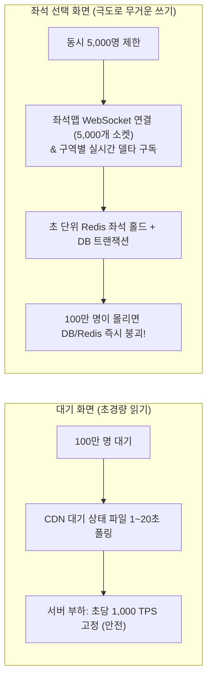
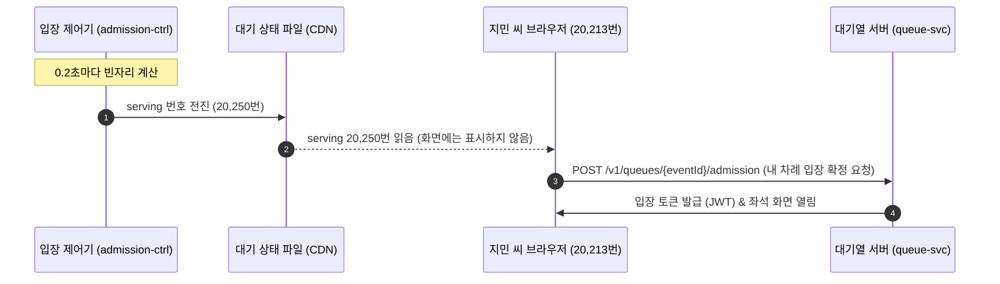
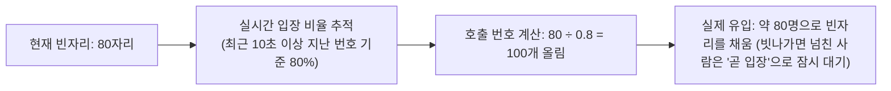
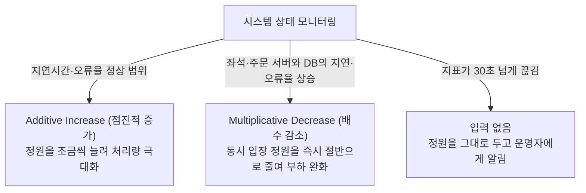
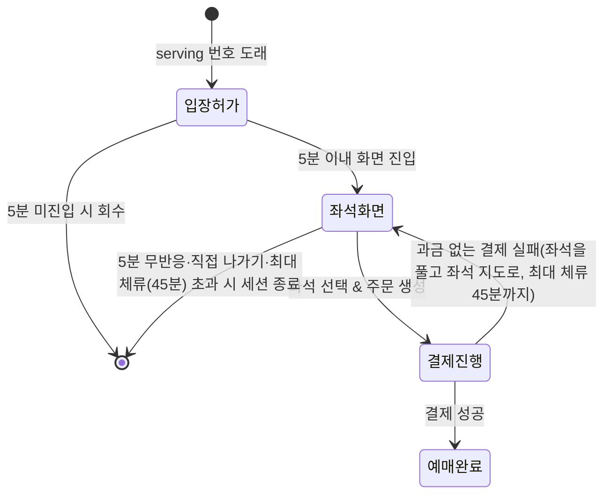

# 3. 차례와 입장

> [← 2편: 대기실과 줄 서기](02-waiting-room.md) | [목차로 돌아가기](README.md) | [4편: 좌석 고르기와 홀드 →](04-seat-hold.md)

---

## 1. 상황: 화면에 번호가 없어도 차례는 온다

지민 씨의 대기 순번은 20,213번이다. 화면에는 앞 인원과 예상 시간만 보이고 번호는 보이지 않는다. 브라우저가 주기적으로 읽는 대기 상태 파일의 호출 번호(serving)가 20,250번으로 올라 지민 씨의 순번을 넘자, 브라우저는 화면에 번호를 띄우지 않고 자동으로 입장을 확정한 뒤 실시간 좌석 선택 화면을 연다.

하지만 좌석 선택 화면에는 한 번에 들어갈 수 있는 동시 접속자가 **5,000명 안팎**으로 엄격히 제한되어 있다. 만약 5,000개의 입장 자리가 꽉 차 있다면 `"곧 입장합니다"`라는 안내 문구가 나타나며 시스템이 몇 초 간격으로 입장을 자동으로 재시도한다.

---

## 2. 왜 어려운가: 대기 화면과 좌석 화면의 부하 차이

대기 화면과 좌석 선택 화면은 시스템 부하 측면에서 차원이 전혀 다르다.

* **대기 화면 (Read-only)**: CDN에 저장된 작은 텍스트 파일을 1~20초마다 단순히 읽기(Read)만 하므로 서버에 부담을 주지 않습니다.
* **좌석 선택 화면 (Heavy Write & Pub/Sub)**: 확대해 보이는 구역 좌석의 실시간 점유 상태를 WebSocket으로 주고받으며, 초 단위로 좌석을 홀드하고 결제 트랜잭션을 일으키는 고비용의 쓰기(Write) 작업이 발생합니다.

> [!IMPORTANT]
> **대기열의 진짜 목적**  
> 대기열의 목적은 사용자를 무작정 기다리게 만드는 것이 아니라, **먼저 들어간 5,000명이 오류나 튕김 없이 쾌적하게 예매를 마칠 수 있도록 뒤쪽 통로를 정밀하게 조절(Rate Limiting & Admission Control)**하는 데 있습니다.

---

## 3. 어떻게 푸는가: 5가지 입장 제어 공학

### ① 서버가 먼저 "다음 분 들어오세요"를 외친다 (Push형 Serving)

은행 창구 직원이 전광판을 통해 "20,250번 손님까지 들어오세요"라고 번호를 띄우면, 손님은 자신의 번호표를 보고 창구로 걸어 들어간다. 손님들이 직원에게 쉼 없이 다가가 "제 차례인가요?"라고 묻지 않는 것과 같다. 피켓에서는 이 전광판(대기 상태 파일)을 사람 대신 브라우저가 읽고, 화면에는 번호 대신 앞 인원과 예상 시간만 보인다([2편](02-waiting-room.md)).

| 역할 | 담당 주체 | 동작 내용 |
| :--- | :--- | :--- |
| **입장 호출 번호 갱신 (Serving)** | 입장 제어기 (`admission-ctrl`) | **0.2초마다** 빈자리(이미 불러서 오는 중인 사람과 '곧 입장' 대기자를 뺀 자리)를 계산해 "몇 번까지 입장 가능" 숫자를 올려 잡는다. |
| **호출 번호 확인** | 사용자의 브라우저 | '대기 상태 파일'에서 호출 번호를 읽어와 내 순번과 비교한다. *(자동 배정 공연은 차례가 10초 안으로 다가오면 서버에 직접 확인, 2편)* |
| **입장 토큰 발급 및 입장 자리 배정** | 대기열 서버 (`queue-svc`) | 자기 차례가 된 사용자가 좌석 화면을 실제로 열 때 입장 자리를 정식으로 배정한다. |

> [!NOTE]
> **핵심 원칙**: "실제 좌석 화면에 들어오는 순간에만 입장 자리를 내어준다."  
> 차례가 왔음에도 화면을 보지 않고 자리를 비운 사용자 때문에 귀중한 입장 자리가 낭비되지 않습니다.

---

### ② 호출 인원은 '실제 입장 비율'을 반영해 계산한다

현재 빈자리(입장 자리)가 80개라고 해서 호출 번호를 정확히 80개만 올리면 문제가 생긴다. 호출된 사람 중 일부는 이미 이탈했거나 화면을 보지 않아 실제로 들어오는 인원이 60명에 그칠 수 있기 때문이다. 그러면 20개의 입장 자리가 놀게 된다.

* 시스템은 **"호출했을 때 실제로 입장 확정을 요청하는 비율(입장 비율)"**을 실시간으로 추적합니다. 1초에 몇 명이 오는지(도착률)가 아니라, 부른 사람 가운데 몇 %가 오는지를 보는 비율입니다. 자리가 없어 '곧 입장'을 받은 사람도 '온 사람'으로 셉니다. 그렇지 않으면 자리가 모자란 것을 사람이 안 온 것으로 잘못 읽고 더 부르게 됩니다.
* 예를 들어 최근 입장 비율이 80%라면, 80명을 채우기 위해 호출 번호를 100개 올립니다.
* 이때 방금 막 호출된 사용자는 아직 화면을 누를 시간이 없으므로, **호출된 지 10~60초 지난 번호들을 기준**으로 입장 비율을 계산합니다.

### ②-1 이미 부른 사람은 다시 세지 않는다('오는 중')

호출된 사람이 실제로 들어오기까지는 1~3초가 걸린다. 다음 대기 상태 파일이 만들어지고, CDN에 퍼지고, 브라우저가 다시 물어본 뒤에야 입장 요청을 보내기 때문이다. 제어기는 0.2초마다 계산하므로, 이 사이에 같은 빈자리를 "아직 비었네" 하고 7~15번 다시 셀 수 있다. 그러면 필요보다 훨씬 많은 사람을 불러, 차례가 왔다는 안내를 보고도 '곧 입장'만 받는 사람이 크게 는다.

그래서 제어기는 **"이미 불렀지만 아직 안 온 사람(오는 중)"**과 **"'곧 입장'으로 기다리는 사람"**을 빈자리에서 빼고 부른다. 가게가 주문했지만 아직 도착하지 않은 물건을 재고에 넣어 세면, 같은 물건을 또 주문하지 않는 것과 같다([ADR-0104](../docs/adr/0104-admission-loop-in-flight-and-ordered-soon-queue.md)).

* 계산 모형(실제로 잰 값이 아님)으로는 이렇게 하면 '곧 입장'이 거의 사라지고, 입장 수는 약 1% 줄어든다. 안 오는 사람의 몫을 몇 초 비워 두기 때문이다.
* '곧 입장'을 받은 사람은 **다시 요청한 순서가 아니라 대기 번호가 낮은 사람부터** 들어간다. 다시 요청하는 동안에는 15분 유예 시간이 지나도 표가 만료되지 않는다.

---

### ③ 동시 입장 정원은 시스템 부하에 따라 자동 조절된다 (AIMD)

기본 동시 입장 목표 정원은 **5,000명**이다. 하지만 뒤쪽 핵심 시스템(좌석·주문 서버와 DB)의 지연·오류율에 따라 정원이 자동으로 바뀐다 ([POL-010](../planning/03-policies-glossary.md)). 결제사가 1초에 승인할 수 있는 건수는 이 자동 조절과 따로, 정원과 부르는 속도의 상한으로 묶는다(아래 4절 '결제사별 상한').

* **AIMD 알고리즘 (Additive Increase Multiplicative Decrease)**:  
  뒤쪽 시스템이 여유롭고 응답이 빠르면 입장 정원을 조금씩 점진적으로 늘립니다. 반대로 좌석·주문 서버나 DB의 지연이 길어지거나 오류율이 오르면 정원을 바로 절반으로 줄여 부하를 덜어 줍니다. (인터넷 TCP 혼잡 제어의 표준 알고리즘).  
  늘리는 속도에는 규칙이 있습니다. 시스템 상태는 5초마다 새로 재고 30초 동안의 값으로 판단하므로, 정원도 30초에 한 번, 처음 정원의 2%(5,000명이면 100명)씩만 늘립니다. 새로 들어온 사람의 부하가 숫자에 나타나기도 전에 또 늘리면 넘치기 때문입니다.  
  줄인 뒤에는 효과가 나타날 시간을 줍니다. 줄여도 새 입장만 멈출 뿐 이미 들어온 사람은 평균 3분 머물러, 효과는 1.5~2분 뒤에야 보입니다. 그래서 좌석 화면 인원이 새 정원 아래로 내려오거나 줄인 뒤 2분(잠정값)이 지날 때까지는 다시 줄이지 않습니다(감축 확인 시간, 2026-10-20, [ADR-0069](../docs/adr/0069-ops-control-principles-audit-self-safety-alert-hygiene-wide-events.md)). 0.2초마다 도는 계산이 같은 신호에 거듭 반응해 1초 만에 정원이 바닥까지 내려가는 일을 막으려는 것입니다. 인원이 일찍 내려와도, 줄이기 전의 숫자로 한 번 더 줄이지 않도록 최소 35초를 기다립니다(2026-10-28, 기술 검토 높음-12).
* **숫자가 끊기면 멈춘다 (제어 입력 없음)**:  
  자동 조절이 읽는 지표가 30초(잠정값) 넘게 끊기면(조회가 실패하거나 빈 값이 와도 같습니다) 정원을 늘리지도 줄이지도 않고 그대로 두며, 관제 콘솔에 '입력 없음'을 띄워 운영자에게 알립니다. 빈 값을 '오류 0건, 건강함'으로 읽고 장애 중에 정원을 늘리는 일을 막으려는 것입니다. 운영자의 명령과 안전 한계·결제사 상한에 따른 축소는 이때도 그대로 합니다. 지표가 돌아오면 줄이기는 바로 다시 하고, 늘리기는 운영자가 확인한 뒤에 합니다(2026-10-20 소유자 결정, ADR-0069, [10편](10-control-tower.md) ⑥).
* **사람의 안전 통제 (Human in the Loop)**:  
  운영자가 관제 콘솔에서 동시 입장 목표를 수동으로 고정하면 **15분 동안 자동 조절이 멈추고 타이머가 작동**합니다. 다만 운영자가 정한 뒤에 오류 예산 경보가 새로 울리면, 이 15분 안에도 정원을 절반으로 줄이고 자동 조절 멈춤을 끝냅니다(줄이는 쪽으로만). 또한 결제 실패 같은 오류가 허용량(오류 예산)을 빠르게 깎아 자동으로 정원을 줄인 뒤에는, 지표가 잠깐 좋아져도 자동 알고리즘이 **정원을 스스로 다시 늘리지 않습니다**. 원인이 풀렸는지 사람이 확인하고 정원을 다시 정합니다([10편](10-control-tower.md)).  
  오류 예산으로 정원을 줄이는 것은 정원이 부하를 정하는 곳(좌석 잡기, 좌석 변경 알림, 결제 접수, 결제 확정)의 오류일 때만입니다. 공연 상세 화면이나 대기열 진입처럼 정원보다 앞에 있는 곳의 오류는 정원을 줄여도 나아지지 않으므로, 담당자를 부르고 그곳의 보호 장치(대기 화면 바꾸기, 캐시로 응답하기, 다시 묻는 간격 늘리기)만 켭니다. 결제사 쪽 문제로 줄일 때는 콘솔이 "결제사를 빠르게 하지는 않고, 실패를 겪는 사람 수를 줄인다"고 알려 줍니다(2026-10-28, ADR-0126).

---

### ④ 차례를 잠시 놓쳐도 15분의 유예 시간을 준다

| 상황 | 시스템 처리 방식 |
| :--- | :--- |
| **차례 지난 뒤 15분 이내 재접속** | 기존 순번을 인정받아 다음 빈자리로 **우선 입장**한다. |
| **차례 지난 뒤 15분 초과** | 대기표가 만료되어 대기열 맨 뒤로 다시 줄을 서야 한다. 이 회차에 이미 입장했던 사람은 다시 줄을 설 수 없다. 사전 셔플(PREQUEUE_SHUFFLE) 공연도 다른 공연처럼 맨 뒤로 다시 줄을 설 수 있다(2026-10-14, [ADR-0064](../docs/adr/0064-sales-end-24h-before-start.md)). |
| **판매 종료(공연 시작 24시간 전)가 옴** | 차례가 오기 전이거나 차례가 왔어도 아직 입장하지 않았다면 대기는 끝나고 '판매 시간이 끝났습니다'가 보인다. 다시 줄을 설 수도 없다. 이미 입장해 좌석을 잡아 둔 사람은 남은 홀드·결제 시간 안에 결제를 마칠 수 있다(2026-10-14 소유자 결정, ADR-0064). |
| **입장 순간 입장 자리 5,000개가 꽉 찬 경우** | "곧 입장합니다" 메시지와 함께 몇 초 간격으로 빈자리를 확인하며 자동 입장한다. 기다리는 사람끼리는 대기 번호가 낮은 사람부터 들어가고, 기다리는 동안 15분 유예가 끝나지 않는다. |

> [!TIP]
> **왜 15분(900초)인가?**  
> 사용자가 브라우저 탭을 백그라운드로 내려두면 크롬 등 최신 브라우저는 탭 타이머를 1분에 1회 수준으로 스로틀링합니다. 이로 인해 화면 갱신이나 알림을 몇 분 늦게 확인할 수 있으므로, 15분이라는 충분한 유예 시간을 두어 억울하게 자리를 잃지 않도록 배려합니다. 차례가 다가오면 브라우저 탭 타이틀 변경, 경고음, 웹 푸시 알림으로 사용자를 깨웁니다.

---

### ⑤ 좌석 선택 화면 머무름 시간(타임아웃) 제한

입장 자리는 한정되어 있으므로 특정 사용자가 자리를 무한정 차지할 수 없다 ([POL-009](../planning/03-policies-glossary.md)).

| 시간 제한 항목 | 제한 기준 | 설정 이유 |
| :--- | :---: | :--- |
| **입장 토큰 수령 후 좌석 화면 진입 시한** | **5분** | 입장 허가를 받고도 화면에 들어오지 않는 미접속자의 자리를 회수하기 위함 |
| **화면 진입 후 무반응(Inactivity) 시한** | **5분** | 좌석 화면을 켜둔 채 자리를 비운 사용자 대신 뒷사람을 들여보내기 위함 |
| **1회 세션 최대 체류 시간** | **45분** | 결제창 체류(최대 30분) 및 복수 좌석 탐색을 여유 있게 마칠 수 있는 절대 상한선 |

---

## 4. 입장 통제 핵심 운영 규칙

| 핵심 규칙 | 상세 내용 |
| :--- | :--- |
| **시스템 안전 한계선 고정** | 동시 입장 정원의 절대 상한선과 하한선, 초당 호출 번호 최대치는 코드 및 설정 파일에 하드코딩되어 있다. 긴급 상황이라도 운영자가 임의로 이 한계를 넘어설 수 없으며, 설정을 바꾸려면 정식 배포 절차를 거쳐야 한다. |
| **사람의 통제권 우선** | 운영자가 현장에서 동시 입장 목표를 수동 설정하면 **15분간 자동 변경 알고리즘이 멈추고 지정값이 유지**된다. 예외는 하나다. 지정한 뒤에 오류 예산 경보가 새로 울리면 정원을 절반으로 줄이고 자동 조절 멈춤을 끝낸다(지정 전부터 울리던 경보로는 줄이지 않는다). |
| **복수 공연 통합 상한 관리** | 여러 공연의 온세일이 겹치면(대형 공연끼리는 오픈을 30분 이상 떼어 동시에 하나만 연다) 회차별 동시 입장 목표의 합이 플랫폼 합산 상한을 넘지 않게 나눈다(동시 입장 목표는 회차마다 따로 둔다). 결제 대행사(PG사)가 감당할 수 있는 초당 결제 승인 한계(TPS)가 정해져 있기 때문이다 ([5편](05-payment.md)). |
| **결제사별 상한** | 결제사가 1초에 승인할 수 있는 건수(승인 상한)로 두 가지를 따로 묶는다. ① 1초에 부르는 번호는 '승인 상한 ÷ 결제 비율'을 넘지 않는다. 불린 사람이 한꺼번에 결제해도 첫 승인 요청이 상한을 넘지 않게 하려는 것이다. ② 동시 입장 정원은 '승인 상한 × 평균 체류(3분) ÷ 결제 비율 × 0.5(잠정값)'를 넘지 않는다. 평소의 승인 요청을 상한의 절반 아래로 두어, 결제가 몰리는 순간과 다시 시도할 몫을 남긴다. 결제 비율은 입장한 한 사람이 내는 첫 승인 요청 수이고, 처음에는 모두 한 번씩 결제한다고 보고 1.0으로 잡는다. 예를 들어 포트원 채널 하나(초당 50건으로 잡음)면 1초에 50번호, 정원 4,500명이다. 같은 결제사를 쓰는 회차들은 이 상한을 나눠 쓴다. 결제사를 바꿔 상한이 낮아지면 다음 계산에서 바로 낮추고, 높아지면 자동 조절로 천천히 올린다(2026-10-28, 기술 검토 중간-027, [5편](05-payment.md)). |
| **긴급 입장 일시정지** | 심각한 시스템 장애 발생 시 운영자는 호출을 일시 중단할 수 있다. 10분마다 운영자가 사유를 적고 연장해야 이어지며, 연장하지 않으면 10분 뒤 호출이 자동으로 다시 시작된다. 기존 대기열 순번은 그대로 유지된다. |

---

## 5. 한 줄 요약

> **서버가 0.2초마다 입장 호출 번호를 갱신하고, 좌석 화면에는 한 번에 5,000명 안팎만 유지하며, 이 인원은 백엔드 부하에 따라 자동으로 줄어들고 안전한 범위에서 사람의 판단에 따라 조절된다.**

---

## 더 알아보기

* [docs/features/queue-admission.md §5](../docs/features/queue-admission.md), [POL-010](../planning/03-policies-glossary.md): 입장 제어 루프 및 AIMD 알고리즘 구현
* [docs/features/queue-admission.md §6](../docs/features/queue-admission.md), [POL-008, POL-009](../planning/03-policies-glossary.md): 입장 확정 프로세스와 구매 세션 라이프사이클
* [POL-008](../planning/03-policies-glossary.md): 입장 차례 및 15분 유예 정책
* [docs/features/queue-admission.md §9](../docs/features/queue-admission.md): 비상 상황 및 다운스트림 장애 시 완화 절차
