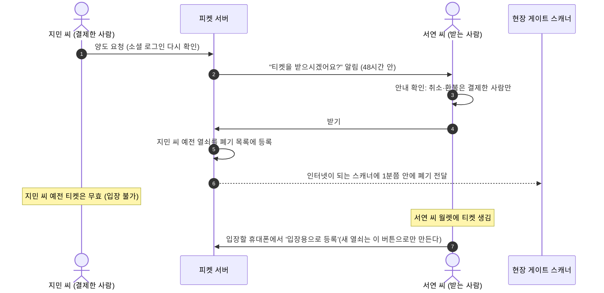
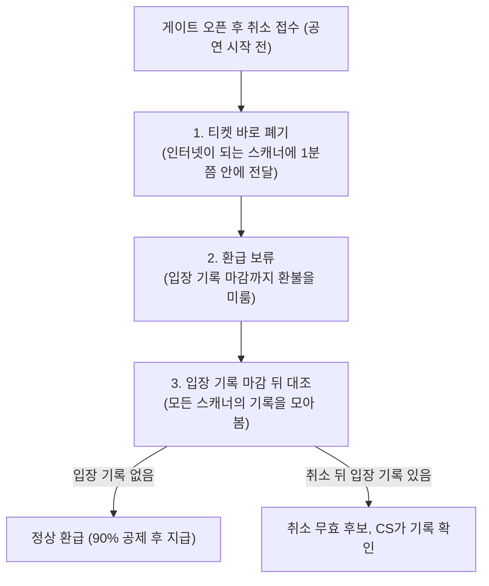

# 7. 양도, 취소, 환불

> [← 6편: 모바일 티켓과 공연장 입장](06-ticket-and-gate.md) | [목차로 돌아가기](README.md) | [8편: 계정과 로그인 →](08-account.md)

---

## 1. 상황: 출장이 잡힌 지민 씨, 공연이 취소된 수아 씨

공연 5일 전, 지민 씨에게 갑작스러운 해외 출장이 잡혔다. 지민 씨에게는 두 가지 선택지가 있다.

1. **친구 서연 씨에게 티켓을 넘긴다 (양도)**
2. **예매를 취소하고 돈을 돌려받는다 (예매 취소와 환불)**

양도를 고르면 서연 씨에게 "티켓을 받으시겠어요?"라는 알림이 간다. 서연 씨가 받기를 누르는 순간 티켓이 서연 씨에게 넘어가고 지민 씨의 티켓은 무효가 된다. 서연 씨는 입장할 휴대폰에서 '입장용으로 등록'을 눌러 새 열쇠를 만든다. 취소를 고르면 공연일까지 남은 날짜에 따라 공정거래위원회 기준대로 공제한 뒤 돌려받고, 그 좌석은 다른 사람이 살 수 있는 취소표가 된다.

같은 날, 수아 씨가 예매한 다른 공연은 주최 측 사정으로 취소됐다. 수아 씨는 아무것도 하지 않아도 결제한 카드로 전액이 돌아오고, 주최 측 잘못이라면 결제 금액의 10%를 배상금으로 더 받는다.

여기서 알아 둘 것이 하나 있다. 공연을 파는 판매자는 공연을 올린 파트너(기획사)이고, 피켓은 그 판매를 중개하는 플랫폼이다. 다만 예매 취소와 환불은 피켓이 직접 처리한다([ADR-0045](../adr/0045-intermediary-legal-status.md)).

---

## 2. 왜 어려운가: 돈과 티켓이 움직이는 곳마다 생기는 빈틈

| 핵심 난제 | 원인과 위협 | 피켓의 해결책 |
| :--- | :--- | :--- |
| **1. 이중 양도 사기** | 티켓 하나를 여러 사람에게 넘겨 돈을 가로채려는 시도 | 데이터베이스 행 잠금으로 한 번에 하나만 성공 |
| **2. 넘긴 뒤 몰래 쓰기** | 넘긴 사람이 예전 QR로 먼저 입장하거나, 넘긴 뒤 몰래 취소해 돈을 돌려받는 사고 | 넘긴 사람 키 폐기와 받는 사람의 새 키 등록('입장용으로 등록' 버튼으로만), 양도 중에는 취소 불가 |
| **3. 받은 사람이 취소하면 돈은 누구에게?** | 환불은 결제 수단으로만 돌아가므로 받은 사람이 취소하면 표도 돈도 잃는다 | 취소와 환불은 결제한 사람에게만. 받은 사람은 결제자에게 돌려주기만 할 수 있다 |
| **4. 법적 환불 분쟁** | 수수료를 임의로 많이 떼면 전자상거래법·약관규제법 위반 | 소비자분쟁해결기준 공제율을 상한으로 쓴다 |
| **5. 게이트 오픈 뒤 취소하고 몰래 입장** | 취소로 돈을 받고 오프라인 게이트로 들어가는 악용 | 환급을 입장 기록 마감까지 보류하고 입장 기록과 대조 |
| **6. 정책 밖 예외와 되돌릴 수 없는 일괄 환불** | 사람 한 명의 실수나 오남용이 수만 건 환불로 번진다 | 정책 안은 자동, 정책 밖은 다른 사람의 승인. 회차 취소는 두 사람이 확정 |
| **7. 들어간 뒤 돌려주기** | 받은 사람이 입장한 뒤 결제자에게 돌려주면 결제자도 새 키로 들어갈 수 있어 한 장에 두 명이 된다 | 입장이 시작되면 입장 기록 마감 때까지 받기, 돌려주기, 되찾기를 멈춘다 |

---

## 3. 어떻게 푸는가: 7가지 양도·취소·환불 규칙

### ① 양도는 받는 사람이 '받기'를 눌러야 넘어간다

양도는 이름만 바꾸는 일이 아니라, 휴대폰 사이에서 티켓 열쇠를 바꾸는 일이다([POL-017](../planning/03-policies-glossary.md)).

* **마감**: 공연 시작 **2시간 전**과 **입장 시작** 중 이른 때까지 요청해야 한다. 입장이 공연 2시간 전보다 먼저 시작하는 공연이면 입장 시작이 마감이다.
* **받기 기한**: 요청 뒤 **48시간**과 양도 마감 중 이른 때까지. 기한이 지나면 요청만 끝나고 티켓은 지민 씨에게 그대로 있다.
* **철회**: 서연 씨가 받기 전이면 지민 씨가 요청을 거둘 수 있다.
* **받는 사람 자격**: 휴대폰 본인확인을 마친 피켓 회원만 받을 수 있다.
* **받은 티켓은 다시 넘길 수 없다**: 서연 씨는 결제한 지민 씨에게 '돌려주기'만 할 수 있다. 돌려주기는 지민 씨가 받기를 누르지 않아도 바로 돌아간다.
* **입장 중에는 멈춘다**: 입장이 시작되면 입장 기록 마감 때까지 양도 받기, 돌려주기, 되찾기를 하지 않는다. 인터넷이 끊긴 스캐너의 입장 기록은 늦게 올라와서 그사이 피켓은 누가 들어갔는지 모른다. 서연 씨가 들어간 뒤 지민 씨에게 돌려주면 지민 씨도 새 키로 들어갈 수 있어 한 장에 두 명이 되기 때문이다([ADR-0051](../adr/0051-gate-process-end-to-end.md)).
* **다시 확인하는 방법**: 양도 전에는 소셜 로그인을 한 번 더 한다. 휴대폰 본인확인은 '실제 주인이 누구인가'를 확인하는 절차라 로그인을 대신하지 않는다([ADR-0001](../adr/0001-fan-social-login-single-factor.md)).
* **알림 링크를 눌렀을 때**: 서연 씨가 메일이나 문자 속 링크를 누르면, 로그인 쿠키(출입증)가 다른 사이트에서 넘어온 첫 이동에는 따라가지 않도록 막아 두었다(`SameSite=Strict`). 그래서 화면은 먼저 빈 틀만 나오고, 그 안의 스크립트가 서연 씨 계정을 확인한 뒤 양도 내용을 보여 준다. 양도 거절과 철회도 받기처럼 눌러도 한 번만 처리된다([ADR-0065](../adr/0065-web-frontend-security-after-asvs-v3.md)).

> [!WARNING]
> **양도에 돈이 오갔다면**
> 서연 씨가 지민 씨에게 티켓값을 줬더라도, 공연이 취소되면 환불은 결제한 지민 씨에게 간다. 그 돈은 두 사람이 직접 정리해야 한다. 피켓은 받기 화면에서 이 사실을 알려 줄 뿐 돈 거래에는 관여하지 않는다.

---

### ② 예매 취소와 환급 기준표

취소는 **결제한 사람이 티켓을 가지고 있을 때만** 할 수 있다. 양도 요청 중이거나 남에게 넘어간 티켓은 먼저 요청을 거두거나 돌려받은 뒤에 취소한다.

공제율은 공정거래위원회 고시 **'소비자분쟁해결기준(공연업)'**을 상한으로 쓰며, 피켓은 이보다 높은 수수료를 받지 않는다([POL-032](../planning/03-policies-glossary.md)).

| 공연일까지 남은 기간 | 환급 금액 및 공제 기준 | 지민 씨 예시 (티켓 ₩120,000 기준) |
| :--- | :--- | :--- |
| **공연 10일 전까지** | **전액 환급 (수수료 0원)** | ₩120,000 전액 환급 |
| **공연 7일 ~ 9일 전** | 티켓 금액의 **10% 공제** 후 환급 | ₩12,000 공제 $\rightarrow$ ₩108,000 환급 |
| **공연 3일 ~ 6일 전** | 티켓 금액의 **20% 공제** 후 환급 | ₩24,000 공제 $\rightarrow$ **₩96,000 환급 (현재 적용)** |
| **공연 1일 ~ 2일 전** | 티켓 금액의 **30% 공제** 후 환급 | ₩36,000 공제 $\rightarrow$ ₩84,000 환급 |
| **공연 당일 (시작 전까지)** | 티켓 금액의 **90% 공제** 후 환급 | ₩108,000 공제 $\rightarrow$ ₩12,000 환급 |

> [!IMPORTANT]
> **예매 후 24시간 안 취소는 전액 환급**
> 공연일 3일 전까지 하는 취소라면, 예매 완료 후 **24시간 이내에 취소**할 때 공제 없이 **전액 환급**한다.
> 24시간을 셀 때 주말과 법정 공휴일은 빼므로, 금요일 저녁에 예매했다면 월요일 저녁까지 수수료 없이 취소할 수 있다.

* 이런 정책 안의 취소에는 사람의 승인이 끼지 않는다. 법이 정한 3영업일 안에 환급하기 위해서다(전자상거래법 §18②).
* 무통장 입금(가상계좌)으로 결제했다면 취소 화면에서 돌려받을 계좌를 적는다. 계좌번호는 저장하지 않고 결제사 취소 요청에 바로 넘긴다. 입장이 시작된 뒤 취소해 입장 기록 마감 뒤에 환급하거나 결제사 장애로 환급이 늦어지면, 그때 알림으로 계좌를 다시 묻는다. 그 사이 계좌번호를 보관하지 않기 위해서다.

---

### ③ 게이트 오픈(입장 시작) 뒤 취소의 3단계 안전장치

공연 당일 입장이 시작된 뒤에도 공연 시작 전까지는 취소할 수 있다. 다만 부정 입장을 막으려고 다음 절차를 거친다.

* 인터넷이 끊긴 스캐너에는 연결될 때 폐기가 전해진다. 그사이 그 스캐너에서 옛 QR로 들어오면 '취소 뒤 입장' 기록이 남는다.
* **입장 기록 마감**은 공연 종료 2시간 뒤에 모든 스캐너의 기록이 모였으면 바로 하고, 아니면 늦어도 하루 안에 한다. 하루는 운영해 보며 정할 잠정값이다.
* 취소 뒤 입장 기록이 있으면 CS가 기록을 확인한다. 기록이 맞으면 취소가 무효가 되고, 기록이 잘못된 것으로 확인되면 환급한다([ADR-0051](../adr/0051-gate-process-end-to-end.md)).

---

### ④ 공연 취소·연기: 주최 측이 요청하고 피켓이 판정한다

| 사유 | 처리 절차 |
| :--- | :--- |
| **공연 취소** | 주최 측(파트너)은 취소를 **요청**만 한다. 피켓의 관제 책임자(commander)가 누구 잘못인지 판정하고, 판정한 사람이 아닌 다른 운영자(operator 이상)가 한 번 더 승인해야 확정된다. 확정되면 결제한 사람과 양도받아 티켓을 가진 사람에게 따로 알리고(환급은 결제한 사람에게 간다), 결제사 처리 한도 안에서 나눠 전액 환불한다. 입장이 시작된 뒤 취소돼도 이미 들어간 사람까지 모두 환불받고, 이때는 입장 기록 마감을 기다리지 않는다. 한 결제사에서 환불 실패가 갑자기 늘면 그 결제사 몫만 스스로 멈추고, 관제 책임자가 확인한 뒤 다시 시작한다(2026-10-28 기술 검토 중간-045·050) |
| **공연 연기** | 바뀐 일정에 못 가는 사람은 바뀐 공연 시작 전까지 신청하면 **전액 환급**받는다 |
| **주최 측 잘못이나 공연 내용 변경** | 주최 측 잘못으로 취소되거나 주요 출연진이 바뀌거나 공연 시간이 절반 이하로 줄면, 소비자분쟁해결기준에 따라 **실제 결제 금액의 10%를 배상금**으로 더 준다. 카드 취소로는 결제액보다 많이 돌려줄 수 없어서, 피켓이 결제한 사람 계좌로 **먼저 보내고** 주최 측에게서 받아 낸다 |

> [!NOTE]
> **왜 주최 측이 스스로 고르게 하지 않을까?**
> 주최 측 잘못이면 10%를 더 물어야 하므로, 스스로 고르게 하면 '불가항력'을 고를 유인이 생긴다. 그래서 판정은 피켓이 한다. 또 회차 하나를 취소하면 수만 건이 한꺼번에 환불되고 되돌릴 수 없으므로, 두 사람이 확인해야 실행된다.

---

### ⑤ 정책 밖 환불은 다른 사람이 승인한다

정책 안 취소는 자동이지만, 정책 밖으로 돈이 움직이는 일은 요청한 사람과 **다른 사람**이 승인한다([POL-038](../planning/03-policies-glossary.md)).

| 경우 | 누가 승인하나 |
| :--- | :--- |
| 피켓 잘못이 기록으로 확인되는 경우(중복 결제, 장애로 티켓이 안 나옴, 입장 실패) | CS 책임자 1명. 3영업일 안에 환급 |
| 질병·사망 같은 사정으로 공제를 면제하는 경우(주문 1건, 30만 원 이하) | 요청자가 아닌 CS 책임자 1명 |
| 위와 같지만 30만 원 초과, 여러 주문, 같은 사람의 90일 안 두 번째 요청 | CS 책임자와 관제 책임자(commander) 2명 |

* 공제 면제를 기다리는 동안에도 공제 뒤 기본 환불은 먼저 나간다. 면제분만 승인 뒤에 더 돌려준다.
* 진단서 같은 서류는 화면으로 확인만 하고 저장하지 않는다. 건강 정보는 민감정보라 따로 동의를 받아야 하기 때문이다.

---

### ⑥ 계정을 도둑맞아 넘어간 티켓은 두 사람이 확인해 되찾는다

* 누군가 지민 씨 계정에 들어가 티켓을 넘겼다면, 지민 씨 본인확인을 다시 한 뒤 CS 책임자가 요청하고 관제 책임자(commander)가 승인해 티켓을 되찾는다.
* 받은 사람에게도 알리고 **하루 이상** 사정을 설명할 기회(소명)를 준다. 설명이 합당하면 되찾지 않는다.
* 입장이 시작됐거나 이미 입장한 티켓은 되찾을 수 없다.
* 짧은 기간에 대량으로 사고 취소하기를 반복하는 계정도 시스템이 표시만 하고, 예매 제한은 CS 책임자가 확인해서 건다. 이때도 하루 이상 소명 기회를 준다.

---

### ⑦ 회원 탈퇴 때 남은 티켓 처리

* 쓰지 않은 티켓이 있는 채로 탈퇴를 신청하면, 보유 티켓 목록과 예상 환급액을 보여 주고 양도를 먼저 권한다(받는 분이 수락해야 넘어간다).
* 최종 확인을 마치면 내가 결제한 티켓은 환급표대로 취소·환불하고, 양도받은 티켓은 환급 없이 결제한 분에게 돌려준 뒤 탈퇴를 끝낸다. 수락 전 양도 요청은 내가 보낸 것은 철회하고(그 티켓은 취소·환불), 내가 받은 것은 거절로 끝낸다. 내가 결제해 양도를 마친 티켓은 받은 분이 그대로 쓴다.
* 가상계좌로 결제한 티켓은 탈퇴 단계에서 환불받을 계좌를 받아 결제사에 바로 넘긴다(저장하지 않는다). 입장이 시작된 뒤 취소한 티켓처럼 지금 환급할 수 없으면 환급을 마칠 때까지 탈퇴를 미루고, 그동안 새 예매와 양도는 할 수 없다.
* 쓰지 않은 티켓이 있다고 해서 탈퇴할 권리를 막지 않는다. 탈퇴를 미루는 경우는 결제 결과를 기다릴 때와 가상계좌 환급을 기다릴 때 둘뿐이다(처리 표는 [POL-033](../planning/03-policies-glossary.md)).

---

## 4. 양도·취소 핵심 법적 규칙

| 법적 규칙 | 상세 내용 |
| :--- | :--- |
| **피켓은 중개자, 판매자는 주최 측** | 공연의 개최·변경·취소 책임은 판매자(파트너)에게 있다. 피켓은 결제 직전 화면과 예매 확인서에 이 사실과 판매자 정보를 알리고, 예매 취소와 환불은 직접 처리한다(전자상거래법 §20, ADR-0045) |
| **청약철회 준수** | 예매 후 7일 이내이고 공연일이 10일 이상 남았다면 공제할 수 없다. 피켓 환급표는 이 구간을 전액 환급으로 정해 법이 요구하는 수준을 지킨다 |
| **취소는 결제한 사람만** | 청약철회는 계약을 맺은 소비자의 권리다(§17①). 받은 사람은 계약 당사자가 아니라고 보고 결제자에게만 취소·환불한다(해석) |
| **공제율 사전 안내** | 공연 10일 이내 취소 때의 공제율은 결제 직전 화면과 티켓 상세에 미리 적는다 |
| **문의·분쟁 처리 기한** | 분쟁은 접수 뒤 3영업일 안에 진행 경과를, 10영업일 안에 결과를 알린다(전자상거래법 시행령 §25의2, POL-037). 분쟁이 아닌 일반 문의는 3영업일 안에 답하는 것이 목표다(법정 기한이 아니라 운영해 보며 정할 잠정값, POL-038) |
| **환불 중복 방지** | 결제사 환불 요청에 고유 멱등키를 붙이고 실패하면 재시도 큐로 넘겨, 같은 환급이 두 번 나가지 않게 막는다 |

---

## 5. 한 줄 요약

> **양도는 받는 사람이 받아야 넘어가고 취소·환불은 결제한 사람에게만 한다. 정책 안의 취소는 자동으로 3영업일 안에 돌려주고, 정책 밖의 환불과 회차 취소처럼 되돌릴 수 없는 일은 다른 사람이 한 번 더 확인한다.**

---

## 더 알아보기

* [docs/features/transfer-refund.md](../features/transfer-refund.md): 양도 수락·돌려주기·회수, 회차 취소 판정과 일괄 환불, 배상 지급, 승인 업무와 CS 처리함 상세 설계
* [ADR-0045](../adr/0045-intermediary-legal-status.md), [ADR-0046](../adr/0046-cancel-transfer-refund-approvals.md): 판매 구조 판단과 취소·양도·환불 승인 체계 결정
* [docs/features/offline-gate.md §5](../features/offline-gate.md), [POL-017](../planning/03-policies-glossary.md), [ADR-0051](../adr/0051-gate-process-end-to-end.md): 양도 때의 열쇠 교체(Key Rotation)와 입장 중 소유권 동결
* [docs/features/payment.md §4](../features/payment.md), [POL-032](../planning/03-policies-glossary.md): 취소·환불 처리 흐름과 공제율 계산
* [docs/planning/04-ia-flows-screens.md §3 (SCR-038, SCR-041~047)](../planning/04-ia-flows-screens.md): 예매 취소, 양도 받기, CS 처리함·승인 업무 화면
* [docs/security/data-classification.md (항목 16)](../security/data-classification.md): 전자상거래법 및 소비자분쟁해결기준 법률 해석 원문 검토 결과
