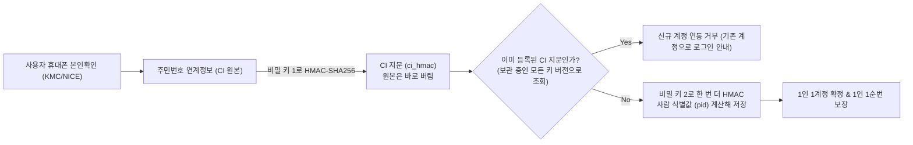
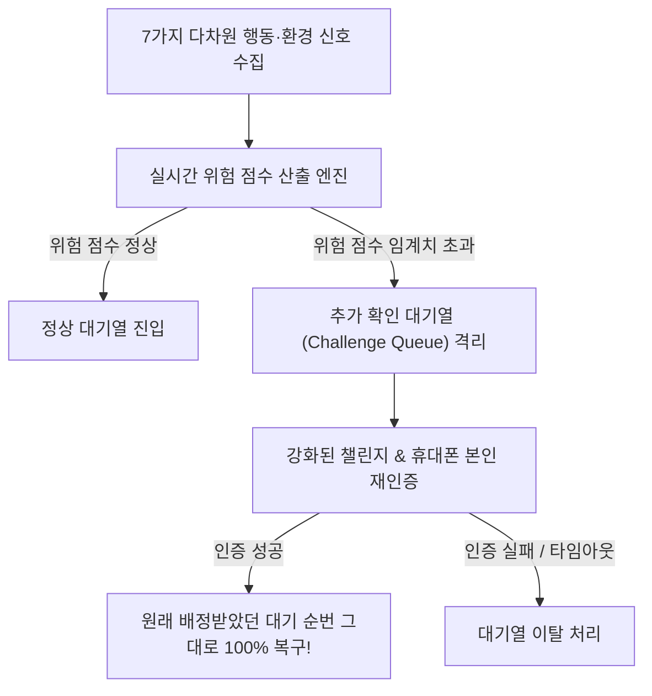

# 9. 본인확인과 봇 방어

> [← 8편: 계정과 로그인](08-account.md) | [목차로 돌아가기](README.md) | [10편: 관제실 →](10-control-tower.md)

---

## 1. 상황: 자연스러운 사람 확인 vs 비정상 기기의 격리

지민 씨가 처음 티켓을 예매하려 하자 화면에 `"휴대폰 본인확인이 필요합니다"`라는 안내가 뜬다. 통신사 본인인증을 한 번 마치고 나면 다음부터는 다시 묻지 않는다.

티켓 오픈 당일 대기실에 입장할 때 브라우저가 화면 뒤에서 잠시 '사람 확인'을 수행하고, 지민 씨는 별도의 클릭 없이 자연스럽게 통과한다.  
그런데 옆집에서 매크로 프로그램을 돌리던 사용자의 화면에는 **`"추가 확인이 필요합니다 (사유: 비정상 기기 신뢰도)"`**라는 격리 안내창이 나타난다. 이 사용자 역시 추가 인증을 통과하면 자신이 원래 배정받았던 대기 순번 그대로 대기열에 복귀할 수 있다.

---

## 2. 왜 어려운가: 봇 방어의 4대 역설과 난제

티케팅 서비스의 봇(Bot) 방어는 단순히 기술을 넘어 공정성과 사용자 경험이 첨예하게 부딪히는 영역이다.

| 핵심 난제 | 원인과 위협 | 피켓의 해결책 |
| :--- | :--- | :--- |
| **1. 압도적인 봇의 속도** | 단순 선착순 환경에서는 0.001초 단위로 클릭하는 매크로를 사람이 결코 이길 수 없음 | **2초 묶음 무작위화** ([2편](02-waiting-room.md)) & **사전 대기실 추첨** |
| **2. 대량 계정 생성 (다계정)** | 추첨제 환경에서는 계정 수량이 곧 당첨 확률이 되므로 봇 업자가 수천 개 가짜 계정 동원 | **휴대폰 본인확인(CI) 기반 1인 1계정** (비밀 키를 건 지문 `pid` 강제) |
| **3. 오탐(False Positive)의 치명성** | 봇을 잡겠다고 너무 엄격히 굴면 선량한 일반 팬이 봇으로 오인받아 튕겨 나가는 피해 발생 | **징벌적 차단 대신 '추가 확인 대기열'** (원래 순번 100% 복구 보장) |
| **4. 법적 의무화** | 2026년 8월 28일 개정 공연법 시행으로 판매자의 구매자 본인확인 조치 의무화 | **예매 전 본인확인 필수화** (비회원 예매 차단) |

> [!IMPORTANT]
> **대원칙: "트래픽 방어와 봇 방어는 완전히 별개의 과제다"**  
> 실제로 Ticketmaster는 봇을 상당수 차단했음에도 폭증하는 트래픽을 감당하지 못해 시스템이 붕괴된 바 있습니다. 따라서 [2편](02-waiting-room.md)과 [3편](03-admission.md)이 인프라 트래픽 방어를 전담하고, 본 9편이 부정 트래픽 탐지와 본인확인을 전담합니다.

---

## 3. 어떻게 푸는가: 6대 봇 탐지 및 본인인증 엔지니어링

### ① 1인 1계정 원칙: 휴대폰 본인확인 (CI)

* **암호학적 식별자 보관**: 본인인증 대행사의 주민번호 연계정보(CI) 원본을 그대로 저장하지 않습니다. 클라우드 키 관리 서비스(KMS)가 보관하는 비밀 키로 HMAC-SHA256 지문을 만들어 저장합니다. 지문으로 원래 CI를 되돌려 알 수 없고, 비밀 키가 없으면 같은 지문을 계산할 수도 없어 유출 피해가 줄어듭니다. 다만 지문도 한 사람을 가리키는 값이라 개인정보로 다룹니다 ([POL-001](../planning/03-policies-glossary.md)).
* **사람 식별값(pid)**: CI 지문을 또 다른 비밀 키로 한 번 더 HMAC한 값입니다. 본인확인 때 한 번 계산해 저장해 두고 로그인 토큰에 실어 1인 1순번을 확인합니다. 토큰을 줄 때마다 계산하지 않는 것은 키 관리 서비스의 호출 한도(서울 리전은 계정 전체가 초당 10,000건을 나눠 씀)를 티켓 오픈 순간에 쓰지 않기 위해서입니다.
* **키를 바꿀 때**: 두 비밀 키는 정기적으로 바꾸지 않고, 새어 나간 것으로 의심될 때만 티켓 오픈 시간대를 피해 바꿉니다. 판매는 몇 주씩 이어지고 그동안 같은 사람의 식별값이 같아야 1인 1순번이 지켜지기 때문입니다. 사람 식별값 키를 바꿀 때는 판매 중인 회차가 끝날 때까지 옛 값과 새 값을 함께 확인합니다(2026-10-28). CI용 키를 바꾼 뒤에도 예전 버전을 지우지 않고 남겨, 본인확인을 할 때 모든 버전으로 조회합니다. 그래야 키를 바꾼 틈에 같은 사람이 두 번째 계정을 만들지 못합니다 ([ADR-0050](../adr/0050-crypto-corrections-and-key-management.md) 결정 5).
* **1인 1계정 강제**: 이미 다른 계정에 연결된 명의로 두 번째 계정에서 인증을 시도하면 즉시 차단됩니다.
* **본인확인 전용 화면은 없다**(2026-10-14 소유자 결정, ADR-0063): 지민 씨가 공연 상세나 대기실에서 [휴대폰 본인확인]을 누르면 그 자리에서 본인확인기관(통신사 인증) 창이 바로 뜬다. 버튼을 누른 그 순간에 창을 열어야 브라우저의 팝업 차단에 걸리지 않으므로, 창부터 열고 기관 화면을 그 창에 불러온다. 왜 하는지는 버튼 위 한 줄로 알린다. 인증이 끝나면 창이 닫히고 원래 화면 위에 "본인확인을 마쳤습니다"가 뜬다. 창을 닫았거나 실패하면 [다시 시도], 이미 다른 계정에서 본인확인한 명의면 그 계정으로 로그인하라는 안내, 만 14세 미만이면 이용할 수 없다는 안내가 같은 자리의 대화상자로 나온다.
* **휴대폰에서는 잠깐 다른 화면을 거친다**: 기관이 새 창 대신 화면을 통째로 넘기는 방식(모바일과 일부 브라우저)이면, 인증 뒤 "본인확인 결과를 확인하는 중입니다"만 보이는 짧은 복귀 화면을 거쳐 원래 화면으로 돌아오고 결과 대화상자가 뜬다. 돌아갈 주소는 피켓 안의 주소만 받아, 이 흐름을 악용해 다른 사이트로 보내지 못하게 한다.
* **효과**: 가짜 계정을 수천 개 만들어 당첨 확률을 올리려던 봇의 핵심 무기를 막습니다. 남은 수단은 다른 사람 명의를 빌리는 것인데, 명의마다 돈과 법적 위험이 듭니다. 빌린 명의로 추가 확인까지 통과하는 봇은 시스템이 가려내지 못한다는 한계가 남습니다.

---

### ② 사용자 친화적 '사람 확인' (Cloudflare Turnstile)

* **배경 투명 검증**: 왜곡된 글자 읽기(CAPTCHA)나 신호등 사진 고르기처럼 사용자를 피로하게 만들지 않습니다. 브라우저 안에서 사람이 눈치채지 못하는 짧은 검사를 돌려, 대부분은 아무것도 누르지 않고 통과하고 의심스러울 때만 체크 상자가 뜹니다. 통과했다는 것만으로 사람이라고 믿지는 않고, 위험 점수(③)의 약한 신호로만 씁니다.
* **핫패스(Hot-path) 제외**: 사람 확인은 트래픽이 폭발하는 8시 0분 0초 순간이 아니라, **대기실 진입 단계 등 사전 통로에서만 미리 수행**합니다. 정각에 외부 검증 서버를 부르면 그 자체가 병목이 되어 전체 서비스가 마비되기 때문입니다.

---

### ③ 다차원 위험 점수(Risk Scoring) 엔진: 7가지 탐지 신호

시스템은 사용자가 대기실에 들어오는 순간부터 7가지 행동 및 환경 신호를 종합하여 위험 점수를 실시간으로 계산합니다 ([FR-039](../planning/02-requirements.md)).

| 탐지 신호 | 세부 분석 내용 |
| :--- | :--- |
| **1. 사람 확인 신호** | Cloudflare Turnstile 통과 여부 및 재시도 횟수 |
| **2. 기기 신뢰도 지문** | 단말기에서 본인확인을 거친 계정 수, 과거 온세일 봇 확정 이력. 단일 기기에서 다수 명의 번갈아 감지 시 의심도 상승(이 회차에 같은 기기로 들어온 계정 수는 요청 때 바로 셈) |
| **3. 사용자 행동 신호**| 마우스 포인터 이동 엔트로피, 터치·키 입력 간격, 스크롤 궤적 요약값. (사람의 자연스러운 머뭇거림 vs 스크립트의 균일한 입력 간격·직선 순간이동) |
| **4. 허니팟 (Honeypot)** | 화면상 사람 눈에는 보이지 않지만 HTML 코드에만 존재하는 가짜 링크/버튼. 같은 사이트 안에서 미리 가져오기가 아닌 요청으로 누른 세션은 봇으로 확정 표시(다른 사이트가 부르게 한 요청과 브라우저의 미리 가져오기는 세지 않아, 화면을 그리는 브라우저 자동화 봇만 잡힌다) |
| **5. IP 및 네트워크 특성** | 일반 가정용 ISP 통신망인지 데이터센터(AWS, GCP 등) IP인지, 동일 ASN 대역에서 대규모 동시 요청인지 분석 |
| **6. 세션 및 브라우저 나이** | 브라우저 인스턴스 생성 시점과 로그인 시점의 경과 시간. 오픈 직전에 급조된 헤드리스 브라우저 감별 |
| **7. 브라우저 환경 모순** | User-Agent는 모바일 사파리인데 실제 터치 이벤트 API가 지원되지 않는 등 환경 위변조 불일치 탐지 |

---

### ④ 징벌적 차단 대신 '추가 확인 대기열'로 안전하게 격리

위험 점수가 높게 측정된 사용자를 즉시 차단(Ban)하지 않는다 ([POL-006](../planning/03-policies-glossary.md)).

* **원래 순번 100% 복구**: 격리된 사용자는 강화된 보안 챌린지와 휴대폰 본인 재인증을 수행합니다. 통과 시 **원래 배정받았던 대기 순번 그대로 정상 복귀**하며, 이미 차례가 지났다면 즉시 다음 빈자리로 우선 입장됩니다. 확인에 걸린 시간 때문에 손해 보지 않도록 차례 뒤 15분 유예는 차례와 통과 가운데 늦은 때부터 셉니다.
* **설명 요구권 보장**: 개인정보 보호법 제37조의2에 따라, 의심 사유의 대분류 범주를 투명하게 안내하며 전문 상담원을 통한 이의 제기 절차를 완비합니다. 온세일 윈도우(오픈 10분 전부터 60분 뒤까지) 중에 들어온 재검토 신청은 30분 안에 판정하는 것을 목표로 하고, 결과와 설명은 늦어도 10영업일 안에 이메일로 보냅니다(법이 정한 상한은 요청받은 날부터 30일. 30분과 10영업일은 운영해 보기 전에 정한 잠정값).

#### 기다리는 동안 다시 보기(대기 중 재평가)

한 사람만 보면 멀쩡한데, 여럿을 같이 보면 이상한 경우가 있습니다. 같은 기기에서 계정 다섯 개가 10분 안에 차례로 들어오면, 판정 때는 다섯 번째 사람부터 의심스럽습니다. 하지만 앞의 네 명은 이미 통과해 기다리고 있습니다. 서로 다른 계정 스무 개가 똑같은 마우스 움직임 요약값을 보내는 경우(녹화한 움직임을 재생하는 봇)도 한 명씩 봐서는 모릅니다.

그래서 사람이 기다리는 동안 재평가 작업자(`trust-reassess`, Kafka에서 신호를 읽어 Redis로 세는 작은 프로그램)가 이런 '여러 계정 사이 패턴'을 찾아 추가 확인 후보로 냅니다. 처음에는 기록만 하고(그림자), 사람을 잘못 잡는 비율이 상한(0.5%) 안인지 확인한 뒤 관제 책임자가 봇 판정 강도 명령(명령 5)에서 '적용'으로 바꿔야 실제로 추가 확인 대기열에 보냅니다. 보내더라도 차단이 아니라 위의 추가 확인이고, 한꺼번에 많은 사람을 보내지 않도록 10분에 대기 인원의 0.5%(운영 전 잠정값)까지로 막아 둡니다. PC방이나 가족이 함께 쓰는 태블릿도 걸릴 수 있지만, 사람이면 추가 확인을 통과해 원래 순번으로 돌아옵니다([docs/streaming.md §5](../streaming.md), ADR-0071·0099).

---

### ⑤ 봇 방어 시스템 장애 시의 안전 모드 (Graceful Degradation)

외부 봇 탐지 서비스나 내부 위험 점수 엔진에 장애가 발생하더라도 문을 무조건 열어젖히지 않습니다. 사전에 캐시된 마지막 안전 규칙과 기기·계정마다 더 엄격한 속도 제한(Rate Limit)을 적용하는 '보수적 축소 운영'으로 즉시 전환되어 서비스를 안정적으로 유지합니다. IP 단위 제한은 클라우드·프록시 대역에만 겁니다. 휴대폰 통신사나 공용 와이파이는 한 IP 뒤에 많은 사람이 있어서, IP로 막으면 정상 관람객이 함께 막히기 때문입니다 ([FR-039](../planning/02-requirements.md), [POL-006](../planning/03-policies-glossary.md)).

---

### ⑥ 과학적 통계 검증 프레임워크 (OWASP / ISO 기준)

* **봇 등급 세분화(정교함 3단계)**: 단순 스크립트(1단계), 위장한 브라우저 자동화(2단계), 사람 손놀림을 녹화해 재생하는 봇(3단계)을 공격 목적 4가지와 엮어 12가지로 나누고 따로 잽니다. 1·2단계는 탐지율 95%가 목표이고, 3단계는 '봇이 손해를 보는가'로 판단합니다 ([ADR-0039](../adr/0039-bot-detection-evaluation-protocol.md), [ADR-0048](../adr/0048-bot-evaluation-sample-tiers-cost.md)).
* **사람을 직접 모으지 않고 공개 기록으로 잽니다**: 사람을 봇으로 잘못 보는 비율(오탐률)이 0.5% 이하라고 말하려면 947명을 판정해 오탐이 1건 이하여야 합니다. 그런데 이 프로젝트는 947명을 모을 여건이 없어서, 다른 연구팀이 실제 사람에게서 모아 공개한 기록(타자 기록, 허락을 받으면 마우스 기록)을 씁니다. 표본 수와 합격 기준은 결과를 보기 전에 정해 둡니다. 다만 이 기록은 우리 화면이 아니고 휴대폰·IP·기기 정보가 없어서, 손놀림 신호만 잰 '공개 자료 기준' 숫자입니다([ADR-0174](../adr/0174-human-false-positive-public-data-and-post-launch.md)).
* **한 사람은 판정에 한 번만**: 같은 사람은 손놀림 습관이 같아서, 여러 번 해도 함께 걸리거나 함께 통과합니다. 한 사람의 기록을 여러 번 넣으면 실제로는 훨씬 적게 본 셈이라 '0.5% 이하'를 말할 수 없습니다. 그래서 공개 기록에서도 한 사람에 기록 하나만 판정에 넣습니다([ADR-0112](../adr/0112-human-false-positive-sample-one-session-per-person.md)).
* **진짜 이용자 기준은 출시 뒤에 확인합니다**: 출시 뒤 첫 오픈 때 손놀림 신호는 판정에 쓰지 않고 옆에서 '그림자'로만 돌립니다. 오픈 7일 뒤 사람이 표본을 직접 보고, 진짜 이용자를 봇으로 잘못 본 비율의 상한이 0.5% 이하일 때만 그 신호를 판정에 씁니다. 프로그램이 만든 가짜 사람으로 낸 숫자는 연습용이라 실제 성능으로 적지 않습니다.
* **'티켓 1장당 획득 비용' 산출**: 봇이 표 1장을 얻는 데 쓴 돈(빌린 명의, 프록시, 사람 확인 풀이, 운영 시간)을 계산해 웃돈과 견줍니다. 사람 확인 풀이는 1,000건에 1.45달러라 싸고, 비싼 것은 명의입니다. 명의를 빌린 봇은 추가 확인도 통과할 수 있어서 탐지만으로는 봇을 손해 보게 만들기 어렵습니다. 웃돈 재판매 과징금(판매금액의 50배 이하)이 기대 비용에 들어가면 손익이 크게 달라집니다.

---

## 4. 엔지니어링 정량 목표와 솔직한 시스템 한계

| 관리 지표 | 설계 목표치 | 의미 |
| :--- | :---: | :--- |
| **봇 탐지율 (1·2단계)** | **95% 이상** | 봇 종류마다 시험용 봇 1,000건 중 950건 이상을 봇으로 판정(추가 확인으로 보내거나 차단) |
| **일반 사용자 오탐률** | **상한 0.5% 이하** | 출시 전: 공개된 실제 사람 기록 947명(한 사람에 한 번씩)에서 봇으로 잘못 본 경우가 1건 이하(손놀림 신호만). 출시 뒤: 첫 오픈의 진짜 이용자를 표본 검토로 확인 |
| **격리자 순번 복구율** | **100%** | 추가 인증을 완료한 정상 사용자는 기존 순번 그대로 예매 복귀 |
| **최종 봇 점유율** | **5% 이하** | 완료된 판매 주문 중 봇으로 판정된 주문의 비율. 확인된 것만 센 하한 추정치이고, 좌석 기준 비율은 따로 센다 |

> [!NOTE]
> **시스템이 인정하는 솔직한 한계**  
> 1. **명의 대여형 봇의 한계**: 본인확인은 1인 1계정을 강제할 뿐, 수수료를 받고 명의를 빌려준 '아이디 대여'까지는 완전히 가려내지 못합니다. 피켓은 동일 기기 다수 명의 감지 시 비용을 극대화하는 선까지 방어합니다.  
> 2. **플랫폼 외부 거래**: 계정 자체를 통째로 넘기거나 현장에서 동행 입장하는 암표 거래는 소프트웨어만으로 적발할 수 없으며, 개정 공연법에 따른 수사의 영역에 맡깁니다.

---

## 5. 한 줄 요약

> **휴대폰 본인확인으로 1인 1계정을 강제해 봇이 가짜 계정을 늘리는 길을 막고(명의를 빌리는 경우는 남는다), 다차원 위험 점수로 의심자를 골라내되 벌주는 대신 추가 확인 대기열로 보내 원래 순번을 복구해 주며, 탐지 성능은 과학적 표본과 통계적 신뢰구간으로 실측 검증한다.**

---

## 더 알아보기

* [docs/features/identity.md §5](../features/identity.md), [POL-001](../planning/03-policies-glossary.md): 휴대폰 본인확인 및 암호화 CI 연계 절차
* [POL-002](../planning/03-policies-glossary.md): 1인 1순번 보장 정책
* [docs/features/queue-admission.md §7](../features/queue-admission.md), [POL-006](../planning/03-policies-glossary.md): 추가 확인 대기열(Challenge Queue) 상세 워크플로우
* [FR-039, NFR-022](../planning/02-requirements.md): 위험 점수와 엔진 장애 시 축소 운영(FR-039), 탐지율·오탐률 목표(NFR-022)
* [ADR-0039](../adr/0039-bot-detection-evaluation-protocol.md), [docs/features/queue-admission.md §11](../features/queue-admission.md): 봇 탐지율 실측 평가 프레임워크
* [docs/security/asvs/bot-defense.md](../security/asvs/bot-defense.md): 봇 방어 보안 점검표 및 ASVS 요구사항 추적
* [POL-026](../planning/03-policies-glossary.md): 봇 부하 테스트 시의 윤리 기준 및 실제 운영처 부하 금지 원칙
