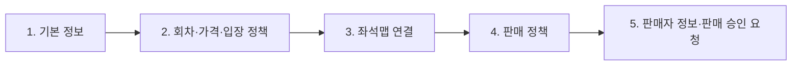
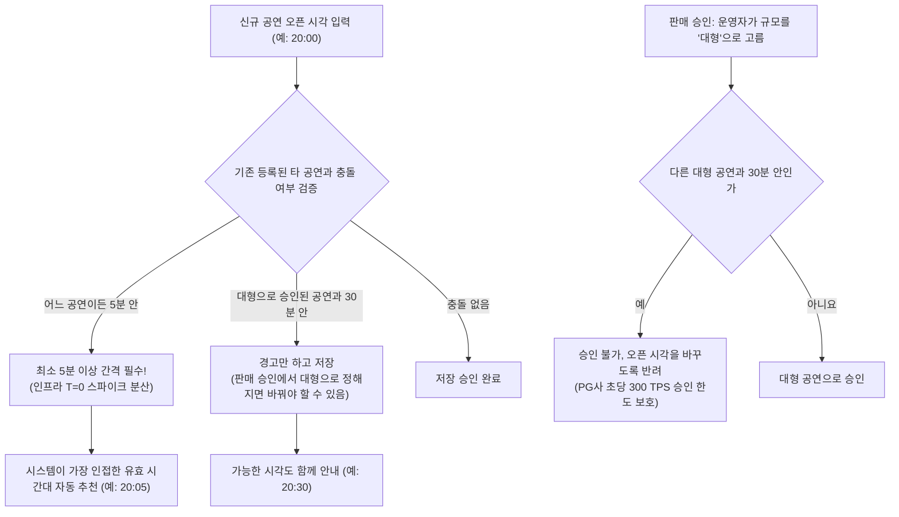

# 11. 파트너 콘솔

> [← 10편: 관제실](10-control-tower.md) | [목차로 돌아가기](README.md) | [12편: 숫자로 증명하기 →](12-measure-and-prove.md)

---

## 1. 상황: 오픈 일주일 전, 수진 씨의 공연 등록

공연 기획사(파트너) 담당자인 수진 씨는 티켓 오픈 일주일 전 파트너 콘솔에 로그인한다. 공연 회차를 생성하고 좌석 배치도를 등록하며, `"1인당 2매 예매 제한, 하이브리드 추첨 대기열, 재입장 불가"`라는 판매 정책을 설정한다.

티켓 오픈 시각을 저녁 8시 정각으로 입력하자 시스템이 알림을 띄운다:

> **"다른 대형 콘서트와 오픈 시각이 30분 이내로 중복됩니다. 안정적인 시스템 운영을 위해 8시 30분을 추천합니다."**

오픈 당일 수진 씨는 실시간 판매 현황을 모니터링하며, 공연 당일에는 게이트 현장 스태프를 콘솔에서 간편하게 초대해 권한을 관리한다.

---

## 2. 왜 어려운가: 대규모 비즈니스와 개인정보 보호의 접점

파트너 콘솔은 대규모 비즈니스와 개인정보 보호가 직접 맞물리는 관리자 플랫폼이다.

| 핵심 난제 | 원인과 운영상 위험 | 피켓의 해결책 |
| :--- | :--- | :--- |
| **1. 단 1건의 설정 실수가 초래하는 대형 사고** | 좌석도 오차나 예매 규칙 오류는 수만 명의 항의와 법적 분쟁으로 직결 | **단계별 등록 마법사** & **온세일 시작 후 핵심 규칙 불변** |
| **2. 대형 공연 간 트래픽 충돌** | 대형 공연 2개가 같은 시각 동시 오픈 시 PG사 TPS(300건 추정) 포화로 공멸 | **오픈 시각 간격 제약 엔진** (대형 30분, 일반 5분 필수 간격) |
| **3. 개인정보 제3자 제공의 법적 규제** | 관람객 예매자 명단 무단 대량 다운로드 및 유출 위험 | **다운로드 사유 입력 필수** & **불변 감사 로그에 기록(최소 2년 이상 보존)** |

---

## 3. 어떻게 푸는가: 8대 파트너 플랫폼 공학

### ① 강력한 관리자 보안 인증 (MFA)과 설정 페이지
* 사전에 정식 승인을 받은 파트너 담당자만 가입 가능합니다.
* 계정은 피켓 운영자가 초대하면서 역할을 정합니다. **파트너 관리자**만 정산 계좌 변경, 예매자 명단 보기·내려받기, 판매 승인 요청과 승인 뒤 다시 승인받을 항목의 변경 저장, 판매자 정보 변경 요청, 회차 취소·연기 요청, 정산서 이의, 웹훅 설정을 할 수 있고, **파트너 실무자**는 공연 등록·수정과 판매 현황 보기 같은 나머지 일을 합니다. 계정 하나를 도둑맞아도 돈과 개인정보에 닿는 사람을 줄이려는 것이고, 파트너사마다 관리자가 1명 이상 있어야 합니다.
* **[업무용 이메일 + 15자 이상 비밀번호 + 인증 앱 코드(TOTP)]**의 2단계 인증(MFA)이 강제됩니다.
* 1시간 이상 무반응 시 세션이 자동 종료되며, 재접속 시 비밀번호와 인증 앱 코드를 다시 입력해야 합니다.
* **설정의 네 페이지**: 콘솔의 설정에는 왼쪽 메뉴로 네 페이지가 있습니다([SCR-020](../planning/04-ia-flows-screens.md), [ADR-0066](../docs/adr/0066-screen-feedback-12-items.md)).
  * **내 계정**: 내 비밀번호, 인증 앱, 패스키, 복구 코드, 로그인한 기기(최대 2대)를 관리합니다. 패스키는 인증 앱을 대신하지 않아 패스키만으로는 로그인할 수 없습니다. 대신 정산 계좌 변경, 예매자 명단 내려받기, 역할 변경 같은 위험한 작업을 할 때 한 번 더 확인하는 데 씁니다. 패스키는 등록한 사이트 주소에서만 쓰여 가짜 사이트에 속지 않으므로, 인증 앱 코드보다 피싱에 강합니다. 그래서 파트너 관리자는 패스키를 하나 이상 등록해야 합니다. 무엇을 바꾸든 비밀번호와 인증 앱 코드로 한 번 더 확인합니다. 로그인을 다섯 번 틀리면 15분 동안 잠기는데, 업무 이메일로 온 링크에서 인증 앱 코드를 넣으면 바로 풀 수 있습니다.
  * **판매자 정보**: 공연 상세, 결제 직전 화면, 예매 확인서에 '판매자'로 보이는 7가지(상호, 대표자, 주소, 전화, 전자우편, 사업자등록번호, 통신판매업 신고번호)입니다. 법(전자상거래법)이 팬에게 보이라고 정한 정보이고 판매 승인의 근거라서 직접 고치지 않고 [변경 요청]을 보냅니다. 상호나 대표자를 바꾸면 PEAKET 운영자가 판매자 정보를 다시 확인하고, 확인이 끝날 때까지는 지금 정보가 그대로 보입니다. 공연을 다시 판매 승인받는 것은 아닙니다.
  * **정산 계좌**: 정산금을 받는 계좌입니다. 예금주가 판매자 상호나 대표자와 같은 계좌만 받습니다. 바꾸면 등록 이메일과 전화로 알리고 3영업일 동안 지급을 미룹니다.
  * **팀 계정**: 파트너 관리자만 보는 우리 회사 계정 목록(이름, 가린 이메일, 역할, 상태, 마지막 접속)입니다. 계정을 더하거나 지우거나 역할을 바꾸려면 피켓 운영자에게 요청합니다.

---

### ② 단계별 공연 등록 마법사 (Wizard)

실수를 방지하기 위해 5단계로 정형화된 등록 절차를 제공한다 ([SCR-021](../planning/04-ia-flows-screens.md)).

여기서 **공연**은 같은 파트너가 같은 공연장에서 같은 좌석 배치로 여는 회차의 묶음이고, **회차**는 그 가운데 한 번(날짜·시각)이다. 공연명·아티스트·이미지와 판매 승인은 공연 단위이고, 대기열·좌석·주문·정산서는 회차 단위다. 전국 투어처럼 공연장이 다르면 도시마다 다른 공연으로 등록한다(2026-10-27, [ADR-0093](../docs/adr/0093-production-entity-place-artist-units.md)).

| 등록 단계 | 설정 항목 | 필수 규칙 및 유효성 검증 |
| :--- | :--- | :--- |
| **1. 기본 정보** | 공연명, **공연장**(목록에서 고르고, 없으면 이름·주소로 새 공연장을 요청한다), **아티스트**(목록에서 고르거나 새 이름을 적는다), **다른 이름**(영문 표기 같은 별칭 5개까지, 잠정값), 장르, 관람 연령, 러닝타임, 공연 설명과 이미지, 공연예술통합전산망 항목 | 필수 항목을 다 채워야 다음 단계로 간다. 새 공연장 요청은 피켓 운영자가 판매 승인 때 기존 공연장에 잇거나 새로 만들고, 새 아티스트 이름도 운영자가 같은 아티스트로 묶는다. 같은 아티스트가 이름 표기만 달라 둘로 갈라지지 않게 하려는 것이다. 다른 이름은 검색에만 쓰이고 화면에 보이는 이름은 바꾸지 않는다. 공연장·아티스트·다른 이름은 팬이 검색할 때 후보와 필터가 되는 값이다([ADR-0094](../docs/adr/0094-search-redesign-autocomplete-read-model-search-port.md)). |
| **2. 회차·가격·입장 정책** | 회차별 오픈 시각, 로비 개방(기본 10분), 입장 시작, 공연 종료 예정(필수), 좌석 등급별 가격, 재입장 허용 여부(기본: 불가), 가상계좌(무통장 입금) 허용 여부 | 회차 하나가 독립적인 판매 및 정산 단위가 된다. 한 공연의 회차는 모두 같은 공연장·같은 좌석 배치를 쓴다. 판매 승인 뒤에도 회차를 더할 수 있고, 더하면 그 공연을 다시 승인받는다(그동안 마지막으로 승인된 내용으로 판매가 이어진다). 판매 종료는 따로 입력하지 않고 회차마다 공연 시작 24시간 전으로 정해진다(2026-10-14 소유자 결정, [ADR-0064](../docs/adr/0064-sales-end-24h-before-start.md)). 오픈 시각은 다른 공연과의 간격을 검사한다(5분은 막고 대형 30분은 경고, ③). 재입장은 **판매 시작 후에는 관람객에게 유리한 방향(불가 $\rightarrow$ 허용)으로만 변경 가능**. 대형 공연은 좌석 묶임 방지를 위해 가상계좌가 자동 차단된다 ([5편](05-payment.md)). |
| **3. 좌석맵 연결** | 템플릿, 빈 캔버스, 파일 가운데 하나로 시작해 네 단계(배치 그리기 → 좌석 채우기 → 좌석 다듬기 → 미리보기)로 만든다(아래 '좌석맵은 이렇게 만듭니다', ADR-0063·0066). 배치 층에서 무대와 구역 모양(사각형·다각형·부채꼴·곡선 띠)을 그리고 구역 이름·등급·입장 게이트·이름표 위치를 정하고, 좌석 층에서 구역마다 좌석을 채우고 다듬는다. 파일(SVG·JSON·CSV)로 가져올 때도 구역 모양과 좌석 위치를 함께 받는다 | 되돌리기 가능, 휠체어석 기준 검사(수가 기준보다 적거나 열 가운데에 끼어 있으면 경고만 하고 막지 않음. 크기와 실제 위치는 좌석맵으로 알 수 없어 5단계에서 공연장 배치도와 대조해 확인), 좌석이 너무 붙으면 겹침 경고(저장은 됨), 각 좌석별 입장 게이트 매핑 |
| **4. 판매 정책** | 대기열 방식(기본: 하이브리드), 좌석 배정 방식(선택형 기본, 자동 배정), 1인당 매수 제한, 선예매 조건 | **판매 시작 후 대기열 방식 변경 불가**. (선착순 선택 시 경고 표시) |
| **5. 판매자 정보·판매 승인 요청** | 판매자 정보 7가지(통신판매업 신고번호나 면제 근거 포함), 정산 계좌, 휠체어석 확인(공연장 배치도와 대조했다는 체크, 기준보다 적으면 이유 선택) | 정산 계좌는 결제사 지급대행 등록에 바로 넘기고 피켓에는 은행과 끝 4자리만 남기며 예금주가 상호나 대표자와 같아야 한다. 승인 전에는 공개되지 않고, 승인 뒤 가격·회차·좌석 등급·좌석맵·판매 정책을 바꾸면 다시 승인을 받는다. 다시 승인받는 동안에도 마지막으로 승인된 내용으로 공개와 판매가 이어지고, 바뀐 내용은 승인 뒤에 반영된다(오픈 전이면 오픈 예약만 멈춘다). 판매자 신원 문제·법적 요청·사기 의심이 있으면 피켓 운영자가 두 사람의 확인을 거쳐 승인한 공연의 판매를 중지할 수 있다. 그러면 공연이 비공개가 되고 새 판매와 정산 지급이 멈추지만, 이미 판 티켓은 그대로 쓴다. 그 뒤 판매를 다시 열거나 회차를 취소해 환불한다(2026-10-28, ADR-0123). |

#### 좌석맵은 이렇게 만듭니다: 큰 틀을 그리고, 좌석을 채우고, 다듬는다

**장면**: 수진 씨는 실내 아레나 공연을 올립니다. 좌석맵 단계에 오자 '어떻게 시작할까요?'라는 질문과 카드 세 장(템플릿으로 시작, 빈 캔버스에서 그리기, 파일 가져오기)이 나옵니다. 수진 씨는 [템플릿으로 시작]을 누르고 '실내 아레나 · 엔드 스테이지'를 고른 뒤 목표 좌석 수를 12,000석으로 넣습니다. 에디터가 무대와 구역이 그려진 배치를 바로 열어 줍니다. 수진 씨는 공연장에서 받은 배치도를 옆에 두고 구역 모양을 맞춘 뒤, 구역마다 좌석 수를 넣어 좌석을 채우고, 기둥과 카메라 자리의 좌석을 지웁니다([SCR-022](../planning/04-ia-flows-screens.md), FR-023).

1. **배치 그리기**: 무대와 구역(사각형, 다각형, 부채꼴, 곡선 띠)을 그립니다. 고른 도형에는 손잡이가 붙어서 끌어 크기를 바꾸고 돌리고, 다각형은 꼭짓점을 더하고, 부채꼴은 반지름과 각도를 바꿉니다. 정렬 안내선과 '가로 24.0m · 세로 12.0m' 같은 치수가 보이고, 한쪽 구역을 반대쪽으로 거울처럼 복제할 수 있습니다. 마우스로 끄는 일은 모두 숫자로도 넣을 수 있습니다.
2. **좌석 채우기**: 구역을 고르고 '600석' 같은 좌석 수(또는 '20행 × 30석')와 줄 모양(직선, 무대를 향한 곡선), 좌석 간격, 통로, 번호 규칙을 넣으면 그 모양 안에 좌석이 자동으로 놓입니다. 다 들어가지 않으면 '598석이 들어갑니다(목표보다 2석 적습니다)'처럼 알려 줍니다.
3. **좌석 다듬기**: 좌석이나 줄을 골라 옮기고, 줄을 맞추고, 간격을 고르게 하고, 통로를 내고, 기둥·카메라 자리 좌석을 지우고, 번호를 다시 매깁니다. 좌석이 너무 붙으면 '좌석 3석이 겹칩니다'로 알려 주지만 저장은 막지 않습니다. 계산은 에디터(브라우저)가 하고, 저장할 때 서버가 좌석이 구역 안에 있는지, 겹치는지, 번호가 겹치지 않는지 다시 확인합니다.
4. **미리보기**: 팬이 보는 것처럼 전체 배치에서 구역을 눌러 확대해 봅니다.

템플릿은 10가지입니다: 실내 아레나(엔드 스테이지, 돌출 무대, 센터 무대), 돔 구장, 종합운동장, 대극장(3층), 중극장(2층), 소극장, 콘서트홀(합창석), 평면 블록(컨벤션·야외 특설). 돌출 무대 길이나 오케스트라 피트처럼 고를 수 있는 것이 있고, 기본 좌석 수는 운영해 보기 전에 정한 잠정값이라 파트너가 바꿉니다. 템플릿은 피켓이 배포할 때 넣는 고정 자료라 파트너는 고르기만 하고, 고친 내용은 그 공연의 좌석맵에만 남습니다.

> [!NOTE]
> **템플릿은 출발점일 뿐입니다**
> 1. 템플릿은 흔한 공연장 모양을 본뜬 것이지 실제 공연장의 배치도가 아닙니다. 공연장에서 받은 좌석 배치도와 같게 고친 뒤 판매 승인을 요청해야 합니다.
> 2. 특정 공연장 이름이나 다른 예매처·공연장 누리집의 배치도는 쓰지 않습니다. 남의 배치도를 베끼면 이용 조건과 저작권 문제가 생길 수 있어서입니다.
> 3. 스탠딩(정리번호 입장)은 아직 지원하지 않아서 플로어도 지정석으로 만듭니다.
> 4. 휴대폰에서는 미리보기만 하고, 그리기와 템플릿 고르기는 태블릿이나 컴퓨터에서 합니다.

---

### ③ 피크 트래픽 분산을 위한 '오픈 시각 간격 제약' (Collision Avoidance)

복수 공연의 트래픽 폭주가 겹치는 사태를 막기 위해 시스템이 오픈 시각을 자동 검증한다 ([POL-030](../planning/03-policies-glossary.md)). 공연 규모(대형·중형·소형)는 판매 승인 때 피켓 운영자가 정하므로, 등록 때는 다른 공연과의 5분 간격만 막고 대형 공연과 30분 안이면 경고만 한다. 대형 공연끼리의 30분 간격은 판매 승인에서 대형으로 정할 때 막는다. 판매 승인은 공연(회차 묶음) 하나에 한 번이고 그 공연의 회차를 모두 함께 판정하지만, 규모(대형·중형·소형)는 회차마다 정하고 30분 간격 검사도 회차마다 한다. 회차마다 오픈 시각이 따로 있고, 규모를 정할 때 보는 예상 진입 인원도 그 회차의 오픈 알림 신청 수로 어림하기 때문이다([ADR-0093](../docs/adr/0093-production-entity-place-artist-units.md) 결정 7, [POL-030](../planning/03-policies-glossary.md)).

---

### ④ 확장형 상품 빌더 (Product Builder)
* 티켓 외에도 공식 굿즈, 주차권, 패스트 트랙, VIP 패키지 등 부가 상품을 유연하게 등록할 수 있습니다.
* VIP 패키지 같은 특수 상품에는 '양도 불가' 플래그가 기본 지정되며, 새 상품 카테고리가 추가되어도 DB 스키마 변경이 없는 확장형 모델로 설계되었습니다. 상품은 PostgreSQL 상품 표 하나에 두고, 가격처럼 돈에 닿는 값은 정해진 칸에, 유형마다 다른 속성(옵션, VIP 혜택, 주차 규칙)은 JSON 칸에 둡니다. 유형별 규격은 코드에 두어 새 유형은 규격 파일과 화면 설정, 유형 목록 한 줄로 끝납니다(2026-10-28, [ADR-0101](../docs/adr/0101-product-catalog-postgres-jsonb-drop-mongodb.md)).

---

### ⑤ 실시간 판매 모니터링 대시보드
* 온세일 동안 판매량, 잔여석, 예상 완판 시점, 대기열 진입 인원과 지금 대기 인원을 1분 안 지연으로 확인합니다. 잔여석에는 다른 사람이 홀드했거나 결제 중인 좌석도 남은 좌석으로 들어가고, 홀드 수는 따로 보이지 않습니다(2026-10-20 추천 적용, ADR-0073). 숫자마다 '잠정' 표시가 붙고, 확정 숫자는 판매 요약 리포트에서 봅니다.
* 개인정보와 내부 봇 탐지 지표는 제외된 순수 비즈니스 통계만 제공되어, 파트너 담당자가 개발팀에 묻지 않고도 추가 공연 오픈 여부를 데이터로 즉시 판단할 수 있습니다.
* **웹훅: 콘솔을 계속 보지 않아도 되게 바로 알려 줍니다**([SCR-025](../planning/04-ia-flows-screens.md), FR-025). 수진 씨 회사의 회계 담당자는 매일 콘솔에 들어와 판매 금액을 옮겨 적었습니다. 회사 서버 주소를 웹훅으로 등록해 두면, 판매가 확정되거나 예매가 취소될 때마다 피켓이 그 주소로 바로 알려 주어 회계 프로그램이 금액을 스스로 반영합니다. 쓰임새는 넷입니다: ① 매출·회계 시스템에 판매·환급 금액 반영 ② 사내 메신저에 매진·회차 취소·연기 알림 ③ 회사 홈페이지·SNS 공지 자동 갱신 ④ 정산 통지와 입금 확인.
  * 알림에는 이름·연락처·좌석 번호가 없고 금액, 매수, 번호(ID), 시각 정도만 들어 있어 팬 관리에는 쓸 수 없습니다. 자세한 내용은 콘솔에서 봅니다. 파트너 서버가 피켓에 직접 물어보는 길(서버용 API)은 아직 없습니다.
  * 주소는 https만 받고, 알림마다 피켓이 비밀 키로 만든 서명이 붙어 받는 쪽이 가짜 알림을 가려낼 수 있습니다.
  * 쓰지 않아도 판매와 정산에는 아무 영향이 없습니다.

---

### ⑥ 투명한 정산 리포트와 개인정보 다운로드 통제

| 산출물 | 제공 방식 | 보안 및 법적 통제 장치 |
| :--- | :--- | :--- |
| **정산 리포트** | CSV, Excel, PDF | PG사 거래 내역과 내부 DB 간 일일 대사가 완료된 확정 원장만 출력. 결제사별 정산서와 지급 예정일·결과도 보인다 |
| **예매자 명단** | CSV 다운로드 | 예매 시 관람객이 동의한 '제3자 제공' 범위 내 필수 항목만 포함 |
| **다운로드 보안 통제** | 감사 로그, '다운로드 이력' 탭 | **다운로드 목적 사유 입력 필수**. 예매자 명단은 보기와 내려받기 모두 파트너 관리자만 하고, 실무자에게는 '예매자 명단은 파트너 관리자만 볼 수 있습니다'가 보인다. 누가·언제·왜·몇 건을 어떤 형식으로 내려받았는지가 '다운로드 이력' 탭(파트너 관리자만)에 보이고, 같은 기록이 피켓 접속기록에 최소 2년 이상 남는다 ([POL-023](../planning/03-policies-glossary.md), [ADR-0066](../docs/adr/0066-screen-feedback-12-items.md)). |

> [!NOTE]
> **개인정보 제3자 제공 고지 의무**  
> 파트너는 피켓의 사내 부서가 아닌 독립된 외부 법인이므로, 예매자 명단을 전달하는 것은 개인정보 보호법상 '제3자 제공'입니다. 피켓은 예매 단계에서 관람객에게 제공받는 자, 이용 목적, 제공 항목, 보유 기간을 명확히 고지하고 사전 동의를 획득합니다.

---

### ⑦ 현장 스태프 초대 및 실시간 권한 회수
* 회차별로 현장 스태프의 이메일을 등록해(한 번에 여러 명) 검표 권한을 부여합니다. 초대 링크는 **24시간 동안 단 1회만 수락** 가능합니다.
* 초대는 휴대폰 본인확인을 마쳤고 확인된 이메일이 초대 이메일과 같은 피켓 계정만 받을 수 있습니다. 그래서 링크가 다른 사람에게 전달돼도 그 사람은 받지 못합니다. 스태프는 받을 때 '파트너에게 닉네임, 역할, 수락 여부, 스캔·예외 통과 건수를 보여 주는 것'에 따로 동의합니다.
* 권한은 **입장 시작 3시간 전부터 공연 종료 2시간 뒤까지만 한시적으로 유효**합니다.
* 스캐너마다 맡을 구역과 모드(입장·퇴장)는 파트너는 콘솔의 **현장 운영 탭**에서, 현장 책임자는 자기 스캐너의 책임자 화면에서 정합니다. 현장 운영 탭은 공연 당일 기획사 사무실이나 현장 운영실에서 입장 현장을 실시간으로 보는 화면입니다. 위쪽 띠에 입장 시작·지금 시각·공연 시작·입장 기록 마감 예정이, 그 아래 네 칸에 기기 준비(예: 6/7대), 입장 수(예: 1,204/2,288명), 거부 건수, 이상 표시 건수가 보이고, 그 밑에서 기기 준비 상태, 구역별 입장 수, 이상 표시를 봅니다. 관람객 이름과 연락처는 나오지 않습니다. 이상 표시를 좌석에서 확인하는 일은 현장 책임자가 하고, 관객을 내보낼지는 파트너의 현장 규정을 따릅니다.
* 파트너가 콘솔에서 권한을 해제하면, 그 스태프가 쓰던 스캐너의 **다음 서버 요청부터 거부**되고 스캐너는 로그아웃됩니다. 인터넷이 끊긴 스캐너에는 연결될 때 반영되고, 그사이 찍은 기록은 올라오면 '세션 밖 기록'으로 표시됩니다 ([6편](06-ticket-and-gate.md), [ADR-0051](../docs/adr/0051-gate-process-end-to-end.md)).

---

### ⑧ 공연 취소·연기 등록
* 회차 취소·연기는 파트너가 **요청**하고, 피켓의 관제 책임자(commander)가 귀책을 판정하고 판정자가 아닌 다른 운영자가 승인해 두 사람이 확정합니다. 주최 측 귀책이면 소비자분쟁해결기준에 따른 **배상금(실제 결제 금액의 10%)**을 피켓이 먼저 지급하고, 정산 리포트에 상계·보증 충당·청구 내역을 남깁니다 ([7편](07-transfer-cancel-refund.md)).
* 공연은 피켓의 **판매 승인** 뒤에 공개됩니다. 승인 요청 때 판매자 정보(상호, 대표자, 주소, 전화, 전자우편, 사업자등록번호, 통신판매업 신고번호)를 냅니다. 이 정보는 공연 상세와 결제 직전 화면에 판매자로 표시됩니다 ([ADR-0045](../docs/adr/0045-intermediary-legal-status.md)).
* 판매 대금은 피켓 계좌를 거치지 않습니다. 회차가 끝나면 결제사별 **정산서**가 오고, 2영업일 안에 이의를 낼 수 있습니다. 이의가 없으면 회차 종료 5영업일 뒤 결제사(토스페이먼츠·포트원)가 정산 계좌로 직접 보냅니다. 주 1천만 원 이상 첫 지급은 결제사의 본인 확인(KYC) 때문에 늦어질 수 있고(서류를 내면 결제사가 2영업일 안에 심사한다고 안내합니다), 정산 계좌를 바꾸면 3영업일 동안 지급이 미뤄집니다 ([ADR-0047](../docs/adr/0047-settlement-payout-via-pg-agency.md)).
* 포트원으로 나가는 지급은 피켓이 30분마다 포트원의 이체 기록과 맞춰 봅니다. 날마다 지급 묶음을 만들기 전에는 포트원에 등록된 정산 계좌가 피켓 기록과 같은지도 봅니다. 계좌가 다르면 그 파트너의 포트원 결제분 정산서를 보류합니다. 파트너 관리자가 설정의 정산 계좌 페이지에서 계좌를 다시 내면 풀리고, 계좌를 바꿀 때처럼 3영업일 뒤에 보냅니다(2026-10-28, [ADR-0108](../docs/adr/0108-portone-console-payout-reconciliation-and-account-rules.md)).

---

## 4. 한 줄 요약

> **파트너 콘솔은 마법사를 통해 공연과 판매 정책을 체계적으로 등록하되 판매 개시 후 핵심 규칙 변경을 차단하고, 대형 공연 간 오픈 시각 중복을 시스템적으로 분산시키며, 예매자 개인정보는 법적 동의와 엄격한 감사 로그 하에서만 안전하게 제공한다.**

---

## 더 알아보기

* [planning/02-requirements.md](../planning/02-requirements.md): 파트너 콘솔 요구사항 (FR-021 ~ FR-027, FR-046)
* [POL-003, POL-030](../planning/03-policies-glossary.md): 대기열 운영 정책 및 공연 오픈 간격 통제 규칙
* [POL-018](../planning/03-policies-glossary.md): 공연 회차별 재입장 허용 규정
* [POL-023](../planning/03-policies-glossary.md): 예매자 명단 제3자 제공 및 개인정보 다운로드 감사 규정
* [POL-032](../planning/03-policies-glossary.md), [docs/features/payment.md §4.1](../docs/features/payment.md): 공연 취소·연기 시 일괄 환급과 배상 처리
* [planning/04-ia-flows-screens.md §3](../planning/04-ia-flows-screens.md): 파트너 콘솔 UI 화면설계서(파트너 콘솔 절의 화면 전체. 회차 취소·연기 요청은 SCR-044)
* [FR-023·FR-025](../planning/02-requirements.md), [ADR-0066](../docs/adr/0066-screen-feedback-12-items.md): 좌석맵 템플릿 10종과 네 단계 에디터(SCR-022), 웹훅의 목적과 쓰임새(SCR-025), 설정 페이지 넷(SCR-020)
