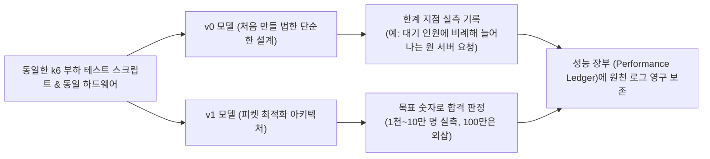
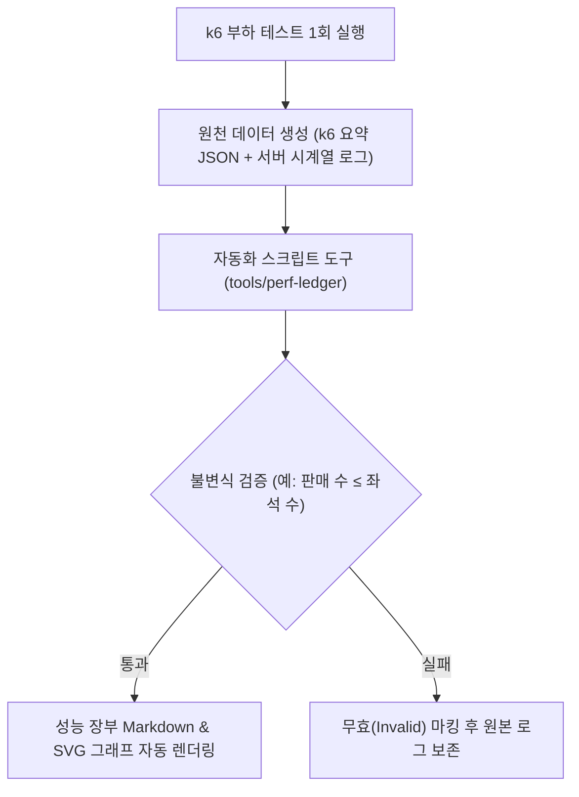
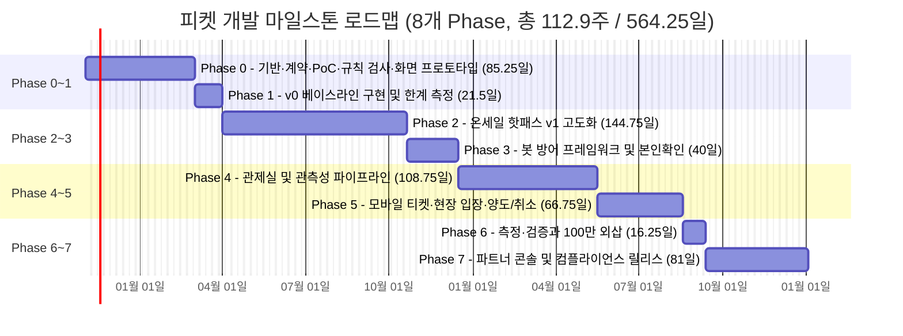

# 12. 숫자로 증명하기

> [← 11편: 파트너 콘솔](11-partner-console.md) | [목차로 돌아가기](README.md) | [13편: 법과 개인정보 →](13-law-and-privacy.md)

---

## 1. 상황: "100만 명을 버틴다는 것을 어떻게 증명합니까?"

기술 면접관이 질문을 던진다:

> **"피켓 시스템이 100만 명의 대규모 트래픽을 버틴다는 것을 어떻게 입증할 수 있습니까?"**

피켓이 준비한 대답은 단순한 *"그렇게 되도록 아키텍처를 잘 설계했습니다"*가 아니다. 그렇다고 "100만 명으로 시험해 봤습니다"도 아니다. 100만 명 시험은 한 번만 해도 요청 요금이 개인 예산을 넘기 때문에 하지 않았다.

> **"100만 명은 실측하지 않았습니다. 규칙은 작은 범위에서 가능한 모든 순서를 검사했고, 대기 인원과 무관한 예매 계층은 실제 크기로 쟀습니다. 대기 인원에 비례하는 세 곳 가운데 오픈 순간 진입은 서버 수를 늘려 가며 잰 곡선으로, 대기 상태 조회는 1천~10만 명 측정이 설계 식과 맞는지 확인한 뒤 그 식으로 100만을 계산했고, CDN 자체와 셔플 결과 조회는 클라우드 회사가 공개한 한도와 견줬습니다. 그래서 100만이라는 숫자에는 '외삽'이나 '문서 인용'이라고 붙어 있습니다. 측정마다 원본 데이터는 성능 장부에 있습니다."**

본 편은 이 대답의 근거를 어떻게 만드는지 설명한다.

---

## 2. 왜 어려운가: 측정과 증명의 4대 장벽

대규모 분산 시스템 설계에서 '측정과 증명'은 언제나 가장 높은 장벽이다.

| 핵심 난제 | 원인과 기술적 한계 | 피켓의 해결책 |
| :--- | :--- | :--- |
| **1. 말뿐인 아키텍처의 함정** | 벤치마크 수치가 없으면 해당 설계가 적정 기술인지 과설계인지 객관적 검증 불가 | **v0(단순형) vs v1(개선형) 동일 조건 대조 실측** |
| **2. 100만 명 실측 비용 한계** | 실제 100만 명을 동원할 수 없고, 100만 명 70분의 대기 상태 조회만 약 2.3억 건이라 CDN 요청 요금만 약 273달러(약 38만 원)다. 지출 상한(5만 원)을 넘는다. 처음에는 암호화하지 않는 요청(HTTP)의 값으로 약 205달러라고 셈했는데, 대기 상태 조회는 암호화한 요청(HTTPS)이라 그 값으로 고쳤다(2026-10-28 기술 검토 중간-102). 결론은 같다 | **100만을 한 번에 돌리지 않고 부하를 나눠 잰 뒤 '외삽'·'문서 인용'으로 표시** |
| **3. 비교 조건의 불일치** | 테스트 환경(스펙, 네트워크, 시나리오)이 다르면 성능 향상이 아키텍처 덕분인지 불명 | **동일 하드웨어 & 동일 k6 부하 스크립트 통제** |
| **4. 타이밍 버그는 부하로 잘 안 나옴** | 서버 두 대가 아주 잠깐 엇갈릴 때만 생기는 버그는 100만 명 부하에서도 드물게 나오고, 반대로 서버 두 대로도 생긴다 | **작은 범위에서 일어날 수 있는 모든 순서를 컴퓨터로 검사** |

---

## 3. 어떻게 푸는가: v0 vs v1 비교, 성능 장부, 나눠서 증명하기, 규칙 검사

### ① 처음 만들 법한 단순한 설계(v0)를 먼저 만든다

v0는 일부러 망가뜨리지 않는다. 일부러 약하게 만든 것과 견주면 '허수아비와 비교했다'는 말을 듣는다. v1이 합격했는지는 v0와의 비율이 아니라 목표 숫자(예: 진입 p99 0.2초)로만 판정하고, v0보다 몇 % 줄었는지는 덧붙이는 숫자로 적는다. 재지 않아도 망가지는 것이 뻔한 방식(좌석이 바뀔 때마다 5만 석 전체를 모두에게 다시 보내기)은 만들지 않고 계산으로만 보인다([docs/verification.md §1.4](../verification.md)).

| 시스템 영역 | v0(처음 만들 법한 설계)와 드러날 한계 | v1이 달성하는 근본적 해결책 |
| :--- | :--- | :--- |
| **대기열 폴링** | 대기자가 v1과 같은 주기(0.5·5·20초)로 묻고, 원 서버가 매번 앞 인원을 계산해 답한다 (원 서버 요청이 대기 인원에 비례해 늘어남, 10만 명이면 초당 약 9,300건) | 1,000명 단위의 정적 대기 상태 파일을 CDN 엣지에서 응답 (원 서버에는 '파일 수 ÷ 갱신 주기'만큼만 옴, [2편](02-waiting-room.md)) |
| **좌석 홀드** | RDBMS 행 잠금(Row Lock) 처리 (동시 경합 시 데드락과 수 초 지연 발생) | Redis 단일 Lua 스크립트로 **0.05초 만에 메모리 홀드 판정** ([4편](04-seat-hold.md)) |
| **좌석 상태 전파** | 바뀐 좌석을 JSON으로 모든 연결에 보낸다 (보는 구역과 상관없이 모든 변경이 모두에게 감. 5만 석 전체를 매번 다시 보내는 방식은 계산만으로 실패가 뻔해 만들지 않음) | 사용자의 현재 뷰포트 구역 차분(Delta) 데이터만 0.1초 단위로 묶어 전송(바뀐 것이 있을 때만. 2026-10-28에 0.25초에서 줄임, [ADR-0110](../adr/0110-latency-budgets-nfr002-nfr004-aligned-expiry-100ms-batches-ms-clock.md)) ([4편](04-seat-hold.md)) |
| **좌석 렌더링** | 메인 스레드에서 캔버스 한 장에 좌석 객체 배열로 그린다 (확대·이동 때 긴 작업이 조작을 막을 수 있음) | 캔버스 그리기를 백그라운드 웹 워커로 옮기고 바이너리 배열과 묶어 그리기를 씀 ([4편](04-seat-hold.md)) |
| **봇 방어** | 단순 IP당 요청 횟수 제한만 적용 (프록시 분산 봇에 무력화) | 사람 확인(Turnstile) + 행동 패턴 + 7대 위험 점수 엔진 ([9편](09-identity-and-bots.md)) |
| **결제 트랜잭션**| 동기식 승인 호출 및 무작정 재시도 (이중 결제 발생 위험) | DB 판매 예약(PENDING) 선행 + 고유 멱등키 + 승인 뒤 발권이 실패하면 결제를 취소하지 않고 같은 주문 번호로 다시 발권(승인 뒤 60초 안에 발권되거나 다시 시도 목록에 올라 30분(잠정값) 안에 발권, 2026-10-28 [ADR-0106](../adr/0106-forward-recovery-after-payment-approval-ticket-issue-retry.md)) ([5편](05-payment.md)) |
| **시스템 관제** | CPU/메모리 고정 임계치 단순 알림 (소음 경보 다수 발생) | 사용자 체감 오류 예산(Error Budget) 소진 속도 기반 알림 ([10편](10-control-tower.md)) |
| **오토스케일링** | CPU 사용률에만 의존해 사후 증설 (트래픽 스파이크 대응 실패) | 대기열 길이·처리 지연을 보고 늘리는 확장 + 오픈 40분 전 미리 늘리기(프리워밍). 서버 수를 과거 부하로 미리 맞히는 '예측 확장'은 쓰지 않는다(오픈 알림 신청 수로 어림한 예상 인원은 공연 규모 등급을 정하는 데만 쓴다) ([14편](14-architecture-and-ops.md)) |
| **현장 티켓 검표**| 중앙 서버 실시간 통신에만 의존 (기지국 마비 시 게이트 중단) | 비대칭 암호키 기반의 **완전 오프라인 0.15초 로컬 검표** ([6편](06-ticket-and-gate.md)) |

---

### ② 측정의 투명성을 보장하는 '성능 장부(Performance Ledger)'

측정 1회마다 독립된 디렉토리를 생성하고, 그 안에 **[테스트 실행 조건 + 원천 로그 + 불변식 결과]**를 한 묶음으로 영구 보존한다 ([docs/perf-ledger.md](../perf-ledger.md)).

> [!TIP]
> **사람이 손으로 수치를 고칠 수 없는 규칙**  
> 성능 장부의 테이블과 비교 그래프는 스크립트 도구가 원천 데이터에서 자동으로 재생성하며, 사람이 수치나 그래프를 손으로 편집하는 행위를 엄격히 금지합니다. 누구나 스크립트를 재실행해 동일한 결과를 재현할 수 있어야 기술적 증거로 인정받습니다.

### ③ 100만은 나눠서 증명한다

100만 명이 기다리는 동안 실제로 서버를 두드리는 것은 누구인가를 먼저 나눠 본다. 좌석 화면에 들어오는 사람은 초당 약 28명이다. 입장 자리 5,000개가 3분마다 비워지는 속도로 정해지기 때문에, 기다리는 사람이 10만 명이든 100만 명이든 같다. 좌석 잡기, 결제, 좌석 화면 실시간 연결도 마찬가지다. 그래서 이 네 가지는 개인 PC에서 실제 크기로 재면 그 숫자가 곧 100만 명일 때의 숫자다.

| 부하 | 100만 명일 때 | 기다리는 사람 수와 관계 | 증명 방법 |
| :--- | :--- | :--- | :--- |
| 좌석 화면 입장 | 초당 약 28명 | 없음 | PC에서 실제 크기로 측정 |
| 좌석 잡기 | 초당 1~2천 건 | 없음 | PC에서 실제 크기로 측정 |
| 결제 접수 | 초당 300건 | 없음 | PC와 결제 시뮬레이터로 측정 |
| 좌석 화면 실시간 연결 | 5,000개 | 없음 | PC에서 실제 크기로 측정 |
| 오픈 순간 진입 | 초당 20만 건 | 비례 | 진입 서버 1대와 Redis 한 키가 받는 양을 따로 재고, '1대 × 대수, 단 Redis 한 키를 넘지 못함'으로 계산. 서버를 1·2·3·4·6·8대(측정 전 잠정값)로 늘려 가며 잰 곡선은 대수만큼 늘어나는지 확인하는 데만 씀 |
| 대기 상태 조회 | CDN에 초당 약 5.4만 건 | 비례 | 원 서버를 지키는 구조만 로컬 캐시로 재고, CDN 자체는 클라우드 회사 문서로 확인 |
| 셔플 결과 조회 | 로비 100만 명이 한 번씩(파일 약 36 KB를 사람마다 0~8초에 나눠 받음) | 비례 | CDN이 받는 양은 클라우드 회사가 공개한 한도와 견줘 '문서 인용'으로 적고, 100만 명 셔플과 결과 파일 게시는 PoC로 확인 |

기다리는 사람 수에 비례하는 세 줄은 증명 방법이 다르다. 오픈 순간 진입은 진입 서버 1대와 Redis 한 키가 받는 양을 실제로 재고, '1대가 받는 양 × 대수, 단 Redis 한 키가 받는 양을 넘지 못한다'는 식으로 100만 명 값을 계산한다('외삽'). 서버를 1·2·3·4·6·8대(측정 전 잠정값)로 늘려 가며 잰 곡선은 정말 대수만큼 늘어나는지 확인하는 데만 쓴다. 한 PC에 서버 여러 대와 부하 발생기를 함께 띄우면 PC의 CPU와 메모리를 서로 다투어 곡선이 꺾이는데, 그것은 설계 탓이 아니라 PC 탓일 수 있기 때문이다. 그래서 PC가 꽉 찬 순간에 잰 점은 계산에서 뺀다. 대기 상태 조회는 원 서버가 받는 요청만 잰다. 1천 명, 1만 명, 10만 명에서 잰 숫자가 설계가 예측한 식(원 서버 요청 = 파일 수 ÷ 갱신 주기)과 맞는지 먼저 보고, 맞을 때만 그 식으로 100만 명 값을 계산한다('외삽'). CDN 자체가 초당 5.4만 건을 받는 동작과 셔플 결과 조회는 우리가 재지 않고 클라우드 회사가 공개한 한도와 견주므로 '문서 인용'이다. 10만 명을 흉내 내려고 연결 10만 개를 열 필요도 없다. 기다리는 사람은 연결을 붙잡지 않고 몇 초마다 묻기만 하므로, 그들이 만드는 요청 수(10만 명이면 초당 약 9,300건)만 만들면 된다.

서비스를 나눈 효과도 세 가지로 띄워 견준다. 전부 한 프로그램에 넣은 것, 같은 프로그램을 역할별로 따로 띄운 것, 서비스 10개로 나눈 것이다. 세 가지 모두 CPU와 메모리의 합은 같게 둔다. 앞의 둘을 견주면 '따로 띄운 효과'가, 뒤의 둘을 견주면 '코드를 서비스로 나눈 효과'가 보인다. 뒤의 둘이 같게 나오면, 진입이 몰려도 결제가 버티는 것은 따로 띄운 덕이라고 적고, 서비스로 나눈 이유는 성능이 아니라 따로 배포하고 고칠 수 있다는 점 같은 다른 데서 찾는다([docs/verification.md §3.8](../verification.md)).

### ④ 규칙은 작은 범위의 모든 순서로 검사한다

입장 순서를 정하는 서버(리더)가 "차례를 1,200번까지"를 쓰기 직전에 잠깐 멈춘다. 그 사이 새 리더가 뽑혀 "1,300번까지"를 쓴다. 옛 리더가 깨어나 "1,200번까지"를 쓰면 차례가 뒤로 간다. 이런 버그는 두 서버가 정확히 그 순간에 엇갈려야 생기므로 100만 명 부하 시험에서도 드물게 나온다. 반대로 서버 두 대만 있어도 생긴다.

그래서 핵심 규칙(대기 순번, 리더 교체, 좌석 잡기와 판매, 결제, 입장 중 양도 금지)을 짧은 명세로 적고, 사람 몇 명·좌석 몇 개·서버 두 대 같은 작은 범위에서 일어날 수 있는 모든 순서를 컴퓨터가 빠짐없이 돌려 보게 한다(규칙 검사 도구 Quint·TLA+). Amazon도 이 방법으로 설계 리뷰와 테스트를 모두 통과한 데이터 유실 버그를 찾았다고 보고했다. 명세는 코드가 아니므로, 실제 코드에도 같은 동작을 무작위 순서로 넣어 결과를 비교하고(fast-check), 연결을 일부러 늦추고 끊어 가며 모든 요청을 기록한 뒤 규칙 위반이 있었는지 센다(Toxiproxy와 불변식 검사 SQL).

> [!NOTE]
> **어디까지 말할 수 있나**  
> 규칙 검사는 '검사한 범위 안에서 위반이 없었다'까지만 말합니다. 범위 밖에서만 생기는 버그, 여러 부품이 한꺼번에 느려질 때 생기는 일, 클라우드 서버가 늘어나는 시간은 이 방법으로 증명하지 못하고 문서에 남는 한계로 적어 둡니다([docs/verification.md §8](../verification.md)).

---

## 4. 증명해야 할 10대 기술 지표 (K1 ~ K10)

| 지표 코드 | 기술 검증 과제 | 정량 목표 수치 (SLO) |
| :---: | :--- | :--- |
| **K1** | **대기열 트래픽 방어** | 100만 명 동시 대기, 초당 20만 건 유입 시 **P99 응답 0.2초 이내**, 에러율 0.1% 미만, 원본 서버 요청이 설계 식(파일 수 ÷ 갱신 주기)대로(100만 수치는 외삽으로 판정. v0보다 줄어든 비율은 덧붙이는 숫자) |
| **K2** | **좌석 오버셀 방지** | 단일 VIP 좌석에 1,000명 동시 클릭 경합 시 **오버셀 0건**, 홀드 판정 **0.05초(50ms) 이내** |
| **K3** | **DB 트랜잭션 안정성** | 대규모 동시 쓰기 환경에서 데이터베이스 데드락(교착 상태) **0건 달성** |
| **K4** | **좌석 점유 상태 전파** | 연결 5,000개의 전송량이 설계 상한(초당 약 16MB) 이하, 화면 상태 반영 **0.3초 이내**(v0보다 줄어든 전송량은 덧붙이는 숫자) |
| **K5** | **모바일 렌더링 성능** | 모바일 좌석 클릭 반응 지연 **0.2초 이내**, 대기실 통과 뒤 좌석맵 첫 그림(전체 배치도와 구역 상태) **1초 미만**(v0보다 줄어든 메모리는 덧붙이는 숫자) |
| **K6** | **봇 탐지 및 공정성** | 1·2단계 봇 **95% 이상 탐지**, 공개된 실제 사람 기록 947명(한 사람에 한 번씩)에서 손놀림 신호의 오탐 **1건 이하**(상한 0.5%, '공개 자료 기준'), 3라운드 적응형 방어 검증, 1장당 획득 비용과 웃돈 비교. 진짜 이용자 기준 오탐은 출시 뒤 첫 오픈에서 확인 |
| **K7** | **결제 원장 정합성** | 카오스 장애 1만 건 주입 시 **이중 결제 0건**, 60초 이상 지속되는 불일치 0건 |
| **K8** | **관제 탐지 및 개입** | 핵심 장애 시나리오 10종 100% 감지, 이상 징후 **1분 이내 포착**, 비상 명령 **3초 이내 반영** |
| **K9** | **탄력적 확장·비용 효율**| 트래픽 폭증 후 **60초 이내 목표 처리 용량 확보**(서버 프로그램 확장은 실측, 클라우드 서버 기동은 문서 인용), 온세일 1회 및 티켓 1,000장당 인프라 비용은 가격표로 추정 |
| **K10** | **현장 오프라인 검표** | 통신 두절 환경에서 티켓당 검표 시간 **0.15초 이내**, 중복 입장은 두 기록이 모두 서버에 올라오면 100% 찾아냄(올라오지 않은 기록은 찾지 못함) |

---

## 5. 10대 지표를 환산한 4대 비즈니스 목표

기술적 수치는 궁극적으로 사업적 언어와 연결되어야 한다. 표준 규모(5만 석, 주문 2.5만 건, 동시 입장 5,000명)를 기준으로 산정했다.

| 비즈니스 지표 | 목표 기준치 | 산정 근거와 비즈니스적 의미 |
| :--- | :---: | :--- |
| **전석 완판 소요 시간** | **22분 이내** | 매진까지 누적 입장 3만 명을 초당 28명씩 들여보내면 약 18분. 초반 램프업과 홀드 만료 좌석의 재노출 여유 20%를 더한 시간 |
| **입장객 구매 전환율** | **83% 이상** | 총 주문 2.5만 건 $\div$ 매진까지 누적 입장 3만 명. 이보다 낮으면 입장 제어 승수 공식이 왜곡된 것임 |
| **최종 판매 중 봇 점유율** | **5% 이하** | 전체 유입의 50%가 봇이라는 가정하에 95%를 잡아냈을 때, 완료 주문 중 봇 판정 주문 비율은 약 4.8%다(확인된 것만 센 하한 추정치, 좌석 기준은 따로 집계). 다만 잡아낸 봇은 막힌 것이 아니라 추가 확인으로 보낸 것이라, 빌린 명의로 추가 확인을 통과하면 다시 들어온다. 잡아낸 봇 가운데 0.25%만 통과해도 5%가 되므로, K6에서 이 통과 비율과 입장까지 간 봇의 비율을 함께 잰다(2026-10-28 기술 검토 중간-104) |
| **회차당 고객센터 인입량** | **약 2,600건 이하** | 봇 오탐 소명 요청 2,500건 + 결제 오류 12건 + 현장 티켓 이상 50건. 시스템이 유발하는 최대 CS 상한선 |

> [!IMPORTANT]
> **수치 성격의 5대 엄격한 구분**  
> 문서에 쓰인 모든 숫자는 성격을 명확히 구분하여 기술합니다:  
> ① **실측(Measured)**: 장부에 원본 로그가 있는 값. PC에서 잰 값과 클라우드에서 잰 값을 나눠 적는다  
> ② **외삽(Extrapolated)**: 잰 범위의 결과를 설계 식이나 확장성 법칙으로 늘린 값. 근거와 몇 배를 늘렸는지 함께 적는다  
> ③ **문서 인용(Cited)**: 우리가 재지 않고 클라우드 회사 문서에만 근거한 값  
> ④ **설계 목표(Target)**: 아직 측정 전인 아키텍처 목표치  
> ⑤ **하한(Lower Bound)**: 정답지가 없어 '최소 이 이상'으로 추정한 값

---

## 6. 전체 개발 일정 및 마일스톤 (WBS Phase 0 ~ 7)

1인 개발 기준 주 40시간 투입을 전제로 하며, 전체 프로젝트 기간은 약 **112.9주(오차 범위 ±20% 고려 시 90.3~135.4주)**로 계획되었다 ([docs/wbs/wbs.md](../wbs/wbs.md)). 다만 이 숫자는 AI 코딩 도구와 함께 실제로 얼마나 빨리 만드는지 재기 전의 어림이다. ±20%도 계산해서 나온 오차가 아니라 표시용 폭이다. 처음 끝내는 단계를 마치면 계획과 실제를 견줘 남은 일수를 다시 어림한다(wbs §1).

막대 길이는 Phase 일수를 하루 단위로 올려 그렸다. 그래서 막대를 이으면 567일로, 합계 564.25일보다 2.75일 길다(2026-11-01에 docs/wbs/wbs.md §2의 Phase 합계로 다시 맞춤).

---

## 7. 한 줄 요약

> **처음 만들 법한 단순한 설계(v0)와 개선된 v1을 같은 조건에서 재되 합격은 목표 숫자로만 판정하고, 규칙은 작은 범위의 모든 순서로 검사하며, 100만은 한 번에 돌리지 않고 부하를 나눠 잰 뒤 '외삽'이나 '문서 인용'이라고 밝혀 적는다. 모든 원천 데이터는 해시 지문 목록과 함께 성능 장부에 보존한다.**

---

## 더 알아보기

* [docs/planning/01-overview.md §3](../planning/01-overview.md): 10대 핵심 기술 과제(K1~K10)와 측정 방법론
* [docs/verification.md](../verification.md): 규칙 검사, 부하 분해와 외삽, 외부 한도 대조표, 운영 환경 없이 시험하기, 데모 방식(ADR-0057)
* [docs/perf-ledger.md §1, §3, §7](../perf-ledger.md): 성능 장부 기록 규칙, 무효 테스트 판정 기준, 수치 표기 규정
* [tools/perf-ledger/README.md](../../tools/perf-ledger/README.md): 성능 장부 자동 수집·색인·SVG 그래프 생성 도구 명세
* [docs/architecture.md §9.3](../architecture.md): v0의 병목 메커니즘과 v1의 해결 아키텍처 비교
* [docs/architecture.md §9.4](../architecture.md): 사전 핵심 PoC의 가설과 통과 기준(Phase 0의 PoC와 규칙 검사, 뒤 Phase에서 하는 확인 포함)
* [docs/architecture.md §9.1](../architecture.md): 100만 명 대기열 용량 및 네트워크 트래픽 산정식
* [docs/wbs/wbs.md §2, §4](../wbs/wbs.md): 8단계 WBS 상세 작업 분류표 및 단계별 인수 기준
