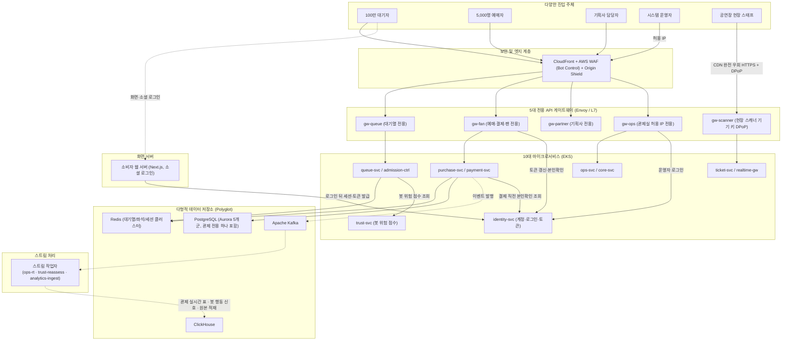
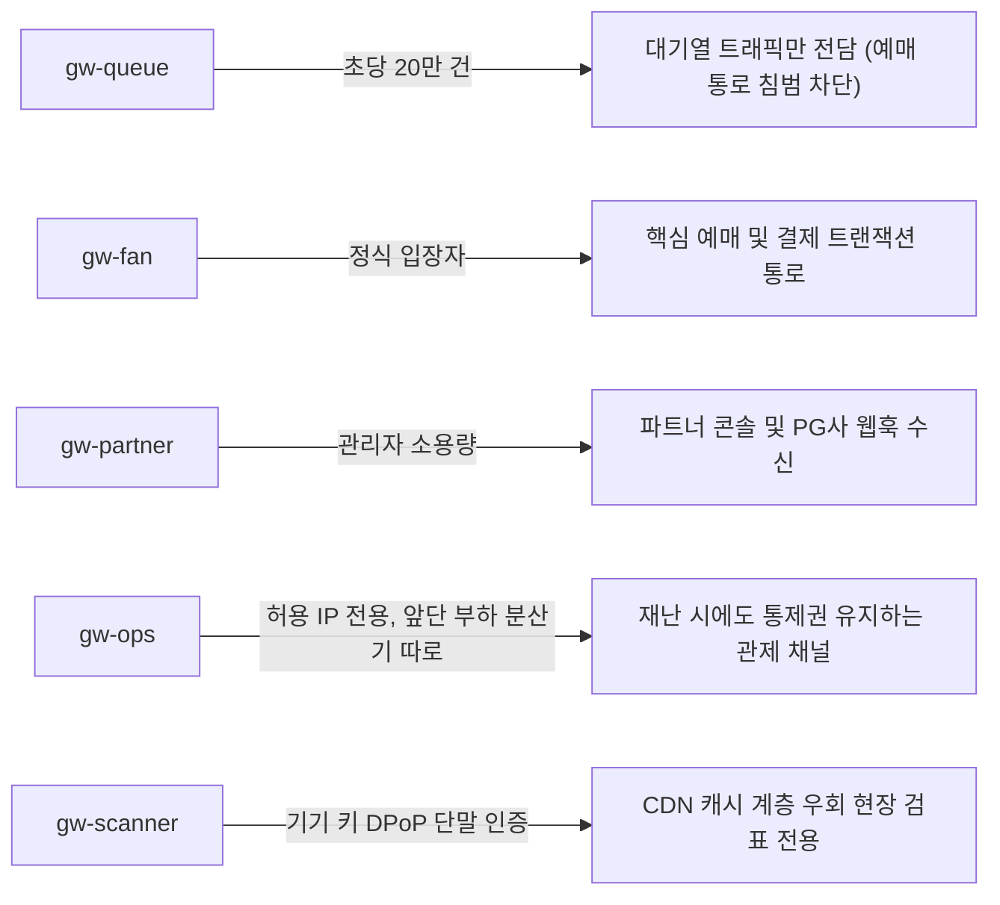
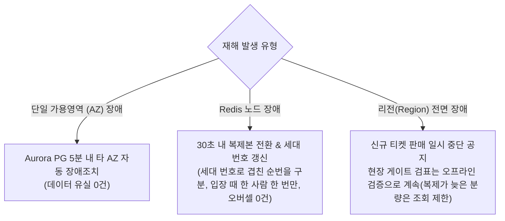

# 14. 서버 구조와 운영

> [← 13편: 법과 개인정보](13-law-and-privacy.md) | [목차로 돌아가기](README.md) | [15편: 공연이 끝난 뒤 →](15-analytics-and-decisions.md)

---

## 1. 상황: 670배의 부하 격차와 파멸적 장애 전파의 공포

저녁 8시 정각, 대기열 서버에는 1초에 무려 **20만 건(200,000 RPS)**의 트래픽이 집중된다. 반면 같은 시각 결제 서버로 넘어오는 트래픽은 **1초에 300건 안팎**이다. 두 영역의 부하 차이는 무려 **670배**에 달한다.

만약 이 두 기능이 단일 서버(모놀리스) 안에 묶여 있다면, 대기열의 순간 트래픽 폭주가 결제 DB 커넥션까지 모조리 삼켜 결제 중이던 수천 명의 화면이 튕겨 나간다.

피켓은 이 파멸적인 연쇄 장애(Cascading Failure)를 막기 위해 **서버를 역할별로 철저히 분리**하고, 외부에서 들어오는 관문(API 게이트웨이) 또한 용도별로 독립시켰다 ([ADR-0007](../adr/0007-service-boundaries-by-load-availability-runtime.md), [ADR-0008](../adr/0008-client-specific-thin-gateways.md)).

---

## 2. 왜 어려운가: 극단적 부하 격차와 1인 운영의 복잡도 한계

대규모 시스템 운영에서는 복잡성과 안정성 사이의 절묘한 균형이 필요하다.

| 핵심 난제 | 원인과 운영상 위험 | 피켓의 해결책 |
| :--- | :--- | :--- |
| **1. 극단적인 부하 격차 (670배)** | 초당 20만 건의 초고속 조회와 초당 수백 건의 엄격한 금융 트랜잭션이 공존 | **부하와 가용성 경계에 따른 마이크로서비스 분리** |
| **2. 연쇄 장애 전파** | 대기열 트래픽 폭주가 결제 DB나 공연장 현장 검표 시스템을 마비시킬 위험 | **5대 전용 API 게이트웨이 물리적 분리** |
| **3. 1인 운영의 복잡도 한계** | 서비스를 지나치게 잘게 쪼개면 혼자서 배포와 인프라 관리를 감당할 수 없음 | **필수 10개 핵심 서비스로 압축 정제** |

---

## 3. 전체 인프라 토폴로지 (Traffic Flow)

**로그인과 계정은 어디서 처리하나?** 담당은 `identity-svc`다. 다만 로그인 일이 한 서버에 몰려 있지 않고 셋으로 나뉜다.

1. 팬이 '카카오로 로그인'을 누르면, 카카오와 로그인 정보를 주고받는 일은 소비자 웹 서버(Next.js)가 작은 로그인 도구로 직접 한다. 카카오가 피켓에 발급한 비밀키도 이 서버에만 있다. 이 서버는 로그인하는 10분 동안의 쪽지 쿠키 하나만 두고, 로그인 상태(세션)는 계정 서비스(identity-svc)만 가진다(ADR-0119). 파트너 콘솔 로그인은 관제 콘솔처럼 입구 서버(게이트웨이)를 거쳐 계정 서비스로 바로 간다.
2. 카카오가 본인이라고 확인해 주면, 웹 서버가 내부망으로 `identity-svc`를 불러 피켓 계정을 찾거나 만들고 15분짜리 출입증(액세스 토큰)을 받아 브라우저 쿠키에 넣는다.
3. 그 뒤의 요청은 게이트웨이가 출입증의 서명·유효기간·권한을 직접 확인하고 통과시킨다. 그래서 1초에 20만 건이 몰리는 대기열 진입은 `identity-svc`를 부르지 않는다. 주문을 만들 때(결제 직전)만 `purchase-svc`가 본인확인 상태를 한 번 더 묻는다.

요청마다 `identity-svc`에 물어보는 구조였다면 오픈 정각에 이 서버가 병목이 되고, 이 서버가 멈추면 전체가 멈춘다. 대신 `identity-svc`가 멈추면 이미 받은 출입증은 최대 15분 동안 통하지만 새 로그인, 출입증 갱신, 본인확인은 멈춘다. 이때 주문을 만들 때의 본인확인 질문에는 답을 들을 수 없으므로, 출입증에 적힌 본인확인 표시로 대신 판정한다. 출입증은 본인확인을 마친 계정에만 그 표시를 담아 주기 때문이다. 다만 `identity-svc`가 '이 계정은 무효'라고 답하면 그 답을 따른다. 15분 넘게 멈추면 출입증을 갱신하지 못해, 출입증이 끝나는 사람부터 예매가 막힌다. 이 한계는 남는다 ([ADR-0011](../adr/0011-token-lifecycle-and-login-responsibilities.md), [ADR-0055](../adr/0055-identity-recheck-fallback-to-token-claims.md), [계정·인증 기능 설계](../features/identity.md)).

---

## 4. 10개 핵심 마이크로서비스 카탈로그

비즈니스 도메인을 기계적으로 쪼개지 않고, **[부하의 규모, 요구 가용성, 실행 주기]**가 뚜렷하게 갈라지는 경계에서만 분리했다 ([ADR-0007](../adr/0007-service-boundaries-by-load-availability-runtime.md)).

| 마이크로서비스 | 담당 역할 | 독립 서비스로 분리한 기술적 이유 |
| :--- | :--- | :--- |
| **`queue-svc`** | 대기실 참가표 발급, 대기 상태 파일 생성, 입장 확정 | 초당 20만 건의 인프라 스파이크 트래픽을 전담 격리 |
| **`admission-ctrl`** | 오픈 순간 순번 추첨(셔플, 리더 한 대만 실행), 0.2초 단위 호출 번호 갱신 제어 루프, AIMD 알고리즘 | 단일 인스턴스(Active-Standby)로만 동작해야 하는 통제 엔진 |
| **`purchase-svc`** | 좌석 홀드, 주문서 생성, 결제 플로우 오케스트레이션 | 좌석 화면에 입장한 5,000명의 핫패스 구매 트랜잭션 전담 |
| **`payment-svc`** | 외부 PG사(토스/포트원) API 호출 및 웹훅 수신 | 외부 결제망 장애를 격리하고, 결제 비밀키를 타 서비스로부터 분리 |
| **`ticket-svc`** | 모바일 티켓 발권, 티켓 기기 공개키 등록·폐기, 양도, 스캐너 동기화 | 공연 당일 현장 입장과 월렛 이용이 몰리는, 온세일과 다른 가용성 시간대를 따로 지켜야 함 |
| **`realtime-gw`** | 5만 석 좌석맵 상태 변경분을 브라우저로 실시간 스트리밍 | 수천 개의 장기 웹소켓(WebSocket) 커넥션 부하를 메인 API로부터 격리 |
| **`identity-svc`** | 회원 계정, 로그인 세션·토큰 발급, 계정 연결, 휴대폰 본인확인(CI), 관리자 2차 인증(인증 앱 코드, TOTP). 카카오·네이버·구글과의 로그인 주고받기는 소비자 웹 서버가 맡음 | 최상위 보안 경계, 티켓 오픈 직전의 로그인 집중 트래픽 소화 |
| **`trust-svc`** | 다차원 위험 점수 엔진, 봇 격리, 추가 확인 대기열 관리 | 수시로 진화하는 탐지 규칙을 무중단 배포하고, 장애 시 축소 운영 |
| **`ops-svc`** | 관제 콘솔 12대 비상 명령 수신, 감사 로그 보존, 공연 리포트 보여 주기(숫자는 마감 실행기가 만든 지표 뷰에서 읽음) | 전체 서비스가 마비되는 최악의 상황에서도 끝까지 살아 있어야 함. 그래서 손님 요청이 몰리는 서버와 다른 관제 전용 서버 묶음과 전용 데이터베이스에서 돈다. 같은 클러스터의 네트워크는 함께 쓰므로, ops-svc까지 멈추면 비상 런북이 같은 제어 길로 명령을 넣는다(2026-10-28 추천 적용, ADR-0102) |
| **`core-svc`** | 공연 기본 정보(공연·회차·공연장·아티스트·다른 이름), 검색·자동완성(서버 메모리 사전)·관련 공연, 홈 화면 구성, 알림톡·웹훅 발송, 공식 굿즈 스토어, 후기 게시판, 고객 문의 | 트래픽 부하가 상대적으로 낮아 단일 서비스로 경제적 통합 |

---

## 5. 5대 전용 API 게이트웨이 분리

게이트웨이는 비즈니스 로직을 전혀 갖지 않는 **초경량 라우팅 계층(Envoy)**이다 ([ADR-0008](../adr/0008-client-specific-thin-gateways.md)).

> [!IMPORTANT]
> **데이터베이스를 보지 않는 초경량 게이트웨이**  
> 게이트웨이는 토큰 서명 검증, URL 라우팅, 레이트 리밋(Rate Limiting: 요청 수 한도) 같은 공통 정책(출처 확인, 요청 크기 상한, 시간 초과 포함)만 수행하고 DB를 일절 조회하지 않습니다. 레이트 리밋은 대기열 진입·좌석 홀드 같은 빠른 길에서는 게이트웨이 안에서 바로 세고, 일반 API의 사용자별 한도는 게이트웨이가 함께 띄운 공용 한도 서버에 물어 셉니다(2026-10-28 기술 검토 중간-084). 팬, 관리자, 현장 스태프 토큰은 서로 다른 키로 서명하므로, 팬 토큰 키가 새어도 관리자 게이트웨이를 통과하는 토큰은 만들 수 없습니다([ADR-0050](../adr/0050-crypto-corrections-and-key-management.md) 결정 9). 대기열 진입이나 좌석 홀드, 결제 접수 같은 고속 요청은 Next.js 웹 서버를 거치지 않고 브라우저에서 게이트웨이로 직접 통신합니다.

### 게이트웨이 안쪽: 서비스 사이 통신

게이트웨이를 지난 뒤 서비스끼리 주고받는 통신은 '서비스 메시'가 맡는다([ADR-0082](../adr/0082-istio-ambient-mesh-app-boundary-meshless-portfolio-runs.md)). 메시는 서비스끼리의 통신을 앱 대신 맡는 대리인이라고 보면 된다. 운영 설계에서는 Istio의 앰비언트 모드를 쓴다. 서버 한 대(노드)마다 가벼운 대리인 하나가 모든 연결을 서로 인증서를 확인하는 암호화(mTLS)로 감싸고, 서비스끼리 gRPC로 부르는 곳에만 요청 하나하나를 나눠 주는 대리인(웨이포인트)을 더 둔다.

대리인이 잘하는 일과 앱만 할 수 있는 일은 다르다.

| 일 | 메시(대리인)가 한다 | 앱이 한다 |
| :--- | :--- | :--- |
| 다시 보내기 | 서버에 닿지도 못한 요청을 한 번 다시 보낸다 | 결제가 이미 됐는지 확인하고 다시 묻는다 |
| 시간 제한 | 호출 한 번의 상한을 둔다 | 남은 시간을 계산해 다음 호출에 넘긴다 |
| 차단 | 너무 많이 몰리면 막고, 계속 실패하는 서버를 잠시 뺀다 | 막혔을 때 대신 보여 줄 화면을 고른다 |
| 나눠 주기 | 요청마다 덜 바쁜 서버로 보낸다 | 하지 않는다 |
| 암호화 | 서비스끼리 오가는 통신을 암호화하고 어느 서비스가 불렀는지 확인한다 | 데이터베이스나 결제사처럼 메시 밖으로 나가는 통신을 암호화하고, 어느 사용자인지 확인한다 |

그래서 앱 코드에는 메시와 같은 일을 하는 다시 보내기, 나눠 주기, 서비스끼리의 암호화를 넣지 않는다. 두 층이 같이 다시 보내면 장애 때 요청이 몇 배로 불어나기 때문이다(두 층이 2번씩 다시 보내면 한 요청이 최대 9번 나간다).

포트폴리오를 실제로 돌리는 내 컴퓨터(로컬), 자동 검사(CI), 데모에는 메시를 올리지 않는다. 그 대신 미리 만들어 둔 예비 코드 없이 이렇게 메운다.

* 서버 앱이 받기도 전에 실패한 요청은 gRPC 라이브러리가 설정 없이 알아서 다시 보낸다(투명 재시도).
* 서버를 다시 띄울 때는 하던 일을 마치고 닫는다(우아한 종료). NestJS는 이 설정이 기본으로 꺼져 있어 서비스 템플릿에서 켠다.
* 누가 누구를 부를 수 있는지는 쿠버네티스의 네트워크 정책(NetworkPolicy)으로 막는다.
* 운영에 내보내는 설정에서 메시가 빠지면 배포 검사가 막는다.

솔직한 한계도 있다. 메시가 없으니 메시가 더하는 지연과 메시 정책이 실제로 어떻게 움직이는지는 재지 못한다. 로컬 클러스터 안의 통신은 암호화되지 않고(가짜 데이터만 쓴다), 누가 불렀는지는 인증서가 아니라 라벨로만 구분한다.

---

## 6. 다형적 데이터 저장소 (Polyglot Persistence)

| 저장소 인프라 | 담당 데이터 | 기술 선정 근거 |
| :--- | :--- | :--- |
| **Redis (대기열)** | 순번 카운터, 입장 자리, 추첨 결과 | 초당 20만 번의 원자적 인메모리 연산 처리 |
| **Redis (좌석)** | 5만 석 비트맵, 7분 홀드 타이머, 1인 한도 | 단일 Lua 스크립트로 0.05초 내 홀드 경합 종결 |
| **Redis (세션)** | 소셜 로그인 세션, 공통 캐시, 굿즈 재고 | 범용 캐싱 및 고속 조회. 키마다 '잃으면 어떻게 되나'를 세 등급으로 나누고, 메모리가 차면 지우지 않고 쓰기가 실패하게 둔다([ADR-0109](../adr/0109-delivery-jobs-in-postgres-drop-bullmq-cache-redis-key-classes-noeviction.md)) |
| **PostgreSQL (Aurora)** | 주문·좌석 최종 확정, 결제 원장, 티켓 원장, 계정, 굿즈·부가 상품 정의, 알림·웹훅 발송 원장 | 데이터 유실을 절대 용납하지 않는 ACID 영구 장부. 상품 유형마다 다른 옵션은 JSONB 칸(JSON을 저장하고 안쪽 값으로 거를 수 있는 칸)에 담는다([ADR-0101](../adr/0101-product-catalog-postgres-jsonb-drop-mongodb.md)) |
| **Kafka** | 마이크로서비스 간 비동기 이벤트 스트리밍 | 한쪽의 폭주나 지연이 다른 쪽을 막지 않음 |
| **ClickHouse** | 스트림 작업자가 Kafka에서 옮겨 쌓은 관제 실시간 사건(읽을 때 판매 누적·잔여석 등을 센다), 공연 리포트용 분석 장부, 봇 행동 신호 원본 | 수억 건의 대규모 이벤트를 초 단위로 고속 분석 |

데이터를 나눠 담고(파티션), 여러 벌 복제하고, 백업하는 장치는 이미 저장소마다 있다. 2026-10-22에 규칙 세 가지를 더했다([ADR-0082](../adr/0082-istio-ambient-mesh-app-boundary-meshless-portfolio-runs.md)).

* Kafka 파티션 수를 늘리거나 Redis 서버를 더해 데이터를 옮기는 일은 판매가 없는 정비 시간에만 한다. Kafka는 키를 파티션 수로 나눈 나머지로 자리를 정해서, 파티션을 늘리면 같은 회차의 사건 순서가 섞일 수 있다(거래 토픽의 키는 회차 ID다). 그래서 순서가 중요한 거래 토픽은 파티션을 늘리지 않고, 판매가 없는 날 새 토픽으로 옮긴다.
* 인기 공연의 요청을 늘 같은 서버로 보내는 방식(일관된 해시 분산)은 쓰지 않는다. 100만 명이 서버 몇 대에 몰린다.
* 서버끼리 "살아 있니?"를 소문처럼 퍼뜨려 고장을 찾는 방식(가십)은 앱에 따로 만들지 않는다. Redis, Kafka, 쿠버네티스가 이미 각자 하고 있고, 판단하는 곳이 둘이 되면 서로 다르게 볼 때 누가 맞는지 정할 수 없다.

### 관계형 DB는 왜 PostgreSQL인가

2026-10-22에 MySQL과 견주어 보고 PostgreSQL을 그대로 쓰기로 했다([ADR-0083](../adr/0083-keep-postgresql-partition-keys-transaction-scoped-settings-global-replica.md)). 서울 리전 가격은 둘이 같아서 돈은 이유가 아니다. 이유는 이 설계의 안전장치가 PostgreSQL에만 있는 기능으로 짜여 있다는 것이다.

* **조건이 붙은 중복 금지**: 같은 좌석이 두 번 팔리지 않게 막는 마지막 장치는 '판매 중이거나 팔린 행끼리만' 같은 좌석을 금지하는 규칙이다. 취소된 행은 빼야 다시 팔 수 있다. MySQL에는 이런 조건부 규칙이 없어 돌려 표현해야 한다.
* **짧게만 기다리는 잠금(2026-10-28부터 이유에서 뺐다)**: 처음에는 Redis가 고장 난 동안 DB로 좌석을 잡는 비상 경로가 있었고, 0.3초 안에 답하려면 잠금을 0.1초만 기다려야 했다(MySQL은 1초보다 짧게 정할 수 없다). 2026-10-28에 이 비상 경로를 없앴다. 장애 조치는 보통 몇 초라서, 그동안 좌석 잡기를 잠깐 미루고 Redis가 돌아오면 이어서 받는 편이 같은 좌석을 두 사람에게 주는 위험이 없다([ADR-0121](../adr/0121-seat-redis-failover-defer-purchase-drop-db-hold-path.md)). 나머지 세 이유로 PostgreSQL을 그대로 쓴다.
* **멈춘 작업 자동 끊기**: 작업 도중 잠금을 쥔 채 멈춘 연결만 골라 DB가 스스로 끊는 설정이 PostgreSQL에는 있고 MySQL에는 없다.
* **실패하면 통째로 되돌리는 표 구조 변경**: PostgreSQL은 표 구조를 바꾸는 명령도 한 묶음으로 되돌릴 수 있다. MySQL은 명령마다 바로 확정되어 중간에 실패하면 반쯤 바뀐 상태가 남는다.

MySQL이 나은 점도 있다. 연결이 가볍고, 옛 행을 치우는 청소가 필요 없고, 한국어 두 글자 검색이 내장돼 있다. 하지만 이 설계는 대기열이 구매 쪽 인원을 묶어 DB 쓰기가 많지 않아서 판단을 뒤집을 정도는 아니다. 그 대가로 이름 중간에 든 두 글자로 찾을 때는 색인을 쓰지 못하고 공연 목록을 훑는다는 한계를 안고 간다. 이름 앞부분으로 찾는 대부분의 검색은 미리 계산해 둔 칸의 색인을 쓴다(검색 방식은 2026-10-27에 다시 정했다, ADR-0094).

같은 비교에서 어느 DB를 쓰든 고쳐야 할 빈틈도 찾았다. 주문표를 달마다 나눠 담으면 '같은 주문 요청은 한 번만'이라는 규칙이 같은 달 안에서만 지켜져, 월말 자정에 걸친 재시도가 주문을 둘 만들 수 있었다. 그때는 달을 나누는 기준을 시간순 ID로 바꾸고, 달을 가로질러 지켜야 하는 규칙은 나누지 않는 작은 표가 따로 맡게 했다. 2026-10-28에는 한 걸음 더 갔다([ADR-0114](../adr/0114-no-monthly-partitions-for-order-payment-ticket-batched-retention-delete.md)). 5년 동안 쌓여도 주문 약 1,700만 건·티켓 약 3,500만 장이라 표 하나로 충분하므로, 주문·결제·티켓 표는 아예 나누지 않는다. 5년 보관 기한이 지난 행은 새벽 정비 시간에 1만 건씩 나눠 지운다. 정말 느린지는 5년치 가짜 데이터로 지워 보며 재고(V-T29), 재 보니 정비 시간을 못 맞추면 그때 다시 나눈다.

| 솔직한 한계 | 어떻게 다루나 |
| --- | --- |
| 이름 중간에 든 두 글자로 찾을 때는 검색 색인을 쓰지 못한다 | 공연 목록이 작아 지금은 훑기로 감수하고, 느리게 재지면 두 글자 조각 색인(pg_bigm)을 더한다 |
| 상태가 자주 바뀌는 표는 청소가 따라가야 한다 | 그 표만 청소를 더 자주 하게 하고 부하 시험에서 잰다 |
| 도쿄의 티켓 사본은 복제가 늦은 만큼을 잃을 수 있다 | 현장 검표는 오프라인으로 계속하고, 리전 복구 때 그 사본을 떼어 새 원장으로 쓴다 |

### 검색은 이렇게 찾는다

2026-10-27에 검색을 다시 설계했다([ADR-0094](../adr/0094-search-redesign-autocomplete-read-model-search-port.md), 정본 [docs/features/search.md](../features/search.md)). 찾는 대상은 판매 승인된 공연과 그 공연의 아티스트·공연장, 그리고 셋의 다른 이름이다.

* **이름 셋**: 입력하는 동안 검색창 아래 뜨는 후보 창은 '자동완성'이다. 검색어와 맞은 아티스트·공연장의 다른 공연을 카탈로그 관계로 고른 묶음은 '관련 공연'이다. 다른 사람들이 이어서 찾은 검색어로 만드는 '연관 검색어'는 두지 않는다. 봇이 같은 검색을 되풀이해 조작할 수 있고, 검색어에 이름·전화번호 같은 개인정보가 섞일 수 있고, 서비스 초기에는 기록이 없기 때문이다.
* **찾는 곳**: 검색 결과는 PostgreSQL의 검색 읽기 모델(자주 읽는 값을 미리 모아 둔 사본 표)에서 찾는다. 자동완성은 core-svc 서버마다 메모리에 둔 사전에서 찾고, 사전은 10초(잠정값)마다 카탈로그의 판 번호를 보고 바뀌었으면 다시 읽는다. 검색 전용 서버(Elasticsearch·OpenSearch)와 외부 검색 서비스(Algolia)는 쓰지 않는다.
* **바꿔 끼울 자리**: 검색 엔진을 갈아 끼울 수 있게 검색 포트(`SearchIndex`)를 두고, 화면과 API는 포트만 안다. 설명 글·후기 본문까지 찾아야 하거나, 찾을 대상이 10만 건(잠정값)을 넘거나, 정답률·속도 목표를 순위·쿼리 조정으로도 못 지키면 OpenSearch 어댑터를 같은 기대 결과 묶음과 부하로 견줘 재고 새 ADR로 정한다.
* **한글 입력**: 글자를 조합하는 중('루멘'을 치는 도중의 '룸'), 초성만 친 경우('ㄹㅁ'), 한/영 전환을 잊고 친 경우('fnaps')에도 '루멘'을 찾는다. 브라우저와 서버가 같은 정규화 코드를 쓴다.
* **목표**: 자동완성은 원본 응답 p95 50ms, 검색은 p95 300ms(둘 다 잠정값, NFR-028)다.

---

## 7. 재해 복구(DR) 불변식과 오픈 전 사전 웜업

### 재해 복구(DR) 불변식: 무엇을 포기하고 무엇을 지키는가

### 오픈 전 사전 웜업(Warm-up)과 T-30분 점검
1. **사전 오토스케일링(T-40분 시작)**: 게이트웨이·대기열·입장 제어·구매·결제·실시간·본인확인·봇 판정 서버와 웹 화면 서버의 최소 파드 수를 미리 정한 프리워밍 수치로 올리고 노드를 먼저 띄운다. 수치는 최대 용량이 아니라 용량 산정과 부하 시험으로 정한다.
2. **캐시 웜업**: 공연 정보, 좌석 배치도, 가격 정책을 Redis와 CDN 엣지에 미리 적재.
3. **T-30분 관제 사전 점검(Go/No-Go)**: 프리워밍 완료, 데이터 저장소 상태, 그 공연 결제사의 상태와 한도, 본인확인·사람 확인 제공자, CloudFront 배포별 한도, 외부 합성 점검, 경보 채널 시험 발송, 노드 시계, 인증서 만료, 백업, 진행 중 배포 없음(대형·중형), 동결 창 적용, 겹치는 관리형 유지보수 없음. 하나라도 실패하면 No-Go이고, T-20분까지 회복하지 못하면 입장 일시정지와 공지로 시작한다([10편](10-control-tower.md)).
4. **변경 동결**: 대형·중형 공연은 오픈 90분 전부터 60분 뒤까지 모든 운영 변경을, 소형 공연은 오픈 50분 전부터 60분 뒤까지 대기열·구매를 맡은 핵심 서버의 변경을 막는다. 공연마다 다른 오픈 시각에 맞춰 달력이 창을 자동으로 건다. 코드를 저장소에 합치는 일은 막지 않는다([16편](16-change-and-deploy.md)).
5. **종료 후 정리**: 서버 수를 평시로 되돌리고 온세일 1회 비용을 계산해 성능 장부에 기록.

---

## 8. 한 줄 요약

> **10개 마이크로서비스와 5개 게이트웨이는 부하와 보안 경계에 따라 철저히 분리되었고, 빠른 일은 Redis가 확실한 일은 PostgreSQL이 맡으며, 구역 장애는 5분 안에 자동 복구하고 리전 장애는 판매를 멈추되 현장 검표는 오프라인으로 이어 간다.**

---

## 더 알아보기

* [docs/architecture.md §3](../architecture.md), [ADR-0007](../adr/0007-service-boundaries-by-load-availability-runtime.md): 마이크로서비스 분리 기준 및 서비스 카탈로그
* [docs/architecture.md §4](../architecture.md), [ADR-0008](../adr/0008-client-specific-thin-gateways.md): 5대 API 게이트웨이 아키텍처 및 라우팅 명세
* [docs/architecture.md §5](../architecture.md), [ADR-0082](../adr/0082-istio-ambient-mesh-app-boundary-meshless-portfolio-runs.md): 메시와 앱의 책임 경계, 메시 기본값, 메시 없는 실행, 장애 감지 층
* [docs/data.md §2, §5](../data.md), [ADR-0083](../adr/0083-keep-postgresql-partition-keys-transaction-scoped-settings-global-replica.md): PostgreSQL을 유지한 이유(MySQL 비교), 파티션 표 규칙, 검색의 알려진 한계
* [docs/infra.md §1, §3](../infra.md): 멀티 환경 구성 및 인프라스트럭처 토폴로지
* [docs/infra.md §6](../infra.md), [ADR-0031](../adr/0031-environments-and-region-dr.md): 리전 장애 대응 절차 및 재해 복구(DR) 불변식
* [docs/infra.md §5](../infra.md): 온세일 사전 웜업 체크리스트와 오토스케일(대기열 길이·처리 지연을 보고 늘리는 확장과 오픈 40분 전 프리워밍)
* [docs/infra.md §9](../infra.md): 인프라 보안 구성
* [docs/infra.md §11](../infra.md): 클라우드 비용 통제 전략 및 인프라 FinOps 설계
* [docs/devops.md §6, §8](../devops.md), [16편](16-change-and-deploy.md): 서버 종류별 배포 방법, 변경 동결 창과 정비 시간
* [docs/streaming.md](../streaming.md), [ADR-0099](../adr/0099-drop-flink-typescript-stream-workers-read-time-aggregation.md): Kafka와 ClickHouse·Redis 사이의 스트림 작업자 셋(관제 실시간 원시 적재 `ops-rt`, 봇 대기 중 재평가 `trust-reassess`, 원본 적재 `analytics-ingest`)과, 스트림 처리 엔진 Flink를 쓰지 않는 이유·다시 볼 조건. 그 전의 Flink 설계는 [ADR-0071](../adr/0071-flink-design-verification-rt-upsert-heartbeat-bot-reassess.md)·[ADR-0072](../adr/0072-flink-detailed-design-operators-config-capacity-operations.md)에 있다
