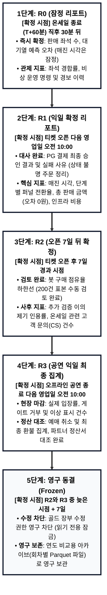
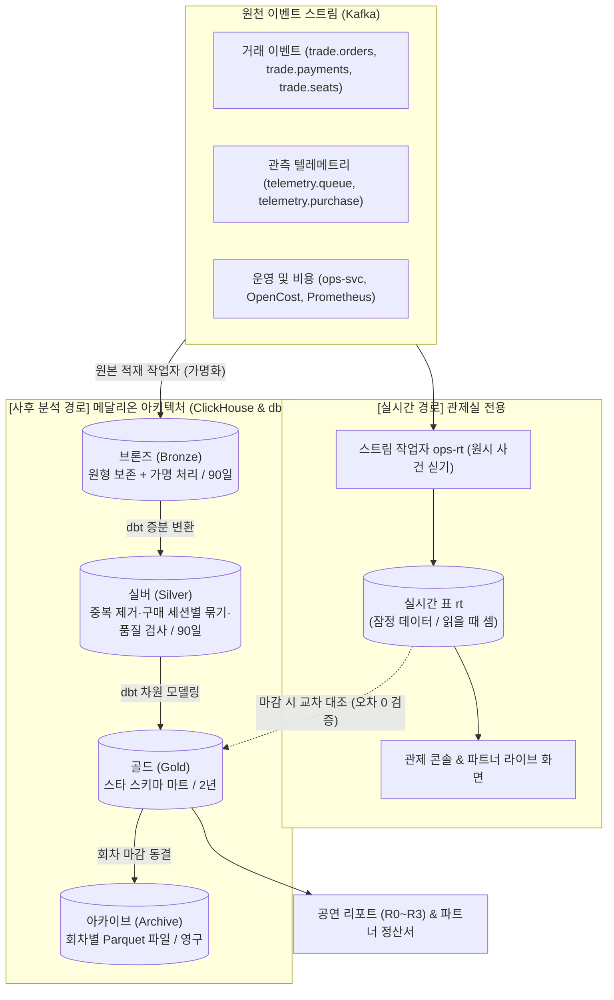
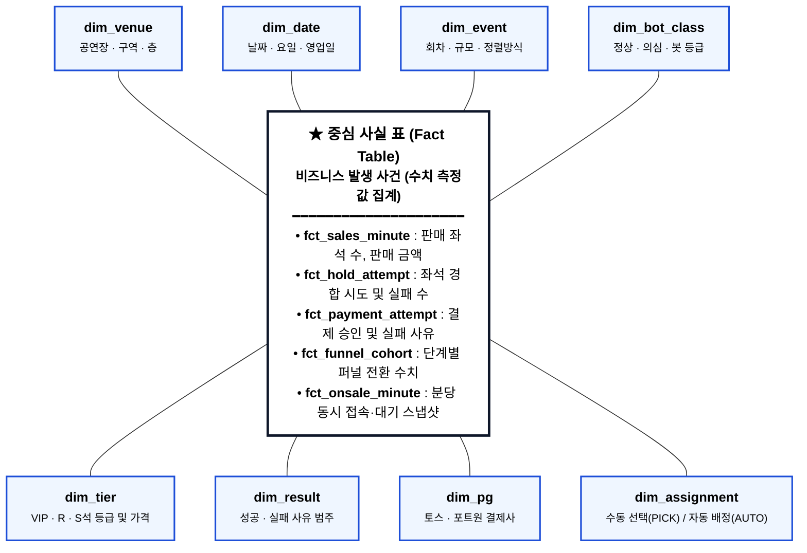
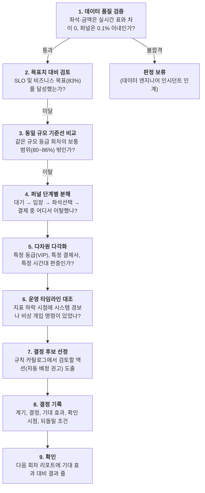
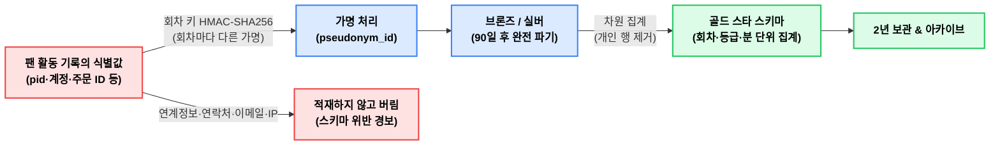

# 15. 공연이 끝난 뒤: 숫자로 다음 회차 정하기

> [← 14편: 서버 구조와 운영](14-architecture-and-ops.md) | [목차로 돌아가기](README.md) | [16편: 바꾸고 내보내는 법 →](16-change-and-deploy.md)

---

## 1. 상황: 수요일 아침 10시, 어젯밤 콘서트의 리포트

민호 씨는 피켓(PEAKET)의 운영 리더입니다. 화요일 저녁 8시에 5만 석 규모 대형 콘서트의 티켓이 열렸고, 9시에 온세일(Onsale) 윈도우가 종료되었습니다. 9시 반에는 1차 요약인 **잠정 리포트(R0)**가 도착했습니다. 판매 좌석 수는 즉시 집계되었지만, 매진 시각과 결제·봇 관련 숫자 옆에는 **'잠정'**이라는 배지가 붙어 있었습니다. 외부 결제사의 상태 불명 주문 정리와 봇 탐지 표본 수동 검토가 아직 진행 중이었기 때문입니다.

수요일 아침 10시, 모든 대사가 완료된 **확정 리포트(R1)**가 도착합니다. 대시보드 최상단에 빨간색 경고 배지와 함께 하나의 결정 규칙이 표시됩니다. *(아래 숫자는 이해를 돕기 위한 예시 수치입니다)*

```text
┌────────────────────────────────────────────────────────────────────────┐
│ [R1 확정 리포트 판정] 규칙 #01: 입장 대비 구매 전환율 이상 탐지       │
│                                                                        │
│ • 관측 전환율 : 78.0%                                                  │
│ • 목표 기준선 : 83.0%                                                  │
│ • 동규모 범위 : 80.0% ~ 86.0% (같은 규모 등급 기준선)                   │
│ • 최종 판정   : ⚠️ 걸림 (목표치 및 동규모 정상 범위 하회)             │
└────────────────────────────────────────────────────────────────────────┘
```

민호 씨는 즉시 전환율을 세부 퍼널(Funnel) 단계별로 쪼개어 확인합니다.
* **대기열 통과 $\rightarrow$ 입장**: 정상 (목표 범위 달성)
* **결제 접수 $\rightarrow$ 최종 승인**: 99.8% (정상 범위 달성)
* **입장 $\rightarrow$ 첫 좌석 잡기(Hold) 성공률**: **88.0% (같은 규모 기준선 93~96%보다 낮음, 병목 발견)**

등급별로 분해해 보니, **VIP 등급 좌석의 경합 패배율이 61%**에 달했고, 이는 티켓 오픈 후 첫 3분 안에 집중적으로 발생했습니다. 동일 시각 좌석맵 서버의 응답 지연은 p99 45ms로 정상 범위였으므로 시스템 장애는 아니었습니다. 수만 명이 동시에 같은 VIP 구역의 몇 안 되는 좌석을 수동으로 클릭하느라 극심한 클릭 경합(Click Collision)이 발생했던 것입니다.

오전 회의에서 민호 씨와 제품 책임자는 파트너 기획사에게 **다음 회차에는 수동 좌석 선택(PICK) 대신 희망 구역 기반 자동 배정(AUTO)을 권고하기로 결정**하고, 시스템의 [결정 기록(Decision Record)](#결정-기록-decision-record-템플릿)에 다음과 같이 남깁니다.

> *"기대 효과: 첫 좌석 잡기 성공률 93% 이상 개선. 검증 시점: 다음 동일 규모 2회차(시스템이 달성 여부를 제안하고 운영 리더가 확정)."*

섣불리 시스템의 판매 정책 기본값을 바로 바꾸지는 않습니다. 단 한 번의 공연 결과는 우연한 잡음일 수 있기 때문입니다. 이제 다음 회차 리포트에는 이번 결정이 실제로 효과를 거두었는지 추적하는 검증 행이 자동으로 붙게 됩니다.

---

## 2. 왜 어려운가: 끝난 공연에서 배우는 일의 5대 함정

대규모 트래픽이 휩쓸고 지나간 뒤 데이터를 분석하고 정책을 개선하는 일에는 다섯 가지 치명적인 함정이 존재합니다.

| 5대 함정 | 발생 원인과 위험 | 피켓의 엔지니어링 해결책 |
| :--- | :--- | :--- |
| **1. 실시간 숫자의 불완전성** | 결제 상태 불명 정리(1시간 소요), 봇 표본 검토(종료 후 수작업), 노쇼 확인(공연 당일) 등 데이터마다 확정되는 시점이 다름 | 숫자마다 **잠정·확정 배지**를 부여하고, **5단계 마감 파이프라인(R0~R3~동결)**을 엄격히 구분 |
| **2. 데이터 파편화 (사일로)** | 대기열, 좌석, 주문, PG 결제, 오프라인 발권 로그가 서로 다른 분산 서버에 흩어져 통합 조회가 불가능함 | 모든 원본 이벤트를 **분석 저장소(ClickHouse)**로 집중시키고 단일 **지표 사전**으로 통합 계산 |
| **3. 메시지 중복 전달** | 고가용성 Kafka 클러스터의 At-least-once 전달 특성으로 인해 네트워크 재시도 시 동일 결제/주문 이벤트가 중복 유입됨 | 이벤트마다 **중복 제거 키(`eventKey`)**를 붙이고, dbt 변환을 통해 멱등성(Idempotent) 보장 |
| **4. 단발성 결과의 무작위성** | 아티스트 팬덤 성향, 요일, 날씨 등 통제 불가능한 변수로 인해 단 1회의 결과만으로 정책을 바꾸면 과적합(Overfitting) 발생 | **동일 규모 회차의 기준선(Baseline)**과 비교하며, 되돌리기 어려운 결정은 **동일 방향 2회 이상**일 때만 집행 |
| **5. 개인정보 침해 리스크** | 팬의 대기, 좌석 선택, 결제 행동은 민감한 프라이버시 데이터임. 이를 장기 보관하면 컴플라이언스 위반 초래 | 수집 즉시 **회차별 일회성 가명(Pseudonym)**으로 치환, **90일 후 원본 파기**, 집계 장부(골드)에는 사람 단위 행을 두지 않음 |

---

## 3. 어떻게 푸는가: 사후 분석 & 의사결정 아키텍처

### ① 속도에 맞는 숫자 쓰기: "결정 속도보다 빠른 숫자는 낭비다"

> [!NOTE]
> **분석 지표의 제1원칙**: 결정을 실행할 수 있는 속도보다 빠른 숫자는 필요 없습니다.

비즈니스 의사결정(판매 규칙 변경, 파트너 권고, 수수료 계약)은 온세일 도중에 내리지 않습니다. 판매 중에는 공정성을 위해 규칙을 바꿀 수 없으며([POL-028](../planning/03-policies-glossary.md)), 실시간 숫자는 아직 확정되지 않았기 때문입니다.

| 의사결정 유형 | 결정 실행 속도 | 사용하는 데이터 | 담당 주체 |
| :--- | :--- | :--- | :--- |
| **입장 속도 조절, 결제사 전환** | 즉시 (초 단위) | **실시간 메트릭** (판단 숫자는 Prometheus, 상세 현황은 실시간 표) | 관제 엔지니어 ([10편](10-control-tower.md)) |
| **동일 날짜 추가 회차 오픈 검토** | 수 시간 이내 | **1분 지연 판매 현황** (잠정, FR-026) | 파트너 기획사 ([11편](11-partner-console.md)) |
| **다음 회차 입장 정원, 서버 프리워밍** | 다음 회차 오픈 전 | **R1 확정 숫자** (다음 영업일 오전 10시) | 운영 리더 (Commander) |
| **선착순/추첨 권고, 자동배정, 봇 강도** | 다음 회차 등록 시 | **R2 확정 숫자** (오픈 7일 뒤 봇 검토 완료) | 제품 책임자 (Product Owner) |
| **결제사 계약 조건, 연간 인프라 예산** | 분기/반기 단위 | **R3 확정 및 멀티 회차 골드 집계** | 제품 책임자 (Product Owner) |

> [!NOTE]
> **홈의 '장르별 랭킹'도 확정 숫자로 만든다**(2026-10-14 추천 적용, ADR-0063): 홈에 보이는 장르별 순위는 "어제 하루 결제가 확정된 매수"로 매긴다. 이 장부(분석 저장소)가 매일 아침 9시 반쯤 세어 10시쯤 파일 하나로 내놓고, 그 파일을 CDN이 하루 동안 나눠 준다(시각은 잠정값). 판매 중인 1분 지연 숫자를 쓰지 않는 것은 위 원칙과 같다. 순위만 싣고 몇 장 팔렸는지는 싣지 않는다. 같은 날 산 뒤 취소한 매수를 빼지 않으므로, 샀다가 바로 취소해 순위를 올리는 일은 막지 못한다는 한계가 있다(취소 수수료가 비용이 될 뿐이다).

---

### ② 숫자가 확정되는 5단계 마감 파이프라인 (Close Stages)

공연 데이터는 단번에 완성되지 않으며, 비즈니스 사건의 생명주기에 맞추어 순차적으로 확정됩니다.



| 마감 단계 | 확정 시점 | 확정되는 핵심 지표 | 아직 잠정인 지표 |
| :--- | :--- | :--- | :--- |
| **R0 (잠정)** | 온세일 종료(T+60분) 후 30분 | 판매 좌석 수, 좌석 경합률, 대기 시간 예측 오차, 운영 명령 및 경보 이력 | 매진 소요 시간, 결제 결과, 봇 점유율, 인프라 비용, 환불, 현장 입장 |
| **R1** | 다음 영업일 오전 10시 | 매진 소요 시간, 결제 최종 결과 및 실패 사유, 단계별 퍼널 전환율, 판매 금액 총액, 인프라 비용(OpenCost) | 봇 점유율, CS 접수, 환불, 현장 입장 |
| **R2** | 티켓 오픈 7일 뒤 | 봇 점유율 하한선(수동 표본 검토 200건 완료), 부정 예매 소명 인용률, 온세일 관련 CS 건수 | 예매 취소/환불 추이, 현장 입장 |
| **R3** | 공연 종료 다음 영업일 10시 | 현장 실제 입장률, 게이트 거부/이상 표시 건수, 최종 환불 집계, 파트너 정산서 대조 완료(판매 대금은 매일 쌓는 날짜별 판매 사실 `fct_sales_daily`의 합이라, 오픈 7일 뒤에도 몇 달씩 판 회차의 판매도 빠지지 않는다. 2026-10-28 기술 검토 높음-23) | **모든 지표 확정 완료 (잠정 없음)** |
| **동결** | R2/R3 중 늦은 시점 + 7일 | 그 회차 장부를 더 고치지 않고 연도 비교용 영구 아카이브로 옮긴다. 아카이브는 회차·장부마다 파일 하나(Parquet, 열 단위로 저장하는 공개 파일 형식)이고, 2년보다 오래된 회차와 견줄 때 분석 DB가 이 파일을 바로 읽는다(2026-10-28, ADR-0115) | 고치지 않음 |

> [!IMPORTANT]
> **데이터 품질 무결성 원칙**:
> 확정 리포트(R1)의 판매 좌석 수와 판매 금액은 실시간 관제 화면의 숫자와 **단 1장, 단 1원의 오차도 없어야 합니다(차이 = 0)**. 퍼널 집계(진입·입장·홀드·주문)는 차이가 0.1% 이내여야 합니다. 이 기준을 넘으면, 해당 지표에 걸린 결정 규칙은 자동으로 **'판정 보류'** 상태로 전환되며, 데이터 담당이 원인을 찾아 리포트의 '데이터 품질' 절에 적습니다.

---

### ③ 메달리온 아키텍처: 데이터가 정제되는 4단계 계층

피켓은 원시 로그에서부터 최종 비즈니스 보고서에 이르기까지 **메달리온 아키텍처(Medallion Architecture)**를 통해 점진적으로 데이터를 정제합니다.



| 데이터 층 | 현실 세계의 비유 | 수행하는 작업과 정제 수준 | 보존 기간 | 주 열람자 |
| :--- | :--- | :--- | :--- | :--- |
| **실시간 표 (`rt`)** | **가게 칠판** | 들어온 사건을 상자에 그대로 담아 두고 0.5초마다 다시 센다. 온세일 현황 즉시 표시. 숫자를 더해 적지 않는다(아래 '칠판은 영수증을 다시 세어 쓴다') | 판매 사건 400일(잠정값) | 관제 콘솔, 파트너 라이브 |
| **브론즈 (`bronze`)** | **영수증 상자** | 원본 이벤트 그대로 적재. 식별자만 회차별 가명으로 치환 | 90일 | 마감 배치 잡 (`close-runner`) |
| **실버 (`silver`)** | **영수증 분류·정리** | 중복 메시지 제거, 타임스탬프 정규화, 구매 세션 단위 결합 | 90일 | 마감 실행기, 지정된 가명정보 취급자 |
| **골드 (`gold`)** | **분석용 공식 장부** | 회차·등급·구역·분 단위 다차원 스타 스키마. **개인 행 배제** | 2년 | 공연 리포트, 의사결정권자 |
| **아카이브 (`archive`)** | **지하 문서 창고** | 동결된 회차의 골드 데이터를 회차·표마다 Parquet 파일 하나로 S3에 영구 보존하고, 분석 DB가 그 파일을 바로 읽는다(목록 파일로 대조, 2026-10-28 Iceberg 표 대신, ADR-0115) | 영구 | 연도별 회고(연도 비교) |

#### 칠판은 영수증을 다시 세어 쓴다

계산원이 손님이 올 때마다 칠판의 '오늘 판매'에 숫자를 더해 적는다고 해 봅시다. 계산원이 잠깐 자리를 비웠다가 돌아와 마지막 몇 분 영수증을 다시 보며 또 더하면 같은 손님이 두 번 적힙니다. 그래서 칠판에 더해 적지 않습니다.

대신 받은 영수증을 모두 상자(실시간 원시 표)에 넣어 두고, 0.5초마다 상자 안 영수증을 다시 셉니다. 같은 영수증 번호(`eventKey`)는 한 번만 셉니다. 영수증이 상자에 두 번 들어가도 숫자는 그대로입니다. 공식 장부(골드)와 같은 셈법(SQL)으로 세므로, 장사가 끝난 뒤 공식 장부와 칠판의 판매 좌석·금액이 맞습니다.

늦게 온 영수증도 버리지 않습니다. '초당 손님 수' 같은 1초 칸은 다시 셀 때 제 칸에 들어갑니다.

이 셈은 따로 계산 엔진(Flink) 없이, 영수증을 상자로 옮기는 작은 프로그램(스트림 작업자)과 분석용 데이터베이스(ClickHouse)만으로 합니다. 이 규모(초당 약 1만 건)에서는 그쪽이 더 단순하고, 셈법을 공식 장부와 한 언어로 둘 수 있기 때문입니다(ADR-0099).

칠판이 제때 바뀌는지는 '심장 박동'으로 봅니다. 1초마다 시계 표시를 하나씩 흘려보내 관제 서버가 칠판을 읽을 때까지 몇 초 걸렸는지 잽니다(화면에 그리는 약 0.3초는 지연 예산에만 넣습니다). 5초를 넘는 상태가 3분 이어지면 관제 화면은 다른 칠판(Prometheus)으로 바꿔 봅니다. 입장 속도처럼 자동 제어가 쓰는 숫자는 처음부터 그 다른 칠판에서 읽습니다([docs/streaming.md](../docs/streaming.md), ADR-0071·0099).

---

### ④ 장부 설계: 킴볼 스타 스키마 (Star Schema)

골드 계층은 데이터 웨어하우스의 표준인 **스타 스키마(Star Schema)**로 구축됩니다. 중심에 비즈니스 측정값의 원천인 **사실 표(Fact Table)**를 두고, 외곽 사방에 이를 다각도로 분류하는 **차원 표(Dimension Tables)**들을 별빛처럼 방사형(Star)으로 배치하여 복잡한 조인 없이 한눈에 분석할 수 있도록 설계한 구조입니다.



#### 스타 스키마의 3대 수학적 원칙
1. **비율(Rate)을 직접 저장하지 않는다 (분자·분모 분리 원칙)**:
   장부에 '전환율 80%'라는 계산된 비율을 직접 저장하면 회차를 합산할 때 숫자가 틀어집니다(비율은 더할 수 없는 값이라, 크기가 다른 회차의 비율을 그냥 평균하면 큰 회차의 무게가 사라집니다. 정본은 이를 '킴볼의 비가산 측정값 처리'라고 부릅니다).
   > *예시*: A회차(100명 중 90명 구매 = 90%)와 B회차(1만 명 중 7,000명 구매 = 70%)의 단순 평균은 80%이지만, 실제 통합 전환율은 약 70.2%입니다. 따라서 장부에는 반드시 `입장자 수`와 `구매자 수`를 각각 저장하고, 지표 뷰(`mtr_*`)에서 동적으로 계산합니다.
2. **반가산(Semi-additive) 측정값 통제**:
   '현재 대기 인원', '활성 세션 수'와 같은 시점 스냅샷 수치는 시간 축으로 단순 합산할 수 없습니다. 시스템은 집계 시 `MAX()` 또는 `AVG()`만을 적용하도록 제한합니다.
3. **적합 차원 공유**:
   모든 사실 표가 동일한 `dim_event`, `dim_date`를 공유하고 판매·홀드 시도·환불 표는 `dim_tier`도 함께 쓰므로, *"VIP 등급의 판매량(F2)"*과 *"VIP 등급의 좌석 경합 실패율(F4)"*을 하나의 테이블에서 나란히 조인하여 비교할 수 있습니다.

---

### ⑤ 리포트를 읽는 9단계 분석 루틴

운영 리더와 제품 책임자는 확정 리포트를 마주했을 때 정형화된 9단계 분석 루틴을 따릅니다.



3단계에서 같은 규모끼리 견주는 까닭이 하나 더 있습니다. 규모나 등급 구성이 다른 회차를 섞어 비교하면, 회차마다 보이던 경향이 합친 숫자에서는 뒤집힐 수 있습니다. 예를 들어 두 회차 모두에서 자동 배정이 직접 선택보다 전환율이 높아도, 두 회차를 합치면 반대로 보일 수 있습니다. 이것이 심슨의 역설입니다. 그래서 같은 규모의 기준선과 견주고, 등급처럼 구성이 다른 축은 5단계에서 나눠 봅니다.

---

### ⑥ 안전한 의사결정: 결정 기록 (Decision Record)과 2회차 검증

피켓에서는 어떤 데이터 분석 결과가 나와도 **시스템이 자동으로 판매 정책을 변경하지 않습니다**. 알고리즘의 오작동이나 1회성 특이치로 인해 대규모 예매 참사가 발생하는 것을 막기 위해 반드시 **인간 의사결정권자의 검토와 서명**을 거칩니다.

#### 결정 권한 매트릭스
| 변경 대상 결정 | 제안자 | 최종 승인권자 | 필요한 데이터 근거 요건 |
| :--- | :--- | :--- | :--- |
| **초기 동시 입장 정원, 서버 사전 증설** | 운영 엔지니어 | **운영 리더 (Commander)** | 1개 회차의 R1 확정 데이터 및 규칙 발동 |
| **좌석 인터페이스 개선, 결제 UX 수정** | 제품 디자이너 | **제품 책임자 (PO)** | 1개 회차의 R1 확정 데이터 및 퍼널 원인 분석 |
| **판매 정책 기본값 (정렬방식, 1인한도, 홀드시간)** | 제품 분석가 | **제품 책임자 (PO)** | **동일 방향 결과 2개 회차 이상**, 기준선 이탈 |
| **봇 탐지 가중치 및 차단 임계값** | 봇 방어 담당 | **제품 책임자 (PO)** | 그림자 실행(실제로 막지 않고 판정만 기록) 결과 검증 |
| **티켓 가격, 좌석 등급, 오픈 일시** | 피켓 운영팀 | **파트너 기획사 (단독 결정)** | 피켓은 권고 리포트만 제출 ([POL-037](../planning/03-policies-glossary.md)) |

#### 결정 기록 (Decision Record) 템플릿
결정이 내려지면 시스템의 `decision_record` 테이블에 저장되며(철회·대체된 기록은 5년 뒤 파기, 잠정값), 다음 회차 리포트에 자동으로 바인딩됩니다.

```markdown
# [Decision Record] DEC-20261013-01
- 일시: 2026-10-14 10:30 (KST)
- 결정자: 민호 (운영 리더), 지원 (제품 책임자)
- 배경 계기: 2026-10-13 5만 석 콘서트 R1 리포트에서 입장 → 구매 전환율 78.0%(목표 83%)로 규칙 #01 발동, 첫 좌석 잡기 성공률 88.0%
- 결정 사항: 차기 동일 규모 콘서트 등록 시 파트너에게 '좌석 자동 배정(AUTO)' 기본 적용 권고
- 기대 효과: 첫 좌석 잡기 성공률을 93.0% 이상으로 개선
- 검증 시점: 차기 동일 규모 2개 회차 리포트 발행 시(시스템이 달성 여부를 제안하고 운영 리더가 확정)
- 롤백 조건: 자동 배정 적용 후 결제 이탈률이 15% 이상 증가하거나 사용자 항의 50건 초과 시 즉시 철회
```

> [!CAUTION]
> **공정성을 위한 A/B 테스트 엄격 금지**:
> 웹 서비스에서 흔히 쓰는 '관객의 50%는 선착순, 50%는 추첨제'와 같은 **동일 공연 내 동시 분할 실험(A/B Test)은 엄격히 금지**됩니다. 동일한 티켓을 두고 누구는 쉬운 규칙을, 누구는 가혹한 규칙을 적용받는 것은 공연 예매의 '공정성 불변식'을 위배하기 때문입니다. 모든 비교는 **회차 대 회차(Inter-event) 코호트 비교**로만 수행합니다.

---

## 4. 핵심 운영 규칙 (6대 불변 원칙)

| 근거 | 핵심 원칙 | 구체적 운영 규정 |
| :---: | :--- | :--- |
| **POL-040 ①** | **숫자의 지위 엄격 분리** | 실시간 숫자는 온세일 중 운영 명령과 '잠정' 표시(관제 화면, 파트너 판매 현황)에만 사용하며, 비즈니스 및 정책 결정은 반드시 마감된 확정 숫자(R1~R3)로만 집행합니다. |
| **지표 사전(analytics §6)** | **단일 진실 공급원 (지표 사전)** | 지표의 계산 산식은 단 하나의 지표 사전(`metrics.yml`)에만 정의하며, 관제실·리포트·파트너 콘솔이 동일한 산식을 공유합니다. |
| **POL-040 ③·④** | **규칙은 검토를 열 뿐이다** | 결정 규칙이 '걸림'으로 판정되어도 정책이 자동 변경되지 않습니다. 반드시 사람이 원인을 규명하고 결정 기록을 남깁니다. |
| **POL-040 예외** | **품질 미달 시 판정 보류** | 품질 검사(판매 좌석·금액 차이 0, 퍼널 0.1% 이내)에 실패했거나 적용 조건에 못 미친 지표로는 어떠한 정책 판단도 내리지 않습니다. |
| **POL-040 ⑥** | **파트너 정보 공개 최소화** | 파트너 판매 요약(판매량, 매진 시각, 등급별 판매·매출, 환불)은 회차가 끝난 다음 영업일 확정(R3) 뒤에 소속 회차에만 게시합니다. 판매 중에는 1분 늦은 잠정 판매 현황만 보입니다. 판매 5건 미만 칸은 합치며, 봇 지표와 개인 식별값은 절대 노출하지 않습니다. |
| **POL-040 예외** | **긴급 장애는 마감을 기다리지 않는다**| 사고 대응(SEV1·2)과 법정 기한이 있는 보안 사고 신고·통지(침해사고 24시간, 개인정보 유출 72시간, FR-063)는 마감 파이프라인의 일정과 무관하게 즉각 집행됩니다. |

---

## 5. 개인정보 보호: 통계용 가명처리와 파기 주기

피켓의 분석 저장소는 **"시스템의 병목과 정책을 개선하는 곳"**이지, **"팬 개인의 신상을 추적하는 곳"**이 아닙니다. 개인정보보호법에 의거하여 철저한 안전장치를 가동합니다.



1. **회차별 일회성 가명화 (분석 저장소 안에서 회차를 넘는 추적 막기)**:
   사용자의 식별값은 분석 저장소에 유입되는 순간 **해당 회차 전용 비밀 키**로 만든 일회성 가명(`pseudonym_id`)으로 바뀝니다. 동일한 사용자라도 다음 주 콘서트에서는 완전히 다른 가명으로 기록되므로, 저장소 안의 가명만으로는 여러 공연에 걸친 한 사람의 행동을 이을 수 없습니다. 가명을 만드는 키는 적재 작업만 쓰고 분석 담당자는 접근하지 못합니다.
2. **90일 강제 파기**:
   가명화된 원시 행이 존재하는 브론즈 및 실버 계층의 데이터는 적재 후 **90일이 지나면 자동 파기**됩니다.
3. **골드 계층 비식별 보장**:
   장기 보관(2년) 및 아카이브되는 골드 계층에는 사람 단위의 레코드가 단 한 줄도 존재하지 않으며, 오직 '특정 회차 특정 분의 합계 수치'만 남습니다.
4. **암호화 열쇠의 분리 보관**:
   가명을 생성한 원천 암호화 키는 분석가가 접근할 수 없는 독립 키 관리 시스템(KMS)에 보관되며, 가명 처리 이력은 가명정보를 파기한 날부터 3년 이상 법정 감사 로그로 별도 보존됩니다.

---

## 6. 솔직한 한계와 현실적 대안

| 현실적 한계 | 피켓 엔지니어링의 현실적 대안 |
| :--- | :--- |
| **포트폴리오 환경의 한계**<br>실제 대규모 유료 팬덤 데이터가 부재하며 부하 시험 데이터로 구동됨 | k6 합성 트래픽 생성기에 미리 정답(Ground Truth) 지표를 주입하고, 리포트의 판매 좌석·주문 수가 정답과 같고 봇 하한이 주입한 봇 수 이하인지 자동 검증합니다(가격·정책 결정이 옳은지는 검증하지 못합니다). |
| **봇 탐지 수치의 불완전성**<br>알려지지 않은 신종 지능형 봇은 통계에서 누락될 수 있음 | 봇이 구매한 비율은 언제나 **'확인된 최소 추정치(Lower Bound)'**로만 표기하며, Wilson 95% 구간을 함께 적습니다. |
| **플랫폼 초기 기준선 부재**<br>초기에는 비교할 '동일 규모 10회차 과거 데이터'가 부족함 | 같은 규모 회차가 3회 미만이면 기준선을 두지 않아 '정상 범위 밖' 판단을 하지 않고, 3~9회면 최솟값~최댓값 범위를 '근거 약함'으로 표시합니다. 값 하나에는 퍼짐이 없어 직전 회차 하나와 견주지 않습니다. 위험성이 높은 판매 정책 기본값 변경은 10회가 쌓일 때까지 보수적으로 유예합니다(docs/features/analytics.md §6.4). |
| **90일 원본 파기로 인한 재분석 불가**<br>90일이 지나면 새로운 기준으로 과거 데이터를 재집계할 수 없음 | 개인정보 보호를 위한 불가피한 트레이드오프입니다. 새로운 분석 기준이 도입되면 과거 데이터를 역산하지 않고 도입 시점 이후의 회차부터 점진적으로 축적합니다. |
| **파트너사의 가격/일정 결정권 독립**<br>티켓 가격이나 오픈 시간 등 핵심 변수를 피켓이 강제할 수 없음 | 피켓은 강제하는 대신 '과거 유사 공연의 정량적 리포트'를 권고안 형태로 발행하고, 파트너의 수용 여부와 그에 따른 결과를 독립 추적합니다. |

---

## 7. 한 줄 요약

> [!TIP]
> **실시간 숫자로는 지금의 긴급 장애에만 개입하고, 공연이 끝난 뒤 단계별로 확정된 장부를 동일 규모 회차와 비교하여 병목을 찾아내며, 되돌리기 어려운 결정일수록 엄격한 근거를 모아 결정 기록을 남기고, 그 결정이 맞았는지는 다음 회차 리포트가 스스로 증명합니다.**

---

## 더 알아보기

* [docs/features/analytics.md](../docs/features/analytics.md): 분석 저장소 전체 기능 설계서, 메달리온 파이프라인 명세
* [docs/adr/0052-analytics-medallion-star-schema-close-stages.md](../docs/adr/0052-analytics-medallion-star-schema-close-stages.md): 메달리온 계층 구조와 5단계 마감 파이프라인 아키텍처 결정
* [docs/features/analytics.md §5, §6](../docs/features/analytics.md): 킴볼 스타 스키마 사실 표와 차원 매트릭스, 31개 지표 사전 정의
* [docs/features/analytics.md §9, §10](../docs/features/analytics.md): 9단계 사후 분석 절차, 결정 권한 매트릭스와 결정 기록 스키마
* [planning/01-overview.md §3.2](../planning/01-overview.md): 비즈니스 성공 지표와 18개 결정 규칙 상세
* [docs/security/data-classification.md](../docs/security/data-classification.md): 회차별 가명화 및 데이터 생명주기 규정
* [docs/adr/0042-analytics-store-and-decision-rules.md](../docs/adr/0042-analytics-store-and-decision-rules.md): ClickHouse 분석 저장소 최초 채택 결정
