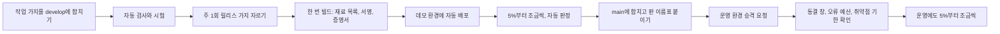

# 16. 바꾸고 내보내는 법: 배포와 변경 관리

> [← 15편: 공연이 끝난 뒤](15-analytics-and-decisions.md) | [목차로 돌아가기](README.md) | [17편: 화면 만들기 →](17-frontend.md)

---

## 1. 상황: 화요일 저녁 6시 45분, 방금 고친 코드를 지금 내보내도 될까

수진 씨는 피켓의 플랫폼 엔지니어다. 저녁 6시 45분, 어제 내보낸 판(1.4.0)에서 일부 손님의 결제 화면이 멈추는 버그를 고친 급한 수정(핫픽스 1.4.1)이 검사를 모두 통과하고 시연용 데모 환경에서도 확인을 마쳤다. 그런데 오늘 저녁 8시에 5만 석 콘서트의 티켓이 열린다.

수진 씨가 수정을 나간 판을 모으는 가지(`main`)에 합치자 1.4.1 이름표가 붙고, 운영 환경으로 내보내는 요청(승격 PR)이 자동으로 열린다. 그런데 그 요청에 검사 하나가 빨간불을 띄운다.

> **"변경 동결 창(18:30~21:00) 안입니다. 운영 승격은 21:00 뒤에 다시 시도하세요."**

코드는 저장소에 그대로 합쳐졌고 이름표도 붙었다. 막힌 것은 운영 환경으로 가는 길 하나다. 수진 씨는 9시 5분에 다시 올리고, 새 판은 손님의 5%에게 먼저 나간 뒤 이상이 없을 때마다 25%, 50%, 100%로 넓어진다.

같은 날 저녁 8시 12분, 관제실에서 이상이 보인다. 어제 내보낸 1.4.0 탓으로 보이는 결제 오류가 조금씩 늘고 있다. 사고 지휘를 맡은 민호 씨는 새 코드(1.4.1)를 넣는 대신 **어제 내보내기 전의 판(1.3.2)으로 되돌리기**로 결정한다. 동결 창 안에서도 되돌리기는 허용되지만 새 코드인 급한 수정은 허용되지 않는다. 되돌리기 요청에 '긴급 변경' 표시와 사고 번호를 붙이자 검사가 통과하고, 몇 분 뒤 모든 손님이 1.3.2를 쓴다. 1.4.1은 동결 창이 끝난 9시 5분에 나간다. 아래 숫자는 모두 측정 전의 설계 목표다.

---

## 2. 왜 어려운가: 바꾸는 순간이 가장 위험하다

| 어려움 | 왜 생기나 | 피켓의 해결 |
| :--- | :--- | :--- |
| **1. 장애의 큰 몫은 변경에서 나온다** | 구글은 운영 장애의 약 70%가 시스템을 바꾸는 일에서 나온다고 관찰했다 | 온세일 앞뒤로 운영 변경을 **장치로** 멈춘다(변경 동결 창) |
| **2. 오픈 시각이 공연마다 다르다** | 매일 같은 시각에 막는 고정 일정으로는 공연마다 다른 오픈을 지킬 수 없다 | 오픈 일정에서 동결 창을 자동으로 만드는 **변경 동결 달력** |
| **3. 배포 말고도 바뀌는 것이 많다** | 클라우드가 하는 DB 정비, 서버 자동 교체, 비밀번호 자동 교체도 변경이다 | 이런 일은 **새벽 정비 시간**에만 하게 시간을 정해 둔다 |
| **4. 두 버전이 함께 돈다** | 새 버전을 조금씩 내보내거나 되돌리는 동안에는 옛 버전과 새 버전이 같은 DB를 쓴다 | DB 구조는 **옛 버전과 새 버전이 함께 쓸 수 있게** 여러 번에 나눠 바꾼다 |
| **5. 만든 사람과 받은 물건을 믿을 수 있나** | 2025~2026년에 남이 만든 빌드 도구와 공개 패키지가 해킹돼 비밀을 훔친 사고가 여러 번 있었다 | 누가 어디서 만들었는지 **증명서를 붙이고**, 남의 도구는 정확한 판을 고정한다 |
| **6. 혼자 운영한다** | 두 사람이 확인해야 하는 절차도 실제로는 한 사람이 한다 | 사람 확인 대신 **자동 검사**가 막고, 이 한계를 기록한다 |
| **7. 다음 판 일과 급한 수정이 섞인다** | 다음 판에 넣을 기능을 만드는 중에 이미 나간 판에서 큰 결함이 나오면, 만들던 기능까지 함께 내보내기 쉽다 | 코드를 **가지로 나눈다**. 나간 판(`main`), 다음 판(`develop`), 급한 수정(핫픽스 가지)을 따로 두는 이 규칙을 git flow라고 한다 |

---

## 3. 어떻게 푸는가

### 3.1 한 번 만들어 같은 길로 보낸다

한 번 만든 결과물(이미지)을 데모와 운영에 똑같이 보낸다. 환경마다 다시 빌드하지 않으므로 '데모에서는 됐는데 운영에서는 다른 물건'이 생기지 않는다. `main`에 합칠 때 기록이 하나 새로 생기지만, 기계가 그 내용이 데모에서 확인한 것과 똑같은지 확인한 뒤에만 판 이름표를 붙이고 다시 빌드하지 않는다. 운영 환경에 무엇이 깔려 있는지는 사람이 서버에 들어가 바꾸는 것이 아니라, 저장소에 적힌 내용을 클러스터 안의 프로그램이 읽어 맞춘다.

### 3.2 조금씩 내보내고 자동으로 판정한다

새 버전은 손님의 5%, 25%, 50%에게 차례로 나가고, 단계마다 5분 동안 옛 버전과 나란히 비교한다. 이를 카나리 배포라고 한다. 옛날 탄광에서 카나리아로 유독 가스를 먼저 알아챘던 데서 온 이름이다.

| 비교하는 것 | 멈추는 조건(설계 목표) |
| :--- | :--- |
| 서버 오류 비율 | 새 버전이 옛 버전의 2배를 넘고 0.5%p 이상 높을 때 |
| 느린 쪽 1%의 응답 시간 | 새 버전이 옛 버전보다 20% 넘게 느릴 때 |
| 절대 깨지면 안 되는 약속(한 좌석 두 번 판매, 이중 결제, 차례 전 입장) | 한 건이라도 생길 때 |

조건에 걸리면 사람을 기다리지 않고 바로 옛 버전으로 100% 돌아간다. 다만 이 비교는 평소 손님으로 하므로, 수십만 명이 몰릴 때만 나타나는 문제는 따로 하는 부하 시험이 맡는다.

### 3.3 온세일 앞뒤로는 바꾸지 않는다

| 공연 규모 | 무엇을 막나 | 언제 |
| :--- | :--- | :--- |
| 대형·중형(대기 10만 명 이상) | 프로그램, 설정, DB, 서버 구성 등 모든 운영 변경 | 오픈 90분 전부터 오픈 60분 뒤까지 |
| 소형(대기 10만 명 미만) | 대기열과 구매를 맡은 핵심 서버의 변경 | 오픈 50분 전부터 오픈 60분 뒤까지 |

왜 90분 전부터일까. 조금씩 내보내는 데 최대 40분이 걸리고, 오픈 30분 전 점검 때는 '진행 중인 배포가 하나도 없음'이 확인돼야 하기 때문이다. 점검 15분 전까지 끝나지 않은 배포는 자동으로 멈추고 옛 버전으로 돌아간다.

동결 창은 **변경 동결 달력**이 만든다. 판매가 승인된 공연의 오픈 시각과 규모를 10분마다 읽어 앞으로 7일 치 창을 저장소에 적고, 배포 도구와 서버 자동 교체 도구가 그 창을 읽는다. 달력이 고장 나도 이미 걸어 둔 7일 치 창은 그대로이고, 오래 고장 나면 운영 배포 자체를 막는다. 막혀서 생기는 손해(배포가 늦어짐)가 열려서 생기는 손해(온세일 중 배포)보다 작기 때문이다.

클라우드가 스스로 하는 일도 시간을 정해 둔다. 서울 리전의 기본값으로 두면 DB 정비가 밤 10시에서 아침 6시 사이, 캐시 정비가 밤 9시에서 아침 5시 사이 아무 때나 잡혀 저녁 오픈과 겹칠 수 있다. 그래서 클라우드 DB·캐시 정비는 수요일 새벽 4시(DB 30분, 캐시 1시간)로 고정하고, 오픈 앞뒤 동결 창이 이 정비와 겹치지 않게 수요일 03:00~06:30에는 오픈을 막는다. 03:00에 열면 오픈 뒤 60분이 정비 전에 끝나고, 06:30에 열면 대형·중형의 오픈 90분 전 동결 창이 정비가 끝난 뒤 시작되기 때문이다. 무거운 DB 작업이나 서버 교체는 **매일 새벽 4시에서 6시**(정비 시간)에 한다. 이 시간은 오픈을 막지 않는 대신, 대형·중형 공연의 동결 창과 겹치는 날이면 그날 정비를 건너뛴다. 메시지 전달 장치(Kafka)는 정비 시각을 고를 수 없어 남는 위험으로 기록했다.

### 3.4 되돌릴 수 있게 바꾼다

- **프로그램**: 바로 앞 버전 몇 개는 남겨 두어, 되돌릴 때는 단계별 비교 없이 곧바로 돌아간다. 결정부터 완료까지 5분 안이 목표다.
- **DB 구조**: 거꾸로 되돌리지 않고 앞으로만 간다. 대신 바꿀 때마다 옛 버전과 새 버전이 함께 쓸 수 있게 한다. 예를 들어 열 이름을 바꿀 때는 새 열을 먼저 더하고(확장), 두 열에 같이 쓰며 옛 값을 옮긴 뒤(이전), 일주일 넘게 지나 옛 열을 지운다(축소). 그래서 프로그램을 되돌려도 DB와 어긋나지 않는다.
- **무거운 DB 작업**: 큰 표에 색인을 만드는 일처럼 오래 걸리는 작업은 새벽 정비 시간에 하고, 다른 요청을 3초 넘게 막을 것 같으면 스스로 물러난다.

### 3.5 누가 만들었는지 증명한다

| 장치 | 하는 일 |
| :--- | :--- |
| 재료 목록(SBOM) | 결과물에 들어간 라이브러리 목록. 새 취약점이 나오면 어느 서버에 들었는지 바로 찾는다 |
| 서명과 증명서 | 어느 저장소의 어느 코드를 어떤 빌드 절차가 만들었는지 서명해 붙인다. 서명이 없는 결과물은 운영에서 실행되지 않는다 |
| 판 고정 | 남이 만든 빌드 도구는 이름표가 아니라 정확한 판(고유 번호)으로 부른다. 2025년과 2026년에 유명 도구의 이름표가 악성 판으로 바뀐 사고가 있었다 |
| 3일 기다리기 | 공개 패키지의 새 판은 나온 지 3일 뒤에 받는다. 해킹된 판은 대개 며칠 안에 드러나 내려진다 |
| 취약점 기한 | 아주 위험한 취약점은 7일, 위험한 것은 30일 안에 고친다. 넘기면 운영에 내보낼 수 없다 |

증명서는 '어디서 어떻게 만들었나'를 증명할 뿐 '코드가 안전하다'를 증명하지는 않는다.

### 3.6 설정은 세 가지로 나눈다

| 종류 | 예 | 바꾸는 방법 | 온세일 중 |
| :--- | :--- | :--- | :--- |
| 고정 설정 | 연결 주소, 서버 수 | 배포 | 바꾸지 않음 |
| 운영 조절값 | 동시 입장 인원, 입장 일시정지, 결제사 바꾸기 | 관제 명령(감사 기록, 명령별 1인·2인 승인) | 바꿀 수 있음(이것이 목적) |
| 공개 스위치 | 새 화면 공개 | 저장소의 스위치 파일 | 바꾸지 않음(끄기만 긴급 변경) |

온세일 중에 바꿔야 하는 값은 모두 관제 명령으로 만든다. 길이 두 개면 누가 무엇을 바꿨는지 기록이 갈라진다.

### 3.7 코드는 가지를 나눠 관리한다(git flow)

피켓의 코드는 git flow라는 규칙으로 여러 갈래(가지)에 나눠 관리한다. 다음 판을 만드는 일과 이미 손님에게 나간 판을 고치는 일이 섞이지 않게 하려는 것이다.

| 가지 | 하는 일 | 언제 합치나 |
| :--- | :--- | :--- |
| `main` | 손님에게 나간 판만 모은다. 합칠 때마다 판 이름표(예: v1.5.0)가 붙는다 | 릴리스 가지와 핫픽스 가지만 받는다 |
| `develop` | 다음 판에 들어갈 기능을 모은다 | 작업 가지가 끝날 때마다, 하루에도 여러 번 |
| 작업 가지(`feature/…`, `bugfix/…`) | 기능 하나나 버그 하나를 만든다 | 끝나면 `develop`에 커밋 하나로 합친다. 하루 한 번 이상 합칠 수 있게 작게 나누고, 3일을 넘기면 자동 검사가 경고한다 |
| 릴리스 가지(`release/…`) | 주 1회 `develop`을 잘라 다음 판을 만들고, 버그 수정만 받으며 데모에서 확인한다 | 확인이 끝나면 `main`에 합치고 `develop`에도 돌려 넣는다(역병합) |
| 핫픽스 가지(`hotfix/…`) | 손님에게 나간 판의 큰 결함을 다음 판을 기다리지 않고 고친다 | 데모 확인 뒤 `main`에 합치고 `develop`에도 돌려 넣는다. 만드는 중인 릴리스 가지가 있으면 그쪽에 넣는다 |

- 판 이름표는 사람이 아니라 정해진 봇만 붙이고, 한 번 붙인 이름표는 옮기거나 지우지 못한다.
- 핫픽스도 동결 창 안에서는 운영에 내보내지 않는다. 그동안은 옛 판으로 되돌리기와 공개 스위치 끄기로 버틴다(1절의 민호 씨처럼).
- 배포 설정(무엇을 어느 환경에 띄울지)은 `deploy/` 폴더에 두고, 배포 프로그램은 `develop` 가지의 것만 읽는다. 합치는 순간이 곧 배포라서, 여러 가지에서 읽으면 같은 환경의 설정이 두 벌이 되기 때문이다.
- 저장소는 둘이다. 문서·코드·배포 설정·부하 시험·빌드 절차를 모두 저장소 하나(`peaket`)에 폴더로 나눠 담는다. 이런 방식을 모노레포라고 한다. 따로 두는 것은 봇 흉내 프로그램을 담은 비공개 저장소(`peaket-bots`) 하나뿐이다. 봇 코드는 공개하면 안 되기 때문이다. 처음에는 빌드 절차와 배포 설정도 따로 두려 했지만, 포트폴리오에서는 읽는 사람이 저장소를 오가지 않고 따로 검토할 사람도 없어 하나로 모았다(소유자 결정 2026-10-30, ADR-0169).
- 저장소 수는 서비스를 나눈 이유와 상관없다(서비스는 부하와 실행 방식이 달라서 나눴다). 한곳에 모으면 읽는 사람이 문서와 코드를 함께 보고, 저장소 하나만 받아 접속 열쇠(토큰) 없이 바로 빌드할 수 있다. 팀의 경계는 폴더마다 코드 주인을 정해서 보인다. 한 번의 변경으로 서버와 화면 사이의 약속(계약)과 양쪽 코드를 함께 고칠 수 있지만, 이미 손님에게 나간 판과 맞지 않게 바꾸면 자동 검사가 막는다. 서버는 하나씩 따로 배포되므로 한동안 옛 판과 새 판이 함께 돌기 때문이다(소유자 결정 2026-10-30, docs/devops.md §2.1).

---

## 4. 규칙

| 규칙 | 내용 |
| :--- | :--- |
| 작게 자주 | 코드는 하루 한 번 이상 `develop`에 합치고, 작업 묶음은 이틀을 넘기지 않는다. 운영에는 주 1회 판(릴리스)과 급한 수정(핫픽스)으로 내보낸다 |
| 가지 규칙(git flow) | `main`은 나간 판, `develop`은 다음 판이다. 작업 가지는 커밋 하나로 합치고, 릴리스·핫픽스 가지는 합친 기록을 남긴다. 판 이름표는 봇만 붙인다 |
| 같은 결과물 | 한 번 빌드한 결과물만 데모와 운영에 보낸다. `main`에 합친 뒤에도 다시 빌드하지 않는다 |
| 동시에 하나 | 한 환경에서 조금씩 내보내는 배포는 한 번에 하나만 한다 |
| 운영 승격 조건 | 데모에서 자동 판정 통과, 데모에서 1시간 이상, 오류 예산이 남음, 동결 창 밖, 기한 넘긴 취약점 없음, 서버와 화면 사이의 약속(계약) 시험 통과 |
| 동결 중 허용 | 옛 버전으로 되돌리기, 공개 스위치 끄기, 관제 명령, 미리 만든 '자동 증설 멈춤' 설정 적용(RB-30). 새 코드는 온세일이 끝난 뒤 |
| 정비 시간 | 무거운 DB 작업, 서버 교체, 클라우드 정비는 새벽 4시에서 6시. 대형·중형 동결 창과 겹치는 날은 건너뛴다. 클라우드 DB·캐시 정비는 수요일 새벽 4시라 수요일 03:00~06:30에는 오픈을 막는다 |
| 사람의 운영 접근 | 운영 서버와 DB에 사람이 늘 쓸 수 있는 권한은 없다. 긴급 접근은 쓰는 순간 경보가 울린다 |
| 비용 | 측정용 환경은 정한 시간이 지나면 자동으로 지워진다 |

---

## 5. 솔직한 한계

| 한계 | 대응 |
| :--- | :--- |
| 혼자 운영해 '두 사람 확인'이 실제로는 한 사람의 확인이다 | 자동 검사가 막게 하고, 팀이 생기면 승인 인원을 늘린다 |
| 조금씩 내보내며 비교하는 일은 평소 손님으로만 한다 | 수십만 명 규모의 문제는 따로 하는 부하 시험이 맡는다 |
| 증명서는 코드가 안전하다는 뜻이 아니다. 2026년 5월에는 훔친 토큰으로 진짜 증명서가 만들어진 공격도 있었다 | 권한을 최소로 하고, 재료 목록으로 사후에 빨리 찾는다 |
| 메시지 전달 장치의 클라우드 정비 시각은 고를 수 없다 | 정비가 겹치면 최대 약 2분 동안 느려질 수 있다. 거래는 다시 보내기로 흡수하고, 관제 화면 지연은 남는다 |
| 공연이 아주 많아지면(3년차) 핵심 서버의 배포가 밤과 아침으로 몰린다 | 배포 가능한 시간이 하루 8시간 아래로 줄면 동결 단위를 줄이는 설계를 다시 본다 |
| 운영 환경을 실제로 켜 두지 않아, 운영 전용 절차는 연습으로만 검증된다 | 장애 연습(Game Day)으로 확인한다 |
| 코드를 저장소 하나에 모아서 출시 가지도 하나다. 한 서비스의 출시가 막히면 다른 서비스의 출시도 함께 기다린다. 저장소에 쓸 수 있는 권한도 모든 서비스 코드에 걸친다 | 공개 스위치와 급한 수정(핫픽스)으로 버틴다. 빌드·서명 절차를 검토한 판으로 고정하고 출시 가지에 조건을 걸어 권한 위험을 줄인다(소유자 결정 2026-10-30) |
| 시연용 데모를 늘 켜 두지 않는다. 보는 사람이 언제든 눌러 볼 수 있는 주소가 없다 | 녹화 영상과 누구나 따라 할 수 있는 재현 스크립트로 보여 주고, 면접·발표 때만 몇 시간 띄운다(소유자 결정 2026-10-13) |
| git flow로 판 단위(대개 주 1회)로 내보내므로, 코드를 합친 뒤 손님에게 닿기까지 며칠이 더 걸릴 수 있다. 연구(DORA)는 가지를 적게 두고 하루 한 번 이상 한 줄기에 합치는 팀의 성과가 높다고 보고하는데, git flow는 늘 있는 가지가 둘이고 출시 전 확인 기간이 있어 이와 다르다 | 작업 가지를 작게 자주 합치고 릴리스 가지를 3영업일 안에 끝낸다. 걸리는 시간을 추세로 보고, 너무 길어지면 더 단순한 방식으로 바꾸는 것을 다시 검토한다(소유자 결정 2026-10-20) |

---

## 6. 한 줄 요약

> **코드는 git flow로 다음 판과 나간 판을 나눠 관리하고, 한 번 만든 결과물을 같은 길로 조금씩 내보내며 자동으로 판정하고, 온세일 앞뒤로는 달력이 만든 동결 창으로 운영 변경을 장치로 멈추며, DB는 옛 버전과 새 버전이 함께 쓸 수 있게 여러 번에 나눠 바꾸고, 누가 어디서 만들었는지는 증명서로 남긴다.**

---

## 더 알아보기

* [docs/devops.md §2, §3](../devops.md): 저장소 둘과 공개 범위, 가지 규칙(git flow), 공용 검사와 시험 배치
* [docs/devops.md §4](../devops.md), [ASVS 추적 표](../security/asvs/delivery.md): 재료 목록, 서명, 증명서, 취약점 기한
* [docs/devops.md §5, §6](../devops.md): 승격 흐름, 설정 세 가지, 서버 종류별 배포 방법과 되돌리기
* [docs/devops.md §7](../devops.md): DB 구조를 여러 번에 나눠 바꾸는 방법
* [docs/devops.md §8](../devops.md), [POL-028·POL-041](../planning/03-policies-glossary.md): 변경 동결 창, 동결 달력, 정비 시간, 긴급 변경
* [ADR-0054](../adr/0054-delivery-pipeline-change-freeze-and-safe-deploys.md): 이 설계를 정한 결정과 검토한 대안
* [ADR-0074](../adr/0074-git-flow-branching-release-and-hotfix.md): 가지 규칙을 git flow로 바꾼 결정과 그 대가
* [14편: 서버 구조와 운영](14-architecture-and-ops.md): 서버를 왜 이렇게 나눴나
