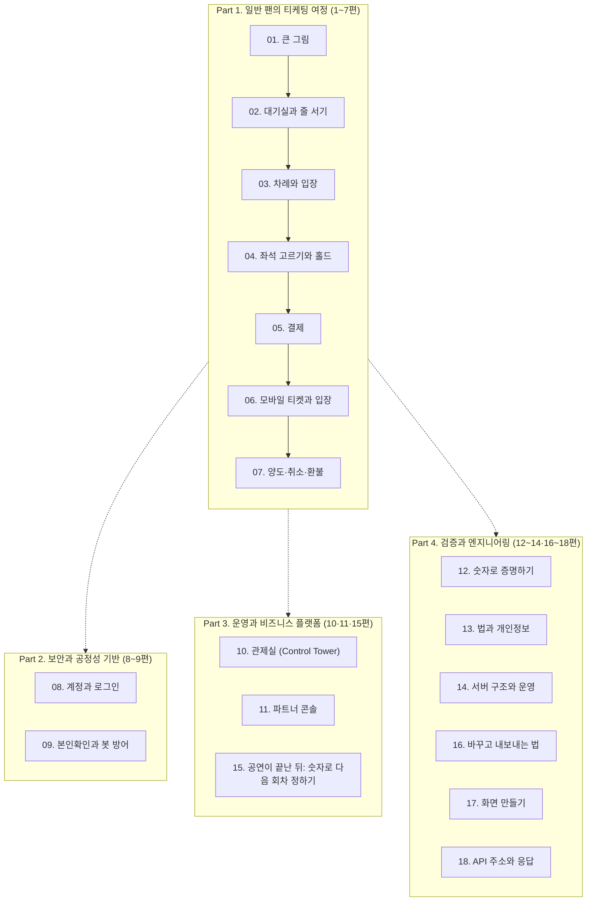

# 쉬운 설명서: 피켓(PEAKET)이 푸는 문제들

- **독자와 용도**: 설계 문서를 처음 접하는 독자, 기술 면접관, 그리고 프로젝트 이해관계자가 "피켓이 왜, 어떻게 만들어졌는지"를 복잡한 전문 용어 없이 한눈에 파악할 수 있도록 돕는다. 각 편은 하나의 핵심 주제를 `[상황 → 왜 어려운가 → 어떻게 푸는가 → 규칙 → 한 줄 요약]` 흐름으로 알기 쉽게 풀어낸다.
- **원본은 명세서다**: 이 설명서는 쉬운 이해를 돕기 위한 해설서이며, 모든 수치와 규칙의 공식 기준은 기획(`docs/planning/`) 및 설계(`docs/`) 문서다. 만약 본 설명서의 내용과 기술 명세가 엇갈린다면 기술 명세가 우선하며, 설명서를 명세에 맞춰 수정한다. 각 편 마지막의 '더 알아보기'에서 원본 명세 위치를 확인할 수 있다.
- **기준 기획 버전**: v1.0. 처음 작성은 2026-10-10이고, 그 뒤의 결정은 각 편에 날짜와 결정 기록(ADR)으로 적었다.

---

## 🗺️ 18편 전체 안내도 (로드맵)

---

## 📖 전체 목차 및 읽는 순서

| 순서 | 편 제목 | 핵심 내용 한 줄 요약 | 바로가기 |
| :---: | :--- | :--- | :---: |
| **1** | **큰 그림: 무엇을 왜 만드나** | 100만 명이 몰려도 끄떡없고 오버셀 없이 공정하게 판매하는 전체 설계 | [01편 읽기](01-big-picture.md) |
| **2** | **대기실과 줄 서기** | 공정 무작위 추첨과 CDN 캐시 전광판으로 100만 명 요청을 초당 1,000건으로 통제 | [02편 읽기](02-waiting-room.md) |
| **3** | **차례와 입장** | 좌석 화면에는 5,000명만 유지하고 시스템 부하에 따라 속도를 자동 제어 (AIMD) | [03편 읽기](03-admission.md) |
| **4** | **좌석 고르기와 홀드** | 1,000명이 동시 클릭해도 0.05초 만에 1명만 홀드하고 7분 내 미결제 시 즉시 회수 | [04편 읽기](04-seat-hold.md) |
| **5** | **결제** | DB 판매 예약(PENDING) 후 PG사 승인 호출로 이중 결제와 유령 결제를 막고, 결제가 된 표는 환불하지 않고 끝까지 다시 발급함 | [05편 읽기](05-payment.md) |
| **6** | **모바일 티켓과 공연장 입장** | 휴대폰 안 키로 서명한 15초 회전 QR과 인터넷이 끊겨도 0.15초 만에 위조를 판정하는 오프라인 게이트 | [06편 읽기](06-ticket-and-gate.md) |
| **7** | **양도·취소·환불** | 받는 사람이 받아야 넘어가는 양도, 결제한 사람에게만 하는 취소·환불, 정책 밖 환불과 회차 취소는 다른 사람의 승인 | [07편 읽기](07-transfer-cancel-refund.md) |
| **8** | **계정과 로그인** | 비밀번호 없는 소셜 로그인, OIDC `sub` 기반 동일 이메일 연동 및 계정 병합 | [08편 읽기](08-account.md) |
| **9** | **본인확인과 봇 방어** | 휴대폰 본인확인 1인 1계정, 다차원 위험 점수와 통과하면 원래 순번으로 돌려주는 추가 검증 큐 | [09편 읽기](09-identity-and-bots.md) |
| **10** | **관제실 (Control Tower)** | 예산 30%를 쓰기 전에 울리는 경보, 12대 비상 명령, 2인 승인제와 Degraded Mode, 보안 사고 법정 기한, 지표로 판단하는 법 | [10편 읽기](10-control-tower.md) |
| **11** | **파트너 콘솔** | 5단계 등록 마법사, 오픈 시각 충돌 방지 간격 제약, 개인정보 다운로드 감사, 결제사가 직접 보내는 정산 지급 | [11편 읽기](11-partner-console.md) |
| **12** | **숫자로 증명하기** | 처음 만들 법한 v0 vs 개선된 v1 동일 조건 실측(합격은 목표 숫자로), 100만은 나눠 재고 '외삽'으로 밝히기, 작은 범위의 모든 순서로 하는 규칙 검사, 원본을 남기는 성능 장부 | [12편 읽기](12-measure-and-prove.md) |
| **13** | **법과 개인정보** | 피켓은 판매자가 아니라 중개자, 개정 공연법 부정구매 방지 의무, 개인정보 최소 수집, 5단계 법률 메타데이터 | [13편 읽기](13-law-and-privacy.md) |
| **14** | **서버 구조와 운영** | 10대 마이크로서비스, 5대 전용 게이트웨이, Polyglot 저장소, 재해 복구(DR) | [14편 읽기](14-architecture-and-ops.md) |
| **15** | **공연이 끝난 뒤: 숫자로 다음 회차 정하기** | 실시간 숫자는 지금 개입에만, 사업 결정은 단계별로 확정된 숫자로. 브론즈·실버·골드 층, 사실과 차원, 결정 기록 | [15편 읽기](15-analytics-and-decisions.md) |
| **16** | **바꾸고 내보내는 법: 배포와 변경 관리** | 코드는 git flow로 다음 판과 나간 판을 나눠 관리, 한 번 만든 결과물을 조금씩 내보내며 자동 판정, 온세일 앞뒤는 달력이 만든 동결 창, DB는 옛 버전과 함께 쓰게 나눠 바꾸기, 누가 만들었는지 증명서 | [16편 읽기](16-change-and-deploy.md) |
| **17** | **화면 만들기: 100만 명이 여는 화면을 가볍고 안전하게** | 대기실은 화면 라이브러리 없이 미리 만든 가벼운 파일로, 좌석 지도는 화면 뒤 일꾼이 바뀐 좌석만, 결제는 다녀와도 꺼낼 수 없는 키로 이어 서명, 티켓·스캐너는 인터넷 없이, 저장할 것과 허용할 출처는 화면마다 표로 | [17편 읽기](17-frontend.md) |
| **18** | **API 주소와 응답: 주소만 보고 무엇을 하는지 알게** | 주소는 명사만, 하는 일은 HTTP 메서드로, 모음은 복수형·깊이는 2단계까지, 목록은 책갈피로 나누고, 성공과 실패는 상태 코드와 한 모양의 오류 쪽지로 알린다. 규칙은 문서 점검 도구가 지킨다 | [18편 읽기](18-api-rules.md) |

---

## 💡 이 설명서에서 쓰는 주요 개념과 이름

| 이름 | 뜻과 역할 |
| :--- | :--- |
| **지민 씨** | 설명서에 등장하는 가상의 예매자. 콘서트 티켓을 사려는 평범한 보통 사용자 |
| **온세일 (On-sale)** | 티켓 오픈 직전부터 직후까지 트래픽이 폭발하는 구간. 오픈 10분 전부터 60분 뒤까지 **총 70분의 피크 시간대** |
| **대기실** | 오픈 전의 로비(Lobby)와 오픈 뒤의 대기열(Queue)을 합친 대기 단계 전체. 오픈 전만 가리킬 때는 '로비'라고 하며, 로비에서는 순번이 매겨지지 않는다. |
| **대기열 (Queue)** | 오픈 시각에 정식 순번을 배정받고 자기 차례를 기다리는 줄 |
| **공연 (회차 묶음)** | 같은 파트너가 같은 공연장에서 같은 좌석 배치로 여는 회차의 묶음. 공연명·아티스트·이미지·판매 승인·찜·후기 보기·랭킹의 단위다(2026-10-27) |
| **회차** | 공연의 한 번(날짜·시각). 대기열·좌석·주문·결제·티켓·정산서의 단위다. API의 `eventId`는 회차를 가리킨다 |
| **공연장** | 공연이 열리는 실제 장소. 이름·주소·다른 이름은 피켓 운영자가 관리한다. 파트너가 그리는 좌석맵(배치본)과는 다른 것이다 |
| **다른 이름 (별칭)** | 공연·아티스트·공연장의 영문 표기나 옛 이름. 검색에만 쓰고 화면에 보이는 이름은 바꾸지 않는다 |
| **사람 확인** | 봇이나 매크로가 아닌 실제 사람인지 가려내는 과정. Cloudflare Turnstile을 활용해 무클릭으로 통과 |
| **홀드 (Hold)** | 결제 단계로 넘어가기 전, 선택한 좌석을 다른 사람이 건드리지 못하게 7분 동안 임시로 잡아 두는 상태 |
| **결제 시도** | 결제창을 한 번 여는 일. 결제창을 열 때마다 어느 결제사(토스페이먼츠·포트원)로 결제할지 정한다 |
| **결제사 전환** | 결제사에 장애가 나면 운영자 두 명이 승인해 새 결제를 다른 결제사로 보내는 것. 이미 접수된 결제는 원래 결제사에서 끝낸다 |
| **통신판매중개자** | 판매자(기획사)가 피켓에서 표와 상품(굿즈·부가 상품)을 팔게 해 주는 피켓의 법적 지위. 공연과 상품의 책임은 판매자에게, 예매·주문 취소와 환불 처리는 피켓에 있다 |
| **양도 요청·돌려주기** | 결제한 사람이 다른 회원에게 표를 넘기겠다고 보내는 요청(받는 사람이 받아야 넘어감)과, 받은 사람이 결제한 사람에게 표를 되돌리는 일 |
| **승인 업무** | 정책 밖으로 돈이나 표가 움직일 때 요청한 사람과 다른 사람이 확인하는 일. 금액과 경우에 따라 1명 또는 2명이 승인한다 |
| **CS 처리함** | 결제 확인 지연, 환불 실패, 문의·분쟁처럼 사람이 판단할 건을 처리 기한과 함께 모아 두는 운영 화면 |
| **지급대행** | 결제사가 피켓 대신 파트너 정산 계좌로 표 값을 보내는 일. 피켓은 표 값을 받아 두지 않는다 |
| **정산서** | 회차와 결제사마다 판매 대금, 환불, 수수료, 지급액을 적은 문서. 파트너는 2영업일 안에 이의를 낼 수 있다 |
| **희망 조건** | 자동 배정 공연에서 차례가 오기 전에 미리 적어 두는 원하는 등급과 매수 (차례 도래 시 0초 자동 배정) |
| **관제 콘솔** | 온세일 동안 시스템 상태를 실시간 모니터링하고 트래픽을 제어하는 운영자용 콘솔 (Control Tower) |
| **파트너** | 티켓을 공급하고 판매 정책을 결정하는 공연 기획사·프로모터 |
| **현장 스태프** | 공연 당일 게이트 입구에서 모바일 바코드/QR 스캐너로 입장권을 검표하는 현장 운영 인력. 파트너가 회차별로 초대하고, 스태프는 자기 피켓 계정으로 받아 운영자가 등록한 스캐너를 휴대폰으로 승인해 쓴다 |
| **현장 책임자** | 현장 스태프 가운데 스캐너의 구역 배치, 예외 통과, 이상 표시 확인, 부스 재발급 허용을 맡는 사람 |
| **공연 리포트** | 공연이 끝난 뒤 확정된 숫자로 만드는 회차별 결과 보고서. 숫자마다 잠정·확정이 붙고, 걸린 결정 규칙과 지난 결정의 효과를 함께 보여 준다 |
| **마감 단계** | 공연 리포트의 숫자가 확정되는 순서. 온세일 윈도우가 끝나고 30분 뒤(오픈 90분 뒤) 잠정(R0), 다음 영업일(R1), 오픈 7일 뒤(R2), 공연 다음 영업일(R3) |
| **입장 기록 마감** | 공연이 끝난 뒤 모든 스캐너의 입장 기록이 모였다고 보고 닫는 일. 이때까지 양도 받기와 돌려주기를 멈추고, 입장 시작 뒤 취소한 표의 환불을 미룬다 |

각 용어의 공식 정의와 영문 표기는 [docs/planning/03-policies-glossary.md §4](../planning/03-policies-glossary.md) 용어 사전에서 확인할 수 있습니다.

2026-10-27부터 '공연'은 회차의 묶음을 뜻합니다([ADR-0093](../adr/0093-production-entity-place-artist-units.md)). 이 설명서의 그 전 문장에서 회차를 '공연'이라고 적은 곳(예: '공연별 동시 입장 목표')은 회차로 읽습니다. 단위가 기술 규칙을 바꾸는 문장(대기표에 든 값, 결제사 지정, 사건 순서, 주소)은 '회차'로 고쳤습니다.
