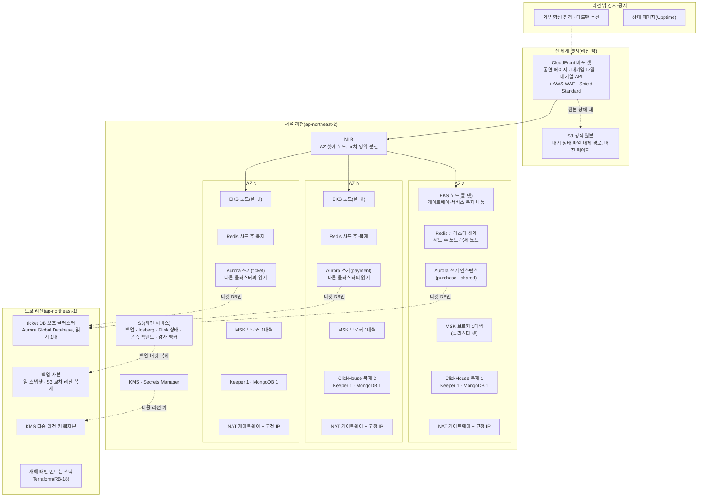
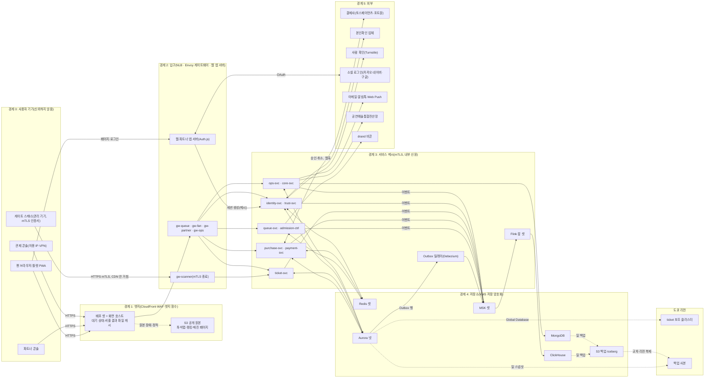
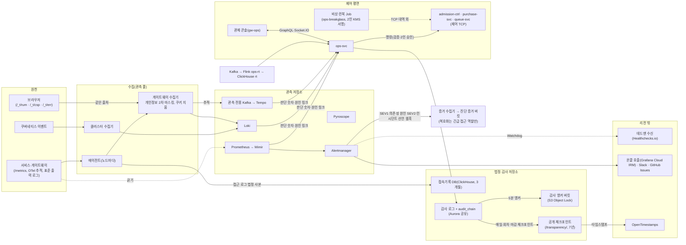

# 인프라·관제팀 인수 문서

- **독자와 용도**: 운영 환경을 만드는 인프라팀과, 공연 당일과 평소에 시스템을 지키는 관제팀이 처음 받는 문서다. 서버 사양, 이중화 구성, 데이터 흐름, 장애 때 할 일, 데이터 위치와 변경 권한, 처음 볼 곳을 한곳에 모았다. 세부와 근거는 표마다 적은 정본 문서에 있다.
- **원본 출처**: 2026-10-22 소유자 요청으로 새로 만든 문서다. 소유자가 멘토의 문서 구성 기준(인프라 문서는 서버 사양 명세서, 데이터 흐름도, 이중화 구성도, 이중화 실행 계획서, 구성 요소별 가용성·네트워크·저장 요구)으로 점검을 맡겼고, 점검 결과를 본 뒤 "충돌이 없는 새 문서부터 추천 순서대로 보완해 주세요"라고 했다. 이미 정한 값은 docs/infra.md, docs/architecture.md, docs/devops.md, docs/observability.md, docs/data.md, docs/streaming.md, docs/security/secrets-and-keys.md, planning/03-policies-glossary.md에서 옮겼다.
- **기준 기획 버전**: v1.0. 작성 2026-10-22.
- **표시 규칙**:
  - 대수, 복구 목표, 보존 기간, 경보, 런북처럼 이미 정한 값은 정본에서 그대로 옮겼다. 정본이 바뀌면 이 문서도 고친다. 표의 '근거' 열이 정본 위치다.
  - 이 문서에서 처음 정한 것(인스턴스 계열과 크기, 저장소의 가용 영역 배치, NAT 배치, 가용성 등급, 키 관리 권한, 도쿄 전환 준비)은 추천 적용(2026-10-22)이다. 서버 사양은 아직 재지 않았으므로 가정 표시를 붙이고, 측정(wbs 2.12.1 성능 장부 → 4.8.1 비용 측정 → 6.4.1 용량 산정서)으로 바꾼다.
  - 포트폴리오 기간에는 운영 환경을 띄우지 않는다(소유자 결정 2026-10-13, ADR-0057). 이 문서는 운영 설계이고, 시험은 로컬 측정 환경과 모의 진행으로 한다(docs/verification.md §5).

## 1. 한눈에

- 운영 환경은 AWS 서울 리전(클라우드 데이터센터가 모인 지역) 하나에서 돌고, 그 안의 가용 영역(같은 리전 안에서 전기·네트워크가 따로인 데이터센터 묶음, 이하 AZ) 셋에 나눠 둔다. 도쿄 리전에는 티켓 DB의 읽기 복제본과 백업 사본만 둔다(docs/infra.md §1, ADR-0031·0083).
- 사람이 몰리는 길은 CloudFront(사용자 가까운 곳에 파일을 복사해 두고 대신 응답하는 AWS의 CDN) → NLB(들어온 연결을 여러 서버에 나눠 주는 AWS 장치) → Envoy 게이트웨이(클라이언트 종류별 입구 서버) → 서비스다. 현장 스캐너만 CDN을 거치지 않고 NLB로 바로 온다.
- 서비스는 EKS(AWS가 운영해 주는 쿠버네티스, 즉 컨테이너로 만든 앱을 여러 서버에서 실행·관리하는 플랫폼)의 노드 풀(같은 용도의 서버 묶음) 넷에서 돈다. 핫패스(요청이 가장 많이 지나는 경로), 일반, 데이터, 관측이다.
- 저장소는 AWS 관리형 Aurora PostgreSQL 클러스터 넷, ElastiCache(Valkey/Redis) 클러스터 셋, MSK(AWS가 운영해 주는 Kafka) 클러스터 셋, S3와, 클러스터 안에서 직접 운영하는 ClickHouse와 MongoDB다.
- 장애 대응의 기본: 같은 리전 안의 장애는 자동으로 넘긴다(Aurora 5분, Redis 30초 안). 리전 전체가 멈추면 자동 전환하지 않고, 사람이 판매를 멈춘 뒤 도쿄에서 24시간 안에 복구한다(docs/infra.md §6).
- 읽는 순서: §2 그림 → §3 사양 표 → §5 장애 때 할 일 → §7 처음 볼 곳. 관제팀은 §7과 §8부터 봐도 된다.

## 2. 이중화 구성도

이중화는 장비 하나가 고장 나도 서비스가 멈추지 않게 같은 것을 둘 이상 두는 구성이다. 아래 그림은 AZ별 배치와 도쿄 리전을 보인다. 서비스의 연결 관계는 docs/infra.md §1의 배포 구성도가 정본이다.

- **배치 규칙(추천 적용 2026-10-22)**:
  - Redis 클러스터는 샤드마다 주 노드와 복제 노드를 서로 다른 AZ에 두고, 샤드 셋의 주 노드를 AZ 셋에 하나씩 나눈다 [가정]. AZ 하나가 멈춰도 그 AZ의 주 노드만 다른 AZ의 복제 노드로 넘어간다.
  - Aurora 클러스터는 쓰기 인스턴스와 읽기 인스턴스를 서로 다른 AZ에 두고, 클러스터 넷의 쓰기 인스턴스를 AZ 셋에 나눈다(위 그림의 배치는 예다) [가정]. AZ 하나가 멈춰도 모든 클러스터가 한꺼번에 전환되지 않게 하려는 것이다.
  - MSK는 클러스터마다 브로커 셋을 AZ 셋에 하나씩 둔다(docs/infra.md §4 정본).
  - ClickHouse 복제 둘은 서로 다른 AZ에, 복제를 조율하는 ClickHouse Keeper 셋과 MongoDB 복제 세트 셋은 AZ 셋에 하나씩 둔다 [가정].
  - NAT 게이트웨이(서버가 밖으로 나가는 길)는 AZ마다 하나씩 고정 IP와 함께 두고, 결제사 방화벽 허용 목록에 세 IP를 모두 등록한다 [가정, 결제사 계약 때 확인]. 지금 정본(docs/infra.md §9)은 '전용 NAT 게이트웨이의 고정 IP'라고만 적어, NAT 하나면 그 AZ가 멈출 때 결제 호출이 끊긴다.
- EKS 제어 평면, CloudFront, S3, KMS, Secrets Manager는 AWS가 여러 AZ에 나눠 운영하는 서비스라 따로 배치하지 않는다.

## 3. 구성 요소별 사양·가용성·네트워크·저장

### 3.1 노드 풀(EKS)

Karpenter(필요한 만큼 서버를 붙이고 떼는 도구)가 노드를 만든다. 아래 인스턴스는 NodePool이 허용할 계열과 기본 크기다. 모두 AWS Graviton(arm64)이고, 서울·도쿄 리전에서 쓸 수 있음을 AWS 문서로 확인했다(2026-10-22). 선택 보정 측정(docs/verification.md §6)이 같은 계열의 c7g.xlarge를 쓰므로 측정값을 그대로 옮겨 쓰기 쉽다.

| 노드 풀 | 실행하는 것 | 인스턴스(초기 추정) | 구매 방식 | 배치·최소 대수 | 근거 |
| --- | --- | --- | --- | --- | --- |
| 핫패스 | Envoy 게이트웨이 프록시 다섯(gw-queue·gw-fan·gw-partner·gw-ops·gw-scanner), queue-svc, admission-ctrl, purchase-svc, realtime-gw, 웹 앱 서버(Next.js) | c7g 계열. 기본 c7g.2xlarge(8 vCPU·16GiB), xlarge~4xlarge 허용 [가정, wbs 2.12.1 측정에서 확정] | 온디맨드(정가로 계속 쓰는 서버)만. Kyverno가 핫패스 네임스페이스의 Spot을 막는다 | AZ 셋에 고르게. 게이트웨이 유형마다 최소 3, purchase-svc 최소 3, admission-ctrl은 리더 1 + 대기 2. 피크 대수는 측정 전 | docs/infra.md §4·§5, docs/devops.md §5.2, docs/architecture.md §9.5 |
| 일반 | identity·payment·ticket·trust·ops·core 서비스와 notify 워커, 파트너 앱 서버, 클러스터 애드온(ArgoCD·Kyverno·KEDA·메시 제어 평면 등), 비상 런북 Job | m7g 계열. 기본 m7g.xlarge(4 vCPU·16GiB) [가정] | 온디맨드. notify 워커만 Spot(싸지만 회수될 수 있는 서버) 허용 | 서비스마다 최소 2, AZ 셋 | docs/infra.md §4, docs/devops.md §5.2 |
| 데이터 | Flink 잡 셋, rt-pulse, ClickHouse와 Keeper, MongoDB, 마감 실행기·dbt Job | Flink는 m7g.2xlarge(8 vCPU·32GiB), ClickHouse·MongoDB는 r7g.2xlarge(8 vCPU·64GiB) [가정] | 관제 실시간·봇 재평가 잡과 저장소는 온디맨드. 원본 적재 잡의 TaskManager만 Spot 허용 | ClickHouse 2(AZ 둘), Keeper 3, MongoDB 3(AZ 셋). Flink 자원은 docs/streaming.md §2.5 | docs/infra.md §4, docs/streaming.md §2.5 |
| 관측 | Prometheus·Mimir·Loki·Tempo·Pyroscope·Alertmanager·Grafana, 게이트웨이·클러스터 수집기(에이전트는 모든 노드의 DaemonSet) | r7g 계열. 기본 r7g.xlarge(4 vCPU·32GiB) [가정] | 온디맨드 | Mimir·Loki 인제스터는 AZ마다 한 벌(3중 복제). 할당량은 NodePool 한도의 80% [가정] | docs/observability.md §1·§10, docs/devops.md §5.2 |

- 이미지가 arm64를 지원하는지는 빌드 때 확인하고, 지원하지 않는 워크로드만 같은 크기의 amd64 노드(c7i·m7i·r7i)로 둔다 [가정].
- 피크 노드·파드 수와 파드 서브넷 IP(피크 파드 수의 2배 이상 [가정])는 측정 뒤 채운다. 클러스터 하나로 가는 기준은 노드 1,000개·파드 3만 개 [가정] 이하다(docs/architecture.md §9.5).

### 3.2 저장소

| 구성 요소 | 담는 것 | 구성(정본) | 초기 사양 | 가용성 요구 | 네트워크 | 저장 | 근거 |
| --- | --- | --- | --- | --- | --- | --- | --- |
| Aurora purchase | 주문, 결제 시도, 좌석 판매 행, 1인 한도 원장, 홀드 감사 원장, Outbox | 쓰기 1 + 읽기 1, 다중 AZ 자동 전환 | db.r7g.xlarge, 읽기도 같은 크기(전환되면 쓰기를 받으므로) [가정] | RPO 0·RTO 5분. 좌석 홀드 99.95%(NFR-003)와 결제 접수 99.95%(NFR-005)가 기댄다 | PostgreSQL 5432, TLS(`verify-full`). 판매 확정 초당 약 28건, 주문 이벤트·Outbox 합산 초당 수천 건 이하, 홀드 원장 초당 약 500건 | 월 파티션. 5년 누적 주문 약 1,700만 건. 크기는 측정 전. 시점 복원(PITR) 35일, 일 스냅샷을 도쿄로 복제 | docs/infra.md §4·§6, docs/architecture.md §9.1·§9.5, docs/data.md §1 |
| Aurora payment | 결제 원장, 웹훅 멱등 기록, 결제사 대사, 정산서·지급, Outbox | 쓰기 1 + 읽기 1 | db.r7g.large(2 vCPU·16GiB) [가정] | RPO 0·RTO 5분. 결제 접수 99.95%(NFR-005) | 5432, TLS. 결제 접수 피크 300 TPS(초당 처리 건수) | PITR 35일, 일 스냅샷 도쿄 복제 | 같음 |
| Aurora ticket | 티켓 원장, 기기 공개키·폐기 목록, 양도 이력, 스캔 기록 | 쓰기 1 + 읽기 1 + 도쿄 보조 클러스터 읽기 1 | db.r7g.large [가정] | RPO 0·RTO 5분. 리전 장애 때도 도쿄에서 티켓 조회 | 5432, TLS. 스캐너 동기화와 스캔 업로드(게이트당 분당 60명, NFR-010) | 5년 누적 티켓 약 3,500만 장, 스캔 기록 5년 | docs/infra.md §4·§6, ADR-0083 |
| Aurora 공유(identity·ops·core) | 계정, 관리자, 스태프 배정, 운영 명령 감사 로그, CS 처리함, 판매자 신원정보, 공연·좌석 배치 | 쓰기 1 + 읽기 1(논리 DB와 역할로 나눔) | db.r7g.large [가정] | RPO 0·RTO 5분. 관제 명령 99.9%(NFR-008) | 5432, TLS | 감사 로그는 접속기록 2년·권한 변경 3년 이상(NFR-017), 매일 S3 Object Lock 사본 | docs/infra.md §6, docs/data.md §1 |
| PgBouncer | 서비스와 Aurora 사이 연결 풀 | 배치는 아직 정하지 않았다 | 구현 때 정한다 | 서비스와 같다 | 시간 초과 설정은 docs/architecture.md §5 | — | docs/architecture.md §5, ADR-0028 |
| Redis 대기열 | 순번 카운터, 1인 1순번 확인 키, 셔플 결과, 빠진 번호 비트맵, 입장 자리 | 샤드 3 × (주 1 + 복제 1), AZ 셋 | cache.r7g.xlarge(4 vCPU·26.32GiB) [가정]. 명령이 몰리는 두 클러스터는 한 단계 큰 노드 | 대기열 진입 99.9%(NFR-001). RTO 30초, RPO는 복제 지연분 | 6379, TLS, RBAC 사용자. 진입 피크 초당 20만 건이 순번 `INCR`로 몰린다(병목이 재어지면 파드별 묶음 `INCRBY`로 나눈다) | 영구 백업 없음. 회차 키는 판매 종료 뒤 TTL(쓸 수 있는 시간)로 지운다. 크기는 작다(빠진 번호 비트맵 100만 명당 약 125KB) | docs/infra.md §4·§6, docs/architecture.md §9.1 |
| Redis 좌석 | 좌석 비트맵, 홀드, 펜싱 토큰, 구매 세션, 좌석 변경 채널 | 같음 | cache.r7g.xlarge [가정] | 좌석 홀드 99.95%(NFR-003). RTO 30초. 장애 중에는 DB 정렬 잠금 경로로 우회 | 6379, TLS. 홀드 피크 초당 2,000건, 샤드 Pub/Sub(`SPUBLISH`) | 영구 백업 없음. DB 원장에서 비트맵을 다시 만든다 | 같음 |
| Redis 세션·캐시 | 세션, 레이트 리밋 카운터, 카탈로그 캐시, 굿즈 재고 카운터, 봇 피처, BullMQ 큐 | 같음 | cache.r7g.large(2 vCPU·13.07GiB) [가정] | 기본 SLO 99.9%(NFR-011). RTO 30초, 데이터 유실 허용 | 6379, TLS | 백업 없음. 원본 DB에서 다시 채운다 | 같음 |
| MSK 거래·제어 | 주문·결제·좌석·발권 이벤트, 제어 이벤트 | 브로커 3(AZ 셋), 복제 3, `min.insync.replicas=2`, `acks=all` | kafka.m7g.large [가정] | RPO 0. 브로커는 자동 재시작 | 9098(IAM 인증 TLS). 거래 이벤트 초당 수백 건 | 보존 7일. 브로커당 저장 = 7일 유입량 × 복제 3 ÷ 브로커 3(측정 전) | docs/infra.md §4·§6, docs/architecture.md §9.1 |
| MSK 텔레메트리 | 진입 집계, 행동 신호, 구매 텔레메트리 | 같음 | kafka.m7g.xlarge [가정] | 멈춰도 거래 이벤트는 영향 없다(클러스터를 나눈 이유) | 9098. 진입 집계 초당 약 1만 건 | 보존 7일. 분석 적재 복원에 7일 이상 [가정] 필요 | docs/infra.md §6, docs/streaming.md §11 |
| MSK 관측 전용 | Tempo 쓰기 경로(요청 기록) | 브로커 3 | kafka.m7g.large [가정] | 원인 분석 자료. SLO 경보와 자동 제어는 영향 없다 | 9098 | 보존은 가정(ADR-0077) | docs/observability.md §1, ADR-0077 |
| ClickHouse(+Keeper) | 분석 브론즈·실버·골드, 실시간 표 `rt`, 법정 접속기록 DB, 봇 원시 신호 | 복제 2 + Keeper 3 | r7g.2xlarge 노드, gp3 볼륨 [가정] | RPO 1일·RTO 1시간. 관제 실시간 표 반영 p95 5초(NFR-009). 멈추면 관제 패널을 Prometheus 대체 표시로 바꾼다 | 9440(네이티브 TLS)·8443(HTTPS). 관제 지표 초당 3만 건(NFR-009) | `rt`·브론즈·실버 90일, 골드 2년, 접속기록 3개월, 봇 원시 30일. 일 1회 S3 백업 7일 [가정] | docs/infra.md §4·§6, docs/observability.md §9 |
| MongoDB | 상품 카탈로그 | 복제 세트 3(오퍼레이터) | 데이터 풀 노드의 파드 [가정] | RPO 1일·RTO 1시간. 멈추면 정적·ISR 캐시가 읽기를 받는다 | 27017, TLS, SCRAM 인증 | 일 1회 S3 스냅샷 | docs/infra.md §4·§6 |
| Flink | 관제 실시간 표, 봇 대기 중 재평가, 원본 적재 | 잡마다 애플리케이션 모드, JobManager 쿠버네티스 HA | docs/streaming.md §2.5 | 관제 실시간 표 신선도 p95 5초(NFR-009) | 지표 9249(Prometheus 리포터) | 체크포인트는 마지막 1개, 세이브포인트 90일 [가정](S3) | docs/infra.md §4, docs/streaming.md §2 |
| 관측 저장소 | 지표, 로그, 요청 기록, 프로파일 | Mimir·Loki 영역 인식 3중 복제, Tempo 마이크로서비스 모드 | 관측 풀 | 핫패스 밖. 관측이 멈춰도 SLO 경보와 자동 제어 입력은 클러스터 Prometheus가 낸다 | OTLP 4317(gRPC)·4318(HTTP) 수집기, `/metrics` 긁기 | Prometheus 15일, Mimir 원본 90일·5분 집계 13개월, Loki 30일, Tempo 14일, Pyroscope 7일(S3 백엔드) | docs/observability.md §1·§9 |
| S3 | CDN 원본 정적 객체, 백업, Iceberg 아카이브, Flink 상태, 관측 백엔드, 진단 증거, 감사 앵커, 공개 체크포인트 | 리전 서비스 | — | 백업 버킷은 도쿄로 교차 리전 복제 | HTTPS | 버킷별 보존은 §6 | docs/infra.md §6, docs/data.md §1 |

- Debezium(DB 변경 기록을 읽어 Kafka로 보내는 도구, Outbox 릴레이)과 Schema Registry(이벤트 스키마 저장소, Confluent)는 쓰기로 정했지만 어디에 띄울지는 정하지 않았다(docs/data.md, docs/streaming.md §2). 구현 때 이 표에 행을 더한다.
- 메시(Istio 앰비언트) 부품은 노드 프록시(ztunnel)가 모든 노드에, 웨이포인트는 서비스 사이 gRPC를 받는 서비스마다 여러 AZ에 여러 벌로 돈다(docs/infra.md §8, ADR-0082).

### 3.3 입구와 네트워크

| 항목 | 구성 | 요구 | 근거 |
| --- | --- | --- | --- |
| CloudFront 배포 셋 | 공연 페이지(`www`), 대기열 파일(`queue-files`), 대기열 API(`queue`) | 설계 피크: 공연 페이지 초당 30만 건, 대기열 파일 초당 약 17.8만 건·약 36 Gbps, 대기열 API 초당 20만 건. 배포마다 한도를 설계 피크의 1.5배 [가정] 이상으로 미리 올린다 | docs/infra.md §4.1, ADR-0058 |
| NLB | AZ 셋, 교차 영역 분산. 원본 보안 그룹은 CloudFront 관리형 접두사 목록만 받는다(gw-scanner 리스너는 mTLS로 따로) | AZ 하나의 게이트웨이가 멈추면 다른 AZ로 나눈다 | docs/infra.md §4·§9 |
| NAT 게이트웨이 | AZ마다 하나, 고정 IP [가정] | 결제사 허용 목록에 모든 고정 IP를 등록 [가정]. 도쿄 재해 복구용 고정 IP도 미리 만들어 등록한다(§5.3) | docs/infra.md §9 |
| VPC·서브넷 | AZ 셋에 서브넷. 파드는 VPC 사설 IP를 쓴다(Amazon VPC CNI) | 파드 서브넷 IP 합이 피크 파드 수의 2배 [가정] 이상. 정확한 CIDR은 wbs 4.8.1 뒤 Terraform에서 정한다 | docs/infra.md §1 |
| 보안 그룹·NetworkPolicy | 저장소 포트는 §3.2의 포트만, 쓰는 서비스 역할에만 연다. 네임스페이스 사이 NetworkPolicy는 기본 차단 | 관리 콘솔(gw-ops)은 허용 IP와 VPN만 받는다 | docs/infra.md §9 |
| 장기 연결 | 좌석맵 체류자의 WebSocket 약 5,000개(realtime-gw). 대기실 100만 명은 연결을 유지하지 않는 폴링(정해진 간격으로 다시 물어보는 방식) | 좌석 변경 전송 약 10MB/s와 구역 스냅샷 갱신 최대 약 6MB/s | docs/architecture.md §9.1 |
| 제어 평면 TCP | ops-svc와 비상 런북 Job만 admission-ctrl·purchase-svc·queue-svc의 제어 포트에 닿는다(메시 정책·NetworkPolicy) | 데이터 평면이 무너져도 동작해야 한다(NFR-008) | docs/infra.md §9, docs/architecture.md §3.2 |

### 3.4 가용성 등급(추천 적용 2026-10-22)

정본의 가용성 목표는 사용자 여정별 SLO(지키려는 서비스 품질 목표, planning/02-requirements.md §3.2)다. 인프라팀이 우선순위를 정하기 쉽게 구성 요소를 등급으로 묶었다. 등급은 새 목표 수치가 아니라, 멈췄을 때 무엇이 멈추는지를 기준으로 한 분류다.

| 등급 | 멈추면 | 구성 요소 | 지킬 것 |
| --- | --- | --- | --- |
| 1등급: 판매 경로 | 온세일 판매가 멈춘다 | CloudFront 배포 셋, NLB, gw-queue·gw-fan, queue-svc, admission-ctrl, purchase-svc, payment-svc, 웹 앱 서버, Redis 대기열·좌석, Aurora purchase·payment, 결제사 | AZ 셋에 나눔, 오픈 전 프리워밍(T-40분 [가정]), 변경 동결 창, 온세일 에러 버짓(목표가 허용하는 실패의 총량, NFR-014) |
| 1등급: 공연 당일 | 입장 기록과 동기화가 막힌다. 스캐너는 오프라인 판정으로 버틴다 | gw-scanner, ticket-svc, Aurora ticket(+도쿄 보조 클러스터) | 게이트 판정 NFR-010, 리전 장애 때 도쿄 읽기 |
| 2등급: 판단·보조 | 판매는 이어지지만 판단·보조 기능이 줄어든다 | realtime-gw(실시간 좌석), identity-svc(로그인), trust-svc(캐시 규칙으로 축소 운영), ops-svc·관제 콘솔(대역 외 런북이 대신), MSK 거래·제어, Redis 세션·캐시 | 각 Degraded Mode(큰 장애 때 핵심만 지키고 부가 기능을 줄여 버티는 모드) 규칙, planning/03-policies-glossary.md §1.3 |
| 3등급: 사후·분석·관측 | 판매와 판단 숫자는 이어지고 분석·원인 자료가 늦어진다 | ClickHouse, Flink 원본 적재, MSK 텔레메트리·관측, 관측 저장소, MongoDB(캐시가 받음), core-svc의 비핵심 기능 | RPO 1일·RTO 1시간 수준, 외부 감시가 관측 장애를 받는다 |

## 4. 데이터 흐름도(DFD)

DFD는 데이터가 어디서 어디로 흐르고 어느 신뢰 경계(보안 수준이 달라지는 선)를 넘는지 그린 그림이다. docs/infra.md §2의 그림을 운영 관점으로 넓혔다. 거기서 빠졌던 스캐너 경로, 파트너·관제 경로, 비동기 이벤트, 백업·재해 복구 복제를 더했다. 개인정보가 경계를 넘는 흐름의 보호 등급과 통제는 docs/infra.md §2 표가 정본이다.

### 4.1 요청과 데이터

- 스캐너 API는 CloudFront를 거치지 않고 NLB를 통과해 gw-scanner가 mTLS(서버와 기기가 서로 인증서를 확인하는 암호화 통신)를 끝낸다. 스캐너 화면 자체는 정적 앱이라 CloudFront로 낸다(docs/infra.md §1).
- 브라우저의 성능·오류 지표(`/_t/*`)는 §4.2의 관측 흐름이다.

### 4.2 관제·관측(직접 만든 감시·제어 시스템)

관제 콘솔, 관제 실시간 표(Flink `ops-rt`), 진단 증거 수집기, 감사 기록 공개 앵커는 PEAKET이 직접 만드는 시스템이다. 그 데이터 흐름을 따로 그린다. 표준 수집 도구(OpenTelemetry, 지표·로그·요청 기록을 모으는 공통 표준과 도구)의 동작은 docs/observability.md §1이 정본이다.

- 지표는 수집기를 거치지 않고 Prometheus가 직접 긁는다. 그래서 수집기가 멈춰도 SLO 경보와 자동 제어 입력은 그대로다(docs/observability.md §1).
- 관측 스택이 통째로 멈추면 Grafana도 함께 멈춘다. 그때는 외부 데드맨 수신이 온콜을 부르고, 콘솔은 Prometheus 밖 숫자(입장 제어 상태는 Redis, 실시간 표는 ClickHouse)로 판단하며, 명령은 콘솔이나 비상 런북 CLI로 낸다(docs/observability.md §10, RB-09).
- 제어 명령은 데이터 평면(gRPC·Kafka)에 기대지 않는 대역 외 TCP 채널로 간다. ops-svc가 멈추면 비상 런북 Job이 같은 채널로 보낸다(docs/features/control-tower.md §5, RB-08).

## 5. 장애 대응 실행 계획

### 5.1 역할과 연락

| 역할 | 하는 일 | 근거 |
| --- | --- | --- |
| 인시던트 지휘관 | 인시던트를 선언하고 판단을 이끈다. 선언한 사람이 넘길 때까지 맡는다 | docs/observability.md §5 |
| 운영 실행자 | 명령과 런북을 실행한다 | 같음 |
| 기록·공지 담당 | 시각과 조치를 적고 대기실 공지·상태 페이지·파트너 공지를 낸다 | 같음 |
| operator·commander | 운영 명령의 권한. 명령 3(판매 일시정지)·5(봇 판정 강도)·6(Degraded Mode 전환)은 commander 두 명이 승인한다 | planning/03-policies-glossary.md §1.1 |
| 긴급 접근 | GitOps 경로가 고장 났고 SEV1이 진행 중일 때만 쓴다(MFA, 1시간 세션, 맡는 순간 SEV2 경보) | docs/devops.md §10.2 |

- 호출과 인시던트 도구는 Grafana Cloud IRM(무료 등급, 온콜 3인), 메신저는 Slack, 티켓은 GitHub Issues, 대외 상태 페이지는 Upptime이다(ADR-0032).
- 인시던트 선언 기준은 POL-022다: SEV1, 불변식 위반 의심 1건, 명령 2·3·6 실행, SEV2가 15분 [가정] 넘게 풀리지 않음, 온세일 예산 50% 이상 사용 등(docs/observability.md §5).
- 외부 연락처(AWS 지원, 결제사 기술 지원, 본인확인 업체, 사람 확인 서비스)는 아직 없다. 계약할 때 이 표에 업체·창구·응답 약속 시간을 더한다.

### 5.2 장애 종류별 실행표

SEV1~SEV3은 장애 심각도 등급이다(숫자가 작을수록 심각하다, docs/observability.md §5). 런북(장애가 났을 때 따라 하는 절차서) 목록은 docs/infra.md §10이고, 실제 절차 파일은 wbs 4.7.1에서 `runbooks/`에 쓴다. Game Day(일부러 장애를 내고 대응을 연습하는 날) 시나리오는 docs/observability.md §12다.

| 장애 | 알아채는 신호 | 저절로 일어나는 일 | 사람이 할 일 | 목표 시간 | 시험 |
| --- | --- | --- | --- | --- | --- |
| AZ 하나가 멈춤 | 게이트웨이 정상 복제본 급감, 저장소 전환 이벤트, 관측 저장소 SEV3 | NLB가 다른 AZ로 나눔, Karpenter가 남은 AZ에 노드를 만듦, Aurora·Redis 자동 전환, MSK는 복제 3으로 계속 | RB-13(게이트웨이·AZ), RB-05·RB-06(Redis 뒤처리), RB-10(Aurora 확인) | Aurora 5분, Redis 30초 | G-16(게이트웨이 절반), G-02(좌석 Redis 전환), G-10(브로커 1대), G-26(관측 AZ). AZ 전체를 한 번에 멈추는 시나리오는 없다(§9) |
| 대기열 Redis 과부하·전환 | 진입 p99 > 150ms 2분 또는 Redis CPU > 75% | 진입 Degraded(도착 시각 쿠키) | RB-03(Degraded 켜고 끄기), RB-05(세대 번호·카운터 보정) | 30초 | G-01 |
| 좌석 Redis 장애 | 좌석 홀드 p99 급상승, 전환 이벤트 | DB 정렬 잠금 비상 경로, 동시 입장 목표 50% 감축 | RB-06(비트맵 다시 만들기), 오버셀 불변식 확인 | 30초 | G-02, G-23 |
| Aurora 쓰기 인스턴스 장애 | Aurora 전환 알림 | 다중 AZ 자동 전환, 멱등 재시도가 실패한 쓰기를 흡수 | RB-10(전환 확인, 논리 손상이면 시점 복원) | 5분 | RB-10 절차(운영은 AWS FIS, 포트폴리오는 로컬 대체 장애) |
| Kafka 브로커 장애·소비 지연 | 브로커 오프라인 SEV2, 거래 토픽 소비 지연 30초 [가정] 1분 | 복제 3·`min.insync.replicas` 2로 계속 | RB-11(지연·DLQ 재처리) | 브로커 자동 재시작 | G-10 |
| admission-ctrl 리더 부재 | 리더 부재 30초 [가정] SEV2 | 대기 파드가 Lease를 얻어 리더가 됨, 그동안 serving 전진만 멈춤 | RB-12 | Lease 15초 [가정] | G-09 |
| ops-svc(관제 콘솔) 장애 | 준비된 파드 0개 30초 [가정] 또는 외부 점검 2회 실패 SEV1 | — | RB-08: 긴급 역할로 비상 런북 Job, 두 운영자 서명, TCP 대역 외 채널 | 명령 전파 p99 10초 | G-08 |
| 관측 스택 장애·제어 입력 없음 | 데드맨 호출, 콘솔 SEV2 '자동 제어 입력 없음' | 입장 제어가 목표를 유지(늘리지도 줄이지도 않음), KEDA가 복제 수 유지 | RB-09: 외부 점검과 콘솔의 Prometheus 밖 숫자로 판단, 명령 1·2로 조절 | — | G-11, G-21 |
| 대기 상태 파일 CDN·원본 오류 | 대기열 CDN 캐시 오류율 > 1% 1분 | CloudFront 원본 그룹이 요청마다 S3 사본으로 넘김 | RB-04: S3 사본 고정이 필요하면 명령 6 | — | G-03 |
| 공연 페이지 원본 오류 | 공연 정보 에러 버짓 소진 경보 | `stale-if-error`로 캐시 응답 | 원인 서비스 확인 | — | G-04 |
| 결제사 지연·장애 | 결제 확정 소요 p99 > 5초 또는 서킷 브레이커(계속 실패하는 호출을 잠시 끊는 장치) 열림 | 재시도 큐, 홀드를 승인 기한까지 연장 | RB-07: 신규 결제 진입 통제, 결제사 전환 판단(commander 2인 승인, 자동 전환 없음) | — | G-05, G-15 |
| Flink 잡 장애 | 재시작 반복·소비 대기 증가 등 SEV3, 실시간 표 신선도 Degraded | 관제 패널을 Prometheus 대체 표시로 | RB-34 | — | G-07 |
| 셔플 비콘 지연 | drand 대기 60초 넘음 SEV1 | 셔플 멈춤('순서 계산 중' 표시) | RB-35: 더 기다릴지 commander가 정함, 비상 셔플은 commander 두 명 서명 | — | RB-35 절차 |
| 불변식 위반 의심 | 오버셀·이중 결제·60초 넘은 결제-발권 불일치 SEV1 | — | RB-36: 확인 → 판매 일시정지(명령 3) 검토 → 바로잡기 → 인시던트 선언 | — | — |
| 오류 없이 처리량이 줄어듦 | 처리량 급감 SEV2 | — | RB-33: 막힌 단계 찾기, 최근 변경이면 되돌리기(RB-23), 모르면 명령 2 | 탐지 6분 [가정] 안 | G-25 |
| 나쁜 배포 | 카나리 분석 실패 SEV2 | Argo Rollouts가 안정판으로 되돌림 | RB-23 | 5분 [가정] | G-18 |
| 오토스케일 오작동 | 복제 수 급변, 일 없이 확장 | — | RB-30: 미리 만든 일시정지 패치를 긴급 변경으로 적용 | 5분 [가정] | G-22 |
| 리전 전체 장애 | AWS 리전 장애 공지, 핵심 서비스 다수 불능 | 자동 전환하지 않는다 | RB-18: ① 판매 중단과 공지 ② 공연 당일 입장은 오프라인 판정과 도쿄 읽기 ③ 주문·결제는 도쿄의 일 스냅샷에서 복원하고 그 뒤 거래는 결제사 대사로 메운다. 티켓은 도쿄 보조 클러스터를 떼어 독립 클러스터로 만든다(사람이 실행) ④ Terraform으로 도쿄에 스택을 만들어 재개 | RPO 24시간(티켓 원장은 Global Database), RTO 24시간 | 모의 진행(docs/verification.md §5.3) |
| 보안 사고 | 보안 사고 등록 SEV1, 기한 임박 SEV2 | 기한 타이머 시작 | RB-20(신고·통지), 비밀 유출은 RB-26, 스캐너 분실은 RB-22 | 법정 기한(24시간·72시간 등) | G-17 |

### 5.3 도쿄 전환 준비물(추천 적용 2026-10-22)

리전 장애 절차(RB-18)가 실제로 돌려면 평소에 아래를 갖춰 둬야 한다. 지금 정본에는 KMS 다중 리전 키, 티켓 DB 보조 클러스터, 백업 사본만 있다.

| 준비물 | 지금 | 추천 | 이유 |
| --- | --- | --- | --- |
| 결제사 허용 IP | 서울 NAT 고정 IP만 등록 | 도쿄 NAT용 고정 IP를 미리 할당해 결제사 허용 목록에 함께 등록한다 [가정, 결제사 계약 때 확인] | 허용 목록에 없으면 도쿄에서 결제 승인·취소·대사를 부를 수 없다 |
| 컨테이너 이미지 | 서울 ECR | ECR 교차 리전 복제로 운영 이미지를 도쿄에도 둔다 | 서울이 멈추면 서울 ECR에서 이미지를 받을 수 없다 |
| 비밀 | 서울 Secrets Manager | 도쿄 복원에 필요한 비밀(결제사·본인확인·DB 자격)을 다중 리전 비밀로 복제한다 | 키는 다중 리전이지만 비밀은 서울에만 있다 |
| 진입점 | — | 도쿄 스택의 게이트웨이를 원본으로 바꾸는 CloudFront 원본 전환 절차를 RB-18에 넣는다 | 사용자 주소는 그대로 두고 원본만 바꾼다 |
| 연습 | 모의 진행 | 분기 1회 RB-18을 처음부터 끝까지 읽으며 위 준비물을 확인한다 | 실제 복구 연습은 포트폴리오 기간에 하지 않는다(ADR-0057) |

## 6. 데이터 위치와 변경 권한

### 6.1 데이터 지도

모든 저장소는 서울 리전에 있고, 표에 '도쿄'가 적힌 것만 도쿄에 사본이 있다. 사람의 접근은 공통 규칙을 따른다: 운영 클러스터와 DB에는 사람의 상시 쓰기 권한이 없고, 변경은 GitOps(배포 상태를 저장소에 적어 두고 그대로 맞추는 방식)와 마이그레이션·작업으로만 한다. DB 긴급 조회는 SSM 세션·IAM DB 인증·pgAudit 기록으로 하고 사유를 남긴다(docs/devops.md §10.1~§10.3). 아래 '사람' 열에는 이 공통 규칙과 다른 점만 적는다.

| 데이터 | 저장 위치 | 보존 | 암호화 키 | 쓰는 서비스 | 사람 | 근거 |
| --- | --- | --- | --- | --- | --- | --- |
| 대기열 상태·순번·셔플 결과 | Redis 대기열 | 판매 종료 뒤 TTL | 저장소 암호화 KMS 키 | queue-svc, admission-ctrl | — | docs/data.md §1 |
| 좌석·홀드·구매 세션 | Redis 좌석 | 홀드·세션 수명 | 같음 | purchase-svc | — | 같음 |
| 세션·캐시·봇 피처 | Redis 세션·캐시 | 짧음, 유실 허용 | 같음 | 여러 서비스(키 접두사·ACL로 나눔) | — | 같음 |
| 주문·결제 시도·좌석 판매 | Aurora purchase(일 스냅샷 도쿄) | 법정 보관 5년(주문) | 같음 | purchase-svc | — | docs/data.md §1, docs/architecture.md §9.5 |
| 결제 원장·정산 | Aurora payment(일 스냅샷 도쿄) | 법정 보관 | 같음 + 가상계좌 번호 필드 키 | payment-svc | — | docs/data.md §1, docs/security/secrets-and-keys.md |
| 티켓·스캔 기록 | Aurora ticket(도쿄 보조 클러스터) | 스캔 기록 5년(스태프 ID는 1년 뒤 삭제) | 같음 | ticket-svc | — | docs/observability.md §9 |
| 계정·관리자·감사 로그 | Aurora 공유(일 스냅샷 도쿄) + 감사 로그 S3 Object Lock 사본 | 접속기록 2년, 권한 변경 3년 이상 | 같음 + TOTP 시드 키, 관리자 페퍼 키, 감사 체인 키 | identity·ops·core | 감사 로그는 고치거나 지우면 체인·앵커로 드러난다 | docs/infra.md §6, docs/observability.md §9 |
| 연계정보 해시·사람 식별값 | Aurora 공유(identity) | 계정 보유 기간 | 연계정보 HMAC 키, pid HMAC 키 | identity-svc | 원문은 받자마자 지운다 | docs/security/secrets-and-keys.md |
| 상품 카탈로그 | MongoDB(일 스냅샷) | 상품 운영 기간 | 저장소 암호화 키(볼륨) | core-svc shop | — | docs/data.md §1 |
| 이벤트 | MSK 셋 | 7일 | 저장소 암호화 키 | 발행 서비스 | — | docs/infra.md §6 |
| 분석 브론즈·실버 | ClickHouse | 90일 | 저장소 암호화 키 + 분석 가명 키(가명) | Flink `analytics-ingest` | 실버 조회는 가명정보 취급자만 | docs/observability.md §9 |
| 분석 골드 | ClickHouse → S3 Iceberg | 2년, Iceberg 영구 | 저장소 암호화 키 | dbt 마감 실행기 | Grafana 비교 대시보드는 읽기 전용 사용자 | 같음 |
| 법정 접속기록 | ClickHouse 접속기록 DB | 3개월 | 저장소 암호화 키, 일 해시 앵커 | 게이트웨이 접근 로그 사본 | 적법한 영장을 확인한 경우에만 반출 | 같음 |
| 봇 원시 신호 | ClickHouse | 30일 | 탐지 가명 키(가명) | Flink `trust-reassess` | — | 같음 |
| 지표·로그·요청 기록·프로파일 | Mimir·Loki·Tempo·Pyroscope(S3 백엔드) | 90일·13개월, 30일, 14일, 7일 | 저장소 암호화 키, 로그 가명 키 | 수집기, Prometheus | Grafana 조직 둘('PEAKET 관측', 'PEAKET 제한') | docs/observability.md §9 |
| 진단 증거 | 운영 계정 전용 S3 버킷 | 14일 [가정](인시던트에 묶이면 30일 [가정]까지) | 진단 증거 KMS 키 | 서비스(자기 접두사에 쓰기만), 증거 수집기 | 복호화는 긴급 접근 역할만, 읽기는 CloudTrail로 기록 | docs/infra.md §9 |
| 공개 감사 체크포인트 | 공개 게시 버킷(S3 Object Lock) | 7년 | 감사 체크포인트 서명 키(서명) | 게시 잡 `audit-anchor` | 누구나 검증 | docs/observability.md §9 |
| Flink 상태 | S3 `peaket-flink-state-<환경>` | 체크포인트 마지막 1개, 세이브포인트 90일 [가정] | 저장소 암호화 키 | Flink 잡(자기 접두사만) | — | 같음 |
| 백업 | S3 백업 전용 버킷(도쿄 교차 리전 복제) | 저장소마다(docs/infra.md §6) | 저장소 암호화 키, 도쿄 사본은 도쿄 키로 다시 암호화 | 백업 작업 | 백업 역할만 읽음 | docs/infra.md §6 |
| 비밀 | Secrets Manager | 교체 주기마다 | KMS | 각 서비스(External Secrets Operator) | — | docs/security/secrets-and-keys.md |
| 기기 키·오프라인 티켓 | 사용자 브라우저 IndexedDB | 티켓 수명 | 브라우저의 꺼낼 수 없는 WebCrypto 키 | 월렛 PWA, 스캐너 PWA | 서버는 공개키만 | docs/data.md §1 |

### 6.2 키 관리 권한(추천 적용 2026-10-22)

키마다 누가 쓰는지(사용 주체)는 docs/security/secrets-and-keys.md에 있다. 키 자체를 누가 만들고, 정책을 바꾸고, 끄고, 지우는지는 정하지 않았기에 아래처럼 정한다. KMS(암호 키를 안전하게 보관하고 대신 써 주는 AWS 서비스)의 키 삭제는 7~30일의 대기 기간이 있고 그동안 취소할 수 있다.

| 작업 | 누가 | 어떻게 | 기록·경보 |
| --- | --- | --- | --- |
| 쓰기(암호화·서명·MAC) | 키마다 정한 서비스 역할만 | EKS Pod Identity 권한 | CloudTrail |
| 만들기·키 정책 바꾸기 | 플랫폼(SRE) | `peaket-infra`의 Terraform PR. 운영 적용은 `main` 병합과 운영 승인 뒤, 정비 시간에만(docs/devops.md §9.3) | PR과 CloudTrail |
| 자동 교체 | KMS(365일)와 Secrets Manager 교체 창 | 온세일 윈도우와 동결 창을 피해 정비 시간에 | CloudTrail |
| 끄기·삭제 예약 | 긴급 접근 역할, commander 한 명의 승인을 더해 두 사람 | 삭제 대기는 KMS 최대값인 30일로 둔다 | CloudTrail 이벤트로 SEV2 경보 |
| 운영자 서명 키 | 그 운영자 본인만 `kms:Sign` | 교대·퇴직 때 즉시 끈다 | docs/security/secrets-and-keys.md |

## 7. 처음 볼 곳(당직 시작 페이지)

- **경보가 오면**: 경보에 붙은 런북·대시보드·Explore 링크부터 연다(링크가 없는 경보는 보내지 않는다, docs/observability.md §5). 온세일 중이면 판단 순서(docs/observability.md §13)를 따르고, 원인 유형을 모르면 원인 유형별 첫 런북 색인(docs/infra.md §10)을 본다.
- **오픈 당일**: T-30분에 RB-01 점검표로 시작 여부를 정한다. 필수 항목이 하나라도 실패하면 입장 일시정지와 대기실 공지로 시작하고 회복 뒤 재개한다(docs/infra.md §5). 변경 동결 창(대형·중형은 T-90분~T+60분)에는 운영 변경을 시작하지 않는다.
- **관제 콘솔이 안 열리면**: Grafana 읽기 전용 대시보드로 상황을 보고, 명령은 RB-08로 낸다.
- **관측이 멈추면**: RB-09. 외부 합성 점검과 콘솔의 Prometheus 밖 숫자를 본다.
- **권한이 필요하면**: 긴급 접근(docs/devops.md §10.2). 맡는 순간 SEV2가 울리고 사후 검토가 필수다.
- **끝나면**: 선언한 인시던트는 48시간 안에 포스트모템을 쓴다(RB-17). 초안의 첫 경보 시각과 쓴 명령은 콘솔이 채운다.

## 8. 대시보드 목록

Grafana 대시보드는 Git에 코드로 두고 배포한다(Dashboards as Code). 모든 서비스 대시보드의 첫 줄은 Four Golden Signals(지연, 트래픽, 오류, 포화도)다(docs/observability.md §2). 패널 세부는 wbs 1.3.1(템플릿 대시보드)·4.1.2(Dashboards as Code)·0.3.5(기능별 운영 확인 표)에서 만든다. 관제 콘솔은 Grafana 패널을 끼워 넣지 않고 같은 저장소를 읽어 직접 그린다(ADR-0067).

| 화면 | 목적 | 보는 사람 | 언제 | 주요 내용 | 정본 |
| --- | --- | --- | --- | --- | --- |
| 관제 콘솔 SCR-029 | 온세일 판단과 명령 | 운영자(operator·commander) | 온세일 단계별(T-30분, T=0, 판매 중, 끝난 뒤, 공연 당일) | 단계별 패널, 위젯마다 '판단:' 한 줄, 원인 분석 링크 | docs/features/control-tower.md §2, design/d5-screen-blueprint.md |
| 서비스별 골든 시그널 | 서비스 상태와 원인 분석 | 엔지니어 | 경보 뒤, 평소 | 첫 줄 골든 시그널, 의존성 지연·오류, 배포 주석 | docs/observability.md §2·§3 |
| SLO·에러 버짓 | 목표 대비 소진 속도 | 엔지니어, commander | 온세일 중, 주간 검토 | 여정별 SLI, 소진 배수, 경보 시점 예산 소모 | docs/observability.md §4 |
| 서비스 지도 | 서비스 사이 호출 관계와 지연 | 엔지니어 | 원인 분석 | Tempo 서비스 그래프 | docs/observability.md §6 |
| 경보 위생 | 조치 없이 닫힌 경보 찾기 | 플랫폼(SRE) 온콜 책임자 | 월 1회 보고와 함께 | 대기에서 발생으로 넘어간 비율 | docs/observability.md §5 |
| 관측 스택 자체 | 수집기·저장소 상태 | 플랫폼(SRE) | 관측 신호 SEV3 뒤 | 내보내기 실패, 큐 사용률, Tempo 소비 지연, 원격 쓰기 | docs/observability.md §10 |
| Flink 잡 | 잡 상태와 신선도 | 데이터 엔지니어 | Flink 신호 뒤 | 재시작, 소비 대기, 체크포인트, 신선도 | docs/streaming.md §14 |
| 배포와 DORA 지표 | 변경 리드타임·실패율 등 | 플랫폼, 소유자 | 주간 | 배포 주석, DORA 5종 | docs/devops.md §13 |
| 비교 대시보드 | 지난 회차와 이번 회차 비교 | 운영·사업 담당 | 회차 마감 뒤 | 골드의 확정 숫자 | docs/features/analytics.md §8.1 |
| PostgreSQL 쿼리 | 느린 쿼리 원인 | 지정한 DB 담당 엔지니어 | 원인 분석 | 쿼리 통계(제한 조직 'PEAKET 제한') | docs/observability.md §9 |
| 비용 | 온세일 1회 비용, 티켓 1,000장당 비용 | 플랫폼, 소유자 | 온세일 뒤 | OpenCost, 비용 할당 태그 | docs/infra.md §11 |

## 9. 남은 결정과 다음에 고칠 곳

| 항목 | 지금 | 다음 |
| --- | --- | --- |
| 서버 사양 | 이 문서의 초기 추정(가정 표시) | wbs 2.12.1 측정 → 4.8.1 → 6.4.1 용량 산정서에서 확정하고 이 문서를 고친다 |
| PgBouncer·Debezium·Schema Registry 배치 | 정하지 않음 | 구현 때 정해 §3.2에 행을 더한다 |
| 런북 파일 | 목록만(docs/infra.md §10) | wbs 4.7.1에서 `runbooks/`에 쓰고, 런북마다 담당 역할과 목표 시간을 적는다 |
| 외부 연락처 | 없음 | 계약 때 §5.1에 더한다 |
| AZ 전체 장애 시험 | Game Day에 없음(관측 스택 AZ만 G-26) | 관측 외 구성 요소까지 AZ 하나를 통째로 멈추는 시나리오를 더할지 정한다 |
| 보존 표 빈칸 | 2026-10-22에 docs/observability.md §9에 Kafka(앱용 7일, 관측 전용은 가정), AWS·쿠버네티스·운영 DB 감사 기록, AWS WAF 로그, 저장소 백업 행을 더했다. Sentry 행은 이미 있었다(운영 방식과 함께 wbs 4.8.2에서 정한다) | 관측 전용 Kafka 보존은 wbs 4.1.4에서, AWS WAF 로그 보존은 따로 정한다 |
| 문서끼리 어긋난 곳 | 2026-10-22에 고쳤다. 운영 감사 로그는 docs/observability.md §9에 영구 보존과 법정 최소(2년·3년 이상)를 함께 적었다. docs/infra.md §1 그림의 'MSK ×2'에는 관측 전용 MSK가 관측 묶음에 따로 있다고 적었다. docs/infra.md §2 그림에는 CloudFront를 거치지 않는 스캐너 경로를 더했다 | — |
