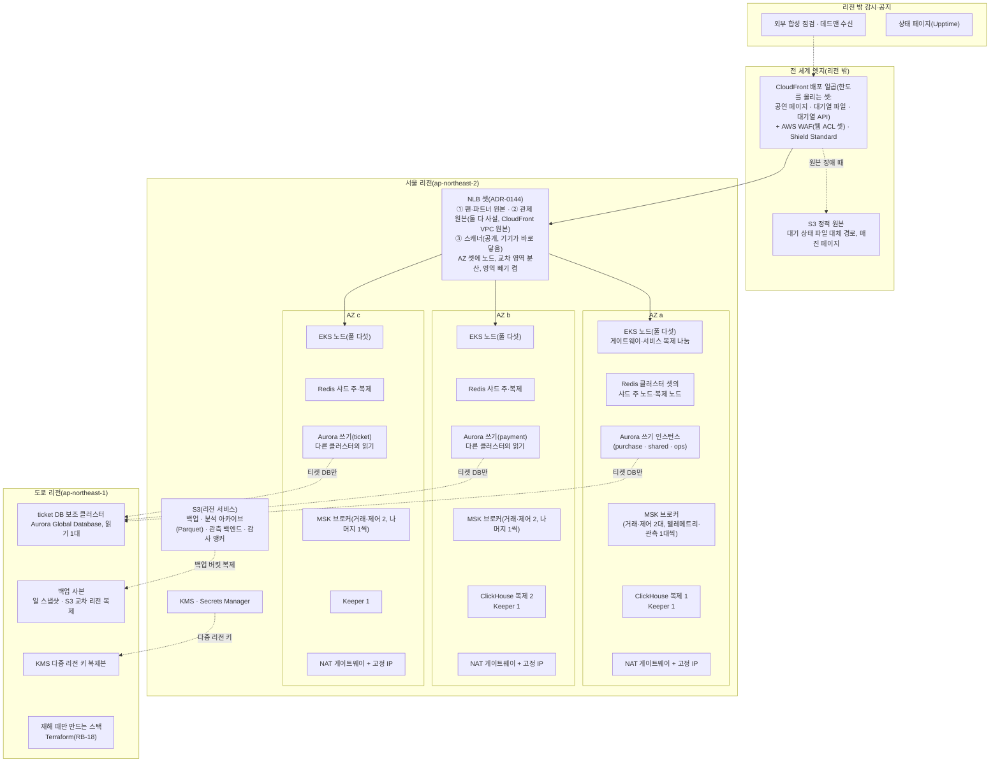
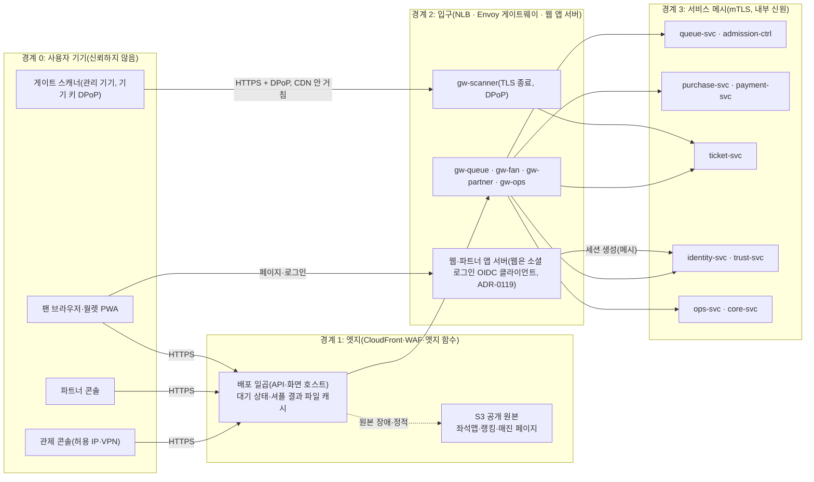
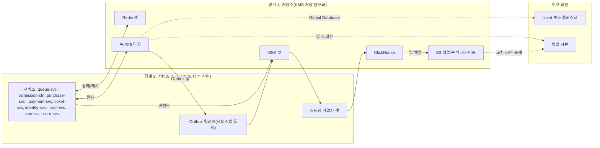
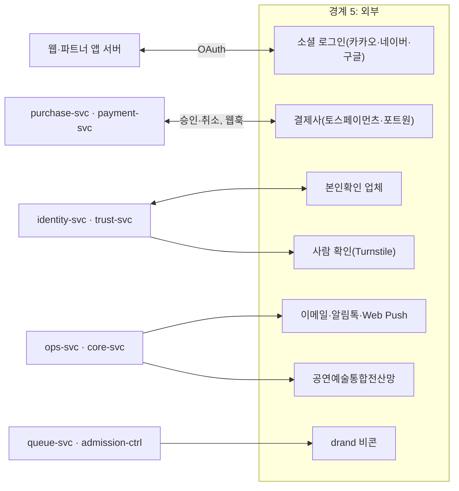
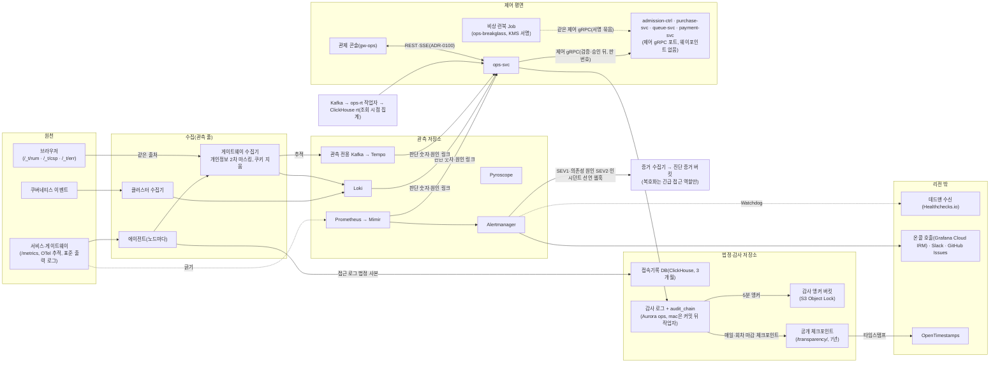

# 인프라·관제팀 인수 문서

- **독자와 용도**: 운영 환경을 만드는 인프라팀과, 공연 당일과 평소에 시스템을 지키는 관제팀이 처음 받는 문서다. 서버 사양, 이중화 구성, 데이터 흐름, 장애 때 할 일, 데이터 위치와 변경 권한, 처음 볼 곳을 한곳에 모았다. 세부와 근거는 표마다 적은 정본 문서에 있다.
- **공개 범위(소유자 결정 2026-10-29, ADR-0153)**: 이 문서는 공개 문서 저장소에 둔다. 계정 번호·실제 주소·연락처 같은 실제 값은 쓰지 않고(점검 도구 `public` 검사), 운영 계정을 만들 때 실제 값은 비공개 운영 저장소의 부록으로 나눈다(docs/devops.md §2.1).
- **원본 출처**: 2026-10-22 소유자 요청으로 새로 만든 문서다. 소유자가 멘토의 문서 구성 기준(인프라 문서는 서버 사양 명세서, 데이터 흐름도, 이중화 구성도, 이중화 실행 계획서, 구성 요소별 가용성·네트워크·저장 요구)으로 점검을 맡겼고, 점검 결과를 본 뒤 "충돌이 없는 새 문서부터 추천 순서대로 보완해 주세요"라고 했다. 이미 정한 값은 docs/infra.md, docs/architecture.md, docs/devops.md, docs/observability.md, docs/data.md, docs/streaming.md, docs/security/secrets-and-keys.md, planning/03-policies-glossary.md에서 옮겼다.
- **기준 기획 버전**: v1.0. 작성 2026-10-22.
- **표시 규칙**:
  - 대수, 복구 목표, 보존 기간, 경보, 런북처럼 이미 정한 값은 정본에서 그대로 옮겼다. 정본이 바뀌면 이 문서도 고친다. 표의 '근거' 열이 정본 위치다.
  - 이 문서에서 처음 정한 것(인스턴스 계열과 크기, 저장소의 가용 영역 배치, NAT 배치, 가용성 등급, 키 관리 권한, 도쿄 전환 준비)은 추천 적용(2026-10-22)이다. 서버 사양은 아직 재지 않았으므로 가정 표시를 붙이고, 측정(wbs 2.12.1 성능 장부 → 4.8.1 비용 측정 → 6.4.1 용량 산정서)으로 바꾼다.
  - 포트폴리오 기간에는 운영 환경을 띄우지 않는다(소유자 결정 2026-10-13, ADR-0057). 이 문서는 운영 설계이고, 시험은 로컬 측정 환경과 모의 진행으로 한다(docs/verification.md §5).

## 1. 한눈에

- 운영 환경은 AWS 서울 리전(클라우드 데이터센터가 모인 지역) 하나에서 돌고, 그 안의 가용 영역(같은 리전 안에서 전기·네트워크가 따로인 데이터센터 묶음, 이하 AZ) 셋에 나눠 둔다. 도쿄 리전에는 티켓 DB의 읽기 복제본과 백업 사본만 둔다(docs/infra.md §1, ADR-0031·0083). 읽기 복제본은 티켓 원장 보존(RPO 약 1초)과 복구 기준점이고, 도쿄에는 그것을 읽을 서비스가 없어 리전 장애 당일 현장은 오프라인 판정으로만 버틴다. 당일 온라인 조회를 위한 도쿄 파일럿 라이트는 두지 않기로 했다(소유자 결정 2026-10-29, ADR-0152, docs/infra.md §6, 기술 검토 중간-081).
- 사람이 몰리는 길은 CloudFront(사용자 가까운 곳에 파일을 복사해 두고 대신 응답하는 AWS의 CDN) → NLB(들어온 연결을 여러 서버에 나눠 주는 AWS 장치) → Envoy 게이트웨이(클라이언트 종류별 입구 서버) → 서비스다. 현장 스캐너만 CDN을 거치지 않고 NLB로 바로 온다. CloudFront 배포는 일곱이고, NLB는 셋(팬·파트너 원본, 관제 원본, 스캐너)이다(추천 적용 2026-10-29, ADR-0144, docs/infra.md §1·§4.1).
- 서비스는 EKS(AWS가 운영해 주는 쿠버네티스, 즉 컨테이너로 만든 앱을 여러 서버에서 실행·관리하는 플랫폼)의 노드 풀(같은 용도의 서버 묶음) 다섯에서 돈다. 핫패스(요청이 가장 많이 지나는 경로), 일반, 관제, 데이터, 관측이다. 관제 풀은 관제 입구(gw-ops)와 ops-svc, 그리고 클러스터 애드온(Kyverno·KEDA·istiod·Karpenter 컨트롤러·Envoy Gateway 컨트롤러 등)이 함께 도는 관제·시스템 풀이다(추천 적용 2026-10-28, ADR-0102, 기술 검토 낮음-013, §3.1).
- 저장소는 AWS 관리형 Aurora PostgreSQL 클러스터 다섯(ops 전용 클러스터 포함, ADR-0102), ElastiCache(Valkey/Redis) 클러스터 셋, MSK(AWS가 운영해 주는 Kafka) 클러스터 셋, S3와, 클러스터 안에서 직접 운영하는 ClickHouse다. 상품 정의를 두던 MongoDB는 2026-10-28에 PostgreSQL로 옮겨 뺐다(ADR-0101).
- 장애 대응의 기본: 같은 리전 안의 장애는 자동으로 넘긴다(Aurora 5분, Redis 30초 안). 리전 전체가 멈추면 자동 전환하지 않고, 사람이 판매를 멈춘 뒤 도쿄에서 24시간 안에 복구한다(docs/infra.md §6).
- 읽는 순서: §2 그림 → §3 사양 표 → §5 장애 때 할 일 → §7 처음 볼 곳. 관제팀은 §7과 §8부터 봐도 된다.

## 2. 이중화 구성도

이중화는 장비 하나가 고장 나도 서비스가 멈추지 않게 같은 것을 둘 이상 두는 구성이다. 아래 그림은 AZ별 배치와 도쿄 리전을 보인다. 서비스의 연결 관계는 docs/infra.md §1의 배포 구성도가 정본이다.

- **배치 규칙(추천 적용 2026-10-22)**:
  - Redis 클러스터는 샤드마다 주 노드와 복제 노드를 서로 다른 AZ에 두고, 샤드 셋의 주 노드를 AZ 셋에 하나씩 나눈다 [가정]. AZ 하나가 멈춰도 그 AZ의 주 노드만 다른 AZ의 복제 노드로 넘어간다.
  - Aurora 클러스터는 쓰기 인스턴스와 읽기 인스턴스를 서로 다른 AZ에 두고, 클러스터 다섯의 쓰기 인스턴스를 AZ 셋에 나눈다(위 그림의 배치는 예다) [가정]. AZ 하나가 멈춰도 모든 클러스터가 한꺼번에 전환되지 않게 하려는 것이다.
  - MSK 거래·제어 클러스터는 브로커 6대를 AZ마다 2대씩 [가정, 측정 뒤 확정], 텔레메트리·관측 전용 클러스터는 브로커 셋을 AZ 셋에 하나씩 둔다. 복제 3은 AZ마다 하나씩 놓는다(랙 인식). AZ 하나를 잃은 뒤 브로커 하나가 더 멈춰도 거래·제어는 그 브로커에 복제본이 있는 약 절반 파티션만 쓰기가 멈춘다(추천 적용 2026-10-29, ADR-0141 결정 2, docs/infra.md §4 정본).
  - ClickHouse 복제 둘은 서로 다른 AZ에, 복제를 조율하는 ClickHouse Keeper 셋은 AZ 셋에 하나씩 둔다 [가정].
  - NAT 게이트웨이(서버가 밖으로 나가는 길)는 AZ마다 하나씩 고정 IP와 함께 두고, 결제사 방화벽 허용 목록에 세 IP를 모두 등록한다 [가정, 결제사 계약 때 확인]. 정본(docs/infra.md §9)도 'AZ마다 둔 전용 NAT 게이트웨이의 고정 탄력적 IP(EIP, 셋)'로 같다. NAT를 하나만 두면 그 AZ가 멈출 때 결제 호출이 끊기기 때문이다.
- EKS 제어 평면, CloudFront, S3, KMS, Secrets Manager는 AWS가 여러 AZ에 나눠 운영하는 서비스라 따로 배치하지 않는다.

## 3. 구성 요소별 사양·가용성·네트워크·저장

### 3.1 노드 풀(EKS)

Karpenter(필요한 만큼 서버를 붙이고 떼는 도구)가 노드를 만든다. 관제·시스템 풀만은 EKS 관리형 노드 그룹이다(아래 표). 아래 인스턴스는 NodePool이 허용할 계열과 기본 크기다. 모두 AWS Graviton(arm64)이고, 서울·도쿄 리전에서 쓸 수 있음을 AWS 문서로 확인했다(2026-10-22). 선택 보정 측정(docs/verification.md §6)이 같은 계열의 c7g.xlarge를 쓰므로 측정값을 그대로 옮겨 쓰기 쉽다.

| 노드 풀 | 실행하는 것 | 인스턴스(초기 추정) | 구매 방식 | 배치·최소 대수 | 근거 |
| --- | --- | --- | --- | --- | --- |
| 핫패스 | Envoy 게이트웨이 프록시 넷(gw-queue·gw-fan·gw-partner·gw-scanner. gw-ops는 관제 풀), queue-svc, admission-ctrl, purchase-svc, realtime-gw, 웹 앱 서버(Next.js) | c7g 계열. 기본 c7g.2xlarge(8 vCPU·16GiB), xlarge~4xlarge 허용 [가정, wbs 2.12.1 측정에서 확정] | 온디맨드(정가로 계속 쓰는 서버)만. Kyverno가 핫패스 네임스페이스의 Spot을 막는다 | AZ 셋에 고르게. 게이트웨이 유형마다 최소 3, purchase-svc 최소 3, admission-ctrl은 리더 1 + 대기 2. 피크 대수는 측정 전 | docs/infra.md §4·§5, docs/devops.md §5.2, docs/architecture.md §9.5 |
| 일반 | identity·payment·ticket·trust·core 서비스와 notify 워커, 파트너 앱 서버, 전역 레이트 리밋 서비스(Envoy Gateway가 배포하는 Envoy ratelimit 2개 [가정], 기술 검토 중간-084), 관제 풀이 멈췄을 때의 비상 런북 Job. 클러스터 애드온은 2026-10-28에 관제 풀로 옮겼다(기술 검토 낮음-013) | m7g 계열. 기본 m7g.xlarge(4 vCPU·16GiB) [가정] | 온디맨드. notify 워커만 Spot(싸지만 회수될 수 있는 서버) 허용 | 서비스마다 최소 2, AZ 셋. payment-svc는 온세일 전 프리워밍으로 늘린다(처음 값 6 [가정]. 핫패스 풀의 웹 앱 서버도 약 15 [가정]로 늘린다, docs/infra.md §5, 기술 검토 중간-082) | docs/infra.md §4, docs/devops.md §5.2 |
| 관제·시스템(추천 적용 2026-10-28, ADR-0102. 애드온은 기술 검토 낮음-013) | gw-ops의 Envoy 프록시, ops-svc, 클러스터 애드온(Kyverno, KEDA, 메시 제어 평면 istiod, Karpenter 컨트롤러, Envoy Gateway 컨트롤러, ArgoCD·Argo Rollouts, External Secrets, cert-manager). 비상 런북 Job은 이 풀을 먼저 고르고(선호 배치), 이 풀이 멈추면 일반 풀에서도 뜬다 | m7g.large(2 vCPU·8GiB) [가정]로 시작하고, 이 풀의 requests 합이 노드 할당 가능량의 70% [가정]를 넘으면 m7g.xlarge로 올린다 [가정, wbs 0.4.4에서 확정] | 온디맨드만. Karpenter가 만들지 않는 EKS 관리형 노드 그룹(Karpenter 컨트롤러가 자기가 만든 노드에 기대지 않게 한다. Karpenter 안내서, 2026-10-28 확인) | 테인트 `peaket.io/pool=ops:NoSchedule`, AZ 셋에 한 대씩(최소 3). 우선순위 클래스 둘을 둔다: 확장·제어 길(Kyverno·KEDA·istiod·Karpenter·Envoy Gateway 컨트롤러·gw-ops·ops-svc·런북 Job)은 `peaket-control`, 나머지 애드온은 그보다 낮은 `peaket-addon` [가정]. 모두 requests를 예약하고 메모리는 requests = limits로 둬 노드가 모자랄 때 먼저 쫓겨나지 않게 한다 | 핫패스 노드의 CPU 포화와 그 노드의 노드 프록시 부하가 관제 입구와 ops-svc에 번지지 않게 한다. 오픈 순간 확장 길(KEDA 판단 → 파드 생성 → Kyverno 입장 검사)과 마지막 제어 길(런북 Job)도 업무 서비스 부하와 노드 축출에서 뗀다. 받는 서비스(purchase-svc 등)의 노드 몫은 남는다(docs/infra.md §4, ADR-0102) |
| 데이터 | 스트림 작업자(`ops-rt`·`analytics-ingest`), rt-pulse, ClickHouse와 Keeper, 마감 실행기·dbt Job | 스트림 작업자는 파드마다 CPU 1·메모리 1GiB [가정]라 노드 크기에 따로 기대지 않는다. ClickHouse는 r7g.2xlarge(8 vCPU·64GiB) [가정] | 관제 실시간 적재 작업자와 저장소는 온디맨드. 원본 적재 작업자만 Spot 허용 | ClickHouse 2(AZ 둘), Keeper 3. MongoDB 3대는 2026-10-28에 뺐다(ADR-0101). 작업자 자원은 docs/streaming.md §2.5 | docs/infra.md §4, docs/streaming.md §2.5 |
| 관측 | Prometheus·Mimir·Loki·Tempo·Pyroscope·Alertmanager·Grafana, 게이트웨이·클러스터 수집기(에이전트는 모든 노드의 DaemonSet) | r7g 계열. 기본 r7g.xlarge(4 vCPU·32GiB) [가정] | 온디맨드 | Mimir·Loki 인제스터는 AZ마다 한 벌(3중 복제). 할당량은 NodePool 한도의 80% [가정] | docs/observability.md §1·§10, docs/devops.md §5.2 |

- 이미지가 arm64를 지원하는지는 빌드 때 확인하고, 지원하지 않는 워크로드만 같은 크기의 amd64 노드(c7i·m7i·r7i)로 둔다 [가정]. 직접 만드는 이미지는 모두 amd64·arm64 이미지 인덱스로 빌드·서명하고(docs/devops.md §3.1), 운영 승격 전에 출시 후보의 arm64 이미지를 arm64 러너에서 한 번은 돌린다(docs/devops.md §5.3, 추천 적용 2026-10-28, 기술 검토 낮음-167). 운영 노드를 모두 x86으로 두는 안과의 비용 비교는 wbs 4.8.1 비용 추정에서 한다.
- 피크 노드·파드 수와 파드 서브넷 IP는 측정 뒤 채운다. 서브넷 IP는 파드 수만이 아니라 노드 수와 VPC CNI 웜 풀(기본안 접두사 위임: 노드마다 /28 묶음과 웜 접두사, 다른 안: 보조 IP + `MINIMUM_IP_TARGET`·`WARM_IP_TARGET`)로 계산한다. 식과 고르는 기준은 docs/infra.md §1이다(추천 적용 2026-10-28, 기술 검토 낮음-164). 클러스터 하나로 가는 기준은 노드 1,000개·파드 3만 개 [가정] 이하다(docs/architecture.md §9.5).

### 3.2 저장소

| 구성 요소 | 담는 것 | 구성(정본) | 초기 사양 | 가용성 요구 | 네트워크 | 저장 | 근거 |
| --- | --- | --- | --- | --- | --- | --- | --- |
| Aurora purchase | 주문, 결제 시도, 좌석 판매 행, 1인 한도 원장, 홀드 감사 원장, Outbox | 쓰기 1 + 읽기 1, 다중 AZ 자동 전환 | db.r7g.xlarge, 읽기도 같은 크기(전환되면 쓰기를 받으므로) [가정] | RPO 0·RTO 5분. 좌석 홀드 99.95%(NFR-003)와 결제 접수 99.95%(NFR-005)가 기댄다 | PostgreSQL 5432, TLS(`verify-full`). 판매 확정 초당 약 28건, 주문 이벤트·Outbox 합산 초당 수천 건 이하, 홀드 원장 초당 약 500건 | 주문 표는 나누지 않고 보존 기한이 지난 행을 정비 시간에 나눠 지운다(ADR-0114, V-T29). Outbox는 일 파티션. 5년 누적 주문 약 1,700만 건. 크기는 측정 전. 시점 복원(PITR) 35일, 일 스냅샷을 도쿄로 복제 | docs/infra.md §4·§6, docs/architecture.md §9.1·§9.5, docs/data.md §1 |
| Aurora payment | 결제 원장, 웹훅 멱등 기록, 결제사 대사, 정산서·지급, Outbox | 쓰기 1 + 읽기 1 | db.r7g.large(2 vCPU·16GiB) [가정] | RPO 0·RTO 5분. 결제 확정·완료율 99.95%(NFR-006) | 5432, TLS. 결제 승인 피크 300 TPS(초당 처리 건수) | PITR 35일, 일 스냅샷 도쿄 복제 | 같음 |
| Aurora ticket | 티켓 원장, 기기 공개키·폐기 목록, 양도 이력, 스캔 기록 | 쓰기 1 + 읽기 1 + 도쿄 보조 클러스터 읽기 1 | db.r7g.large [가정] | RPO 0·RTO 5분. 리전 장애 때는 도쿄 보조 클러스터가 티켓 원장을 RPO 약 1초로 보존한다(도쿄에 조회할 서비스는 없다, 기술 검토 중간-081) | 5432, TLS. 스캐너 동기화와 스캔 업로드(게이트당 분당 60명, NFR-010) | 5년 누적 티켓 약 3,500만 장, 스캔 기록 5년 | docs/infra.md §4·§6, ADR-0083 |
| Aurora ops(추천 적용 2026-10-28, ADR-0102) | 운영 명령 이벤트 스토어와 감사 로그·`audit_chain`, 승인 업무, CS 처리함, 법적 요청 대장, 예매 제한과 소명, 결정 기록, 수요 예측, 관제 SSE 알림 표(`ops_push_event`·`ops_presence`, ADR-0100) | 쓰기 1 + 읽기 1(다른 AZ) | db.r7g.large [가정] | RPO 0·RTO 5분. 관제 명령 99.9%와 명령 접수 p95 500ms(NFR-008)가 공유 쓰기 인스턴스의 포화(오픈 직전 로그인·토큰 갱신)에 묶이지 않게 나눴다 | 5432, TLS | 운영 명령 감사 로그는 영구 보존, 매일 S3 Object Lock 사본. 알림 표는 1시간 [가정] | docs/infra.md §4·§6, docs/data.md §1 |
| Aurora 공유(identity·core) | 계정, 관리자, 스태프 배정, 판매자 신원정보, 공연·좌석 배치, 굿즈·부가 상품 정의(ADR-0101), 알림·웹훅 발송 작업과 원장(ADR-0109) | 쓰기 1 + 읽기 1(논리 DB와 역할로 나눔) | db.r7g.large [가정] | RPO 0·RTO 5분. 관리 계정 로그인(관제 콘솔 포함)이 기댄다 | 5432, TLS | 관리자 접속기록 2년·권한 변경 이력 3년 이상(NFR-017) | docs/infra.md §6, docs/data.md §1 |
| PgBouncer(배치는 추천 적용 2026-10-28, ADR-0116) | 서비스와 Aurora 사이 연결 풀 | PgBouncer 1.26.1 이상, 이미지는 다이제스트로 고정(docs/data.md §1 끝 엔진 판, 기술 검토 낮음-040). 서비스 DB마다 공용 Deployment 하나(`pgbouncer-<DB>`: purchase·payment·ticket·ops·공유), 복제 3을 AZ 셋에 하나씩, PodDisruptionBudget 최소 2. 사이드카는 쓰지 않는다(파드마다 풀이 생겨 연결 상한을 한곳에서 지킬 수 없다). 인증은 교체 함수가 만든 두 사용자의 SCRAM 비밀 목록(`auth_file`)을 파일 볼륨으로 받아 바뀌면 다시 읽는다(`auth_query`는 쓰지 않는다, docs/devops.md §8.3, 추천 적용 2026-10-28, 기술 검토 중간-064) | 복제마다 CPU 1·메모리 512MiB [가정](한 프로세스가 한 코어를 쓴다). 노드 풀은 그 DB를 쓰는 서비스와 같다(purchase 핫패스, ops 관제, 나머지 일반). 풀 크기는 wbs 2.11.2에서 정한다 | 그 DB를 쓰는 서비스와 같은 등급(§3.4). 복제 하나가 멈추면 남은 복제가 받고, 트랜잭션 도중 끊긴 요청은 실패해 앱의 다시 시도 규칙을 따른다 | 6432(클러스터 안 Service), Aurora 5432 TLS. 시간 초과 설정은 docs/architecture.md §5. 마이그레이션 잡은 거치지 않는다(ADR-0083) | — | docs/architecture.md §5, ADR-0028, ADR-0116 |
| Outbox 릴레이(추천 적용 2026-10-28, ADR-0116) | 서비스마다 Outbox 표의 보내지 않은 행을 Kafka로 보내는 폴링 릴레이(`<서비스>-outbox-relay`: purchase·payment·ticket·identity·core·ops) | 서비스마다 Deployment 하나, 복제 2. 쿠버네티스 Lease로 하나만 보내고, 리더가 멈추면 다른 하나가 15초 [가정] 안에 이어받는다 | 복제마다 CPU 0.25·메모리 256MiB [가정]. 그 서비스와 같은 노드 풀 | MSK 거래·제어와 같은 2등급(§3.4). 멈추면 사건이 Outbox 표에 쌓였다가 다시 뜨면 `seq` 순서로 이어 보낸다. 그동안 결제 확정은 purchase-svc가 payment-svc `BatchGetPayments`로 직접 묻는 당기기로 이어지고(ADR-0140), 결제 확정 알림과 관제 실시간 표가 늦는다. ops 릴레이는 `control.settings`를, identity 릴레이는 `control.sessions-terminated`를 보낸다(ADR-0143 결정 3) | DB는 PgBouncer를 거쳐 역할 `<서비스>_outbox_relay`로, MSK 9098(IAM, 릴레이 전용 역할·고정 세션 이름). 그 서비스의 Outbox 토픽 쓰기 권한은 릴레이 역할에 주고 요청 처리 파드에는 주지 않는다 | 상태 없음. 지연 지표 `outbox_relay_lag_seconds`, 5초 [가정]를 1분 넘게 넘으면 SEV2(RB-39) | docs/data.md §4의 7번, ADR-0116 |
| Redis 대기열 | 순번 카운터, 1인 1순번 확인 키, 셔플 결과, 빠진 번호 비트맵, 입장 자리 | 샤드 3 × (주 1 + 복제 1), AZ 셋 | cache.r7g.xlarge(4 vCPU·26.32GiB) [가정]. 명령이 몰리는 두 클러스터는 한 단계 큰 노드 | 대기열 진입 99.9%(NFR-001). RTO 30초, RPO는 복제 지연분 | 6379, TLS, RBAC 사용자. 진입 피크 초당 20만 건이 순번 `INCR`로 몰린다(병목이 재어지면 파드별 묶음 `INCRBY`로 나눈다) | 영구 백업 없음. 회차 키는 판매 종료 뒤 TTL(쓸 수 있는 시간)로 지운다. 크기는 작다(빠진 번호 비트맵 100만 명당 약 125KB) | docs/infra.md §4·§6, docs/architecture.md §9.1 |
| Redis 좌석 | 좌석 비트맵, 홀드, 펜싱 토큰, 구매 세션, 좌석 변경 채널 | 같음 | cache.r7g.xlarge [가정] | 좌석 홀드 99.95%(NFR-003). RTO 30초. 장애 조치 중에는 그 회차 구매 요청을 503으로 미룬다(DB 비상 경로 없음, ADR-0121) | 6379, TLS. 홀드 피크 초당 2,000건, 샤드 Pub/Sub(`SPUBLISH`) | 영구 백업 없음. DB 원장에서 비트맵을 다시 만든다 | 같음 |
| Redis 세션·캐시 | 세션, 레이트 리밋 카운터, 카탈로그·ISR 캐시, 굿즈 재고 카운터와 예약, 봇 피처. 알림·웹훅 발송 작업(BullMQ)은 2026-10-28에 core DB 원장으로 옮겼다(ADR-0109) | 같음 | cache.r7g.large(2 vCPU·13.07GiB) [가정] | 기본 SLO 99.9%(NFR-011). RTO 30초. 유실은 키 종류별 등급으로 다룬다(A 다시 만든다·B 사람이 다시 한다·C 다른 층이 마지막을 지킨다, docs/data.md §3) | 6379, TLS. 매개변수 `maxmemory-policy noeviction`(세 클러스터 모두), 메모리 70%·85% [가정] 경보 | 백업 없음. 다시 만들 원본이 없는 데이터는 두지 않는다. 모든 키에 TTL | 같음, ADR-0109 |
| MSK 거래·제어 | 주문·결제·좌석·발권 이벤트, 제어 이벤트 | 브로커 6(AZ마다 2) [가정, 측정 뒤 확정], 복제 3(AZ마다 하나, 랙 인식), `min.insync.replicas=2`, `acks=all`. MSK 사용자 지정 설정에 `unclean.leader.election.enable=false`(뒤처진 복제본을 대표로 올리지 않는다)·`auto.create.topics.enable=false`·`default.replication.factor=3`·`min.insync.replicas=2`(D-T46). Kafka 3.9.x(KRaft)로 시작(추천 적용 2026-10-29, ADR-0141 결정 1~3) | kafka.m7g.large [가정] | RPO 0. 브로커는 자동 재시작. AZ 하나를 잃은 뒤 브로커 하나가 더 멈춰도 약 절반 파티션만 쓰기가 멈추고, 그동안 결제 확정은 당기기로 이어진다(ADR-0140). 브로커 경보는 docs/observability.md §5(ADR-0141 결정 4) | 9098(IAM 인증 TLS). 거래 사건 피크 초당 약 6,300건(좌석 약 3,000·주문 약 1,500·발권·결제 약 1,800, docs/streaming.md §11 추정) | 보존 7일. 브로커당 저장 = 7일 유입량 × 복제 3 ÷ 브로커 6(측정 전) | docs/infra.md §4·§6, docs/architecture.md §9.1 |
| MSK 텔레메트리 | 진입 집계, 행동 신호, 구매 텔레메트리 | 브로커 3(AZ 셋), 복제 3, `min.insync.replicas=2`, `unclean.leader.election.enable=false`(ADR-0141 결정 1) | kafka.m7g.xlarge [가정] | 멈춰도 거래 이벤트는 영향 없다(클러스터를 나눈 이유) | 9098. 피크 약 5,600건/초: 홀드 시도 약 2,000·판정 약 1,700·`BehaviorSignal` 약 1,700·1초 집계와 심장 박동 약 200(진입 20만 건/초는 queue-svc가 1초 집계로 줄인다, docs/streaming.md §11 추정. 2026-10-29에 빠졌던 `BehaviorSignal`을 더했다, ADR-0141 결정 6). 매진 순간 몰리는 `QueueEntryRecord`는 queue-svc가 파드마다 초당 2,000건 [가정]으로 나눠 보내고, 버린 수는 `telemetry_dropped_total{record}`로 센다 | 보존 7일. 분석 적재 복원에 7일 이상 [가정] 필요 | docs/infra.md §6, docs/streaming.md §11 |
| MSK 관측 전용 | Tempo 쓰기 경로(요청 기록) | 브로커 3 [가정, wbs 4.1.4에서 확정]. MSK 기본 설정을 쓴다(`unclean.leader.election.enable=true`. 요청 기록은 3등급 관측 자료라 유실보다 가용성이 낫다, ADR-0141 결정 1) | kafka.m7g.large [가정] | 원인 분석 자료(관측 자료 3등급, docs/observability.md §9). SLO 경보와 자동 제어는 영향 없다. 계속 둘지는 wbs 4.8.2의 요청 기록 저장소 비교로 정한다(기술 검토 중간-021) | 9098 | 보존은 가정(ADR-0077) | docs/observability.md §1, ADR-0077 |
| ClickHouse(+Keeper) | 분석 브론즈·실버·골드, 실시간 표 `rt`, 법정 접속기록 DB, 봇 원시 신호 | 복제 2(AZ 둘), Keeper 3(AZ마다 하나, 셋 가운데 둘이 살아 있으면 돈다. 정족수 2). wbs 4.3.1 PoC에서는 Keeper의 CPU·메모리·디스크 자원만 확인한다(추천 적용 2026-10-28, 기술 검토 낮음-012) | r7g.2xlarge 노드, gp3 볼륨 [가정] | RPO 1일·RTO 1시간. 관제 실시간 표 반영 p95 5초(NFR-009). 멈추면 관제 패널을 Prometheus 대체 표시로 바꾼다 | 9440(네이티브 TLS)·8443(HTTPS). 관제 지표 초당 3만 건(NFR-009) | 브론즈·실버 90일, `rt`는 판매류·대기열·홀드 400일·판정 90일·심장 박동 7일 [가정](docs/streaming.md §4.7), 골드 2년, 접속기록 3개월, 봇 원시 30일. 일 1회 S3 백업 7일 [가정]. 접속기록 DB만 하루 파티션 사본을 S3 Object Lock 버킷에 3개월 + 7일 [가정] 둔다(기술 검토 높음-21) | docs/infra.md §4·§6, docs/observability.md §7·§9 |
| 스트림 작업자 | 관제 실시간 표의 원시 적재, 봇 대기 중 재평가, 원본 적재 | 작업자마다 Deployment 2개, 상태 없음(다시 뜨면 커밋한 위치부터 읽는다) | docs/streaming.md §2.5 | 관제 실시간 표 신선도 p95 5초 미만(NFR-009) | 지표 포트(Prometheus 수집) | 상태 저장본 없음. 실시간 원시 표 보존은 docs/streaming.md §4.7 | docs/infra.md §4, docs/streaming.md §2 |
| Schema Registry(추천 적용 2026-10-28, 기술 검토 중간-088) | Avro 이벤트 스키마와 판(Confluent, 커뮤니티 사용권으로 직접 띄운다) | Deployment 2개(다른 AZ, `platform` 네임스페이스, PodDisruptionBudget 최소 1). 하나는 Kafka 그룹으로 뽑은 리더이고, 다른 하나는 읽기를 받고 쓰기를 리더로 넘긴다 | 파드마다 CPU 0.5·메모리 1GiB [가정], 일반 노드 풀 | 쓰기 경로 밖이다. 생산자는 실행 중에 부르지 않고(등록 Job이 쓴 스키마 ID 설정), 소비자는 캐시한 ID를 계속 읽는다. 멈추면 새 스키마 등록(생산자 배포)과 새로 뜬 소비자의 첫 읽기가 기다린다 | 8081, 클러스터 안에서만(인그레스 없음), 기본 인증(자격은 Secrets Manager). MSK 9098(IAM, `kafkastore.` 설정) | MSK 거래·제어 클러스터의 압축 토픽 `_schemas`(복제 3). 환경마다 따로 둔다(로컬·CI 컨테이너, 데모 한 벌) | docs/api/avro/README.md §3, docs/data.md §4의 7번 |
| 관측 저장소 | 지표, 로그, 요청 기록, 프로파일 | Mimir·Loki 영역 인식 3중 복제, Tempo 마이크로서비스 모드 | 관측 풀 | 핫패스 밖. 관측이 멈춰도 SLO 경보와 자동 제어 입력은 클러스터 Prometheus가 낸다 | OTLP 4317(gRPC)·4318(HTTP) 수집기, `/metrics` 긁기 | Prometheus 15일, Mimir 원본 90일·5분 집계 13개월, Loki 30일, Tempo 14일, Pyroscope 7일(S3 백엔드) | docs/observability.md §1·§9 |
| S3 | CDN 원본 정적 객체, 백업, 접속기록 하루 사본(Object Lock 준수 모드), 분석 아카이브(동결한 회차 골드의 회차별 Parquet 파일과 manifest, 버전 관리·도쿄 복제, 마감 실행기는 쓰기만, ADR-0115), 관측 백엔드, 진단 증거, 감사 앵커, 공개 체크포인트 | 리전 서비스 | — | 백업 버킷은 도쿄로 교차 리전 복제 | HTTPS | 버킷별 보존은 §6 | docs/infra.md §6, docs/data.md §1 |

- Outbox 릴레이는 2026-10-28에 Debezium(DB 변경 기록을 읽어 Kafka로 보내는 도구, Kafka Connect에서 돈다) 대신 서비스별 폴링 릴레이로 정했고, PgBouncer의 배치도 같은 날 정해 위 표에 행을 채웠다(추천 적용, ADR-0116). 그래서 Kafka Connect와 논리 복제 슬롯은 운영하지 않는다. Schema Registry(이벤트 스키마 저장소, Confluent)의 배치는 2026-10-28에 정해 위 표에 행을 더했다(추천 적용, 기술 검토 중간-088). 어디에 띄우든 MSK에 붙는 인증은 워크로드별 MSK 전용 역할을 고정 세션 이름으로 맡는 규칙(docs/devops.md §9.4, 자바 클라이언트 설정은 docs/data.md §4의 7번)을 따른다.
- 메시(Istio 앰비언트) 부품은 노드 프록시(ztunnel)가 모든 노드에, 웨이포인트는 서비스 사이 gRPC를 받는 서비스마다 여러 AZ에 여러 벌로 돈다(docs/infra.md §8, ADR-0082).
- 위 노드 풀(§3.1)과 저장소 사양을 늘 켜 두면 월 기본 비용이 약 1만 3,822달러다 [추정](서울 온디맨드 가격 목록, 2026-10-28 조회, 노드는 풀마다 AZ당 한 대인 최소값 [가정], 저장·I/O·전송·요청 요금 제외. 2026-10-29에 MSK 거래·제어 브로커 6대, NLB 셋, WAF 웹 ACL 셋으로 고쳤다, ADR-0141·0144). 구성 요소별 어림과 줄일 수 있는 후보별 절감액은 docs/infra.md §11에 있다(추천 적용 2026-10-28, 기술 검토 중간-009).

### 3.3 입구와 네트워크

| 항목 | 구성 | 요구 | 근거 |
| --- | --- | --- | --- |
| CloudFront 배포 일곱(추천 적용 2026-10-29, ADR-0144 결정 3) | www, queue, queue-files, api, partner(`partner-api` 호스트도 이 배포의 대체 도메인), console(`ops-api` 호스트도 이 배포의 대체 도메인), scanner. 한도를 따로 올리는 것은 공연 페이지(`www`)·대기열 파일(`queue-files`)·대기열 API(`queue`) 셋이다. 웹 ACL은 셋을 나눠 쓴다(대기열 API용, 화면·파트너·관제용, API용. queue-files에는 없다) | 설계 피크: 공연 페이지 초당 30만 건, 대기열 파일 초당 약 17.9만 건·약 36 Gbps, 대기열 API 초당 20만 건. 이 셋은 한도를 설계 피크의 1.5배 [가정] 이상으로 미리 올린다. 트래픽이 큰 이 세 배포의 설정 변경은 CloudFront 지속적 배포(스테이징 배포에 일부 요청만 먼저 보낸 뒤 승격)로 한다(ADR-0144 결정 6) | docs/infra.md §4.1·§9, ADR-0058·0144 |
| NLB | 셋으로 나눈다(2026-10-28 둘로 나눴고, 2026-10-29 관제 원본을 뗐다. 추천 적용, 기술 검토 낮음-009, ADR-0144 결정 1). ① 팬·파트너 원본 NLB(gw-queue·gw-fan·gw-partner)와 ② 관제 원본 NLB(gw-ops): CloudFront VPC 원본, 사설 서브넷(공인 주소 없음), TCP 리스너(TLS는 Envoy가 끝낸다), 보안 그룹은 CloudFront 서비스 관리 보안 그룹에서 오는 연결만 받는다. 원본 확인 헤더는 깊이 방어로 남긴다 ③ 스캐너 NLB: 공개, gw-scanner 리스너만, 기기 키 DPoP로 기기를 확인한다(mTLS는 운영 선택지). 셋 다 AZ 셋, 교차 영역 분산, 영역 빼기(zonal shift, 망가진 AZ로 새 연결을 보내지 않게 하는 NLB 기능) 켬 | AZ 하나의 게이트웨이가 멈추면 다른 AZ로 나눈다. AZ 하나가 망가지면 RB-13에서 사람이 영역 빼기로 그 AZ를 뺀다(자동 영역 빼기는 쓰지 않는다). 서울 리전은 영역 빼기 지원 리전이고 교차 영역 분산을 켠 NLB에서도 된다(대상 그룹의 교차 영역 설정이 켬이나 기본값이어야 한다, 2026-10-29 확인, https://docs.aws.amazon.com/r53recovery/latest/dg/arc-zonal-shift.resource-types.network-load-balancers.html). NLB 용량 예약은 서울이 지원 목록에 없어 쓰지 않고, T=0 급증은 K1에서 NLB 지표로 확인한다(ADR-0144 결정 4·5) | docs/infra.md §4·§4.1·§9 |
| 인증서(추천 적용 2026-10-29, ADR-0144 결정 9) | CloudFront 시청자 인증서는 ACM(us-east-1). NLB 셋은 TCP 통과라 인증서가 없다. 게이트웨이(gw-* 다섯, gw-scanner 포함)는 cert-manager가 ACME(DNS-01, Route 53)로 받은 공인 CA 인증서(CloudFront는 원본 인증서도 공인 CA 것만 믿는다). 서비스 메시 안은 사설 CA | 수명에 비례한 만료 경보, T-30분 점검 '만료 경보 SEV2에 걸린 인증서 없음'(docs/infra.md §5), 만료되면 RB-41 | docs/infra.md §9 |
| DNS(추천 적용 2026-10-29, ADR-0144 결정 8) | Route 53 공개 호스팅 영역 `peaket.example`. CloudFront·NLB를 가리키는 별칭 레코드는 TTL을 정하지 않고, 그 밖 레코드는 300초 [가정]. DNSSEC는 v1에서 쓰지 않는다 | DNS 변경도 IaC 계획을 검토한 뒤 적용한다. 전체 장애는 RB-40 | docs/infra.md §9 |
| NAT 게이트웨이 | AZ마다 하나, 고정 IP [가정] | 결제사 허용 목록에 모든 고정 IP를 등록 [가정]. 도쿄 재해 복구용 고정 IP도 미리 만들어 등록한다(§5.3) | docs/infra.md §9 |
| VPC·서브넷 | AZ 셋에 서브넷. 파드는 VPC 사설 IP를 쓴다(Amazon VPC CNI) | 파드 서브넷 IP는 노드 수·웜 풀·인터페이스 주 IP를 넣은 식으로 계산한다(기본안 접두사 위임, 파드용 서브넷에 CIDR 예약, 추천 적용 2026-10-28, 기술 검토 낮음-164). 정확한 CIDR은 wbs 4.8.1 뒤 Terraform에서 정한다 | docs/infra.md §1 |
| 보안 그룹·NetworkPolicy | 저장소 포트는 §3.2의 포트만, 쓰는 서비스 역할에만 연다. 네임스페이스 사이 NetworkPolicy는 기본 차단 | 관제 콘솔·`ops-api`는 CloudFront console 배포 → 관제 원본 NLB → gw-ops로 온다. console 배포 웹 ACL의 맨 앞 규칙과 gw-ops(원본 확인 헤더와 시청자 주소 헤더 `CloudFront-Viewer-Address`)가 허용 IP를 두 번 본다. VPN으로만 닿는 내부 로드 밸런서는 관리 도구(Grafana·ArgoCD·Alertmanager)용이다(추천 적용 2026-10-29, ADR-0144 결정 2) | docs/infra.md §9 |
| 장기 연결 | 좌석맵 체류자의 WebSocket 약 5,000개(realtime-gw). 대기실 100만 명은 연결을 유지하지 않는 폴링(정해진 간격으로 다시 물어보는 방식) | 좌석 변경 전송 약 10MB/s와 구역 스냅샷 갱신 최대 약 6MB/s | docs/architecture.md §9.1 |
| 직접 제어 채널(제어 gRPC, 추천 적용 2026-10-28, ADR-0102) | ops-svc와 비상 런북 Job만 admission-ctrl·purchase-svc·queue-svc·payment-svc(명령 6 대체 결제사 전환, 2026-10-29 더함, ADR-0143)의 제어 포트에 닿는다(메시 정책·NetworkPolicy). 제어 포트는 업무 포트와 다르고, 웨이포인트를 붙이지 않은 제어 전용 Service(`<서비스>-control`)로 받는다. 계약은 `peaket.control.v1.ControlReceiver/ApplyControl`, 데드라인 1초 [가정] | Kafka·게이트웨이·웨이포인트가 밀려도 명령이 닿아야 한다(NFR-008). 같은 클러스터 네트워크·노드 프록시는 함께 쓰므로 '대역 외'는 아니다 | docs/infra.md §8·§9, docs/architecture.md §3.2 |

### 3.4 가용성 등급(추천 적용 2026-10-22)

정본의 가용성 목표는 사용자 여정별 SLO(지키려는 서비스 품질 목표, planning/02-requirements.md §3.2)다. 인프라팀이 우선순위를 정하기 쉽게 구성 요소를 등급으로 묶었다. 등급은 새 목표 수치가 아니라, 멈췄을 때 무엇이 멈추는지를 기준으로 한 분류다.

| 등급 | 멈추면 | 구성 요소 | 지킬 것 |
| --- | --- | --- | --- |
| 1등급: 판매 경로 | 온세일 판매가 멈춘다 | CloudFront 판매 경로 배포(www·queue·queue-files·api), 팬·파트너 원본 NLB, gw-queue·gw-fan, queue-svc, admission-ctrl, purchase-svc, payment-svc(결제 결과 당기기 `BatchGetPayments` 포함, 추천 적용 2026-10-29, ADR-0140), 웹 앱 서버, Redis 대기열·좌석, Aurora purchase·payment와 그 PgBouncer(ADR-0116), 결제사 | AZ 셋에 나눔, 오픈 전 프리워밍(T-40분 [가정]), 변경 동결 창, 온세일 에러 버짓(목표가 허용하는 실패의 총량, NFR-014) |
| 1등급: 공연 당일 | 입장 기록과 동기화가 막힌다. 스캐너는 오프라인 판정으로 버틴다 | 스캐너 NLB, gw-scanner, ticket-svc, Aurora ticket(+도쿄 보조 클러스터) | 게이트 판정 NFR-010. 리전 장애 때는 오프라인 판정만, 도쿄 보조 클러스터는 티켓 원장 보존(기술 검토 중간-081) |
| 2등급: 판단·보조 | 판매는 이어지지만 판단·보조 기능이 줄어든다 | realtime-gw(실시간 좌석), identity-svc(로그인), trust-svc(캐시 규칙으로 축소 운영), ops-svc·관제 콘솔·관제 원본 NLB(비상 런북이 같은 제어 채널로 대신), Aurora ops, MSK 거래·제어와 Outbox 릴레이(멈추면 결제 확정은 당기기로 이어진다. 확정 지연이 5~10초 [추정] 늘고, 알림·관제 실시간 표·설정형 명령·세션 종료 전파·홀드 원장 적재가 늦어진다. 사건은 DB에 쌓였다가 이어 보낸다, 추천 적용 2026-10-29, ADR-0116·0140), Redis 세션·캐시 | 각 Degraded Mode(큰 장애 때 핵심만 지키고 부가 기능을 줄여 버티는 모드) 규칙, planning/03-policies-glossary.md §1.3 |
| 3등급: 사후·분석·관측 | 판매와 판단 숫자는 이어지고 분석·원인 자료가 늦어진다 | ClickHouse, 원본 적재 작업자, MSK 텔레메트리·관측, 관측 저장소, core-svc의 비핵심 기능 | RPO 1일·RTO 1시간 수준, 외부 감시가 관측 장애를 받는다 |

## 4. 데이터 흐름도(DFD)

DFD는 데이터가 어디서 어디로 흐르고 어느 신뢰 경계(보안 수준이 달라지는 선)를 넘는지 그린 그림이다. docs/infra.md §2의 그림을 운영 관점으로 넓혔다. 거기서 빠졌던 파트너·관제 경로, 비동기 이벤트, 백업·재해 복구 복제를 더했다. 개인정보가 경계를 넘는 흐름의 보호 등급과 통제는 docs/infra.md §2 표가 정본이다.

### 4.1 요청과 데이터

한 장에 담으면 선이 41개라 얽혀서, 세 장으로 나눠 그린다(planning/03 §5.5, ADR-0138). ① 들어오는 요청, ② 저장과 이벤트·백업, ③ 외부 연동이다.

**① 들어오는 요청(경계 0~3)**

**② 저장과 이벤트·백업(경계 3·4와 도쿄 리전)**

서비스는 묶어 그렸다. 서비스마다 쓰는 저장소는 아래 표다(planning/03 §5.5).

| 서비스 | Redis | Aurora | MSK 이벤트 |
| --- | --- | --- | --- |
| queue-svc | 씀 | — | 씀 |
| admission-ctrl | 씀 | — | —(Kafka에 발행하지 않는다, docs/infra.md §1) |
| purchase-svc · payment-svc | 씀 | 씀 | 씀 |
| ticket-svc | — | 씀 | 씀 |
| identity-svc · trust-svc | 씀 | 씀 | 씀 |
| ops-svc · core-svc | — | 씀 | 씀 |

**③ 외부 연동(경계 2·3과 경계 5)**

- 스캐너 API는 CloudFront를 거치지 않고 스캐너 NLB(TCP 통과)를 지나 gw-scanner가 TLS를 끝낸다. 기기는 기기 안의 키로 요청마다 서명한 DPoP 증명으로 확인한다(RFC 9449). 하드웨어 키가 필요한 운영 환경은 mTLS(서버와 기기가 서로 인증서를 확인하는 암호화 통신)를 선택지로 둔다(docs/features/offline-gate.md §6.1, 기술 검토 중간-057). 스캐너 화면 자체는 정적 앱이라 CloudFront로 낸다(docs/infra.md §1).
- 브라우저의 성능·오류 지표(`/_t/*`)는 §4.2의 관측 흐름이다.

### 4.2 관제·관측(직접 만든 감시·제어 시스템)

관제 콘솔, 관제 실시간 표(스트림 작업자 `ops-rt`와 조회 시점 집계), 진단 증거 수집기, 감사 기록 공개 앵커는 PEAKET이 직접 만드는 시스템이다. 그 데이터 흐름을 따로 그린다. 표준 수집 도구(OpenTelemetry, 지표·로그·요청 기록을 모으는 공통 표준과 도구)의 동작은 docs/observability.md §1이 정본이다.

- 지표는 수집기를 거치지 않고 Prometheus가 직접 긁는다. 그래서 수집기가 멈춰도 SLO 경보와 자동 제어 입력은 그대로다(docs/observability.md §1).
- 관측 스택이 통째로 멈추면 Grafana도 함께 멈춘다. 그때는 외부 데드맨 수신이 온콜을 부르고, 콘솔은 Prometheus 밖 숫자(입장 제어 상태는 Redis, 실시간 표는 ClickHouse)로 판단하며, 명령은 콘솔이나 비상 런북 CLI로 낸다(docs/observability.md §10, RB-09).
- 긴급 제어 명령(명령 1·2·3·7·11과, 명령 6 가운데 대체 결제사 전환)은 Kafka·게이트웨이·웨이포인트를 거치지 않는 직접 제어 채널(제어 전용 gRPC)로 간다. 대체 결제사 전환은 payment-svc의 준비된 모든 파드와 admission-ctrl 리더로 가고, payment-svc는 payment DB `pg_switch`에 판 번호와 함께 쓴다(추천 적용 2026-10-29, ADR-0143 결정 1). 같은 클러스터 네트워크와 노드 프록시는 데이터 요청과 함께 쓰므로 '대역 외'는 아니고, 받는 쪽은 판 번호가 붙은 제어 상태를 자기 저장소에 먼저 둔다(추천 적용 2026-10-28, ADR-0102·0103). 그 밖의 명령(4·5·8·9·10·12)은 WAF API, Kafka 운영 설정 사건(`control.settings`), core-svc API로 간다(docs/features/control-tower.md §3). 설정 사건은 ops-svc Outbox로 내고, 받는 파드가 적용한 판 번호 지표로 퍼졌는지 확인한다(ADR-0143 결정 2·3). ops-svc가 멈추면 비상 런북 Job이 같은 채널로 보낸다(docs/features/control-tower.md §5, RB-08).

## 5. 장애 대응 실행 계획

### 5.1 역할과 연락

| 역할 | 하는 일 | 근거 |
| --- | --- | --- |
| 인시던트 지휘관 | 인시던트를 선언하고 판단을 이끈다. 선언한 사람이 넘길 때까지 맡는다 | docs/observability.md §5 |
| 운영 실행자 | 명령과 런북을 실행한다 | 같음 |
| 기록·공지 담당 | 시각과 조치를 적고 대기실 공지·상태 페이지·파트너 공지를 낸다 | 같음 |
| operator·commander | 운영 명령의 권한. 명령 5(봇 판정 강도)·6(Degraded Mode 전환)과 명령 3·11의 재개는 commander가 요청하고 요청자가 아닌 operator 이상 한 명이 승인한다(둘 다 재인증). 멈추는 쪽인 명령 3(판매 일시정지)·11(자동화 정지)은 commander 한 명이 재인증하고 바로 실행한다(ADR-0095) | planning/03-policies-glossary.md §1.1 |
| 긴급 접근 | GitOps 경로가 고장 났고 SEV1이 진행 중일 때, 선언한 인시던트에서 진단 증거를 남기거나 읽을 때(RB-31)와 느린 쿼리를 끊을 때(RB-32), KMS 키를 끄거나 삭제를 예약할 때(§6.2) 쓴다(MFA, 1시간 세션, 맡는 순간 SEV2 경보) | docs/devops.md §10.2 |

- 호출과 인시던트 도구는 Grafana Cloud IRM(무료 등급, 온콜 3인), 메신저는 Slack, 티켓은 GitHub Issues, 대외 상태 페이지는 Upptime이다(ADR-0032). Slack은 운영 전환 때 Business+로 시작하고, 첫 운영 경보 전에 데이터 레지던시를 서울로 켠다(켜기 전 데이터는 미국에 남는다, ADR-0152). 2인 승인 대기는 IRM의 '운영 명령 승인' 경로로 승인 권한자에게 앱 푸시로 간다(docs/observability.md §5).
- 인시던트 선언 기준은 POL-022다: SEV1, 불변식 위반 의심 1건, 명령 2·3·6 실행, SEV2가 15분 [가정] 넘게 풀리지 않음, 온세일 예산 50% 이상 사용 등(docs/observability.md §5).
- 외부 연락처(AWS 지원, 결제사 기술 지원, 본인확인 업체, 사람 확인 서비스)는 아직 없다. 계약할 때 이 표에 업체·창구·응답 약속 시간을 더한다.

### 5.2 장애 종류별 실행표

SEV1~SEV3은 장애 심각도 등급이다(숫자가 작을수록 심각하다, docs/observability.md §5). 런북(장애가 났을 때 따라 하는 절차서) 목록은 docs/infra.md §10이고, 실제 절차 파일은 wbs 4.7.1에서 `runbooks/`에 쓴다. Game Day(일부러 장애를 내고 대응을 연습하는 날) 시나리오는 docs/observability.md §12다.

| 장애 | 알아채는 신호 | 저절로 일어나는 일 | 사람이 할 일 | 목표 시간 | 시험 |
| --- | --- | --- | --- | --- | --- |
| AZ 하나가 멈춤 | 게이트웨이 정상 복제본 급감, 저장소 전환 이벤트, 관측 저장소 SEV3 | NLB가 다른 AZ로 나눔, Karpenter가 남은 AZ에 노드를 만듦, Aurora·Redis 자동 전환, MSK는 복제 3으로 계속(거래·제어는 AZ마다 브로커 2대라, AZ를 잃은 뒤 브로커 하나가 더 멈춰도 약 절반 파티션만 쓰기가 멈춘다, ADR-0141). 대형 온세일이면 게이트웨이를 필요 복제 × 1.5 [가정]로 둬 남은 두 AZ가 피크를 받는다 | RB-13(게이트웨이·AZ): AZ가 망가졌다고 판단하면 NLB 셋에서 영역 빼기(zonal shift, 망가진 AZ로 새 연결을 보내지 않게 하는 NLB 기능)로 그 AZ를 뺀다(사람이 판단, 자동 영역 빼기는 쓰지 않는다, ADR-0144). RB-05·RB-06(Redis 뒤처리), RB-10(Aurora 확인) | Aurora 5분, Redis 30초 | G-16(게이트웨이 절반), G-02(좌석 Redis 전환), G-10(브로커 1대), G-26(관측 AZ), G-32(AZ 하나 전체 정지와 영역 빼기, 모의 진행, ADR-0144) |
| 대기열 Redis 과부하·전환 | 진입 p99 > 150ms 2분 또는 Redis CPU > 75% | 진입 Degraded(도착 시각 쿠키) | RB-03(Degraded 켜고 끄기), RB-05(세대 번호·카운터 보정) | 30초 | G-01 |
| 좌석 Redis 장애 | 좌석 홀드 503(`seat-store-unavailable`) 급증, 전환 이벤트 | 그 회차 구매 요청 503 미룸, 동시 입장 목표 50% 감축, 회복 뒤 세대 오름(ADR-0121) | RB-06(미룬 시간 확인, 비었으면 비트맵 다시 만들기), 오버셀 불변식 확인 | 30초 | G-02, G-23 |
| 세션·캐시 Redis 전환·메모리 가득 | 전환 이벤트, 메모리 사용률 70% SEV3·85% SEV2 [가정](세 클러스터 공통, docs/observability.md §5) | 캐시(등급 A)는 원본 읽기로 넘어가고, 세션은 리프레시 토큰으로 다시 받으며, 레이트 리밋은 게이트웨이 로컬 한도로 버틴다. 알림·웹훅 발송 작업은 DB에 있어 잃지 않는다(ADR-0109) | 메모리면 캐시 TTL을 줄이거나 노드를 키운다. 캐시가 메모리의 절반 [가정]을 넘으면 캐시 전용 클러스터를 검토한다 | 30초 | G-29 |
| 전역 레이트 리밋 서비스 장애(추천 적용 2026-10-28, 기술 검토 중간-084) | 레이트 리밋 서비스 준비 복제본 0, Envoy의 판정 실패(열림 통과)가 5분 [가정] 이어짐 SEV3 | 일반 API는 열림(통과)으로 계속되고 게이트웨이 로컬 토큰 버킷이 남는다. 핫패스는 이 서비스를 부르지 않는다 | 레이트 리밋 서비스 파드·Redis 연결을 확인하고, 봇이 몰리면 로컬 한도를 낮추는 설정 배포를 검토한다 | — | G-29 |
| 법정 접속기록 수집 장애 | 법정 접속기록 갈래 신호 SEV2(유실·대조 모자람·전달 지연·하루 사본 지연, docs/observability.md §5) | 에이전트가 줄을 노드 디스크 큐에 쌓고 재시도를 멈추지 않는다 | RB-38(접속기록 DB 살리기, 모자란 칸 좁히기, 하루 사본 복원) | 하루 파티션 복원 4시간 [가정] | V-T21~V-T23 |
| Aurora 쓰기 인스턴스 장애 | Aurora 전환 알림 | 다중 AZ 자동 전환, 멱등 재시도가 실패한 쓰기를 흡수 | RB-10(전환 확인, 논리 손상이면 시점 복원) | 5분 | RB-10 절차(운영은 AWS FIS, 포트폴리오는 로컬 대체 장애) |
| Kafka 브로커 장애·소비 지연 | 브로커 오프라인 SEV2, 거래 토픽 소비 지연 30초 [가정] 1분, 브로커 경보(오프라인 파티션 > 0 거래·제어 SEV1, 최소 동기 복제본 부족 파티션 > 0이 1분 거래·제어 SEV2, 복제 부족 파티션 10분 SEV3, 디스크 70%·85% [가정] SEV3·SEV2, ADR-0141 결정 4), 보류 사건 1건 이상(결제·주문 토픽 SEV2, 그 밖 SEV3) | 복제 3·`min.insync.replicas` 2로 계속. 처리 못 하는 사건은 Kafka 데드 레터 토픽이 아니라 그 서비스 DB의 보류 표 `held_event`로 옮기고, 같은 업무 키의 뒤 사건도 함께 보류한다(ADR-0142) | RB-11(지연·보류 사건 다시 처리) | 브로커 자동 재시작 | G-10, V-T27(브로커 하나를 다시 시작하는 동안의 결제 길 릴레이 지연, ADR-0141 결정 7) |
| 거래·제어 MSK 전체 정지(추천 적용 2026-10-29, ADR-0140·0143) | 오프라인 파티션 SEV1, Outbox 릴레이 지연 SEV2, 당기기 반영 `payment_result_pulled_total`이 1분 동안 0보다 큼 SEV3 | 사건은 Outbox 표에 쌓인다. 결과 사건이 5초 [가정] 안에 오지 않으면 purchase-svc가 payment-svc `BatchGetPayments`로 직접 묻는다(당기기, ADR-0140). 확정 지연이 5~10초 [추정] 는다. 대체 결제사 전환(명령 6)과 긴급 명령은 제어 gRPC로 계속 퍼진다. 알림·관제 실시간 표·설정형 명령·세션 종료 전파·홀드 원장 적재는 늦어진다 | RB-11(브로커·MSK), RB-39(릴레이). 설정형 명령 카드가 '보냄 · 전파 대기'인지 본다(ADR-0143 결정 4). 회복 뒤 Outbox 지연과 당기기 반영이 0으로 내려오는지 본다 | 결제 확정 p99 10초 [가정](P-T47) | G-31(로컬 실행, Strimzi 브로커 모두 멈춤), P-T47, C-T53 |
| admission-ctrl 리더 부재 | 리더 부재 30초 [가정] SEV2 | 대기 파드가 Lease를 얻어 리더가 됨, 그동안 serving 전진만 멈춤 | RB-12 | Lease 15초 [가정] | G-09 |
| ops-svc(관제 콘솔) 장애 | 준비된 파드 0개 30초 [가정] 또는 외부 점검의 콘솔 확인이 같은 주기에 탐침 3곳 가운데 2곳 이상 실패 SEV1(기술 검토 중간-075) | — | RB-08: 긴급 역할로 비상 런북 Job, 운영자 서명(두 명, 명령 3 정지 묶음은 commander 한 명), 같은 제어 gRPC 채널(ADR-0102) | 명령 전파 p99 10초 | G-08 |
| KMS 장애(서울) | KMS 호출 오류·지연, 감사 체인 mac 빈 행이 1분 [가정] 넘음 SEV2 | 명령 기록은 KMS 없이 커밋된다. identity-svc의 페퍼 확인·TOTP 복호와 런북 서명은 도쿄 복제 키로 넘긴다 | 체인 작업자가 KMS가 돌아오면 따라잡는지 확인, 검증 잡 통과 확인 | 명령 접수 p95 500ms 유지 | G-27, C-T49 |
| 신원 제공자(IAM Identity Center) 장애 | 평소 로그인·긴급 접근 역할 실패 | 관제 콘솔 로그인은 identity-svc 관리 계정이라 영향 없다 | ops-svc도 멈췄으면 RB-37: 비상 접근 계정으로 런북 Job과 서명(로그인 SEV1) | 명령 전파 p99 10초 | G-28 |
| 관측 스택 장애·제어 입력 없음 | 데드맨 호출, 콘솔 SEV2 '자동 제어 입력 없음' | 입장 제어가 목표를 유지(늘리지도 줄이지도 않음), KEDA가 복제 수 유지 | RB-09: 외부 점검과 콘솔의 Prometheus 밖 숫자로 판단, 명령 1·2로 조절 | — | G-11, G-21 |
| 대기 상태 파일 CDN·원본 오류 | 대기열 CDN 캐시 오류율 > 1% 1분 | CloudFront 원본 그룹이 요청마다 S3 사본으로 넘김 | RB-04: S3 사본 고정이 필요하면 명령 6 | — | G-03 |
| 공연 페이지 원본 오류 | 공연 정보 에러 버짓 소진 경보 | `stale-if-error`로 캐시 응답. 동시 입장 목표는 그대로다(입장 목표가 닿지 않는 여정이라 에러 버짓 연동 감축을 하지 않는다, ADR-0126) | 원인 서비스 확인 | — | G-04 |
| 결제사 지연·장애 | 결제 확정 소요 p99 > 5초 또는 서킷 브레이커(계속 실패하는 호출을 잠시 끊는 장치) 열림 | 재시도 큐, 홀드를 승인 기한까지 연장, 새 결제 진입 일시 정지(결제 접수 전 홀드의 남은 시간을 멈춤, ADR-0085)와 조건이 풀리면 자동 재개 | RB-07: 일시 정지 확인, 결제사 전환 판단(명령 6: commander 요청과 요청자가 아닌 operator 이상 1인 승인, 자동 전환 없음) | — | G-05, G-15 |
| 스트림 작업자 장애 | 재시작 반복·소비 밀림 증가·삽입 재시도 등 SEV3, 실시간 표 신선도 Degraded | 관제 패널을 Prometheus 대체 표시로 | RB-34 | — | G-07 |
| Outbox 릴레이 밀림(추천 적용 2026-10-28, ADR-0116) | `outbox_relay_lag_seconds` 5초 [가정] 1분 초과 또는 리더 1분 없음 SEV2 | 사건은 Outbox 표에 쌓이고 사라지지 않는다. 대기 복제가 Lease를 이어받는다 | RB-39: 리더·DB 연결·잠금 대기·Kafka 보내기 오류를 가르고, Kafka 장애면 RB-11, 멈춘 리더면 그 파드를 지운다. 회복 뒤 지연이 0으로 내려오는지 본다 | Lease 15초 [가정] | V-T28 |
| Schema Registry 장애(추천 적용 2026-10-28, 기술 검토 중간-088) | 레지스트리 준비 복제본 0, 생산자 시작 확인 실패(SEV3), 처음 보는 스키마 ID로 멈춘 파티션·소비 밀림(SEV3) | 생산자는 설정의 스키마 ID로 계속 내고 주문·결제가 이어진다. 소비자는 캐시한 ID를 계속 읽고, 처음 보는 ID에서는 거절하지 않고 멈춰 다시 시도한다 | 레지스트리 파드·`_schemas` 토픽 확인과 되살리기, 막힌 생산자 배포(등록 Job)를 다시 동기화, 소비 재개 확인(RB-34) | — | G-30 |
| 셔플 비콘 지연 | drand 대기 60초 넘음 SEV1 | 셔플 멈춤('순서 계산 중' 표시) | RB-35: 더 기다릴지 commander가 정함, 비상 셔플은 commander 두 명 서명 | — | RB-35 절차 |
| 불변식 위반 의심 | 오버셀·이중 결제·결제-발권 불일치(승인 뒤 60초 안에 발권도 발권 재시도 큐 등록도 안 된 결제, 발권 기한 초과, ADR-0106)·차례 전 입장(기술 검토 중간-078) SEV1 | — | RB-36: 확인 → 판매 일시정지(명령 3) 검토(차례 전 입장은 입장 일시정지(명령 2) 먼저) → 바로잡기 → 인시던트 선언 | — | — |
| 오류 없이 처리량이 줄어듦 | 처리량 급감 SEV2 | — | RB-33: 막힌 단계 찾기, 최근 변경이면 되돌리기(RB-23), 모르면 명령 2 | 탐지 6분 [가정] 안 | G-25 |
| 나쁜 배포 | 카나리 분석 실패 SEV2 | Argo Rollouts가 안정판으로 되돌림 | RB-23 | 5분 [가정] | G-18, G-33(엣지 설정 실수 되돌리기: CloudFront 스테이징 배포 실패, NLB 대상 그룹 실수, 모의 진행, ADR-0144) |
| 오토스케일 오작동 | 복제 수 급변, 일 없이 확장 | — | RB-30: 미리 만든 일시정지 패치를 긴급 변경으로 적용 | 5분 [가정] | G-22 |
| 리전 전체 장애 | AWS 리전 장애 공지, 핵심 서비스 다수 불능 | 자동 전환하지 않는다 | RB-18: ① 판매 중단과 공지 ② 공연 당일 입장은 오프라인 판정으로만 버틴다(도쿄에는 조회할 서비스가 없다. 도쿄 보조 클러스터는 티켓 원장 보존과 복구 기준점이다, 기술 검토 중간-081) ③ 주문·결제는 도쿄의 일 스냅샷에서 복원하고 그 뒤 거래는 결제사 대사로 메운다. 티켓은 도쿄 보조 클러스터를 떼어 독립 클러스터로 만든다(사람이 실행) ④ Terraform으로 도쿄에 스택을 만들어 재개 | RPO 24시간(티켓 원장은 Global Database), RTO 24시간 | 모의 진행(docs/verification.md §5.3) |
| CloudFront·DNS 전체 장애(추천 적용 2026-10-29, ADR-0144 결정 10) | 외부 합성 점검 탐침 3곳 가운데 2곳 이상 실패 | — (다른 CDN으로 넘기는 길은 두지 않는다. 받아들인 위험) | RB-40: 클러스터 밖 상태 페이지(Upptime)에 공지, 판매 경로가 막히면 비상 런북 CLI로 명령 3(관제 콘솔도 CloudFront를 거쳐 닿지 못한다, RB-08), 회복 뒤 재개 판단 | — | RB-40 절차 |
| 인증서 만료(추천 적용 2026-10-29, ADR-0144 결정 10) | 인증서 갱신 경보(갱신 예정 시각을 넘겨도 새 인증서 없음 SEV3, 남은 수명이 그때의 절반 아래 SEV2 [가정]), 외부 합성 점검의 TLS 실패 | ACM·cert-manager 자동 갱신(실패했을 때 이 행) | RB-41: 게이트웨이 인증서 강제 갱신, CloudFront ACM 인증서 상태 확인. 만료되면 TLS 단계에서 실패해 판매 일시 중단 화면(SCR-059)도 보이지 않으므로 상태 페이지에 공지 | — | RB-41 절차 |
| 보안 사고 | 보안 사고 등록 SEV1, 기한 임박 SEV2 | 기한 타이머 시작 | RB-20(신고·통지), 비밀 유출은 RB-26, 스캐너 분실은 RB-22 | 법정 기한(24시간·72시간 등) | G-17 |

### 5.3 도쿄 전환 준비물(추천 적용 2026-10-22)

리전 장애 절차(RB-18)가 실제로 돌려면 평소에 아래를 갖춰 둬야 한다. 이 표의 추천은 정본에 들어갔다. 정본(docs/infra.md §1·§6)은 KMS 다중 리전 키, 티켓 DB 보조 클러스터, 백업 사본에 더해 ECR 복제 이미지, 다중 리전 비밀, 결제사에 미리 등록한 도쿄 NAT 고정 IP를 늘 둔다(ADR-0084). 아래 '이전'은 이 문서를 처음 쓸 때(2026-10-22)의 상태다.

| 준비물 | 이전 | 지금(정본) | 이유 |
| --- | --- | --- | --- |
| 결제사 허용 IP | 서울 NAT 고정 IP만 등록 | 도쿄 NAT용 고정 IP를 미리 할당해 결제사 허용 목록에 함께 등록한다 [가정, 결제사 계약 때 확인] | 허용 목록에 없으면 도쿄에서 결제 승인·취소·대사를 부를 수 없다 |
| 컨테이너 이미지 | 서울 ECR | ECR 교차 리전 복제로 운영 이미지를 도쿄에도 둔다 | 서울이 멈추면 서울 ECR에서 이미지를 받을 수 없다 |
| 비밀 | 서울 Secrets Manager | 도쿄 복원에 필요한 비밀(결제사·본인확인·DB 자격)을 다중 리전 비밀로 복제한다 | 키는 다중 리전이지만 비밀은 서울에만 있다 |
| 진입점 | — | 도쿄 스택의 게이트웨이를 원본으로 바꾸는 CloudFront 원본 전환 절차를 RB-18에 넣는다 | 사용자 주소는 그대로 두고 원본만 바꾼다 |
| MSK·Schema Registry(추천 적용 2026-10-29, ADR-0141 결정 5) | 준비물에 없었다 | 도쿄 스택을 만들 때 Terraform이 MSK 두 클러스터(거래·제어, 텔레메트리)와 계약 저장소에 적힌 토픽을 만든다. Schema Registry는 빈 `_schemas`로 시작하고 PreSync 등록 Job이 다시 등록한다. 복원한 DB의 보내지 않은 Outbox 행은 릴레이가 이어 보내고, 관제 실시간 원시 표는 브론즈에서 채운다(RB-34) | Kafka 사건은 리전 사이로 복제하지 않는다. 정본 원장은 DB이고 리전 장애 때는 판매를 멈추기 때문이다. 스키마 ID가 서울과 달라도 생산자는 ConfigMap의 ID로 쓰고 소비자는 메시지에 실린 ID로 읽으므로 맞다. Kafka에만 있던 7일 안의 텔레메트리 가운데 브론즈에 아직 실리지 않은 몫은 잃는다 |
| 연습 | 모의 진행 | 분기 1회 RB-18을 처음부터 끝까지 읽으며 위 준비물을 확인한다 | 실제 복구 연습은 포트폴리오 기간에 하지 않는다(ADR-0057) |

## 6. 데이터 위치와 변경 권한

### 6.1 데이터 지도

모든 저장소는 서울 리전에 있고, 표에 '도쿄'가 적힌 것만 도쿄에 사본이 있다. 도쿄 사본은 개인정보의 국외(일본) 보관이라 처리방침에 공개한다(docs/security/data-classification.md '국외 이전 목록', ADR-0139). 사람의 접근은 공통 규칙을 따른다: 운영 클러스터와 DB에는 사람의 상시 쓰기 권한이 없고, 변경은 GitOps(배포 상태를 저장소에 적어 두고 그대로 맞추는 방식)와 마이그레이션·작업으로만 한다. DB 긴급 조회는 SSM 세션·IAM DB 인증·pgAudit 기록으로 하고 사유를 남긴다(docs/devops.md §10.1~§10.3). 아래 '사람' 열에는 이 공통 규칙과 다른 점만 적는다.

| 데이터 | 저장 위치 | 보존 | 암호화 키 | 쓰는 서비스 | 사람 | 근거 |
| --- | --- | --- | --- | --- | --- | --- |
| 대기열 상태·순번·셔플 결과 | Redis 대기열 | 판매 종료 뒤 TTL | 저장소 암호화 KMS 키 | queue-svc, admission-ctrl | — | docs/data.md §1 |
| 좌석·홀드·구매 세션 | Redis 좌석 | 홀드·세션 수명 | 같음 | purchase-svc | — | 같음 |
| 세션·캐시·봇 피처 | Redis 세션·캐시 | 짧음. 키 종류별 유실 등급(A·B·C)과 모든 키 TTL(ADR-0109) | 같음 | 여러 서비스(키 접두사·ACL로 나눔) | — | docs/data.md §3 |
| 주문·결제 시도·좌석 판매 | Aurora purchase(일 스냅샷 도쿄) | 법정 보관 5년(주문) | 같음 | purchase-svc | — | docs/data.md §1, docs/architecture.md §9.5 |
| 결제 원장·정산 | Aurora payment(일 스냅샷 도쿄) | 법정 보관 | 같음 + 가상계좌 번호 필드 키 | payment-svc | — | docs/data.md §1, docs/security/secrets-and-keys.md |
| 티켓·스캔 기록 | Aurora ticket(도쿄 보조 클러스터) | 스캔 기록 5년(스태프 ID는 1년 뒤 삭제) | 같음 | ticket-svc | — | docs/observability.md §9 |
| 계정·관리자·감사 로그 | 계정·관리자는 Aurora 공유, 감사 로그는 Aurora ops(ADR-0102)(둘 다 일 스냅샷 도쿄) + 감사 로그 S3 Object Lock 사본 | 운영 명령 감사 로그 영구, 관리자 접속기록 최소 2년 이상, 권한 변경 이력 3년 이상 | 같음 + TOTP 시드 키, 관리자 페퍼 키, 감사 체인 키 | identity·ops·core | 감사 로그는 고치거나 지우면 체인·앵커로 드러난다 | docs/infra.md §6, docs/observability.md §9 |
| 연계정보 해시·사람 식별값 | Aurora 공유(identity)(일 스냅샷 도쿄) | 계정 보유 기간 | 연계정보 HMAC 키, pid HMAC 키 | identity-svc | 원문은 받자마자 지운다 | docs/security/secrets-and-keys.md |
| 상품 카탈로그(굿즈·부가 상품 정의) | Aurora 공유(core, 일 스냅샷 도쿄) | 상품 운영 기간 | 저장소 암호화 KMS 키 | core-svc shop | — | docs/data.md §2, ADR-0101 |
| 알림·파트너 웹훅 발송 작업과 원장 | Aurora 공유(core, 일 스냅샷 도쿄) | 알림 작업은 보낼 때까지, 발송 기록 90일 [가정], 웹훅 원장은 끝난 뒤 30일 [가정] | 저장소 암호화 KMS 키, 파트너 웹훅 서명 비밀(Secrets Manager) | core-svc notify | 파트너는 SCR-025에서 자기 엔드포인트 이력만 보고 다시 보낸다 | docs/data.md §2·§6, ADR-0109 |
| 탈퇴 회원 거래 기록의 개인 식별 칸(예매자 성명·휴대폰 번호, 굿즈 수령인·배송지, 문의 글, 소명 본문) | 그 기록을 가진 서비스 Aurora(purchase·core·ops)의 보존 전용 스키마 `retention` [가정](일 스냅샷 도쿄) | 주문·결제 기록 5년, 소비자 불만·분쟁 처리 기록 3년 | 그 서비스 DB와 같은 저장소 암호화 키 | 탈퇴 처리 잡(옮기기), 파기 잡(지우기). 서비스 역할은 읽지 못한다 | 읽는 역할은 DB마다 하나이고, 분쟁·수사기관 요청 때 사유를 적고 쓴다. 접속기록 점검 대상이다 | docs/data.md §6, docs/security/internal-management-plan.md §5(추천 적용 2026-10-30) |
| 이벤트 | MSK 거래·제어, 텔레메트리 | 7일 | 저장소 암호화 키 | 발행 서비스 | — | docs/infra.md §6 |
| 보류 사건(`held_event`, 추천 적용 2026-10-29, ADR-0142) | 그 서비스의 Aurora(처리 못 한 사건을 Kafka 데드 레터 토픽 대신 옮겨 둔다) | 다시 처리한 뒤 7일 [가정] | 그 서비스 DB와 같은 저장소 암호화 키 | 서비스 소비자(purchase-svc 주문 Saga·홀드 원장 적재, core-svc 알림) | RB-11로 원인을 고친 뒤 다시 넣는다. 사건 값이 들어 있다 | docs/streaming.md §2.4 |
| 분석 브론즈·실버 | ClickHouse | 90일 | 저장소 암호화 키 + 분석 가명 키(가명) | 원본 적재 작업자 `analytics-ingest` | 실버 조회는 가명정보 취급자만 | docs/observability.md §9 |
| 분석 골드 | ClickHouse → S3 아카이브(회차별 Parquet 파일, ADR-0115. 아카이브는 도쿄 교차 리전 복제) | 2년, 아카이브 영구 | 저장소 암호화 키(아카이브 버킷은 SSE-KMS 분석 데이터 키) | dbt 마감 실행기(아카이브는 쓰기만, 지우기 권한 없음) | Grafana 비교 대시보드는 읽기 전용 사용자. 아카이브는 ClickHouse 뷰 `archive.<표>`로만 읽는다 | 같음 |
| 법정 접속기록 | ClickHouse 접속기록 DB + 하루 파티션 사본(접속기록 사본 버킷, S3 Object Lock 준수 모드). ClickHouse 일 백업은 S3 백업 전용 버킷으로 도쿄에 복제 | 3개월(사본은 그 날짜의 3개월 보존 + 7일 [가정]) | 저장소 암호화 키, 일 해시 앵커(사본 파일의 SHA-256·행 수) | 게이트웨이 접근 로그 사본, identity-svc 접속기록 줄(잃지 않는 갈래), 내보내기 잡 `access-log-export` | 적법한 영장을 확인한 경우에만 반출. 사본은 복원 역할(RB-38)만 읽는다 | docs/observability.md §7·§9 |
| 봇 원시 신호 | ClickHouse(일 백업은 S3 백업 전용 버킷으로 도쿄에 복제) | 30일 | 탐지 가명 키(가명) | 재평가 작업자 `trust-reassess` | — | 같음 |
| ASN 분류표(ASN을 호스팅·프록시·그 밖으로 나눈 파일, 개인정보 없음) | 서울 S3 버킷(공개 접근 차단, 버전 관리) | 판마다 하루 한 번 [가정] 새로 쓴다 | 저장소 암호화 KMS 키 | trust-svc 작업(쓰기만), trust-svc·queue-svc 파드(읽기만) | — | docs/infra.md §4.1, docs/features/bot-defense.md §3.1(추천 적용 2026-10-30) |
| 지표·로그·요청 기록·프로파일 | Mimir·Loki·Tempo·Pyroscope(S3 백엔드) | 90일·13개월, 30일, 14일, 7일 | 저장소 암호화 키, 로그 가명 키 | 수집기, Prometheus, 서비스(Pyroscope SDK) | Grafana 조직 둘('PEAKET 관측', 'PEAKET 제한') | docs/observability.md §9 |
| 진단 증거 | 운영 계정 전용 S3 버킷 | 14일 [가정](인시던트에 묶이면 30일 [가정]까지) | 진단 증거 KMS 키 | 서비스(자기 접두사에 쓰기만), 증거 수집기 | 복호화는 긴급 접근 역할만, 읽기는 CloudTrail로 기록 | docs/infra.md §9 |
| 공개 감사 체크포인트 | 공개 게시 버킷(S3 Object Lock) | 7년 | 감사 체크포인트 서명 키(서명) | 게시 잡 `audit-anchor` | 누구나 검증 | docs/observability.md §9 |
| 관제 실시간 원시 표 | ClickHouse `rt` | 판매류·대기열·홀드 400일, 판정 90일, 심장 박동 7일 [가정] | 저장소 암호화 키 | 실시간 적재 작업자 `ops-rt` | 사람 식별값을 싣지 않는다 | docs/streaming.md §4.7 |
| 백업 | S3 백업 전용 버킷(도쿄 교차 리전 복제) | 저장소마다(docs/infra.md §6) | 저장소 암호화 키, 도쿄 사본은 도쿄 키로 다시 암호화 | 백업 작업 | 백업 역할만 읽음 | docs/infra.md §6 |
| 파기 감사 로그 사본 | S3 Object Lock 버킷(도쿄 교차 리전 복제) | 대상 ID 40일 [가정], 그 뒤 파기 사실(종류·건수·시각)만 | 저장소 암호화 키 | 파기 잡(쓰기만) | 복원할 때 파기를 다시 적용하는 데만 읽는다 | docs/security/data-classification.md '백업 보존 상한과 파기' |
| 비밀 | Secrets Manager | 교체 주기마다 | KMS | 각 서비스(External Secrets Operator) | — | docs/security/secrets-and-keys.md |
| 기기 키·오프라인 티켓 | 사용자 브라우저 IndexedDB | 티켓 수명 | 브라우저의 꺼낼 수 없는 WebCrypto 키 | 월렛 PWA, 스캐너 PWA | 서버는 공개키만 | docs/data.md §1 |

### 6.2 키 관리 권한(추천 적용 2026-10-22)

키마다 누가 쓰는지(사용 주체)는 docs/security/secrets-and-keys.md에 있다. 키 자체를 누가 만들고, 정책을 바꾸고, 끄고, 지우는지는 정하지 않았기에 아래처럼 정한다. KMS(암호 키를 안전하게 보관하고 대신 써 주는 AWS 서비스)의 키 삭제는 7~30일의 대기 기간이 있고 그동안 취소할 수 있다.

| 작업 | 누가 | 어떻게 | 기록·경보 |
| --- | --- | --- | --- |
| 쓰기(암호화·서명·MAC) | 키마다 정한 서비스 역할만 | EKS Pod Identity 권한 | CloudTrail |
| 만들기·키 정책 바꾸기 | 플랫폼(SRE) | `peaket-infra`의 Terraform PR. 운영 적용은 `main` 병합과 운영 승인 뒤, 정비 시간에만(docs/devops.md §9.3) | PR과 CloudTrail |
| 자동 교체 | KMS(365일)와 Secrets Manager 교체 창 | 온세일 윈도우와 동결 창을 피해 정비 시간에 | CloudTrail |
| 끄기·삭제 예약 | 긴급 접근 역할, commander 한 명의 승인을 더해 두 사람 | 삭제 대기는 KMS 최대값인 30일로 둔다 | CloudTrail 이벤트로 SEV2 경보 |
| 운영자 서명 키 | 그 운영자 본인만 `kms:Sign` | 교대·퇴직 때 즉시 끈다 | docs/security/secrets-and-keys.md |

## 7. 처음 볼 곳(당직 시작 페이지)

- **경보가 오면**: 경보에 붙은 런북·대시보드·Explore 링크부터 연다(링크가 없는 경보는 보내지 않는다, docs/observability.md §5). 온세일 중이면 판단 순서(docs/observability.md §13)를 따르고, 원인 유형을 모르면 원인 유형별 첫 런북 색인(docs/infra.md §10)을 본다.
- **오픈 당일**: T-30분에 RB-01 점검표로 시작 여부를 정한다. 필수 항목이 하나라도 실패하면 입장 일시정지와 대기실 공지로 시작하고 회복 뒤 재개한다(docs/infra.md §5). 변경 동결 창(대형·중형은 T-90분~T+60분)에는 운영 변경을 시작하지 않는다.
- **관제 콘솔이 안 열리면**: Grafana 읽기 전용 대시보드(VPN 내부 로드 밸런서)로 상황을 보고, 명령은 RB-08로 낸다. 관제 콘솔도 CloudFront를 거치므로 CloudFront·DNS 전체 장애면 RB-40을 함께 본다(ADR-0144).
- **관측이 멈추면**: RB-09. 외부 합성 점검과 콘솔의 Prometheus 밖 숫자를 본다.
- **권한이 필요하면**: 긴급 접근(docs/devops.md §10.2). 맡는 순간 SEV2가 울리고 사후 검토가 필수다. IAM Identity Center가 멈춰 긴급 접근 역할로도 들어오지 못하면 비상 접근 계정(RB-37, 로그인 순간 SEV1)이다(추천 적용 2026-10-28, ADR-0102).
- **끝나면**: 선언한 인시던트는 48시간 안에 포스트모템을 쓴다(RB-17). 초안의 첫 경보 시각과 쓴 명령은 콘솔이 채운다.

## 8. 대시보드 목록

Grafana 대시보드는 Git에 코드로 두고 배포한다(Dashboards as Code). 모든 서비스 대시보드의 첫 줄은 Four Golden Signals(지연, 트래픽, 오류, 포화도)다(docs/observability.md §2). 패널 세부는 wbs 1.3.1(템플릿 대시보드)·4.1.2(Dashboards as Code)·0.3.5(기능별 운영 확인 표)에서 만든다. 관제 콘솔은 Grafana 패널을 끼워 넣지 않고 같은 저장소를 읽어 직접 그린다(ADR-0067).

| 화면 | 목적 | 보는 사람 | 언제 | 주요 내용 | 정본 |
| --- | --- | --- | --- | --- | --- |
| 관제 콘솔 SCR-029 | 온세일 판단과 명령 | 운영자(operator·commander) | 온세일 단계별(T-30분, T=0, 판매 중, 끝난 뒤, 공연 당일) | 단계별 패널, 위젯마다 '판단:' 한 줄, 원인 분석 링크 | docs/features/control-tower.md §2, design/d5-screen-blueprint.md |
| 서비스별 골든 시그널 | 서비스 상태와 원인 분석 | 엔지니어 | 경보 뒤, 평소 | 첫 줄 골든 시그널, 의존성 지연·오류, 배포 주석 | docs/observability.md §2·§3 |
| SLO·에러 버짓 | 목표 대비 소진 속도 | 엔지니어, commander | 온세일 중, 주간 검토 | 여정별 SLI, 소진 배수, 경보 시점 예산 소모 | docs/observability.md §4 |
| 서비스 지도 | 서비스 사이 호출 관계(연결만. 요청 수·지연은 꼬리 표본이라 Prometheus 지표로 본다, ADR-0078) | 엔지니어 | 원인 분석 | Tempo 서비스 그래프 | docs/observability.md §6 |
| 경보 위생 | 조치 없이 닫힌 경보 찾기 | 플랫폼(SRE) 온콜 책임자 | 월 1회 보고와 함께 | 대기에서 발생으로 넘어간 비율 | docs/observability.md §5 |
| 관측 스택 자체 | 수집기·저장소 상태 | 플랫폼(SRE) | 관측 신호 SEV3 뒤 | 내보내기 실패, 큐 사용률, Tempo 소비 지연, 원격 쓰기 | docs/observability.md §10 |
| 스트림 작업자 | 작업자 상태와 신선도 | 데이터 엔지니어 | 스트림 작업자 신호 뒤 | 재시작, 소비 밀림, 삽입 재시도, 조회 시간, 신선도 | docs/streaming.md §14 |
| 배포와 DORA 지표 | 변경 리드타임·실패율 등 | 플랫폼, 소유자 | 주간 | 배포 주석, DORA 5종 | docs/devops.md §13 |
| 비교 대시보드 | 지난 회차와 이번 회차 비교 | 운영·사업 담당 | 회차 마감 뒤 | 골드의 확정 숫자 | docs/features/analytics.md §8.1 |
| PostgreSQL 쿼리 | 느린 쿼리 원인 | 지정한 DB 담당 엔지니어 | 원인 분석 | 운영: Aurora Database Insights 표준 모드(SQL 문장 차원은 IAM으로 DB 담당 역할만, 7일 무료 보존)와 CloudWatch Logs의 `auto_explain` 로그. 로컬·포트폴리오: 쿼리 통계(Grafana 제한 조직 'PEAKET 제한'). 고급 모드(유료)는 쓰지 않는다(추천 적용 2026-10-28, 기술 검토 낮음-160) | docs/observability.md §8·§9 |
| 비용 | 온세일 1회 비용, 티켓 1,000장당 비용 | 플랫폼, 소유자 | 온세일 뒤 | OpenCost, 비용 할당 태그 | docs/infra.md §11 |

## 9. 남은 결정과 다음에 고칠 곳

| 항목 | 지금 | 다음 |
| --- | --- | --- |
| 서버 사양 | 이 문서의 초기 추정(가정 표시) | wbs 2.12.1 측정 → 4.8.1 → 6.4.1 용량 산정서에서 확정하고 이 문서를 고친다 |
| PgBouncer·Outbox 릴레이·Schema Registry 배치 | 셋 다 정함(2026-10-28, 추천 적용. PgBouncer와 Outbox 릴레이는 ADR-0116, Schema Registry는 기술 검토 중간-088, §3.2 행). Debezium은 쓰지 않는다(ADR-0116) | PgBouncer 풀 크기(`max_client_conn`·`default_pool_size`)는 wbs 2.11.2에서 정해 §3.2를 고친다 |
| 런북 파일 | 목록만(docs/infra.md §10) | wbs 4.7.1에서 `runbooks/`에 쓰고, 런북마다 담당 역할과 목표 시간을 적는다 |
| 외부 연락처 | 없음 | 계약 때 §5.1에 더한다 |
| AZ 전체 장애 시험 | 2026-10-29에 G-32 'AZ 하나 전체 정지와 영역 빼기'(모의 진행)를 더했다(추천 적용, ADR-0144). 관측 스택 AZ는 G-26 | 포트폴리오 기간에는 모의 진행이다(로컬 노드 레이블로는 AZ 네트워크 분리를 재현하지 못한다, docs/verification.md §5.2). 운영을 띄우면 실제 실행 방식을 정한다 |
| 보존 표 빈칸 | 2026-10-22에 docs/observability.md §9에 Kafka(앱용 7일, 관측 전용은 가정), AWS·쿠버네티스·운영 DB 감사 기록, AWS WAF 로그, 저장소 백업 행을 더했다. Sentry 행은 이미 있었다(운영 방식과 함께 wbs 4.8.2에서 정한다). 2026-10-28에 AWS WAF 로그를 정했다: S3, 허용 판정은 남기지 않는 로그 필터, 90일 [가정](추천 적용, 기술 검토 중간-025). 같은 날 배포·경로별 WAF 규칙표를 docs/infra.md §9에 두었다 | 관측 전용 Kafka 보존은 wbs 4.1.4에서 정한다. WAF 로그 버킷을 서울 리전에 둘 수 있는지와 캐시 적중 요청의 WAF 과금은 review/open-items.md 50번에서 확인한다 |
| 문서끼리 어긋난 곳 | 2026-10-22에 고쳤다. 운영 감사 로그는 docs/observability.md §9에 영구 보존과 법정 최소(2년·3년 이상)를 함께 적었다. docs/infra.md §1 그림의 'MSK ×2'에는 관측 전용 MSK가 관측 묶음에 따로 있다고 적었다. docs/infra.md §2 그림에는 CloudFront를 거치지 않는 스캐너 경로를 더했다. 2026-10-29에 이 문서의 NLB 수(셋), CloudFront 배포 수(일곱), NAT 메모, 관제 풀 구성, `rt` 보존, admission-ctrl의 Kafka 발행, 도쿄 준비물의 '지금' 상태, 텔레메트리 피크를 정본과 맞췄다(ADR-0140·0141·0144) | — |
