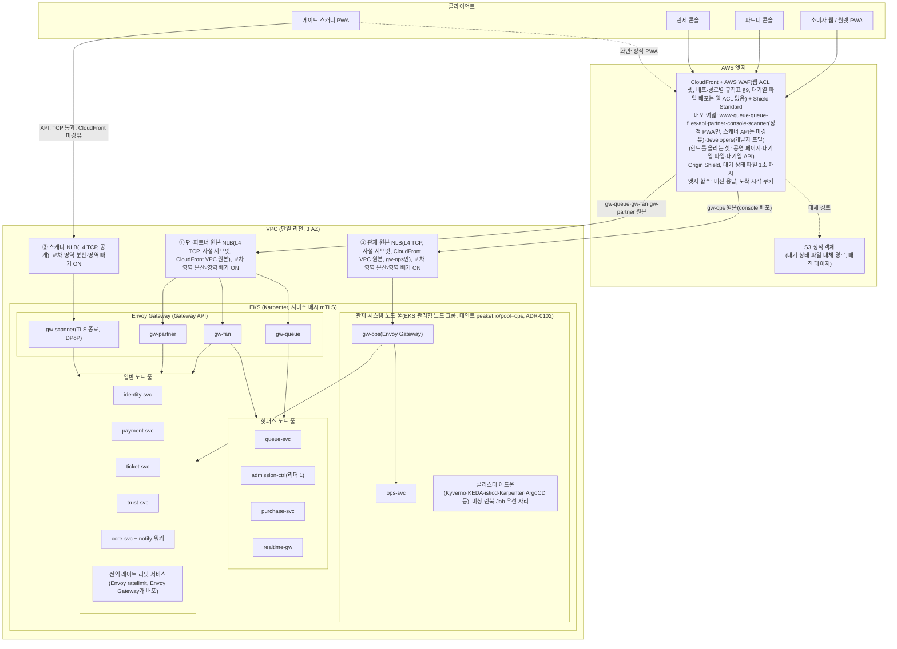
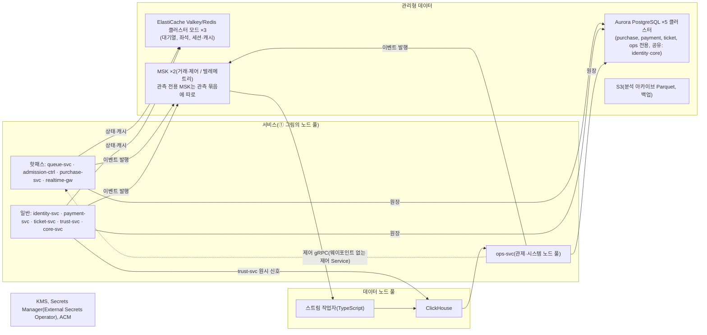
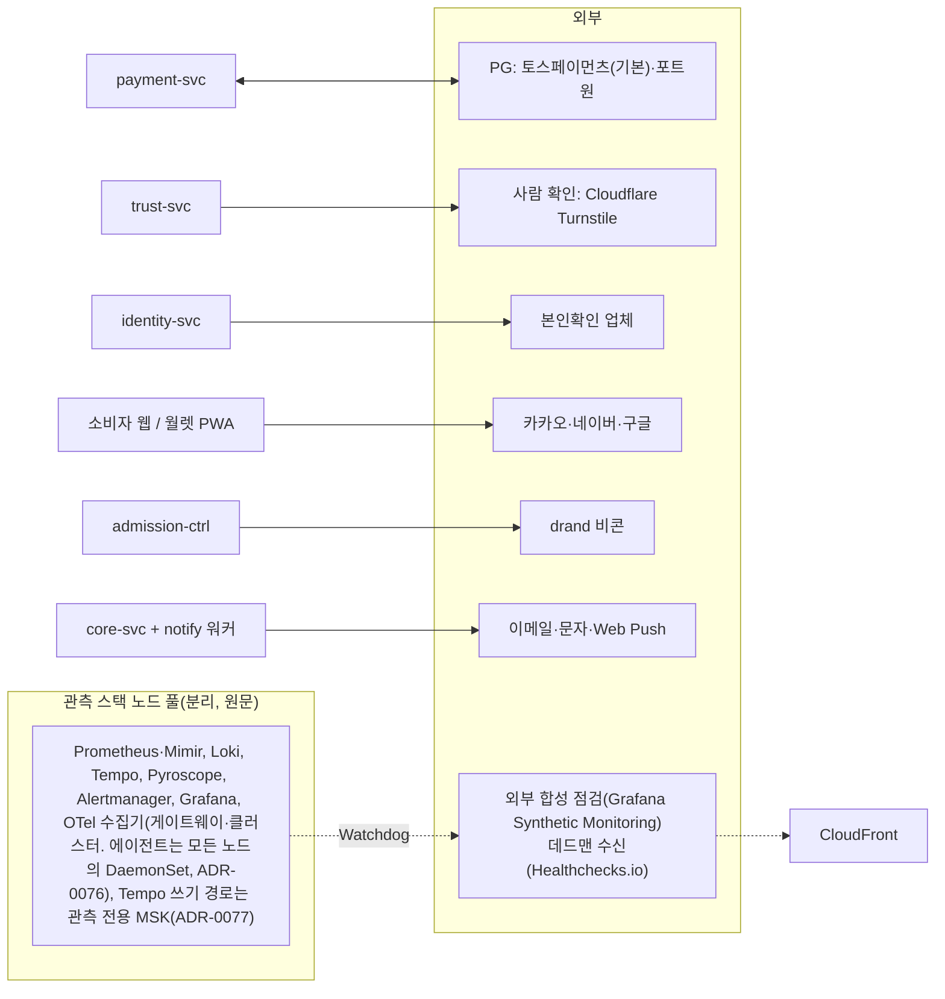
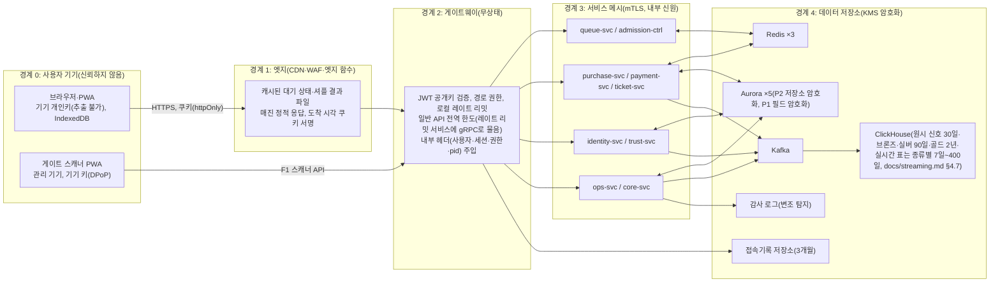
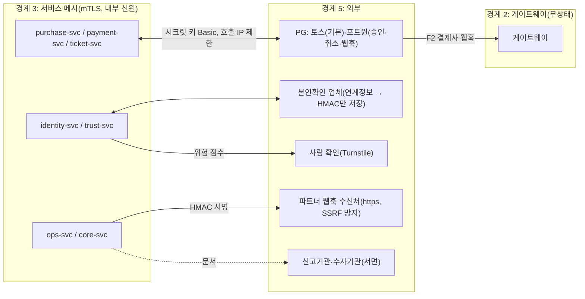
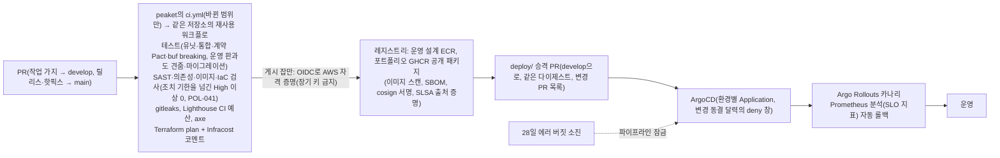

# 인프라·배포·운영

- **독자와 용도**: 플랫폼 엔지니어와 온콜 운영자가 보는 기준 문서다. 시스템 배포 구성, 신뢰 경계, 여러 환경을 나누는 방식, 구성 요소별 고가용성(서비스를 멈춤 없이 쓸 수 있는 정도를 높이는 것)과 이중화, 백업과 DR 계획, CI/CD(코드를 올릴 때마다 자동으로 검사하고 빌드하는 과정과 그 뒤의 배포) 파이프라인, 서비스 디스커버리와 여러 복제 중 일을 맡을 하나를 고르는 분산 리더 선출, 장애가 났을 때 따라 하는 비상 운영 런북의 구성을 파악할 때 참고한다. IaC 원본 코드는 모노레포(코드 전부를 저장소 하나에 폴더로 나눠 담는 방식) `peaket`의 `infra/`(Terraform)와 `deploy/`(Helm, 그리고 저장소의 배포 정의대로 쿠버네티스를 맞추는 ArgoCD)에 있다(ADR-0165·0169). 이 문서는 인프라 아키텍처의 설계 결정과 운영 원칙을 정한다.
- **원문 출처**: 설계서 §3 <제품 범위와 온세일 타임라인> 온세일 프리워밍 절차, 설계서 §6 <시스템 아키텍처> 게이트웨이·서비스 디스커버리·장애 격리, 설계서 §9 <SLO 설계: 목표 → 달성 설계 → 검증> Degraded Mode 대체 경로, 설계서 19장 <MSA, Kubernetes와 CNCF 생태계>, 설계서 23장 <AWS DevOps>, `docs/security/secrets-and-keys.md`, [ADR-0008](adr/0008-client-specific-thin-gateways.md), [ADR-0009](adr/0009-two-layer-circuit-breakers-fail-fast.md), [ADR-0010](adr/0010-service-discovery-and-internal-calls.md), [ADR-0022](adr/0022-control-plane-tcp-out-of-band.md), [ADR-0028](adr/0028-postgres-no-sharding-cell-scaling.md).
- **기준 기획 버전**: v1.0.
- **표시 규칙**: 원문에 자세한 명세가 없던 인프라 설정은 소유자가 추천대로 정하라고 맡겨, 추천안을 적용해 확정했다(추천 적용 2026-10-09, ADR-0031·0032). 이런 설정은 노드 풀(앱이 실행되는 서버인 노드의 묶음) 분리, 복제본(같은 서비스나 저장소를 여러 벌 띄워 둔 것) 수, 백업 주기, 환경 단계, 리전(클라우드 데이터센터가 모인 지역) 장애 대응 범위, 운영 관제 도구 선정이다. 실제 부하 시험과 클라우드 비용 산정 결과에 따라 사양을 조정하게 되면 아키텍처 결정과 그 이유를 남기는 ADR로 고친다. 실제로 재서 최종 확정할 지표값만 [가정]으로 표시한다.

## 1. 배포 구성도

인프라는 단일 리전의 가용영역(AZ) 3개에 나눠, 가용영역 하나가 멈춰도 서비스가 이어지도록 구성한다. 리전 전체가 멈추면 자동으로 넘기지 않고, 판매를 멈춘 뒤 도쿄에서 24시간 안에 복구한다. 이때 주문·결제 원장의 마지막 스냅샷 뒤 구간은 결제사 거래 대사로 다시 맞춘다(§6, ADR-0031):
- **AWS 엣지 계층**: CloudFront, AWS WAF, 엣지 함수(CloudFront Functions)로 정적 자산과 대기열 상태 조회를 흡수해, 대기 상태 조회 때 원본 서버(오리진)로 가는 요청이 대기 인원이 아니라 설계 식(활성 대기 상태 파일 수 ÷ 캐시 수명)에 묶이게 하는 것이 목표다(K1 판정은 그 식의 ±10% [가정] 안이고, 절감률은 보조 숫자다, docs/planning/01-overview.md §3.1. 2026-11-01(정합 점검, ADR-0177 한 판 문서 검토))
- **쿠버네티스(EKS) 컴퓨팅 계층**: Karpenter 기반 자동 프로비저닝과 노드 풀 5개(핫패스, 일반, 관제, 관측 전용, 데이터) 물리 격리. 관제 풀은 gw-ops·ops-svc와 클러스터 애드온(입장 검사 Kyverno, 확장 판단 KEDA, 메시 제어 평면, Karpenter 컨트롤러 등)이 도는 관제·시스템 풀이고, Karpenter가 만들지 않는 EKS 관리형 노드 그룹이다. 오픈 순간의 확장 길(KEDA 판단 → 파드 생성 → Kyverno 입장 검사)과 마지막 제어 길(비상 런북 Job)이 데이터 평면 부하와 노드 축출에서 떨어진다(추천 적용 2026-10-28, ADR-0102, 기술 검토 낮음-013, §4)
- **관리형 데이터 계층**: Aurora PostgreSQL 5개 클러스터(ops 전용 클러스터 포함, ADR-0102), ElastiCache 3개 클러스터, MSK 3개 클러스터(거래·제어, 텔레메트리, 관측 전용)를 3 AZ에 나눠 둔다(관측 전용 클러스터를 계속 둘지는 wbs 4.8.2의 요청 기록 저장소 비교로 정한다. 그 전까지는 셋이다, 기술 검토 중간-021, §11). 저장소를 이만큼 나눈 근거는 처리량이 아니라 장애 격리·비밀 범위·재해 복구 차이다(쓰기량과 텔레메트리 양은 클러스터 하나로도 받는다). 그래서 합치거나 더 나누는 일은 잰 값이 조건을 넘을 때만 한다. 조건은 Aurora가 ADR-0028 상태 줄, MSK가 §11과 docs/review/open-items.md 49번이다(추천 적용 2026-10-28, 기술 검토 낮음-144). 가용영역 하나가 멈출 때의 목표는 Aurora RPO 0·RTO 5분, MSK RPO 0(복제 3벌, `acks=all`, 뒤처진 복제본을 대표로 올리지 않는 `unclean.leader.election.enable=false`, ADR-0141), Redis RTO 30초다. Redis는 비동기 복제 지연분(수백 ms 이내)을 잃을 수 있다(NFR-015, §6, [ADR-0031](adr/0031-environments-and-region-dr.md))

배포 구성도는 한 장에 담으면 선이 59개라 서로 얽혀서, 세 장으로 나눠 그린다(그림 쓰기 규칙 docs/planning/03 §5.5, ADR-0138). ① 요청이 들어오는 경로와 노드 풀, ② 서비스와 데이터 저장소, ③ 외부 연동과 바깥 감시다.

**① 요청 경로와 노드 풀**

①은 게이트웨이(클라이언트 종류별로 앞에 둔 입구 서버)에서 노드 풀까지만 묶어 그렸다. 게이트웨이마다 어느 서비스로 보내는지는 아래 표다(docs/planning/03 §5.5).

| 게이트웨이 | 보내는 서비스 |
| --- | --- |
| gw-queue | queue-svc |
| gw-fan | purchase-svc, realtime-gw, identity-svc, ticket-svc, core-svc, trust-svc(허니팟 경로 하나, docs/features/bot-defense.md §7) |
| gw-partner | core-svc, payment-svc, identity-svc, ticket-svc(기기 배치·현장 현황), ops-svc(실시간 판매 현황) |
| gw-ops | ops-svc, identity-svc |
| gw-scanner | ticket-svc, identity-svc(스캐너 기기 승인 로그인과 토큰) |

위 표는 2026-10-30에 docs/architecture.md §3 ② 그림과 §4 표에 맞췄다(gw-fan의 trust-svc, gw-partner의 ticket-svc·ops-svc, gw-scanner의 identity-svc를 더함).

**② 서비스와 데이터 저장소**

②는 서비스 묶음 단위로 그렸다. 서비스마다 어느 저장소를 쓰는지는 아래 표가 그림보다 자세하다. 정본은 docs/architecture.md §3.1 서비스 맵이다.

| 서비스 | Valkey·Redis | Aurora | MSK 이벤트 발행 | 그 밖 |
| --- | --- | --- | --- | --- |
| queue-svc | 씀 | — | 씀 | ops-svc의 제어 gRPC와 예매 제한 반영 gRPC(`SetBookingRestriction`, 사본은 대기열 Redis, open-items 75번)를 받는다. S3의 ASN(인터넷 사업자·데이터센터마다 받은 네트워크 번호) 분류표를 읽기만 한다(축소 운영의 IP 한도, 추천 적용 2026-10-30, docs/features/bot-defense.md §3.1·§11.2) |
| admission-ctrl | 씀 | — | — | ops-svc의 제어 gRPC를 받는다 |
| purchase-svc | 씀 | 씀 | 씀 | ops-svc의 제어 gRPC와 예매 제한 반영 gRPC(`SetBookingRestriction`, 사본은 좌석 Redis, open-items 75번)를 받는다 |
| realtime-gw | 씀(좌석 Redis의 Pub/Sub 구독) | — | — | — |
| identity-svc | 씀 | 씀 | 씀 | — |
| payment-svc | — | 씀 | 씀 | ops-svc의 제어 gRPC를 받는다(명령 6 대체 결제사 전환, payment DB `pg_switch`, ADR-0143) |
| ticket-svc | 씀(세션·캐시 클러스터의 스캐너 기기 등록 코드 `scanner:enroll:*`와 DPoP 증명 `jti` `scanner:dpop:*`, docs/data.md §3에 맞춤, 2026-10-30) | 씀 | 씀 | — |
| trust-svc | 씀(실시간 피처) | — | 씀 | ClickHouse(원시 신호). S3의 ASN 분류표를 trust-svc 작업이 하루 한 번 [가정] 새 판으로 쓴다(추천 적용 2026-10-30, docs/features/bot-defense.md §3.1) |
| core-svc + notify 워커 | 씀 | 씀 | 씀 | — |
| 좌석맵 해석 작업 `seatmap-worker`(core-svc와 같은 이미지의 별도 배포) | — | — | — | 저장소·AWS 권한이 없다. core-svc의 gRPC만 받고(메시 허용 목록), 나가는 통신은 NetworkPolicy로 모두 막는다. 일반 노드 풀 [가정], 파드마다 동시 처리 1, 메모리 512MiB [가정]. 이미지 처리 작업 `image-worker`(격리 버킷 읽기·파생본 쓰기)와 같은 방식이다(소유자 결정 2026-10-30, open-items 70번 ②, 세부는 추천 적용 2026-10-30, docs/features/seat-hold.md §10) |
| ops-svc | — | 씀(ops 전용 클러스터) | 씀 | ClickHouse를 읽는다(스트림 작업자가 채운 표) |
| 만료 차단 정리 작업 `waf-block-expirer`(ops-svc와 같은 이미지의 따로 도는 CronJob, 관제 노드 풀, 1분 [가정]마다) | — | 읽음(ops 전용 클러스터의 명령 4 읽기 전용 보기 `waf_block_expiry_v` 하나만, docs/data.md §4 6번) | — | ops-svc를 부르지 않는다. 나가는 통신은 §9 '네트워크 격리 계층'의 넷뿐이다. AWS 권한은 관제용 IP 집합 하나의 `wafv2:GetIPSet`·`wafv2:UpdateIPSet`뿐이고 서비스 계정은 ops-svc와 따로다. 마지막 성공이 5분 [가정]보다 오래되면 SEV2(소유자 결정 2026-10-30, open-items 70번 ①, 세부는 추천 적용, docs/features/control-tower.md §5) |

**③ 외부 연동과 바깥 감시**

- 일반 사용자와 관리자 트래픽이 기본으로 들어오는 경로는 CloudFront(AWS의 CDN. 악성 요청을 걸러 내는 웹 방화벽인 AWS WAF를 붙였다) → NLB(L4) → Envoy Gateway(요청을 받아 안쪽 서비스로 넘기는 프록시 서버) → 백엔드 마이크로서비스다. CloudFront 배포는 여덟(www, queue, queue-files, api, partner, console, scanner, developers)이고, 그 가운데 소비자 트래픽이 큰 셋(공연 페이지, 대기열 파일, 대기열 API. API는 프로그램끼리 요청과 응답을 주고받는 창구)은 배포마다 한도를 미리 올린다(§4.1, ADR-0058, 추천 적용 2026-10-29, ADR-0144 결정 3). 중간에 ALB를 하나 더 두지 않아서, HTTP 프록시를 두 번 거치며 생기는 불필요한 지연과 처리 부담을 피한다(ADR-0008). 반면 현장 게이트 스캐너에는 CDN이 사용자 가까이에 둔 서버인 엣지의 캐싱이나 WAF 검사가 불필요하다. 그래서 CloudFront를 거치지 않고, 따로 둔 공개 스캐너 NLB가 TCP 연결을 그대로 전달하는 패스스루로 `gw-scanner`에 바로 연결된다. CloudFront가 부르는 원본 NLB는 사설 서브넷의 VPC 원본이라 인터넷에서 바로 닿지 않는다(§9, 추천 적용 2026-10-28, 기술 검토 낮음-009). NLB는 셋이다. ① 팬·파트너 원본 NLB(gw-queue·gw-fan·gw-partner) ② 관제 원본 NLB(gw-ops) ③ 스캐너 NLB(공개, gw-scanner)다. 관제 원본 NLB를 따로 두는 것은, NLB가 AZ마다 노드를 두더라도 리스너·보안 그룹·대상 그룹 설정 실수 하나나 팬 쪽 포화로 팬·파트너·관제 입구가 함께 막히지 않게 하려는 것이다(추천 적용 2026-10-29, ADR-0144 결정 1). TLS는 쿠버네티스에서 앱이 실행되는 단위인 게이트웨이 파드에서 끝내고(종단), 기기는 기기 키로 요청마다 서명한 DPoP 증명으로 확인한다. 하드웨어 키가 필요한 운영 환경은 양쪽이 서로 인증서를 확인하는 mTLS를 선택지로 두고, 그때는 게이트웨이 파드가 기기 인증서를 직접 검증한다(기술 검토 중간-057). 서비스는 요청마다 기기 상태와 스태프 세션 상태를 확인한다(ADR-0051). 스캐너 PWA(설치형 앱처럼 쓰는 웹 앱) 화면 자체는 정적 앱이라 `scanner.peaket.example`에서 기기 자격 없이 낸다(§4.1 화면 호스트, ADR-0065).
- 프로덕션 아키텍처는 리전 하나(서울 리전)를 기준으로 만든다(분산 DB의 복잡함을 피하려고 ADR-0021에서 CockroachDB를 기각한 결정의 핵심 전제). 재해 복구(DR) 리전에는 ticket 데이터베이스의 교차 리전 읽기 복제본(AWS가 운영해 주는 PostgreSQL 호환 데이터베이스인 Aurora의 Global Database에 속한 도쿄 보조 클러스터, ADR-0083. 티켓 원장 보존과 복구 기준점이고, 도쿄에 조회할 서비스는 없다, 기술 검토 중간-081), 백업 데이터 사본과 전환 준비물(KMS 다중 리전 키, ECR 복제 이미지, 다중 리전 비밀, 결제사에 미리 등록한 도쿄 NAT 고정 IP, ADR-0084)만 늘 둔다. 리전 전체가 멈추는 것 같은 전면 장애가 나면 자동 장애 조치를 하지 않는다. 예매 판매를 바로 멈추고, 콜드 백업 데이터로 차례대로 복원하는 비상 절차를 밟는다(§6, ADR-0031).
- 클러스터 규모와 CNI(추천 적용 2026-10-21, ADR-0078 결정 7): 운영 EKS(AWS가 운영해 주는 쿠버네티스) 클러스터는 하나다. 피크 때의 노드·파드 수 추정 칸과 클러스터 하나로 가는 기준(노드 1,000개·파드 3만 개 [가정] 이하)은 docs/architecture.md §9.5에 있다. 파드에 네트워크를 붙여 주는 CNI는 EKS 기본인 Amazon VPC CNI다. 파드마다 VPC 사설 IP를 쓰므로, 파드가 쓰는 서브넷을 가용 영역 셋에 나눠 잡는다. 서브넷 크기는 파드 수만으로 정하지 않는다. VPC CNI는 노드마다 IP를 미리 잡아 두고(웜 풀), 노드와 그 네트워크 인터페이스도 서브넷 IP를 쓰기 때문이다. 기본값(`WARM_ENI_TARGET` 1)은 노드마다 빈 네트워크 인터페이스 하나와 그 IP를 통째로 잡아 둔다(amazon-vpc-cni-k8s 문서, 2026-10-28 확인). 그래서 웜 풀 방식을 먼저 고르고 그 방식의 식으로 잰다(추천 적용 2026-10-28, 기술 검토 낮음-164).
  - 기본안은 접두사 위임(`ENABLE_PREFIX_DELEGATION`)이다. 노드에 IP를 하나씩 붙이지 않고 /28 묶음(16개)으로 붙인다. 온세일(판매가 열리는 시각 앞뒤로 접속이 몰리는 기간)처럼 파드가 한꺼번에 늘 때 EC2 API 호출이 줄어 파드 시작이 빠르고, 노드당 파드 밀도도 높다(EKS 문서). Graviton 노드는 Nitro라 쓸 수 있다. 대신 /28 묶음은 서브넷 안에서 이어진 빈 칸이어야 붙고, 서브넷이 조각나면 `InsufficientCidrBlocks`로 실패한다. 그래서 파드용 서브넷은 새로 만들고 서브넷 CIDR 예약으로 접두사 자리를 떼어 둔다(EKS 모범 사례 문서). 식: 필요한 IP ≈ Σ노드 (그 노드 파드 수를 16으로 나눠 올린 수 + 웜 접두사 1 [가정]) × 16 + 노드 수 × 붙인 네트워크 인터페이스 수(인터페이스마다 주 IP 하나). 서브넷은 이 값에 노드 교체로 잠시 두 벌이 겹치는 몫 30% [가정]를 더한 크기 이상이다.
  - 다른 안은 보조 IP 방식에 `MINIMUM_IP_TARGET`(노드당 예상 파드 수)과 `WARM_IP_TARGET` 작은 값 [가정]을 두는 것이다. IP 낭비는 적지만, 문서가 큰 클러스터와 파드가 자주 바뀌는 클러스터에서는 `WARM_IP_TARGET`을 피하라고 한다(EC2 API 제한). 식: 필요한 IP ≈ 피크 파드 수 + 노드 수 × (`WARM_IP_TARGET` + 인터페이스 수).
  - 고르기는 wbs 4.8.1의 피크 노드·파드 추정 뒤에 한다. 노드당 파드 수가 인스턴스의 인터페이스·IP 한도에 걸리거나 확장이 몰리면 접두사 위임, 아니면 보조 IP 방식이다. 정확한 CIDR은 그 뒤 Terraform에서 정한다.
- 저장소 엔진 판(추천 적용 2026-10-22, ADR-0086): Aurora PostgreSQL 18.x(18.6.1 이상), ClickHouse 26.8 LTS, ElastiCache Valkey 8.1 이상의 노드 기반 클러스터 모드다. ElastiCache 서버리스는 SLOWLOG·LATENCY·WAIT·로그 전달을 쓸 수 없어 고르지 않는다(AWS 문서). ElastiCache 매개변수 그룹은 `latency-tracking`(명령별 지연 분포, 기본 꺼짐)을 켜고 슬로 로그를 CloudWatch Logs로 보낸다. 메모리 정리 규칙 `maxmemory-policy`는 세 클러스터 모두 `noeviction`이다(기본값 `volatile-lru`는 만료 시간이 걸린 키부터 지워, 순번 중복 확인·홀드·레이트 리밋 카운터·세션이 메모리가 찰 때 조용히 사라질 수 있다). 메모리가 차면 지우는 대신 쓰기가 오류를 내고, 세션·캐시 클러스터는 모든 키에 TTL을 두며(대기열·좌석 클러스터에는 회차와 무관한 키처럼 TTL을 두지 않는 키가 있어 키마다 docs/data.md §3 키 표의 수명을 따른다, 2026-11-02 정합 점검, ADR-0109 상태 줄), 메모리 사용률 70%·85% [가정] 경보로 미리 막는다(추천 적용 2026-10-28, ADR-0109, docs/data.md §3). Lua 스크립트 시간 상한 `lua-time-limit`(5,000ms)은 바꿀 수 없고, 넘으면 `SCRIPT KILL` 뒤 노드를 강제로 다시 시작할 수 있다. 큰 키(로비 집합 등)는 판매 종료 정비 잡이 `UNLINK`로 지운다(docs/data.md §3).
- CloudFront 엣지 함수는 CloudFront Functions와 Lambda@Edge 가운데에서 HMAC(비밀 키로 만든 위조 확인용 값) 서명 검증이 되는지와 실행 비용을 비교해 최종으로 고른다. AWS 계정이 있으면 무료 범위 안에서 함수를 시험하고, 없으면 문서로 비교한다(wbs 0.5.3, docs/architecture.md §9.4 PoC 검증 과제). PoC는 본 개발 전에 위험한 부분만 먼저 만들어 확인하는 시험이다. Lambda@Edge를 고르면, VPC 원본(원본 NLB 둘)을 쓰는 배포에서는 원본 요청·원본 응답 트리거를 쓸 수 없어 보는 사람 쪽(viewer) 트리거만 쓴다. 지금 엣지 함수가 맡는 일(도착 시각 쿠키, 완전 매진 바로 응답)은 보는 사람 쪽 일이다(2026-10-29 확인, https://docs.aws.amazon.com/AmazonCloudFront/latest/DeveloperGuide/private-content-vpc-origins.html).

## 2. 데이터 흐름도(DFD)와 신뢰 경계

데이터 흐름도도 두 장으로 나눈다(docs/planning/03 §5.5, ADR-0138). ①은 사용자 기기에서 저장소까지(경계 0~4), ②는 서비스와 외부의 연동(경계 2·3·5)이다. 라벨 앞 번호(F1·F2)의 자세한 조건은 그림 아래 표에 있다.

**① 사용자 기기에서 저장소까지(경계 0~4)**

**② 서비스와 외부(경계 2·3·5)**

| 번호 | 흐름 | 보호 |
| --- | --- | --- |
| F1 | 게이트 스캐너 PWA → 게이트웨이 | 스캐너 API: HTTPS + DPoP(mTLS는 선택지), CloudFront 안 거침(§4.1) |
| F2 | 결제사 → 게이트웨이 | 웹훅(토스 결제 웹훅은 서명 없음·지급 웹훅은 서명 검증, 포트원은 서명 검증. 모두 조회 API 재확인) |

| 신뢰 경계를 통과하는 개인정보 흐름 | 보호 등급 (data-classification) | 보안 통제 및 암호화 조치 |
| --- | --- | --- |
| 외부 본인확인 대행사 ↔ identity-svc (연계정보 CI) | P1 (최고 민감도) | 대행사 API 인증 정보는 AWS Secrets Manager에 보관한다. 받은 연계정보(본인확인 기관이 주는, 사람마다 하나인 연계 식별값) 원문은 메모리에서 바로 버리고, AWS KMS(암호 키를 안전하게 보관하고 대신 써 주는 클라우드 서비스) 관리형 키로 만든 HMAC-SHA256 해시값(원래 값으로 되돌릴 수 없게 바꾼 고정 길이 값)만 저장한다. 요청이 가장 많이 지나는 대기열 진입 경로(핫패스)에서는 외부 대행사와의 통신을 모두 뺀다(ADR-0006·0008). |
| 예매자 개인 식별 정보 (성명, 전화번호) 단말 브라우저 → purchase-svc → Aurora PostgreSQL | P2 (일반 개인정보) | 전송 구간은 TLS(통신을 암호화하는 표준)로 보호한다. 구매 세션의 쓰기 요청에는 단말 임시 키로 합의한 키로 만든 요청 서명(소지 증명)을 싣는다(본문 암호화는 아니다, ADR-0050 결정 8). 저장소 수준의 KMS 암호화와 애플리케이션 로그 마스킹을 강제한다. |
| 예매자 명단 데이터 Aurora PostgreSQL → gw-partner → 파트너 콘솔 | P2 | 제3자 제공 동의를 받은 필수 항목만 골라 제공한다. 파트너의 조회 사유와 열람 건수는 접속기록 대장에 필수로 기록한다. 대용량 파일 다운로드는 한 번에 보내는 대신 스트리밍 방식으로 제한한다(FR-027, POL-023). |
| 시스템 접속기록 (접속 일시, IP 주소, 단말 정보) 게이트웨이 파이프라인 → 전용 접속기록 저장소 | P2 | 업무용 데이터베이스와 물리적으로 분리한 전용 저장소에 3개월간 보존한다. 수사기관의 영장 같은 적법한 법적 절차를 확인한 경우에만 엄격히 내보낸다(POL-025). |
| 단말 행동 신호 데이터 클라이언트 → trust-svc → Kafka → 재평가 작업자(`trust-reassess`) → ClickHouse | P2 | 사용자 실명 대신 pid와 기기 식별값의 기기 가명(trust-svc가 넣기 전에 조사용 가명 키 `inv-ref-key`로 HMAC-SHA256을 계산한 값. 2026-10-30까지는 탐지 가명 키, ADR-0053·0171)만 싣는다(ADR-0053). 대기 중 재평가 후보(`telemetry.trust-candidates`)에는 키인 pid와 회차·패턴·근거 수만 싣는다(ADR-0071). 대량 이벤트 집계에 강한 분석용 데이터베이스인 ClickHouse에서는 테이블 TTL(데이터 보관 기한)로 30일이 지나면 자동으로 파기한다. AWS의 파일 저장소인 S3의 장기 레이크에는 비식별 집계 통계만 보존한다. 그 집계본은 `close-runner`가 회차 마감 뒤 하루 1회 조회·홀드·구매 수와 구역·시간대만 세어 Parquet로 `s3://peaket-analytics/behavior-aggregate/dt=YYYY-MM-DD/`에 쓰고 1년 보존한다(소유자 결정 2026-11-11, open-items 96번. 구현 직전에 집계 항목·비식별 기준·비용을 한 번 더 확인한다). |
| 부정 예매 조사 사본(원문 IP·ASN·TLS 지문 JA4·끝단 봇 라벨·계정 ID·pid·여정 ID) 게이트웨이 접근 로그 → 노드 에이전트 수집기 조사 사본 갈래 → Kafka `investigation.requests` → 조사 적재 `inv-ingest` → ClickHouse 조사 저장소 `inv` → ops-svc 조사 모듈(지정 조사관) (추천 적용 2026-10-31, ADR-0171) | P2 | 법정 접속기록과 따로 보내고 서로 복사하지 않는다. 토픽 쓰기·읽기는 신원 하나씩이고(MSK IAM), 보존 3일 [가정]이다. 조사 저장소는 분석 저장소와 다른 데이터베이스이고 그 회차 공연일 + 30일 [가정]에 ops-svc 파기 작업 `inv-partition-purge`(Kubernetes CronJob, ClickHouse 사용자 `inv_purger`와 ops DB 사용자 `ops_purge_writer`(파기 감사 로그(FR-044)에 INSERT만. `ops_event`는 DB 표가 아니라 로그 줄로 남긴다)의 비밀만 받는다)가 회차 파티션을 지우고 결과를 남긴다. 테이블 TTL은 보조다(추천 적용 2026-10-31, ADR-0173). 읽기는 요청한 관리 계정의 부정 거래 조사관 지정을 확인한 뒤 ops-svc만 하고, 조회는 접속기록(2년)과 대량 조회 점검 대상이다. 일반 로그(Loki)에는 조사 칸을 지워 보낸다(docs/observability.md §7, data-classification '조사용 요청 기록' 행, threat-model §11.1) |
| 모바일 월렛 공개키 브라우저 → ticket-svc, 티켓 공개키 및 폐기 목록 → 게이트 스캐너 단말 | P3 (공개 가능 키) | 단말 서명용 ECDSA 개인키는 서버로 보내지 않고, 브라우저 IndexedDB(브라우저 안에 데이터를 저장하는 곳)의 WebCrypto 키(`extractable=false`)로 둔다. 하드웨어 보관은 아니다(ADR-0050 결정 1). 스캐너 단말은 등록한 기기 키로 요청마다 서명한 DPoP 증명(RFC 9449)으로 기기를 확인하고, 하드웨어 키가 필요한 운영 환경의 선택지로 mTLS 기기 인증서(PEAKET 스캐너 사설 CA)를 둔다(ADR-0051, 기술 검토 중간-057). |

경계 0~5와 전달 경로마다 생각한 위협(STRIDE 여섯 갈래), 대응 위치, 남는 위험은 [docs/security/threat-model.md](security/threat-model.md)에 있다(추천 적용 2026-10-28, 기술 검토 중간-065).

## 3. 환경 분리

| 환경 | 주요 용도 | 인프라 구성 | 데이터 정책 | 비밀 관리 | 배포 방식 |
| --- | --- | --- | --- | --- | --- |
| 로컬 (Local) | 기능 개발, 1천·1만·10만 명 측정(포트폴리오 기간의 기본 측정 환경), 단위·통합·계약 테스트(온라인 결제를 대신 처리해 주는 결제사 PG의 시뮬레이터 연동), Game Day(일부러 장애를 내고 대응을 연습하는 날)와 합성 봇 시험(ADR-0057) | kind로 띄운 로컬 K8s(아래 '로컬 클러스터', 2026-11-01 정합 점검) + AWS 흉내 서버(AWS 기능을 흉내 내는 모의 환경. 계정이 있어야 뜨는 LocalStack 대신 계정 없이 도는 moto, 아래) + Strimzi(로컬 Kafka. 이벤트를 순서대로 쌓아 두고 여러 곳에 나눠 주는 메시지 시스템). CI 테스트 환경도 같은 구성을 쓴다 | Faker로 만든 완전 합성 데이터 | `.env` 로컬 파일(Git 커밋 절대 금지), `.env.example` 템플릿 제공 | 로컬 수동 실행 |
| 스테이징 (Staging) | (설계) 대규모 부하 시험, 카오스 엔지니어링(Chaos Mesh·AWS FIS), 합성 봇 침투 시험(POL-026: 봇 공격 실험은 격리 환경에서만 한다), Game Day, 교차 리전 재해 복구 훈련. 포트폴리오 기간에는 띄우지 않고, 이 역할은 로컬 측정 환경과 선택 보정이 맡는다(ADR-0057, docs/verification.md §5) | 운영과 같은 Terraform 모듈로 만든다. 부하 측정과 Game Day 기간에만 그때그때 만들고, 끝나면 바로 자원을 회수한다(싸지만 회수될 수 있는 클라우드 서버인 Spot 인스턴스 + 시간 단위 과금) | 대규모 합성 데이터, 결제사 토스·포트원의 테스트 연동 키, PG 시뮬레이터 어댑터 | AWS Secrets Manager (staging 네임스페이스) | ArgoCD, 운영과 같은 Helm 차트 배포 |
| 데모 (Demo) [보완] | 포트폴리오 시연과 E2E 시나리오 검증. 늘 켜 두는 환경은 두지 않는다(질문 24 결론, ADR-0057) | 로컬 kind의 데모 오버레이(서비스별 1복제본). 선택: 면접·발표 때만 몇 시간 띄우는 임시 클라우드(TTL·예산 경보) | 가벼운 합성 데이터, 결제사 샌드박스 테스트 키, 2인 승인 시연용 데모 승인자 계정(데모 시드에만, ADR-0095) | 로컬 `.env`(커밋 금지), 임시 클라우드는 AWS Secrets Manager (demo 네임스페이스). 데모 승인자의 비밀번호·TOTP 비밀도 여기에만 둔다 | ArgoCD 자동 배포(데모 오버레이. 2인 승인 시연용 데모 도우미는 이 오버레이에만 있다), 녹화 영상과 재현 스크립트 |
| 운영 (Production) | 실제 상용 서비스 환경(이 포트폴리오의 최종 아키텍처 목표 사양). 포트폴리오 기간에는 설계와 코드로만 두고 띄우지 않는다(ADR-0057) | 이 문서 1절의 다중 AZ(리전 안의 독립된 데이터센터 묶음) 고가용성 구성 | 실제 고객 데이터(엄격한 암호화, 법정 보존·파기 정책 준수) | AWS Secrets Manager (prod 네임스페이스), AWS KMS 전용 키 | ArgoCD + Argo Rollouts 기반 카나리 점진 배포, 온세일 윈도우 배포 엄격 차단 |

- 환경별 배포 경로(데모 자동 승격, 스테이징 캠페인 고정, 운영 승격 조건)와 GitOps(저장소에 적어 둔 배포 상태대로 클러스터를 맞추는 운영 방식) 저장소 구조는 docs/devops.md §5에 정했다(ADR-0054).
- **AWS 흉내 서버(추천 적용 2026-10-28, 2026-11-01 고침, 기술 검토 낮음-010)**: LocalStack for AWS는 계정 기반 이미지 하나로 바뀌어 로컬과 CI 모두 계정과 인증 토큰(`LOCALSTACK_AUTH_TOKEN`)이 있어야 뜬다(LocalStack 가격·라이선스 문서, 2026-10-28 확인). 소유자가 외부 서비스 계정을 만들지 않기로 해(2026-10-31) wbs 0.4.1의 ① Hobby로 CI 인증 토큰 받기와 ② CI 공정 사용 한도 확인은 하지 않고, 처음 결정의 '막히면' 갈래대로 계정 없이 도는 AWS 흉내 서버 moto(5.2.5, Apache-2.0)로 바꿨다(추천 적용 2026-11-01, openspec 변경 add-local-cluster-and-relay-deployment). 세 서비스를 한 컨테이너로 흉내 내어 같은 AWS CLI·SDK 호출을 그대로 시험할 수 있어서다. ③ 쓰는 기능은 kind에서 확인했다(`tools/local/e2e/aws-emulator.e2e.mjs`): S3 Object Lock의 보존 기한(COMPLIANCE)과 법적 보존이 판 지우기를 막고, KMS ECC_NIST_P256 키로 ECDSA_SHA_256 서명·검증과 공개키 꺼내기가 되며, Secrets Manager에 새 판을 넣으면 앞 판이 AWSPREVIOUS로 남는다. 한계: 서명과 IAM 권한을 검사하지 않고, 보존 기한 읽기(`GetObjectRetention`)를 구현하지 않아 객체 머리로 보며, 틀린 서명 검증에 예외 대신 `SignatureValid: false`로 답한다(tools/local/README.md). 그래서 권한 시험은 이것으로 하지 않는다. CloudFront는 원래부터 문서 인용과 로컬 캐시로 대신한다. 토큰이 필요 없어 포크 PR에서도 통합 시험이 돌고, 공개 저장소를 받아 재현하는 사람도 계정이 필요 없다(docs/devops.md §2.1 '공개 재현 경로'). 비밀이 필요한 CI 단계가 생기면 포크 PR에서 건너뛰었다고 표시한다(`tools/ci/fork-guard.mjs`, docs/devops.md §4.5).
- **로컬 클러스터(추천 적용 2026-11-01, wbs 0.4.1, openspec 변경 add-local-cluster-and-relay-deployment)**: kind v0.33.0(쿠버네티스 1.35.8 노드 이미지 다이제스트), Strimzi 0.47.0과 Kafka 3.9.1(KRaft 브로커 하나. 운영 MSK와 같은 3.9.x를 받는 마지막 Strimzi다, docs/devops.md §9.4), PostgreSQL 18, AWS 흉내 서버를 `node tools/local/cluster.mjs up` 하나로 띄운다. 도구(kind·kubectl·helm)는 공식 주소에서 받아 고정한 SHA-256과 맞을 때만 쓰고, 이미지는 다이제스트로 고정하며, 사용자의 kubeconfig는 바꾸지 않는다. CI는 같은 스크립트를 `ci-kind.yml`에서 부른다(docs/devops.md §3.1). k3d가 아니라 kind를 고른 까닭은 판별 노드 이미지를 다이제스트로 고정할 수 있고, 노드 컨테이너 안에서 파드 프로세스에 신호를 보내 V-T28의 프로세스 정지(SIGSTOP)를 그대로 할 수 있어서다. 서비스별 Outbox 릴레이는 공용 차트(`deploy/charts/peaket-service`)의 `<서비스>-outbox-relay` Deployment로 띄운다(ADR-0116).
- **v0 배포(추천 적용 2026-11-03, wbs 1.1.4, K6·K9, BUILD_ORDER BSL-050)**: K6·K9의 비교 기준인 v0 배포다. v0는 '유능한 팀이 처음 만들 법한 단순한 설계'라(ADR-0096 결정 6) 봇 방어는 입구의 IP 기반 요청 수 제한(레이트 리밋)만, 자동 확장은 CPU 사용률 기준 HPA(쿠버네티스 기본 수평 확장)만 둔다. 운영·클라우드에는 띄우지 않고 로컬 kind에서만 돈다(ADR-0057). 모듈의 동작은 docs/architecture.md §9.3이 가리키는 기능 설계서의 v0 절이다.
  - **띄우는 법**: `node tools/local/cluster.mjs up` 뒤 `node tools/local/cluster.mjs v0`. 이미지 둘(`peaket/v0-monolith:local`은 `services/v0-monolith/Dockerfile`, `peaket/pg-simulator:local`은 `services/pg-simulator/Dockerfile`, 빌드 맥락은 저장소 뿌리)을 만들어 클러스터에 싣고 네임스페이스 `v0`에 올린다. `node tools/local/cluster.mjs v0-forward`가 입구를 `https://127.0.0.1:8443`에 포트 전달한다(이 PC에서만 닿는다). 포트 전달은 연결 하나로 모든 요청을 나르므로 부하 측정의 통로로 쓰지 않는다. 부하 발생기를 어디에 두는지는 wbs 1.2.1(BUILD_ORDER BSL-060)에서 정한다.
  - **구성**: 입구 `v0-gateway`는 v0 모놀리스 이미지의 다른 시작 명령(`dist/gateway/main.js`)이라 배포 단위는 그대로 하나다(docs/architecture.md §9.3). 입구와 앱 `v0-monolith`은 공용 차트(`deploy/charts/peaket-service`)의 두 릴리스이고, 값은 `deploy/envs/local/v0-gateway.yaml`·`deploy/envs/local/v0-monolith.yaml`이다. 입구는 복제 1 [가정]이다. 대기열 Redis는 Valkey 8.1(`deploy/local/valkey.yaml`, 네임스페이스 `peaket-local`, 디스크에 저장하지 않음), DB는 `peaket-local`의 PostgreSQL 18에 만든 DB `v0`이고, 앱을 올리기 전에 같은 이미지의 마이그레이션 잡(`node scripts/migrate.mjs`)을 끝낸다. 결제사는 PG 시뮬레이터(`deploy/local/pg-simulator.yaml`)다. 비밀(DB·Redis 주소, 시뮬레이터 시험 키, 입구 TLS 인증서와 키)은 `cluster.mjs`가 처음 올릴 때 만든 Secret에만 두고 저장소에 두지 않는다.
  - **입구가 하는 일**(v1 게이트웨이의 몫 가운데 v0에 필요한 것만. 봇 판정·전역 한도·로비는 없다):
    1. HTTPS 포트 하나(8443)만 연다. TLS 1.2 이상이고, 인증서는 `cluster.mjs`가 클러스터마다 만드는 자체 서명 인증서(EC P-256, 30일 [가정])다. 평문 포트는 없고 WebSocket도 같은 포트의 `wss`만 받는다.
    2. 들어온 요청의 내부 신원 머리(`x-user-`로 시작하는 머리 전부와 `x-session-id`), 추적 머리(`traceparent`·`tracestate`·`baggage`), 앞단 주소 머리(`forwarded`·`x-real-ip`와 `x-forwarded-`로 시작하는 머리 전부), 연결 머리(`Connection`에 적힌 이름 포함)를 지운다. 이름을 밑줄로 쓴 것(`x_user_id` 등)도 같은 머리로 보고 지운다(앞단이 밑줄을 붙임표로 바꿀 수 있다). `x-forwarded-for`는 입구가 정한 클라이언트 IP 하나로 다시 쓴다(5). `Cookie`는 앱으로 넘기지 않는다(앱은 쿠키를 읽지 않는다). 본문 길이 표시는 지우지 않는다: 받은 `Content-Length`는 `Connection`에 적혀 있어도 그대로 달고, chunked로 받은 본문은 다시 chunked로 보낸다. 지우면 앱이 본문 안에 숨긴 두 번째 요청을 따로 읽어 다른 사람 신원의 요청이 앱에 들어간다(요청 밀반입, 2026-11-03 새 맥락 코드 리뷰).
    3. 팬 액세스 토큰 쿠키 `__Secure-peaket_at`(docs/features/identity.md §3)를 ES256 공개키 목록(JWKS, 환경 값 `PEAKET_V0_GATEWAY_JWKS`)으로 검증한다. 헤더의 `alg`가 ES256이고 `typ`이 at+jwt이고 `kid`가 목록에 있으며, `iss`가 설정값(`PEAKET_V0_TOKEN_ISSUER`), `aud`가 fan, `exp`가 지금보다 뒤(`nbf`가 있으면 지금이거나 그 앞), `sub`·`sid`가 1~1024자 문자열일 때만 받는다(시계 허용 오차 없음 [가정]). 신원 값은 머리에 실으므로 `sub`·`sid`·`pid`는 공백 없는 보이는 ASCII, `scope`는 보이는 ASCII와 공백만 받는다(머리 주입을 막는다). 받으면 `x-user-id`(sub)·`x-session-id`(sid)·`x-user-aud`(fan)·`x-user-scope`(scope)·`x-user-pid`(pid, 있을 때)를 넣는다. 토큰이 없거나 틀리면 신원 없이 넘기고(인증이 필요한 경로는 앱이 401로 답한다), 틀린 까닭은 지표로만 센다. 서명 개인키는 클러스터에 두지 않는다. `cluster.mjs`가 시험 키 쌍을 만들어 개인키는 이 PC의 `.cache/peaket-tools/`에만 두고(시험과 부하 발생기가 `tools/local/v0-token.mjs`로 토큰을 만든다), 공개키만 입구에 넣는다.
    4. 액세스 쿠키를 실은 쓰기 요청(POST·PUT·PATCH·DELETE)은 `Origin`이 허용 출처(`PEAKET_V0_ALLOWED_ORIGINS`, 쉼표로 나눈 목록)에 있어야 하고, 없거나 다르면 403이다(docs/architecture.md §4 'CSRF 확인 규칙'과 같다).
    5. 클라이언트 IP마다 토큰 버킷 하나로 요청 수를 제한한다. 초당 10개를 채우고 최대 20개까지 모은다 [가정, wbs 1.4.1 ②에서 v0 측정 값으로 적는다]. 경로와 계정을 가리지 않고 모든 요청(WebSocket 업그레이드 포함)에 건다. 넘으면 429와 `Retry-After`(다음 토큰이 찰 때까지의 초, 올림)다. 버킷은 입구 파드마다 따로 세므로 실효 상한은 '입구 파드 수 × 한도'다(v1 로컬 한도와 같은 성질, docs/api/guidelines.md §6). 버킷 표는 최근에 쓴 IP 10만 개 [가정]까지 두고, 넘으면 가장 오래 쓰지 않은 것부터 지운다. 클라이언트 IP는 연결의 상대 주소이고, `PEAKET_V0_TRUSTED_PROXY_HOPS`가 n(기본 0)이면 `X-Forwarded-For`의 오른쪽에서 n번째 값(앞단 프록시 n개가 붙인 값 가운데 가장 바깥)이다. 값이 모자라거나 IP가 아니면 연결의 상대 주소를 쓴다. 로컬 부하 시험에서는 부하 발생기가 CDN 몫을 대신해 가상 사용자마다 IP를 붙이고 이 값을 1로 둔다. 그래서 분산 프록시처럼 IP를 바꾸는 봇은 이 한도를 그대로 지나가고, 한 IP를 나눠 쓰는 사람들은 함께 막힌다(K6의 v0 한계, docs/architecture.md §9.3).
    6. 모든 응답에 `Strict-Transport-Security: max-age=31536000; includeSubDomains`와 `X-Content-Type-Options: nosniff`를 붙이고, 앱이 `Cache-Control`을 주지 않은 응답에는 `Cache-Control: no-store`를 붙인다(docs/api/guidelines.md §9). 입구가 직접 내는 오류(400·403·429·502·504)는 `Cache-Control: no-store`를 단 `application/problem+json`의 `about:blank` Problem(`title`은 HTTP 상태 문구, `status`, `traceId`)이다(docs/api/guidelines.md §2 '이름이 아직 없는 HTTP 오류').
    7. 앱의 응답 머리를 20초 [가정]까지 기다리고, 넘으면 504다. 요청 마감(`PEAKET_MAX_DEADLINE_MS`, 기본 15초)보다 길게 둬 동기 결제 체인(docs/features/payment.md §13)이 입구에서 먼저 끊기지 않게 한다. 앱에 닿지 못하면 502다. 노는 손님 연결은 65초 [가정]까지 둔다. Node 기본값 5초면 연결을 다시 쓰는 클라이언트(부하 발생기 등)가 막 닫힌 연결에 요청을 실어 끊긴다(2026-11-03 kind e2e에서 드러남). 종료 신호(SIGTERM)를 받으면 새 연결을 받지 않고, 처리 중인 요청이 끝나기를 21초 [가정](앱 응답 기다림보다 조금 길고, 차트의 종료 유예 30초에서 preStop 5초를 뺀 것보다 짧게)까지 기다린 뒤 남은 연결을 닫는다. 손님이 먼저 끊은 요청은 앱 오류로 세지 않는다. 종료는 TLS 손잡기 전 연결도 기다리지 않고 닫고, 시작한 뒤에 TLS를 마친 연결은 받지 않는다. 앱이 본문을 다 받기 전에 답하면(415·413 등) 남은 본문은 버리고 반쯤 쓴 앱 쪽 연결을 닫는다. 앱이 최종 응답이 아닌 상태(1xx)나 200~599 밖의 상태를 주면 502다. WebSocket 업그레이드 요청에 본문이 실려 있으면 400이고, 같은 연결에 아직 답하지 않은 요청이 있는데 업그레이드가 이어 오면 응답 차례가 깨지므로 그 연결을 끊는다(2026-11-03 새 맥락 코드 리뷰 2차).
    8. 관리 포트(9464)에 `/metrics`(`v0_gateway_requests_total{outcome}`: `forwarded`·`rate_limited`·`origin_rejected`·`upstream_error`·`upstream_timeout`, `v0_gateway_token_rejections_total{reason}`: `malformed`(JWT 모양이 아님)·`alg`·`typ`·`kid`·`signature`·`issuer`·`audience`·`expired`·`not_yet_valid`·`claims`(sub·sid·scope·pid의 형·길이·글자가 틀림))·`/ready`·`/livez`를 둔다.
  - **앱 포트 막기**: v0 모놀리스는 신원 머리를 그대로 믿으므로 앱 포트(8080)는 입구 파드만 닿게 NetworkPolicy로 막는다(kind 기본 네트워크 kindnet이 지킨다). 관리 포트는 `observability` 네임스페이스(로컬 관측 최소의 Prometheus)만 닿는다.
  - **CPU HPA(K9의 v0)**: `autoscaling/v2` HPA 하나로, 최소 1·최대 4 복제 [가정](PC 한 대), 목표 CPU 사용률 70% [가정](요청 CPU 500m 기준)이다. 확장 동작(`behavior`)은 쿠버네티스 기본값 그대로 둔다(늘리기는 15초마다 두 배나 4개 가운데 큰 쪽까지, 줄이기는 5분 안정화). CPU 지표는 metrics-server v0.9.1(설치 파일 해시·이미지 다이제스트 고정, kind 노드의 kubelet 인증서가 자체 서명이라 `--kubelet-insecure-tls`)이 15초마다 모은다. 그래서 갑자기 몰리면 지표가 CPU 상승을 보고(최대 15초), HPA가 판단하고(15초 주기), 새 파드가 준비될 때까지 늦는다(K9의 v0 한계). 공용 차트는 HPA를 켠 Deployment에 복제 수를 적지 않는다(HPA가 정한 수를 다시 올릴 때 되돌리지 않게). 입장 루프는 복제본마다 돌아도 1초 칸마다 한 번만 부른다(docs/features/queue-admission.md §13 동작 4).
  - **확인**: `node --test tools/local/e2e/v0-deploy.e2e.mjs`가 실제 kind에서 입구를 거친 v0 흐름(진입 → 입장 → 좌석 → 홀드 → 주문 → 결제 → 검표, 변경분 `wss`), 머리 지우기·토큰·출처·레이트 리밋·응답 머리, 앱 포트 막기, CPU 부하에 HPA가 복제본을 늘리는 것을 본다.
  - **운영 확인(docs/architecture.md §8.4)**: v0는 로컬과 부하 시험의 비교 기준선이라 운영에 배포하지 않는다.

| 확인할 동작 | 사건·필드 | SLI | 대시보드 패널 | 경보 | 배포 뒤 확인 방법 |
| --- | --- | --- | --- | --- | --- |
| IP 레이트 리밋의 거절과 오탐 | `v0_gateway_requests_total{outcome="rate_limited"}`, 부하 시험 기록의 429 | 사람 쪽 429 비율(K6와 같은 판정, 비교용) | 없음 | 없음(비교 기준선) | 확인 불가: 운영에 배포하지 않는다. 성능 장부 실행(K6)과 `v0-deploy.e2e.mjs`로 본다 |
| 토큰·출처 거절 | `v0_gateway_token_rejections_total{reason}`, `v0_gateway_requests_total{outcome="origin_rejected"}` | 없음 | 없음 | 없음 | 확인 불가: 같은 까닭. `v0-deploy.e2e.mjs`로 본다 |
| CPU HPA 확장 시간선 | HPA 상태(복제 수·CPU 사용률), 파드 준비 시각, `kubectl get hpa` 기록 | 부하가 늘어난 때부터 늘린 파드가 준비될 때까지(K9 ①과 같은 식, 비교용) | 없음 | 없음 | 확인 불가: 같은 까닭. 성능 장부 실행(K9)으로 본다 |

- **포트폴리오 기간의 원칙(소유자 결정 2026-10-13, ADR-0057)**: 운영·스테이징은 이 문서와 Terraform·매니페스트 코드로만 두고 띄우지 않는다. 문서에 '스테이징에서' 한다고 적은 시험·훈련은 로컬 측정 환경에서 한다. 관리형 서비스에 장애를 넣는 시험은 대체 장애로 바꾼다. 관리형 서비스의 장애 조치 시간과 노드 기동 시간은 문서를 인용해 둔다(docs/verification.md §5).
- 늘 켜 두는 유휴 dev 클러스터는 비용을 줄이려고 운영하지 않는다. 분산 구성 요소 사이의 통합 테스트와 계약 테스트는 CI 단계의 로컬 컨테이너(앱과 실행 환경을 한 묶음으로 만든 실행 단위) 환경에서 한다. 실제 브라우저로 하는 E2E 검증은 로컬·CI의 데모 오버레이에서 한다(ADR-0031, ADR-0057).
- Terraform 원격 상태 파일(State)은 환경별로 물리적으로 나눠 서로의 간섭을 막는다(23장). 운영 환경의 실제 데이터를 스테이징이나 데모 환경으로 덤프하거나 복사하는 일은 개인정보 보호 원칙에 따라 엄격히 금지한다(POL-026).
- 클라우드에서 부하를 내는 선택 보정(ADR-0057) 전에는 AWS의 네트워크 스트레스 테스트 정책을 미리 점검한다. 트래픽은 반드시 회사 계정이 소유한 테스트 자원에만 보내야 한다.
- **로컬 데모 무대(추천 적용 2026-11-20, BAT-087)**: 데모 환경의 로컬 판은 `node tools/local/cluster.mjs demo` 하나로 올린다. 클러스터 이름은 `lane4-demo`(kubeconfig `.cache/peaket-tools/kubeconfig-lane4-demo`)이고 다른 갈래의 `peaket`·`lane4-*` 클러스터는 건드리지 않는다. 서비스 이미지 다섯(identity·ticket·trust·core·realtime-gw)과 앱 이미지 다섯(web·partner·console-host·scanner·queue-room)은 `peaket/<워크로드>:demo`로 이 PC에서만 만들고, queue·admission·purchase·payment는 기존 합본 `bundle` 한 파드로 덮는다(운영 모양과 다름). 게이트웨이 다섯은 대역 백엔드가 아니라 실제 서비스(`deploy/gateways`의 HTTPRoute·ReferenceGrant, bundle이 사는 `purchase` 네임스페이스로 backendRef만 바꿈)를 본다. 정본 호스트에 이 PC 포트를 붙여 `https://www.peaket.example:18441`~`https://scanner.peaket.example:18445`로 열고, identity gRPC는 `127.0.0.1:19051`, 모의 본인확인기관은 `127.0.0.1:18920`이다. `PEAKET_ENV`는 `local`이다(합본·identity KMS·웹 모의 OIDC 제공자의 local 전제). 정리 `demo-down`은 데모 네임스페이스 여섯만 지운다. 이미지는 GHCR에 올리지 않는다(첫 출시 뒤 승격 묶음 몫).
- **데모 재현(추천 적용 2026-11-20, BAT-086, ADR-0325)**: 빈 PC에서 `node tools/local/demo.mjs all` 한 번이 무대 → 기본 시드 → S1~S9 재생 → 측정 → 정리(데모 네임스페이스 + kind 클러스터)까지 한다. 두 경로를 가른다: 로컬(기본, 0원)은 BAT-087의 로컬 이미지·로컬 오버레이(`peaket/<워크로드>:demo`, `PEAKET_ENV=local`, `pullPolicy: Never`)를 쓰고, 클라우드(선택)는 `deploy/envs/demo/*.yaml`의 서명된 GHCR 다이제스트(`PEAKET_ENV=demo`)를 쓴다. 클라우드는 이 묶음에서 실행하지 않고 `deploy/demo/cloud-plan.yaml`(TTL 6시간 [가정]·예산 5만 원 상한·정리 차례)의 값 검사와 `docs/devops.md` §5.1 절차로만 둔다. 데모 시계는 회차 오픈을 지금+30초로 당기고(파트너 회차 고치기), 화면의 조건을 기다린다. S7 2인 승인은 요청자·데모 승인자 브라우저 맥락 둘로 본다(OPS-290 데모 도우미는 기다리지 않는다). 걸린 시간은 `docs/review/measurements/BAT-086-demo.md`에 남는다.

## 4. 구성 요소별 가용성·이중화

| 구성 요소 | 이중화 및 고가용성 설계 | 장애 발생 시 시스템 동작 | 설계 근거 및 검증 방식 |
| --- | --- | --- | --- |
| CloudFront + AWS WAF | 전 세계 엣지에 나눠 배포 | CDN 뒤에서 원본 파일을 주는 서버인 오리진에 장애가 나면, `stale-if-error` 정책에 따라 가까운 곳에 복사해 둔(캐시된) 공연 안내 페이지로 응답한다. 셔플·묶음 결과 파일은 S3에만 있어 S3를 바로 원본으로 쓴다(ADR-0232 결정 4). 대기 상태 파일(매진 표시 포함) 요청은 CloudFront 원본 그룹(주 원본 → S3 사본, 장애 조치 상태 코드 500·502·503·504, 연결 시간 초과 2초·시도 1회 [가정]. 기본값은 10초씩 3회라 30초 뒤에야 넘어간다)이 요청마다 S3 정적 오리진이라는 대체 경로로 자동으로 돌리고, 다음 요청은 다시 주 원본으로 보낸다. 원본이 살아 있어도 S3 사본으로 고정하는 것은 명령 6이고 해제도 명령 6이다(RB-04, ADR-0078 결정 2). 보조 원본은 같은 요청 경로를 받으므로 S3 사본 키를 요청 경로에 맞춘다 [가정, wbs 2.2.2에서 확인]. 원본 그룹은 GET·HEAD·OPTIONS 요청만 넘기고 POST는 넘기지 않는다. 그래서 대기열 진입·결제 접수 같은 POST는 엣지에서 넘어가지 않는다(대기열 진입은 엣지 함수의 도착 시각 쿠키가 대신한다). CloudFront 전체 장애나 DNS 장애 때는 판매를 멈추는 것 말고 대체 경로가 없다(RB-40, ADR-0144 남는 한계). | NFR-007, NFR-002 Degraded 우회 설계. 배포 여덟과 한도를 올리는 셋은 §4.1(ADR-0058·0144·0194) |
| NLB | 셋으로 나눈다(추천 적용 2026-10-29, ADR-0144 결정 1): ① 팬·파트너 원본 NLB(사설, CloudFront VPC 원본, gw-queue·gw-fan·gw-partner) ② 관제 원본 NLB(사설, CloudFront VPC 원본, gw-ops) ③ 스캐너 NLB(공개, gw-scanner). 셋 모두 3개 가용 영역(AZ) 분산, 교차 영역 로드 밸런싱 활성화, 영역 빼기(zonal shift, 망가진 AZ로 새 연결을 보내지 않게 하는 NLB 기능. 기본은 꺼져 있어 NLB마다 켠다) 켬 | 특정 가용 영역의 게이트웨이 파드가 모두 멈춰도 다른 AZ의 정상 파드로 트래픽을 바로 다시 나눈다. AZ 하나가 망가졌다고 판단하면 RB-13에서 사람이 그 AZ를 뺀다. 한 번에 AZ 하나만 뺄 수 있고, 기존 연결은 끊지 않으며, 빼면 그 AZ의 대상 용량도 빠진다. AWS가 판단해 AZ를 빼는 자동 영역 빼기(autoshift)는 온세일 중 사람이 모르는 용량 감소가 생기지 않게 쓰지 않는다(ADR-0144 결정 4). 팬 쪽 NLB의 설정 실수·포화는 관제 입구를 같이 막지 않는다 | ADR-0008·0144 (AZ 간 네트워크 전송 비용은 K9 비용 추정에 가격표와, 잰 범위의 결과를 식으로 늘려 구한 외삽 요청 수로 넣는다, ADR-0057). 서울 리전은 영역 빼기 지원 리전이고, 교차 영역 분산을 켠 NLB에서도 된다. 켜기 전에 그 NLB에 붙은 모든 대상 그룹의 교차 영역 설정(`load_balancing.cross_zone.enabled`)이 `true`나 `use_load_balancer_configuration`(기본값)이어야 한다. 교차 영역을 켠 NLB에서 영역을 빼면 그 AZ의 NLB 주소가 DNS에서 빠지고 그 AZ의 대상은 새 연결을 받지 않는다. 추가 요금은 없다(2026-10-29 확인, https://docs.aws.amazon.com/elasticloadbalancing/latest/network/enable-zonal-shift.html, https://docs.aws.amazon.com/r53recovery/latest/dg/introduction-regions.html). 영역 빼기와 CloudFront VPC 원본의 관계(VPC 원본이 뺀 AZ의 NLB 노드로 새 연결을 계속 보내는지)는 VPC 원본 문서와 영역 빼기 문서 어디에도 없다(2026-10-30 확인). 영역을 빼면 그 AZ의 대상은 관리 재정의(AdministrativeOverride) 상태가 되어 NLB가 새 연결을 보내지 않으므로, 그 노드로 연결이 가더라도 그 AZ의 게이트웨이에는 닿지 않는다. 남는 위험은 그 AZ의 NLB 노드나 망 자체가 망가진 경우다(https://docs.aws.amazon.com/elasticloadbalancing/latest/network/zonal-shift.html, docs/review/open-items.md 61번). 연습은 G-32(모의 진행)이고, 실제 동작은 운영 계정에서 처음 영역 빼기를 시험할 때 본다 |
| Envoy Gateway ×5 | 게이트웨이 유형별 최소 3 복제본을 3 AZ에 고르게 배치, PodDisruptionBudget(PDB) 설정, 초당 요청 수에 따른 수평 오토스케일링(부하에 따라 서버 수를 자동으로 늘리고 줄이는 것), 오픈 전 프리워밍(미리 늘려 두기) | 파드의 절반을 잃으면 남은 파드가 연결·동시 요청 상한(docs/architecture.md §9.4 차단 상한 PoC)을 넘는 요청을 503과 `Retry-After`로 바로 덜어 내고, 수평 오토스케일과 Karpenter 노드 확장(긴급 확장 60초 목표, NFR-023)으로 회복한다. 회복하기까지 덜어 낸 503은 그 여정 SLO(지키려는 서비스 품질 목표)의 오류로 센다. 피크(진입 초당 20만 건)에 절반 손실을 SLO 안에서 흡수하려면 평소 필요량의 2배를 띄워 두어야 하는데, 기본 설계는 2배 여유를 두지 않고 프리워밍(§5)과 덜어 내기로 버틴다. 2배 여유의 비용은 K9(온세일 1회 비용)에서 재고, 그 비용과 손실 때 잃는 에러 버짓을 견줘 다시 정한다(추천 적용 2026-10-28, 기술 검토 낮음-011). 대신 AZ 하나(1/3) 몫의 여유는 대형 온세일 때 둔다. 프리워밍 때 gw-queue·gw-fan(공연 당일은 gw-scanner도)의 복제 수를 '필요 복제 × 1.5 [가정]'로 AZ 셋에 고르게 둬, AZ 하나를 잃어도 남은 둘이 피크를 받게 한다. 서비스(queue-svc 등)는 지금처럼 HPA·Karpenter(긴급 확장 60초 목표)로 회복한다(추천 적용 2026-10-29, ADR-0144 결정 4. 부하 시험에서 1.5배 없이도 AZ 하나를 잃은 채 SLO 안이면 배율을 낮춘다) | NFR-011 무중단 가용성 목표, NFR-023 |
| 전역 레이트 리밋 서비스(추천 적용 2026-10-28, 기술 검토 중간-084) | Envoy Gateway가 배포·관리하는 Envoy ratelimit Deployment 2개 [가정](일반 노드 풀, AZ 분산, PDB). 카운터는 Redis 세션·캐시 클러스터에 둔다. 일반 API 경로의 사용자 계정 단위 한도만 판정한다 | 응답을 받지 못하면 열림(통과, Envoy Gateway 기본 `failClosed` 끔, 판정 시간 상한 20ms)이고 게이트웨이 로컬 토큰 버킷이 마지막을 지킨다. 핫패스(진입·홀드·결제 접수)는 원래 이 서비스를 부르지 않아 영향이 없다 | docs/architecture.md §4, docs/api/guidelines.md §6, ADR-0008 결정 4 |
| queue-svc | PodTopologySpreadConstraints로 AZ 분산, KEDA(대기 작업량 같은 지표로 파드 수를 늘리고 줄이는 도구)로 이벤트에 따라 스케일링(초당 요청 수인 RPS와, 메모리에 데이터를 두는 빠른 저장소인 Redis의 대기열 길이에 연동), 온세일 프리워밍 | 순번 키 하나는 PoC(wbs 0.5.1, 2026-11-01)에서 묶음 없이 20만/s의 p99가 200ms 안이라(TLS 켬 3회 중앙값 42.9ms) `INCRBY` 파드별 마이크로 배치를 쓰지 않는다(ADR-0176 결정 1). 진입 Lua가 생기면(wbs 2.2.1) 같은 도구로 다시 잰다. 심각한 장애가 나면 도착 시각 쿠키(브라우저가 사이트별로 저장했다가 요청마다 함께 보내는 작은 값)로 진입시키는 Degraded Mode(큰 장애 때 부가 기능을 미리 정한 범위에서 줄여 핵심을 지키는 운영 모드)로 바꾼다. | NFR-001 대기열 처리 목표 |
| admission-ctrl | Kubernetes Lease(정해진 시간 동안만 유효한 권한. 갱신하지 않으면 다른 쪽이 가져간다)로 활성 리더 1대 + 늘 대기하는(Standby) 2대를 둔다. Lease 유지 기간과 갱신 주기는 리더 공백이 제어 루프 몇 번 분량인지 실제로 재서 확정한다(초기 권장값: 유효 기간 15초, 갱신 주기 5초, 갱신 한도 10초(ADR-0182) [가정, Phase 2 부하 시험에서 확정]). | 리더가 바뀌면 serving 번호 전진을 잠시 멈추고(대기 순번은 유지한다), 새 리더가 분산 Lease를 정상적으로 얻은 직후 serving 번호 전진을 안전하게 다시 시작한다. 제어 명령을 실행하기 직전, Lease 소유권을 다시 확인한다. | 리더 강제 종료 카오스 검증(Q-T30, ADR-0056) |
| purchase-svc | 최소 3 복제본 이상, 3 AZ 분산 배치, Node.js 이벤트 루프 지연(lag)에 따른 오토스케일링 | 좌석 Redis 클러스터가 장애 조치 중이면 그 회차의 구매 요청을 503과 `Retry-After`로 잠시 미룬다(PostgreSQL 비상 홀드 경로는 없다, ADR-0121). 동시 입장 목표는 바로 50% 줄인다. | NFR-003 좌석 홀드 처리 목표 |
| realtime-gw | 연결을 열어 둔 채 서버와 브라우저가 주고받는 WebSocket의 동시 연결 수에 따른 오토스케일링, 파드당 최대 활성 연결 한도 설정 | 클라이언트가 다시 연결되면 구역 버전의 빈틈을 감지해, 전체 스냅샷(어느 시점의 전체 상태를 찍어 둔 것)을 다시 받아 맞추도록 자동으로 요청한다. | NFR-004 실시간 좌석 상태 전파 목표 |
| identity·payment·ticket·trust·ops·core | 도메인별 최소 2 복제본 이상, PodDisruptionBudget 적용 | trust-svc에 장애가 나면 캐시해 둔 판정 규칙과 보수적인 레이트 리밋(일정 시간에 받는 요청 수의 상한) 모드로 바꿔(한도는 기기·계정 단위이고, IP 단위는 호스팅·프록시 대역에만 건다. 통신사 대역은 IP 제한에서 뺀다, docs/features/queue-admission.md §7·§9, 기술 검토 낮음-066) 정상 사용자의 예매 진입을 보장한다. ops-svc가 멈추면 비상 런북 CLI가 같은 직접 제어 채널(제어 전용 gRPC)로 명령을 넣어 제어권을 유지한다. ops-svc와 gw-ops는 관제 노드 풀(m7g.large [가정], AZ마다 한 대, 온디맨드만)에서만 돌아, 핫패스 노드의 CPU 포화가 관제 입구와 ops-svc에 번지지 않는다(추천 적용 2026-10-28, ADR-0102). | NFR-022, NFR-008 장애 격리 목표 |
| Redis Cluster ×3 | 클러스터당 샤드(데이터를 여러 저장소에 나눠 담은 조각) 3개 × 복제본 1개 구성, 다중 AZ 배치, 비동기 복제 | 마스터 장애 조치 때 비동기 복제가 늦어져 쓰기를 잃을 가능성에 대비한다. 대기열 순번은 세대 번호를 붙이고 카운터를 건너뛰어 해결한다. 좌석 홀드(결제하는 동안 다른 사람이 가져가지 못하게 좌석을 잠시 잡아 두는 것) 누락은 DB 유니크 제약으로 막는다. 세션은 리프레시 토큰(권한이나 상태를 증명하려고 주고받는 서명된 문자열)으로 자동 재로그인하게 한다. 샤드 추가와 슬롯 이동(리샤딩)은 정비 시간에만 한다(docs/devops.md §12.1, ADR-0082). | NFR-015, ADR-0002·0014·0082 |
| Aurora PostgreSQL ×5 | 다중 AZ Writer 인스턴스 1대 + Reader 인스턴스, 장애 때 자동 장애 조치. ops 전용 클러스터는 db.r7g.large [가정] 쓰기 1 + 읽기 1(다른 AZ)이고, identity·core는 공유 클러스터에 남는다(추천 적용 2026-10-28, ADR-0102) | 잃어도 되는 데이터의 시간 폭인 목표 복구 시점(RPO)은 0, 복구까지 걸려도 되는 시간인 목표 복구 시간(RTO)은 5분을 보장한다. 장애 조치로 전환되는 구간에 들어온 쓰기 요청의 실패는 클라이언트와 애플리케이션의 멱등 재시도 파이프라인이 흡수한다. | NFR-015 데이터 신뢰성 목표 |
| ticket DB 교차 리전 읽기 복제본 | Aurora Global Database의 보조 클러스터(도쿄, 읽기 인스턴스 1대)로 늘 동기화한다. Aurora PostgreSQL은 교차 리전 Aurora 복제본을 지원하지 않으므로, 다른 리전에 읽기 클러스터를 두는 관리형 방법은 이것이다. 평소에는 읽기에만 쓰고, 관리형 전환(switchover·failover)으로 쓰기를 옮기지 않는다. 나머지 Aurora 클러스터(2026-10-28 ops 전용을 더해 넷, ADR-0102)는 Global Database에 넣지 않는다(추천 적용 2026-10-22) | 도쿄 보조 클러스터는 티켓 원장 보존(RPO 약 1초, 복제 지연만큼)과 리전 복구의 기준점이다. 도쿄에는 ticket-svc·gw-scanner·NLB·기기 자격 확인 경로(기본 DPoP 검증, mTLS 선택지는 기기 인증서 검증)가 없어, 리전 장애 당일 스캐너가 도쿄를 읽을 길이 없다. 그날 현장은 단말의 오프라인 판정으로만 버틴다(추천 적용 2026-10-28, 기술 검토 중간-081. 이전 문서의 '스캐너 조회를 멈춤 없이 이어 간다'는 계산 자원이 없어 성립하지 않았다). 당일 온라인 조회용 '도쿄 파일럿 라이트'(§6)는 두지 않기로 했다(소유자 결정 2026-10-29, ADR-0152, 다시 보는 조건은 §6). | 원문 '가용성 시간대', ADR-0031, ADR-0083 |
| MSK (Kafka) | 거래·제어 클러스터는 브로커 6대(AZ마다 2대) [가정, 측정 뒤 확정], 텔레메트리·관측 전용 클러스터는 3대(AZ마다 1대)다. Replication Factor 3은 AZ마다 하나씩 놓는다(랙 인식), `min.insync.replicas=2`(쓰기를 받으려면 맞춰야 하는 최소 복제본 수), 메시지를 쓰는 쪽(프로듀서)은 `acks=all` 강제. 거래·제어와 텔레메트리 클러스터의 MSK 사용자 지정 설정에는 `unclean.leader.election.enable=false`(복제본이 모자랄 때 뒤처진 복제본을 대표로 올리지 않는다. MSK 기본값은 `true`), `auto.create.topics.enable=false`, `default.replication.factor=3`, `min.insync.replicas=2`를 적는다(기본값과 같아도 적는다). 관측 전용 클러스터는 MSK 기본값(`true`)을 쓴다. 요청 기록은 3등급 관측 자료라 유실보다 가용성이 낫다. 정적 검사 D-T46이 Terraform의 MSK 설정을 이 값과 대조한다. Kafka 판은 MSK 표준 브로커의 3.9.x(KRaft 모드)로 시작하고, 판 올리기 규칙은 docs/devops.md §9에 있다(추천 적용 2026-10-29, ADR-0141 결정 1~3) | 브로커 노드 한 대가 물리적으로 멈춰도 무중단 메시징을 유지한다. AZ 하나를 잃은 뒤 브로커 하나가 더 멈추면(패치·자동 교체), 브로커 3대 구성에서는 모든 파티션의 쓰기가 멈추지만 거래·제어의 6대 구성에서는 그 브로커에 복제본이 있는 약 절반만 멈춘다. 멈춘 동안 거래 사건은 Outbox에 쌓이고, 결제 확정은 purchase-svc가 payment-svc `BatchGetPayments`로 직접 묻는 당기기로 이어진다(ADR-0140). 브로커 경보(오프라인 파티션, 최소 동기 복제본 부족, 복제 부족, 디스크)는 docs/observability.md §5다(ADR-0141 결정 4). 거래·제어 토픽(메시지를 종류별로 모아 두는 통로)과 대용량 텔레메트리(시스템이 내보내는 지표·로그·요청 기록 같은 운영 신호) 클러스터를 물리적으로 나눠, 핵심 원장 토픽을 보호한다. 이런 신호로 시스템 안을 들여다보는 관측 전용 클러스터(요청 기록 저장소인 Tempo의 쓰기 경로)는 세 번째로 따로 둔다(ADR-0077). | ADR-0026 토픽 분리 아키텍처, ADR-0141(설정·브로커 수·판·경보), D-T46, V-T27(브로커 재시작 중 결제 길 릴레이 지연), G-10(브로커 1대), G-31(거래·제어 MSK 전체 정지) |
| ClickHouse | 데이터 노드 2 복제본, 비동기 일괄 삽입 | 적재 파이프라인이 늦어지면, 실시간 관제 대시보드의 비즈니스 패널은 지표를 모아 저장하는 도구인 Prometheus의 메모리 지표로 줄여 보여 준다. | NFR-009 Degraded 관제 우회 |
| 스트림 작업자(TypeScript) | Kafka 토픽을 계속 읽어 저장소에 쓰는 작은 서비스 `analytics-ingest`·`ops-rt`·`trust-reassess`·`inv-ingest`(2026-10-31, ADR-0171)를 서비스와 같은 Node.js·NestJS 판의 Deployment로 2개씩 [가정] 둔다. `inv-ingest`는 `trust` 네임스페이스·AppProject, 복제 2, CPU 500m/1, 메모리 1Gi/2Gi, 일반 노드 풀, Spot 허용, 소비자 그룹 `inv-ingest`, 시작 위치 `earliest`로 둔다(소유자 결정 2026-11-11, open-items 98번. 구현 직전에 자원 값과 Spot 회수 영향을 한 번 더 확인한다). 상태가 없어 다시 뜨면 커밋한 위치부터 읽는다. 쓰기가 성공한 뒤에만 커밋하고, 실패한 묶음은 버리지 않고 그 파티션 소비를 멈춘 채 다시 시도한다. 관제 실시간 표는 원시 사건을 ClickHouse에 싣고, ops-svc가 읽을 때 센다(조회 시점 집계). 자동 확장은 끈다(docs/streaming.md §2·§4, ADR-0099) | 관제 실시간 표 신선도(심장 박동 사건 기준)의 1분 p95가 5초를 넘는 상태가 3분 넘게 이어지면, 실시간 표 패널을 Prometheus 대체 표시로 바꾸는 Degraded Mode를 켠다. 소비 밀림과 삽입 재시도는 전환 조건이 아니라, 원인을 살피는 패널에서 본다 | NFR-009 관제 스트리밍 신뢰성 |
| 관측 스택 (Prometheus·Grafana 등) | 일반 비즈니스 파드와 떨어진 전용 노드 풀에 배포, 외부 업체의 데드맨 스위치(신호가 끊기면 경보를 보내는 장치) 연동 | 사내 관측 인프라가 모두 무너져도 외부 모니터링이 바로 온콜 담당자를 호출한다. 지표와 로그를 그래프로 보여 주는 Grafana도 같은 노드 풀에 있어 함께 멈춘다. 그래서 외부 합성 점검, 콘솔에서 Prometheus 밖에서 오는 숫자(입장 제어 상태, 관제 실시간 표), 비상 런북 CLI로 관제권을 유지한다(ADR-0073). | docs/observability.md §10 |
| EKS 워커 노드 풀 | Karpenter(필요한 만큼 서버를 붙이고 떼는 도구) 오토스케일러를 쓴다. Spot 인스턴스는 스테이징·데모 환경과 비핵심 워커(notify, 원본 적재 작업자 `analytics-ingest`)에만 허용한다. 핵심 핫패스 노드는 정가로 계속 쓰는 온디맨드 인스턴스로 강제한다. 관제 실시간 적재·봇 재평가 작업자는 회수되면 관제 신선도와 재평가가 잠깐 끊기므로 온디맨드다(ADR-0071·0099). 관제 노드 풀(테인트 `peaket.io/pool=ops:NoSchedule`)은 관제·시스템 풀이다. gw-ops·ops-svc와 클러스터 애드온(Kyverno·KEDA·메시 제어 평면 istiod·Karpenter 컨트롤러·Envoy Gateway 컨트롤러·ArgoCD·Argo Rollouts·External Secrets·cert-manager)을 받는다. 이 풀만은 Karpenter가 만들지 않는 EKS 관리형 노드 그룹이다(Karpenter 안내서는 Karpenter 자신을 관리형 노드 그룹이나 Fargate에 두라고 한다, 2026-10-28 확인). 비상 런북 Job은 이 풀을 먼저 고르고, 이 풀이 멈추면 일반 풀에서도 뜬다(ADR-0102 결정 3, 추천 적용 2026-10-28, 기술 검토 낮음-013) | 갑자기 노드가 축출되는 상황에서도 PDB와 토폴로지 분산 제약에 따라 시스템 처리 용량을 안전하게 유지한다. | PDB·토폴로지 분산 설정, G-16 게이트웨이 파드 절반 종료(Karpenter 노드 확장은 문서 인용, docs/verification.md §5.2) |

### 4.1 CloudFront 배포와 한도 (ADR-0058)

| 배포 | 호스트 | 받는 것 | 설계 피크(100만 기준) | 요청 한도(기본 → 상향 목표) | 전송(기본 150 Gbps) |
| --- | --- | --- | --- | --- | --- |
| 공연 페이지 | `www.peaket.example` | 공연 페이지, 홈(ISR), 대기실 셸, 웹 정적 자산, 장르별 랭킹 파일·회차 좌석맵 파일(S3 원본, ADR-0063), 공개 감사 체크포인트(`/transparency/`, S3 원본, ADR-0075) | 초당 30만 건(NFR-007) | 25만 → 45만 [가정] | 기본 |
| 대기열 파일 | `queue-files.peaket.example` | 대기 상태 파일, 순번을 무작위로 섞은 셔플 결과 파일, 묶음 결과 파일 | 초당 약 17.9만 건(셔플 결과 분산 조회 약 12.5만 + 대기 상태 조회 약 5.4만. 입장 임박 구간 0.5초 폴링 포함, ADR-0110), 전송 약 19 Gbps [추정](ADR-0232) | 25만 → 27만 [가정] | 기본(목표 29 Gbps) |
| 대기열 API | `queue.peaket.example` | 로비 입장, 사전 검증, 진입, 입장 확정, 엣지 함수(매진 응답, 도착 시각 쿠키). 원본 요청 정책에 `CloudFront-Viewer-ASN`과 `CloudFront-Viewer-JA4-Fingerprint`를 넣는다(아래 'ASN 헤더와 분류표'·'TLS 지문 헤더') | 초당 20만 건(NFR-001) | 25만 → 30만 [가정] | 기본 |

- **배포 여덟과 호스트 배치(추천 적용 2026-10-29, ADR-0144 결정 3. 2026-11-05 developers를 더했다, ADR-0194 결정 4)**: CloudFront 배포는 모두 여덟이다. 한도를 따로 올리는 것은 위 표의 셋(www·queue-files·queue)이고, 나머지 다섯은 피크가 기본 한도보다 훨씬 작다고 본다(`api` 배포는 아래처럼 아직 계산 전이다 [가정]). 게이트 스캐너 API(`scanner-api`, gw-scanner)는 CloudFront를 거치지 않는다. 개발자 포털 배포(`developers`)는 오류 `type` 설명 문서 같은 정적 파일만 내고 피크가 작아 한도를 올리지 않는다(추천 적용 2026-11-05, ADR-0194 결정 4).

| 배포 | 호스트 | 게이트웨이 원본(NLB) | 웹 ACL(§9) |
| --- | --- | --- | --- |
| www | `www.peaket.example` | gw-fan의 앱 서버 경로(① 팬·파트너 원본 NLB), 정적은 S3 | 화면·파트너·관제용 |
| queue | `queue.peaket.example` | gw-queue(①) | 대기열 API용 |
| queue-files | `queue-files.peaket.example` | gw-queue 파일 원본(①), 보조 원본 S3. 셔플·묶음 결과 파일 경로는 S3 하나(ADR-0232) | 두지 않는다 |
| api | `api.peaket.example` | gw-fan(①) | API용 |
| partner | `partner.peaket.example`, `partner-api.peaket.example`(대체 도메인, 경로 `/v1/*`가 gw-partner로) | ①을 거쳐 파트너 앱 서버와 gw-partner | 화면·파트너·관제용 |
| console | `console.peaket.example`(정적 S3), `ops-api.peaket.example`(대체 도메인, 경로 `/v1/*`가 gw-ops로) | gw-ops(② 관제 원본 NLB) | 화면·파트너·관제용(관제 허용 IP 규칙) |
| scanner | `scanner.peaket.example`(정적 S3) | — (`/_t/*`만 gw-fan, 아래) | 화면·파트너·관제용 |
| developers | `developers.peaket.example`(정적 S3, 개발자 포털), `peaket.example`(맨 도메인, 대체 도메인. 뷰어 요청 함수가 오류 `type` URI `/problems/<이름>`을 포털의 같은 경로로, 그 밖의 경로를 `www`로 301 이동) | — (쿠키·요청 머리를 원본에 넘기지 않는다) | 두지 않는다(정적 문서, docs/api/guidelines.md §2 '포털을 올릴 곳') |

- 화면 배포 넷의 `/_t/*`는 아래처럼 gw-fan으로 가므로 ① 팬·파트너 원본 NLB를 거친다. ② 관제 원본 NLB는 gw-ops만 받는다.
- **CloudFront 설정의 단계 배포(추천 적용 2026-10-29, ADR-0144 결정 6)**: 트래픽이 큰 세 배포(www·queue-files·queue)의 설정 변경은 CloudFront 지속적 배포(continuous deployment, 스테이징 배포에 일부 요청만 먼저 보낸 뒤 주 배포로 승격하는 기능)로 한다. 헤더 기반 내부 시험(머리 `aws-cf-cd-` 접두사) → 가중치 기반 일부 요청(5% [가정]) → 승격 순서다. 스테이징 배포는 주 배포와 캐시를 나눠 쓰지 않으므로 온세일 윈도우와 변경 동결 창에는 쓰지 않는다(지금 동결 규칙과 같다). 나머지 배포는 지금처럼 Terraform 계획을 검토한 뒤 적용하고, 되돌리기는 되돌리는 커밋이다. 스테이징 배포에서는 원본·원본 그룹과 엣지 함수를 바꿔 시험할 수 있고, VPC 원본과 함께 못 쓴다는 조항은 원문에 없다(2026-10-29 확인, 실제 동작은 PoC wbs 0.5.3). 세 배포에는 HTTP/3을 켜지 않는다(켜면 지속적 배포를 못 쓴다, https://docs.aws.amazon.com/AmazonCloudFront/latest/DeveloperGuide/continuous-deployment-quotas-considerations.html). 나머지 제약(웹 ACL 연결 변경, 가중치 15% 상한, 붐비는 시간에 주 배포로 몰림, 함수 게시)은 docs/devops.md §6.6에 있다. 연습은 G-33(엣지 설정 실수 되돌리기, 모의 진행)이다.
- **NLB 용량 예약은 지금 쓰지 않는다(추천 적용 2026-10-29, ADR-0144 결정 5)**: NLB 용량 예약(LCU reservation)은 갑작스러운 이벤트 트래픽용이지만 지원 리전 목록에 서울이 없고, 최소 예약도 AZ마다 2,750 LCU로 크다(예약에서는 1 LCU를 2.2Mbps로 세므로 AZ마다 약 6Gbps. AWS 문서 https://docs.aws.amazon.com/elasticloadbalancing/latest/network/capacity-unit-reservation.html, 2026-10-29 다시 확인. 2026-10-30에도 지원 리전은 같은 열 곳이다). 원본 NLB가 T=0 급증을 받는지는 부하 시험 K1에서 NLB 지표(처리 바이트, 새 흐름 수, TCP 리셋)로 확인한다. CloudFront가 원본 연결을 다시 쓰므로 NLB가 받는 새 연결은 엣지 수준으로 준다고 본다 [추정]. 서울이 지원 목록에 들거나 K1에서 원본 NLB가 T=0 급증을 받지 못하면 대형 회차 T-40분 프리워밍 목록에 넣는 안을 다시 본다.
- **`api` 배포의 원본 응답 시간 초과와 결제 결과 롱 폴링(추천 적용 2026-10-28, 기술 검토 중간-047)**: 원본 응답 시간 초과는 CloudFront가 원본(CDN 뒤에서 원본 응답을 주는 서버, 여기서는 gw-fan)의 응답을 기다리는 최대 시간이고 기본값은 30초다. 원본이 그 안에 답하지 않으면 GET·HEAD는 연결을 끊고 연결 시도 횟수(기본 3회)만큼 원본에 다시 보내며, POST 같은 쓰기는 다시 보내지 않는다. 이 값은 경로(캐시 동작)가 아니라 원본마다 정한다(AWS 개발자 안내서 'Origin settings', 2026-10-28 원문 확인). 그래서 결제 결과 롱 폴링(`GET /v1/orders/{orderId}/payment-status`, 서버가 결과가 생길 때까지 응답을 미루는 조회)은 원본 값을 늘리지 않고 서버가 먼저 끝낸다. 시간은 안쪽부터 서버 롱 폴링 상한 25초 [가정] < gw-fan 그 경로의 시간 초과 27초 [가정](HTTPRoute `timeouts.request`. Envoy 경로 시간 초과 기본값 15초로 두면 롱 폴링이 15초에 끊긴다, docs/frontend.md §4.4) < CloudFront 원본 응답 시간 초과 30초(기본값 그대로) ≤ 브라우저 시간 초과 30초 [가정](서버 상한 + 5초)이다. 서버가 25초 안에 '아직 확정 전' 상태로 답하므로 CloudFront가 같은 롱 폴링을 원본에 다시 보내지 않는다. 서버가 멈추면 게이트웨이가 27초에 504 Problem으로 먼저 끝내고, 브라우저는 다시 묻는다(docs/frontend.md §3.6). 시험은 P-T44다.
- **브라우저 지표 경로(추천 적용 2026-10-21, ADR-0079 결정 13)**: 화면 배포 넷(`www`·`partner`·`console`·`scanner`)에는 같은 출처의 `/_t/*`(캐시 안 함)를 gw-fan의 텔레메트리 입구로 보내는 캐시 동작을 둔다. CloudFront 캐시 동작의 허용 메서드는 세 묶음(GET·HEAD / GET·HEAD·OPTIONS / GET·HEAD·OPTIONS·PUT·POST·PATCH·DELETE) 가운데 하나만 고를 수 있다(AWS 개발자 안내서). 그래서 정적 경로는 GET·HEAD 묶음으로, POST를 받는 앱 서버 경로와 `/_t/*`는 전체 묶음으로 둔다. 'POST만'(`/_t/*`)과 'GET·HEAD·POST만'(앱 서버 경로)은 CloudFront가 아니라 gw-fan 경로 규칙과 앱 서버가 그 밖의 메서드에 405를 돌려 막는다. TRACE는 세 묶음 어디에도 없다(추천 적용 2026-10-28, 기술 검토 낮음-099). 원본 요청에는 원본 확인 헤더와 화면 앱 이름 `X-Peaket-App`을 붙인다(CloudFront는 같은 이름의 시청자 헤더를 덮어쓴다, AWS 개발자 안내서 2026-10-21 확인). gw-scanner는 CloudFront를 거치지 않고 gw-ops는 허용 IP만 받으므로, 앱마다 그 앱의 게이트웨이로 보내지 않는다(docs/observability.md §11).
- **허니팟 경로(추천 적용 2026-10-30, docs/features/bot-defense.md §7, docs/frontend.md 허니팟 링크 행)**: 공연 상세와 로비 화면의 숨긴 링크는 `www` 배포의 `/_t/` 아래 경로 하나로 둔다(정확한 경로와 gw-fan 라우트는 [가정, wbs 3.2.3에서 확정]). 같은 `/_t/*` 캐시 동작(캐시 안 함, 전체 메서드 묶음)을 타고 gw-fan으로 가며, gw-fan이 그 하위 경로를 trust-svc의 허니팟 기록 처리기로 넘긴다. 숨긴 링크는 GET으로 불리므로 `/_t/*`의 'POST만' 규칙에서 이 하위 경로 하나만 GET을 받는다. 다른 화면 배포(`partner`·`console`·`scanner`)의 `/_t/*`에서는 이 경로를 받지 않는다. 응답은 늘 204·빈 본문이다. gw-fan은 이 경로에서 팬 액세스 토큰이 있으면 검증해 pid만 내부 헤더로 넘기고, 쿠키 원문은 다른 `/_t/*`처럼 지운다(docs/security/threat-model.md §4).
- **최초 방문 쿠키의 시청자 응답 함수(추천 적용 2026-11-09, ADR-0223 결정 4, ADR-0249)**: 대기열 API 배포(`queue`)의 사전 검증 경로(`POST /v1/queues/{eventId}/pre-verifications`) 캐시 동작에 시청자 응답 함수를 붙이고, 진입 경로의 함수와 다른 키 값 저장소를 붙인다. 201 응답에만 쿠키를 싣는다. 공연 페이지 배포(`www`)에는 이 함수를 붙이지 않는다. 그 경로의 원본 요청 정책은 `__Host-peaket_fv` 쿠키를 원본까지 넘겨야 한다(이 쿠키는 사전 검증 경로의 함수와 queue-svc가 읽는다). 실제 배포에서의 전달은 HOT-012(AWS 계정이 생겨 배포하는 단계)에서 확인한다.
- **허니팟 경로의 첫 구현(추천 적용 2026-11-09, ADR-0249)**: 공개 경로는 저장소에 두지 않고 설정으로 넣는다. gw-fan이 그 값의 GET 하나를 trust-svc `/internal/honeypot-hit`로 잇고, 그 경로에서만 팬 액세스 토큰을 검증해 `x-user-pid`(전환 기간에는 `x-user-pid-prev`도)를 넘긴다. 바깥이 보낸 `x-user-*`는 지운다. 메시 허용 정책으로 trust-svc REST 포트를 부르는 신원을 gw-fan으로 줄인다(docs/devops.md D-T36). `www` 배포의 `/_t/*` 원본 요청 정책은 `Sec-Fetch-Site`·`Sec-Purpose`·`Next-Router-Prefetch` 머리, 쿼리 `e`, 팬 쿠키를 넘겨야 한다. 실제 배포에서의 전달은 HOT-012에서 확인한다.
- **ASN 헤더와 분류표(추천 적용 2026-10-30, docs/features/bot-defense.md §3.1)**: trust-svc는 IP로 ASN(인터넷 사업자·데이터센터마다 받은 네트워크 번호)을 찾지 않는다. 대기열 API 배포(`queue`)의 원본 요청 정책에 CloudFront가 붙이는 `CloudFront-Viewer-ASN`을 넣고, gw-queue가 queue-svc를 거쳐 trust-svc에 넘긴다. 이 헤더는 원본 요청 정책에는 넣을 수 있지만 캐시 정책에는 넣을 수 없다(AWS CloudFront 개발자 안내서 'Add CloudFront request headers', https://docs.aws.amazon.com/AmazonCloudFront/latest/DeveloperGuide/adding-cloudfront-headers.html , 2026-10-30 확인). 그래서 캐시 키를 나누지 않는다. **로그인 판정에도 넣는다(추천 적용 2026-10-30)**: 팬 로그인 판정(`ScoreRisk`의 `LOGIN`, docs/features/bot-defense.md §3.1)은 대기열 API 배포를 지나지 않고 공연 페이지 배포(`www`)의 앱 서버 로그인 경로(소셜 로그인 시작·콜백)를 지난다. 그래서 그 경로의 캐시 동작(캐시하지 않음)의 원본 요청 정책에도 `CloudFront-Viewer-ASN`을 넣는다. 소비자 웹 앱 서버가 원본 확인 헤더가 맞는 요청에서만 그 값을 읽어 `CreateSession`의 `asn`으로 넘기고, identity-svc가 `ScoreRisk`에 싣는다(identity.proto). 넣지 않으면 로그인 판정의 `NetworkScore`가 늘 '그 밖'이 되어, 데이터센터 대역에서 몰려오는 로그인을 네트워크 신호로 가리지 못한다. 로그인 경로는 캐시하지 않으므로 캐시 적중률은 그대로다. 관리 계정 로그인은 `ScoreRisk`를 부르지 않으므로(사람 확인은 identity-svc가 직접 검증한다, bot-defense §6) partner·console 배포에는 넣지 않는다. 시청자가 보낸 같은 이름의 헤더를 CloudFront가 덮어쓰는지는 원문에서 확인하지 못했다 [확인 필요]. 대기열 API 배포와 같은 물음이라, PoC(wbs 0.5.3)에서 시청자가 같은 이름의 헤더를 보낸 요청으로 함께 확인한다. ASN을 호스팅·프록시·그 밖으로 나눈 ASN 분류표는 trust-svc 작업이 하루 한 번 [가정] 새 판을 만들어 서울 S3 버킷(공개 접근 차단, 버전 관리, 쓰기는 그 작업 역할만)에 두고, trust-svc·queue-svc 파드가 시작할 때와 1시간 [가정]마다 읽기만 한다. 읽지 못하면 마지막으로 읽은 판을 쓰고, 7일 [가정] 넘게 새 판이 없으면 SEV3다. 분류표에는 판정 기준값이 없고 개인정보도 없다(분류표를 만들 원천 자료는 [가정, wbs 3.2.1에서 확정]).
- **TLS 지문 헤더(추천 적용 2026-10-31, ADR-0171 결정 4)**: 부정 예매 조사(POL-046)의 조사용 요청 기록(`investigation.requests`, docs/observability.md §7)은 원문 IP·ASN과 함께 TLS 지문 JA4(암호화 연결을 시작할 때 보내는 인사말의 모양을 줄인 36자 값)를 싣는다. CloudFront는 HTTPS 요청에만 `CloudFront-Viewer-JA4-Fingerprint`를 붙이고, 이 헤더는 원본 요청 정책에만 넣을 수 있으며 AWS 관리형 원본 요청 정책에는 없다(AWS CloudFront 개발자 안내서 'Add CloudFront request headers'·'Use managed origin request policies', 2026-10-31 확인, docs/features/bot-defense.md §21). 그래서 직접 만든 원본 요청 정책 둘에 넣는다. ① 대기열 API 배포(`queue`): 지금 ASN을 넣은 정책에 JA4를 더한다. ② `api` 배포: 조사 경로(좌석 홀드·해제·연장, 주문, 결제 시도·결제 수락, 양도 요청, 돌려주기. asyncapi `InvestigationRequest.routeKind`)의 캐시 동작은 모두 캐시하지 않는 동작이고, 그 원본 요청 정책에 `CloudFront-Viewer-JA4-Fingerprint`와 `CloudFront-Viewer-ASN`을 넣는다(시청자 주소 `CloudFront-Viewer-Address`는 법정 접속기록 때문에 이미 넘긴다). 원본 요청 정책은 캐시 키를 바꾸지 않으므로 공개 카탈로그 캐시 정책과 적중률은 그대로다. 게이트웨이는 원본 확인 헤더가 맞는 요청에서만 이 값을 읽고, 맞지 않으면 시청자가 보낸 같은 이름의 헤더를 지운다(B-T18 ④). trust-svc 실시간 판정은 이 값을 쓰지 않는다(bot-defense §3.3).
  - **요금제 조건**: CloudFront 정액제 요금제는 직접 만든 원본 요청 정책을 Business·Premium 등급에서만 쓰게 하고, 종량제에는 그 제한이 없다(정액제 요금제 문서, 2026-10-31 확인). ASN 헤더(2026-10-30)도 같은 조건을 이미 요구한다. 운영 설계의 요금제는 정본에 적혀 있지 않으므로 종량제를 기본으로 둔다 [가정]. 정액제로 바꾸려면 Business 이상이어야 이 두 헤더를 받는다. 헤더에 따로 붙는 요금은 문서에서 찾지 못했다(확인 못 함).
  - **확인**: 시청자가 같은 이름의 헤더를 보낸 요청을 CloudFront가 덮어쓰는지는 ASN 헤더와 함께 PoC(wbs 0.5.3)에서 본다 [확인 필요].
- **공연 페이지 배포의 캐시 태그(추천 적용 2026-10-28, 기술 검토 낮음-067)**: CloudFront의 태그 무효화는 배포에 `CacheTagConfig`(원본이 태그를 싣는 응답 헤더 이름 하나)를 둔 배포에서만 된다. 설정이 없는 배포는 원본의 태그 헤더를 무시한다(AWS 개발자 안내서 'Invalidating content by cache tags', 2026-10-27 확인). 그래서 공연 페이지 배포의 `CacheTagConfig.HeaderName`을 `x-peaket-cache-tag` [가정]로 두고, Next.js 응답에 ISR 태그와 같은 값(공연 상세는 `event:{id}`, 홈은 `home`)을 쉼표로 실어 보낸다. 매진·판매 승인 취소처럼 급한 변경이면 core-svc가 Next.js 태그 무효화와 함께 CloudFront `CreateInvalidation`에 `#event:{id}`(홈 카드가 바뀌면 `#home`도)를 보낸다. 로케일 경로(`/{en,ja,zh}/events/{id}`)도 같은 태그를 실으므로 한 번에 지워진다. 공개 회차 요약 API(`GET /v1/events/{eventId}`, `max-age=300`)를 캐시하는 `api` 배포도 같은 `CacheTagConfig.HeaderName`을 두고, core-svc가 그 200 응답에 `event:{eventId}`(소문자 회차 ID)를 싣는다. 그래서 같은 `#event:{id}` 무효화가 공연 페이지와 그 API 응답을 함께 지운다(BUILD_ORDER HOT-170 ①). 태그 값은 보이는 ASCII(공백·쉼표 없음), 256자 이하, 객체당 50개까지라 UUID 회차 ID가 들어간다. 무효화가 모든 엣지에 퍼지는 동안 남은 '판매 중' 화면의 진입은 엣지 함수 410과 원본 410이 막는다(docs/features/queue-admission.md §8).
- **엣지 매진 응답(추천 적용 2026-11-06, ADR-0219, BUILD_ORDER HOT-011)**: 대기열 API 배포(`queue`)의 진입 경로(`POST /v1/queues/{eventId}/entries`) 시청자 요청 함수가 그 함수에 붙은 KeyValueStore(엣지 함수가 읽는 키·값 저장소. 함수 하나에 하나뿐이라 도착 시각 쿠키 서명 키와 같은 저장소다)에서 `sale:{회차 ID}`를 읽는다. 값은 JSON `{"soldOut": 참·거짓, "version": 판 번호, "expireAtMs": 유닉스 밀리초}`이고 queue-svc가 판매 상태 사건마다 맞춘다(docs/features/queue-admission.md §4 '엣지 매진 표시와 좌석 수 칸의 첫 구현').
  - `soldOut`이 참이고 `expireAtMs`(판매 종료 시각)가 함수 시작 시각보다 뒤일 때만 원본에 보내지 않고 410을 바로 낸다. 키가 없거나 값을 읽지 못하면 원본으로 보낸다(원본 410이 마지막 방어다).
  - 저장소 읽기(`kvs.get()`)가 오류를 내도 함수는 진입을 실패시키지 않는다. 그 기능만 건너뛰고 원본으로 보낸다. 도착 시각 쿠키 서명 키를 못 읽으면 서명 없이 보낸다(원본은 쿠키 없는 일반 진입으로 처리, docs/features/queue-admission.md §4 '엣지 함수가 저장소를 못 읽을 때', HOT-020).
  - 410은 원본의 진입 410과 같다: `application/problem+json` 본문(`type`은 `sold-out` 오류 URI, `title` '매진되었습니다', `status` 410), `Cache-Control: no-store`, `X-Content-Type-Options: nosniff`, gw-queue의 진입 응답과 같은 교차 출처 머리.
  - 쓰는 주체: 지금 규칙은 그 저장소를 읽고 쓰는 IAM 주체가 배포 역할(서명 키)뿐이다(ADR-0053 결정 2, docs/security/secrets-and-keys.md). 매진 표시·진입 모드는 쓰기 전용 작은 함수(Lambda)의 역할이 쓴다(소유자 결정 2026-11-09, ADR-0234). KeyValueStore의 IAM은 저장소 ARN(AWS 자원 하나를 가리키는 이름) 단위이고 키 이름으로 나누지 못하므로, queue-svc 역할에 그 저장소를 바로 주면 서명 키를 읽고·바꾸고·지울 수 있다. 그래서 queue-svc에는 그 함수를 부르는 권한만 주고, 함수가 접두사·값 꼴·판 번호 증가 폭·만료 시각을 강제한다. CloudTrail 데이터 사건으로 그 밖의 키 읽기·쓰기를 경보하는 일은 요금이 있어 배포 단계에서 비용과 함께 다시 묻는다. queue-svc 어댑터는 `sale:` 접두사 키만 쓴다.
  - 저장소 한도: 키 512바이트, 값 1KB, 저장소 5MB, 한 번에 바꾸는 키 50개(AWS CloudFront 한도 표, 2026-11-06 확인, docs/verification.md §4). 지난 값(`expireAtMs`가 지난 키)은 어댑터가 지운다.
  - 손으로 바꾸는 런북: 운영자는 queue-svc의 엣지 맞추기 멈춤 스위치(`PEAKET_EDGE_SYNC=off`, 바꾸면 다시 시작. 공백·대소문자는 무시하고 `false`·`0`도 멈춤이며, 알 수 없는 값이면 새 파드가 뜨지 못한다, docs/features/queue-admission.md §4 '멈춤 스위치')를 먼저 켜고 엣지 값을 바꾼다. 켜지 않으면 queue-svc의 다시 맞추기가 1분 안에 되돌린다. 다시 시작 없는 스위치는 HOT-012가 정한다.
  - 함수 코드는 `services/queue-svc/edge/entry-viewer-request.js`다(CloudFront Functions 전제, BUILD_ORDER HOT-020, ADR-0223). 저장소 키는 `sale:{회차 ID}`·`mode:entry`(진입 Degraded 표시)·`arr:cur`·`arr:key:{kid}`(도착 시각 쿠키 서명 키)이고, 진입 Degraded면 쿠키가 없는 요청에 쿠키와 `Retry-After` 0~15초 [가정]를 실은 503을 바로 낸다(docs/features/queue-admission.md §4 HOT-020 절). 서명 키 항목은 배포 파이프라인 도구 `tools/edge/sync-kvs-keys.mjs`가 Secrets Manager 값과 견주어 다시 넣고, 다르면 키 이름을 경보로 알린다. 원본 요청 정책은 `__Host-peaket_arr` 쿠키와 엣지가 다는 머리 `x-peaket-arrival`을 원본으로 보낸다(운영 게이트웨이는 BUILD_ORDER HOT-400). 시청자 응답 함수로 서명을 옮겨 저장소를 나누는 안은 쓸 수 없다고 판단했다(시청자 응답 함수는 원본이 400 이상이면 돌지 않고, 원본 응답 뒤에 돌아 평탄화가 되지 않는다, ADR-0223 결정 4).
  - 실제 어댑터, 값이 모든 엣지에 퍼지는 시간 재기, 손으로 바꾸는 런북은 BUILD_ORDER HOT-012(AWS 계정이 생겨 배포하는 단계, ADR-0234)다. CloudFront Functions와 Lambda@Edge 가운데 무엇으로 할지는 Q-T56 PoC다. **BAS-100(2026-11-13)**: AWS 계정 없이 문서로 비교한 결과, 시청자 요청만 쓰는 지금 업무(도착 시각 쿠키 HMAC-SHA256, 매진 응답, 대기실 셸 경로)는 CloudFront Functions 런타임 2.0으로 충분하다. Lambda@Edge는 원본 요청·응답 트리거나 RSA/EC 서명이 필요할 때만 다시 본다(원본 NLB가 VPC 원본이라 원본 트리거는 지금 쓸 수 없다). 결과는 docs/review/poc/BAS-100.md.
- **대기실 경로(추천 적용 2026-10-21, ADR-0079 결정 2)**: 공연 페이지 배포는 `/queue/*`·`/{en,ja,zh}/queue/*`·`/shop/*/queue` 요청을 CloudFront Function(시청자 요청)으로 대기실 경량 셸 `/_q/shell.{locale}.html`(S3 원본)로 바꿔 읽는다. **BAT-175(2026-11-13)**: 함수 코드 `apps/web/queue-room/edge/queue-room-viewer-request.js`와 로컬 경로 시험을 넣었고, 로케일 셸 넷·`/_q/` 업로드 목록(`apps/web/queue-room/scripts/upload-manifest.mjs`)도 만들었다. 실제 함수 게시·배포 연결은 AWS 계정이 생기는 HOT-012·BAT-185 몫이다. 셸 응답 헤더 정책의 CSP(페이지가 실행할 수 있는 스크립트의 출처를 정하는 브라우저 규칙)는 docs/frontend.md §5.14의 묶음 A′다.
- **사전 요청 없는 진입(추천 적용 2026-10-15, ADR-0065 결정 6)**: 대기열 API의 설계 피크 초당 20만 건에는, 다른 주소에서 온 요청을 브라우저가 허용할지 정하는 규칙인 CORS의 사전 요청(OPTIONS)이 들어 있지 않다. www에서 `queue` 호스트로 가는 진입과 입장 확정은 출처가 달라서, JSON 본문이면 요청마다 사전 요청이 붙는다. 사전 요청 캐시는 URL별인데 진입 주소는 회차마다 달라 미리 데울 수 없다. 그래서 두 요청은 사전 요청이 생기지 않는 형식(`Content-Type: text/plain;charset=UTF-8`, safelisted 헤더만)으로 보낸다(docs/features/queue-admission.md §3). 사전 요청이 생기는 다른 대기열 경로(로비 입장·사전 검증·대기 취소)는 대부분 T=0 전에 일어난다. 또 사전 요청 응답에 `Access-Control-Max-Age: 7200`을 줘 같은 주소로 되풀이되는 사전 요청을 줄인다(Chromium 상한 2시간, MDN). 사전 요청이 정말 없는지는 Phase 2의 브라우저 시험으로 확인하고, 그 형식으로 보낼 때의 지연은 부하 시험에서 잰다(queue-admission Q-T41).
- **Envoy 게이트웨이의 첫 구현(추천 적용 2026-11-16, BUILD_ORDER HOT-400)**: 게이트웨이 다섯의 세부 가운데 정본에 없던 것을 다음처럼 정한다. 값의 정본은 각 줄이 가리키는 곳이고, 여기에는 게이트웨이가 그 값을 어떻게 거는지만 적는다.
  - **자리**: Gateway·HTTPRoute와 정책(`ClientTrafficPolicy`·`SecurityPolicy`·`BackendTrafficPolicy`·`EnvoyExtensionPolicy`·`EnvoyProxy`)은 `deploy/gateways/`에 손으로 쓴 YAML로 둔다(docs/devops.md §5.2). openapi에서 경로마다 메서드를 만드는 생성기와 생성 대조는 HOT-410이고(아래 '경로별 메서드·한도·게이트웨이 오류'), 이 단계의 라우트는 경로 앞부분 단위다. 로컬 kind에는 Envoy Gateway 컨트롤러를 판을 고정해 올린다. 설치 파일은 sha256으로 대조하고, 이미지는 판 태그로 미리 싣는다. 다이제스트는 문서·공급망 확인용으로 둔다(`tools/local/cluster.mjs` `preloadLocalImages`의 법, BUILD_ORDER BAT-028, 계획 확인 2026-11-16 RV-19) (`node tools/local/cluster.mjs gateways`, Strimzi·metrics-server와 같은 법, §3 '로컬 클러스터'). 판은 공식 릴리스(envoyproxy)의 최신 안정판 v1.10.0이다(2026-11-16 고름. 설치 파일 `install.yaml` sha256 `f87f4d59b983aa760da52a2a0002c612028106fe69beefdf3d30cfb03905944e`, 컨트롤러 이미지 `docker.io/envoyproxy/gateway:v1.10.0@sha256:c2243d43518bed91d3ed8c2db849a4b7a14ac9b96eb019f2ab104bb1ca8572b1`, 프록시는 이 판의 기본 `docker.io/envoyproxy/envoy:distroless-v1.40.2@sha256:09ca6f2140a61ad8…9f9188c9c35eded`(가운데를 줄였다: 문서 검사의 12자리 숫자 규칙. 전체 값은 `PINNED.envoyGatewayProxyDigest`), 고정 값은 `tools/local/cluster.mjs` `PINNED`). 이 판의 Lua 확장은 컨트롤러 설정 `extensionApis.enableLua`를 켜야 쓴다(기본 꺼짐). 전역 레이트 리밋 서비스 이미지는 이 판 설치 파일의 기본값 `docker.io/envoyproxy/ratelimit:5ae0682e`이고 다이제스트는 `sha256:b95206e32b1a5f824fb06062fbb85bbdfb7f5de54135e92afe8462f22c979681`(레지스트리의 목록 다이제스트, 2026-11-16 받지 않고 조회, `PINNED.envoyGatewayRatelimitDigest`, BUILD_ORDER HOT-410)이다. 컨트롤러 설정은 `deploy/gateways/controller/envoy-gateway.yaml` 하나를 설치 파일의 설정 자리에 그대로 넣는다(아래 '전역 레이트 리밋 걸기').
  - **로컬 kind에서 이 PC로 잇는 법(추천 적용 2026-11-16, 계획 docs/review/plans/W8-L1-ci-fix3.md)**: 게이트웨이 다섯은 kubectl 포트 전달(쿠버네티스 API 서버를 거쳐 파드 포트를 이 PC로 잇는 명령)을 쓰지 않는다. kind 노드의 포트 매핑(`extraPortMappings`, 이 PC 쪽 주소는 `127.0.0.1`만)과 게이트웨이마다 하나인 로컬 전용 NodePort Service(노드의 고정 포트로 받는 Service. 프록시 파드를 `gateway.envoyproxy.io/owning-gateway-name`으로 고른다)로 `127.0.0.1:18441~18445`(시작 값은 클러스터를 만들 때의 `PEAKET_GATEWAY_BASE_PORT`)에 낸다. 까닭: 포트 전달은 Envoy가 연결 하나를 RST(연결을 바로 끊는 신호)로 끊으면 전달 전체가 'lost connection to pod'로 끝나, 다시 띄우기 전까지 모든 요청이 연결 거절로 실패한다(2026-11-16 develop CI kind 잡에서 1,000건 시험과 몰아 보내기 시험 뒤 게이트웨이 시험 43개 가운데 21개가 이렇게 실패했고, Windows 로컬도 같은 끊김을 겪었다). 포트 매핑은 Docker가 이 PC 포트를 노드로 넘기므로 연결 하나의 끊김이 다른 연결에 번지지 않고, 운영(부하 분산기 → Service → 프록시)과도 길이 가깝다. 매핑은 클러스터를 만들 때(`cluster.mjs up`) 정해지므로, 매핑 없이 만든 클러스터에서 `cluster.mjs gateways`는 다시 만들라는 말과 함께 멈춘다. 시험의 판정 값(건수·초당 한도·모아 두기)은 이 일로 바꾸지 않는다. 운영 정의(`deploy/gateways/`)는 바꾸지 않고 로컬 덧씌우기만 더한다.
  - **호스트와 내부 경로**: 리스너는 §4.1 배포 표와 아래 '화면 호스트' 표의 호스트로 나눈다(gw-queue `queue`·`queue-files`, gw-fan `api`와 `www`의 앱 서버 경로·`/_t/*`, gw-partner `partner-api`와 파트너 앱 서버 경로, gw-ops `ops-api`, gw-scanner `scanner-api`). `/internal/`로 시작하는 경로(identity 공개키 묶음 등)는 어느 게이트웨이도 라우트하지 않는다. 앱 서버로 `/` 전체를 넘기는 라우트(`www`·`partner`)도 `/internal/`은 앞선 규칙으로 404를 바로 낸다(추천 적용 2026-11-16, BAT-055 시험 이의 (나)). 그 규칙은 게이트웨이마다 건 공통 Lua다(`/internal`이나 `/internal/`로 시작하는 경로, 대소문자 가리지 않음, 404 Problem, 끝단 머리를 지운 다음). API 호스트에서 어느 라우트에도 맞지 않는 경로는 `<게이트웨이>-not-found` 라우트가 404로 바로 답한다. 맞는 라우트가 없으면 Lua가 돌지 않아 그 줄에 위조 끝단 머리가 남기 때문이다(리뷰 RV-01). 그 호스트에 정규식 라우트가 있으면(gw-queue, gw-fan `api`) 남은 경로 매치는 가장 짧은 정규식 `/.*`이고 그 호스트의 앞부분 매치도 정규식(`<경로>(/.*)?`)으로 적는다. Envoy Gateway는 정규식을 앞부분 매치보다 앞에 두고 정규식끼리는 긴 쪽을 앞에 두기 때문이다(`internal/gatewayapi/sort.go`). 라우트 규칙으로 두면 정적 시험의 '어느 라우트도 `/internal/` 경로를 내지 않는다'와 부딪히고, 앱 서버 라우트에는 토큰 확인이 없어 Lua가 먼저 돈다(구현 3-b, kind 확인). `TRACE`는 모든 게이트웨이가 405로 거절한다(docs/security/asvs/delivery.md 13.4.4). 토큰 확인(JWT 필터)은 직접 답하는 라우트 규칙에도 돌아 401이 먼저 나므로, 405는 토큰 확인이 없는 호스트마다의 `<게이트웨이>-trace` 라우트가 `HTTPRouteFilter` 직접 응답으로 답한다. 그 라우트는 같은 호스트 라우트의 경로를 모두 `TRACE` 메서드 조건으로 다시 적는다(Envoy Gateway는 같은 경로·길이면 메서드 조건이 있는 규칙을 앞에 둔다, `internal/gatewayapi/sort.go`). 라우트를 더하면 그 경로도 더한다.
  - **원본 확인 머리**: 이름은 `x-peaket-origin-verify`이고 값은 docs/security/secrets-and-keys.md 'CloudFront 원본 확인 헤더 값'(교체 중에는 두 값)이다. gw-scanner를 뺀 넷은 값이 맞지 않거나 없으면 끝단 신호 머리(`CloudFront-Viewer-`로 시작하는 머리 전부, `x-amzn-waf-`로 시작하는 머리 전부, 엣지 함수가 다는 `x-peaket-arrival`)를 지운다. CloudFront를 거치지 않는 gw-scanner는 이 머리들을 늘 지운다. 요청은 거절하지 않는다(원본 NLB가 CloudFront만 받으므로 이 값은 깊이 방어다. 거절하면 위조 머리가 접근 로그에 그대로 남는다). 값은 저장소에 두지 않고 프록시 파드의 환경 값(Secret `peaket-origin-verify`의 `current`·`previous`를 `EnvoyProxy`가 `PEAKET_ORIGIN_VERIFY`·`PEAKET_ORIGIN_VERIFY_PREVIOUS`로 넣는다)으로 받아 `EnvoyExtensionPolicy`의 Lua가 `os.getenv`로 견준다. v1.10은 컨트롤러가 Lua를 미리 돌려 보는 엄격 검증에서 읽을 환경 값 이름을 `EnvoyProxy.spec.lua.strictValidation.allowedEnvVars`로 허락한다(API 문서 확인 2026-11-16. 같은 날 kind 설치에서 `os.getenv`를 쓰는 Lua 정책이 엄격 검증을 지나 Accepted였다. 요청에서 맞는 값만 끝단 머리를 남기는 것도 kind 시험에서 봤다(B-T18 ①·④, HOT-020, 2026-11-16). 게이트웨이마다의 설정(`filterContext`)은 Lua 표가 아니라 `get`으로 읽는 값이다(같은 날 kind 확인)). 맞든 틀리든 원본 확인 머리 자체는 지운 뒤 안쪽으로 넘긴다. 그래서 앱 서버가 '원본 확인 헤더가 맞는 요청에서만' 끝단 머리를 읽는 규칙(위 'ASN 헤더와 분류표')은 앞에 선 게이트웨이가 대신 지키고, 앱 서버는 받은 끝단 머리를 그대로 읽는다(앱 포트는 게이트웨이만 닿는다). **2026-11-20 보강(ADR-0321, BAT-045)**: gw-ops는 `filterContext.requireOriginVerify: true`로 이 확인을 필수로 바꿨다. 값이 없거나 틀리면 `/internal/` 404 다음에 403 Problem이고 백엔드에 닿지 않는다(gw-partner 등 다른 게이트웨이는 지금처럼 머리만 지운다). gw-ops는 원본 확인이 맞은 요청에서만 `CloudFront-Viewer-Address`(IPv4, `IP` 또는 `IP:port`)를 `PEAKET_OPS_ALLOWED_IPS`(ConfigMap `peaket-ops-allow`의 `cidrs`, 쉼표로 이은 IPv4 CIDR 1~32개)와 견주고, 값이 없거나 하나라도 틀리면 모두 거절한다. IPv6 주소는 이 묶음에서 거절한다. 거절은 `gateway_ops_ip_denied_{missing|malformed|not_allowed}` 지표와 `/24`로 가린 출발지 로그로 남긴다. 공통 Lua는 갱신 경로의 `POST`가 아니면 리프레시 쿠키(`__Host-peaket_ops_rt`·`__Secure-peaket_partner_rt`)를 `Cookie` 머리에서 지운다(머리 여럿·큰따옴표·앞뒤 빈칸 포함).
  - **들어올 때 지우고 넣는 머리**: 라우팅·추적 전에 `ClientTrafficPolicy`의 `earlyRequestHeaders`로 지운다(이름 목록 `remove`와 앞부분 매처 `removeOnMatch`(`x-user-`)를 함께 쓰고, gw-fan·gw-partner는 차례가 있는 `mutations`의 지우기 뒤에 `set`으로 옮긴다. 2026-11-16 kind 설치에서 컨트롤러가 다섯 정책을 모두 Accepted로 받았다. 값이 실제로 그렇게 도는지는 kind 시험이다). 목록은 §3 'v0 배포' 입구가 하는 일 2(내부 신원 머리 `x-user-`로 시작하는 머리 전부와 `x-session-id`, 추적 머리, 앞단 주소 머리)에 `x-peaket-app`, `x-tenant-id`, 바깥에서 온 `x-peaket-browser-traceparent`를 더한 것이다. 이름에 밑줄이 든 머리는 버린다(`headersWithUnderscoresAction: DropHeader`). 브라우저 `traceparent`를 앱 서버 경로로 옮기는 규칙은 docs/observability.md §6 '신뢰 경계의 추적 문맥'이다. 그 뒤 라우트마다 `x-peaket-app`(web·partner·console·scanner)을 넣는다. 토큰을 확인한 뒤에만 내부 신원 머리를 넣는다(아래).
  - **클라이언트 IP**: CloudFront를 거치는 넷은 `clientIPDetection`의 `xForwardedFor.numTrustedHops: 1`(CloudFront가 맨 오른쪽에 붙인 시청자 주소. NLB는 주소를 바꾸지 않는다), CloudFront를 거치지 않는 gw-scanner는 연결 상대 주소를 쓴다(kind 시험에서 확인 2026-11-16: 바깥이 보낸 여러 값 뒤에 붙인 맨 오른쪽 값 하나가 백엔드에 가고, gw-scanner는 연결 상대 주소를 넘긴다, ASVS 15.3.4). 그렇게 정한 주소 하나로 `x-forwarded-for`를 다시 쓴다(백엔드로 가는 라우트 규칙마다 `RequestHeaderModifier`로 `%DOWNSTREAM_REMOTE_ADDRESS_WITHOUT_PORT%`를 덮어쓴다. 들어올 때 지우는 목록에는 `x-forwarded-for`를 넣지 않는다: 지우면 주소를 고르지 못한다)(IPv4는 점 넷 꼴, IPv6는 영역 표시 없는 줄인 꼴, docs/features/identity.md §6 '출발지'). 로컬 kind 시험은 시험 클라이언트가 CloudFront 몫(원본 확인 머리·끝단 머리·`x-forwarded-for`)을 대신 붙인다(bot-defense B-T18 '앞단').
  - **토큰 확인과 인가**: `SecurityPolicy`의 `jwt`로 게이트웨이마다 자기 대상의 키 셋 공개키 묶음만 믿는다(docs/features/identity.md §3 '게이트웨이 무상태 고속 검증'·'발급자와 검증 규칙', 묶음 주소는 identity-svc `/internal/jwks/{fan|admin|staff}.json`, 캐시 300초). 토큰 자리는 액세스 쿠키(`__Secure-peaket_at`)와 `Authorization: Bearer`다(엣지가 둘 다 보는 것과 같게, ADR-0223). Envoy JWT 확인은 대상(`aud`)이 맞지 않는 토큰에 403(`WWW-Authenticate`의 `error="invalid_token"`)을 주므로, 게이트웨이마다 `BackendTrafficPolicy` `responseOverride`(근원 Local, 403과 그 머리가 함께일 때만)로 401로 바꾼다(다른 대상의 토큰은 401, I-T36. 출처 확인·인가의 403은 그 머리가 없어 그대로다. 바꾼 응답에는 `lateResponseHeaders`가 닿지 않아 응답 보안 머리를 그 응답에 다시 단다. 2026-11-16 kind 확인). 검증한 클레임을 `claimToHeaders`로 `X-User-Id`(`sub`)·`X-Session-Id`(`sid`)·`X-User-Aud`(`aud`)·`X-User-Scope`(`scope`)·`X-User-Pid`(`pid`)와 옛 pid 머리 `X-User-Pid-Prev`에 넣는다. Envoy의 JWT 확인은 `typ`을 보지 않으므로 `EnvoyExtensionPolicy`의 Lua가 토큰 머리의 `typ`이 at+jwt인지 보고 아니면 401이다. v1.10의 기본 필터 차례는 교차 출처·출처 확인·JWT 확인 다음에 Lua, 그 뒤에 인가·한도다(`internal/xds/translator/httpfilters.go`, 2026-11-16 확인). 이 묶음은 `filterOrder`로 Lua를 교차 출처 앞에 두므로(아래 '접근 로그'), `typ` 확인은 토큰을 요구하는 라우트마다 건 `EnvoyExtensionPolicy`(같은 공통 Lua, 설정 `checkTyp` 참)가 JWT 확인보다 먼저 실린 토큰(Authorization과 액세스 쿠키)마다 머리를 직접 읽어 한다. Lua는 Envoy JWT 필터가 토큰을 꺼낼 수 있는 자리의 값을 모두 보고 닫힌 쪽으로 실패한다(추천 적용 2026-11-16, BAT-055 웨이브 끝 리뷰 W7-SEC-01·W7-CON-01. 처음 적은 'JWT 꼴이 아닌 값은 뒤의 JWT 확인이 거절한다'는 틀렸다: Envoy는 접두어를 값의 어디에서나 찾고 그 뒤의 base64url이 아닌 글자를 건너뛰며, 같은 이름의 머리와 `Cookie` 머리 여럿을 모두 읽고 쿠키 값의 큰따옴표를 벗긴다). ① `Authorization` 머리 값마다 접두어(`Bearer `, gw-scanner는 `DPoP `)가 어디에든 들어 있으면 그 값 전체가 정확히 `접두어 + JWT 꼴`이어야 하고 아니면 401이다 ② `Cookie` 머리마다, 그 안의 액세스 쿠키 이름의 값마다 큰따옴표를 벗겨 JWT 꼴이어야 하고 아니면 401이다 ③ 꺼낸 토큰마다 머리의 `typ`이 at+jwt가 아니면 401이다. 쿠키 나누기는 `string.find(…, 1, true)`(평문 찾기)와 앞뒤 빈칸 떼기만 쓰고, `.-`·`.*` 뒤에 다른 반복이 오는 되짚기 패턴을 쓰지 않는다(빈칸이 긴 쿠키 하나로 작업자 스레드를 묶는 것을 막는다. 이 Lua는 JWT 확인보다 앞이라 토큰 없는 손님도 부른다). 모르는 `kid`가 와도 Envoy는 묶음을 다시 읽지 않는다. 키 교체가 다음 키를 받는 쪽 캐시(5분)보다 먼저 싣는 두 단계라(identity §3 '서명 키 셋') 이 차이는 받아들인다. 묶음을 한 번도 받지 못했을 때 identity §3은 503인데 Envoy는 401(본문 'Jwks remote fetch is failed')을 준다(2026-11-16 kind에서 묶음 주소를 없는 경로로 바꿔 확인). 응답 고치기(`responseOverride`)는 상태와 머리로만 고르는데 이 401은 다른 토큰 거부와 머리가 같아 503으로 가를 수 없다. 남는 차이로 받아들인다(가려 볼 곳: 접근 로그의 401 비율 경보, 아래 운영 확인 표). 구매 경로는 openapi에서 팬 쿠키와 함께 입장 토큰(`admissionToken`)을 요구하는 작업이다(좌석 스냅샷, 홀드 잡기·조회·해제·연장, 구매 세션 끝내기, 주문 생성, 결제 시작, 결제 접수. 목록은 openapi `security`가 정본이다). gw-fan은 이 작업들을 purchase-svc로 보내고 스코프 `ticket:buy`를 요구한다(추천 적용 2026-11-16, BAT-055 리뷰 RV-03. 입장 토큰 자체의 확인은 BAT-057). 관제 허용 IP를 gw-ops가 한 번 더 보는 규칙(§9 '관제 입구 경로')은 BUILD_ORDER BOT-140(wbs 3.5.2 'gw-ops 허용 IP·VPN')이 이 게이트웨이 위에 건다. 클라이언트 IP는 위 '클라이언트 IP'로 정한 값이다(추천 적용 2026-11-16, BAT-055 리뷰 RV-07). 인가는 docs/security/authz-matrix.md §5.1대로 라우트마다 `authorization`(`defaultAction: Deny`)이고(v1.10은 JWT 주체 규칙에 `claims`나 `scopes`를 꼭 받으므로 스코프를 따로 요구하지 않는 라우트는 그 게이트웨이의 `aud` 클레임으로 적는다, 2026-11-16 kind 설치에서 CRD 검사가 거절해 확인), 대기열 진입·입장 확정과 구매 경로는 스코프 `ticket:buy`를 요구한다. 공개 경로는 따로 묶은 라우트다. 입장 토큰의 공개키 묶음 배포와 그 확인은 이 단계에서 나눈 몫이다(BUILD_ORDER 기능 묶음 표 BAT-055 비고). 그 확인은 아래 '입장 토큰 확인'(BAT-057)이다.
  - **입장 토큰 확인(추천 적용, 2026-11-19, BUILD_ORDER BAT-057 계획, ADR-0288)**: gw-fan 구매 경로(openapi에서 모든 `security` 갈래에 `admissionToken`이 있는 작업, 라우트 원천 `gw-fan-buy`)는 팬 토큰과 함께 `X-Admission-Token`의 입장 토큰을 확인한다. v1.10의 `SecurityPolicy.jwt`는 제공자가 여럿이면 어느 하나만 맞아도 통과시키므로(`api/v1alpha1/jwt_types.go`, 2026-11-19 확인) 두 토큰을 함께 요구할 수 없다. 그래서 이 확인은 공통 Lua(설정 `admission` 참, `admissionIssuer`, `corsOrigin`)가 JWT 확인보다 앞에서 한다.
    - **키**: 프록시 환경 값 `PEAKET_ADMISSION_JWKS`(ConfigMap `peaket-admission-jwks`의 키 `jwks`, `optional: true`. `EnvoyProxy` `peaket-proxy`의 환경 값과 Lua `allowedEnvVars`)다. 값은 queue-svc 공개키 묶음과 같은 꼴이다(docs/features/queue-admission.md §6 '입장 토큰 공개키 묶음과 게이트웨이 확인'). 값이 없거나 읽지 못하거나 쓸 키가 없으면 모든 입장 토큰을 거절하고(닫힌 쪽) 경고 로그를 남긴다. 원소 하나라도 틀리거나(EC P-256이 아님, `d`가 있음, `alg`가 ES256이 아니거나 `use`가 sig가 아님, kid 꼴이 틀림, `x`·`y`가 32바이트 base64url이 아님, `peaket_until`이 정수가 아님) kid가 겹치면 목록 전체를 쓰지 않는다(나머지 원소만 골라 쓰지 않는다. 추천 적용, 2026-11-19, BAT-057 리뷰 반영 R057-8). ConfigMap이 없어도 프록시는 뜬다(입장 토큰을 쓰지 않는 경로를 함께 멈추지 않게). 키를 바꿀 때 이 값을 queue-svc 설정과 함께 고치고(같은 절 '교체 차례'), 프록시는 환경 값을 시작 때 읽으므로 다시 띄운다.
    - **차례(앞이 걸리면 뒤는 하지 않는다)**: 사전 요청(`OPTIONS`)은 보지 않는다. ① `X-Admission-Token` 값이 정확히 하나이고 2,048자 이하의 JWT 꼴이다 ② 머리 `alg`가 ES256이다 ③ `kid`가 키 목록에 있고, 그 원소에 `peaket_until`이 있으면 지금(초) ≤ 그 값이다 ④ 서명이 맞다(P-256 공개키, 서명 r‖s 64바이트를 DER로 바꿔 Lua `verifySignature`) ⑤ 머리 `typ`이 `admission+jwt`다 ⑥ `iss`가 `admissionIssuer`와 같다 ⑦ `aud`가 문자열 `purchase`다(배열은 받지 않는다) ⑧ `exp`가 정수이고 지금(초) < `exp`다 ⑨ 주소가 `/v1/events/{eventId}/`로 시작하면 `eventId`가 클레임 `event`와 글자 그대로 같다. ①~⑧에 걸리면 401 Problem `admission-token-invalid`(`WWW-Authenticate: Cookie realm="peaket"`, purchase-svc와 같은 본문)이고 ⑨에 걸리면 403(`about:blank`)이다. 머리의 `jku`·`x5u`·`jwk`·`x5c`는 읽지 않는다. `iat`·첫 사용 기한·`sub`·`sid` 대조는 purchase-svc가 한다(docs/features/seat-hold.md §2 '구매 세션 열기와 확인의 첫 구현'). 토큰은 바꾸지 않고 넘긴다.
    - **거절 응답의 교차 출처 머리**: Lua는 교차 출처 필터보다 앞이라 Lua가 낸 응답에는 그 필터의 머리가 붙지 않는다. 그래서 `corsOrigin`을 받은 라우트(지금은 `gw-fan-buy`)에서는 요청 `Origin`이 그 값과 같을 때 Lua가 `Access-Control-Allow-Origin`(그 출처)·`Access-Control-Allow-Credentials: true`·`Access-Control-Expose-Headers: WWW-Authenticate`를 직접 단다. 화면이 401·403 본문을 읽어 구매 세션이 끝났음을 보인다. 허용 밖 출처에는 달지 않는다. 응답마다 `Vary: Origin`은 한 번만 있다(추천 적용, 2026-11-19, BAT-057 리뷰 반영 R057-1·R057-5).
      - **401**: Lua 401에는 응답 고치기가 없어 Lua가 단 머리가 남는다. `Vary: Origin`은 Lua가 달지 않고 gw-fan `lateResponseHeaders`가 덧붙인다(Lua도 달면 `Origin,Origin`으로 겹친다).
      - **403**: ⑨의 403은 게이트웨이가 스스로 낸 응답(`source: Local`)이라 gw-fan `gw-fan-responses`의 403 응답 고치기가 머리를 새로 써서 Lua가 단 머리가 빠진다(위 '게이트웨이 오류의 Problem', 고친 응답에는 `lateResponseHeaders`도 닿지 않는다). 그래서 조건 없는 403 고치기 앞에 '상태 403이고 응답 머리 `Access-Control-Allow-Origin`이 정확히 `https://www.peaket.example`'일 때 맞는 403 고치기를 하나 둔다. 본문은 같은 `about:blank` Forbidden이고, 보안 머리 셋(HSTS·nosniff·CSP)과 교차 출처 머리 넷(`Access-Control-Allow-Origin: https://www.peaket.example`·`Access-Control-Allow-Credentials: true`·`Vary: Origin`·`Access-Control-Expose-Headers: WWW-Authenticate`)을 고정 값으로 싣는다. 허용 밖 출처에는 Lua가 머리를 달지 않으므로 그 403은 조건 없는 고치기로 가서 교차 출처 머리가 없다. 이 고치기는 교차 출처 필터가 www 출처에 머리를 단 다른 게이트웨이 403(출처 확인·인가)에도 맞아, 그 403에도 같은 머리 넷이 남는다(BAT-055부터 빠지던 것, 갈래 1 정리 목록 후보에서 다른 게이트웨이 넷을 본다). 응답 머리로 고르는 방법은 v1.10에서 된다(2026-11-19 kind `lane1-bat057`, BAT-057 리뷰 반영 고침: 컨트롤러가 그 고치기를 받았고(Accepted), Lua가 www 출처에 낸 ⑨의 403이 그 고치기에 맞아 같은 Forbidden 본문·보안 머리 셋·교차 출처 머리 넷과 `Vary`의 `Origin` 한 번으로 나갔다. 허용 밖 출처 셋(partner·남의 사이트·`null`)의 403은 조건 없는 고치기로 가 교차 출처 머리가 없었다. K15, `tools/local/e2e/gateway-admission.e2e.mjs` 18개 모두 통과).
    - **남는 차이**: 게이트웨이는 초 단위라 `exp`는 그 초가 시작할 때부터 거절하고 옛 키는 끝 시각의 그 초가 끝날 때까지 받는다. 키 목록이 배포 때 받은 사본이라 queue-svc 설정과 어긋나면(교체 차례를 어기면) 새 kid의 토큰이 모두 401이다(아래 운영 확인 표).
    - **로컬 kind**: `cluster.mjs gateways`가 시험 키(지금 키·다음 키·끝 시각이 남은 옛 키·끝 시각이 지난 옛 키)로 이 ConfigMap을 만들고, 접속 정보 파일에 그 키를 싣는다.
    - **Lua 서명 확인(2026-11-19 확인, BAT-057 구현)**: 게이트웨이와 같은 프록시 이미지(Envoy 1.40.2)에서 Lua `importPublicKey`가 P-256 공개키(SubjectPublicKeyInfo DER)를, `verifySignature`가 DER ECDSA 서명(r‖s를 DER로 바꾼 것)을 받는다. 같은 날 kind(Envoy Gateway v1.10.0, `cluster.mjs gateways`)에서 공통 Lua 정책이 엄격 검증을 지나 Accepted였고, 지금 키·다음 키·끝 시각이 남은 옛 키 토큰은 대역 백엔드에 닿고 끝 시각이 지난 옛 키·다른 회차 주소(403)·팬 키 서명·`typ` at+jwt·`exp` 지남·입장 토큰 없음은 닿지 않았다. ConfigMap을 비우거나 지운 뒤에는 모든 입장 토큰이 401이었다. v1.40에서 `importPublicKey`는 그 요청의 저장소에 키를 두고 객체를 돌려주며, `verifySignature`에는 그 객체의 `get()` 값을 넘긴다(객체를 그대로 넘기면 오류다). 그 저장소는 요청이 끝나면 사라져 공개키 객체를 요청 사이에 들고 있을 수 없고(다음 요청에서 'invalid public key'), 한 요청에서 두 번째 `importPublicKey`는 첫 키를 돌려준다. 그래서 요청마다 쓸 키 하나만 가져온다. 키 목록을 풀어 둔 표(kid → DER·끝 시각)는 일꾼마다 들고 있는다.
  - **교차 출처와 출처 확인**: CORS 값은 §9 '응답 보안 헤더'의 CORS 그대로(게이트웨이마다 화면 호스트 하나, 쿠키를 받는 API는 `Allow-Credentials`와 `Vary: Origin`, 사전 요청 응답 `Max-Age: 7200`, 호스트별 `Expose-Headers`. Envoy CORS 필터는 `Vary: Origin`을 붙이지 않아 CloudFront 뒤 넷의 `lateResponseHeaders`가 덧붙인다. 메서드를 정한 라우트 규칙은 같은 경로의 `OPTIONS`도 받아야 사전 요청이 그 라우트의 CORS를 받는다(없으면 404였다). 2026-11-16 kind 확인), 쓰기 요청의 출처 확인은 docs/architecture.md §4 'CSRF 확인 규칙'의 내장 필터이고 API 호스트(`queue`·`api`·`partner-api`·`ops-api`·`scanner-api`)의 라우트에만 건다. 앱 서버 경로(`www`·`partner`의 앱 서버 라우트)에는 걸지 않는다(추천 적용 2026-11-16, BAT-055 리뷰 RV-02): 같은 출처 양식 전송은 `no-referrer` 화면에서 `Origin: null`이 되어 내장 필터가 403을 내는데, 앱 서버는 그때 `Sec-Fetch-Site: same-origin`으로 받는다(docs/architecture.md §4 '소비자 웹 앱 서버의 로그인 경로'). 또 본인확인기관이 결과를 교차 출처 양식으로 보내는 `POST /verify/return`(기관 출처, 쿠키 없음, docs/features/identity.md §5)은 출처를 보지 않고 받는다. 이 경로는 상태를 바꾸지 않고 값을 저장하지 않으며(서버 처리기는 화면에 넘기기만 한다), 값의 진위는 identity-svc가 기관 서명으로 결과 경로(`api`, 출처 확인 있음)에서 확인한다. 앱 서버의 쓰기 경로는 앱 서버가 자기 규칙으로 출처를 본다(로그인 시작·로그아웃·재인증은 위 규칙, 서버 액션은 Next.js의 출처·호스트 대조) (v1.10 `SecurityPolicy.csrf.additionalOrigins`에 화면 출처 하나. 이 필터는 출처의 호스트·포트만 견주고 scheme은 보지 않아 `http://www.peaket.example`도 같은 출처로 본다. HSTS와 CloudFront의 HTTPS 강제로 막히므로 받아들이는 차이다. docs/architecture.md §4 '구현 수단'이 이미 적은 성질과 같다, 계획 확인 2026-11-16 RV-16). 대기열 진입·입장 확정은 게이트웨이가 `Content-Type`을 막지 않는다(`text/plain` 수용, 허용 밖 형식의 415는 queue-svc 몫). gw-queue는 진입 경로의 `__Host-peaket_arr` 쿠키와 `x-peaket-arrival`(원본 확인이 맞을 때)을 queue-svc까지 넘긴다(HOT-020이 넘긴 것, ADR-0223). **2026-11-20 보강(ADR-0321, BAT-045 리뷰 W-02)**: Envoy csrf 필터는 `Origin`의 끝 슬래시를 떼고 견주어 `https://console.peaket.example/`도 같은 출처로 받는다(kind 확인). 그래서 공통 Lua가 `csrfOrigin`(화면 출처 하나)을 받은 라우트에서 위험한 메서드(`POST`·`PUT`·`PATCH`·`DELETE`)의 `Origin`을 글자 그대로 견주고, 값이 없거나(브라우저 밖 클라이언트라 통과) 여럿이거나 빈 값·끝 슬래시·다른 출처면 403 Problem으로 백엔드에 넘기지 않는다. 라우트 수준 `EnvoyExtensionPolicy`는 게이트웨이 수준 정책을 통째로 덮으므로(v1.10.0) 같은 설정을 라우트 정책에도 싣는다(`gw-ops-public-edge`·`gw-ops-api-edge`·`gw-partner-public-edge`·`gw-partner-api-edge`, BAT-045 리뷰 W-01). `csrfOrigin`은 공개·API 라우트 정책에만 두고 게이트웨이 정책에는 두지 않는다: 게이트웨이 정책은 파트너 앱 서버 라우트에도 닿는데, 앱 서버 양식은 `Origin: null`을 보낸다(BAT-055 RV-02).
  - **응답 머리**: 모든 응답에 §9 '응답 보안 헤더'의 정책 값(`Strict-Transport-Security`, `X-Content-Type-Options: nosniff`)을 덮어 붙이고, API 응답에는 기본 CSP `default-src 'none'; frame-ancestors 'none'`을 앱이 주지 않았을 때만 붙인다(게이트웨이 수준 `ClientTrafficPolicy` `lateResponseHeaders`의 `set`과 `addIfAbsent`. 그래서 앱 서버 경로에서도 앱이 CSP를 주지 않은 응답에는 기본 CSP가 붙는다. 화면 문서는 앱이 늘 CSP를 주므로 정적 자산에만 닿는다). 앱 서버 경로의 CSP·`Referrer-Policy`·COOP는 앱 값을 그대로 둔다. 게이트웨이가 직접 낸 응답 가운데 Lua의 401(`typ`)·404(`/internal/`)와 라우트 직접 응답(TRACE 405·남은 경로 404, `HTTPRouteFilter`의 `header`)은 같은 세 머리를 응답에 직접 싣는다(웨이브 끝 리뷰 W7-SEC-04. `lateResponseHeaders`가 그 응답에 닿는지는 kind 시험이 본다). TLS는 1.2 이상, 1.2는 ECDHE+AEAD 스위트만이다(docs/security/asvs/auth.md 12.1.1).
  - **접근 로그**: `EnvoyProxy`의 접근 로그를 JSON 한 줄로 쓴다. 칸은 시각(UTC), 메서드, 쿼리를 뗀 경로(`%REQ_WITHOUT_QUERY(:PATH)%`, §9 '접근 로그의 복귀 경로 쿼리'. v1.10은 이 명령이 형식에 있으면 포매터 `envoy.formatter.req_without_query`를 스스로 더한다, `internal/xds/translator/accesslog.go` 2026-11-16 확인), 상태, 지연, 클라이언트 IP 원문(법정·일반 사본은 수집기가 나눈다, docs/observability.md §7 '게이트웨이 접근 로그 분기'), `x-peaket-app`, 조사 칸 `ja4`(`CloudFront-Viewer-JA4-Fingerprint`)·`asn`(`CloudFront-Viewer-ASN`)·`edgeBotLabels`(`x-amzn-waf-bot-labels`)와 토큰의 `sub`·`pid`·`jny`다. 머리가 없으면 그 칸은 비고 다른 칸은 그대로다. 조사 칸은 원본 확인 뒤의 값이라 위조 머리는 실리지 않는다(docs/features/bot-defense.md §3.3, B-T18). 앞선 필터가 거절한 요청(토큰 없음 401, 허용 밖 출처 403, 사전 요청, `/internal/` 404, TRACE 405)의 줄에도 위조 값은 실리지 않아야 한다(B-T18 ④). 그래서 원본 확인과 끝단 머리 지우기를 하는 Lua를 필터 차례의 맨 앞(교차 출처 필터보다 앞)에 둔다(`EnvoyProxy`의 `filterOrder`, 추천 적용 2026-11-16, BAT-055 리뷰 RV-01). 그러면 원본 확인이 맞는 거절 요청의 줄에는 진짜 끝단 값이 남아 조사에 쓰인다(B-T18 ①). Lua 필터가 모두 앞으로 가므로 `typ` 확인은 JWT 확인 결과(`X-User-Id`)에 기대지 않고, 토큰을 요구하는 라우트에서 실린 토큰의 머리를 직접 읽는다 (v1.10 `filterOrder`로 된다: 2026-11-16 kind의 gw-queue 프록시 설정에서 HTTP 필터 차례가 응답 고치기 → Lua(게이트웨이·라우트 정책마다 하나) → 교차 출처 → 출처 확인 → 머리 고치기 → JWT 확인 → 인가 → 라우터였고, 거절 요청(토큰 없음 401·허용 밖 Origin 403·사전 요청·`/internal/` 404·TRACE 405)의 접근 로그 줄에 위조 끝단 머리가 없고 원본 확인이 맞는 401 줄에는 ja4가 남았다, B-T18 ①④ RV-01 시험. 내부 머리로 읽는 대안은 쓰지 않았다). `jny`는 입장 토큰 확인(BUILD_ORDER BAT-057)과 함께 싣는다.
  - **추적 표본과 속성(추천 적용 2026-11-16, BAT-055 웨이브 끝 리뷰 W7-COR-02·W7-SEC-03)**: gw-queue는 자기 `EnvoyProxy`를 `Gateway.spec.infrastructure.parametersRef`로 받아 trace를 시작할 때 `samplingFraction` 1/1000만 고르고 고른 trace에 고정 태그 `peaket.sample.mode`=`head`를 단다(ADR-0125 결정 1, docs/observability.md §6 '진입 경로는 꼬리 표본에서 뺀다'). 나머지 넷은 공통 `EnvoyProxy`의 `samplingRate: 100`이고 남길 trace는 게이트웨이 수집기의 꼬리 표본이 고른다. 로컬 kind도 이 값을 그대로 쓴다. V-T31 ①은 표본 표시와 상관없이 백엔드가 받은 `traceparent`의 trace-id를 읽는다 (넘긴다: 2026-11-16 kind에서 gw-queue의 1/1000 표본 정의를 그대로 둔 채 V-T31 ① 1,000건이 모두 다른 trace-id로 백엔드에 닿았다. 로컬 덧씌우기에서 gw-queue를 100으로 바꾸지 않는다). Envoy 게이트웨이 span은 쿼리가 든 원래 주소(`http.url`), `user_agent` 원문, `peer.address`를 싣고 v1.10에는 이 기본 속성을 끄는 칸이 없다. 그래서 게이트웨이 수집기가 받자마자 `http.url`의 쿼리를 떼고 `user_agent`를 계열·주 판으로, `peer.address`를 앞부분(IPv4 /24, IPv6 /48)으로 바꾼다(docs/observability.md §7의 서버 span 규칙과 같다, 수집기 단계 BUILD_ORDER OPS-060). 그 처리가 들어오기 전에는 게이트웨이 추적을 운영 수집기로 내보내지 않는다(배포 전 막힘).
  - **운영 확인(docs/architecture.md §8.4)**:

    | 확인할 동작 | 사건·필드 | SLI | 대시보드 패널 | 경보 | 배포 뒤 확인 방법 |
    | --- | --- | --- | --- | --- | --- |
    | 토큰 거부(서명·대상·`typ`) | Envoy JWT 필터 통계(거부 수), 접근 로그의 401 | — | 게이트웨이 패널(게이트웨이 배포 때) | 401 비율이 5분에 평소의 10배 [가정]를 넘으면 SEV3 | 다른 대상의 토큰과 재인증 토큰으로 한 번씩 불러 401과 거부 수가 느는지 본다(I-T36) |
    | 입장 토큰 거부(구매 경로, 추천 적용 2026-11-19, BAT-057 계획) | 접근 로그의 401·403(gw-fan 구매 경로), 키를 읽지 못한 Lua 경고 로그 | — | 게이트웨이 패널 | 위 401 비율 경보가 함께 본다. 경고 로그 1건 이상이면 SEV3 [가정] | 다른 회차 주소와 끝 시각이 지난 옛 키의 입장 토큰으로 한 번씩 불러 403·401을 본다(S-T28 ①, Q-T69 ②) |
    | 출처 거부(CSRF)·교차 출처 응답 | Envoy CSRF 필터 통계(거부 수), 접근 로그의 403 | — | 게이트웨이 패널 | 없음 [가정] | 허용 밖 `Origin`으로 쓰기를 한 번 보내 403과 거부 수가 느는지, 사전 요청 응답의 `Max-Age`를 본다(Q-T41 ②④) |
    | 위조 끝단 머리 지우기 | 접근 로그의 `ja4`·`asn`·`edgeBotLabels` 칸 | — | 확인 불가(값을 지운 요청과 원래 없는 요청이 로그에서 같아 보인다. 배포 뒤 시험 요청으로만 본다) | 없음 | 원본 확인 머리 없이 위조 머리를 단 시험 요청을 보내 로그 칸이 비는지 본다(B-T18 ④) |
    | 추적 문맥 끊기 | 요청 기록의 trace-id | — | 확인 불가(지어낸 trace-id가 이어지지 않았다는 것은 없는 것을 보는 일이라 패널로 볼 수 없다) | 없음 | 같은 `traceparent`로 몇 번 보내 서버 trace-id가 매번 다른지 본다(V-T31 ①) |
- **경로별 메서드·한도·게이트웨이 오류(추천 적용 2026-11-16, BUILD_ORDER HOT-410)**: 위 '첫 구현'에 다음을 더한다. 값의 정본은 각 줄이 가리키는 곳이고, 여기에는 게이트웨이가 그 값을 어떻게 거는지만 적는다.
  - **경로별 메서드 생성기**: API 호스트(`api`·`queue`·`partner-api`·`ops-api`·`scanner-api`)의 HTTPRoute는 손으로 쓰지 않고 `node tools/ci/gateway-routes.mjs --write`가 만든다(docs/security/asvs/delivery.md 3.5.3, D-T42). 입력은 둘이다. ① 같은 커밋의 `docs/api/openapi.yaml`: 경로와 메서드, 경로를 받는 게이트웨이(맨 위 `x-peaket-gateways` 규칙. 경로에 `servers`가 있으면 그것), CDN이 캐시하는 공개 작업 표시(아래 '추적 머리'). ② 라우트 원천 `deploy/gateways/routes/<게이트웨이>.yaml`: 지금의 HTTPRoute 모양(이름·호스트·필터·백엔드) 그대로이되, 규칙의 맞춤에는 경로를 적고, 한 경로의 작업이 인증 종류가 달라 다른 라우트로 가야 할 때만 `method`도 적는다(그 메서드의 작업만 맡는다. 예: `GET /v1/orders`는 `gw-fan-api`(`token`), `POST /v1/orders`는 `gw-fan-buy`(`token-buy`). 겹침은 경로·메서드 짝으로 본다, 추천 적용 2026-11-16, BAT-060 시험 이의). `PathPrefix`는 그 경로와 그 아래(빗금으로 이어지는) 계약 경로를 맡고, `Exact`는 그 계약 경로 하나만 맡는다. 경로 값은 openapi 꼴(틀 `{이름}` 그대로)이다. `Exact`는 같은 앞부분 아래를 백엔드·정책이 다른 라우트로 나눌 때 쓴다(예: `/v1/events/{eventId}`는 core-svc의 gw-fan-api, 그 아래 `holds`는 purchase-svc의 gw-fan-buy. 추천 적용 2026-11-16, BAT-060 시험 이의 2). 생성기는 원천 규칙마다 그 앞부분 아래이면서 그 게이트웨이가 받는 계약 경로를 골라 경로·메서드 짝마다 맞춤 조건을 쓴다(경로 틀 `{이름}`은 빗금 없는 한 마디 `[^/]+`의 정규식, 틀이 없으면 `Exact`). 예외로, 원천 라우트에 이름표 `peaket.io/match: merged`가 있으면 그 규칙의 경로들을 메서드마다 정규식 맞춤 하나(`^(?:경로1|경로2|…)$`, 경로마다 같은 틀 바꾸기)로 묶는다. Envoy의 로컬 한도 버킷은 라우트 맞춤마다 하나라, 여러 경로를 합쳐 세는 IP별 로컬 한도(검색·자동완성, 웹훅)는 맞춤이 하나여야 한 버킷이 된다(같은 규칙에 `shared`를 달아도 버킷이 합쳐지지 않았다. 추천 적용 2026-11-16, BAT-060 kind 확인 둘째). IP별 로컬 한도(`sourceCIDR` `Distinct`)가 걸린 라우트에 이 이름표가 없으면 정적 시험이 실패한다. 브라우저의 사전 요청이 CORS 정책에 닿게 경로마다 `OPTIONS`도 넣는다(API 호스트 다섯 모두 CORS를 건다). 다만 외부 수신 작업(openapi 태그 `webhooks`이고 `security: []`, 결제사 서버가 부른다)의 경로에는 넣지 않는다. 그 라우트에는 CORS가 없어(아래 '웹훅 경로') `OPTIONS`를 넣으면 사전 요청이 서비스까지 닿기 때문이다. 그 경로의 `OPTIONS`는 계약에 없는 메서드와 같이 404다(추천 적용 2026-11-16, BAT-060 리뷰 RV-03). `HEAD`는 넣지 않는다. 같은 호스트의 `<게이트웨이>-trace` 라우트(TRACE 405, 위 '호스트와 내부 경로')도 원천 앞부분으로 다시 쓴다. 결과는 `deploy/gateways/<게이트웨이>.routes.yaml`이고 맨 위에 '생성 파일이니 손으로 고치지 않는다'는 줄과 openapi의 `info.version`·SHA-256을 적는다. 원천 폴더는 적용 대상(`deploy/gateways/*.yaml`)이 아니다. openapi에 없는 앱 서버 경로(`www`·`partner`의 `/`), `/_t/*`, `queue-files`, `/internal/` 404 규칙은 지금처럼 게이트웨이 파일에 손으로 둔다.
  - **생성기가 멈추는 경우**: 원천 앞부분이 계약 경로를 하나도 맡지 않을 때, 그 게이트웨이가 받는 계약 경로를 어느 원천 규칙도 맡지 않을 때, 두 규칙이 한 경로를 함께 맡을 때, `/internal/`로 시작하는 경로를 맡을 때다. Gateway API의 개수 상한(라우트의 규칙 수, 규칙의 맞춤 조건 수. 값은 구현 담당이 v1.10 CRD에서 읽는다)을 넘으면 규칙을 나누고, 그래도 넘으면 라우트를 `<이름>-2`처럼 나눈다. 나뉜 라우트에도 같은 정책이 붙어야 하므로 생성한 라우트에 이름표 `peaket.io/route: <원천 이름>`을 달고 정책은 그 이름표로 고른다(`targetSelectors`) [확인 필요, v1.10]. 안 되면 생성기가 정책의 `targetRefs`에 나뉜 이름을 모두 적는다. (구현 확인 2026-11-16: 상한은 v1.10.0 설치 파일의 HTTPRoute CRD에서 라우트의 규칙 16·규칙의 맞춤 64·라우트의 맞춤 합 128이다. `targetSelectors` 칸은 그 판의 BackendTrafficPolicy·SecurityPolicy·EnvoyExtensionPolicy CRD에 있다. 다만 게이트웨이 정적 시험(BAT-055 `deploy/gateways/test/gateways.test.mjs`)이 라우트에 닿는 정책을 이름으로만 찾으므로 대안을 쓴다: 손으로 쓴 정책의 `targetRefs`에 나뉜 이름을 모두 적고, `--check`가 한 원천의 나뉜 라우트를 일부만 고르거나 생기지 않은 이름을 고르는 정책을 실패로 잡는다. 2026-11-16 저장소에서 나뉜 것은 `gw-ops-api`(셋)·`gw-partner-api`(둘)다)
  - **생성 대조**: `node tools/ci/gateway-routes.mjs --check`가 다시 만든 결과가 저장소의 생성 파일과 한 글자라도 다르면 실패한다(손으로 고친 생성 파일, openapi를 바꾸고 다시 만들지 않은 PR, D-T42 ①②). `gitops-check`(docs/devops.md §3, BUILD_ORDER BAS-150)가 생기기 전에는 `tools-check / tools`가 같은 명령을 돈다. 이 묶음(BAT-085)은 라우트 생성 대조를 `tools-check`에 그대로 두었다(중복·범위 누락 위험, ADR-0319). 생성기와 그 시험은 `tools/ci/`에 둔다.
  - **인증 종류 대조(추천 적용 2026-11-16, BAT-055 웨이브 끝 리뷰 W7-WIR-01·W7-WIR-05·W7-COR-04·RV-04)**: 라우트 원천마다 이름표 `peaket.io/auth`(`public`·`optional`·`token`·`token-buy`)를 단다. 생성기는 원천 규칙이 맡은 작업마다 openapi `security`로 인증 종류를 정하고, 라우트의 이름표와 다르면 멈춘다(위 '생성기가 멈추는 경우'에 더한다). 게이트웨이가 확인하는 액세스 토큰 방식은 `fanCookie`·`partnerCookie`·`opsCookie`·`staffToken` 넷이다. ① 모든 갈래(`security`의 원소)에 넷 가운데 하나가 있으면 `token`, 그 가운데 작업에 openapi 확장 `x-peaket-scopes: [ticket:buy]`가 있으면 `token-buy`(`ticket:buy` 인가, docs/security/authz-matrix.md §5.1). 게이트웨이가 요구하는 스코프는 openapi `security`로 적을 수 없어(쿠키 방식에는 스코프 칸이 없다) 이 확장 칸이 정본이다. 지금 붙은 작업은 대기열 진입·입장 확정(`POST /v1/queues/{eventId}/entries`·`/admission`)과 구매 경로(모든 갈래에 `admissionToken`이 있는 작업)다. 구매 경로에 이 칸이 없으면 생성기가 멈춘다(추천 적용 2026-11-16, BAT-060 시험 이의) ② 어느 갈래에도 넷이 없으면(`security: []`, 리프레시 쿠키·`linkCookie`·기기 DPoP·mTLS만) `public`(토큰 확인 없음. 그 방식은 서비스가 본다) ③ 넷이 있는 갈래와 없는 갈래가 섞이면 `optional`(토큰이 오면 확인하고 없으면 그대로 넘긴다, `jwt`의 `optional: true`) ④ `x-peaket-scopes` 칸이 있는데 그 값이 이상하면 생성기는 그 작업과 까닭을 한 줄로 보이고 2로 멈춘다(값을 조용히 버리면 구매 경로가 권한 확인 없이 열릴 수 있어서다, 추천 적용 2026-11-17, W9-fix3 RV-07). 이상한 값은 배열이 아님(빈 값·문자열 하나 포함), 빈 배열, 문자열이 아닌 원소, 아는 스코프가 아닌 원소(지금 아는 값은 `ticket:buy` 하나다. 대소문자·앞뒤 공백이 다르면 다른 값이다), 같은 값 두 번, 그리고 `ticket:buy`가 있는데 ①의 `token`이 아닌 작업(어느 한 갈래라도 넷이 없어 `public`·`optional`이 되는 작업)이다. 라우트의 정책은 이름표대로다: `public`은 `jwt`가 없고, `optional`은 `optional: true`, `token`은 유효 토큰 인가, `token-buy`는 그 위에 `ticket:buy`. 정적 시험이 이름표와 정책을 견준다. 그래서 `ticket:buy`는 대기열 진입·입장 확정과 입장 토큰을 받는 작업에만 걸리고(주문 목록·상세·결제 상태 읽기는 `token`), 공개 작업(스캐너 토큰 폴링, 관리 계정 초대 수락 흐름, 감사 앵커 공개 조회, 공연 공개 요약)은 토큰 없이 닿는다.
  - **백엔드 대조(추천 적용 2026-11-16, BAT-055 웨이브 끝 리뷰 W7-WIR-01·W7-WIR-02·W7-WIR-03)**: 작업을 받는 서비스의 정본은 그 작업의 처리기(서비스 코드의 HTTP 처리기, 경로·메서드)가 있는 서비스다. 정적 시험이 `services/*/src`의 처리기 경로를 읽어 생성 라우트의 백엔드와 견준다. 처리기가 아직 없는 작업은 라우트 원천이 정한 백엔드를 두고 목록으로만 보인다. 처리기가 두 서비스에 있으면 실패하고, 정본이 정한 쪽만 시험의 예외 표에 까닭과 함께 둔다(`/v1/ops/scanner-devices*`는 ops-svc: 권한·감사 기록 뒤 ticket-svc gRPC를 부른다, ADR-0148 결정 1. ticket-svc의 옛 처리기를 지우면 그 줄도 지운다).
  - **경로별 시간 상한(추천 적용 2026-11-16, BAT-055 웨이브 끝 리뷰 W7-CON-02)**: 원천 규칙의 `timeouts`는 생성 규칙에 그대로 옮긴다. 정본이 값을 정한 작업은 그 작업만 `Exact` 규칙으로 떼어 건다: 결제 결과 롱 폴링 `GET /v1/orders/{orderId}/payment-status`는 요청 시간 상한 27초(위 '`api` 배포의 원본 응답 시간 초과와 결제 결과 롱 폴링'), 관제 SSE 두 흐름(`getOpsLive`·`getOpsEventLive`)은 요청 시간 상한을 끈다(`0s`, docs/frontend.md §4.4 'SSE 경로의 게이트웨이 설정'). 그 밖은 Envoy 기본(15초)이다.
  - **메서드가 맞지 않는 요청**: 계약에 없는 메서드로 온 요청은 라우트에 맞지 않아 아래 '게이트웨이 오류의 Problem'의 404이고 서비스에 닿지 않는다(D-T42 ④. 405가 아니다).
  - **웹훅 경로**: `/v1/webhooks/toss`·`/v1/webhooks/portone`은 gw-partner `partner-api` 호스트의 `gw-partner-webhooks` 라우트로 payment-svc 앱 포트에 간다(docs/features/payment.md §5 '웹훅 받기의 첫 구현'). 결제사 서버가 부르므로 토큰 확인·출처 확인·CORS를 걸지 않는다. 출발지 IP마다 따로 세는 로컬 한도(검색 IP 한도와 같은 `sourceCIDR` `Distinct`, IPv4·IPv6 두 규칙)로 IP 하나에 두 경로를 합쳐 초당 100건(모아 두기 100건) [가정, Phase 2 부하 시험에서 확정]이고, 넘으면 429다(합쳐 세는 법은 위 '경로별 메서드 생성기'의 `peaket.io/match: merged`, 추천 적용 2026-11-16, BAT-060 kind 확인 둘째). 토스 결제 웹훅에는 서명이 없어 받는 쪽만으로는 위조 요청의 양을 막지 못하기 때문이다(HOT-150이 넘긴 것). 값은 대형 온세일의 주문 2만 5천 건이 10분에 몰려도 초당 약 42건이라 결제사의 정상 전송을 막지 않는 쪽으로 잡았다. 결제사는 429도 실패로 보고 다시 보낸다(토스 최대 7회, 포트원 최대 5회). 한도는 게이트웨이 파드마다 따로 센다(docs/api/guidelines.md §6 '로컬 한도는 파드별이다'). 본문은 게이트웨이에서도 64KB [가정](payment-svc의 라우트 상한과 같다)를 넘으면 413이다(`BackendTrafficPolicy`의 요청 버퍼 상한 [확인 필요, v1.10 칸 이름]. 구현 확인 2026-11-16: v1.10.0 CRD의 `requestBuffer.limit`이고 기본 `mode: BufferAndLimit`이 본문을 다 받아 넘으면 413이다. `LimitOnly`는 흘려보내는 본문을 막지 못한다고 CRD 설명이 적는다).
  - **전역 레이트 리밋 걸기**: 컨트롤러 설정의 `rateLimit.backend`를 Redis로 두고 TLS로 붙는다. 로컬 kind는 TLS만 받는 Valkey 하나를 `cluster.mjs gateways`가 띄운다(v1 무대의 Valkey TLS와 같은 시험 인증서 법, §3 '로컬 클러스터'). 레이트 리밋 서비스 이미지는 Envoy Gateway v1.10이 정한 기본값을 다이제스트로 고정한다(위 '자리'의 프록시 이미지와 같은 법). 카운터 키에는 앞에 `rl:`을 붙인다(레이트 리밋 서비스의 키 접두사 설정, docs/data.md §3 '세션·캐시 클러스터의 키 이름'). (구현 확인 2026-11-16, 소스 읽음: Envoy Gateway v1.10.0은 `rateLimit.backend.redis.tls.certificateRef`의 Secret을 레이트 리밋 서비스의 `/redis-certs`에 붙이고 `REDIS_TLS`와 클라이언트 인증서 `tls.crt`·`tls.key`만 넘긴다(`internal/infrastructure/kubernetes/ratelimit/resource.go`). CA 칸은 없어 자체 서명 CA는 배치의 환경 값 `REDIS_TLS_CACERT=/redis-certs/ca.crt`로 믿게 하고, 키 접두사는 `CACHE_KEY_PREFIX=rl:`로 준다(레이트 리밋 서비스 `5ae0682e`의 `src/settings/settings.go`). 둘 다 컨트롤러 설정 `provider.kubernetes.rateLimitDeployment.container.env`에 두었다. 실제로 붙어 판정하는지는 kind 시험 D-T50 ④가 본다. 확인 2026-11-16 kind `lane1-b060i`, BAT-060 구현: TLS만 받는 Valkey에 붙어 판정하고 키가 `rl:`로 시작하며 평문 접속은 거절된다. 키 수명은 기본으로 창 + 0~300초 흩뿌림(`EXPIRATION_JITTER_MAX_SECONDS` 기본 300, TTL 251초를 봄)이라 docs/data.md §3대로 창의 길이가 되게 0으로 둔다. 레이트 리밋 서비스를 0개로 줄이면 막힌 계정도 통과하고 `ratelimit.failure_mode_allowed`가 는다(D-T50 ③)) 한도 값은 docs/api/guidelines.md §6이고, `BackendTrafficPolicy` `rateLimit.type: Global`(판정 키는 `X-User-Id` 머리의 `Distinct`)로 이렇게 건다. gw-fan의 핫패스 밖 일반 API 라우트는 계정당 분당 60회를 `shared`로 한 버킷에 묶는다. 대상은 라우트 이름이 아니라 이름표로 정한다: gw-fan에서 이름표가 `token`·`optional`인 라우트 모두(지금 `gw-fan-api`·`gw-fan-identity`·`gw-fan-optional`. `optional` 라우트는 토큰이 왔을 때만 `X-User-Id`가 있어 그때만 센다). 구매 경로(`token-buy`의 `gw-fan-buy`)와 공개 라우트(검색 등)는 들지 않는다(추천 적용 2026-11-16, BAT-060 리뷰 RV-04). gw-partner의 `gw-partner-api`는 계정당 분당 600회를 한 버킷에 묶고, 리포트 조회 `GET /v1/partner/events/{eventId}/report`는 계정당 분당 30회를 따로 더 건다. 대기열 진입·홀드·주문(`gw-queue`, `gw-fan-buy`), 검색(`gw-fan-search`, IP 한도가 있다), gw-ops, gw-scanner, 웹훅에는 걸지 않는다. 토큰이 없는 요청(`X-User-Id`가 없다)은 세지 않는다. 토큰에 파트너 테넌트가 없어(ADR-0172) 게이트웨이는 테넌트로 세지 못한다. 그래서 게이트웨이의 계정당 600회/분은 첫 겹이고, guidelines §6의 '테넌트당 600회/분'은 요구로 그대로 둔다. 테넌트당 한도는 파트너 API를 받는 서비스 층의 테넌트별 공용 카운터가 센다(소유자 결정 2026-11-16 OPEN[41], docs/api/guidelines.md §6). 그 카운터를 만드는 단계는 HOT-173(묶음 BAT-173, 갈래 2)이다(D-T50 ⑦, docs/review/ledger-notes.md '다른 단계').
  - **열림 경보**: 판정을 받지 못해 통과시킨 요청은 게이트웨이 파드의 Envoy 통계 `ratelimit.failure_mode_allowed`(레이트 리밋 필터)로 센다. 5분 동안 0보다 크면 SEV3(`kind` cause)다 [가정]. 경보 규칙 파일은 경보 규칙을 처음 두는 단계(wbs 4.1.1)가 쓰고, 이 단계는 kind에서 레이트 리밋 서비스를 멈췄을 때 요청이 통과하고 그 통계가 느는지를 본다(D-T50 ③).
  - **게이트웨이 오류의 Problem**: 게이트웨이가 스스로 만든 403(인가·출처 확인 거절)·404(없는 경로, 맞지 않는 메서드)·405(TRACE)·413·429·503은 docs/api/guidelines.md §2 '서비스 템플릿의 Problem'의 이름 없는 오류와 같은 모양이다. `type`은 `about:blank`, `title`은 HTTP 상태 문구(`Forbidden`·`Not Found`·`Method Not Allowed`·`Content Too Large`·`Too Many Requests`·`Service Unavailable`. 403·405는 추천 적용 2026-11-16, BAT-055 웨이브 끝 리뷰 W7-WIR-08·W7-SEC-04로 더했다: 응답 고치기가 머리를 새로 쓰므로 직접 응답에도 보안 머리가 다시 붙는다), `status`, 형식은 `application/problem+json`이고 `detail`·`instance`는 싣지 않는다(추천 적용 2026-11-16, guidelines §2의 이름 없는 오류 규칙과 맞춤). 다섯 게이트웨이 모두 `BackendTrafficPolicy`의 `responseOverride`(게이트웨이가 만든 응답에만, `source: Local`)로 건다. 다만 API 호스트 다섯의 남은 경로·맞지 않는 메서드 404는 응답 고치기에서 빼고 직접 응답 필터 `peaket-api-not-found`가 같은 Problem 본문과 `X-Trace-Id`로 낸다(응답 고치기가 머리를 새로 써서 `X-Trace-Id`가 빠지기 때문이다. queue-files·앱 서버 호스트의 404는 CDN이 캐시하므로 `X-Trace-Id` 없는 `peaket-not-found` 그대로, 추천 적용 2026-11-16, BAT-060 kind 확인 둘째의 판 ②)(구현 확인 2026-11-16: v1.10.0 CRD의 `responseOverride[].source` 칸. 라우트에 건 한도 정책은 `mergeType: StrategicMerge`로 게이트웨이 정책과 합쳐 그 라우트에도 닿게 했다). 라우트에 맞지 않은 요청에는 정책이 닿지 않을 수 있다 [확인 필요]. (확인 2026-11-16 kind `lane1-b060i`, BAT-060 구현: 남은 경로 404 라우트의 직접 응답에도 `source: Local` 응답 고치기가 닿는다(고친 응답에 다시 단 보안 머리가 보인다). 고친 응답에는 원래 응답의 머리가 남지 않는다: 전역 한도의 429에는 Retry-After가 없어 고친 응답이 단다. 토큰으로 센 요청(요청 머리 `X-User-Id`가 있음, 분 창)은 `Retry-After: 60`, 그 밖(검색·웹훅의 초 창 로컬 한도)은 `Retry-After: 1`이다. 응답 고치기 머리에 적은 `%TRACE_ID%`는 비어 머리가 빠진다) 그러면 API 호스트마다 맨 뒤에 모든 경로를 받는 라우트를 두고 `HTTPRouteFilter` 직접 응답으로 404 Problem을 낸다(위 `/internal/` 404와 같은 법). 429에는 `Retry-After`를 둔다(SR-T13 ②와 같다). 503에는 `Retry-After: 2` [가정]를 둔다(아래 '게이트웨이 차단 상한', 추천 적용 2026-11-17, BAT-056).
  - **게이트웨이 차단 상한(추천 적용 2026-11-17, BAT-056, BUILD_ORDER BAS-090, 계획 docs/review/plans/BAT-056.md, V-T43)**: ADR-0009 결정 1의 '업스트림(게이트웨이 뒤의 서비스)마다 동시에 처리하는 요청 상한과 기다리는 요청(보류 큐) 상한'을 이렇게 건다. 넘치면 기다리게 하지 않고 바로 실패시키는 Envoy의 서킷 브레이커(차단 상한)를 쓴다.
    - **자리와 칸**: 게이트웨이마다 게이트웨이에 건 `BackendTrafficPolicy` `gw-<이름>-responses`의 `circuitBreaker`에 세 칸을 적는다. `maxConnections`(업스트림으로 여는 연결 수 상한), `maxParallelRequests`(업스트림에서 처리 중인 요청 수 상한), `maxPendingRequests`(연결이 나기를 기다리는 요청 수 상한, 보류 큐)다(확인 2026-11-17, BAT-056 구현: Envoy Gateway v1.10.0 설치 파일의 BackendTrafficPolicy CRD에서 세 칸 이름이 이대로이고 기본값은 모두 1024다. 같은 칸 묶음의 `maxParallelRetries`·`maxRequestsPerConnection`·`perEndpoint`·`retryBudget`은 쓰지 않는다). 라우트에 건 정책은 지금처럼 `mergeType: StrategicMerge`라 이 값이 모든 라우트에 닿는다. 세는 단위는 프록시 파드 하나와 라우트 규칙 하나다(Envoy Gateway는 규칙마다 업스트림 묶음(cluster)을 따로 만들고, Envoy는 파드마다 따로 센다). 그래서 한 서비스로 가는 규칙이 여럿이면 그 서비스가 한 파드에서 받는 동시 요청 상한은 규칙 수 × 값이다.
    - **프록시 일꾼 수와 파드 CPU(추천 적용, 2026-11-18, BAT-058 계획, ADR-0287, 소유자 결정 OPEN[49] (가))**: Envoy 일꾼(요청을 처리하는 작업 스레드)은 업스트림 연결을 일꾼마다 따로 쥐고, 위 상한은 그 묶음 전체의 합이다. 그래서 일꾼 수를 정하지 않아 노드 CPU 수만큼 생기면 일꾼마다 쥔 연결의 합이 먼저 상한에 닿는다(BAT-056 보고서 §6). EnvoyProxy 두 개(`peaket-proxy`·`peaket-proxy-queue`) 모두 `spec.concurrency`에 일꾼 수를 적고, 그 값은 envoy 컨테이너의 CPU 요청(스케줄러가 그 파드 몫으로 떼어 두는 CPU, 코어 단위)과 같다. 지금은 둘 다 2 [가정, 아래 '값의 식'의 파드 CPU]다. CPU 요청이 정수 코어가 아니면 일꾼 수는 내린 정수이고 1 이상이다. envoy 컨테이너 `resources`는 `requests: { cpu: "2", memory: 512Mi }`이고 한도는 두지 않는다(메모리 512Mi는 Envoy Gateway 기본 요청을 다시 적은 것이다: `resources`를 적으면 기본값이 통째로 바뀐다. CPU 한도는 몫을 다 쓰면 파드의 모든 스레드를 잠깐 멈춰 지연 꼬리를 늘린다). `spec.extraArgs`로 `--concurrency`·`--cpuset-threads`를 겹쳐 걸지 않는다. (확인 2026-11-18, BAT-058 계획, Envoy Gateway v1.10.0 소스: `api/v1alpha1/envoyproxy_types.go`의 `concurrency`, `internal/infrastructure/common/proxy_args.go`는 그 값이 있을 때만 `--concurrency`를 붙인다(없으면 Envoy 기본 = 그 기계의 하드웨어 스레드 수), `api/v1alpha1/kubernetes_helpers.go`는 `resources`가 비었을 때만 CPU `100m`·메모리 `512Mi` 요청을 채운다.) 로컬·CI kind 덧씌우기(`tools/local/gateway-objects.mjs`)는 CPU 요청만 `100m`으로 낮추고 일꾼 수·메모리 요청은 그대로 둔다(다섯 파드 × CPU 2가 vCPU 4 러너에 들어가지 않는다). 파드 CPU를 정하거나 바꾸는 단계(wbs 4.6.1, W7-CON-04)는 일꾼 수·CPU 요청·아래 상한을 함께 고친다. 메모리 한도·복제 수·HPA·PDB는 그 단계 몫이다.
    - **넘치면**: Envoy가 업스트림에 보내지 않고 바로 503을 만든다. 위 '게이트웨이 오류의 Problem'의 503 응답 고치기가 Problem 본문과 `Retry-After: 2` [가정]를 단다(docs/api/guidelines.md §2: 게이트웨이가 과부하로 막으면 503과 `Retry-After`가 필수다). 2초는 초 창 로컬 한도의 1초와 달리 막힌 요청이 같은 초에 다시 몰리지 않게 하면서, 이상 파드 퇴출(30초)과 확장보다는 짧게 잡은 값이다. 같은 고치기라 업스트림 연결 실패·건강한 파드 없음으로 게이트웨이가 만든 503에도 붙는다. 서비스가 낸 503은 건드리지 않는다(`source: Local`).
    - **값의 식**: `maxParallelRequests` = `maxConnections` = ⌈k × R_pod × L_gw⌉, `maxPendingRequests` = ⌈`maxParallelRequests` × q⌉. k는 순간 몰림 여유 배수(평균 동시 요청 수(초당 요청 × 평균 지연)에 곱해도 정상 부하에서 503이 0건인 가장 작은 배수, 2 이상), q는 보류 큐 비율(연결 = 동시이면 보류 큐는 새 연결을 맺는 동안만 쓰여 경계 요청을 거의 받아 주지 않으므로 실제로 막는 값은 동시 상한이다. 그래서 q는 측정으로 정하지 않고 첫 값을 두며, 측정은 q가 503 수를 바꾸지 않는지만 본다, 추천 적용, 2026-11-18, BAT-056 R8, 시험 K2의 관찰), R_pod는 프록시 파드 하나의 목표 초당 요청 수로 0.6 × 파드 포화 처리량이다(파드 CPU 2 [가정, wbs 4.6.1에서 HPA 목표와 함께 확정]). L_gw는 그 게이트웨이가 받는 일반 경로의 지연 목표로 gw-queue 0.2초(NFR-001 p99), 나머지 넷 0.5초(NFR-011 일반 REST p95)다. 그래서 상한은 파드가 목표 요청 수를 받는 동안 업스트림 지연이 목표의 k배를 넘을 때 처음 걸린다. 잰 값으로 다시 셀 때의 규칙(추천 적용, 2026-11-18, BAT-058 계획, ADR-0287 결정 7): k는 아래 '측정(V-T43)'의 r_min ÷ (진입 도착률 × 평균 지연)을 0.1 단위로 올리고(예 2.614 → 2.7, 2.6 → 2.6) 2보다 작으면 2로 둔다. 셈은 정수로 한다(k는 0.1 단위의 정수, 포화 처리량은 vCPU 하나의 초당 건수, 파드 CPU는 코어, L_gw는 밀리초로 곱하고 마지막에 한 번만 올린다. 소수 곱셈의 끝자리 오차로 정수인 값이 하나 커지지 않게). 보류는 ⌈동시 ÷ 8⌉이다. 따로 더하는 여유는 없다(k가 여유 배수이고 r_min이 경계 위쪽 후보라 이미 큰 쪽이다). 셈은 `node loadtest/run.mjs gw limits`가 하고 결과 파일에 입력과 함께 남긴다. HPA의 파드당 목표 요청 수를 R_pod보다 크게 잡으면 정상 부하에서 503이 날 수 있으므로, 그 목표를 정하거나 바꾸는 단계(wbs 4.6.1, 구간 끝 정리 목록 W7-CON-04)는 이 값을 같은 식으로 다시 계산한다.
    - **지금 값과 잰 값(적용 보류)**: 지금 운영 값은 아래 '진단 측정으로 정함'이 결정 규칙대로 정한 gw-queue 동시·연결 2,434와 보류 305, 나머지 넷 동시·연결 6,084와 보류 761이다(실측(PC), 2026-11-19, BAT-058 진단 측정). 그 전의 첫 값(측정 전)은 gw-queue 2,400·300, 나머지 넷 6,000·750이었다. 첫 값의 입력은 파드 포화 처리량 vCPU 하나에 초당 5,000건 [추정: ADR-0082가 옮긴 Istio 1.24 공식 측정 '초당 1,000요청에 프록시 0.20 vCPU'를 거꾸로 셈], k 2, q 1/8 [가정]이고 R_pod는 6,000이다. 측정이 k·포화 처리량을 재면 같은 식으로 셈하되, 그 값을 운영 값으로 쓸지는 아래 '진단 측정으로 정함'의 규칙을 따른다(q는 1/8 그대로, 추천 적용, 2026-11-18, BAT-056 R8). BAT-056 측정(실측(PC), 2026-11-18, docs/review/measurements/BAT-056-gateway-breaker.md)은 포화 처리량 2,600(범위 2,000~2,800, CPU 0.5·Envoy 일꾼 1로 묶어 잰 선형 추정)과, 일꾼 수를 정하지 않아 노드 CPU 수(32)를 따른 무대의 k 10.6을 쟀다. k가 큰 까닭은 일꾼마다 업스트림 연결을 따로 쥐는 고정 몫이었고, 보류 큐는 1개면 503이 1건, 1/8 이상에서는 같았다. 그 보고서의 '일꾼 2에서 k 약 2.6'은 동시 32를 한 번 통과한 것으로 셈한 장부 밖 어림이라 정본 규칙(3회 통과)을 따르지 않았다. 소유자 결정 OPEN[49] (가)(2026-11-18)로 일꾼 수를 파드 CPU에 맞추고(위 '프록시 일꾼 수와 파드 CPU') 그 무대에서 다시 쟀다(BUILD_ORDER HOT-405, 묶음 BAT-058). 포화 처리량은 다시 재지 않는다(ADR-0287 결정 8: CPU 2에서 바로 재려면 발생기 6대가 들어 이 PC의 kind에 들어가지 않는다). **잰 값(적용 보류, 실측(PC), 2026-11-19, BAT-058 측정, docs/review/measurements/BAT-058-gateway-workers.md, 성능 장부 `2026-11-19-bat058-*`)**: 일꾼 2·프록시 CPU 요청 100m(kind 덧씌우기) 무대에서 아래 '측정(V-T43)' 끝 ②~⑦대로 재 r_min 64(후보 12~32와 48이 실패, 40·64·96이 통과, 64는 3회 통과), 평균 지연 L̄ 8.679ms, k 5.0(올리기 전 4.916), R_pod 3,120이었다. 규칙대로 셈한 값은 gw-queue 동시·연결 3,120과 보류 390, 나머지 넷 7,800과 975(지금 값의 1.3배)이고, 그 값에서 V-T43 ①②는 통과했으며 일꾼 수를 지운 틀린 판(일꾼 32)은 실패했다. 이 값은 운영 값에 쓰지 않는다(감독 결정, 2026-11-19, BAT-058 리뷰 RV-01·RV-02). 까닭: r_min 64는 그 60초에 진입 응답이 30~48ms 멈칫한 회인지에 크게 기대는데(경계 근처에서 실패한 회만 진입 2xx 최대가 133~148ms) 멈칫의 출처(프록시의 작은 CPU 몫, 대역 백엔드, 호스트)를 가를 자료가 없고, 잰 k 4.916과 ADR-0287 '되돌릴 조건'의 5의 차이(평균 지연으로 1.7%)가 이 무대의 잡음(A/A 첫 쌍 5.6%, r_min 세 번의 폭 7.3%)보다 작다. 운영 값은 아래 '진단 측정으로 정함'이 정한다.
    - **진단 측정으로 정함(감독 결정·추천 적용, 2026-11-19, BAT-058 리뷰 반영 RV-01·RV-02·RV-05, ADR-0287 결정 11)**: 위 잰 값을 가르려고 무대를 하나만 바꿔 한 번 더 잰다. 무대: 아래 '측정(V-T43)'과 같고, gw-queue EnvoyProxy `peaket-proxy-queue`만 envoy 컨테이너 CPU 요청을 운영 값 `"2"`로 둔다(측정 담당이 `cluster.mjs gateways` 뒤에 그 EnvoyProxy를 고치고 롤아웃을 기다린다. 나머지 넷은 덧씌우기의 `100m` 그대로, 한도는 모두 없음, 일꾼 2). ADR-0287 결정 4(kind는 CPU 요청 100m)와 다른 무대이고 운영 파드에 더 가깝다. 롤아웃 뒤 그 파드의 CPU 요청이 2(Envoy Gateway 기본 100m과 다름)인 것으로 `resources` 칸이 먹는 것도 본다. 차례: A/A 2회(위 '측정(V-T43)' ②의 판정선, 넘으면 한 번 더) → 동시 상한 32 한 번(아래 한계. 통과하면 28·24·20 차례로 실패가 나올 때까지 한 번씩) → 40·48·64 각 3회(보류 ⌈동시 ÷ 8⌉) → `gw limits`(A/A 단계는 넣지 않는다). 단계마다 kubelet 요약 통계로 gw-queue 프록시 파드·`gateway-echo` 파드·노드의 CPU를 2초마다 읽어 본구간의 평균·최대를 진입 2xx 최대와 함께 보고서에 적는다(읽기만 하고 판정에 쓰지 않는다). 결정 규칙(재기 전에 정함): ① A/A가 판정선 안이고 ② 모든 유효 단계에서 읽은 일꾼 수가 2이며 ③ 고친 `gw limits`가 r_min을 정하고 올리기 전 k가 5보다 작아 상한을 내면, 그 값이 지금 값과 다를 때 그 값을 운영 값으로 쓴다(`deploy/gateways` 다섯 파일, 이 줄 위 '지금 값', 아래 '길게 쥐는 라우트'의 gw-fan 값과 '서비스가 먼저 덜어 내는 조건', docs/verification.md §4.1 행·V-T43 행을 함께 고친다). ④ 하나라도 어기면(r_min을 정하지 못함, k가 5 이상, A/A가 두 번째도 판정선 밖, 일꾼 수가 다른 단계) 지금 값을 그대로 두고 ADR-0287 '남는 한계'에 까닭을 적는다. 위 잰 값(100m 무대)과 진단 값이 다른 것 자체는 판정에 쓰지 않고 보고서에 적는다. 진단 실행은 성능 장부(프로파일 `local-gw`)에 남기고 판정에 쓰는 실행으로 표시한다: 실행 ID 접두에 `-dx-`를 넣고(예 `2026-11-19-bat058-dx-p40`), `notes`의 프록시 자원 줄(EnvoyProxy CPU 요청 2)이 무대가 다름을 보인다(docs/perf-ledger.md §4 `local-gw`). 결과는 docs/review/measurements/ 아래 `BAT-058-gateway-workers.md`의 '진단 측정' 절에 남긴다. **결과(실측(PC), 2026-11-19, BAT-058 진단 측정, 성능 장부 `2026-11-19-bat058-dx-*`)**: 롤아웃 뒤 gw-queue 파드의 envoy 컨테이너 CPU 요청 2·메모리 요청 512Mi·한도 없음과 관리 포트 일꾼 수 2가 실렸다(`resources` 칸이 먹음, 나머지 넷 100m·일꾼 2). ① A/A 진입 2xx 평균 8.113·8.118ms(차이 0.06%), ② 모든 유효 단계의 읽은 일꾼 수 2, ③ 동시 32 실패(503 2건)·40 세 번 가운데 한 번 실패(503 1건)·48과 64 세 번 모두 통과로 r_min 48, 평균 지연 L̄ 8.304ms(평균 동시 12.46), 올리기 전 k 3.8536 < 5라 k 3.9로 상한을 냈다. 그래서 운영 값은 gw-queue 동시·연결 2,434과 보류 305, 나머지 넷 동시·연결 6,084와 보류 761이다(`gw limits`와 손 셈이 같음, r_pc 49). 곁 읽기(판정에 쓰지 않음): 본구간 평균 CPU는 gw-queue envoy 0.53~0.66코어(최대 0.71), `gateway-echo` 0.15~0.17코어, 노드 1.8~2.0코어(32 가운데)였고, 첫 측정에서 실패 회에만 있던 진입 2xx 최대 133~148ms의 꼬리는 나오지 않았다(103~121ms). 이 값에서 과부하(V-T43 ②)는 진단 차례 밖이라 다시 재지 않았다(첫 측정의 r_pc 66에서 통과).
    - **길게 쥐는 라우트**: 요청 시간 상한을 끈 규칙(관제 SSE 두 흐름, 위 '경로별 시간 상한')은 요청을 쥐는 시간이 동시 요청 수를 정해 위 식이 맞지 않는다. 그 규칙에만 닿는 `BackendTrafficPolicy`(`mergeType: StrategicMerge`. 응답 고치기는 그대로 닿는다)로 세 칸을 65,536 [가정]으로 올려 사실상 끈다. 요청 시간 상한이 15초보다 긴 결제 결과 롱 폴링 규칙(27초)은 65,536으로 올리지 않고 gw-fan 게이트웨이 값(지금 동시·연결 6,084, 보류 761. 위 '진단 측정으로 정함'이 정한 값, 그 전 첫 값은 6,000·750)을 그대로 둔다(아래 끝의 결정). 규칙 하나만 겨누는 법(규칙 이름으로 겨누기, 또는 라우트 원천에서 그 규칙을 따로 라우트로 떼기)은 구현 담당이 v1.10에서 확인한다. (확인 2026-11-17, BAT-056 구현, v1.10.0 CRD와 번역기 소스 `internal/gatewayapi/backendtrafficpolicy.go`: HTTPRoute를 겨눈 targetRef의 `sectionName`은 규칙 이름(HTTPRoute 규칙의 `name`)이다. 규칙을 겨눈 정책은 그 규칙에서 라우트 전체를 겨눈 정책을 덮어 쓰고(둘을 합치지 않는다), `mergeType`이 있으면 게이트웨이(또는 리스너)를 겨눈 정책하고만 합친다. 전역 레이트 리밋의 공유 버킷(`shared: true`)은 정책 이름으로 나뉜다.) 그래서 관제 SSE 두 규칙은 라우트 원천에서 규칙에 이름(`ops-event-live`·`ops-live`)을 달고 그 이름을 겨눈 정책 `gw-ops-long-hold`로 올린다. gw-ops-api를 겨눈 다른 BackendTrafficPolicy가 없어 덮어 쓰이는 것이 없다. 생성기 `--check`가 그 생성 라우트에 그 이름의 규칙이 있는지 본다(계약이 늘어 규칙이 나뉜 다른 라우트로 옮겨 가면 정책이 붙지 않으므로, 추천 적용 2026-11-17, BAT-056). 결제 결과 롱 폴링 규칙은 게이트웨이 값(지금 6,084, 첫 값은 6,000)을 둔다(감독 결정, 2026-11-18, BAT-056, 계획 docs/review/plans/BAT-056.md '정할 것' 4). 까닭: 그 규칙이 든 gw-fan-api는 계정당 전역 한도 정책(`gw-fan-account-rate-limit`, 세 라우트가 한 버킷, D-T50 ①)이 라우트 전체를 겨눈다. 규칙을 겨눈 정책에 같은 한도를 다시 적으면 그 버킷이 쪼개져 보안 한도의 뜻이 바뀌고, 한도 없이 65,536만 적으면 이 경로의 계정 단위 방어가 빠지며, `EnvoyPatchPolicy`로 묶음의 상한만 고치는 길은 BAT-055가 피한 판 올림에 약한 길이다. 게이트웨이 값을 두면 보안 한도를 건드리지 않고, 넘치면 503과 `Retry-After: 2`로 바로 실패해 화면이 다시 묻는 짧은 폴링으로 내려앉는다(위 '넘치면'과 같은 과부하 동작). 서비스 쪽 기다림 상한(docs/features/payment.md §2 '파드의 기다림 상한', purchase-svc 파드마다 2,000건 [가정], 넘으면 기다리지 않고 바로 200)과의 차례(확인 2026-11-18): 설계 피크의 롱 폴링은 파드 전체 동시 수천(docs/verification.md §4.1 '결제 결과 long polling의 기다림')이라 둘 다 닿지 않는다. 넘칠 때는 서비스가 넘는 몫에 바로 답해 오래 쥐는 요청이 purchase-svc 파드 수 × 2,000으로 묶이므로, gw-fan 파드 하나에 쌓이는 롱 폴링은 (purchase-svc 파드 수 × 2,000) ÷ gw-fan 파드 수 이하다. 그래서 서비스가 먼저 덜어 내는 것은 gw-fan 파드 수가 (purchase-svc 파드 수 × 2,000) ÷ gw-fan 값 이상, 곧 지금 값 6,084이면 purchase-svc 파드 수의 약 0.33배(2,000 ÷ 6,084 = 0.329, 1/3보다 조금 작다) 이상일 때뿐이다(purchase-svc 최대 40 [가정, docs/data.md §1.1]이면 ⌈80,000 ÷ 6,084⌉ = gw-fan 14개 이상. 2026-11-19 BAT-058 진단 측정 값으로 다시 셈, 첫 값 6,000일 때도 1/3·14개였다. gw-fan 값이 바뀌면 같은 식으로 다시 센다. BAT-058의 잰 값(적용 보류) 7,800이었다면 약 0.26배·11개). 게이트웨이 복제 수는 아직 정하지 않았으므로(구간 끝 정리 목록 W7-CON-04, wbs 4.6.1) 그 단계가 이 조건을 함께 본다. 조건을 못 채워 게이트웨이가 먼저 넘쳐도 동작은 위의 503과 `Retry-After: 2`다.
    - **걸지 않는 것**: 게이트웨이는 다시 보내지 않으므로(ADR-0009 결정 3) 어느 정책에도 `retry`를 두지 않는다. 받는 쪽 연결 수 상한(`ClientTrafficPolicy` `connection.connectionLimit`)은 넘칠 때 503이 아니라 연결을 끊어 `Retry-After`를 줄 수 없으므로 이 상한으로 쓰지 않는다. 이상 파드 퇴출(수동 상태 검사)은 docs/architecture.md §5 부하 관리 장치 표대로 wbs 4.6.1에서 정한다.
    - **측정(V-T43)**: 이 PC의 kind에서 게이트웨이 프록시 파드 하나와 대역 백엔드(`gateway-echo`, 요청 머리 `x-e2e-delay-ms`로 지연을 고른다)로 잰다. 발생기는 클러스터 안 k6 파드다(포트 전달·포트 매핑을 거치지 않는다). 정상 부하는 NFR-001·003·005의 피크 비율(진입 20만 : 홀드 2,000 : 결제 접수 300)을 줄인 초당 진입 1,500건·홀드 15건·결제 접수 3건 [가정, 발생기 보정 안]이고, 업스트림 지연은 요청마다 5ms 90%·20ms 9%·100ms 1% [가정]다. 과부하는 같은 도착률에서 진입의 업스트림 지연을 모두 50ms(상한을 조금 넘김)와 500ms(크게 넘김)로 바꾼다. 단계가 정상 부하(①)인지 과부하(②)인지는 계산으로 가르지 않고 그 단계의 부하 꼴로 정한다. 지연이 위 정상 부하 분포면 ①, 진입 지연을 50·500ms로 바꾼 단계면 ②이고, ②인데 도착률 × 지연이 동시 상한 이하이면 과부하가 아니므로 인자 오류다(추천 적용, 2026-11-18, BAT-056 R8). 판정은 둘이다. 정상 부하 본구간의 503이 보낸 세 흐름(진입·홀드·결제 접수) 모두 합쳐 0건이다(발생기가 받은 응답과 Envoy 넘침 통계 둘 다, 추천 적용, 2026-11-18, BAT-056 R7). 과부하에서 게이트웨이가 만든 503의 응답 시간 p99가 3ms 이하이고(클러스터 안 발생기가 잰 값. 접근 로그 `durationMs`로 교차 확인하고, 발생기 쪽만 넘으면 '측정 지점 의심'으로 판정을 미루고 다시 잰다), 그 503 모두에 `Retry-After`와 Problem 본문이 있으며, 업스트림에서 처리 중인 요청의 최대가 상한 이하다. 실행이 무효(발생기의 반복 놓침, 보낸 요청 0건, 통계를 못 읽음, 과부하인데 503 0건, 2xx와 503 밖의 응답(401·403·404·429·연결 실패·시간 넘김)이 한 건이라도 있음)면 통과로 세지 않는다. 그 밖 응답은 상한에 닿기 전에 다른 까닭으로 막힌 것이라 상한의 실패가 아니라 무대의 잘못으로 보고 다시 잰다(추천 적용, 2026-11-18, BAT-056 R2). 단계마다 그 게이트웨이 `EnvoyProxy`의 CPU 요청·한도와 Envoy 일꾼 수를 읽어 결과 파일과 성능 장부 `notes`에 적는다. 포화 처리량 측정이 CPU를 묶을 때는 원래 값을 그 `EnvoyProxy`의 주석에 남기고, 어느 명령이든 시작할 때 그 주석이 남아 있으면 재지 않고 멈추며, `node loadtest/run.mjs cleanup`이 주석의 값으로 되돌리고 주석을 지운다(추천 적용, 2026-11-18, BAT-056 R6). 결과는 docs/review/measurements/ 아래 `BAT-056-gateway-breaker.md`와 성능 장부(프로파일 `local-gw`)에 남긴다. 일꾼 수를 정한 무대에서 다시 재는 법(추천 적용, 2026-11-18, BAT-058 계획, ADR-0287 결정 6·10): ① 측정 도구는 단계마다 부하를 넣기 전에 프록시 파드마다 관리 포트 통계 `server.concurrency`(실제 일꾼 수)를 읽고, 기대 값(`--workers`, 없으면 EnvoyProxy `spec.concurrency`, 포화 처리량 측정은 자기가 묶은 값)과 다르거나 못 읽으면 부하를 넣지 않고 그 단계를 무효로 한다. 읽은 값은 결과 파일과 `notes`에 적는다. ② 먼저 A/A(같은 설정을 두 번 재서 잡음 폭을 보는 것): gw-queue 동시·연결 2,400·보류 300 정상 부하 2회. 두 번 모두 503 0건·넘침 0이고 진입 2xx 평균 응답 시간의 차이가 두 평균의 5% [가정, BAT-056의 같은 설정 3회 차이는 0.9~2.0%] 이하면 무대가 조용하다고 본다. 넘으면 A/A를 한 번 더 재고, 또 넘으면 재지 않고 멈춘다. ③ 동시 상한 후보 12·16·20·24·28·32·40·48·64·96(보류 ⌈동시 ÷ 8⌉)을 작은 값부터 한 번씩 정상 부하로 잰다. ④ r_min은 한 번이라도 실패한 가장 큰 후보의 바로 위 후보이고, 그 값을 두 번 더 재 3회 모두 통과해야 한다. 다시 잰 것이 실패하면 그 값이 '실패한 가장 큰 후보'가 되어 한 칸 위로 옮긴다(세 번 옮겨도 정하지 못하거나 96까지 통과가 없으면 멈춘다). 가장 작은 후보 12가 통과하면 8·4를 더 잰다. 무효 단계는 통과로도 실패로도 세지 않고 다시 잰다(한 값에 두 번까지, 그다음은 멈춘다). ⑤ 평균 지연 L̄은 r_min 3회의 진입 2xx 평균 응답 시간의 평균이고, 회마다의 평균은 발생기마다의 평균을 그 발생기의 2xx 수로 가중해 합친다(합친 요약의 평균은 발생기 가운데 큰 값이라 쓰지 않는다). k와 운영 상한은 위 '값의 식'의 규칙으로 `gw limits`가 센다. `gw limits`는 유효 단계마다 결과 줄 `workers.pods`의 값이 모두 있고 `--pod-cpus`와 같아야 셈하고, 아니면(일꾼 수가 다른 무대의 단계, `workers` 칸이 없는 옛 결과 파일) 정하지 않고 끝 코드 1로 끝난다(추천 적용, 2026-11-19, BAT-058 리뷰 반영 RV-04). 올리기 전 k가 5 이상이면(올리기 전에 정수로 견준다: r_min × 1,000,000 ≥ 5 × 진입 도착률 × L̄µs. 경계 5는 넘은 쪽) 상한을 내지 않고 끝 코드 1로 끝나며 결과 파일에 '운영 값에 쓰지 않음'과 까닭을 남긴다(ADR-0287 '되돌릴 조건', 감독 결정·추천 적용, 2026-11-19, BAT-058 리뷰 반영 RV-03). ⑥ 고친 운영 값(gw-queue)으로 정상 부하 1회, PC에서 고른 값 r_pc = ⌈k × 진입 도착률 × L̄⌉에서 과부하(진입 지연 500ms와 50ms. 50ms가 r_pc 이하면 100ms) 각 1회. ⑦ 틀린 판 확인: gw-queue EnvoyProxy의 일꾼 수를 잠깐 지워(노드 CPU 수를 따름) r_pc 정상 부하 1회를 재고, 실패(503 또는 넘침)가 나와야 한다. 통과하면 이 무대가 일꾼 수의 차이를 가르지 못한다는 뜻이라 운영 값을 고치지 않고 멈춘다. 결과는 docs/review/measurements/ 아래 `BAT-058-gateway-workers.md`와 성능 장부(프로파일 `local-gw`)에 남긴다.
  - **추적 머리 `X-Trace-Id`**: 게이트웨이가 응답에 그 요청의 trace-id(32자리 16진수)를 붙인다(docs/api/guidelines.md §9). CDN이 캐시하는 공개 응답에는 붙이지 않는다. 그 작업은 openapi 작업의 `x-peaket-cdn-cache: true`가 정한다(guidelines §9가 든 홈·검색·자동완성·후기 요약·회차 공개 요약과 `Cache-Control: public`인 좌석 배치 같은 작업. 구현 담당이 계약에 달고 contracts·api-client 생성 대조를 돈다). 생성기는 그 작업을 따로 규칙으로 모으고, 나머지 규칙에만 응답 머리 고치기로 `X-Trace-Id: %TRACE_ID%`(Envoy 치환 명령)를 붙인다. 게이트웨이가 만든 응답(404·429)에도 붙는지는 [확인 필요]이고, 안 되면 `EnvoyPatchPolicy`로 붙인다. (확인 2026-11-16 kind `lane1-b060i`, BAT-060 구현: 라우트 규칙의 `X-Trace-Id: %TRACE_ID%`는 채워지고 백엔드가 받은 trace-id와 같다(D-T43 ②), CDN 캐시 규칙에는 없다(D-T43 ③). 전역 한도의 429는 그 규칙의 머리가 붙는다. 남은 경로 404(직접 응답)·맞지 않는 메서드 404에는 붙지 않는다: 직접 응답 규칙에는 라우트의 응답 머리 고치기가 실리지 않고(프록시 설정에서 봄), 직접 응답 필터의 `header`에 두어도 응답 고치기가 머리를 새로 써서 빠지며, 응답 고치기 머리의 `%TRACE_ID%`는 비어 빠진다. 그래서 D-T43 ①·D-T42 ④의 X-Trace-Id 단언은 아직 실패다. 다음 일은 `EnvoyPatchPolicy` 판(이 묶음에서 아직 하지 않음)) (확인 2026-11-16 kind `lane1-b060k`, BAT-060 구현, 계획 판단 (가)②: 404를 응답 고치기에서 빼고 API 호스트 다섯의 남은 경로 404 라우트가 직접 응답 필터 `peaket-api-not-found`(같은 Problem 본문, 머리 `X-Trace-Id: %TRACE_ID%`)를 쓰게 하니, 남은 경로·맞지 않는 메서드 404에 32자리 trace-id가 붙고 보안 머리도 그대로였다(D-T42 ④·D-T43 ① 통과). 직접 응답 필터의 머리는 라우트 응답 머리로 실려 고치지 않은 응답에서는 채워진다. 판 ①(`EnvoyPatchPolicy`로 라우트에 응답 머리를 넣음)은 같은 자리의 머리라 응답 고치기가 있으면 같은 까닭으로 지워진다(직접 응답 필터 머리로 봄). 그래서 ②를 쓴다. CDN이 캐시하는 queue-files와 앱 서버 호스트의 404는 머리 없는 `peaket-not-found` 그대로다)
  - **본문 `traceId` PoC(D-T43 ④)**: 응답 고치기가 내는 계정당 전역 한도의 429(토큰을 단 일반 API 요청. 검색 IP 한도의 429는 CDN 캐시 작업이라 `X-Trace-Id`가 붙지 않아 견줄 수 없다, 추천 적용 2026-11-16, BAT-060 시험 담당의 kind 결과) 본문에 `%TRACE_ID%`를 넣은 판을 kind에서 잠깐 걸고, 본문 값이 그 응답의 `X-Trace-Id`와 같은지 본다. 404는 직접 응답 필터(`peaket-api-not-found`)로 옮겨 응답 고치기를 지나지 않으므로 대상이 아니다(추천 적용 2026-11-16, BAT-060 리뷰 RV-15). 앞선 결과(404 대상, 판 1 본문이 32자리로 채워짐·머리가 없어 견주지 못함, 판 2 `EnvoyPatchPolicy`의 `local_reply_config`는 응답 고치기가 뒤에서 다시 써서 바뀌지 않음)는 docs/api/guidelines.md §2 PoC 결과 줄에 있다. 판 2는 다시 하지 않는다. 결과(같은가, v1.10에서 판 올림 때 깨질 자리)는 구현 담당이 guidelines §2에 적는다. 되더라도 이 단계의 기본 본문은 위 모양 그대로다.
  - **운영 확인(docs/architecture.md §8.4)**:

    | 확인할 동작 | 사건·필드 | SLI | 대시보드 패널 | 경보 | 배포 뒤 확인 방법 |
    | --- | --- | --- | --- | --- | --- |
    | 계정 단위 전역 한도 | Envoy 레이트 리밋 필터 통계(`over_limit`·`ok`), 접근 로그의 429 | — | 게이트웨이 패널(게이트웨이 배포 때) | 없음 [가정] | 시험 계정 하나로 한도를 넘겨 429와 `over_limit`가 느는지 본다(D-T50 ①) |
    | 전역 한도 판정 실패(열림) | `ratelimit.failure_mode_allowed` | — | 게이트웨이 패널 | 5분 동안 0보다 크면 SEV3 [가정] | 배포 뒤에는 볼 수 없다(레이트 리밋 서비스를 일부러 멈추지 않는다). kind 시험(D-T50 ③)과 Game Day로 본다 |
    | 웹훅 출발지 한도 | 접근 로그의 `/v1/webhooks/*` 429 | — | 게이트웨이 패널 | 없음 [가정](결제사가 다시 보낸다) | 시험 IP 하나로 한도를 넘겨 429를 본다(D-T50 ⑥) |
    | 경로별 메서드 제한 | 접근 로그의 404(라우트 없음) | — | 확인 불가(없는 경로를 찾는 요청과 메서드만 틀린 요청이 로그에서 같아 보인다) | 없음 | POST만 받는 경로에 GET을 한 번 보내 404이고 서비스 로그에 없는지 본다(D-T42 ④) |
    | 게이트웨이 오류 본문·추적 머리 | 접근 로그 상태, 응답의 `X-Trace-Id` | — | 확인 불가(응답 본문은 로그에 없다) | 없음 | 없는 경로로 한 번 불러 Problem 본문과 `X-Trace-Id`를 본다(D-T43 ①) |

**화면 호스트(추천 적용 2026-10-15, ADR-0065 결정 1)**: 앱마다 호스트를 달리해, 브라우저의 동일 출처 정책으로 서로 나뉘게 한다(웹 앱 보안 검증 항목 목록 ASVS v5.0.0-3.5.4). API 호스트(`api`·`queue`·`queue-files`·`partner-api`·`ops-api`·`scanner-api`, openapi `servers`)는 그대로다.

| 화면 | 호스트 | 내는 것 | 배포 | 부르는 API 호스트 |
| --- | --- | --- | --- | --- |
| 소비자 웹(월렛 PWA 포함) | `www.peaket.example` | 웹 화면을 만드는 프레임워크인 Next.js의 앱 서버(ISR·동적 화면), 정적 셸, 웹 정적 자산 | 공연 페이지 배포(위 표) | `api`·`queue`·`queue-files` |
| 파트너 콘솔 | `partner.peaket.example` | Next.js 앱 서버(동적으로 화면 그리기)와 정적 자산 | partner 배포(`partner-api`도 같은 배포의 대체 도메인, 추천 적용 2026-10-29, ADR-0144 결정 3) | `partner-api` |
| 관제 콘솔 | `console.peaket.example` | Module Federation 호스트와 원격 모듈(같은 출처 `/remotes/`, docs/devops.md §6.6), 포렌식 리플레이 페이지(`/forensics/`, 조사·연구 원천. 2026-10-31 출시 범위가 됐다, ADR-0171), 정적 파일 | console 배포(`ops-api`도 같은 배포의 대체 도메인, ADR-0144 결정 3). 관제 허용 IP 규칙(§9 관제 입구 경로)을 받는다 | `ops-api` |
| 게이트 스캐너 PWA | `scanner.peaket.example` | Vite 정적 앱(기기 자격 없이) | scanner 배포(ADR-0144 결정 3) | `scanner-api`(기기 키 DPoP, mTLS는 운영 선택지, CloudFront 미경유, 기술 검토 중간-057) |

- 화면 호스트의 피크는 공연 페이지 배포를 빼면 기본 한도보다 훨씬 작다. 화면 호스트마다 응답 보안 헤더와 CSP가 다르다(§9, docs/architecture.md §6.3).
- 팬·파트너 쿠키처럼 `Domain=peaket.example`을 쓰는 쿠키는 PEAKET의 모든 하위 호스트로 간다. 그래서 하위 호스트에는 PEAKET이 운영하는 앱과 게이트웨이만 둔다(docs/features/identity.md §3). 알림 메일용 하위 도메인처럼 웹을 내지 않는 이름은 예외다.
- gw-fan `api` 배포의 공개 카탈로그 읽기(홈 피드, 검색, 자동완성, 후기 요약)는 쿠키를 캐시 키와 원본 요청에서 뺀 캐시 정책으로 받는다. 오픈 직전 100만 명이 몰릴 때 자동완성은 입력할 때마다 요청이 나간다. 하지만 정규화한 입력이 캐시 키라서 같은 입력은 한 캐시를 함께 쓰고, 캐시가 빗나가도 core-svc의 메모리 사전이 답해 DB·Redis를 부르지 않는다. 대형 오픈 10분 전에 100만 명 가운데 20% [가정]가 검색한다고 보면 엣지에는 초당 자동완성 약 1,000건·검색 약 333건(다섯 배로 몰리면 5,000건·1,700건)이 오고, 원본에는 서로 다른 키만 온다(어림, docs/features/search.md §8). 배포 하나의 기본 한도(초당 25만 건) 안이다. 이 어림은 부하 분해(docs/verification.md §3.1)의 검색 몰림 줄로 잰다(추천 적용 2026-10-14, ADR-0063, 2026-10-27 ADR-0094).
- **상향 요청**: 상향 목표는 배포 설계 피크의 1.5배 [가정]다. 처리 기간을 모르므로 출시를 준비하며 운영 계정을 만들 때 요청한다(포트폴리오 기간에는 설계 값이다, ADR-0057). 승인 값과 요청일은 외부 한도 대조표(docs/verification.md §4)에 적는다. 200만(docs/architecture.md §9.2)이면 대기열 API 60만, 3년차 합산 300만(docs/architecture.md §9.5)이면 대기열 파일 약 43만이 필요하다. 그래서 그 규모가 되기 전에 다시 요청한다 [가정].
- **확인**: 대형 회차는 판매를 승인할 때 운영자가 그 회차의 예상 피크가 승인 값 안인지 대조표로 확인하고, T-30분 점검(§5)에서 다시 확인한다.
- **대기열 파일 배포 설정**: 셔플·묶음 결과 파일 경로에서 404 오류를 캐시하는 최소 TTL을 1초 [가정]로 둔다(CloudFront 기본은 10초. 기본값이면 게시한 뒤에도 최대 10초 동안 '셔플 전'이 나간다). 대체 원본은 S3이고, S3에는 회차별 접두사(`queue/fallback/v1/queues/{eventId}/{segment-states|shuffle-results|batch-results}/…`)로 쓴다(접두사마다 초당 PUT 3,500건 이상, AWS S3 성능 문서). 원본 경로는 `/queue/fallback`이라 S3 키가 요청 경로와 같아진다(ADR-0223 결정 9, 결과 파일은 ADR-0232 결정 1). 결과 파일 경로의 원본은 S3 하나이고 gw-queue를 거치지 않는다. 버킷 정책에 이 접두사의 `s3:ListBucket`을 줘 없는 키가 403이 아니라 404가 되게 한다(ADR-0232 결정 4). 소비자 웹 스크립트가 다른 출처의 파일과 `Retry-After`를 읽도록, 이 배포와 S3 대체 원본은 `Access-Control-Allow-Origin: https://www.peaket.example`과 `Access-Control-Expose-Headers: Retry-After`를 낸다. 캐시한 응답의 `Date`는 원본이 만든 시각 그대로라 브라우저 시계 보정에 쓰지 않으므로 노출하지 않는다(추천 적용 2026-10-28, ADR-0110. 시계 보정은 `queue` API 응답 본문의 `serverTimeMs`로 한다). 쿠키를 받지 않으므로 `Access-Control-Allow-Credentials`는 두지 않는다. 값이 하나로 고정이라 캐시가 출처마다 갈리지 않는다(추천 적용 2026-10-15, ADR-0065 결정 7).
- **대기 상태 파일 캐시 정책(추천 적용 2026-10-28, ADR-0110)**: 대기 상태 파일 경로(`/v1/queues/*/segment-states/*`)의 캐시 정책은 최소 TTL 0, 최대 TTL 10초 [가정]로 직접 만든다(관리형 CachingOptimized는 최소 TTL 1초라 쓰지 않는다, AWS 개발자 안내서 2026-10-28 확인). 입장 임박 구간 파일은 원본이 `Expires`(생성 시각 + 1초)만 주고 `max-age`·`stale-while-revalidate`를 주지 않는다. CloudFront는 `max-age`가 없으면 `Expires`의 시각까지 캐시한다. S3 대체 원본 사본에도 같은 `Expires`를 메타데이터로 넣는다. 캐시 층(엣지·리전 캐시·Origin Shield)이 같은 순간에 만료하는지와, 위층 캐시가 엣지에 넘길 때 `Age`(캐시에 머문 초)를 어떻게 붙이는지는 AWS 안내서에서 찾지 못해 확인 필요다(2026-10-29 확인). 다만 AWS 안내서는 '요청 때 동적으로 판단된 요청은 리전 캐시를 거치지 않고 원본 쪽으로 바로 간다'고 적고, Origin Shield 요금 설명에서는 TTL 3,600초 미만인 GET을 동적 요청으로 친다. 둘을 이으면 이 1초 파일은 엣지 → Origin Shield → 원본으로 가고 리전 캐시는 건너뛸 가능성이 크다(해석. 두 '동적'이 같은 뜻이라고 문서가 적지는 않았다, https://docs.aws.amazon.com/AmazonCloudFront/latest/DeveloperGuide/HowCloudFrontWorks.html#CloudFrontRegionaledgecaches , https://docs.aws.amazon.com/AmazonCloudFront/latest/DeveloperGuide/origin-shield.html#origin-shield-costs )(docs/review/open-items.md 41번, docs/features/queue-admission.md §4).
- **감시**: 배포별 한도 사용률(배포 요청 수 ÷ 승인 한도)이 80% [가정]를 넘으면 SEV3(장애 심각도 등급. 숫자가 작을수록 심각하다) 경고를 낸다(docs/observability.md §5). 사용률은 CloudWatch의 CloudFront 지표를 내보내기 도구로 가져와 계산한다(docs/observability.md §8 지표 출처 표, 추천 적용 2026-10-26, ADR-0089).
- 한도를 넘었을 때 CloudFront가 어떤 응답을 주는지와 상향 처리 기간은 AWS 문서에서 확인하지 못했다.

## 5. 프리워밍과 오토스케일 (프리워밍 T-40분 시작, 점검 T-30분)

1. **KEDA Cron 트리거 (T-40분 [가정, Phase 4 4.6.1에서 확정])**: T-30분 점검(5번) 전에 끝나도록 정기 크론 트리거가 돈다. 이 트리거는 Envoy 게이트웨이군, queue-svc, admission-ctrl, purchase-svc, payment-svc, realtime-gw, 웹 앱 서버(Next.js), identity-svc(오픈 직전 대규모 동시 로그인이 몰린다), trust-svc의 최소 파드 복제본 수를 미리 정한 프로비저닝 수치로 늘린다. 구체적인 목표 파드 수는 docs/architecture.md §9의 용량 산정 공식과 사전 부하 시험의 실측치를 바탕으로 KEDA 매니페스트에 정한다. payment-svc와 웹 앱 서버는 2026-10-28에 더했다(추천 적용 2026-10-28, 기술 검토 중간-082). 두 서비스 모두 1등급 판매 경로인데(docs/infra-handover.md §3.4) 목록에 없어, 평시 최소 복제로 오픈 직후의 몰림을 받게 되어 있었다.
   - Envoy 게이트웨이: 대형 온세일이면 gw-queue·gw-fan(공연 당일은 gw-scanner도)의 목표 복제 수를 '필요 복제 × 1.5 [가정]'로 하고 AZ 셋에 고르게 둔다. AZ 하나를 잃어도 남은 둘이 피크를 받게 하려는 것이다(추천 적용 2026-10-29, ADR-0144 결정 4, §4). 평소에는 늘지 않는다.
   - payment-svc: 첫 입장 5,000명이 들어온 직후 결제 접수 피크(300 TPS)가 온다. 목표 복제 수 = max(평시 최소 2, ⌈채널별 동시 승인 호출 상한 ÷ 파드당 동시 승인 호출 [가정]⌉, ⌈피크 승인 TPS × 승인 1건의 CPU 시간 ÷ (파드 vCPU × 0.6)⌉)다. 동시 승인 호출 상한은 채널 추정 상한 × 2초(토스 600건, docs/architecture.md §5 시간 초과 기본값)이고, 파드당 100건 [가정]이면 6개, AZ마다 2개다 [가정, wbs 2.12.1·4.6.1에서 확정]. 파드 수 셋의 뜻은 평시 최소 2개, 이 식으로 잰 온세일 목표 6개, DB 연결 예산의 최대 복제 12개(docs/data.md §1.1, docs/verification.md §4.1의 셈이 쓰는 값)이고 모두 [가정]이며, 결제사 상한을 나누는 `PEAKET_PAYMENT_POD_COUNT`는 그중 실제 최대 복제 수(지금 12 [가정])로 둔다(추천 적용 2026-11-09, BUILD_ORDER PRF-183, 코드 리뷰).
   - 웹 앱 서버: 소셜 로그인의 인가 코드 교환을 앱 서버의 얇은 OIDC 클라이언트가 하므로(ADR-0119) T-10분 로비 개방 때 로그인 몰림(초당 최대 약 1,700건)을 identity-svc와 함께 받는다. 목표 복제 수 = ⌈초당 로그인 피크 × 로그인 1건의 CPU 시간 ÷ (파드 vCPU × 0.6)⌉이고, 5ms [가정]·1 vCPU면 약 15개다 [가정, wbs 2.12.1에서 확정](docs/features/identity.md §10).
2. **Karpenter 선제적 노드 프로비저닝**: 새 파드의 배치 요구에 맞춰 Karpenter가 온디맨드 EC2 노드를 미리 많이 띄운다(새 노드가 부팅되는 시간이 전체 확장 지연의 대부분을 차지한다. 그래서 60초 신속 스케일링 목표를 이루려면 오픈 전 미리 노드를 데워 두는 일이 필수다, NFR-023·K9).
3. **다계층 캐시 예열 (Cache Warming)**: 새로 여는 공연 상세 페이지의 ISR 재검증을 미리 일으킨다. 회차 좌석맵 파일(배치·좌석 두 층, ADR-0063)과, 서명된 정보 묶음 형식의 토큰인 JWT의 공개키(JWKS) 캐시를 불러온다. Redis에서는 좌석 하나를 한 비트로 줄인 좌석 상태 비트맵을 초기화한다. CloudFront Origin Shield 캐시도 예열한다.
4. **런타임 스케일러 연동**: 오픈 이후에는 KEDA가 실시간 Redis 대기열 길이(들어오는 양), 메시지를 읽는 쪽인 Kafka 컨슈머의 지연(lag), Prometheus가 모은 지표인 Node.js 이벤트 루프 지연 p99(요청 백 건 중 아흔아홉 건이 이 시간 안에 끝난다는 뜻)와 게이트웨이 초당 요청 수를 함께 보고, 오토스케일링을 그때그때 조절한다. 포화 상태 지표는 AIMD(정상이면 조금씩 늘리고 나빠지면 크게 줄이는 조절 방식) 동시 입장 목표 조절 알고리즘의 제어 입력으로도 쓰인다(docs/observability.md §3 규칙 4). KEDA는 지표를 3회 [가정] 연속 못 읽으면 지금 복제 수를 유지한다(`fallback`의 behavior `currentReplicas`). 또 확장 기준을 AIMD 감축 기준보다 낮게 두어 확장이 먼저 걸리게 한다. 오토스케일이 잘못 움직이면 RB-30으로 멈춘다(docs/architecture.md §5, ADR-0069).
5. **T-30분 Pre-flight 체크리스트 점검 (관제 SCR-029)**: 다음 항목을 종합해 티케팅 오픈 강행 여부(Go/No-Go)를 최종 판정한다. 노드와 파드 프리워밍 완료 여부, 다계층 캐시 적중률(권고: 직전 15분 공연 상세·정적 자산 배포의 엣지 적중률 90% 이상 [가정], 요청 1,000건 미만이면 판정 보류, 추천 적용 2026-10-14, ADR-0062), Redis·Kafka·Aurora 데이터베이스 헬스체크(Kafka는 거래·제어·텔레메트리 MSK의 `UnderMinIsrPartitionCount`(최소 동기 복제본 수를 못 채운 파티션 수) 0, ADR-0141), NLB 셋의 영역 빼기 켜짐(ADR-0144), 그 공연 결제사(ADR-0044)의 상태와 한도 초과 응답 여부, 본인확인·사람 확인 제공자 상태, CloudFront 배포별 요청·전송 한도(적용된 상향 값)가 그 회차의 설계 피크(규모 등급의 값과 T-30분 수요 예측 상단 가운데 큰 쪽) 이상인지(§4.1, ADR-0058·0078), 외부 합성 점검 정상 여부, 온콜 알림 채널 시험 발송 결과, 노드 시계 오프셋(기준 시각과 어긋난 정도) 20ms 이하, 만료 경보 SEV2(갱신 예정 시각을 넘기고 남은 수명이 그때의 절반 아래, §9 인증서 라이프사이클)에 걸린 인증서·서명 키 없음, 그 회차에 배치된 스캐너 기기의 자격이 역할 유효 끝 뒤까지 유효함(기본 기기 키는 ACTIVE, mTLS 선택지는 인증서 만료가 그 뒤, 기술 검토 중간-060), 마지막 교차 리전 백업 성공, 진행 중 배포(롤아웃·마이그레이션) 0건(대형·중형 회차. 소형 회차는 동결 대상 핫패스 롤아웃을 T-15분 자동 중단으로 대신해, 이 항목을 판정에서 빼고 표시만 한다, ADR-0054 결정 10), 그 회차의 변경 동결 창 적용(ArgoCD·Karpenter), 동결 창에 겹치는 예정 관리형 유지보수 없음이다. 캐시 적중률과 수요 예측 상단 대조(규모 등급 상한 이하, ADR-0078)를 뺀 항목은 필수다. 필수가 하나라도 실패하면 No-Go다. T-20분까지 회복하면 다시 판정해 Go로 바꿀 수 있고, No-Go로 남으면 오픈 시각에 입장 일시정지와 대기실 공지로 시작하고, 회복한 뒤 재개한다(docs/features/control-tower.md §2, ADR-0049, ADR-0054).
6. **변경 동결 창 강제**: 온세일 윈도우(T-10분 ~ T+60분)에는 배포하지 않고(POL-028), 그 앞쪽으로 변경 동결 창을 넓힌다. 대형·중형 온세일은 T-90분부터 T+60분까지 모든 운영 변경을 시작하지 않고, T-45분에 끝나지 않은 롤아웃은 자동으로 멈춘다. 소형 온세일은 핫패스 묶음만 T-50분부터 막는다. 장애의 약 70%가 운영 중인 시스템의 변경에서 나온다는 구글의 내부 관찰(SRE Book 1판 1장)을 근거로 한다. 오픈 시각이 공연마다 다르므로, 고정 일정 대신 변경 동결 달력이 오픈 일정을 보고 ArgoCD 동기화 창(deny)과 Karpenter 노드 중단 예산을 자동으로 만든다. 관리형 서비스 유지보수 창은 정비 시간(매일 04:00~06:00 KST) 안의 수요일 04:00(KST)부터로 고정한다(docs/devops.md §8, ADR-0054)[보완].
7. **온세일 종료 후 자원 회수 및 비용 분석**: 티케팅이 몰리는 구간이 끝나면 KEDA 크론이 최소 복제본 수를 평상시 수준으로 되돌리고, Karpenter가 놀고 있는 EC2 노드를 안전하게 비운 뒤(드레인) 반납한다. 비용 관리(FinOps) 관점에서 온세일 1회에 든 총 인프라 비용과 티켓 1,000장 발권당 인프라 비용을 OpenCost 메트릭과 AWS 비용 할당 태그로 자세히 계산한다(K9). 포트폴리오 기간에는 운영을 띄우지 않으므로 가격표와 외삽한 요청 수로 추정한다(ADR-0057).

## 6. 백업·DR (NFR-015, ADR-0031)

| 데이터 원장 | RPO | RTO | 백업 정책 | 복구 절차 | 검증 및 훈련 계획 |
| --- | --- | --- | --- | --- | --- |
| Aurora PostgreSQL (purchase, payment, ticket) | 0 (다중 AZ 동기 복제) | 5분 (자동 장애 조치) | 지속적 자동 백업과 시점 복구(PITR) 35일 보존, 일 단위 전체 스냅샷의 교차 리전 복제(사본은 7일 [가정] 보존. 손으로 만든 스냅샷은 35일 [가정] 뒤 정리 잡이 지운다. 백업 보존 상한과 파기는 docs/security/data-classification.md, 추천 적용 2026-10-28, 기술 검토 중간-070) | 인스턴스가 멈추면 자동으로 장애 조치한다. 논리적 데이터 손상이 생기면 PITR로 정상 시점의 클러스터를 복원한다. 그다음 Outbox(DB를 바꿀 때 보낼 이벤트를 같은 트랜잭션으로 DB 표에 먼저 적어 두고 나중에 보내는 방식) 테이블과 Kafka 오프셋(메시지를 어디까지 읽었는지 나타내는 위치 번호)을 대조해, 반영이 안 된 트랜잭션(여러 변경을 한꺼번에 반영하거나 한꺼번에 취소하는 작업 단위)을 다시 처리한다. 서비스에 붙이기 전에 복원 시점 뒤에 실행된 파기(탈퇴·보존 기간 만료)를 파기 감사 로그로 다시 적용한다(RB-10, V-T32). | AWS FIS 장애 조치 주입 시험(운영 설계, RB-10 절차), 분기 1회 PITR 복원 훈련(포트폴리오 기간: 로컬 대체 장애와 PITR 리허설, docs/verification.md §5.3) |
| Aurora PostgreSQL 공유 클러스터 (identity, core)와 ops 전용 클러스터(ADR-0102) | 0 | 5분 | 지속적 자동 백업과 PITR 35일 보존, 일 단위 전체 스냅샷의 교차 리전 복제(사본 7일 [가정] 보존, 위와 같다) | 위와 같다(복원 뒤 파기 다시 적용 포함). 특히 운영 감사 로그(`command_event`)는 매일 S3 Object Lock(WORM 정책) 저장소에 별도 백업 사본을 보관한다. 감사 기록 전체는 키를 건 해시 체인(`audit_chain`)의 마지막 값을 5분마다 같은 저장소에 앵커로 남겨, 고치면 드러나게 한다(ADR-0053). | 위와 같다 |
| Redis 대기열 클러스터 | 비동기 복제 지연분 (수백 ms 이내) | 30초 | 영구 백업 미적용 (회차 키는 그 회차의 판매 종료(공연 시작 24시간 전, ADR-0064) TTL이 지나면 사라진다. 판매는 온세일 윈도우가 아니라 판매 종료·매진까지 이어진다, ADR-0063 결정 11) | 마스터 페일오버(고장 난 쪽 대신 예비 쪽으로 넘기는 것)가 일어나면 새 마스터의 순번 카운터를 보수적인 안전 여유치만큼 한꺼번에 앞으로 보내고, 세대 번호를 올린다. 장애 전환 직후 새 주 노드에 붙은 복제본이 없으면 그 샤드의 쓰기는 `NOREPLICAS`로 거절되고, 새 복제본이 붙어 따라잡을 때까지 그 회차 진입은 503이다. 지금 설계를 유지하고 스테이징에서 교체 복제본이 붙는 시간을 재며, 5초 [가정]를 넘으면 샤드마다 복제본 2개로 올린다(소유자 결정 2026-11-11, open-items 106번, ADR-0181 '전제'·'남은 위험'). 판매 기간이 길어서, 장애로 사람별 입장 키(`q:adm`)가 사라지면 이미 입장한 사람이 다시 줄을 설 수 있다. 그래도 1인 매수 한도는 DB 원장(`purchase_quota`)이 지킨다. 대기열 셔플 결과는 CDN(사용자 가까운 곳에 파일을 복사해 두고 대신 응답하는 전송망) 엣지에 캐시된 정적 파일이 최종 진실 원천 역할을 한다. | FIS 페일오버 시뮬레이션, K1 순번 중복 0건 실측 검증(포트폴리오 기간: 로컬 Redis 주 노드 강제 종료) |
| Redis 좌석 클러스터 | 비동기 복제 지연분 (수백 ms 이내) | 30초 | 영구 백업 미적용 | 페일오버가 진행되는 구간에는 그 회차의 구매 요청을 503으로 미루고, 승격된 복제본으로 이어 받은 뒤 회차 세대를 올린다. 클러스터가 통째로 비면 관계형 DB의 `seat_sale`과 홀드 원장을 바탕으로 비트맵 상태를 다시 만든 뒤 받는다(RB-06, ADR-0121). | FIS 페일오버 테스트, 불변식 검사기로 오버셀(같은 좌석이 두 사람 이상에게 팔리는 사고) 0건 입증(포트폴리오 기간: 로컬 Redis 주 노드 강제 종료) |
| Redis 세션·캐시 클러스터 | 키 종류별(docs/data.md §3의 유실 등급 A·B·C, ADR-0109) | 30초 | 영구 백업 미적용. 다시 만들 원본이 없는 데이터(알림·웹훅 발송 작업)는 여기에 두지 않고 core DB 원장에 둔다(ADR-0109) | 등급 A(캐시)는 원본 DB를 조회해 다시 채운다. 등급 B는 사용자가 다시 한다(세션은 클라이언트의 리프레시 토큰 재인증으로 다시 받는다). 등급 C는 다른 층이 마지막을 지킨다(레이트 리밋은 게이트웨이 로컬 한도, 굿즈 재고는 DB 조건부 갱신과 원장에서 카운터 다시 만들기) | 정기 재기동 테스트, G-29(주 노드 장애 조치와 메모리 가득) |
| MSK (Kafka) | 0 (Replication Factor 3, `acks=all`, 뒤처진 복제본 대표 선출 끔 `unclean.leader.election.enable=false`, ADR-0141. 관측 전용은 MSK 기본값) | 브로커 자동 재시작 | 메시지 보존 기간 7일(탈퇴 사건 `identity.accounts-withdrawn`은 값에 pid가 있어 3일·조각 1일 [가정], 표준 개인정보 보호지침 §10①의 5일 안, 2026-11-04 BOT-037), 핵심 거래 토픽은 Compaction 없이 Append-only 유지. Kafka 사건은 리전 사이로 복제하지 않는다(정본 원장은 DB이고, 리전 장애 때는 판매를 멈춘다, ADR-0141 결정 5) | 브로커가 복구되면 컨슈머가 마지막으로 커밋한 오프셋부터 다시 처리하고, 멱등 컨슈머 로직으로 중복을 제거한다. 리전 장애 때는 도쿄에 클러스터를 다시 만든다(아래 리전 절차 4번, RB-18). 그때 Kafka에만 있던 7일 안의 텔레메트리 가운데 브론즈에 아직 실리지 않은 몫은 잃는다 | 브로커 한 대 강제 종료 Game Day 시나리오(G-10), 거래·제어 MSK 전체 정지(G-31, 로컬에서 Strimzi 브로커를 모두 멈춘다) |
| ClickHouse | 1일 | 1시간 | 하루 1회 S3 원격 스냅샷 백업(분석 레이크와 다른 백업 전용 버킷, SSE-KMS, 백업 역할만 읽는다). 원시 IP가 든 접속기록 DB와 30일 행동 신호가 들어가므로 7일 [가정, Phase 4 4.3.7에서 확정]만 둔다(ADR-0053). 같은 ClickHouse의 부정 예매 조사 저장소(별도 DB `inv`, 실명 계정·원문 IP, 그 회차 공연일 + 30일 [가정], ADR-0171·0173)도 이 백업에 든다(소유자 결정 2026-11-11, open-items 97번). `inv`를 복원하면 `inv-partition-purge`의 파기를 다시 적용한다. 보존·비용·처리방침 문구는 구현 직전에 한 번 더 확인한다. | 스냅샷을 복원하고, 그 뒤 구간은 분석 대상 Kafka 토픽(보관 7일 이상 [가정])을 다시 읽어 브론즈를 채운 다음 dbt로 실버·골드를 다시 만든다. 동결된 회차는 S3 아카이브의 회차별 Parquet 파일을 그대로 읽고, 골드로 되돌려 넣어야 하면 `s3()`로 읽어 넣는다(docs/features/analytics.md §3.5, ADR-0115). | 분기별 스냅샷 복원 훈련 |
| ClickHouse 접속기록 DB(법정 접속기록, 추천 적용 2026-10-28, 기술 검토 높음-21) | 노드 장애 0(복제 2). 논리 손상·삭제는 마지막 하루 사본·스냅샷 뒤의 하루 이내 [가정] | 하루 파티션 1개 복원 4시간 [가정] | 위 7일 백업에 그대로 든다(ADR-0053). 따로 내보내기 잡(`access-log-export`, 매일 04:00 [가정])이 전날 파티션을 Parquet 파일로 접속기록 사본 버킷(S3 Object Lock 준수 모드, 저장소 암호화 KMS 키, 내보내기 역할만 쓰고 복원 역할만 읽는다)에 둔다. 파일의 SHA-256과 행 수가 일 해시 앵커다(ADR-0073 결정 25). 보존은 그 날짜의 3개월 보존이 끝난 뒤 7일 [가정]이고 수명 주기 규칙으로 지운다 | 7일 안의 손상은 스냅샷으로, 그 뒤는 하루 사본으로 그 날짜 파티션을 다시 넣고 행 수·SHA-256을 앵커와 맞춘다(RB-38). 들어오는 길의 유실은 원천 건수 대조가 찾는다(docs/observability.md §7) | V-T23(8일 지난 날짜를 하루 사본으로 되살림), 분기별 복원 훈련 |
| Prometheus·Mimir (관제 메트릭) | 수 초 [가정, Phase 4 4.1.1에서 확정](장애 AZ의 Prometheus가 아직 원격 쓰기로 보내지 못한 분량) | — (핫패스 밖, 관측 스택 장애는 외부 감시가 받는다) | Prometheus 로컬 15일, 지표 장기 저장소인 Mimir의 오브젝트 스토리지(S3)에 원본 90일·5분 집계 13개월(테넌트 분리), 고전 구조 인제스터의 영역 인식 3중 복제(AZ마다 한 벌, 쓰기·읽기 정족수 2, ADR-0077) | 남은 AZ의 인제스터 복제본으로 수집과 조회를 이어 가고, Prometheus는 다시 떠서 원격 쓰기를 재개한다. 관제 읽기 모델(ClickHouse 실시간 표)은 Kafka 보관분을 다시 읽어 채운다 | 관측 스택 AZ 장애 Game Day(G-26)와 전체 정지(G-11) |
| S3 (아카이브 레이크 및 백업 버킷) | — | — | 버킷 버전 관리를 켜고, 백업 전용 버킷에는 교차 리전 복제(CRR) 적용. 개인정보가 들 수 있는 버킷은 지우거나 덮어쓴 객체의 옛 판을 수명 주기 규칙으로 7일 [가정] 뒤 지운다. Object Lock 버킷은 그 법정·감사 보존 기간을 따른다(추천 적용 2026-10-28, 기술 검토 중간-070). 부정 예매 증거 버킷은 교차 리전 복제를 하지 않는다(§9 '증거 버킷', (추천 적용 2026-10-31, ADR-0171)) | — | — |
| 비밀 정보 및 암호화 키 | — | — | AWS Secrets Manager와 AWS KMS의 관리형 백업. 암호화 키 버전을 데이터 원장과 함께 영구 기록 | 키 순환 절차는 `docs/security/secrets-and-keys.md`의 표준 지침을 따른다. | — |

**백업 신선도와 복원 시험 감시(ADR-0049)**: 저장소별로 마지막 백업이 성공한 뒤 지난 시간과 교차 리전 복제 지연을 지표로 낸다. 교차 리전 스냅샷이 26시간(RPO 24시간 + 2시간) 넘게 없으면 SEV2, ClickHouse 일 단위 백업이 26시간 넘게 없으면 SEV3, 법정 접속기록의 하루 사본이 다음 날 06:00 [가정]까지 없으면 SEV2(`kind` legal, 기술 검토 높음-21)를 낸다 [가정, Phase 4 관측 구축에서 확정]. 상품 정의를 두던 MongoDB의 일 백업은 MongoDB를 빼서 없어졌다(ADR-0101). 마지막 교차 리전 백업 성공은 오픈 30분 전 점검의 필수 항목이다(§5). 분기 복원 훈련의 실제 복구 시간은 성능 장부에 남기고, RTO를 넘으면 포스트모템(장애 뒤 원인과 고칠 점을 적는 회고 문서)을 쓴다(ISMS-P 2.9.3·2.12.2, docs/observability.md §5).

**리전 전체 재해 복구 절차 (ADR-0031)**: 리전 전체가 멈추면 자동 장애 조치는 하지 않고, 다음 절차에 따라 통제된 복구를 한다.
1. 티켓 예매 판매를 바로 공식 중단한다. 외부에 호스팅한 상태 페이지(Upptime)와 대기실 진입 안내 화면으로 서비스 일시 정지와 복구 일정을 공지한다.
2. 당일 공연 관람객의 현장 입장은 단말 안의 오프라인 검증 로직으로만 이어 간다. 스캐너는 마지막으로 받은 회차 목록·폐기 목록으로 판정하고 스캔 기록을 쌓아 두며, 복구 뒤 올린다. 도쿄 ticket 보조 클러스터는 티켓 원장의 보존(RPO 약 1초)과 복구 기준점이고, 도쿄에 조회할 서비스가 없어 당일 온라인 조회는 하지 않는다(추천 적용 2026-10-28, 기술 검토 중간-081).
3. 핵심 주문·결제 데이터는 DR 리전에 복제된 일 단위 스냅샷(목표 복구 시점 RPO 24시간)으로 복원한다. 복원한 뒤 스냅샷 시점 뒤에 실행된 파기를 파기 감사 로그의 S3 Object Lock 사본으로 다시 적용한다(RB-10과 같은 순서, 기술 검토 중간-070). 스냅샷 이후에 생겨 반영이 안 된 거래는 PG사 정산 거래 내역을 한 건씩 대사(맞춰 보기)해 모두 복원한다. 티켓 원장은 DR 리전의 ticket 보조 클러스터를 Global Database에서 떼어 내 읽기·쓰기가 되는 독립 클러스터로 만든 뒤(사람이 실행, ADR-0083), 그것을 기준으로 최종 동기화한다.
4. Terraform 자동화 코드로 DR 리전에 메인 인프라와 같은 스택을 새로 프로비저닝하고, 목표 복구 시간(RTO) 24시간 이내에 티켓 예매 서비스를 재개한다(RB-18). 이 스택에는 MSK 두 클러스터(거래·제어, 텔레메트리)와 계약 원본(`docs/api/`)에 적힌 토픽이 들어간다. Schema Registry는 빈 `_schemas`로 시작하고 PreSync 등록 Job이 스키마를 다시 등록한다. 스키마 ID가 서울과 달라도 생산자는 ConfigMap의 ID로 쓰고 소비자는 메시지에 실린 ID로 읽으므로 맞다. 복원한 DB의 보내지 않은 Outbox 행은 릴레이가 이어 보내고, 관제 실시간 원시 표는 브론즈에서 채운다(RB-34)(추천 적용 2026-10-29, ADR-0141 결정 5). 도쿄 리전의 CloudFront VPC 원본은 AZ `apne1-az3`에서 쓸 수 없으므로, 도쿄 스택의 원본 NLB 서브넷은 그 AZ 밖의 AZ 둘 이상에 둔다(AWS VPC 원본 문서의 지원 리전 표 "ap-northeast-1 (except AZ apne1-az3)", 2026-10-29 확인. AZ 이름이 아니라 AZ ID로 고른다, 추천 적용 2026-10-29).

**도쿄 보조 클러스터의 역할과 고를 안(추천 적용 2026-10-28, 기술 검토 중간-081)**: 도쿄에는 DB 복제본·백업·전환 준비물만 있다. 그래서 도쿄 보조 클러스터의 가치는 '리전 장애 때 조회 유지'가 아니라 '티켓 원장을 약 1초 RPO로 보존해 복구 기준점이 되는 것'이다. 두 가지는 소유자가 정했다(2026-10-29, ADR-0152, docs/review/open-items.md 45번). ① 리전 장애 당일 현장 조회는 아래 표의 '지금'대로 오프라인 판정만 두고 도쿄 파일럿 라이트는 두지 않는다. 쓰는 때가 서울 리전 장애와 공연 당일이 겹칠 때뿐이고, 그동안도 입장은 오프라인 판정이 지키기 때문이다. 서울 리전 장애가 실제로 공연 당일과 겹쳐 무효 티켓 통과나 정당한 소지자 거부가 생기거나, 같은 날 공연 수가 늘어 겹칠 가능성이 커지면 다시 본다. ② 주문·결제 원장의 리전 장애 RPO는 대사 처리량을 잰 뒤 아래 기준으로 정한다. 어느 쪽이든 최종 정확성은 결제사 거래 대사로 맞추고, RPO가 줄이는 것은 복구에 걸리는 시간이다. 대사 배치를 만들 때(wbs 2.7.4) 대형 온세일 하루치 결제 사건을 결제사 거래 조회로 맞추는 시간을 잰다(docs/features/payment.md §8). 그 시간이 리전 장애 복구 목표(RTO 24시간)에서 스냅샷 복원·검증 시간을 뺀 나머지 안에 들지 않으면 4시간 스냅샷 안으로 바꾼다. 그 전까지는 '지금'이다.

| 고를 것 | 지금(정함, 2026-10-29) | 바꾸는 안 | 바꾸는 안의 비용 [추정] | 바꾸는 안이 주는 것 |
| --- | --- | --- | --- | --- |
| 리전 장애 당일 현장 조회 | 오프라인 판정만 | 도쿄 파일럿 라이트: 늘 켜 둔 작은 EKS 클러스터에 읽기 전용 ticket-svc(도쿄 보조 클러스터를 읽는다)와 gw-scanner를 두고, `scanner-api` 이름을 도쿄 NLB로 돌리는 DNS 전환(사람이 실행)과, 도쿄에서도 기기 자격을 확인하는 준비를 한다(기본안의 기기 키 지문은 복제된 `scanner_device`에 있어 따로 옮길 것이 없고, mTLS 선택지면 도쿄 gw-scanner도 믿게 하는 같은 인증서 묶음을 준비한다, 기술 검토 중간-057). 스캔 업로드는 받지 않고 스캐너가 쌓아 둔다 | 월 약 250달러 [추정, 서울 단가로 어림·도쿄 단가 확인 필요]: EKS 제어 평면 시간당 0.10달러(월 약 73달러, AWS EKS 요금 문서 2026-10-28 확인), m7g.large 2대(약 146달러), NLB 1개(약 16달러, 처리 단위 요금 별도), 공인 IPv4(약 11달러). 도쿄 보조 클러스터 읽기 인스턴스(약 243달러)는 지금도 있다 | 당일 양도·취소로 바뀐 티켓의 온라인 확인과 오거부 줄이기. 리전 장애가 공연 당일과 겹칠 때만 쓴다 |
| 주문·결제 원장의 리전 장애 RPO | 일 스냅샷 도쿄 복제(RPO 24시간), 그 뒤는 결제사 대사로 메운다 | 4시간마다 [가정] 스냅샷을 만들어 도쿄로 복제(RPO 4시간), 마지막 6개 [가정]만 남기고 일 스냅샷은 지금처럼 둔다 | Aurora는 스냅샷 복제본을 도쿄에 늘 전체 사본으로 두고, 리전 사이 전송 요금은 지난 복제 뒤 바뀐 데이터만큼만 낸다(Aurora 사용자 안내서 'Copying a DB cluster snapshot', 2026-10-28 확인). 그래서 주 비용은 남기는 사본 수 × DB 크기의 도쿄 스냅샷 저장 요금이고(GB-월 단가 확인 필요), 전송은 같은 행이 하루 여러 번 바뀌는 만큼만 는다 | 결제사 대사로 메울 구간이 24시간에서 4시간으로 준다. Global Database(RPO 약 1초)로 넣는 안은 도쿄 쓰기 복제 I/O와 읽기 인스턴스(클러스터마다 월 약 243달러)가 들어 비교에서 뺐다 | 스테이징 환경에서 분기 1회 교차 리전 전면 복구 모의훈련을 정기적으로 한다(운영 설계. 포트폴리오 기간에는 복구 계획과 런북을 대조하는 모의 진행으로 한다, docs/verification.md §5.3).

## 7. CI/CD

자세한 설계(저장소 둘과 공개 범위, 공용 재사용 워크플로, 공급망 증명, 환경 승격, 워크로드별 배포, 마이그레이션, 변경 동결 달력, 정비 시간)는 [docs/devops.md](devops.md)가 정본이다(ADR-0054, ADR-0165). 이 절은 요약이다.

- 가지 규칙: 코드 저장소는 git flow(`main`·`develop`과 작업·릴리스·핫픽스 가지)를 따른다. 핫픽스는 운영에 나간 출시본의 결함을 다음 정기 출시를 기다리지 않고 고치는 새 코드다. 데모에는 릴리스·핫픽스 가지의 출시 후보만 가고, 운영에는 `main`에 출시 태그가 붙은 그 후보의 다이제스트만 간다. 배포 상태는 따로 둔 GitOps 저장소가 아니라 `peaket`의 `deploy/`이고, Argo CD는 `develop` 가지의 `deploy/`만 읽는다. `main`의 `deploy/`는 출시 때의 사본이다([docs/devops.md](devops.md) §2.2.5, ADR-0169. 2026-10-30 전에는 `peaket-gitops`의 `main` 하나였다, ADR-0074, 2026-11-01 정합 점검).
- 코드는 `peaket` 하나에 있고, `ci.yml` 하나가 모든 PR에서 돌며 바뀐 범위만 유형별 잡으로 돌린다. 자바스크립트 쪽은 Turborepo `--affected`(바뀐 패키지와 그것에 기대는 패키지)와 원격 캐시로 고르고, 문서·계약·데이터·인프라는 저장소 안 경로 스크립트로 고른다. 필수 검사는 `ci-summary`와 `branch-policy`다. 화면 앱은 애플리케이션별로 나눠 배포하고, 서비스는 서비스별 경량 컨테이너 이미지로 빌드한다. 계약 원본(`docs/api/`, 데이터 구조 정의인 API 스키마)은 buf 하위 호환성 검사와 OpenAPI·AsyncAPI·Avro 차이, Pact로 대상 가지와 마지막 출시 태그(운영 판) 둘 다와 견준다. `infra/`는 Terraform plan/apply 자동화와 인프라 승인 절차를 거친다. 클러스터 상태는 `peaket`의 `deploy/`(ArgoCD가 `develop`에서 감시하는 쿠버네티스 선언형 매니페스트)에 둔다(ADR-0169).
- 게이트웨이 라우팅 구성(Gateway, HTTPRoute, SecurityPolicy 같은 Envoy Gateway 정책, ADR-0008)을 바꿀 때도 애플리케이션 코드와 똑같이 GitOps 카나리 배포(새 버전을 일부 요청에만 먼저 보내 안정판과 비교해 보는 배포) 절차를 거친다. 최상위 Gateway 객체는 플랫폼 엔지니어링 팀이 통제하고, 개별 서비스의 HTTPRoute는 손으로 쓰지 않고, 계약(`docs/api/`의 openapi)에서 생성기가 게이트웨이별로 만들어 배포 상태(`deploy/`, ADR-0169)에 둔다(`gitops-check`, docs/security/asvs/delivery.md 3.5.3).
- 쿠버네티스에 들어오는 설정을 규칙으로 검사하는 Kyverno의 거버넌스 정책(CEL 기반 `ValidatingPolicy`·`ImageValidatingPolicy`. 기존 ClusterPolicy·Policy 형식은 Kyverno v1.19에서 폐기 예정이고 v1.20에서 제거 예정): 서명 신원과 SLSA 출처 증명(산출물이 어느 커밋에서 어떤 빌드 절차로 만들어졌는지 서명해 남긴 기록)이 공용 빌드 워크플로와 맞지 않거나, 출시·핫픽스 가지가 아닌 ref나 GitHub 호스트가 아닌 실행기에서 서명됐거나, 그 오버레이의 허용 레지스트리(운영·스테이징은 ECR, 로컬·데모는 GHCR) 밖에서 온 이미지의 기동 차단(데모는 감사 모드, 추천 적용 2026-10-28, 기술 검토 중간-062·063), 컨테이너 자원 요청(requests)과 상한(limits)을 적도록 강제, 핫패스 네임스페이스 안에서 저가형 Spot 인스턴스 스케줄링 엄격 차단. 검증이 외부 투명성 로그의 가용성에 묶여 온세일 확장을 막지 않는지는 PoC로 확인한다(docs/devops.md §4.3). 구현(추천 적용 2026-11-20, BUILD_ORDER BAS-150·BAT-085, ADR-0318): 정책은 `deploy/policies/kyverno/envs/<환경>/policies.yaml`의 넷(`peaket-image-admission`·`peaket-registry-allowlist`·`peaket-pod-baseline`·`peaket-hotpath-placement`)이고 한 원천 `policy-values.yaml`에서 `node tools/ci/kyverno-policies.mjs --write`가 만든다. 설치는 `deploy/platform/kyverno/values.yaml`(차트 3.10.0, appVersion v1.20.0)이다. 오프라인 PoC는 `docs/review/measurements/BAT-085-offline-verify.md`에 적는다(아직 잼 없음).
- 프로덕션 에러 버짓 연동: 최근 28일 기준 SLO 에러 버짓(목표가 허용하는 실패의 총량)을 다 쓰면 새 기능 배포 파이프라인이 자동으로 잠기고, 시스템 안정화 작업 배포만 허용된다(POL-022). 28일 남은 예산은 클러스터 Prometheus(15일 보존)가 아니라 Mimir `raw`(90일)에서 계산한 값 하나로 보고, 그 값을 읽지 못하면 잠금 상태를 지금대로 유지한다(docs/observability.md §8, 기술 검토 높음-13). 변경 동결 창(POL-028, docs/devops.md §8)과 취약점 조치 기한(POL-041)도 운영 승격 게이트가 강제한다.
- DORA 핵심 지표 5종(변경 리드타임, 배포 빈도, 변경 실패율, 실패한 배포 복구 시간, 배포 재작업률)을 CI/CD 이벤트와 인시던트(대응이 필요한 장애나 보안 사건) 관리 시스템에서 모아, 엔지니어링 생산성 추세를 계속 지켜본다(NFR-023).
- 이 프로젝트의 정적 문서 품질을 지키려고, 문서 검증 스크립트(`tools/doc-check/check_all.py`)를 `peaket`에서 문서를 바꾼 모든 풀 리퀘스트(PR, 변경을 합쳐 달라는 요청)의 검사 단계(`ci.yml`의 문서 잡)에서 필수로 실행한다(00-summary §8, ADR-0165 결정 3).

## 8. 서비스 디스커버리, 무중단 배포, 리더 선출 (ADR-0010)

- 내부 마이크로서비스 사이의 통신은 쿠버네티스 표준 Service DNS 이름만 쓴다. 정적 IP 주소는 환경 설정에 전혀 하드코딩하지 않고, Netflix Eureka 같은 별도의 외부 서비스 레지스트리는 운영하지 않는다. 요청을 받을 백엔드 파드 주소인 엔드포인트를 실시간으로 갱신하는 일(EndpointSlice)은 쿠버네티스 컨트롤 플레인이 전담한다.
- 내부 gRPC(서비스끼리 함수를 부르듯 빠르게 호출하는 통신 방식) 통신은 서비스 메시(서비스끼리 주고받는 통신을 앱 대신 처리하는 층, Service Mesh)가 L7 요청 단위로 고르게 나눈다(L4 연결 단위로 로드 밸런싱하면 특정 파드로 연결이 쏠리므로 뺐다). 메시는 서비스 메시 제품인 Istio의 앰비언트 모드다(ADR-0082). 노드 프록시(ztunnel)가 모든 서비스 사이 연결을 L4 mTLS로 감싼다. 서비스 사이 gRPC를 받는 서비스만 서비스 단위 웨이포인트가 요청 단위 분산·재시도·시간 초과를 맡는다. 웨이포인트 경로의 p99 증가폭이 2ms를 넘는 서비스만 사이드카로 둔다 [가정, PoC(선택)에서 확정]. 포트폴리오 실행(로컬·CI·데모)은 메시 없이 돈다(docs/verification.md §5.1).
- 중앙에 몰아 둔 내부 '서비스 게이트웨이'는 단일 장애 지점(SPOF)과 병목을 막으려고 두지 않는다. 노드 프록시와 서비스마다 따로 둔 웨이포인트(여러 AZ에 여러 벌, PDB, 오토스케일)가 라우팅 책임을 나눠 맡는다. 웨이포인트는 서비스 하나만 맡는 작은 프록시라 한 단계를 더 거친다. 그 지연은 PoC(선택) 기준으로 본다(ADR-0082).
- 롤링 업데이트 때 무중단 배포 보장: 쿠버네티스 readiness probe로 웜업이 끝난 정상 파드만 엔드포인트 풀에 넣는다(준비 상태는 공유 의존성을 보지 않는다. 쿠버네티스가 컨테이너 상태를 주기적으로 묻는 검사인 프로브 세 종류의 규칙은 docs/architecture.md §5, ADR-0070). 종료되는 파드에는 `preStop` 수명주기 훅을 적용해, 엔드포인트에서 빠졌다는 정보가 다 퍼질 때까지 안전하게 기다린 뒤 프로세스를 종료한다. PodDisruptionBudget(PDB) 설정으로 최소 가용 파드 비율을 보장하고, 변경 동결 창에는 배포를 시작하지 않는다(POL-028). 단일 리더(admission-ctrl), WebSocket(realtime-gw), 스트림 작업자, 프론트엔드·PWA처럼 일반 롤링이나 카나리가 맞지 않는 워크로드의 배포 방법은 docs/devops.md §6에 따른다.
- admission-ctrl 분산 리더 선출 방식: Kubernetes Lease 객체를 얻은 파드가 활성 리더 라벨을 받는다. 컨트롤 플레인 전용 Service는 그 리더 파드만 엔드포인트로 내놓는다. 관제 시스템의 제어 명령(제어 전용 gRPC `ApplyControl`, 웨이포인트를 붙이지 않은 제어 포트, ADR-0102)은 이 Service를 거쳐 리더 파드로 바로 간다. purchase-svc·queue-svc·payment-svc(명령 6 대체 결제사 전환을 준비된 모든 파드가 받는다, ADR-0143)의 제어 Service(`<서비스>-control`)는 파드마다 부를 수 있는 헤드리스 Service다. 명령을 받은 리더 파드는 비즈니스 로직을 실행하기 직전, 자신이 아직 Lease 소유권을 갖고 있는지 다시 검증한다. 대기열 Redis 쓰기는 Lease의 `leaseTransitions`로 얻은 리더 세대를 Lua로 확인해, Lease를 잃은 옛 리더의 쓰기를 거절한다(ADR-0056). Lease 객체를 지우면 세대가 0부터 다시 시작하므로 온세일 윈도우와 변경 동결 창에는 지우지 않는다. 다시 만들었으면 진행 중인 회차의 `q:{event:E}:leader`와 회차와 무관한 `q:{admission}:leader`를 지운 뒤 리더를 띄운다. 리더가 되면 자기 파드에 `controller.kubernetes.io/pod-deletion-cost`를 높은 값(예: 1000 [가정])으로 달고, 리더를 놓을 때 지운다. ReplicaSet은 파드를 줄일 때 이 값이 낮은 파드를 먼저 지우고, 값이 같으면 더 최근에 만든 파드를 먼저 지운다(쿠버네티스 ReplicaSet 문서, 기능은 1.22 베타·기본 켜짐·최선 노력, 2026-10-28 확인). 그래서 롤링 때 대기 파드가 먼저 지워져 리더는 보통 마지막에 한 번만 바뀐다. 주석을 달려면 admission-ctrl 서비스 계정에 자기 네임스페이스 파드의 `patch` 권한이 하나 더 든다. 범위가 넓어지지 않게 Kyverno 정책으로 이 계정은 같은 앱 라벨의 파드에서 이 주석 하나만 바꾸게 막는다 [가정, wbs 4.6.2에서 확인](추천 적용 2026-10-28, 기술 검토 중간-080, docs/devops.md §6.3).
- 리더 라벨의 권한 범위(추천 적용 2026-10-28, 기술 검토 낮음-142): 리더 라벨(`role=leader`)도 같은 파드 `patch` 권한으로 단다. 쿠버네티스 RBAC은 이 권한을 '자기 파드만'으로 좁히지 못한다(역할은 네임스페이스와 자원 종류 단위이고, 이름을 고르는 `resourceNames`는 이름이 바뀌는 파드에 쓸 수 없다). 그래서 admission-ctrl 서비스 계정의 역할은 `queue` 네임스페이스 안 파드의 `get`·`list`·`patch`와 Lease의 `get`·`create`·`update`만 갖는다. 같은 네임스페이스에는 queue-svc가 있으므로, Kyverno 정책이 이 계정의 파드 변경을 'admission-ctrl 앱 라벨 파드의 `role` 라벨과 위 주석' 둘로만 받는다 [가정, wbs 4.6.2에서 확인]. 남는 위험: 탈취된 admission-ctrl 파드는 리더 라벨을 다른 admission-ctrl 파드로 옮겨 제어 명령이 리더가 아닌 파드로 가게 할 수 있다. 그 파드는 실행 직전 Lease를 다시 확인해 거절하고, 대기열 Redis 쓰기는 리더 세대로 막히므로(ADR-0056) 잘못 실행되지는 않고 명령이 실패해 다시 보내진다. ops-svc가 Lease 보유자(파드 이름)를 읽어 헤드리스 Service로 그 파드에 바로 붙는 방식은 라벨 권한이 필요 없지만, 위 주석 때문에 파드 `patch` 권한은 어차피 남아 고르지 않았다.
- Redis Cluster와, AWS가 운영해 주는 Kafka인 MSK의 클라이언트는 부트스트랩할 때 클러스터의 최신 토폴로지 구성을 직접 조회한다. 마스터 페일오버나 브로커 재배치가 일어나면 토폴로지 맵을 바로 다시 불러오도록 설정한다. Kafka 클라이언트의 필수 설정(생산자 `acks=all`·멱등 켬, 소비자 자동 커밋 끔·협력적 재조정 등)은 공용 모듈이 만들고 정적 검사 D-T45가 덮어쓰기를 막는다(docs/streaming.md §2.6, ADR-0142 결정 3).

## 9. 보안 구성 (인프라 측면)

| 보안 계층 | 핵심 인프라 통제 조치 |
| --- | --- |
| 엣지 보안 계층 | AWS WAF(악성 요청을 걸러 내는 웹 방화벽. 배포·경로별로 IP 평판 목록·기본 규칙·IP 단위 속도 제한 규칙(rate-based)을 건다. 봇 판정용 관리 규칙 Bot Control은 소비자 웹 로그인 경로에만 좁혀 쓰고, 대기열 파일 배포에는 웹 ACL을 두지 않는다. 웹 ACL은 셋을 배포끼리 나눠 쓴다. 아래 'WAF 규칙표', 추천 적용 2026-10-28, 기술 검토 중간-025, 2026-10-29 ADR-0144 결정 3), 요청을 대량으로 퍼부어 서비스를 멈추게 하는 공격인 DDoS를 막는 AWS Shield Standard, 관리자 콘솔 경로의 출발지 IP 접근 제한(관제 배포 웹 ACL과 gw-ops가 허용 IP를 두 번 본다, 아래 '관제 입구 경로' 행), 응답 보안 헤더(아래 행) |
| 관제 입구 경로(추천 적용 2026-10-29, ADR-0144 결정 2) | 정본 경로는 관제 화면·`ops-api` → CloudFront console 배포 → ② 관제 원본 NLB → gw-ops다. console 배포에 연결한 웹 ACL의 맨 앞 규칙이 시청자 IP를 허용 목록(미리 등록한 사내망·VPN 출구 IP)으로 거른다. gw-ops는 원본 확인 헤더와 CloudFront가 넘기는 시청자 주소 헤더 `CloudFront-Viewer-Address`로 허용 IP를 한 번 더 본다. VPN으로만 닿는 내부 로드 밸런서는 관리 도구(Grafana·ArgoCD·Alertmanager)용이고 관제 콘솔 경로가 아니다. CloudFront가 멈추면 관제 콘솔에도 닿지 못하므로, 그때 명령은 비상 런북 CLI(RB-08)로 낸다. **2026-11-20 구현(ADR-0321, BAT-045)**: 원본 확인은 필수(403)이고, 허용 IP는 공통 Lua가 프록시 환경 값 `PEAKET_OPS_ALLOWED_IPS`(ConfigMap `peaket-ops-allow`, local·ci는 `127.0.0.0/8,203.0.113.0/24`, 운영 값은 소유자가 채운다)로 본다. `x-forwarded-for`는 보지 않는다. AWS WAF·보안 그룹·CloudFront 웹 ACL·VPN 출구는 클라우드 계정 뒤로 남는다 |
| DNS(추천 적용 2026-10-29, ADR-0144 결정 8) | Route 53 공개 호스팅 영역 `peaket.example`에 둔다. CloudFront와 NLB를 가리키는 레코드는 별칭 레코드(AWS 자원을 가리키는 Route 53 레코드)라 TTL을 정할 수 없고 그 자원의 기본 TTL을 쓴다. 그 밖 레코드의 TTL은 300초 [가정]다. DNSSEC(이름 풀이 응답에 서명하는 것)는 v1에서 쓰지 않는다. 키 서명 키 회전과 잘못된 서명이 이름 풀이를 통째로 막는 위험이 지금 얻는 이득보다 크다고 본다. 파트너 계약이나 보안 심사가 요구하면 다시 본다. DNS 변경도 IaC 계획을 검토한 뒤 적용한다. DNS 전체 장애는 RB-40 |
| 응답 보안 헤더(추천 적용 2026-10-15, ADR-0065 결정 3) | **붙이는 곳**: CloudFront를 거치는 응답(S3 원본의 정적 자산·대기열 파일 포함)에는 배포·캐시 동작마다 단 응답 헤더 정책(`infra/`)이 붙인다. 게이트웨이 응답(CloudFront를 거치지 않는 `gw-scanner` 포함)에는 Envoy Gateway 공통 정책(`deploy/`, docs/architecture.md §4)이 붙인다. 응답 헤더 정책에서 원본 값 재정의를 끄면, 원본이 보낸 값은 그대로 두고 값이 없을 때만 정책 값을 붙인다(CloudFront 문서). **정책 값으로 통일(재정의 켬)**: `Strict-Transport-Security: max-age=31536000; includeSubDomains`(preload 목록은 신청하지 않는다), `X-Content-Type-Options: nosniff`. **앱이 보낸 값을 둠(재정의 끔)**: CSP(API·정적 파일 기본 `default-src 'none'; frame-ancestors 'none'`, 화면별 정책은 docs/architecture.md §6.3. 소비자 웹에서 CDN이 캐시하는 화면(ISR, 복귀 화면·`/staff/*`·월렛 정적 셸)은 해시 방식(SRI)을, 대기실 경량 페이지는 `script-src 'self'`(사람 확인 출처만 더함)를, 요청마다 그리는 화면은 nonce를 쓴다. SRI는 실험 기능이라 PoC 전이다), Referrer-Policy(소비자 웹은 `strict-origin-when-cross-origin`이 기본이고 결제·본인확인 복귀 화면과 스태프 화면, 결제 화면은 `no-referrer`, 파트너·콘솔·스캐너는 `no-referrer`), COOP(소비자 웹 `same-origin-allow-popups`(본인확인 새 창. 본인확인 복귀 화면 `/verify/return`만 앱 서버가 `unsafe-none`을 단다, docs/features/identity.md §5), 좌석맵 라우트 `same-origin`(COEP는 두지 않는다, 기술 검토 중간-015), 결제 화면은 소비자 웹 기본값인 `same-origin-allow-popups`, 파트너·콘솔·스캐너 `same-origin`. 콘솔의 포렌식 리플레이 페이지 `/forensics*`는 여기에 COEP `require-corp`를 더한다, 2026-10-31부터 출시 범위, ADR-0171). 모든 화면은 `frame-ancestors 'none'`이다. **CORS**: 게이트웨이마다 허용 출처를 화면 호스트 하나로 고정하고(`gw-fan`·`gw-queue`는 `www`, `gw-partner`는 `partner`, `gw-ops`는 `console`, `gw-scanner`는 `scanner`, §4.1), 요청의 `Origin`을 그대로 되돌려 주지 않는다. 쿠키를 받는 API는 `Access-Control-Allow-Credentials: true`와 `Vary: Origin`을 두고, 사전 요청 응답은 `Access-Control-Max-Age: 7200`이다. `queue` API는 `Access-Control-Expose-Headers: Retry-After, Date`를, `queue-files` 배포(S3 대체 원본 포함)는 `Retry-After`만, `api`·`scanner-api`는 `Date`를 더한다. 캐시하지 않는 교차 출처 API(`queue`·`api`·`partner-api`·`ops-api`·`scanner-api`)는 추적 값 `X-Trace-Id`를, 고치기 작업이 있는 `api`·`partner-api`·`ops-api`·`scanner-api`는 `ETag`도 더하고 사전 요청 응답의 `Access-Control-Allow-Headers`에 `If-Match`를 더한다(docs/api/guidelines.md §9·§12, 추천 적용 2026-10-28, 기술 검토 낮음-023·030)(`Date`는 캐시하지 않는 응답에서만 브라우저 시계 보정에 쓴다, ADR-0079 결정 3·ADR-0110. `queue-files`는 CDN이 캐시한 응답이라 `Date`를 노출하지 않고, 쿠키가 없어 Credentials를 두지 않는다, ADR-0065 결정 7). **출처 검사(CSRF)**: 사용자가 모르게 다른 사이트가 요청을 보내게 하는 공격을 막으려고, 쿠키로 인증하는 쓰기 요청의 `Origin`·`Sec-Fetch-Site`를 게이트웨이가 확인한다(docs/architecture.md §4, ADR-0065 결정 5) |
| 접근 로그의 복귀 경로 쿼리(2026-11-05, BOT-010이 넘긴 것) | 본인확인 복귀 `/verify/return`은 기관이 결과 값을 쿼리로 돌려줄 수 있고(모의 기관의 쿼리 복귀, docs/features/identity.md §5), 결제 복귀 `/booking/{eventId}/checkout/return`도 결제사 규약대로 결제 키·결제 토큰이 쿼리로 온다(docs/security/asvs/payment.md 14.2.1). 그 값이 요청 줄에 실려 접근 로그에 남지 않게, 이 두 경로는 CloudFront 접근 로그(표준·실시간)와 Envoy 게이트웨이 접근 로그에 쿼리 문자열 없이 경로만 남긴다. 대상 목록은 소비자 웹 경로 표(`apps/web/src/_app/security/page-headers.ts`)가 `Referrer-Policy: no-referrer`를 다는 복귀 경로(종류 `return`·`verify-return`, BUILD_ORDER HOT-290, docs/frontend.md §5.14.1 헤더 표)와 같게 둔다. 복귀 경로를 더하면 두 곳을 함께 고친다. CloudFront는 로그 칸 고르기에서 이 배포의 쿼리 칸(`cs-uri-query`)을 빼거나 그 경로만 따로 보낼 수 없으면 배포 전체에서 뺀다. Envoy는 접근 로그 형식에서 쿼리를 뗀 경로를 쓴다(Envoy 명령 `%REQ_WITHOUT_QUERY(:PATH)%`, 이 명령을 쓰는 데 필요한 설정은 게이트웨이 단계 BUILD_ORDER HOT-400에서 확인한다 [확인 필요]). 앱 서버의 복귀 처리기는 이미 값을 저장·로그하지 않는다(docs/frontend.md §2.5 경로 표의 `/verify/return` 행) |
| 네트워크 격리 계층 | AWS 보안 그룹(Security Group)과 서브넷 네트워크 ACL로 포트를 최소한만 여는 통제(개인정보의 안전성 확보조치 기준 고시 §6① 침입차단시스템 운영 준수), 쿠버네티스 네임스페이스 사이 NetworkPolicy 기본 차단(Default Deny), 서비스 포트마다 허용 신원을 둔 메시 인가 정책(업무 gRPC는 웨이포인트만 받고 웨이포인트가 서비스마다 부르는 쪽을 거른다. 예를 들어 identity-svc는 `SessionService`에 소비자 웹 앱 서버만(파트너 로그인은 gw-partner REST를 거친다, ADR-0119), 스캐너 세션 확인에 ticket-svc만, 받는 사람 묶음 조회에 `core-notify-sender`만, 관리 계정 세션 강제 종료에 ops-svc만, 본인확인 재통과 확인에 queue-svc만 받는다(추천 적용 2026-10-30). REST는 그 경로의 게이트웨이만이고, trust-svc의 REST 포트는 허니팟 경로를 넘기는 gw-fan만 받는다(추천 적용 2026-10-30, docs/features/bot-defense.md §7). 제어 포트는 ops-svc·런북 Job만. docs/architecture.md §5 '포트별 허용 표'. 메시 없는 로컬·데모는 같은 표로 NetworkPolicy를 만든다, D-T36, 추천 적용 2026-10-28, 기술 검토 중간-071), 외부 PG사(토스·포트원) 호출은 AZ마다 둔 전용 NAT 게이트웨이의 고정 탄력적 IP(EIP, 셋)로만 나가고, 세 주소를 모두 PG사 방화벽 화이트리스트에 미리 등록 [보완](추천 적용 2026-10-22, docs/infra-handover.md §2). 파트너 웹훅은 파트너가 등록한 아무 인터넷 주소로 나가야 하므로, 발송을 전용 워커 파드(`core-webhook-dispatcher`)로 떼고 그 파드에만 '공인 주소의 TCP 443만' 나가는 정책을 준다: `ipBlock`의 `cidr` `0.0.0.0/0`과 `::/0`에서 사설·루프백·링크 로컬(메타데이터 169.254.169.254 포함)·CGNAT·멀티캐스트·예약 대역, IPv6 ULA·링크 로컬과 주소 안에 IPv4를 싣는 전환 대역(6to4 `2002::/16`·Teredo `2001::/32`·NAT64 `64:ff9b::/96`·지역 NAT64 `64:ff9b:1::/48`, 추천 적용 2026-11-09, BUILD_ORDER PRF-192, 코드 리뷰)을 `except`로 빼고(IPv4 사상 주소는 IPv4로 나가 IPv4 규칙을 받는다. API 서버가 그 대역을 `::/0`의 부분 대역으로 받지 않아 `except`에 넣으면 정책 전체가 거절된다, 서버 드라이런으로 확인, 추천 적용 2026-11-09, BUILD_ORDER PRF-192), DNS는 클러스터 DNS만 연다. 다른 파드에는 이 넓은 허용을 주지 않는다(payment-svc의 임시 예외는 아래 '나가는 연결 허용 목록의 첫 구현' 행. 추천 적용 2026-10-28, 기술 검토 중간-061, docs/api/guidelines.md §8). 팬 알림 발송 워커(`core-notify-sender`)도 같은 '공인 주소의 TCP 443만' 정책을 받는다. 웹 푸시 구독 주소는 브라우저가 준 바깥 주소라 웹훅 주소와 같게 다루기 때문이다. 두 발송 워커의 첫 방어선은 발송 클라이언트다: 웹 푸시는 구독 주소 호스트가 푸시 서비스 허용 목록에 있어야 등록되고, 보낼 때 연결마다 이름을 해석한 IP를 검사해 그 IP로 바로 연결하며 리디렉션을 따르지 않는다(파트너 웹훅과 같은 HTTP 클라이언트). 두 워커가 안쪽에서 닿는 곳은 core DB(발송 원장)와, `core-notify-sender`의 identity-svc 받는 사람 조회(메시 gRPC)뿐이다. 이메일 대행사를 정하면 `core-notify-sender`의 대상에 그 주소를 더한다(추천 적용 2026-10-30, docs/features/notify.md §2.1·§3.4·§4.4). 만료 차단 정리 작업 `waf-block-expirer`(관제 노드 풀의 CronJob, §1 ②)는 받는 통신이 없고 나가는 통신은 넷만 연다: ① ops 전용 Aurora 클러스터(ops-svc와 같은 연결 경로. DB 사용자 `waf_block_expirer`는 읽기 전용 보기 `waf_block_expiry_v` 하나만 읽는다, docs/data.md §6) ② AWS WAF API(관제용 IP 집합이 CloudFront 범위라 미국 동부(버지니아 북부) 리전 엔드포인트만 부른다. AWS WAF API 문서 `UpdateIPSet`의 Scope 설명, 2026-10-30 확인. 공인 주소의 TCP 443이라 위 발송 워커와 같은 `ipBlock` 정책으로 열고, 그 IP 집합 하나의 `GetIPSet`·`UpdateIPSet` 밖의 일은 IAM 권한이 막는다) ③ 자격 증명을 받는 노드의 EKS Pod Identity 에이전트(`169.254.170.23`, AWS EKS 문서 'Set up the Amazon EKS Pod Identity Agent', 2026-10-30 확인) ④ 클러스터 DNS. ops-svc·다른 서비스·메시 업무 포트로는 나가지 못한다(소유자 결정 2026-10-30, open-items 70번 ①, 세부는 추천 적용 2026-10-30, docs/features/control-tower.md §5). identity-svc의 나가는 대상에는 관리 계정 비밀번호의 유출 목록 대조 주소 `api.pwnedpasswords.com`(HTTPS 443)을 둔다. 보내는 것은 비밀번호 SHA-1의 앞 5자뿐이다(추천 적용 2026-10-30, docs/security/auth-controls.md §4.3 3·10, docs/security/threat-model.md §7). 이름(FQDN)으로 나가는 대상을 묶는 장치(메시의 나가는 길이나 나가는 프록시)는 정본에 아직 없다. 그 전까지는 앱이 부르는 주소를 설정으로 고정하는 것이 첫 방어선이다 [가정]. 쿠버네티스 문서는 `ipBlock`을 클러스터 밖 주소용으로 두고, 파드가 도는 노드와의 통신은 정책과 상관없이 늘 허용한다고 적는다. EKS의 VPC CNI 네트워크 정책이 `except`를 어떻게 다루는지는 AWS 공식 문서에서 확인하지 못했다(확인 필요). 그래서 이 정책은 두 번째 방어선이고, 첫 번째는 발송 클라이언트의 연결 시점 IP 검사다. 실제 클러스터에서 막히는지는 V-T34로 확인한다 |
| 나가는 연결 허용 목록의 첫 구현(추천 적용 2026-11-09, BUILD_ORDER PRF-192) | 공용 차트의 `service.networkPolicy.egress`에 값이 있을 때만 NetworkPolicy가 나가는 쪽을 막는다(`policyTypes`에 Egress가 들어간다). 없으면 그 서비스의 나가는 쪽은 지금 그대로다. 열 수 있는 곳은 셋이다: 클러스터 DNS(53, 값이 있으면 언제나 열린다), 값으로 받는 안쪽 대상(`internal`: 네임스페이스·파드 라벨 또는 대역과 TCP 포트), 공인 주소의 TCP 443(`publicHttps`, 위 '네트워크 격리 계층'의 대역 정책과 같은 제외 대역). 표준 NetworkPolicy는 대상이나 포트를 비우면 모두 허용이 되므로 그런 안쪽 대상은 렌더를 멈춘다. 안쪽 대상의 `cidrs`에 전체 대역(`0.0.0.0/0`·`::/0`)이나 사설 대역보다 넓은 값, 링크 로컬(`169.254.0.0/16`, 메타데이터 주소로 가는 길)을 적어도 렌더를 멈춘다. 꼭 필요한 링크 로컬 호스트(EKS Pod Identity 에이전트 `169.254.170.23`)는 별도 칸 `allowLinkLocalCidrs`에 `/32`로 적고, 이 칸도 메타데이터 주소 `169.254.169.254`는 받지 않는다. 같은 차트의 Outbox 릴레이 파드도 같은 값을 받는다(NetworkPolicy `<서비스>-outbox-relay`, 나가는 쪽만 다룬다. 이상 추천 적용 2026-11-09, BUILD_ORDER PRF-192, 코드 리뷰). payment-svc의 결제사 출구는 `deploy/workloads/payment-svc/values.yaml`의 `publicHttps: true`다. 정책을 켜는 값과 DB·수집기 같은 안쪽 대상은 환경마다 달라 환경 값에 둔다(켠 환경은 안쪽 대상을 모두 적어야 닿는다. Pod Identity 에이전트·앰비언트 메시 15008·DB·수집기와 릴레이의 Kafka·쿠버네티스 API 서버가 그 값이다. payment-svc 서비스 파드는 정지 판정자의 Lease 때문에 쿠버네티스 API 서버와, 입력을 읽는 클러스터 Prometheus도 적어야 닿는다. 공용 차트의 `service.leaderLease`에 Lease 이름을 주면 그 Lease 하나의 읽기·고치기 권한과 토큰이 서비스 파드에만 붙는다, 추천 적용 2026-11-09, BUILD_ORDER PRF-202). 표준 NetworkPolicy는 이름(FQDN)을 받지 못해, 결제사 호스트 두 곳으로 좁히는 이름 단위 장치는 wbs 0.4.2에서 정한다(docs/review/open-items.md 76번). 그때까지 payment-svc는 위 '다른 파드에는 주지 않는다'의 임시 예외이고, 호스트 고정은 앱 설정(`services/payment-svc/src/config.ts`, 공식 호스트만 받는다)이 맡는다 |
| 메시 포트별 허용 정책의 첫 구현(추천 적용, 2026-11-18, BUILD_ORDER HOT-420, BAT-061 계획, ADR-0285) | 받는 쪽 허용은 원천 `deploy/platform/mesh/port-allow.yaml`과 게이트웨이 라우트(`deploy/gateways/`)에서 `node tools/ci/mesh-policies.mjs --write`가 만든다. 운영 오버레이 몫은 `deploy/platform/mesh/policies.yaml`(웨이포인트, 업무 gRPC Service `<워크로드>-grpc`, Istio 인가 정책), 메시 없는 로컬·CI·데모 몫은 `deploy/platform/mesh/meshless-networkpolicies.yaml`(같은 표로 만든 NetworkPolicy, kind 기본 네트워크 kindnet이 지킨다)이다. 메시 바탕(앰비언트 등록 라벨, 메시 전체 STRICT, istiod 값의 최소 TLS 1.3, `cacerts` ExternalSecret)은 같은 폴더의 손으로 쓴 파일이다. 생성 대조(`--check`)는 `tools-check`가 돌린다. 메시 없는 NetworkPolicy는 운영 오버레이에 넣지 않는다(앰비언트에서는 메시를 거친 연결이 파드의 15008로 들어와 앱 포트 단위 NetworkPolicy가 그대로 맞지 않는다). 게이트웨이 프록시의 서비스 계정 이름은 Envoy Gateway v1.10이 만드는 `envoy-<게이트웨이 네임스페이스>-<게이트웨이 이름>-<"<네임스페이스>/<이름>"의 SHA-256 16진 앞 8자>`다(예 `envoy-envoy-gateway-system-gw-fan-2f99f311`. 기본 배치 방식이고 게이트웨이를 합치지 않으며 EnvoyProxy에 서비스 계정 이름을 적지 않은 때, v1.10.0 소스 `internal/infrastructure/kubernetes/proxy`·`internal/utils/misc.go`에서 2026-11-18 확인, BAT-061 계획 '구현 메모' 1). 판을 올리면 kind 시험이 실제 프록시 파드의 서비스 계정과 견준다 |
| 서비스 간 통신 계층 | 서비스 메시 기반 상호 TLS(mTLS)로 전 구간 암호화(내부망 전송 구간 암호화 의무 준수, 개인정보보호 기술적 안내서 82쪽). 내부 인증 헤더는 API 게이트웨이와 검증된 내부 신원 파드에서만 주입 가능하도록 제한. TLS 기준은 외부 TLS 1.2 이상·1.3 우선(1.2는 ECDHE와 AEAD 스위트만, CloudFront TLSv1.2_2021 이상), 내부 메시 TLS 1.3, 관리형 저장소는 지원하는 최고 버전이다(Aurora `rds.force_ssl=1`·클라이언트 `verify-full`, ElastiCache 전송 암호화, MSK TLS 1.2. ADR-0050 결정 6). CloudFront에서 원본으로 가는 구간은 HTTPS만(최소 TLS 1.2) 쓴다. 원본 NLB 둘(팬·파트너, 관제, ADR-0144)은 CloudFront VPC 원본으로 사설 서브넷에 두어 공인 주소가 없고, 보안 그룹은 CloudFront가 만드는 서비스 관리 보안 그룹(`CloudFront-VPCOrigins-Service-SG`, 우리 배포에서 온 것만)에서 오는 연결만 받는다. 리스너는 TCP다(TLS 리스너가 있는 NLB는 VPC 원본이 될 수 없고, TLS는 Envoy가 끝낸다). 게이트웨이는 원본 확인 헤더 값을 깊이 방어로 계속 확인한다. VPC 원본은 gRPC와 Lambda@Edge 원본 요청·응답 트리거를 받지 않으므로, 엣지 함수는 시청자 쪽에만 둔다(AWS CloudFront 안내서 'VPC origins', 2026-10-28 확인. 비교는 ADR-0053 상태 줄, 추천 적용 2026-10-28, 기술 검토 낮음-009). 운영 엣지 함수는 `console.log`로 쿠키·식별값(sid 등)을 쓰지 않는다. CloudFront Functions의 로그는 어느 엣지에서 실행해도 us-east-1(미국)에 남고, Lambda@Edge의 로그는 실행 위치에서 가까운 리전에 남기 때문이다(AWS CloudFront 안내서 'Edge function logs', 2026-10-28 확인). 린트로 막는다. CloudFront 표준 로그를 켜면 서울 S3로 받고 쿠키 로깅을 끈다(ADR-0139 결정 8, 추천 적용 2026-10-28). gw-scanner는 CloudFront를 거치지 않으므로 따로 둔 공개 스캐너 NLB로 받고 기기 키 DPoP로 기기를 확인한다(mTLS 선택지에서는 `VerifyIfGiven`과 OPTIONS를 뺀 경로의 검증된 인증서 정책을 쓴다, ADR-0053 결정 9, 기술 검토 중간-057) |
| 저장소 인증 계층 | 저장소마다 서비스 사용자로 인증한다(ADR-0053 결정 9). Aurora는 서비스별 DB 사용자를 쓰고, 30일 교체는 사용자 둘을 번갈아 바꾸는 교대 사용자 전략이다. PgBouncer는 그 두 사용자의 SCRAM 비밀 목록(`auth_file`, 교체 함수가 계산해 넣는다)으로 앱을 인증하고 같은 비밀로 Aurora에 붙는다. `auth_query`는 RDS에서 `pg_authid`를 읽을 수 없어 쓰지 않는다(docs/devops.md §8.3, 추천 적용 2026-10-28, 기술 검토 중간-064). ElastiCache는 RBAC 사용자(접근 문자열로 명령·키 접두사 제한, 기본 사용자 끔, 전송 암호화 필수)를 쓴다. 대기열·좌석 Redis의 서비스 사용자 접근 문자열은 스크립트 안의 `CLUSTER MYID`·`CLUSTER INFO`(`+cluster|myid +cluster|info`)를 허용한다(장애 조치를 알아채는 노드 표지, ADR-0181·0210). MSK는 IAM 접근 제어(SASL/IAM)와 토픽별 권한을 쓴다. queue-svc의 MSK 전용 역할은 텔레메트리 클러스터 쓰기에 더해, 거래·제어 클러스터의 `support.cases-requested` 한 토픽에 쓰기(`kafka-cluster:WriteData`. 토픽 단위 권한이고 `Connect`·`DescribeTopic`이 함께 필요하다, AWS MSK 개발자 안내서 IAM 동작 표 https://docs.aws.amazon.com/msk/latest/developerguide/kafka-actions.html , 2026-10-30 확인)를 받는다. 봇 판정 이의 제기의 CS 처리함 건 요청(`VERIFICATION_APPEAL`)을 Outbox 없이 바로 내기 때문이다(추천 적용 2026-10-30, docs/features/bot-defense.md §12). 같은 클러스터의 다른 토픽 쓰기는 주지 않는다. 생산자를 멱등 설정으로 두면 클러스터 단위 권한 `kafka-cluster:WriteDataIdempotently`도 함께 준다(같은 표). MSK 권한은 워크로드별 MSK 전용 역할에만 주고, 클라이언트는 Pod Identity 역할(쿠버네티스 파드에 주는 AWS 권한)로 그 역할을 고정 세션 이름으로 맡는다(재인증 실패를 피하는 규칙, docs/devops.md §9.4, 기술 검토 높음-26). ClickHouse는 역할별 사용자를 두고 TLS 포트만 연다. Pyroscope와 관측 백엔드는 자체 인증을 켜지 않으므로 클러스터 내부 주소와 메시 정책으로만 연다. ClickHouse 볼륨과 모든 저장소 백업은 KMS로 암호화한다. 상품 정의를 두던 MongoDB는 2026-10-28에 PostgreSQL로 옮겨 뺐다(ADR-0101) |
| 비밀 정보 및 키 관리 | AWS Secrets Manager와 AWS KMS 관리형 봉투 암호화를 함께 쓴다. External Secrets Operator로 쿠버네티스 시크릿을 동적으로 넣고, 서비스별 IAM 역할로 최소 권한 원칙을 지킨다. 파드 권한은 EKS Pod Identity로 주고, IRSA는 Pod Identity를 지원하지 않는 곳에만 쓴다(AWS 권고, ADR-0054)(자세한 목록은 `docs/security/secrets-and-keys.md` 참조) |
| 인증서 라이프사이클 | 발급처의 정본(추천 적용 2026-10-29, ADR-0144 결정 9): CloudFront 시청자 인증서는 AWS Certificate Manager(ACM)의 us-east-1 인증서로 자동 갱신한다. NLB 셋은 TCP 통과라 인증서가 없다. 게이트웨이(gw-* 다섯, gw-scanner 포함)가 TLS를 끝내고, CloudFront는 원본 인증서도 공인 CA(Mozilla 포함 CA 목록의 CA)가 발급한 것만 믿으므로, 게이트웨이 인증서는 cert-manager가 ACME(DNS-01, Route 53)로 받은 공인 CA 인증서다. 서비스 메시 안의 인증서는 사설 CA다(아래). 만료됐을 때의 절차는 RB-41이다. 게이트 스캐너의 기본 기기 자격은 인증서가 아니라 기기 키와 DPoP라 갱신할 것이 없다(기술 검토 중간-057). mTLS 선택지를 쓰면 기기 인증서를 cert-manager가 관리하는 PEAKET 스캐너 사설 CA에서 관리 앱(Android Enterprise 기기 관리)이 받고, 수명 30일 [가정]에 만료 10일 전 [가정] 갱신한다(ADR-0051). 서비스 메시(Istio 앰비언트, ADR-0082)의 내부 CA가 발급하는 단기 인증서를 운용한다. 운영 CA는 오프라인 루트가 발급한 중간 CA를 꽂고, 워크로드 인증서는 노드 프록시가 메모리에만 둔다(ADR-0082. 포트폴리오 실행은 메시 없이 돈다). 자동 갱신이 실패하는 경우에 대비해 인증서와 서명 키마다 만료까지 남은 시간과 갱신 예정 시각을 지표로 낸다. 경보는 고정 일수가 아니라 수명에 비례한다: 갱신 예정 시각(ACM처럼 제품이 정하면 그 일정, 정하지 않으면 남은 수명 1/3 지점)을 넘겨도 새 인증서가 없거나 갱신이 실패하면 SEV3, 그 상태로 남은 수명이 갱신 예정 시각 때의 절반 아래가 되면 SEV2다(남은 수명 1/3에 갱신하면 1/6) [가정, Phase 4 관측 구축에서 확정](추천 적용 2026-10-28, 기술 검토 중간-060, docs/observability.md §3). 근거는 인증서 목록 관리와 지속 감시를 권하는 NIST SP 1800-16이다(ADR-0049, docs/observability.md §5) |
| 소프트웨어 공급망 보안 | GitHub Actions 워크플로우가 신원을 증명하는 로그인 표준인 OIDC로 받는 단기 AWS 임시 자격 증명(장기 IAM Access Key 발급 금지. 역할의 신뢰 조건은 저장소·환경·부른 재사용 워크플로로 고정한다, ADR-0165 결정 6), ECR 이미지 푸시 때 자동 취약점 스캔, cosign 키 없는 서명과 SLSA 출처 증명(공용 재사용 워크플로에서 빌드해 Build L3 목표), gitleaks 시크릿 유출 차단, Renovate 의존성 자동 갱신(새 버전 3일 대기), 소프트웨어에 들어간 부품 목록인 SBOM(CycloneDX) 생성, 서드파티 액션 전체 SHA 고정과 허용 목록, 워크플로 토큰 최소 권한, 자체 호스트 러너 없음, 취약점 조치 기한(치명 7일·높음 30일·중간 90일, POL-041). 자세한 내용은 docs/devops.md §4와 docs/security/asvs/delivery.md(ADR-0054) |
| 침입 탐지 및 감사 모니터링 | 관리 콘솔의 비정상 로그인 시도 급증과 비인가 원격 IP의 이상 접근 탐지(trust-svc와 관제 시스템 연동), AWS WAF 로그(차단·세기·챌린지 판정만 남긴다, 90일 [가정], docs/observability.md §9) 분석(고시 §6① 침입탐지시스템 운영 준수) |
| 불변 감사 추적성 보장 | 관리자 계정 접속기록 최소 2년 이상 보존, 시스템 접근 권한 부여·변경 내역 최소 3년 이상 보존(NFR-017 준수), 운영 감사 로그의 S3 Object Lock(WORM 모드) 사본 보관. 법정 접속기록은 하루 파티션 사본을 접속기록 사본 버킷(S3 Object Lock 준수 모드, 그 날짜의 3개월 보존 + 7일 [가정])에 두고, 접속기록 DB의 지우기 권한은 마이그레이션 역할만 가진다(§6, 기술 검토 높음-21). 감사 기록은 키를 건 해시 체인·5분 앵커·1시간 대조로, 고치거나 지우면 드러나게 한다(ADR-0053). 서명한 머클 체크포인트를 매일·회차 마감에 공개 타임스탬프(OpenTimestamps)에 고정해 `www.peaket.example/transparency/`에 게시한다(공개 게시 버킷 Object Lock 7년, 게시 잡의 외부 송신은 캘린더 주소만, ADR-0075) |
| 감사 버킷 셋(소유자 결정 2026-11-11, open-items 103번) | 감사 목적의 S3 버킷을 셋으로 나눈다. ① pgAudit 세션 기록을 옮기는 서울 S3 감사 버킷은 Object Lock 준수 모드로 1년 보존한다. ② SBOM 사본 버킷은 버전 관리와 Object Lock을 켜고 1년 보존한다. ③ 비상 런북의 관리 계정 대응 파일 버킷은 Object Lock 없이 90일 [가정] 수명 주기로 지운다. 셋은 서로 다른 버킷이고 쓰기·읽기 역할도 버킷마다 따로 준다. pgAudit 기록의 2년 보존과 ①의 1년 잠금의 관계는 구현 직전에 한 번 더 확인한다 |
| 비상 런북 통제 | 런북 CLI는 클러스터 안 `ops-breakglass` 네임스페이스의 Job으로만 돌고(서명을 확인한 고정 이미지, Kyverno), 메시 mTLS 신원으로 제어 gRPC 포트(웨이포인트 없는 제어 Service, ADR-0102)에 연결한다. 이 포트는 메시 정책과 NetworkPolicy로 ops-svc와 런북 Job 신원만 받는다. 명령 묶음은 서로 다른 두 운영자의 KMS 비대칭 키 서명(ES256, 유효 5분)이 있어야 실행된다. 판매 일시정지(명령 3)의 정지 묶음은 commander 한 명의 서명으로 실행하고, 판매 재개 묶음과 비상 셔플(RB-35)은 서로 다른 commander 두 명이다(ADR-0095). RB-35의 첫 구현(HOT-041, ADR-0239)은 제어 gRPC가 생기기 전이라 Job이 대기열 Redis의 전달 칸에 묶음을 넣고 admission-ctrl 리더가 검증·적용한다. 그래서 OPS-310이 제어 gRPC로 바꾸기 전까지 비상 Job은 대기열 Redis에 닿아야 한다. 서명은 적용 때와 게시 직전에 다시 확인한다. Job을 만드는 권한은 비상 역할(MFA, CloudTrail 기록)에만 있다(ADR-0053 결정 11). IAM Identity Center가 멈췄으면 비상 접근 계정의 교차 계정 역할(Job 만들기와 묶인 commander의 `kms:Sign`만, 로그인 SEV1, RB-37)로 하고, 서울 KMS가 응답하지 않으면 도쿄 복제 키로 서명한다(추천 적용 2026-10-28, ADR-0102) |
| ops-svc 배포 나눔: 조사와 연구(추천 적용 2026-10-31, ADR-0171) | 연구 갈래 내보내기(`/v1/ops/research-exports*`, 가명정보)는 ops-svc의 다른 배포 `ops-research`가 맡는다. 같은 코드의 다른 배포이고, 따로 둔 Pod Identity 역할과 ClickHouse 사용자 `an_forensic_reader`의 비밀만 받는다(Secrets Manager 항목 하나, External Secrets로 이 배포에만 넣는다). 부정 거래 조사 모듈이 도는 ops-svc 배포는 `inv_reader`의 비밀만 받고 `an_forensic_reader`는 받지 않는다. 조사 저장소의 파기 작업 `inv-partition-purge`는 같은 코드의 CronJob이고 ClickHouse `inv_purger`와 ops DB `ops_purge_writer`(파기 감사 로그(FR-044)에 INSERT만. `ops_event`는 DB 표가 아니라 로그 줄로 남긴다. 읽기·고치기·지우기와 다른 ops 표 권한이 없다)의 비밀만 받는다(추천 적용 2026-10-31, ADR-0173). gw-ops는 `research-exports` 경로만 `ops-research`로 보내고, 메시 인가 정책은 `ops-research`가 identity-svc 지정 조회와 ClickHouse 분석 포트에만 닿게 한다. 그래서 한 파드가 조사 저장소와 분석 실버의 자격을 함께 갖지 않는다(docs/security/secrets-and-keys.md '데이터 저장소 접속 자격 증명', threat-model §11.4) |
| 진단 증거 통제(추천 적용 2026-10-20, ADR-0070) | 진단 증거(치명 오류 보고서, 힙 스냅샷, DB·Redis 순간 상태)는 운영 계정의 전용 S3 버킷에만 둔다. 전용 KMS 키의 정책에서 복호화는 긴급 접근 역할만 하고, 서비스 역할은 암호화만 한다. 서비스는 자기 접두사에 쓰기만 한다. 공개 차단·버전 관리, 14일 [가정] 수명 주기 삭제를 적용하고, 읽기는 CloudTrail S3 데이터 이벤트로 남겨 접속기록 월 점검(RB-21)에 넣는다. 파드 진단은 주석 신호로만 부른다. 셸·`kubectl exec`·임시 디버그 컨테이너·진단 HTTP 끝점은 쓰지 않고, Node는 `--disable-sigusr1`로 SIGUSR1 디버거 시작을 끈다. 증거 수집기는 PostgreSQL `pg_monitor`와, `INFO`·`SLOWLOG GET`·`CLIENT LIST`만 허용한 ElastiCache RBAC 사용자로 읽는다. 버킷을 만들 때(wbs 0.4.2, INF-020) 수명 주기 규칙은 `infra/modules/evidence-bucket/lifecycle.json`을 그대로 읽어 싣고, 보존 태그(`peaket-retention`, docs/observability.md §9)가 `standard`가 아닌 쓰기를 거부하는 버킷 정책을 둔다. 태그를 달고 올리려면 서비스 역할에 객체 태그 쓰기 권한도 있어야 하므로, 서비스가 자기 객체를 `hold`로 바꿔 30일 [가정]까지 남길 수 있는 것은 남는 위험으로 둔다(추천 적용 2026-11-23, F-01-1 계획) |
| 증거 버킷(부정 예매 증거 묶음과 외부 게시물 수집본, 추천 적용 2026-10-31, ADR-0171 결정 5·8) | **무엇**: 조치한 부정 예매 사건의 증거 묶음 파일(원문 IP가 든 조사 기록 포함)과 외부 되팔이 게시물의 캡처 원본·보기용 사본을 두는 운영 계정의 전용 S3 버킷이다(docs/features/forensic-replay.md §6.7.6, docs/security/data-classification.md '증거 묶음' 행). 공개 접근 차단, 버전 관리, SSE-KMS(증거 저장소 KMS 키, S3 버킷 키, docs/security/secrets-and-keys.md), TLS 아닌 요청 거부를 건다. 캡처는 먼저 지금의 격리 버킷(공문 원본과 같은 방식)에 받아 악성 코드 검사가 '위협 없음'이면 옮긴다. **잠금**: 버킷을 만들 때 S3 Object Lock을 켠다(켜면 끄지 못하고 버전 관리도 멈추지 못한다). 객체마다 법적 보존(legal hold: 기간 없이, 풀 때까지 누구도 지우거나 덮어쓰지 못하게 하는 표시)을 건다. 분쟁·수사가 언제 끝날지 미리 알 수 없어서다. 여기에 버킷 기본 보존을 준수 모드 30일 [가정]로 둔다. 준수 모드는 루트 사용자도 그 기간 안에는 지우거나 줄이지 못한다. 보존 끝은 늘 '보존 이유가 끝난 날 + 30일 [가정]' 이후이고 이유가 끝나는 날은 만든 날보다 늦으므로, 30일은 파기 규칙(지체 없이 파기)과 부딪치지 않는다. 그러면서 넣은 직후와 법적 보존을 잘못 푼 직후의 지우기를 막는다. 법적 보존과 보존 기간은 서로 따로 걸리고, 둘이 모두 풀려야 지울 수 있다(AWS S3 개발자 안내서 'Locking objects with Object Lock'·'Object Lock considerations', 2026-10-31 확인). **권한**: ops-svc 조사 모듈 역할은 넣기(`s3:PutObject`, 넣을 때 법적 보존 ON 머리를 함께 싣는다)와 읽기만 한다. 버킷 정책은 법적 보존 ON 없이 넣는 요청을 거절한다(조건 키 `s3:object-lock-legal-hold`). 법적 보존 풀기(`s3:PutObjectLegalHold`)와 판 지우기(`s3:DeleteObjectVersion`)는 파기 작업 역할만 한다. `s3:BypassGovernanceRetention`은 아무에게도 주지 않는다. 조건 키로 ON·OFF를 나눠 허용할 수 있는지와 넣을 때 법적 보존 머리에 `s3:PutObjectLegalHold` 권한이 필요한지는 원문에서 확인하지 못했다 [확인 필요, PoC]. 나눌 수 없으면 ops-svc에서 법적 보존 권한을 빼고, 걸기도 파기 작업 역할(보존 관리 작업)이 묶음을 봉인한 직후 한다. 그 사이는 기본 보존 30일이 지킨다. **파기**: 보존 끝(docs/features/forensic-replay.md §6.7.6. 분쟁·수사의 끝은 조사관 요청과 다른 commander의 확인으로만 기록된다)이 지나면 파기 작업이 법적 보존을 풀고 모든 판을 지운 뒤 관리 연속성 기록에 `DISPOSED`를 남긴다. 사건에 쓰이지 않은 외부 게시물 캡처(원본·보기용 사본)는 그 회차 공연일 + 30일 [가정]에 같은 파기 작업이 법적 보존을 풀고 지운다(추천 적용 2026-10-31, ADR-0171. 기준일은 (추천 적용 2026-10-31, ADR-0173)). 지운 표시(delete marker)만 남기는 단순 삭제를 쓰지 않는다. 버전 관리 버킷의 옛 판 7일 수명 주기 규칙은 잠긴 판을 지우지 못한다. **기록과 경보**: 이 버킷의 읽기·쓰기·법적 보존 바꾸기는 CloudTrail S3 데이터 이벤트로 남기고, 파기 작업이 아닌 신원의 법적 보존 풀기나 판 지우기 시도는 SEV2, 증거 저장소 KMS 키의 끄기·삭제 예약은 SEV1이다. Object Lock은 키를 잃는 것을 막지 못하기 때문이다. 교차 리전 복제는 하지 않는다. 증거는 회차 수만큼만 작고, 리전 전체를 잃을 위험보다 개인정보를 한 곳 더 두는 부담을 줄이는 쪽을 골랐다 [가정]. 그래도 묶음 해시와 관리 연속성 기록은 관제 감사 기록과 공개 체크포인트에 남아, 사본이 없어도 위조는 드러난다 |

**배포·경로별 WAF 규칙표(추천 적용 2026-10-28, 기술 검토 중간-025)**: CloudFront 배포마다 웹 ACL(WAF 규칙 묶음)을 둘지, 어떤 규칙을 어떤 순서로 둘지 정한다. 웹 ACL 하나를 CloudFront 배포 여러 개에 연결할 수 있으므로 웹 ACL은 셋을 나눠 쓴다: 대기열 API용(queue), 화면·파트너·관제용(www·partner·console·scanner), API용(api)이다. queue-files에는 두지 않는다(추천 적용 2026-10-29, ADR-0144 결정 3). 사람과 봇을 가르는 판정은 사람 확인(Turnstile)과 trust-svc가 맡고, WAF는 값싼 규칙(IP 평판, 기본 규칙, IP 단위 속도 제한)으로 큰 덩어리만 거른다(docs/security/asvs/bot-defense.md 2.4.1).

| 배포(호스트) | 웹 ACL | 규칙(평가 순서) | Bot Control | 이유 |
| --- | --- | --- | --- | --- |
| 대기열 파일(`queue-files`) | 두지 않는다 | — | 쓰지 않는다 | 쿠키·인증이 없는 공개 캐시 파일이다. 원본은 이미 캐시·Origin Shield·S3 대체 원본이 지킨다. 웹 ACL을 붙이면 1회 약 2.3억 건의 대기 상태 조회가 모두 과금될 수 있는데(캐시 적중 요청의 검사·과금은 AWS 문서에서 찾지 못해 확인 필요로 둔다. 2026-10-29 다시 찾음, docs/review/open-items.md 50번) 원본 보호는 늘지 않는다. IP 단위 속도 제한은 휴대폰 통신사의 공유 IP(여러 사람이 IP 하나를 함께 쓰는 것) 뒤 사람들을 함께 막는다. 이 배포는 한도 사용률 경보(§4.1)로 본다 |
| 대기열 API(`queue`) | 대기열 API용(이 배포만) | ① AWS 관리 IP 평판 목록(`AWSManagedRulesAmazonIpReputationList`) ② 기본 규칙(`AWSManagedRulesCommonRuleSet`, 본문 크기 규칙은 `text/plain` 진입의 작은 본문에 맞춘다) ③ IP 단위 속도 제한(5분 창) | 쓰지 않는다 | 사람 확인은 Turnstile·trust-svc가 한다(사전 검증 토큰, docs/features/queue-admission.md §7). Targeted 단계의 챌린지·토큰(`aws-waf-token`, 자바스크립트 SDK)은 사전 요청 없는 `text/plain` 진입(ADR-0065)과 Turnstile에 겹치고, 오픈 순간 요청마다 100만 건당 10달러가 붙는다. 부정 예매 조사의 끝단 봇 라벨을 받으려고 Common을 세기 모드로 거는 안도 지금은 하지 않는다(아래 '대기열 경로의 Bot Control', 2026-10-31) |
| 공연 페이지(`www`) | 화면·파트너·관제용(partner·console·scanner 배포와 함께 쓴다) | (관제 허용 IP 목록, console 배포 호스트만, 아래 행) ① IP 평판 ② 기본 규칙 ③ IP 단위 속도 제한 ④ Bot Control | Common 단계 하나만(이 웹 ACL에 하나), 범위 축소문(scope-down)으로 소비자 웹의 로그인 시작·소셜 콜백 경로만 검사한다. 처음에는 세기(Count) 모드 [가정] | 로그인 경로에 오는 자동화 도구의 표지(라벨)를 모은다. 정적 자산·대기실 셸·공개 화면은 검사하지 않는다(AWS 권장: 정적 자산을 Bot Control에서 뺀다) |
| `api`(gw-fan) | API용(이 배포만) | ① IP 평판 ② 기본 규칙 ③ IP 단위 속도 제한 | 쓰지 않는다 | 구매 경로의 봇 판정은 trust-svc와 1인 한도가 한다. 공개 카탈로그 읽기는 캐시가 받는다 |
| partner 배포(`partner`·`partner-api`), console 배포(`console`·`ops-api`), scanner 배포(`scanner`) | 화면·파트너·관제용(www와 같은 웹 ACL) | 같은 웹 ACL의 규칙이다. 관제 허용 IP 목록 규칙을 맨 앞에 두고 범위 축소문으로 console 배포의 호스트(`console`·`ops-api`)만 거른다. 관리 계정 로그인 경로(`POST /v1/partner/auth/sessions`, `POST /v1/ops/auth/sessions`)에는 범위 축소문으로 그 경로만 보는 IP 단위 속도 규칙(5분에 50회 [가정], 넘으면 막고 429)을 따로 둔다(추천 적용 2026-10-30, docs/security/auth-controls.md §2.1 C1·§5, 시험 AC-T8) | 같은 웹 ACL의 Bot Control이 소비자 웹 로그인 경로만 보므로, 이 배포들의 요청은 검사하지 않는다 | 관리 계정 로그인 보호는 identity의 연속 실패 잠금과 사람 확인이 하고, 웹 ACL은 한 IP에서 많이 넣는 대입만 거른다(docs/security/auth-controls.md §2·§3). `scanner-api`(gw-scanner)는 CloudFront를 거치지 않아 WAF가 없다 |

- 모든 관리 규칙과 속도 제한은 처음 한 달 [가정] 세기 모드로 켜고, 오탐을 본 뒤 규칙마다 차단으로 바꾼다. IP 단위 속도 제한의 상한은 공유 IP 뒤 사람 수를 넣어 높게 잡는다 [가정, wbs 2.12 부하 시험에서 확정]. 속도 제한 창은 60·120·300·600초 가운데 고르고(기본 300초), 상한은 대략 맞춰질 뿐 정확하지 않다(AWS WAF 문서, 2026-10-28 확인).
- 값싼 규칙을 Bot Control 앞에 둔다. Bot Control은 그 앞의 규칙을 지나온 요청을 모두 검사해 과금하기 때문이다(AWS WAF 모범 사례 문서).
- **대기열 경로의 Bot Control(추천 적용 2026-10-31, ADR-0171 결정 4)**: ADR-0171은 끝단의 봇 점수를 조사에 받으라고 했고, docs/features/bot-defense.md §3.3은 대기열 경로에 Bot Control Common을 세기(Count, 막지 않고 라벨만 붙이는) 모드로 걸지를 이 표에 맡겼다. **지금은 걸지 않는다.** 이유는 셋이다. ① 값어치가 낮다: Bot Control은 숫자 점수 없이 라벨만 준다(2026-10-31 AWS 문서 확인). Common 단계의 라벨은 User-Agent·머리 모양·데이터센터 IP로 붙는데, 조사는 같은 요청의 JA4·원문 IP·ASN(호스팅·프록시 분류)을 이미 받고, 로비 입장·사전 검증은 Turnstile과 trust-svc가 이미 본다. ② 비용 원칙(이 표 머리)은 WAF를 값싼 규칙으로 큰 덩어리만 거르는 데 쓰고 Bot Control은 로그인 경로에만 좁힌다. ③ 진입·입장 확정은 T=0 몰림(초당 20만 건)의 핫패스라, 측정하지 않은 관리 규칙 평가를 더하지 않는다. **다시 볼 조건**: 첫 세 회차의 조사에서 JA4·IP·ASN·연결 그래프로 묶이지 않았는데 소명·게시물 대조로 자동화 도구임이 확인된 묶음이 나오면 다시 본다. 그때도 로비 입장·사전 검증 두 경로에만(범위 축소문) Common을 세기 모드로 걸고, 진입·입장 확정에는 걸지 않는다. 라벨은 라벨 맞춤 규칙의 요청 머리 넣기(`x-amzn-waf-bot-labels`, 라벨 끼워 넣기)로 원본에 넘긴다. **그때의 비용(추정)**: 대기열 API 웹 ACL에 Bot Control 구독 월 10달러와 규칙 둘(Bot Control 규칙 묶음, 머리 넣기 규칙) 월 2달러가 더해진다. 검사 요청은 100만 명 회차 하나에 로비 입장·사전 검증 약 200만~300만 건 [추정]이라, 계정 전체의 Common 월 무료 1,000만 건(공연 페이지 로그인 경로와 함께 센다) 안이면 0달러, 넘으면 회차당 약 3달러다(AWS WAF 요금 2026-10-31 확인, §11). 상시 기본 비용 어림표의 WAF 행은 그때 고친다.
- 로그는 S3로 보내고, 허용 판정은 남기지 않는다(docs/observability.md §9).
- **로컬 데모의 비밀(추천 적용 2026-11-20, BAT-087)**: 데모 인증 도우미와 부트스트랩 값(관리자 비밀번호·TOTP 시드·패스키 개인키·토큰 서명 키·DB 비밀번호·모의 기관 비밀)은 `.cache/peaket-tools/demo-secrets/`(0600)에만 만들고, 클러스터에는 Secret으로만 넣는다. 저장소·로그·측정 파일·화면에 싣지 않는다. 첫 관리자·promoter는 공개 API가 없어 부트스트랩 스크립트가 직접 넣고, 그 경로에는 감사 기록이 남지 않는다(로컬 데모 전용 예외, 운영·클라우드 데모에서는 쓰지 않는다). 패스키 개인키는 Playwright CDP 가상 인증기로만 쓰고, 데모가 끝나면 `demo-down` 뒤 `.cache` 폴더째 지운다. Next.js 서버 액션 암호화 키도 같은 비밀 파일에서 무작위 32바이트로 만들어(웹·파트너가 같은 값) Secret으로만 넣고, 이미지(Dockerfile의 `ENV`·`ARG`·빌드 인자)와 오버레이 값 파일에는 굽지 않는다(빌드는 키 없이 하고, 실행 때 받은 키가 빌드가 만든 키를 이긴다). 데모 도구의 HTTPS 요청은 무대 계약 파일의 자체 서명 인증서(`caPem`)를 믿을 기준으로 삼아 인증서와 이름을 확인하고, 그 값이 없으면 확인을 끄지 않고 요청 전에 멈춘다(추천 적용, 2026-11-21, W12-ci-sec). 0600(주인만 읽고 쓰는 파일 권한)은 비밀 파일을 새로 만들 때와 있던 파일을 다시 쓸 때 모두 맞춘다. 저장소에 든 시드·도구 파일에는 비밀이 없어 git이 담는 권한(644·755) 그대로 두고, 권한 검사는 `.cache`의 비밀 파일만 본다(추천 적용, 2026-11-21, W12-tools).
- 규칙표와 배포 설정이 같은지는 정적 검사 D-T37(docs/devops.md)이 본다.

## 10. 런북 목차 (예정: `runbooks/` 작성 대상)

| ID | 런북 명칭 | 주요 발동 신호 및 트리거 조건 | 연관 요구사항 및 아키텍처 연결 |
| --- | --- | --- | --- |
| RB-01 | 오픈 T-30분 Pre-flight 체크리스트 점검 | 티케팅 오픈 30분 전 스케줄러 트리거 | §5, 관제 화면 SCR-029 |
| RB-02 | 프리워밍 실패 대응 (노드 및 파드 프로비저닝 지연) | T-30분 점검에서 목표 최소 복제본 수 미달(T-20분까지 회복하지 못하면 오픈을 입장 일시정지로 시작) | KEDA·Karpenter 스케줄러 점검 |
| RB-03 | 대기열 진입 Degraded Mode 자동 전환 확인과 해제(명령 6) (도착 시각 쿠키) | 대기열 진입 지연 p99 > 150ms가 2분 [가정] 이어짐, 또는 Redis CPU 사용률 > 75% | NFR-001, CloudFront 엣지 함수 연동 |
| RB-04 | 대기 상태 파일 S3 사본 고정 전환과 해제(명령 6. 원본 오류 때 요청마다 S3 사본으로 넘기는 것은 CloudFront 원본 그룹이 자동으로 한다, ADR-0078) | 대기열 CDN 캐시 오류율 > 1%가 1분 이어짐 | NFR-002 정적 오리진 우회 |
| RB-05 | 대기열 Redis 마스터 페일오버 후속 조치 (세대 번호 갱신 및 카운터 보정. 진입 ② Lua가 세대 키로 장애 전환을 알아채 그 회차의 번호를 멈추면, 그 진입을 받은 queue-svc 파드(와 회차마다 1초에 한 번 리더)가 RB-05 Lua로 장애 직전 초당 발급(첫 구현은 진입 상한 + 칸 떼기 상한, ADR-0243) × 복제 지연 p99.9 × 2 [가정, 42만]만큼, 표시가 없으면 로비·묶음 인원만큼 더 건너뛰고 그 구간을 `q:{event:E}:skipped`에 남긴다. 건너뛰기가 붙은 복제본에 닿은 것을 `WAIT`로 확인한 뒤에 진입이 다시 열린다(세대 키의 `pend`가 지워짐). 리더를 기다리지 않는 자동 작업이고, 운영자는 건너뛴 줄과 진입 재개를 확인한다. 확인이 안 돼 진입이 멈춰 있으면(리더 경고 'RB-05 복제 확인 대기') 그 샤드 복제본의 연결·지연을 본다, 기술 검토 중간-028·030, ADR-0181·0186) | Redis 클러스터 장애 조치(Failover) 이벤트 수신, 진입 503 `queue-recovering` | ADR-0002 순번 무결성 보존 |
| RB-06 | 좌석 Redis 페일오버 대응 (그 회차 구매 요청 503 미룸 확인, 세대 오름 확인, 클러스터가 비면 멈춤 → DB로 비트맵 재구성 → 세대 쓰기 → 재개, ADR-0121) | 좌석 Redis 클러스터 장애 조치 이벤트 수신, `seat_store_unavailable` 30초 초과 | NFR-003 Degraded, NFR-015 |
| RB-07 | 외부 PG사 승인 장애 대응 (재시도 큐 전환, 홀드 만료 시간 연장, 새 결제 진입 통제, 대체 결제사 전환 판단과 2인 승인, ADR-0044. 전환은 제어 gRPC로 payment-svc의 준비된 모든 파드와 admission-ctrl 리더에 가므로 Kafka가 함께 흔들려도 낼 수 있다, ADR-0143. 새 결제 진입이 다시 열리는지 확인: 단계(확인 호출 → 시험 재개 → 모두 엶)와 막대를 보고, 확인 호출 경로가 고장 났거나 정지가 잘못 걸렸으면 commander가 명령 6 해제로 연다. 연 뒤 다시 멈추면 결제사가 아직 아픈 것이다, ADR-0105) | 결제사 서킷 브레이커(계속 실패하는 호출을 잠시 끊어 장애가 번지지 않게 하는 장치) OPEN, 또는 결제 확정 소요 시간 p99 > 5초(같은 멱등키 재시도·결과 모름 조회 포함, 재시도 큐 건을 뺀 `direct` 경로, `payment_confirm_resolution_seconds{path="direct"}`. 승인 호출 한 번이 빨라도 재시도가 쌓이면 확정이 늦어 확정 소요로 본다. 승인 호출은 2초에 끊지 않고 읽기 시간 초과 60초 [가정]까지 기다린다, ADR-0069, 기술 검토 높음-16) | NFR-006 결제 장애 격리 |
| RB-08 | ops-svc 장애 시 비상 런북 가동 (비상 역할로 런북 Job 실행, 운영자 KMS 서명(서로 다른 두 명, 명령 3 정지 묶음은 commander 한 명, ADR-0095), 메시 신원으로 제어 gRPC 포트에 연결해 같은 제어 상태를 판 번호로 넣기, ADR-0053·0102·0103, `peaket-runbook` draft·sign·run, ADR-0062. IAM Identity Center가 멈췄으면 RB-37, 서울 KMS가 멈췄으면 도쿄 복제 키) | ops-svc 파드 멈춤 또는 관제 채널 단절 | NFR-008 직접 제어 채널 |
| RB-09 | 관측 스택 장애와 제어 입력 없음 대응 (데드맨 스위치 발동, 관측 스택과 함께 멈춘 Grafana 대신 외부 합성 점검과 콘솔의 Prometheus 밖 숫자로 상황 판단, 입장 제어가 목표를 유지하는 동안 운영자가 명령 1·2로 판단, 입력이 돌아오면 자동 조절로 돌아왔는지 확인) | 외부 모니터링 Watchdog 하트비트(서비스가 살아 있음을 알리려고 주기적으로 보내는 신호) 수신 중단, 콘솔 SEV2 '자동 제어 입력 없음'(ADR-0069) | docs/observability.md §10 |
| RB-10 | Aurora PostgreSQL 장애 조치 검증 및 PITR 시점 복원 집행. 복원한 클러스터는 서비스에 붙이기 전에 복원 시점 뒤의 파기를 파기 감사 로그(ops 전용 Aurora와 S3 Object Lock 사본)로 다시 적용하고, 다시 적용한 건수를 기록과 맞춘다(추천 적용 2026-10-28, 기술 검토 중간-070, V-T32) | Aurora 장애 조치 알림 또는 대규모 논리적 데이터 손상 | §6 데이터 백업 원칙, docs/security/data-classification.md '백업 보존 상한과 파기' |
| RB-11 | Kafka 컨슈머 Lag 급증 및 브로커 노드 손실 대응, 보류 사건 다시 처리(추천 적용 2026-10-29, ADR-0142 결정 2. 처리 못 하는 사건은 Kafka 데드 레터 토픽이 아니라 그 서비스 DB의 보류 표 `held_event`로 옮기고, 같은 업무 키의 뒤 사건도 함께 보류한다. 원인을 고친 뒤 보류 행을 차례대로 다시 넣고, 이미 반영된 사건은 `eventKey`로 건너뛴다. 다시 처리한 보류 행은 7일 [가정] 뒤 지운다. 브로커 쪽은 브로커 경보로 오프라인·복제 부족 파티션과 디스크를 본다, ADR-0141 결정 4) | 거래 토픽 소비 지연 30초 [가정]가 1분 이어짐 또는 브로커 오프라인(SEV2, docs/observability.md §5), 브로커 경보(`OfflinePartitionsCount` > 0은 거래·제어 SEV1, `UnderMinIsrPartitionCount` > 0이 1분이면 거래·제어 SEV2, `UnderReplicatedPartitions` > 0이 10분이면 SEV3, 디스크 70%·85% [가정] SEV3·SEV2), 보류 사건 1건 이상(결제·주문 토픽 SEV2, 그 밖 SEV3) | ADR-0026 토픽 파티션(토픽을 나눈 칸. 순서는 칸 안에서만 지켜진다) 점검, ADR-0141·0142 |
| RB-12 | admission-ctrl 리더 파드 긴급 교체 및 Lease 복구 | 리더 부재 30초 [가정] 초과(SEV2, docs/observability.md §5) | §8 분산 리더 선출 |
| RB-13 | Envoy 게이트웨이 파드 대량 손실 및 NLB 가용 영역 마비 대응. AZ 하나가 망가졌다고 판단하면 사람이 NLB 셋에서 그 AZ를 영역 빼기(zonal shift, 망가진 AZ로 새 연결을 보내지 않게 하는 NLB 기능)로 뺀다. 한 번에 AZ 하나만, 기존 연결은 끊지 않는다. 뺄 때 만료 시간을 꼭 정해야 하고(최대 72시간), 회복이 늦으면 만료 전에 늘린다. NLB가 모든 대상을 비정상으로 보고 모두에게 그대로 보내는 상태(fail open)에서는 영역 빼기가 효과가 없다(2026-10-29 확인, https://docs.aws.amazon.com/r53recovery/latest/dg/arc-zonal-shift.start-cancel.html, https://docs.aws.amazon.com/r53recovery/latest/dg/arc-zonal-shift.resource-types.html). 빼면 그 AZ의 게이트웨이 대상 용량도 빠지므로 남은 두 AZ의 게이트웨이 여유(대형 온세일은 필요 복제 × 1.5 [가정], §5)와 HPA·Karpenter 회복을 확인한다. 자동 영역 빼기는 쓰지 않는다(추천 적용 2026-10-29, ADR-0144 결정 4) | 게이트웨이 정상 가용 복제본 급감 경보 | §4 다중 AZ 부하 분산, G-32(AZ 하나 전체 정지와 영역 빼기, 모의 진행) |
| RB-14 | 전석 매진 처리 절차 점검 (CDN 정적 파일 갱신과 오리진 차단 확인) | 공연장 잔여 좌석 0건 매진 판정 이벤트 | POL-015 매진 확정 규칙 |
| RB-15 | 비상 자동화 정지 스위치 발동 후 시스템 정상 복귀와 사후 검토 보고서(48시간 작성, 7일 검토, ADR-0062) | 관리자가 긴급 정지 스위치를 실행했을 때 | POL-021 C-4 운영 명령 |
| RB-16 | 법정 처리 기한 대응 (부정거래 게시물 노출 차단(통보 후 24시간, 고시 사항 10시간, 명령 10), 수사기관 제공 대장 처리) | SEV2 법정 기한 임박 알림 | POL-024, POL-025 법적 통제 |
| RB-17 | 장애 종결 후 48시간 이내 포스트모템 작성 및 보고서 배포 | 인시던트 공식 종료를 선언했을 때. 선언 기준은 POL-022(SEV1, 불변식 위반 의심, 명령 2·3·6 실행, SEV2 15분 [가정] 넘게 미해결, 온세일 예산 50% 이상, 사고 하나가 28일 예산 20% 넘게 사용, 사람·외부가 먼저 발견)이고, 초안에 탐지 경로(경보·사람·외부)를 적는다(ADR-0069) | POL-022 장애 관리 규정 |
| RB-18 | 리전 전면 장애 대응: 판매 즉각 중단, 공지 게시, 교차 리전 복원(ticket 보조 클러스터 떼어 내기 포함), CloudFront 원본을 도쿄 스택 게이트웨이로 전환, PG 정산 대사(도쿄 준비물: 결제사 허용 IP·ECR 복제·다중 리전 비밀, docs/infra-handover.md §5.3, ADR-0084). 도쿄 스택에는 MSK 두 클러스터(거래·제어, 텔레메트리)와 토픽을 Terraform으로 다시 만들고, Schema Registry는 빈 `_schemas`에 PreSync 등록 Job으로 다시 등록하며, 복원한 DB의 보내지 않은 Outbox 행은 릴레이가 이어 보내고, 관제 실시간 원시 표는 브론즈에서 채운다(RB-34)(추천 적용 2026-10-29, ADR-0141 결정 5, §6 리전 절차 4번) | AWS 리전 단위 전면 마비 공지와 여러 핵심 서비스 불능 | §6, ADR-0031 재해 복구 |
| RB-19 | 예매 취소 및 환불 처리 지연 대응 (PG 취소 실패 건 재시도, 조회 API로 상태 동기화) | 일괄 환불 작업 자동 정지(SEV2), CS 처리함 환급 기한 초과(SEV2)·기한 1영업일 전(SEV3) | POL-032 환불 정책 |
| RB-20 | 보안 사고 신고·통지 (침해사고 24시간 신고와 추가 사실 24시간 재신고, 공격으로 2시간 넘게 이어진 장애의 이용자 통지, 피해구제 조치 14일 안 과학기술정보통신부장관에게 제출(정보통신망법 §48의10②, 시행령 §60의16), 개인정보 유출등 72시간 통지·신고, 증거 보존과 피해 확산 방지) | 보안 사고 등록(SEV1), 신고·통지 기한 임박(SEV2) | FR-063, 정보통신망법 §48의3, 개인정보 보호법 §34, ADR-0049 |
| RB-21 | 접속기록 정기 점검과 이상 건 사후조치 (월 1회 점검, 사유 확인, 회수·파기 요청, 권한 회수, 유출 의심이면 RB-20) | 월 점검 일정, 매일 이상 탐지 등록, 월말 미완료(SEV3) | FR-064, 안전성 확보조치 기준 §8②, ADR-0049 |
| RB-22 | 스캐너 기기 분실·도난 대응 (SCR-053에서 즉시 폐기와 스태프 세션 종료(폐기된 기기는 다음 요청부터 403. TLS 단계가 아니라 요청마다 하는 기기 상태 확인에서 막는다, 기술 검토 중간-057), 파트너·현장 책임자에게 알림, 예비 기기 투입과 기기 배치, 그 기기의 미전송 기록 손실 범위를 CS 처리함에 기록, 회수하면 재등록 뒤 남은 기록 업로드) | 현장 분실·도난 신고, 폐기된 기기의 접속 시도 | FR-065, ADR-0051, docs/features/offline-gate.md §6.1 |
| RB-23 | 배포 되돌리기와 동결 중 긴급 변경 (카나리 중단, Git 되돌리기와 `rollbackWindow` 빠른 복귀, 병합 직후 VPN의 관리 도구 경로로 `argocd app sync`(ArgoCD 3분 조회를 기다리지 않는다. 웹훅 경로는 인터넷에 열지 않는다, 기술 검토 낮음-018), `emergency-change` 라벨과 인시던트 번호, commander 수동 동기화, 단계별 시간 기록, 포스트모템) | 카나리 자동 중단 경보, 배포 직후 SLO 소진, 온세일 중 배포 원인 의심 | POL-028, POL-041, ADR-0054, docs/devops.md §6.7·§8.4 |
| RB-24 | DB 마이그레이션 실패와 잠금 대기 (재시도·중단 판단, 부분 적용 확인, 트랜잭션 밖 단계 정리, 앞으로 고침) | PreSync 마이그레이션 잡 실패, `lock_timeout` 반복 | docs/devops.md §7 |
| RB-25 | 배포 경로 장애 (GitHub Actions·ECR·ArgoCD·Sigstore 경로별 대체, 긴급 접근 적용과 사후 GitOps 상태 맞추기) | 승격 실패 연속, 동기화 오류, 서명 실패 | docs/devops.md §10.2 |
| RB-26 | 비밀 유출 대응 (즉시 폐기와 재발급, 사용 이력 조사, 저장소 이력 정리, 보안 사고 해당 여부는 RB-20) | gitleaks 탐지, 비밀 사용 이상(CloudTrail), 외부 제보 | secrets-and-keys, docs/devops.md §4.5 |
| RB-27 | 입장 정책 검증 실패로 파드가 뜨지 않음 (서명·출처·Kyverno 장애, 검증 경로 확인, 정책 예외는 commander 승인과 만료) | 파드 생성 거부 급증, Kyverno 웹훅(쿠버네티스가 설정을 받을 때 검사 도구의 주소를 불러 검사를 맡기는 방식) 오류 | docs/devops.md §4.3, Game Day G-20 |
| RB-28 | 변경 동결 달력 장애와 창 누락 (수동 창 등록 `argocd proj windows add`, Karpenter 예산 수동 적용, 달력 복구) | 달력 신선도 SEV2, T-30분 점검 '동결 창 적용' 실패 | POL-028, docs/devops.md §8.2 |
| RB-29 | 관리형 서비스 예정 유지보수와 플랫폼 버전 올리기 (예정 이벤트 확인, 일정 조정, 정비 시간 실행, EKS 표준 지원 종료 대비) | AWS Health 예정 이벤트, EKS 표준 지원 종료 90일 전 | docs/devops.md §8.3·§9.4 |
| RB-30 | 오토스케일 정지와 수동 고정 (KEDA ScaledObject에 미리 만든 `autoscaling.keda.sh/paused-replicas` 패치를 긴급 변경으로 적용(긴급 변경으로 허용하는 오토스케일 정지는 이 패치뿐이다, devops §8.4), 원인 확인 뒤 주석을 지워 재개, 포스트모템) | 오토스케일이 잘못 움직일 때(새 판이 일 없이 CPU를 쓰며 계속 늘어남, 실패하는 의존성에 요청이 쌓여 늘어남, 복제 수가 크게 흔들림), 명령 11과 함께 오토스케일도 멈춰야 할 때 | POL-021, POL-041, ADR-0069, docs/devops.md §8.4 |
| RB-31 | 진단 증거 보존(재시작 전): 긴급 접근으로 파드 하나에 주석 `peaket.io/diagnose`(값은 `report`·`heap`과 요청 시각. 처리한 요청은 `/diag`에 표시해 다시 뜬 뒤 되풀이하지 않는다)를 단다. 그러면 그 파드가 준비 상태를 내리고, 진행 중인 일을 최대 10초 [가정] 안에 마무리한 뒤 진단 보고서(힙 스냅샷은 메모리 여유가 힙의 두 배를 넘을 때만)를 진단 증거 저장소에 올리고 다시 뜬다. 나머지 파드는 기다리지 않고 바로 다시 띄운다(피해 격리 먼저). 증거 수집기의 DB·Redis 스냅샷과 쿠버네티스 이벤트(로그 저장소 Loki)를 함께 인시던트에 묶는다. 보안 사고가 의심되면 RB-20이 먼저다 | 재시작이 필요한 장애(이벤트 루프 멈춤, 메모리 증가, 원인 모를 오류 증가), 자원 누수 의심 경보 | ADR-0070, docs/observability.md §5·§9, docs/devops.md §10.2 |
| RB-32 | 느린 쿼리·긴 트랜잭션 끊기: 긴급 접근의 DB 조회 경로(SSM, IAM DB 인증, pgAudit)로 운영 역할 `ops_signal`(`pg_signal_backend`)을 쓴다. `pg_stat_activity`와 `pg_blocking_pids()`로 대상을 찾고, `pg_cancel_backend`로 쿼리만 취소한다. 10초 [가정] 뒤에도 남으면 `pg_terminate_backend(pid, 5000)`로 세션을 끊는다. 앱 풀이 다시 연결되는지 확인하고, 쿼리 ID를 포스트모템에 남긴다 | 잠금 대기로 핫패스 p99 상승, 서버 상한(`statement_timeout`)이 긴 역할(배치·마감)의 쿼리가 DB를 붙잡음, 증거 수집기 스냅샷의 긴 대기 | ADR-0070, docs/architecture.md §5, docs/devops.md §10.3 |
| RB-33 | 처리량 급감(오류 없는 장애) 대응: 퍼널(단계별 전환 흐름)에서 막힌 단계를 찾고, 그 화면의 브라우저 오류(앱 오류를 모아 알려 주는 Sentry의 새 오류 종류)·CSP 위반·결제사 SDK 로드 실패·최근 프런트엔드 배포를 본다. 최근 변경 때문이면 되돌리고(RB-23), 결제 단계면 결제사 상태와 명령 6을 검토한다. 원인을 모르면 명령 2로 들어오는 사람을 멈추고 엔지니어를 부른다 | SEV2 처리량 급감(온세일 단계 비율, 평시 지난주 대비) | ADR-0070, docs/observability.md §5 |
| RB-34 | 스트림 작업자 복구: ① 파드 상태·재시작·소비 밀림·삽입 재시도·거절 수로 멈춤·되풀이 실패·의존성 장애를 가른다 ② 의존성 장애면 회복을 기다린다. 작업자는 커밋하지 않고 멈춰 기다린다(docs/streaming.md §12) ③ 코드 문제면 이전 이미지로 롤링해 되돌린다. 상태가 없어 그대로 이어 간다 ④ 원본 적재의 빈 구간과 거절 구간을 Kafka 보관(7일) 안에서 다시 적재하고, 실시간 원시 표를 잃었으면 다시 채운다(Kafka 다시 읽기와 브론즈에서 채우기) ⑤ 마감 리포트의 실시간 대비 대조와 커버리지를 확인한다 | 스트림 작업자 신호 SEV3(재시작 되풀이, 소비 밀림 증가, 거래 토픽 무사건, 삽입 재시도, 적재 거절, 조회 시간), 관제 실시간 표 신선도 Degraded | ADR-0071·0072·0099, docs/streaming.md §4.7·§8·§14 |
| RB-35 | 셔플 비콘 지연과 비상 셔플: ① 공시한 drand 라운드와 여러 공개 중계 주소의 상태, 대기실의 '순서 계산 중' 표시를 확인한다 ② 상한 60초가 지나 셔플이 멈췄으면 더 기다릴지 commander가 정한다(직전 공개 라운드로 대신하지 않는다) ③ 시드만 쓰는 비상 셔플은 비콘 대기(`beacon`)로 멈췄을 때만 받는다. 런북 CLI로 서로 다른 commander 두 명이 각자 KMS 키로 서명한 묶음만 실행된다(되돌릴 수 없다). 명령은 `peaket-runbook draft rb35.emergency-shuffle --event <회차 ID> --param group=<lobby·1> --reason "<사유>" --out <파일>` → 두 명이 각자 `sign --in <파일> --signer <운영자 ID>` → 5분 안에 `run --in <파일>`이다. 더 기다릴 때는 `rb35.wait`(`--param extendSec=<30~600>`, 멈춤 이유 `beacon`·`seed_unavailable`), 공시 뒤 오픈 시각이 바뀌어 `stale_round`로 멈췄거나 `late_commit`·`late_root`로 멈췄을 때는 `rb35.recommit`이다(커밋 다시 공시, 시드는 그대로, 커밋 뒤의 새 라운드로 다시 공시, ADR-0239). 서명 키는 `--key`나 `PEAKET_RUNBOOK_SIGNING_KEY`로 주고, `sign`이 보여 주는 명령·구간·사유·라운드를 확인한 뒤 진행한다. `no_commit`·`members_changed`·`unauthorized`·`unknown`은 CLI로 풀지 못하므로 인시던트로 다룬다 ④ 실행 뒤 검증 페이지에 사유와 한계('이 경우 시드를 아는 내부자가 결과를 미리 알 수 있다')를 공시하고 대기실 공지(명령 7)를 낸다 ⑤ 포스트모템(RB-17) | 셔플 비콘 대기 상한 초과 SEV1(셔플 멈춤) | POL-005, ADR-0050 결정 7, ADR-0073, ADR-0239, docs/features/queue-admission.md §2 |
| RB-36 | 불변식 위반 의심 대응: ① 의심 건의 회차·좌석·주문·결제를 불변식 SQL(wbs 1.2.3)과 감사 기록으로 확인한다 ② 실제 위반이면 판매 일시정지(명령 3)를 검토하고, 오버셀은 좌석 판매 상태와 비트맵을 대조해 다시 맞춘다(RB-06 절차) ③ 이중 결제는 결제사 조회로 확정한 뒤 같은 멱등키로 취소해 돌려준다 ④ 결제-발권 불일치는 결제를 취소하지 않고 다시 발권해 정리한다. 승인을 주문 쪽이 받지 못했으면 결제사 조회로 승인을 확인한 뒤 주문을 APPROVED로 넘기고 발권 재시도 큐에 넣는다. 발권 기한을 넘긴 건은 CS 처리함 `TICKET_NOT_ISSUED`에서 원인을 고쳐 다시 발권하거나, 발권할 수 없으면 승인 업무 '시스템 잘못이 확인된 환불'로 결제를 취소한다(ADR-0106) ⑤ 인시던트로 선언하고(POL-022) 포스트모템(RB-17) ⑥ 차례 전 입장은 입장 확정 기록과 그때의 serving·리더 세대·전진 기록(`q:{event:E}:calls`), 감사 로그로 원인(리더 펜싱 실패, 입장 토큰·대기표 위조나 서명 키 노출, 입장 확정 Lua 결함)을 가린다. 번질 수 있는 결함이므로 입장 일시정지(명령 2)를 먼저 검토하고, 키 노출이 의심되면 RB-26으로 그 서명 키를 폐기·재발급한다(추천 적용 2026-10-28, 기술 검토 중간-078) | 불변식 SEV1(오버셀 의심, 이중 결제 의심, 결제-발권 불일치: 승인 뒤 60초 안에 발권되지도 발권 재시도 큐에 들어가지도 않은 결제와 발권 기한 초과, ADR-0106, 차례 전 입장 1건 이상, 기술 검토 중간-078) | NFR-003·006, POL-022, ADR-0073, docs/features/payment.md, docs/features/seat-hold.md |
| RB-37 | 비상 접근 계정 사용(추천 적용 2026-10-28, ADR-0102): ① IAM Identity Center가 멈추거나 잘못 설정돼 평소 경로와 긴급 접근 역할로 들어오지 못함을 확인하고 인시던트를 선언한다 ② 묶인 commander가 봉인한 비밀번호와 보안 키를 꺼내 비상 접근 계정에 로그인한다(이 순간 SEV1) ③ 교차 계정 역할을 맡아 `ops-breakglass` 비상 런북 Job을 만들고, 자기 서명 키로 명령 묶음에 서명한다(RB-08) ④ 끝나면 사후 검토, 비밀번호·보안 키 교체, 다시 봉인 ⑤ 분기마다 [가정] 로그인만 해 보는 점검 | IAM Identity Center 장애와 ops-svc 장애가 겹침, 분기 점검 일정 | NFR-008, ADR-0054 결정 15의 예외, G-28 |
| RB-38 | 법정 접속기록 유실·차이 대응과 하루 사본 복원(추천 적용 2026-10-28, 기술 검토 높음-21): ① 신호가 넣기 실패·받기 거절이면 그 노드 에이전트의 디스크 큐 상태와 디스크 여유를 보고, 큐 사용률·보내기 실패면 접속기록 DB(ClickHouse)를 먼저 살린다. 에이전트는 다시 시작해도 읽은 위치와 큐를 이어 쓴다 ② 대조 모자람이면 모자란 원천(게이트웨이 이름·identity 파드)과 시간 칸을 좁히고, 그 노드의 kubelet 회전 기록과 노드 회수 기록을 본다. 잃은 줄은 되살릴 원본이 없으므로 시간 칸·원천·추정 건수를 일 해시 앵커와 감사 기록에 남긴다 ③ 저장된 날짜의 손상·삭제(잘못된 TTL, 실수한 DROP)는 7일 안이면 ClickHouse 스냅샷에서, 그 뒤는 접속기록 사본 버킷의 하루 사본(복원 역할, 2인 승인)에서 그 날짜 파티션을 다시 넣는다 ④ 다시 넣은 행 수와 파일 SHA-256이 일 해시 앵커와 같은지 확인한다 ⑤ 법정 보관 의무에 영향이 있으면 인시던트로 선언하고(POL-022) 포스트모템(RB-17)에 남긴다 | 법정 접속기록 갈래 신호 SEV2(넣기 실패·받기 거절, 큐 사용률 50%·보내기 실패 5분, 대조 모자람·빈 일련번호, 하루 사본 지연, docs/observability.md §5) | POL-025, ADR-0053·0073·0076·0089, docs/observability.md §7, V-T21~V-T23 |
| RB-39 | Outbox 릴레이 밀림 대응(추천 적용 2026-10-28, ADR-0116): ① 그 서비스 릴레이의 리더(`outbox_relay_is_leader`)와 두 파드 상태를 본다. 리더가 없거나 같은 묶음에서 멈췄으면(묶음 시간이 늘기만 함) 그 파드를 지워 대기 파드가 Lease를 이어받게 한다 ② `outbox_relay_errors_total`로 원인을 가른다. Kafka 보내기 오류면 RB-11(브로커·MSK IAM 인증 확인), DB 연결·잠금 대기면 PgBouncer와 그 DB의 잠금(RB-32)을 본다 ③ 보내지 않은 행이 오래된 Outbox 일 파티션에 남아 있으면 그 파티션 지우기를 미룬다(정비 잡이 이미 멈춘다) ④ 회복 뒤 지연이 0으로 내려오는지 보고, 밀린 동안 보낸 행의 `sent_at` 순서가 `seq` 순서와 맞는지 표본으로 본다 ⑤ 결제 확정은 당기기가 맞춘다. 결과 사건이 5초 [가정] 안에 오지 않으면 purchase-svc가 payment-svc `BatchGetPayments`로 직접 묻는다(당기기, ADR-0140). 운영자는 당기기 지표(`payment_result_pulled_total`)와 경보를 본다(추천 적용 2026-10-29) | Outbox 릴레이 지연 5초 [가정] 1분 초과 또는 리더 1분 없음(SEV2, docs/observability.md §5) | NFR-006, ADR-0116, docs/data.md §4의 7번, V-T28 |
| RB-40 | CloudFront·DNS 전체 장애(추천 적용 2026-10-29, ADR-0144 결정 10): ① 외부 합성 점검 탐침 3곳 가운데 2곳 이상 실패로 확인한다(클러스터 안 지표는 정상일 수 있다) ② 클러스터 밖 상태 페이지(Upptime)에 공지한다 ③ 판매 경로가 막히면 비상 런북 CLI로 명령 3(판매 일시정지)을 낸다. 관제 콘솔도 CloudFront를 거치므로 닿지 못한다(RB-08) ④ 회복 뒤 재개를 판단한다. 다른 CDN으로 넘기는 길은 두지 않는다(받아들인 위험: 엣지 함수·캐시 규칙·WAF·인증서를 두 벌 관리하는 부담이 더 크다) | 외부 합성 점검 탐침 3곳 가운데 2곳 이상 실패 | NFR-001·007, ADR-0144, docs/observability.md §10 |
| RB-41 | 인증서 만료(추천 적용 2026-10-29, ADR-0144 결정 10): ① 게이트웨이 인증서(cert-manager, ACME)를 강제로 갱신한다 ② CloudFront 시청자 인증서(ACM, us-east-1)의 상태를 확인한다 ③ 이미 만료됐으면 TLS 단계에서 실패해 판매 일시 중단 화면(SCR-059)도 보이지 않으므로 상태 페이지에 공지한다 | 인증서 갱신 경보(갱신 예정 시각을 넘겨도 새 인증서가 없으면 SEV3, 남은 수명이 그때의 절반 아래면 SEV2 [가정], §9 인증서 라이프사이클), 외부 합성 점검의 TLS 실패 | §9 인증서 라이프사이클, ADR-0130·0144 |

원인 유형별 런북 색인(추천 적용 2026-10-21, ADR-0078 결정 4): 원인 유형 9가지는 docs/planning/03-policies-glossary.md §4 '원인 유형'에 있으며, 포스트모템의 주 원인 유형과 이름이 같다. 한 런북이 여러 유형에 들 수 있다.

| 원인 유형 | 먼저 볼 런북 |
| --- | --- |
| 변경 | RB-23(되돌리기·동결 중 긴급 변경), RB-24(DB 마이그레이션), RB-25(배포 경로), RB-27(입장 정책 검증), RB-28(동결 달력), RB-29(관리형 유지보수·버전 올리기) |
| 외부 의존 | RB-07(결제사 승인), RB-19(결제사 취소·환불 지연), RB-35(셔플 비콘), RB-04(대기 상태 파일 CDN·원본), RB-40(CloudFront·DNS 전체 장애) |
| 내부 저장소·메시징 | RB-05·RB-06(대기열·좌석 Redis), RB-10(Aurora), RB-11(Kafka·보류 사건), RB-32(느린 쿼리·긴 트랜잭션), RB-34(스트림 작업자), RB-39(Outbox 릴레이 밀림) |
| 용량·포화 | RB-02(프리워밍), RB-03(진입 Degraded), RB-30(오토스케일 정지·수동 고정) |
| 코드 결함 | RB-23(되돌리기), RB-31(진단 증거), RB-36(불변식 위반 의심) |
| 데이터 | RB-36(불변식 위반 의심), RB-10(시점 복원), RB-24(부분 적용된 마이그레이션), RB-38(법정 접속기록 유실·하루 사본 복원) |
| 보안 | RB-20(보안 사고 신고·통지), RB-22(스캐너 분실·도난), RB-26(비밀 유출) |
| 운영 조작 | 명령의 되돌리기(docs/features/control-tower.md §3), RB-15(비상 정지 뒤 복귀) |
| 기반 | RB-08(ops-svc 장애·비상 런북), RB-37(비상 접근 계정), RB-09(관측 스택·제어 입력 없음), RB-12(admission-ctrl 리더), RB-13(게이트웨이·가용 영역·영역 빼기), RB-18(리전 장애), RB-41(인증서 만료) |
| 원인과 관계없는 절차 | RB-01(오픈 전 점검), RB-14(매진 처리), RB-16(법정 처리 기한), RB-17(포스트모템), RB-21(접속기록 점검), RB-31(진단 증거), RB-33(처리량 급감에서 막힌 단계 찾기) |

Game Day 33종(K8 장애 주입 시험 10종, 관제 시스템 자체 감시 4종, 마이크로서비스 장애 격리 7종, 보안 사고 모의훈련 1종, 변경 안전 4종, 자동 제어 안전 2종, 장애 대응 3종, 제어 경로 의존 장애 2종. 2026-10-29에 더한 G-31 '온세일 중 거래·제어 MSK 전체 정지 5분'과 G-32 'AZ 하나 전체 정지와 영역 빼기'는 장애 격리, G-33 '엣지 설정 실수 되돌리기'는 변경 안전에 든다, ADR-0140·0143·0144)의 자세한 시나리오 목록은 docs/observability.md §12에 있다. 각 시나리오는 위 런북을 실제로 실행해 절차가 제대로 통하는지 정기적으로 검증한다.

## 11. 비용 통제 (FinOps)

- 로컬 개발과 측정은 kind(§3 '로컬 클러스터', 2026-11-01 정합 점검)와 계정 없는 AWS 흉내 서버 moto(§3, 2026-11-01 LocalStack에서 바꿨다)로 무료 로컬 자원에서 한다. 100만 명 전체 클라우드 부하 시험은 하지 않는다(요청 요금만으로도 지출 상한을 넘는다). 클라우드는 선택 보정(환산 계수 1회 약 4달러, CloudFront 무료 범위 확인)에만, TTL과 예산 경보를 걸고 쓴다(ADR-0057, docs/verification.md §6).
- 클라우드 비용 할당 태그, AWS Cost Explorer, OpenCost를 연동해 온세일 1회당 인프라 비용과 티켓 1,000장 발권당 단위 비용을 객관적으로 잰다(K9). 가용 영역(AZ) 사이 NLB 교차 데이터 전송 비용도 자세히 추적한다. 이것은 운영 설계이고, 포트폴리오 기간의 K9 비용은 가격표와 외삽한 요청 수로 낸 추정이다(ADR-0057).
- 인프라 코드가 비용에 주는 영향을 미리 통제하려고, 모든 Terraform 변경 PR에 Infracost 분석 봇을 연동해 월별 예상 비용 증감을 자동으로 댓글로 단다.
- 늘 켜 두는 데모 환경은 두지 않는다. AWS EKS에 두면 노드·DB를 빼고도 EKS 제어 평면·NAT 게이트웨이·NLB만으로 월 약 133달러(서울 리전 가격, 2026-10-13 조회)가 들어 소유자 지출 상한과 맞지 않기 때문이다(질문 24 결론, ADR-0057). 데모는 로컬 실행 녹화 영상과 재현 스크립트이고, 면접·발표 때만 임시 클라우드를 TTL로 띄운다. 스테이징·운영 구성은 포트폴리오 기간에 띄우지 않는다(ADR-0031, ADR-0057). 온콜과 모니터링 도구는 Grafana Cloud와 신뢰할 수 있는 오픈소스 무료 티어를 최우선으로 조합해 운용한다(ADR-0032).
- 비용 안전장치(가드레일): AWS Budgets 월 예산 경보(경보만 쓰는 예산은 무료), 비용 이상 탐지, 측정 스택의 `ttl` 태그 필수(기본 6시간 [가정])와 매시 자동 삭제, 시작 전 'Infracost 시간당 추정 × TTL ≤ 남은 예산' 확인을 둔다(docs/devops.md §11, POL-041, ADR-0054).
- AWS WAF 요금(K9, 추천 적용 2026-10-28, 기술 검토 중간-025): 웹 ACL이 검사한 요청 100만 건당 0.60달러, Bot Control Common은 월 1,000만 건을 넘는 몫 100만 건당 1달러, Targeted는 월 100만 건을 넘는 몫 100만 건당 10달러다. 고정 요금은 웹 ACL 월 5달러, 규칙 월 1달러, Bot Control 규칙 묶음 월 10달러다(AWS 가격 목록 2026-09-14 게시본, 2026-10-29 다시 확인. 가격 페이지는 Bot Control 요금을 '검사한 요청 100만 건당'으로 적고, 범위 축소문으로 Bot Control이 보는 요청을 절반으로 줄이면 그 절반만 요금 대상으로 세는 예를 든다, https://aws.amazon.com/waf/pricing/ ).
  - 지난 문장대로 세 배포 모두에 Bot Control Common을 걸면, 100만 온세일 70분의 대기 상태 조회 약 2.3억 건만으로 1회 약 370달러다. Targeted면 약 2,400달러다 [추정].
  - §9 규칙표대로면 대기열 파일 배포가 빠진다. 대기열 API 약 300만·공연 페이지 약 2,000만·`api` 약 1,000만 건 [가정]이면 1회 약 20달러이고, 월 고정은 웹 ACL 셋·규칙 열하나·Bot Control 하나로 약 40달러다 [추정](웹 ACL 3 × 5달러 + 규칙 11 × 1달러 + Bot Control 구독 1 × 10달러 = 36달러를 어림해 올림. 규칙은 위 표대로 대기열 API 3, 화면·파트너·관제용 5(관제 허용 IP 목록과 Bot Control 규칙 그룹 포함), API 3이다. 관리 규칙 그룹도 하나에 월 1달러로 센다(AWS WAF 요금 안내, 2026-10-29 확인). 2026-10-29까지 '규칙 열둘'로 적었던 것을 규칙표에 맞춰 바로잡았다. 웹 ACL 셋을 배포 여섯이 나눠 쓰는 것이 정본이다, ADR-0144 결정 3). 이 값을 K9 비용 추정(wbs 4.8.1)에 넣는다.
- Kafka 텔레메트리 클러스터는 거래·제어 클러스터와 물리적으로 나눈다(ADR-0026 원칙, §1 구성도의 MSK ×2). 스트림 작업자의 소스·IAM·네트워크 정책(docs/streaming.md §2)이 두 클러스터를 전제로 짜여 있어, 합치려면 그것까지 바꾸는 새 ADR로 한다(ADR-0073). 관측 전용 클러스터(Tempo 쓰기 경로)는 이 둘과 따로 둔 세 번째 클러스터다(ADR-0077).
- MSK 세 클러스터의 근거 다시 보기(추천 적용 2026-10-28, 기술 검토 중간-021):
  - 텔레메트리 클러스터: ADR-0026의 전제 '순간 피크 초당 20만 건 이상'은 지금 숫자와 맞지 않는다. 진입은 queue-svc가 1초 집계로 줄이고 브라우저 RUM은 Kafka를 거치지 않아(ADR-0076), 피크는 초당 약 5,600건이다(홀드 시도 약 2,000·판정 약 1,700·`BehaviorSignal` 약 1,700·1초 집계와 심장 박동 약 200. 2026-10-28의 '약 4천 건'은 `BehaviorSignal`을 빠뜨린 값이었다, 추천 적용 2026-10-29, ADR-0141 결정 6. 거래는 약 6,300건, docs/infra-handover.md §3.2). 대기가 끝날 때 사람마다 한 건씩 생기는 `QueueEntryRecord`는 매진 순간 한꺼번에 몰리므로 queue-svc가 파드마다 초당 2,000건 [가정]으로 나눠 보내고, 버퍼가 차서 버린 수는 `telemetry_dropped_total{record}`로 센다. 그래서 나눠 두는 이유는 처리량이 아니라 장애 격리(텔레메트리가 멈추거나 밀려도 거래 사건은 영향 없다)와 권한·보존 분리다. **조사 사본이 더하는 몫(추천 적용 2026-10-31, ADR-0171)**: 2026-10-31부터 노드 에이전트 수집기가 회차 경로 요청마다 한 줄을 `investigation.requests`(이 클러스터, 보존 3일 [가정], 파티션 12개 [가정])로 보낸다(docs/streaming.md §6.4). T=0 진입 순간에는 초당 약 20만 건 × 약 350바이트 = 약 70MB/초(압축 전)이고, 수집기의 Kafka 내보내기를 zstd로 압축하면 초당 수십 MB [추정]다. 위 피크(초당 약 5,600건)와 견주면 건수로는 이 토픽이 거의 전부라, ADR-0026의 '순간 피크 초당 20만 건 이상' 전제가 이 토픽 때문에 다시 맞게 된다. 그래도 브로커 수와 크기(3 × kafka.m7g.xlarge)는 바꾸지 않고 잰 뒤 정한다. 복제 3에 브로커 3대라 모든 브로커가 이 몫을 다 쓰므로, 판단 기준은 브로커 CPU(사용자 + 시스템) 60% 아래(AWS MSK 모범 사례 'Monitor CPU usage', 2026-10-31 확인)와 디스크 사용 70% 아래다. 대형 회차 하나의 요청 기록은 약 1,000만 행 [추정]이라 보존 3일의 디스크 몫은 브로커마다 수 GB [추정]로 100GB [가정] 안이다. 파티션은 브로커마다 권장 1,000개(복제 포함, kafka.m7g.xlarge)를 넘지 않는다. **측정**: docs/verification.md V-T19의 입력에 이 토픽과 조사 적재 `inv-ingest`를 더해, 같은 Kafka·ClickHouse를 나눠 쓸 때 관제 실시간 표 신선도와 조사 적재의 따라잡기를 함께 본다. 넘치면 진입 요청 기록의 묶음 압축을 키우고(docs/streaming.md §6.4), 그래도 넘치면 브로커를 키운다. 조사 사본은 법정 사본과 다른 filelog 수신기로 읽고 큐가 차면 버리고 세므로(docs/observability.md §7), 넘쳐도 법정 접속기록 갈래는 멈추지 않는다(월 약 1,098달러 → 2xlarge면 약 두 배 [추정]). 생산 할당량(생산 속도 상한)을 둔 한 클러스터로 합칠지는 docs/review/open-items.md 49번에서 정한다(할당량은 MSK IAM 인증과 함께 쓸 수 있다. 할당량을 거는 사용자 이름이 '맡은 역할 ARN/세션 이름'이므로, 지금처럼 세션 이름을 고정해야 할당량이 같은 주체에 계속 걸린다. 할당량은 브로커마다 따로 센다. AWS MSK 개발자 안내서 'Managing throughput with Kafka quotas'와 AWS 빅데이터 블로그 'Multi-tenancy Apache Kafka clusters in Amazon MSK with IAM access control and Kafka Quotas – Part 1', 2026-10-29 확인, https://docs.aws.amazon.com/msk/latest/developerguide/msk-replicator-bp-quotas.html ).
  - 관측 전용 클러스터: 요청 기록은 관측 자료 3등급(docs/observability.md §9)이라 내구성 장치가 필요 없다. Tempo 마이크로서비스 모드가 Kafka 호환 큐를 요구해서 둔다. 계속 둘지는 wbs 4.8.2에서 Tempo 모놀리식 + 꼬리 표본 상한, AWS X-Ray와 견줘 정한다(docs/observability.md §1). 클러스터 하나의 상시 비용(브로커 3대와 감시·정비)이 그 비교의 직접 운영 비용에 들어간다.

**상시 기본 비용 어림표(추천 적용 2026-10-28, 기술 검토 중간-009)**: 운영 설계를 늘 켜 둘 때의 월 기본 비용이다. 온세일 1회 비용(K9)과 달리 트래픽이 없어도 드는 몫이다. '저장소 하나, 클러스터 하나를 줄이면 얼마가 주는가'를 판단하는 근거로 쓴다. 대수는 docs/infra-handover.md §3의 초기 사양이고, 노드 수는 노드 풀마다 AZ 셋에 한 대씩 둔 최소값 [가정]이다(피크 대수는 측정 뒤, wbs 4.8.1). 단가는 AWS 가격 목록(서울 `ap-northeast-2`, 온디맨드, 2026-10-28 조회. RDS 2026-10-26 게시본, ElastiCache·MSK 2026-10-14 게시본, EC2 2026-10-01 적용분)이고 NAT 게이트웨이는 2026-10-13 조회값이다. 모든 숫자는 [추정]이다.

| 구성 요소 | 대수 × 시간당 단가 | 월(730시간) |
| --- | --- | --- |
| Aurora PostgreSQL purchase(쓰기 + 읽기) | 2 × db.r7g.xlarge 0.665달러 | 약 971달러 |
| Aurora payment·ticket·ops·공유(클러스터마다 쓰기 + 읽기) | 8 × db.r7g.large 0.333달러 | 약 1,945달러 |
| Aurora ticket 도쿄 보조 클러스터 읽기 | 1 × db.r7g.large 0.333달러(도쿄도 같은 값) | 약 243달러 |
| ElastiCache Valkey 대기열·좌석(클러스터마다 샤드 3 × 주·복제) | 12 × cache.r7g.xlarge 0.4176달러 | 약 3,658달러 |
| ElastiCache Valkey 세션·캐시(샤드 3 × 주·복제) | 6 × cache.r7g.large 0.2096달러 | 약 918달러 |
| MSK 거래·제어(6대, ADR-0141 결정 2), 관측 전용(3대) | 9 × kafka.m7g.large 0.2508달러 | 약 1,648달러 |
| MSK 텔레메트리 | 3 × kafka.m7g.xlarge 0.5015달러 | 약 1,098달러 |
| MSK 저장 | 브로커 12 × 100GB [가정] × GB-월 0.114달러 | 약 137달러 |
| EKS 노드: 핫패스 c7g.2xlarge 3, 일반 m7g.xlarge 3, 관제 m7g.large 3 | 0.3264·0.2006·0.1003달러 | 약 1,374달러 |
| EKS 노드: 데이터(ClickHouse r7g.2xlarge 2, Keeper·스트림 작업자 m7g.xlarge 1), 관측 r7g.xlarge 3 | 0.5168·0.2006·0.2584달러 | 약 1,467달러 |
| EKS 제어 평면, NAT 게이트웨이 3, NLB 3(CloudFront용 사설 2(팬·파트너, 관제)·스캐너용 공개 1, 기술 검토 낮음-009, ADR-0144 결정 1), 공인 IPv4 6 | 0.10·0.059·0.0225·0.005달러 | 약 273달러 |
| WAF(웹 ACL 셋·규칙 열하나·Bot Control 하나, ADR-0144 결정 3) | 월 5달러·1달러·10달러 | 약 40달러 [추정] |
| 그 밖의 고정 요금(KMS 키, Secrets Manager 비밀, DNS 등) | — | 약 50달러 [가정] |
| **합계** | | **약 1만 3,822달러** |

- 계산: 행마다 '대수 × 시간당 단가 × 730시간'(저장은 'GB × GB-월 단가')을 반올림하지 않고 더한 뒤 합계만 반올림한다. 2026-10-29에 바꾼 행은 넷이다(ADR-0141·0144): MSK 거래·제어 브로커 3 → 6(9 × 0.2508 × 730 = 1,647.8달러, 전 1,098.5달러), MSK 저장 브로커 9 → 12(12 × 100 × 0.114 = 136.8달러, 전 102.6달러), NLB 2 → 3((0.10 + 3 × 0.059 + 3 × 0.0225 + 6 × 0.005) × 730 = 273.4달러, 전 257.0달러. 관제 원본 NLB는 사설이라 공인 IPv4가 늘지 않는다), WAF(웹 ACL 3 × 5 + 규칙 11 × 1 + Bot Control 1 × 10 = 36달러를 약 40달러로 올림, 전 약 75달러. 처음에는 규칙 12 × 1 = 37달러로 적었고 위 WAF 줄처럼 규칙표대로 열하나로 고쳤다, 2026-11-01 정합 점검, ADR-0144 상태 줄). 합계는 전 13,256.9달러 + 549.3 + 34.2 + 16.4 − 35.0 = 13,821.8달러, 약 565달러 늘었다.

- 빠진 것: 저장 공간과 I/O(Aurora 저장 GB-월 0.12달러·I/O 100만 건 0.24달러, ADR-0083), Aurora Global Database 복제 쓰기 I/O(100만 건 0.24달러)와 리전 사이 전송, 데이터 전송·NAT 처리, CloudFront·WAF 요청 요금, Origin Shield 요청 요금(TTL 3,600초 미만 GET은 동적 요청으로 쳐서, 엣지가 Origin Shield로 넘기는 요청마다 요금이 붙는다, AWS 안내서 'Estimate Origin Shield costs' 2026-10-29 확인), S3, 볼륨(gp3), 약정 할인(Savings Plans·예약 인스턴스, 할인율 확인 필요). 요청에 따라 늘어나는 몫은 K9 비용 리포트가 다룬다.
- 덩어리로 보면 Valkey 약 4,576달러(33%), Aurora 약 3,159달러(23%), EKS 노드 약 2,841달러(21%), MSK 약 2,883달러(21%)다(비율 = 덩어리 ÷ 합계 13,821.8달러). 같은 노드 크기에서 Valkey는 Redis OSS보다 약 20% 싸다(cache.r7g.xlarge 0.4176달러 대 0.522달러). 그래서 엔진을 Valkey로 둔 것(ADR-0086)이 이미 월 약 1,144달러를 줄인다.

| 줄일 수 있는 후보 | 월 절감 [추정] | 잃는 것 |
| --- | --- | --- |
| MSK 텔레메트리를 거래·제어 클러스터에 합치기 | 최대 약 1,098달러(합친 클러스터의 브로커를 키우면 그만큼 준다) | 텔레메트리 폭주가 거래 이벤트에 번지지 않게 한 분리(ADR-0026). 스트림 작업자의 원천·IAM·네트워크 정책도 바꿔야 해서 새 ADR이 필요하다(ADR-0073, docs/review/open-items.md 49번) |
| MSK 관측 전용 클러스터를 텔레메트리에 합치기 | 약 549달러 | 관측 쓰기 몰림이 텔레메트리 토픽과 디스크를 나눠 쓴다(ADR-0077) |
| MSK 거래·제어 브로커 6 → 3 | 약 583달러(브로커 3 × 0.2508 × 730 + 저장 300GB × 0.114) | AZ 하나를 잃은 뒤 브로커 하나가 더 멈추면 모든 파티션의 쓰기가 멈춘다. 측정(V-T27·K1)에서 3대로 브로커 CPU 60% 아래가 유지되고 소유자가 그 위험을 받아들일 때만 되돌린다(ADR-0141 되돌릴 조건) |
| Redis 세션·캐시 샤드 3 → 1(주 1 + 복제 1) | 약 612달러 | 오픈 직전 로그인·레이트 리밋 몰림의 쓰기 여유. 측정(wbs 2.12.1) 뒤 판단한다 |
| Aurora ops를 공유 클러스터에 다시 합치기 | 약 486달러 | 관제 명령이 오픈 직전 로그인 몰림에 묶이지 않게 한 분리(ADR-0102) |
| 2등급 클러스터(ops·공유)의 읽기 복제 빼기 | 약 486달러 | 자동 전환이 새 인스턴스를 띄워야 해서 RTO 5분을 지키지 못할 수 있다(확인 필요) |
| MongoDB 빼기 | 이미 뺐다(ADR-0101). 데이터 풀 노드를 같이 쓰던 3벌이라 따로 잴 몫은 작다 | — |

- 이 표는 줄이자는 결정이 아니다. 줄일 때 잃는 것이 큰 분리(ADR-0026·0077·0102)는 그대로 두고, 측정으로 여유가 확인된 것부터 다시 본다. 표는 wbs 4.8.1의 비용 리포트에서 측정한 피크 대수로 고친다.

