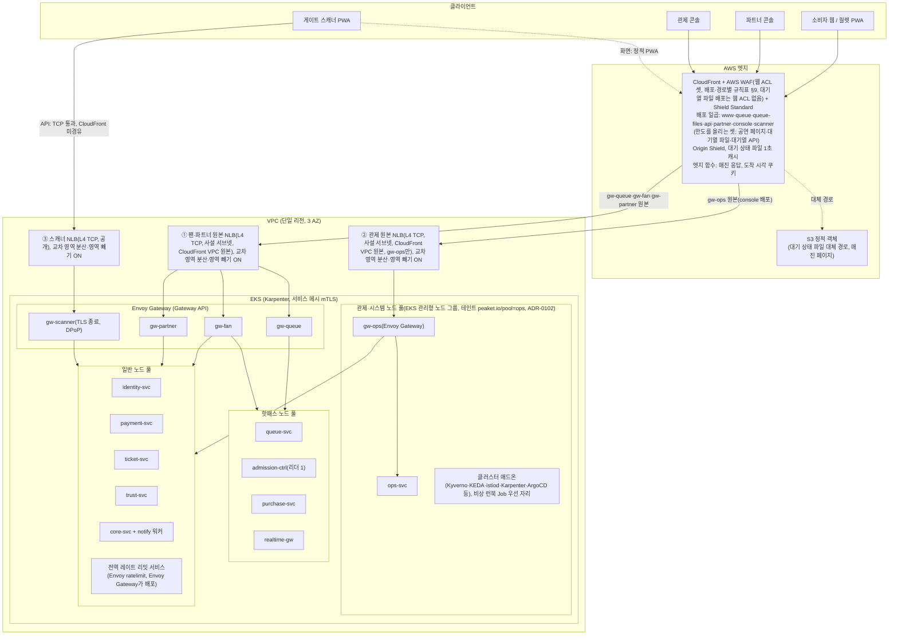
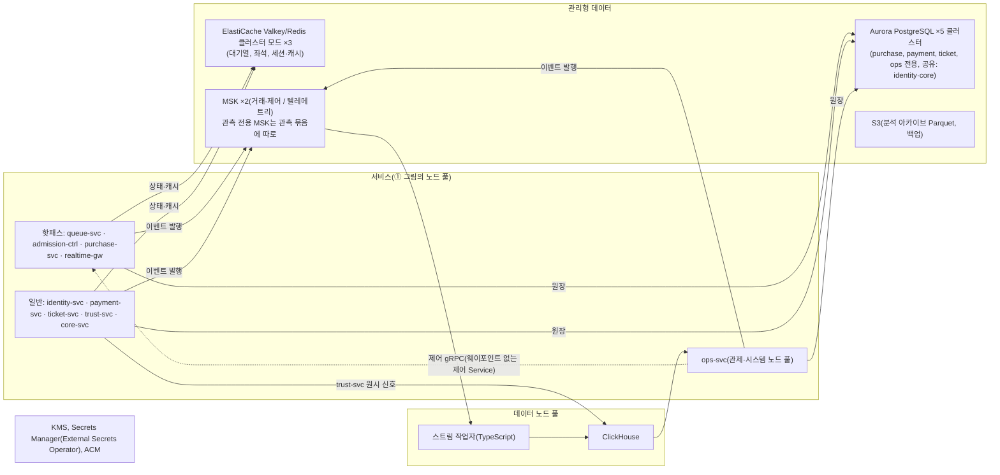
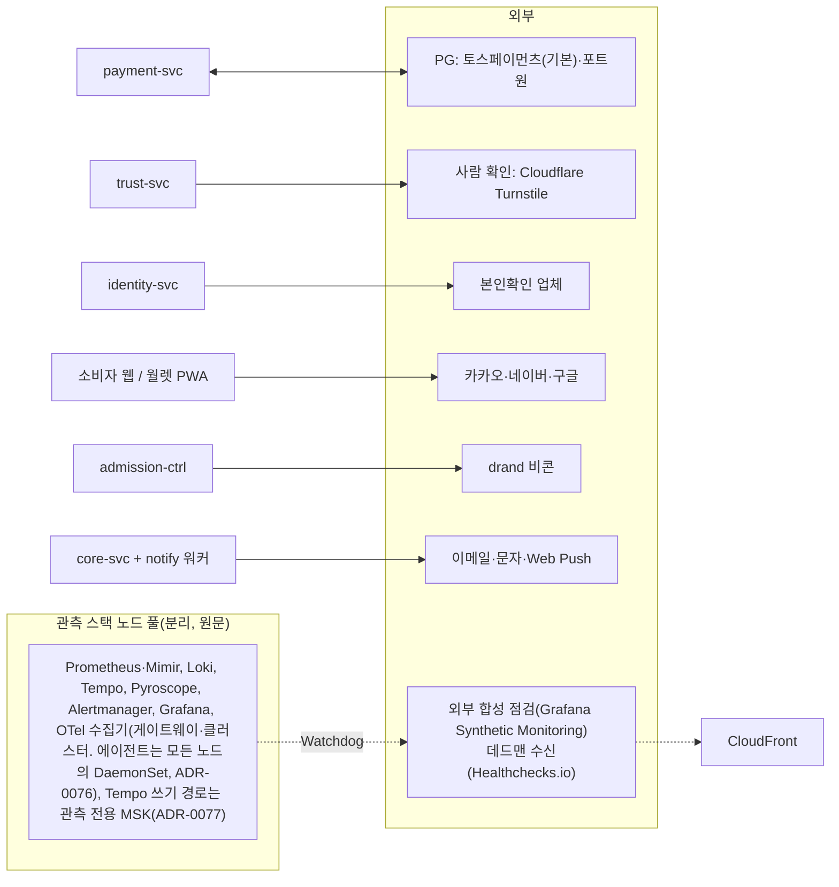
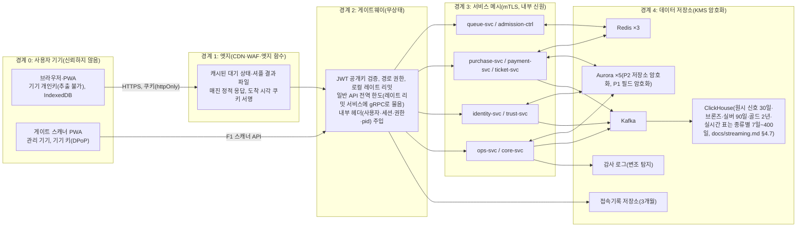
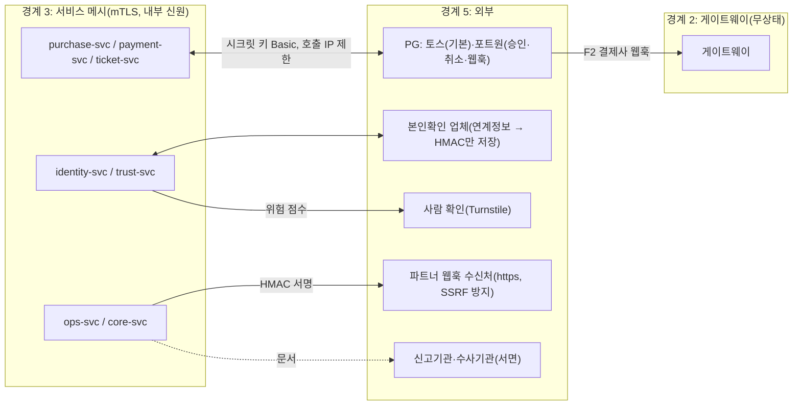
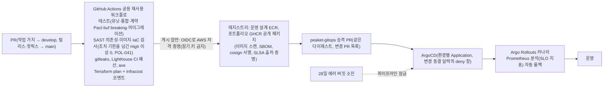

# 인프라·배포·운영

- **독자와 용도**: 플랫폼 엔지니어와 온콜 운영자가 보는 기준 문서다. 시스템 배포 구성, 신뢰 경계, 여러 환경을 나누는 방식, 구성 요소별 고가용성(서비스를 멈춤 없이 쓸 수 있는 정도를 높이는 것)과 이중화, 백업과 DR 계획, CI/CD(코드를 올릴 때마다 자동으로 검사하고 빌드하는 과정과 그 뒤의 배포) 파이프라인, 서비스 디스커버리와 여러 복제 중 일을 맡을 하나를 고르는 분산 리더 선출, 장애가 났을 때 따라 하는 비상 운영 런북의 구성을 파악할 때 참고한다. IaC 원본 코드는 `peaket-infra`(Terraform)와 `peaket-gitops`(Helm, 그리고 저장소의 배포 정의대로 쿠버네티스를 맞추는 ArgoCD) 저장소에 있다. 이 문서는 인프라 아키텍처의 설계 결정과 운영 원칙을 정한다.
- **원문 출처**: 설계서 §3 <제품 범위와 온세일 타임라인> 온세일 프리워밍 절차, 설계서 §6 <시스템 아키텍처> 게이트웨이·서비스 디스커버리·장애 격리, 설계서 §9 <SLO 설계: 목표 → 달성 설계 → 검증> Degraded Mode 대체 경로, 설계서 19장 <MSA, Kubernetes와 CNCF 생태계>, 설계서 23장 <AWS DevOps>, `docs/security/secrets-and-keys.md`, [ADR-0008](adr/0008-client-specific-thin-gateways.md), [ADR-0009](adr/0009-two-layer-circuit-breakers-fail-fast.md), [ADR-0010](adr/0010-service-discovery-and-internal-calls.md), [ADR-0022](adr/0022-control-plane-tcp-out-of-band.md), [ADR-0028](adr/0028-postgres-no-sharding-cell-scaling.md).
- **기준 기획 버전**: v1.0.
- **표시 규칙**: 원문에 자세한 명세가 없던 인프라 설정은 소유자가 추천대로 정하라고 맡겨, 추천안을 적용해 확정했다(추천 적용 2026-10-09, ADR-0031·0032). 이런 설정은 노드 풀(앱이 실행되는 서버인 노드의 묶음) 분리, 복제본(같은 서비스나 저장소를 여러 벌 띄워 둔 것) 수, 백업 주기, 환경 단계, 리전(클라우드 데이터센터가 모인 지역) 장애 대응 범위, 운영 관제 도구 선정이다. 실제 부하 시험과 클라우드 비용 산정 결과에 따라 사양을 조정하게 되면 아키텍처 결정과 그 이유를 남기는 ADR로 고친다. 실제로 재서 최종 확정할 지표값만 [가정]으로 표시한다.

## 1. 배포 구성도

인프라는 단일 리전의 가용영역(AZ) 3개에 나눠, 가용영역 하나가 멈춰도 서비스가 이어지도록 구성한다. 리전 전체가 멈추면 자동으로 넘기지 않고, 판매를 멈춘 뒤 도쿄에서 24시간 안에 복구한다. 이때 주문·결제 원장의 마지막 스냅샷 뒤 구간은 결제사 거래 대사로 다시 맞춘다(§6, ADR-0031):
- **AWS 엣지 계층**: CloudFront, AWS WAF, 엣지 함수(CloudFront Functions)로 정적 자산과 대기열 상태 조회를 흡수해, 대기 상태 조회 때 원본 서버(오리진)로 가는 요청을 99% 줄이는 것이 목표다(K1)
- **쿠버네티스(EKS) 컴퓨팅 계층**: Karpenter 기반 자동 프로비저닝과 노드 풀 5개(핫패스, 일반, 관제, 관측 전용, 데이터) 물리 격리. 관제 풀은 gw-ops·ops-svc와 클러스터 애드온(입장 검사 Kyverno, 확장 판단 KEDA, 메시 제어 평면, Karpenter 컨트롤러 등)이 도는 관제·시스템 풀이고, Karpenter가 만들지 않는 EKS 관리형 노드 그룹이다. 오픈 순간의 확장 길(KEDA 판단 → 파드 생성 → Kyverno 입장 검사)과 마지막 제어 길(비상 런북 Job)이 데이터 평면 부하와 노드 축출에서 떨어진다(추천 적용 2026-10-28, ADR-0102, 기술 검토 낮음-013, §4)
- **관리형 데이터 계층**: Aurora PostgreSQL 5개 클러스터(ops 전용 클러스터 포함, ADR-0102), ElastiCache 3개 클러스터, MSK 3개 클러스터(거래·제어, 텔레메트리, 관측 전용)를 3 AZ에 나눠 둔다(관측 전용 클러스터를 계속 둘지는 wbs 4.8.2의 요청 기록 저장소 비교로 정한다. 그 전까지는 셋이다, 기술 검토 중간-021, §11). 저장소를 이만큼 나눈 근거는 처리량이 아니라 장애 격리·비밀 범위·재해 복구 차이다(쓰기량과 텔레메트리 양은 클러스터 하나로도 받는다). 그래서 합치거나 더 나누는 일은 잰 값이 조건을 넘을 때만 한다. 조건은 Aurora가 ADR-0028 상태 줄, MSK가 §11과 review/open-items.md 49번이다(추천 적용 2026-10-28, 기술 검토 낮음-144). 가용영역 하나가 멈출 때의 목표는 Aurora RPO 0·RTO 5분, MSK RPO 0(복제 3벌, `acks=all`, 뒤처진 복제본을 대표로 올리지 않는 `unclean.leader.election.enable=false`, ADR-0141), Redis RTO 30초다. Redis는 비동기 복제 지연분(수백 ms 이내)을 잃을 수 있다(NFR-015, §6, [ADR-0031](adr/0031-environments-and-region-dr.md))

배포 구성도는 한 장에 담으면 선이 59개라 서로 얽혀서, 세 장으로 나눠 그린다(그림 쓰기 규칙 planning/03 §5.5, ADR-0138). ① 요청이 들어오는 경로와 노드 풀, ② 서비스와 데이터 저장소, ③ 외부 연동과 바깥 감시다.

**① 요청 경로와 노드 풀**

①은 게이트웨이(클라이언트 종류별로 앞에 둔 입구 서버)에서 노드 풀까지만 묶어 그렸다. 게이트웨이마다 어느 서비스로 보내는지는 아래 표다(planning/03 §5.5).

| 게이트웨이 | 보내는 서비스 |
| --- | --- |
| gw-queue | queue-svc |
| gw-fan | purchase-svc, realtime-gw, identity-svc, ticket-svc, core-svc, trust-svc(허니팟 경로 하나, docs/features/bot-defense.md §7) |
| gw-partner | core-svc, payment-svc, identity-svc, ticket-svc(기기 배치·현장 현황), ops-svc(실시간 판매 현황) |
| gw-ops | ops-svc, identity-svc |
| gw-scanner | ticket-svc, identity-svc(스캐너 기기 승인 로그인과 토큰) |

위 표는 2026-10-30에 docs/architecture.md §3 ② 그림과 §4 표에 맞췄다(gw-fan의 trust-svc, gw-partner의 ticket-svc·ops-svc, gw-scanner의 identity-svc를 더함).

**② 서비스와 데이터 저장소**

②는 서비스 묶음 단위로 그렸다. 서비스마다 어느 저장소를 쓰는지는 아래 표가 그림보다 자세하다. 정본은 docs/architecture.md §3.1 서비스 맵이다.

| 서비스 | Valkey·Redis | Aurora | MSK 이벤트 발행 | 그 밖 |
| --- | --- | --- | --- | --- |
| queue-svc | 씀 | — | 씀 | ops-svc의 제어 gRPC와 예매 제한 반영 gRPC(`SetBookingRestriction`, 사본은 대기열 Redis, open-items 75번)를 받는다. S3의 ASN(인터넷 사업자·데이터센터마다 받은 네트워크 번호) 분류표를 읽기만 한다(축소 운영의 IP 한도, 추천 적용 2026-10-30, docs/features/bot-defense.md §3.1·§11.2) |
| admission-ctrl | 씀 | — | — | ops-svc의 제어 gRPC를 받는다 |
| purchase-svc | 씀 | 씀 | 씀 | ops-svc의 제어 gRPC와 예매 제한 반영 gRPC(`SetBookingRestriction`, 사본은 좌석 Redis, open-items 75번)를 받는다 |
| realtime-gw | 씀(좌석 Redis의 Pub/Sub 구독) | — | — | — |
| identity-svc | 씀 | 씀 | 씀 | — |
| payment-svc | — | 씀 | 씀 | ops-svc의 제어 gRPC를 받는다(명령 6 대체 결제사 전환, payment DB `pg_switch`, ADR-0143) |
| ticket-svc | 씀(세션·캐시 클러스터의 스캐너 기기 등록 코드 `scanner:enroll:*`와 DPoP 증명 `jti` `scanner:dpop:*`, docs/data.md §3에 맞춤, 2026-10-30) | 씀 | 씀 | — |
| trust-svc | 씀(실시간 피처) | — | 씀 | ClickHouse(원시 신호). S3의 ASN 분류표를 trust-svc 작업이 하루 한 번 [가정] 새 판으로 쓴다(추천 적용 2026-10-30, docs/features/bot-defense.md §3.1) |
| core-svc + notify 워커 | 씀 | 씀 | 씀 | — |
| 좌석맵 해석 작업 `seatmap-worker`(core-svc와 같은 이미지의 별도 배포) | — | — | — | 저장소·AWS 권한이 없다. core-svc의 gRPC만 받고(메시 허용 목록), 나가는 통신은 NetworkPolicy로 모두 막는다. 일반 노드 풀 [가정], 파드마다 동시 처리 1, 메모리 512MiB [가정]. 이미지 처리 작업 `image-worker`(격리 버킷 읽기·파생본 쓰기)와 같은 방식이다(소유자 결정 2026-10-30, open-items 70번 ②, 세부는 추천 적용 2026-10-30, docs/features/seat-hold.md §10) |
| ops-svc | — | 씀(ops 전용 클러스터) | 씀 | ClickHouse를 읽는다(스트림 작업자가 채운 표) |
| 만료 차단 정리 작업 `waf-block-expirer`(ops-svc와 같은 이미지의 따로 도는 CronJob, 관제 노드 풀, 1분 [가정]마다) | — | 읽음(ops 전용 클러스터의 명령 4 읽기 전용 보기 `waf_block_expiry_v` 하나만, docs/data.md §6) | — | ops-svc를 부르지 않는다. 나가는 통신은 §9 '네트워크 격리 계층'의 넷뿐이다. AWS 권한은 관제용 IP 집합 하나의 `wafv2:GetIPSet`·`wafv2:UpdateIPSet`뿐이고 서비스 계정은 ops-svc와 따로다. 마지막 성공이 5분 [가정]보다 오래되면 SEV2(소유자 결정 2026-10-30, open-items 70번 ①, 세부는 추천 적용, docs/features/control-tower.md §5) |

**③ 외부 연동과 바깥 감시**

- 일반 사용자와 관리자 트래픽이 기본으로 들어오는 경로는 CloudFront(AWS의 CDN. 악성 요청을 걸러 내는 웹 방화벽인 AWS WAF를 붙였다) → NLB(L4) → Envoy Gateway(요청을 받아 안쪽 서비스로 넘기는 프록시 서버) → 백엔드 마이크로서비스다. CloudFront 배포는 일곱(www, queue, queue-files, api, partner, console, scanner)이고, 그 가운데 소비자 트래픽이 큰 셋(공연 페이지, 대기열 파일, 대기열 API. API는 프로그램끼리 요청과 응답을 주고받는 창구)은 배포마다 한도를 미리 올린다(§4.1, ADR-0058, 추천 적용 2026-10-29, ADR-0144 결정 3). 중간에 ALB를 하나 더 두지 않아서, HTTP 프록시를 두 번 거치며 생기는 불필요한 지연과 처리 부담을 피한다(ADR-0008). 반면 현장 게이트 스캐너에는 CDN이 사용자 가까이에 둔 서버인 엣지의 캐싱이나 WAF 검사가 불필요하다. 그래서 CloudFront를 거치지 않고, 따로 둔 공개 스캐너 NLB가 TCP 연결을 그대로 전달하는 패스스루로 `gw-scanner`에 바로 연결된다. CloudFront가 부르는 원본 NLB는 사설 서브넷의 VPC 원본이라 인터넷에서 바로 닿지 않는다(§9, 추천 적용 2026-10-28, 기술 검토 낮음-009). NLB는 셋이다. ① 팬·파트너 원본 NLB(gw-queue·gw-fan·gw-partner) ② 관제 원본 NLB(gw-ops) ③ 스캐너 NLB(공개, gw-scanner)다. 관제 원본 NLB를 따로 두는 것은, NLB가 AZ마다 노드를 두더라도 리스너·보안 그룹·대상 그룹 설정 실수 하나나 팬 쪽 포화로 팬·파트너·관제 입구가 함께 막히지 않게 하려는 것이다(추천 적용 2026-10-29, ADR-0144 결정 1). TLS는 쿠버네티스에서 앱이 실행되는 단위인 게이트웨이 파드에서 끝내고(종단), 기기는 기기 키로 요청마다 서명한 DPoP 증명으로 확인한다. 하드웨어 키가 필요한 운영 환경은 양쪽이 서로 인증서를 확인하는 mTLS를 선택지로 두고, 그때는 게이트웨이 파드가 기기 인증서를 직접 검증한다(기술 검토 중간-057). 서비스는 요청마다 기기 상태와 스태프 세션 상태를 확인한다(ADR-0051). 스캐너 PWA(설치형 앱처럼 쓰는 웹 앱) 화면 자체는 정적 앱이라 `scanner.peaket.example`에서 기기 자격 없이 낸다(§4.1 화면 호스트, ADR-0065).
- 프로덕션 아키텍처는 리전 하나(서울 리전)를 기준으로 만든다(분산 DB의 복잡함을 피하려고 ADR-0021에서 CockroachDB를 기각한 결정의 핵심 전제). 재해 복구(DR) 리전에는 ticket 데이터베이스의 교차 리전 읽기 복제본(AWS가 운영해 주는 PostgreSQL 호환 데이터베이스인 Aurora의 Global Database에 속한 도쿄 보조 클러스터, ADR-0083. 티켓 원장 보존과 복구 기준점이고, 도쿄에 조회할 서비스는 없다, 기술 검토 중간-081), 백업 데이터 사본과 전환 준비물(KMS 다중 리전 키, ECR 복제 이미지, 다중 리전 비밀, 결제사에 미리 등록한 도쿄 NAT 고정 IP, ADR-0084)만 늘 둔다. 리전 전체가 멈추는 것 같은 전면 장애가 나면 자동 장애 조치를 하지 않는다. 예매 판매를 바로 멈추고, 콜드 백업 데이터로 차례대로 복원하는 비상 절차를 밟는다(§6, ADR-0031).
- 클러스터 규모와 CNI(추천 적용 2026-10-21, ADR-0078 결정 7): 운영 EKS(AWS가 운영해 주는 쿠버네티스) 클러스터는 하나다. 피크 때의 노드·파드 수 추정 칸과 클러스터 하나로 가는 기준(노드 1,000개·파드 3만 개 [가정] 이하)은 docs/architecture.md §9.5에 있다. 파드에 네트워크를 붙여 주는 CNI는 EKS 기본인 Amazon VPC CNI다. 파드마다 VPC 사설 IP를 쓰므로, 파드가 쓰는 서브넷을 가용 영역 셋에 나눠 잡는다. 서브넷 크기는 파드 수만으로 정하지 않는다. VPC CNI는 노드마다 IP를 미리 잡아 두고(웜 풀), 노드와 그 네트워크 인터페이스도 서브넷 IP를 쓰기 때문이다. 기본값(`WARM_ENI_TARGET` 1)은 노드마다 빈 네트워크 인터페이스 하나와 그 IP를 통째로 잡아 둔다(amazon-vpc-cni-k8s 문서, 2026-10-28 확인). 그래서 웜 풀 방식을 먼저 고르고 그 방식의 식으로 잰다(추천 적용 2026-10-28, 기술 검토 낮음-164).
  - 기본안은 접두사 위임(`ENABLE_PREFIX_DELEGATION`)이다. 노드에 IP를 하나씩 붙이지 않고 /28 묶음(16개)으로 붙인다. 온세일(판매가 열리는 시각 앞뒤로 접속이 몰리는 기간)처럼 파드가 한꺼번에 늘 때 EC2 API 호출이 줄어 파드 시작이 빠르고, 노드당 파드 밀도도 높다(EKS 문서). Graviton 노드는 Nitro라 쓸 수 있다. 대신 /28 묶음은 서브넷 안에서 이어진 빈 칸이어야 붙고, 서브넷이 조각나면 `InsufficientCidrBlocks`로 실패한다. 그래서 파드용 서브넷은 새로 만들고 서브넷 CIDR 예약으로 접두사 자리를 떼어 둔다(EKS 모범 사례 문서). 식: 필요한 IP ≈ Σ노드 (그 노드 파드 수를 16으로 나눠 올린 수 + 웜 접두사 1 [가정]) × 16 + 노드 수 × 붙인 네트워크 인터페이스 수(인터페이스마다 주 IP 하나). 서브넷은 이 값에 노드 교체로 잠시 두 벌이 겹치는 몫 30% [가정]를 더한 크기 이상이다.
  - 다른 안은 보조 IP 방식에 `MINIMUM_IP_TARGET`(노드당 예상 파드 수)과 `WARM_IP_TARGET` 작은 값 [가정]을 두는 것이다. IP 낭비는 적지만, 문서가 큰 클러스터와 파드가 자주 바뀌는 클러스터에서는 `WARM_IP_TARGET`을 피하라고 한다(EC2 API 제한). 식: 필요한 IP ≈ 피크 파드 수 + 노드 수 × (`WARM_IP_TARGET` + 인터페이스 수).
  - 고르기는 wbs 4.8.1의 피크 노드·파드 추정 뒤에 한다. 노드당 파드 수가 인스턴스의 인터페이스·IP 한도에 걸리거나 확장이 몰리면 접두사 위임, 아니면 보조 IP 방식이다. 정확한 CIDR은 그 뒤 Terraform에서 정한다.
- 저장소 엔진 판(추천 적용 2026-10-22, ADR-0086): Aurora PostgreSQL 18.x(18.6.1 이상), ClickHouse 26.8 LTS, ElastiCache Valkey 8.1 이상의 노드 기반 클러스터 모드다. ElastiCache 서버리스는 SLOWLOG·LATENCY·WAIT·로그 전달을 쓸 수 없어 고르지 않는다(AWS 문서). ElastiCache 매개변수 그룹은 `latency-tracking`(명령별 지연 분포, 기본 꺼짐)을 켜고 슬로 로그를 CloudWatch Logs로 보낸다. 메모리 정리 규칙 `maxmemory-policy`는 세 클러스터 모두 `noeviction`이다(기본값 `volatile-lru`는 만료 시간이 걸린 키부터 지워, 순번 중복 확인·홀드·레이트 리밋 카운터·세션이 메모리가 찰 때 조용히 사라질 수 있다). 메모리가 차면 지우는 대신 쓰기가 오류를 내고, 모든 키에 TTL을 두며, 메모리 사용률 70%·85% [가정] 경보로 미리 막는다(추천 적용 2026-10-28, ADR-0109, docs/data.md §3). Lua 스크립트 시간 상한 `lua-time-limit`(5,000ms)은 바꿀 수 없고, 넘으면 `SCRIPT KILL` 뒤 노드를 강제로 다시 시작할 수 있다. 큰 키(로비 집합 등)는 판매 종료 정비 잡이 `UNLINK`로 지운다(docs/data.md §3).
- CloudFront 엣지 함수는 CloudFront Functions와 Lambda@Edge 가운데에서 HMAC(비밀 키로 만든 위조 확인용 값) 서명 검증이 되는지와 실행 비용을 비교해 최종으로 고른다. AWS 계정이 있으면 무료 범위 안에서 함수를 시험하고, 없으면 문서로 비교한다(wbs 0.5.3, docs/architecture.md §9.4 PoC 검증 과제). PoC는 본 개발 전에 위험한 부분만 먼저 만들어 확인하는 시험이다. Lambda@Edge를 고르면, VPC 원본(원본 NLB 둘)을 쓰는 배포에서는 원본 요청·원본 응답 트리거를 쓸 수 없어 보는 사람 쪽(viewer) 트리거만 쓴다. 지금 엣지 함수가 맡는 일(도착 시각 쿠키, 완전 매진 바로 응답)은 보는 사람 쪽 일이다(2026-10-29 확인, https://docs.aws.amazon.com/AmazonCloudFront/latest/DeveloperGuide/private-content-vpc-origins.html).

## 2. 데이터 흐름도(DFD)와 신뢰 경계

데이터 흐름도도 두 장으로 나눈다(planning/03 §5.5, ADR-0138). ①은 사용자 기기에서 저장소까지(경계 0~4), ②는 서비스와 외부의 연동(경계 2·3·5)이다. 라벨 앞 번호(F1·F2)의 자세한 조건은 그림 아래 표에 있다.

**① 사용자 기기에서 저장소까지(경계 0~4)**

**② 서비스와 외부(경계 2·3·5)**

| 번호 | 흐름 | 보호 |
| --- | --- | --- |
| F1 | 게이트 스캐너 PWA → 게이트웨이 | 스캐너 API: HTTPS + DPoP(mTLS는 선택지), CloudFront 안 거침(§4.1) |
| F2 | 결제사 → 게이트웨이 | 웹훅(토스 결제 웹훅은 서명 없음·지급 웹훅은 서명 검증, 포트원은 서명 검증. 모두 조회 API 재확인) |

| 신뢰 경계를 통과하는 개인정보 흐름 | 보호 등급 (data-classification) | 보안 통제 및 암호화 조치 |
| --- | --- | --- |
| 외부 본인확인 대행사 ↔ identity-svc (연계정보 CI) | P1 (최고 민감도) | 대행사 API 인증 정보는 AWS Secrets Manager에 보관한다. 받은 연계정보(본인확인 기관이 주는, 사람마다 하나인 연계 식별값) 원문은 메모리에서 바로 버리고, AWS KMS(암호 키를 안전하게 보관하고 대신 써 주는 클라우드 서비스) 관리형 키로 만든 HMAC-SHA256 해시값(원래 값으로 되돌릴 수 없게 바꾼 고정 길이 값)만 저장한다. 요청이 가장 많이 지나는 대기열 진입 경로(핫패스)에서는 외부 대행사와의 통신을 모두 뺀다(ADR-0006·0008). |
| 예매자 개인 식별 정보 (성명, 전화번호) 단말 브라우저 → purchase-svc → Aurora PostgreSQL | P2 (일반 개인정보) | 전송 구간은 TLS(통신을 암호화하는 표준)로 보호한다. 구매 세션의 쓰기 요청에는 단말 임시 키로 합의한 키로 만든 요청 서명(소지 증명)을 싣는다(본문 암호화는 아니다, ADR-0050 결정 8). 저장소 수준의 KMS 암호화와 애플리케이션 로그 마스킹을 강제한다. |
| 예매자 명단 데이터 Aurora PostgreSQL → gw-partner → 파트너 콘솔 | P2 | 제3자 제공 동의를 받은 필수 항목만 골라 제공한다. 파트너의 조회 사유와 열람 건수는 접속기록 대장에 필수로 기록한다. 대용량 파일 다운로드는 한 번에 보내는 대신 스트리밍 방식으로 제한한다(FR-027, POL-023). |
| 시스템 접속기록 (접속 일시, IP 주소, 단말 정보) 게이트웨이 파이프라인 → 전용 접속기록 저장소 | P2 | 업무용 데이터베이스와 물리적으로 분리한 전용 저장소에 3개월간 보존한다. 수사기관의 영장 같은 적법한 법적 절차를 확인한 경우에만 엄격히 내보낸다(POL-025). |
| 단말 행동 신호 데이터 클라이언트 → trust-svc → Kafka → 재평가 작업자(`trust-reassess`) → ClickHouse | P2 | 사용자 실명 대신 pid와 기기 식별값의 탐지 가명(trust-svc가 넣기 전에 탐지 가명 키로 HMAC-SHA256을 계산한 값)만 싣는다(ADR-0053). 대기 중 재평가 후보(`telemetry.trust-candidates`)에는 키인 pid와 회차·패턴·근거 수만 싣는다(ADR-0071). 대량 이벤트 집계에 강한 분석용 데이터베이스인 ClickHouse에서는 테이블 TTL(데이터 보관 기한)로 30일이 지나면 자동으로 파기한다. AWS의 파일 저장소인 S3의 장기 레이크에는 비식별 집계 통계만 보존한다. |
| 모바일 월렛 공개키 브라우저 → ticket-svc, 티켓 공개키 및 폐기 목록 → 게이트 스캐너 단말 | P3 (공개 가능 키) | 단말 서명용 ECDSA 개인키는 서버로 보내지 않고, 브라우저 IndexedDB(브라우저 안에 데이터를 저장하는 곳)의 WebCrypto 키(`extractable=false`)로 둔다. 하드웨어 보관은 아니다(ADR-0050 결정 1). 스캐너 단말은 등록한 기기 키로 요청마다 서명한 DPoP 증명(RFC 9449)으로 기기를 확인하고, 하드웨어 키가 필요한 운영 환경의 선택지로 mTLS 기기 인증서(PEAKET 스캐너 사설 CA)를 둔다(ADR-0051, 기술 검토 중간-057). |

경계 0~5와 전달 경로마다 생각한 위협(STRIDE 여섯 갈래), 대응 위치, 남는 위험은 [docs/security/threat-model.md](security/threat-model.md)에 있다(추천 적용 2026-10-28, 기술 검토 중간-065).

## 3. 환경 분리

| 환경 | 주요 용도 | 인프라 구성 | 데이터 정책 | 비밀 관리 | 배포 방식 |
| --- | --- | --- | --- | --- | --- |
| 로컬 (Local) | 기능 개발, 1천·1만·10만 명 측정(포트폴리오 기간의 기본 측정 환경), 단위·통합·계약 테스트(온라인 결제를 대신 처리해 주는 결제사 PG의 시뮬레이터 연동), Game Day(일부러 장애를 내고 대응을 연습하는 날)와 합성 봇 시험(ADR-0057) | kind나 k3d로 띄운 로컬 K8s + LocalStack(AWS 기능을 흉내 내는 모의 환경. 계정과 인증 토큰이 있어야 뜬다, 아래) + Strimzi(로컬 Kafka. 이벤트를 순서대로 쌓아 두고 여러 곳에 나눠 주는 메시지 시스템). CI 테스트 환경도 같은 구성을 쓴다 | Faker로 만든 완전 합성 데이터 | `.env` 로컬 파일(Git 커밋 절대 금지), `.env.example` 템플릿 제공 | 로컬 수동 실행 |
| 스테이징 (Staging) | (설계) 대규모 부하 시험, 카오스 엔지니어링(Chaos Mesh·AWS FIS), 합성 봇 침투 시험(POL-026: 봇 공격 실험은 격리 환경에서만 한다), Game Day, 교차 리전 재해 복구 훈련. 포트폴리오 기간에는 띄우지 않고, 이 역할은 로컬 측정 환경과 선택 보정이 맡는다(ADR-0057, docs/verification.md §5) | 운영과 같은 Terraform 모듈로 만든다. 부하 측정과 Game Day 기간에만 그때그때 만들고, 끝나면 바로 자원을 회수한다(싸지만 회수될 수 있는 클라우드 서버인 Spot 인스턴스 + 시간 단위 과금) | 대규모 합성 데이터, 결제사 토스·포트원의 테스트 연동 키, PG 시뮬레이터 어댑터 | AWS Secrets Manager (staging 네임스페이스) | ArgoCD, 운영과 같은 Helm 차트 배포 |
| 데모 (Demo) [보완] | 포트폴리오 시연과 E2E 시나리오 검증. 늘 켜 두는 환경은 두지 않는다(질문 24 결론, ADR-0057) | 로컬 kind의 데모 오버레이(서비스별 1복제본). 선택: 면접·발표 때만 몇 시간 띄우는 임시 클라우드(TTL·예산 경보) | 가벼운 합성 데이터, 결제사 샌드박스 테스트 키, 2인 승인 시연용 데모 승인자 계정(데모 시드에만, ADR-0095) | 로컬 `.env`(커밋 금지), 임시 클라우드는 AWS Secrets Manager (demo 네임스페이스). 데모 승인자의 비밀번호·TOTP 비밀도 여기에만 둔다 | ArgoCD 자동 배포(데모 오버레이. 2인 승인 시연용 데모 도우미는 이 오버레이에만 있다), 녹화 영상과 재현 스크립트 |
| 운영 (Production) | 실제 상용 서비스 환경(이 포트폴리오의 최종 아키텍처 목표 사양). 포트폴리오 기간에는 설계와 코드로만 두고 띄우지 않는다(ADR-0057) | 이 문서 1절의 다중 AZ(리전 안의 독립된 데이터센터 묶음) 고가용성 구성 | 실제 고객 데이터(엄격한 암호화, 법정 보존·파기 정책 준수) | AWS Secrets Manager (prod 네임스페이스), AWS KMS 전용 키 | ArgoCD + Argo Rollouts 기반 카나리 점진 배포, 온세일 윈도우 배포 엄격 차단 |

- 환경별 배포 경로(데모 자동 승격, 스테이징 캠페인 고정, 운영 승격 조건)와 GitOps(저장소에 적어 둔 배포 상태대로 클러스터를 맞추는 운영 방식) 저장소 구조는 docs/devops.md §5에 정했다(ADR-0054).
- **LocalStack 준비물(추천 적용 2026-10-28, 기술 검토 낮음-010)**: LocalStack for AWS는 계정 기반의 이미지 하나로 바뀌었고, 예전 Community 이미지는 더 갱신하지 않는다. 그래서 로컬과 CI 모두 LocalStack 계정과 인증 토큰(`LOCALSTACK_AUTH_TOKEN`)이 있어야 뜬다. 로컬은 사람마다의 개발자 토큰을 커밋하지 않는 `.env`에, CI는 CI 인증 토큰을 GitHub 환경 비밀에 둔다(docs/security/secrets-and-keys.md, docs/devops.md §4.5). 무료 Hobby 등급은 비상업 용도로만 쓸 수 있고, 여기서 쓰는 S3·KMS·Secrets Manager는 Hobby 서비스 목록에 있다. CloudFront는 Hobby에 없어 원래부터 문서 인용과 로컬 캐시로 대신한다(LocalStack 가격·라이선스 문서, 2026-10-28 확인). Phase 0(wbs 0.4.1)에서 ① Hobby로 CI 인증 토큰을 받을 수 있는지 ② CI 공정 사용 한도 안에서 통합 시험·Game Day 대체 장애가 도는지 ③ 쓰는 기능(S3 Object Lock·KMS 서명·Secrets Manager 교체)이 흉내 범위 안인지를 확인한다(확인 필요). 막히면 S3는 MinIO 같은 S3 호환 저장소로 바꾸고(사용권과 Object Lock 지원은 바꿀 때 확인), KMS·Secrets Manager를 쓰는 시험(G-27, D-T34 등)은 시험용 어댑터로 바꾼다. 남는 것: 포크 PR에는 비밀을 주지 않으므로 LocalStack이 필요한 통합 시험은 포크 PR에서 돌지 않고, 공개 저장소를 받아 재현하는 사람도 자기 LocalStack 계정이 있어야 한다(docs/devops.md §2.1 '공개 재현 경로').
- **포트폴리오 기간의 원칙(소유자 결정 2026-10-13, ADR-0057)**: 운영·스테이징은 이 문서와 Terraform·매니페스트 코드로만 두고 띄우지 않는다. 문서에 '스테이징에서' 한다고 적은 시험·훈련은 로컬 측정 환경에서 한다. 관리형 서비스에 장애를 넣는 시험은 대체 장애로 바꾼다. 관리형 서비스의 장애 조치 시간과 노드 기동 시간은 문서를 인용해 둔다(docs/verification.md §5).
- 늘 켜 두는 유휴 dev 클러스터는 비용을 줄이려고 운영하지 않는다. 분산 구성 요소 사이의 통합 테스트와 계약 테스트는 CI 단계의 로컬 컨테이너(앱과 실행 환경을 한 묶음으로 만든 실행 단위) 환경에서 한다. 실제 브라우저로 하는 E2E 검증은 로컬·CI의 데모 오버레이에서 한다(ADR-0031, ADR-0057).
- Terraform 원격 상태 파일(State)은 환경별로 물리적으로 나눠 서로의 간섭을 막는다(23장). 운영 환경의 실제 데이터를 스테이징이나 데모 환경으로 덤프하거나 복사하는 일은 개인정보 보호 원칙에 따라 엄격히 금지한다(POL-026).
- 클라우드에서 부하를 내는 선택 보정(ADR-0057) 전에는 AWS의 네트워크 스트레스 테스트 정책을 미리 점검한다. 트래픽은 반드시 회사 계정이 소유한 테스트 자원에만 보내야 한다.

## 4. 구성 요소별 가용성·이중화

| 구성 요소 | 이중화 및 고가용성 설계 | 장애 발생 시 시스템 동작 | 설계 근거 및 검증 방식 |
| --- | --- | --- | --- |
| CloudFront + AWS WAF | 전 세계 엣지에 나눠 배포 | CDN 뒤에서 원본 파일을 주는 서버인 오리진에 장애가 나면, `stale-if-error` 정책에 따라 가까운 곳에 복사해 둔(캐시된) 공연 안내 페이지로 응답한다. 대기 상태 파일(매진 표시 포함)과 셔플·묶음 결과 파일 요청은 CloudFront 원본 그룹(주 원본 → S3 사본, 장애 조치 상태 코드 500·502·503·504, 연결 시간 초과 2초·시도 1회 [가정]. 기본값은 10초씩 3회라 30초 뒤에야 넘어간다)이 요청마다 S3 정적 오리진이라는 대체 경로로 자동으로 돌리고, 다음 요청은 다시 주 원본으로 보낸다. 원본이 살아 있어도 S3 사본으로 고정하는 것은 명령 6이고 해제도 명령 6이다(RB-04, ADR-0078 결정 2). 보조 원본은 같은 요청 경로를 받으므로 S3 사본 키를 요청 경로에 맞춘다 [가정, wbs 2.2.2에서 확인]. 원본 그룹은 GET·HEAD·OPTIONS 요청만 넘기고 POST는 넘기지 않는다. 그래서 대기열 진입·결제 접수 같은 POST는 엣지에서 넘어가지 않는다(대기열 진입은 엣지 함수의 도착 시각 쿠키가 대신한다). CloudFront 전체 장애나 DNS 장애 때는 판매를 멈추는 것 말고 대체 경로가 없다(RB-40, ADR-0144 남는 한계). | NFR-007, NFR-002 Degraded 우회 설계. 배포 일곱과 한도를 올리는 셋은 §4.1(ADR-0058·0144) |
| NLB | 셋으로 나눈다(추천 적용 2026-10-29, ADR-0144 결정 1): ① 팬·파트너 원본 NLB(사설, CloudFront VPC 원본, gw-queue·gw-fan·gw-partner) ② 관제 원본 NLB(사설, CloudFront VPC 원본, gw-ops) ③ 스캐너 NLB(공개, gw-scanner). 셋 모두 3개 가용 영역(AZ) 분산, 교차 영역 로드 밸런싱 활성화, 영역 빼기(zonal shift, 망가진 AZ로 새 연결을 보내지 않게 하는 NLB 기능. 기본은 꺼져 있어 NLB마다 켠다) 켬 | 특정 가용 영역의 게이트웨이 파드가 모두 멈춰도 다른 AZ의 정상 파드로 트래픽을 바로 다시 나눈다. AZ 하나가 망가졌다고 판단하면 RB-13에서 사람이 그 AZ를 뺀다. 한 번에 AZ 하나만 뺄 수 있고, 기존 연결은 끊지 않으며, 빼면 그 AZ의 대상 용량도 빠진다. AWS가 판단해 AZ를 빼는 자동 영역 빼기(autoshift)는 온세일 중 사람이 모르는 용량 감소가 생기지 않게 쓰지 않는다(ADR-0144 결정 4). 팬 쪽 NLB의 설정 실수·포화는 관제 입구를 같이 막지 않는다 | ADR-0008·0144 (AZ 간 네트워크 전송 비용은 K9 비용 추정에 가격표와, 잰 범위의 결과를 식으로 늘려 구한 외삽 요청 수로 넣는다, ADR-0057). 서울 리전은 영역 빼기 지원 리전이고, 교차 영역 분산을 켠 NLB에서도 된다. 켜기 전에 그 NLB에 붙은 모든 대상 그룹의 교차 영역 설정(`load_balancing.cross_zone.enabled`)이 `true`나 `use_load_balancer_configuration`(기본값)이어야 한다. 교차 영역을 켠 NLB에서 영역을 빼면 그 AZ의 NLB 주소가 DNS에서 빠지고 그 AZ의 대상은 새 연결을 받지 않는다. 추가 요금은 없다(2026-10-29 확인, https://docs.aws.amazon.com/elasticloadbalancing/latest/network/enable-zonal-shift.html, https://docs.aws.amazon.com/r53recovery/latest/dg/introduction-regions.html). 연습은 G-32(모의 진행) |
| Envoy Gateway ×5 | 게이트웨이 유형별 최소 3 복제본을 3 AZ에 고르게 배치, PodDisruptionBudget(PDB) 설정, 초당 요청 수에 따른 수평 오토스케일링(부하에 따라 서버 수를 자동으로 늘리고 줄이는 것), 오픈 전 프리워밍(미리 늘려 두기) | 파드의 절반을 잃으면 남은 파드가 연결·동시 요청 상한(docs/architecture.md §9.4 차단 상한 PoC)을 넘는 요청을 503과 `Retry-After`로 바로 덜어 내고, 수평 오토스케일과 Karpenter 노드 확장(긴급 확장 60초 목표, NFR-023)으로 회복한다. 회복하기까지 덜어 낸 503은 그 여정 SLO(지키려는 서비스 품질 목표)의 오류로 센다. 피크(진입 초당 20만 건)에 절반 손실을 SLO 안에서 흡수하려면 평소 필요량의 2배를 띄워 두어야 하는데, 기본 설계는 2배 여유를 두지 않고 프리워밍(§5)과 덜어 내기로 버틴다. 2배 여유의 비용은 K9(온세일 1회 비용)에서 재고, 그 비용과 손실 때 잃는 에러 버짓을 견줘 다시 정한다(추천 적용 2026-10-28, 기술 검토 낮음-011). 대신 AZ 하나(1/3) 몫의 여유는 대형 온세일 때 둔다. 프리워밍 때 gw-queue·gw-fan(공연 당일은 gw-scanner도)의 복제 수를 '필요 복제 × 1.5 [가정]'로 AZ 셋에 고르게 둬, AZ 하나를 잃어도 남은 둘이 피크를 받게 한다. 서비스(queue-svc 등)는 지금처럼 HPA·Karpenter(긴급 확장 60초 목표)로 회복한다(추천 적용 2026-10-29, ADR-0144 결정 4. 부하 시험에서 1.5배 없이도 AZ 하나를 잃은 채 SLO 안이면 배율을 낮춘다) | NFR-011 무중단 가용성 목표, NFR-023 |
| 전역 레이트 리밋 서비스(추천 적용 2026-10-28, 기술 검토 중간-084) | Envoy Gateway가 배포·관리하는 Envoy ratelimit Deployment 2개 [가정](일반 노드 풀, AZ 분산, PDB). 카운터는 Redis 세션·캐시 클러스터에 둔다. 일반 API 경로의 사용자 계정 단위 한도만 판정한다 | 응답을 받지 못하면 열림(통과, Envoy Gateway 기본 `failClosed` 끔, 판정 시간 상한 20ms)이고 게이트웨이 로컬 토큰 버킷이 마지막을 지킨다. 핫패스(진입·홀드·결제 접수)는 원래 이 서비스를 부르지 않아 영향이 없다 | docs/architecture.md §4, docs/api/guidelines.md §6, ADR-0008 결정 4 |
| queue-svc | PodTopologySpreadConstraints로 AZ 분산, KEDA(대기 작업량 같은 지표로 파드 수를 늘리고 줄이는 도구)로 이벤트에 따라 스케일링(초당 요청 수인 RPS와, 메모리에 데이터를 두는 빠른 저장소인 Redis의 대기열 길이에 연동), 온세일 프리워밍 | 순번 키 하나의 Redis 단일 스레드 병목이 PoC(wbs 0.5.1)에서 실측되면 `INCRBY` 파드별 마이크로 배치를 쓴다(도입 여부는 PoC로 확정, docs/features/queue-admission.md §3). 심각한 장애가 나면 도착 시각 쿠키(브라우저가 사이트별로 저장했다가 요청마다 함께 보내는 작은 값)로 진입시키는 Degraded Mode(큰 장애 때 부가 기능을 미리 정한 범위에서 줄여 핵심을 지키는 운영 모드)로 바꾼다. | NFR-001 대기열 처리 목표 |
| admission-ctrl | Kubernetes Lease(정해진 시간 동안만 유효한 권한. 갱신하지 않으면 다른 쪽이 가져간다)로 활성 리더 1대 + 늘 대기하는(Standby) 2대를 둔다. Lease 유지 기간과 갱신 주기는 리더 공백이 제어 루프 몇 번 분량인지 실제로 재서 확정한다(초기 권장값: 유효 기간 15초, 갱신 주기 5초 [가정, Phase 2 부하 시험에서 확정]). | 리더가 바뀌면 serving 번호 전진을 잠시 멈추고(대기 순번은 유지한다), 새 리더가 분산 Lease를 정상적으로 얻은 직후 serving 번호 전진을 안전하게 다시 시작한다. 제어 명령을 실행하기 직전, Lease 소유권을 다시 확인한다. | 리더 강제 종료 카오스 검증(Q-T30, ADR-0056) |
| purchase-svc | 최소 3 복제본 이상, 3 AZ 분산 배치, Node.js 이벤트 루프 지연(lag)에 따른 오토스케일링 | 좌석 Redis 클러스터가 장애 조치 중이면 그 회차의 구매 요청을 503과 `Retry-After`로 잠시 미룬다(PostgreSQL 비상 홀드 경로는 없다, ADR-0121). 동시 입장 목표는 바로 50% 줄인다. | NFR-003 좌석 홀드 처리 목표 |
| realtime-gw | 연결을 열어 둔 채 서버와 브라우저가 주고받는 WebSocket의 동시 연결 수에 따른 오토스케일링, 파드당 최대 활성 연결 한도 설정 | 클라이언트가 다시 연결되면 구역 버전의 빈틈을 감지해, 전체 스냅샷(어느 시점의 전체 상태를 찍어 둔 것)을 다시 받아 맞추도록 자동으로 요청한다. | NFR-004 실시간 좌석 상태 전파 목표 |
| identity·payment·ticket·trust·ops·core | 도메인별 최소 2 복제본 이상, PodDisruptionBudget 적용 | trust-svc에 장애가 나면 캐시해 둔 판정 규칙과 보수적인 레이트 리밋(일정 시간에 받는 요청 수의 상한) 모드로 바꿔(한도는 기기·계정 단위이고, IP 단위는 호스팅·프록시 대역에만 건다. 통신사 대역은 IP 제한에서 뺀다, docs/features/queue-admission.md §7·§9, 기술 검토 낮음-066) 정상 사용자의 예매 진입을 보장한다. ops-svc가 멈추면 비상 런북 CLI가 같은 직접 제어 채널(제어 전용 gRPC)로 명령을 넣어 제어권을 유지한다. ops-svc와 gw-ops는 관제 노드 풀(m7g.large [가정], AZ마다 한 대, 온디맨드만)에서만 돌아, 핫패스 노드의 CPU 포화가 관제 입구와 ops-svc에 번지지 않는다(추천 적용 2026-10-28, ADR-0102). | NFR-022, NFR-008 장애 격리 목표 |
| Redis Cluster ×3 | 클러스터당 샤드(데이터를 여러 저장소에 나눠 담은 조각) 3개 × 복제본 1개 구성, 다중 AZ 배치, 비동기 복제 | 마스터 장애 조치 때 비동기 복제가 늦어져 쓰기를 잃을 가능성에 대비한다. 대기열 순번은 세대 번호를 붙이고 카운터를 건너뛰어 해결한다. 좌석 홀드(결제하는 동안 다른 사람이 가져가지 못하게 좌석을 잠시 잡아 두는 것) 누락은 DB 유니크 제약으로 막는다. 세션은 리프레시 토큰(권한이나 상태를 증명하려고 주고받는 서명된 문자열)으로 자동 재로그인하게 한다. 샤드 추가와 슬롯 이동(리샤딩)은 정비 시간에만 한다(docs/devops.md §12.1, ADR-0082). | NFR-015, ADR-0002·0014·0082 |
| Aurora PostgreSQL ×5 | 다중 AZ Writer 인스턴스 1대 + Reader 인스턴스, 장애 때 자동 장애 조치. ops 전용 클러스터는 db.r7g.large [가정] 쓰기 1 + 읽기 1(다른 AZ)이고, identity·core는 공유 클러스터에 남는다(추천 적용 2026-10-28, ADR-0102) | 잃어도 되는 데이터의 시간 폭인 목표 복구 시점(RPO)은 0, 복구까지 걸려도 되는 시간인 목표 복구 시간(RTO)은 5분을 보장한다. 장애 조치로 전환되는 구간에 들어온 쓰기 요청의 실패는 클라이언트와 애플리케이션의 멱등 재시도 파이프라인이 흡수한다. | NFR-015 데이터 신뢰성 목표 |
| ticket DB 교차 리전 읽기 복제본 | Aurora Global Database의 보조 클러스터(도쿄, 읽기 인스턴스 1대)로 늘 동기화한다. Aurora PostgreSQL은 교차 리전 Aurora 복제본을 지원하지 않으므로, 다른 리전에 읽기 클러스터를 두는 관리형 방법은 이것이다. 평소에는 읽기에만 쓰고, 관리형 전환(switchover·failover)으로 쓰기를 옮기지 않는다. 나머지 Aurora 클러스터(2026-10-28 ops 전용을 더해 넷, ADR-0102)는 Global Database에 넣지 않는다(추천 적용 2026-10-22) | 도쿄 보조 클러스터는 티켓 원장 보존(RPO 약 1초, 복제 지연만큼)과 리전 복구의 기준점이다. 도쿄에는 ticket-svc·gw-scanner·NLB·기기 자격 확인 경로(기본 DPoP 검증, mTLS 선택지는 기기 인증서 검증)가 없어, 리전 장애 당일 스캐너가 도쿄를 읽을 길이 없다. 그날 현장은 단말의 오프라인 판정으로만 버틴다(추천 적용 2026-10-28, 기술 검토 중간-081. 이전 문서의 '스캐너 조회를 멈춤 없이 이어 간다'는 계산 자원이 없어 성립하지 않았다). 당일 온라인 조회용 '도쿄 파일럿 라이트'(§6)는 두지 않기로 했다(소유자 결정 2026-10-29, ADR-0152, 다시 보는 조건은 §6). | 원문 '가용성 시간대', ADR-0031, ADR-0083 |
| MSK (Kafka) | 거래·제어 클러스터는 브로커 6대(AZ마다 2대) [가정, 측정 뒤 확정], 텔레메트리·관측 전용 클러스터는 3대(AZ마다 1대)다. Replication Factor 3은 AZ마다 하나씩 놓는다(랙 인식), `min.insync.replicas=2`(쓰기를 받으려면 맞춰야 하는 최소 복제본 수), 메시지를 쓰는 쪽(프로듀서)은 `acks=all` 강제. 거래·제어와 텔레메트리 클러스터의 MSK 사용자 지정 설정에는 `unclean.leader.election.enable=false`(복제본이 모자랄 때 뒤처진 복제본을 대표로 올리지 않는다. MSK 기본값은 `true`), `auto.create.topics.enable=false`, `default.replication.factor=3`, `min.insync.replicas=2`를 적는다(기본값과 같아도 적는다). 관측 전용 클러스터는 MSK 기본값(`true`)을 쓴다. 요청 기록은 3등급 관측 자료라 유실보다 가용성이 낫다. 정적 검사 D-T46이 Terraform의 MSK 설정을 이 값과 대조한다. Kafka 판은 MSK 표준 브로커의 3.9.x(KRaft 모드)로 시작하고, 판 올리기 규칙은 docs/devops.md §9에 있다(추천 적용 2026-10-29, ADR-0141 결정 1~3) | 브로커 노드 한 대가 물리적으로 멈춰도 무중단 메시징을 유지한다. AZ 하나를 잃은 뒤 브로커 하나가 더 멈추면(패치·자동 교체), 브로커 3대 구성에서는 모든 파티션의 쓰기가 멈추지만 거래·제어의 6대 구성에서는 그 브로커에 복제본이 있는 약 절반만 멈춘다. 멈춘 동안 거래 사건은 Outbox에 쌓이고, 결제 확정은 purchase-svc가 payment-svc `BatchGetPayments`로 직접 묻는 당기기로 이어진다(ADR-0140). 브로커 경보(오프라인 파티션, 최소 동기 복제본 부족, 복제 부족, 디스크)는 docs/observability.md §5다(ADR-0141 결정 4). 거래·제어 토픽(메시지를 종류별로 모아 두는 통로)과 대용량 텔레메트리(시스템이 내보내는 지표·로그·요청 기록 같은 운영 신호) 클러스터를 물리적으로 나눠, 핵심 원장 토픽을 보호한다. 이런 신호로 시스템 안을 들여다보는 관측 전용 클러스터(요청 기록 저장소인 Tempo의 쓰기 경로)는 세 번째로 따로 둔다(ADR-0077). | ADR-0026 토픽 분리 아키텍처, ADR-0141(설정·브로커 수·판·경보), D-T46, V-T27(브로커 재시작 중 결제 길 릴레이 지연), G-10(브로커 1대), G-31(거래·제어 MSK 전체 정지) |
| ClickHouse | 데이터 노드 2 복제본, 비동기 일괄 삽입 | 적재 파이프라인이 늦어지면, 실시간 관제 대시보드의 비즈니스 패널은 지표를 모아 저장하는 도구인 Prometheus의 메모리 지표로 줄여 보여 준다. | NFR-009 Degraded 관제 우회 |
| 스트림 작업자(TypeScript) | Kafka 토픽을 계속 읽어 저장소에 쓰는 작은 서비스 `analytics-ingest`·`ops-rt`·`trust-reassess`를 서비스와 같은 Node.js·NestJS 판의 Deployment로 2개씩 [가정] 둔다. 상태가 없어 다시 뜨면 커밋한 위치부터 읽는다. 쓰기가 성공한 뒤에만 커밋하고, 실패한 묶음은 버리지 않고 그 파티션 소비를 멈춘 채 다시 시도한다. 관제 실시간 표는 원시 사건을 ClickHouse에 싣고, ops-svc가 읽을 때 센다(조회 시점 집계). 자동 확장은 끈다(docs/streaming.md §2·§4, ADR-0099) | 관제 실시간 표 신선도(심장 박동 사건 기준)의 1분 p95가 5초를 넘는 상태가 3분 넘게 이어지면, 실시간 표 패널을 Prometheus 대체 표시로 바꾸는 Degraded Mode를 켠다. 소비 밀림과 삽입 재시도는 전환 조건이 아니라, 원인을 살피는 패널에서 본다 | NFR-009 관제 스트리밍 신뢰성 |
| 관측 스택 (Prometheus·Grafana 등) | 일반 비즈니스 파드와 떨어진 전용 노드 풀에 배포, 외부 업체의 데드맨 스위치(신호가 끊기면 경보를 보내는 장치) 연동 | 사내 관측 인프라가 모두 무너져도 외부 모니터링이 바로 온콜 담당자를 호출한다. 지표와 로그를 그래프로 보여 주는 Grafana도 같은 노드 풀에 있어 함께 멈춘다. 그래서 외부 합성 점검, 콘솔에서 Prometheus 밖에서 오는 숫자(입장 제어 상태, 관제 실시간 표), 비상 런북 CLI로 관제권을 유지한다(ADR-0073). | docs/observability.md §10 |
| EKS 워커 노드 풀 | Karpenter(필요한 만큼 서버를 붙이고 떼는 도구) 오토스케일러를 쓴다. Spot 인스턴스는 스테이징·데모 환경과 비핵심 워커(notify, 원본 적재 작업자 `analytics-ingest`)에만 허용한다. 핵심 핫패스 노드는 정가로 계속 쓰는 온디맨드 인스턴스로 강제한다. 관제 실시간 적재·봇 재평가 작업자는 회수되면 관제 신선도와 재평가가 잠깐 끊기므로 온디맨드다(ADR-0071·0099). 관제 노드 풀(테인트 `peaket.io/pool=ops:NoSchedule`)은 관제·시스템 풀이다. gw-ops·ops-svc와 클러스터 애드온(Kyverno·KEDA·메시 제어 평면 istiod·Karpenter 컨트롤러·Envoy Gateway 컨트롤러·ArgoCD·Argo Rollouts·External Secrets·cert-manager)을 받는다. 이 풀만은 Karpenter가 만들지 않는 EKS 관리형 노드 그룹이다(Karpenter 안내서는 Karpenter 자신을 관리형 노드 그룹이나 Fargate에 두라고 한다, 2026-10-28 확인). 비상 런북 Job은 이 풀을 먼저 고르고, 이 풀이 멈추면 일반 풀에서도 뜬다(ADR-0102 결정 3, 추천 적용 2026-10-28, 기술 검토 낮음-013) | 갑자기 노드가 축출되는 상황에서도 PDB와 토폴로지 분산 제약에 따라 시스템 처리 용량을 안전하게 유지한다. | PDB·토폴로지 분산 설정, G-16 게이트웨이 파드 절반 종료(Karpenter 노드 확장은 문서 인용, docs/verification.md §5.2) |

### 4.1 CloudFront 배포와 한도 (ADR-0058)

| 배포 | 호스트 | 받는 것 | 설계 피크(100만 기준) | 요청 한도(기본 → 상향 목표) | 전송(기본 150 Gbps) |
| --- | --- | --- | --- | --- | --- |
| 공연 페이지 | `www.peaket.example` | 공연 페이지, 홈(ISR), 대기실 셸, 웹 정적 자산, 장르별 랭킹 파일·회차 좌석맵 파일(S3 원본, ADR-0063), 공개 감사 체크포인트(`/transparency/`, S3 원본, ADR-0075) | 초당 30만 건(NFR-007) | 25만 → 45만 [가정] | 기본 |
| 대기열 파일 | `queue-files.peaket.example` | 대기 상태 파일, 순번을 무작위로 섞은 셔플 결과 파일, 묶음 결과 파일 | 초당 약 17.9만 건(셔플 결과 분산 조회 약 12.5만 + 대기 상태 조회 약 5.4만. 입장 임박 구간 0.5초 폴링 포함, ADR-0110), 전송 약 36 Gbps | 25만 → 27만 [가정] | 기본(목표 54 Gbps) |
| 대기열 API | `queue.peaket.example` | 로비 입장, 사전 검증, 진입, 입장 확정, 엣지 함수(매진 응답, 도착 시각 쿠키). 원본 요청 정책에 `CloudFront-Viewer-ASN`을 넣는다(아래 'ASN 헤더와 분류표') | 초당 20만 건(NFR-001) | 25만 → 30만 [가정] | 기본 |

- **배포 일곱과 호스트 배치(추천 적용 2026-10-29, ADR-0144 결정 3)**: CloudFront 배포는 모두 일곱이다. 한도를 따로 올리는 것은 위 표의 셋(www·queue-files·queue)이고, 나머지 넷은 피크가 기본 한도보다 훨씬 작다고 본다(`api` 배포는 아래처럼 아직 계산 전이다 [가정]). 게이트 스캐너 API(`scanner-api`, gw-scanner)는 CloudFront를 거치지 않는다.

| 배포 | 호스트 | 게이트웨이 원본(NLB) | 웹 ACL(§9) |
| --- | --- | --- | --- |
| www | `www.peaket.example` | gw-fan의 앱 서버 경로(① 팬·파트너 원본 NLB), 정적은 S3 | 화면·파트너·관제용 |
| queue | `queue.peaket.example` | gw-queue(①) | 대기열 API용 |
| queue-files | `queue-files.peaket.example` | gw-queue 파일 원본(①), 보조 원본 S3 | 두지 않는다 |
| api | `api.peaket.example` | gw-fan(①) | API용 |
| partner | `partner.peaket.example`, `partner-api.peaket.example`(대체 도메인, 경로 `/v1/*`가 gw-partner로) | ①을 거쳐 파트너 앱 서버와 gw-partner | 화면·파트너·관제용 |
| console | `console.peaket.example`(정적 S3), `ops-api.peaket.example`(대체 도메인, 경로 `/v1/*`가 gw-ops로) | gw-ops(② 관제 원본 NLB) | 화면·파트너·관제용(관제 허용 IP 규칙) |
| scanner | `scanner.peaket.example`(정적 S3) | — (`/_t/*`만 gw-fan, 아래) | 화면·파트너·관제용 |

- 화면 배포 넷의 `/_t/*`는 아래처럼 gw-fan으로 가므로 ① 팬·파트너 원본 NLB를 거친다. ② 관제 원본 NLB는 gw-ops만 받는다.
- **CloudFront 설정의 단계 배포(추천 적용 2026-10-29, ADR-0144 결정 6)**: 트래픽이 큰 세 배포(www·queue-files·queue)의 설정 변경은 CloudFront 지속적 배포(continuous deployment, 스테이징 배포에 일부 요청만 먼저 보낸 뒤 주 배포로 승격하는 기능)로 한다. 헤더 기반 내부 시험(머리 `aws-cf-cd-` 접두사) → 가중치 기반 일부 요청(5% [가정]) → 승격 순서다. 스테이징 배포는 주 배포와 캐시를 나눠 쓰지 않으므로 온세일 윈도우와 변경 동결 창에는 쓰지 않는다(지금 동결 규칙과 같다). 나머지 배포는 지금처럼 Terraform 계획을 검토한 뒤 적용하고, 되돌리기는 되돌리는 커밋이다. 스테이징 배포에서는 원본·원본 그룹과 엣지 함수를 바꿔 시험할 수 있고, VPC 원본과 함께 못 쓴다는 조항은 원문에 없다(2026-10-29 확인, 실제 동작은 PoC wbs 0.5.3). 세 배포에는 HTTP/3을 켜지 않는다(켜면 지속적 배포를 못 쓴다, https://docs.aws.amazon.com/AmazonCloudFront/latest/DeveloperGuide/continuous-deployment-quotas-considerations.html). 나머지 제약(웹 ACL 연결 변경, 가중치 15% 상한, 붐비는 시간에 주 배포로 몰림, 함수 게시)은 docs/devops.md §6.6에 있다. 연습은 G-33(엣지 설정 실수 되돌리기, 모의 진행)이다.
- **NLB 용량 예약은 지금 쓰지 않는다(추천 적용 2026-10-29, ADR-0144 결정 5)**: NLB 용량 예약(LCU reservation)은 갑작스러운 이벤트 트래픽용이지만 지원 리전 목록에 서울이 없고, 최소 예약도 AZ마다 2,750 LCU로 크다(예약에서는 1 LCU를 2.2Mbps로 세므로 AZ마다 약 6Gbps. AWS 문서 https://docs.aws.amazon.com/elasticloadbalancing/latest/network/capacity-unit-reservation.html, 2026-10-29 다시 확인). 원본 NLB가 T=0 급증을 받는지는 부하 시험 K1에서 NLB 지표(처리 바이트, 새 흐름 수, TCP 리셋)로 확인한다. CloudFront가 원본 연결을 다시 쓰므로 NLB가 받는 새 연결은 엣지 수준으로 준다고 본다 [추정]. 서울이 지원 목록에 들거나 K1에서 원본 NLB가 T=0 급증을 받지 못하면 대형 회차 T-40분 프리워밍 목록에 넣는 안을 다시 본다.
- **`api` 배포의 원본 응답 시간 초과와 결제 결과 롱 폴링(추천 적용 2026-10-28, 기술 검토 중간-047)**: 원본 응답 시간 초과는 CloudFront가 원본(CDN 뒤에서 원본 응답을 주는 서버, 여기서는 gw-fan)의 응답을 기다리는 최대 시간이고 기본값은 30초다. 원본이 그 안에 답하지 않으면 GET·HEAD는 연결을 끊고 연결 시도 횟수(기본 3회)만큼 원본에 다시 보내며, POST 같은 쓰기는 다시 보내지 않는다. 이 값은 경로(캐시 동작)가 아니라 원본마다 정한다(AWS 개발자 안내서 'Origin settings', 2026-10-28 원문 확인). 그래서 결제 결과 롱 폴링(`GET /v1/orders/{orderId}/payment-status`, 서버가 결과가 생길 때까지 응답을 미루는 조회)은 원본 값을 늘리지 않고 서버가 먼저 끝낸다. 시간은 안쪽부터 서버 롱 폴링 상한 25초 [가정] < gw-fan 그 경로의 시간 초과 27초 [가정](HTTPRoute `timeouts.request`. Envoy 경로 시간 초과 기본값 15초로 두면 롱 폴링이 15초에 끊긴다, docs/frontend.md §4.4) < CloudFront 원본 응답 시간 초과 30초(기본값 그대로) ≤ 브라우저 시간 초과 30초 [가정](서버 상한 + 5초)이다. 서버가 25초 안에 '아직 확정 전' 상태로 답하므로 CloudFront가 같은 롱 폴링을 원본에 다시 보내지 않는다. 서버가 멈추면 게이트웨이가 27초에 504 Problem으로 먼저 끝내고, 브라우저는 다시 묻는다(docs/frontend.md §3.6). 시험은 P-T44다.
- **브라우저 지표 경로(추천 적용 2026-10-21, ADR-0079 결정 13)**: 화면 배포 넷(`www`·`partner`·`console`·`scanner`)에는 같은 출처의 `/_t/*`(캐시 안 함)를 gw-fan의 텔레메트리 입구로 보내는 캐시 동작을 둔다. CloudFront 캐시 동작의 허용 메서드는 세 묶음(GET·HEAD / GET·HEAD·OPTIONS / GET·HEAD·OPTIONS·PUT·POST·PATCH·DELETE) 가운데 하나만 고를 수 있다(AWS 개발자 안내서). 그래서 정적 경로는 GET·HEAD 묶음으로, POST를 받는 앱 서버 경로와 `/_t/*`는 전체 묶음으로 둔다. 'POST만'(`/_t/*`)과 'GET·HEAD·POST만'(앱 서버 경로)은 CloudFront가 아니라 gw-fan 경로 규칙과 앱 서버가 그 밖의 메서드에 405를 돌려 막는다. TRACE는 세 묶음 어디에도 없다(추천 적용 2026-10-28, 기술 검토 낮음-099). 원본 요청에는 원본 확인 헤더와 화면 앱 이름 `X-Peaket-App`을 붙인다(CloudFront는 같은 이름의 시청자 헤더를 덮어쓴다, AWS 개발자 안내서 2026-10-21 확인). gw-scanner는 CloudFront를 거치지 않고 gw-ops는 허용 IP만 받으므로, 앱마다 그 앱의 게이트웨이로 보내지 않는다(docs/observability.md §11).
- **허니팟 경로(추천 적용 2026-10-30, docs/features/bot-defense.md §7, docs/frontend.md 허니팟 링크 행)**: 공연 상세와 로비 화면의 숨긴 링크는 `www` 배포의 `/_t/` 아래 경로 하나로 둔다(정확한 경로와 gw-fan 라우트는 [가정, wbs 3.2.3에서 확정]). 같은 `/_t/*` 캐시 동작(캐시 안 함, 전체 메서드 묶음)을 타고 gw-fan으로 가며, gw-fan이 그 하위 경로를 trust-svc의 허니팟 기록 처리기로 넘긴다. 숨긴 링크는 GET으로 불리므로 `/_t/*`의 'POST만' 규칙에서 이 하위 경로 하나만 GET을 받는다. 다른 화면 배포(`partner`·`console`·`scanner`)의 `/_t/*`에서는 이 경로를 받지 않는다. 응답은 늘 204·빈 본문이다. gw-fan은 이 경로에서 팬 액세스 토큰이 있으면 검증해 pid만 내부 헤더로 넘기고, 쿠키 원문은 다른 `/_t/*`처럼 지운다(docs/security/threat-model.md §4).
- **ASN 헤더와 분류표(추천 적용 2026-10-30, docs/features/bot-defense.md §3.1)**: trust-svc는 IP로 ASN(인터넷 사업자·데이터센터마다 받은 네트워크 번호)을 찾지 않는다. 대기열 API 배포(`queue`)의 원본 요청 정책에 CloudFront가 붙이는 `CloudFront-Viewer-ASN`을 넣고, gw-queue가 queue-svc를 거쳐 trust-svc에 넘긴다. 이 헤더는 원본 요청 정책에는 넣을 수 있지만 캐시 정책에는 넣을 수 없다(AWS CloudFront 개발자 안내서 'Add CloudFront request headers', https://docs.aws.amazon.com/AmazonCloudFront/latest/DeveloperGuide/adding-cloudfront-headers.html , 2026-10-30 확인). 그래서 캐시 키를 나누지 않는다. **로그인 판정에도 넣는다(추천 적용 2026-10-30)**: 팬 로그인 판정(`ScoreRisk`의 `LOGIN`, docs/features/bot-defense.md §3.1)은 대기열 API 배포를 지나지 않고 공연 페이지 배포(`www`)의 앱 서버 로그인 경로(소셜 로그인 시작·콜백)를 지난다. 그래서 그 경로의 캐시 동작(캐시하지 않음)의 원본 요청 정책에도 `CloudFront-Viewer-ASN`을 넣는다. 소비자 웹 앱 서버가 원본 확인 헤더가 맞는 요청에서만 그 값을 읽어 `CreateSession`의 `asn`으로 넘기고, identity-svc가 `ScoreRisk`에 싣는다(identity.proto). 넣지 않으면 로그인 판정의 `NetworkScore`가 늘 '그 밖'이 되어, 데이터센터 대역에서 몰려오는 로그인을 네트워크 신호로 가리지 못한다. 로그인 경로는 캐시하지 않으므로 캐시 적중률은 그대로다. 관리 계정 로그인은 `ScoreRisk`를 부르지 않으므로(사람 확인은 identity-svc가 직접 검증한다, bot-defense §6) partner·console 배포에는 넣지 않는다. 시청자가 보낸 같은 이름의 헤더를 CloudFront가 덮어쓰는지는 원문에서 확인하지 못했다 [확인 필요]. 대기열 API 배포와 같은 물음이라, PoC(wbs 0.5.3)에서 시청자가 같은 이름의 헤더를 보낸 요청으로 함께 확인한다. ASN을 호스팅·프록시·그 밖으로 나눈 ASN 분류표는 trust-svc 작업이 하루 한 번 [가정] 새 판을 만들어 서울 S3 버킷(공개 접근 차단, 버전 관리, 쓰기는 그 작업 역할만)에 두고, trust-svc·queue-svc 파드가 시작할 때와 1시간 [가정]마다 읽기만 한다. 읽지 못하면 마지막으로 읽은 판을 쓰고, 7일 [가정] 넘게 새 판이 없으면 SEV3다. 분류표에는 판정 기준값이 없고 개인정보도 없다(분류표를 만들 원천 자료는 [가정, wbs 3.2.1에서 확정]).
- **공연 페이지 배포의 캐시 태그(추천 적용 2026-10-28, 기술 검토 낮음-067)**: CloudFront의 태그 무효화는 배포에 `CacheTagConfig`(원본이 태그를 싣는 응답 헤더 이름 하나)를 둔 배포에서만 된다. 설정이 없는 배포는 원본의 태그 헤더를 무시한다(AWS 개발자 안내서 'Invalidating content by cache tags', 2026-10-27 확인). 그래서 공연 페이지 배포의 `CacheTagConfig.HeaderName`을 `x-peaket-cache-tag` [가정]로 두고, Next.js 응답에 ISR 태그와 같은 값(공연 상세는 `event:{id}`, 홈은 `home`)을 쉼표로 실어 보낸다. 매진·판매 승인 취소처럼 급한 변경이면 core-svc가 Next.js 태그 무효화와 함께 CloudFront `CreateInvalidation`에 `#event:{id}`(홈 카드가 바뀌면 `#home`도)를 보낸다. 로케일 경로(`/{en,ja,zh}/events/{id}`)도 같은 태그를 실으므로 한 번에 지워진다. 태그 값은 보이는 ASCII(공백·쉼표 없음), 256자 이하, 객체당 50개까지라 UUID 회차 ID가 들어간다. 무효화가 모든 엣지에 퍼지는 동안 남은 '판매 중' 화면의 진입은 엣지 함수 410과 원본 410이 막는다(docs/features/queue-admission.md §8).
- **대기실 경로(추천 적용 2026-10-21, ADR-0079 결정 2)**: 공연 페이지 배포는 `/queue/*`·`/{en,ja,zh}/queue/*`·`/shop/*/queue` 요청을 CloudFront Function(시청자 요청)으로 대기실 경량 셸 `/_q/shell.{locale}.html`(S3 원본)로 바꿔 읽는다 [가정, PoC wbs 2.10.6]. 셸 응답 헤더 정책의 CSP(페이지가 실행할 수 있는 스크립트의 출처를 정하는 브라우저 규칙)는 docs/frontend.md §5.14의 묶음 A′다.
- **사전 요청 없는 진입(추천 적용 2026-10-15, ADR-0065 결정 6)**: 대기열 API의 설계 피크 초당 20만 건에는, 다른 주소에서 온 요청을 브라우저가 허용할지 정하는 규칙인 CORS의 사전 요청(OPTIONS)이 들어 있지 않다. www에서 `queue` 호스트로 가는 진입과 입장 확정은 출처가 달라서, JSON 본문이면 요청마다 사전 요청이 붙는다. 사전 요청 캐시는 URL별인데 진입 주소는 회차마다 달라 미리 데울 수 없다. 그래서 두 요청은 사전 요청이 생기지 않는 형식(`Content-Type: text/plain;charset=UTF-8`, safelisted 헤더만)으로 보낸다(docs/features/queue-admission.md §3). 사전 요청이 생기는 다른 대기열 경로(로비 입장·사전 검증·대기 취소)는 대부분 T=0 전에 일어난다. 또 사전 요청 응답에 `Access-Control-Max-Age: 7200`을 줘 같은 주소로 되풀이되는 사전 요청을 줄인다(Chromium 상한 2시간, MDN). 사전 요청이 정말 없는지는 Phase 2의 브라우저 시험으로 확인하고, 그 형식으로 보낼 때의 지연은 부하 시험에서 잰다(queue-admission Q-T41).

**화면 호스트(추천 적용 2026-10-15, ADR-0065 결정 1)**: 앱마다 호스트를 달리해, 브라우저의 동일 출처 정책으로 서로 나뉘게 한다(웹 앱 보안 검증 항목 목록 ASVS v5.0.0-3.5.4). API 호스트(`api`·`queue`·`queue-files`·`partner-api`·`ops-api`·`scanner-api`, openapi `servers`)는 그대로다.

| 화면 | 호스트 | 내는 것 | 배포 | 부르는 API 호스트 |
| --- | --- | --- | --- | --- |
| 소비자 웹(월렛 PWA 포함) | `www.peaket.example` | 웹 화면을 만드는 프레임워크인 Next.js의 앱 서버(ISR·동적 화면), 정적 셸, 웹 정적 자산 | 공연 페이지 배포(위 표) | `api`·`queue`·`queue-files` |
| 파트너 콘솔 | `partner.peaket.example` | Next.js 앱 서버(동적으로 화면 그리기)와 정적 자산 | partner 배포(`partner-api`도 같은 배포의 대체 도메인, 추천 적용 2026-10-29, ADR-0144 결정 3) | `partner-api` |
| 관제 콘솔 | `console.peaket.example` | Module Federation 호스트와 원격 모듈(같은 출처 `/remotes/`, docs/devops.md §6.6), 포렌식 리플레이 2단계 페이지(`/forensics/`, 출시 뒤 선택), 정적 파일 | console 배포(`ops-api`도 같은 배포의 대체 도메인, ADR-0144 결정 3). 관제 허용 IP 규칙(§9 관제 입구 경로)을 받는다 | `ops-api` |
| 게이트 스캐너 PWA | `scanner.peaket.example` | Vite 정적 앱(기기 자격 없이) | scanner 배포(ADR-0144 결정 3) | `scanner-api`(기기 키 DPoP, mTLS는 운영 선택지, CloudFront 미경유, 기술 검토 중간-057) |

- 화면 호스트의 피크는 공연 페이지 배포를 빼면 기본 한도보다 훨씬 작다. 화면 호스트마다 응답 보안 헤더와 CSP가 다르다(§9, docs/architecture.md §6.3).
- 팬·파트너 쿠키처럼 `Domain=peaket.example`을 쓰는 쿠키는 PEAKET의 모든 하위 호스트로 간다. 그래서 하위 호스트에는 PEAKET이 운영하는 앱과 게이트웨이만 둔다(docs/features/identity.md §3). 알림 메일용 하위 도메인처럼 웹을 내지 않는 이름은 예외다.
- gw-fan `api` 배포의 공개 카탈로그 읽기(홈 피드, 검색, 자동완성, 후기 요약)는 쿠키를 캐시 키와 원본 요청에서 뺀 캐시 정책으로 받는다. 오픈 직전 100만 명이 몰릴 때 자동완성은 입력할 때마다 요청이 나간다. 하지만 정규화한 입력이 캐시 키라서 같은 입력은 한 캐시를 함께 쓰고, 캐시가 빗나가도 core-svc의 메모리 사전이 답해 DB·Redis를 부르지 않는다. 대형 오픈 10분 전에 100만 명 가운데 20% [가정]가 검색한다고 보면 엣지에는 초당 자동완성 약 1,000건·검색 약 333건(다섯 배로 몰리면 5,000건·1,700건)이 오고, 원본에는 서로 다른 키만 온다(어림, docs/features/search.md §8). 배포 하나의 기본 한도(초당 25만 건) 안이다. 이 어림은 부하 분해(docs/verification.md §3.1)의 검색 몰림 줄로 잰다(추천 적용 2026-10-14, ADR-0063, 2026-10-27 ADR-0094).
- **상향 요청**: 상향 목표는 배포 설계 피크의 1.5배 [가정]다. 처리 기간을 모르므로 출시를 준비하며 운영 계정을 만들 때 요청한다(포트폴리오 기간에는 설계 값이다, ADR-0057). 승인 값과 요청일은 외부 한도 대조표(docs/verification.md §4)에 적는다. 200만(docs/architecture.md §9.2)이면 대기열 API 60만, 3년차 합산 300만(docs/architecture.md §9.5)이면 대기열 파일 약 43만이 필요하다. 그래서 그 규모가 되기 전에 다시 요청한다 [가정].
- **확인**: 대형 회차는 판매를 승인할 때 운영자가 그 회차의 예상 피크가 승인 값 안인지 대조표로 확인하고, T-30분 점검(§5)에서 다시 확인한다.
- **대기열 파일 배포 설정**: 셔플·묶음 결과 파일 경로에서 404 오류를 캐시하는 최소 TTL을 1초 [가정]로 둔다(CloudFront 기본은 10초. 기본값이면 게시한 뒤에도 최대 10초 동안 '셔플 전'이 나간다). 대체 원본은 S3이고, S3에는 회차별 접두사(`queue/{eventId}/shuffle/…`, `queue/{eventId}/fallback/…`)로 쓴다(접두사마다 초당 PUT 3,500건 이상, AWS S3 성능 문서). 소비자 웹 스크립트가 다른 출처의 파일과 `Retry-After`를 읽도록, 이 배포와 S3 대체 원본은 `Access-Control-Allow-Origin: https://www.peaket.example`과 `Access-Control-Expose-Headers: Retry-After`를 낸다. 캐시한 응답의 `Date`는 원본이 만든 시각 그대로라 브라우저 시계 보정에 쓰지 않으므로 노출하지 않는다(추천 적용 2026-10-28, ADR-0110. 시계 보정은 `queue` API 응답 본문의 `serverTimeMs`로 한다). 쿠키를 받지 않으므로 `Access-Control-Allow-Credentials`는 두지 않는다. 값이 하나로 고정이라 캐시가 출처마다 갈리지 않는다(추천 적용 2026-10-15, ADR-0065 결정 7).
- **대기 상태 파일 캐시 정책(추천 적용 2026-10-28, ADR-0110)**: 대기 상태 파일 경로(`/v1/queues/*/segment-states/*`)의 캐시 정책은 최소 TTL 0, 최대 TTL 10초 [가정]로 직접 만든다(관리형 CachingOptimized는 최소 TTL 1초라 쓰지 않는다, AWS 개발자 안내서 2026-10-28 확인). 입장 임박 구간 파일은 원본이 `Expires`(생성 시각 + 1초)만 주고 `max-age`·`stale-while-revalidate`를 주지 않는다. CloudFront는 `max-age`가 없으면 `Expires`의 시각까지 캐시한다. S3 대체 원본 사본에도 같은 `Expires`를 메타데이터로 넣는다. 캐시 층(엣지·리전 캐시·Origin Shield)이 같은 순간에 만료하는지와, 위층 캐시가 엣지에 넘길 때 `Age`(캐시에 머문 초)를 어떻게 붙이는지는 AWS 안내서에서 찾지 못해 확인 필요다(2026-10-29 확인). 다만 AWS 안내서는 '요청 때 동적으로 판단된 요청은 리전 캐시를 거치지 않고 원본 쪽으로 바로 간다'고 적고, Origin Shield 요금 설명에서는 TTL 3,600초 미만인 GET을 동적 요청으로 친다. 둘을 이으면 이 1초 파일은 엣지 → Origin Shield → 원본으로 가고 리전 캐시는 건너뛸 가능성이 크다(해석. 두 '동적'이 같은 뜻이라고 문서가 적지는 않았다, https://docs.aws.amazon.com/AmazonCloudFront/latest/DeveloperGuide/HowCloudFrontWorks.html#CloudFrontRegionaledgecaches , https://docs.aws.amazon.com/AmazonCloudFront/latest/DeveloperGuide/origin-shield.html#origin-shield-costs )(review/open-items.md 41번, docs/features/queue-admission.md §4).
- **감시**: 배포별 한도 사용률(배포 요청 수 ÷ 승인 한도)이 80% [가정]를 넘으면 SEV3(장애 심각도 등급. 숫자가 작을수록 심각하다) 경고를 낸다(docs/observability.md §5). 사용률은 CloudWatch의 CloudFront 지표를 내보내기 도구로 가져와 계산한다(docs/observability.md §8 지표 출처 표, 추천 적용 2026-10-26, ADR-0089).
- 한도를 넘었을 때 CloudFront가 어떤 응답을 주는지와 상향 처리 기간은 AWS 문서에서 확인하지 못했다.

## 5. 프리워밍과 오토스케일 (프리워밍 T-40분 시작, 점검 T-30분)

1. **KEDA Cron 트리거 (T-40분 [가정, Phase 4 4.6.1에서 확정])**: T-30분 점검(5번) 전에 끝나도록 정기 크론 트리거가 돈다. 이 트리거는 Envoy 게이트웨이군, queue-svc, admission-ctrl, purchase-svc, payment-svc, realtime-gw, 웹 앱 서버(Next.js), identity-svc(오픈 직전 대규모 동시 로그인이 몰린다), trust-svc의 최소 파드 복제본 수를 미리 정한 프로비저닝 수치로 늘린다. 구체적인 목표 파드 수는 docs/architecture.md §9의 용량 산정 공식과 사전 부하 시험의 실측치를 바탕으로 KEDA 매니페스트에 정한다. payment-svc와 웹 앱 서버는 2026-10-28에 더했다(추천 적용 2026-10-28, 기술 검토 중간-082). 두 서비스 모두 1등급 판매 경로인데(docs/infra-handover.md §3.4) 목록에 없어, 평시 최소 복제로 오픈 직후의 몰림을 받게 되어 있었다.
   - Envoy 게이트웨이: 대형 온세일이면 gw-queue·gw-fan(공연 당일은 gw-scanner도)의 목표 복제 수를 '필요 복제 × 1.5 [가정]'로 하고 AZ 셋에 고르게 둔다. AZ 하나를 잃어도 남은 둘이 피크를 받게 하려는 것이다(추천 적용 2026-10-29, ADR-0144 결정 4, §4). 평소에는 늘지 않는다.
   - payment-svc: 첫 입장 5,000명이 들어온 직후 결제 접수 피크(300 TPS)가 온다. 목표 복제 수 = max(평시 최소 2, ⌈채널별 동시 승인 호출 상한 ÷ 파드당 동시 승인 호출 [가정]⌉, ⌈피크 승인 TPS × 승인 1건의 CPU 시간 ÷ (파드 vCPU × 0.6)⌉)다. 동시 승인 호출 상한은 채널 추정 상한 × 2초(토스 600건, docs/architecture.md §5 시간 초과 기본값)이고, 파드당 100건 [가정]이면 6개, AZ마다 2개다 [가정, wbs 2.12.1·4.6.1에서 확정].
   - 웹 앱 서버: 소셜 로그인의 인가 코드 교환을 앱 서버의 얇은 OIDC 클라이언트가 하므로(ADR-0119) T-10분 로비 개방 때 로그인 몰림(초당 최대 약 1,700건)을 identity-svc와 함께 받는다. 목표 복제 수 = ⌈초당 로그인 피크 × 로그인 1건의 CPU 시간 ÷ (파드 vCPU × 0.6)⌉이고, 5ms [가정]·1 vCPU면 약 15개다 [가정, wbs 2.12.1에서 확정](docs/features/identity.md §10).
2. **Karpenter 선제적 노드 프로비저닝**: 새 파드의 배치 요구에 맞춰 Karpenter가 온디맨드 EC2 노드를 미리 많이 띄운다(새 노드가 부팅되는 시간이 전체 확장 지연의 대부분을 차지한다. 그래서 60초 신속 스케일링 목표를 이루려면 오픈 전 미리 노드를 데워 두는 일이 필수다, NFR-023·K9).
3. **다계층 캐시 예열 (Cache Warming)**: 새로 여는 공연 상세 페이지의 ISR 재검증을 미리 일으킨다. 회차 좌석맵 파일(배치·좌석 두 층, ADR-0063)과, 서명된 정보 묶음 형식의 토큰인 JWT의 공개키(JWKS) 캐시를 불러온다. Redis에서는 좌석 하나를 한 비트로 줄인 좌석 상태 비트맵을 초기화한다. CloudFront Origin Shield 캐시도 예열한다.
4. **런타임 스케일러 연동**: 오픈 이후에는 KEDA가 실시간 Redis 대기열 길이(들어오는 양), 메시지를 읽는 쪽인 Kafka 컨슈머의 지연(lag), Prometheus가 모은 지표인 Node.js 이벤트 루프 지연 p99(요청 백 건 중 아흔아홉 건이 이 시간 안에 끝난다는 뜻)와 게이트웨이 초당 요청 수를 함께 보고, 오토스케일링을 그때그때 조절한다. 포화 상태 지표는 AIMD(정상이면 조금씩 늘리고 나빠지면 크게 줄이는 조절 방식) 동시 입장 목표 조절 알고리즘의 제어 입력으로도 쓰인다(docs/observability.md §3 규칙 4). KEDA는 지표를 3회 [가정] 연속 못 읽으면 지금 복제 수를 유지한다(`fallback`의 behavior `currentReplicas`). 또 확장 기준을 AIMD 감축 기준보다 낮게 두어 확장이 먼저 걸리게 한다. 오토스케일이 잘못 움직이면 RB-30으로 멈춘다(docs/architecture.md §5, ADR-0069).
5. **T-30분 Pre-flight 체크리스트 점검 (관제 SCR-029)**: 다음 항목을 종합해 티케팅 오픈 강행 여부(Go/No-Go)를 최종 판정한다. 노드와 파드 프리워밍 완료 여부, 다계층 캐시 적중률(권고: 직전 15분 공연 상세·정적 자산 배포의 엣지 적중률 90% 이상 [가정], 요청 1,000건 미만이면 판정 보류, 추천 적용 2026-10-14, ADR-0062), Redis·Kafka·Aurora 데이터베이스 헬스체크(Kafka는 거래·제어·텔레메트리 MSK의 `UnderMinIsrPartitionCount`(최소 동기 복제본 수를 못 채운 파티션 수) 0, ADR-0141), NLB 셋의 영역 빼기 켜짐(ADR-0144), 그 공연 결제사(ADR-0044)의 상태와 한도 초과 응답 여부, 본인확인·사람 확인 제공자 상태, CloudFront 배포별 요청·전송 한도(적용된 상향 값)가 그 회차의 설계 피크(규모 등급의 값과 T-30분 수요 예측 상단 가운데 큰 쪽) 이상인지(§4.1, ADR-0058·0078), 외부 합성 점검 정상 여부, 온콜 알림 채널 시험 발송 결과, 노드 시계 오프셋(기준 시각과 어긋난 정도) 20ms 이하, 만료 경보 SEV2(갱신 예정 시각을 넘기고 남은 수명이 그때의 절반 아래, §9 인증서 라이프사이클)에 걸린 인증서·서명 키 없음, 그 회차에 배치된 스캐너 기기의 자격이 역할 유효 끝 뒤까지 유효함(기본 기기 키는 ACTIVE, mTLS 선택지는 인증서 만료가 그 뒤, 기술 검토 중간-060), 마지막 교차 리전 백업 성공, 진행 중 배포(롤아웃·마이그레이션) 0건(대형·중형 회차. 소형 회차는 동결 대상 핫패스 롤아웃을 T-15분 자동 중단으로 대신해, 이 항목을 판정에서 빼고 표시만 한다, ADR-0054 결정 10), 그 회차의 변경 동결 창 적용(ArgoCD·Karpenter), 동결 창에 겹치는 예정 관리형 유지보수 없음이다. 캐시 적중률과 수요 예측 상단 대조(규모 등급 상한 이하, ADR-0078)를 뺀 항목은 필수다. 필수가 하나라도 실패하면 No-Go다. T-20분까지 회복하면 다시 판정해 Go로 바꿀 수 있고, No-Go로 남으면 오픈 시각에 입장 일시정지와 대기실 공지로 시작하고, 회복한 뒤 재개한다(docs/features/control-tower.md §2, ADR-0049, ADR-0054).
6. **변경 동결 창 강제**: 온세일 윈도우(T-10분 ~ T+60분)에는 배포하지 않고(POL-028), 그 앞쪽으로 변경 동결 창을 넓힌다. 대형·중형 온세일은 T-90분부터 T+60분까지 모든 운영 변경을 시작하지 않고, T-45분에 끝나지 않은 롤아웃은 자동으로 멈춘다. 소형 온세일은 핫패스 묶음만 T-50분부터 막는다. 장애의 약 70%가 운영 중인 시스템의 변경에서 나온다는 구글의 내부 관찰(SRE Book 1판 1장)을 근거로 한다. 오픈 시각이 공연마다 다르므로, 고정 일정 대신 변경 동결 달력이 오픈 일정을 보고 ArgoCD 동기화 창(deny)과 Karpenter 노드 중단 예산을 자동으로 만든다. 관리형 서비스 유지보수 창은 정비 시간(매일 04:00~06:00 KST) 안의 수요일 04:00(KST)부터로 고정한다(docs/devops.md §8, ADR-0054)[보완].
7. **온세일 종료 후 자원 회수 및 비용 분석**: 티케팅이 몰리는 구간이 끝나면 KEDA 크론이 최소 복제본 수를 평상시 수준으로 되돌리고, Karpenter가 놀고 있는 EC2 노드를 안전하게 비운 뒤(드레인) 반납한다. 비용 관리(FinOps) 관점에서 온세일 1회에 든 총 인프라 비용과 티켓 1,000장 발권당 인프라 비용을 OpenCost 메트릭과 AWS 비용 할당 태그로 자세히 계산한다(K9). 포트폴리오 기간에는 운영을 띄우지 않으므로 가격표와 외삽한 요청 수로 추정한다(ADR-0057).

## 6. 백업·DR (NFR-015, ADR-0031)

| 데이터 원장 | RPO | RTO | 백업 정책 | 복구 절차 | 검증 및 훈련 계획 |
| --- | --- | --- | --- | --- | --- |
| Aurora PostgreSQL (purchase, payment, ticket) | 0 (다중 AZ 동기 복제) | 5분 (자동 장애 조치) | 지속적 자동 백업과 시점 복구(PITR) 35일 보존, 일 단위 전체 스냅샷의 교차 리전 복제(사본은 7일 [가정] 보존. 손으로 만든 스냅샷은 35일 [가정] 뒤 정리 잡이 지운다. 백업 보존 상한과 파기는 docs/security/data-classification.md, 추천 적용 2026-10-28, 기술 검토 중간-070) | 인스턴스가 멈추면 자동으로 장애 조치한다. 논리적 데이터 손상이 생기면 PITR로 정상 시점의 클러스터를 복원한다. 그다음 Outbox(DB를 바꿀 때 보낼 이벤트를 같은 트랜잭션으로 DB 표에 먼저 적어 두고 나중에 보내는 방식) 테이블과 Kafka 오프셋(메시지를 어디까지 읽었는지 나타내는 위치 번호)을 대조해, 반영이 안 된 트랜잭션(여러 변경을 한꺼번에 반영하거나 한꺼번에 취소하는 작업 단위)을 다시 처리한다. 서비스에 붙이기 전에 복원 시점 뒤에 실행된 파기(탈퇴·보존 기간 만료)를 파기 감사 로그로 다시 적용한다(RB-10, V-T32). | AWS FIS 장애 조치 주입 시험(운영 설계, RB-10 절차), 분기 1회 PITR 복원 훈련(포트폴리오 기간: 로컬 대체 장애와 PITR 리허설, docs/verification.md §5.3) |
| Aurora PostgreSQL 공유 클러스터 (identity, core)와 ops 전용 클러스터(ADR-0102) | 0 | 5분 | 지속적 자동 백업과 PITR 35일 보존, 일 단위 전체 스냅샷의 교차 리전 복제(사본 7일 [가정] 보존, 위와 같다) | 위와 같다(복원 뒤 파기 다시 적용 포함). 특히 운영 감사 로그(`command_event`)는 매일 S3 Object Lock(WORM 정책) 저장소에 별도 백업 사본을 보관한다. 감사 기록 전체는 키를 건 해시 체인(`audit_chain`)의 마지막 값을 5분마다 같은 저장소에 앵커로 남겨, 고치면 드러나게 한다(ADR-0053). | 위와 같다 |
| Redis 대기열 클러스터 | 비동기 복제 지연분 (수백 ms 이내) | 30초 | 영구 백업 미적용 (회차 키는 그 회차의 판매 종료(공연 시작 24시간 전, ADR-0064) TTL이 지나면 사라진다. 판매는 온세일 윈도우가 아니라 판매 종료·매진까지 이어진다, ADR-0063 결정 11) | 마스터 페일오버(고장 난 쪽 대신 예비 쪽으로 넘기는 것)가 일어나면 새 마스터의 순번 카운터를 보수적인 안전 여유치만큼 한꺼번에 앞으로 보내고, 세대 번호를 올린다. 판매 기간이 길어서, 장애로 사람별 입장 키(`q:adm`)가 사라지면 이미 입장한 사람이 다시 줄을 설 수 있다. 그래도 1인 매수 한도는 DB 원장(`purchase_quota`)이 지킨다. 대기열 셔플 결과는 CDN(사용자 가까운 곳에 파일을 복사해 두고 대신 응답하는 전송망) 엣지에 캐시된 정적 파일이 최종 진실 원천 역할을 한다. | FIS 페일오버 시뮬레이션, K1 순번 중복 0건 실측 검증(포트폴리오 기간: 로컬 Redis 주 노드 강제 종료) |
| Redis 좌석 클러스터 | 비동기 복제 지연분 (수백 ms 이내) | 30초 | 영구 백업 미적용 | 페일오버가 진행되는 구간에는 그 회차의 구매 요청을 503으로 미루고, 승격된 복제본으로 이어 받은 뒤 회차 세대를 올린다. 클러스터가 통째로 비면 관계형 DB의 `seat_sale`과 홀드 원장을 바탕으로 비트맵 상태를 다시 만든 뒤 받는다(RB-06, ADR-0121). | FIS 페일오버 테스트, 불변식 검사기로 오버셀(같은 좌석이 두 사람 이상에게 팔리는 사고) 0건 입증(포트폴리오 기간: 로컬 Redis 주 노드 강제 종료) |
| Redis 세션·캐시 클러스터 | 키 종류별(docs/data.md §3의 유실 등급 A·B·C, ADR-0109) | 30초 | 영구 백업 미적용. 다시 만들 원본이 없는 데이터(알림·웹훅 발송 작업)는 여기에 두지 않고 core DB 원장에 둔다(ADR-0109) | 등급 A(캐시)는 원본 DB를 조회해 다시 채운다. 등급 B는 사용자가 다시 한다(세션은 클라이언트의 리프레시 토큰 재인증으로 다시 받는다). 등급 C는 다른 층이 마지막을 지킨다(레이트 리밋은 게이트웨이 로컬 한도, 굿즈 재고는 DB 조건부 갱신과 원장에서 카운터 다시 만들기) | 정기 재기동 테스트, G-29(주 노드 장애 조치와 메모리 가득) |
| MSK (Kafka) | 0 (Replication Factor 3, `acks=all`, 뒤처진 복제본 대표 선출 끔 `unclean.leader.election.enable=false`, ADR-0141. 관측 전용은 MSK 기본값) | 브로커 자동 재시작 | 메시지 보존 기간 7일, 핵심 거래 토픽은 Compaction 없이 Append-only 유지. Kafka 사건은 리전 사이로 복제하지 않는다(정본 원장은 DB이고, 리전 장애 때는 판매를 멈춘다, ADR-0141 결정 5) | 브로커가 복구되면 컨슈머가 마지막으로 커밋한 오프셋부터 다시 처리하고, 멱등 컨슈머 로직으로 중복을 제거한다. 리전 장애 때는 도쿄에 클러스터를 다시 만든다(아래 리전 절차 4번, RB-18). 그때 Kafka에만 있던 7일 안의 텔레메트리 가운데 브론즈에 아직 실리지 않은 몫은 잃는다 | 브로커 한 대 강제 종료 Game Day 시나리오(G-10), 거래·제어 MSK 전체 정지(G-31, 로컬에서 Strimzi 브로커를 모두 멈춘다) |
| ClickHouse | 1일 | 1시간 | 하루 1회 S3 원격 스냅샷 백업(분석 레이크와 다른 백업 전용 버킷, SSE-KMS, 백업 역할만 읽는다). 원시 IP가 든 접속기록 DB와 30일 행동 신호가 들어가므로 7일 [가정, Phase 4 4.3.7에서 확정]만 둔다(ADR-0053) | 스냅샷을 복원하고, 그 뒤 구간은 분석 대상 Kafka 토픽(보관 7일 이상 [가정])을 다시 읽어 브론즈를 채운 다음 dbt로 실버·골드를 다시 만든다. 동결된 회차는 S3 아카이브의 회차별 Parquet 파일을 그대로 읽고, 골드로 되돌려 넣어야 하면 `s3()`로 읽어 넣는다(docs/features/analytics.md §3.5, ADR-0115). | 분기별 스냅샷 복원 훈련 |
| ClickHouse 접속기록 DB(법정 접속기록, 추천 적용 2026-10-28, 기술 검토 높음-21) | 노드 장애 0(복제 2). 논리 손상·삭제는 마지막 하루 사본·스냅샷 뒤의 하루 이내 [가정] | 하루 파티션 1개 복원 4시간 [가정] | 위 7일 백업에 그대로 든다(ADR-0053). 따로 내보내기 잡(`access-log-export`, 매일 04:00 [가정])이 전날 파티션을 Parquet 파일로 접속기록 사본 버킷(S3 Object Lock 준수 모드, 저장소 암호화 KMS 키, 내보내기 역할만 쓰고 복원 역할만 읽는다)에 둔다. 파일의 SHA-256과 행 수가 일 해시 앵커다(ADR-0073 결정 25). 보존은 그 날짜의 3개월 보존이 끝난 뒤 7일 [가정]이고 수명 주기 규칙으로 지운다 | 7일 안의 손상은 스냅샷으로, 그 뒤는 하루 사본으로 그 날짜 파티션을 다시 넣고 행 수·SHA-256을 앵커와 맞춘다(RB-38). 들어오는 길의 유실은 원천 건수 대조가 찾는다(docs/observability.md §7) | V-T23(8일 지난 날짜를 하루 사본으로 되살림), 분기별 복원 훈련 |
| Prometheus·Mimir (관제 메트릭) | 수 초 [가정, Phase 4 4.1.1에서 확정](장애 AZ의 Prometheus가 아직 원격 쓰기로 보내지 못한 분량) | — (핫패스 밖, 관측 스택 장애는 외부 감시가 받는다) | Prometheus 로컬 15일, 지표 장기 저장소인 Mimir의 오브젝트 스토리지(S3)에 원본 90일·5분 집계 13개월(테넌트 분리), 고전 구조 인제스터의 영역 인식 3중 복제(AZ마다 한 벌, 쓰기·읽기 정족수 2, ADR-0077) | 남은 AZ의 인제스터 복제본으로 수집과 조회를 이어 가고, Prometheus는 다시 떠서 원격 쓰기를 재개한다. 관제 읽기 모델(ClickHouse 실시간 표)은 Kafka 보관분을 다시 읽어 채운다 | 관측 스택 AZ 장애 Game Day(G-26)와 전체 정지(G-11) |
| S3 (아카이브 레이크 및 백업 버킷) | — | — | 버킷 버전 관리를 켜고, 백업 전용 버킷에는 교차 리전 복제(CRR) 적용. 개인정보가 들 수 있는 버킷은 지우거나 덮어쓴 객체의 옛 판을 수명 주기 규칙으로 7일 [가정] 뒤 지운다. Object Lock 버킷은 그 법정·감사 보존 기간을 따른다(추천 적용 2026-10-28, 기술 검토 중간-070) | — | — |
| 비밀 정보 및 암호화 키 | — | — | AWS Secrets Manager와 AWS KMS의 관리형 백업. 암호화 키 버전을 데이터 원장과 함께 영구 기록 | 키 순환 절차는 `docs/security/secrets-and-keys.md`의 표준 지침을 따른다. | — |

**백업 신선도와 복원 시험 감시(ADR-0049)**: 저장소별로 마지막 백업이 성공한 뒤 지난 시간과 교차 리전 복제 지연을 지표로 낸다. 교차 리전 스냅샷이 26시간(RPO 24시간 + 2시간) 넘게 없으면 SEV2, ClickHouse 일 단위 백업이 26시간 넘게 없으면 SEV3, 법정 접속기록의 하루 사본이 다음 날 06:00 [가정]까지 없으면 SEV2(`kind` legal, 기술 검토 높음-21)를 낸다 [가정, Phase 4 관측 구축에서 확정]. 상품 정의를 두던 MongoDB의 일 백업은 MongoDB를 빼서 없어졌다(ADR-0101). 마지막 교차 리전 백업 성공은 오픈 30분 전 점검의 필수 항목이다(§5). 분기 복원 훈련의 실제 복구 시간은 성능 장부에 남기고, RTO를 넘으면 포스트모템(장애 뒤 원인과 고칠 점을 적는 회고 문서)을 쓴다(ISMS-P 2.9.3·2.12.2, docs/observability.md §5).

**리전 전체 재해 복구 절차 (ADR-0031)**: 리전 전체가 멈추면 자동 장애 조치는 하지 않고, 다음 절차에 따라 통제된 복구를 한다.
1. 티켓 예매 판매를 바로 공식 중단한다. 외부에 호스팅한 상태 페이지(Upptime)와 대기실 진입 안내 화면으로 서비스 일시 정지와 복구 일정을 공지한다.
2. 당일 공연 관람객의 현장 입장은 단말 안의 오프라인 검증 로직으로만 이어 간다. 스캐너는 마지막으로 받은 회차 목록·폐기 목록으로 판정하고 스캔 기록을 쌓아 두며, 복구 뒤 올린다. 도쿄 ticket 보조 클러스터는 티켓 원장의 보존(RPO 약 1초)과 복구 기준점이고, 도쿄에 조회할 서비스가 없어 당일 온라인 조회는 하지 않는다(추천 적용 2026-10-28, 기술 검토 중간-081).
3. 핵심 주문·결제 데이터는 DR 리전에 복제된 일 단위 스냅샷(목표 복구 시점 RPO 24시간)으로 복원한다. 복원한 뒤 스냅샷 시점 뒤에 실행된 파기를 파기 감사 로그의 S3 Object Lock 사본으로 다시 적용한다(RB-10과 같은 순서, 기술 검토 중간-070). 스냅샷 이후에 생겨 반영이 안 된 거래는 PG사 정산 거래 내역을 한 건씩 대사(맞춰 보기)해 모두 복원한다. 티켓 원장은 DR 리전의 ticket 보조 클러스터를 Global Database에서 떼어 내 읽기·쓰기가 되는 독립 클러스터로 만든 뒤(사람이 실행, ADR-0083), 그것을 기준으로 최종 동기화한다.
4. Terraform 자동화 코드로 DR 리전에 메인 인프라와 같은 스택을 새로 프로비저닝하고, 목표 복구 시간(RTO) 24시간 이내에 티켓 예매 서비스를 재개한다(RB-18). 이 스택에는 MSK 두 클러스터(거래·제어, 텔레메트리)와 계약 저장소에 적힌 토픽이 들어간다. Schema Registry는 빈 `_schemas`로 시작하고 PreSync 등록 Job이 스키마를 다시 등록한다. 스키마 ID가 서울과 달라도 생산자는 ConfigMap의 ID로 쓰고 소비자는 메시지에 실린 ID로 읽으므로 맞다. 복원한 DB의 보내지 않은 Outbox 행은 릴레이가 이어 보내고, 관제 실시간 원시 표는 브론즈에서 채운다(RB-34)(추천 적용 2026-10-29, ADR-0141 결정 5). 도쿄 리전의 CloudFront VPC 원본은 AZ `apne1-az3`에서 쓸 수 없으므로, 도쿄 스택의 원본 NLB 서브넷은 그 AZ 밖의 AZ 둘 이상에 둔다(AWS VPC 원본 문서의 지원 리전 표 "ap-northeast-1 (except AZ apne1-az3)", 2026-10-29 확인. AZ 이름이 아니라 AZ ID로 고른다, 추천 적용 2026-10-29).

**도쿄 보조 클러스터의 역할과 고를 안(추천 적용 2026-10-28, 기술 검토 중간-081)**: 도쿄에는 DB 복제본·백업·전환 준비물만 있다. 그래서 도쿄 보조 클러스터의 가치는 '리전 장애 때 조회 유지'가 아니라 '티켓 원장을 약 1초 RPO로 보존해 복구 기준점이 되는 것'이다. 두 가지는 소유자가 정했다(2026-10-29, ADR-0152, review/open-items.md 45번). ① 리전 장애 당일 현장 조회는 아래 표의 '지금'대로 오프라인 판정만 두고 도쿄 파일럿 라이트는 두지 않는다. 쓰는 때가 서울 리전 장애와 공연 당일이 겹칠 때뿐이고, 그동안도 입장은 오프라인 판정이 지키기 때문이다. 서울 리전 장애가 실제로 공연 당일과 겹쳐 무효 티켓 통과나 정당한 소지자 거부가 생기거나, 같은 날 공연 수가 늘어 겹칠 가능성이 커지면 다시 본다. ② 주문·결제 원장의 리전 장애 RPO는 대사 처리량을 잰 뒤 아래 기준으로 정한다. 어느 쪽이든 최종 정확성은 결제사 거래 대사로 맞추고, RPO가 줄이는 것은 복구에 걸리는 시간이다. 대사 배치를 만들 때(wbs 2.7.4) 대형 온세일 하루치 결제 사건을 결제사 거래 조회로 맞추는 시간을 잰다(docs/features/payment.md §8). 그 시간이 리전 장애 복구 목표(RTO 24시간)에서 스냅샷 복원·검증 시간을 뺀 나머지 안에 들지 않으면 4시간 스냅샷 안으로 바꾼다. 그 전까지는 '지금'이다.

| 고를 것 | 지금(정함, 2026-10-29) | 바꾸는 안 | 바꾸는 안의 비용 [추정] | 바꾸는 안이 주는 것 |
| --- | --- | --- | --- | --- |
| 리전 장애 당일 현장 조회 | 오프라인 판정만 | 도쿄 파일럿 라이트: 늘 켜 둔 작은 EKS 클러스터에 읽기 전용 ticket-svc(도쿄 보조 클러스터를 읽는다)와 gw-scanner를 두고, `scanner-api` 이름을 도쿄 NLB로 돌리는 DNS 전환(사람이 실행)과, 도쿄에서도 기기 자격을 확인하는 준비를 한다(기본안의 기기 키 지문은 복제된 `scanner_device`에 있어 따로 옮길 것이 없고, mTLS 선택지면 도쿄 gw-scanner도 믿게 하는 같은 인증서 묶음을 준비한다, 기술 검토 중간-057). 스캔 업로드는 받지 않고 스캐너가 쌓아 둔다 | 월 약 250달러 [추정, 서울 단가로 어림·도쿄 단가 확인 필요]: EKS 제어 평면 시간당 0.10달러(월 약 73달러, AWS EKS 요금 문서 2026-10-28 확인), m7g.large 2대(약 146달러), NLB 1개(약 16달러, 처리 단위 요금 별도), 공인 IPv4(약 11달러). 도쿄 보조 클러스터 읽기 인스턴스(약 243달러)는 지금도 있다 | 당일 양도·취소로 바뀐 티켓의 온라인 확인과 오거부 줄이기. 리전 장애가 공연 당일과 겹칠 때만 쓴다 |
| 주문·결제 원장의 리전 장애 RPO | 일 스냅샷 도쿄 복제(RPO 24시간), 그 뒤는 결제사 대사로 메운다 | 4시간마다 [가정] 스냅샷을 만들어 도쿄로 복제(RPO 4시간), 마지막 6개 [가정]만 남기고 일 스냅샷은 지금처럼 둔다 | Aurora는 스냅샷 복제본을 도쿄에 늘 전체 사본으로 두고, 리전 사이 전송 요금은 지난 복제 뒤 바뀐 데이터만큼만 낸다(Aurora 사용자 안내서 'Copying a DB cluster snapshot', 2026-10-28 확인). 그래서 주 비용은 남기는 사본 수 × DB 크기의 도쿄 스냅샷 저장 요금이고(GB-월 단가 확인 필요), 전송은 같은 행이 하루 여러 번 바뀌는 만큼만 는다 | 결제사 대사로 메울 구간이 24시간에서 4시간으로 준다. Global Database(RPO 약 1초)로 넣는 안은 도쿄 쓰기 복제 I/O와 읽기 인스턴스(클러스터마다 월 약 243달러)가 들어 비교에서 뺐다 | 스테이징 환경에서 분기 1회 교차 리전 전면 복구 모의훈련을 정기적으로 한다(운영 설계. 포트폴리오 기간에는 복구 계획과 런북을 대조하는 모의 진행으로 한다, docs/verification.md §5.3).

## 7. CI/CD

자세한 설계(저장소 14개와 공개 범위, 공용 재사용 워크플로, 공급망 증명, 환경 승격, 워크로드별 배포, 마이그레이션, 변경 동결 달력, 정비 시간)는 [docs/devops.md](devops.md)가 정본이다(ADR-0054). 이 절은 요약이다.

- 가지 규칙: 코드 저장소는 git flow(`main`·`develop`과 작업·릴리스·핫픽스 가지)를 따른다. 핫픽스는 운영에 나간 출시본의 결함을 다음 정기 출시를 기다리지 않고 고치는 새 코드다. 데모에는 릴리스·핫픽스 가지의 출시 후보만 가고, 운영에는 `main`에 출시 태그가 붙은 그 후보의 다이제스트만 간다. GitOps 저장소는 `main` 하나다([docs/devops.md](devops.md) §2.2, ADR-0074).
- 저장소별로 독립된 CI/CD 파이프라인을 둔다. 프론트엔드 모노레포(Turborepo 원격 캐시로 최적화하고 애플리케이션별로 나눠 배포), 백엔드 서비스 폴리레포(서비스별 경량 컨테이너 이미지 빌드), `peaket-contracts`(데이터 구조 정의인 API 스키마의 계약 패키지 버전 관리와 buf 하위 호환성 검증), `peaket-infra`(Terraform plan/apply 자동화와 인프라 승인 절차), `peaket-gitops`(ArgoCD가 감시하는 쿠버네티스 선언형 매니페스트).
- 게이트웨이 라우팅 구성(Gateway, HTTPRoute, SecurityPolicy 같은 Envoy Gateway 정책, ADR-0008)을 바꿀 때도 애플리케이션 코드와 똑같이 GitOps 카나리 배포(새 버전을 일부 요청에만 먼저 보내 안정판과 비교해 보는 배포) 절차를 거친다. 최상위 Gateway 객체는 플랫폼 엔지니어링 팀이 통제하고, 개별 서비스의 HTTPRoute는 서비스 팀 저장소에서 관리한다.
- 쿠버네티스에 들어오는 설정을 규칙으로 검사하는 Kyverno의 거버넌스 정책(CEL 기반 `ValidatingPolicy`·`ImageValidatingPolicy`. 기존 ClusterPolicy·Policy 형식은 Kyverno v1.19에서 폐기 예정이고 v1.20에서 제거 예정): 서명 신원과 SLSA 출처 증명(산출물이 어느 커밋에서 어떤 빌드 절차로 만들어졌는지 서명해 남긴 기록)이 공용 빌드 워크플로와 맞지 않거나, 출시·핫픽스 가지가 아닌 ref나 GitHub 호스트가 아닌 실행기에서 서명됐거나, 그 오버레이의 허용 레지스트리(운영·스테이징은 ECR, 로컬·데모는 GHCR) 밖에서 온 이미지의 기동 차단(데모는 감사 모드, 추천 적용 2026-10-28, 기술 검토 중간-062·063), 컨테이너 자원 요청(requests)과 상한(limits)을 적도록 강제, 핫패스 네임스페이스 안에서 저가형 Spot 인스턴스 스케줄링 엄격 차단. 검증이 외부 투명성 로그의 가용성에 묶여 온세일 확장을 막지 않는지는 PoC로 확인한다(docs/devops.md §4.3).
- 프로덕션 에러 버짓 연동: 최근 28일 기준 SLO 에러 버짓(목표가 허용하는 실패의 총량)을 다 쓰면 새 기능 배포 파이프라인이 자동으로 잠기고, 시스템 안정화 작업 배포만 허용된다(POL-022). 28일 남은 예산은 클러스터 Prometheus(15일 보존)가 아니라 Mimir `raw`(90일)에서 계산한 값 하나로 보고, 그 값을 읽지 못하면 잠금 상태를 지금대로 유지한다(docs/observability.md §8, 기술 검토 높음-13). 변경 동결 창(POL-028, docs/devops.md §8)과 취약점 조치 기한(POL-041)도 운영 승격 게이트가 강제한다.
- DORA 핵심 지표 5종(변경 리드타임, 배포 빈도, 변경 실패율, 실패한 배포 복구 시간, 배포 재작업률)을 CI/CD 이벤트와 인시던트(대응이 필요한 장애나 보안 사건) 관리 시스템에서 모아, 엔지니어링 생산성 추세를 계속 지켜본다(NFR-023).
- 이 프로젝트의 정적 문서 품질을 지키려고, 문서 검증 스크립트(`tools/doc-check/check_all.py`)를 문서 저장소의 모든 풀 리퀘스트(PR, 변경을 합쳐 달라는 요청) 검사 단계에서 필수로 실행한다(00-summary §8).

## 8. 서비스 디스커버리, 무중단 배포, 리더 선출 (ADR-0010)

- 내부 마이크로서비스 사이의 통신은 쿠버네티스 표준 Service DNS 이름만 쓴다. 정적 IP 주소는 환경 설정에 전혀 하드코딩하지 않고, Netflix Eureka 같은 별도의 외부 서비스 레지스트리는 운영하지 않는다. 요청을 받을 백엔드 파드 주소인 엔드포인트를 실시간으로 갱신하는 일(EndpointSlice)은 쿠버네티스 컨트롤 플레인이 전담한다.
- 내부 gRPC(서비스끼리 함수를 부르듯 빠르게 호출하는 통신 방식) 통신은 서비스 메시(서비스끼리 주고받는 통신을 앱 대신 처리하는 층, Service Mesh)가 L7 요청 단위로 고르게 나눈다(L4 연결 단위로 로드 밸런싱하면 특정 파드로 연결이 쏠리므로 뺐다). 메시는 서비스 메시 제품인 Istio의 앰비언트 모드다(ADR-0082). 노드 프록시(ztunnel)가 모든 서비스 사이 연결을 L4 mTLS로 감싼다. 서비스 사이 gRPC를 받는 서비스만 서비스 단위 웨이포인트가 요청 단위 분산·재시도·시간 초과를 맡는다. 웨이포인트 경로의 p99 증가폭이 2ms를 넘는 서비스만 사이드카로 둔다 [가정, PoC(선택)에서 확정]. 포트폴리오 실행(로컬·CI·데모)은 메시 없이 돈다(docs/verification.md §5.1).
- 중앙에 몰아 둔 내부 '서비스 게이트웨이'는 단일 장애 지점(SPOF)과 병목을 막으려고 두지 않는다. 노드 프록시와 서비스마다 따로 둔 웨이포인트(여러 AZ에 여러 벌, PDB, 오토스케일)가 라우팅 책임을 나눠 맡는다. 웨이포인트는 서비스 하나만 맡는 작은 프록시라 한 단계를 더 거친다. 그 지연은 PoC(선택) 기준으로 본다(ADR-0082).
- 롤링 업데이트 때 무중단 배포 보장: 쿠버네티스 readiness probe로 웜업이 끝난 정상 파드만 엔드포인트 풀에 넣는다(준비 상태는 공유 의존성을 보지 않는다. 쿠버네티스가 컨테이너 상태를 주기적으로 묻는 검사인 프로브 세 종류의 규칙은 docs/architecture.md §5, ADR-0070). 종료되는 파드에는 `preStop` 수명주기 훅을 적용해, 엔드포인트에서 빠졌다는 정보가 다 퍼질 때까지 안전하게 기다린 뒤 프로세스를 종료한다. PodDisruptionBudget(PDB) 설정으로 최소 가용 파드 비율을 보장하고, 변경 동결 창에는 배포를 시작하지 않는다(POL-028). 단일 리더(admission-ctrl), WebSocket(realtime-gw), 스트림 작업자, 프론트엔드·PWA처럼 일반 롤링이나 카나리가 맞지 않는 워크로드의 배포 방법은 docs/devops.md §6에 따른다.
- admission-ctrl 분산 리더 선출 방식: Kubernetes Lease 객체를 얻은 파드가 활성 리더 라벨을 받는다. 컨트롤 플레인 전용 Service는 그 리더 파드만 엔드포인트로 내놓는다. 관제 시스템의 제어 명령(제어 전용 gRPC `ApplyControl`, 웨이포인트를 붙이지 않은 제어 포트, ADR-0102)은 이 Service를 거쳐 리더 파드로 바로 간다. purchase-svc·queue-svc·payment-svc(명령 6 대체 결제사 전환을 준비된 모든 파드가 받는다, ADR-0143)의 제어 Service(`<서비스>-control`)는 파드마다 부를 수 있는 헤드리스 Service다. 명령을 받은 리더 파드는 비즈니스 로직을 실행하기 직전, 자신이 아직 Lease 소유권을 갖고 있는지 다시 검증한다. 대기열 Redis 쓰기는 Lease의 `leaseTransitions`로 얻은 리더 세대를 Lua로 확인해, Lease를 잃은 옛 리더의 쓰기를 거절한다(ADR-0056). Lease 객체를 지우면 세대가 0부터 다시 시작하므로 온세일 윈도우와 변경 동결 창에는 지우지 않는다. 다시 만들었으면 진행 중인 회차의 `q:{event:E}:leader`와 회차와 무관한 `q:{admission}:leader`를 지운 뒤 리더를 띄운다. 리더가 되면 자기 파드에 `controller.kubernetes.io/pod-deletion-cost`를 높은 값(예: 1000 [가정])으로 달고, 리더를 놓을 때 지운다. ReplicaSet은 파드를 줄일 때 이 값이 낮은 파드를 먼저 지우고, 값이 같으면 더 최근에 만든 파드를 먼저 지운다(쿠버네티스 ReplicaSet 문서, 기능은 1.22 베타·기본 켜짐·최선 노력, 2026-10-28 확인). 그래서 롤링 때 대기 파드가 먼저 지워져 리더는 보통 마지막에 한 번만 바뀐다. 주석을 달려면 admission-ctrl 서비스 계정에 자기 네임스페이스 파드의 `patch` 권한이 하나 더 든다. 범위가 넓어지지 않게 Kyverno 정책으로 이 계정은 같은 앱 라벨의 파드에서 이 주석 하나만 바꾸게 막는다 [가정, wbs 4.6.2에서 확인](추천 적용 2026-10-28, 기술 검토 중간-080, docs/devops.md §6.3).
- 리더 라벨의 권한 범위(추천 적용 2026-10-28, 기술 검토 낮음-142): 리더 라벨(`role=leader`)도 같은 파드 `patch` 권한으로 단다. 쿠버네티스 RBAC은 이 권한을 '자기 파드만'으로 좁히지 못한다(역할은 네임스페이스와 자원 종류 단위이고, 이름을 고르는 `resourceNames`는 이름이 바뀌는 파드에 쓸 수 없다). 그래서 admission-ctrl 서비스 계정의 역할은 `queue` 네임스페이스 안 파드의 `get`·`list`·`patch`와 Lease의 `get`·`create`·`update`만 갖는다. 같은 네임스페이스에는 queue-svc가 있으므로, Kyverno 정책이 이 계정의 파드 변경을 'admission-ctrl 앱 라벨 파드의 `role` 라벨과 위 주석' 둘로만 받는다 [가정, wbs 4.6.2에서 확인]. 남는 위험: 탈취된 admission-ctrl 파드는 리더 라벨을 다른 admission-ctrl 파드로 옮겨 제어 명령이 리더가 아닌 파드로 가게 할 수 있다. 그 파드는 실행 직전 Lease를 다시 확인해 거절하고, 대기열 Redis 쓰기는 리더 세대로 막히므로(ADR-0056) 잘못 실행되지는 않고 명령이 실패해 다시 보내진다. ops-svc가 Lease 보유자(파드 이름)를 읽어 헤드리스 Service로 그 파드에 바로 붙는 방식은 라벨 권한이 필요 없지만, 위 주석 때문에 파드 `patch` 권한은 어차피 남아 고르지 않았다.
- Redis Cluster와, AWS가 운영해 주는 Kafka인 MSK의 클라이언트는 부트스트랩할 때 클러스터의 최신 토폴로지 구성을 직접 조회한다. 마스터 페일오버나 브로커 재배치가 일어나면 토폴로지 맵을 바로 다시 불러오도록 설정한다. Kafka 클라이언트의 필수 설정(생산자 `acks=all`·멱등 켬, 소비자 자동 커밋 끔·협력적 재조정 등)은 공용 모듈이 만들고 정적 검사 D-T45가 덮어쓰기를 막는다(docs/streaming.md §2.6, ADR-0142 결정 3).

## 9. 보안 구성 (인프라 측면)

| 보안 계층 | 핵심 인프라 통제 조치 |
| --- | --- |
| 엣지 보안 계층 | AWS WAF(악성 요청을 걸러 내는 웹 방화벽. 배포·경로별로 IP 평판 목록·기본 규칙·IP 단위 속도 제한 규칙(rate-based)을 건다. 봇 판정용 관리 규칙 Bot Control은 소비자 웹 로그인 경로에만 좁혀 쓰고, 대기열 파일 배포에는 웹 ACL을 두지 않는다. 웹 ACL은 셋을 배포끼리 나눠 쓴다. 아래 'WAF 규칙표', 추천 적용 2026-10-28, 기술 검토 중간-025, 2026-10-29 ADR-0144 결정 3), 요청을 대량으로 퍼부어 서비스를 멈추게 하는 공격인 DDoS를 막는 AWS Shield Standard, 관리자 콘솔 경로의 출발지 IP 접근 제한(관제 배포 웹 ACL과 gw-ops가 허용 IP를 두 번 본다, 아래 '관제 입구 경로' 행), 응답 보안 헤더(아래 행) |
| 관제 입구 경로(추천 적용 2026-10-29, ADR-0144 결정 2) | 정본 경로는 관제 화면·`ops-api` → CloudFront console 배포 → ② 관제 원본 NLB → gw-ops다. console 배포에 연결한 웹 ACL의 맨 앞 규칙이 시청자 IP를 허용 목록(미리 등록한 사내망·VPN 출구 IP)으로 거른다. gw-ops는 원본 확인 헤더와 CloudFront가 넘기는 시청자 주소 헤더 `CloudFront-Viewer-Address`로 허용 IP를 한 번 더 본다. VPN으로만 닿는 내부 로드 밸런서는 관리 도구(Grafana·ArgoCD·Alertmanager)용이고 관제 콘솔 경로가 아니다. CloudFront가 멈추면 관제 콘솔에도 닿지 못하므로, 그때 명령은 비상 런북 CLI(RB-08)로 낸다 |
| DNS(추천 적용 2026-10-29, ADR-0144 결정 8) | Route 53 공개 호스팅 영역 `peaket.example`에 둔다. CloudFront와 NLB를 가리키는 레코드는 별칭 레코드(AWS 자원을 가리키는 Route 53 레코드)라 TTL을 정할 수 없고 그 자원의 기본 TTL을 쓴다. 그 밖 레코드의 TTL은 300초 [가정]다. DNSSEC(이름 풀이 응답에 서명하는 것)는 v1에서 쓰지 않는다. 키 서명 키 회전과 잘못된 서명이 이름 풀이를 통째로 막는 위험이 지금 얻는 이득보다 크다고 본다. 파트너 계약이나 보안 심사가 요구하면 다시 본다. DNS 변경도 IaC 계획을 검토한 뒤 적용한다. DNS 전체 장애는 RB-40 |
| 응답 보안 헤더(추천 적용 2026-10-15, ADR-0065 결정 3) | **붙이는 곳**: CloudFront를 거치는 응답(S3 원본의 정적 자산·대기열 파일 포함)에는 배포·캐시 동작마다 단 응답 헤더 정책(`peaket-infra`)이 붙인다. 게이트웨이 응답(CloudFront를 거치지 않는 `gw-scanner` 포함)에는 Envoy Gateway 공통 정책(`peaket-gitops`, docs/architecture.md §4)이 붙인다. 응답 헤더 정책에서 원본 값 재정의를 끄면, 원본이 보낸 값은 그대로 두고 값이 없을 때만 정책 값을 붙인다(CloudFront 문서). **정책 값으로 통일(재정의 켬)**: `Strict-Transport-Security: max-age=31536000; includeSubDomains`(preload 목록은 신청하지 않는다), `X-Content-Type-Options: nosniff`. **앱이 보낸 값을 둠(재정의 끔)**: CSP(API·정적 파일 기본 `default-src 'none'; frame-ancestors 'none'`, 화면별 정책은 docs/architecture.md §6.3. 소비자 웹에서 CDN이 캐시하는 화면(ISR, 복귀 화면·`/staff/*`·월렛 정적 셸)은 해시 방식(SRI)을, 대기실 경량 페이지는 `script-src 'self'`(사람 확인 출처만 더함)를, 요청마다 그리는 화면은 nonce를 쓴다. SRI는 실험 기능이라 PoC 전이다), Referrer-Policy(소비자 웹은 `strict-origin-when-cross-origin`이 기본이고 결제·본인확인 복귀 화면과 스태프 화면, 결제 화면은 `no-referrer`, 파트너·콘솔·스캐너는 `no-referrer`), COOP(소비자 웹 `same-origin-allow-popups`(본인확인 새 창), 좌석맵 라우트 `same-origin`(COEP는 두지 않는다, 기술 검토 중간-015), 결제 화면은 소비자 웹 기본값인 `same-origin-allow-popups`, 파트너·콘솔·스캐너 `same-origin`. 콘솔의 포렌식 리플레이 2단계 페이지 `/forensics*`는 여기에 COEP `require-corp`를 더한다, 출시 뒤 선택). 모든 화면은 `frame-ancestors 'none'`이다. **CORS**: 게이트웨이마다 허용 출처를 화면 호스트 하나로 고정하고(`gw-fan`·`gw-queue`는 `www`, `gw-partner`는 `partner`, `gw-ops`는 `console`, `gw-scanner`는 `scanner`, §4.1), 요청의 `Origin`을 그대로 되돌려 주지 않는다. 쿠키를 받는 API는 `Access-Control-Allow-Credentials: true`와 `Vary: Origin`을 두고, 사전 요청 응답은 `Access-Control-Max-Age: 7200`이다. `queue` API는 `Access-Control-Expose-Headers: Retry-After, Date`를, `queue-files` 배포(S3 대체 원본 포함)는 `Retry-After`만, `api`·`scanner-api`는 `Date`를 더한다. 캐시하지 않는 교차 출처 API(`queue`·`api`·`partner-api`·`ops-api`·`scanner-api`)는 추적 값 `X-Trace-Id`를, 고치기 작업이 있는 `api`·`partner-api`·`ops-api`·`scanner-api`는 `ETag`도 더하고 사전 요청 응답의 `Access-Control-Allow-Headers`에 `If-Match`를 더한다(docs/api/guidelines.md §9·§12, 추천 적용 2026-10-28, 기술 검토 낮음-023·030)(`Date`는 캐시하지 않는 응답에서만 브라우저 시계 보정에 쓴다, ADR-0079 결정 3·ADR-0110. `queue-files`는 CDN이 캐시한 응답이라 `Date`를 노출하지 않고, 쿠키가 없어 Credentials를 두지 않는다, ADR-0065 결정 7). **출처 검사(CSRF)**: 사용자가 모르게 다른 사이트가 요청을 보내게 하는 공격을 막으려고, 쿠키로 인증하는 쓰기 요청의 `Origin`·`Sec-Fetch-Site`를 게이트웨이가 확인한다(docs/architecture.md §4, ADR-0065 결정 5) |
| 네트워크 격리 계층 | AWS 보안 그룹(Security Group)과 서브넷 네트워크 ACL로 포트를 최소한만 여는 통제(개인정보의 안전성 확보조치 기준 고시 §6① 침입차단시스템 운영 준수), 쿠버네티스 네임스페이스 사이 NetworkPolicy 기본 차단(Default Deny), 서비스 포트마다 허용 신원을 둔 메시 인가 정책(업무 gRPC는 웨이포인트만 받고 웨이포인트가 서비스마다 부르는 쪽을 거른다. 예를 들어 identity-svc는 `SessionService`에 소비자 웹 앱 서버만(파트너 로그인은 gw-partner REST를 거친다, ADR-0119), 스캐너 세션 확인에 ticket-svc만, 받는 사람 묶음 조회에 `core-notify-sender`만, 관리 계정 세션 강제 종료에 ops-svc만, 본인확인 재통과 확인에 queue-svc만 받는다(추천 적용 2026-10-30). REST는 그 경로의 게이트웨이만이고, trust-svc의 REST 포트는 허니팟 경로를 넘기는 gw-fan만 받는다(추천 적용 2026-10-30, docs/features/bot-defense.md §7). 제어 포트는 ops-svc·런북 Job만. docs/architecture.md §5 '포트별 허용 표'. 메시 없는 로컬·데모는 같은 표로 NetworkPolicy를 만든다, D-T36, 추천 적용 2026-10-28, 기술 검토 중간-071), 외부 PG사(토스·포트원) 호출은 AZ마다 둔 전용 NAT 게이트웨이의 고정 탄력적 IP(EIP, 셋)로만 나가고, 세 주소를 모두 PG사 방화벽 화이트리스트에 미리 등록 [보완](추천 적용 2026-10-22, docs/infra-handover.md §2). 파트너 웹훅은 파트너가 등록한 아무 인터넷 주소로 나가야 하므로, 발송을 전용 워커 파드(`core-webhook-dispatcher`)로 떼고 그 파드에만 '공인 주소의 TCP 443만' 나가는 정책을 준다: `ipBlock`의 `cidr` `0.0.0.0/0`과 `::/0`에서 사설·루프백·링크 로컬(메타데이터 169.254.169.254 포함)·CGNAT·멀티캐스트·예약 대역, IPv6 ULA·링크 로컬·IPv4 사상 주소를 `except`로 빼고, DNS는 클러스터 DNS만 연다. 다른 파드에는 이 넓은 허용을 주지 않는다(추천 적용 2026-10-28, 기술 검토 중간-061, docs/api/guidelines.md §8). 팬 알림 발송 워커(`core-notify-sender`)도 같은 '공인 주소의 TCP 443만' 정책을 받는다. 웹 푸시 구독 주소는 브라우저가 준 바깥 주소라 웹훅 주소와 같게 다루기 때문이다. 두 발송 워커의 첫 방어선은 발송 클라이언트다: 웹 푸시는 구독 주소 호스트가 푸시 서비스 허용 목록에 있어야 등록되고, 보낼 때 연결마다 이름을 해석한 IP를 검사해 그 IP로 바로 연결하며 리디렉션을 따르지 않는다(파트너 웹훅과 같은 HTTP 클라이언트). 두 워커가 안쪽에서 닿는 곳은 core DB(발송 원장)와, `core-notify-sender`의 identity-svc 받는 사람 조회(메시 gRPC)뿐이다. 이메일 대행사를 정하면 `core-notify-sender`의 대상에 그 주소를 더한다(추천 적용 2026-10-30, docs/features/notify.md §2.1·§3.4·§4.4). 만료 차단 정리 작업 `waf-block-expirer`(관제 노드 풀의 CronJob, §1 ②)는 받는 통신이 없고 나가는 통신은 넷만 연다: ① ops 전용 Aurora 클러스터(ops-svc와 같은 연결 경로. DB 사용자 `waf_block_expirer`는 읽기 전용 보기 `waf_block_expiry_v` 하나만 읽는다, docs/data.md §6) ② AWS WAF API(관제용 IP 집합이 CloudFront 범위라 미국 동부(버지니아 북부) 리전 엔드포인트만 부른다. AWS WAF API 문서 `UpdateIPSet`의 Scope 설명, 2026-10-30 확인. 공인 주소의 TCP 443이라 위 발송 워커와 같은 `ipBlock` 정책으로 열고, 그 IP 집합 하나의 `GetIPSet`·`UpdateIPSet` 밖의 일은 IAM 권한이 막는다) ③ 자격 증명을 받는 노드의 EKS Pod Identity 에이전트(`169.254.170.23`, AWS EKS 문서 'Set up the Amazon EKS Pod Identity Agent', 2026-10-30 확인) ④ 클러스터 DNS. ops-svc·다른 서비스·메시 업무 포트로는 나가지 못한다(소유자 결정 2026-10-30, open-items 70번 ①, 세부는 추천 적용 2026-10-30, docs/features/control-tower.md §5). identity-svc의 나가는 대상에는 관리 계정 비밀번호의 유출 목록 대조 주소 `api.pwnedpasswords.com`(HTTPS 443)을 둔다. 보내는 것은 비밀번호 SHA-1의 앞 5자뿐이다(추천 적용 2026-10-30, docs/security/auth-controls.md §4.3 3·10, docs/security/threat-model.md §7). 이름(FQDN)으로 나가는 대상을 묶는 장치(메시의 나가는 길이나 나가는 프록시)는 정본에 아직 없다. 그 전까지는 앱이 부르는 주소를 설정으로 고정하는 것이 첫 방어선이다 [가정]. 쿠버네티스 문서는 `ipBlock`을 클러스터 밖 주소용으로 두고, 파드가 도는 노드와의 통신은 정책과 상관없이 늘 허용한다고 적는다. EKS의 VPC CNI 네트워크 정책이 `except`를 어떻게 다루는지는 AWS 공식 문서에서 확인하지 못했다(확인 필요). 그래서 이 정책은 두 번째 방어선이고, 첫 번째는 발송 클라이언트의 연결 시점 IP 검사다. 실제 클러스터에서 막히는지는 V-T34로 확인한다 |
| 서비스 간 통신 계층 | 서비스 메시 기반 상호 TLS(mTLS)로 전 구간 암호화(내부망 전송 구간 암호화 의무 준수, 개인정보보호 기술적 안내서 82쪽). 내부 인증 헤더는 API 게이트웨이와 검증된 내부 신원 파드에서만 주입 가능하도록 제한. TLS 기준은 외부 TLS 1.2 이상·1.3 우선(1.2는 ECDHE와 AEAD 스위트만, CloudFront TLSv1.2_2021 이상), 내부 메시 TLS 1.3, 관리형 저장소는 지원하는 최고 버전이다(Aurora `rds.force_ssl=1`·클라이언트 `verify-full`, ElastiCache 전송 암호화, MSK TLS 1.2. ADR-0050 결정 6). CloudFront에서 원본으로 가는 구간은 HTTPS만(최소 TLS 1.2) 쓴다. 원본 NLB 둘(팬·파트너, 관제, ADR-0144)은 CloudFront VPC 원본으로 사설 서브넷에 두어 공인 주소가 없고, 보안 그룹은 CloudFront가 만드는 서비스 관리 보안 그룹(`CloudFront-VPCOrigins-Service-SG`, 우리 배포에서 온 것만)에서 오는 연결만 받는다. 리스너는 TCP다(TLS 리스너가 있는 NLB는 VPC 원본이 될 수 없고, TLS는 Envoy가 끝낸다). 게이트웨이는 원본 확인 헤더 값을 깊이 방어로 계속 확인한다. VPC 원본은 gRPC와 Lambda@Edge 원본 요청·응답 트리거를 받지 않으므로, 엣지 함수는 시청자 쪽에만 둔다(AWS CloudFront 안내서 'VPC origins', 2026-10-28 확인. 비교는 ADR-0053 상태 줄, 추천 적용 2026-10-28, 기술 검토 낮음-009). 운영 엣지 함수는 `console.log`로 쿠키·식별값(sid 등)을 쓰지 않는다. CloudFront Functions의 로그는 어느 엣지에서 실행해도 us-east-1(미국)에 남고, Lambda@Edge의 로그는 실행 위치에서 가까운 리전에 남기 때문이다(AWS CloudFront 안내서 'Edge function logs', 2026-10-28 확인). 린트로 막는다. CloudFront 표준 로그를 켜면 서울 S3로 받고 쿠키 로깅을 끈다(ADR-0139 결정 8, 추천 적용 2026-10-28). gw-scanner는 CloudFront를 거치지 않으므로 따로 둔 공개 스캐너 NLB로 받고 기기 키 DPoP로 기기를 확인한다(mTLS 선택지에서는 `VerifyIfGiven`과 OPTIONS를 뺀 경로의 검증된 인증서 정책을 쓴다, ADR-0053 결정 9, 기술 검토 중간-057) |
| 저장소 인증 계층 | 저장소마다 서비스 사용자로 인증한다(ADR-0053 결정 9). Aurora는 서비스별 DB 사용자를 쓰고, 30일 교체는 사용자 둘을 번갈아 바꾸는 교대 사용자 전략이다. PgBouncer는 그 두 사용자의 SCRAM 비밀 목록(`auth_file`, 교체 함수가 계산해 넣는다)으로 앱을 인증하고 같은 비밀로 Aurora에 붙는다. `auth_query`는 RDS에서 `pg_authid`를 읽을 수 없어 쓰지 않는다(docs/devops.md §8.3, 추천 적용 2026-10-28, 기술 검토 중간-064). ElastiCache는 RBAC 사용자(접근 문자열로 명령·키 접두사 제한, 기본 사용자 끔, 전송 암호화 필수)를 쓴다. MSK는 IAM 접근 제어(SASL/IAM)와 토픽별 권한을 쓴다. queue-svc의 MSK 전용 역할은 텔레메트리 클러스터 쓰기에 더해, 거래·제어 클러스터의 `support.cases-requested` 한 토픽에 쓰기(`kafka-cluster:WriteData`. 토픽 단위 권한이고 `Connect`·`DescribeTopic`이 함께 필요하다, AWS MSK 개발자 안내서 IAM 동작 표 https://docs.aws.amazon.com/msk/latest/developerguide/kafka-actions.html , 2026-10-30 확인)를 받는다. 봇 판정 이의 제기의 CS 처리함 건 요청(`VERIFICATION_APPEAL`)을 Outbox 없이 바로 내기 때문이다(추천 적용 2026-10-30, docs/features/bot-defense.md §12). 같은 클러스터의 다른 토픽 쓰기는 주지 않는다. 생산자를 멱등 설정으로 두면 클러스터 단위 권한 `kafka-cluster:WriteDataIdempotently`도 함께 준다(같은 표). MSK 권한은 워크로드별 MSK 전용 역할에만 주고, 클라이언트는 Pod Identity 역할(쿠버네티스 파드에 주는 AWS 권한)로 그 역할을 고정 세션 이름으로 맡는다(재인증 실패를 피하는 규칙, docs/devops.md §9.4, 기술 검토 높음-26). ClickHouse는 역할별 사용자를 두고 TLS 포트만 연다. Pyroscope와 관측 백엔드는 자체 인증을 켜지 않으므로 클러스터 내부 주소와 메시 정책으로만 연다. ClickHouse 볼륨과 모든 저장소 백업은 KMS로 암호화한다. 상품 정의를 두던 MongoDB는 2026-10-28에 PostgreSQL로 옮겨 뺐다(ADR-0101) |
| 비밀 정보 및 키 관리 | AWS Secrets Manager와 AWS KMS 관리형 봉투 암호화를 함께 쓴다. External Secrets Operator로 쿠버네티스 시크릿을 동적으로 넣고, 서비스별 IAM 역할로 최소 권한 원칙을 지킨다. 파드 권한은 EKS Pod Identity로 주고, IRSA는 Pod Identity를 지원하지 않는 곳에만 쓴다(AWS 권고, ADR-0054)(자세한 목록은 `docs/security/secrets-and-keys.md` 참조) |
| 인증서 라이프사이클 | 발급처의 정본(추천 적용 2026-10-29, ADR-0144 결정 9): CloudFront 시청자 인증서는 AWS Certificate Manager(ACM)의 us-east-1 인증서로 자동 갱신한다. NLB 셋은 TCP 통과라 인증서가 없다. 게이트웨이(gw-* 다섯, gw-scanner 포함)가 TLS를 끝내고, CloudFront는 원본 인증서도 공인 CA(Mozilla 포함 CA 목록의 CA)가 발급한 것만 믿으므로, 게이트웨이 인증서는 cert-manager가 ACME(DNS-01, Route 53)로 받은 공인 CA 인증서다. 서비스 메시 안의 인증서는 사설 CA다(아래). 만료됐을 때의 절차는 RB-41이다. 게이트 스캐너의 기본 기기 자격은 인증서가 아니라 기기 키와 DPoP라 갱신할 것이 없다(기술 검토 중간-057). mTLS 선택지를 쓰면 기기 인증서를 cert-manager가 관리하는 PEAKET 스캐너 사설 CA에서 관리 앱(Android Enterprise 기기 관리)이 받고, 수명 30일 [가정]에 만료 10일 전 [가정] 갱신한다(ADR-0051). 서비스 메시(Istio 앰비언트, ADR-0082)의 내부 CA가 발급하는 단기 인증서를 운용한다. 운영 CA는 오프라인 루트가 발급한 중간 CA를 꽂고, 워크로드 인증서는 노드 프록시가 메모리에만 둔다(ADR-0082. 포트폴리오 실행은 메시 없이 돈다). 자동 갱신이 실패하는 경우에 대비해 인증서와 서명 키마다 만료까지 남은 시간과 갱신 예정 시각을 지표로 낸다. 경보는 고정 일수가 아니라 수명에 비례한다: 갱신 예정 시각(ACM처럼 제품이 정하면 그 일정, 정하지 않으면 남은 수명 1/3 지점)을 넘겨도 새 인증서가 없거나 갱신이 실패하면 SEV3, 그 상태로 남은 수명이 갱신 예정 시각 때의 절반 아래가 되면 SEV2다(남은 수명 1/3에 갱신하면 1/6) [가정, Phase 4 관측 구축에서 확정](추천 적용 2026-10-28, 기술 검토 중간-060, docs/observability.md §3). 근거는 인증서 목록 관리와 지속 감시를 권하는 NIST SP 1800-16이다(ADR-0049, docs/observability.md §5) |
| 소프트웨어 공급망 보안 | GitHub Actions 워크플로우가 신원을 증명하는 로그인 표준인 OIDC로 받는 단기 AWS 임시 자격 증명(장기 IAM Access Key 발급 금지), ECR 이미지 푸시 때 자동 취약점 스캔, cosign 키 없는 서명과 SLSA 출처 증명(공용 재사용 워크플로에서 빌드해 Build L3 목표), gitleaks 시크릿 유출 차단, Renovate 의존성 자동 갱신(새 버전 3일 대기), 소프트웨어에 들어간 부품 목록인 SBOM(CycloneDX) 생성, 서드파티 액션 전체 SHA 고정과 허용 목록, 워크플로 토큰 최소 권한, 자체 호스트 러너 없음, 취약점 조치 기한(치명 7일·높음 30일·중간 90일, POL-041). 자세한 내용은 docs/devops.md §4와 docs/security/asvs/delivery.md(ADR-0054) |
| 침입 탐지 및 감사 모니터링 | 관리 콘솔의 비정상 로그인 시도 급증과 비인가 원격 IP의 이상 접근 탐지(trust-svc와 관제 시스템 연동), AWS WAF 로그(차단·세기·챌린지 판정만 남긴다, 90일 [가정], docs/observability.md §9) 분석(고시 §6① 침입탐지시스템 운영 준수) |
| 불변 감사 추적성 보장 | 관리자 계정 접속기록 최소 2년 이상 보존, 시스템 접근 권한 부여·변경 내역 최소 3년 이상 보존(NFR-017 준수), 운영 감사 로그의 S3 Object Lock(WORM 모드) 사본 보관. 법정 접속기록은 하루 파티션 사본을 접속기록 사본 버킷(S3 Object Lock 준수 모드, 그 날짜의 3개월 보존 + 7일 [가정])에 두고, 접속기록 DB의 지우기 권한은 마이그레이션 역할만 가진다(§6, 기술 검토 높음-21). 감사 기록은 키를 건 해시 체인·5분 앵커·1시간 대조로, 고치거나 지우면 드러나게 한다(ADR-0053). 서명한 머클 체크포인트를 매일·회차 마감에 공개 타임스탬프(OpenTimestamps)에 고정해 `www.peaket.example/transparency/`에 게시한다(공개 게시 버킷 Object Lock 7년, 게시 잡의 외부 송신은 캘린더 주소만, ADR-0075) |
| 비상 런북 통제 | 런북 CLI는 클러스터 안 `ops-breakglass` 네임스페이스의 Job으로만 돌고(서명을 확인한 고정 이미지, Kyverno), 메시 mTLS 신원으로 제어 gRPC 포트(웨이포인트 없는 제어 Service, ADR-0102)에 연결한다. 이 포트는 메시 정책과 NetworkPolicy로 ops-svc와 런북 Job 신원만 받는다. 명령 묶음은 서로 다른 두 운영자의 KMS 비대칭 키 서명(ES256, 유효 5분)이 있어야 실행된다. 판매 일시정지(명령 3)의 정지 묶음은 commander 한 명의 서명으로 실행하고, 판매 재개 묶음과 비상 셔플(RB-35)은 서로 다른 commander 두 명이다(ADR-0095). Job을 만드는 권한은 비상 역할(MFA, CloudTrail 기록)에만 있다(ADR-0053 결정 11). IAM Identity Center가 멈췄으면 비상 접근 계정의 교차 계정 역할(Job 만들기와 묶인 commander의 `kms:Sign`만, 로그인 SEV1, RB-37)로 하고, 서울 KMS가 응답하지 않으면 도쿄 복제 키로 서명한다(추천 적용 2026-10-28, ADR-0102) |
| 진단 증거 통제(추천 적용 2026-10-20, ADR-0070) | 진단 증거(치명 오류 보고서, 힙 스냅샷, DB·Redis 순간 상태)는 운영 계정의 전용 S3 버킷에만 둔다. 전용 KMS 키의 정책에서 복호화는 긴급 접근 역할만 하고, 서비스 역할은 암호화만 한다. 서비스는 자기 접두사에 쓰기만 한다. 공개 차단·버전 관리, 14일 [가정] 수명 주기 삭제를 적용하고, 읽기는 CloudTrail S3 데이터 이벤트로 남겨 접속기록 월 점검(RB-21)에 넣는다. 파드 진단은 주석 신호로만 부른다. 셸·`kubectl exec`·임시 디버그 컨테이너·진단 HTTP 끝점은 쓰지 않고, Node는 `--disable-sigusr1`로 SIGUSR1 디버거 시작을 끈다. 증거 수집기는 PostgreSQL `pg_monitor`와, `INFO`·`SLOWLOG GET`·`CLIENT LIST`만 허용한 ElastiCache RBAC 사용자로 읽는다 |

**배포·경로별 WAF 규칙표(추천 적용 2026-10-28, 기술 검토 중간-025)**: CloudFront 배포마다 웹 ACL(WAF 규칙 묶음)을 둘지, 어떤 규칙을 어떤 순서로 둘지 정한다. 웹 ACL 하나를 CloudFront 배포 여러 개에 연결할 수 있으므로 웹 ACL은 셋을 나눠 쓴다: 대기열 API용(queue), 화면·파트너·관제용(www·partner·console·scanner), API용(api)이다. queue-files에는 두지 않는다(추천 적용 2026-10-29, ADR-0144 결정 3). 사람과 봇을 가르는 판정은 사람 확인(Turnstile)과 trust-svc가 맡고, WAF는 값싼 규칙(IP 평판, 기본 규칙, IP 단위 속도 제한)으로 큰 덩어리만 거른다(docs/security/asvs/bot-defense.md 2.4.1).

| 배포(호스트) | 웹 ACL | 규칙(평가 순서) | Bot Control | 이유 |
| --- | --- | --- | --- | --- |
| 대기열 파일(`queue-files`) | 두지 않는다 | — | 쓰지 않는다 | 쿠키·인증이 없는 공개 캐시 파일이다. 원본은 이미 캐시·Origin Shield·S3 대체 원본이 지킨다. 웹 ACL을 붙이면 1회 약 2.3억 건의 대기 상태 조회가 모두 과금될 수 있는데(캐시 적중 요청의 검사·과금은 AWS 문서에서 찾지 못해 확인 필요로 둔다. 2026-10-29 다시 찾음, review/open-items.md 50번) 원본 보호는 늘지 않는다. IP 단위 속도 제한은 휴대폰 통신사의 공유 IP(여러 사람이 IP 하나를 함께 쓰는 것) 뒤 사람들을 함께 막는다. 이 배포는 한도 사용률 경보(§4.1)로 본다 |
| 대기열 API(`queue`) | 대기열 API용(이 배포만) | ① AWS 관리 IP 평판 목록(`AWSManagedRulesAmazonIpReputationList`) ② 기본 규칙(`AWSManagedRulesCommonRuleSet`, 본문 크기 규칙은 `text/plain` 진입의 작은 본문에 맞춘다) ③ IP 단위 속도 제한(5분 창) | 쓰지 않는다 | 사람 확인은 Turnstile·trust-svc가 한다(사전 검증 토큰, docs/features/queue-admission.md §7). Targeted 단계의 챌린지·토큰(`aws-waf-token`, 자바스크립트 SDK)은 사전 요청 없는 `text/plain` 진입(ADR-0065)과 Turnstile에 겹치고, 오픈 순간 요청마다 100만 건당 10달러가 붙는다 |
| 공연 페이지(`www`) | 화면·파트너·관제용(partner·console·scanner 배포와 함께 쓴다) | (관제 허용 IP 목록, console 배포 호스트만, 아래 행) ① IP 평판 ② 기본 규칙 ③ IP 단위 속도 제한 ④ Bot Control | Common 단계 하나만(이 웹 ACL에 하나), 범위 축소문(scope-down)으로 소비자 웹의 로그인 시작·소셜 콜백 경로만 검사한다. 처음에는 세기(Count) 모드 [가정] | 로그인 경로에 오는 자동화 도구의 표지(라벨)를 모은다. 정적 자산·대기실 셸·공개 화면은 검사하지 않는다(AWS 권장: 정적 자산을 Bot Control에서 뺀다) |
| `api`(gw-fan) | API용(이 배포만) | ① IP 평판 ② 기본 규칙 ③ IP 단위 속도 제한 | 쓰지 않는다 | 구매 경로의 봇 판정은 trust-svc와 1인 한도가 한다. 공개 카탈로그 읽기는 캐시가 받는다 |
| partner 배포(`partner`·`partner-api`), console 배포(`console`·`ops-api`), scanner 배포(`scanner`) | 화면·파트너·관제용(www와 같은 웹 ACL) | 같은 웹 ACL의 규칙이다. 관제 허용 IP 목록 규칙을 맨 앞에 두고 범위 축소문으로 console 배포의 호스트(`console`·`ops-api`)만 거른다. 관리 계정 로그인 경로(`POST /v1/partner/auth/sessions`, `POST /v1/ops/auth/sessions`)에는 범위 축소문으로 그 경로만 보는 IP 단위 속도 규칙(5분에 50회 [가정], 넘으면 막고 429)을 따로 둔다(추천 적용 2026-10-30, docs/security/auth-controls.md §2.1 C1·§5, 시험 AC-T8) | 같은 웹 ACL의 Bot Control이 소비자 웹 로그인 경로만 보므로, 이 배포들의 요청은 검사하지 않는다 | 관리 계정 로그인 보호는 identity의 연속 실패 잠금과 사람 확인이 하고, 웹 ACL은 한 IP에서 많이 넣는 대입만 거른다(docs/security/auth-controls.md §2·§3). `scanner-api`(gw-scanner)는 CloudFront를 거치지 않아 WAF가 없다 |

- 모든 관리 규칙과 속도 제한은 처음 한 달 [가정] 세기 모드로 켜고, 오탐을 본 뒤 규칙마다 차단으로 바꾼다. IP 단위 속도 제한의 상한은 공유 IP 뒤 사람 수를 넣어 높게 잡는다 [가정, wbs 2.12 부하 시험에서 확정]. 속도 제한 창은 60·120·300·600초 가운데 고르고(기본 300초), 상한은 대략 맞춰질 뿐 정확하지 않다(AWS WAF 문서, 2026-10-28 확인).
- 값싼 규칙을 Bot Control 앞에 둔다. Bot Control은 그 앞의 규칙을 지나온 요청을 모두 검사해 과금하기 때문이다(AWS WAF 모범 사례 문서).
- 로그는 S3로 보내고, 허용 판정은 남기지 않는다(docs/observability.md §9).
- 규칙표와 배포 설정이 같은지는 정적 검사 D-T37(docs/devops.md)이 본다.

## 10. 런북 목차 (예정: `runbooks/` 작성 대상)

| ID | 런북 명칭 | 주요 발동 신호 및 트리거 조건 | 연관 요구사항 및 아키텍처 연결 |
| --- | --- | --- | --- |
| RB-01 | 오픈 T-30분 Pre-flight 체크리스트 점검 | 티케팅 오픈 30분 전 스케줄러 트리거 | §5, 관제 화면 SCR-029 |
| RB-02 | 프리워밍 실패 대응 (노드 및 파드 프로비저닝 지연) | T-30분 점검에서 목표 최소 복제본 수 미달(T-20분까지 회복하지 못하면 오픈을 입장 일시정지로 시작) | KEDA·Karpenter 스케줄러 점검 |
| RB-03 | 대기열 진입 Degraded Mode 자동 전환 확인과 해제(명령 6) (도착 시각 쿠키) | 대기열 진입 지연 p99 > 150ms가 2분 이어짐, 또는 Redis CPU 사용률 > 75% | NFR-001, CloudFront 엣지 함수 연동 |
| RB-04 | 대기 상태 파일 S3 사본 고정 전환과 해제(명령 6. 원본 오류 때 요청마다 S3 사본으로 넘기는 것은 CloudFront 원본 그룹이 자동으로 한다, ADR-0078) | 대기열 CDN 캐시 오류율 > 1%가 1분 이어짐 | NFR-002 정적 오리진 우회 |
| RB-05 | 대기열 Redis 마스터 페일오버 후속 조치 (세대 번호 갱신 및 카운터 보정. 리더가 로비·묶음 몫 표시를 다시 세운 뒤, 장애 직전 초당 발급 × 복제 지연 p99.9 × 2 [가정]만큼 건너뛰고 그 구간을 `q:{event:E}:skipped`에 남긴다, 기술 검토 중간-028·030) | Redis 클러스터 장애 조치(Failover) 이벤트 수신 | ADR-0002 순번 무결성 보존 |
| RB-06 | 좌석 Redis 페일오버 대응 (그 회차 구매 요청 503 미룸 확인, 세대 오름 확인, 클러스터가 비면 멈춤 → DB로 비트맵 재구성 → 세대 쓰기 → 재개, ADR-0121) | 좌석 Redis 클러스터 장애 조치 이벤트 수신, `seat_store_unavailable` 30초 초과 | NFR-003 Degraded, NFR-015 |
| RB-07 | 외부 PG사 승인 장애 대응 (재시도 큐 전환, 홀드 만료 시간 연장, 새 결제 진입 통제, 대체 결제사 전환 판단과 2인 승인, ADR-0044. 전환은 제어 gRPC로 payment-svc의 준비된 모든 파드와 admission-ctrl 리더에 가므로 Kafka가 함께 흔들려도 낼 수 있다, ADR-0143. 새 결제 진입이 다시 열리는지 확인: 단계(확인 호출 → 시험 재개 → 모두 엶)와 막대를 보고, 확인 호출 경로가 고장 났거나 정지가 잘못 걸렸으면 commander가 명령 6 해제로 연다. 연 뒤 다시 멈추면 결제사가 아직 아픈 것이다, ADR-0105) | 결제사 서킷 브레이커(계속 실패하는 호출을 잠시 끊어 장애가 번지지 않게 하는 장치) OPEN, 또는 결제 확정 소요 시간 p99 > 5초(같은 멱등키 재시도·결과 모름 조회 포함, 재시도 큐 건을 뺀 `direct` 경로, `payment_confirm_resolution_seconds{path="direct"}`. 승인 호출 한 번이 빨라도 재시도가 쌓이면 확정이 늦어 확정 소요로 본다. 승인 호출은 2초에 끊지 않고 읽기 시간 초과 60초 [가정]까지 기다린다, ADR-0069, 기술 검토 높음-16) | NFR-006 결제 장애 격리 |
| RB-08 | ops-svc 장애 시 비상 런북 가동 (비상 역할로 런북 Job 실행, 운영자 KMS 서명(서로 다른 두 명, 명령 3 정지 묶음은 commander 한 명, ADR-0095), 메시 신원으로 제어 gRPC 포트에 연결해 같은 제어 상태를 판 번호로 넣기, ADR-0053·0102·0103, `peaket-runbook` draft·sign·run, ADR-0062. IAM Identity Center가 멈췄으면 RB-37, 서울 KMS가 멈췄으면 도쿄 복제 키) | ops-svc 파드 멈춤 또는 관제 채널 단절 | NFR-008 직접 제어 채널 |
| RB-09 | 관측 스택 장애와 제어 입력 없음 대응 (데드맨 스위치 발동, 관측 스택과 함께 멈춘 Grafana 대신 외부 합성 점검과 콘솔의 Prometheus 밖 숫자로 상황 판단, 입장 제어가 목표를 유지하는 동안 운영자가 명령 1·2로 판단, 입력이 돌아오면 자동 조절로 돌아왔는지 확인) | 외부 모니터링 Watchdog 하트비트(서비스가 살아 있음을 알리려고 주기적으로 보내는 신호) 수신 중단, 콘솔 SEV2 '자동 제어 입력 없음'(ADR-0069) | docs/observability.md §10 |
| RB-10 | Aurora PostgreSQL 장애 조치 검증 및 PITR 시점 복원 집행. 복원한 클러스터는 서비스에 붙이기 전에 복원 시점 뒤의 파기를 파기 감사 로그(ops 전용 Aurora와 S3 Object Lock 사본)로 다시 적용하고, 다시 적용한 건수를 기록과 맞춘다(추천 적용 2026-10-28, 기술 검토 중간-070, V-T32) | Aurora 장애 조치 알림 또는 대규모 논리적 데이터 손상 | §6 데이터 백업 원칙, docs/security/data-classification.md '백업 보존 상한과 파기' |
| RB-11 | Kafka 컨슈머 Lag 급증 및 브로커 노드 손실 대응, 보류 사건 다시 처리(추천 적용 2026-10-29, ADR-0142 결정 2. 처리 못 하는 사건은 Kafka 데드 레터 토픽이 아니라 그 서비스 DB의 보류 표 `held_event`로 옮기고, 같은 업무 키의 뒤 사건도 함께 보류한다. 원인을 고친 뒤 보류 행을 차례대로 다시 넣고, 이미 반영된 사건은 `eventKey`로 건너뛴다. 다시 처리한 보류 행은 7일 [가정] 뒤 지운다. 브로커 쪽은 브로커 경보로 오프라인·복제 부족 파티션과 디스크를 본다, ADR-0141 결정 4) | 거래 토픽 소비 지연 30초 [가정]가 1분 이어짐 또는 브로커 오프라인(SEV2, docs/observability.md §5), 브로커 경보(`OfflinePartitionsCount` > 0은 거래·제어 SEV1, `UnderMinIsrPartitionCount` > 0이 1분이면 거래·제어 SEV2, `UnderReplicatedPartitions` > 0이 10분이면 SEV3, 디스크 70%·85% [가정] SEV3·SEV2), 보류 사건 1건 이상(결제·주문 토픽 SEV2, 그 밖 SEV3) | ADR-0026 토픽 파티션(토픽을 나눈 칸. 순서는 칸 안에서만 지켜진다) 점검, ADR-0141·0142 |
| RB-12 | admission-ctrl 리더 파드 긴급 교체 및 Lease 복구 | 리더 부재 30초 [가정] 초과(SEV2, docs/observability.md §5) | §8 분산 리더 선출 |
| RB-13 | Envoy 게이트웨이 파드 대량 손실 및 NLB 가용 영역 마비 대응. AZ 하나가 망가졌다고 판단하면 사람이 NLB 셋에서 그 AZ를 영역 빼기(zonal shift, 망가진 AZ로 새 연결을 보내지 않게 하는 NLB 기능)로 뺀다. 한 번에 AZ 하나만, 기존 연결은 끊지 않는다. 뺄 때 만료 시간을 꼭 정해야 하고(최대 72시간), 회복이 늦으면 만료 전에 늘린다. NLB가 모든 대상을 비정상으로 보고 모두에게 그대로 보내는 상태(fail open)에서는 영역 빼기가 효과가 없다(2026-10-29 확인, https://docs.aws.amazon.com/r53recovery/latest/dg/arc-zonal-shift.start-cancel.html, https://docs.aws.amazon.com/r53recovery/latest/dg/arc-zonal-shift.resource-types.html). 빼면 그 AZ의 게이트웨이 대상 용량도 빠지므로 남은 두 AZ의 게이트웨이 여유(대형 온세일은 필요 복제 × 1.5 [가정], §5)와 HPA·Karpenter 회복을 확인한다. 자동 영역 빼기는 쓰지 않는다(추천 적용 2026-10-29, ADR-0144 결정 4) | 게이트웨이 정상 가용 복제본 급감 경보 | §4 다중 AZ 부하 분산, G-32(AZ 하나 전체 정지와 영역 빼기, 모의 진행) |
| RB-14 | 전석 매진 처리 절차 점검 (CDN 정적 파일 갱신과 오리진 차단 확인) | 공연장 잔여 좌석 0건 매진 판정 이벤트 | POL-015 매진 확정 규칙 |
| RB-15 | 비상 자동화 정지 스위치 발동 후 시스템 정상 복귀와 사후 검토 보고서(48시간 작성, 7일 검토, ADR-0062) | 관리자가 긴급 정지 스위치를 실행했을 때 | POL-021 C-4 운영 명령 |
| RB-16 | 법정 처리 기한 대응 (부정거래 게시물 노출 차단(통보 후 24시간, 고시 사항 10시간, 명령 10), 수사기관 제공 대장 처리) | SEV2 법정 기한 임박 알림 | POL-024, POL-025 법적 통제 |
| RB-17 | 장애 종결 후 48시간 이내 포스트모템 작성 및 보고서 배포 | 인시던트 공식 종료를 선언했을 때. 선언 기준은 POL-022(SEV1, 불변식 위반 의심, 명령 2·3·6 실행, SEV2 15분 [가정] 넘게 미해결, 온세일 예산 50% 이상, 사고 하나가 28일 예산 20% 넘게 사용, 사람·외부가 먼저 발견)이고, 초안에 탐지 경로(경보·사람·외부)를 적는다(ADR-0069) | POL-022 장애 관리 규정 |
| RB-18 | 리전 전면 장애 대응: 판매 즉각 중단, 공지 게시, 교차 리전 복원(ticket 보조 클러스터 떼어 내기 포함), CloudFront 원본을 도쿄 스택 게이트웨이로 전환, PG 정산 대사(도쿄 준비물: 결제사 허용 IP·ECR 복제·다중 리전 비밀, docs/infra-handover.md §5.3, ADR-0084). 도쿄 스택에는 MSK 두 클러스터(거래·제어, 텔레메트리)와 토픽을 Terraform으로 다시 만들고, Schema Registry는 빈 `_schemas`에 PreSync 등록 Job으로 다시 등록하며, 복원한 DB의 보내지 않은 Outbox 행은 릴레이가 이어 보내고, 관제 실시간 원시 표는 브론즈에서 채운다(RB-34)(추천 적용 2026-10-29, ADR-0141 결정 5, §6 리전 절차 4번) | AWS 리전 단위 전면 마비 공지와 여러 핵심 서비스 불능 | §6, ADR-0031 재해 복구 |
| RB-19 | 예매 취소 및 환불 처리 지연 대응 (PG 취소 실패 건 재시도, 조회 API로 상태 동기화) | 일괄 환불 작업 자동 정지(SEV2), CS 처리함 환급 기한 초과(SEV2)·기한 1영업일 전(SEV3) | POL-032 환불 정책 |
| RB-20 | 보안 사고 신고·통지 (침해사고 24시간 신고와 추가 사실 24시간 재신고, 공격으로 2시간 넘게 이어진 장애의 이용자 통지, 피해구제 조치 14일 안 과학기술정보통신부장관에게 제출(정보통신망법 §48의10②, 시행령 §60의16), 개인정보 유출등 72시간 통지·신고, 증거 보존과 피해 확산 방지) | 보안 사고 등록(SEV1), 신고·통지 기한 임박(SEV2) | FR-063, 정보통신망법 §48의3, 개인정보 보호법 §34, ADR-0049 |
| RB-21 | 접속기록 정기 점검과 이상 건 사후조치 (월 1회 점검, 사유 확인, 회수·파기 요청, 권한 회수, 유출 의심이면 RB-20) | 월 점검 일정, 매일 이상 탐지 등록, 월말 미완료(SEV3) | FR-064, 안전성 확보조치 기준 §8②, ADR-0049 |
| RB-22 | 스캐너 기기 분실·도난 대응 (SCR-053에서 즉시 폐기와 스태프 세션 종료(폐기된 기기는 다음 요청부터 403. TLS 단계가 아니라 요청마다 하는 기기 상태 확인에서 막는다, 기술 검토 중간-057), 파트너·현장 책임자에게 알림, 예비 기기 투입과 기기 배치, 그 기기의 미전송 기록 손실 범위를 CS 처리함에 기록, 회수하면 재등록 뒤 남은 기록 업로드) | 현장 분실·도난 신고, 폐기된 기기의 접속 시도 | FR-065, ADR-0051, docs/features/offline-gate.md §6.1 |
| RB-23 | 배포 되돌리기와 동결 중 긴급 변경 (카나리 중단, Git 되돌리기와 `rollbackWindow` 빠른 복귀, 병합 직후 VPN의 관리 도구 경로로 `argocd app sync`(ArgoCD 3분 조회를 기다리지 않는다. 웹훅 경로는 인터넷에 열지 않는다, 기술 검토 낮음-018), `emergency-change` 라벨과 인시던트 번호, commander 수동 동기화, 단계별 시간 기록, 포스트모템) | 카나리 자동 중단 경보, 배포 직후 SLO 소진, 온세일 중 배포 원인 의심 | POL-028, POL-041, ADR-0054, docs/devops.md §6.7·§8.4 |
| RB-24 | DB 마이그레이션 실패와 잠금 대기 (재시도·중단 판단, 부분 적용 확인, 트랜잭션 밖 단계 정리, 앞으로 고침) | PreSync 마이그레이션 잡 실패, `lock_timeout` 반복 | docs/devops.md §7 |
| RB-25 | 배포 경로 장애 (GitHub Actions·ECR·ArgoCD·Sigstore 경로별 대체, 긴급 접근 적용과 사후 GitOps 상태 맞추기) | 승격 실패 연속, 동기화 오류, 서명 실패 | docs/devops.md §10.2 |
| RB-26 | 비밀 유출 대응 (즉시 폐기와 재발급, 사용 이력 조사, 저장소 이력 정리, 보안 사고 해당 여부는 RB-20) | gitleaks 탐지, 비밀 사용 이상(CloudTrail), 외부 제보 | secrets-and-keys, docs/devops.md §4.5 |
| RB-27 | 입장 정책 검증 실패로 파드가 뜨지 않음 (서명·출처·Kyverno 장애, 검증 경로 확인, 정책 예외는 commander 승인과 만료) | 파드 생성 거부 급증, Kyverno 웹훅(쿠버네티스가 설정을 받을 때 검사 도구의 주소를 불러 검사를 맡기는 방식) 오류 | docs/devops.md §4.3, Game Day G-20 |
| RB-28 | 변경 동결 달력 장애와 창 누락 (수동 창 등록 `argocd proj windows add`, Karpenter 예산 수동 적용, 달력 복구) | 달력 신선도 SEV2, T-30분 점검 '동결 창 적용' 실패 | POL-028, docs/devops.md §8.2 |
| RB-29 | 관리형 서비스 예정 유지보수와 플랫폼 버전 올리기 (예정 이벤트 확인, 일정 조정, 정비 시간 실행, EKS 표준 지원 종료 대비) | AWS Health 예정 이벤트, EKS 표준 지원 종료 90일 전 | docs/devops.md §8.3·§9.4 |
| RB-30 | 오토스케일 정지와 수동 고정 (KEDA ScaledObject에 미리 만든 `autoscaling.keda.sh/paused-replicas` 패치를 긴급 변경으로 적용(긴급 변경으로 허용하는 오토스케일 정지는 이 패치뿐이다, devops §8.4), 원인 확인 뒤 주석을 지워 재개, 포스트모템) | 오토스케일이 잘못 움직일 때(새 판이 일 없이 CPU를 쓰며 계속 늘어남, 실패하는 의존성에 요청이 쌓여 늘어남, 복제 수가 크게 흔들림), 명령 11과 함께 오토스케일도 멈춰야 할 때 | POL-021, POL-041, ADR-0069, docs/devops.md §8.4 |
| RB-31 | 진단 증거 보존(재시작 전): 긴급 접근으로 파드 하나에 주석 `peaket.io/diagnose`(값은 `report`·`heap`과 요청 시각. 처리한 요청은 `/diag`에 표시해 다시 뜬 뒤 되풀이하지 않는다)를 단다. 그러면 그 파드가 준비 상태를 내리고, 진행 중인 일을 최대 10초 [가정] 안에 마무리한 뒤 진단 보고서(힙 스냅샷은 메모리 여유가 힙의 두 배를 넘을 때만)를 진단 증거 저장소에 올리고 다시 뜬다. 나머지 파드는 기다리지 않고 바로 다시 띄운다(피해 격리 먼저). 증거 수집기의 DB·Redis 스냅샷과 쿠버네티스 이벤트(로그 저장소 Loki)를 함께 인시던트에 묶는다. 보안 사고가 의심되면 RB-20이 먼저다 | 재시작이 필요한 장애(이벤트 루프 멈춤, 메모리 증가, 원인 모를 오류 증가), 자원 누수 의심 경보 | ADR-0070, docs/observability.md §5·§9, docs/devops.md §10.2 |
| RB-32 | 느린 쿼리·긴 트랜잭션 끊기: 긴급 접근의 DB 조회 경로(SSM, IAM DB 인증, pgAudit)로 운영 역할 `ops_signal`(`pg_signal_backend`)을 쓴다. `pg_stat_activity`와 `pg_blocking_pids()`로 대상을 찾고, `pg_cancel_backend`로 쿼리만 취소한다. 10초 [가정] 뒤에도 남으면 `pg_terminate_backend(pid, 5000)`로 세션을 끊는다. 앱 풀이 다시 연결되는지 확인하고, 쿼리 ID를 포스트모템에 남긴다 | 잠금 대기로 핫패스 p99 상승, 서버 상한(`statement_timeout`)이 긴 역할(배치·마감)의 쿼리가 DB를 붙잡음, 증거 수집기 스냅샷의 긴 대기 | ADR-0070, docs/architecture.md §5, docs/devops.md §10.3 |
| RB-33 | 처리량 급감(오류 없는 장애) 대응: 퍼널(단계별 전환 흐름)에서 막힌 단계를 찾고, 그 화면의 브라우저 오류(앱 오류를 모아 알려 주는 Sentry의 새 오류 종류)·CSP 위반·결제사 SDK 로드 실패·최근 프런트엔드 배포를 본다. 최근 변경 때문이면 되돌리고(RB-23), 결제 단계면 결제사 상태와 명령 6을 검토한다. 원인을 모르면 명령 2로 들어오는 사람을 멈추고 엔지니어를 부른다 | SEV2 처리량 급감(온세일 단계 비율, 평시 지난주 대비) | ADR-0070, docs/observability.md §5 |
| RB-34 | 스트림 작업자 복구: ① 파드 상태·재시작·소비 밀림·삽입 재시도·거절 수로 멈춤·되풀이 실패·의존성 장애를 가른다 ② 의존성 장애면 회복을 기다린다. 작업자는 커밋하지 않고 멈춰 기다린다(docs/streaming.md §12) ③ 코드 문제면 이전 이미지로 롤링해 되돌린다. 상태가 없어 그대로 이어 간다 ④ 원본 적재의 빈 구간과 거절 구간을 Kafka 보관(7일) 안에서 다시 적재하고, 실시간 원시 표를 잃었으면 다시 채운다(Kafka 다시 읽기와 브론즈에서 채우기) ⑤ 마감 리포트의 실시간 대비 대조와 커버리지를 확인한다 | 스트림 작업자 신호 SEV3(재시작 되풀이, 소비 밀림 증가, 거래 토픽 무사건, 삽입 재시도, 적재 거절, 조회 시간), 관제 실시간 표 신선도 Degraded | ADR-0071·0072·0099, docs/streaming.md §4.7·§8·§14 |
| RB-35 | 셔플 비콘 지연과 비상 셔플: ① 공시한 drand 라운드와 여러 공개 중계 주소의 상태, 대기실의 '순서 계산 중' 표시를 확인한다 ② 상한 60초가 지나 셔플이 멈췄으면 더 기다릴지 commander가 정한다(직전 공개 라운드로 대신하지 않는다) ③ 시드만 쓰는 비상 셔플은 런북 CLI로 서로 다른 commander 두 명이 각자 KMS 키로 서명한 묶음만 실행된다(되돌릴 수 없다) ④ 실행 뒤 검증 페이지에 사유와 한계('이 경우 시드를 아는 내부자가 결과를 미리 알 수 있다')를 공시하고 대기실 공지(명령 7)를 낸다 ⑤ 포스트모템(RB-17) | 셔플 비콘 대기 상한 초과 SEV1(셔플 멈춤) | POL-005, ADR-0050 결정 7, ADR-0073, docs/features/queue-admission.md §2 |
| RB-36 | 불변식 위반 의심 대응: ① 의심 건의 회차·좌석·주문·결제를 불변식 SQL(wbs 1.2.3)과 감사 기록으로 확인한다 ② 실제 위반이면 판매 일시정지(명령 3)를 검토하고, 오버셀은 좌석 판매 상태와 비트맵을 대조해 다시 맞춘다(RB-06 절차) ③ 이중 결제는 결제사 조회로 확정한 뒤 같은 멱등키로 취소해 돌려준다 ④ 결제-발권 불일치는 결제를 취소하지 않고 다시 발권해 정리한다. 승인을 주문 쪽이 받지 못했으면 결제사 조회로 승인을 확인한 뒤 주문을 APPROVED로 넘기고 발권 재시도 큐에 넣는다. 발권 기한을 넘긴 건은 CS 처리함 `TICKET_NOT_ISSUED`에서 원인을 고쳐 다시 발권하거나, 발권할 수 없으면 승인 업무 '시스템 잘못이 확인된 환불'로 결제를 취소한다(ADR-0106) ⑤ 인시던트로 선언하고(POL-022) 포스트모템(RB-17) ⑥ 차례 전 입장은 입장 확정 기록과 그때의 serving·리더 세대·전진 기록(`q:{event:E}:calls`), 감사 로그로 원인(리더 펜싱 실패, 입장 토큰·대기표 위조나 서명 키 노출, 입장 확정 Lua 결함)을 가린다. 번질 수 있는 결함이므로 입장 일시정지(명령 2)를 먼저 검토하고, 키 노출이 의심되면 RB-26으로 그 서명 키를 폐기·재발급한다(추천 적용 2026-10-28, 기술 검토 중간-078) | 불변식 SEV1(오버셀 의심, 이중 결제 의심, 결제-발권 불일치: 승인 뒤 60초 안에 발권되지도 발권 재시도 큐에 들어가지도 않은 결제와 발권 기한 초과, ADR-0106, 차례 전 입장 1건 이상, 기술 검토 중간-078) | NFR-003·006, POL-022, ADR-0073, docs/features/payment.md, docs/features/seat-hold.md |
| RB-37 | 비상 접근 계정 사용(추천 적용 2026-10-28, ADR-0102): ① IAM Identity Center가 멈추거나 잘못 설정돼 평소 경로와 긴급 접근 역할로 들어오지 못함을 확인하고 인시던트를 선언한다 ② 묶인 commander가 봉인한 비밀번호와 보안 키를 꺼내 비상 접근 계정에 로그인한다(이 순간 SEV1) ③ 교차 계정 역할을 맡아 `ops-breakglass` 비상 런북 Job을 만들고, 자기 서명 키로 명령 묶음에 서명한다(RB-08) ④ 끝나면 사후 검토, 비밀번호·보안 키 교체, 다시 봉인 ⑤ 분기마다 [가정] 로그인만 해 보는 점검 | IAM Identity Center 장애와 ops-svc 장애가 겹침, 분기 점검 일정 | NFR-008, ADR-0054 결정 15의 예외, G-28 |
| RB-38 | 법정 접속기록 유실·차이 대응과 하루 사본 복원(추천 적용 2026-10-28, 기술 검토 높음-21): ① 신호가 넣기 실패·받기 거절이면 그 노드 에이전트의 디스크 큐 상태와 디스크 여유를 보고, 큐 사용률·보내기 실패면 접속기록 DB(ClickHouse)를 먼저 살린다. 에이전트는 다시 시작해도 읽은 위치와 큐를 이어 쓴다 ② 대조 모자람이면 모자란 원천(게이트웨이 이름·identity 파드)과 시간 칸을 좁히고, 그 노드의 kubelet 회전 기록과 노드 회수 기록을 본다. 잃은 줄은 되살릴 원본이 없으므로 시간 칸·원천·추정 건수를 일 해시 앵커와 감사 기록에 남긴다 ③ 저장된 날짜의 손상·삭제(잘못된 TTL, 실수한 DROP)는 7일 안이면 ClickHouse 스냅샷에서, 그 뒤는 접속기록 사본 버킷의 하루 사본(복원 역할, 2인 승인)에서 그 날짜 파티션을 다시 넣는다 ④ 다시 넣은 행 수와 파일 SHA-256이 일 해시 앵커와 같은지 확인한다 ⑤ 법정 보관 의무에 영향이 있으면 인시던트로 선언하고(POL-022) 포스트모템(RB-17)에 남긴다 | 법정 접속기록 갈래 신호 SEV2(넣기 실패·받기 거절, 큐 사용률 50%·보내기 실패 5분, 대조 모자람·빈 일련번호, 하루 사본 지연, docs/observability.md §5) | POL-025, ADR-0053·0073·0076·0089, docs/observability.md §7, V-T21~V-T23 |
| RB-39 | Outbox 릴레이 밀림 대응(추천 적용 2026-10-28, ADR-0116): ① 그 서비스 릴레이의 리더(`outbox_relay_is_leader`)와 두 파드 상태를 본다. 리더가 없거나 같은 묶음에서 멈췄으면(묶음 시간이 늘기만 함) 그 파드를 지워 대기 파드가 Lease를 이어받게 한다 ② `outbox_relay_errors_total`로 원인을 가른다. Kafka 보내기 오류면 RB-11(브로커·MSK IAM 인증 확인), DB 연결·잠금 대기면 PgBouncer와 그 DB의 잠금(RB-32)을 본다 ③ 보내지 않은 행이 오래된 Outbox 일 파티션에 남아 있으면 그 파티션 지우기를 미룬다(정비 잡이 이미 멈춘다) ④ 회복 뒤 지연이 0으로 내려오는지 보고, 밀린 동안 보낸 행의 `sent_at` 순서가 `seq` 순서와 맞는지 표본으로 본다 ⑤ 결제 확정은 당기기가 맞춘다. 결과 사건이 5초 [가정] 안에 오지 않으면 purchase-svc가 payment-svc `BatchGetPayments`로 직접 묻는다(당기기, ADR-0140). 운영자는 당기기 지표(`payment_result_pulled_total`)와 경보를 본다(추천 적용 2026-10-29) | Outbox 릴레이 지연 5초 [가정] 1분 초과 또는 리더 1분 없음(SEV2, docs/observability.md §5) | NFR-006, ADR-0116, docs/data.md §4의 7번, V-T28 |
| RB-40 | CloudFront·DNS 전체 장애(추천 적용 2026-10-29, ADR-0144 결정 10): ① 외부 합성 점검 탐침 3곳 가운데 2곳 이상 실패로 확인한다(클러스터 안 지표는 정상일 수 있다) ② 클러스터 밖 상태 페이지(Upptime)에 공지한다 ③ 판매 경로가 막히면 비상 런북 CLI로 명령 3(판매 일시정지)을 낸다. 관제 콘솔도 CloudFront를 거치므로 닿지 못한다(RB-08) ④ 회복 뒤 재개를 판단한다. 다른 CDN으로 넘기는 길은 두지 않는다(받아들인 위험: 엣지 함수·캐시 규칙·WAF·인증서를 두 벌 관리하는 부담이 더 크다) | 외부 합성 점검 탐침 3곳 가운데 2곳 이상 실패 | NFR-001·007, ADR-0144, docs/observability.md §10 |
| RB-41 | 인증서 만료(추천 적용 2026-10-29, ADR-0144 결정 10): ① 게이트웨이 인증서(cert-manager, ACME)를 강제로 갱신한다 ② CloudFront 시청자 인증서(ACM, us-east-1)의 상태를 확인한다 ③ 이미 만료됐으면 TLS 단계에서 실패해 판매 일시 중단 화면(SCR-059)도 보이지 않으므로 상태 페이지에 공지한다 | 인증서 갱신 경보(갱신 예정 시각을 넘겨도 새 인증서가 없으면 SEV3, 남은 수명이 그때의 절반 아래면 SEV2 [가정], §9 인증서 라이프사이클), 외부 합성 점검의 TLS 실패 | §9 인증서 라이프사이클, ADR-0130·0144 |

원인 유형별 런북 색인(추천 적용 2026-10-21, ADR-0078 결정 4): 원인 유형 9가지는 planning/03-policies-glossary.md §4 '원인 유형'에 있으며, 포스트모템의 주 원인 유형과 이름이 같다. 한 런북이 여러 유형에 들 수 있다.

| 원인 유형 | 먼저 볼 런북 |
| --- | --- |
| 변경 | RB-23(되돌리기·동결 중 긴급 변경), RB-24(DB 마이그레이션), RB-25(배포 경로), RB-27(입장 정책 검증), RB-28(동결 달력), RB-29(관리형 유지보수·버전 올리기) |
| 외부 의존 | RB-07(결제사 승인), RB-19(결제사 취소·환불 지연), RB-35(셔플 비콘), RB-04(대기 상태 파일 CDN·원본), RB-40(CloudFront·DNS 전체 장애) |
| 내부 저장소·메시징 | RB-05·RB-06(대기열·좌석 Redis), RB-10(Aurora), RB-11(Kafka·보류 사건), RB-32(느린 쿼리·긴 트랜잭션), RB-34(스트림 작업자), RB-39(Outbox 릴레이 밀림) |
| 용량·포화 | RB-02(프리워밍), RB-03(진입 Degraded), RB-30(오토스케일 정지·수동 고정) |
| 코드 결함 | RB-23(되돌리기), RB-31(진단 증거), RB-36(불변식 위반 의심) |
| 데이터 | RB-36(불변식 위반 의심), RB-10(시점 복원), RB-24(부분 적용된 마이그레이션), RB-38(법정 접속기록 유실·하루 사본 복원) |
| 보안 | RB-20(보안 사고 신고·통지), RB-22(스캐너 분실·도난), RB-26(비밀 유출) |
| 운영 조작 | 명령의 되돌리기(docs/features/control-tower.md §3), RB-15(비상 정지 뒤 복귀) |
| 기반 | RB-08(ops-svc 장애·비상 런북), RB-37(비상 접근 계정), RB-09(관측 스택·제어 입력 없음), RB-12(admission-ctrl 리더), RB-13(게이트웨이·가용 영역·영역 빼기), RB-18(리전 장애), RB-41(인증서 만료) |
| 원인과 관계없는 절차 | RB-01(오픈 전 점검), RB-14(매진 처리), RB-16(법정 처리 기한), RB-17(포스트모템), RB-21(접속기록 점검), RB-31(진단 증거), RB-33(처리량 급감에서 막힌 단계 찾기) |

Game Day 33종(K8 장애 주입 시험 10종, 관제 시스템 자체 감시 4종, 마이크로서비스 장애 격리 7종, 보안 사고 모의훈련 1종, 변경 안전 4종, 자동 제어 안전 2종, 장애 대응 3종, 제어 경로 의존 장애 2종. 2026-10-29에 더한 G-31 '온세일 중 거래·제어 MSK 전체 정지 5분'과 G-32 'AZ 하나 전체 정지와 영역 빼기'는 장애 격리, G-33 '엣지 설정 실수 되돌리기'는 변경 안전에 든다, ADR-0140·0143·0144)의 자세한 시나리오 목록은 docs/observability.md §12에 있다. 각 시나리오는 위 런북을 실제로 실행해 절차가 제대로 통하는지 정기적으로 검증한다.

## 11. 비용 통제 (FinOps)

- 로컬 개발과 측정은 kind/k3d와 LocalStack(무료 Hobby 등급, 비상업 용도, 계정·인증 토큰 필요, §3)으로 무료 로컬 자원에서 한다. 100만 명 전체 클라우드 부하 시험은 하지 않는다(요청 요금만으로도 지출 상한을 넘는다). 클라우드는 선택 보정(환산 계수 1회 약 4달러, CloudFront 무료 범위 확인)에만, TTL과 예산 경보를 걸고 쓴다(ADR-0057, docs/verification.md §6).
- 클라우드 비용 할당 태그, AWS Cost Explorer, OpenCost를 연동해 온세일 1회당 인프라 비용과 티켓 1,000장 발권당 단위 비용을 객관적으로 잰다(K9). 가용 영역(AZ) 사이 NLB 교차 데이터 전송 비용도 자세히 추적한다. 이것은 운영 설계이고, 포트폴리오 기간의 K9 비용은 가격표와 외삽한 요청 수로 낸 추정이다(ADR-0057).
- 인프라 코드가 비용에 주는 영향을 미리 통제하려고, 모든 Terraform 변경 PR에 Infracost 분석 봇을 연동해 월별 예상 비용 증감을 자동으로 댓글로 단다.
- 늘 켜 두는 데모 환경은 두지 않는다. AWS EKS에 두면 노드·DB를 빼고도 EKS 제어 평면·NAT 게이트웨이·NLB만으로 월 약 133달러(서울 리전 가격, 2026-10-13 조회)가 들어 소유자 지출 상한과 맞지 않기 때문이다(질문 24 결론, ADR-0057). 데모는 로컬 실행 녹화 영상과 재현 스크립트이고, 면접·발표 때만 임시 클라우드를 TTL로 띄운다. 스테이징·운영 구성은 포트폴리오 기간에 띄우지 않는다(ADR-0031, ADR-0057). 온콜과 모니터링 도구는 Grafana Cloud와 신뢰할 수 있는 오픈소스 무료 티어를 최우선으로 조합해 운용한다(ADR-0032).
- 비용 안전장치(가드레일): AWS Budgets 월 예산 경보(경보만 쓰는 예산은 무료), 비용 이상 탐지, 측정 스택의 `ttl` 태그 필수(기본 6시간 [가정])와 매시 자동 삭제, 시작 전 'Infracost 시간당 추정 × TTL ≤ 남은 예산' 확인을 둔다(docs/devops.md §11, POL-041, ADR-0054).
- AWS WAF 요금(K9, 추천 적용 2026-10-28, 기술 검토 중간-025): 웹 ACL이 검사한 요청 100만 건당 0.60달러, Bot Control Common은 월 1,000만 건을 넘는 몫 100만 건당 1달러, Targeted는 월 100만 건을 넘는 몫 100만 건당 10달러다. 고정 요금은 웹 ACL 월 5달러, 규칙 월 1달러, Bot Control 규칙 묶음 월 10달러다(AWS 가격 목록 2026-09-14 게시본, 2026-10-29 다시 확인. 가격 페이지는 Bot Control 요금을 '검사한 요청 100만 건당'으로 적고, 범위 축소문으로 Bot Control이 보는 요청을 절반으로 줄이면 그 절반만 요금 대상으로 세는 예를 든다, https://aws.amazon.com/waf/pricing/ ).
  - 지난 문장대로 세 배포 모두에 Bot Control Common을 걸면, 100만 온세일 70분의 대기 상태 조회 약 2.3억 건만으로 1회 약 370달러다. Targeted면 약 2,400달러다 [추정].
  - §9 규칙표대로면 대기열 파일 배포가 빠진다. 대기열 API 약 300만·공연 페이지 약 2,000만·`api` 약 1,000만 건 [가정]이면 1회 약 20달러이고, 월 고정은 웹 ACL 셋·규칙 열하나·Bot Control 하나로 약 40달러다 [추정](웹 ACL 3 × 5달러 + 규칙 11 × 1달러 + Bot Control 구독 1 × 10달러 = 36달러를 어림해 올림. 규칙은 위 표대로 대기열 API 3, 화면·파트너·관제용 5(관제 허용 IP 목록과 Bot Control 규칙 그룹 포함), API 3이다. 관리 규칙 그룹도 하나에 월 1달러로 센다(AWS WAF 요금 안내, 2026-10-29 확인). 2026-10-29까지 '규칙 열둘'로 적었던 것을 규칙표에 맞춰 바로잡았다. 웹 ACL 셋을 배포 여섯이 나눠 쓰는 것이 정본이다, ADR-0144 결정 3). 이 값을 K9 비용 추정(wbs 4.8.1)에 넣는다.
- Kafka 텔레메트리 클러스터는 거래·제어 클러스터와 물리적으로 나눈다(ADR-0026 원칙, §1 구성도의 MSK ×2). 스트림 작업자의 소스·IAM·네트워크 정책(docs/streaming.md §2)이 두 클러스터를 전제로 짜여 있어, 합치려면 그것까지 바꾸는 새 ADR로 한다(ADR-0073). 관측 전용 클러스터(Tempo 쓰기 경로)는 이 둘과 따로 둔 세 번째 클러스터다(ADR-0077).
- MSK 세 클러스터의 근거 다시 보기(추천 적용 2026-10-28, 기술 검토 중간-021):
  - 텔레메트리 클러스터: ADR-0026의 전제 '순간 피크 초당 20만 건 이상'은 지금 숫자와 맞지 않는다. 진입은 queue-svc가 1초 집계로 줄이고 브라우저 RUM은 Kafka를 거치지 않아(ADR-0076), 피크는 초당 약 5,600건이다(홀드 시도 약 2,000·판정 약 1,700·`BehaviorSignal` 약 1,700·1초 집계와 심장 박동 약 200. 2026-10-28의 '약 4천 건'은 `BehaviorSignal`을 빠뜨린 값이었다, 추천 적용 2026-10-29, ADR-0141 결정 6. 거래는 약 6,300건, docs/infra-handover.md §3.2). 대기가 끝날 때 사람마다 한 건씩 생기는 `QueueEntryRecord`는 매진 순간 한꺼번에 몰리므로 queue-svc가 파드마다 초당 2,000건 [가정]으로 나눠 보내고, 버퍼가 차서 버린 수는 `telemetry_dropped_total{record}`로 센다. 그래서 나눠 두는 이유는 처리량이 아니라 장애 격리(텔레메트리가 멈추거나 밀려도 거래 사건은 영향 없다)와 권한·보존 분리다. 생산 할당량(생산 속도 상한)을 둔 한 클러스터로 합칠지는 review/open-items.md 49번에서 정한다(할당량은 MSK IAM 인증과 함께 쓸 수 있다. 할당량을 거는 사용자 이름이 '맡은 역할 ARN/세션 이름'이므로, 지금처럼 세션 이름을 고정해야 할당량이 같은 주체에 계속 걸린다. 할당량은 브로커마다 따로 센다. AWS MSK 개발자 안내서 'Managing throughput with Kafka quotas'와 AWS 빅데이터 블로그 'Multi-tenancy Apache Kafka clusters in Amazon MSK with IAM access control and Kafka Quotas – Part 1', 2026-10-29 확인, https://docs.aws.amazon.com/msk/latest/developerguide/msk-replicator-bp-quotas.html ).
  - 관측 전용 클러스터: 요청 기록은 관측 자료 3등급(docs/observability.md §9)이라 내구성 장치가 필요 없다. Tempo 마이크로서비스 모드가 Kafka 호환 큐를 요구해서 둔다. 계속 둘지는 wbs 4.8.2에서 Tempo 모놀리식 + 꼬리 표본 상한, AWS X-Ray와 견줘 정한다(docs/observability.md §1). 클러스터 하나의 상시 비용(브로커 3대와 감시·정비)이 그 비교의 직접 운영 비용에 들어간다.

**상시 기본 비용 어림표(추천 적용 2026-10-28, 기술 검토 중간-009)**: 운영 설계를 늘 켜 둘 때의 월 기본 비용이다. 온세일 1회 비용(K9)과 달리 트래픽이 없어도 드는 몫이다. '저장소 하나, 클러스터 하나를 줄이면 얼마가 주는가'를 판단하는 근거로 쓴다. 대수는 docs/infra-handover.md §3의 초기 사양이고, 노드 수는 노드 풀마다 AZ 셋에 한 대씩 둔 최소값 [가정]이다(피크 대수는 측정 뒤, wbs 4.8.1). 단가는 AWS 가격 목록(서울 `ap-northeast-2`, 온디맨드, 2026-10-28 조회. RDS 2026-10-26 게시본, ElastiCache·MSK 2026-10-14 게시본, EC2 2026-10-01 적용분)이고 NAT 게이트웨이는 2026-10-13 조회값이다. 모든 숫자는 [추정]이다.

| 구성 요소 | 대수 × 시간당 단가 | 월(730시간) |
| --- | --- | --- |
| Aurora PostgreSQL purchase(쓰기 + 읽기) | 2 × db.r7g.xlarge 0.665달러 | 약 971달러 |
| Aurora payment·ticket·ops·공유(클러스터마다 쓰기 + 읽기) | 8 × db.r7g.large 0.333달러 | 약 1,945달러 |
| Aurora ticket 도쿄 보조 클러스터 읽기 | 1 × db.r7g.large 0.333달러(도쿄도 같은 값) | 약 243달러 |
| ElastiCache Valkey 대기열·좌석(클러스터마다 샤드 3 × 주·복제) | 12 × cache.r7g.xlarge 0.4176달러 | 약 3,658달러 |
| ElastiCache Valkey 세션·캐시(샤드 3 × 주·복제) | 6 × cache.r7g.large 0.2096달러 | 약 918달러 |
| MSK 거래·제어(6대, ADR-0141 결정 2), 관측 전용(3대) | 9 × kafka.m7g.large 0.2508달러 | 약 1,648달러 |
| MSK 텔레메트리 | 3 × kafka.m7g.xlarge 0.5015달러 | 약 1,098달러 |
| MSK 저장 | 브로커 12 × 100GB [가정] × GB-월 0.114달러 | 약 137달러 |
| EKS 노드: 핫패스 c7g.2xlarge 3, 일반 m7g.xlarge 3, 관제 m7g.large 3 | 0.3264·0.2006·0.1003달러 | 약 1,374달러 |
| EKS 노드: 데이터(ClickHouse r7g.2xlarge 2, Keeper·스트림 작업자 m7g.xlarge 1), 관측 r7g.xlarge 3 | 0.5168·0.2006·0.2584달러 | 약 1,467달러 |
| EKS 제어 평면, NAT 게이트웨이 3, NLB 3(CloudFront용 사설 2(팬·파트너, 관제)·스캐너용 공개 1, 기술 검토 낮음-009, ADR-0144 결정 1), 공인 IPv4 6 | 0.10·0.059·0.0225·0.005달러 | 약 273달러 |
| WAF(웹 ACL 셋·규칙 열하나·Bot Control 하나, ADR-0144 결정 3) | 월 5달러·1달러·10달러 | 약 40달러 [추정] |
| 그 밖의 고정 요금(KMS 키, Secrets Manager 비밀, DNS 등) | — | 약 50달러 [가정] |
| **합계** | | **약 1만 3,822달러** |

- 계산: 행마다 '대수 × 시간당 단가 × 730시간'(저장은 'GB × GB-월 단가')을 반올림하지 않고 더한 뒤 합계만 반올림한다. 2026-10-29에 바꾼 행은 넷이다(ADR-0141·0144): MSK 거래·제어 브로커 3 → 6(9 × 0.2508 × 730 = 1,647.8달러, 전 1,098.5달러), MSK 저장 브로커 9 → 12(12 × 100 × 0.114 = 136.8달러, 전 102.6달러), NLB 2 → 3((0.10 + 3 × 0.059 + 3 × 0.0225 + 6 × 0.005) × 730 = 273.4달러, 전 257.0달러. 관제 원본 NLB는 사설이라 공인 IPv4가 늘지 않는다), WAF(웹 ACL 3 × 5 + 규칙 12 × 1 + Bot Control 1 × 10 = 37달러를 약 40달러로 올림, 전 약 75달러). 합계는 전 13,256.9달러 + 549.3 + 34.2 + 16.4 − 35.0 = 13,821.8달러, 약 565달러 늘었다.

- 빠진 것: 저장 공간과 I/O(Aurora 저장 GB-월 0.12달러·I/O 100만 건 0.24달러, ADR-0083), Aurora Global Database 복제 쓰기 I/O(100만 건 0.24달러)와 리전 사이 전송, 데이터 전송·NAT 처리, CloudFront·WAF 요청 요금, Origin Shield 요청 요금(TTL 3,600초 미만 GET은 동적 요청으로 쳐서, 엣지가 Origin Shield로 넘기는 요청마다 요금이 붙는다, AWS 안내서 'Estimate Origin Shield costs' 2026-10-29 확인), S3, 볼륨(gp3), 약정 할인(Savings Plans·예약 인스턴스, 할인율 확인 필요). 요청에 따라 늘어나는 몫은 K9 비용 리포트가 다룬다.
- 덩어리로 보면 Valkey 약 4,576달러(33%), Aurora 약 3,159달러(23%), EKS 노드 약 2,841달러(21%), MSK 약 2,883달러(21%)다(비율 = 덩어리 ÷ 합계 13,821.8달러). 같은 노드 크기에서 Valkey는 Redis OSS보다 약 20% 싸다(cache.r7g.xlarge 0.4176달러 대 0.522달러). 그래서 엔진을 Valkey로 둔 것(ADR-0086)이 이미 월 약 1,144달러를 줄인다.

| 줄일 수 있는 후보 | 월 절감 [추정] | 잃는 것 |
| --- | --- | --- |
| MSK 텔레메트리를 거래·제어 클러스터에 합치기 | 최대 약 1,098달러(합친 클러스터의 브로커를 키우면 그만큼 준다) | 텔레메트리 폭주가 거래 이벤트에 번지지 않게 한 분리(ADR-0026). 스트림 작업자의 원천·IAM·네트워크 정책도 바꿔야 해서 새 ADR이 필요하다(ADR-0073, review/open-items.md 49번) |
| MSK 관측 전용 클러스터를 텔레메트리에 합치기 | 약 549달러 | 관측 쓰기 몰림이 텔레메트리 토픽과 디스크를 나눠 쓴다(ADR-0077) |
| MSK 거래·제어 브로커 6 → 3 | 약 583달러(브로커 3 × 0.2508 × 730 + 저장 300GB × 0.114) | AZ 하나를 잃은 뒤 브로커 하나가 더 멈추면 모든 파티션의 쓰기가 멈춘다. 측정(V-T27·K1)에서 3대로 브로커 CPU 60% 아래가 유지되고 소유자가 그 위험을 받아들일 때만 되돌린다(ADR-0141 되돌릴 조건) |
| Redis 세션·캐시 샤드 3 → 1(주 1 + 복제 1) | 약 612달러 | 오픈 직전 로그인·레이트 리밋 몰림의 쓰기 여유. 측정(wbs 2.12.1) 뒤 판단한다 |
| Aurora ops를 공유 클러스터에 다시 합치기 | 약 486달러 | 관제 명령이 오픈 직전 로그인 몰림에 묶이지 않게 한 분리(ADR-0102) |
| 2등급 클러스터(ops·공유)의 읽기 복제 빼기 | 약 486달러 | 자동 전환이 새 인스턴스를 띄워야 해서 RTO 5분을 지키지 못할 수 있다(확인 필요) |
| MongoDB 빼기 | 이미 뺐다(ADR-0101). 데이터 풀 노드를 같이 쓰던 3벌이라 따로 잴 몫은 작다 | — |

- 이 표는 줄이자는 결정이 아니다. 줄일 때 잃는 것이 큰 분리(ADR-0026·0077·0102)는 그대로 두고, 측정으로 여유가 확인된 것부터 다시 본다. 표는 wbs 4.8.1의 비용 리포트에서 측정한 피크 대수로 고친다.

