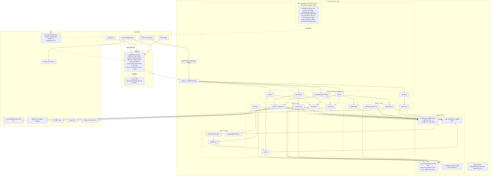
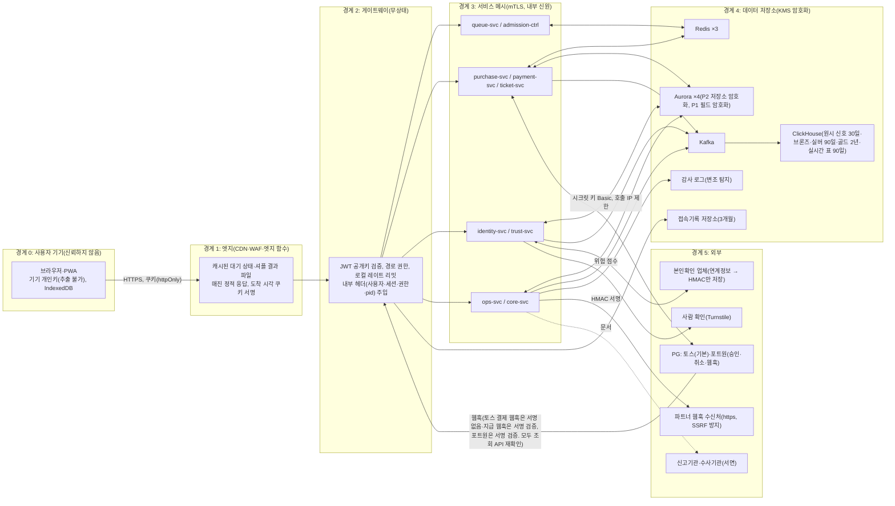
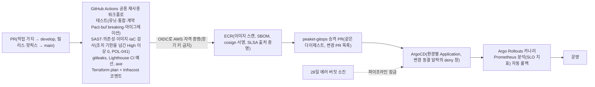

# 인프라·배포·운영

- **독자와 용도**: 플랫폼 엔지니어와 온콜 운영자가 보는 기준 문서다. 시스템 배포 구성, 신뢰 경계, 여러 환경을 나누는 방식, 구성 요소별 고가용성(서비스를 멈춤 없이 쓸 수 있는 정도를 높이는 것)과 이중화, 백업과 DR 계획, CI/CD(코드를 올릴 때마다 자동으로 검사하고 빌드하는 과정과 그 뒤의 배포) 파이프라인, 서비스 디스커버리와 여러 복제 중 일을 맡을 하나를 고르는 분산 리더 선출, 장애가 났을 때 따라 하는 비상 운영 런북의 구성을 파악할 때 참고한다. IaC 원본 코드는 `peaket-infra`(Terraform)와 `peaket-gitops`(Helm, 그리고 저장소의 배포 정의대로 쿠버네티스를 맞추는 ArgoCD) 저장소에 있다. 이 문서는 인프라 아키텍처의 설계 결정과 운영 원칙을 정한다.
- **원문 출처**: 설계서 §3 온세일(판매가 열리는 시각 앞뒤로 접속이 몰리는 기간) 타임라인 2번(프리워밍 절차), §6 API 게이트웨이(프로그램끼리 요청을 주고받는 창구 앞에 둔 입구 서버)의 트래픽 경로와 이중화, 서비스 디스커버리, 장애 격리 경계, 관제 시스템의 '자체 감시' 구조, §9 Degraded Mode(큰 장애 때 부가 기능을 미리 정한 범위에서 줄여 핵심을 지키는 운영 모드)의 대체 우회 경로, 19장(Kubernetes, 저장소에 적어 둔 배포 상태대로 클러스터를 맞추는 GitOps, 부하에 따라 서버 수를 자동으로 늘리고 줄이는 오토스케일링, CNCF 생태계), 23장(AWS DevOps 운영), 15장(저장소 구조), `docs/security/secrets-and-keys.md`, ADR-0008·0009·0010·0022·0028.
- **기준 기획 버전**: v1.0.
- **표시 규칙**: 원문에 자세한 명세가 없던 인프라 설정은 소유자가 추천대로 정하라고 맡겨, 추천안을 적용해 확정했다(추천 적용 2026-10-09, ADR-0031·0032). 이런 설정은 노드 풀(앱이 실행되는 서버인 노드의 묶음) 분리, 복제본(같은 서비스나 저장소를 여러 벌 띄워 둔 것) 수, 백업 주기, 환경 단계, 리전(클라우드 데이터센터가 모인 지역) 장애 대응 범위, 운영 관제 도구 선정이다. 실제 부하 시험과 클라우드 비용 산정 결과에 따라 사양을 조정하게 되면 아키텍처 결정과 그 이유를 남기는 ADR로 고친다. 실제로 재서 최종 확정할 지표값만 [가정]으로 표시한다.

## 1. 배포 구성도

- 일반 사용자와 관리자 트래픽이 기본으로 들어오는 경로는 CloudFront(AWS의 CDN. 악성 요청을 걸러 내는 웹 방화벽인 AWS WAF를 붙였다) → NLB(L4) → Envoy Gateway(요청을 받아 안쪽 서비스로 넘기는 프록시 서버) → 백엔드 마이크로서비스다. 소비자 트래픽은 CloudFront 배포 셋(공연 페이지, 대기열 파일, 대기열 API)으로 나눠 받고, 배포마다 한도를 미리 올린다(§4.1, ADR-0058). 중간에 ALB를 하나 더 두지 않아서, HTTP 프록시를 두 번 거치며 생기는 불필요한 지연과 처리 부담을 피한다(ADR-0008). 반면 현장 게이트 스캐너에는 CDN이 사용자 가까이에 둔 서버인 엣지의 캐싱이나 WAF 검사가 불필요하다. 그래서 CloudFront를 거치지 않고, NLB가 TCP 연결을 그대로 전달하는 패스스루로 `gw-scanner`에 바로 연결된다. 양쪽이 서로 인증서를 확인하는 mTLS는 쿠버네티스에서 앱이 실행되는 단위인 게이트웨이 파드에서 끝내고(종단), 기기 인증서를 직접 검증한다. 서비스는 요청마다 기기 상태와 스태프 세션 상태를 확인한다(ADR-0051). 스캐너 PWA(설치형 앱처럼 쓰는 웹 앱) 화면 자체는 정적 앱이라 `scanner.peaket.example`에서 mTLS 없이 낸다(§4.1 화면 호스트, ADR-0065).
- 프로덕션 아키텍처는 리전 하나(서울 리전)를 기준으로 만든다(분산 DB의 복잡함을 피하려고 ADR-0021에서 CockroachDB를 기각한 결정의 핵심 전제). 재해 복구(DR) 리전에는 ticket 데이터베이스의 교차 리전 읽기 복제본(AWS가 운영해 주는 PostgreSQL 호환 데이터베이스인 Aurora의 Global Database에 속한 도쿄 보조 클러스터, ADR-0083)과 백업 데이터 사본만 늘 둔다. 리전 전체가 멈추는 것 같은 전면 장애가 나면 자동 장애 조치를 하지 않는다. 예매 판매를 바로 멈추고, 콜드 백업 데이터로 차례대로 복원하는 비상 절차를 밟는다(§6, ADR-0031).
- 클러스터 규모와 CNI(추천 적용 2026-10-21, ADR-0078 결정 7): 운영 EKS(AWS가 운영해 주는 쿠버네티스) 클러스터는 하나다. 피크 때의 노드·파드 수 추정 칸과 클러스터 하나로 가는 기준(노드 1,000개·파드 3만 개 [가정] 이하)은 docs/architecture.md §9.5에 있다. 파드에 네트워크를 붙여 주는 CNI는 EKS 기본인 Amazon VPC CNI다. 파드마다 VPC 사설 IP를 쓰므로, 파드가 쓰는 서브넷의 IP를 합해 피크 파드 수의 2배 [가정] 이상이 되게 가용 영역 셋에 나눠 잡는다. 정확한 CIDR은 피크 추정(wbs 4.8.1) 뒤 Terraform에서 정한다.
- CloudFront 엣지 함수는 CloudFront Functions와 Lambda@Edge 가운데에서 HMAC(비밀 키로 만든 위조 확인용 값) 서명 검증이 되는지와 실행 비용을 비교해 최종으로 고른다. AWS 계정이 있으면 무료 범위 안에서 함수를 시험하고, 없으면 문서로 비교한다(wbs 0.5.3, docs/architecture.md §9.4 PoC 검증 과제). PoC는 본 개발 전에 위험한 부분만 먼저 만들어 확인하는 시험이다.

## 2. 데이터 흐름도(DFD)와 신뢰 경계

| 신뢰 경계를 통과하는 개인정보 흐름 | 보호 등급 (data-classification) | 보안 통제 및 암호화 조치 |
| --- | --- | --- |
| 외부 본인확인 대행사 ↔ identity-svc (연계정보 CI) | P1 (최고 민감도) | 대행사 API 인증 정보는 AWS Secrets Manager에 보관한다. 받은 연계정보(본인확인 기관이 주는, 사람마다 하나인 연계 식별값) 원문은 메모리에서 바로 버리고, AWS KMS(암호 키를 안전하게 보관하고 대신 써 주는 클라우드 서비스) 관리형 키로 만든 HMAC-SHA256 해시값(원래 값으로 되돌릴 수 없게 바꾼 고정 길이 값)만 저장한다. 요청이 가장 많이 지나는 대기열 진입 경로(핫패스)에서는 외부 대행사와의 통신을 모두 뺀다(ADR-0006·0008). |
| 예매자 개인 식별 정보 (성명, 전화번호) 단말 브라우저 → purchase-svc → Aurora PostgreSQL | P2 (일반 개인정보) | 전송 구간은 TLS(통신을 암호화하는 표준)로 보호한다. 구매 세션의 쓰기 요청에는 단말 임시 키로 합의한 키로 만든 요청 서명(소지 증명)을 싣는다(본문 암호화는 아니다, ADR-0050 결정 8). 저장소 수준의 KMS 암호화와 애플리케이션 로그 마스킹을 강제한다. |
| 예매자 명단 데이터 Aurora PostgreSQL → gw-partner → 파트너 콘솔 | P2 | 제3자 제공 동의를 받은 필수 항목만 골라 제공한다. 파트너의 조회 사유와 열람 건수는 접속기록 대장에 필수로 기록한다. 대용량 파일 다운로드는 한 번에 보내는 대신 스트리밍 방식으로 제한한다(FR-027, POL-023). |
| 시스템 접속기록 (접속 일시, IP 주소, 단말 정보) 게이트웨이 파이프라인 → 전용 접속기록 저장소 | P2 | 업무용 데이터베이스와 물리적으로 분리한 전용 저장소에 3개월간 보존한다. 수사기관의 영장 같은 적법한 법적 절차를 확인한 경우에만 엄격히 내보낸다(POL-025). |
| 단말 행동 신호 데이터 클라이언트 → trust-svc → Kafka → Flink(`trust-reassess`) → ClickHouse | P2 | 사용자 실명 대신 pid와 기기 식별값의 탐지 가명(trust-svc가 넣기 전에 탐지 가명 키로 HMAC-SHA256을 계산한 값)만 싣는다(ADR-0053). 대기 중 재평가 후보(`telemetry.trust-candidates`)에는 키인 pid와 회차·패턴·근거 수만 싣는다(ADR-0071). 대량 이벤트 집계에 강한 분석용 데이터베이스인 ClickHouse에서는 테이블 TTL(데이터 보관 기한)로 30일이 지나면 자동으로 파기한다. AWS의 파일 저장소인 S3의 장기 레이크에는 비식별 집계 통계만 보존한다. |
| 모바일 월렛 공개키 브라우저 → ticket-svc, 티켓 공개키 및 폐기 목록 → 게이트 스캐너 단말 | P3 (공개 가능 키) | 단말 서명용 ECDSA 개인키는 서버로 보내지 않고, 브라우저 IndexedDB(브라우저 안에 데이터를 저장하는 곳)의 WebCrypto 키(`extractable=false`)로 둔다. 하드웨어 보관은 아니다(ADR-0050 결정 1). 스캐너 단말은 운영자가 등록한 기기의 mTLS 기기 인증서(PEAKET 스캐너 사설 CA)로 서로 인증한다(ADR-0051). |

## 3. 환경 분리

| 환경 | 주요 용도 | 인프라 구성 | 데이터 정책 | 비밀 관리 | 배포 방식 |
| --- | --- | --- | --- | --- | --- |
| 로컬 (Local) | 기능 개발, 1천·1만·10만 명 측정(포트폴리오 기간의 기본 측정 환경), 단위·통합·계약 테스트(온라인 결제를 대신 처리해 주는 결제사 PG의 시뮬레이터 연동), Game Day(일부러 장애를 내고 대응을 연습하는 날)와 합성 봇 시험(ADR-0057) | kind나 k3d로 띄운 로컬 K8s + LocalStack + Strimzi(로컬 Kafka. 이벤트를 순서대로 쌓아 두고 여러 곳에 나눠 주는 메시지 시스템). CI 테스트 환경도 같은 구성을 쓴다 | Faker로 만든 완전 합성 데이터 | `.env` 로컬 파일(Git 커밋 절대 금지), `.env.example` 템플릿 제공 | 로컬 수동 실행 |
| 스테이징 (Staging) | (설계) 대규모 부하 시험, 카오스 엔지니어링(Chaos Mesh·AWS FIS), 합성 봇 침투 시험(POL-026: 봇 공격 실험은 격리 환경에서만 한다), Game Day, 교차 리전 재해 복구 훈련. 포트폴리오 기간에는 띄우지 않고, 이 역할은 로컬 측정 환경과 선택 보정이 맡는다(ADR-0057, docs/verification.md §5) | 운영과 같은 Terraform 모듈로 만든다. 부하 측정과 Game Day 기간에만 그때그때 만들고, 끝나면 바로 자원을 회수한다(싸지만 회수될 수 있는 클라우드 서버인 Spot 인스턴스 + 시간 단위 과금) | 대규모 합성 데이터, 결제사 토스·포트원의 테스트 연동 키, PG 시뮬레이터 어댑터 | AWS Secrets Manager (staging 네임스페이스) | ArgoCD, 운영과 같은 Helm 차트 배포 |
| 데모 (Demo) [보완] | 포트폴리오 시연과 E2E 시나리오 검증. 늘 켜 두는 환경은 두지 않는다(질문 24 결론, ADR-0057) | 로컬 kind의 데모 오버레이(서비스별 1복제본). 선택: 면접·발표 때만 몇 시간 띄우는 임시 클라우드(TTL·예산 경보) | 가벼운 합성 데이터, 결제사 샌드박스 테스트 키 | 로컬 `.env`(커밋 금지), 임시 클라우드는 AWS Secrets Manager (demo 네임스페이스) | ArgoCD 자동 배포(데모 오버레이), 녹화 영상과 재현 스크립트 |
| 운영 (Production) | 실제 상용 서비스 환경(이 포트폴리오의 최종 아키텍처 목표 사양). 포트폴리오 기간에는 설계와 코드로만 두고 띄우지 않는다(ADR-0057) | 이 문서 1절의 다중 AZ(리전 안의 독립된 데이터센터 묶음) 고가용성 구성 | 실제 고객 데이터(엄격한 암호화, 법정 보존·파기 정책 준수) | AWS Secrets Manager (prod 네임스페이스), AWS KMS 전용 키 | ArgoCD + Argo Rollouts 기반 카나리 점진 배포, 온세일 윈도우 배포 엄격 차단 |

- 환경별 배포 경로(데모 자동 승격, 스테이징 캠페인 고정, 운영 승격 조건)와 GitOps 저장소 구조는 docs/devops.md §5에 정했다(ADR-0054).
- **포트폴리오 기간의 원칙(소유자 결정 2026-10-13, ADR-0057)**: 운영·스테이징은 이 문서와 Terraform·매니페스트 코드로만 두고 띄우지 않는다. 문서에 '스테이징에서' 한다고 적은 시험·훈련은 로컬 측정 환경에서 한다. 관리형 서비스에 장애를 넣는 시험은 대체 장애로 바꾼다. 관리형 서비스의 장애 조치 시간과 노드 기동 시간은 문서를 인용해 둔다(docs/verification.md §5).
- 늘 켜 두는 유휴 dev 클러스터는 비용을 줄이려고 운영하지 않는다. 분산 구성 요소 사이의 통합 테스트와 계약 테스트는 CI 단계의 로컬 컨테이너(앱과 실행 환경을 한 묶음으로 만든 실행 단위) 환경에서 한다. 실제 브라우저로 하는 E2E 검증은 로컬·CI의 데모 오버레이에서 한다(ADR-0031, ADR-0057).
- Terraform 원격 상태 파일(State)은 환경별로 물리적으로 나눠 서로의 간섭을 막는다(23장). 운영 환경의 실제 데이터를 스테이징이나 데모 환경으로 덤프하거나 복사하는 일은 개인정보 보호 원칙에 따라 엄격히 금지한다(POL-026).
- 클라우드에서 부하를 내는 선택 보정(ADR-0057) 전에는 AWS의 네트워크 스트레스 테스트 정책을 미리 점검한다. 트래픽은 반드시 회사 계정이 소유한 테스트 자원에만 보내야 한다.

## 4. 구성 요소별 가용성·이중화

| 구성 요소 | 이중화 및 고가용성 설계 | 장애 발생 시 시스템 동작 | 설계 근거 및 검증 방식 |
| --- | --- | --- | --- |
| CloudFront + AWS WAF | 전 세계 엣지에 나눠 배포 | CDN 뒤에서 원본 파일을 주는 서버인 오리진에 장애가 나면, `stale-if-error` 정책에 따라 가까운 곳에 복사해 둔(캐시된) 공연 안내 페이지로 응답한다. 매진 상태 파일과 대기 순번 파일 요청은 CloudFront 원본 그룹(주 원본 → S3 사본, 장애 조치 상태 코드 500·502·503·504, 연결 시간 초과 2초·시도 1회 [가정]. 기본값은 10초씩 3회라 30초 뒤에야 넘어간다)이 요청마다 S3 정적 오리진이라는 대체 경로로 자동으로 돌리고, 다음 요청은 다시 주 원본으로 보낸다. 원본이 살아 있어도 S3 사본으로 고정하는 것은 명령 6이고 해제도 명령 6이다(RB-04, ADR-0078 결정 2). 보조 원본은 같은 요청 경로를 받으므로 S3 사본 키를 요청 경로에 맞춘다 [가정, wbs 2.2.2에서 확인]. | NFR-007, NFR-002 Degraded 우회 설계. 배포 셋과 배포별 한도는 §4.1(ADR-0058) |
| NLB | 3개 가용 영역(AZ) 분산, 교차 영역 로드 밸런싱 활성화 | 특정 가용 영역의 게이트웨이 파드가 모두 멈춰도 다른 AZ의 정상 파드로 트래픽을 바로 다시 나눈다. | ADR-0008 (AZ 간 네트워크 전송 비용은 K9 비용 추정에 가격표와, 잰 범위의 결과를 식으로 늘려 구한 외삽 요청 수로 넣는다, ADR-0057) |
| Envoy Gateway ×5 | 게이트웨이 유형별 최소 3 복제본을 3 AZ에 고르게 배치, PodDisruptionBudget(PDB) 설정, 초당 요청 수에 따른 수평 오토스케일링, 오픈 전 프리워밍(미리 늘려 두기) | 전체 파드의 절반이 예기치 않게 꺼지는 카오스 상황에서도, 팀이 미리 정한 서비스 수준 목표(SLO) 안에서 자동으로 복구된다. | NFR-011 무중단 가용성 목표 |
| queue-svc | PodTopologySpreadConstraints로 AZ 분산, KEDA(대기 작업량 같은 지표로 파드 수를 늘리고 줄이는 도구)로 이벤트에 따라 스케일링(초당 요청 수인 RPS와, 메모리에 데이터를 두는 빠른 저장소인 Redis의 대기열 길이에 연동), 온세일 프리워밍 | Redis 메모리 병목 징후를 감지하면 `INCRBY` 파드별 마이크로 배치 모드로 바꾼다. 심각한 장애가 나면 도착 시각 쿠키(브라우저가 사이트별로 저장했다가 요청마다 함께 보내는 작은 값)로 진입시키는 Degraded 모드로 바꾼다. | NFR-001 대기열 처리 목표 |
| admission-ctrl | Kubernetes Lease(정해진 시간 동안만 유효한 권한. 갱신하지 않으면 다른 쪽이 가져간다)로 활성 리더 1대 + 늘 대기하는(Standby) 2대를 둔다. Lease 유지 기간과 갱신 주기는 리더 공백이 제어 루프 몇 번 분량인지 실제로 재서 확정한다(초기 권장값: 유효 기간 15초, 갱신 주기 5초 [가정, Phase 2 부하 시험에서 확정]). | 리더가 바뀌면 서빙 번호 전진을 잠시 멈추고(대기 순번은 유지한다), 새 리더가 분산 Lease를 정상적으로 얻은 직후 서빙을 안전하게 다시 시작한다. 제어 명령을 실행하기 직전, Lease 소유권을 다시 확인한다. | 33장 분산 리더 강제 종료 카오스 검증 |
| purchase-svc | 최소 3 복제본 이상, 3 AZ 분산 배치, Node.js 이벤트 루프 지연(lag)에 따른 오토스케일링 | 좌석 Redis 클러스터가 장애 조치 중이면 PostgreSQL(관계형 데이터베이스)의 정렬 잠금 비상 경로로 돌린다. 동시 예매 허용 목표치는 바로 50% 줄인다. | NFR-003 좌석 홀드 처리 목표 |
| realtime-gw | 연결을 열어 둔 채 서버와 브라우저가 주고받는 WebSocket의 동시 연결 수에 따른 오토스케일링, 파드당 최대 활성 연결 한도 설정 | 클라이언트가 다시 연결되면 구역 버전의 빈틈을 감지해, 전체 스냅샷(어느 시점의 전체 상태를 찍어 둔 것)을 다시 받아 맞추도록 자동으로 요청한다. | NFR-004 실시간 좌석 상태 전파 목표 |
| identity·payment·ticket·trust·ops·core | 도메인별 최소 2 복제본 이상, PodDisruptionBudget 적용 | trust-svc에 장애가 나면 캐시해 둔 정적 규칙과, IP별 레이트 리밋(일정 시간에 받는 요청 수의 상한)을 보수적으로 잡은 모드로 바꿔 정상 사용자의 예매 진입을 보장한다. ops-svc가 멈추면 대역 외(평소와 다른 별도 통로) 비상 CLI 도구로 제어권을 유지한다. | NFR-022, NFR-008 장애 격리 목표 |
| Redis Cluster ×3 | 클러스터당 샤드(데이터를 여러 저장소에 나눠 담은 조각) 3개 × 복제본 1개 구성, 다중 AZ 배치, 비동기 복제 | 마스터 장애 조치 때 비동기 복제가 늦어져 쓰기를 잃을 가능성에 대비한다. 대기열 순번은 세대 번호를 붙이고 카운터를 건너뛰어 해결한다. 좌석 홀드(결제하는 동안 다른 사람이 가져가지 못하게 좌석을 잠시 잡아 두는 것) 누락은 DB 유니크 제약으로 막는다. 세션은 리프레시 토큰(권한이나 상태를 증명하려고 주고받는 서명된 문자열)으로 자동 재로그인하게 한다. 샤드 추가와 슬롯 이동(리샤딩)은 정비 시간에만 한다(docs/devops.md §12.1, ADR-0082). | NFR-015, ADR-0002·0014·0082 |
| Aurora PostgreSQL ×4 | 다중 AZ Writer 인스턴스 1대 + Reader 인스턴스, 장애 때 자동 장애 조치 | 잃어도 되는 데이터의 시간 폭인 목표 복구 시점(RPO)은 0, 복구까지 걸려도 되는 시간인 목표 복구 시간(RTO)은 5분을 보장한다. 장애 조치로 전환되는 구간에 들어온 쓰기 요청의 실패는 클라이언트와 애플리케이션의 멱등 재시도 파이프라인이 흡수한다. | NFR-015 데이터 신뢰성 목표 |
| ticket DB 교차 리전 읽기 복제본 | Aurora Global Database의 보조 클러스터(도쿄, 읽기 인스턴스 1대)로 늘 동기화한다. Aurora PostgreSQL은 교차 리전 Aurora 복제본을 지원하지 않으므로, 다른 리전에 읽기 클러스터를 두는 관리형 방법은 이것이다. 평소에는 읽기에만 쓰고, 관리형 전환(switchover·failover)으로 쓰기를 옮기지 않는다. 나머지 세 Aurora 클러스터는 Global Database에 넣지 않는다(추천 적용 2026-10-22) | 공연 당일 메인 리전에 네트워크 장애가 나도 현장 스캐너의 티켓 유효성 검증 조회를 멈춤 없이 이어 간다. 리전 전체 장애 때는 티켓 원장 데이터를 보존한다. | 원문 '가용성 시간대', ADR-0031, ADR-0083 |
| MSK (Kafka) | 3대 브로커 노드를 3 AZ에 분산, Replication Factor 3, `min.insync.replicas=2`, 메시지를 쓰는 쪽(프로듀서)은 `acks=all` 강제 | 브로커 노드 한 대가 물리적으로 멈춰도 무중단 메시징을 유지한다. 거래·제어 토픽(메시지를 종류별로 모아 두는 통로)과 대용량 텔레메트리(시스템이 내보내는 지표·로그·요청 기록 같은 운영 신호) 클러스터를 물리적으로 나눠, 핵심 원장 토픽을 보호한다. 이런 신호로 시스템 안을 들여다보는 관측 전용 클러스터(요청 기록 저장소인 Tempo의 쓰기 경로)는 세 번째로 따로 둔다(ADR-0077). | ADR-0026 토픽 분리 아키텍처 |
| ClickHouse | 데이터 노드 2 복제본, 비동기 일괄 삽입 | 적재 파이프라인이 늦어지면, 실시간 관제 대시보드의 비즈니스 패널은 지표를 모아 저장하는 도구인 Prometheus의 메모리 지표로 줄여 보여 준다. | NFR-009 Degraded 관제 우회 |
| MongoDB | MongoDB(문서 형태로 저장하는 데이터베이스) 커뮤니티 오퍼레이터로 만든 3 노드 복제 세트 | 카탈로그 저장소에 장애가 나면 프론트엔드 정적 캐시와 ISR(미리 그려 두고 정해진 주기로 다시 그리는 방식) 캐시로 읽기 요청을 받아 낸다. | ADR-0013 상품 카탈로그 아키텍처 |
| Apache Flink | Kubernetes Operator는 1.16.1, 흘러드는 이벤트를 실시간으로 계산하는 스트림 처리 엔진 Flink는 2.2.x로 고정한다. 잡마다 애플리케이션 모드로 돌린다(세션 클러스터 없음). JobManager는 쿠버네티스(컨테이너로 만든 앱을 여러 서버에서 실행하고 관리하는 플랫폼) HA로 둔다. 작업 상태를 주기적으로 저장해 두는 지점인 체크포인트(장애 뒤 여기서 다시 시작한다)와, 업그레이드나 되돌리기 때 일부러 남기는 저장본인 세이브포인트는 S3에 영구 저장한다. 관리 REST에는 Operator만 닿는다. 자동 확장은 끈다. 관제 실시간 잡에는 예비 TaskManager 1대를 둔다(docs/streaming.md §2, ADR-0071) | 관제 실시간 표의 신선도(심장 박동)가 5초를 넘는 상태가 3분 넘게 이어지면, 실시간 표 패널을 Prometheus 대체 표시로 바꾸는 Degraded 모드를 켠다. 체크포인트 지연은 원인 패널이다 | NFR-009 관제 스트리밍 신뢰성 |
| 관측 스택 (Prometheus·Grafana 등) | 일반 비즈니스 파드와 떨어진 전용 노드 풀에 배포, 외부 업체의 데드맨 스위치(신호가 끊기면 경보를 보내는 장치) 연동 | 사내 관측 인프라가 모두 무너져도 외부 모니터링이 바로 온콜 담당자를 호출한다. 지표와 로그를 그래프로 보여 주는 Grafana도 같은 노드 풀에 있어 함께 멈춘다. 그래서 외부 합성 점검, 콘솔에서 Prometheus 밖에서 오는 숫자(입장 제어 상태, 관제 실시간 표), 비상 런북 CLI로 관제권을 유지한다(ADR-0073). | docs/observability.md §10 |
| EKS 워커 노드 풀 | Karpenter(필요한 만큼 서버를 붙이고 떼는 도구) 오토스케일러를 쓴다. Spot 인스턴스는 스테이징·데모 환경과 비핵심 워커(notify, Flink 원본 적재 잡의 TaskManager)에만 허용한다. 핵심 핫패스 노드는 정가로 계속 쓰는 온디맨드 인스턴스로 강제한다. 관제 실시간 잡·봇 재평가 잡의 TaskManager는 창·중복 제거 상태를 들고 있어서, 회수되면 잡이 재시작하므로 온디맨드다(ADR-0071) | 갑자기 노드가 축출되는 상황에서도 PDB와 토폴로지 분산 제약에 따라 시스템 처리 용량을 안전하게 유지한다. | 19장 쿠버네티스 아키텍처 |

### 4.1 CloudFront 배포와 한도 (ADR-0058)

| 배포 | 호스트 | 받는 것 | 설계 피크(100만 기준) | 요청 한도(기본 → 상향 목표) | 전송(기본 150 Gbps) |
| --- | --- | --- | --- | --- | --- |
| 공연 페이지 | `www.peaket.example` | 공연 페이지, 홈(ISR), 대기실 셸, 웹 정적 자산, 장르별 랭킹 파일·회차 좌석맵 파일(S3 원본, ADR-0063), 공개 감사 체크포인트(`/transparency/`, S3 원본, ADR-0075) | 초당 30만 건(NFR-007) | 25만 → 45만 [가정] | 기본 |
| 대기열 파일 | `queue-files.peaket.example` | 대기 상태 파일, 순번을 무작위로 섞은 셔플 결과 파일, 묶음 결과 파일 | 초당 약 17.8만 건(셔플 결과 분산 조회 약 12.5만 + 대기 상태 조회 약 5.3만), 전송 약 36 Gbps | 25만 → 27만 [가정] | 기본(목표 54 Gbps) |
| 대기열 API | `queue.peaket.example` | 로비 입장, 사전 검증, 진입, 입장 확정, 엣지 함수(매진 응답, 도착 시각 쿠키) | 초당 20만 건(NFR-001) | 25만 → 30만 [가정] | 기본 |

- 다른 호스트(gw-fan `api`, 파트너, 관제)는 배포를 따로 두며, 피크가 기본 한도보다 훨씬 작다. 게이트 스캐너(gw-scanner)는 CloudFront를 거치지 않는다.
- **브라우저 지표 경로(추천 적용 2026-10-21, ADR-0079 결정 13)**: 화면 배포 넷(`www`·`partner`·`console`·`scanner`)에는 같은 출처의 `/_t/*`(POST만, 캐시 안 함)를 gw-fan의 텔레메트리 입구로 보내는 캐시 동작을 둔다. 원본 요청에는 원본 확인 헤더와 화면 앱 이름 `X-Peaket-App`을 붙인다(CloudFront는 같은 이름의 시청자 헤더를 덮어쓴다, AWS 개발자 안내서 2026-10-21 확인). gw-scanner는 CloudFront를 거치지 않고 gw-ops는 허용 IP만 받으므로, 앱마다 그 앱의 게이트웨이로 보내지 않는다(docs/observability.md §11).
- **대기실 경로(추천 적용 2026-10-21, ADR-0079 결정 2)**: 공연 페이지 배포는 `/queue/*`·`/{en,ja,zh}/queue/*`·`/shop/*/queue` 요청을 CloudFront Function(시청자 요청)으로 대기실 경량 셸 `/_q/shell.{locale}.html`(S3 원본)로 바꿔 읽는다 [가정, PoC wbs 2.10.6]. 셸 응답 헤더 정책의 CSP(페이지가 실행할 수 있는 스크립트의 출처를 정하는 브라우저 규칙)는 docs/frontend.md §5.14의 묶음 A′다.
- **사전 요청 없는 진입(추천 적용 2026-10-15, ADR-0065 결정 6)**: 대기열 API의 설계 피크 초당 20만 건에는, 다른 주소에서 온 요청을 브라우저가 허용할지 정하는 규칙인 CORS의 사전 요청(OPTIONS)이 들어 있지 않다. www에서 `queue` 호스트로 가는 진입과 입장 확정은 출처가 달라서, JSON 본문이면 요청마다 사전 요청이 붙는다. 사전 요청 캐시는 URL별인데 진입 주소는 회차마다 달라 미리 데울 수 없다. 그래서 두 요청은 사전 요청이 생기지 않는 형식(`Content-Type: text/plain;charset=UTF-8`, safelisted 헤더만)으로 보낸다(docs/features/queue-admission.md §3). 사전 요청이 생기는 다른 대기열 경로(로비 입장·사전 검증·대기 취소)는 대부분 T=0 전에 일어난다. 또 사전 요청 응답에 `Access-Control-Max-Age: 7200`을 줘 같은 주소로 되풀이되는 사전 요청을 줄인다(Chromium 상한 2시간, MDN). 사전 요청이 정말 없는지는 Phase 2의 브라우저 시험으로 확인하고, 그 형식으로 보낼 때의 지연은 부하 시험에서 잰다(queue-admission Q-T41).

**화면 호스트(추천 적용 2026-10-15, ADR-0065 결정 1)**: 앱마다 호스트를 달리해, 브라우저의 동일 출처 정책으로 서로 나뉘게 한다(웹 앱 보안 검증 항목 목록 ASVS v5.0.0-3.5.4). API 호스트(`api`·`queue`·`queue-files`·`partner-api`·`ops-api`·`scanner-api`, openapi `servers`)는 그대로다.

| 화면 | 호스트 | 내는 것 | 배포 | 부르는 API 호스트 |
| --- | --- | --- | --- | --- |
| 소비자 웹(월렛 PWA 포함) | `www.peaket.example` | 웹 화면을 만드는 프레임워크인 Next.js의 앱 서버(ISR·동적 화면), 정적 셸, 웹 정적 자산 | 공연 페이지 배포(위 표) | `api`·`queue`·`queue-files` |
| 파트너 콘솔 | `partner.peaket.example` | Next.js 앱 서버(동적으로 화면 그리기)와 정적 자산 | 파트너 화면 배포 [가정, wbs 2.11.2에서 확정] | `partner-api` |
| 관제 콘솔 | `console.peaket.example` | Module Federation 호스트와 원격 모듈(같은 출처 `/remotes/`, docs/devops.md §6.6), 포렌식 리플레이 2단계 페이지(`/forensics/`, 출시 뒤 선택), 정적 파일 | 관제 화면 배포 [가정, wbs 2.11.2에서 확정]. 관리자 콘솔 IP 제한(§9)을 받는다 | `ops-api` |
| 게이트 스캐너 PWA | `scanner.peaket.example` | Vite 정적 앱(mTLS 없이) | 스캐너 화면 배포 [가정, wbs 2.11.2에서 확정] | `scanner-api`(mTLS, CloudFront 미경유) |

- 화면 호스트의 피크는 공연 페이지 배포를 빼면 기본 한도보다 훨씬 작다. 화면 호스트마다 응답 보안 헤더와 CSP가 다르다(§9, docs/architecture.md §6.3).
- 팬·파트너 쿠키처럼 `Domain=peaket.example`을 쓰는 쿠키는 PEAKET의 모든 하위 호스트로 간다. 그래서 하위 호스트에는 PEAKET이 운영하는 앱과 게이트웨이만 둔다(docs/features/identity.md §3). 알림 메일용 하위 도메인처럼 웹을 내지 않는 이름은 예외다.
- gw-fan `api` 배포의 공개 카탈로그 읽기(홈 피드, 검색, 연관 검색어, 후기 요약)는 쿠키를 캐시 키와 원본 요청에서 뺀 캐시 정책으로 받는다. 오픈 직전 100만 명이 몰릴 때 연관 검색어는 입력할 때마다 요청이 나간다. 하지만 정규화한 입력이 캐시 키라서, 앞부분이 같은 입력은 한 캐시를 함께 쓴다. 이 배포의 피크는 아직 계산하지 않았고, 기본 한도 안으로 본다 [가정]. 부하 분해(docs/verification.md §3.1)에 연관 검색어 요청 수를 더해 계산한 뒤, 위 표에 넣을지 정한다(추천 적용 2026-10-14, ADR-0063).
- **상향 요청**: 상향 목표는 배포 설계 피크의 1.5배 [가정]다. 처리 기간을 모르므로 출시를 준비하며 운영 계정을 만들 때 요청한다(포트폴리오 기간에는 설계 값이다, ADR-0057). 승인 값과 요청일은 외부 한도 대조표(docs/verification.md §4)에 적는다. 200만(docs/architecture.md §9.2)이면 대기열 API 60만, 3년차 합산 300만(§9.5)이면 대기열 파일 약 43만이 필요하다. 그래서 그 규모가 되기 전에 다시 요청한다 [가정].
- **확인**: 대형 회차는 판매를 승인할 때 운영자가 그 회차의 예상 피크가 승인 값 안인지 대조표로 확인하고, T-30분 점검(§5)에서 다시 확인한다.
- **대기열 파일 배포 설정**: 셔플·묶음 결과 파일 경로에서 404 오류를 캐시하는 최소 TTL을 1초 [가정]로 둔다(CloudFront 기본은 10초. 기본값이면 게시한 뒤에도 최대 10초 동안 '셔플 전'이 나간다). 대체 원본은 S3이고, S3에는 회차별 접두사(`queue/{eventId}/shuffle/…`, `queue/{eventId}/fallback/…`)로 쓴다(접두사마다 초당 PUT 3,500건 이상, AWS S3 성능 문서). 소비자 웹 스크립트가 다른 출처의 파일과 `Retry-After`를 읽도록, 이 배포와 S3 대체 원본은 `Access-Control-Allow-Origin: https://www.peaket.example`과 `Access-Control-Expose-Headers: Retry-After, Date`를 낸다(`Date`는 브라우저 시계 보정용, ADR-0079 결정 3). 쿠키를 받지 않으므로 `Access-Control-Allow-Credentials`는 두지 않는다. 값이 하나로 고정이라 캐시가 출처마다 갈리지 않는다(추천 적용 2026-10-15, ADR-0065 결정 7).
- **감시**: 배포별 한도 사용률(배포 요청 수 ÷ 승인 한도)이 80% [가정]를 넘으면 SEV3(장애 심각도 등급. 숫자가 작을수록 심각하다) 경고를 낸다(docs/observability.md §5).
- 한도를 넘었을 때 CloudFront가 어떤 응답을 주는지와 상향 처리 기간은 AWS 문서에서 확인하지 못했다.

## 5. 프리워밍과 오토스케일 (프리워밍 T-40분 시작, 점검 T-30분)

1. **KEDA Cron 트리거 (T-40분 [가정, Phase 4 4.6.1에서 확정])**: T-30분 점검(5번) 전에 끝나도록 정기 크론 트리거가 돈다. 이 트리거는 Envoy 게이트웨이군, queue-svc, admission-ctrl, purchase-svc, realtime-gw, identity-svc(오픈 직전 대규모 동시 로그인이 몰린다), trust-svc의 최소 파드 복제본 수를 미리 정한 프로비저닝 수치로 늘린다. 구체적인 목표 파드 수는 docs/architecture.md §9의 용량 산정 공식과 사전 부하 시험의 실측치를 바탕으로 KEDA 매니페스트에 정한다.
2. **Karpenter 선제적 노드 프로비저닝**: 새 파드의 배치 요구에 맞춰 Karpenter가 온디맨드 EC2 노드를 미리 많이 띄운다(새 노드가 부팅되는 시간이 전체 확장 지연의 대부분을 차지한다. 그래서 60초 신속 스케일링 목표를 이루려면 오픈 전 미리 노드를 데워 두는 일이 필수다, NFR-023·K9).
3. **다계층 캐시 예열 (Cache Warming)**: 새로 여는 공연 상세 페이지의 ISR 재검증을 미리 일으킨다. 회차 좌석맵 파일(배치·좌석 두 층, ADR-0063)과, 서명된 정보 묶음 형식의 토큰인 JWT의 공개키(JWKS) 캐시를 불러온다. Redis에서는 좌석 하나를 한 비트로 줄인 좌석 상태 비트맵을 초기화한다. CloudFront Origin Shield 캐시도 예열한다.
4. **런타임 스케일러 연동**: 오픈 이후에는 KEDA가 실시간 Redis 대기열 길이(들어오는 양), 메시지를 읽는 쪽인 Kafka 컨슈머의 지연(lag), Prometheus가 모은 지표인 Node.js 이벤트 루프 지연 p99(요청 백 건 중 아흔아홉 건이 이 시간 안에 끝난다는 뜻)와 게이트웨이 초당 요청 수를 함께 보고, 오토스케일링을 그때그때 조절한다. 포화 상태 지표는 AIMD(정상이면 조금씩 늘리고 나빠지면 크게 줄이는 조절 방식) 동시 입장 목표 조절 알고리즘의 제어 입력으로도 쓰인다(docs/observability.md §3 규칙 4). KEDA는 지표를 3회 [가정] 연속 못 읽으면 지금 복제 수를 유지한다(`fallback`의 behavior `currentReplicas`). 또 확장 기준을 AIMD 감축 기준보다 낮게 두어 확장이 먼저 걸리게 한다. 오토스케일이 잘못 움직이면 RB-30으로 멈춘다(docs/architecture.md §5, ADR-0069).
5. **T-30분 Pre-flight 체크리스트 점검 (관제 SCR-029)**: 다음 항목을 종합해 티켓팅 오픈 강행 여부(Go/No-Go)를 최종 판정한다. 노드와 파드 프리워밍 완료 여부, 다계층 캐시 적중률(권고: 직전 15분 공연 상세·정적 자산 배포의 엣지 적중률 90% 이상 [가정], 요청 1,000건 미만이면 판정 보류, 추천 적용 2026-10-14, ADR-0062), Redis·Kafka·Aurora 데이터베이스 헬스체크, 그 공연 결제사(ADR-0044)의 상태와 한도 초과 응답 여부, 본인확인·사람 확인 제공자 상태, CloudFront 배포별 요청·전송 한도(적용된 상향 값)가 그 회차의 설계 피크 이상인지(§4.1, ADR-0058), 외부 합성 점검 정상 여부, 온콜 알림 채널 시험 발송 결과, 노드 시계 오프셋(기준 시각과 어긋난 정도) 20ms 이하, 만료가 7일 이하로 남은 인증서 없음, 마지막 교차 리전 백업 성공, 진행 중 배포(롤아웃·마이그레이션) 0건(대형·중형 회차. 소형 회차는 동결 대상 핫패스 롤아웃을 T-15분 자동 중단으로 대신해, 이 항목을 판정에서 빼고 표시만 한다, ADR-0054 결정 10), 그 회차의 변경 동결 창 적용(ArgoCD·Karpenter), 동결 창에 겹치는 예정 관리형 유지보수 없음이다. 캐시 적중률을 뺀 항목은 필수다. 필수가 하나라도 실패하면 오픈 시각에 입장 일시정지와 대기실 공지로 시작하고, 회복한 뒤 재개한다(docs/features/control-tower.md §2, ADR-0049, ADR-0054).
6. **변경 동결 창 강제**: 온세일 윈도우(T-10분 ~ T+60분)에는 배포하지 않고(POL-028), 그 앞쪽으로 변경 동결 창을 넓힌다. 대형·중형 온세일은 T-90분부터 T+60분까지 모든 운영 변경을 시작하지 않고, T-45분에 끝나지 않은 롤아웃은 자동으로 멈춘다. 소형 온세일은 핫패스 묶음만 T-50분부터 막는다. 장애의 약 70%가 운영 중인 시스템의 변경에서 나온다는 구글의 내부 관찰(SRE Book 1판 1장)을 근거로 한다. 오픈 시각이 공연마다 다르므로, 고정 일정 대신 변경 동결 달력이 오픈 일정을 보고 ArgoCD 동기화 창(deny)과 Karpenter 노드 중단 예산을 자동으로 만든다. 관리형 서비스 유지보수 창은 정비 시간(매일 04:00~06:00 KST) 안의 수요일 04:00(KST)부터로 고정한다(docs/devops.md §8, ADR-0054)[보완].
7. **온세일 종료 후 자원 회수 및 비용 분석**: 티켓팅이 몰리는 구간이 끝나면 KEDA 크론이 최소 복제본 수를 평상시 수준으로 되돌리고, Karpenter가 놀고 있는 EC2 노드를 안전하게 비운 뒤(드레인) 반납한다. 비용 관리(FinOps) 관점에서 온세일 1회에 든 총 인프라 비용과 티켓 1,000장 발권당 인프라 비용을 OpenCost 메트릭과 AWS 비용 할당 태그로 자세히 계산한다(K9). 포트폴리오 기간에는 운영을 띄우지 않으므로 가격표와 외삽한 요청 수로 추정한다(ADR-0057).

## 6. 백업·DR (NFR-015, ADR-0031)

| 데이터 원장 | RPO | RTO | 백업 정책 | 복구 절차 | 검증 및 훈련 계획 |
| --- | --- | --- | --- | --- | --- |
| Aurora PostgreSQL (purchase, payment, ticket) | 0 (다중 AZ 동기 복제) | 5분 (자동 장애 조치) | 지속적 자동 백업과 시점 복구(PITR) 35일 보존, 일 단위 전체 스냅샷의 교차 리전 복제 | 인스턴스가 멈추면 자동으로 장애 조치한다. 논리적 데이터 손상이 생기면 PITR로 정상 시점의 클러스터를 복원한다. 그다음 Outbox(DB를 바꿀 때 보낼 이벤트를 같은 트랜잭션으로 DB 표에 먼저 적어 두고 나중에 보내는 방식) 테이블과 Kafka 오프셋(메시지를 어디까지 읽었는지 나타내는 위치 번호)을 대조해, 반영이 안 된 트랜잭션(여러 변경을 한꺼번에 반영하거나 한꺼번에 취소하는 작업 단위)을 다시 처리한다. | AWS FIS 장애 조치 주입 시험(운영 설계, RB-10 절차), 분기 1회 PITR 복원 훈련(포트폴리오 기간: 로컬 대체 장애와 PITR 리허설, docs/verification.md §5.3) |
| Aurora PostgreSQL 공유 클러스터 (identity, ops, core) | 0 | 5분 | 지속적 자동 백업과 PITR 35일 보존, 일 단위 전체 스냅샷의 교차 리전 복제 | 위와 같다. 특히 운영 감사 로그(`command_event`)는 매일 S3 Object Lock(WORM 정책) 저장소에 별도 백업 사본을 보관한다. 감사 기록 전체는 키를 건 해시 체인(`audit_chain`)의 마지막 값을 5분마다 같은 저장소에 앵커로 남겨, 고치면 드러나게 한다(ADR-0053). | 위와 같다 |
| Redis 대기열 클러스터 | 비동기 복제 지연분 (수백 ms 이내) | 30초 | 영구 백업 미적용 (회차 키는 그 회차의 판매 종료(공연 시작 24시간 전, ADR-0064) TTL이 지나면 사라진다. 판매는 온세일 윈도우가 아니라 판매 종료·매진까지 이어진다, ADR-0063 결정 11) | 마스터 페일오버(고장 난 쪽 대신 예비 쪽으로 넘기는 것)가 일어나면 새 마스터의 순번 카운터를 보수적인 안전 여유치만큼 한꺼번에 앞으로 보내고, 세대 번호를 올린다. 판매 기간이 길어서, 장애로 사람별 입장 키(`q:adm`)가 사라지면 이미 입장한 사람이 다시 줄을 설 수 있다. 그래도 1인 매수 한도는 DB 원장(`purchase_quota`)이 지킨다. 대기열 셔플 결과는 CDN(사용자 가까운 곳에 파일을 복사해 두고 대신 응답하는 전송망) 엣지에 캐시된 정적 파일이 최종 진실 원천 역할을 한다. | FIS 페일오버 시뮬레이션, K1 순번 중복 0건 실측 검증(포트폴리오 기간: 로컬 Redis 주 노드 강제 종료) |
| Redis 좌석 클러스터 | 비동기 복제 지연분 (수백 ms 이내) | 30초 | 영구 백업 미적용 | 페일오버가 진행되는 구간에는 PostgreSQL 정렬 잠금 경로로 안전하게 돌린다. 메모리 노드가 복구되면 관계형 DB의 `seat_sale`과 홀드 원장을 바탕으로 비트맵 상태를 다시 맞춰 만든다. | FIS 페일오버 테스트, 불변식 검사기로 오버셀(같은 좌석이 두 사람 이상에게 팔리는 사고) 0건 입증(포트폴리오 기간: 로컬 Redis 주 노드 강제 종료) |
| Redis 세션·캐시 클러스터 | 데이터 유실 허용 | 30초 | 영구 백업 미적용 | 캐시 데이터는 원본 DB를 조회해 다시 채운다. 세션이 만료되면 클라이언트의 리프레시 토큰 재인증으로 무중단 재발급한다. | 정기 재기동 테스트 |
| MSK (Kafka) | 0 (Replication Factor 3, `acks=all`) | 브로커 자동 재시작 | 메시지 보존 기간 7일, 핵심 거래 토픽은 Compaction 없이 Append-only 유지 | 브로커가 복구되면 컨슈머가 마지막으로 커밋한 오프셋부터 다시 처리하고, 멱등 컨슈머 로직으로 중복을 제거한다. | 브로커 한 대 강제 종료 Game Day 시나리오 |
| ClickHouse | 1일 | 1시간 | 하루 1회 S3 원격 스냅샷 백업(분석 레이크와 다른 백업 전용 버킷, SSE-KMS, 백업 역할만 읽는다). 원시 IP가 든 접속기록 DB와 30일 행동 신호가 들어가므로 7일 [가정, Phase 4 4.3.7에서 확정]만 둔다(ADR-0053) | 스냅샷을 복원하고, 그 뒤 구간은 분석 대상 Kafka 토픽(보관 7일 이상 [가정])을 다시 읽어 브론즈를 채운 다음 dbt로 실버·골드를 다시 만든다. 동결된 회차는 Iceberg 아카이브에서 되살린다(docs/features/analytics.md §3.5). | 분기별 스냅샷 복원 훈련 |
| Prometheus·Mimir (관제 메트릭) | 수 초 [가정, Phase 4 4.1.1에서 확정](장애 AZ의 Prometheus가 아직 원격 쓰기로 보내지 못한 분량) | — (핫패스 밖, 관측 스택 장애는 외부 감시가 받는다) | Prometheus 로컬 15일, 지표 장기 저장소인 Mimir의 오브젝트 스토리지(S3)에 원본 90일·5분 집계 13개월(테넌트 분리), 고전 구조 인제스터의 영역 인식 3중 복제(AZ마다 한 벌, 쓰기·읽기 정족수 2, ADR-0077) | 남은 AZ의 인제스터 복제본으로 수집과 조회를 이어 가고, Prometheus는 다시 떠서 원격 쓰기를 재개한다. 관제 읽기 모델(ClickHouse 실시간 표)은 Kafka 보관분을 다시 읽어 채운다 | 관측 스택 AZ 장애 Game Day(G-26)와 전체 정지(G-11) |
| MongoDB | 1일 | 1시간 | MongoDB 오퍼레이터로 하루 1회 S3 스냅샷 백업(백업 전용 버킷, SSE-KMS) | 데이터를 복원한 뒤 Change Stream을 다시 켜서 카탈로그 캐시를 다시 검증한다. | 분기별 복원 훈련 |
| S3 (아카이브 레이크 및 백업 버킷) | — | — | 버킷 버전 관리를 켜고, 백업 전용 버킷에는 교차 리전 복제(CRR) 적용 | — | — |
| 비밀 정보 및 암호화 키 | — | — | AWS Secrets Manager와 AWS KMS의 관리형 백업. 암호화 키 버전을 데이터 원장과 함께 영구 기록 | 키 순환 절차는 `docs/security/secrets-and-keys.md`의 표준 지침을 따른다. | — |

**백업 신선도와 복원 시험 감시(ADR-0049)**: 저장소별로 마지막 백업이 성공한 뒤 지난 시간과 교차 리전 복제 지연을 지표로 낸다. 교차 리전 스냅샷이 26시간(RPO 24시간 + 2시간) 넘게 없으면 SEV2, ClickHouse·MongoDB 일 단위 백업이 26시간 넘게 없으면 SEV3를 낸다 [가정, Phase 4 관측 구축에서 확정]. 마지막 교차 리전 백업 성공은 오픈 30분 전 점검의 필수 항목이다(§5). 분기 복원 훈련의 실제 복구 시간은 성능 장부에 남기고, RTO를 넘으면 포스트모템(장애 뒤 원인과 고칠 점을 적는 회고 문서)을 쓴다(ISMS-P 2.9.3·2.12.2, docs/observability.md §5).

**리전 전체 재해 복구 절차 (ADR-0031)**: 리전 전체가 멈추면 자동 장애 조치는 하지 않고, 다음 절차에 따라 통제된 복구를 한다.
1. 티켓 예매 판매를 바로 공식 중단한다. 외부에 호스팅한 상태 페이지(Upptime)와 대기실 진입 안내 화면으로 서비스 일시 정지와 복구 일정을 공지한다.
2. 당일 공연 관람객의 현장 입장은 단말 안의 오프라인 검증 로직으로 멈춤 없이 이어 간다. 다른 리전에 둔 ticket 읽기 복제본으로 실시간 티켓 목록 조회를 유지한다(복제가 늦은 분량만 잠시 조회를 제한한다).
3. 핵심 주문·결제 데이터는 DR 리전에 복제된 일 단위 스냅샷(목표 복구 시점 RPO 24시간)으로 복원한다. 스냅샷 이후에 생겨 반영이 안 된 거래는 PG사 정산 거래 내역을 한 건씩 대사(맞춰 보기)해 모두 복원한다. 티켓 원장은 DR 리전의 ticket 보조 클러스터를 Global Database에서 떼어 내 읽기·쓰기가 되는 독립 클러스터로 만든 뒤(사람이 실행, ADR-0083), 그것을 기준으로 최종 동기화한다.
4. Terraform 자동화 코드로 DR 리전에 메인 인프라와 같은 스택을 새로 프로비저닝하고, 목표 복구 시간(RTO) 24시간 이내에 티켓 예매 서비스를 재개한다(RB-18). 스테이징 환경에서 분기 1회 교차 리전 전면 복구 모의훈련을 정기적으로 한다(운영 설계. 포트폴리오 기간에는 복구 계획과 런북을 대조하는 모의 진행으로 한다, docs/verification.md §5.3).

## 7. CI/CD

자세한 설계(저장소 14개와 공개 범위, 공용 재사용 워크플로, 공급망 증명, 환경 승격, 워크로드별 배포, 마이그레이션, 변경 동결 달력, 정비 시간)는 [docs/devops.md](devops.md)가 정본이다(ADR-0054). 이 절은 요약이다.

- 가지 규칙: 코드 저장소는 git flow(`main`·`develop`과 작업·릴리스·핫픽스 가지)를 따른다. 핫픽스는 운영에 나간 출시본의 결함을 다음 정기 출시를 기다리지 않고 고치는 새 코드다. 데모에는 릴리스·핫픽스 가지의 출시 후보만 가고, 운영에는 `main`에 출시 태그가 붙은 그 후보의 다이제스트만 간다. GitOps 저장소는 `main` 하나다([docs/devops.md](devops.md) §2.2, ADR-0074).
- 저장소별로 독립된 CI/CD 파이프라인을 둔다. 프론트엔드 모노레포(Turborepo 원격 캐시로 최적화하고 애플리케이션별로 나눠 배포), 백엔드 서비스 폴리레포(서비스별 경량 컨테이너 이미지 빌드), `peaket-contracts`(데이터 구조 정의인 API 스키마의 계약 패키지 버전 관리와 buf 하위 호환성 검증), `peaket-infra`(Terraform plan/apply 자동화와 인프라 승인 절차), `peaket-gitops`(ArgoCD가 감시하는 쿠버네티스 선언형 매니페스트).
- 게이트웨이 라우팅 구성(Gateway, HTTPRoute, EnvoyFilter 정책)을 바꿀 때도 애플리케이션 코드와 똑같이 GitOps 카나리 배포(새 버전을 일부 요청에만 먼저 보내 안정판과 비교해 보는 배포) 절차를 거친다. 최상위 Gateway 객체는 플랫폼 엔지니어링 팀이 통제하고, 개별 서비스의 HTTPRoute는 서비스 팀 저장소에서 관리한다.
- 쿠버네티스에 들어오는 설정을 규칙으로 검사하는 Kyverno의 거버넌스 정책(CEL 기반 `ValidatingPolicy`·`ImageValidatingPolicy`. 기존 ClusterPolicy 형식은 Kyverno v1.19에서 폐기 예정): 서명 신원과 SLSA 출처 증명(산출물이 어느 커밋에서 어떤 빌드 절차로 만들어졌는지 서명해 남긴 기록)이 공용 빌드 워크플로와 맞지 않는 이미지의 기동 차단(데모는 감사 모드), 컨테이너 자원 요청(requests)과 상한(limits)을 적도록 강제, 핫패스 네임스페이스 안에서 저가형 Spot 인스턴스 스케줄링 엄격 차단. 검증이 외부 투명성 로그의 가용성에 묶여 온세일 확장을 막지 않는지는 PoC로 확인한다(docs/devops.md §4.3).
- 프로덕션 에러 버짓 연동: 최근 28일 기준 SLO 에러 버짓(목표가 허용하는 실패의 총량)을 다 쓰면 새 기능 배포 파이프라인이 자동으로 잠기고, 시스템 안정화 작업 배포만 허용된다(POL-022). 변경 동결 창(POL-028, docs/devops.md §8)과 취약점 조치 기한(POL-041)도 운영 승격 게이트가 강제한다.
- DORA 핵심 지표 5종(변경 리드타임, 배포 빈도, 변경 실패율, 실패한 배포 복구 시간, 배포 재작업률)을 CI/CD 이벤트와 인시던트(대응이 필요한 장애나 보안 사건) 관리 시스템에서 모아, 엔지니어링 생산성 추세를 계속 지켜본다(NFR-023).
- 이 프로젝트의 정적 문서 품질을 지키려고, 문서 검증 스크립트(`tools/doc-check/check_all.py`)를 문서 저장소의 모든 풀 리퀘스트(PR, 변경을 합쳐 달라는 요청) 검사 단계에서 필수로 실행한다(00-summary §8).

## 8. 서비스 디스커버리, 무중단 배포, 리더 선출 (ADR-0010)

- 내부 마이크로서비스 사이의 통신은 쿠버네티스 표준 Service DNS 이름만 쓴다. 정적 IP 주소는 환경 설정에 전혀 하드코딩하지 않고, Netflix Eureka 같은 별도의 외부 서비스 레지스트리는 운영하지 않는다. 요청을 받을 백엔드 파드 주소인 엔드포인트를 실시간으로 갱신하는 일(EndpointSlice)은 쿠버네티스 컨트롤 플레인이 전담한다.
- 내부 gRPC(서비스끼리 함수를 부르듯 빠르게 호출하는 통신 방식) 통신은 서비스 메시(서비스끼리 주고받는 통신을 앱 대신 처리하는 층, Service Mesh)가 L7 요청 단위로 고르게 나눈다(L4 연결 단위로 로드 밸런싱하면 특정 파드로 연결이 쏠리므로 뺐다). 메시는 서비스 메시 제품인 Istio의 앰비언트 모드다(ADR-0082). 노드 프록시(ztunnel)가 모든 서비스 사이 연결을 L4 mTLS로 감싼다. 서비스 사이 gRPC를 받는 서비스만 서비스 단위 웨이포인트가 요청 단위 분산·재시도·시간 초과를 맡는다. 웨이포인트 경로의 p99 증가폭이 2ms를 넘는 서비스만 사이드카로 둔다 [가정, PoC(선택)에서 확정]. 포트폴리오 실행(로컬·CI·데모)은 메시 없이 돈다(docs/verification.md §5.1).
- 중앙에 몰아 둔 내부 '서비스 게이트웨이'는 단일 장애 지점(SPOF)과 병목을 막으려고 두지 않는다. 노드 프록시와 서비스마다 따로 둔 웨이포인트(여러 AZ에 여러 벌, PDB, 오토스케일)가 라우팅 책임을 나눠 맡는다. 웨이포인트는 서비스 하나만 맡는 작은 프록시라 한 단계를 더 거친다. 그 지연은 PoC(선택) 기준으로 본다(ADR-0082).
- 롤링 업데이트 때 무중단 배포 보장: 쿠버네티스 readiness probe로 웜업이 끝난 정상 파드만 엔드포인트 풀에 넣는다(준비 상태는 공유 의존성을 보지 않는다. 쿠버네티스가 컨테이너 상태를 주기적으로 묻는 검사인 프로브 세 종류의 규칙은 docs/architecture.md §5, ADR-0070). 종료되는 파드에는 `preStop` 수명주기 훅을 적용해, 엔드포인트에서 빠졌다는 정보가 다 퍼질 때까지 안전하게 기다린 뒤 프로세스를 종료한다. PodDisruptionBudget(PDB) 설정으로 최소 가용 파드 비율을 보장하고, 변경 동결 창에는 배포를 시작하지 않는다(POL-028). 단일 리더(admission-ctrl), WebSocket(realtime-gw), Flink 잡, 프론트엔드·PWA처럼 일반 롤링이나 카나리가 맞지 않는 워크로드의 배포 방법은 docs/devops.md §6에 따른다.
- admission-ctrl 분산 리더 선출 방식: Kubernetes Lease 객체를 얻은 파드가 활성 리더 라벨을 받는다. 컨트롤 플레인 전용 Service는 그 리더 파드만 엔드포인트로 내놓는다. 관제 시스템의 TCP 제어 명령은 이 Service를 거쳐 리더 파드로 바로 간다. 명령을 받은 리더 파드는 비즈니스 로직을 실행하기 직전, 자신이 아직 Lease 소유권을 갖고 있는지 다시 검증한다. 대기열 Redis 쓰기는 Lease의 `leaseTransitions`로 얻은 리더 세대를 Lua로 확인해, Lease를 잃은 옛 리더의 쓰기를 거절한다(ADR-0056). Lease 객체를 지우면 세대가 0부터 다시 시작하므로 온세일 윈도우와 변경 동결 창에는 지우지 않는다. 다시 만들었으면 진행 중인 회차의 `q:{event:E}:leader`를 지운 뒤 리더를 띄운다.
- Redis Cluster와, AWS가 운영해 주는 Kafka인 MSK의 클라이언트는 부트스트랩할 때 클러스터의 최신 토폴로지 구성을 직접 조회한다. 마스터 페일오버나 브로커 재배치가 일어나면 토폴로지 맵을 바로 다시 불러오도록 설정한다.

## 9. 보안 구성 (인프라 측면)

| 보안 계층 | 핵심 인프라 통제 조치 |
| --- | --- |
| 엣지 보안 계층 | AWS WAF(Bot Control 규칙, IP 기반 Rate-based 규칙), 요청을 대량으로 퍼부어 서비스를 멈추게 하는 공격인 DDoS를 막는 AWS Shield Standard, 관리자 콘솔 경로의 출발지 IP 접근 제한(gw-ops는 미리 등록한 사내망 IP와 VPN 접속만 허용), 응답 보안 헤더(아래 행) |
| 응답 보안 헤더(추천 적용 2026-10-15, ADR-0065 결정 3) | **붙이는 곳**: CloudFront를 거치는 응답(S3 원본의 정적 자산·대기열 파일 포함)에는 배포·캐시 동작마다 단 응답 헤더 정책(`peaket-infra`)이 붙인다. 게이트웨이 응답(CloudFront를 거치지 않는 `gw-scanner` 포함)에는 Envoy Gateway 공통 정책(`peaket-gitops`, docs/architecture.md §4)이 붙인다. 응답 헤더 정책에서 원본 값 재정의를 끄면, 원본이 보낸 값은 그대로 두고 값이 없을 때만 정책 값을 붙인다(CloudFront 문서). **정책 값으로 통일(재정의 켬)**: `Strict-Transport-Security: max-age=31536000; includeSubDomains`(preload 목록은 신청하지 않는다), `X-Content-Type-Options: nosniff`. **앱이 보낸 값을 둠(재정의 끔)**: CSP(API·정적 파일 기본 `default-src 'none'; frame-ancestors 'none'`, 화면별 정책은 docs/architecture.md §6.3. 소비자 웹에서 CDN이 캐시하는 화면(ISR, 대기실·복귀 화면·`/staff/*` 정적 셸)은 해시 방식(SRI)을, 요청마다 그리는 화면은 nonce를 쓴다. SRI는 실험 기능이라 PoC 전이다), Referrer-Policy(소비자 웹은 `strict-origin-when-cross-origin`이 기본이고 본인확인 복귀 화면은 `no-referrer`, 콘솔·스캐너는 `no-referrer`), COOP(소비자 웹 `same-origin-allow-popups`(본인확인 새 창), 좌석맵 라우트 `same-origin`과 COEP, 콘솔·스캐너 `same-origin`. 콘솔의 포렌식 리플레이 2단계 페이지 `/forensics*`는 여기에 COEP `require-corp`를 더한다, 출시 뒤 선택). 모든 화면은 `frame-ancestors 'none'`이다. **CORS**: 게이트웨이마다 허용 출처를 화면 호스트 하나로 고정하고(`gw-fan`·`gw-queue`는 `www`, `gw-partner`는 `partner`, `gw-ops`는 `console`, `gw-scanner`는 `scanner`, §4.1), 요청의 `Origin`을 그대로 되돌려 주지 않는다. 쿠키를 받는 API는 `Access-Control-Allow-Credentials: true`와 `Vary: Origin`을 두고, 사전 요청 응답은 `Access-Control-Max-Age: 7200`이다. `queue` API와 `queue-files` 배포(S3 대체 원본 포함)는 `Access-Control-Expose-Headers: Retry-After`를 더한다(`queue-files`는 쿠키가 없어 Credentials를 두지 않는다, ADR-0065 결정 7). **출처 검사(CSRF)**: 사용자가 모르게 다른 사이트가 요청을 보내게 하는 공격을 막으려고, 쿠키로 인증하는 쓰기 요청의 `Origin`·`Sec-Fetch-Site`를 게이트웨이가 확인한다(docs/architecture.md §4, ADR-0065 결정 5) |
| 네트워크 격리 계층 | AWS 보안 그룹(Security Group)과 서브넷 네트워크 ACL로 포트를 최소한만 여는 통제(개인정보의 안전성 확보조치 기준 고시 §6① 침입차단시스템 운영 준수), 쿠버네티스 네임스페이스 사이 NetworkPolicy 기본 차단(Default Deny), 외부 PG사(토스·포트원) 호출은 전용 NAT 게이트웨이의 고정 탄력적 IP(EIP)로만 나가고, 이 주소를 PG사 방화벽 화이트리스트에 미리 등록 [보완] |
| 서비스 간 통신 계층 | 서비스 메시 기반 상호 TLS(mTLS)로 전 구간 암호화(내부망 전송 구간 암호화 의무 준수, 개인정보보호 기술적 안내서 82쪽). 내부 인증 헤더는 API 게이트웨이와 검증된 내부 신원 파드에서만 주입 가능하도록 제한. TLS 기준은 외부 TLS 1.2 이상·1.3 우선(1.2는 ECDHE와 AEAD 스위트만, CloudFront TLSv1.2_2021 이상), 내부 메시 TLS 1.3, 관리형 저장소는 지원하는 최고 버전이다(Aurora `rds.force_ssl=1`·클라이언트 `verify-full`, ElastiCache 전송 암호화, MSK TLS 1.2. ADR-0050 결정 6). CloudFront에서 원본으로 가는 구간은 HTTPS만(최소 TLS 1.2) 쓰고, 원본 NLB 보안 그룹은 CloudFront 관리형 접두사 목록만 받으며, 게이트웨이는 원본 확인 헤더 값을 확인한다(gw-scanner는 다른 리스너와 mTLS, ADR-0053 결정 9) |
| 저장소 인증 계층 | 저장소마다 서비스 사용자로 인증한다(ADR-0053 결정 9). Aurora는 서비스별 DB 사용자를 쓰고, ElastiCache는 RBAC 사용자(접근 문자열로 명령·키 접두사 제한, 기본 사용자 끔, 전송 암호화 필수)를 쓴다. MSK는 IAM 접근 제어(SASL/IAM)와 토픽별 권한, MongoDB는 SCRAM-SHA-256과 TLS(평문 연결 거부)를 쓴다. ClickHouse는 역할별 사용자를 두고 TLS 포트만 연다. Pyroscope와 관측 백엔드는 자체 인증을 켜지 않으므로 클러스터 내부 주소와 메시 정책으로만 연다. MongoDB·ClickHouse 볼륨과 모든 저장소 백업은 KMS로 암호화한다 |
| 비밀 정보 및 키 관리 | AWS Secrets Manager와 AWS KMS 관리형 봉투 암호화를 함께 쓴다. External Secrets Operator로 쿠버네티스 시크릿을 동적으로 넣고, 서비스별 IAM 역할로 최소 권한 원칙을 지킨다. 파드 권한은 EKS Pod Identity로 주고, IRSA는 Pod Identity를 지원하지 않는 곳에만 쓴다(AWS 권고, ADR-0054)(자세한 목록은 `docs/security/secrets-and-keys.md` 참조) |
| 인증서 라이프사이클 | CloudFront와 NLB 앞단은 AWS Certificate Manager(ACM)로 자동 갱신한다. 내부 게이트웨이 인증서는 cert-manager 기반 사설 CA로 자동 발급·관리한다. 게이트 스캐너 기기 인증서는 같은 사설 CA에서 관리 앱(Android Enterprise 기기 관리)이 받아 30일 [가정] 주기로 갱신한다(대안 B는 기기 키와 DPoP, ADR-0051). 서비스 메시(제품은 PoC로 선정, wbs 0.5.2)의 내부 CA가 발급하는 단기 인증서를 운용한다. 자동 갱신이 실패하는 경우에 대비해 인증서와 서명 키마다 만료까지 남은 일수를 지표로 내고, 30일 이하면 SEV3, 7일 이하면 SEV2로 알린다 [가정, Phase 4 관측 구축에서 확정]. 근거는 인증서 목록 관리와 지속 감시를 권하는 NIST SP 1800-16이다(ADR-0049, docs/observability.md §5) |
| 소프트웨어 공급망 보안 | GitHub Actions 워크플로우가 신원을 증명하는 로그인 표준인 OIDC로 받는 단기 AWS 임시 자격 증명(장기 IAM Access Key 발급 금지), ECR 이미지 푸시 때 자동 취약점 스캔, cosign 키 없는 서명과 SLSA 출처 증명(공용 재사용 워크플로에서 빌드해 Build L3 목표), gitleaks 시크릿 유출 차단, Renovate 의존성 자동 갱신(새 버전 3일 대기), 소프트웨어에 들어간 부품 목록인 SBOM(CycloneDX) 생성, 서드파티 액션 전체 SHA 고정과 허용 목록, 워크플로 토큰 최소 권한, 자체 호스트 러너 없음, 취약점 조치 기한(치명 7일·높음 30일·중간 90일, POL-041). 자세한 내용은 docs/devops.md §4와 docs/security/asvs/delivery.md(ADR-0054) |
| 침입 탐지 및 감사 모니터링 | 관리 콘솔의 비정상 로그인 시도 급증과 비인가 원격 IP의 이상 접근 탐지(trust-svc와 관제 시스템 연동), AWS WAF 실시간 로그 분석(고시 §6① 침입탐지시스템 운영 준수) |
| 불변 감사 추적성 보장 | 관리자 계정 접속기록 최소 2년 이상 보존, 시스템 접근 권한 부여·변경 내역 최소 3년 이상 보존(NFR-017 준수), 운영 감사 로그의 S3 Object Lock(WORM 모드) 사본 보관. 감사 기록은 키를 건 해시 체인·5분 앵커·1시간 대조로, 고치거나 지우면 드러나게 한다(ADR-0053). 서명한 머클 체크포인트를 매일·회차 마감에 공개 타임스탬프(OpenTimestamps)에 고정해 `www.peaket.example/transparency/`에 게시한다(공개 게시 버킷 Object Lock 7년, 게시 잡의 외부 송신은 캘린더 주소만, ADR-0075) |
| 비상 런북 통제 | 런북 CLI는 클러스터 안 `ops-breakglass` 네임스페이스의 Job으로만 돌고(서명을 확인한 고정 이미지, Kyverno), 메시 mTLS 신원으로 제어 TCP 포트에 연결한다. 이 포트는 메시 정책과 NetworkPolicy로 ops-svc와 런북 Job 신원만 받는다. 명령 묶음은 서로 다른 두 운영자의 KMS 비대칭 키 서명(ES256, 유효 5분)이 있어야 실행된다(판매 일시정지(명령 3)와 비상 셔플(RB-35)은 서로 다른 commander 두 명). Job을 만드는 권한은 비상 역할(MFA, CloudTrail 기록)에만 있다(ADR-0053 결정 11) |
| 진단 증거 통제(추천 적용 2026-10-20, ADR-0070) | 진단 증거(치명 오류 보고서, 힙 스냅샷, DB·Redis 순간 상태)는 운영 계정의 전용 S3 버킷에만 둔다. 전용 KMS 키의 정책에서 복호화는 긴급 접근 역할만 하고, 서비스 역할은 암호화만 한다. 서비스는 자기 접두사에 쓰기만 한다. 공개 차단·버전 관리, 14일 [가정] 수명 주기 삭제를 적용하고, 읽기는 CloudTrail S3 데이터 이벤트로 남겨 접속기록 월 점검(RB-21)에 넣는다. 파드 진단은 주석 신호로만 부른다. 셸·`kubectl exec`·임시 디버그 컨테이너·진단 HTTP 끝점은 쓰지 않고, Node는 `--disable-sigusr1`로 SIGUSR1 디버거 시작을 끈다. 증거 수집기는 PostgreSQL `pg_monitor`와, `INFO`·`SLOWLOG GET`·`CLIENT LIST`만 허용한 ElastiCache RBAC 사용자로 읽는다 |

## 10. 런북 목차 (예정: `runbooks/` 작성 대상)

| ID | 런북 명칭 | 주요 발동 신호 및 트리거 조건 | 연관 요구사항 및 아키텍처 연결 |
| --- | --- | --- | --- |
| RB-01 | 오픈 T-30분 Pre-flight 체크리스트 점검 | 티켓팅 오픈 30분 전 스케줄러 트리거 | §5, 관제 화면 SCR-029 |
| RB-02 | 프리워밍 실패 대응 (노드 및 파드 프로비저닝 지연) | T-30분 점검에서 목표 최소 복제본 수 미달(T-20분까지 회복하지 못하면 오픈을 입장 일시정지로 시작) | KEDA·Karpenter 스케줄러 점검 |
| RB-03 | 대기열 진입 Degraded 모드 수동 전환 및 해제 (도착 시각 쿠키) | 대기열 진입 지연 p99 > 150ms가 2분 이어짐, 또는 Redis CPU 사용률 > 75% | NFR-001, CloudFront 엣지 함수 연동 |
| RB-04 | 대기 상태 파일 S3 사본 고정 전환과 해제(명령 6. 원본 오류 때 요청마다 S3 사본으로 넘기는 것은 CloudFront 원본 그룹이 자동으로 한다, ADR-0078) | 대기열 CDN 캐시 오류율 > 1%가 1분 이어짐 | NFR-002 정적 오리진 우회 |
| RB-05 | 대기열 Redis 마스터 페일오버 후속 조치 (세대 번호 갱신 및 카운터 보정) | Redis 클러스터 장애 조치(Failover) 이벤트 수신 | ADR-0002 순번 무결성 보존 |
| RB-06 | 좌석 Redis 페일오버 대응 (DB 정렬 잠금 비상 경로 활성화 및 비트맵 재구성) | 좌석 Redis 클러스터 장애 조치 이벤트 수신 | NFR-003 비상 예매 경로 |
| RB-07 | 외부 PG사 승인 장애 대응 (재시도 큐 전환, 홀드 만료 시간 연장, 새 결제 진입 통제, 대체 결제사 전환 판단과 2인 승인, ADR-0044) | 결제사 서킷 브레이커(계속 실패하는 호출을 잠시 끊어 장애가 번지지 않게 하는 장치) OPEN, 또는 결제 확정 소요 시간 p99 > 5초(같은 멱등키 재시도·결과 모름 조회 포함, `payment_confirm_resolution_seconds`. 승인 호출 하나는 2초 기한이라 호출 p99로는 5초를 잴 수 없다, ADR-0069) | NFR-006 결제 장애 격리 |
| RB-08 | ops-svc 장애 시 대역 외 비상 런북 가동 (비상 역할로 런북 Job 실행, 두 운영자 KMS 서명, 메시 신원으로 TCP 긴급 채널 연결, ADR-0053, `peaket-runbook` draft·sign·run, ADR-0062) | ops-svc 파드 멈춤 또는 관제 채널 단절 | NFR-008 대역 외 제어 |
| RB-09 | 관측 스택 장애와 제어 입력 없음 대응 (데드맨 스위치 발동, 관측 스택과 함께 멈춘 Grafana 대신 외부 합성 점검과 콘솔의 Prometheus 밖 숫자로 상황 판단, 입장 제어가 목표를 유지하는 동안 운영자가 명령 1·2로 판단, 입력이 돌아오면 자동 조절로 돌아왔는지 확인) | 외부 모니터링 Watchdog 하트비트(서비스가 살아 있음을 알리려고 주기적으로 보내는 신호) 수신 중단, 콘솔 SEV2 '자동 제어 입력 없음'(ADR-0069) | docs/observability.md §10 |
| RB-10 | Aurora PostgreSQL 장애 조치 검증 및 PITR 시점 복원 집행 | Aurora 장애 조치 알림 또는 대규모 논리적 데이터 손상 | §6 데이터 백업 원칙 |
| RB-11 | Kafka 컨슈머 Lag 급증 및 브로커 노드 손실 대응, 실패 메시지(DLQ) 재처리(원인을 고친 뒤, 처리에 실패한 메시지를 따로 모아 두는 큐인 DLQ에서 원래 토픽으로 다시 넣기. 이미 반영된 메시지는 멱등 컨슈머가 건너뛴다, ADR-0078) | 거래 토픽 소비 지연 30초 [가정]가 1분 이어짐 또는 브로커 오프라인(SEV2, docs/observability.md §5), DLQ 적재 1건 이상(SEV3) | ADR-0026 토픽 파티션(토픽을 나눈 칸. 순서는 칸 안에서만 지켜진다) 점검 |
| RB-12 | admission-ctrl 리더 파드 긴급 교체 및 Lease 복구 | 리더 부재 30초 [가정] 초과(SEV2, docs/observability.md §5) | §8 분산 리더 선출 |
| RB-13 | Envoy 게이트웨이 파드 대량 손실 및 NLB 가용 영역 마비 대응 | 게이트웨이 정상 가용 복제본 급감 경보 | §4 다중 AZ 부하 분산 |
| RB-14 | 전석 매진 처리 절차 점검 (CDN 정적 파일 갱신과 오리진 차단 확인) | 공연장 잔여 좌석 0건 매진 판정 이벤트 | POL-015 매진 확정 규칙 |
| RB-15 | 비상 자동화 정지 스위치 발동 후 시스템 정상 복귀와 사후 검토 보고서(48시간 작성, 7일 검토, ADR-0062) | 관리자가 긴급 정지 스위치를 실행했을 때 | POL-021 C-4 운영 명령 |
| RB-16 | 법정 처리 기한 대응 (불법 게시물 24시간 내 차단, 수사기관 제공 대장 처리) | SEV2 법정 기한 임박 알림 | POL-024, POL-025 법적 통제 |
| RB-17 | 장애 종결 후 48시간 이내 포스트모템 작성 및 보고서 배포 | 인시던트 공식 종료를 선언했을 때. 선언 기준은 POL-022(SEV1, 불변식 위반 의심, 명령 2·3·6 실행, SEV2 15분 [가정] 넘게 미해결, 온세일 예산 50% 이상, 사고 하나가 28일 예산 20% 넘게 사용, 사람·외부가 먼저 발견)이고, 초안에 탐지 경로(경보·사람·외부)를 적는다(ADR-0069) | POL-022 장애 관리 규정 |
| RB-18 | 리전 전면 장애 대응: 판매 즉각 중단, 공지 게시, 교차 리전 복원(ticket 보조 클러스터 떼어 내기 포함) 및 PG 정산 대사 | AWS 리전 단위 전면 마비 공지와 여러 핵심 서비스 불능 | §6, ADR-0031 재해 복구 |
| RB-19 | 예매 취소 및 환불 처리 지연 대응 (PG 취소 실패 건 재시도, 조회 API로 상태 동기화) | 환불 대기 큐에 쌓인 건수 기준값 초과 경보 | POL-032 환불 정책 |
| RB-20 | 보안 사고 신고·통지 (침해사고 24시간 신고와 추가 사실 24시간 재신고, 공격으로 2시간 넘게 이어진 장애의 이용자 통지, 피해구제 조치 14일 안 과학기술정보통신부장관에게 제출(정보통신망법 §48의10②, 시행령 §60의16), 개인정보 유출등 72시간 통지·신고, 증거 보존과 피해 확산 방지) | 보안 사고 등록(SEV1), 신고·통지 기한 임박(SEV2) | FR-063, 정보통신망법 §48의3, 개인정보 보호법 §34, ADR-0049 |
| RB-21 | 접속기록 정기 점검과 이상 건 사후조치 (월 1회 점검, 사유 확인, 회수·파기 요청, 권한 회수, 유출 의심이면 RB-20) | 월 점검 일정, 매일 이상 탐지 등록, 월말 미완료(SEV3) | FR-064, 안전성 확보조치 기준 §8②, ADR-0049 |
| RB-22 | 스캐너 기기 분실·도난 대응 (SCR-053에서 즉시 폐기와 스태프 세션 종료, 파트너·현장 책임자에게 알림, 예비 기기 투입과 기기 배치, 그 기기의 미전송 기록 손실 범위를 CS 처리함에 기록, 회수하면 재등록 뒤 남은 기록 업로드) | 현장 분실·도난 신고, 폐기된 기기의 접속 시도 | FR-065, ADR-0051, docs/features/offline-gate.md §6.1 |
| RB-23 | 배포 되돌리기와 동결 중 긴급 변경 (카나리 중단, Git 되돌리기와 `rollbackWindow` 빠른 복귀, `emergency-change` 라벨과 인시던트 번호, commander 수동 동기화, 포스트모템) | 카나리 자동 중단 경보, 배포 직후 SLO 소진, 온세일 중 배포 원인 의심 | POL-028, POL-041, ADR-0054, docs/devops.md §6.7·§8.4 |
| RB-24 | DB 마이그레이션 실패와 잠금 대기 (재시도·중단 판단, 부분 적용 확인, 트랜잭션 밖 단계 정리, 앞으로 고침) | PreSync 마이그레이션 잡 실패, `lock_timeout` 반복 | docs/devops.md §7 |
| RB-25 | 배포 경로 장애 (GitHub Actions·ECR·ArgoCD·Sigstore 경로별 대체, 긴급 접근 적용과 사후 GitOps 상태 맞추기) | 승격 실패 연속, 동기화 오류, 서명 실패 | docs/devops.md §10.2 |
| RB-26 | 비밀 유출 대응 (즉시 폐기와 재발급, 사용 이력 조사, 저장소 이력 정리, 보안 사고 해당 여부는 RB-20) | gitleaks 탐지, 비밀 사용 이상(CloudTrail), 외부 제보 | secrets-and-keys, docs/devops.md §4.5 |
| RB-27 | 입장 정책 검증 실패로 파드가 뜨지 않음 (서명·출처·Kyverno 장애, 검증 경로 확인, 정책 예외는 commander 승인과 만료) | 파드 생성 거부 급증, Kyverno 웹훅(쿠버네티스가 설정을 받을 때 검사 도구의 주소를 불러 검사를 맡기는 방식) 오류 | docs/devops.md §4.3, Game Day G-20 |
| RB-28 | 변경 동결 달력 장애와 창 누락 (수동 창 등록 `argocd proj windows add`, Karpenter 예산 수동 적용, 달력 복구) | 달력 신선도 SEV2, T-30분 점검 '동결 창 적용' 실패 | POL-028, docs/devops.md §8.2 |
| RB-29 | 관리형 서비스 예정 유지보수와 플랫폼 버전 올리기 (예정 이벤트 확인, 일정 조정, 정비 시간 실행, EKS 표준 지원 종료 대비) | AWS Health 예정 이벤트, EKS 표준 지원 종료 90일 전 | docs/devops.md §8.3·§9.4 |
| RB-30 | 오토스케일 정지와 수동 고정 (KEDA ScaledObject에 미리 만든 `autoscaling.keda.sh/paused-replicas` 패치를 긴급 변경으로 적용(긴급 변경 허용 목록에는 이 패치만 있다, devops §8), 원인 확인 뒤 주석을 지워 재개, 포스트모템) | 오토스케일이 잘못 움직일 때(새 판이 일 없이 CPU를 쓰며 계속 늘어남, 실패하는 의존성에 요청이 쌓여 늘어남, 복제 수가 크게 흔들림), 명령 11과 함께 오토스케일도 멈춰야 할 때 | POL-021, POL-041, ADR-0069, docs/devops.md §8.4 |
| RB-31 | 진단 증거 보존(재시작 전): 긴급 접근으로 파드 하나에 주석 `peaket.io/diagnose`(값은 `report`·`heap`과 요청 시각. 처리한 요청은 `/diag`에 표시해 다시 뜬 뒤 되풀이하지 않는다)를 단다. 그러면 그 파드가 준비 상태를 내리고, 진행 중인 일을 최대 10초 [가정] 안에 마무리한 뒤 진단 보고서(힙 스냅샷은 메모리 여유가 힙의 두 배를 넘을 때만)를 진단 증거 저장소에 올리고 다시 뜬다. 나머지 파드는 기다리지 않고 바로 다시 띄운다(피해 격리 먼저). 증거 수집기의 DB·Redis 스냅샷과 쿠버네티스 이벤트(로그 저장소 Loki)를 함께 인시던트에 묶는다. 보안 사고가 의심되면 RB-20이 먼저다 | 재시작이 필요한 장애(이벤트 루프 멈춤, 메모리 증가, 원인 모를 오류 증가), 자원 누수 의심 경보 | ADR-0070, docs/observability.md §5·§9, docs/devops.md §10.2 |
| RB-32 | 느린 쿼리·긴 트랜잭션 끊기: 긴급 접근의 DB 조회 경로(SSM, IAM DB 인증, pgAudit)로 운영 역할 `ops_signal`(`pg_signal_backend`)을 쓴다. `pg_stat_activity`와 `pg_blocking_pids()`로 대상을 찾고, `pg_cancel_backend`로 쿼리만 취소한다. 10초 [가정] 뒤에도 남으면 `pg_terminate_backend(pid, 5000)`로 세션을 끊는다. 앱 풀이 다시 연결되는지 확인하고, 쿼리 ID를 포스트모템에 남긴다 | 잠금 대기로 핫패스 p99 상승, 서버 상한(`statement_timeout`)이 긴 역할(배치·마감)의 쿼리가 DB를 붙잡음, 증거 수집기 스냅샷의 긴 대기 | ADR-0070, docs/architecture.md §5, docs/devops.md §10.3 |
| RB-33 | 처리량 급감(오류 없는 장애) 대응: 퍼널(단계별 전환 흐름)에서 막힌 단계를 찾고, 그 화면의 브라우저 오류(앱 오류를 모아 알려 주는 Sentry의 새 오류 종류)·CSP 위반·결제사 SDK 로드 실패·최근 프런트엔드 배포를 본다. 최근 변경 때문이면 되돌리고(RB-23), 결제 단계면 결제사 상태와 명령 6을 검토한다. 원인을 모르면 명령 2로 들어오는 사람을 멈추고 엔지니어를 부른다 | SEV2 처리량 급감(온세일 단계 비율, 평시 지난주 대비) | ADR-0070, docs/observability.md §5 |
| RB-34 | Flink 잡 복구: ① Operator 상태(FlinkDeployment `status`)와 쿠버네티스 이벤트로 멈춤·되풀이 실패·업그레이드 실패를 가른다 ② 의존성 장애면 회복을 기다리고(docs/streaming.md §12), 코드 문제면 이전 이미지로 같은 세이브포인트에서 업그레이드한다 ③ 세이브포인트가 맞지 않으면 커밋된 오프셋에서 다시 시작하고, `ops-rt`는 마감 실행기의 시작값 명령으로 `rt.seed`를 만든다 ④ 원본 적재의 빈 구간과 거절 구간을 Kafka 보관(7일) 안에서 다시 적재한다 ⑤ 마감 리포트의 실시간 대비 대조와 커버리지를 확인한다 | Flink 잡 신호 SEV3(재시작 되풀이, 소비 대기 증가, 거래 소스 쉼, 체크포인트 연속 실패, 적재 거절), 관제 실시간 표 신선도 Degraded | ADR-0071·0072, docs/streaming.md §4.7·§8·§14 |
| RB-35 | 셔플 비콘 지연과 비상 셔플: ① 공시한 drand 라운드와 여러 공개 중계 주소의 상태, 대기실의 '순서 계산 중' 표시를 확인한다 ② 상한 60초가 지나 셔플이 멈췄으면 더 기다릴지 commander가 정한다(직전 공개 라운드로 대신하지 않는다) ③ 시드만 쓰는 비상 셔플은 런북 CLI로 서로 다른 commander 두 명이 각자 KMS 키로 서명한 묶음만 실행된다(되돌릴 수 없다) ④ 실행 뒤 검증 페이지에 사유와 한계('이 경우 시드를 아는 내부자가 결과를 미리 알 수 있다')를 공시하고 대기실 공지(명령 7)를 낸다 ⑤ 포스트모템(RB-17) | 셔플 비콘 대기 상한 초과 SEV1(셔플 멈춤) | POL-005, ADR-0050 결정 7, ADR-0073, docs/features/queue-admission.md §2 |
| RB-36 | 불변식 위반 의심 대응: ① 의심 건의 회차·좌석·주문·결제를 불변식 SQL(wbs 1.2.3)과 감사 기록으로 확인한다 ② 실제 위반이면 판매 일시정지(명령 3)를 검토하고, 오버셀은 좌석 판매 상태와 비트맵을 대조해 다시 맞춘다(RB-06 절차) ③ 이중 결제는 결제사 조회로 확정한 뒤 같은 멱등키로 취소해 돌려준다 ④ 60초 넘은 결제-발권 불일치는 보상(결제 취소 또는 다시 발권)으로 정리한다 ⑤ 인시던트로 선언하고(POL-022) 포스트모템(RB-17) | 불변식 SEV1(오버셀 의심, 이중 결제 의심, 60초 넘게 정리되지 않은 결제-발권 불일치) | NFR-003·006, POL-022, ADR-0073, docs/features/payment.md, docs/features/seat-hold.md |

원인 유형별 런북 색인(추천 적용 2026-10-21, ADR-0078 결정 4): 원인 유형은 docs/observability.md §5에 있으며, 포스트모템의 주 원인 유형과 이름이 같다. 한 런북이 여러 유형에 들 수 있다.

| 원인 유형 | 먼저 볼 런북 |
| --- | --- |
| 변경 | RB-23(되돌리기·동결 중 긴급 변경), RB-24(DB 마이그레이션), RB-25(배포 경로), RB-27(입장 정책 검증), RB-28(동결 달력), RB-29(관리형 유지보수·버전 올리기) |
| 외부 의존 | RB-07(결제사 승인), RB-19(결제사 취소·환불 지연), RB-35(셔플 비콘), RB-04(대기 상태 파일 CDN·원본) |
| 내부 저장소·메시징 | RB-05·RB-06(대기열·좌석 Redis), RB-10(Aurora), RB-11(Kafka·DLQ), RB-32(느린 쿼리·긴 트랜잭션), RB-34(Flink) |
| 용량·포화 | RB-02(프리워밍), RB-03(진입 Degraded), RB-30(오토스케일 정지·수동 고정) |
| 코드 결함 | RB-23(되돌리기), RB-31(진단 증거), RB-36(불변식 위반 의심) |
| 데이터 | RB-36(불변식 위반 의심), RB-10(시점 복원), RB-24(부분 적용된 마이그레이션) |
| 보안 | RB-20(보안 사고 신고·통지), RB-22(스캐너 분실·도난), RB-26(비밀 유출) |
| 운영 조작 | 명령의 되돌리기(docs/features/control-tower.md §3), RB-15(비상 정지 뒤 복귀) |
| 기반 | RB-08(ops-svc 장애·대역 외 런북), RB-09(관측 스택·제어 입력 없음), RB-12(admission-ctrl 리더), RB-13(게이트웨이·가용 영역), RB-18(리전 장애) |
| 원인과 관계없는 절차 | RB-01(오픈 전 점검), RB-14(매진 처리), RB-16(법정 처리 기한), RB-17(포스트모템), RB-21(접속기록 점검), RB-31(진단 증거), RB-33(처리량 급감에서 막힌 단계 찾기) |

Game Day 26종(K8 장애 주입 시험 10종, 관제 시스템 자체 감시 4종, 마이크로서비스 장애 격리 3종, 보안 사고 모의훈련 1종, 변경 안전 3종, 자동 제어 안전 2종, 장애 대응 3종)의 자세한 시나리오 목록은 docs/observability.md §12에 있다. 각 시나리오는 위 런북을 실제로 실행해 절차가 제대로 통하는지 정기적으로 검증한다.

## 11. 비용 통제 (FinOps)

- 로컬 개발과 측정은 kind/k3d와 LocalStack으로 무료 로컬 자원에서 한다. 100만 명 전체 클라우드 부하 시험은 하지 않는다(요청 요금만으로도 지출 상한을 넘는다). 클라우드는 선택 보정(환산 계수 1회 약 4달러, CloudFront 무료 범위 확인)에만, TTL과 예산 경보를 걸고 쓴다(ADR-0057, docs/verification.md §6).
- 클라우드 비용 할당 태그, AWS Cost Explorer, OpenCost를 연동해 온세일 1회당 인프라 비용과 티켓 1,000장 발권당 단위 비용을 객관적으로 잰다(K9). 가용 영역(AZ) 사이 NLB 교차 데이터 전송 비용도 자세히 추적한다. 이것은 운영 설계이고, 포트폴리오 기간의 K9 비용은 가격표와 외삽한 요청 수로 낸 추정이다(ADR-0057).
- 인프라 코드가 비용에 주는 영향을 미리 통제하려고, 모든 Terraform 변경 PR에 Infracost 분석 봇을 연동해 월별 예상 비용 증감을 자동으로 댓글로 단다.
- 늘 켜 두는 데모 환경은 두지 않는다. AWS EKS에 두면 노드·DB를 빼고도 EKS 제어 평면·NAT 게이트웨이·NLB만으로 월 약 133달러(서울 리전 가격, 2026-10-13 조회)가 들어 소유자 지출 상한과 맞지 않기 때문이다(질문 24 결론, ADR-0057). 데모는 로컬 실행 녹화 영상과 재현 스크립트이고, 면접·발표 때만 임시 클라우드를 TTL로 띄운다. 스테이징·운영 구성은 포트폴리오 기간에 띄우지 않는다(ADR-0031, ADR-0057). 온콜과 모니터링 도구는 Grafana Cloud와 신뢰할 수 있는 오픈소스 무료 티어를 최우선으로 조합해 운용한다(ADR-0032).
- 비용 안전장치(가드레일): AWS Budgets 월 예산 경보(경보만 쓰는 예산은 무료), 비용 이상 탐지, 측정 스택의 `ttl` 태그 필수(기본 6시간 [가정])와 매시 자동 삭제, 시작 전 'Infracost 시간당 추정 × TTL ≤ 남은 예산' 확인을 둔다(docs/devops.md §11, POL-041, ADR-0054).
- Kafka 텔레메트리 클러스터는 거래·제어 클러스터와 물리적으로 나눈다(ADR-0026 원칙, §1 구성도의 MSK ×2). Flink 소스·IAM·네트워크 정책(docs/streaming.md §2)이 두 클러스터를 전제로 짜여 있어, 합치려면 그것까지 바꾸는 새 ADR로 한다(ADR-0073). 관측 전용 클러스터(Tempo 쓰기 경로)는 이 둘과 따로 둔 세 번째 클러스터다(ADR-0077).

