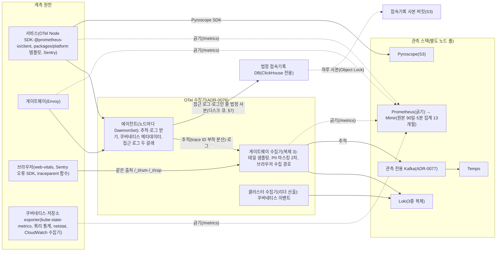
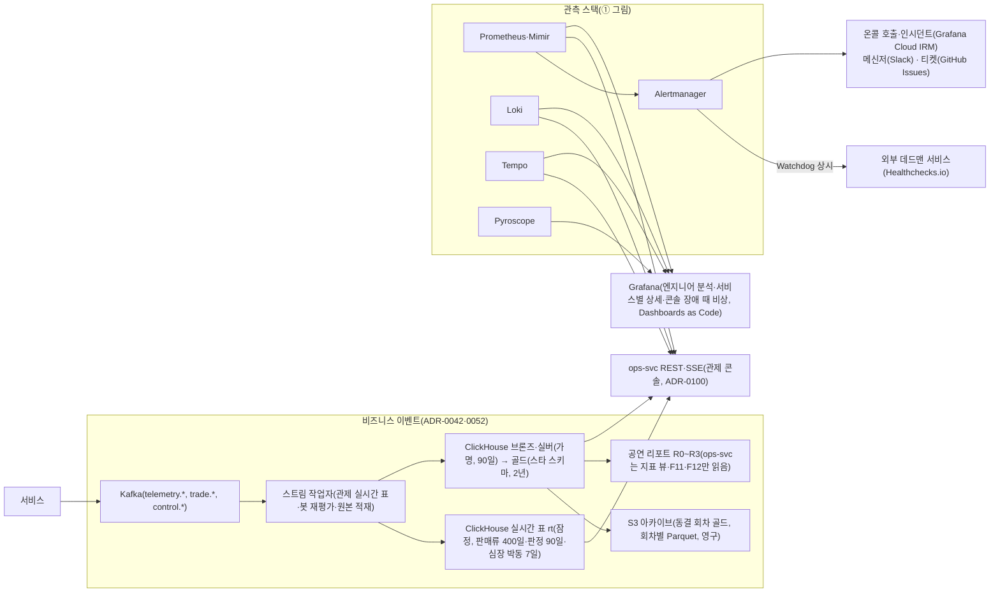

# 관측가능성·SLO·알림

- **독자와 용도**: 서비스 엔지니어와 온콜 담당·운영자가 참고하는 기술 기준 문서다. 서비스 엔지니어는 OpenTelemetry(지표·로그·요청 기록을 모으는 공통 표준과 도구) 계측 표준, 분산 트레이싱, 정형 로그, 메트릭 카디널리티(지표에 붙는 이름표 값의 가짓수로, 많으면 저장 비용이 커진다) 규칙을 여기서 파악한다. 온콜 담당과 운영자는 실제로 재는 서비스 품질 값인 SLI와 팀이 정한 목표인 SLO의 산출식을 확인한다. 목표가 허용하는 실패의 총량인 에러 버짓을 쓰는 속도(소진율, Burn Rate)에 따른 다중 윈도우 알림과, 대응이 필요한 장애나 보안 사건인 인시던트의 대응 절차도 확인한다. 관제 대시보드 화면과 비상 제어 명령 명세는 docs/features/control-tower.md에 있다. 성능이나 보안 같은 비기능 품질 요구사항의 원본은 docs/planning/02 NFR과 `docs/quality/quality-requirements.md`에 있다.
- **원문 출처**: 설계서 §6 <운영 모니터링·관제 (Control Tower)>, 설계서 §9 <SLO 설계: 목표 → 달성 설계 → 검증>, 설계서 26장 <Observability>, 설계서 30장 <RUM, SLI, SLO, SLA>, 설계서 §13 <의도적 기각·대체 항목 (정직한 예외)>, POL-022, [ADR-0022](adr/0022-control-plane-tcp-out-of-band.md), [ADR-0026](adr/0026-kafka-topic-separation.md), [ADR-0049](adr/0049-onsale-alert-windows-and-ops-metrics.md), [ADR-0067](adr/0067-console-vs-observability-tools-and-measured-backend-choice.md), [ADR-0068](adr/0068-observability-stack-rationale-and-managed-alternatives.md), ADR-0069·0070·0076·0077.
- **기준 기획 버전**: v1.0.
- **표시 규칙**: 원격 텔레메트리(시스템이 내보내는 지표·로그·요청 기록 같은 운영 신호)의 보존 기한과 온콜 운영 도구 구성은 원문에 빠져 있던 사항이다. 소유자가 추천대로 정하라고 맡겨, 추천안을 적용해 확정했다(추천 적용 2026-10-09, ADR-0032). 테일 샘플링 비율이나 시계열 라벨 상한처럼 실제로 잰 비용에 따라 조정할 값은 [가정]으로 적는다. 정형 로그의 구체적인 필드 스키마(데이터의 구조 정의)는 [보완]으로 적는다.

## 1. 관측 경로 구조

한 장에 담으면 선이 33개라 얽혀서, 두 장으로 나눠 그린다(docs/planning/03 §5.5, ADR-0138). ①은 운영 신호를 모아 저장하는 경로, ②는 비즈니스 이벤트와 그것을 보는 곳·알림이다.

**① 운영 신호 수집과 저장**

**② 비즈니스 이벤트, 보는 곳과 알림**

### 관측 아키텍처 원칙
- **데이터 평면(Data Plane)과 관측 평면의 분리**: 관측(지표·로그·요청 기록으로 시스템 안을 들여다보는 일) 텔레메트리는 사용자 요청이 지나는 경로와 다른 전용 파이프라인(텔레메트리 수집기, 관측 전용 메시지 시스템 Kafka)으로 보낸다. 관측 쪽이 막히거나 느려져도 서비스 응답이 그것을 기다리지 않게 하려는 것이다. 다만 앱 안의 계측 코드와 노드마다 도는 수집기 에이전트는 서비스와 같은 노드의 자원을 나눠 쓴다.
- **관제 콘솔과 관측 도구의 명확한 역할 경계 ([ADR-0067](adr/0067-console-vs-observability-tools-and-measured-backend-choice.md))**:
  - **관제 콘솔 (Control Tower)**: 지표를 모아 저장하는 Prometheus와 대량 이벤트 집계에 강한 분석용 데이터베이스 ClickHouse를 직접 읽어 실시간 운영 판단 숫자를 그리고(Grafana 패널을 끼워 넣지 않는다), 비상 명령(입장 일시정지, AIMD 조정 등)과 불변 감사 로그를 관리한다.
  - **엔지니어링 관측 도구 (Grafana & Sentry)**: Grafana(지표와 로그를 그래프로 보여 주는 도구)와 Sentry(앱 오류를 모아 알려 주는 서비스)는 상세 분산 트레이스(요청 기록 저장소 Tempo), 로그 검색(로그 저장소 Loki), 오류 그룹화(Sentry), 프로파일링(Pyroscope) 등 심층 원인 분석에 전념하며, 콘솔 위젯에서 딥링크(`↗`, 오류 위젯은 Sentry)로 직결된다.
- **오픈 표준(OpenTelemetry) 기반 단일 계측**: 앱 계측을 OTel SDK 하나로 통일하여 벤더 종속 없이 수집하며, 운영 비용과 분석 품질에 따라 저장소를 유연하게 교체할 수 있다([ADR-0068](adr/0068-observability-stack-rationale-and-managed-alternatives.md)).
- 관측 스택 선택 근거와 대안 비교는 ADR-0068에 있다. 고르는 기준은 여섯 가지다: PromQL 호환(필수), 폭주 때 저장 구조, 데이터 국내 보관, 운영 부담, 잠김, 장기 조회(리플레이·지난 회차 비교). 비교 측정 후보는 세 가지다: 직접 운영, 서울 리전(클라우드 데이터센터가 모인 지역)의 AWS 관리형(AMP가 지표 장기 저장소 Mimir 자리, AMG가 Grafana 자리), Datadog(관측 기능을 묶어 파는 상용 서비스). 입장 제어의 AIMD(정상이면 조금씩 늘리고 나빠지면 크게 줄이는 조절 방식), 지표를 보고 앱 복제 수를 늘리고 줄이는 KEDA, 콘솔의 판단·제어 숫자는 어느 후보든 클러스터 안 Prometheus(로컬 15일)를 읽는다. 판매 누적·잔여석·등급별 상세 퍼널의 출처는 관제 실시간 표다(§8 지표 출처 표). 그래서 후보 비교는 장기 저장·화면·경보·로그·요청 기록·프로파일을 누가 운영하느냐로 좁혀진다. 고르는 규칙은 R1·R3를 통과한 후보 가운데 연간 총비용이 가장 낮은 것이고, 차이가 10% [가정] 안이면 지금 구성을 유지한다(ADR-0067 결정 5·ADR-0068 결정 5).
  - 비교 방법(추천 적용 2026-10-28, 기술 검토 중간-023): wbs 4.8.2를 둘로 나눈다. ① 계산: 로컬 측정에서 우리 Prometheus·Loki·Tempo가 스스로 세는 양(활성 시계열 수, 초당 수집 샘플, 로그·요청 기록 GB, 서버 수)을 4.8.1 규모로 외삽하고, 세 후보의 비용을 공개 가격표로 낸다. 후보에 자료를 보내지 않는다. ② 보내기: 보내야만 알 수 있는 것(Datadog Watchdog 이상 탐지 힌트 비교와 AMP·AMG의 장기 조회 동작)만, 미리 계산한 샘플 예산(AMP 무료 등급 수집 4천만 샘플 이하) 안에서 `write_relabel_configs`로 줄여 보내고 AWS 비용 경보를 건다. 활성 시계열 10만 개를 15초마다 그대로 보내면 두 시간이 안 돼 무료 등급을 넘고, 하루면 약 48달러로 지출 상한(5만 원)을 넘을 수 있기 때문이다(AMP 서울 가격 목록, 2026-10-14 게시본).
  - 운영 시간: 로컬에서 몇 주 동안 잰 설치·대응 시간을 R2에 그대로 넣지 않는다. 1년 운영의 업그레이드·용량 증설·실제 장애를 대표하지 못해 직접 운영 비용이 작게 나오기 때문이다. 부품 수와 업그레이드 주기로 만든 연간 추정식(출처 표시, [가정])과 ±50% 민감도 표로 넣는다. 식·가격표·판정 보정은 docs/perf-ledger.md §11이다.
- 참고 아키텍처 대응(추천 적용 2026-10-21, ADR-0076): 참고 아키텍처의 흐름은 계측 원천 → 수집기 → 신호 → 객체 스토리지 → 활용이다. 우리 설계는 칸마다 다음과 같다.
  - 계측 원천: 브라우저 RUM, 서비스 수동 계측, 에이전트·exporter 자동 수집
  - 수집기: 에이전트·게이트웨이(에이전트 등이 보낸 데이터를 모아 처리하는 수집기)·클러스터 수집기 셋
  - 신호: 추적 Tempo, 메트릭 Prometheus·Mimir, 로그 Loki, 프로파일 Pyroscope, 오류 Sentry
  - 객체 스토리지: AWS의 파일 저장소인 S3(Mimir·Loki·Tempo·Pyroscope)
  - 활용: 규칙에 따른 자동화, 사람이 하는 근본 원인 분석, ClickHouse와 S3 아카이브(ClickHouse `s3()`로 읽는다, ADR-0115) 데이터 분석
  - 이상 탐지는 규칙과 통계로만 하고 머신러닝은 쓰지 않는다(§13).
  - 참고 아키텍처에 없는 우리만의 것: 비즈니스 이벤트 경로(Kafka → TypeScript 스트림 작업자 → ClickHouse 조회 시점 집계), 법정 접속기록 분기, 감사 체인과 공개 앵커, 조작하는 관제 콘솔.
- 수집기 구성(추천 적용 2026-10-21, ADR-0076):
  - 에이전트(앱이 실행되는 서버 한 대인 노드마다 DaemonSet): 서비스 SDK의 추적(OTLP, 노드 안)과, 앱과 실행 환경을 한 묶음으로 만든 컨테이너의 표준 출력 로그(filelog)를 받아 쿠버네티스(컨테이너로 만든 앱을 여러 서버에서 실행하고 관리하는 플랫폼) 메타데이터를 붙인다. 추적은 trace ID 기준 부하 분산 내보내기로, 같은 추적을 게이트웨이 수집기의 같은 복제에 보낸다.
  - 게이트웨이 수집기(관측 노드 풀, 복제 3 [가정, 4.1.4에서 확정]): 테일 샘플링(§6), 개인정보 2차 마스킹(§7), 브라우저 수집 경로(§11)를 맡는다. 진입 경로(gw-queue)는 머리 표본으로 줄여 여기로 거의 오지 않고, 복제 수와 메모리는 진입을 뺀 피크의 크기 식으로 미리 정한다(§6, 추천 적용 2026-10-28, ADR-0125).
  - 클러스터 수집기(복제 2개 중 일을 맡을 하나를 고르는 리더 선출): 쿠버네티스 이벤트를 한 번만 받는다.
  - 지표는 수집기를 거치지 않고 클러스터 Prometheus가 `/metrics`를 긁는다. 그래서 수집기가 멈춰도 SLO 경보와 자동 제어 입력은 그대로다. 브라우저 지표만 게이트웨이 수집기가 Prometheus 형식으로 내놓는 값을 긁는다.
  - 예외(추천 적용 2026-10-21, ADR-0078 결정 3): Tempo metrics-generator의 서비스 그래프 지표는 Mimir `raw` 테넌트로 바로 원격 쓰기를 한다. 이 지표는 서비스 지도(연결)를 그리는 데만 쓰고 경보와 자동 제어 입력에는 쓰지 않는다. 그래서 수집기나 Tempo가 멈춰도 경보와 자동 제어는 그대로다(§6).
  - 수집 대상 목록은 ADR-0076 결정 3에 있다.
- 관측 저장소 쓰기 경로(소유자 결정 2026-10-21, 세부는 추천 적용, ADR-0077 결정 2):
  - Tempo: 운영 설계는 마이크로서비스 모드이고, 쓰기 경로의 WAL은 관측 전용 Kafka다. 관측 전용 Kafka는 거래용 MSK(AWS가 운영해 주는 Kafka)와 다른 클러스터다. 거래 Kafka의 장애와 관측 장애를 서로 엮지 않고, 오픈 피크의 요청 기록 쓰기가 거래 Kafka를 나눠 쓰지 않게 하려는 것이다.
    - 요청 기록은 관측 자료 3등급(AZ 장애 때 일부 유실을 허용하는 원인 분석 자료, §9 등급표)이다. 그래서 이 클러스터는 요청 기록을 잃지 않으려는 것이 아니다. Tempo 3.0이 인제스터를 빼서 마이크로서비스 모드(부품을 따로 늘리고 AZ에 나눠 두는 운영 구성)에 Kafka 호환 큐가 꼭 필요하기 때문에 둔다. Kafka 없는 모놀리식은 한 벌만 돌릴 수 있고, 문서가 밝힌 처리량은 초당 25~35MB(span 5.5만~8만 개)까지다(Tempo 배포 모드 문서·변경 기록, 2026-10-28 확인).
    - 세 번째 MSK를 계속 둘지는 wbs 4.8.2에서 요청 기록 저장소 셋을 견줘 정한다(추천 적용 2026-10-28, 기술 검토 중간-021). (가) 지금 구성: Tempo 마이크로서비스 + 관측 전용 MSK. (나) Tempo 모놀리식 한 벌 + 꼬리 표본(테일 샘플링) 상한(§6)으로 오픈 피크 쓰기량을 모놀리식 한도 안에 묶기. (다) AWS 관리형 X-Ray(서울. 가격 목록으로 계산하고 보내지 않는다). 판정은 3등급 기준(AZ 하나 장애 때 그 동안의 요청 기록만 잃고 지표·경보는 그대로)과 오픈 피크 쓰기량을 함께 만족하는 안 가운데 연간 총비용이 가장 낮은 안이다. 차이가 10% [가정] 안이면 지금 구성을 둔다. 그 전까지 설계는 지금 구성이다.
  - Mimir: 고전 구조(인제스터 영역 인식 3중 복제, 쓰기·읽기 정족수 2). 장기 지표 저장소로 Mimir를 그대로 두는 근거(Thanos와 저장량·부품·고가용성 비교)는 ADR-0120이다(추천 적용 2026-10-28). 포트폴리오 로컬 측정은 Prometheus 하나로 하고, Mimir는 규칙 확인(wbs 4.1.2)과 G-26에서만 띄운다. Loki: 영역 인식 3중 복제와 과반 정족수. Pyroscope는 AZ(리전 안의 독립된 데이터센터 묶음) 장애 때 일부를 잃어도 되는 원인 분석 자료로 둔다.
  - 로컬 부하 시험은 Tempo 모놀리식(Kafka 없음)으로 하고, wbs 4.1.4 PoC(본 개발 전에 위험한 부분만 먼저 만들어 확인하는 시험)와 G-26에서만 마이크로서비스 모드와 로컬 Kafka를 띄운다.
  - 관측 전용 Kafka(MSK)에 IAM으로 붙는 게이트웨이 수집기와 Tempo도 MSK IAM 클라이언트 규칙(워크로드별 MSK 전용 역할을 고정 세션 이름으로 맡기, 기본 자격으로 넘어가지 않기, docs/devops.md §9.4)을 따른다(추천 적용 2026-10-28, 기술 검토 높음-26). 두 도구는 Go로 만들어졌고 역할을 맡는 설정이 따로 없다. 수집기의 Kafka 내보내기(`AWS_MSK_IAM_OAUTHBEARER`)는 AWS 기본 자격 사슬(환경 변수·파드 권한 같은 자격을 정해진 순서로 찾는 방식)만 읽는다(opentelemetry-collector-contrib `internal/kafka`). Tempo의 `AWS_MSK_IAM`은 기본 자격 사슬을 읽지 않고 정적 값·파일·유닉스 소켓으로만 자격을 받는다. 파일은 재인증(연결을 유지한 채 새 토큰으로 다시 인증하는 것) 때마다 다시 읽는다(grafana/tempo v3.1.1 `pkg/ingest/config.go`, 둘 다 2026-10-28 확인). 그래서 수집기는 AWS 공유 설정 파일의 역할 프로필(고정 세션 이름)로, Tempo는 역할을 고정 세션 이름으로 맡아 자격 파일을 고쳐 쓰는 작은 보조 컨테이너로 맞춘다. 둘 다 되는지는 wbs 4.1.4 PoC에서 확인한다 [확인 필요]. 안 되면 관측 전용 클러스터만 다른 인증으로 바꿀지 새 ADR로 정한다(docs/review/open-items.md 42번).

## 2. 계측 표준 (OpenTelemetry)

| 항목 | 표준 엔지니어링 규칙 |
| --- | --- |
| 계측 SDK 체계 | Node.js 서비스군은 OTel Node SDK 기반 자동 계측(HTTP, 서비스끼리 함수를 부르듯 빠르게 호출하는 gRPC, Redis 클라이언트(기본안 node-redis는 `@opentelemetry/instrumentation-redis`, ioredis는 `-ioredis`. 클라이언트는 docs/architecture.md §9.4 PoC로 정한다, 기술 검토 중간-026), pg, Kafka 클라이언트)을 기본으로 적용한다. Kafka 기본 클라이언트 `@confluentinc/kafka-javascript`에는 OTel 공식 계측 묶음(opentelemetry-js-contrib)의 계측 패키지가 없다. 그 묶음의 Kafka 계측은 kafkajs용 `instrumentation-kafkajs` 하나다(2026-10-28 저장소·npm 확인, 다른 회사가 만든 계측 패키지는 있다). 그래서 생산·소비 스팬과 추적 헤더 전달을 공용 서버 패키지 `packages/platform`의 Kafka 감싸기가 직접 하는 안을 기본으로 두고, 외부 계측 패키지는 쓰지 않는다(2026-11-01 PoC, ADR-0176 결정 5): Confluent 클라이언트용은 회사·개인이 낸 `@instana/instrumentation-confluent-kafka-javascript` 1.1.0·`opentelemetry-instrumentation-confluent-kafka` 0.2.1 등뿐이고, 공용 모듈이 이미 생산·소비 스팬과 추적 헤더 전달을 하므로 같은 일을 하는 두 번째 고침 층이 된다. OTel 공식 묶음에 생기면 다시 본다. 비즈니스 핵심 구간은 수동 스팬(Span)으로 자세히 계측한다. 결제하는 동안 좌석을 잠시 잡아 두는 홀드의 Lua 실행, 여러 서비스에 걸친 일을 단계별로 처리하고 중간에 실패하면 앞 단계를 되돌리는 Saga의 오케스트레이션 단계, 로비에서 순번을 무작위로 섞는 셔플 연산이 그 구간이다. 프론트엔드는 web-vitals(화면 지표)와 Sentry 브라우저 SDK(오류)만 싣는다. 브라우저 span(요청 하나가 지난 구간의 기록)은 내보내지 않으므로 OTel 브라우저 SDK는 싣지 않는다(§11 '브라우저 추적', 추천 적용 2026-10-28, 기술 검토 낮음-053). 지표는 서비스가 `/metrics`(OpenMetrics)로 내놓고 클러스터 Prometheus가 긁는다. 추적은 노드 에이전트 수집기에 OTLP로 보내고, 로그는 표준 출력으로 낸다(ADR-0076). 법정 접속기록이 되는 줄(게이트웨이 접근 로그, identity-svc의 접속기록 줄)만 에이전트에서 '잃지 않는 갈래'로 따로 보낸다(§7, 추천 적용 2026-10-28, 기술 검토 높음-21). |
| 플랫폼 서비스 템플릿 | `packages/platform` 공통 기본 템플릿에 Four Golden Signals 히스토그램(값을 구간별로 나눠 센 분포 지표), Pino 로그 `traceId` 자동 주입, 기본 엔드포인트(요청을 받는 주소 하나) SLO 대시보드를 넣어 둔다. 템플릿 자체 경보는 두지 않고, 서비스 SLO 경보 규칙이 이 지표를 쓴다(§3 운영 확인 표, 2026-11-01 정합). 그래서 새 서비스를 더해도 같은 모양의 관측 화면을 바로 갖춘다. |
| 분산 컨텍스트 전파 | W3C Trace Context 표준을 따른다. Baggage(`eventId`, `queueSeq`·`sessionId`를 로그 가명 키로 바꾼 가명(HMAC-SHA256, `sidRef`와 같은 방식, §7, ADR-0053 결정 1))를 함께 전파해 공연 단위와 대기 순번 단위의 분산 추적 조회를 지원한다. 브라우저는 같은 출처 요청에만 `traceparent`를 붙인다. 교차 출처인 대기열 API(프로그램끼리 요청과 응답을 주고받는 창구)와 결제사 SDK에는 붙이지 않는다. `traceparent`는 CORS(다른 주소에서 온 요청을 브라우저가 허용할지 정하는 규칙)의 안전 목록 헤더가 아니어서, 붙이면 사전 요청이 생기기 때문이다(ADR-0065·0076). 전파는 PEAKET 안(메시 안 서비스와 Kafka)에서만 이어 간다. 바깥에서 들어온 추적 문맥은 부모로 쓰지 않고, 바깥으로 나가는 요청에는 싣지 않는다(§6 '신뢰 경계의 추적 문맥', 추천 적용 2026-10-28, 기술 검토 중간-066). |
| 레이턴시 히스토그램 | SLO·경보 기준값을 모두 경계로 품은 표준 칸 목록(§8, ADR-0077)을 만들어, 요청의 절반이 끝나는 시간인 p50, 백 건 중 아흔아홉 건이 끝나는 시간인 p99, 그리고 p99.9 백분위수를 정확하게 계산한다. 성공 요청과 실패 요청의 지연시간은 반드시 따로 나눠 기록한다. 버킷 상한은 60초 이상으로 둔다. Degraded Mode의 결제 확정 p99 60초(NFR-006)를 재야 하기 때문이다. OpenTelemetry HTTP 지표 규약의 권장 버킷은 10초까지라, 그대로 쓰면 10초를 넘는 요청이 마지막 버킷에 몰린다(ADR-0049). 결제 확정 소요(`payment_confirm_resolution_seconds{pg, path}`, 같은 멱등키 재시도와 결과 모름 조회 포함, path는 재시도 큐를 거쳤는지, ADR-0105)도 같은 버킷을 쓴다(ADR-0069). 서비스 템플릿과 Envoy(요청을 받아 안쪽 서비스로 넘기는 프록시 서버)가 같은 칸 목록을 쓴다(ADR-0077). |
| SLI 실시간 산출 | 서비스 템플릿이 미리 계산해 두는 Prometheus recording rule을 자동으로 만든다. 템플릿 히스토그램은 OpenMetrics exemplar(`traceId`·`spanId`)를 붙인다(Node용 Prometheus 계측 라이브러리 `@prometheus-io/client`(옛 이름 prom-client)의 exemplar 기능 [가정, 4.1.1 PoC에서 확정]). Prometheus는 exemplar 저장(`--enable-feature=exemplar-storage`)을 켜서, 지표의 이상치 지점에서 그 지점의 분산 트레이스(요청 하나가 여러 서비스를 거친 길과 시간을 남긴 기록)로 한 번에 이동한다(ADR-0076). |
| 대시보드 거버넌스 | 모든 모니터링 패널은 Dashboards as Code(Git 버전 관리)로 배포한다. 온세일(판매가 열리는 시각 앞뒤로 접속이 몰리는 기간) 전용 대시보드에는 카오스 장애 주입 시점, 애플리케이션 배포 이벤트, 운영 명령·자동 보호 조치(Loki의 운영 사건 줄 `ops_event`, §7, ADR-0078)를 주석으로 실시간 표시한다. 맨 위 첫 번째 행에는 항상 Four Golden Signals를 둔다. |
| 신호 연결(ADR-0076) | 에이전트 수집기가 모든 신호에 같은 자원 속성(`service.name`, `deployment.environment`, `k8s.namespace.name`, `k8s.pod.name`, `k8s.node.name`)을 붙인다. Grafana 데이터 소스 연결도 Dashboards as Code에 함께 둔다: Prometheus exemplar → Tempo, Loki의 traceId 파생 필드 → Tempo, Tempo → Loki(같은 traceId)·Pyroscope(같은 서비스·시간대). |
| 식별자 카디널리티 제어 | 시계열 메트릭 라벨에 실제 사용자 ID, 대기 순번, 좌석 고유번호, 클라이언트 IP 주소를 직접 넣는 것은 엄격히 금지한다(§8). 정형 로그와 트레이스 속성에는 비밀 키가 없으면 같은 값을 만들 수 없는 가명 `pidRef`·`sidRef`·`accountRef`(로그 가명 키 HMAC, §7)만 허용한다. 원문 식별자와 키 없는 해시는 쓰지 않는다(ADR-0053 결정 1). |

## 3. Four Golden Signals

모든 마이크로서비스는 지연시간(Latency), 트래픽(Traffic), 오류(Errors), 포화도(Saturation)를 핵심 관측 신호로 정한다(Google SRE Book 6장). L7 요청 계층은 RED(Rate, Errors, Duration) 모델로, 인프라 자원 계층은 USE(Utilization, Saturation, Errors) 모델로 계측해 서로 보완한다.

| 아키텍처 계층 / 컴포넌트 | 지연시간 (Latency) | 트래픽 (Traffic) | 오류 (Errors) | 포화도 (Saturation) |
| --- | --- | --- | --- | --- |
| API 게이트웨이군 (gw-queue, gw-fan, gw-partner, gw-ops, gw-scanner) | 라우팅 경로별 p50·p99·p99.9, 성공·실패를 나눈 지연시간, 입구 서버인 게이트웨이 자체의 순수 처리 오버헤드 (전체 왕복 지연 − 업스트림 지연) | 라우팅 경로별·공연 회차별 초당 요청 수 (RPS) | HTTP 5xx 응답, 계속 실패하는 호출을 잠시 끊는 서킷 브레이커가 미리 막은 503 응답, SLO 지연 한도 초과 요청 수. 단, 정상적인 좌석 홀드 경합에서 져서 생긴 409 Conflict는 정상 비즈니스 분기로 분류해 따로 집계한다 | 활성 TCP 연결 수, 업스트림 처리 중 요청 수(`upstream_rq_active`, ADR-0077), 들어오는 대기 큐 적체율 대 서킷 상한 비율, 비정상 백엔드 파드(쿠버네티스에서 앱이 실행되는 가장 작은 단위)여서 분리된 엔드포인트 비율, 게이트웨이 파드 CPU 사용률 |
| queue-svc (대기열 진입 및 입장 확정) | 순번 발급 진입 지연 p99, 입장 확정 처리 지연 p99 | 초당 순번 발급 요청 수, 초당 예매 진입 확정 요청 수 | 순번 발급 실패 건수, 이탈로 빠진 번호의 기록 실패 건수, '곧 입장' 완충 응답 비율, 차례 전 입장 건수(입장 확정 때 순번이 그 시각 serving보다 큰 건, 0건 불변식, ADR-0049), 차례가 온 뒤 시스템 원인으로 입장하지 못한 건수 | Node.js 이벤트 루프 지연시간, CPU 점유율, Redis(메모리에 데이터를 두는 빠른 저장소) 커넥션 풀 가용률 |
| queue-svc (대기열 실시간 상태 전파) | 컨트롤러가 serving 번호(지금 예매 화면으로 들여보내고 있는 순번의 끝)를 갱신한 때부터 CDN(사용자 가까운 곳에 파일을 복사해 두고 대신 응답하는 전송망) 엣지의 대기 상태 파일에 반영될 때까지의 지연시간 | CDN 엣지(접속한 사람 가까이에 둔 서버)가 받은, 정해진 간격으로 다시 묻는 상태 폴링 요청 수, 캐시(자주 쓰는 값을 가까운 곳에 복사해 둔 것)를 뚫고 뒤에서 원본 파일을 주는 서버인 오리진까지 간 요청 수 | 정적 대기 상태 파일의 생성·전송 실패율, 예상 대기 시간 오차(처음 보인 예상 대기와 실제 대기를 견준 분포, 관측) | CDN 엣지 캐시 적중률 하락폭 (오리진 부하 전파율), 대기열 Redis 클러스터 CPU·메모리 점유율 |
| admission-ctrl (동시 예매 통제) | 제어 루프를 1회 실행하는 데 걸린 시간 (목표: 200ms 이내) | 초당 serving 증가 폭 (대기열 차례 진행 속도), 실시간 입장 자리 허용률 | 분산 리더 부재 시간, Lease(정해진 시간 동안만 유효한 권한. 갱신하지 않으면 다른 쪽이 가져간다) 갱신 실패 건수, 상한을 초과하는 번호 급증 (안전 한계선 위반 0건 유지), 제어 입력 없음 시간(`admission_control_input_stale{event_id,input}`, ADR-0069) | 잔여 좌석 대비 동시 예매 허용 목표 비율, 예매 단계 지금 인원(`admission_slots_used{event_id}`, ADR-0077), 제어 루프 연산 지연시간, 사유별 감축 횟수(`admission_target_decrease_total{reason}`)와 감축 확인 시간에 막은 감축(`admission_decrease_suppressed_total`, ADR-0069), 오는 중(`admission_in_flight{event_id}`)과 곧 입장 대기 수(`admission_soon_waiting{event_id}`, ADR-0104) |
| identity-svc (로그인 및 인증) | 로그인 인증 처리 지연 p99 | 초당 로그인 시도 요청 수 | 인증 실패율 급증 (크리덴셜 스터핑 공격의 앞선 신호로 탐지해 침입 탐지와 연동) | 관리자 비밀번호 PBKDF2 해싱 대기 큐 (libuv 스레드 풀 포화도) |
| trust-svc (이상 봇 위험 평가) | 실시간 행동 점수 판정 지연 p99 | 초당 위험 점수 평가 요청 수 | 평가 시간 초과와 폴백 축소 운영 전환율, 추가 검증 큐 격리율, 사용자 이의 제기 접수 건수 | 판정 피처 Redis(세션·캐시) CPU. 대기 중 재평가 작업자의 소비 밀림은 §5 스트림 작업자 신호에서 본다(ADR-0071·0099) |
| realtime-gw (실시간 좌석 델타 브로드캐스트) | 좌석 상태가 바뀐 때부터 단말 브라우저 화면에 반영될 때까지의 지연시간 | WebSocket(연결을 열어 둔 채 서버와 브라우저가 주고받는 통신 방식) 동시 활성 연결 수, 초당 모두에게 보낸 메시지 수 | WebSocket 핸드셰이크 실패율, 네트워크 끊김률, 좌석 맵 시퀀스 버전 갭 발생 빈도 | 파드당 최대 연결 수 대비 가용 비율, 소켓 송신 버퍼 큐 길이, 메모리 사용량 |
| purchase-svc (재고 관리 inventory 모듈) | Redis Lua 좌석 홀드 실행 지연 p99 | 초당 좌석 홀드 시도 수 | 단순 경합 패배를 뺀 시스템 원인의 홀드 실패 건수, 오버셀(같은 좌석이 두 사람 이상에게 팔리는 사고) 불변식 위반 건수 | 좌석 Redis CPU·메모리, 특정 인기 좌석에 몰린 핫키 집중도, 이벤트 루프 지연 |
| purchase-svc (주문 booking 모듈) 및 payment-svc | 결제 접수 지연 p99, 주문 확정 종단 지연 p99, 결제사별(`pg` 라벨) 승인 API 호출 p99, 결제 확정 소요 p99(`payment_confirm_resolution_seconds{pg, path}`, 재시도 포함, 판정에는 재시도 큐 건을 뺀 `direct`만, ADR-0069·0105) | 초당 결제 승인 처리량 (TPS) | 외부 승인 실패율 (단순 한도 초과와 취소는 제외), 결제 원장과 티켓 발권 사이의 불일치 건수, 발권 재시도 큐 길이와 가장 오래된 행의 나이(ADR-0106), 상태 미확정(UNKNOWN)으로 남은 건수, identity 재확인 대체 판정 건수(`purchase_identity_recheck_fallback_total`, ADR-0055) | Outbox(보낼 이벤트를 데이터 변경과 함께 표에 먼저 적어 두고 나중에 보내는 방식) 릴레이 대기 건수, 결제사별 서킷 브레이커 트립 상태와 결제사 전환 상태(전환 후보 추천 포함, ADR-0044), 관계형 DB 커넥션 풀 고갈률 |
| 비동기 메시징 및 스트리밍 (Kafka, 스트림 작업자, Outbox, 발송 원장) | 이벤트를 발행한 때부터 마지막 컨슈머(메시지를 읽는 쪽)가 처리를 마칠 때까지의 지연시간 | 토픽(메시지를 종류별로 모아 두는 통로)별·큐별 초당 메시지 처리량 | 비동기 워커 처리 실패율, 보류 사건 수(처리하지 못해 그 서비스 DB의 보류 표 `held_event`로 옮긴 사건. Kafka 데드 레터 토픽은 두지 않는다, ADR-0142), 발송 원장의 DEAD 건수 | Kafka 컨슈머 Lag(스트림 작업자 포함), 발송 원장의 보낼 때가 지난 행 수와 가장 오래된 행의 나이(`delivery_job_due_backlog{kind}`, ADR-0109), 스트림 작업자 삽입 재시도 |
| 데이터 저장소 (Aurora PostgreSQL, Redis, Kafka, ClickHouse) | 쿼리·커맨드 실행 지연 p99, PostgreSQL(관계형 데이터베이스) 쿼리별 상위 20개 [가정]의 호출 수·평균·최대 실행 시간(postgres_exporter `stat_statements`, queryid만 싣고 문장은 싣지 않음, ADR-0067) | 초당 쿼리·트랜잭션(여러 변경을 한꺼번에 반영하거나 한꺼번에 취소하는 작업 단위) 처리량 (QPS, TPS) | DB 에러율, 커넥션 시간 초과, 트랜잭션 데드락 발생 건수 | 활성 커넥션 수 대비 풀 상한, CPU 사용률, 스토리지 디스크 잔여량과 소진 예상 시간 |
| 외부 의존 서비스 (결제사, 본인확인, 사람 확인, 소셜 로그인 제공자. `dependency` 라벨, ADR-0049) | 제공자별 호출 p99 | 제공자별 초당 호출 수 | 제공자 오류(5xx·시간 초과. 소셜 로그인 공급자는 한도·차단 응답 429·403도 센다, 추천 적용 2026-11-03, ADR-0180) 비율, 결제사 한도 초과 응답 수 | 결제사 한도 사용률(초당 승인 요청 ÷ 결제사 채널 추정 상한, ADR-0036·0044) |
| ticket-svc·스캐너 (공연 당일) | 단말 판정 지연 p95(판정 백 건 중 아흔다섯 건이 이 시간 안에 끝난다는 뜻). 스캐너가 브라우저 안 저장소인 IndexedDB에 모았다가 온라인일 때 `/_t/rum`으로 보낸다(docs/frontend.md §5.5) | 공연 회차·구역별 분당 스캔 수, 업로드 대기 건수 | 사유별 거부율, 오거부 후보(거부 뒤 10분 [가정] 안에 같은 티켓이 정상 통과한 건), 이상 표시(중복 입장·퇴장 기록 없음·취소 뒤 입장·세션 밖 기록·마감 뒤 도착), 부스 재발급·예외 통과 건수, 입장 시작 뒤 첫 키 등록 비율 | 스캐너 마지막 동기화 경과 시간의 최댓값과 기준(2분 [가정])을 넘은 스캐너 수, 폐기 목록 버전 차이, 입장 기록 마감 지연과 미보고 기기 수. 단말별 목록은 시계열 라벨이 아니라 관제 읽기 모델로 본다(§8, ADR-0051) |
| 플랫폼 공통 (노드, 인증서, 백업) | — | — | 백업 작업 실패, 인증서 갱신 실패, 저장소 새 연결의 인증 실패(`datastore_auth_failures_total{store}`가 0보다 크면 SEV2 [가정]. 비밀 교체 뒤 옛 판을 쥔 파드를 잡는다, docs/devops.md §8.3, 기술 검토 중간-064) | 노드 시계가 표준시와 어긋난 정도(오프셋), 인증서·서명 키 만료까지 남은 시간과 갱신 예정 시각(§3 '위생 신호', 수명 비례 경보), 저장소별로 마지막으로 백업에 성공한 뒤 지난 시간, 교차 리전 복제 지연, 노드 연결 대기열 넘침·TCP 재전송(node_exporter netstat, 기준 [가정, 4.1.1에서 확정], ADR-0067) |
| 프론트엔드 실사용자 모니터링 (RUM) | Core Web Vitals인 INP(조작에 화면이 반응하기까지 걸린 시간)와 LCP(화면의 가장 큰 요소가 보이기까지 걸린 시간)의 p75 백분위 지연 | 실시간 페이지뷰, 활성 구매 세션 수 | 클라이언트 JavaScript 런타임 오류율, 비동기 API 통신 실패율 | 브라우저 메인 스레드를 오래 붙잡아 조작을 막는 Long Task의 점유율 |

모든 서비스는 서비스 템플릿으로 처리 중 요청 수 게이지 `http_server_active_requests`(OpenTelemetry `http.server.active_requests`와 같은 뜻, 라벨은 지연 히스토그램과 같다)를 낸다(추천 적용 2026-10-21, ADR-0077). 처리 중 요청 수 ÷ (초당 처리량 × 평균 처리 시간)이 1에서 크게 벗어나면 그 앞에 줄이 생긴 것으로 보고 원인 패널에서 살핀다(리틀의 법칙). 경보에는 쓰지 않는다.

**서비스 템플릿이 내는 HTTP 지표(추천 적용 2026-11-01, openspec 변경 add-service-template, BUILD_ORDER FND-050)**: 공용 서버 패키지 `packages/platform`의 시작 코드가 모든 HTTP 요청에 대해 아래 지표를 낸다. 지표는 앱 요청을 받는 포트가 아닌 관리 포트(기본 9464)의 `/metrics`로만 낸다(docs/security/asvs/delivery.md 13.4.5).

| 지표 | 종류 | 라벨 | 뜻 |
| --- | --- | --- | --- |
| `http_server_request_duration_seconds` | 히스토그램(§8 표준 칸) | `service`·`route`·`method`·`status_class` | 처리 시간(OpenTelemetry `http.server.request.duration`). `status_class`로 성공과 실패의 지연을 나눠 본다 |
| `http_server_active_requests` | 게이지 | `service`·`route`·`method` | 처리 중 요청 수. 처리 중에는 응답 코드를 모르므로 `status_class`는 없다. 위 문단의 '라벨은 지연 히스토그램과 같다'는 '처리 중에 알 수 있는 라벨은 같다'로 읽는다(해석) |
| `http_server_errors_total` | 카운터 | 히스토그램과 같다 | 5xx로 답한 요청(명시적 오류, 위 규칙 3) |
| `http_server_business_rejections_total` | 카운터 | 히스토그램과 같다 | 업무상 정상 분기로 표시한 오류 응답(예: 좌석 경합 409). 오류 카운터에 넣지 않고 따로 센다(docs/api/guidelines.md §2, NFR-003). 정상 분기 표시는 오류를 내는 코드가 Problem에 단다. 같은 409라도 처리 중 재요청(`idempotency-request-in-progress`)은 정상 분기가 아니어서 상태 코드만으로는 가를 수 없기 때문이다 |
| Node 기본 지표(`nodejs_eventloop_lag_seconds` 등) | 여럿 | 없음 | 포화도(이벤트 루프 지연, 힙, GC). `@prometheus-io/client`의 기본 지표 모음이다 |

- `route`는 경로 틀을 계약 표기로 쓴 값이다(`/v1/events/{eventId}`). 맞는 경로가 없는 요청과 처리기를 찾기 전에 거절한 요청(잘못된 URL 등)은 `unmatched` 하나로 묶는다. 실제 자원 ID는 들어가지 않는다(§8).
- 처리 중 요청 게이지는 응답을 보냈을 때와 연결이 끊겼을 때(본문을 다 받은 뒤 끊긴 경우 포함) 한 번만 내린다. 끊긴 요청은 지연 히스토그램에 들지 않는다.
- 지연은 서비스에 주입한 시계(단조 시계)로 잰다. 시험은 `packages/platform/test/metrics.test.ts`(5xx는 오류 카운터, 409 경합 패배는 정상 분기 카운터, docs/verification.md §2.7의 지표 내보내기 층)다.

**서비스 템플릿의 운영 확인(docs/architecture.md §8.4, 추천 적용 2026-11-01)**: 기능 설계서 9편의 표는 wbs 0.3.5에서 채운다. 아래는 템플릿 자체의 표다.

| 확인할 동작 | 사건·필드 | SLI | 대시보드 패널 | 경보 | 배포 뒤 확인 방법 |
| --- | --- | --- | --- | --- | --- |
| 새 서비스가 네 신호를 같은 모양으로 낸다 | 위 표의 지표 | NFR-011(REST p95 500ms, 99.9%) | 서비스 대시보드 첫 줄 네 신호(규칙 1, wbs 1.3.1) | 템플릿 자체 경보 없음. 서비스 SLO 경보가 이 지표를 쓴다 | 카나리 분석이 같은 지표로 새 판과 안정판을 견준다(docs/devops.md §6.2) |
| 정상 분기 거절이 오류율을 올리지 않는다 | `http_server_business_rejections_total`, `http_server_errors_total` | 기능 SLO(예: NFR-003 좌석 홀드는 409를 정상으로 본다) | 오류율 패널 옆 정상 분기 패널 | 없음 | 경합 부하 시험에서 409가 정상 분기 카운터에만 드는지 본다 |
| 예상하지 못한 오류가 내부 정보 없이 끝나고 원인을 찾을 수 있다 | 500 Problem의 `traceId`, 그 요청의 정규 로그 줄(`level` error, 같은 `traceId`, `err`에 예외 이름·메시지·스택, §7) | 없음 | 오류 패널, 로그 조회 | 5xx 비율은 서비스 SLO 경보 | 오류 응답의 `traceId`로 Loki에서 그 줄을 찾고, 같은 값으로 Tempo의 trace로 넘어간다 |
| 요청마다 정규 로그 줄 하나가 남고 표본 비율로 다시 셀 수 있다(추천 적용 2026-11-01, openspec 변경 add-service-logging) | 정규 로그 줄(§7)의 `sampleRate`·`status`·`durationMs`, 서버 span의 `peaket.sample.keep` | 로그로 다시 센 요청 수(`sampleRate`의 합)와 `http_server_request_duration_seconds_count`의 차이(Game Day 대조, ADR-0069 결정 11) | 서비스 대시보드의 로그 패널(정상·전수 줄 수) | 없음(4.1.1에서 정한다) | 배포 뒤 오류 응답 하나의 `traceId`로 줄과 trace가 함께 보이는지 본다. 정상 trace를 남긴 요청에는 정상 줄도 있다(V-T30) |
| 외부 제공자로 추적 문맥이 나가지 않는다(V-T31 ③) | 외부 호출 클라이언트 span(`peaket.provider`·`url.template`), 정규 로그 줄의 `dep` | 없음 | 의존성 패널(`dep`별 소요) | 없음 | 어댑터마다 둔 탐침 시험이 CI에서 돈다(`@peaket/platform/testing`) |
| 남은 시간이 모자라면 일찍 끝낸다 | 504 Problem `deadline-exceeded`, `http_server_errors_total{status_class="5xx"}` | 없음 | 오류 패널 | 서비스 SLO 경보에 든다(5xx) | 짧은 `x-peaket-deadline-ms`로 부른 시험(docs/api/guidelines.md §5) |
| 처리 중 요청이 쌓이지 않는다 | `http_server_active_requests` | 없음 | 포화도 패널(리틀의 법칙) | 없음(위 문단) | 부하 시험에서 처리량 × 평균 처리 시간과 견준다 |
| 요청 검사 실패가 400·415로 끝나고 서버 오류로 세지 않는다(추천 적용 2026-11-01, openspec 변경 add-service-structure-and-request-checks) | 정규 로그 줄의 `status` 400·415와 `err.type`(`RequestValidationError`·`FST_ERR_CTP_INVALID_JSON_BODY`·`FST_ERR_CTP_INVALID_MEDIA_TYPE`), `http_server_request_duration_seconds{status_class="4xx"}` | 없음 | 오류율 패널의 4xx 줄 | 없음. 새 판 뒤 4xx가 갑자기 늘면 카나리 분석이 잡는다 | 배포 뒤 화면 하나를 지나 정규 로그 줄에 400이 늘지 않았는지 본다(화면은 같은 생성 Zod로 먼저 검사한다) |
| 끝난 세션과 역할 판정이 닫힌 쪽으로 동작한다(추천 적용 2026-11-01) | 401·403과 503 `authz-unavailable`의 정규 로그 줄(`err.type`, `sidRef`), `http_server_errors_total{status_class="5xx"}` | 없음 | 오류 패널(503 `authz-unavailable`이 늘면 identity 조회 장애) | 503은 서비스 SLO 경보에 든다(5xx) | 관리 계정 하나의 역할을 바꾼 뒤 5초 안에 그 세션의 관리 요청이 새 역할로 판정되는지, 로그아웃한 세션의 요청이 401인지 본다(AZ-T16, I-T48) |
| DB 풀이 꽉 차도 기다리지 않는다(추천 적용 2026-11-01) | 429 `server-busy`의 정규 로그 줄, `http_server_request_duration_seconds{status_class="4xx"}` | 없음 | 포화도 패널 | 없음(BAS-080에서 정한다) | 부하 시험에서 풀 대기 초과가 429로 빨리 끝나고 5xx가 오르지 않는지 본다 |
| 같은 멱등 키로 다시 보낸 쓰기가 두 번 처리되지 않는다(추천 적용 2026-11-01, openspec 변경 add-idempotency-and-outbox) | 정규 로그 줄의 `status` 400·409·422와 `err.type`(`idempotency-key-invalid`·`idempotency-request-in-progress`·`idempotency-key-reused`), `http_server_business_rejections_total` | 없음 | 오류율 패널 옆 정상 분기 패널(409 처리 중이 늘면 첫 요청이 1초 [가정] 넘게 걸린다) | 없음 | 배포 뒤 확인 시험이 같은 키로 두 번 보내 같은 결과를 받고, 본문을 바꿔 422를 받는다 |
| Outbox 사건이 밀리지 않고 리더 하나가 보낸다(ADR-0116) | `outbox_relay_lag_seconds`·`outbox_relay_is_leader`·`outbox_relay_published_total`·`outbox_relay_errors_total`·`outbox_relay_batch_seconds`(모두 `service` 라벨), 릴레이 오류와 리더 바뀜의 운영 줄(`kind` outbox-relay, 바뀜은 `leader`·`lease` 칸), 릴레이 프로세스의 관리 포트 `/ready`·`/livez` | 릴레이 지연(5초 [가정] 안) | '스트림 작업자' 화면의 Outbox 릴레이 패널 | 지연 5초 [가정] 1분 넘음·리더 없음 1분이면 SEV2(`kind` cause, `dependency` outbox-relay, RB-39) | 리더 파드 하나를 지우고 15초 [가정] 안에 다른 복제의 `outbox_relay_is_leader`가 1이 되는지, 지연이 돌아오는지 본다. kind 시험(`tools/local/e2e/relay-takeover.e2e.mjs`)이 쓰기를 흘리며 리더 프로세스를 SIGSTOP으로 멈춰, 대기 복제가 20초 안에 Lease를 잡고 받는 쪽의 빠짐·같은 키 순서 뒤집힘이 0인지 본다(2026-11-01 두 번 11.1·13.5초, openspec 변경 add-local-cluster-and-relay-deployment) |
| Outbox 일 파티션이 미리 있고 지난 것이 지워진다(ADR-0083·0116) | `outbox_partitions_ahead_days`(오늘 뒤로 미리 만든 날 수), `outbox_partitions_overdue`(지울 날에서 하루 더 지나도 남은 파티션 수) | 없음 | DB 위생 패널 | 미리 만든 날이 3 [가정]보다 적으면 SEV2(`kind` hygiene), 지난 파티션이 남으면 SEV2(보내지 않은 행에 막혔거나 정비 잡이 돌지 않음) | 정비 잡을 한 번 돌린 뒤 두 지표를 본다 |
| 새 파드가 제어 상태·설정·종료 세션을 읽은 뒤에 요청을 받는다(추천 적용 2026-11-01, openspec 변경 add-maintenance-control-and-consumers, ADR-0103) | 관리 포트 `/ready`(시작 작업이 남으면 503과 남은 작업 이름), `control_sync_lagging{service, kind}`(Kafka에 닿지 못한 채 30초 [가정] 뒤 준비 상태로 간 작업), `control_consumer_lag_seconds{service, topic}`, `control_settings_applied_version{service, key}` | 없음 | '스트림 작업자' 화면의 제어 동기화 패널 | `control_sync_lagging` 1이 1분이면 SEV2, 소비 지연 10초 [가정] SEV3·60초 [가정] SEV2(`kind` control) | 파드 하나를 다시 띄워 `/ready`가 200이 되기까지의 시간과 `control_sync_lagging` 0을 본다. 설정형 명령 뒤 30초 안에 모든 파드의 적용 판이 그 판 이상인지 본다(ADR-0143 결정 2, D-T29) |
| 처리 못 하는 사건이 다른 주문을 막지 않는다(ADR-0142) | `consumer_held_events{service, topic}`(보류 중인 행 수, 30초 [가정]마다 잼), `consumer_paused_partitions{service, topic}`(일시 실패로 멈춘 파티션), `consumer_inflight_keys{service, topic}`, 보류의 정규 로그 줄(`kind` consumer-held, 토픽·파티션·오프셋·오류 요약만) | 없음 | '스트림 작업자' 화면의 서비스 소비자 패널 | 보류 1건 이상이면 `trade.payments`·`trade.orders`는 SEV2, 그 밖 SEV3(`kind` cause, RB-11). 멈춘 파티션이 5분 [가정] 넘으면 의존성 원인 SEV2 | 독 사건 시험(ST-T19)과 같은 사건을 스테이징에서 하나 넣고 보류 수가 1이 되는지, RB-11 다시 처리 뒤 0이 되는지 본다 |
| Kafka에 작업자 전용 역할로 붙는다(MSK IAM, docs/streaming.md §2.6, 추천 적용 2026-11-01, openspec 변경 add-foundation-poc) | 따로 세지 않는다. 역할을 못 맡으면 토큰 함수가 던져 연결이 되지 않으므로 소비 밀림·서비스 재시작 수로 드러난다 | 없음 | '스트림 작업자' 화면의 소비 밀림 패널 | 소비 밀림 경보(§9 스트림 작업자 신호) | 로컬은 가짜 STS 시험(ST-T14 ①)으로 본다. 자격 갱신을 넘는 재인증은 확인 불가(실제 MSK·EKS가 있어야 한다, ST-T14 ②, 선택 클라우드 보정 `cloud-msk-iam`) |
| 정비 잡이 날마다 돌고 지난 행·파티션이 지워진다(ADR-0086·0114) | `maintenance_task_last_success_timestamp_seconds{service, task}`, `maintenance_task_failures_total{service, task}`, `partitions_ahead{service, table}`(미리 만든 달 수), `maintenance_retention_incomplete{service, table}`, `maintenance_retention_overdue_seconds{service, table}`, 통계 스냅샷 표 `stat_snapshot` | 없음 | DB 위생 패널 | 매일 일이 26시간 [가정] 넘게 성공하지 않거나 미리 만든 달이 2 [가정]보다 적으면 SEV2(`kind` hygiene), 보존 다 못 지움이 그날 정비 시간 뒤에도 1이면 SEV3(`kind` hygiene), 기한을 5일 [가정] 넘긴 행이 있으면 SEV2(`kind` legal) | 배포 뒤 첫 정비 시간이 지나 마지막 성공 시각과 미리 만든 달 수를 본다 |
| 주문 상태와 상태 이력이 어긋나지 않는다(추천 적용 2026-11-05, ADR-0113, BUILD_ORDER PRF-160) | `order_history_mismatch`(매일 검사에서 어긋난 주문 수), 어긋난 주문 ID의 정비 로그 줄(`kind` order-history, 주문 ID·지금 상태·마지막 이력만) | 없음 | DB 위생 패널 | 1 이상이면 SEV3(`kind` hygiene), 담당 팀 이슈 | 정비 일을 한 번 돌린 뒤 지표를 본다. 시험은 상태만 바꾼 주문으로 1이 되는지 본다 |
| 주문 생성의 본인확인 재확인이 대체 판정으로 가는 일과 커밋 뒤 Paying 표시 실패가 보인다(추천 적용 2026-11-05, ADR-0055, BUILD_ORDER PRF-161) | `purchase_identity_recheck_fallback_total{reason}`(circuit_open·deadline·unavailable·exhausted·internal), `purchase_order_paying_mark_failed_total`, 대체 판정·설정 오류의 보안 로그 줄(계정·까닭·멱등 키만) | 없음 | 구매 화면의 의존성 패널 | 대체 판정이 5분 [가정] 이어지면 SEV2(`kind` dependency), 설정 오류 로그 1건이면 SEV2, Paying 표시 실패가 늘면 SEV3 | identity 응답을 멈추고 주문을 만들어 지표가 오르는지 본다(P-T35) |
| 결제 결과 long polling의 기다림이 보인다(추천 적용 2026-11-05, BUILD_ORDER PRF-166) | `purchase_payment_status_waiters`(파드에서 기다리는 요청 수), `purchase_payment_status_poll_failures_total`(묶음 조회 실패) | 없음 | 구매 화면의 의존성 패널 | 기다림이 파드 상한(2,000 [가정])의 80%를 5분 넘으면 SEV3, 묶음 조회 실패가 1분 이어지면 SEV2. 이 경로는 서비스 지연 SLI(NFR-011)에서 뺀다(서버가 일부러 최대 25초 붙잡는다) | 결과를 늦게 내는 결제 대역으로 기다림 수가 오르는지 본다 |
| 의존성이 멈추면 서비스 안 차단기가 끊어 빨리 실패하고, 되살아나면 닫힌다(추천 적용 2026-11-01, openspec 변경 add-breakers-purchase-auth-and-grpc-channel, ADR-0009 결정 2·5) | `circuit_breaker_state{service, dependency}`(0 닫힘·1 반 열림·2 열림), `circuit_breaker_rejected_total{service, dependency, reason}`(`open` 열려 끊음·`bulkhead` 동시 호출 상한), 상태가 바뀔 때의 서비스 로그 줄(`kind` breaker, 의존성·상태만), 끊은 요청의 정규 로그 줄(503 `dependency-unavailable`, 전수) | 없음 | 서비스 화면 포화도 패널 옆의 차단기 패널(의존성별 상태와 끊은 수) | 결제사 차단기 열림은 SEV2(§4 결제 확정 경보), trust-svc는 온세일 SEV2·밖 SEV3(docs/features/bot-defense.md §11). 그 밖의 의존성은 그 기능 설계서가 정한다 | 배포 뒤 확인 시험이나 Game Day G-15에서 의존성을 멈추고 상태가 2가 되는지, 되살리면 5초 [가정] 뒤 시험 호출 하나로 0이 되는지 본다 |
| 구매 세션 쓰기 요청은 서명과 일련번호가 맞을 때만 받는다(추천 적용 2026-11-01, openspec 변경 add-breakers-purchase-auth-and-grpc-channel, ADR-0050 결정 8) | `purchase_request_rejections_total{service, reason}`(`missing`·`malformed`·`no_session`·`mismatch`·`replay`), 401 정규 로그 줄(전수). 서명 값과 키는 어디에도 남기지 않는다 | 없음 | 구매 화면의 인증 거절 패널 | 없음(늘면 화면 서명기 결함이나 탈취 시도를 의심한다. 기준은 BOT-100의 탈취 재현 S-T16 뒤에 정한다) | 배포 뒤 확인 시험이 서명이 틀린 요청 하나를 보내 `reason` mismatch가 1 오르고 일련번호가 그대로인지 본다 |
| 서비스 사이 gRPC 호출이 남은 시간을 넘기지 않고 앱이 다시 보내지 않는다(추천 적용 2026-11-01, openspec 변경 add-breakers-purchase-auth-and-grpc-channel, ADR-0082) | 호출 span(CLIENT, `rpc.system` grpc, `rpc.service`·`rpc.method`, `rpc.grpc.status_code`, `peaket.dependency`), 정규 로그 줄 `dep[<의존성>]` | 없음 | 요청 기록 화면 | 없음 | 배포 뒤 요청 기록에서 하류 서버 span이 받은 데드라인이 상류 요청의 남은 시간보다 짧은지, 같은 호출의 하류 span이 하나뿐인지 본다 |

**로컬 관측 최소와 템플릿 대시보드(wbs 1.3.1, 추천 적용 2026-11-02, BUILD_ORDER BSL-070)**: 운영 관측 스택(wbs 4.1.x)을 세우기 전에, 로컬 측정(성능 장부의 `local-*` 프로파일)과 개발에서 같은 지표를 보고 `collect.py --prom-url`로 읽을 수 있게 로컬 kind 클러스터에 지표 저장소와 대시보드를 하나씩 둔다. `node tools/local/cluster.mjs observability`가 올린다. 관측이 필요 없는 로컬 시험이 두 이미지를 받지 않게 기본 `up`에는 넣지 않고, CI kind 잡은 관측 e2e를 따로 돌린다.

- **구성**: 네임스페이스 `observability`에 Prometheus v3.14.0과 Grafana 13.2.5를 다이제스트로 고정해 하나씩 띄운다(`deploy/local/observability.yaml`). 둘 다 클러스터 안 주소(ClusterIP)만 갖고, 사람은 `node tools/local/cluster.mjs grafana`, 성능 장부는 `node tools/local/cluster.mjs prometheus`(`kubectl port-forward`, 127.0.0.1에만 묶음, 전용 kubeconfig)로 본다. 수집 설정을 고쳐 다시 올리면 Prometheus가 재시작 없이 다시 읽는다(`auto-reload-config`). 보존은 2일, exemplar 저장을 켠다(위 'SLI 실시간 산출').
- **수집**: Prometheus는 파드 주석 `prometheus.io/scrape: "true"`·`prometheus.io/port`·`prometheus.io/path`가 있는 파드만 5초 [가정]마다 긁는다. 공용 서비스 차트(`deploy/charts/peaket-service`)가 서비스 파드와 Outbox 릴레이 파드의 관리 포트 `/metrics`에 이 주석을 단다. 대상 라벨은 `namespace`·`pod`와, 파드 라벨에서 옮긴 `app`(`app.kubernetes.io/name`)·`component`(`app.kubernetes.io/component`)다. 지표 자체의 `service` 라벨은 그대로 둔다. Node 기본 지표에는 `service` 라벨이 없으므로 대시보드는 `app`으로 고른다.
- **템플릿 대시보드**: `tools/local/dashboards.mjs`가 서비스마다 같은 모양의 대시보드 JSON을 만들어 `deploy/local/dashboards/<서비스>.json`에 쓰고(Dashboards as Code), Grafana가 시작할 때 읽는다. CI는 다시 만든 결과가 커밋된 파일과 같은지 본다(`--check`). 첫 행은 네 신호다: 지연(성공(5xx가 아닌 응답)과 실패(5xx)를 나눈 p50·p99·p99.9, 위 '레이턴시 히스토그램'), 트래픽(경로별 초당 요청), 오류(5xx 비율과, 그와 따로 센 정상 분기 거절 비율. 아직 한 번도 없으면 0, 위 '서비스 템플릿이 내는 HTTP 지표'), 포화도(경로별 처리 중 요청 수와 이벤트 루프 지연 p99(오른쪽 축, 초), ADR-0077). 집계 창은 Grafana의 `$__rate_interval`이다. 둘째 행은 경로·응답 종류별 p99와 요청 수 표다. 경로는 대시보드 변수 `route`로 고른다. 데이터 소스는 Prometheus 하나(uid `prometheus`)이고, Tempo·Loki 연결과 경보 규칙은 운영 관측 스택에서 더한다(wbs 4.1.1·4.1.2·4.2.1).
- **권한**: Grafana는 익명 보기(Viewer)만 열고 로그인 화면을 끈다. 관리자 비밀번호는 저장소에 두지 않고 `observability` 명령이 처음 올릴 때 무작위로 만들어 쿠버네티스 Secret에만 둔다. Prometheus는 파드 목록을 읽는 권한(`pods` get·list·watch)만 갖는다.

시스템 관측성을 위한 핵심 운영 규칙은 다음과 같다(원문 6대 규칙에 ADR-0069의 7번을 더했다):
1. 모든 마이크로서비스 모니터링 대시보드의 맨 위 첫 번째 행에는 반드시 Four Golden Signals를 두어, 장애 징후를 바로 알아보게 표준화한다.
2. 시스템 지연시간은 산술 평균이 아니라 백분위 분포(p50, p99, p99.9)로 정밀하게 계측한다. 실패한 요청의 지연시간은 반드시 따로 나눠 분석한다(느린 실패는 빠른 실패보다 시스템 자원을 더 심하게 바닥낸다).
3. 시스템 장애 오류는 3가지 유형으로 엄격히 나눠 관리한다: 명시적 오류(HTTP 5xx), 암묵적 오류(오버셀 발생, 결제-발권 불일치처럼 불변식 검사기와 대사 배치로 찾아내는 것), 정책적 오류(미리 합의한 SLO 지연 한도 초과).
4. 자원 포화도는 병목이 가장 심한 최소 단위의 자원을 기준으로 잰다. "디스크 잔여량이 4시간 이내에 고갈됨"처럼 바닥나는 시점을 미리 예측한다. 1분 단기 윈도우에서 p99 지연이 갑자기 오르는 것을 포화의 핵심 선행 지표로 본다. 포화 신호는 AIMD 동시 예매 통제 알고리즘과 KEDA 오토스케일링(부하에 따라 서버 수를 자동으로 늘리고 줄이는 것)의 제어 입력으로 바로 연결한다. AIMD가 읽는 창은 30초 [가정]이고, 그 지표는 5초 긁기 작업에서 온다(§4 '긁기·평가·알림 간격', 기술 검토 높음-12).
5. 운영 엔지니어를 밤에 급히 부르는 페이징 알림은 증상 중심(SLO 번 레이트 가속, 포화 한계 도달 예측, 비정상적인 트래픽 급변)으로만 보낸다. CPU 사용률 80% 초과 같은 단순한 원인 지표로는 호출하지 않는다. 트래픽 급변의 규칙은 §5의 처리량 급감 신호다(ADR-0070).
6. 티케팅 비즈니스 퍼널 전환율, 구역별 잔여 좌석 수, 봇 트래픽 유입률 같은 비즈니스 KPI(성과를 재는 핵심 지표) 신호는 시스템 인프라 대시보드와 분리한다. 이 신호는 관제 콘솔 전용 비즈니스 패널에 실시간으로 따로 보여 준다(티케팅 봇의 최종 점유율은 행사가 끝난 뒤 사후 분석 리포트로 확정한다, docs/planning/01 §3.2).
7. 자동 제어가 읽는 지표는 값과 함께 신선도(마지막 표본 시각)를 본다. 쿼리 실패, 빈 결과, 30초 [가정, Phase 2 2.3.2에서 확정]보다 낡은 표본은 '제어 입력 없음'으로 보고 0으로 읽지 않는다. 입력이 없는 동안 자동 제어는 목표를 늘리지도 줄이지도 않는다(소유자 결정 2026-10-20, ADR-0069, docs/features/queue-admission.md §5). 빈 결과를 0으로 읽는 실수는, 자동화가 빈 목록을 '전체'로 읽어 서버 디스크를 지운 사고(SRE Book 1판 7장)와 같은 꼴이다. 표본 나이는 `timestamp()`로 잰다. 기록 규칙 평가가 밀려 건너뛰면 즉시 조회는 기본 5분(lookback) 안의 마지막 값을 그대로 돌려주므로, 값이 나왔다고 새 표본은 아니다(Prometheus 문서). 30초는 제어 입력 긁기 간격(5초 [가정], §4 '긁기·평가·알림 간격')의 3배 이상이어야 하고, 설정 검사가 본다(V-T20, 추천 적용 2026-10-28, 기술 검토 높음-12).

## 4. SLI·SLO·에러 버짓

- **측정 윈도우 체계**: 접속이 한꺼번에 몰리는 온세일 윈도우(T-10분 ~ T+60분, 총 70분)는 공연 회차마다 따로 단기 에러 버짓을 주고 평가한다. 일상 기능은 28일 롤링 윈도우로 평가한다. 사용자가 체감하는 품질은 28일 누적 결과와 온세일 단기 결과를 따로 나눠 집계한다.
- **측정 기준 지점**: 따로 적은 것이 없으면, 외부 클라이언트 요청을 처음 받는 인그레스 게이트웨이(Envoy)의 서버 쪽 히스토그램을 기준으로 계측한다. 구체적인 수치 목표의 법적·기술적 근거는 docs/planning/02 NFR-001~012에 정해져 있다.
- **엣지에서 끝난 실패(추천 적용 2026-10-29, ADR-0144 결정 7)**: 게이트웨이에서 재면 CloudFront가 원본에 닿지 못해 낸 실패는 빠진다. 그래서 배포별 CloudFront 502·504 비율(원본 연결 실패·원본 시간 초과)을 그 배포를 지나는 여정의 SLO 오류에 더한다(예: queue 배포는 대기열 진입, api 배포는 좌석 홀드·결제 접수). 503은 대부분 게이트웨이가 낸 것이라 Envoy 쪽에서 센다. 지표는 CloudFront 상태 코드별 추가 지표를 YACE(CloudWatch 지표를 Prometheus로 가져오는 수집기)로 가져온다. 추가 지표는 배포마다 켜며, 켜면 지표 8개(캐시 적중률, 원본 지연, 401·403·404·502·503·504 비율)에 요청 수와 상관없는 지표당 월 고정 요금이 붙는다(배포 하나 월 약 2.4달러 [추정], 조회 요금 GetMetricData는 따로, docs/review/open-items.md 64번). `502ErrorRate`·`504ErrorRate`는 그 배포의 모든 시청자 요청 가운데 그 코드로 끝난 요청의 백분율(1분, 평균)이라, 같은 시청자 요청의 1분 합계인 `Requests`를 곱해 건수로 바꾼다. 이 비율에는 CloudFront가 원본에 닿지 못해 낸 것 말고도 원본(Envoy)이 직접 돌려준 502·504와 엣지 함수 검사 오류로 난 502가 들어 있으므로, 게이트웨이에서 이미 센 502·504를 뺀 몫만 더한다. 엣지 함수 검사 오류는 게이트웨이가 보지 못하는 실패라 남긴다. 계산은 아래와 같다(추천 적용 2026-10-30, docs/review/open-items.md 64번. 2026-10-29·2026-10-30 확인, https://docs.aws.amazon.com/AmazonCloudFront/latest/DeveloperGuide/programming-cloudwatch-metrics.html, https://docs.aws.amazon.com/AmazonCloudFront/latest/DeveloperGuide/viewing-cloudfront-metrics.html, https://docs.aws.amazon.com/AmazonCloudFront/latest/DeveloperGuide/http-502-bad-gateway.html, https://docs.aws.amazon.com/AmazonCloudFront/latest/DeveloperGuide/http-504-gateway-timeout.html). 외부 합성 점검과 RUM으로 같은 실패가 보이는지 맞춘다.
  - ① CloudFront가 낸 수: 배포 d의 1분 구간마다 `Requests` × (`502ErrorRate` + `504ErrorRate`) ÷ 100. 세 값은 한 YACE 수집 작업이 같은 1분 구간의 것을 함께 가져온다. 이 작업은 늦게 도착하는 값을 기다리도록 `delay`(지금 시각에서 그만큼 앞까지만 묻는 설정)를 5분 [가정] 둔다. YACE는 기본으로 가장 최근 값 하나만 내보내므로, 늦게 온 1분 값을 놓치지 않게 하려는 것이다(YACE v0.68.0 설정 문서, 2026-10-30 확인). 한도 사용률용 `Requests`(§8 지표 출처 표)와는 시각이 어긋나므로 작업을 따로 둔다.
  - ② 게이트웨이가 낸 수: 같은 시간 구간에 게이트웨이가 d의 호스트(docs/infra.md §4.1 배포 표)로 받아 502·504로 답한 응답 수. ①이 `delay`만큼 늦은 구간이므로 ②도 같은 만큼 앞당겨(PromQL `offset`) 센다.
  - ③ 엣지에서 끝난 실패 수: 5분 [가정]마다 max(0, 그 5분 동안 ①의 합 − ②의 합). 1분마다 빼지 않는다. 두 지표의 1분 경계가 맞지 않아 1분마다 빼면 음수가 나오는 구간이 생긴다. 더 긴 창은 이 5분 값을 더한다(28일 예산이 5분 증가량을 더하는 방식과 같다, §8).
  - ④ 여정 몫: ③ × (같은 5분 동안 게이트웨이가 d로 받은 그 여정의 요청 수 ÷ d로 받은 모든 요청 수). 엣지 실패는 경로와 상관없이 고르게 난다고 본다 [가정]. 이 몫을 그 여정의 실패 수와 전체 요청 수에 함께 더한다. 게이트웨이에 닿지 않은 요청이라 게이트웨이의 전체 수에 없기 때문이다.
  - 넣는 곳: 28일 남은 예산·28일 SLO 보고·배포 잠금(§8 지표 출처 표), 28일 다중 창 경보의 모든 창, 온세일 70분 예산의 '남은 허용 실패 건수'(몇 분 늦게 반영된다)와 R0 SLO 결과. 온세일 빠른 경보(2분·20초 창, 5분·25초 창)와 자동 감축 입력에는 넣지 않는다. CloudFront 값은 1분 단위이고 늦게 와 5초 긁기 창에 맞지 않기 때문이다. 온세일 중 원본에 닿지 못하는 실패는 처리량 급감 신호(§5)와 외부 합성 점검이 먼저 본다.
  - 켜는 배포: queue·api 둘이다. 게이트웨이 히스토그램으로 SLI를 재는 여정은 대기열 진입·좌석 홀드·결제 접수 셋이고(아래 표), 셋 모두 이 두 배포를 지난다. 나머지 여정은 CloudFront 엣지(공연 상세, 대기 순번 조회)나 클라이언트·추적(좌석 상태 전파, 결제 확정)에서 잰다. 비용은 지표 월 4.8달러와 조회 월 약 2.6달러로 월 약 7.4달러다 [추정] (추천 적용 2026-10-30).
  - 남는 한계: 비율 값의 소수 자릿수와 CloudWatch에 값이 늦게 도착하는 시간은 문서에 없다 [확인 필요]. 운영 계정에서 추가 지표를 처음 켤 때(wbs 2.11.2) 재고 `delay`를 맞춘다. GET 응답은 CloudFront가 원본의 502·504를 기본 10초 캐시해 여러 시청자에게 줄 수 있다. 그 수는 사용자가 본 실패라 ③에 들어가지만, ④에서 다른 경로에도 나눠진다(https://docs.aws.amazon.com/AmazonCloudFront/latest/DeveloperGuide/HTTPStatusCodes.html). CloudFront가 원본 응답 시간 초과(30초)로 504를 낸 요청은 게이트웨이가 나중에 다른 결과로 셀 수 있다. 다만 게이트웨이의 경로 시간 초과가 30초보다 짧아(docs/infra.md §4.1 '`api` 배포의 원본 응답 시간 초과') 게이트웨이가 멈춘 때에만 생긴다. 외부 합성 점검·RUM과 어긋남이 크면, 요청마다 경로와 실패 종류(`x-edge-detailed-result-type`의 `OriginConnectError`·`OriginCommError` 등)가 남는 CloudFront 로그로 세는 안을 다시 본다. 그 로그에는 시청자 IP가 있어 데이터 분류표에 새 행이 필요하고 늦게 도착하므로 지금은 쓰지 않는다.

| NFR 식별자 | 서비스 수준 지표 (SLI: 유효 정상 이벤트 ÷ 전체 요청 이벤트) | 수집 데이터 소스 | 서비스 수준 목표 (SLO) |
| --- | --- | --- | --- |
| NFR-001 대기열 진입 | 지연시간: 200ms 이내에 응답을 마친 진입 요청 비율. 가용성(서비스를 멈춤 없이 쓸 수 있는 정도): 5xx 서버 오류와 게이트웨이 시간 초과가 아닌 정상 응답 비율(단, 의도한 봇 차단 HTTP 403, 429 응답은 분모에서 아예 뺀다. 그래서 사람을 잘못 막아도 이 SLI에는 드러나지 않는다. 명령 4·5의 효과 줄과 차단 효과 신호(§5)가 이 사각지대를 본다, ADR-0069) | gw-queue 히스토그램 | p99 200ms 이내, 가용성 99.9% 달성 |
| NFR-002 대기 상태 전파 | 컨트롤러가 serving 번호를 올려 그 사람의 번호를 넘긴 때부터 입장이 임박한(보이는 탭) 사용자의 화면에 차례가 그려질 때까지의 시간 ≤ 3초(대기 상태 파일의 밀리초 전진 기록 `servingSteps`로 넘긴 시각을 찾는다, ADR-0110. 처음 2초, 2026-11-04 소유자 결정으로 3초, ADR-0185). 대기 순번 조회 가용성: CDN 엣지의 정상 2xx 응답 비율 | RUM 클라이언트 보고(`queue_reflect_seconds`, 대기열 API의 밀리초 서버 시각으로 보정, 차례마다 한 건 모두), CDN 지표. 서버 쪽 보조: `admission_arrival_delay_seconds`(차례 → 입장 확정 요청 도착, ADR-0104) | p99 3초 이내, 가용성 99.95% 달성 |
| NFR-003 좌석 홀드 | 요청 뒤 50ms 이내에 HTTP 201 Created(홀드 성공)나 409 Conflict(경합 패배)로 응답한 비율(경합 패배는 정상 비즈니스 이벤트로 본다. 판매 일시정지(명령 3)로 거절한 423은 분모에서 뺀다. 추천 적용 2026-10-14, ADR-0062) | gw-fan 히스토그램, 백엔드 불변식 검사기 | p99 50ms, p99.9 150ms 이내, 가용성 99.95%, 초과 판매(오버셀) 0건 |
| NFR-004 좌석 상태 전파 | 서버가 좌석 홀드 변경을 확정한 때(홀드 Lua의 변경 시각)부터 클라이언트 화면에 그려질 때까지 ≤ 300ms. 묶음 대기를 넣어 잰다(델타 묶음 머리의 `serverTimeMs` − `maxWaitMs`, ADR-0110). 버전 갭이 생기면 30초 이내에 전체 스냅샷(어느 시점의 전체 상태를 찍어 둔 것)으로 자가 치유를 마친다 | 클라이언트 WebSocket RUM 보고(`seat_delta_e2e_seconds`, WebSocket 왕복 `TimeSync`로 맞춘 시계) | p99 300ms 이내, 30초 안 자가 치유 비율 99.9% 이상 |
| NFR-005 결제 주문 접수 | 결제 접수 요청(`POST /v1/orders/{orderId}/payment-acceptance`) 뒤 150ms 이내에 HTTP 202 Accepted로 응답한 비율(2026-11-01 정합: 주문 생성은 201이고 202는 결제 접수다, NFR-005·docs/features/payment.md §2. 판매 일시정지(명령 3)로 거절한 423은 분모에서 뺀다. 추천 적용 2026-10-14, ADR-0062) | gw-fan 히스토그램 | p99 150ms 이내, 가용성 99.95% 달성 |
| NFR-006 결제 최종 확정 | 결제 승인을 요청한 때부터 최종 예매 확정 완료 화면이 그려질 때까지 ≤ 3초(단순 카드 한도 초과와 고객 자진 취소는 제외). 결제 승인 뒤 60초 안에 발권되지도 발권 재시도 큐에 들어가지도 않은 결제 0건, 큐의 건은 발권 기한(승인 뒤 30분 [가정]) 안에 발권 또는 보상(ADR-0106) | 종단 간 분산 트레이스, 결제 대사 정산 배치, 불변식 검사기(1분마다 [가정] 결제 원장 승인과 주문·발권 재시도 큐 대조) | p99 3초 이내, 결제 완료율 99.95% 이상 |
| NFR-007 공연 정보 페이지 | CloudFront(AWS의 CDN) 엣지 서버 쪽 TTFB ≤ 150ms 달성, HTTP 2xx/3xx 정상 응답 비율 | CloudFront 엣지 메트릭, 프론트엔드 RUM LCP | p99 150ms 이내, 가용성 99.99%, RUM LCP p75 2.5초 이내 |
| NFR-008 관제 제어 명령 | 명령 접수 지연: 500ms 이내 응답(2인 승인 대기 시간은 제외). 명령 전파: 승인을 마친 때부터 대상 파드의 적용 ack를 받을 때까지 ≤ 3초 | ops-svc 히스토그램, 파드별 제어 ack 타임스탬프 | 접수 p95 500ms·99.9%, 전파 p99 3초·99.9% 달성 |
| NFR-009 관제 실시간 표 반영 | 관제 실시간 표(`rt`) 지표가 원천에서 생긴 때부터 관제 화면에 반영될 때까지 5초 미만(심장 박동 사건 기준 종단 신선도, ADR-0071), 누락률 | `rt_freshness_seconds`(심장 박동 발행 → ops-svc 읽기), 읽지 못해 거절한 수·생산자가 버린 수(작업자는 늦은 사건과 실패한 묶음을 버리지 않는다, ADR-0099) | p95 5초 미만, 누락률 < 0.1% |
| NFR-010 현장 게이트 판정 | 티켓 QR을 스캔한 때부터 검증 판정을 마칠 때까지 ≤ 150ms(오프라인 모드 포함), 위조 티켓 통과 0건(운영에서 직접 셀 수 없어 시험 O-T4·O-T8·O-T33으로 보고, 운영은 중복 입장 이상 표시로 대신 본다, 기술 검토 중간-078), 정상 티켓 오거부율 < 0.1% | 스캐너 단말 로컬 계측(온라인으로 동기화할 때 서버에 업로드) | p95 150ms 이내 달성 |
| NFR-011 기본 인프라 SLO | 일반 REST API p95 500ms·가용성 99.9%, 내부 서비스 간 gRPC p95 100ms·가용성 99.95%, 온세일 핫패스(요청이 가장 많이 지나는 경로) gRPC p99 20ms(온라인 결제를 대신 처리해 주는 결제사인 외부 PG와의 통신은 제외) | 서비스 공통 템플릿 계측 히스토그램 | 새로 추가되는 모든 엔드포인트에 자동으로 강제 상속된다 |
| NFR-012 사용자 체감 성능 | Core Web Vitals: INP 200ms 이내, LCP 2.5초 이내, 화면이 갑자기 밀리는 정도인 CLS 0.1 이하를 p75 백분위에서 충족(모바일과 데스크톱 환경을 각각 따로 집계). 진단 지표 FCP 1.8초·TTFB 0.8초 이하, 주요 경로의 50ms 이상 긴 작업 0건, 좌석맵 대기실 통과 뒤 1초 미만(docs/planning/02 §3.2) | web-vitals RUM 텔레메트리(지표 묶음 판 2, docs/frontend.md §5.16). CLS는 Chromium에서만, INP·LCP는 Safari 26.2부터 잴 수 있다 | Google 웹 성능 표준 권고안 100% 준수 |

- 결제 승인과 관제 명령 실행은 'HTTP 요청 접수'와 '비동기 전파 및 원장 확정' 단계를 분명히 나눠, 2단계 독립 SLI로 계측한다. 병목의 원인 구간을 바로 가려내기 위해서다.
- Core Web Vitals, web.dev 가이드라인, W3C Long Tasks 표준, NIST 재인증 권고안, Google SRE Workbook 번 레이트 공식처럼 객관적이고 공신력 있는 표준을 채택했다(docs/planning/02 §3). 백엔드 내부 지연시간과 가용성 수치는 시스템 구조의 특성에 맞춘 기준이며, 실측 벤치마크로 평가한 다음 최종 확정한다.

**온세일 70분 윈도우 단기 에러 버짓 산출표**

| 핵심 사용자 여정 SLO | 70분간 예상 총 요청 수 | 허용 가능한 최대 실패 요청 수 |
| --- | --- | --- |
| 공연 상세 조회 (99.99%) | 약 1,000만 건 | 약 1,000건 |
| 대기열 순번 진입 (99.9%) | 약 200만 건 (순수 100만 명 × 새로고침 유입 2배) | 약 2,000건 |
| 좌석 홀드 (99.95%) | 약 15만 건 (2.5만 건 주문 × 주문당 평균 홀드 시도 6회(경합 포함), C-03 결정 2026-10-08) | 약 75건 |
| 결제 최종 확정 (99.95%) | 약 2.5만 건 | 약 12건 |

결제 확정은 허용 실패 한도가 12건에 불과해, 기존 28일 기준의 느슨한 알림 방식으로는 에러 버짓을 다 쓰고 나서야 알아차리게 된다. 따라서 온세일 윈도우 동안에는 분 단위 단기 윈도우 번 레이트 알림을 켠다.

경보 창은 '경보 시점 예산 소모'로 정한다. SRE Workbook 5장의 식으로 경보가 울릴 때까지 쓴 예산은 '소진 배수 × 긴 창 길이 ÷ 예산 기간'이다. 온세일 70분 예산에서는 이 값이 30% 이하가 되게 한다(소유자 결정 2026-10-13, ADR-0049). 바꾸기 전 규칙(1분·5분 창 10배, 15분 창 3배)은 예산의 71%·64%를 쓴 뒤에 울렸다. 짧은 창은 긴 창의 1/12로 둔다(Workbook 5장 지침). 다만 짧은 창은 그 지표 긁기 간격의 4배보다 짧게 두지 않는다(아래 '긁기·평가·알림 간격'). 그래서 SEV1의 짧은 창은 1/12인 10초가 아니라 20초다(추천 적용 2026-10-28, 기술 검토 높음-12). 짧은 창은 장애가 끝난 뒤 경보가 멈추는 때(재설정 시간)를 정하고, 장애가 이어질 때 경보가 울리는 때는 긴 창이 정한다(Workbook 5장 그림 5-6 설명, 2026-10-28 원문 확인). 그래서 경보 시점 예산 소모 29%·21%는 그대로다. 온세일 중에는 운영자가 이미 관제실에 있어 헛경보의 비용은 작고 늦은 경보의 비용은 크다. 그래서 정밀도보다 탐지 시간을 앞세운다.

**긁기·평가·알림 간격(추천 적용 2026-10-28, 기술 검토 높음-12)**

경보와 자동 제어가 볼 수 있는 가장 짧은 시간은 표본을 모으는 간격이 정한다. Prometheus의 전역 기본값은 긁기(scrape: 대상의 `/metrics`를 읽어 표본을 남기는 일) 1분, 규칙 평가 1분이고, Alertmanager가 새 경보 묶음의 첫 알림을 보내기 전에 기다리는 시간(`group_wait`)은 30초다(각 문서, 2026-10-28 확인). `rate()`는 범위 안 표본이 둘 이상이어야 값을 낸다. 그래서 기본값 그대로면 20초·25초 짧은 창에 표본이 모자라 값이 비고, 두 창을 함께 보는 SEV1과 자동 50% 감축이 조용히 울리지 않는다. 경보 단위 시험도 입력 간격을 짧게 주면 통과해 이 문제를 잡지 못한다. 그래서 간격을 아래처럼 정한다. 값은 [가정, Phase 2 2.3.2·Phase 4 4.2.1에서 확정]이다.

| 항목 | 값 | 이유 |
| --- | --- | --- |
| 제어 입력·온세일 SLI 긁기 작업(`slo-fast`): 게이트웨이 SLI 히스토그램, 핫패스 서비스(queue-svc·purchase-svc·payment-svc)의 지연·오류, admission-ctrl과 결제 정지 판정자가 읽는 지표 | 5초 | 짧은 창(20초·25초)과 자동 제어의 조회 창(30초)에 표본이 넷 이상 들어간다. Grafana도 `rate()` 범위를 긁기 간격의 4배 이상으로 잡는다(`$__rate_interval` = max(`$__interval` + 긁기 간격, 4 × 긁기 간격), Grafana 문서) |
| 그 밖의 긁기 작업(kube-state-metrics, 저장소 exporter, 수집기·관측 저장소 자체 지표 등) | 15초 | 28일 경보의 가장 짧은 창(5분)과 원인 경보에는 충분하다. 전역 기본값 1분은 쓰지 않는다 |
| 온세일·K8 대상 경보와 그 기록 규칙의 평가 간격 | 5초. 기록 규칙과 그 규칙을 읽는 경보를 한 묶음(group)에 두어 같은 평가 시각에 차례로 돌린다 | 평가 간격이 탐지 시간에 그대로 더해진다. 묶음 안의 규칙은 같은 평가 시각에 차례로 돌아(Prometheus 문서), 기록 규칙의 새 값을 경보가 같은 주기에 본다 |
| 그 밖의 규칙 평가 간격 | 30초. `agg5m` 테넌트로 보내는 집계 규칙은 5분(§9) | — |
| Alertmanager SEV1·SEV2 경로 | `group_wait` 5초, `group_interval` 1분 | 첫 알림이 묶음 대기만큼 늦고, 이미 열린 묶음에 새로 든 경보는 `group_interval`마다 나간다(기본 5분). 너무 짧게 두면 함께 올 경보와 억제할 경보가 같은 알림에 묶이지 못한다(Alertmanager 문서) |
| Alertmanager SEV3 경로 | 기본값(`group_wait` 30초, `group_interval` 5분, `repeat_interval` 4시간) | 다음 업무일 티켓이라 묶는 쪽이 낫다 |
| 온세일 번 레이트 경보의 `for` | 두지 않는다 | 두 창 조건이 이미 지속을 본다 |

- 간격 규칙 셋을 설정 검사(V-T20, `alert-check`)가 본다. ① 짧은 창과 자동 제어의 조회 창은 그 지표 긁기 간격의 4배 이상이다. ② 제어 입력 없음 판정(30초)은 긁기 간격의 3배 이상이다. ③ 경보 단위 시험의 합성 시계열 간격(`interval`)과 평가 간격(`evaluation_interval`)은 운영 값과 같다(docs/verification.md §2.7).
- 자동 감축(10배 소진 경보, 50% 소진선)은 Alertmanager를 거치지 않는다. admission-ctrl이 같은 기록 규칙을 읽어 정하므로 `group_wait`이 더해지지 않는다(docs/features/queue-admission.md §5). 읽는 기록 규칙은 연동 여정 넷(`journey` 라벨 `hold`·`seat_status`·`payment_accept`·`payment_confirm` [가정, wbs 4.2.1에서 이름 확정])의 것뿐이다(ADR-0126 결정 1, 표시는 2026-11-01 정합 점검). `journey` 값은 여정 일곱의 이름 한 목록이고 `OpsAlert`의 `journey`도 같은 값을 쓴다. 연동하지 않는 셋은 `detail`·`queue_entry`·`queue_state` [가정, wbs 4.2.1]이다(추천 적용 2026-10-29, ADR-0145 결정 8).
- 5초 작업은 표본이 15초 작업의 3배다. 그 대상의 시계열 수와 Mimir 저장량은 §8의 시계열 상한과 함께 wbs 4.1.1에서 잰다.

**다중 윈도우 멀티 번 레이트 알림 규칙**

| 알림 대상 및 심각도 | 감시 시간 윈도우 | 발동 임계 조건 | 즉각 대응 조치 |
| --- | --- | --- | --- |
| 온세일 긴급 호출 (Page, SEV1) | 2분 창과 20초 창 동시 충족(짧은 창은 긁기 간격 5초의 4배, 위 표) | 에러율이 허용 소진 속도의 10배 도달(70분 예산이 7분에 바닥나는 속도). 경보 시점 예산 소모 29%, 결제 확정은 2분에 약 4건 실패 | 온콜 엔지니어 즉시 페이징 호출. 입장 목표가 부하를 정하는 여정(좌석 홀드·좌석 상태 전파·결제 접수·결제 확정)이면 admission-ctrl이 동시 입장 목표를 즉시 50% 자동 감축한다. 공연 상세·대기열 진입·대기 상태 전파는 입장 목표를 바꾸지 않고 그 여정의 자동 보호(진입 Degraded, `stale-if-error`, 폴링 간격)만 부른다(소유자 승인 2026-10-28 '추천안 동의', ADR-0126) |
| 온세일 경고 (SEV2, 결제 확정을 뺀 여정) | 5분 창과 25초 창 동시 충족 | 허용 소진 속도의 3배 도달(약 23분에 바닥나는 속도). 경보 시점 예산 소모 21% | 관제 콘솔에 경보 표시, 운영자의 상황 판단 |
| 온세일 경고 (SEV2, 결제 확정) | 1분 창 | 확실하고 임박한 원인: 결제사 승인 호출 p99 2초 초과(호출의 1% 이상이 2초를 넘김. 2초는 끊는 값이 아니라 경보 기준이다, 기술 검토 높음-16), 결제사 서킷 브레이커 열림, 결제사 오류율 상승, 결제사 한도 초과 응답 | 관제 콘솔 경보, 결제사 전환 검토(RB-07의 기준은 결제 확정 소요 p99 5초 초과 또는 서킷 열림, 아래) |
| 일상 상시 운영 (28일 기준) | Google SRE Workbook 표 5-8 3단계 다중 윈도우: 1시간/5분 창 14.4배, 6시간/30분 창 6배, 3일/6시간 창 1배(표는 30일 기준 버짓 2%·5%·10%, 28일 창에서는 2.1%·5.4%·10.7%) | 단계별 버짓 소진 조건 충족 | 장애 심각도 등급(숫자가 작을수록 심각하다)은 14.4배·6배가 SEV1(`kind` slo, 온콜 호출), 1배가 SEV3(티켓)이다(추천 적용 2026-10-20, ADR-0073) |

- 결제 확정은 허용 실패가 적어 소진 배수만으로는 빠른 경고를 만들 수 없다(Workbook 5장 '요청이 적은 서비스' 절). 5분 창 3배(5분에 3건)를 쓰면 실패율이 SLO 한도(0.05%)일 때 70분 동안 헛경보가 날 확률이 81%다. 그래서 SEV2는 결제사 쪽의 확실하고 임박한 원인으로 경고한다(SRE Book 1판 6장: 원인은 확실하고 임박할 때만 경보한다). SEV1(2분에 약 4건)의 헛경보 확률은 실패율이 SLO 한도일 때 약 5%, 그 1/5일 때 거의 0이다(모의 계산 2026-10-13, 포아송 과정 4,000회). 좌석 홀드의 SEV2(5분에 17건)는 0.1%다.
- 관제 화면은 여정별 '남은 허용 실패 건수'를 숫자로 보여 준다(예: 결제 확정 12건 중 3건 사용, docs/features/control-tower.md §2).
- 오픈 직후 대기열 진입은 초당 20만 건이다. 그래서 10배 속도로 실패하면 70분 예산 약 2,000건이 1초에 사라진다. 이 구간은 사람보다 자동 보호(진입 Degraded 자동 전환, 동시 입장 축소)가 먼저 지킨다. 자동 전환의 지연 조건 '2분 지속'이 초 단위 폭주에 맞는지는 [가정, Phase 2 부하 시험에서 확정]이다(Redis CPU 조건은 바로 걸린다).
- 탐지 시간은 장애 크기에 따라 다르다(추천 적용 2026-10-28, 기술 검토 높음-12). 소진 배수가 k인 장애가 갑자기 생기면 2분 창은 약 120초 × 10 ÷ k 뒤에 10배를 넘는다. 여기에 긁기(5초)·평가(5초)·묶음 대기(5초)가 더해진다. 그래서 60초 안 탐지(K8, §12)는 k가 약 27 이상일 때다(결제 확정이면 실패율 약 1.35% 이상). 20배(결제 실패율 1%) 장애는 약 75초 걸린다. 요청이 적을 때(결제 확정 평균 초당 약 6건)는 20초 창에 실패가 한 건만 있어도 조건을 채우지만, 그 한 건이 올 때까지 탐지가 늦어질 수 있다(10배면 평균 약 33초).
- 창 길이와 기준 배수는 평소 실패율을 잰 뒤 확정한다 [가정, Phase 6 Game Day 재실행에서 확정]. 바꿀 때도 경보 시점 예산 소모 30% 이하는 지킨다.
- 결제사 기준은 두 단계다(추천 적용 2026-10-20, ADR-0069). 임박(SEV2)은 위 표의 1분 창 원인이다. 전환 검토(RB-07, POL-013의 결제 Degraded)는 결제 확정 소요(승인 요청을 시작해 승인 결과가 정해질 때까지, 같은 멱등키 재시도와 결과 모름 조회 포함) p99 5초 초과 또는 서킷 열림이다. 이 p99는 재시도 큐에서 끝난 건을 뺀 `direct` 경로만 본다(추천 적용 2026-10-28, ADR-0105). 2026-10-28부터 승인 호출은 2초에 끊지 않고 읽기 시간 초과 60초 [가정]까지 기다리므로(docs/features/payment.md §2, 기술 검토 높음-16) 호출 p99도 잴 수 있다. 그래도 전환 검토는 확정 소요로 본다. 호출 한 번이 빨라도 같은 멱등키 재시도와 결과 모름 조회가 쌓이면 확정이 늦기 때문이다. 이전 문서의 '승인 p99 5초 초과'는 확정 소요의 뜻으로 읽는다.

**에러 버짓 소진 정책 (POL-022)**

| 에러 버짓 잔여 상태 | 시스템 자동 제어 조치 | 운영 엔지니어 수동 조치 |
| --- | --- | --- |
| 온세일 중 에러 버짓 50% 소진 | 연동 여정(좌석 홀드·좌석 상태 전파·결제 접수·결제 확정)이면 동시 예매 진입 목표치를 바로 낮추고(AIMD 감소 단계 진입), 실행과 동시에 콘솔 SEV2 '예산 50% 감축 실행'(`kind` control)을 낸다(추천 적용 2026-10-21, ADR-0077). 공연 상세·대기열 진입·대기 상태 전파는 목표를 바꾸지 않고 콘솔 SEV2 '예산 50% 사용(입장 목표 그대로)'(`kind` slo)만 낸다(ADR-0126) | 관제 경보 확인, 병목을 일으킨 트레이스의 원인 분석 착수 |
| 온세일 중 에러 버짓 100% 전량 소진 | 장애 여정의 Degraded Mode(큰 장애 때 핵심을 지키려고 부가 기능을 미리 정한 범위에서 줄여 버티는 운영 모드) 비상 우회 후보 제시 | 운영자 2인의 전자 서명을 거쳐 Degraded Mode 수동 전환, 장애가 끝난 뒤 포스트모템 작성 의무 |
| 일상 28일 에러 버짓 전량 소진 | CI/CD(코드를 올릴 때마다 자동으로 검사하고 빌드해 배포하는 과정) 기능 배포 파이프라인 자동 잠금 활성화(잠금 중 긴급 변경은 RB-23). 판정은 클러스터 Prometheus(15일 보존)가 아니라 Mimir `raw`(90일)에서 계산한 28일 남은 예산 하나로 한다. 그 값을 읽지 못하거나 15분 [가정]보다 낡으면 잠금 상태를 지금대로 유지한다(§8 지표 출처 표, 추천 적용 2026-10-28, 기술 검토 높음-13) | 새 기능 개발 중단, 신뢰성 백로그를 가장 먼저 해결. 28일 창의 남은 예산이 다시 0보다 크면 잠금이 자동으로 풀린다. commander는 P0 후속 조치가 남았으면 사유를 적어 연장할 수 있다(추천 적용 2026-10-21, ADR-0078 결정 2) |

에러 버짓 소진 속도는 단순한 모니터링 숫자로 끝나지 않는다. 대기열 입장 제어가 결과를 보고 다시 조절하는 입력으로 바로 이어져 닫힌 제어 루프(Closed Control Loop)를 이룬다. 단, 시스템 자동화는 트래픽과 부하를 줄이는 보수적인 안전 방향으로만 개입한다(POL-021 C-3). 루프 자체의 안전 규칙도 둔다(ADR-0069). 입력이 끊기거나 낡으면 멈춰 목표를 유지한다(제어 입력 없음, 소유자 결정 2026-10-20). AIMD 감축 뒤에는 예매 단계 인원이 새 목표 아래로 내려오고 감축 뒤 조회 창 + 긁기 간격(30초 + 5초 [가정])이 지났을 때, 또는 2분 [가정, Phase 2 2.3.2에서 확정]이 지났을 때까지 추가 감축을 하지 않는다(감축 확인 시간). 감축은 새 입장만 멈추고, 이미 들어온 사람은 평균 3분 머물러 효과가 1.5~2분 뒤에 나타나기 때문이다. 인원이 일찍 내려와도 조회 창에는 감축 전 표본이 남아 있어, 그 표본으로 한 번 더 줄이는 일도 막는다. 증액은 새 조회 창 하나가 쌓일 때마다 한 번만 한다(추천 적용 2026-10-28, 기술 검토 높음-12, docs/features/queue-admission.md §5). 에러 버짓 연동 감축은 경보 하나·소진선 하나에 한 번만 한다. 감축은 입장 목표가 부하를 정하는 여정(좌석 홀드·좌석 상태 전파·결제 접수·결제 확정)의 예산 신호로만 한다. 입장 목표 앞에 있는 공연 상세·대기열 진입·대기 상태 전파는 목표를 줄여도 부하가 그대로라, 줄이면 원인은 남고 판매 속도만 반이 된다. 결제사 쪽 원인일 때의 감축은 결제사를 빠르게 하지 않고 실패를 겪는 사람 수를 줄이는 '노출 줄이기'로 콘솔에 적는다(소유자 승인 2026-10-28 '추천안 동의', ADR-0126). 부하를 다루는 다른 장치(KEDA, 게이트웨이 상한, 이상 파드 퇴출 등)와의 순서는 docs/architecture.md §5의 부하 관리 장치 표를 따른다.

## 5. 알림 라우팅과 인시던트 관리

| 인시던트 심각도 | 주요 발생 상황 예시 | 알림 통지 방식 및 채널 |
| --- | --- | --- |
| SEV1 (치명적 장애) | 온세일 에러 버짓 10배 속도의 빠른 소진(2분 창, 경보 시점 예산 29%), 전면 결제 불가 마비, 좌석 오버셀 불변식 위반 의심, 이중 결제 의심, 결제-발권 불일치(승인 뒤 60초 안에 발권되지도 발권 재시도 큐에 들어가지도 않은 결제, 발권 기한 30분 [가정] 초과, ADR-0106), 차례 전 입장 1건 이상(2026-10-28에 SEV2에서 올렸다, 기술 검토 중간-078), 셔플 비콘 대기 상한 초과(ADR-0050), 상시 기능 28일 예산 빠른 소진(1시간 창 14.4배·6시간 창 6배), 관제 콘솔(ops-svc) 가용성 상실, 보안 사고(침해사고·개인정보 유출 등) 인지와 등록(법정 신고·통지 기한 시작, FR-063), 거래·제어 MSK의 오프라인 파티션 1개 이상(`OfflinePartitionsCount` > 0, ADR-0141) | 온콜 엔지니어 즉시 전화/SMS 페이징 호출 + 전용 인시던트 Slack 채널 자동 개설 |
| SEV2 (주요 기능 장애) | 온세일 에러 버짓 3배 소진(5분 창, 경보 시점 21%)과 결제 확정의 임박 원인(결제사 지연·서킷 열림·한도 초과 응답), 발권 지연(승인 뒤 발권 재시도 큐 행이 60초 [가정] 넘게 남음, ADR-0106), 외부 의존 서비스 이상, 핵심 사용자 여정의 Degraded Mode 진입, 부정거래 게시물 차단 법정 기한(통보 후 24시간, 고시 사항 10시간) 임박, 보안 사고 신고·통지 기한 임박(24시간 기한은 22시간 경과, 72시간 기한은 60시간 경과), 일괄 환불 작업 자동 정지, CS 처리함 법정 기한(환급 3영업일, 분쟁 진행 경과 3영업일·결과 10영업일) 초과, 상대 서버가 우리 주소를 불러 알려 주는 정산 지급 웹훅의 서명 불일치 급증(10분 5건 이상), 시각 오프셋 초과, 교차 리전 백업 지연, 갱신 예정 시각을 넘기고 남은 수명이 그때의 절반 아래인 인증서(수명 비례, §3, 기술 검토 중간-060), 입장 시간대 동기화가 끊긴 스캐너(기준은 아래 위생·현장 신호), 자동 제어 입력 없음, 명령 4·5 뒤 차단이 사람을 막고 있을 수 있음(아래 차단 효과 신호, ADR-0069), 처리량 급감(오류 없는 장애), Outbox 릴레이 밀림(가장 오래 기다린 보내지 않은 행 5초 [가정] 1분 초과 또는 리더 1분 없음, ADR-0116. 2026-10-28까지 둔, DB 변경 기록을 다른 시스템으로 흘려보내는 CDC의 복제 슬롯 경보를 대신한다), 보존 기한 뒤 5일 [가정] 안에 못 지운 원장 행(ADR-0114), 대형·중형 온세일 윈도우 안에 한도에 닿을 자원 누수 의심(아래 신호, ADR-0070), admission-ctrl 리더 부재, 거래 토픽 소비 지연·브로커 오프라인(ADR-0073), 예산 50% 감축 실행(사용자 용량을 줄이는 자동 보호 조치, ADR-0077), 오픈 24시간 [가정] 안의 '규모 올리기 검토'(ADR-0078), 미리 만든 파티션 부족(월 2개·Outbox 일 3개 [가정] 미만, ADR-0083), 법정 접속기록 갈래의 유실·대조 모자람·전달 지연·하루 사본 지연(아래 법정 접속기록 갈래 신호, 기술 검토 높음-21), Redis 클러스터(대기열·좌석·세션·캐시) 메모리 사용률 85% [가정] 초과(`noeviction`이라 차면 쓰기가 실패한다, ADR-0109), MSK 브로커 신호의 SEV2(거래·제어 최소 동기 복제본 부족 파티션 1분, 텔레메트리 오프라인 파티션, 브로커 디스크 85% [가정], ADR-0141), 결제 결과 조회 `BatchGetPayments` 실패 1분(ADR-0140), 결제·주문 토픽의 보류 사건 1건 이상(ADR-0142), 포트원 출금·계좌 불일치(보안)와 포트원 대사 1시간 멈춤(ADR-0108), 만료 차단 정리 작업 `waf-block-expirer`의 마지막 성공(kube-state-metrics `kube_cronjob_status_last_successful_time`)이 5분 [가정]보다 오래됨(`kind` control. 만료가 지난 IP 차단이 사람을 막고 있을 수 있다, 소유자 결정 2026-10-30, open-items 70번 ①, docs/features/control-tower.md §5, 시험 C-T61) | 관제 콘솔 화면 경고와 메신저(Slack) 운영 채널 경보 발송 |
| SEV3 (경미한 장애) | 상시 운영 기능의 28일 누적 에러 버짓 경고 기준 도달, CS 처리함 기한 1영업일 전, 검색 원본 응답 p95가 목표(NFR-028)의 2배를 10분 [가정] 넘게 넘음·자동완성 사전 판이 60초 [가정] 넘게 늦음·검색 경로 CDN 무효화 실패(docs/features/search.md §10), 공연예술통합전산망 전송이 다음 날까지 실패, 배상 송금 실패율 상승, 정산 지급 지연·실패(지급일 다음 영업일 12시까지 미완료), 접속기록 월 정기 점검 미완료(월말), 일 단위 백업 지연, 갱신 예정 시각을 넘겼는데 새 인증서·키가 없거나 갱신이 실패한 인증서·서명 키(수명 비례, 아래 위생 신호), CloudFront 배포별 한도 사용률 80% [가정] 초과(배포 요청 수 ÷ 승인 한도, ADR-0058), 명령 11 사후 검토 보고서 기한(작성 48시간·검토 7일, ADR-0062) 초과, 홈 장르별 랭킹 파일 게시 실패(매일 10:00 [가정] 게시가 10:30까지 끝나지 않음, ADR-0063), 브라우저 CSP(페이지가 실행할 수 있는 스크립트의 출처를 정하는 규칙) 위반 보고 급증 [가정, ADR-0065], 자원 누수 의심(ADR-0070), 관제 실시간 표 신선도·누락률, 대기 중 재평가 격리 상한(ADR-0071), 스트림 작업자 신호(ADR-0099), 수집기 자체 신호(ADR-0076), 관측 저장소 신호와 ClickHouse 파트 수(ADR-0077), '규모 올리기 검토'(승인 뒤 수요 예측 상단이 지금 규모 등급의 상한을 넘음, 오픈 24시간 밖, ADR-0078), 결제·주문 토픽 밖의 보류 사건 1건 이상(RB-11 '보류 사건 다시 처리', ADR-0142. ADR-0078의 'DLQ 적재' 경보를 대신한다), 발송 작업 최종 실패(발송 원장 DEAD) 1건 이상·상품 속성 검증 실패 1건 이상(ADR-0109·0101), Redis 클러스터 메모리 사용률 70% [가정] 초과·지운 키(`Evictions`) 1개 이상(ADR-0109), MSK 브로커 신호의 SEV3(복제 부족 파티션 10분, 텔레메트리 최소 동기 복제본 부족, 브로커 디스크 70% [가정], ADR-0141), 결제 결과 당기기(결과 사건이 늦어 purchase-svc가 payment-svc에 직접 물어 반영한 것) 건수가 1분 동안 0보다 큼(ADR-0140), 설정형 명령 '적용 확인 안 됨'(ADR-0143), 결제사 잔액 대사 차이 1만 원 [가정] 초과(ADR-0108), 분석 적재 파일 거절·20분 미적재와 동결 회차 아카이브 manifest 없음·불일치, R0 리포트 마감 지연(docs/features/analytics.md §3.2·§3.5·§7), 검색 사전 어긋남 10분·검색 연결 묶음 대기 5분(docs/features/search.md §10), 변경 신호의 SEV3(아래) | GitHub Issues 자동 티켓 생성, 다음 업무일에 우선순위에 따라 처리 |

- 모든 알림 메시지의 페이로드는 AsyncAPI `OpsAlert` 표준 스키마(`alertId`, `status`, `startsAt`, `endsAt`, `severity`, `title`, `runbookUrl`, `dashboardUrl`, `kind`, `eventId`, `journey`, `dependency`, `context`, `exploreUrl`, `foldedUnder`)를 따른다. `foldedUnder`는 위 경보의 `alertId`다(추천 적용 2026-10-20, ADR-0073). SLO 경보의 `exploreUrl`은 같은 시간 창과 그 SLI의 실패 조건으로 미리 채운 Grafana Explore 조회(로그·요청 기록)이고 필수다(ADR-0069). 규칙 파일의 `runbook_url`·`dashboard_url`·`explore_url` 주석은 CI 경보 시험이 검사한다(docs/verification.md §2.7). 실행 가능한 런북(장애가 났을 때 따라 하는 절차서) URL과 Grafana 대시보드 링크가 빠진 경보 규칙은 CI 경보 시험(promtool 규칙 검사와 주석 검사, `alert-check`)이 병합을 막는다. 실행 중에는 링크가 빠진 경보도 막지 않고 그대로 보낸다. Alertmanager의 경로·억제·침묵은 레이블 일치만 보고 주석으로 경보를 고르지 못하며(Alertmanager 설정 문서), 실행 중에 SEV1을 링크가 없다고 버리면 경보 누락이라는 더 큰 장애가 되기 때문이다. 대신 알림 문구 템플릿이 '런북 없음'을 붙이고, ops-svc가 받은 경보(`OpsAlert`)의 `runbookUrl`이 비었으면 SEV3 위생 티켓(`kind` hygiene, GitHub Issues)을 연다(추천 적용 2026-10-28, 기술 검토 중간-074). ops-svc는 GitHub 토큰을 갖지 않으므로, 이 티켓은 ops-svc가 지표 `ops_alert_runbook_missing_total`을 올리고 그 지표의 SEV3 위생 경보가 다른 SEV3처럼 GitHub Issues 티켓이 되는 길로 연다(기술 검토 낮음-163)[보완: 검증 규칙].
- 경보 묶기와 억제(추천 적용 2026-10-20, ADR-0069):
  - 모든 경보에 `severity`, `kind`(slo·cause·invariant·control·hygiene·legal·field·change·security·flow) 레이블을 붙이고, 해당하면 `event_id`·`journey`·`dependency`를 붙인다. `flow`는 처리량 급감이다(ADR-0070).
  - Alertmanager는 온세일 경보를 `event_id`·`journey`·`severity`로, 그 밖의 경보는 `kind`·`severity`로 묶는다. 같은 의존성의 원인 경보는 `dependency`로 묶는다. 묶음 대기는 SEV1·SEV2 `group_wait` 5초·`group_interval` 1분, SEV3 기본값이다(§4 '긁기·평가·알림 간격', 추천 적용 2026-10-28, 기술 검토 높음-12).
  - 예산 SEV1이 울리면 같은 `event_id`·`journey`의 SEV2 알림을 보내지 않는다(`inhibit_rules`, `equal: [event_id, journey]`). 같은 일로 다른 호출이 이미 울리면 그 호출은 불필요하다는 SRE Book 1판 6장의 호출 질문을 따른다.
  - 억제된 경보는 지우지 않는다. ops-svc가 Alertmanager 경보 목록 API로 억제 상태를 30초 [가정]마다 읽고, 콘솔은 억제된 경보를 그 SEV1 아래 접힌 줄로 보여 준다 [보완: 구현 방식은 wbs 4.2.4에서 확정].
  - 콘솔 경보 패널은 맨 위 SEV1 줄과 두 묶음으로 이루어진다. '이 회차 판단'은 고른 회차의 `event_id`를 가진 경보와 온세일 경로 경보(의존성 원인, 제어 입력 없음)다. '플랫폼·위생·법정'은 그 밖이다. SEV1은 종류와 관계없이 맨 위 줄에 둔다(docs/design/d5 §3.3).
- **2인 승인 대기 알림(소유자 결정 2026-10-29, ADR-0152)**: 10분 기한의 2인 명령과 수사기관 제공 자료의 추출 승인(24시간 [가정], docs/features/control-tower.md §9, 추천 적용 2026-10-30)이 승인을 기다리는 동안 ops-svc는 승인 대기 수를 지표 `ops_approval_pending{approver_role}`로 낸다(`approver_role`은 두 번째 승인을 할 수 있는 역할 `operator`·`commander`이고, 명령 ID와 회차는 레이블에 넣지 않는다). Prometheus 규칙이 0보다 크면 경보 `OpsApprovalPending`(`kind=control`, 심각도 없음)을 내고, Alertmanager가 Grafana Cloud IRM의 '운영 명령 승인' 경로로 그 역할의 온콜 담당에게 앱 푸시만 보낸다(전화·문자는 쓰지 않는다). 대기가 0이 되면(승인·반려·만료) 경보가 풀리고 알림도 닫힌다. 알림 글은 '운영 명령 승인 대기 n건'과 콘솔 승인 목록 링크뿐이고, 명령 사유 글·이용자 식별값은 싣지 않는다(ADR-0139 결정 4). 승인은 콘솔에서 재인증한 뒤에만 하고, IRM·Slack에는 승인 버튼을 두지 않는다. 경보 경로를 쓰므로 ops-svc에서 IRM으로 가는 새 연결은 없고, 수집 간격과 규칙 평가 간격만큼 늦게 닿는다. 콘솔 탭이 얼어도 승인자가 요청을 안다(docs/frontend.md §6.3의 숨긴 탭 한계를 메운다).
- 인시던트 대응 체계: 인시던트 지휘관(Incident Commander), 운영 실행자(Operations Lead), 기록·대외 공지 담당(Communications Lead)으로 역할을 분명히 나누고, 가상 온콜 순번표에 따라 교대로 맡는다. 인시던트 선언 기준은 POL-022에 있다(ADR-0069): SEV1, 불변식 위반 의심 1건, 명령 2·3·6 실행(No-Go로 시작한 명령 2 포함), SEV2가 15분 [가정] 넘게 풀리지 않음, 온세일 예산 50% 이상 사용, 상시 기능에서 사고 하나가 28일 예산의 20%를 넘게 씀, 경보보다 사람이나 외부가 먼저 발견. 명령 1은 일상 조작이라 넣지 않는다(소유자 결정 2026-10-20). 선언하면 Grafana Cloud IRM 인시던트와 Slack 인시던트 채널을 열고(SEV1은 자동), 선언한 사람이 넘길 때까지 지휘관을 맡는다(SRE Workbook 9장).
- 사용자와 대외 공지: 대기실 위쪽 비상 공지 배너(미리 승인한 표준 안내 문구), 외부에서 호스팅하는 상태 페이지(Upptime, GitHub Pages 호스팅), 파트너 콘솔 긴급 팝업을 함께 쓴다. 파트너 긴급 공지의 형식은 POL-022를 따른다(추천 적용 2026-10-14, ADR-0062).
- 알림 위생 관리(Alert Hygiene): 최근 30일 동안 조치 없이 무시되거나 닫힌 유령 알림은 기준값을 조정하거나 바로 지워 알림 피로를 막는다(NFR-023 '미조치 알림 0건' 준수).
  - 경보 위생 보고(추천 적용 2026-10-21, ADR-0078 결정 5): ops-svc가 Alertmanager에서 받거나 읽은 모든 경보(`OpsAlert`) 기록과 감사 로그로 월 1회 보고를 만들어 GitHub Issues에 올린다. 보고를 만들고 올리는 것은 ops-svc가 아니라 플랫폼 네임스페이스의 쿠버네티스 CronJob `alert-hygiene-report`다(추천 적용 2026-10-28, 기술 검토 낮음-163). ops-svc는 이 작업의 서비스 계정 신원만 받는 읽기 전용 조회 경로(그달 경보·감사 기록의 집계)만 연다. GitHub에 쓰는 자격은 이 작업만 받는 GitHub 앱(권한은 운영 이슈 저장소 하나의 Issues 쓰기뿐. 운영 이슈 저장소는 운영 계정을 만들 때 생기는 비공개 운영 저장소이고, 그 전 데모에서는 `peaket`의 Issues다, docs/devops.md §2.1)의 설치 토큰이다(docs/security/secrets-and-keys.md). 운영 명령을 다루는 ops-svc에 GitHub 쓰기 토큰을 두면, ops-svc가 뚫렸을 때 피해가 GitHub 조직까지 번지기 때문이다. 항목은 등급·종류별 경보 수, 온세일당 경보 수, 주당 호출(SEV1) 수, 조치 없이 닫힌 경보 목록이다. '조치 없이 닫힌 경보'는 발생 뒤 24시간 안에 연결된 인시던트·명령·이슈가 없는 경보다.
  - 검토: 플랫폼(SRE) 온콜 책임자가 조치 없이 닫힌 경보마다 조정·삭제·사유를 적고 유지 가운데 하나를 고른다. 고르지 않은 것이 0건이어야 NFR-023을 지킨 것이다. ADR-0049가 보류한 온콜 부담·경보 정밀도는 이 보고의 건수와 조치 없이 닫힌 비율로 보고, 숫자 목표는 두지 않는다.
  - Grafana 패널: Prometheus `ALERTS`(대기·발생 경보마다 저장되는 합성 시계열)로 대기에서 발생으로 넘어간 비율과 대기만 하다 끝난 경보를 보여 주고, `for:` 길이를 고르는 데 쓴다.
- 사후 분석(Postmortem): 인시던트가 끝난 뒤 48시간 이내에 비난 없는 포스트모템(Blameless Postmortem)을 마친다. 근본 원인의 재발을 막는 실행 항목과 런북 개정 작업을 추적한다. 관제 콘솔은 온세일이 끝나면 포스트모템 초안을 자동으로 만든다(SCR-029). 선언한 인시던트는 모두 포스트모템 대상이고 누구나 포스트모템을 요청할 수 있다(SRE Book 1판 15장). 초안에는 첫 증상 시각, 첫 경보 시각, 사람이 안 시각, 탐지 경로(경보·사람·외부)와 주 원인 유형(9가지, docs/planning/03 §4 '원인 유형')·구성 요소(1개), 기여 원인 유형(여러 개), 계기, 영향(예산 사용, 영향 받은 회차), 쓴 손잡이(명령·런북), 후속 조치(GitHub Issues 링크, P0 여부)를 둔다(추천 적용 2026-10-21, ADR-0078 결정 4). 첫 경보 시각과 쓴 명령은 초안이 감사 로그와 경보에서 채우고 나머지는 지휘관이 쓴다. 분기마다 경보가 먼저 잡은 비율과 원인 유형·구성 요소별 건수·28일 예산 사용을 보고 새 경보·런북·설계 과제를 정한다. 사람이나 외부가 먼저 잡은 장애는 감시 실패로 보고 경보를 고치고, 그 수는 머신러닝 힌트를 다시 검토하는 조건에도 쓴다(ADR-0076). 사고 하나가 28일 예산의 20%를 넘게 썼으면 P0 후속 조치를 하나 이상 두고, 같은 종류의 장애가 분기에 20%를 넘게 쓰면 분기 계획에 P0 항목을 둔다(SRE Workbook 부록 B, ADR-0069).
- 법정 처리 기한 신호(ADR-0045·0046): `cs_case_due_breached_total`(종류별, 기한 초과 건), `cs_case_due_soon`(1영업일 안 건), `bulk_refund_job_paused`(자동 정지 여부), `kopis_report_failed_days`(연속 실패 일수), `payout_failure_ratio`를 ops-svc·core-svc·payment-svc가 내보낸다. 라벨에는 건 종류와 결제사만 쓰고 계정·주문 ID는 쓰지 않는다(§8 카디널리티 규칙).
- 부정 예매 사건의 기한 신호(추천 적용 2026-10-31, ADR-0171): ops-svc가 `fraud_case_open{status}`(결정되지 않은 사건 수), `fraud_cancel_deadline_seconds`(그 회차의 결정되지 않은 사건 가운데 취소 마감까지 가장 짧은 남은 시간), `fraud_snapshot_wait_seconds`(기록 고정이 조사 적재를 기다린 시간)를 내보낸다. 취소 마감 12시간 [가정] 전에 결정되지 않은 사건이 있으면 SEV3, 2시간 [가정] 전이면 SEV2(`kind` legal)이고, 고정 대기가 30분 [가정]을 넘으면 SEV3(`kind` hygiene)다(docs/features/control-tower.md, docs/streaming.md §6.4). 라벨에는 회차 ID만 쓰고(§8의 동시 회차 몫 안) 계정·사건 ID는 쓰지 않는다.
- 정산 지급 신호(ADR-0047): `settlement_payout_overdue_total`, `settlement_payout_failed_total`, `settlement_batch_unapproved`, `settlement_portone_execution_pending`, `settlement_seller_kyc_required`, `settlement_webhook_signature_invalid_total`, `settlement_receivable_open_krw`, 포트원 출금·계좌 대조 `settlement_portone_withdrawal_unmatched_total`(1건 이상 SEV2 보안)·`settlement_portone_partner_account_mismatch`(1 이상 SEV2 보안, 그 파트너의 포트원 결제분 보류)·`settlement_portone_ledger_sync_age_seconds`(3,600초 [가정] 넘으면 SEV2), 잔액 대사 `settlement_portone_balance_diff_krw`·`settlement_pg_balance_diff_krw{pg, store}`(1만 원 [가정] 넘으면 SEV3)를 payment-svc·ops-svc가 내보낸다(ADR-0108, 기술 검토 중간-043). 라벨은 결제사와 사유만 쓰고 파트너·정산서 ID는 쓰지 않는다(docs/features/settlement.md §11).
- 알림 발송 신호(추천 적용 2026-10-30, docs/features/notify.md §11): core-svc 발송 워커(`core-notify-sender`)가 대량 발송의 밀림 `notify_broadcast_behind_seconds{phase, event_id}`(보낼 때가 지났는데 맡지 않은 가장 오래된 조각의 나이)와 진행 `notify_broadcast_progress_ratio{phase, event_id}`, 웹 푸시 응답 `notify_push_responses_total{service, code_class}`와 지연 `notify_push_duration_seconds{service}`, 지운 구독 `notify_push_subscriptions_removed_total{reason}`, 등록을 거절한 구독 `notify_push_subscription_rejected_total{reason}`, 규칙으로 건너뛴 발송 `notify_suppressed_total{reason}`(night·quiet_ad·unsubscribed·expired), 밤에 나간 광고 `notify_ad_sent_quiet_hours_total`를 낸다. `service`는 FCM·MOZILLA·APPLE·WNS 넷이고 계정·구독 주소는 라벨에 쓰지 않는다(§8). 밀림이 60초 [가정]를 1분 넘거나 만료된 조각이 생기면 SEV3(`kind` cause), 푸시 서비스의 429·5xx가 5분 동안 5% [가정]를 넘으면 SEV3(`dependency` 그 서비스), 밤에 나간 광고가 1건이라도 있으면 SEV2(`kind` legal)다. 이메일 대행의 하루 스팸 신고율이 0.1% [가정]를 넘으면 SEV3(`kind` hygiene)이고, 대행사를 정한 뒤 결과 웹훅에서 센다. 발송 원장의 밀림과 DEAD는 §3 표의 `delivery_job_due_backlog{kind}`와 DEAD 수(ADR-0078·0109)가 그대로 본다.
- 홈 랭킹 신호(ADR-0063): `ranking_publish_last_success_timestamp`(마지막 게시 성공 시각)와 `ranking_publish_failed_total`을 랭킹 게시 잡(`services/ranking-publisher`)이 내보낸다. 오늘 게시가 10:30 [가정]까지 성공하지 않으면 SEV3이다. 온세일 윈도우로 게시를 미룬 날은 '10:30과 미룬 게시 시작 시각(`ranking_publish_deferred_until`) + 30분 [가정] 가운데 늦은 때'까지로 본다(추천 적용 2026-10-29). 직전 파일이 그대로 나가며, 2일 [가정] 넘게 묵으면 홈이 그 섹션을 숨긴다(docs/features/analytics.md §8.5).
- 보안 사고 법정 기한 신호(ADR-0049, FR-063): `security_incident_open{kind}`(kind는 intrusion·personal_data·personal_data_possible), `security_incident_duty_due_seconds{duty}`(의무별 남은 시간의 최솟값), `security_incident_duty_breached_total{duty}`, `attack_outage_seconds`(공격으로 생긴 장애의 지속 시간)를 ops-svc가 내보낸다. 의무(duty)는 침해사고 신고 24시간, 추가 사실 신고 24시간, 이용자 통지(장애·기능 중단 2시간 이상 등, 지체 없이), 피해구제 조치 제출 14일(과학기술정보통신부장관에게), 정보주체 통지 72시간, 유출 신고 72시간, 유출 가능성 통지 72시간이다(정보통신망법 §48의3·§48의10②, 같은 법 시행령 §58의8·§58의9·§60의16, 개인정보 보호법 §34, 같은 법 시행령 §39~§40).
- 접속기록 점검 신호(ADR-0049, FR-064): `access_review_overdue`(이번 달 정기 점검 미완료 여부), `access_finding_open{rule}`(사후조치가 끝나지 않은 이상 건), `access_finding_total{rule}`를 ops-svc가 내보낸다. 점검 주기는 월 1회다(추천 적용 2026-10-13). 2026-11-01부터 안전성 확보조치 기준 §8②는 횟수를 정하지 않고 점검 주기·방법·사후조치 절차를 내부 관리계획으로 정해 이행하게 하므로, 월 1회는 그 계획이 고른 주기다(docs/security/internal-management-plan.md §4.1, 추천 적용 2026-10-30). 파트너 계정의 기록도 같이 점검하는 것은 법보다 넓게 하는 규칙이다(그 조항의 대상은 개인정보취급자다, 계획 §1.3). 탐지 규칙(rule)은 같은 명단을 24시간에 3회 이상 내려받기, 한 번에 1만 건 이상 내려받기, 근무 일정 밖 조회·다운로드, 허용 IP 밖 접속 시도, 권한 밖 조회 시도다 [가정, 시작값과 다시 정하는 때는 docs/security/internal-management-plan.md §4.2]. 점검 기록의 보존(2년 이상)과 보고는 같은 계획 §4.5다.
- 외부 의존 신호(ADR-0049): `dependency_request_duration_seconds{dependency}`(히스토그램), `dependency_requests_total{dependency, outcome}`, `pg_quota_utilization_ratio{pg}`(초당 첫 승인 호출 ÷ 채널 추정 상한. 같은 멱등키로 다시 보낸 호출과 결과 모름 조회는 따로 센다), `pg_throttled_total{pg}`, 채널별 동시 승인 호출 수(벌크헤드 사용량). 결제사 한도 초과 응답이 1건이라도 오면 SEV2로 알리고(채널 상한을 낮추는 판단은 첫 호출에서 받은 429로만 한다, 기술 검토 높음-16) ADR-0036의 추정 상한을 다시 본다. 그 밖의 제공자는 제공자 오류(5xx·시간 초과. 소셜 로그인 공급자는 429·403도, 추천 적용 2026-11-03, ADR-0180) 비율이 1%를 넘은 채 5분 이어지면 SEV2다 [가정, Phase 2 부하 시험에서 확정]. 피크 때 결제사 한도 사용률은 공연 리포트에 남겨 추정을 실제 값으로 바꾸는 근거로 쓴다(§13). CloudFront 배포별 한도 사용률(`cdn_quota_utilization_ratio{distribution}`, CloudWatch 배포 요청 수 ÷ 승인 한도)이 80% [가정]를 넘으면 SEV3 경고를 낸다. 온세일 피크의 사용률은 공연 리포트에 남겨 다음 한도 상향 요청의 근거로 쓴다(ADR-0058, docs/infra.md §4.1).
- 브라우저 CSP 위반 신호(추천 적용 2026-10-15, ADR-0065 결정 4): 화면이 보내는 CSP 위반 보고(`report-to`, 엔드포인트는 `Reporting-Endpoints` 헤더, docs/architecture.md §6.3)를 화면 앱마다 있는 같은 출처 경로 `/_t/csp`(§11, ADR-0076)가 받는다. 받은 보고는 구조화 로그로 남기고 `csp_violation_total{app,directive}`를 센다. 라벨에는 화면 앱(web·partner·console·scanner)과 위반한 지시어만 쓰고, 차단된 주소·문서 주소는 라벨에 쓰지 않는다. 로그에 남기는 주소는 쿼리와 조각을 지운다 [가정, Phase 4 관측 구축에서 확정](§8 카디널리티 규칙). 위반이 급증하면 SEV3이다. 급증의 기준(창과 건수)은 정하지 않았다 [가정, Phase 4 관측 구축에서 확정]. 결제 라우트는 결제사의 하위 출처를 보고 모드로 모아 허용 목록을 확정하는 동안(docs/features/payment.md §7), 그 라우트의 위반을 경보에서 뺀다 [가정]. 이 신호는 CSP가 위반을 막은(강제 모드) 건수나 알린(보고 모드) 건수일 뿐, 공격이 있었다는 증거는 아니다.
- 위생 신호(ADR-0049): 노드 시계 오프셋이 20ms(오픈 직후 묶음 창 2초의 1%, ADR-0041)를 넘으면 SEV2, 교차 리전 스냅샷이 26시간(잃어도 되는 데이터의 시간 폭인 RPO 24시간 + 2시간) 넘게 없으면 SEV2, 일 단위 백업 저장소(ClickHouse)가 26시간 넘게 백업되지 않으면 SEV3(상품 정의를 두던 MongoDB는 2026-10-28에 뺐다, ADR-0101), 법정 접속기록의 하루 사본(§7)이 그다음 날 06:00 [가정]까지 없으면 SEV2(`kind` legal), 인증서·서명 키 만료는 고정 일수가 아니라 수명에 비례해 본다(추천 적용 2026-10-28, 기술 검토 중간-060). 고정 일수(30일 이하 SEV3·7일 이하 SEV2)로는 수명 30일인 인증서가 발급 첫날부터 SEV3이고, 갱신 시점이 곧 SEV2 경계가 되어 경보가 늘 켜지기 때문이다. 인증서 목록(secrets-and-keys)의 항목마다 갱신 예정 시각을 둔다. 자동 갱신이면 그 도구가 갱신하는 일정(ACM처럼 제품이 정하면 그 일정, 정하지 않으면 남은 수명 1/3 지점), 손으로 바꾸면 교체 계획일이다. 갱신 예정 시각을 넘겨도 새 인증서·키가 없거나 갱신이 실패하면 SEV3, 그 상태로 남은 수명이 갱신 예정 시각 때 남은 수명의 절반 아래가 되면 SEV2다(남은 수명 1/3에 갱신하면 1/6) [가정, Phase 4 관측 구축에서 확정]. 수명이 하루쯤인 메시 작업 인증서와 mTLS 선택지의 스캐너 기기 인증서(30일, 만료 10일 전 갱신)도 같은 규칙이라 남은 일수로는 알리지 않는다. 오프셋, SEV2에 걸린 인증서·서명 키가 없음, 그 회차에 배치된 스캐너 기기의 자격이 역할 유효 끝 뒤까지 유효함(mTLS 선택지의 인증서 만료, 기본 기기 키는 ACTIVE), 교차 리전 백업은 오픈 30분 전 점검의 필수 항목이다(docs/features/control-tower.md §2). 분기 복원 훈련의 실제 복구 시간은 성능 장부에 남긴다(docs/infra.md §6).
- 현장 신호(ADR-0049): 입장 시간대에 마지막 동기화가 2분 [가정, 현장 도입 때 확정(docs/features/offline-gate.md §12, 기술 검토 낮음-079)]을 넘은 스캐너가 있으면 SEV2로 관제와 현장 책임자에게 알린다. 현장 책임자에게는 그 구역 책임자 스캐너(SCR-052, 다음 변경분)와 파트너 콘솔 현장 운영 탭(SCR-037)으로 간다(ADR-0051). 같은 회차의 중복 입장 이상 표시가 10분에 10건 [가정]을 넘으면 SEV3로 관제에 띄운다. 이상 표시 하나하나의 현장 대응은 현장 책임자가 하고 관제는 감시만 한다. 양도·취소 뒤 옛 QR이 통하는 시간을 최대 1분으로 잡은 설계(docs/features/offline-gate.md §5)는 스캐너가 계속 동기화할 때만 성립하기 때문이다. 판정은 오프라인으로 계속한다.
- 대기 순서 신호(ADR-0049): `queue_admit_before_turn_total`(차례 전 입장, 0건 불변식), `queue_turn_entry_failed_total{cause}`(차례가 온 뒤 입장 실패, cause는 system·user), `queue_eta_error_ratio`(실제 대기 ÷ 처음 보인 예상 대기의 분포, 관측)를 queue-svc가 내보낸다. 차례 전 입장이 1건이라도 있으면 SEV1(`kind` invariant, RB-36)이다(POL-029. 2026-10-28에 SEV2에서 올렸다. 한 건이라도 리더 펜싱 실패나 입장 토큰 위조처럼 많은 사람에게 번질 수 있는 결함의 신호이고, 다른 0건 불변식과 같은 등급으로 맞춘다, 추천 적용 2026-10-28, 기술 검토 중간-078). 예상 대기 시간을 보여 주는 근거는 NN/g의 10초 한계(10초 넘게 기다리게 하면 언제 끝나는지 알린다)이고, 오차의 목표는 관측 뒤 정한다. 세는 곳(추천 적용 2026-11-03, ADR-0183): 셋 모두 입장 확정이다. 차례 전 입장은 ADMITTED인데 번호가 입장 Lua가 본 serving보다 큰 경우(입장 Lua가 이미 막으므로 늘 0이고, 그 확인이 빠지는 코드 퇴행을 잡는 감시다), `cause` `user`는 15분 만료(410), `system`은 차례를 확인한 뒤 대기열 Redis 일시 장애로 준 503이다. 예상 대기 오차는 입장 확정 본문의 `firstEtaSec`·`firstEtaAtMs`(브라우저가 처음 보인 예상 대기와 그 시각)로 처음 입장 때 (차례 시각 − `firstEtaAtMs`) ÷ `firstEtaSec`을 넣는다. 도착 지연 `admission_arrival_delay_seconds`와 곧 입장 대기 시간 `admission_soon_wait_seconds`도 입장 확정(queue-svc)이 낸다.
- 로비 참가 퍼뜨리기 신호(소유자 결정 2026-10-30, open-items 66번, 세부는 추천 적용 2026-10-30, docs/features/queue-admission.md §2 '로비 참가 퍼뜨리기'): queue-svc가 `lobby_join_before_open_total{event_id}`(그 기기의 로비 입장 버튼이 열리는 시각보다 먼저 온 로비 참가 수)를 낸다. 버튼을 거치지 않고 API로 바로 보낸 참가를 막지 않고 세기만 하는 값이다. 경보는 두지 않는다. 회차 뒤 검토에서 로비 개방 첫 1분 참가 가운데 이 값의 비율이 5% [가정]를 넘으면 서버에서 막을지 다시 본다(ADR-0161 '되돌릴 조건'). 라벨은 `event_id` 하나이고, 로비는 진행 중인 온세일에만 열리므로 §8의 허용 라벨 규칙 안이다.
- 변경 신호(ADR-0054, docs/devops.md §8·§13): 카나리 자동 중단(`rollout_aborted_total{service}`)은 SEV2(RB-23), 변경 동결 달력이 30분 넘게 갱신되지 않으면(`freeze_calendar_last_render_timestamp`) SEV2(RB-28), 이미지 입장 검증 오류가 5분 동안 1% [가정]를 넘으면 SEV2(RB-27), 긴급 접근 역할 사용은 SEV2, 치명 취약점 조치 기한 초과는 SEV2·높음과 중간은 SEV3(docs/devops.md §4), 측정 자원 정리(`terraform destroy`) 실패는 SEV2(docs/devops.md §11), 운영 이미지 나이 30일 초과·인프라 드리프트·`develop`·`main`·릴리스·핫픽스 가지가 30분 넘게 깨짐은 SEV3, 앞으로 7일 핫패스 배포 가능 시간(`deployable_hours_next_7d{scope="hotpath"}`)이 하루 8시간 아래면 SEV3(설계 재검토 계기)다 [가정, Phase 4 4.2.3에서 확정]. 긴급 변경 사용(`freeze_override_total`)은 경보가 아니라 기록이고 포스트모템을 연다. 라벨에는 서비스·환경만 쓰고 커밋·사람 식별자는 쓰지 않는다(§8).
- 자동 제어 신호(ADR-0069): `admission_control_input_stale{event_id,input}`(제어 입력 없음, input은 downstream_latency·downstream_errors·budget_burn·seat_store), `admission_target_decrease_total{reason, journey}`(reason은 aimd·budget_alert·budget_50·pg_cap·seat_store·operator, journey는 예산 감축일 때 연동 여정 넷 가운데 하나, ADR-0126. `seat_store`는 좌석 Redis 장애 조치로 `seat_store_unavailable{event_id}`가 1일 때의 50% 감축이고, 에러 버짓 연동 감축과 겹치면 감축은 한 번만 한다, ADR-0121 결정 3, 추천 적용 2026-10-29, ADR-0145 결정 8), `admission_decrease_suppressed_total`(감축 확인 시간 동안 막은 감축), `admission_budget_signal_ignored_total{journey}`(연동 여정이 아니라 감축하지 않은 예산 경보·소진선, ADR-0126)를 admission-ctrl이 내보낸다. 제어 입력 없음은 admission-ctrl이 `q:{event:E}:ctl`에 쓰고 ops-svc가 읽어 콘솔에 SEV2로 띄운다. 이 경로는 Alertmanager를 거치지 않아 관측 스택이 멈춰도 동작한다.
- 입장 루프 신호(추천 적용 2026-10-28, ADR-0104. 리더 신호 이름은 추천 적용 2026-11-03, ADR-0182: 루프 한 주기 `admission_loop_duration_seconds`, 리더 여부 `admission_leader`, `FENCED` 거절 `admission_fenced_total`, Lease 읽기·고치기 실패 `admission_lease_renew_failures_total`, 낡아서 뺀 곧 입장 항목 `admission_soon_dropped_total`, 묶음 게시 결과 `admission_batch_publish_total{status}`. 입장 비율 `admission_ratio{event_id}`는 추천 적용 2026-11-03, BUILD_ORDER PRF-100): `admission_in_flight{event_id}`(오는 중: 최근 W초 안에 불렀지만 아직 입장 확정을 보내지 않은 몫의 추정), `admission_soon_waiting{event_id}`(곧 입장 대기 수), `admission_soon_wait_seconds`(처음 `SOON` → ADMITTED, 히스토그램), `admission_soon_dropped_total`(다시 오지 않아 곧 입장 대기열에서 뺀 수)을 admission-ctrl과 queue-svc가 내보낸다. queue-svc는 입장 확정 Lua의 전진 기록으로 `admission_arrival_delay_seconds`(차례 → 처음 입장 확정 요청, 히스토그램)도 낸다. 이 값의 p95가 '오는 중'으로 보는 시간 W의 근거다. 곧 입장으로 기다린 시간의 p99가 10초 [가정]를 넘은 채 5분 이어지면 SEV3 '입장 비율·오는 중 추정이 빗나감'이다.
- 차단 효과 신호(ADR-0069): `entry_blocked_ratio{stage}`(stage는 edge·entry, 차단 ÷ 진입 시도). 명령 4·5가 ack되면 명령 카드와 '적용 중 명령' 줄에 10분 [가정] 동안 차단 비율, 추가 검증 통과율, 이의 제기 수를 실행 전 5분과 나란히 보여 준다. 실행 뒤 10분 안에 추가 검증 통과율이 실행 전보다 10%p [가정] 넘게 떨어지거나 이의 제기가 10분에 5건 [가정]을 넘으면 SEV2 '차단이 사람을 막고 있을 수 있음'을 낸다. 의도된 차단은 진입 SLI 분모 밖이라 SLO로는 보이지 않기 때문이다(§4).
- 결제 확정 소요 신호(ADR-0069): payment-svc의 `payment_confirm_resolution_seconds{pg, path}`(히스토그램, 승인 요청 시작부터 승인 결과가 정해질 때까지, 같은 멱등키 재시도와 결과 모름 조회 포함). p99가 5초를 넘거나 서킷이 열리면 RB-07의 결제사 전환 검토 조건이다(§4). path는 `direct`(재시도 큐에 들어가지 않고 끝남)·`retry_queue`(재시도 큐에서 끝남)이고, 전환 검토와 새 결제 진입 정지의 시작은 `direct`의 p99만 본다. 큐 건은 장애 동안 기다린 시간이 들어가 정지를 끝없이 다시 부르기 때문이다. NFR-006 Degraded의 확정 p99 60초는 두 경로를 합쳐 잰다(추천 적용 2026-10-28, ADR-0105).
- 새 결제 진입 정지 신호(추천 적용 2026-10-28, ADR-0105): `payment_new_entry_pause_stage{pg}`(0 열림, 1 확인 호출, 2 시험 재개), `payment_pg_probe_total{pg, outcome}`(정지 중 확인 호출), `payment_entry_trial_total{pg, outcome}`(시험 재개로 받은 결제의 첫 승인 결과)를 payment-svc의 정지 판정자가 낸다. 정지 시작은 지금처럼 SEV2 '결제 Degraded 진입'이고, 15분 [가정] 넘게 풀리지 않으면 인시던트 선언 기준(POL-022)에 걸린다. 단계와 다시 여는 조건은 docs/features/payment.md §9다.
- 처리량 급감 신호(추천 적용 2026-10-20, ADR-0070): 실패한 요청이 없는데 다음 단계로 넘어가는 사람이 줄어드는 장애(결제 화면에서 결제사 SDK가 뜨지 않는 경우 등)를 잡는다. 오류가 없으면 SLO는 초록으로 남기 때문이다.
  - 지표: `funnel_stage_total{event_id, stage}`(stage: admitted·first_hold·payment_accepted·approved·issued)를 queue-svc·purchase-svc·payment-svc·ticket-svc가 낸다. 알림에 쓰는 다섯 단계 카운터만 Prometheus에 둔다(활성 회차 10개 이하 × 5). 상세 퍼널은 그대로 스트림 작업자 → ClickHouse로 간다(§8).
  - 온세일(SEV2, `kind` flow): 앞 단계가 분당 100건 [가정] 넘게 이어지는 동안 5분 창의 '다음 단계 ÷ 앞 단계'가 기준선의 절반 [가정] 아래면 울린다. 대상은 입장 → 첫 홀드 성공(`journey` hold)과 첫 홀드 성공 → 결제 접수(`journey` payment_accept, ADR-0145 결정 8)다. 승인 → 발권은 발권 지연 SEV2(발권 재시도 큐 행 60초 [가정])와 결제-발권 불일치 불변식(ADR-0106)이 본다.
  - 기준선: ops-svc가 T-30분 점검 때 같은 규모 회차의 중앙값(§13의 기준선과 같은 골드 출처)을 `funnel_baseline_ratio{event_id, transition}`으로 내보낸다. 비교할 회차가 없으면 0.8 [가정]이다.
  - 평시(SEV2, flow): 로그인 성공·주문 접수의 30분 처리량이 지난주 같은 시각(`offset 1w`)의 절반 [가정] 아래이고 지난주 값이 분당 20건 [가정] 이상이면 울린다. 두 주 가운데 한쪽이라도 온세일 윈도우면 판정하지 않는다.
  - 같은 회차·여정의 예산 SEV1이 울리면 억제된다. 런북은 RB-33(막힌 단계 찾기, 최근 변경이면 되돌리기, 결제 단계면 명령 6 검토, 원인을 모르면 명령 2)이다.
- 자원 누수 의심 신호(ADR-0070): 컨테이너 작업 메모리, 열린 FD, 활성 핸들, DB 연결 수가 6시간 추세(`predict_linear`)로 24시간 [가정] 안에 한도에 닿는다고 나온 채 1시간 이어지면 SEV3(`kind` hygiene)다. 한도에 닿을 시각이 대형·중형 온세일 윈도우 안이면 SEV2로 올리고 그 전에 동결 창 밖에서 롤링 재시작한다 [가정]. 런북은 RB-31(파드 하나의 진단 증거)이고 담당 팀에 이슈를 연다. 같은 판정을 출시 전에는 장시간 시험(docs/verification.md §3.6, NFR-027)이 한다.
- 시간 초과 신호(ADR-0070): `db_pool_wait_timeout_total{service}`(풀 대기 한도 초과), `db_statement_timeout_total{role}`(서버 상한으로 취소된 문장, SQLSTATE 57014), `redis_command_timeout_total{cluster}`. 이 지표들은 경보가 아니라 원인 분석 패널과 포화도 요약에 쓴다. 값의 근거는 docs/architecture.md §5 '시간 초과 기본값'이다.
- Outbox 릴레이·정리 신호(ADR-0070, 2026-10-28 ADR-0116으로 고침): 서비스별 Outbox 릴레이의 `outbox_relay_lag_seconds{service}`(가장 오래 기다린 보내지 않은 행의 나이, 두 복제가 5초마다 DB에서 잰다)가 5초 [가정]를 1분 넘게 넘거나, 리더가 1분 넘게 없으면(`outbox_relay_is_leader`의 합이 0이거나 지표가 없으면) SEV2(`kind` cause, `dependency` outbox-relay)다. 런북은 RB-39다. Outbox 릴레이를 Debezium에서 폴링 릴레이로 바꾸면서 복제 슬롯 WAL·비활성 경보는 없앴다. 보내지 않은 행이 남은 Outbox 일 파티션은 지우지 않고 SEV2로 알린다(`outbox_partitions_overdue` > 0. 미리 만든 날 `outbox_partitions_ahead_days`가 3 [가정]보다 적으면 SEV2 hygiene, 추천 적용 2026-11-01). 큰 원장 표(주문·결제·티켓)의 나눠 지우기는 정비 시간 안에 그달 몫을 다 못 지우면 SEV3(hygiene), 보존 기한 뒤 5일 [가정] 안에 못 지우면 SEV2(legal)다(ADR-0114). Outbox 파티션(큰 표를 기간 등으로 나눈 부분) 정리와 Redis Stream 정리 규칙은 docs/data.md §2·§3·§4다.
- 진단 증거(ADR-0070): 증거 수집기(`evidence-collector`)가 SEV1·의존성 원인 SEV2·인시던트 선언 웹훅을 받으면 그 의존성의 순간 상태(PostgreSQL 유휴 아닌 세션·잠금 대기·슬롯, Redis `INFO`·`SLOWLOG GET`·`CLIENT LIST`)를 의존성마다 10분에 한 번 [가정] 떠 진단 증거 저장소에 올린다. 치명 오류 보고서와 주석으로 부르는 파드 하나의 수집은 docs/infra.md §10 RB-31이다. 진단 증거는 로그가 아니므로 Loki·Sentry로 보내지 않는다(§9).
- 관제 실시간 표 신호(추천 적용 2026-10-20, 같은 날 소유자 승인, ADR-0071, docs/streaming.md §9): `rt_freshness_seconds`(심장 박동 발행 → ops-svc 읽기)의 1분 p95가 5초를 넘는 상태가 3분 넘게 이어지면 실시간 표 패널을 Prometheus 대체 표시로 바꾸고, SEV3(`kind` hygiene)로 알린다. 10분 누락률(읽지 못해 거절한 수 + 생산자가 버린 수 ÷ 전체, ADR-0073·0099)이 0.1%를 넘으면 SEV3(hygiene)다. 작업자는 늦은 사건과 실패한 묶음을 버리지 않으므로, 막힘은 누락이 아니라 신선도와 아래 스트림 작업자 신호로 드러난다. 대기 중 재평가의 격리가 상한(회차 대기 인원의 0.5%/10분 [가정])에 닿으면 SEV3(`kind` control)다.
- 부정 예매 조사 수집 신호(추천 적용 2026-10-31, ADR-0171): 노드 에이전트 수집기 조사 사본의 버린 줄 `inv_copy_dropped_total{node}`가 5분 [가정] 넘게 늘면 SEV3(`kind` hygiene)이고, 온세일 윈도우 안이면 그 회차 조사 기록이 모자란다는 표시를 기록 고정 판에 남긴다(`fraud_snapshot.late`와 같은 길). 조사용 가명을 계산하지 못한 수 `inv_ref_missing_total{service, label, reason}`(reason KMS_ERROR·THROTTLED)이 5분 [가정] 넘게 늘면 SEV3(`kind` dependency, KMS 상태 확인)이고, KMS 대칭·HMAC 요청 한도 사용률이 70% [가정]를 넘으면 SEV3다(docs/security/secrets-and-keys.md). 법정 사본의 대조(위 '잃지 않는 갈래' ④)는 이 갈래와 따로 돈다. 조사 저장소 파기 작업 `inv-partition-purge`는 실행마다 운영 사건 줄 `ops_event`(opsEvent `INV_PARTITION_PURGE`, eventId, 표마다 지운 행 수, 결과, 행위자 SYSTEM. docs/features/forensic-replay.md §9)를 남기고 파기 감사 로그(FR-044)에도 적으며, 보존 끝(`retain_until`)이 지났는데 남은 회차 파티션 수 `inv_partition_overdue{table}`와 마지막 성공 시각 `inv_partition_purge_last_success_timestamp_seconds`를 낸다. 지난 파티션이 24시간 [가정] 넘게 남거나 마지막 성공이 36시간 [가정] 넘게 없으면 SEV3(`kind` legal)다. 보존 기간을 넘겨 개인정보를 두는 일이기 때문이다(추천 적용 2026-10-31, ADR-0173).
- 스트림 작업자 신호(추천 적용 2026-10-27, ADR-0099. 2026-10-20 ADR-0072의 'Flink 잡 신호'를 바꿨다, docs/streaming.md §9·§14): 10분 안 재시작 3회 [가정], 소비 밀림(`stream_consumer_lag_records`)이 10분 동안 계속 늘어남, 온세일 윈도우 안에서 거래 토픽에 60초 [가정] 넘게 사건이 없음(심장 박동은 텔레메트리 쪽이라 이 끊김을 보지 못함), 삽입 재시도(`stream_insert_retries_total`)가 5분 [가정] 넘게 이어짐, 적재 거절 1건 이상, 조회 시점 집계 p95(`rt_query_seconds`)가 0.25초를 10분 넘게 넘음 [가정], 모르는 열거 기호(`stream_unrecognized_symbol_total`)가 5분 [가정] 넘게 0보다 큼(추천 적용 2026-10-28, 기술 검토 중간-087)은 모두 SEV3(`kind` hygiene)다. 운영 명령 대신 엔지니어 호출과 RB-34(스트림 작업자 복구)로 이어진다.
- 관제 자체·기반 신호(추천 적용 2026-10-20, ADR-0073. K8의 G-08~G-10 탐지): 준비된 ops-svc 파드가 0개인 채 30초 [가정]가 지나거나 외부 합성 점검의 콘솔 확인이 같은 주기에 탐침 3곳 가운데 2곳 이상에서 실패하면 SEV1(`kind` control, RB-08)이다(탐침 한 곳만 실패하면 그 탐침 쪽 네트워크 문제일 수 있어 SEV3, 추천 적용 2026-10-28, 기술 검토 중간-075, §10). admission-ctrl 리더 부재가 30초 [가정](Lease 기간 15초의 두 배)를 넘으면 SEV2(`kind` control, RB-12)다. 거래 토픽(`trade.*`) 소비 지연(가장 오래된 미처리 레코드의 나이)이 30초 [가정]를 넘은 채 1분 이어지거나 MSK 브로커가 오프라인이면 SEV2(`kind` cause, RB-11)다.
  - 제어 평면 신호(추천 적용 2026-10-28, ADR-0102·0103): 감사 체인의 mac이 빈 가장 오래된 행이 1분 [가정]을 넘으면 SEV2(`kind` control, KMS 상태 확인)다. 비상 접근 계정에 로그인하면 그 순간 SEV1(`kind` security, RB-37)이다. 방송형 제어 토픽(`control.settings`·`control.sessions-terminated`)의 파드별 소비 지연 `control_consumer_lag_seconds{topic}`이 10초 [가정]를 넘으면 SEV3, 60초 [가정]를 넘으면 SEV2(`kind` control)다. 시작할 때 Kafka에 닿지 못해 기본값·빈 목록으로 준비 상태가 된 파드가 따라잡는 동안은 SEV2 `control_sync_lagging{kind="settings"|"sessions"}`(`kind` control)다. 제어 상태를 읽지 못한 파드는 준비 상태가 되지 않으므로, 따로 경보하지 않고 준비되지 않은 파드 수로 본다.
  - 설정형 명령의 적용 확인(추천 적용 2026-10-29, ADR-0143 결정 2·4): 설정형 명령(명령 5, 대기열 진입과 대체 결제사 전환을 뺀 명령 6, purchase-svc 쪽 명령 7, 명령 8·9·12)을 받는 파드는 적용한 설정의 판 번호를 `control_settings_applied_version{service, key}`로 낸다. ops-svc는 명령 뒤 30초 [가정] 안에 받는 서비스의 준비된 파드가 모두 그 판 이상인지 클러스터 Prometheus로 확인한다. 못 미치면 명령 카드에 '적용 확인 안 됨'을 보이고 SEV3(`kind` control)다. 이것은 ack가 아니라 관측이라, 확인 시간은 지표 수집 간격만큼 느리다. Prometheus에 닿지 못하면 '확인할 수 없음'이다. ops-svc Outbox 지연이 5초 [가정]를 넘으면 카드에 '보냄 · 전파 대기'를 보인다(경보는 위 Outbox 릴레이 신호가 낸다). 대체 결제사 전환은 제어 gRPC로 가므로 ack로 본다(docs/features/control-tower.md §5).
- MSK 브로커 신호(추천 적용 2026-10-29, ADR-0141 결정 4): MSK 기본(무료) CloudWatch 지표를 YACE로 가져와 경보한다. 모두 `kind` cause, `dependency`는 클러스터 이름이고 런북은 RB-11이다.
  - `OfflinePartitionsCount`(대표 복제본이 없어 읽고 쓰지 못하는 파티션 수) > 0: 거래·제어 SEV1, 텔레메트리 SEV2
  - `UnderMinIsrPartitionCount`(최소 동기 복제본 수 `min.insync.replicas`를 채우지 못한 파티션 수) > 0이 1분: 거래·제어 SEV2(그 파티션의 쓰기가 곧 멈춘다), 텔레메트리 SEV3
  - `UnderReplicatedPartitions`(복제본이 모자란 파티션 수) > 0이 10분: SEV3. AWS Health에 예정된 패치가 진행 중이면 30분으로 늘린다
  - `KafkaDataLogsDiskUsed`(브로커 데이터 디스크 사용률) 70%·85% [가정]: SEV3·SEV2
  - 관측 전용 클러스터는 지금처럼 아래 관측 저장소 신호(브로커 오프라인 SEV3)로만 본다. 요청 기록은 3등급 자료다(§9).
- 결제 결과 당기기 신호(추천 적용 2026-10-29, ADR-0140 결정 4): 결과 사건이 5초 [가정] 안에 오지 않으면 purchase-svc가 payment-svc `BatchGetPayments`로 직접 묻는다(당기기, ADR-0140). 당기기로 반영한 건수 `payment_result_pulled_total`이 1분 동안 0보다 크면 SEV3(`kind` cause, `dependency` kafka-trade 또는 outbox-relay)다. 사건 길이 늦다는 신호이고, 사건 길은 RB-39·RB-11로 고친다. `BatchGetPayments` 실패가 1분 이어지면 SEV2다. 평소에는 사건이 1초 안에 오므로 당기기는 거의 돌지 않는다.
- 보류 사건 신호(추천 적용 2026-10-29, ADR-0142 결정 2): 처리 못 하는 사건은 Kafka 데드 레터 토픽이 아니라 그 서비스 DB의 보류 표 `held_event`로 옮기고, 같은 업무 키의 뒤 사건도 함께 보류한다(ADR-0142). 서비스마다 보류 행 수를 지표로 내고, 1건 이상이면 결제·주문 토픽(`trade.payments`·`trade.orders`)은 SEV2, 그 밖은 SEV3(`kind` cause)다. 런북은 RB-11 '보류 사건 다시 처리'다. 보류가 온세일 한 번에 10건 [가정]을 넘으면 재시도 횟수와 실패 분류를 다시 본다.
- 불변식·셔플 신호(추천 적용 2026-10-20, ADR-0073): 좌석 오버셀 의심, 이중 결제 의심, 결제-발권 불일치(승인 뒤 60초 안에 발권되지도 발권 재시도 큐에 들어가지도 않은 결제, 발권 기한 30분 [가정] 초과, ADR-0106), 차례 전 입장(`queue_admit_before_turn_total`, 기술 검토 중간-078)은 1건이라도 SEV1(`kind` invariant, RB-36 '불변식 위반 의심 대응')이다. 위조 통과는 운영에서 직접 셀 수 없다(서명 검증을 통과한 QR은 스캐너가 위조로 보지 못한다). 그래서 0건은 시험(docs/features/offline-gate.md O-T4·O-T8·O-T33)으로 보고, 운영에서는 대리 지표인 같은 티켓의 중복 입장 이상 표시(현장 신호, 10분 10건 [가정] 넘으면 SEV3)를 본다. 중복 입장을 조사해 위조로 확인되면 불변식 위반으로 다룬다(RB-36, ADR-0051 결정 8). 공시한 drand 라운드 대기가 상한 60초를 넘어 셔플이 멈추면 SEV1(`kind` cause, RB-35 '셔플 비콘 지연과 비상 셔플', ADR-0050)이다.
- 감사 공개 앵커 신호(ADR-0075): 체크포인트 게시가 6시간 [가정] 넘게 밀리면 SEV3, 공개 타임스탬프가 24시간 [가정] 넘게 완료되지 않으면 SEV3, 내부 체인과 체크포인트 루트가 어긋나면 SEV2이고 보안 사고로 기록한다(FR-063). 지표는 `audit_checkpoint_last_published_timestamp`, `audit_checkpoint_pending_ots`, `audit_checkpoint_mismatch_total`이다.
- 수집기 자체 신호(추천 적용 2026-10-21, ADR-0076 결정 6): 에이전트·게이트웨이·클러스터 수집기가 `:8888/metrics`로 내는 자체 지표를 Prometheus가 긁는다. 다음은 SEV3(`kind` hygiene)다 [가정, wbs 4.1.4에서 확정].
  - 내보내기 실패(`otelcol_exporter_send_failed_*`)가 5분 넘게 0보다 크다
  - 큐 사용률(`otelcol_exporter_queue_size ÷ otelcol_exporter_queue_capacity`)이 80%를 넘는다
  - 받기 거절(`otelcol_receiver_refused_*`)이 5분 넘게 이어진다
  - Tempo나 Loki의 수집량이 5분 동안 0이다
  - 꼬리 표본기가 판정 전에 trace를 버린다(`otelcol_processor_tail_sampling_sampling_trace_dropped_too_early`가 5분 넘게 0보다 크다). 판정 전에 버린 trace에는 오류 trace도 든다(추천 적용 2026-10-28, ADR-0125)
  - SLO 경보와 자동 제어 입력은 수집기를 거치지 않는다(§1). 수집기가 멈추면 원인 분석에 쓰는 추적·로그를 잃지만, 호출과 자동 제어는 그대로다.
  - 법정 접속기록 갈래(에이전트의 법정 filelog 수신기와 clickhouse 내보내기)는 이 SEV3 규칙 대신 아래 '법정 접속기록 갈래 신호'를 따른다.
- 법정 접속기록 갈래 신호(추천 적용 2026-10-28, 기술 검토 높음-21, §7): 다음은 모두 SEV2(`kind` legal)이고 런북은 RB-38이다 [가정, wbs 4.1.4에서 확정].
  - 법정 갈래의 넣기 실패(`otelcol_exporter_enqueue_failed_log_records`)나 받기 거절(`otelcol_receiver_refused_log_records`)이 1건이라도 있다(실제로 잃은 줄이다)
  - 법정 갈래의 디스크 큐 사용률이 50%를 넘는다, 또는 보내기 실패가 5분 넘게 이어진다(접속기록 DB가 받지 못하는 동안 큐가 찬다)
  - 5분 칸 대조에서 게이트웨이 줄이 원천 요청 수보다 0.1% 넘게 모자라거나, identity-svc 줄에 빈 일련번호가 하나라도 있다(`access_log_shortfall_ratio{source}`, `access_log_seq_gaps_total`)
  - 전날 하루 사본(`access_log_export_last_success_timestamp`)이 06:00까지 없다
  - 라벨에는 원천(게이트웨이 이름·identity)만 쓰고 IP·계정은 쓰지 않는다(§8)
- Redis 메모리 신호(추천 적용 2026-10-28, ADR-0109): 세 클러스터(대기열·좌석·세션·캐시)는 모두 `maxmemory-policy noeviction`이라, 메모리가 차면 키를 지우지 않고 쓰기가 실패한다(docs/data.md §3). 메모리 사용률(`DatabaseMemoryUsagePercentage`, CloudWatch 지표를 YACE로 긁는다)이 70% [가정]를 넘으면 SEV3, 85% [가정]를 넘으면 SEV2(`kind` cause, `dependency` 클러스터 이름)다. 지운 키 수(`Evictions`)가 0보다 크면 설정이 틀린 것이라 SEV3이다. 서비스가 받은 메모리 부족 쓰기 오류는 `redis_command_errors_total{cluster, reason}`으로 원인 패널에 둔다. 대기열·좌석은 RB-05·RB-06을 따르고, 세션·캐시는 등급 A 캐시의 TTL을 줄이거나 노드를 키우며, 캐시가 메모리의 절반 [가정]을 넘으면 캐시 전용 클러스터를 검토한다(ADR-0109 결정 6)
- 좌석 Lua·만료 신호(추천 적용 2026-11-04, BUILD_ORDER PRF-135, docs/features/seat-hold.md §3·§5·§9): purchase-svc가 아래 표의 지표를 낸다. 경보는 표 아래 두 줄이다.

| 지표 | 종류 | 라벨 | 뜻 |
| --- | --- | --- | --- |
| `seat_lua_errors_total` | 카운터 | `script`·`code` | 좌석 Lua가 오류로 끝난 수. `script`는 Lua 이름(`hold`·`expire`. 해제·연장 같은 뒤 단계의 Lua가 더한다)이고, `code`는 `CORRUPT_KEY`·`KEEP_UNTIL_PAST`·`FENCE_OVERFLOW`·`OOM`·`NOT_READY`·`NODE_ID`(스크립트 안 `CLUSTER MYID`·`CLUSTER INFO`가 막힘, 접근 문자열을 본다, ADR-0210)이며 그 밖의 오류는 `OTHER` 하나로 묶는다(라벨 값이 늘지 않게, §8). 만료의 `CORRUPT_KEY`는 망가진 좌석이 여럿이어도 묶음마다 한 번만 올린다. 로그에는 키 종류(`quota`·`secver`처럼 키 이름에서 회차·계정을 뺀 부분)만 남기고, 계정 ID가 든 키 이름은 남기지 않는다 |
| `seat_expiry_lag_seconds` | 게이지 | 없음 | 만료가 밀린 정도(초): 틱마다 회차의 만료 인덱스 맨 앞 좌석이 만료 시각을 넘긴 시간(지금 − 맨 앞 점수. 지난 것이 없으면 0). 그 파드가 맡은 회차 가운데 가장 큰 값이다(추천 적용 2026-11-04) |
| `seat_expiry_ticks_total` | 카운터 | `outcome` | 회차 하나를 한 틱에 돈 결과의 수. `outcome`은 `DRAINED`(다 풂)·`BATCH_LIMIT`(20묶음 상한)·`NO_PROGRESS`(더 풀지 못함)·`NOT_LEASED`(임대 없음)·`NO_CONFIG`(회차 설정 없음)·`NOT_READY`(준비 안 됨)·`UNAVAILABLE`(일시 장애)·`ERROR`(오류)·`BACKOFF`(일시 장애·오류 뒤 5초 [가정] 건너뜀)·`STOPPED`(멈춤 신호(stop)로 남은 묶음을 돌지 않고 멈춘 회차)다(추천 적용 2026-11-04) |
| `purchase_sessions_ended_total` | 카운터 | `reason` | 끝낸 구매 세션 수(추천 적용 2026-11-04, BUILD_ORDER PRF-138). `reason`은 `COMPLETED`·`LEFT`·`IDLE`·`MAX_STAY` 넷뿐이다(과금 없는 결제 실패는 구매 세션을 끝내지 않는다). 끝내는 연산이 지운 세션마다 하나이고, 이미 끝난 세션을 다시 끝내려는 호출은 세지 않는다. `IDLE`·`MAX_STAY`는 1초 [가정] 정리 반복이 올린다. 입장 자리가 안 비워지는 문제를 볼 때 `rate(...{reason="LEFT"})`와 입장 자리 수를 함께 본다. 파드 단위라 합쳐 본다 |
| `seat_stream_relay_sent_total` | 카운터 | `topic` | 좌석 Redis Stream 릴레이가 Kafka 확인을 받아 지운 항목 수(추천 적용 2026-11-04, BUILD_ORDER PRF-141). `topic`은 `trade.seats`·`trade.purchase-sessions`다 |
| `seat_stream_relay_dropped_total` | 카운터 | `reason` | 보낼 수 없어 확인해 넘긴 항목 수. `reason`은 `unknown_type`(모르는 type)·`malformed`(모양이 틀림)·`unmapped_seat`(좌석맵 판에 없는 좌석)이다. 0보다 크면 좌석 Lua나 좌석맵 판의 결함이라 SEV3 |
| `seat_stream_relay_failures_total` | 카운터 | `stage` | 릴레이가 실패한 틱 수. `stage`는 `read`(좌석 Redis)·`publish`(Kafka)·`ack`다. 온세일 중 1분에 3번 [가정] 넘으면 SEV2(원장 적재와 관제·분석 사건이 늦는다) |
| `seat_hold_deferred_total` | 카운터 | `reason` | 홀드 요청을 503으로 미룬 수(추천 적용 2026-11-04, BUILD_ORDER PRF-143, ADR-0121). `reason`은 `not_ready`(세대 키 없음: 다시 만들기 전)·`store_unavailable`(좌석 Redis 일시 장애)다. 온세일 중 1분에 100번 [가정] 넘으면 SEV2 |
| `seat_rebuild_total` | 카운터 | `result` | 다시 만들기 결과 수. `result`는 `rebuilt`·`ready`(이미 세대 키가 있음)·`busy`(다른 파드가 임대 중)·`failed`다. `failed`가 0보다 크면 SEV2(RB-06) |
| `seat_epoch_bumps_total` | 카운터 | 없음 | 세대 올리기 감시(PRF-168)가 장애 조치 뒤 회차 세대를 올린 수(추천 적용 2026-11-05). 쓰는 Lua와 감시 반복이 올린 것을 모두 센다: 올릴 때 세대 키의 `bumps` 칸을 1씩 더하고, 감시 반복이 회차마다 지난번에 본 값과의 차이만큼 올린다(리더가 바뀐 뒤 첫 확인은 기준만 잡는다, ADR-0210). 장애 조치 없이 오르면(SEV3) 리샤딩·설정 세대 충돌 해소가 있었는지, 세대 키 `node` 칸을 쓰는 곳이 서로 다른 표지를 쓰는지 본다 |

- 좌석 Lua 오류 경보: `code`가 `CORRUPT_KEY`·`KEEP_UNTIL_PAST`·`FENCE_OVERFLOW`인 수가 5분 안에 1이라도 늘면 SEV3(`kind` cause, `dependency` 좌석 클러스터 이름) [가정, wbs 4.1.4에서 확정]이다. 이 셋은 다시 보내도 낫지 않고 데이터나 코드를 고쳐야 한다. `OOM`은 위 Redis 메모리 신호, `NOT_READY`는 좌석 장애 조치·다시 만들기 신호(seat-hold §9, RB-06)가 맡아 이 경보에 넣지 않는다. 런북은 wbs 4.1.4에서 정한다.
- 좌석 만료 밀림 경보(추천 적용 2026-11-04): `seat_expiry_lag_seconds`가 3초 [가정]를 넘은 채 5분 이어지면 SEV3(`kind` cause, `dependency` 좌석 클러스터 이름) [가정, wbs 4.1.4에서 확정]이다. 기준 3초는 만료 좌석이 p99 3초 안에 다시 보여야 한다는 NFR-025에 맞춘 것이다. 함께 볼 것은 `seat_expiry_ticks_total`의 20묶음 상한·일시 장애·오류·BACKOFF 수와 위 좌석 Lua 오류다. 런북은 wbs 4.1.4에서 정한다.
- 관측 저장소 신호(추천 적용 2026-10-21, ADR-0077 결정 2·8): 다음은 SEV3(`kind` hygiene)다 [가정, wbs 4.1.4에서 확정].
  - Tempo 소비 지연(`tempo_ingest_group_partition_lag_seconds`)이 60초를 넘은 채 5분 이어진다
  - 관측 전용 Kafka 브로커가 오프라인이다
  - Prometheus 원격 쓰기 실패가 5분 넘게 이어진다
  - ClickHouse `MaxPartCountForPartition`이 300을 넘은 채 10분 이어진다(ClickHouse 문서: 300을 넘으면 설정 오류·과부하·대량 적재의 신호다)
- 관제 도구 스택 (ADR-0032, 2026-10-09 기준 무료 티어 검토 완료): 긴급 호출과 인시던트 대응 조율은 Grafana Cloud IRM 무료 티어(월간 활성 온콜 사용자 3인 지원), 협업 메신저는 Slack(포트폴리오는 무료 등급에 합성 경보만. 운영 전환 때 Business+로 시작해 데이터 레지던시를 서울로 켠다, 소유자 결정 2026-10-29, ADR-0152), 문제 관리는 GitHub Issues, 외부에 공개하는 상태 페이지는 Upptime(GitHub Actions의 5분 주기 점검과 GitHub Pages 배포. 점검할 상시 환경이 없어 포트폴리오에서는 설계만이다, 추천 적용 2026-10-28, 기술 검토 중간-111), 감시 데드맨 스위치는 Healthchecks.io 무료 티어(점검 대상 20개 지원)로 나눠 맡긴다. 늘 드는 인프라 비용은 최소로 줄이고, 규모를 키울 때 유료 요금제로 바꿀지 검토한다.

## 6. 분산 트레이스 (Distributed Tracing)

| 트레이싱 표준 규칙 | 상세 구현 지침 |
| --- | --- |
| 테일 기반 적응형 샘플링 | 노드 에이전트가 trace ID 기준 부하 분산 내보내기로 한 trace의 span을 모두 같은 게이트웨이 수집기 복제로 보내고(ADR-0076), 게이트웨이 수집기의 Tail-based Sampling 프로세서가 남길 트레이스를 고른다. 시스템 오류(5xx), 미리 정한 SLO 지연 초과, 데이터 불변식 위반이 있는 트레이스는 100% 골라 남긴다(보존은 §9의 14일. 성능 장부에 붙일 기준 트레이스만 따로 내보낸다). 정상 트랜잭션 트레이스는 온세일 집중 구간에 1%, 평상시에 10%를 표본으로 남긴다 [가정, Phase 4 관측 비용 측정에서 확정]. 정상 표본은 꼬리 표본기의 `probabilistic` 정책(기본은 trace ID의 FNV-1a 해시)으로 고르지 않는다. 서비스 템플릿이 요청마다 OTel 확률 표본 규약의 문턱 방식(trace ID 끝 56비트 R, 문턱 T = (1 − p) × 2^56, R ≥ T면 남김)으로 한 번 계산해 서버 span에 `peaket.sample.keep`을 달고, 꼬리 표본기는 그 속성을 `boolean_attribute` 정책으로 읽는다. 정규 로그 줄의 정상 표본도 같은 값으로 정하므로(§7), 남긴 정상 trace의 로그 줄이 함께 남는다(추천 적용 2026-10-28, ADR-0125). 남긴 트레이스에는 표본 비율을 붙여, 집계할 때 그 비율로 다시 센다(방법은 `tracestate`의 확률 정보나 정책별 속성 [가정, Phase 4 4.1.1에서 확정]). **진입 경로는 꼬리 표본에서 뺀다(소유자 승인 2026-10-28 '추천안 동의', ADR-0125)**: gw-queue를 지나는 요청(로비 입장·사전 검증·대기열 진입·입장 확정)은 gw-queue의 Envoy가 trace를 시작할 때 0.1% [가정, 4.1.4에서 확정]만 고른다(Envoy Gateway 추적 설정 `samplingFraction`). queue-svc와 그 뒤의 SDK는 부모 기반(`ParentBased`)이라 고르지 않은 요청의 span을 내보내지 않는다. 고른 trace는 `peaket.sample.mode="head"`를 달고 꼬리 표본기의 첫 정책(`string_attribute`)이 그대로 남긴다. 이 경로의 오류·지연은 지표와 정규 로그 줄(5xx·지연 초과는 전수)로 모두 센다. 진입 경로의 오류 trace는 0.1%만 남는다(남는 한계). **크기 식(추천 적용 2026-10-28, ADR-0125)**: 복제당 `num_traces` ≥ 복제당 초당 새 trace × `decision_wait` × 2, 메모리 ≈ 복제당 초당 새 trace × `decision_wait` × trace당 span 수 × span 크기 × 1.5. 처음 값은 진입을 뺀 피크 초당 약 5,000 trace [추정], 복제 3, `decision_wait` 10초(기본 30초), `num_traces` 복제마다 3.5만, 메모리 복제마다 약 200MiB [추정]이고, 남긴 trace의 늦은 span은 판정 캐시(`decision_cache.sampled_cache_size`)로 잇는다. 진입을 넣으면 복제마다 초당 약 6.7만 trace가 와서 기본 `num_traces`(5만)로는 대부분이 판정 전에 버려진다. 실제 값은 wbs 4.1.4와 V-T30에서 남긴다. **wbs 4.8.2 비교의 '꼬리 표본 상한'**(§1 (나)안, 추천 적용 2026-10-28, ADR-0125의 값으로 계산): 게이트웨이 수집기가 받는 양은 위 처음 값(진입을 뺀 피크 초당 약 5,000 trace와 진입 0.1%의 초당 약 200 trace [추정], 복제 3, `decision_wait` 10초, 복제마다 `num_traces` 3.5만)까지다. 그 가운데 남겨 Tempo에 쓰는 정상 몫은 진입 초당 약 200 trace × span 4개 [추정]와 진입 밖 1%의 초당 약 50 trace × span 8개 [추정]로 초당 약 1,200 span(span 1KiB [추정]면 초당 약 1.2MiB)이고, 여기에 오류·SLO 지연 초과 trace(전수)와 드문 경로 한도가 더해진다. 4.8.2는 이 값과 오류가 10% [가정]로 오를 때의 값으로 모놀리식 한도를 견준다. 드문 경로의 성공 사례도 비율과 관계없이 남긴다(추천 적용 2026-10-28, 기술 검토 낮음-161). 꼬리 표본기의 `rate_limiting`은 그 정책에 걸린 trace 전체에 토큰 통 하나를 두고 초당 스팬 수로 세며, `composite`는 하위 정책마다 스팬 비율을 나눠 주는 상한이다. 경로 값마다 나눠 세는 설정은 없다(수집기 문서, 2026-10-28 확인). 그래서 '경로 템플릿마다 초당 1건'(ADR-0069)으로 하지 않고, 드문 경로 목록(환불·양도·정산 등 [가정])의 경로마다 하위 정책 하나(`and`: `http.route` 속성 거르기 + `rate_limiting`)를 두어 초당 스팬 한도 [가정]까지 남긴다. 목록은 OpenAPI의 작업 가운데 드문 경로 표시를 단 것으로 만든다. 한도는 게이트웨이 수집기 복제마다 따로 지켜지고 `num_shards`가 1보다 크면 샤드마다 나뉘므로, 설정값은 원하는 전체 초당 스팬 ÷ 복제 수로 정한다. 단위가 trace가 아니라 스팬이라, 한 trace의 스팬 수만큼 한도를 잡는다. 모든 경로를 덮어야 하면, 서비스 템플릿이 정하는 정상 표본 비율(`peaket.sample.keep`, ADR-0125)을 경로마다 달리 두는 머리 표본 안을 wbs 4.1.1에서 견준다. 테일 샘플링 도입 전후의 트레이스 저장량 절감률을 핵심 KPI의 보조 지표로 기록한다(docs/planning/01-overview.md §3.1). |
| 종단간 레이턴시 예산 검증 | 결제 최종 확정 3초 예산(외부 PG사 처리 2초 + 내부 트랜잭션 1초)과 좌석 홀드 50ms 지연 예산(gw-fan 인그레스 3ms + 네트워크 왕복 5ms + 구매 세션 요청 인증 확인 1ms + Lua 원자 연산 7ms + 응답 직렬화 5ms + 안전 여유치 29ms, ADR-0050)을 구간별로 지키는지, 분산 스팬 타임라인으로 실제로 재어 확인한다(docs/features/seat-hold.md). |
| 표준 스팬 네이밍 규칙 [보완] | `{service}.{module}.{operation}` 계층형 이름 규칙을 쓴다(예: `purchase.inventory.hold`). 스팬 속성의 식별값은 `event.id`, `queue.seq`(Baggage로 전파한 가명)와 §7의 가명(`pidRef`·`sidRef`·`accountRef`)만 넣고, 개인정보나 특정 좌석 ID는 넣지 않는다. |
| 비동기 이벤트 분산 추적 | Kafka 메시지 헤더에 W3C 추적 컨텍스트를 넣어 프로듀서(메시지를 쓰는 쪽)와 컨슈머 사이의 트레이스를 잇는다. 트랜잭셔널 아웃박스 릴레이도 링크 스팬(Link Span)으로 관계를 유지한다. |
| 신뢰 경계의 추적 문맥(추천 적용 2026-10-28, 기술 검토 중간-066) | **들어오는 쪽**: 엣지 게이트웨이(`gw-fan`·`gw-queue`·`gw-partner`·`gw-ops`·`gw-scanner`, 텔레메트리 입구 포함)는 바깥에서 온 `traceparent`·`tracestate`·`baggage`를 라우팅·추적 전에 지우고(Envoy Gateway `ClientTrafficPolicy`의 `earlyRequestHeaders`. 이 수정은 Envoy가 라우팅·추적을 하기 전에 걸린다, 2026-10-28 확인) 새 trace를 시작한다. 그래서 trace-id와 표본 여부는 PEAKET이 정한다. W3C Trace Context 보안 절은 공개 API가 들어온 trace를 그대로 이어 받으면 공격자가 trace-id 충돌을 지어내 관측 데이터를 쓸모없게 만들 수 있다고 적는다. PEAKET에서는 수집기가 trace-id로 부하를 나누므로(위 '테일 기반 적응형 샘플링') 같은 trace-id를 대량으로 보내면 게이트웨이 수집기 복제 하나에 거대한 trace가 쌓인다. 같은 출처 앱 서버(web·partner의 Next.js)도 브라우저가 보낸 `traceparent`를 부모로 쓰지 않고 새 trace를 시작하며, 형식이 맞는 값만 span 링크로 남긴다(브라우저 trace에서 서버 trace로 건너갈 수 있다). `tracestate`·`baggage`는 버린다. **나가는 쪽**: 외부 제공자 어댑터(결제사 토스페이먼츠·포트원, 본인확인 기관, 소셜 로그인 제공자, 사람 확인 Turnstile, 이메일·알림톡·Web Push 발송, 파트너 웹훅, 공연예술통합전산망(KOPIS), drand 중계, 송금 대행)는 나가는 요청에 `baggage`를 싣지 않는다. `traceparent`·`tracestate`도 싣지 않고, 제공자가 요구하면 그 어댑터만 허용 목록에 넣는다(지금은 없다). OTel 자동 계측은 대부분의 나가는 요청에 Baggage를 붙이므로(OpenTelemetry 문서 'Baggage security considerations'), 공용 HTTP 클라이언트(`packages/platform`)의 외부용 설정이 span은 만들되 전파 헤더를 싣지 않는다. Baggage의 순번·세션 값은 가명이라 다시 알아낼 위험은 낮지만, 필요 없는 내부 값이 밖으로 나가는 것을 막는다. **시험**: V-T31(엣지에서 지어낸 trace-id가 이어지지 않는다, 외부 호출 헤더 검사). **남는 위험**: 요청을 많이 보내 trace 수 자체를 늘리는 것은 막지 못한다. 이는 게이트웨이 레이트 리밋과 표본 비율이 줄인다. 메시 안에서 탈취된 파드는 Baggage 값을 지어낼 수 있으므로, Baggage는 조회 편의에만 쓰고 권한·업무 판단에는 쓰지 않는다. **서비스 템플릿에서(추천 적용 2026-11-01, openspec 변경 add-service-logging)**: 전파기는 W3C Trace Context + Baggage에 경계 규칙을 얹은 것 하나이고, `withoutTracePropagation` 안의 요청에는 HTTP·undici 자동 계측도 전파 헤더를 넣지 않는다. 외부 호출 클라이언트(`createExternalHttpClient`)는 경로 틀과 값을 따로 받아 span(`peaket.provider`·`url.template`, 쿼리 없음)을 직접 만들고, 호출하는 쪽이 넣은 추적 헤더도 지우며, 리디렉트를 따르지 않고, 시간 초과는 min(상한, 남은 시간)이다. 허용 목록 어댑터만 `traceContext: 'w3c'`로 `traceparent`·`tracestate`를 싣는다(`baggage`는 어떤 경우에도 싣지 않는다). 서비스(메시 모드)는 메시 안에서 받은 부모를 잇고, 앱 서버 모드(`PEAKET_TRACE_INBOUND=untrusted`)는 받은 `traceparent`를 뿌리 서버 span의 링크로만 남긴다. V-T31 ③의 탐침은 `@peaket/platform/testing`의 `probeTraceHeaders`이고, 외부 어댑터를 만드는 단계는 어댑터마다 이 시험을 둔다. 탐침은 먼저 기본 `fetch`의 대조 요청에 추적 헤더가 실리는지 보고, 실리지 않으면(텔레메트리를 시작하지 않음) 실패한다. 어댑터가 모의 서버로 요청을 하나도 보내지 않아도 실패한다. 외부 호출 클라이언트는 경로 값 `.`·`..`처럼 경로를 바꾸는 값을 보내기 전에 거절한다. AWS SDK처럼 다른 HTTP 클라이언트로 PEAKET 밖을 부르는 공용 연결 함수도 `withoutTracePropagation` 안에서 부른다(그 연결을 만드는 단계). 직접 부르는 `fetch`는 BAS-010의 Semgrep 규칙이 찾는다. 엣지 게이트웨이의 `earlyRequestHeaders`와 V-T31 ①, 앱 서버에 링크 모드를 잇는 일과 V-T31 ②는 게이트웨이 단계(HOT-400)에서 한다 |
| 헤지 요청 (Hedged Requests) | 쓰지 않는다(추천 적용 2026-10-28, ADR-0117). 헤지 요청은 응답이 늦으면 같은 요청을 하나 더 보내 먼저 온 응답을 쓰는 방식인데, 보낼 곳(게이트웨이·메시·앱)이 없고 좌석 스냅샷의 두 요청은 같은 회차 Redis 샤드를 읽어 느린 원인이 겹친다. 스냅샷 경로의 드물게 아주 느린 요청의 지연(테일 레이턴시, p99·p99.9)과 재요청 비율은 경로별 골든 시그널로 본다. |
| 내부 서비스 지도(추천 적용 2026-10-21, ADR-0078 결정 3) | Tempo metrics-generator의 서비스 그래프 처리기를 켠다. `traces_service_graph_connection_info`(연결이 있는 동안 값이 1인 게이지, 기본 꺼짐)도 켜서 Grafana 노드 그래프 패널로 서비스 사이 연결을 그린다. 처리기는 한 trace의 span을 한 인스턴스에서 짝짓는다(Tempo 문서). 요청 기록은 꼬리 표본이라 서비스 그래프의 요청 수·지연·오류가 실제와 달라진다. 그래서 그 값은 판단에 쓰지 않고, 요청 수와 지연은 Prometheus 지표로 본다. 수집기의 servicegraph 커넥터는 alpha라 쓰지 않는다. |
| 지속적 프로파일링 | Grafana Pyroscope를 연동해, 부하가 높은 구간에서 CPU를 많이 쓰는 곳(핫스팟)과 Node.js 이벤트 루프 지연의 근본 원인이 되는 콜스택을 계속 프로파일링한다. 서비스 템플릿의 Pyroscope SDK가 Pyroscope로 바로 보낸다. OpenTelemetry 프로파일 신호는 Alpha라 아직 쓰지 않는다(ADR-0076). |

## 7. 구조화 로그 (Structured Logging)

| 로깅 표준 규칙 | 상세 구현 지침 |
| --- | --- |
| 포맷 및 상관관계 연동 | Pino 라이브러리로 정형 JSON을 출력하고 Grafana Loki(LogQL)로 모은다. 모든 로그 레코드에 `traceId`와 `spanId`를 자동으로 넣어, 로그 분석 화면에서 분산 트레이스 화면으로 바로 넘어가 함께 볼 수 있게 한다. |
| 필수 공통 필드 [보완] | `ts` (ISO8601 타임스탬프), `level`, `service`, `env`, `version`, `traceId`, `spanId`, `eventId`, `route` (매개변수화된 경로 템플릿), `status`, `durationMs`, `msg`, `err` (에러 종류와 메시지. 스택 트레이스는 5xx 서버 오류에만 남긴다). |
| Loki 라벨 허용 목록(추천 적용 2026-10-21, ADR-0077) | Loki 라벨은 `namespace`, `service`, `env`, `cluster`만 쓴다(고정값, 수십 개 이하). 수준(`level`)·`traceId`·`route`·회차 ID 같은 값은 본문 필드나 구조화 메타데이터로 둔다. 라벨 조합이 늘면 스트림이 늘어 색인이 커지고 청크가 작게 쪼개지기 때문이다(Loki 라벨 모범 사례). 청크를 비운 이유별 수(`loki_ingester_chunks_flushed_total{reason}`)는 원인 패널에 둔다. |
| 정규 로그 줄(요청 1건 1줄) [보완] | 요청이 끝날 때 서비스마다 한 줄을 남긴다. 필수 공통 필드에 `az`, `pod`, `app`(호출한 화면 앱: web·partner·console·scanner), `client`(브라우저 계열과 주 버전. User-Agent 원문은 쓰지 않는다), `pg`, `queuePhase`(lobby·waiting·purchase), `flags`(켜진 릴리스 플래그와 Degraded Mode 이름), `dep`(의존성별 소요 ms), `sampleRate`를 더한다. 릴리스 플래그는 배포한 코드의 공개 여부를 코드 변경 없이 켜고 끄는 설정이다. 이 필드는 Loki 라벨이 아니라 본문 필드나 구조화 메타데이터로 둔다 [가정, Phase 4 4.1.1에서 확정]. SLO 지표와 같은 경계값으로 로그에서 다시 센 값을 Game Day(일부러 장애를 내고 대응을 연습하는 날)에서 지표와 대조한다. 넓은 사건 하나를 기준 데이터로 두라는 Observability Engineering의 관점에, 지금 저장 구조(ADR-0068) 안에서 다가가는 범위다(ADR-0069). |
| 운영 사건 줄(`ops_event`, 추천 적용 2026-10-21, ADR-0078 결정 3) | ops-svc가 운영 명령의 요청·승인·ack·만료·되돌리기와 자동 보호 조치의 시작·끝(행위자 SYSTEM, docs/architecture.md §5 자동 조치 표)을 한 줄씩 남긴다. 필드는 `opsEvent`(명령 번호와 이름, 또는 자동 조치 이름), `stage`, `eventId`(회차), `actorRole`(operator·commander·SYSTEM)이고, 사람 이름과 계정은 넣지 않는다. 표본 대상이 아니다(전수). 대시보드(Dashboards as Code)는 Loki 주석 조회로 이 줄을 읽어 배포 주석과 함께 그래프에 표시한다. 이렇게 하는 것은 주석 쓰기 토큰(주석을 쓸 권한을 증명하는 문자열)을 새로 만들지 않으려는 것이다(Grafana 무료판에서 주석을 쓰려면 Editor 권한이 필요하다). 배포 주석도 같은 방식으로 그린다(추천 적용 2026-10-28, 기술 검토 낮음-170). Argo CD는 동기화 시작·끝을 Application 객체의 쿠버네티스 이벤트(`OperationStarted`·`OperationCompleted`)로 남기고(Argo CD 소스, 2026-10-28 확인), 클러스터 수집기의 `k8sobjects` 수신기가 쿠버네티스 이벤트를 이미 Loki로 모은다(§9). 대시보드는 이 이벤트를 Loki 주석 조회로 읽는다. 그래서 Argo CD 알림의 Grafana 서비스와 Grafana 주석 토큰은 두지 않는다. Argo CD 설정에서 이 두 이벤트를 끄지 않는다. Loki 보존 기간(30일)보다 오래된 명령은 감사 로그와 사고 재현 화면(SCR-031)에서 본다. |
| 선택적 비즈니스 필드 | `pidRef`, `sidRef`, `accountRef` (`HMAC-SHA256(로그 가명 키, 값)`의 앞 16바이트. 원문 식별자와 키 없는 해시는 쓰지 않는다. 로그 가명 키는 30일마다 바꾸고 로그 보존이 끝나면 지운다, ADR-0053), `commandId`, `orderId` (UUID 형식, 개인 식별 불가 데이터). 운영 로그에는 조사용 가명(`journeyId`·`deviceRef`·`contactRef`·`paymentMethodRef`)을 쓰지 않는다. 그 값은 조사 저장소에만 둔다(추천 적용 2026-10-31, ADR-0171). |
| 조사 화면 조회 줄(추천 적용 2026-10-31, ADR-0171 결정 7) | ops-svc가 부정 거래 조사 API(openapi 태그 `investigations`)와 승인 업무 상세의 사건 요약을 부를 때마다 정규 로그 줄에 `invAccess`(조회 종류: `CLUSTER_LIST`·`CLUSTER`·`CASE_LIST`·`CASE`·`GRAPH`·`GRAPH_IP_REVEAL`(연결 그래프 IP 원문 열기, 사유를 함께 남기고 원문은 남기지 않는다, 2026-10-31)·`REPLAY_EXPORT`·`EVIDENCE`·`EVIDENCE_EXPORT`·`EXTERNAL_POST`·`APPROVAL_SUMMARY`), `caseRef`(사건 ID 또는 묶음 ID. UUID라 개인 식별 불가), `rows`(돌려준 행·계정 수), 부른 사람의 `accountRef`를 더한다. 표본으로 줄이지 않는다(전수). 같은 조회는 ops-svc가 관리 계정 개인정보 열람·내려받기 기록(`admin_data_access`, 2년, docs/data.md §2 ⑦)에도 사유와 함께 남겨, 대량 조회 점검(FR-064, docs/security/internal-management-plan.md)이 읽는다. 지정 없이 부른 403(`investigator-required`)도 같은 줄로 남긴다. Loki 줄에는 사건 내용·연결 값·IP를 싣지 않는다 |
| 개인정보 2단계 마스킹 통제 | 애플리케이션 계층에서 Pino `redact` 규칙으로 이름, 전화번호, 이메일, 주소, 연계정보(CI, 본인확인 기관이 주는, 사람마다 하나인 연계 식별값), 인증 토큰, 쿠키(브라우저가 사이트별로 저장했다가 요청마다 함께 보내는 작은 값), `Authorization` 헤더, 결제 `paymentKey` 일부, 결제사 포트원의 `paymentToken` 전체, 환불 계좌, 가상계좌 번호, QR 전자서명을 먼저 가린다. 이어 게이트웨이 수집기(ADR-0076)에서 정규식으로 다시 확인하는 2차 마스킹을 겹쳐 적용한다. 어떤 로그 레벨에서도 요청·응답 본문(페이로드)을 평문으로 기록하지 않는다. 나가는 HTTP 호출은 트레이스·로그에 경로 템플릿만 남긴다(OTel `url.full`·`url.path`를 템플릿으로 바꾸고 쿼리·응답 본문은 뺀다). 포트원 예금주 조회처럼 경로에 계좌번호가 들어가는 호출은 2차 마스킹 규칙으로도 지운다(ADR-0053). |
| 정형 로그 샘플링 [가정, Phase 4 관측 비용 측정에서 확정] | 정상 HTTP 2xx 요청 로그는 온세일 피크 구간에 1%, 평상시에 10%를 표본으로 모은다. 반면 HTTP 4xx, 5xx 에러 로그, 서킷 브레이커 차단 503 로그, 대기열 '곧 입장' 완충 응답 로그는 100% 전수 수집한다. 남긴 줄에는 `sampleRate`(정상 100 또는 10, 전수 1)를 넣어 집계 때 다시 센다(ADR-0069). 표본은 앱(Pino)이 요청이 끝날 때 정하고, 수집기는 앱 로그를 다시 거르지 않는다. 정상 줄의 표본은 traceId 해시가 아니라 추적 표본과 같은 문턱(OTel 확률 표본 규약: trace ID 끝 56비트 R ≥ (1 − p) × 2^56)으로 정하고, `traceparent`의 표본 표시가 켜진 요청(진입 경로의 머리 표본)의 정상 줄은 늘 남긴다. 그래서 남긴 정상 trace와 정상 로그 줄이 같은 요청을 가리킨다(§6). 진입 경로의 의도한 거절(403·429) 줄도 정상 줄과 같은 문턱으로 줄인다. 봇 차단이 몰리면 초당 수만 건이 되고, 그 수는 차단 효과 신호(`entry_blocked_ratio`, §5)가 전수로 센다(추천 적용 2026-10-28, ADR-0125). SLO 지연 초과 요청도 전수로 남긴다. 그래야 테일 샘플링이 남긴 느린 추적과 로그가 짝이 맞는다(추천 적용 2026-10-21, ADR-0076). |
| 동적 로그 레벨 원격 제어 | 관제 명령 8(로그 레벨 변경, `control.settings`)로 특정 마이크로서비스의 로그 레벨을 실행 중에 DEBUG나 TRACE로 올릴 수 있다. 로그가 지나치게 쌓이는 것을 막으려고 30분이 지나면 기본 레벨로 돌아가고, 만료가 지난 값은 새 파드가 무시한다(docs/features/control-tower.md §3, C-T51). |
| 게이트웨이 접근 로그 분기 | Envoy 인그레스 게이트웨이의 접근 로그(경로, 상태코드, 지연시간, 클라이언트 IP 앞부분: IPv4 /24, IPv6 /48)를 모은다(키 없는 IP 해시는 IPv4 주소 전체를 계산해 되돌릴 수 있어 쓰지 않는다, ADR-0053). 법적 의무로 남기는 접속기록(원문 IP와 단말 정보)은 수집 파이프라인에서 물리적으로 갈라 전용 접속기록 저장소(ClickHouse 전용 DB)에 따로 저장한다(추천 적용 2026-10-09). 가르는 일은 노드 에이전트 수집기가 한다. Envoy 접근 로그 전용 filelog 수신기를 두 파이프라인에 연결해, 법정 사본은 원문 그대로 접속기록 DB로 보내고, 일반 사본은 에이전트에서 IP 앞부분만 남긴 뒤 게이트웨이 수집기를 거쳐 Loki로 보낸다. 원문 IP가 노드 밖 일반 경로로 나가지 않게 하려는 것이다(추천 적용 2026-10-21, ADR-0076 결정 7). 2026-10-31부터 셋째 갈래 '조사 사본'을 더한다: 법정·일반 사본과 따로 둔 filelog 수신기(같은 Envoy 접근 로그 파일을 읽고, 읽은 위치는 자기 file_storage 경로에 따로 둔다)에서 조사 경로(대기열·구매·양도 경로, asyncapi `InvestigationRequest.routeKind` 목록) 줄만 골라, 원문 IP·`CloudFront-Viewer-ASN`·`CloudFront-Viewer-JA4-Fingerprint`·WAF 라벨 머리·토큰의 `sub`·`pid`·`jny`를 옮겨 Kafka `investigation.requests`(텔레메트리 클러스터, 토픽 ACL로 쓰기는 이 갈래만, 읽기는 `inv-ingest`만, 보존 3일 [가정])로 보낸다. 내보내기는 표본으로 줄이지 않지만 법정 사본과 달리 막지 않는다. 디스크 큐(노드 하나의 진입 피크 10분 분량 [가정])가 차면 새 줄을 버리고(`block_on_overflow: false`), 재시도는 10분 [가정] 뒤 그만둔다. 버린 줄 수는 `inv_copy_dropped_total{node}`로 센다(§5 경보). 수신기를 나눠 두므로 조사 쪽 Kafka가 멈추거나 느려도 그 수신기만 밀리고, 법정 사본의 읽기와 디스크 큐는 영향을 받지 않는다. 한 수신기를 두 갈래가 함께 쓰면 막힌 갈래가 같은 수신기의 읽기를 멈춰 법정 사본까지 늦추고, 회전보다 늦으면 법정 접속기록을 잃을 수 있어서다(추천 적용 2026-10-31, ADR-0171, FRN-040). 조사 사본이 회전보다 늦어 못 읽은 줄도 버린 것으로 센다. 조사 사본은 법정 사본과 목적이 달라(부정 예매 조사) 서로 복사하지 않는다(아래 '원문 IP를 두는 곳', 추천 적용 2026-10-31, ADR-0171 결정 1·4). 접근 로그 형식에 조사 칸(토큰의 `sub`·`pid`·`jny`, JA4, WAF 라벨 머리)이 생기므로, 일반 사본(Loki) 갈래와 법정 사본 갈래는 에이전트의 변환 처리기에서 이 칸을 지운 뒤 보낸다. 법정 사본은 POL-025가 요구하는 칸(일시, 원문 IP, 단말 정보, 요청 경로·상태, 요청 ID)만 남긴다. 조사 칸이 법정 접속기록에 쌓이면 수사 대응 목적의 기록이 조사 갈래의 여정까지 담게 되기 때문이다(추천 적용 2026-10-31, ADR-0171). 일반 로그의 사람 참조는 지금처럼 앱 로그의 `pidRef`·`accountRef`뿐이다(추천 적용 2026-10-31, ADR-0171). 일반 사본(Loki)은 에이전트에서 줄인다. 5xx와 SLO 지연 초과 줄은 모두 남기고, 그 밖의 줄(2xx·3xx·4xx)은 앱 로그와 같은 문턱(온세일 1%·평시 10% [가정])으로 고른다. 줄의 trace ID는 Envoy 접근 로그 형식의 `%TRACE_ID%`로 싣고, 비어 있으면 요청 ID(`x-request-id`)로 같은 비율을 고른다 [가정, 4.1.4 PoC에서 확인]. Envoy는 앱이 아니어서 이것만 수집기에서 거른다. 법정 사본은 줄이지 않는다. 표본이 없으면 진입 피크에 초당 약 100MB [추정](20만 건 × 약 500바이트)가 Loki로 가는데, Loki 기본 한도는 테넌트 초당 4MB(`ingestion_rate_mb`, 순간 6MB)·스트림 초당 3MB(`per_stream_rate_limit`, 순간 15MB)다(Loki 설정 문서, 2026-10-28 확인). 그래서 한도를 '표본 뒤 피크 + 오류 10% 폭주(gw-queue 스트림 초당 약 10MB [추정])'로 정한다: 테넌트 `ingestion_rate_mb` 40·`ingestion_burst_size_mb` 60, `per_stream_rate_limit` 15MB·`per_stream_rate_limit_burst` 30MB [가정, 4.1.4에서 확정]. 그래도 넘치면 일반 로그 일부를 잃고, 오류 수와 지연은 지표와 법정 사본에 전수로 남는다(추천 적용 2026-10-28, ADR-0125). 로그인·재인증·로그아웃·토큰 갱신은 게이트웨이를 거치지 않는 호출(웹 앱 서버가 identity-svc를 안쪽으로 부르는 팬 로그인)이 있어 게이트웨이 접근 로그로는 빠질 수 있다. 그래서 identity-svc가 사건마다 접속기록 줄(JSON 한 줄: 일시, 계정 ID, 원문 IP, 기기 식별자, 사건 종류, 성공·실패, 인증 방식·쓴 인증 요소)을 표준 출력에 쓰고, 에이전트 수집기가 컨테이너 로그에서 이 줄만 골라 법정 사본 갈래로 접속기록 DB에 보낸다. 일반 갈래(Loki)에는 보내지 않는다(추천 적용 2026-10-26, ADR-0089). |
| 법정 사본은 잃지 않는 갈래(추천 적용 2026-10-28, 기술 검토 높음-21) | 법정 접속기록(통신비밀보호법 시행령 §41②2호의 3개월 보관 대상과, 관리 계정 사본이 되기 전의 관리 계정 줄)은 들어오는 길에서 잃으면 되돌릴 원본이 없다. 일반 로그는 조금 잃어도 되지만 이 갈래는 아니다. 그래서 법정 사본 갈래만 다음처럼 따로 정한다. 수치는 [가정, wbs 4.1.4에서 확정]이다. ① **읽은 위치 저장**: 법정 갈래의 filelog 수신기에 `storage`(file_storage 확장, 노드 디스크의 에이전트 전용 경로)를 둔다. 없으면 읽은 위치를 메모리에만 두어, 에이전트가 다시 뜰 때 이어 읽지 못한다. 처음 보는 파일은 처음부터 읽고(`start_at: beginning`. 기본값 `end`는 에이전트가 뜰 때 이미 있던 줄을 건너뛴다), 회전된 파일도 읽는다(`compression: auto`). ② **디스크 큐와 끝없는 재시도**: clickhouse 내보내기에 `sending_queue.storage`(같은 file_storage), `block_on_overflow: true`, `retry_on_failure.max_elapsed_time: 0`을 둔다. 기본값은 메모리 큐이고, 큐에 넣지 못한 데이터는 대개 버리며, 재시도는 300초 뒤 그만둔다(OTel exporterhelper 문서, 2026-10-27 확인). 이렇게 하면 접속기록 DB가 멈춰도 줄은 노드 디스크에 쌓였다가 회복 뒤 이어 들어가고, 큐가 차면 버리는 대신 읽기를 멈춘다. 큐 크기는 노드 하나의 피크 접근 로그 30분 분량이다. 일반 갈래(Loki)는 지금처럼 메모리 큐다. 같은 묶음이 다시 들어가 생기는 중복은 ClickHouse 복제 표의 같은 묶음 거르기가 받고, 남은 중복은 잃는 것보다 낫다고 본다. ③ **원천 파일을 읽기 전에 지우지 않기**: 게이트웨이·identity-svc가 도는 노드 풀(핫패스·일반)은 kubelet 컨테이너 로그 회전을 키운다(`containerLogMaxSize` 100Mi, `containerLogMaxFiles` 10). 기본값(10Mi × 5개, 쿠버네티스 문서 2026-10-27 확인)이면 진입이 몰릴 때 몇 초 분량만 남는다. 노드를 비울 때(Karpenter 축소·교체)는 에이전트가 마지막에 멈추며 디스크 큐를 비운다. 종료 순서와 유예 시간은 V-T22에서 정한다. 검토가 낸 '게이트웨이가 크기·보존을 정한 전용 파일에 쓰기'는 고르지 않았다. 게이트웨이 파드가 노드 경로(hostPath)를 열어야 하는데, 정본이 Pod Security Restricted와 hostPath 금지를 강제하고(docs/devops.md §4.3), 쿠버네티스 Pod Security Standards도 Baseline에서 hostPath를 막는다(2026-10-28 원문 확인). V-T21·V-T22를 회전 조정으로 맞추지 못하면 그때 게이트웨이 네임스페이스만 예외로 두고 전용 파일 안으로 바꾼다. ④ **건수 대조**: 대조 잡이 5분마다 15분 전의 5분 칸을 본다. 게이트웨이 줄은 게이트웨이별 요청 수 지표(Envoy)와 접속기록 DB의 같은 칸 행 수를 견주어, 모자란 비율이 0.1%를 넘으면 SEV2(`kind` legal)다. 지표 카운터는 긁는 간격과 칸 경계 때문에 조금 어긋나서 비율로만 본다. identity-svc 줄에는 파드마다 늘어나기만 하는 일련번호 `seq`를 싣고, 빈 번호가 하나라도 있으면 SEV2다(분석 적재의 오프셋 커버리지 대조와 같은 방식). 다음 날 03:30에는 전날 하루를 같은 방법으로 대조해 원천 수·적재 수·빈 번호 수를 일 해시 앵커에 함께 남긴다. ⑤ **유실 지표**: 법정 갈래의 넣기 실패(`otelcol_exporter_enqueue_failed_log_records`)나 받기 거절(`otelcol_receiver_refused_log_records`)이 1건이라도 있으면 SEV2(legal)다. 큐 사용률 50% 초과, 보내기 실패가 5분 넘게 이어짐도 SEV2(legal)다. 일반 갈래의 수집기 자체 신호(§5)는 SEV3 그대로다. ⑥ **하루 사본**: 접속기록 내보내기 잡(`access-log-export`, 쿠버네티스 CronJob, 매일 04:00)이 전날 파티션을 Parquet 파일로 내보내 접속기록 사본 버킷(S3 Object Lock 준수 모드, 저장소 암호화 KMS 키. 내보내기 역할만 쓰고 RB-38의 복원 역할만 읽는다)에 둔다. 파일의 SHA-256과 행 수가 일 해시 앵커(ADR-0073 결정 25)가 되어, 변조를 찾는 것과 되살리는 것이 같은 사본을 본다. 보존은 그 날짜의 3개월 보존이 끝난 뒤 7일이고, 지나면 수명 주기 규칙으로 지운다. 내보낸 뒤 늦게 온 줄은 다음 날 다시 세어, 늘었으면 보탬 파일을 하나 더 내보내 앵커에 넣는다. 전날 사본이 06:00까지 없으면 SEV2(legal)다. ClickHouse 전체의 7일 백업도 그대로 접속기록 DB를 담는다(ADR-0053). 8일 넘게 지나 알게 된 손상·삭제는 하루 사본으로 그 날짜를 되살린다(RB-38, V-T23). 지우는 실수를 줄이려고 접속기록 DB에는 넣는 사용자(수집기)와 읽는 사용자(수사 대응, 관리 계정 사본)만 두고, 지우기·표 바꾸기는 마이그레이션 역할만 한다. 접속기록 표의 TTL을 3개월보다 짧게 바꾸는 마이그레이션은 CI가 막는다(docs/devops.md §7.5). **고르지 않은 길**: CloudFront 표준 접근 로그는 AWS가 '최선 노력'으로 보내며 드물게 한 줄이 아예 빠질 수 있다고 적고, 스캐너 경로와 웹 앱 서버가 안쪽으로 부르는 로그인은 CloudFront를 지나지 않는다. NLB 접근 로그는 TLS 리스너의 TLS 요청만 남기고 역시 최선 노력이다(AWS 문서, 2026-10-28 확인). 에이전트 → Kafka(텔레메트리)나 관리형 전달 서비스(Data Firehose) → 접속기록 DB는 노드 밖에 내구성 있는 버퍼가 생기지만, 원문 IP가 노드 밖 공용 메시지 경로를 지나고 부품이 하나 는다. 그래서 지금은 쓰지 않고, V-T21·V-T22에서 디스크 큐로 유실 0을 맞추지 못하거나 노드 장애로 잃는 줄이 대조에서 거듭 나오면 다시 비교한다. 로그인 줄을 업무 DB Outbox로 남기는 길(ADR-0089가 기각)은 로그인 줄에 대조 차이가 거듭 나오면 identity-svc만 바꾼다. 진입(초당 20만 건)은 DB를 거치지 않아 이 길을 쓸 수 없다. **남는 한계**: 노드가 갑자기 사라지면(인스턴스 장애) 그 노드의 디스크 큐와 아직 읽지 않은 파일에 있던 줄은 잃는다. 대조가 SEV2로 드러내지만 되살리지는 못한다. 그날 안에 지운 줄(하루 사본 전)은 7일 백업의 마지막 시점 뒤라 되살리지 못한다. 게이트웨이 줄의 0.1% 아래 유실은 칸마다의 대조로는 놓칠 수 있고, 보낸 수를 아는 V-T21·V-T22로만 '0건'을 확인한다 |
| 원문 IP를 두는 곳(추천 적용 2026-10-31, ADR-0171 결정 1) | 서비스가 원문 IP를 싣는 저장소는 두 곳뿐이다. ① 법정 접속기록 DB(통신비밀보호법 시행령 §41의 수사·신고기관 대응, 3개월. 그 보존 목적으로만 쓴다) ② 조사 저장소 ClickHouse `inv`의 `inv_request`(부정 예매 탐지·취소·이용 제한과 신고기관 자료 제출, 그 회차 공연일 + 30일 [가정](추천 적용 2026-10-31, ADR-0173), docs/data.md '부정 예매 사후 조사의 표'). 둘은 따로 적재하고 서로 복사하지 않으며, 같은 요청은 `x-request-id`로 대조만 한다. 이 밖에 원문 IP가 드는 곳은 AWS WAF 로그(엣지 웹 방화벽이 차단·세기·챌린지 판정마다 남기는 로그, 90일 [가정], §9)와 조치한 부정 예매 사건의 증거 묶음(②에서 옮긴 사건 계정의 행, 증거 버킷, docs/infra.md §9)이다(2026-11-02 정합 점검, docs/security/data-classification.md 'AWS WAF 로그'·'증거 묶음' 행). Loki·Tempo·Sentry·분석 저장소·관제 실시간 표에는 IP 앞부분(IPv4 /24, IPv6 /48)만 둔다. ADR-0053 결정 1의 '원문 IP는 법정 접속기록에만'과 그 대안 표의 '원문 IP가 필요한 조사는 법정 접속기록 저장소로 한다'를 ADR-0171 결정 1이 대신한다. 운영 로그·트레이스의 IP 앞부분 규칙은 그대로다 |
| 불변 감사 로그 격리 | 관리자 운영 제어 명령의 감사 로그는 일반 Loki 로그 저장소에 넣지 않는다. ops-svc의 이벤트 소싱 전용 저장소(PostgreSQL 불변 테이블)에 영구 보존하고, 키를 건 해시 체인과 5분 앵커로 고치거나 지우면 검증에서 드러나게 한다(NFR-017, ADR-0053). 관리자 계정 접속기록도 같은 저장소에 보존한다. |
| 수집 금지 대상 | 데이터베이스 비밀번호, 암호화 키, 세션 ID와 토큰 원문, 신용카드 번호, 은행 계좌번호, 생체 정보, 본인확인 연계정보 원문의 저장을 금지한다. |

**서비스 템플릿의 정규 로그 줄(추천 적용 2026-11-01, openspec 변경 add-service-logging, BUILD_ORDER FND-060)**: 공용 서버 패키지 `packages/platform`이 위 규칙을 이렇게 정했다.

- 한 줄 = 표준 출력의 JSON 객체 하나(Pino). `msg`는 `request`다. 응답이 닿기 전에 끊긴 요청은 `request aborted`와 `aborted: true`이고, 처리기가 끝나 응답을 보내려 할 때 그 상태(`status`)와 `err`로 쓴다(끊긴 뒤에 난 5xx도 남는다. 처리기가 시작하기 전에 끊기면 바로 쓰고 `status`가 없다. 처리기가 남은 시간 + 1초 안에 응답을 보내지 않으면 그때 `status` 없이 전수로 쓴다, 코드 리뷰 2026-11-01). 라우터 앞에서 끝난 요청(잘못된 URL)도 `route: unmatched`인 줄 하나를 남긴다. 예상하지 못한 오류의 원본은 따로 쓰지 않고 그 요청 줄의 `err`에 든다(한 요청 한 줄).
- `ts`는 주입한 시계의 벽시계 값을 KST 오프셋 ISO 8601로 쓴다(`2026-11-01T14:03:05.120+09:00`, 줄을 쓴 때). `level`은 이름이다: 5xx `error`, 정상 분기가 아닌 4xx `warn`, 그 밖 `info`. 정규 로그 줄은 서비스 로그 수준(`PEAKET_LOG_LEVEL`)과 관계없이 `info`부터 낸다.
- 바탕 필드 `service`·`env`(`PEAKET_ENV`)·`version`(`PEAKET_VERSION`, 없으면 `unknown`)·`az`(`PEAKET_AZ`)·`pod`(`PEAKET_POD`, 없으면 호스트 이름)는 배포 차트가 환경 변수로 넣는다(wbs 0.4.x). 요청 필드는 `traceId`·`spanId`(OTel 서버 span. SDK가 없으면 `traceId`는 요청마다 만든 값이고 `spanId`는 없다), 지표와 같은 `route`, 더한 필드 `method`, `status`, `durationMs`(단조 시계), `app`(게이트웨이가 넣는 `x-peaket-app`이 `web`·`partner`·`console`·`scanner`일 때만), `client`(`chrome/130`처럼 계열과 주 판. 계열은 edge·samsung·whale·opera·firefox·chrome·safari·other), `eventId`(경로 매개변수에서)다. 처리기는 `requestLog()`로 `eventId`·`pg`·`queuePhase`·`flags`·`commandId`·`orderId`, `identify()`로 가명, `dependency()`로 `dep`(이름마다 ms 합)를 더한다. 모르는 값은 칸을 뺀다.
- `err`: 5xx는 `{type: 예외 이름, message, stack}`, 이름 붙은 오류는 `{type: Problem 이름, message: 제목}`, 그 밖의 4xx는 `{type: 오류 종류, message: HTTP 상태 문구}`다. 이름 없는 4xx의 원래 메시지는 쓰지 않는다. JSON 해석 오류의 메시지에는 본문 일부가, NestJS 404의 메시지에는 쿼리 문자열이 들어가기 때문이다.
- 표본: 비율은 'N건에 1건'인 정수 N이다(`PEAKET_LOG_SAMPLE_ONE_IN`, 기본 10. 실행 중에는 `service.logs.setSampleOneIn`. 온세일 구간에 100으로 바꾸는 연결은 서비스가 온세일 구간을 알 신호가 정본에 없어 미해결이다(docs/PROGRESS.md OPEN[09], 2026-11-01. 제어 상태 소비는 FND-090에서 생겼다)). 문턱은 T = 2^56 − ⌊2^56 / N⌋이고 trace ID 끝 56비트 R ≥ T면 남긴다((1 − 1/N) × 2^56 이상인 정수 R과 같은 조건). 요청을 받을 때 한 번 정해 서버 span의 `peaket.sample.keep`에도 단다. 4xx·5xx, 경로의 SLO 지연을 넘은 요청(경로에 `@LogPolicy({ sloLatencyMs })`를 달지 않으면 NFR-011의 500ms, `PEAKET_LOG_SLO_LATENCY_MS`), 처리기가 `requestLog().keep()`으로 표시한 응답('곧 입장' 완충 응답 등)은 `sampleRate` 1로 모두 남긴다.
- 진입 경로는 처리기에 `@LogPolicy({ entry: true })`를 단다. 403·429를 정상 줄과 같은 문턱으로 줄이고, 들어온 trace의 표본 표시가 켜진 요청(gw-queue의 머리 표본)의 정상 줄을 남기며 서버 span에 `peaket.sample.mode="head"`를 단다. 문턱 밖인데 머리 표본이라서 남긴 줄은 `sampleRate` 0이다. Envoy의 머리 표본이 같은 문턱인지는 [가정, wbs 4.1.4에서 확인]이라, 다시 셀 때 이 줄을 더하지 않아야 정상 수 추정(`sampleRate`의 합)이 치우치지 않는다.
- 서버 span: 요청을 받을 때 이름을 `메서드 경로 틀`로 바꾸고 `http.route`·`url.path`를 경로 틀로 둔다(라우터 앞 오류는 `unmatched`). span 시작 때 `url.path`·`url.query`를 비우고, `client.address`·`network.peer.address`를 IP 앞부분(IPv4 /24, IPv6 /48)으로, `user_agent.original`을 `client`와 같은 계열·주 판으로 바꾼다. 경로 틀을 모르는 자동 계측 HTTP 클라이언트 span은 `url.full`을 출처(scheme://host:port)만 남긴다(코드 리뷰 2026-11-01). 진입 경로의 머리 표본은 SDK의 판정이 아니라 들어온 `traceparent`의 표본 표시(SDK가 그 부모를 이은 때)로 본다.
- 가명: 로그 가명 키는 환경 변수 `PEAKET_LOG_PSEUDONYM_KEY`(base64 또는 base64url로 32바이트, External Secrets Operator가 넣는다)다. `demo`·`staging`·`prod`(환경 없음 포함)에서 없거나 틀리면 서비스가 시작하지 않는다. `local`·`ci`에서 없으면 프로세스마다 무작위 키를 쓰고 경고 줄을 남긴다. 새 키는 파드가 다시 뜰 때 읽으므로(docs/devops.md §8.3의 30일 안 재시작) 배포가 도는 동안 같은 사람이 두 가명으로 보일 수 있다.
- 서비스 로거(`service.logger`, 처리기는 `@Inject(PLATFORM_LOGGER)`)도 같은 바탕 필드와, 요청 안이면 `traceId`·`spanId`를 자동으로 넣는다. 가림 규칙(위 '개인정보 2단계 마스킹 통제'의 1차)은 이름·연락처·주소·연계정보·인증 값·쿠키·결제 값·QR 서명과 원문 식별값(`pid`·`sid`·`sessionId`·`accountId`·`ip`·`clientIp`) 칸을 대소문자와 깊이(여덟 단계, 그보다 깊은 값은 통째로 뺀다)에 관계없이 `[REDACTED]`로 바꾸고(클래스 객체의 칸, `toJSON`의 결과, `child()`로 붙인 값 포함. 어느 칸에 든 Error든 이름·메시지·스택만 남기고, 순환은 `[Circular]`, 한 번에 5,000개 넘는 값은 `[TRUNCATED]`로 끊는다), `paymentKey`는 뒤 4자만 남긴다(`****abcd`). NestJS 자체 기록도 이 로거로 간다.
- 시험: `packages/platform/test/request-log.test.ts`(필드·오류·가림, SDK 없이)와 `telemetry.test.ts`(SDK를 띄운 문턱·진입 경로·서버 span).

## 8. 메트릭 카디널리티 규칙 [보완]

- 허용 라벨(Label): `service`, `route`(동적 매개변수를 치환한 URL 템플릿, 실제 자원 ID 사용 금지), `method`, `status_class`, `event_id`(동시에 진행 중인 온세일 공연만, 동시 최대 10개 이하로 유지 [가정, Phase 4 관측 비용 측정에서 확정]), `pod`, `az`, `dependency`(외부 호출 의존성), `tier`(좌석 가격 등급).
- 사용 금지 라벨: 사용자 계정 ID, 주민번호/연계정보, 세션 토큰, 대기 순번, 좌석 고유번호, 클라이언트 IP 주소, User-Agent 원문, 주문 번호 같은 고유 식별자.
- 히스토그램 버킷 구성(추천 적용 2026-10-21, ADR-0077 결정 1): 지연 히스토그램은 서비스 템플릿과 Envoy(`histogram_bucket_settings`, 밀리초)가 같은 표준 칸 목록을 쓴다. 목록(초)은 0.005, 0.01, 0.02, 0.05, 0.1, 0.15, 0.2, 0.3, 0.5, 0.8, 1, 1.5, 1.8, 2, 2.5, 3, 5, 10, 30, 60(+Inf)이다. 이 목록은 §4의 SLO 기준값과 경보·자동 전환 기준값을 모두 칸 경계로 담는다. 고전 히스토그램의 비율 식은 그 경계가 없으면 결과를 내지 않거나 경고 없이 틀린 값을 내기 때문이다(Prometheus 문서). 지연 기준 경보와 자동 전환은 `histogram_quantile` 대신 경계 칸의 비율로 쓴다(예: 'p99 > 150ms'는 '150ms 넘은 비율 > 1%'). 기준값을 새로 만들거나 바꿀 때는 목록을 먼저 고친다. 경보 시험 CI(docs/verification.md §2.7)가 규칙의 `le` 값·SLO 기준값·Envoy 설정이 목록과 맞는지 검사한다. 개별 서비스가 칸을 마음대로 바꾸지 않는다. 서비스 파드 하나당 활성 시계열 수 상한(최대 5만 개 [가정, Phase 4 관측 비용 측정에서 확정])을 두고, 이를 초과하면 CI 파이프라인의 린트 단계에서 배포를 막는다.
- 쿼리 통계 예외(ADR-0067): PostgreSQL 쿼리 통계는 `queryid` 라벨을 쓰되, DB마다 실행 시간 상위 20개 [가정]로 묶는다. 쿼리 문장은 라벨에 싣지 않는다(`include_query`를 꺼 둔다). pg_stat_statements는 항목이 자주 밀려나면 상수를 그대로 보여 줄 수 있어 개인정보가 섞일 수 있기 때문이다. 쿼리 문장을 보는 곳은 환경마다 다르다(추천 적용 2026-10-28, 기술 검토 낮음-160).
  - 운영 설계(Aurora): Aurora에 기본으로 붙는 Database Insights 표준 모드(기본값)로 본다. 표준 모드는 DB 부하의 상위 원인을 SQL·대기 종류 같은 차원별로 나눠 보이고, 자세한 DB·쿼리별 지표를 7일까지 추가 요금 없이 두며, SQL 문장처럼 민감할 수 있는 차원의 조회를 IAM 정책으로 지정한 역할(DB 담당 엔지니어)에만 주게 한다. 서울 리전에서 쓸 수 있고, Performance Insights는 2026-07-31에 수명이 끝나 Database Insights로 옮겨졌다(AWS 문서, 2026-10-28 확인). 실행 계획·잠금 분석, 쿼리별 통계 화면, 느린 SQL 분석은 고급 모드(유료) 기능이라 쓰지 않는다. 실행 계획은 아래 `auto_explain` 로그로 본다.
  - 로컬·포트폴리오 측정(Aurora가 없는 환경): 엔지니어가 Grafana의 읽기 전용 모니터링 계정으로 본다. 이 데이터 소스는 Grafana 제한 조직 'PEAKET 제한'에만 두고, 지정한 DB 담당 엔지니어만 그 조직에 넣는다(Grafana 무료판에는 데이터 소스별 권한이 없다, §9, ADR-0078 결정 6).
  - 관제 콘솔 '진단 힌트'의 느린 쿼리 상위 5개는 어느 환경이든 위 postgres_exporter 지표(`queryid`만, 문장 없음)로 낸다.
- DB 실행 계획 진단(추천 적용 2026-10-22, ADR-0086): 실행 계획은 DB가 쿼리를 처리할 순서와 방법을 세운 계획이다. 설정과 이유는 다음과 같다.
  - `pg_stat_statements.track_planning`을 켠다. 파티션이 많은 표는 계획 시간이 길어질 수 있어 따로 본다.
  - `auto_explain`은 500ms [가정]를 넘는 쿼리의 실행 계획을 표본 10% [가정]로 로그에 남긴다(`log_analyze` 켬, `log_buffers` 켬, `log_timing` 끔). `log_timing`은 시계를 자주 읽어 쿼리를 느리게 할 수 있다. `log_parameter_max_length`는 0으로 둔다. 기본값(-1)이면 쿼리 매개변수 값을 전부 남겨 개인정보가 섞일 수 있다(PostgreSQL 18 문서). 이 로그는 쿼리 문장과 같은 범위에서만 본다. 운영 설계에서는 Aurora 로그 내보내기로 CloudWatch Logs의 클러스터 로그 그룹에 두고(보관 요금이 든다, AWS 문서 2026-10-28 확인. 보존은 30일 [가정], §9, ADR-0146 결정 4) 읽기를 DB 담당 역할에만 준다. 로컬·포트폴리오에서는 제한 조직에서 본다(추천 적용 2026-10-28, 기술 검토 낮음-160).
  - `log_temp_files`를 10MB [가정]로 켜 디스크로 넘긴 정렬·해시를 찾고, `log_lock_waits`를 켜 `deadlock_timeout`보다 오래 기다린 잠금을 남긴다(18의 기본값은 둘 다 꺼짐). `track_io_timing`은 스테이징에서 오버헤드를 재고 정한다.
  - 정비 잡이 매일 `pg_stat_user_tables`·`pg_stat_user_indexes` 스냅샷을 남긴다(큰 표의 순차 스캔, `idx_scan = 0`인 인덱스, 죽은 행 수, HOT 비율). 읽는 순서와 규칙은 docs/data.md §5.2다.
  - ElastiCache는 매개변수 `latency-tracking`(명령별 지연 분포, 기본 꺼짐)을 켜고 슬로 로그를 CloudWatch Logs로 보낸다. 보내는 기록은 키 이름·값이 가려지고, 주기마다 정해진 수만 가져와 빠질 수 있다(AWS 문서). 유난히 자주 쓰이는 키(핫 키) 찾기는 LFU 정책(자주 쓰인 정도로 지울 키를 고르는 방식)이 필요하므로, 대기열·좌석 클러스터에서는 슬롯별 지표(Valkey 8.0부터)로 대신한다.
  - ClickHouse는 조회 종류별 `system.query_log`의 읽은 행 수와 시간을 본다(docs/streaming.md §4.3).
- 고카디널리티 비즈니스 지표 분리: 판단에 쓰는 비즈니스 숫자(퍼널 다섯 단계 카운터, 입장 비율, 결제 성공률)는 Prometheus에 둔다. 차원이 많은 상세 비즈니스 지표(등급·구역별 퍼널, 실시간 잔여석 분포, 봇 트래픽 점유율 등)는 시계열 저장소인 Prometheus 대신, 고카디널리티 처리에 맞춘 스트림 작업자 → ClickHouse 파이프라인으로 보낸다(조회 시점 집계, docs/streaming.md §4).
- 지표 출처 표(추천 적용 2026-10-20, ADR-0071): 관제 화면의 숫자마다 출처를 하나로 정한다. 같은 숫자를 두 곳에서 만들면 화면과 자동 제어가 서로 다른 값을 보기 때문이다.

  | 숫자 | 출처 | 이유 |
  | --- | --- | --- |
  | 입장 속도, 퍼널 다섯 단계 카운터(`funnel_stage_total`. 판매 중 탭의 퍼널 위젯과 처리량 급감 경보가 같은 값)와 입장 비율·빈자리, 오류율, 결제 성공률, p99, 온세일 70분 에러 버짓과 남은 허용 실패 건수, 28일 예산의 1시간·6시간·3일 번 레이트 | 클러스터 안 Prometheus | 판단·제어 숫자다. 자동 제어(AIMD, KEDA)와 같은 값을 봐야 하고, 원격 경로와 추가 지연을 넣지 않는다(ADR-0068 결정 2, ADR-0069). 가장 긴 창(3일)도 로컬 보존 15일 안이다 |
  | 28일 남은 예산, 28일 SLO 보고, 배포 잠금 판정(§4 POL-022 표), 사고 하나가 쓴 28일 예산(POL-022 인시던트 선언 기준) | Mimir `raw`(90일). Prometheus가 5분마다 여정별 실패 수와 전체 수의 5분 증가량을 기록 규칙으로 남기고, Mimir 규칙 평가기(ruler: 저장된 지표로 기록·경보 규칙을 도는 Mimir 부품)가 5분 [가정]마다 그 28일 합계의 비로 남은 예산(`slo:error_budget_remaining:ratio28d`)을 계산한다. 배포 승격 게이트(docs/devops.md §5.3)와 ops-svc는 이 값 하나만 읽는다(추천 적용 2026-10-28, 기술 검토 높음-13) | 클러스터 Prometheus는 15일만 보존한다(§9). Prometheus는 범위 안에 데이터가 일부만 있어도 오류 없이 있는 만큼으로 계산하므로, 그대로 두면 28일 예산이 소리 없이 15일 값이 된다. 배포 잠금은 빠른 제어 루프가 아니라서 Mimir를 읽어도 ADR-0068 결정 2와 어긋나지 않는다. 비율의 평균이 아니라 합계의 비로 계산한다(시간대마다 요청 수가 달라 비율을 평균하면 틀린다). 값을 읽지 못하거나 15분 [가정]보다 낡으면 배포 잠금은 지금 상태를 유지한다(제어 입력 없음과 같은 원칙, ADR-0069). 로컬 보존을 35일로 늘리는 안은 로컬 디스크가 두 배 넘게 들고, 이미 90일을 가진 Mimir와 같은 숫자를 두 곳에서 만들게 되어 쓰지 않는다 |
  | 상세 퍼널(등급·구역별), 판매 좌석·금액 누적, 잔여석, 홀드 경합 패배율, 봇 잠정 숫자(판정 종류, 추가 검증 격리율), 대기열 진입 누적과 지금 대기 인원, 파트너 판매 현황 | 관제 실시간 표(`rt`, 스트림 작업자 `ops-rt`와 조회 시점 집계) | 차원이 많거나 누적값이라 시계열이 커진다. 잠정 숫자이고, 마감 뒤 골드와 대조한다(docs/streaming.md §4) |
  | 실시간 표가 낡았을 때의 대체 표시 | 클러스터 안 Prometheus(퍼널 다섯 단계 카운터로 본 전체 숫자만. 구역·등급별 상세는 숨긴다) | Degraded Mode(§10) |
  | CloudFront 배포별 한도 사용률(SEV3 경보, R0 SLO 스냅샷, 회차 사실 F11) | CloudWatch(us-east-1)에 있는 CloudFront `Requests`(1분 합계)를 관측 클러스터의 CloudWatch 내보내기 도구(YACE, Prometheus 형식으로 바꿔 내보낸다)가 가져오고, Prometheus가 긁어 Mimir에 남긴다. 기록 규칙 `cloudfront:quota_usage:ratio` = 배포별 1분 요청 수 ÷ 60 ÷ 그 배포의 승인 한도(추천 적용 2026-10-26, ADR-0089) | CloudFront 지표는 CloudWatch에만 있다(기본 지표라 지표 요금은 없다). 1분 평균이라 초 단위 순간 최고는 이보다 높을 수 있다. 조회 요금(GetMetricData, 지표 1,000개당 0.01달러)이 들어 배포마다 `Requests` 하나만 가져온다(배포 셋이면 월 약 1.3달러, 추정). YACE는 1.0 전이라 판마다 호환이 깨질 수 있어 판을 고정한다 |
  | 엣지에서 끝난 실패(여정별 실패 수·전체 수에 더하는 몫, §4 '엣지에서 끝난 실패') | queue·api 두 배포만 상태 코드별 추가 지표를 켜고, YACE의 따로 둔 수집 작업(`delay` 5분 [가정])이 `502ErrorRate`·`504ErrorRate`·`Requests`를 1분마다 가져온다. Prometheus 기록 규칙이 5분마다 게이트웨이의 502·504 수를 뺀 몫을 만들고, Mimir 규칙 평가기는 28일 예산에서 그 몫을 함께 더한다(추천 적용 2026-10-30) | 추가 지표는 배포마다 지표 8개에 지표당 월 0.30달러, 조회는 지표 6개를 1분마다라 둘을 합쳐 월 약 7.4달러다 [추정]. CloudFront 값은 늦게 와 온세일 빠른 경보와 자동 감축에는 넣지 않는다 |
- Prometheus Recording Rule로 핵심 SLI 지표를 백그라운드에서 미리 계산해, 복잡한 대시보드와 경보 평가 쿼리의 부담을 최소로 줄인다.
- 긁기 간격과 표본 수(추천 적용 2026-10-28, 기술 검토 높음-12): 5초 긁기 작업(`slo-fast`, §4 '긁기·평가·알림 간격')의 대상 지표는 15초 작업보다 표본이 3배 많다. 그 대상에 라벨을 더하거나 대상을 늘릴 때는 위 파드당 시계열 상한과 Mimir 저장량을 함께 본다. 측정은 wbs 4.1.1에서 한다.

## 9. 보존·저장 위치·암호화

**관측 자료 내구성 등급(추천 적용 2026-10-28, 기술 검토 중간-021)**: 어떤 관측 자료를 AZ(리전 안의 독립된 데이터센터 묶음) 하나가 멈춰도 지켜야 하는지를 등급 하나로 정한다. 복제·전용 큐 같은 장치는 그 등급이 요구할 때만 둔다.

| 등급 | 뜻 | 속한 자료 | AZ 하나 장애 때 | 지키는 장치 |
| --- | --- | --- | --- | --- |
| 1등급: 판단·제어 입력 | 경보, 자동 제어(AIMD·KEDA·에러 버짓 연동 감축), 배포 잠금이 읽는 값이다. 잃거나 늦으면 판단이 틀어진다 | 클러스터 Prometheus 지표(로컬 15일), Mimir `raw`에서 계산한 28일 예산 값(§8 지표 출처 표) | 잃지 않는다. 쓰기와 읽기가 이어진다 | Prometheus 원격 쓰기 재시도, Mimir 영역 인식 3중 복제·정족수 2(ADR-0077·0120). 끊기거나 낡으면 '제어 입력 없음'으로 목표를 유지한다(ADR-0069) |
| 2등급: 법정·감사 기록 | 법령이나 감사가 보존을 요구한다. 잃으면 의무를 지키지 못한다 | 법정 시스템 접속기록, 운영 제어 감사 로그, 공개 감사 체크포인트, 현장 입장 감사 기록, AWS·쿠버네티스·운영 DB 감사 기록 | 잃지 않는다 | 잃지 않는 갈래(디스크 큐, §7), 복제 저장소, S3 Object Lock 사본(아래 표의 행) |
| 3등급: 원인 분석 자료 | 사람이 원인을 찾을 때 본다. 경보·자동 제어·법정 의무에는 쓰지 않는다 | 분산 트레이스(Tempo), 정형 로그·쿠버네티스 이벤트(Loki), 런타임 프로파일(Pyroscope), 오류 사건(Sentry), 5분 집계(`agg5m`), AWS WAF 로그 | 그동안의 자료를 일부 잃어도 된다. 잃은 범위(시각·AZ)는 인시던트 기록에 적는다 | 객체 저장소(S3)에 쓴 뒤의 자료는 남는다. 쓰는 중인 자료의 복제는 비용이 작을 때만 둔다. Loki의 3중 복제는 관측 노드 풀 안이라 따로 드는 클러스터가 없어 그대로 둔다. 요청 기록의 관측 전용 MSK는 클러스터 하나만큼 비용이 들어 wbs 4.8.2의 저장소 비교로 유지 여부를 정한다(§1) |

- 등급을 올리려면 이유를 적는다. 예: AZ 장애의 원인 분석에 요청 기록이 꼭 필요하다고 재어지면(Game Day G-26에서 지표·로그만으로 원인을 못 찾은 경우) 요청 기록을 1·2등급처럼 잃지 않는 자료로 올리고, 관측 전용 MSK를 그 내구성 장치로 둔다.

| 데이터 유형 | 보존 스토리지 스택 | 법정 및 기술적 보존 기간 | 암호화 및 접근 통제 정책 |
| --- | --- | --- | --- |
| 시계열 메트릭 | Prometheus 로컬(15일 보존) → Grafana Mimir 객체 저장소. 테넌트를 `raw`(원본)와 `agg5m`(평가 간격 5분인 기록 규칙의 집계만 `write_relabel_configs`로 골라 보낸다)로 나눈다(ADR-0077) | 원본 90일, 5분 집계 13개월(소유자 결정 2026-10-21). 로컬 보존(15일)보다 긴 창의 계산(28일 예산·배포 잠금 판정)은 Mimir `raw`에서 한다(§8 지표 출처 표, 기술 검토 높음-13). 전년도 같은 규모 오픈과의 비교는 R0 골드 스냅샷(2년)으로 하고, 기술 지표의 긴 추세는 5분 집계로 본다. Mimir는 다운샘플링을 지원하지 않아, 원본을 오래 두면 저장 비용과 긴 기간 조회 비용이 크다. 다운샘플링이 되는 Thanos와 견줘 Mimir 고전 구조를 그대로 두었다. 13개월 둘 것은 정해 둔 집계뿐이고, 기록 규칙 집계는 AMP 같은 다른 후보로도 같은 모양으로 옮겨지기 때문이다(추천 적용 2026-10-28, ADR-0120) | AWS KMS(암호 키를 안전하게 보관하고 대신 써 주는 클라우드 서비스)로 저장소 수준 암호화, Grafana SSO 기반 역할별 접근 통제(RBAC) |
| 정형 로그 | Grafana Loki(S3 기반 객체 저장소) | 30일 | PII 2차 마스킹 후 저장, 저장소 KMS 암호화 |
| 분산 트레이스 | Grafana Tempo(S3 백엔드, Parquet 블록. 운영 설계의 쓰기 경로는 관측 전용 Kafka를 거친다, ADR-0077. 3등급 자료라 쓰기 경로를 유지할지는 wbs 4.8.2의 저장소 비교로 정한다, 기술 검토 중간-021) | 14일(성능 장부에 영구 첨부한 기준 트레이스는 따로 내보내 보존) | 저장소 KMS 암호화 |
| 런타임 프로파일 | Grafana Pyroscope(S3 기반 객체 저장소, ADR-0076) | 7일 | 자체 인증을 켜지 않으므로 클러스터 내부 주소만 열고, 메시 정책으로 서비스(Pyroscope SDK로 바로 보낸다, ADR-0076 결정 3)·Grafana·자체 지표를 긁는 Prometheus만 허용한다. 저장소는 KMS로 암호화한다(ADR-0053) |
| 오류 사건·세션 녹화(Sentry) | Sentry SDK로 보낸다. 받는 곳은 Sentry 클라우드, Sentry 직접 설치, Sentry SDK와 맞는 가벼운 직접 설치(GlitchTip) 가운데 wbs 4.8.2의 운영 방식 판정으로 정한다(ADR-0067 결정 6, 후보 셋은 추천 적용 2026-10-28, 기술 검토 중간-024, §11) | 운영 방식을 정할 때 함께 정한다(추천 적용 2026-10-20, ADR-0073) | 사용자 식별값은 `accountRef` 가명만 남기고, 화면 녹화는 운영에서 쓰지 않는다(§11, ADR-0079 결정 15). 클라우드로 정하면 국외 이전·처리 위탁 고지를 처리방침에 넣는다(docs/security/data-classification.md) |
| 분석 브론즈·실버(가명 사건, ADR-0042·0052) | ClickHouse 분석 DB `bronze`·`silver` | 적재 뒤 90일. 가명정보(추가 정보 없이는 누구인지 알 수 없게 바꾼 정보)의 처리 기간이고, TTL(정한 시간이 지나면 데이터를 지우는 설정)로 지운다 | 저장소 암호화. 식별값은 회차별 가명(HMAC, 분석 가명 키)이고, 실버는 가명정보 취급자만 조회한다 |
| 분석 골드(공연 리포트 마트, 스타 스키마) | ClickHouse `gold` → 회차 동결 뒤 S3 아카이브(회차·표마다 Parquet 파일 하나와 manifest, ADR-0115) | ClickHouse 2년, 아카이브 영구(버전 관리, 지우기 권한 없음) | 사람 단위 행은 없고 집계만 둔다. 정산 숫자의 원본은 정산서(ADR-0047)이고, 골드는 대조 대상이다 |
| 실시간 집계 표(관제 읽기 모델) | ClickHouse `rt` | 판매류·대기열·홀드 400일, 판정 90일, 심장 박동 7일 [가정](docs/streaming.md §4.7. 판매 기간과 R3 마감 대조를 덮는 길이다) | 개인 식별자가 없다. 잠정 숫자라 확정 숫자(골드)와 섞지 않는다(ADR-0052) |
| 이상 봇 행동 신호 원시 데이터 | ClickHouse 시계열 테이블 | 30일(테이블 단위 TTL로 자동 만료) | pid와 기기 식별값은 가명으로만 저장한다. 기기는 기기 가명(deviceRef, HMAC-SHA256)이고 2026-10-31부터 탐지 가명 키 대신 조사용 가명 키 inv-ref-key로 만든다(기기 키 통일, ADR-0053·0171) |
| 프론트엔드 RUM 성능 지표 | 같은 출처 `/_t/rum` → 게이트웨이 수집기 → Prometheus가 그 노출 지표를 긁는다(ADR-0076). 원본 사건은 ClickHouse에 싣지 않는다 | 메트릭 보존 기간과 같다 | 사용자 식별자를 싣지 않는다(경로 템플릿(`route`), 웹 바이탈·긴 작업·오류·API 실패 수와 흐름 표시값, 원인 요소처럼 지표 묶음 판 2의 필드만 싣는다(docs/frontend.md §5.16). 필드는 AsyncAPI `RumSample`을 따르되 채널 `telemetry.rum`은 예약만 해 둔다) |
| 쿠버네티스 이벤트(ADR-0070) | 클러스터 수집기(리더 선출, ADR-0076)의 `k8sobjects` 수신기(events watch) → Grafana Loki | 30일(정형 로그와 같다. 쿠버네티스 기본값은 1시간 뒤 삭제다) | 파드·노드 이름과 사유만 남기고, 개인정보는 없다 |
| 진단 증거(진단 보고서, 힙 스냅샷, DB·Redis 순간 상태, ADR-0070) | 운영 계정 전용 S3 버킷(진단 증거 저장소) | 14일 [가정] 뒤 수명 주기 규칙으로 삭제한다. 진행 중인 인시던트에 묶이면 commander가 30일 [가정]까지 연장한다 | 개인정보·토큰이 섞일 수 있어 P1 기준(data-classification)을 따른다. 전용 KMS 키를 쓰고(복호화는 긴급 접근 역할만), 서비스는 자기 접두사에 쓰기만 한다. 읽기는 CloudTrail S3 데이터 이벤트로 기록하고, 접속기록 월 점검 대상이다. 외부 서비스로 보내지 않는다 |
| PostgreSQL 로그(`auto_explain` 실행 계획, 잠금 대기, 임시 파일, 오류 줄, §8) | Aurora 로그 내보내기 → CloudWatch Logs 클러스터 로그 그룹(서울) | 30일 [가정, wbs 4.1.2]. 로그 그룹의 기본 보존이 '만료 없음'이라 보존 기간을 꼭 건다(추천 적용 2026-10-29, ADR-0146 결정 4) | 쿼리 문장·오류 상세에 값이 섞일 수 있어 P2로 다룬다(매개변수 값은 `log_parameter_max_length` 0으로 남기지 않는다, §8). KMS 암호화, DB 담당 역할만 읽는다. 같은 로그 그룹에 나오는 pgAudit 세션 기록(관리자 접속기록, 2년 이상)은 구독 필터로 골라 서울의 Firehose를 거쳐 서울 S3 감사 버킷(Object Lock)에 옮기므로, 30일 보존은 그 밖의 줄에만 해당한다(추천 적용 2026-10-29, NFR-017) |
| 부정 예매 조사 저장소(조사 사본의 요청 기록, 여정 단계, 화면별 행동 요약, 연결 값, 추천 적용 2026-10-31, ADR-0171) | ClickHouse DB `inv`(분석 DB·접속기록 DB와 따로, 회차 파티션), Kafka `investigation.requests`(3일 [가정]) | 그 회차 공연일 + 30일 [가정](법률 확인 36번). ops-svc 파기 작업 `inv-partition-purge`가 회차 파티션을 지우고 결과(`ops_event` `INV_PARTITION_PURGE`)를 남긴다. 행마다의 `retain_until` TTL은 보조다(추천 적용 2026-10-31, ADR-0173). 조치한 건은 증거 묶음(ops-svc, 분쟁·수사가 끝날 때까지)으로 떼어 둔다 | 원문 IP가 있어 개인정보로 다룬다. `inv_ingest`(넣기만)·`inv_reader`(ops-svc 조사 모듈, 읽기만)·`inv_purger`(파기 작업, 파티션 지우기만)만 접근하고 분석 사용자는 권한이 없다. 읽기는 관리 계정 접속기록과 대량 조회 점검 대상이다(docs/data.md) |
| 법정 시스템 접속기록 | 전용 접속기록 저장소(업무 DB와 물리적으로 분리)와 하루 파티션 사본(접속기록 사본 버킷, S3 Object Lock 준수 모드, §7) | 3개월 (통신비밀보호법 시행령 §41②2호 준용, POL-025). 하루 사본은 그 날짜의 3개월 보존이 끝난 뒤 7일 [가정]까지 두고 지운다(추천 적용 2026-10-28, 기술 검토 높음-21) | 저장소 수준에서 암호화한다. 하루 단위 해시 앵커(그날 사본 파일의 SHA-256과 행 수를 감사 앵커 버킷 S3 Object Lock에 남긴다)로 변조를 찾아낸다(추천 적용 2026-10-20, ADR-0073). 하루 사본은 내보내기 역할만 쓰고 복원 역할(RB-38)만 읽는다. 수사기관의 적법한 영장을 확인했을 때에만 엄격히 반출한다 |
| 운영 제어 감사 로그 | ops-svc PostgreSQL + S3 Object Lock (WORM 정책) 사본 | 영구 보존(docs/data.md §4의 운영 제어 명령 흐름, §7 '불변 감사 로그 격리'). 법정 최소는 개인정보 접속기록 2년 이상, 시스템 접근 권한 부여·변경·말소 이력 3년 이상이다(NFR-017) | 변조 탐지: `audit_chain` 키를 건 해시 체인(KMS HMAC), 5분마다 남기는 S3 Object Lock 앵커, 1시간마다 하는 대조 [가정, Phase 4 4.4.1에서 확정] (ADR-0053). 서명한 머클 체크포인트는 매일과 회차 마감 때 공개 타임스탬프(OpenTimestamps)로 고정해 게시한다(ADR-0075) |
| 공개 감사 체크포인트 | 공개 게시 버킷(S3 Object Lock 컴플라이언스)과 `www.peaket.example/transparency/` | 7년 | 개인정보는 없다(해시·번호·건수·시각·서명·공개 타임스탬프 증명). 잎 솔트는 감사 저장소에만 둔다(ADR-0075) |
| 현장 입장 감사 기록(스캔 기록, 기기 승인 성공·실패, 기기 등록·폐기, 기기 배치 변경, 예외 통과, 이상 표시 처리, 부스 허용) | ticket DB `scan_event`·`gate_flag`·`booth_authorization`, identity `scanner_session`, ops 감사 로그(기기 등록·폐기) | 스캔 기록 5년(스태프 ID는 1년 뒤 삭제), 그 밖의 기록은 회차 종료 뒤 1년(data-classification) | 확인 코드·부스 코드·초대 토큰·스태프 토큰은 남기지 않는다. 예외 통과 메모에 개인정보를 넣는 것은 금지한다(ADR-0051) |
| 성능 예산 장부 원장 | `docs/perf-ledger.md`와 저장소 `docs/perf-ledger/runs/`(manifest·요약·`SHA256SUMS` 같은 작은 파일만) + 큰 원본(지표 CSV·트레이스·로그)은 S3 원본 버킷(버전 관리 켬) + S3 원격 백업. 그날의 `SHA256SUMS` 해시를 하루 한 번 OpenTimestamps로 고정한다(docs/perf-ledger.md §9, 추천 적용 2026-10-28, 기술 검토 낮음-056) | 영구 보존 | Git 버전 관리와 S3 교차 리전 백업 |
| Kafka 사건 토픽(거래·제어·텔레메트리) | MSK 두 클러스터(거래·제어, 텔레메트리, ADR-0026) | 7일. 지나면 자동으로 지운다. 분석 원본 적재가 이 7일 안에서 다시 읽는다(docs/api/guidelines.md §1). 예외: 운영 설정 토픽 `control.settings`는 압축 토픽이라 키마다 마지막 값을 기간 없이 남긴다(지우는 표시는 7일 [가정], 압축 전 최소 1일 [가정], 추천 적용 2026-10-28, ADR-0103) | 저장 암호화 KMS 키(docs/security/secrets-and-keys.md), MSK IAM 인증(docs/streaming.md §2.6) |
| 관측 전용 Kafka(Tempo 쓰기 경로) | 세 번째 MSK 클러스터(ADR-0077). 내구성 장치가 아니라 Tempo 마이크로서비스 모드의 필수 큐다. 유지 여부는 wbs 4.8.2의 요청 기록 저장소 비교로 정한다(§1, 추천 적용 2026-10-28, 기술 검토 중간-021) | 크기·파티션·보존은 [가정, wbs 4.1.4에서 확정] (ADR-0077) | 거래·텔레메트리 클러스터와 권한·보존 정책을 따로 둔다(ADR-0077) |
| AWS·쿠버네티스·운영 DB 감사 기록(CloudTrail 조직 추적, EKS 감사 로그, pgAudit) | CloudTrail은 로그 파일 무결성 검증과 S3 Object Lock을 쓴다. EKS 감사 로그는 운영에서만 켠다(docs/devops.md §10.4) | 관리자 접속기록 2년, 권한 부여·변경·말소 이력 3년(NFR-017, docs/devops.md §10.4) | 진단 증거 읽기와 파드 진단 주석 기록은 접속기록 월 점검(RB-21) 대상이다(ADR-0070) |
| AWS WAF 로그 | 같은 계정의 S3 버킷(`aws-waf-logs-` 이름, SSE-KMS). 로그 필터로 허용(Allow) 판정은 남기지 않고 차단·세기(Count)·챌린지·CAPTCHA 판정만 남기며, 쿼리 문자열은 가린다(AWS WAF 로그 문서, 2026-10-28 확인). 로그에는 요청 헤더 목록이 들어가므로 `Cookie`·`Authorization` 헤더도 가린다. 가림이 로그의 헤더 목록에 실제로 먹는지는 V-T42로 실제 로그 줄을 본다. CloudFront용 웹 ACL의 로그를 서울 리전 버킷에 받을 수 있는지는 확인 필요다(docs/review/open-items.md 50번). CloudWatch Logs·Firehose로는 받지 않는다. CloudFront용 웹 ACL의 그 두 대상은 us-east-1(미국)에 있어야 해, 원문 IP·헤더가 나라 밖에 보관되기 때문이다. 서울 S3로 받을 수 없으면 소유자가 국외 보관 공개와 로그 끄기 중에서 정한다(docs/security/data-classification.md '국외 이전 목록', ADR-0139 결정 8, 추천 적용 2026-10-28) | 90일 [가정, wbs 2.11.2에서 확정] 뒤 수명 주기 규칙으로 지운다. 오탐 조정과 사후 분석에 지난 대형 회차 몇 개를 견줄 수 있는 길이이고, 법정 접속기록(3개월)보다 길게 두지 않는다(추천 적용 2026-10-28, 기술 검토 중간-025). 3등급 자료다 | 원문 IP와 경로가 들어 있어 개인정보로 다룬다. 보안 담당 역할만 읽고, 읽기는 CloudTrail S3 데이터 이벤트로 남긴다. 규칙표는 docs/infra.md §9 |
| 저장소 백업 | 저장소마다 다르다(Aurora 자동 백업과 도쿄로 복제하는 일 단위 스냅샷, ClickHouse는 S3 백업 전용 버킷 등) | 저장소마다 docs/infra.md §6을 따른다(예: Aurora 시점 복구 35일) | 저장소의 암호화 키를 따른다. 백업 버킷은 백업 역할만 읽는다(docs/infra.md §6) |

- **Grafana 권한(추천 적용 2026-10-21, ADR-0078 결정 6)**: Grafana는 직접 운영하는 무료판이라 데이터 소스별 권한(Enterprise·Cloud 기능)이 없다. 기본 역할의 Viewer도 Explore만 못 쓸 뿐 데이터 소스를 직접 조회할 수 있다. 그래서 민감한 데이터 소스는 역할이 아니라 조직으로 나눈다.
  - 기본 조직 'PEAKET 관측': 클러스터 Prometheus, Mimir `raw`·`agg5m`, Loki, Tempo, Pyroscope, ClickHouse 골드(비교 대시보드, 골드 읽기 전용 사용자 `an_grafana_reader`). 엔지니어·운영자가 쓴다.
  - 제한 조직 'PEAKET 제한': PostgreSQL 쿼리 문장(읽기 전용 모니터링 계정, ADR-0067)만 둔다. 지정한 DB 담당 엔지니어만 Viewer로 넣고, 미리 만든 대시보드로 본다. 로컬·포트폴리오 측정에서만 쓴다. 운영 설계의 쿼리 문장은 Aurora Database Insights 표준 모드에서 IAM으로 막는다(§8, 추천 적용 2026-10-28, 기술 검토 낮음-160).
  - 역할: 운영자는 Viewer(콘솔 장애 때 읽기), 엔지니어는 Editor(Explore가 필요하다. 대시보드는 Git으로 배포하고 화면에서 고친 것은 저장하지 않는다), 조직 관리자는 플랫폼(SRE) 2명 [가정]이다. 팀은 가상 팀 단위, 폴더는 팀별과 '온세일 공용'이다.
  - SSO 그룹 → 조직·팀·역할 연결은 IAM Identity Center와 같은 신원 공급자를 쓴다 [가정, wbs 4.1.2에서 확정]. Grafana 로그인 기록은 Loki로 모아 접근 감사에 쓴다(docs/devops.md §10.1, docs/security/asvs/delivery.md 16.3.1).

## 10. 관제 시스템 자체의 감시

- **데드맨 스위치 (Dead Man's Switch)**: Prometheus Alertmanager가 정상일 때 늘 보내는 하트비트(서비스가 살아 있음을 알리려고 주기적으로 보내는 신호) 알림인 `Watchdog`을 외부 모니터링 서비스(Healthchecks.io의 고유 핑 URL)로 계속 보낸다. 사내 인프라 전체가 멈춰 하트비트가 2주기 이상 빠지면, 외부 서비스가 온콜 엔지니어에게 바로 비상 호출(페이징)을 보낸다.
- **관측 전용 노드 풀 물리 격리**: 관측 텔레메트리 스택(Prometheus, Loki, Tempo 등)은 일반 비즈니스 마이크로서비스 파드가 도는 노드와 따로 떨어진 전용 EKS(AWS가 운영해 주는 쿠버네티스) 워커 노드 풀에 배포한다(docs/infra.md §4). 비즈니스 트래픽 폭주나 파드 OOM 장애가 모니터링 시스템 마비로 번지지 않도록 떼어 놓는다. 관제 입구(gw-ops)와 ops-svc도 같은 이유로 관제 노드 풀에서만 돌고, ops는 전용 Aurora 클러스터를 쓴다(추천 적용 2026-10-28, ADR-0102).
- **자동 제어 입력 감시(ADR-0069)**: 입장 제어 자동화는 읽는 지표의 신선도를 매 주기 확인한다. 지표가 끊기거나 낡으면 조절을 멈추고 목표를 그대로 유지하며, ops-svc가 콘솔에 SEV2를 띄운다. 이 경로는 Alertmanager를 거치지 않는다. KEDA는 지표를 3회 [가정] 연속 못 읽으면 지금 복제 수를 유지한다(`fallback`의 behavior `currentReplicas`, KEDA v2.21 문서 2026-10-20 확인). CPU·메모리 트리거에는 fallback이 없어 쓰지 않는다.
- **수집기 자체 감시(ADR-0076)**: 에이전트·게이트웨이·클러스터 수집기와 Prometheus·Mimir·Loki·Tempo·Pyroscope·Alertmanager의 자체 `/metrics`를 클러스터 Prometheus가 긁는다. 수집기의 내보내기 실패·큐 포화·받기 거절, Tempo·Loki 수집량 0은 SEV3다(§5 수집기 자체 신호). 지표 경로는 수집기를 거치지 않으므로, 수집기에 장애가 나도 원인 분석용 추적·로그를 잃는 데서 그친다. 관측 저장소 쪽은 Tempo 소비 지연, 관측 Kafka 브로커, Prometheus 원격 쓰기 실패를 본다(§5 관측 저장소 신호, ADR-0077). AZ 하나가 멈추는 장애는 G-26으로 시험한다.
- **외부 합성 모니터링 (Synthetic Monitoring)**: 증거 수준은 '설계만'이다. 밖에서 점검할 상시 환경이 포트폴리오 기간에는 없으므로(ADR-0057), 점검 정의는 코드로만 두고 실제 점검은 운영 설계 범위다(추천 적용 2026-10-28, 기술 검토 중간-111). 운영 설계: Grafana Synthetic Monitoring 무료 티어(월간 API 프로브 10만 회, 브라우저 트랜잭션 프로브 1만 회 지원)로, AWS 클러스터 밖의 글로벌 리전에서 대기실 진입, 공연 상세 페이지 로딩, 결제 흐름(결제창이 뜨기까지)이 처음부터 끝까지 정상인지(엔드투엔드 가용성) 점검한다. 프로브는 밖에서 보내는 점검 요청이다. 온세일 윈도우에는 1분 주기, 평상시에는 5분 주기로 늘 점검한다. 1분 주기는 대형·중형 온세일(연 144회, 월 약 12회)에만 쓰고, 소형 온세일은 평상시 5분 주기를 그대로 둔다. 소형까지 1분 주기로 하면 1년차(소형 연 2,000회) 브라우저 점검이 월 약 1.9만 회가 되어 무료 한도(1만 회)를 넘는다(추천 적용 2026-10-13). **탐침 위치와 실행 횟수(추천 적용 2026-10-28, 기술 검토 중간-075)**: Grafana Synthetic Monitoring은 점검 하나가 탐침 위치 한 곳에서 한 번 돈 것을 실행 1회로 센다(Grafana 청구 문서, 2026-10-27 확인). 그래서 위치 수만큼 곱해진다. 점검 하나·위치 하나는 한 달(30일)에 평상시 5분 주기 8,640회와 온세일 1분 주기의 추가분(12회 × 56회 = 672회)을 더해 약 9,300회다. API 점검 3종(대기실 진입, 공연 상세, 관제 콘솔 확인)은 서로 다른 지역의 탐침 3곳 [가정]에서 돌아 월 약 8.4만 회이고(한도 10만 회 안), 결제 흐름 브라우저 점검 1종은 탐침 1곳에서 돌아 월 약 9,300회다(한도 1만 회 안). 브라우저 점검을 2곳으로 늘리면 월 약 1.86만 회로 한도를 넘는다. 탐침 한 곳의 네트워크 문제로 호출하지 않도록, 콘솔 확인의 SEV1은 같은 주기에 3곳 가운데 2곳 이상이 실패할 때다(§5). 결제 흐름 브라우저 점검은 한 곳이라 SEV1을 부르지 않고, 2회 연속 실패하면 SEV2다 [가정]. **점검 대상(추천 적용 2026-10-28, 기술 검토 중간-075)**: 점검은 진짜 회차를 쓰지 않는다. 대기실 진입·공연 상세·결제 흐름 점검은 숨긴 점검용 회차(배포 설정의 점검 회차 목록, 홈·검색·사이트맵에 나오지 않음)에서만 돈다. 점검 계정은 그 회차에서만 대기열을 건너뛰고(대기열 우회 허용 목록, docs/features/queue-admission.md §6), 결제는 그 회차에만 연결한 결제사 테스트 키로 결제창이 뜬 것을 확인한 뒤 멈춘다(승인하지 않는다, docs/features/payment.md §2). 그래서 진짜 회차의 대기 순서·좌석 재고를 건드리지 않고 실제 결제도 생기지 않는다. 점검 트래픽은 SLI·퍼널·비즈니스 KPI·관제 실시간 표·분석 골드에서 뺀다(점검 회차의 `event_id`와 경로로 거른다, Q-T50).
- **관제 콘솔 마비 시 비상 우회 경로**: 관제 웹 콘솔이 멈춘 비상 상황에서는 Grafana의 읽기 전용 대시보드로 시스템 상태를 본다. 비상 제어 명령은 비상 런북 CLI가 같은 직접 제어 채널(제어 전용 gRPC, ADR-0102)로 넣는다(docs/infra.md RB-08). IAM Identity Center도 멈췄으면 비상 접근 계정으로 한다(RB-37).
- **관제 실시간 표의 서비스 수준 목표**: NFR-009에 따라 관제 실시간 표 지표가 처음 생긴 때부터 화면에 반영될 때까지 p95 5초 미만, 누락률 0.1% 미만을 목표로 한다. 신선도는 ops-svc가 읽을 때 본 마지막 심장 박동 사건의 발행 뒤 지난 시간으로 잰다(푸시·그리기 약 0.3초는 지연 예산에만 넣는다, docs/streaming.md §4.5, ADR-0071 결정 5). 신선도 p95가 5초를 넘는 상태가 3분 넘게 이어지면, 실시간 표 패널을 Prometheus 대체 표시로 바꾸는 Degraded Mode를 켠다(신선도 p99 60초 허용). 스트림 작업자의 소비 밀림·삽입 재시도와 조회 시점 집계 시간은 원인 패널로 본다(추천 적용 2026-10-20, ADR-0071, 2026-10-27 ADR-0099).

## 11. RUM과 프론트엔드 성능 예산

- 브라우저 단말 성능은 Google `web-vitals` 라이브러리로 INP, LCP, CLS 지표(p75 백분위수와 원인 요소 Attribution 정보 포함)와 FCP·TTFB·긴 작업·흐름 표시값을 지표 묶음 판 2(asyncapi `RumSample`, docs/frontend.md §5.16) 형식으로 수집한다(추천 적용 2026-10-21, ADR-0079 결정 15). 정적 대기 화면은 표본으로 모으고, 좌석 선택과 결제 같은 핵심 화면은 전수 수집한다.
- 흐름 표시값의 정의(추천 적용 2026-10-28, ADR-0110): 둘 다 밀리초 서버 시각으로 잰다. 초 단위 `Date`·`Last-Modified`로 재면 버림 오차가 목표(2초)의 절반을 넘기 때문이다.
  - `queue_reflect_ms`(NFR-002) = 차례를 화면에 그린 시각 − serving이 내 번호를 넘은 전진 시각(대기 상태 파일의 `servingSteps`). 대기 화면이 표본이어도 이 값은 차례가 온 모든 사람이 한 번씩 보낸다(초당 약 28건). 숨긴 탭과 5초 넘게 파일을 받지 못한 경우는 재지 않는다.
  - `seat_delta_e2e_ms`(NFR-004) = 그린 시각 − (`serverTimeMs` − `maxWaitMs`). 묶음 대기를 넣은 값이다.
  - 시계 보정: CDN이 캐시한 응답의 `Date`는 원본 시각 그대로라 쓰지 않는다. 대기실은 대기열 API 응답 본문의 `serverTimeMs`, 좌석 화면은 WebSocket 왕복(`TimeSync`)으로 맞춘다(docs/frontend.md §3.3).
- 브라우저 수집 경로(추천 적용 2026-10-21, ADR-0076 결정 5):
  - 경로: 화면 앱마다 같은 출처 경로 `/_t/rum`(성능·오류 지표)과 `/_t/csp`(CSP 위반 보고), `/_t/err`(오류 도구 터널, ADR-0079 결정 15)를 둔다 [가정]. 화면 배포 넷 모두 CloudFront가 gw-fan의 텔레메트리 입구로 보낸다. 이때 원본 요청에 원본 확인 헤더와 화면 앱 이름 `X-Peaket-App`(web·partner·console·scanner)을 붙인다(CloudFront는 같은 이름의 시청자 헤더를 덮어쓴다). 게이트웨이는 원본 확인 헤더가 맞을 때만 이 값을 앱 라벨로 써서 게이트웨이 수집기의 OTLP/HTTP 수신기로 넘긴다. 앱마다 그 앱의 게이트웨이로 보내지 않는 것은, gw-scanner가 CloudFront를 거치지 않고 기기 자격(기본은 기기 키 DPoP, 운영 선택지는 양쪽이 서로 인증서를 확인하는 암호화 통신인 mTLS)을 요구하는 게이트웨이이고 gw-ops는 허용 IP만 받기 때문이다(추천 적용 2026-10-21, ADR-0079 결정 13). 같은 출처라 CORS 사전 요청이 없다. 화면은 `fetch`에 `keepalive: true`와 `credentials: 'omit'`을 주어 보내고, 이를 지원하지 않는 브라우저에서만 `sendBeacon`을 쓴다. `sendBeacon`(Beacon 표준의 자격 증명 모드 include)과 CSP 보고(Reporting API의 same-origin)는 같은 출처에 쿠키를 함께 보낸다. 그래서 게이트웨이가 `/_t/*` 경로에서 `Cookie`·`Authorization` 헤더를 지운 다음 수집기로 넘긴다.
  - 허니팟 경로(추천 적용 2026-10-30, docs/features/bot-defense.md §7): 소비자 웹(`www`)의 `/_t/` 아래 숨긴 링크 경로 하나는 수집기가 아니라 trust-svc의 허니팟 기록 처리기로 간다. `/_t/*` 가운데 이 경로 하나만 GET을 받는다. 쿠키 원문은 위 규칙대로 지우고, 팬 액세스 토큰이 있으면 gw-fan이 먼저 검증해 사람 식별값(pid)만 내부 헤더로 넘긴다. 적중 지표 `trust_honeypot_hits_total{signed_in}`은 trust-svc가 낸다. 계약의 정본은 docs/api/guidelines.md §9 '브라우저 텔레메트리 입구'다.
  - 보호: 본문은 64KiB가 상한이다(Fetch 표준의 keepalive 요청 합계 상한과 같게 맞춘다). WAF(악성 요청을 걸러 내는 웹 방화벽)로 IP당 속도를 제한한다 [가정]. 형식이 맞지 않으면 버리고, 사용자 식별값은 싣지 않는다. 공개 경로라 지어낸 지표가 들어올 수 있고, 상한·속도 제한·표본으로 줄일 뿐 막지는 못한다. 그래서 브라우저 지표로는 사람을 호출하거나 자동 조치하지 않는다(CSP 위반 급증은 SEV3 티켓만 만든다).
  - 표본: 대기·로비 화면 1% [가정], 좌석 선택·결제 화면 100%(동시 입장 상한이 있어 양이 작다), 그 밖의 화면 10% [가정].
  - 저장: 브라우저 지표는 게이트웨이 수집기가 Prometheus 형식으로 내놓고, 그것을 Prometheus가 긁는다. 원본 사건은 ClickHouse에 싣지 않고(docs/features/analytics.md), AsyncAPI `telemetry.rum` 채널은 예약으로만 둔다.
  - 브라우저 추적(추천 적용 2026-10-28, 기술 검토 낮음-053): 브라우저 span은 내보내지 않는다. 브라우저에서 알고 싶은 것(화면 지표, 흐름 표시값, 오류)은 web-vitals·지표 묶음과 Sentry가 이미 맡는다. span을 내보내려면 공개 경로 `/_t/*`에 추적 입구와 표본 규칙을 하나 더 두어야 하고, 지어낸 span을 막지 못하는 것은 지표와 같다. 또 엣지 게이트웨이가 바깥 추적 문맥을 버리므로(아래) 브라우저 span은 API 호출(좌석 홀드·결제 접수)의 서버 trace와 이어지지 않는다. 그래서 OTel 브라우저 SDK를 싣지 않는다(그 trace 패키지 `@opentelemetry/sdk-trace-web`에는 지원 중단 표시도 붙었다, docs/frontend.md §5.14.5).
    - `traceparent`는 `@peaket/telemetry`(전체 판)의 작은 함수가 만든다. 같은 출처 요청마다 무작위 trace-id(16바이트)와 parent-id(8바이트)를 `crypto.getRandomValues`로 만들고, 표본 표시는 `00`으로 둔다(앱 서버는 이 값으로 표본을 정하지 않는다). 그 요청이 실패하면 같은 trace-id를 Sentry 사건의 태그 `browserTraceId`에 싣는다.
    - Sentry 브라우저 SDK는 오류만 모은다. 추적 기능(`browserTracingIntegration`)을 넣지 않고, `tracePropagationTargets: []`로 자기 추적 헤더(`sentry-trace`·`baggage`)도 붙이지 않는다. Sentry JavaScript 설정 문서는 브라우저에서 같은 출처의 나가는 요청에 이 헤더를 기본으로 붙이고, `[]`면 끈다고 적는다(2026-10-28 확인).
    - 바꿀 조건: 브라우저 안의 구간(조작 → 요청 → 그리기)을 trace로 봐야 하는 문제가 흐름 표시값과 긴 애니메이션 프레임(LoAF) 정보로 풀리지 않으면, 내보내는 경로·표본·좌석 화면 첫 JS 예산(200KB, docs/frontend.md §5.8) 안의 몫을 정해 다시 정한다.
  - 브라우저 trace 전파: 같은 출처 요청에만 `traceparent`를 붙인다. 대기열 API(교차 출처, 사전 요청 없는 `text/plain` 진입, ADR-0065)와 결제사 SDK 출처에는 붙이지 않는다(위 함수가 같은 출처 주소에만 붙인다). 앱 서버는 받은 값을 부모가 아니라 span 링크로만 남긴다(§6 '신뢰 경계의 추적 문맥', 추천 적용 2026-10-28, 기술 검토 중간-066). 그래서 브라우저가 만든 trace-id는 같은 출처 앱 서버 요청에서만 링크로 서버 trace와 이어진다(Sentry 사건의 `browserTraceId`로 그 링크를 찾는다). 교차 출처 API 호출(좌석 홀드·결제 접수 등)은 엣지 게이트웨이가 바깥 추적 문맥을 버리므로 `traceparent`를 붙여도 이어지지 않는다. 그 호출은 오류 응답의 `traceId`(Problem 본문)와 경로·시각으로 서버 trace를 찾는다.
  - 검색 품질 사건(추천 적용 2026-10-27, ADR-0094): 소비자 웹은 결과를 보였는지(0건 여부), 자동완성 선택(종류·위치 1~8), 결과 클릭(위치 1~3·4~10·11~20), 10초 [가정] 안에 다시 찾기의 사건 수만 묶음에 싣고 검색어는 싣지 않는다. 게이트웨이 수집기가 `search_results_shown_total{zero}`, `search_suggest_selected_total{kind, position}`, `search_result_click_total{position_bucket}`, `search_requery_total`로 내놓는다. 결과 0건 검색어 목록은 검색 원본의 정규 로그 줄(`search_query`)에서 주마다 만든다(docs/features/search.md §11).
- 프론트엔드 지속적 성능 예산(Performance Budget) 관리: GitHub Actions에서 다음 기준을 초과하는 PR(코드 변경을 합쳐 달라는 요청)을 자동으로 막는다. 번들(브라우저가 내려받는 자바스크립트 묶음) 크기(대기실 페이지 gzip 기준 JS 50KB 이하, CSS 10KB 미만)와 적재 지표(LCP·총 차단 시간 TBT)는 size-limit와 Lighthouse CI가 막는다. 좌석 맵 조작 INP 200ms와 조작 경로의 긴 작업은 Playwright 성능 추적(모바일 CPU를 4배 느리게 한 환경, 좌석맵 INP 시나리오, docs/frontend.md §5.8)이 막는다. Lighthouse CI는 페이지 적재 한 번만 분석하는 탐색 모드로 돌아 사용자 조작이 있어야 나오는 INP를 내지 못하기 때문이다(추천 적용 2026-10-28, 기술 검토 중간-073). Meta의 `memlab`으로 좌석 맵 SPA 안에서 화면을 옮겨 다닐 때 메모리 누수가 생기지 않는지 수치로 검증한다(v0 대비 힙 감축률은 보조 숫자로 적고 합격 판정에 쓰지 않는다, docs/planning/01 K5, ADR-0096).
- 브라우저 JavaScript 실행 중 오류는 Sentry로 실시간 모으고 묶는다(같은 출처 터널 `/_t/err` [가정]로 보내므로 CSP `connect-src`에 Sentry 출처를 넣지 않는다. 대기실 경량 페이지는 SDK 없이 최소 사건만 `/_t/rum`으로 보내고, 화면 녹화는 운영에서 쓰지 않는다, 추천 적용 2026-10-21, ADR-0079 결정 15). 프론트엔드 API 호출 실패율은 Four Golden Signals의 프론트엔드 계층 지표로 함께 추적한다.
- 서버(Node 서비스) 오류도 Sentry로 묶는다. Sentry Node SDK는 `packages/platform`의 서비스 템플릿에 넣는다(ADR-0067 결정 4). 브라우저와 서버 모두 수집 설정을 잠근다. 사용자 IP 수집을 끄고(`dataCollection.userInfo: false`), 요청 본문 수집도 끈다(`httpBodies: []`). 쿠키·헤더·쿼리 문자열은 거름 목록에 넣고, `beforeSend`에서 §7과 같은 마스킹을 하며, 사용자 식별값은 `accountRef` 가명만 보낸다. 화면 녹화는 운영에서 쓰지 않는다(ADR-0079 결정 15). Sentry SDK는 기본값으로 IP·쿼리 문자열·서버 요청 본문을 보내므로, 이 설정을 빼면 개인정보가 Sentry로 나간다. SDK 판은 브라우저와 서버 모두 Sentry JavaScript SDK 10.57.0 이상(같은 판)이다. `dataCollection`은 10.57.0에 생겼고, 10판에서 이 설정을 두지 않으면 옛 `sendDefaultPii`가 수집을 정한다. 11판부터는 이 설정의 기본값(사용자 정보·요청 본문 수집이 켜져 있다)이 늘 적용되므로, 어느 판이든 끄는 값을 적어 둔다(Sentry 옵션 문서, 2026-10-28 확인). 최소 판은 docs/devops.md §4.4가 CI에서 지키고, 수집 설정이 실제로 먹는지는 가짜 수신기로 V-T39(docs/verification.md §9)에서 본다(추천 적용 2026-10-28, 기술 검토 낮음-038). 관제 콘솔에는 '배포 뒤 새로 생긴 오류 종류 수'와 '많이 난 오류 상위 5개'를 1분 [가정]마다 가져와 보인다.
- Sentry 등급 제약(2026-10-19 가격표, ADR-0067 상태 줄): 무료 Developer는 사용자 1명·월 오류 5천 건·화면 녹화 50개이고, 알림은 이메일이다. 'API·외부 연동'은 Team(연간 결제 기준 월 $26, 사용자 무제한·월 오류 5만 건) 기능이다. 그래서 클라우드를 쓴다면 콘솔 요약 연결은 Team 이상에서만 된다(무료 등급의 실제 API 범위는 wbs 4.1.3에서 확인한다). 운영 방식 판정(ADR-0067 결정 6)에서는 클라우드 쪽에 Team 이상 요금과 오류 피크에 따른 추가 이벤트 요금을, 직접 설치 쪽에 서버 비용과 운영 시간을 넣어 견준다. 포트폴리오 측정 기간에는 유료 등급을 쓰지 않는다. 오류 묶기는 무료 Developer로 확인하고, 콘솔 요약 연결 시험(control-tower C-T30)은 PC에 직접 설치한 Sentry로 한다(부하 시험과 같은 시간에 돌리지 않는다).
- 운영 방식 후보와 판정 기준(추천 적용 2026-10-28, 기술 검토 중간-024): 후보는 셋이다.
  - Sentry 클라우드: 오류 자료가 미국·EU에 보관된다. 콘솔 요약 연결은 Team 이상이다.
  - Sentry 직접 설치: 단일 서버 Docker Compose(메모리 16GB + 스왑 16GB 이상)이고 규모 확장 안내가 없다(ADR-0067).
  - GlitchTip 직접 설치: Sentry 클라이언트 SDK를 그대로 받는다. PostgreSQL 14 이상과 서비스 하나로 돌고, 웹과 작업자를 나눠 늘릴 수 있다. 권장 메모리 512MB, Valkey(Redis) 7 이상은 선택, Helm 차트가 있다. 사용권은 MIT다(GlitchTip 설치 문서·누리집·저장소, 2026-10-28 확인). SDK 설정(§11 위의 수집 잠금)은 그대로 쓴다.
  - 판정 기준: ① 국외 이전 요건(ADR-0067 R3) ② 온세일 오류 피크(클라이언트 표본 뒤)를 받는가 ③ 가용성: 단일 서버라 온세일 중 멈출 수 있는가, 멈추면 무엇을 잃는가 ④ 콘솔 요약에 쓰는 API(배포 뒤 새 오류 종류 수, 많이 난 오류 상위 5개)를 지원하는가 ⑤ 연간 총비용. ①~②와 ④를 통과한 안 가운데 ⑤가 가장 낮은 안을 고르고, 비용 차이가 10% [가정] 안이면 ③이 나은 안(멈추는 한 점이 없는 안)을 고른다.
  - 가용성의 기준: 오류 사건은 관측 자료 3등급(§9 등급표)이라, 받는 곳이 온세일 중에 멈추는 것은 허용한다. 그동안의 사건과 콘솔의 '새 오류 종류' 요약은 잃고, 처리량 급감 경보(RB-33)는 Prometheus에서 오므로 남는다. SDK는 보내지 못한 사건을 버리고 앱을 기다리게 하지 않는다. 수집 0이 5분 [가정] 넘으면 SEV3다.
  - GlitchTip API가 ④를 얼마나 지원하는지는 확인 필요다. wbs 4.1.3에서 확인한다. 지원하면 콘솔 요약 연결 시험(C-T30)도 PC의 GlitchTip으로 해, 부하 시험과 같은 때 돌릴 수 있다.

## 12. 검증: SLO 시험과 Game Day 33종

모든 핵심 SLO는 docs/planning/02 §3.2에 정한 부하 조건대로 k6(부하 시험 도구)의 개방형 부하 모델(Open Workload Model) 시나리오를 돌려, 정상 상태에서 목표치를 달성하는지 검증한다. 이어 Chaos Mesh와 AWS Fault Injection Simulator(FIS)로 일부러 인프라 장애를 일으킨다(운영 설계. 포트폴리오 기간에는 로컬 측정 환경에서 Chaos Mesh·Toxiproxy로 하고, 관리형 서비스 장애는 대체 장애로 바꾼다. 시나리오별 실행 방식은 docs/verification.md §5.2, ADR-0057). 그리고 장애 상황에서도 미리 정한 완화된 SLO 기준과 '끝까지 지켜야 할 최소 불변식'(POL-029)이 그대로 지켜지는지 실제로 확인한다. 모든 시험 결과는 성능 장부(`docs/perf-ledger.md`)에 버전별로 영구 기록한다. 핵심 KPI 10선은 이 시스템이 초기 아키텍처보다 신뢰성을 높였다는 객관적 증거로 쓴다(원문 §9 '검증').

핵심 기술 목표 K8(10대 주입 장애(G-01~G-10, 추천 적용 2026-10-20, ADR-0073) 탐지율 100%, 주입한 장애마다 탐지 시간 60초 이내(최댓값 기준), 제어 명령 파드 반영 지연시간은 명령마다 3초 이내(최댓값 기준. Game Day는 수십 번이라 p99가 사실상 최댓값이고, p99 3초와 성공률 99.9%는 3,000번 이상 보내는 C-T2로 따로 판정한다, docs/planning/02 §3.1 원칙 6, 추천 적용 2026-10-28, 기술 검토 중간-002))은 정기 Game Day 훈련으로 검증한다. 전체 타임라인(장애 주입 시점 → 경보 발령 시점 → 운영 명령 집행 시점 → 서비스 정상 복구 시점)은 Grafana 대시보드 주석으로 실시간 기록한다. 탐지 시간은 평균이 아니라 장애마다 판정하고, 모든 값을 성능 장부에 남긴다. 탐지 시간에는 조건이 성립하는 시간과 긁기·평가·묶음 대기가 함께 든다(§4 '긁기·평가·알림 간격'). 원인·관제 자체 신호(G-08~G-10)는 대략 `for` 30초 [가정] + 긁기 15초 + 평가 5초 + 묶음 대기 5초로 약 55초다. 번 레이트 경보로 잡는 시나리오는 주입 세기를 소진 배수로 함께 적고, 60초 안 탐지는 소진 약 27배 이상에서만 성립한다(§4). Game Day는 운영과 같은 간격 설정으로 재고, 간격을 줄인 시험 설정으로 잰 값은 K8 판정에 쓰지 않는다(docs/perf-ledger.md §8, 추천 적용 2026-10-28, 기술 검토 높음-12). 구글 보고서 'Incident Metrics in SRE'(2021)는 평균 복구·완화 시간 같은 통계가 운영 사고의 의사결정과 추세 판단에 맞지 않는다고 결론 냈다(ADR-0049). Game Day 시나리오 33종(장애 주입 10종, 관제 자체 감시 4종(G-11~G-13, G-26), 장애 격리 7종(G-14~G-16, G-29~G-32), 보안 사고 1종, 변경 안전 4종(G-18~G-20, G-33), 자동 제어 안전 2종, 장애 대응 3종, 제어 경로 의존 장애 2종(G-27·G-28)) 목록은 [보완] 명세다(G-27·G-28은 ADR-0102, G-29는 ADR-0109, G-30은 기술 검토 중간-088, G-31은 ADR-0140·0143, G-32·G-33은 ADR-0144. 종류 나누기는 추천 적용 2026-10-28, G-31~G-33의 종류는 추천 적용 2026-10-29). 이 가운데 G-17, 변경 안전 4종(G-18~G-20 ADR-0054, G-33 ADR-0144), 자동 제어 안전 2종(G-21·G-22, ADR-0069), 장애 대응 3종(G-23~G-25, ADR-0070)을 뺀 23종은 Degraded Mode 발동 조건이나 고가용성·제어 안전 시나리오와 짝을 이룬다(G-09 리더 교체, G-10 브로커 1대, G-12 자동·수동 충돌, G-13 명령 되돌리기, G-26 관측 스택 AZ 장애, G-27·G-28 KMS·신원 제공자 정지 중 명령, G-29 세션·캐시 Redis 장애 조치, G-30 Schema Registry 장애, G-31 거래·제어 MSK 전체 정지, G-32 AZ 하나 전체 정지는 Degraded 발동 조건이 아니다).

| 시나리오 ID | 카오스 주입 시나리오 | 기대 알림 (Alerting) | 기대 시스템 자동 대응 및 복구 조치 |
| --- | --- | --- | --- |
| G-01 | 대기열 Redis 클러스터 CPU 사용률 > 75% 강제 주입 | 대기열 진입 번 레이트 가속 경보 발령 | 도착 시각 쿠키로 진입하는 Degraded Mode가 자동으로 켜지고, 진입 p99 지연시간을 1초 이내로 지킨다. 진입은 연동 여정이 아니라 동시 입장 목표 변화는 0이다(ADR-0126) |
| G-02 | 좌석 Redis 클러스터 프라이머리 마스터 노드 강제 페일오버(고장 난 쪽 대신 예비 쪽으로 넘기는 것) | 좌석 홀드 503(`seat-store-unavailable`) 급증, `seat_store_unavailable{event_id}` = 1, 페일오버 감지 이벤트 수신 | 그 회차의 구매 요청을 503으로 미루고(미룬 시간 30초 이하), 동시 예매 진입 목표를 바로 50% 줄이며, 오버셀 0건과 이중 홀드 0건을 유지한다. 회복 뒤 회차 세대가 한 번 오르고 화면이 다시 맞춰진다(ADR-0121) |
| G-03 | CDN 엣지의 대기열 상태 조회 파일 응답 오류율 > 1% 주입 | 대기 순번 조회 가용성 저하 경보 | 클라이언트 폴링 주기(대기 상태 파일 본문의 `pollHintMs`. S3 사본에도 같은 값이 실린다, 기술 검토 중간-032)를 자동으로 2배 늘리고, S3 정적 오리진 우회 경로로 바꾼다. 동시 입장 목표 변화는 0이다(ADR-0126) |
| G-04 | 공연 상세 페이지 오리진 서버 에러율 > 1% 주입 | 공연 정보 페이지 에러 버짓 소진 경보 | CloudFront `stale-if-error` 정책을 켜고, 캐시 신선도를 최대 10분 연장하도록 허용한다. 공연 상세 예산이 10배로 소진되어 SEV1이 울려도 동시 입장 목표 변화는 0이다(`admission_budget_signal_ignored_total{journey}`만 는다, ADR-0126) |
| G-05 | PG사(토스형 시뮬레이터) 결제 승인 API에 지연시간 p99 > 5초인 지연을 일부러 주입 | SEV2 결제 확정 임박(승인 호출 p99 2초 초과, 호출은 끊지 않는다), 결제 확정 소요 p99 5초 초과로 RB-07 전환 검토, 결제 확정 SLO 소진이 10배에 닿으면 SEV1(ADR-0069) | 결제 승인을 비동기 재시도 큐로 바꾸고, 좌석 홀드 TTL을 그 결제의 승인 기한(인증 뒤 10분)까지 자동으로 늘린다(payment §9). 새 결제 진입은 잠시 완충하고(그동안 주문을 만들고 결제 접수 전인 홀드의 남은 시간은 멈춘다, ADR-0085), 결제사 전환 후보를 추천한다(운영자 2인이 승인하면 새 결제 시도는 포트원형 시뮬레이터로, payment P-T31). 주입을 멈추면 확인 호출 3분 [가정]과 시험 재개를 거쳐 새 결제 진입이 다시 열린다(ADR-0105, payment P-T43). 결제 확정 소진이 10배에 닿아 동시 입장 목표를 줄이면 그 감축은 한 번이고, 콘솔과 감사 로그에 '노출 줄이기'(결제사 쪽 원인) 사유로 남는다(ADR-0126) |
| G-06 | realtime-gw 파드의 소켓 송신 버퍼 큐 포화 상태 유발 | 좌석 상태 전파(모두에게 보내기) 지연 p99 경보 | 좌석 변경 메시지를 1초 단위로 묶어 압축해 보내고, 화면 밖 섹션은 5초 주기 폴링으로 바꾼다 |
| G-07 | 스트림 작업자 `ops-rt` 밀림 주입(ClickHouse 삽입 지연, ADR-0099) | 판매 중 탭 머리의 신선도가 경고 색(1분 p95 5초 넘음)으로 바뀌는 것이 K8의 탐지다. 3분 넘게 이어지면 SEV3(hygiene, ADR-0071)(추천 적용 2026-10-20, ADR-0073) | 관제 콘솔 실시간 표 패널을 Prometheus 대체 표시로 바꾸는 Degraded Mode를 켠다. 판단·제어 숫자는 원래 Prometheus에서 오므로 그대로 갱신된다 |
| G-08 | ops-svc 관제 백엔드 파드 모두 강제 종료 (CrashLoopBackOff) | ops-svc 가용성 상실 SEV1(§5 관제 자체·기반 신호, 30초 [가정]) | 비상 런북 CLI로 같은 제어 gRPC 채널에 제어 명령을 넣고(ADR-0102), 명령 전파 p99를 10초 이내로 지킨다 |
| G-09 | admission-ctrl 리더 파드의 프로세스 강제 종료 (SIGKILL) | admission-ctrl 리더 부재 30초 [가정] 초과 SEV2(§5) | Kubernetes Lease로 대기하던 스탠바이 파드가 바로 새 리더가 되고, serving 번호 중복 증가는 0건으로 지킨다 |
| G-10 | MSK Kafka 브로커 노드 1대 강제 오프라인 격리 | 브로커 오프라인 SEV2, 거래 토픽 소비 지연 30초 [가정]·1분이면 같은 SEV2(§5) | 브로커 고가용성(RF 3, min.isr 2)으로 트랜잭션이 멈추지 않고, Outbox 릴레이 지연이 정상으로 돌아온다 |
| G-11 | 사내 관측 인프라 스택 전체 전원 차단 모의 시험 | 외부 Healthchecks.io 데드맨 스위치 발동과 온콜 페이징 호출 | Grafana도 관측 스택 노드 풀에 있어 함께 멈춘다. 외부 합성 점검(Grafana Synthetic Monitoring, §10)·데드맨 스위치(Healthchecks.io)·상태 페이지과 콘솔의 Prometheus 밖 숫자(입장 제어 상태는 Redis, 관제 실시간 표는 ClickHouse)를 보고, 명령은 콘솔이나 런북 CLI로 낸다(추천 적용 2026-10-20, ADR-0073). 입장 제어 자동화는 제어 입력 없음으로 목표를 유지한다(ADR-0069) |
| G-12 | 자동 제어(AIMD)와 수동 운영자 명령의 동시 충돌 유발 | 자동화 제어 충돌 이벤트 기록 | 위 상태 바 <일시정지 mm:ss>(운영자 지정 뒤 AIMD 자동 조절 멈춤 15분, docs/design/d5 §3.3). 시간이 지나면 운영자 확인을 거쳐 자동 제어로 돌아간다 |
| G-13 | 운영자의 잘못된 매개변수 제어 명령 입력 후 즉각 롤백(직전 상태로 되돌리기) | 비정상 명령 롤백 이벤트 발생 | 직전 상태 매개변수를 안전하게 복원했다는 ack를 받고, 불변 감사 로그에 영구 기록한다 |
| G-14 | purchase-svc 파드 전면 장애와 서비스 마비 유발 | 구매 여정 전면 중단 SEV1 발령 | 대기열 진입과 관제 모니터링은 멈추지 않고 정상으로 돈다(아키텍처의 장애 격리 경계를 입증) |
| G-15 | payment-svc 결제 승인 5초 지연 인위적 주입 | 결제 확정 지연 경보 발령 | purchase-svc의 2차 서킷 브레이커가 열리고 gRPC 데드라인이 걸려, 호출 스레드가 바닥나지 않게 막는다 |
| G-16 | Envoy API 게이트웨이 파드 절반 동시 강제 종료 | 정상 가용 파드 복제본 급감 경보 | 남은 파드가 상한을 넘는 요청을 503과 `Retry-After`로 바로 덜어 내고(빠른 실패, 연결이 쌓여 늦어지지 않는다), 수평 오토스케일과 Karpenter(필요한 만큼 서버를 붙이고 떼는 도구)로 60초 [가정] 안에 복제 수가 돌아옴을 확인한다. 덜어 낸 503의 수와 회복까지 걸린 시간, 그 동안 쓴 에러 버짓을 기록한다. 2배 여유를 두지 않은 기본 설계라 피크에 절반을 잃으면 SLO를 지킨다고 약속하지 않는다(docs/infra.md §4, 추천 적용 2026-10-28, 기술 검토 낮음-011) |
| G-17 | 보안 사고 모의훈련(연 1회 이상, ISMS-P 2.11.4): 관리 계정 탈취로 관람객 명단 1,200건 유출이 의심되고, 같은 시각 서비스 거부 공격으로 공연 상세 장애가 2시간을 넘는다. 탁상 훈련과 기한 타이머 실행이며, 실제 기관 신고는 하지 않는다 | 보안 사고 등록 SEV1, 기한 임박 SEV2 재알림 | 침해사고 24시간 신고, 장애 2시간 초과에 따른 이용자 통지, 유출 72시간 통지와 신고(1천 명 이상)의 할 일과 기한이 생긴다. 신고·통지 기록과 판단 사유가 감사 로그에 남는다(FR-063, RB-20) |
| G-18 | 나쁜 배포: 서버 오류 2%와 p99 2배를 내는 버전을 카나리로 배포(ADR-0054) | 카나리 분석 실패 SEV2(RB-23 링크) | 분석 두 구간 안에 자동으로 중단되어 안정판 100%로 돌아간다. 되돌리기 결정부터 이전 버전 100%까지 걸린 시간을 잰다(목표 5분 [가정]) |
| G-19 | 변경 동결 창 위반 시도와 달력 장애: 대형 회차 T-60분에 운영 승격 PR 병합을 시도하고, 같은 때 변경 동결 달력 생성기를 멈춘다 | 달력 신선도 SEV2(RB-28) | 승격 게이트와 ArgoCD(저장소의 배포 정의대로 쿠버네티스를 맞추는 배포 도구) deny 창이 막는다. 이미 걸린 창은 유지되고, T-30분 점검의 동결 항목이 통과한다 |
| G-20 | 입장 정책 의존 장애 중 확장: Kyverno(쿠버네티스에 들어오는 설정을 규칙으로 검사하는 도구) 파드 1개를 제거하고 투명성 로그 접근을 막은 상태에서 핫패스를 확장한다 | 이미지 검증 오류율 경보(RB-27) | 새 파드가 60초 안에 뜬다(K9). 못 뜨면 승격 단계 검증과 다이제스트 허용 목록으로 바꾼다(docs/devops.md §4.3) |
| G-21 | 제어 입력 끊김·낡음: 회차 진행 중 purchase-svc 지표 수집을 끊고(스크레이프 대상 차단), 다른 시험에서는 클러스터 안 Prometheus를 멈추거나 수집을 1분 늦춘다(ADR-0069) | 콘솔 SEV2 '자동 제어 입력 없음'(Alertmanager를 거치지 않는다), 위 상태 바 <입력 없음>. Prometheus 전체가 멈추면 데드맨 호출도 울린다 | 입력 없음 판정은 30초 [가정] 안, AIMD 목표 증감 0건, 에러 버짓 연동 감축 0건, 운영 명령 1·2는 그대로 ack, KEDA 복제 수 유지. 입력이 돌아오면 감축은 바로 다시 하고, 증액은 운영자 확인 뒤에만 한다(Q-T42, C-T31) |
| G-22 | 부하 장치 상호작용: KEDA가 확장하는 중에 뒤쪽 p99를 올려 AIMD 감축을 부른다. 앱이 과부하로 503을 내게 하고, 오토스케일 정지 런북(RB-30)을 실행한다(ADR-0069) | AIMD 감축 기록(사유 aimd), 감축 확인 시간에 막은 감축 수, 이상 파드 퇴출 수 | 감축 한 번 뒤 확인 시간 동안 추가 AIMD 감축 0건, 과부하로 503을 낸 파드가 퇴출되지 않거나 퇴출 비율이 상한 안이다(설정은 wbs 4.6.1). RB-30 실행부터 복제 수 고정까지 5분 [가정] 안이고, 명령 11과 함께 써도 감사 로그에 둘 다 남는다(Q-T43) |
| G-23 | 공유 의존성 장애와 프로브(쿠버네티스가 컨테이너 상태를 주기적으로 묻는 검사): 부하를 건 채 좌석 Redis 클러스터를 통째로 멈추고, 다른 시험에서는 purchase-svc와 PostgreSQL 사이 연결을 끊는다(ADR-0070) | 의존성 원인 SEV2, 좌석 홀드 p99 상승 | 준비 상태인 파드 수 변화 0, 생존 프로브 재시작 0. 좌석 홀드는 503 `seat-store-unavailable`로 미뤄지고(DB 경로 없음, ADR-0121), 오버셀은 0이다. Redis 명령은 클라이언트의 오프라인 큐에 쌓이지 않고 100ms [가정] 안에 실패한다(클라이언트 중립 설정, docs/architecture.md §5). 의존성이 돌아오면 재연결만으로 회복한다(D-T19) |
| G-24 | 재시작 전 증거와 느린 쿼리: 한 파드에 힙 누수를 넣고, 다른 세션에서 핫 테이블 행 잠금을 쥔 채 `pg_sleep`으로 멈춘 트랜잭션을 연다(ADR-0070) | 자원 누수 의심 SEV3(시험에서는 추세 창을 줄인다), 잠금 대기로 핫패스 p99 상승 | RB-31 주석(`peaket.io/diagnose`)으로 그 파드의 진단 보고서와 힙 스냅샷이 진단 증거 저장소에 남는다. 파드가 다시 뜨는 동안에는 다른 파드가 요청을 받는다. 핫패스 역할의 `statement_timeout`(1초 [가정])과 풀 대기 한도가 그 전부터 대기를 끊고, RB-32로 막고 있는 세션을 취소·종료하면 p99가 돌아온다. 증거 읽기는 CloudTrail에 남는다(D-T18) |
| G-25 | 조용한 실패: 결제 화면의 결제사 SDK 로드를 막아 결제 접수가 줄게 한다(서버 오류는 없다, ADR-0070) | 처리량 급감 SEV2(첫 홀드 성공 → 결제 접수), 5분 창이라 6분 [가정] 안에 울린다 | SLO 번 레이트 경보는 울리지 않고(실패한 요청이 없다) 처리량 급감 경보만 울린다. RB-33으로 막힌 단계와 원인(SDK 로드 실패, Sentry 새 오류 종류)을 찾고, 결제 화면 배포를 되돌리거나 명령 2를 검토한다(C-T35) |
| G-26 | 관측 스택 AZ 하나 장애: 부하 중 한 AZ의 Mimir·Loki 인제스터, Tempo 소비 부품(live-store·block-builder), 관측 전용 Kafka 브로커 1대를 함께 멈춘다(ADR-0077) | 관측 저장소 SEV3(Tempo 소비 지연). SLO 경보는 울리지 않는다 | 지표·로그 쓰기는 정족수로 계속되고, 조회 결과에 빈칸이 없다. 추적 쓰기는 관측 Kafka가 받는다. 다시 뜬 소비 부품이 밀린 분량을 따라잡으면 소비 지연 SEV3이 풀린다. SLO 경보와 자동 제어 입력은 클러스터 Prometheus에서 오므로 영향이 없다 |
| G-27 | KMS 정지 중 명령 2(추천 적용 2026-10-28, ADR-0102): 서울 KMS 호출을 막은 채 명령 2·3을 낸다. 운영자 재인증도 함께 한다 | 감사 체인 mac 빈 행이 1분 [가정] 넘음 SEV2(§5 관제 자체·기반 신호), KMS 호출 오류 | 명령이 KMS 없이 커밋·전파된다(접수 p95 500ms). 재인증의 페퍼 확인·TOTP 복호는 도쿄 복제 키로 넘어간다. KMS를 되살리면 체인 작업자가 따라잡고 1시간 검증 잡이 통과한다 |
| G-28 | 신원 제공자 정지 중 명령 2(추천 적용 2026-10-28, ADR-0102): IAM Identity Center를 막은 채 콘솔로 명령 2를 낸다. 다른 실행에서는 ops-svc도 함께 멈춘다 | 평소 로그인·긴급 접근 역할 실패, ops-svc 함께 멈춘 실행은 ops-svc 가용성 SEV1과 비상 접근 계정 로그인 SEV1 | 콘솔 로그인은 identity-svc 관리 계정이라 영향 없이 명령 2가 나간다. ops-svc도 멈춘 실행은 비상 접근 계정(RB-37)으로 런북 Job을 만들고 서명해, 명령 전파 p99 10초 안에 명령 2가 적용된다 |
| G-29 | 세션·캐시 Redis 장애 조치와 메모리 가득(추천 적용 2026-10-28, ADR-0109): 부하 중 세션·캐시 Redis 주 노드의 장애 조치를 강제한다. 다른 실행에서는 캐시 키로 메모리를 90%까지 채운다 | 장애 조치 이벤트, 메모리 사용률 85% SEV2(§5 Redis 메모리 신호) | 알림·파트너 웹훅 발송 작업 유실 0건(작업이 core DB 원장에 있다, V-T24). 세션은 리프레시 토큰으로 다시 받는다. 캐시 쓰기 오류는 원본 읽기로 넘어가 화면이 그대로다. 레이트 리밋은 게이트웨이 로컬 한도로 버틴다. 지운 키(`Evictions`)는 0이다 |
| G-30 | Schema Registry 장애(추천 적용 2026-10-28, 기술 검토 중간-088): 부하 중 레지스트리 파드를 모두 멈춘다. 그동안 purchase-svc를 늘려 새 파드를 띄우고, 스트림 작업자 파드 하나를 다시 띄우며, 열거 기호를 더한 생산자 판을 배포해 본다 | 레지스트리 가용성 상실, 생산자 시작 확인 실패(SEV3), 새 작업자 파드의 멈춘 파티션·소비 밀림(SEV3), 등록 Job 실패로 동기화 멈춤 | 새 purchase-svc 파드는 설정의 스키마 ID로 주문을 만든다(주문 실패 0). 새 작업자 파드는 거절 없이 멈춰 기다리고, 레지스트리를 되살리면 빠짐 없이 이어 읽는다. 새 판 생산자는 배포되지 않는다(D-T39). 레지스트리를 되살린 뒤 동기화가 이어진다 |
| G-31 | 온세일 중 거래·제어 MSK 전체 정지 5분(추천 적용 2026-10-29, ADR-0140·0143): 결제가 이어지는 부하 중에 거래·제어 클러스터의 브로커를 모두 멈춘다. 멈춘 동안 명령 6 대체 결제사 전환과 설정형 명령 하나를 낸다 | 브로커 신호(`OfflinePartitionsCount` 거래·제어 SEV1), Outbox 릴레이 밀림 SEV2, 당기기 반영 SEV3(`payment_result_pulled_total`), 온세일 거래 사건 60초 없음 SEV3 | 결제 확정은 당기기로 이어지고, 확정 지연이 성능 장부에 남는다(설계 어림 5~10초 [추정]). 60초 불변식(승인 뒤 발권도 재시도 큐도 없음) SEV1은 0건이다. 명령 6은 제어 gRPC로 payment-svc 모든 파드와 admission-ctrl 리더가 ack하고, 설정형 명령 카드는 '보냄 · 전파 대기'를 보인다. 브로커를 되살리면 Outbox가 쌓인 행을 `seq` 순서로 이어 보내고, 당기기로 이미 반영한 결제는 다시 반영하지 않는다. 따라잡는 데 걸린 시간을 잰다 |
| G-32 | AZ 하나 전체 정지와 영역 빼기(추천 적용 2026-10-29, ADR-0144): 대형 온세일 피크 중 AZ 하나의 노드·NAT·데이터 저장소 쪽을 모두 잃는다. 운영자가 RB-13으로 NLB 셋의 영역 빼기(zonal shift, 망가진 AZ로 새 연결을 보내지 않게 하는 NLB 기능)를 한다 | 게이트웨이·서비스 준비 파드 급감, 그 AZ 쪽 의존성 원인 SEV2, MSK 브로커 신호(거래·제어 복제 부족·최소 동기 복제본 부족) | 프리워밍 때 둔 게이트웨이 여유(필요 복제 × 1.5 [가정])로 남은 두 AZ가 피크를 받는다. 서비스는 HPA·Karpenter로 회복한다. 거래·제어 MSK는 AZ마다 브로커 2대라 쓰기를 이어 간다(ADR-0141). 영역 빼기 판단부터 새 연결이 그 AZ로 가지 않을 때까지 걸린 시간을 적는다. CloudFront VPC 원본이 뺀 AZ의 NLB 노드로 새 연결을 계속 보내는지도 본다(AWS 문서에 없는 동작이라 실제 환경에서만 볼 수 있다, docs/review/open-items.md 61번) |
| G-33 | 엣지 설정 실수 되돌리기(추천 적용 2026-10-29, ADR-0144): ① CloudFront 지속적 배포의 스테이징 배포에 잘못된 캐시 동작을 넣고 일부 요청을 보낸다 ② 원본 NLB 대상 그룹의 포트를 틀리게 바꾼다 | ① 스테이징 쪽 요청의 오류·합성 점검 실패 ② 엣지 502·504 비율이 그 여정의 SLO 오류로 잡혀 28일 다중 창 경보에 든다. 온세일 빠른 경보에는 넣지 않는다(§4 '엣지에서 끝난 실패', 2026-11-01 정합), 외부 합성 점검 실패 | ① 승격하지 않고 스테이징 배포를 버려 주 배포는 그대로다 ② 되돌리는 커밋으로 대상 그룹을 되돌리고, 탐지부터 복구까지 걸린 시간을 적는다. 관제 원본 NLB는 따로라 관제 입구는 막히지 않는다 |

## 13. 지표 체계와 사후 분석 (ADR-0042)

이 절은 플랫폼 소유자 제안(2026-10-11)으로 확정한 모니터링 지표의 계층 구조, 보여 주는 채널, 데이터에 근거한 의사결정 방식을 정한다. 시스템 운영 판단은 '실시간 런타임 제어'와 '티케팅 종료 후 사후 분석'의 두 단계로 뚜렷이 나눠 한다.

| 메트릭 계층 | 주요 계측 대상 데이터 | 표출 및 모니터링 채널 | 상황 판단 및 제어 기준 |
| --- | --- | --- | --- |
| 1계층: 인프라 자원 포화도 | CPU·메모리 사용률, 커넥션 풀 점유율, 큐 대기 길이, 디스크 고갈 예상 시점, Redis 핫키 집중도, Kafka 컨슈머 Lag | Grafana 인프라 대시보드, 관제 콘솔 '판매 중' 자원 포화도 게이지 | 고갈 시점을 선형으로 예측해(`predict_linear`, §3 규칙 4·§5 자원 누수 의심 신호) 판단한다. 학습 모델은 쓰지 않는다(ADR-0076 결정 9). AIMD 동시 예매 통제 알고리즘과 KEDA 오토스케일러의 제어 입력으로 바로 쓴다 |
| 2계층: 서비스별 Four Golden Signals | 지연시간 백분위 분포, 트래픽(RPS), 3대 시스템 오류율, 컴포넌트 포화도 (§3) | Grafana 서비스 모니터링 최상단 패널, 관제 콘솔 T=0 오픈 집중 뷰 | 평상시 기준선(Baseline)과 견주어 이상치를 평가한다. 원인 지표만으로는 사람을 긴급 호출하지 않는다 |
| 3계층: 사용자 여정 핵심 SLO 및 에러 버짓 | NFR-001~012 핵심 SLI, 온세일 70분 단기 에러 버짓, 28일 누적 롤링 에러 버짓 (§4) | 관제 콘솔 전 패널의 SLO 기준선 표시와 여정별 남은 허용 실패 건수, Alertmanager 경보 엔진 | 경보 시점 예산 소모가 30% 이하인 다중 윈도우 번 레이트(20초·2분 창, 25초·5분 창. 결제 확정 경고는 임박 원인, §4)의 초과 여부, 에러 버짓 소진 정책(POL-022) 연동 |
| 4계층: 티케팅 비즈니스 KPI | 전석 매진 소요 시간, 입장 → 구매 전환율(입장 인원 대비 결제 승인 주문, 지표 사전 3번), 비정상 봇 트래픽 점유율 하한, 예상 고객 문의(CS) 유입량, 좌석 등급과 구역별 판매 속도, 결제 실패 원인 분포, 1회 온세일 인프라 비용 (K9) | 관제 콘솔 비즈니스 분석 패널(잠정), 파트너 콘솔(집계 통계), 마감 단계별 공연 리포트(R0 잠정, R1~R3 확정) | 결정 규칙 표(docs/planning/01 §3.2)와 결정 절차(POL-040), 같은 규모 회차의 중앙값·사분위 기준선(골드 2년, 그보다 오래된 비교는 아카이브) |

- **실시간 런타임 의사결정**: 오픈 30분 전(T-30분) Go/No-Go 사전 점검 체크리스트 판정(필수 항목이 하나라도 실패하면 No-Go, control-tower §2), 온세일 중 SLO 기준선에 견준 다중 번 레이트 감시, 이상 징후가 보이면 관제 콘솔로 하는 운영 제어 명령 실행(control-tower §3)으로 이뤄진다. 운영 엔지니어를 비상 호출하는 기준은 최종 사용자가 겪는 증상 지표(에러 버짓 소진 속도)다. 예외는 확실하고 임박한 원인(결제 확정 경고, §4)과 법정 기한이 걸린 보안 사고(§5)다.
- **이상 탐지와 자동화 원칙(추천 적용 2026-10-21, ADR-0076 결정 9)**:
  - 사람을 부르거나 자동으로 조치할 때는 단순하고 설명할 수 있는 규칙만 쓴다. 그 규칙은 다중 창 소진 속도, 확실하고 임박한 원인, 처리량 급감(지난주·기준선 비교), 선형 고갈 예측, 법정 기한이다.
  - 머신러닝 이상 탐지는 지금 쓰지 않는다(소유자 확정 2026-10-21). 쓰게 되더라도 사람을 부르지 않는 '힌트' 위젯으로만 쓴다. Google SRE 책 6장은 기준값을 스스로 배우거나 원인을 자동으로 찾는 시스템을 피하라고 한다. CNCF 관측 백서는 머신러닝 이상 탐지가 호출·자동 조치에는 논란이 있지만 힌트로는 가치가 있다고 한다.
  - 자동화는 줄이는 쪽만 규칙으로 하고(POL-021 C-3), 늘리거나 구조를 바꾸는 것은 사람이 승인한다. 사용자 용량을 한 번에 크게 줄이는 자동 보호 조치는 실행과 동시에 사람에게 알린다(예산 50% 소진선 감축은 SEV2, 추천 적용 2026-10-21, ADR-0077 결정 4). AIMD의 평소 조절, 확장, 재시도, 이상 파드 퇴출, 폴링 간격 조절은 기록과 상태 바로만 보인다.
  - 근본 원인 분석은 사람이 한다. 시스템은 진단 증거, 미리 채운 조회 링크(`exploreUrl`), 판단 순서를 준다.
  - AWS 관측 성숙도 모델에 견주면, 3단계(상관·이상 탐지) 가운데 신호 상관(지표 → 요청 기록 → 로그)까지를 목표로 한다. 3단계 설명에 나오는 이상 탐지기는 규칙·통계로 대신한다. 4단계(학습 모델로 하는 선제적·자동 원인 찾기)는 목표로 두지 않는다(2026-10-21 원문 재확인으로 고침).
  - 학습 모델을 쓰지 않는 이유(소유자 질문에 답해 2026-10-21 보강):
    - 오픈은 반복 패턴이 아니다. 계절성 이상 탐지는 같은 요일·같은 시각이 비슷하다고 가정하고, 주간 패턴이면 최소 3주치 기록이 필요하다(Datadog 이상 탐지 문서). 그런데 피켓은 공연마다 몰리는 사람 수(소형~대형 50만 명 이상)와 오픈 시각이 다르고, 70분짜리 폭주가 부하의 대부분이다.
    - 포트폴리오에는 합성 데이터만 있다(docs/planning/01 §4.2). 학습 모델이 배우는 것은 시험 스크립트의 모양이라, 성과로 보일 증거가 되지 못한다.
    - 판매 오픈 때는 헛경보와 설명할 수 없는 자동 조치의 비용이 크다. 2분 안에 정원을 줄일지 정하는데, 왜 울렸는지 설명할 수 없는 경보는 믿을 수도 무시할 수도 없다.
    - 학습 모델이 잡으려는 것 대부분을 이미 다른 장치가 잡는다: 사용자 증상(소진 속도), 오류 없는 장애(처리량 급감), 서서히 차는 자원(선형 고갈 예측), 새 오류 종류(Sentry), 돈·좌석 불변식(0건).
  - 봇 판정의 머신러닝 모델(새 규칙·모델은 그림자 실행 뒤 적용, docs/features/queue-admission.md §7)은 이 원칙과 따로다. 정답이 있는 시험 표본을 만들 수 있고(ADR-0039·0048), 판정이 차단이 아니라 추가 검증과 이의 제기로 이어지기 때문이다.
  - 학습 모델이 값어치를 할 곳은, 실제 운영 데이터가 몇 달 쌓인 뒤 평시 기능(로그인·검색·공연 상세)이 서서히 나빠지는 것을 알리는 힌트와, 공연별 수요·용량 예측이다. SRE Book 1판 6장도 용량 계획과 트래픽 예측은 경보보다 복잡함을 견딜 수 있다고 한다. 이 판단은 아래 Datadog 이상 탐지 힌트 비교로 한 번 확인한다.
  - **Datadog 이상 탐지 힌트 비교(소유자 결정 2026-10-21, 세부는 추천 적용, wbs 4.8.2)**: 머신러닝을 쓰지 않는 판단을 측정으로 확인한다.
    - 대상: wbs 4.8.2의 Datadog 무료 체험(14일) 동안 Watchdog을 켜 두고, Watchdog과 같은 계열 알고리즘의 이상 탐지 모니터(`basic`)를 4대 신호 지표에 둔다. 어느 쪽도 사람을 부르지 않는다(알림 대상 없이 결과만 기록한다).
    - 제약(Datadog Watchdog 문서, 2026-10-21 확인): Watchdog은 지표 이상은 최소 2주, 오류 로그 이상은 24시간 기록이 있어야 찾기 시작한다(6주가 가장 좋다). 로그 이상은 10분 넘게 이어진 오류 로그만 보고, 요청 추적은 초당 0.5건 이상인 엔드포인트만 본다. 오류·지연 변화가 없는 요청 수 변화는 무시한다. 그래서 Watchdog의 지표 이상은 14일 체험 안에서 거의 평가할 수 없다. 지표 쪽은 `basic`(계절성 없이 적은 기록으로 바로 쓰는 알고리즘) 모니터로 대신 견준다. 이 사실을 결과에 함께 적는다.
    - 방법: 체험 첫날 시험 부하를 24시간 [가정] 꾸준히 흘려 기준선을 만든 뒤, 로컬에서 돌리는 Game Day 시나리오(docs/verification.md §5.2)를 다시 돌린다. 장애는 10분 넘게 유지한다. 장애마다 주입 시각, 우리 규칙의 첫 경보, Datadog의 첫 이상 표시를 성능 장부에 남긴다(docs/perf-ledger.md §8).
    - 헛경보: 주입부터 복구 뒤 10분 [가정]까지의 구간 밖에서 나온 이상 표시다. 계획한 부하 변화(시험 시작·끝)는 뺀다. 같은 시간에 우리 규칙의 헛경보도 센다.
    - 판정(측정 전에 고정): Datadog이 우리 규칙이 놓친 주입 장애를 1건 이상 잡고 헛경보가 시험 10시간당 1건 [가정] 이하이면, 사람을 부르지 않는 힌트 위젯을 새 ADR(아키텍처 결정과 그 이유를 남긴 기록)로 검토한다. 그렇지 않으면 규칙만 쓰는 원칙을 그대로 둔다. 우리 규칙보다 먼저 잡은 장애 수와 앞선 시간은 판정과 함께 기록한다. 어느 결과든 사람 호출과 자동 조치에는 쓰지 않는다.
    - 한계: Game Day 장애는 우리 규칙에 맞춰 만든 것이라, 비교가 우리 규칙에 유리하다. 14일과 합성 부하로는 Datadog이 6주 기록에서 내는 성능을 보지 못한다. 그래서 '못 잡음'은 이 조건의 결과로만 적고, Datadog 이상 탐지 자체의 한계로 일반화하지 않는다.
    - 비용과 데이터: 체험 안에서 0원으로 끝내고, 체험이 끝나기 전에 에이전트와 연동을 지운다(체험 뒤 사용분은 과금, Datadog Plan & Usage 문서). 보내는 데이터는 합성 데이터뿐이다.
  - 규칙에 없는 새 유형의 이상은 늦게 잡힐 수 있다. 사람이나 외부가 먼저 찾은 장애가 분기에 두 번 넘게 나오거나(§5 탐지 경로 집계) 위 비교의 판정이 조건을 채우면, 힌트 위젯을 새 ADR로 검토한다.
- **온세일 중 판단 순서(ADR-0049, ④⑤는 ADR-0070에서 고침)**: 운영자는 ① 돈과 좌석(오버셀, 이중 결제, 결제-발권 불일치(승인 뒤 60초 안에 발권도 발권 재시도 큐 등록도 안 된 결제, 발권 기한 초과), 위조 통과) ② 여정별 남은 허용 실패 건수와 소진 속도(오류 없이 처리량만 떨어지면 처리량 급감 경보, §5) ③ 서비스 4대 신호로 아픈 구간 찾기 ④ 손잡이를 고르는 몇 분짜리 분류(최근 변경인가, 외부 의존 서비스인가, 포화인가. 모르면 ⑤의 약한 명령부터 쓰고, 근본 원인 분석은 안정된 뒤 포스트모템에서 한다) ⑤ 되돌릴 수 있고 약한 명령부터 실행(최근 변경이면 되돌리기(RB-23, 긴급 변경), 명령 1 동시 입장 목표 조정 → 명령 2 입장 일시정지 → 명령 6 Degraded·결제사 전환 → 명령 3 판매 일시정지. 재시작이 필요하면 격리를 늦추지 않는 범위에서 파드 하나의 진단 증거를 먼저 남긴다(RB-31)) ⑥ 알림(명령 7 대기실 공지, 상태 페이지, 보안 사고면 FR-063 등록) 순으로 본다. ①에 의심이 1건이라도 있으면 판매 일시정지(명령 3)부터 검토한다.
- **측정 뒤 목표 확정(ADR-0049)**: 자체 기준 숫자는 세 질문으로 확정하거나 조정한다. ① 목표 근거(docs/planning/02 §3.3)가 아직 맞는가 ② 지키는 비용(K9, 측정 예산)이 그 가치보다 작은가 ③ 여러 번 측정했을 때 예산이 꾸준히 남는가, 바닥나는가. 남으면 유지하거나 조이고, 바닥나면 설계를 고치거나 목표를 완화한다. 이때 사유와 재검토 조건을 ADR에 적는다(NFR 작성 원칙 2). 0건 불변식, 공인 숫자, 법정 기한은 이 질문의 대상이 아니다. 목표가 없는 관측 지표는 목표로 바꾸지 않는다(DORA 가이드: 지표를 목표로 삼으면 왜곡된다).
- **티케팅 종료 후 사후 정밀 분석**: 온세일 윈도우가 끝나면 마감 단계(R0 잠정은 30분 뒤, R1 다음 영업일, R2 오픈 7일 뒤, R3 회차 종료 다음 영업일, POL-040)마다 dbt가 골드와 지표 뷰를 다시 만든다. ops-svc는 지표 뷰와 회차 요약·규칙 판정만 읽어 공연 리포트를 만든다(docs/features/analytics.md §4·§8). 리포트 생성기는 지표를 직접 계산하지 않는다. 리포트에는 분 단위 예매 트래픽 추이, 퍼널 전환율, 좌석 등급과 구역별 완판 시각, 좌석 홀드 경합 분포 통계, 외부 결제 실패 사유 분석, 봇 탐지율 하한과 추가 검증 큐 분리 통계, 사용자 이의 제기 접수 내역, 에러 버짓 최종 잔여량, 운영 명령과 알림 발령 타임라인, 인프라 소요 비용, 미리 정한 비즈니스 결정 규칙 위반 항목, 다음 비슷한 공연을 위한 용량 산정 개선 제안이 들어간다. 파트너에게는 R3 뒤 판매 요약(판매량, 매진 시각, 등급별 매출, 환불 집계. 판매 5건 [가정] 미만 칸은 합친다)만 준다(control-tower §11, POL-040).
- **데이터 기반 비교 기준선 (Baseline Band)**: 과거에 열린 같은 규모(대형·중형·소형, docs/architecture.md §9.5) 공연들의 시계열 지표 중앙값과 사분위수(IQR)를 골드(최근 2년의 확정 회차)에서 계산해, 공연 리포트에 기준선으로 겹쳐 표시한다. 2년보다 오래된 비교는 S3 아카이브를 ClickHouse 뷰 `archive.<표>`(`s3()` 표 함수로 읽는다)로 읽어 한다(ADR-0115). 기준선 모양은 같은 규모 확정 회차 수에 따라 나눈다. 3회 미만이면 '기준선 없음'으로 두고 '기준선 밖' 판단을 하지 않는다. 3~9회면 최솟값~최댓값 범위를 기준선으로 쓰고 근거 강도를 '약함'으로 적는다. 10회 이상이면 중앙값과 사분위 범위다. 값 하나에는 퍼짐이 없어, 직전 회차 하나를 기준선으로 쓰지 않는다(docs/features/analytics.md §6.4, docs/planning/01 §3.2, 추천 적용 2026-10-28, 기술 검토 낮음-044).
- **장기 보존 및 분석 층**: 브론즈·실버(가명 사건)는 적재 뒤 90일, 골드(스타 스키마 집계)는 2년간 ClickHouse에 둔다. 동결된 회차 골드는 S3 아카이브에 회차별 Parquet 파일로 영구 보관한다(ADR-0115). 실시간 표(rt)는 잠정 숫자라 확정 숫자와 섞지 않는다(ADR-0052). 개인정보 보호 원칙은 docs/data.md §6과 docs/features/analytics.md §11을 따른다.
- **잠정과 확정**: 실시간 숫자는 온세일 중 운영 명령과 '잠정' 표시에만 쓰고, 판매 정책·파트너 권고·운영 기본값·계약은 마감된 확정 숫자로만 바꾼다(POL-040). 마감마다 실시간 숫자와의 차이와 정산서와의 차이를 데이터 품질 지표로 남긴다(NFR-026).
- **알려진 한계(소유자 요청에 따라 2026-10-13 기록)**: 포트폴리오 단계의 분석 저장소에는 합성 온세일 데이터만 들어간다(docs/planning/01 §4.2). 그래서 공연 리포트와 결정 규칙은 결정 절차와 파이프라인 정확성을 보여 줄 뿐, 가격·판매 정책 결정이 옳은지는 검증하지 못한다. 원시 이벤트의 90일 보관 기간이 지나면 마트에 없는 기준으로 지난 회차를 다시 나눠 볼 수 없다. 정책은 같은 회차 안에서 사람을 나눠 시험하지 않으므로(POL-040 ⑤, ADR-0052 결정 8), 회차 간 비교로는 원인을 단정하기 어렵다. 파트너가 정하는 가격·등급 구성은 권고만 할 수 있다(POL-037). 대응은 docs/planning/01 §5.2와 docs/features/analytics.md §14에 적었다.

## 14. 지표 근거 표 (ADR-0049)

지표 묶음마다 '왜 재는가'와 '숫자가 어디서 왔는가'를 적는다(소유자 요청 2026-10-13). 근거 종류는 공인 항목(무엇을 잴지), 공인 방법(어떻게 잴지), 공인 숫자(목표값), 법정(법령·고시), 자체(PEAKET 문서가 정한 기준)로 나누고, 측정으로 정할 값은 [가정]으로 둔다. 출처는 2026-10-13에 원문을 열어 확인했고(ADR-0069·0070 행은 2026-10-20), 일부만 확인한 것은 그 범위를 적었다. SRE Book은 1판 온라인판(sre.google)의 장 번호를 쓴다. 같은 사이트에 2판 공지가 있어 판을 함께 적는다.

공인 기관이 정해 주는 것은 대부분 무엇을 어떻게 잴지까지이고, 백엔드 지연·가용성 같은 목표 숫자를 정해 주는 기관은 없다. 그래서 여정 SLO 숫자는 자체 기준으로 표시하고, 측정 뒤 ADR로 확정한다(docs/planning/02 §3.1). SRE Book 1판 4장은 지금 성능만 보고 목표를 정하지 말고 느슨하게 시작해 조여 가라고 한다. Workbook 2장은 반복 개선 절차가 있으면 지금 성능을 출발점으로 써도 된다고 한다.

| 지표 묶음 | 위치 | 근거 종류 | 출처와 확인 내용 |
| --- | --- | --- | --- |
| 4대 신호(지연·트래픽·오류·포화), 성공·실패 지연 분리, 오류 3종(명시·암묵·정책) | §3 | 공인 항목 | SRE Book 1판 6장 'Monitoring Distributed Systems': 사용자 대면 시스템에서 넷만 잴 수 있다면 이 넷을 잰다. 실패 요청의 지연은 따로 추적하고, 짧은 창의 p99가 포화의 이른 신호다 |
| RED·USE 보완 계측 | §3 | 공인 항목 | RED(Tom Wilkie, 2015. Grafana Labs 블로그 2018 정리): 서비스마다 요청률·오류·소요 시간. USE(Brendan Gregg): 모든 자원에 사용률·포화·오류 |
| 백분위 지연, 히스토그램 | §2·§3 | 공인 방법 | SRE Book 1판 4장(평균보다 백분위), 6장(지연 구간별 요청 수). Prometheus 문서: 요약(summary) 분위수는 집계할 수 없어 히스토그램을 쓴다. OpenTelemetry HTTP 지표 규약 1.44.0: `http.server.request.duration`은 Stable 히스토그램(초 단위), 권장 버킷은 10초까지 |
| 여정 SLI 형식과 유형 | §4 | 공인 방법 | SRE Workbook 2장: SLI는 좋은 이벤트 ÷ 전체 이벤트, 요청형(가용성·지연·품질)·파이프라인형(신선도·정확성·커버리지), 범용 평가 창은 4주 |
| 여정 SLO 숫자(NFR-001~011) | §4 | 자체 | 공인 숫자는 없다. 목표 근거는 docs/planning/02 §3.3이고, 측정 뒤 ADR로 확정한다 |
| 28일 번 레이트 경보 | §4 | 공인 방법 | Workbook 5장 표 5-8(30일, 99.9% 기준 1시간 14.4배 2%·6시간 6배 5%·3일 1배 10%)과 경보 시점 예산 소모 식, 짧은 창은 긴 창의 1/12 |
| 온세일 경보 창 | §4 | 자체(소유자 결정), 수치는 [가정] | Workbook 5장 식으로 경보 시점 예산 소모를 30% 이하로 맞춘다. 허용 실패가 적은 결제 확정은 Workbook 5장 '요청이 적은 서비스' 절에서 다루는 문제라, SRE Book 1판 6장(확실하고 임박한 원인은 경보할 수 있다)을 따라 원인으로 경고한다 |
| 긁기·평가·알림 간격, 짧은 창 하한 | §4 | 공인 방법(도구 동작), 자체(숫자) | Prometheus 문서: 전역 `scrape_interval`·`evaluation_interval` 기본 1분, `rate()`는 범위 안 표본이 둘 이상이어야 값을 낸다, 묶음 안 규칙은 같은 평가 시각에 차례로 돈다, 즉시 조회는 기본 5분 안의 마지막 표본을 쓴다. Grafana 문서: `$__rate_interval` = max(`$__interval` + 긁기 간격, 4 × 긁기 간격). Alertmanager 문서: `group_wait` 기본 30초·`group_interval` 5분, 너무 짧으면 함께 올 경보와 억제 경보를 묶지 못한다. SRE Workbook 5장 그림 5-6: 짧은 창은 경보가 멈추는 때를 정하고 울리는 때는 긴 창이 정한다(모두 2026-10-28 원문 확인). 5초·15초·5초·30초·5초·1분은 [가정](기술 검토 높음-12) |
| 오류 예산 정책(배포 동결) | §4 | 공인 방법 | Workbook 부록 B 예시 정책: 직전 4주 예산을 넘으면 P0·보안 수정 외 변경을 멈춘다. SRE Book 1판 1장: 장애의 약 70%가 운영 중 변경 탓(구글 내부 관찰)이라 온세일 중 배포를 막는다(POL-028). 4주(28일) 창은 로컬 Prometheus 보존(15일)보다 길어 Mimir `raw`에서 계산한다(§8, 기술 검토 높음-13) |
| 0건 불변식(운영에서 세는 것: 오버셀, 이중 결제, 결제-발권 불일치(승인 뒤 60초 안 발권도 큐 등록도 없음·발권 기한 초과, ADR-0106), 차례 전 입장. 모두 1건이면 SEV1, 기술 검토 중간-078. 시험으로 보는 것: 위조 통과(NFR-010, offline-gate O-T4·O-T8·O-T33). 운영의 대리 지표는 같은 티켓의 중복 입장 이상 표시다) | §3·§4·§5 | 자체 | SRE Book 1판 6장의 '암묵적 오류'(정상 응답인데 결과가 틀린 것)를 잡는 장치다. 0이라는 숫자는 사업상 절대 조건이다(POL-029) |
| 사용자 체감(LCP·INP·CLS, Long Task) | §4·§11 | 공인 숫자 | web.dev Core Web Vitals: LCP 2.5초·INP 200ms·CLS 0.1 이하, 방문의 p75, 모바일·데스크톱 따로. Long Task 50ms는 W3C Long Tasks API |
| 예상 대기 시간과 오차 | §3·§5 | 공인 항목(표시), 자체(오차 목표) | NN/g 'Response Times: The 3 Important Limits'(1993, Miller 1968·Card 외 1991 인용): 0.1·1·10초 한계, 10초 넘게 기다리게 하면 언제 끝나는지 알린다 |
| 외부 의존 서비스 | §3·§5 | 공인 항목, 기준은 [가정] | AWS Well-Architected OPS04-BP04 'Implement dependency telemetry'(외부 업체 API 포함). 'The Calculus of Service Availability'(ACM Queue 2017): 서비스 가용성은 핵심 의존성들의 교집합을 넘지 못하고, 핵심 의존성은 서비스보다 9가 하나 더 많거나 완화책(캐시, 우회, 기능 축소)으로 유효 가용성을 올려야 한다(구글 경험칙). REL01(할당량 관리)은 AWS 할당량 대상이라 결제사 한도에는 유추로만 쓴다 |
| 관제 자체 감시(데드맨, 외부 합성 점검) | §10 | 공인 항목 | Prometheus 경보 지침: 메타 모니터링(블랙박스)과 증상 중심 경보 |
| Game Day 정상 상태 | §12 | 공인 방법 | Principles of Chaos Engineering: 정상 상태를 처리량·오류율·지연 백분위 같은 측정 가능한 출력으로 정의한다. 운영 환경 실험을 권하지만 PEAKET은 스테이징에서 하고, 포트폴리오 기간에는 로컬 측정 환경에서 한다(ADR-0049 남는 한계, ADR-0057) |
| 탐지 시간(K8) | §12 | 자체(목표), 정의는 공인 권고 | 구글 보고서 'Incident Metrics in SRE'(Štěpán Davidovič, 2021): 평균 복구·완화 시간은 운영 사고의 의사결정과 추세 판단에 맞지 않는다. 초록과 목차만 확인했고 본문(PDF)은 읽지 않았다 |
| DORA 5종 | docs/planning/02 NFR-023 | 공인 항목(목표는 없다) | dora.dev 가이드(2026-01-05 갱신): 변경 리드타임, 배포 빈도, 실패한 배포 복구 시간(2023년에 '서비스 복구 시간'에서 바뀌었다), 변경 실패율, 배포 재작업률(2024년 추가). 지표를 목표로 삼으면 왜곡된다 |
| 카나리 분석 기준 | docs/devops.md §6.2 | 공인 방법(형식), 자체(숫자) | SRE Workbook 16장 'Canarying Releases': 카나리와 대조군을 비교하고, SLI에서 시작해 상위 몇 개만 쓰며, 4xx를 빼고, 집계 간격을 카나리 기간보다 짧게 두고, 한 번에 하나만 돌린다. 2배·+0.5%p·1.2배·최소 200건은 [가정]이고 Phase 4 4.6.2에서 확정한다(ADR-0054) |
| 변경 동결 창·배포 가능 시간 | docs/devops.md §8 | 공인 관찰(근거), 자체(창 길이) | SRE Book 1장의 '장애 약 70%가 변경에서 나온다'는 구글 관찰과 DORA 'Working in small batches'(묶음이 커질수록 위험이 커진다). 창 길이는 카나리 상한 40분에서 계산한 자체 기준이다 |
| 취약점 조치 기한 | docs/devops.md §4.4 | 공인 항목(ASVS 15.1.1 L1: 위험 기반 조치 기한을 문서로 정하라), 자체(일수) | 웹 보안 기준을 만드는 비영리 단체 OWASP의 웹 앱 보안 검증 항목 목록인 ASVS 5.0.0 원문(2026-10-13 대조). 치명 7일·높음 30일·중간 90일은 자체 기준이다 |
| 1회·1,000장당 인프라 비용(K9) | §13 | 공인 항목 | FinOps Foundation 'Unit Economics': 기술 지출과 그 지출이 만드는 가치를 함께 본다(거래당·고객당 비용 등) |
| 비즈니스 KPI(매진 시간, 전환율, 봇 점유율, CS 건수) | §13 | 자체 | 공인 기준은 없다. docs/planning/01 §3.2의 용량 모델에서 계산한다 |
| 분석 파이프라인 신선도·정확성·커버리지(NFR-026) | §13 | 공인 방법(형식), 자체(숫자) | SRE Workbook 2장: 파이프라인형 SLI는 신선도·정확성·커버리지다. R0 30분과 퍼널 0.1%는 [가정]이고, 판매 좌석·금액 차이 0은 값이 서로 맞는지 보는 조건이다(docs/features/analytics.md §7) |
| 비즈니스 지표 도출(목표 → 질문 → 지표) | §13 | 공인 방법 | Victor Basili의 GQM(메릴랜드 대학, NASA Goddard SEL). Wikipedia 'GQM' 개요로 확인했고, 원 논문은 읽지 않았다(docs/features/analytics.md §6.1) |
| 분석 데이터 모델(분석 층, 스타 스키마) | §13 | 공인 방법(설계 패턴) | Databricks 'What is the medallion lakehouse architecture?'(2026-09-11 갱신): 브론즈 원본, 실버 검증·중복 제거·결합, 골드 차원 모델링·집계이고, 권장 패턴이며 필수는 아니다. Kimball Group 차원 모델링 기법: 4단계 설계, 주기·누적 스냅샷, 비가산 측정값은 구성 요소 저장, 적합 차원. 2026-10-13에 원문을 확인했다(ADR-0052) |
| 봇 탐지(탐지율, 사람 오탐 상한) | docs/planning/02 NFR-022 | 자체(구간 계산은 표준 통계 방법) | 공인 수치는 없다(ADR-0039·0048) |
| 보안 사고 법정 기한 | §5 | 법정 | 정보통신망법 §48의3①④(법률 제21500호, 2026-10-01 시행): 침해사고 24시간 신고, 대통령령으로 정하는 침해사고는 이용자 통지. 같은 법 시행령(대통령령 제36735호 공포본) §58의8②(추가 사실 24시간), §58의9(장애·기능 중단 2시간 이상 등 통지 대상), §60의16(피해구제 조치 14일, 과학기술정보통신부장관에게 제출, 법 §48의10②). 국가법령정보센터 '현행' 통합본은 이 개정을 아직 반영하지 않았지만, 공포본(Open API `lawService.do?target=law&ID=004797&LN=36735`)으로 대조했다(2026-10-14). 개인정보 보호법 §34, 같은 법 시행령 §39·§39의2·§39의3·§40(2026-09-11 시행): 72시간 통지, 1천 명 이상·민감정보·고유식별정보·외부 불법 접근이면 72시간 신고 |
| 접속기록 점검 | §5 | 법정 | 「개인정보의 안전성 확보조치 기준」 §8②: 2026-10-31까지는 월 1회 이상 점검과 다운로드 사유 확인(고시 제2023-6호 문언), 2026-11-01부터는 점검 주기·방법·사후조치 절차를 내부 관리계획으로 정해 이행(고시 제2025-9호 부칙 '발령한 날의 1년 후', 날짜는 개인정보보호위원회 안내서 표기). 이상 탐지 규칙의 예(단시간 대량 다운로드, 업무시간 외 조회)는 안내서에 있다. PEAKET의 주기·방법·사후조치 절차는 docs/security/internal-management-plan.md §4다(2026-10-30) |
| 보안 사고 모의훈련 | §12 G-17 | 공인 항목(국내 인증기준) | ISMS-P 인증기준 2.11.4(고시 제2024-8호 별표 7, 2024-07-24 시행): 침해사고·개인정보 유출사고 모의훈련 연 1회 이상. ISMS-P는 정보통신서비스 매출 100억 원 이상이거나 전년도 일평균 이용자 100만 명 이상이면 의무이고, 그 밖에는 참고 기준이다 |
| 서버 시각 동기화 | §3·§5 | 공인 항목(국내 인증기준), 기준값 자체 | ISMS-P 2.9.6 시간 동기화. 기준값 20ms는 오픈 직후 묶음 창 2초(ADR-0041)의 1%다 |
| 백업 신선도와 복원 시험 | §3·§5 | 공인 항목(국내 인증기준) | ISMS-P 2.9.3 백업 및 복구관리, 2.12.1 재해·재난 대비(복구 목표시간·시점 정의), 2.12.2 재해 복구 시험. 안전성 확보조치 기준 §11은 규모 조건(대기업 등 10만 명, 중소기업 100만 명 이상)에서 위기대응 매뉴얼과 백업·복구 계획을 요구한다 |
| 인증서·서명 키 만료 | §3·§5 | 공인 항목(일부 확인), 기준값 [가정] | NIST SP 1800-16 'Securing Web Transactions: TLS Server Certificate Management'(2020, 통신 암호화 표준의 서버 인증서 관리 지침): 인증서 목록 관리와 상태 지속 감시로 장애를 줄인다(웹 페이지 확인). '만료된 인증서가 장애 원인'이라는 문장은 본문을 열지 못해 확인 필요 |
| 스캐너 동기화 신선도 | §3·§5 | 자체 | docs/features/offline-gate.md §5의 '양도 뒤 옛 QR이 통하는 시간 최대 1분' 주장이 성립하는지 확인하는 지표 |
| 대기 순서 공정성 | §3·§5 | 자체 | POL-029가 대기열 진입에서 끝까지 지킬 것으로 정한 순번 공정성 |
| 온콜 부담·경보 정밀도 | §5 경보 위생 보고 | 공인 항목(구글 경험칙) | SRE Book 1판 11장: 사고 하나에 평균 6시간이 들어 12시간 교대당 사고 2건 이하. 6장: 호출은 모두 조치할 수 있어야 한다. 1인 프로젝트라 숫자 목표는 두지 않고, Game Day 기록과 월간 경보 위생 보고(주당 호출 수, 온세일당 경보 수, 조치 없이 닫힌 비율)로 본다(ADR-0049에서 보류했고, ADR-0078에서 재는 방법을 정했다) |
| 제어 입력 신선도, 입력 없음 때 멈춤, 감축 확인 시간 | §3·§4·§10 | 공인 관찰(근거), 자체(숫자) | SRE Book 1판 7장: 랙 폐기 자동화가 빈 집합을 '전체'로 해석해 CDN 서버 디스크를 지운 사고(Diskerase)다. Release It! 2판의 Force Multiplier·Governor 절(출판사 목차로 절 이름을 확인했고, 요지는 책의 기억에 기댄 요약이다). RFC 5681: TCP 혼잡 회피는 왕복 시간마다 약 한 세그먼트씩 늘린다(되먹임 한 번에 증액 한 번이라는 AIMD 증액 주기의 근거, 2026-10-28 원문 확인). 30초·10초·2분과 조회 창 30초, 증액(30초 창마다 초기 목표의 2%), 감축 뒤 35초, 입장 비율 하한 0.2는 [가정] (ADR-0069, 기술 검토 높음-12) |
| 결제 신규 진입 정지의 확인 호출·시험 재개 | §5, docs/features/payment.md §9 | 공인 방법(근거), 자체(숫자) | SRE Workbook 5장 '요청이 적은 서비스': 실제 사용자 신호가 모자라면 인공 트래픽으로 신호를 만들되, 인공 요청의 성공이 실제 사용자 문제를 가릴 수 있다(2026-10-28 원문 확인). opossum README: 열린 서킷은 정해진 시간 뒤 반 열림이 되고, 다음 호출 한 번의 성패로 닫거나 다시 연다. 토스페이먼츠 에러 코드 문서와 포트원 V2 OpenAPI: 없는 결제 조회는 404다. 1초·99%·3분·5%·20건·95%·10분은 [가정] (ADR-0105) |
| 부하 관리 장치의 순서와 긴급 정지 | docs/architecture.md §5 | 공인 방법 | SRE Workbook 11장: 오토스케일의 최소·최대 한도와 긴급 정지·수동 고정, 부하 거절과 부하 분산이 서로를 오해한 사례의 교훈(교차점 계측, 긴급 정지를 장치 전체에 맞춤, 확장이 거절보다 먼저). KEDA v2.21 정지 주석과 `fallback`, Envoy 이상 호스트 퇴출(기본 모드는 앱이 낸 503도 센다) 원문(2026-10-20) |
| 경보 묶기·억제 | §5 | 공인 항목 | SRE Book 1판 6장 호출 질문(같은 일로 다른 호출이 이미 울리는가). Alertmanager `group_by`·`inhibit_rules` 문서 |
| 경보 규칙·경로 시험 | docs/verification.md §2.7 | 공인 방법 | SRE Workbook 4장 'Testing Alerting Logic'(지표·규칙·경로 세 층). Prometheus `promtool test rules`, Alertmanager `amtool config routes test` 문서 |
| 인시던트 선언·포스트모템 기준, 탐지 경로 | §5, POL-022 | 공인 항목, 기준값은 자체 | SRE Book 1판 14장(선언 조건 셋: 두 번째 팀, 고객에게 보임, 한 시간 집중 분석에도 미해결. 역할 넷), 15장(트리거 다섯, 기준은 사고 전에, 누구나 요청), SRE Workbook 9장(기준을 정해 둠, IC·CL·OL, 일반 완화책), 부록 B(사고 하나가 4주 예산 20% 넘으면 포스트모템과 P0). 15분·50%는 자체 [가정]이다 |
| 판단 위젯의 연결 판단과 진단 힌트 | docs/features/control-tower.md §2, docs/design/d5 §7.2 | 공인 항목 | SRE Book 1판 6장(대시보드는 서비스의 기본 질문에 답한다), SRE Workbook 4장 'Metrics with Purpose'(의도한 변경, 의존성, 포화, 처리 상태) |
| 명령 4·5 효과 줄과 차단 비율 | §5 | 자체 | 의도한 차단은 진입 SLI의 분모 밖이라 SLO로는 보이지 않는다. 그 사각지대를 이 지표로 메운다. 10분·10%p·5건은 [가정] (ADR-0069) |
| 배경 작업 미루기 | POL-028 | 공인 항목 | SRE Book 1판 22장 'Eliminate Batch Load'(중요하지만 결정적이지 않은 부하를 끈다) |
| 결제사 기준 두 단계 | §4 | 자체(다른 규칙과 맞추기) | 2026-10-28부터 승인 호출은 2초에 끊지 않는다(읽기 시간 초과 60초 [가정], 토스페이먼츠·포트원 권장, 2026-10-28 원문 확인, 기술 검토 높음-16). 2초는 임박 경보의 기준이고, 호출 한 번이 빨라도 재시도가 쌓이면 확정이 늦으므로 전환 검토는 확정 소요로 본다(docs/features/payment.md §2·§9). RB-07 기준은 재시도를 포함한 결제 확정 소요 시간으로 정했다(ADR-0069) |
| 넓은 사건, 표본 비율, 경로별 최소 보존, 실패 사건 조회, 관측 주도 개발 | §6·§7, docs/architecture.md §8.4 | 공인 관점(책) | Observability Engineering 1판(2022-05)·2판(2026-06) 목차(O'Reilly에서 확인: 2판 6장 사건을 임의로 넓게, 9장 관측 주도 개발, 11·12장 SLO와 SLO 경보, 15장 표본, 29장 Build vs Buy). 저자 Charity Majors 'Is it time to version observability?'(2024-08-07): 넓은 구조화 로그 사건 하나를 기준 데이터로 두고 읽을 때 집계, SLO도 같은 데이터에서. Honeycomb 문서: 표본 비율로 보정해 조회, 키별 동적 표본, 오류 전수. 책 본문은 읽지 않았다 |
| 제어 평면 분리, 정해진 명령, 안정성 패턴 | docs/features/control-tower.md §1·§3·§5 | 공인 관점(책) | Release It! 2판(2018-01) 목차(pragprog.com에서 확인): Control Plane 장(Command and Control, System-Wide Transparency), 안정성 패턴(Timeouts, Circuit Breaker, Bulkheads, Shed Load, Create Back Pressure, Governor), 반패턴(Self-Denial Attacks, Dogpile, Unbalanced Capacities, Force Multiplier). 본문은 대조하지 못했다 |
| 처리량 급감(오류 없는 장애) | §5 | 공인 관점(책), 자체(숫자) | 소유자가 붙인 Release It! 장애 대응 지침 목록의 '비즈니스 처리율로 경보'(2026-10-20). SRE Book 1판 6장의 트래픽 신호. 분당 100건·5분·절반·0.8·지난주 같은 시각은 [가정] (ADR-0070) |
| 자원 누수 의심, 장시간 시험 | §5, docs/verification.md §3.6 | 공인 방법, 자체(숫자) | Grafana k6 문서 'Soak testing'(2026-10-20 확인): 평균 부하를 몇 시간에서 며칠 이어 자원 누수·응답 저하·저장 공간 고갈을 찾는다. 전형적인 값은 3~72시간이고, 스모크·평균 부하 시험 뒤에 한다. Prometheus `predict_linear`(게이지의 단순 선형 회귀). 6시간·24시간·1%는 [가정] (ADR-0070) |
| 프로브 규칙 | docs/architecture.md §5 | 공인 항목 | 쿠버네티스 문서 'Liveness, Readiness, and Startup Probes': 생존 프로브를 잘못 구현하면 부하 때 재시작으로 연쇄 장애가 나고, 준비 상태 실패는 그 파드를 모든 Service에서 뺀다. AWS Builders' Library 'Implementing health checks'(2019): 함께 실패하는 이유로 서버를 빼면 자동화가 해를 끼치고, 빠른 헬스 체크는 로컬 상태로 제한한다(ADR-0070) |
| 진단 증거(치명 오류 보고서, 힙 스냅샷, 쿠버네티스 이벤트) | §9, docs/infra.md §10 RB-31 | 공인 방법 | Node.js 문서: 치명 오류 진단 보고서, 보고서의 환경 변수 빼기, 힙 스냅샷(힙의 약 두 배 메모리가 들고 이벤트 루프를 막는다), `--disable-sigusr1`. kube-apiserver `--event-ttl` 기본 1시간, OTel Collector `k8sobjects` 수신기(로그 beta). 2026-10-20 확인(ADR-0070) |
| 시간 초과 기본값 | docs/architecture.md §5 | 공인 방법(형식), 자체(숫자) | PostgreSQL 18 문서(`statement_timeout`, `idle_in_transaction_session_timeout`, 역할 기본값은 로그인 때 적용, `idle_session_timeout`의 풀 경고), PgBouncer 설정 문서(`query_wait_timeout`, 트랜잭션 풀링에서 세션 SET 미지원), node-postgres 소스(시작 매개변수, 풀 대기 시간 초과), ioredis 소스(`commandTimeout`, 오프라인 큐). 숫자는 [가정] (ADR-0070). 2026-10-30 더 확인한 것: Mimir 3.2.3 소스(query-frontend가 querier로 보내는 요청을 새로 만들며 `timeout` 매개변수를 넣지 않고, 클라이언트가 끊으면 querier 쪽 쿼리 취소를 보낸다. `-querier.timeout`은 `-server.http-write-timeout`보다 클 수 없다, docs/review/open-items.md 13번) |
| 관제 실시간 표(조회 시점 집계, 심장 박동, 지연 예산), 지표 출처 표 | §5·§8·§10, docs/streaming.md §3·§4 | 공인 방법(도구 동작), 자체(숫자) | ClickHouse 문서: 매개변수 뷰, 삽입 중복 판정(26.2부터 기본 켬)과 `insert_deduplication_token`, 비동기 삽입의 적응형 시간(직접 운영 최대 200ms)과 `wait_for_async_insert`, 머티리얼라이즈드 뷰는 넣는 묶음에만 돈다(그래서 중복에 안전한 숫자에만 미리 합산한다). Debezium FAQ: 장애 뒤 같은 사건을 다시 보낼 수 있다(그래서 읽을 때 `eventKey`로 지운다). 2026-10-28부터 Outbox 릴레이는 폴링 릴레이지만 보낸 뒤 표시 전에 멈추면 같은 행을 다시 보내므로 같은 전제를 쓴다(ADR-0116). 작업자 묶음·조회 주기·지연 예산은 [가정] (ADR-0071·0099). 2026-10-27 확인 |
| 대기 중 재평가(봇) | docs/streaming.md §5, docs/features/queue-admission.md §7 | 자체(패턴·숫자) | 세션 창은 비활동 간격이 지나야 닫힌다(Flink 2.2 문서, 2026-10-20 확인. 그래서 동기 판정에 쓰지 않는다). 패턴 숫자와 격리 상한은 [가정]이고, 그림자 실행·표본 검토(ADR-0039)로 정한다(ADR-0071). 셈은 세션·캐시 Redis의 정렬 집합과 Lua 스크립트로 한다(ADR-0099) |
| 스트림 작업자 운영(커밋 순서·다시 시도·소비 밀림·거래 토픽 무사건·삽입 재시도) | §5·§9, docs/streaming.md §2.4·§14 | 공인 방법(도구 동작), 자체(숫자) | confluent-kafka-javascript 문서: librdkafka 기반, KafkaJS 모양의 설정, OAUTHBEARER 토큰 함수. aws-msk-iam-sasl-signer-js: 역할을 맡아 토큰을 만들 수 있다. ClickHouse Node 클라이언트 1.24.1. 경보 숫자는 [가정] (ADR-0099). 2026-10-27 확인 |
| 수집기 2단 구성과 자체 감시 | §1·§5·§6·§10 | 공인 방법(도구 동작), 자체(숫자) | OpenTelemetry 문서(2026-10-21 확인): 배포 패턴(에이전트·게이트웨이, 게이트웨이의 장단점), 테일 샘플링을 여러 복제로 돌리는 2단 구성과 부하 분산 내보내기(`routing_key` traceID), 테일 샘플링 프로세서(beta)는 한 trace의 span이 모두 같은 인스턴스에 와야 판정이 맞는다는 점, 쿠버네티스 시작 가이드(DaemonSet과 Deployment 두 벌), 수집기 자체 지표(`otelcol_exporter_send_failed_*`, 큐 크기·용량, `otelcol_receiver_refused_*`). 복제 3·5분·80%는 [가정] (ADR-0076). 꼬리 표본 처리기 README(2026-10-28 확인): 기본 `decision_wait` 30초·`num_traces` 5만, 원형 버퍼가 넘치면 가장 오래된 trace를 판정 전에 버린다(`..._sampling_trace_dropped_too_early`), 판정 캐시, `probabilistic` 정책의 기본은 FNV-1a 해시이고 tracestate 문턱을 읽는 기능은 alpha. OTel 확률 표본 규약과 SDK 명세(2026-10-28 확인, Development): trace ID 끝 56비트 R ≥ T = (1 − p) × 2^56, p1로 고른 것은 p2 ≥ p1로도 고른다, `TraceIdRatioBased`는 `ProbabilitySampler`로 바뀌는 중. Loki 설정 문서: 테넌트 4MB/초·순간 6MB, 스트림 3MB/초·순간 15MB가 기본. 진입 0.1%, `decision_wait` 10초, Loki 한도 40MB·15MB는 [가정] (ADR-0125) |
| 브라우저 수집 경로와 trace 전파 | §2·§11 | 공인 방법(표준), 자체(숫자) | Fetch 표준의 CORS 안전 목록 요청 헤더에 `traceparent`가 없어 교차 출처로 붙이면 사전 요청이 생긴다는 점, OpenTelemetry 웹 계측의 `propagateTraceHeaderCorsUrls`(2026-10-28에 OTel 브라우저 SDK를 빼서 쓰지 않는다. 대신 Sentry `tracePropagationTargets`의 기본값과 `[]` 끄기를 Sentry JavaScript 설정 문서로 확인, 기술 검토 낮음-053), Beacon 표준(`sendBeacon`은 자격 증명 include, 설정을 바꾸려면 `fetch` keepalive), Fetch 표준(진행 중 keepalive 본문 합계 64KiB), Reporting API(보고는 자격 증명 same-origin)(2026-10-21 확인). 경로 이름·표본 비율·속도 제한은 [가정] (ADR-0076) |
| 이상 탐지·자동화 원칙, 신호 연결 | §2·§13 | 공인 관점 | SRE Book 1판 6장(기준값을 스스로 배우거나 원인을 자동으로 찾는 '마법' 시스템을 피하고, 예외는 요청량 급변의 단순 규칙), CNCF Observability Whitepaper(신호를 같은 메타데이터로 잇기, 머신러닝 이상 탐지는 몇 달치 행동 패턴을 배우며 호출·자동 조치에는 논란이 있지만 힌트로는 가치가 있다), AWS Observability Best Practices의 성숙도 모델 네 단계(3단계 설명에 상관과 이상 탐지기, 4단계는 학습 모델로 하는 선제적 원인 찾기), Datadog 이상 탐지 문서(알고리즘 basic·agile·robust, 계절성은 같은 시각·요일이 비슷하다고 가정, 주간 계절성은 최소 3주 기록)와 Watchdog 문서(기본 제공되는 기준선 이상 탐지). 2026-10-21 확인(ADR-0076) |
| SLO 기준값 칸 경계 | §2·§8 | 공인 방법(도구 동작) | Prometheus 'Histograms and summaries'(2026-10-21 확인): 고전 히스토그램의 `le` 비율 식은 경계가 정확히 있어야 하고, 없으면 결과가 없으며 일부에만 있으면 경고 없이 불완전하다. 칸 배치가 다른 히스토그램은 합칠 때 낮은 해상도로 맞춰진다. Envoy 시간 히스토그램 기본 칸(밀리초)은 0.5~3,600,000이고 150·200·300ms 경계가 없다. Node용 계측 라이브러리 `@prometheus-io/client`(npm, 옛 prom-client는 지원 종료) README에 네이티브 히스토그램 언급이 없다(ADR-0077) |
| 관측 저장소 쓰기 경로와 보존 | §1·§5·§9·§12 | 공인 방법(도구 동작), 자체(숫자) | Grafana Tempo 문서(마이크로서비스 모드는 Kafka 호환 큐 필수, 모놀리식은 Kafka 없음, 소비 지연 지표), Grafana Mimir 문서(권장 ingest storage, 고전 구조 복제 3·정족수 2와 재시작 인제스터의 빈칸, 영역 인식 복제, 테넌트별 `compactor_blocks_retention_period`, `X-Scope-OrgID`, 다운샘플링 미지원), Thanos 압축기(5분·1시간 해상도), Prometheus 원격 쓰기(`headers`, `write_relabel_configs`). 2026-10-21 확인. 90일·13개월은 소유자 결정, 60초·5분·10분은 [가정] (ADR-0077). 2026-10-28 더 확인한 것: Tempo 3.0이 인제스터를 뺐고, 모놀리식은 한 벌만 돌며 초당 25~35MB까지라는 배포 모드 문서(중간-021). Thanos 압축기는 버킷마다 하나이고 다운샘플링은 저장 공간을 줄이지 않으며 Receive의 AZ 인식 배치는 실험 기능이라는 문서, Mimir 고전 구조가 지원 중단 목록에 없다는 판 정책 문서(ADR-0120). 관측 자료 등급과 3등급의 유실 허용은 자체 규칙이다 |
| 처리 중 요청 수, Loki 라벨, ClickHouse 파트 수 | §3·§5·§7 | 공인 항목, 공인 방법 | OpenTelemetry HTTP 지표 규약(`http.server.active_requests`, 선택 지표, Development), Envoy 클러스터 지표 `upstream_rq_active`, Loki 라벨 모범 사례(고정값·수십 개, 스트림이 늘면 작은 청크), ClickHouse 비동기 지표 `MaxPartCountForPartition`(300 초과면 설정 오류·과부하 신호)과 파티션 키 원칙(데이터 관리 수단, 종류 수 100~1,000개 아래). 2026-10-21 확인(ADR-0077) |

