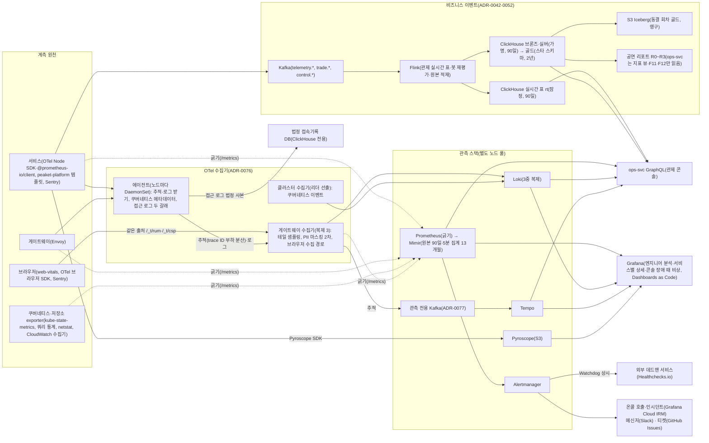

# 관측가능성·SLO·알림

- **독자와 용도**: 서비스 엔지니어와 온콜 담당·운영자가 참고하는 기술 기준 문서다. 서비스 엔지니어는 OpenTelemetry(지표·로그·요청 기록을 모으는 공통 표준과 도구) 계측 표준, 분산 트레이싱, 정형 로그, 메트릭 카디널리티(지표에 붙는 이름표 값의 가짓수로, 많으면 저장 비용이 커진다) 규칙을 여기서 파악한다. 온콜 담당과 운영자는 실제로 재는 서비스 품질 값인 SLI와 팀이 정한 목표인 SLO의 산출식을 확인한다. 목표가 허용하는 실패의 총량인 에러 버짓을 쓰는 속도(소진율, Burn Rate)에 따른 다중 윈도우 알림과, 대응이 필요한 장애나 보안 사건인 인시던트의 대응 절차도 확인한다. 관제 대시보드 화면과 비상 제어 명령 명세는 docs/features/control-tower.md에 있다. 성능이나 보안 같은 비기능 품질 요구사항의 원본은 planning/02 NFR과 `docs/quality/quality-requirements.md`에 있다.
- **원문 출처**: 설계서 §6 관제 시스템(아키텍처 토폴로지, Four Golden Signals 계측 매트릭스와 6대 운영 규칙, 알림 라우팅과 인시던트 관리, 관제 자체 감시 메커니즘), §9 SLO 프레임워크(판매가 열리는 시각 앞뒤로 접속이 몰리는 온세일 윈도우, 사용자 여정 핵심 SLO, 기본 인프라 SLO, 에러 버짓 할당, 에러 버짓을 쓰는 속도인 다중 윈도우 번 레이트, 카오스 검증 체계), 22장(구조화 로깅), 26장(Observability 플랫폼), 30장(RUM·SLI·SLO 연동), 13장(Datadog 등 외부 상용 APM 벤치마크 평가), POL-022, ADR-0022·0026·0049(온세일 경보 창, 외부 의존·보안 사고 법정 기한·접속기록 점검·위생 지표, §14 근거 표), ADR-0067(관제 콘솔과, 지표·로그·요청 기록으로 시스템 안을 들여다보는 관측 도구의 역할 경계, 앱 오류를 모아 알려 주는 서버 Sentry·쿼리 통계·네트워크 통계, 관측 백엔드 판정), ADR-0068(관측 스택 선택 근거와 대안 비교, AWS 관리형 후보), ADR-0069(관제 원칙 대조와 보강: 제어 입력 없음·감축 확인 시간, 경보 묶기·억제·시험, 인시던트 선언 기준, 결제사 두 단계 기준, 정규 로그 줄·표본 비율, 실패 사건 조회 링크), ADR-0070(장애 대응 지침 대조: 처리량 급감·자원 누수 의심·데이터베이스 변경 기록을 다른 시스템으로 흘려보내는 CDC의 슬롯 경보, 시간 초과 신호, 진단 증거, 판단 순서 ④⑤, 일부러 장애를 내고 대응을 연습하는 Game Day의 장애 대응 3종), ADR-0076(참고 아키텍처 대조: 수집기 2단 구성, 지표는 지표 저장 도구 Prometheus가 긁기, 수집 대상 목록, 브라우저 수집 경로, 로그 표본 위치, 신호 연결, 이상 탐지·자동화 원칙), ADR-0077(관측 책 대조: SLO 기준값 칸 경계, 관측 저장소 쓰기 경로와 관측 전용 메시지 시스템 Kafka, 지표 원본 90일·5분 집계 13개월, 보호 조치 알림, 처리 중 요청 수, 클라이언트·서버 지연 대조, Iceberg 정리, 로그 저장소 Loki의 라벨·분석용 데이터베이스 ClickHouse의 파트 수).
- **기준 기획 버전**: v1.0.
- **표시 규칙**: 원격 텔레메트리(시스템이 내보내는 지표·로그·요청 기록 같은 운영 신호)의 보존 기한과 온콜 운영 도구 구성은 원문에 빠져 있던 사항이다. 소유자가 추천대로 정하라고 맡겨, 추천안을 적용해 확정했다(추천 적용 2026-10-09, ADR-0032). 테일 샘플링 비율이나 시계열 라벨 상한처럼 실제로 잰 비용에 따라 조정할 값은 [가정]으로 적는다. 정형 로그의 구체적인 필드 스키마(데이터의 구조 정의)는 [보완]으로 적는다.

## 1. 관측 경로 구조

- 관측 텔레메트리는 최종 사용자 요청을 처리하는 데이터 평면(Data Plane)과 물리적으로 엄격히 분리된 파이프라인으로 보낸다. 운영 명령을 집행하는 대역 외 제어 평면(Control Plane)의 구조는 docs/features/control-tower.md에서 따로 정한다.
- 역할 경계(ADR-0067): Grafana 스택에서 창고는 Prometheus·Mimir(지표 장기 저장소)·Loki·Tempo(요청 기록 저장소)·Pyroscope이고, 경보기는 Alertmanager, 화면은 Grafana(지표와 로그를 그래프로 보여 주는 도구)다. 관제 콘솔은 같은 창고를 ops-svc로 읽어 판단에 쓰는 숫자를 직접 그린다(Grafana 패널을 끼워 넣지 않는다). 또 인가된 운영 제어 명령의 실행, 권한 통제, 불변 감사 기록을 맡는다. Grafana 화면은 엔지니어의 원인 분석(로그 검색·요청 경로·프로파일), 서비스별 상세 대시보드, 콘솔 장애 때의 비상 화면, Game Day·인시던트 리플레이의 시간축에 쓴다. Sentry는 오류를 종류(이슈)와 배포 단위로 묶는다. 콘솔 위젯마다 같은 회차·시간대로 맞춘 Grafana(오류 위젯은 Sentry) '자세히 보기' 링크를 둔다.
- 애플리케이션 계측은 업체에 중립적인 OpenTelemetry(OTel) 표준 SDK 하나로 통일한다. 운영 환경에서 상시로 쓰는 구성은 직접 운영하는 Grafana 스택과 Sentry(브라우저·서버 오류, 운영 방식은 ADR-0067 결정 6에서 판정)의 조합이다. Phase 4 비교 측정(wbs 4.8.2)의 평가 기간에는 후보인 Datadog에도 같은 데이터를 보낸다. 추적·로그는 게이트웨이 수집기(에이전트 등이 보낸 데이터를 모아 처리하는 수집기)의 Exporter 설정으로, 지표는 Prometheus 원격 쓰기나 그 서비스 에이전트의 긁기로 보낸다(ADR-0076). Phase 4에서는 우리 규모로 환산한 비용, 장기 조회(리플레이·지난 회차 비교)와 엔지니어 화면을 조회 한도 안에서 할 수 있는지, 직접 운영에 든 사람 시간을 잰다. 그리고 세 후보(직접 운영, AWS 관리형, Datadog) 가운데 판정 규칙 R1·R3를 통과하고 연간 총비용이 가장 낮은 후보를 고른다(차이 10% 안이면 지금 구성 유지, ADR-0067 결정 5·ADR-0068 결정 5, 원문 13장).
- 관측 스택 선택 근거와 대안 비교는 ADR-0068에 있다. 고르는 기준은 여섯 가지다: PromQL 호환(필수), 폭주 때 저장 구조, 데이터 국내 보관, 운영 부담, 잠김, 장기 조회. 비교 측정 후보는 세 가지다: 직접 운영, 서울 리전(클라우드 데이터센터가 모인 지역)의 AWS 관리형(AMP가 Mimir 자리, AMG가 Grafana 자리), Datadog. 입장 제어의 AIMD(정상이면 조금씩 늘리고 나빠지면 크게 줄이는 조절 방식), 지표를 보고 앱 복제 수를 늘리고 줄이는 KEDA, 콘솔의 판단·제어 숫자는 어느 후보든 클러스터 안 Prometheus(로컬 15일)를 읽는다. 판매 누적·잔여석·등급별 상세 퍼널의 출처는 관제 실시간 표다(§8 지표 출처 표). 그래서 후보 비교는 장기 저장·화면·경보·로그·요청 기록·프로파일을 누가 운영하느냐로 좁혀진다.
- 참고 아키텍처 대응(추천 적용 2026-10-21, ADR-0076): 참고 아키텍처의 흐름은 계측 원천 → 수집기 → 신호 → 객체 스토리지 → 활용이다. 우리 설계는 칸마다 다음과 같다.
  - 계측 원천: 브라우저 RUM, 서비스 수동 계측, 에이전트·exporter 자동 수집
  - 수집기: 에이전트·게이트웨이·클러스터 수집기 셋
  - 신호: 추적 Tempo, 메트릭 Prometheus·Mimir, 로그 Loki, 프로파일 Pyroscope, 오류 Sentry
  - 객체 스토리지: AWS의 파일 저장소인 S3(Mimir·Loki·Tempo·Pyroscope)
  - 활용: 규칙에 따른 자동화, 사람이 하는 근본 원인 분석, ClickHouse·Iceberg 데이터 분석
  - 이상 탐지는 규칙과 통계로만 하고 머신러닝은 쓰지 않는다(§13).
  - 참고 아키텍처에 없는 우리만의 것: 비즈니스 이벤트 경로(Kafka → 이벤트를 실시간으로 계산하는 Flink → ClickHouse), 법정 접속기록 분기, 감사 체인과 공개 앵커, 조작하는 관제 콘솔.
- 수집기 구성(추천 적용 2026-10-21, ADR-0076):
  - 에이전트(앱이 실행되는 서버 한 대인 노드마다 DaemonSet): 서비스 SDK의 추적(OTLP, 노드 안)과, 앱과 실행 환경을 한 묶음으로 만든 컨테이너의 표준 출력 로그(filelog)를 받아 쿠버네티스(컨테이너로 만든 앱을 여러 서버에서 실행하고 관리하는 플랫폼) 메타데이터를 붙인다. 추적은 trace ID 기준 부하 분산 내보내기로, 같은 추적을 게이트웨이 수집기의 같은 복제에 보낸다.
  - 게이트웨이 수집기(관측 노드 풀, 복제 3 [가정, 4.1.4에서 확정]): 테일 샘플링(§6), 개인정보 2차 마스킹(§7), 브라우저 수집 경로(§11)를 맡는다.
  - 클러스터 수집기(복제 2개 중 일을 맡을 하나를 고르는 리더 선출): 쿠버네티스 이벤트를 한 번만 받는다.
  - 지표는 수집기를 거치지 않고 클러스터 Prometheus가 `/metrics`를 긁는다. 그래서 수집기가 멈춰도 SLO 경보와 자동 제어 입력은 그대로다. 브라우저 지표만 게이트웨이 수집기가 Prometheus 형식으로 내놓는 값을 긁는다.
  - 예외(추천 적용 2026-10-21, ADR-0078 결정 3): Tempo metrics-generator의 서비스 그래프 지표는 Mimir `raw` 테넌트로 바로 원격 쓰기를 한다. 이 지표는 서비스 지도(연결)를 그리는 데만 쓰고 경보와 자동 제어 입력에는 쓰지 않는다. 그래서 수집기나 Tempo가 멈춰도 경보와 자동 제어는 그대로다(§6).
  - 수집 대상 목록은 ADR-0076 결정 3에 있다.
- 관측 저장소 쓰기 경로(소유자 결정 2026-10-21, 세부는 추천 적용, ADR-0077 결정 2):
  - Tempo: 운영 설계는 마이크로서비스 모드이고, 쓰기 경로의 WAL은 관측 전용 Kafka다. 관측 전용 Kafka는 거래용 MSK(AWS가 운영해 주는 Kafka)와 다른 클러스터다. 거래 Kafka의 장애와 관측 장애를 서로 엮지 않고, 오픈 피크의 요청 기록 쓰기가 거래 Kafka를 나눠 쓰지 않게 하려는 것이다.
  - Mimir: 고전 구조(인제스터 영역 인식 3중 복제, 쓰기·읽기 정족수 2). Loki: 영역 인식 3중 복제와 과반 정족수. Pyroscope는 AZ(리전 안의 독립된 데이터센터 묶음) 장애 때 일부를 잃어도 되는 원인 분석 자료로 둔다.
  - 로컬 부하 시험은 Tempo 모놀리식(Kafka 없음)으로 하고, wbs 4.1.4 PoC(본 개발 전에 위험한 부분만 먼저 만들어 확인하는 시험)와 G-26에서만 마이크로서비스 모드와 로컬 Kafka를 띄운다.

## 2. 계측 표준 (OpenTelemetry)

| 항목 | 표준 엔지니어링 규칙 |
| --- | --- |
| 계측 SDK 체계 | Node.js 서비스군은 OTel Node SDK 기반 자동 계측(HTTP, 서비스끼리 함수를 부르듯 빠르게 호출하는 gRPC, ioredis, pg, kafkajs)을 기본으로 적용한다. 비즈니스 핵심 구간은 수동 스팬(Span)으로 자세히 계측한다. 결제하는 동안 좌석을 잠시 잡아 두는 홀드의 Lua 실행, 여러 서비스에 걸친 일을 단계별로 처리하고 중간에 실패하면 앞 단계를 되돌리는 Saga의 오케스트레이션 단계, 로비에서 순번을 무작위로 섞는 셔플 연산이 그 구간이다. 프론트엔드는 OTel 브라우저 SDK와 web-vitals 라이브러리를 함께 쓴다. 지표는 서비스가 `/metrics`(OpenMetrics)로 내놓고 클러스터 Prometheus가 긁는다. 추적은 노드 에이전트 수집기에 OTLP로 보내고, 로그는 표준 출력으로 낸다(ADR-0076). |
| 플랫폼 서비스 템플릿 | `peaket-platform` 공통 기본 템플릿에 Four Golden Signals 히스토그램(값을 구간별로 나눠 센 분포 지표), Pino 로그 `traceId` 자동 주입, 기본 엔드포인트(요청을 받는 주소 하나) SLO 대시보드와 경보 규칙 생성을 넣어 둔다. 그래서 새 서비스를 더해도 같은 모양의 관측 화면을 바로 갖춘다. |
| 분산 컨텍스트 전파 | W3C Trace Context 표준을 따른다. Baggage(`eventId`, `queueSeq`·`sessionId`를 로그 가명 키로 바꾼 가명(HMAC-SHA256, `sidRef`와 같은 방식, §7, ADR-0053 결정 1))를 함께 전파해 공연 단위와 대기 순번 단위의 분산 추적 조회를 지원한다. 브라우저는 같은 출처 요청에만 `traceparent`를 붙인다. 교차 출처인 대기열 API(프로그램끼리 요청과 응답을 주고받는 창구)와 결제사 SDK에는 붙이지 않는다. `traceparent`는 CORS(다른 주소에서 온 요청을 브라우저가 허용할지 정하는 규칙)의 안전 목록 헤더가 아니어서, 붙이면 사전 요청이 생기기 때문이다(ADR-0065·0076). |
| 레이턴시 히스토그램 | SLO·경보 기준값을 모두 경계로 품은 표준 칸 목록(§8, ADR-0077)을 만들어, 요청의 절반이 끝나는 시간인 p50, 백 건 중 아흔아홉 건이 끝나는 시간인 p99, 그리고 p99.9 백분위수를 정확하게 계산한다. 성공 요청과 실패 요청의 지연시간은 반드시 따로 나눠 기록한다. 버킷 상한은 60초 이상으로 둔다. Degraded Mode의 결제 확정 p99 60초(NFR-006)를 재야 하기 때문이다. OpenTelemetry HTTP 지표 규약의 권장 버킷은 10초까지라, 그대로 쓰면 10초를 넘는 요청이 마지막 버킷에 몰린다(ADR-0049). 결제 확정 소요(`payment_confirm_resolution_seconds{pg}`, 같은 멱등키 재시도와 결과 모름 조회 포함)도 같은 버킷을 쓴다(ADR-0069). 서비스 템플릿과 Envoy(요청을 받아 안쪽 서비스로 넘기는 프록시 서버)가 같은 칸 목록을 쓴다(ADR-0077). |
| SLI 실시간 산출 | 서비스 템플릿이 미리 계산해 두는 Prometheus recording rule을 자동으로 만든다. 템플릿 히스토그램은 OpenMetrics exemplar(`traceId`·`spanId`)를 붙인다(Node용 Prometheus 계측 라이브러리 `@prometheus-io/client`(옛 이름 prom-client)의 exemplar 기능 [가정, 4.1.1 PoC에서 확정]). Prometheus는 exemplar 저장(`--enable-feature=exemplar-storage`)을 켜서, 지표의 이상치 지점에서 그 지점의 분산 트레이스(요청 하나가 여러 서비스를 거친 길과 시간을 남긴 기록)로 한 번에 이동한다(ADR-0076). |
| 대시보드 거버넌스 | 모든 모니터링 패널은 Dashboards as Code(Git 버전 관리)로 배포한다. 온세일 전용 대시보드에는 카오스 장애 주입 시점, 애플리케이션 배포 이벤트, 운영 명령·자동 보호 조치(Loki의 운영 사건 줄 `ops_event`, §7, ADR-0078)를 주석으로 실시간 표시한다. 맨 위 첫 번째 행에는 항상 Four Golden Signals를 둔다. |
| 신호 연결(ADR-0076) | 에이전트 수집기가 모든 신호에 같은 자원 속성(`service.name`, `deployment.environment`, `k8s.namespace.name`, `k8s.pod.name`, `k8s.node.name`)을 붙인다. Grafana 데이터 소스 연결도 Dashboards as Code에 함께 둔다: Prometheus exemplar → Tempo, Loki의 traceId 파생 필드 → Tempo, Tempo → Loki(같은 traceId)·Pyroscope(같은 서비스·시간대). |
| 식별자 카디널리티 제어 | 시계열 메트릭 라벨에 실제 사용자 ID, 대기 순번, 좌석 고유번호, 클라이언트 IP 주소를 직접 넣는 것은 엄격히 금지한다(§8). 정형 로그와 트레이스 속성에는 비밀 키가 없으면 같은 값을 만들 수 없는 가명 `pidRef`·`sidRef`·`accountRef`(로그 가명 키 HMAC, §7)만 허용한다. 원문 식별자와 키 없는 해시는 쓰지 않는다(ADR-0053 결정 1). |

## 3. Four Golden Signals

모든 마이크로서비스는 지연시간(Latency), 트래픽(Traffic), 오류(Errors), 포화도(Saturation)를 핵심 관측 신호로 정한다(Google SRE Book 6장). L7 요청 계층은 RED(Rate, Errors, Duration) 모델로, 인프라 자원 계층은 USE(Utilization, Saturation, Errors) 모델로 계측해 서로 보완한다.

| 아키텍처 계층 / 컴포넌트 | 지연시간 (Latency) | 트래픽 (Traffic) | 오류 (Errors) | 포화도 (Saturation) |
| --- | --- | --- | --- | --- |
| API 게이트웨이군 (gw-queue, gw-fan, gw-partner, gw-ops, gw-scanner) | 라우팅 경로별 p50·p99·p99.9, 성공·실패를 나눈 지연시간, 입구 서버인 게이트웨이 자체의 순수 처리 오버헤드 (전체 왕복 지연 − 업스트림 지연) | 라우팅 경로별·공연 회차별 초당 요청 수 (RPS) | HTTP 5xx 응답, 계속 실패하는 호출을 잠시 끊는 서킷 브레이커가 미리 막은 503 응답, SLO 지연 한도 초과 요청 수. 단, 정상적인 좌석 홀드 경합에서 져서 생긴 409 Conflict는 정상 비즈니스 분기로 분류해 따로 집계한다 | 활성 TCP 연결 수, 업스트림 처리 중 요청 수(`upstream_rq_active`, ADR-0077), 들어오는 대기 큐 적체율 대 서킷 상한 비율, 비정상 백엔드 파드(쿠버네티스에서 앱이 실행되는 가장 작은 단위)여서 분리된 엔드포인트 비율, 게이트웨이 파드 CPU 사용률 |
| queue-svc (대기열 진입 및 입장 확정) | 순번 발급 진입 지연 p99, 입장 확정 처리 지연 p99 | 초당 순번 발급 요청 수, 초당 예매 진입 확정 요청 수 | 순번 발급 실패 건수, 이탈로 빠진 번호의 기록 실패 건수, '곧 입장' 완충 응답 비율, 차례 전 입장 건수(입장 확정 때 순번이 그 시각 serving보다 큰 건, 0건 불변식, ADR-0049), 차례가 온 뒤 시스템 원인으로 입장하지 못한 건수 | Node.js 이벤트 루프 지연시간, CPU 점유율, Redis(메모리에 데이터를 두는 빠른 저장소) 커넥션 풀 가용률 |
| queue-svc (대기열 실시간 상태 전파) | 컨트롤러가 serving 번호(지금 예매 화면으로 들여보내고 있는 순번의 끝)를 갱신한 때부터 CDN(사용자 가까운 곳에 파일을 복사해 두고 대신 응답하는 전송망) 엣지의 대기 상태 파일에 반영될 때까지의 지연시간 | CDN 엣지(접속한 사람 가까이에 둔 서버)가 받은, 정해진 간격으로 다시 묻는 상태 폴링 요청 수, 캐시(자주 쓰는 값을 가까운 곳에 복사해 둔 것)를 뚫고 뒤에서 원본 파일을 주는 서버인 오리진까지 간 요청 수 | 정적 대기 상태 파일의 생성·전송 실패율, 예상 대기 시간 오차(처음 보인 예상 대기와 실제 대기를 견준 분포, 관측) | CDN 엣지 캐시 적중률 하락폭 (오리진 부하 전파율), 대기열 Redis 클러스터 CPU·메모리 점유율 |
| admission-ctrl (동시 예매 통제) | 제어 루프를 1회 실행하는 데 걸린 시간 (목표: 200ms 이내) | 초당 serving 증가 폭 (대기열 차례 진행 속도), 실시간 입장 자리 허용률 | 분산 리더 부재 시간, Lease(정해진 시간 동안만 유효한 권한. 갱신하지 않으면 다른 쪽이 가져간다) 갱신 실패 건수, 상한을 초과하는 번호 급증 (안전 한계선 위반 0건 유지), 제어 입력 없음 시간(`admission_control_input_stale{event_id,input}`, ADR-0069) | 잔여 좌석 대비 동시 예매 허용 목표 비율, 예매 단계 지금 인원(`admission_slots_used{event_id}`, ADR-0077), 제어 루프 연산 지연시간, 사유별 감축 횟수(`admission_target_decrease_total{reason}`)와 감축 확인 시간에 막은 감축(`admission_decrease_suppressed_total`, ADR-0069) |
| identity-svc (로그인 및 인증) | 로그인 인증 처리 지연 p99 | 초당 로그인 시도 요청 수 | 인증 실패율 급증 (크리덴셜 스터핑 공격의 앞선 신호로 탐지해 침입 탐지와 연동) | 관리자 비밀번호 PBKDF2 해싱 대기 큐 (libuv 스레드 풀 포화도) |
| trust-svc (이상 봇 위험 평가) | 실시간 행동 점수 판정 지연 p99 | 초당 위험 점수 평가 요청 수 | 평가 시간 초과와 폴백 축소 운영 전환율, 추가 검증 큐 격리율, 사용자 이의 제기 접수 건수 | 판정 피처 Redis(세션·캐시) CPU. 대기 중 재평가의 Flink 체크포인트(작업 상태를 주기적으로 저장해 두는 지점) 지연은 §5 Flink 잡 신호에서 본다(ADR-0071) |
| realtime-gw (실시간 좌석 델타 브로드캐스트) | 좌석 상태가 바뀐 때부터 단말 브라우저 화면에 반영될 때까지의 지연시간 | WebSocket(연결을 열어 둔 채 서버와 브라우저가 주고받는 통신 방식) 동시 활성 연결 수, 초당 모두에게 보낸 메시지 수 | WebSocket 핸드셰이크 실패율, 네트워크 끊김률, 좌석 맵 시퀀스 버전 갭 발생 빈도 | 파드당 최대 연결 수 대비 가용 비율, 소켓 송신 버퍼 큐 길이, 메모리 사용량 |
| purchase-svc (재고 관리 inventory 모듈) | Redis Lua 좌석 홀드 실행 지연 p99 | 초당 좌석 홀드 시도 수 | 단순 경합 패배를 뺀 시스템 원인의 홀드 실패 건수, 오버셀(같은 좌석이 두 사람 이상에게 팔리는 사고) 불변식 위반 건수 | 좌석 Redis CPU·메모리, 특정 인기 좌석에 몰린 핫키 집중도, 이벤트 루프 지연 |
| purchase-svc (주문 booking 모듈) 및 payment-svc | 결제 접수 지연 p99, 주문 확정 종단 지연 p99, 결제사별(`pg` 라벨) 승인 API 호출 p99, 결제 확정 소요 p99(`payment_confirm_resolution_seconds{pg}`, 재시도 포함, ADR-0069) | 초당 결제 승인 처리량 (TPS) | 외부 승인 실패율 (단순 한도 초과와 취소는 제외), 결제 원장과 티켓 발권 사이의 불일치 건수, 상태 미확정(UNKNOWN)으로 남은 건수, identity 재확인 대체 판정 건수(`purchase_identity_recheck_fallback_total`, ADR-0055) | Outbox(보낼 이벤트를 데이터 변경과 함께 표에 먼저 적어 두고 나중에 보내는 방식) 릴레이 대기 건수, 결제사별 서킷 브레이커 트립 상태와 결제사 전환 상태(전환 후보 추천 포함, ADR-0044), 관계형 DB 커넥션 풀 고갈률 |
| 비동기 메시징 및 스트리밍 (Kafka, Flink, Outbox, BullMQ) | 이벤트를 발행한 때부터 마지막 컨슈머(메시지를 읽는 쪽)가 처리를 마칠 때까지의 지연시간 | 토픽(메시지를 종류별로 모아 두는 통로)별·큐별 초당 메시지 처리량 | 비동기 워커 처리 실패율, 처리에 실패한 메시지를 따로 모아 두는 데드 레터 큐(DLQ) 유입 건수 | Kafka 컨슈머 Lag, BullMQ 큐 적체 깊이, Flink 체크포인트 소요 시간 |
| 데이터 저장소 (Aurora PostgreSQL, Redis, Kafka, ClickHouse) | 쿼리·커맨드 실행 지연 p99, PostgreSQL(관계형 데이터베이스) 쿼리별 상위 20개 [가정]의 호출 수·평균·최대 실행 시간(postgres_exporter `stat_statements`, queryid만 싣고 문장은 싣지 않음, ADR-0067) | 초당 쿼리·트랜잭션(여러 변경을 한꺼번에 반영하거나 한꺼번에 취소하는 작업 단위) 처리량 (QPS, TPS) | DB 에러율, 커넥션 시간 초과, 트랜잭션 데드락 발생 건수 | 활성 커넥션 수 대비 풀 상한, CPU 사용률, 스토리지 디스크 잔여량과 소진 예상 시간 |
| 외부 의존 서비스 (결제사, 본인확인, 사람 확인, 소셜 로그인 제공자. `dependency` 라벨, ADR-0049) | 제공자별 호출 p99 | 제공자별 초당 호출 수 | 제공자 오류(5xx·시간 초과) 비율, 결제사 한도 초과 응답 수 | 결제사 한도 사용률(초당 승인 요청 ÷ 결제사 채널 추정 상한, ADR-0036·0044) |
| ticket-svc·스캐너 (공연 당일) | 단말 판정 지연 p95(판정 백 건 중 아흔다섯 건이 이 시간 안에 끝난다는 뜻). 스캐너가 브라우저 안 저장소인 IndexedDB에 모았다가 온라인일 때 `/_t/rum`으로 보낸다(docs/frontend.md §5.5) | 공연 회차·구역별 분당 스캔 수, 업로드 대기 건수 | 사유별 거부율, 오거부 후보(거부 뒤 10분 [가정] 안에 같은 티켓이 정상 통과한 건), 이상 표시(중복 입장·퇴장 기록 없음·취소 뒤 입장·세션 밖 기록·마감 뒤 도착), 부스 재발급·예외 통과 건수, 입장 시작 뒤 첫 키 등록 비율 | 스캐너 마지막 동기화 경과 시간의 최댓값과 기준(2분 [가정])을 넘은 스캐너 수, 폐기 목록 버전 차이, 입장 기록 마감 지연과 미보고 기기 수. 단말별 목록은 시계열 라벨이 아니라 관제 읽기 모델로 본다(§8, ADR-0051) |
| 플랫폼 공통 (노드, 인증서, 백업) | — | — | 백업 작업 실패, 인증서 갱신 실패 | 노드 시계가 표준시와 어긋난 정도(오프셋), 인증서·서명 키 만료까지 남은 일수, 저장소별로 마지막으로 백업에 성공한 뒤 지난 시간, 교차 리전 복제 지연, 노드 연결 대기열 넘침·TCP 재전송(node_exporter netstat, 기준 [가정, 4.1.1에서 확정], ADR-0067) |
| 프론트엔드 실사용자 모니터링 (RUM) | Core Web Vitals인 INP(조작에 화면이 반응하기까지 걸린 시간)와 LCP(화면의 가장 큰 요소가 보이기까지 걸린 시간)의 p75 백분위 지연 | 실시간 페이지뷰, 활성 구매 세션 수 | 클라이언트 JavaScript 런타임 오류율, 비동기 API 통신 실패율 | 브라우저 메인 스레드를 오래 붙잡아 조작을 막는 Long Task의 점유율 |

모든 서비스는 서비스 템플릿으로 처리 중 요청 수 게이지 `http_server_active_requests`(OpenTelemetry `http.server.active_requests`와 같은 뜻, 라벨은 지연 히스토그램과 같다)를 낸다(추천 적용 2026-10-21, ADR-0077). 처리 중 요청 수 ÷ (초당 처리량 × 평균 처리 시간)이 1에서 크게 벗어나면 그 앞에 줄이 생긴 것으로 보고 원인 패널에서 살핀다(리틀의 법칙). 경보에는 쓰지 않는다.

시스템 관측성을 위한 핵심 운영 규칙은 다음과 같다(원문 6대 규칙에 ADR-0069의 7번을 더했다):
1. 모든 마이크로서비스 모니터링 대시보드의 맨 위 첫 번째 행에는 반드시 Four Golden Signals를 두어, 장애 징후를 바로 알아보게 표준화한다.
2. 시스템 지연시간은 산술 평균이 아니라 백분위 분포(p50, p99, p99.9)로 정밀하게 계측한다. 실패한 요청의 지연시간은 반드시 따로 나눠 분석한다(느린 실패는 빠른 실패보다 시스템 자원을 더 심하게 바닥낸다).
3. 시스템 장애 오류는 3가지 유형으로 엄격히 나눠 관리한다: 명시적 오류(HTTP 5xx), 암묵적 오류(오버셀 발생, 결제-발권 불일치처럼 불변식 검사기와 대사 배치로 찾아내는 것), 정책적 오류(미리 합의한 SLO 지연 한도 초과).
4. 자원 포화도는 병목이 가장 심한 최소 단위의 자원을 기준으로 잰다. "디스크 잔여량이 4시간 이내에 고갈됨"처럼 바닥나는 시점을 미리 예측한다. 1분 단기 윈도우에서 p99 지연이 갑자기 오르는 것을 포화의 핵심 선행 지표로 본다. 포화 신호는 AIMD 동시 예매 통제 알고리즘과 KEDA 오토스케일링(부하에 따라 서버 수를 자동으로 늘리고 줄이는 것)의 제어 입력으로 바로 연결한다.
5. 운영 엔지니어를 밤에 급히 부르는 페이징 알림은 증상 중심(SLO 번 레이트 가속, 포화 한계 도달 예측, 비정상적인 트래픽 급변)으로만 보낸다. CPU 사용률 80% 초과 같은 단순한 원인 지표로는 호출하지 않는다. 트래픽 급변의 규칙은 §5의 처리량 급감 신호다(ADR-0070).
6. 티켓팅 비즈니스 퍼널 전환율, 구역별 잔여 좌석 수, 봇 트래픽 유입률 같은 비즈니스 KPI(성과를 재는 핵심 지표) 신호는 시스템 인프라 대시보드와 분리한다. 이 신호는 관제 콘솔 전용 비즈니스 패널에 실시간으로 따로 보여 준다(티켓팅 봇의 최종 점유율은 행사가 끝난 뒤 사후 분석 리포트로 확정한다, planning/01 §3.2).
7. 자동 제어가 읽는 지표는 값과 함께 신선도(마지막 표본 시각)를 본다. 쿼리 실패, 빈 결과, 30초 [가정, Phase 2 2.3.2에서 확정]보다 낡은 표본은 '제어 입력 없음'으로 보고 0으로 읽지 않는다. 입력이 없는 동안 자동 제어는 목표를 늘리지도 줄이지도 않는다(소유자 결정 2026-10-20, ADR-0069, docs/features/queue-admission.md §5). 빈 결과를 0으로 읽는 실수는, 자동화가 빈 목록을 '전체'로 읽어 서버 디스크를 지운 사고(SRE Book 1판 7장)와 같은 꼴이다.

## 4. SLI·SLO·에러 버짓

- **측정 윈도우 체계**: 접속이 한꺼번에 몰리는 온세일 윈도우(T-10분 ~ T+60분, 총 70분)는 공연 회차마다 따로 단기 에러 버짓을 주고 평가한다. 일상 기능은 28일 롤링 윈도우로 평가한다. 사용자가 체감하는 품질은 28일 누적 결과와 온세일 단기 결과를 따로 나눠 집계한다.
- **측정 기준 지점**: 따로 적은 것이 없으면, 외부 클라이언트 요청을 처음 받는 인그레스 게이트웨이(Envoy)의 서버 쪽 히스토그램을 기준으로 계측한다. 구체적인 수치 목표의 법적·기술적 근거는 planning/02 NFR-001~012에 정해져 있다.

| NFR 식별자 | 서비스 수준 지표 (SLI: 유효 정상 이벤트 ÷ 전체 요청 이벤트) | 수집 데이터 소스 | 서비스 수준 목표 (SLO) |
| --- | --- | --- | --- |
| NFR-001 대기열 진입 | 지연시간: 200ms 이내에 응답을 마친 진입 요청 비율. 가용성(서비스를 멈춤 없이 쓸 수 있는 정도): 5xx 서버 오류와 게이트웨이 시간 초과가 아닌 정상 응답 비율(단, 의도한 봇 차단 HTTP 403, 429 응답은 분모에서 아예 뺀다. 그래서 사람을 잘못 막아도 이 SLI에는 드러나지 않는다. 명령 4·5의 효과 줄과 차단 효과 신호(§5)가 이 사각지대를 본다, ADR-0069) | gw-queue 히스토그램 | p99 200ms 이내, 가용성 99.9% 달성 |
| NFR-002 대기 상태 전파 | 컨트롤러가 serving 번호를 갱신한 때부터 입장이 임박한 사용자의 화면에 반영될 때까지의 시간 ≤ 2초. 대기 순번 조회 가용성: CDN 엣지의 정상 2xx 응답 비율 | RUM 클라이언트 보고 (서버 시각 보정), CDN 지표 | p99 2초 이내, 가용성 99.95% 달성 |
| NFR-003 좌석 홀드 | 요청 뒤 50ms 이내에 HTTP 201 Created(홀드 성공)나 409 Conflict(경합 패배)로 응답한 비율(경합 패배는 정상 비즈니스 이벤트로 본다. 판매 일시정지(명령 3)로 거절한 423은 분모에서 뺀다. 추천 적용 2026-10-14, ADR-0062) | gw-fan 히스토그램, 백엔드 불변식 검사기 | p99 50ms, p99.9 150ms 이내, 가용성 99.95%, 초과 판매(오버셀) 0건 |
| NFR-004 좌석 상태 전파 | 서버가 좌석 홀드 변경을 확정한 때부터 클라이언트 화면에 그려질 때까지 ≤ 300ms. 버전 갭이 생기면 30초 이내에 전체 스냅샷(어느 시점의 전체 상태를 찍어 둔 것)으로 자가 치유를 마친다 | 클라이언트 WebSocket RUM 보고 (서버 타임스탬프 동기화) | p99 300ms 이내, 30초 안 자가 치유 비율 99.9% 이상 |
| NFR-005 결제 주문 접수 | 주문 생성 요청 뒤 150ms 이내에 HTTP 202 Accepted로 응답한 비율(판매 일시정지(명령 3)로 거절한 423은 분모에서 뺀다. 추천 적용 2026-10-14, ADR-0062) | gw-fan 히스토그램 | p99 150ms 이내, 가용성 99.95% 달성 |
| NFR-006 결제 최종 확정 | 결제 승인을 요청한 때부터 최종 예매 확정 완료 화면이 그려질 때까지 ≤ 3초(단순 카드 한도 초과와 고객 자진 취소는 제외). 60초 초과 미보상 데이터 불일치 0건 | 종단 간 분산 트레이스, 결제 대사 정산 배치 | p99 3초 이내, 결제 완료율 99.95% 이상 |
| NFR-007 공연 정보 페이지 | CloudFront(AWS의 CDN) 엣지 서버 쪽 TTFB ≤ 150ms 달성, HTTP 2xx/3xx 정상 응답 비율 | CloudFront 엣지 메트릭, 프론트엔드 RUM LCP | p99 150ms 이내, 가용성 99.99%, RUM LCP p75 2.5초 이내 |
| NFR-008 관제 제어 명령 | 명령 접수 지연: 500ms 이내 응답(2인 승인 대기 시간은 제외). 명령 전파: 승인을 마친 때부터 대상 파드의 적용 ack를 받을 때까지 ≤ 3초 | ops-svc 히스토그램, 파드별 제어 ack 타임스탬프 | 접수 p95 500ms·99.9%, 전파 p99 3초·99.9% 달성 |
| NFR-009 관제 실시간 표 반영 | 관제 실시간 표(`rt`) 지표가 원천에서 생긴 때부터 관제 화면에 반영될 때까지 5초 미만(심장 박동 사건 기준 종단 신선도, ADR-0071), 누락률 | `rt_freshness_seconds`(심장 박동 발행 → ops-svc 읽기), 늦어서 버린 수·싱크가 버린 수·읽지 못해 거절한 수·생산자가 버린 수 | p95 5초 미만, 누락률 < 0.1% |
| NFR-010 현장 게이트 판정 | 티켓 QR을 스캔한 때부터 검증 판정을 마칠 때까지 ≤ 150ms(오프라인 모드 포함), 위조 티켓 통과 0건, 정상 티켓 오거부율 < 0.1% | 스캐너 단말 로컬 계측(온라인으로 동기화할 때 서버에 업로드) | p95 150ms 이내 달성 |
| NFR-011 기본 인프라 SLO | 일반 REST API p95 500ms·가용성 99.9%, 내부 서비스 간 gRPC p95 100ms·가용성 99.95%, 온세일 핫패스(요청이 가장 많이 지나는 경로) gRPC p99 20ms(온라인 결제를 대신 처리해 주는 결제사인 외부 PG와의 통신은 제외) | 서비스 공통 템플릿 계측 히스토그램 | 새로 추가되는 모든 엔드포인트에 자동으로 강제 상속된다 |
| NFR-012 사용자 체감 성능 | Core Web Vitals: INP 200ms 이내, LCP 2.5초 이내, 화면이 갑자기 밀리는 정도인 CLS 0.1 이하를 p75 백분위에서 충족(모바일과 데스크톱 환경을 각각 따로 집계). 진단 지표 FCP 1.8초·TTFB 0.8초 이하, 주요 경로의 50ms 이상 긴 작업 0건, 좌석맵 대기실 통과 뒤 1초 미만(planning/02 §3.2) | web-vitals RUM 텔레메트리(지표 묶음 판 2, docs/frontend.md §5.16). CLS는 Chromium에서만, INP·LCP는 Safari 26.2부터 잴 수 있다 | Google 웹 성능 표준 권고안 100% 준수 |

- 결제 승인과 관제 명령 실행은 'HTTP 요청 접수'와 '비동기 전파 및 원장 확정' 단계를 분명히 나눠, 2단계 독립 SLI로 계측한다. 병목의 원인 구간을 바로 가려내기 위해서다.
- Core Web Vitals, web.dev 가이드라인, W3C Long Tasks 표준, NIST 재인증 권고안, Google SRE Workbook 번 레이트 공식처럼 객관적이고 공신력 있는 표준을 채택했다(planning/02 §3). 백엔드 내부 지연시간과 가용성 수치는 시스템 구조의 특성에 맞춘 기준이며, 실측 벤치마크로 평가한 다음 최종 확정한다.

**온세일 70분 윈도우 단기 에러 버짓 산출표**

| 핵심 사용자 여정 SLO | 70분간 예상 총 요청 수 | 허용 가능한 최대 실패 요청 수 |
| --- | --- | --- |
| 공연 상세 조회 (99.99%) | 약 1,000만 건 | 약 1,000건 |
| 대기열 순번 진입 (99.9%) | 약 200만 건 (순수 100만 명 × 새로고침 유입 2배) | 약 2,000건 |
| 좌석 홀드 (99.95%) | 약 15만 건 (2.5만 건 주문 × 주문당 평균 홀드 시도 6회(경합 포함), C-03 결정 2026-10-08) | 약 75건 |
| 결제 최종 확정 (99.95%) | 약 2.5만 건 | 약 12건 |

결제 확정은 허용 실패 한도가 12건에 불과해, 기존 28일 기준의 느슨한 알림 방식으로는 에러 버짓을 다 쓰고 나서야 알아차리게 된다. 따라서 온세일 윈도우 동안에는 분 단위 단기 윈도우 번 레이트 알림을 켠다.

경보 창은 '경보 시점 예산 소모'로 정한다. SRE Workbook 5장의 식으로 경보가 울릴 때까지 쓴 예산은 '소진 배수 × 긴 창 길이 ÷ 예산 기간'이다. 온세일 70분 예산에서는 이 값이 30% 이하가 되게 한다(소유자 결정 2026-10-13, ADR-0049). 바꾸기 전 규칙(1분·5분 창 10배, 15분 창 3배)은 예산의 71%·64%를 쓴 뒤에 울렸다. 짧은 창은 긴 창의 1/12로 둔다(Workbook 5장 지침). 온세일 중에는 운영자가 이미 관제실에 있어 헛경보의 비용은 작고 늦은 경보의 비용은 크다. 그래서 정밀도보다 탐지 시간을 앞세운다.

**다중 윈도우 멀티 번 레이트 알림 규칙**

| 알림 대상 및 심각도 | 감시 시간 윈도우 | 발동 임계 조건 | 즉각 대응 조치 |
| --- | --- | --- | --- |
| 온세일 긴급 호출 (Page, SEV1) | 2분 창과 10초 창 동시 충족 | 에러율이 허용 소진 속도의 10배 도달(70분 예산이 7분에 바닥나는 속도). 경보 시점 예산 소모 29%, 결제 확정은 2분에 약 4건 실패 | 온콜 엔지니어 즉시 페이징 호출 + admission-ctrl이 동시 입장 목표를 즉시 50% 자동 감축 |
| 온세일 경고 (SEV2, 결제 확정을 뺀 여정) | 5분 창과 25초 창 동시 충족 | 허용 소진 속도의 3배 도달(약 23분에 바닥나는 속도). 경보 시점 예산 소모 21% | 관제 콘솔에 경보 표시, 운영자의 상황 판단 |
| 온세일 경고 (SEV2, 결제 확정) | 1분 창 | 확실하고 임박한 원인: 결제사 승인 호출 p99의 호출 기한(2초) 도달(호출의 1% 이상이 기한 넘김), 결제사 서킷 브레이커 열림, 결제사 오류율 상승, 결제사 한도 초과 응답 | 관제 콘솔 경보, 결제사 전환 검토(RB-07의 기준은 결제 확정 소요 p99 5초 초과 또는 서킷 열림, 아래) |
| 일상 상시 운영 (28일 기준) | Google SRE Workbook 표 5-8 3단계 다중 윈도우: 1시간/5분 창 14.4배, 6시간/30분 창 6배, 3일/6시간 창 1배(표는 30일 기준 버짓 2%·5%·10%, 28일 창에서는 2.1%·5.4%·10.7%) | 단계별 버짓 소진 조건 충족 | 장애 심각도 등급(숫자가 작을수록 심각하다)은 14.4배·6배가 SEV1(`kind` slo, 온콜 호출), 1배가 SEV3(티켓)이다(추천 적용 2026-10-20, ADR-0073) |

- 결제 확정은 허용 실패가 적어 소진 배수만으로는 빠른 경고를 만들 수 없다(Workbook 5장 '요청이 적은 서비스' 절). 5분 창 3배(5분에 3건)를 쓰면 실패율이 SLO 한도(0.05%)일 때 70분 동안 헛경보가 날 확률이 81%다. 그래서 SEV2는 결제사 쪽의 확실하고 임박한 원인으로 경고한다(SRE Book 1판 6장: 원인은 확실하고 임박할 때만 경보한다). SEV1(2분에 약 4건)의 헛경보 확률은 실패율이 SLO 한도일 때 약 5%, 그 1/5일 때 거의 0이다(모의 계산 2026-10-13, 포아송 과정 4,000회). 좌석 홀드의 SEV2(5분에 17건)는 0.1%다.
- 관제 화면은 여정별 '남은 허용 실패 건수'를 숫자로 보여 준다(예: 결제 확정 12건 중 3건 사용, docs/features/control-tower.md §2).
- 오픈 직후 대기열 진입은 초당 20만 건이다. 그래서 10배 속도로 실패하면 70분 예산 약 2,000건이 1초에 사라진다. 이 구간은 사람보다 자동 보호(진입 Degraded 자동 전환, 동시 입장 축소)가 먼저 지킨다. 자동 전환의 지연 조건 '2분 지속'이 초 단위 폭주에 맞는지는 [가정, Phase 2 부하 시험에서 확정]이다(Redis CPU 조건은 바로 걸린다).
- 2분 창이면 소진 20배 이상(결제 실패율 1% 이상)인 장애를 60초 안에 잡는다(K8, §12).
- 창 길이와 기준 배수는 평소 실패율을 잰 뒤 확정한다 [가정, Phase 6 Game Day 재실행에서 확정]. 바꿀 때도 경보 시점 예산 소모 30% 이하는 지킨다.
- 결제사 기준은 두 단계다(추천 적용 2026-10-20, ADR-0069). 임박(SEV2)은 위 표의 1분 창 원인이다. 전환 검토(RB-07, POL-013의 결제 Degraded)는 결제 확정 소요(승인 요청을 시작해 승인 결과가 정해질 때까지, 같은 멱등키 재시도와 결과 모름 조회 포함) p99 5초 초과 또는 서킷 열림이다. 승인 호출은 2초 기한에서 끊기므로(docs/features/payment.md §2) 호출 p99로는 5초를 잴 수 없다. 이전 문서의 '승인 p99 5초 초과'는 이 뜻으로 읽는다.

**에러 버짓 소진 정책 (POL-022)**

| 에러 버짓 잔여 상태 | 시스템 자동 제어 조치 | 운영 엔지니어 수동 조치 |
| --- | --- | --- |
| 온세일 중 에러 버짓 50% 소진 | 동시 예매 진입 목표치를 바로 낮추고(AIMD 감소 단계 진입), 실행과 동시에 콘솔 SEV2 '예산 50% 감축 실행'(`kind` control)을 낸다(추천 적용 2026-10-21, ADR-0077) | 관제 경보 확인, 병목을 일으킨 트레이스의 원인 분석 착수 |
| 온세일 중 에러 버짓 100% 전량 소진 | 장애 여정의 Degraded Mode(큰 장애 때 핵심을 지키려고 부가 기능을 미리 정한 범위에서 줄여 버티는 운영 모드) 비상 우회 후보 제시 | 운영자 2인의 전자 서명을 거쳐 Degraded Mode 수동 전환, 장애가 끝난 뒤 포스트모템 작성 의무 |
| 일상 28일 에러 버짓 전량 소진 | CI/CD(코드를 올릴 때마다 자동으로 검사하고 빌드해 배포하는 과정) 기능 배포 파이프라인 자동 잠금 활성화(잠금 중 긴급 변경은 RB-23) | 새 기능 개발 중단, 신뢰성 백로그를 가장 먼저 해결. 28일 창의 남은 예산이 다시 0보다 크면 잠금이 자동으로 풀린다. commander는 P0 후속 조치가 남았으면 사유를 적어 연장할 수 있다(추천 적용 2026-10-21, ADR-0078 결정 2) |

에러 버짓 소진 속도는 단순한 모니터링 숫자로 끝나지 않는다. 대기열 입장 제어가 결과를 보고 다시 조절하는 입력으로 바로 이어져 닫힌 제어 루프(Closed Control Loop)를 이룬다. 단, 시스템 자동화는 트래픽과 부하를 줄이는 보수적인 안전 방향으로만 개입한다(POL-021 C-3). 루프 자체의 안전 규칙도 둔다(ADR-0069). 입력이 끊기거나 낡으면 멈춰 목표를 유지한다(제어 입력 없음, 소유자 결정 2026-10-20). AIMD 감축 뒤에는 예매 단계 인원이 새 목표 아래로 내려오거나 2분 [가정, Phase 2 2.3.2에서 확정]이 지날 때까지 추가 감축을 하지 않는다(감축 확인 시간). 감축은 새 입장만 멈추고, 이미 들어온 사람은 평균 3분 머물러 효과가 1.5~2분 뒤에 나타나기 때문이다. 에러 버짓 연동 감축은 경보 하나·소진선 하나에 한 번만 한다. 부하를 다루는 다른 장치(KEDA, 게이트웨이 상한, 이상 파드 퇴출 등)와의 순서는 docs/architecture.md §5의 부하 관리 장치 표를 따른다.

## 5. 알림 라우팅과 인시던트 관리

| 인시던트 심각도 | 주요 발생 상황 예시 | 알림 통지 방식 및 채널 |
| --- | --- | --- |
| SEV1 (치명적 장애) | 온세일 에러 버짓 10배 속도의 빠른 소진(2분 창, 경보 시점 예산 29%), 전면 결제 불가 마비, 좌석 오버셀 불변식 위반 의심, 이중 결제 의심, 60초 넘게 정리되지 않은 결제-발권 불일치, 셔플 비콘 대기 상한 초과(ADR-0050), 상시 기능 28일 예산 빠른 소진(1시간 창 14.4배·6시간 창 6배), 관제 콘솔(ops-svc) 가용성 상실, 보안 사고(침해사고·개인정보 유출 등) 인지와 등록(법정 신고·통지 기한 시작, FR-063) | 온콜 엔지니어 즉시 전화/SMS 페이징 호출 + 전용 인시던트 Slack 채널 자동 개설 |
| SEV2 (주요 기능 장애) | 온세일 에러 버짓 3배 소진(5분 창, 경보 시점 21%)과 결제 확정의 임박 원인(결제사 지연·서킷 열림·한도 초과 응답), 외부 의존 서비스 이상, 핵심 사용자 여정의 Degraded Mode 진입, 차례 전 입장 1건 이상, 부정거래 게시물 차단 법정 기한(통보 후 24시간, 고시 사항 10시간) 임박, 보안 사고 신고·통지 기한 임박(24시간 기한은 22시간 경과, 72시간 기한은 60시간 경과), 일괄 환불 작업 자동 정지, CS 처리함 법정 기한(환급 3영업일, 분쟁 진행 경과 3영업일·결과 10영업일) 초과, 상대 서버가 우리 주소를 불러 알려 주는 정산 지급 웹훅의 서명 불일치 급증(10분 5건 이상), 시각 오프셋 초과, 교차 리전 백업 지연, 만료 7일 이하 인증서, 입장 시간대 동기화가 끊긴 스캐너(기준은 아래 위생·현장 신호), 자동 제어 입력 없음, 명령 4·5 뒤 차단이 사람을 막고 있을 수 있음(아래 차단 효과 신호, ADR-0069), 처리량 급감(오류 없는 장애), CDC 복제 슬롯이 붙잡은 WAL 초과·슬롯 비활성, 대형·중형 온세일 윈도우 안에 한도에 닿을 자원 누수 의심(아래 신호, ADR-0070), admission-ctrl 리더 부재, 거래 토픽 소비 지연·브로커 오프라인(ADR-0073), 예산 50% 감축 실행(사용자 용량을 줄이는 자동 보호 조치, ADR-0077), 오픈 24시간 [가정] 안의 '규모 올리기 검토'(ADR-0078), 미리 만든 파티션 부족(월 2개·Outbox 일 3개 [가정] 미만, ADR-0083) | 관제 콘솔 화면 경고와 메신저(Slack) 운영 채널 경보 발송 |
| SEV3 (경미한 장애) | 상시 운영 기능의 28일 누적 에러 버짓 경고 기준 도달, CS 처리함 기한 1영업일 전, 공연예술통합전산망 전송이 다음 날까지 실패, 배상 송금 실패율 상승, 정산 지급 지연·실패(지급일 다음 영업일 12시까지 미완료), 접속기록 월 정기 점검 미완료(월말), 일 단위 백업 지연, 만료 30일 이하 인증서, CloudFront 배포별 한도 사용률 80% [가정] 초과(배포 요청 수 ÷ 승인 한도, ADR-0058), 명령 11 사후 검토 보고서 기한(작성 48시간·검토 7일, ADR-0062) 초과, 홈 장르별 랭킹 파일 게시 실패(매일 10:00 [가정] 게시가 10:30까지 끝나지 않음, ADR-0063), 브라우저 CSP(페이지가 실행할 수 있는 스크립트의 출처를 정하는 규칙) 위반 보고 급증 [가정, ADR-0065], 자원 누수 의심(ADR-0070), 관제 실시간 표 신선도·누락률, 대기 중 재평가 격리 상한(ADR-0071), Flink 잡 신호(ADR-0072), 수집기 자체 신호(ADR-0076), 관측 저장소 신호와 ClickHouse 파트 수(ADR-0077), '규모 올리기 검토'(승인 뒤 수요 예측 상단이 지금 규모 등급의 상한을 넘음, 오픈 24시간 밖, ADR-0078), 실패 메시지(DLQ) 적재 1건 이상(RB-11, ADR-0078), 변경 신호의 SEV3(아래) | GitHub Issues 자동 티켓 생성, 다음 업무일에 우선순위에 따라 처리 |

- 모든 알림 메시지의 페이로드는 AsyncAPI `OpsAlert` 표준 스키마(`alertId`, `status`, `startsAt`, `endsAt`, `severity`, `title`, `runbookUrl`, `dashboardUrl`, `kind`, `eventId`, `journey`, `dependency`, `context`, `exploreUrl`, `foldedUnder`)를 따른다. `foldedUnder`는 위 경보의 `alertId`다(추천 적용 2026-10-20, ADR-0073). SLO 경보의 `exploreUrl`은 같은 시간 창과 그 SLI의 실패 조건으로 미리 채운 Grafana Explore 조회(로그·요청 기록)이고 필수다(ADR-0069). 규칙 파일의 `runbook_url`·`dashboard_url`·`explore_url` 주석은 CI 경보 시험이 검사한다(docs/verification.md §2.7). 실행 가능한 런북(장애가 났을 때 따라 하는 절차서) URL과 Grafana 대시보드 링크가 빠진 알림은 Alertmanager 유효성 검사 규칙이 라우팅을 막는다[보완: 검증 규칙].
- 경보 묶기와 억제(추천 적용 2026-10-20, ADR-0069):
  - 모든 경보에 `severity`, `kind`(slo·cause·invariant·control·hygiene·legal·field·change·security·flow) 레이블을 붙이고, 해당하면 `event_id`·`journey`·`dependency`를 붙인다. `flow`는 처리량 급감이다(ADR-0070).
  - Alertmanager는 온세일 경보를 `event_id`·`journey`·`severity`로, 그 밖의 경보는 `kind`·`severity`로 묶는다. 같은 의존성의 원인 경보는 `dependency`로 묶는다.
  - 예산 SEV1이 울리면 같은 `event_id`·`journey`의 SEV2 알림을 보내지 않는다(`inhibit_rules`, `equal: [event_id, journey]`). 같은 일로 다른 호출이 이미 울리면 그 호출은 불필요하다는 SRE Book 1판 6장의 호출 질문을 따른다.
  - 억제된 경보는 지우지 않는다. ops-svc가 Alertmanager 경보 목록 API로 억제 상태를 30초 [가정]마다 읽고, 콘솔은 억제된 경보를 그 SEV1 아래 접힌 줄로 보여 준다 [보완: 구현 방식은 wbs 4.2.4에서 확정].
  - 콘솔 경보 패널은 맨 위 SEV1 줄과 두 묶음으로 이루어진다. '이 회차 판단'은 고른 회차의 `event_id`를 가진 경보와 온세일 경로 경보(의존성 원인, 제어 입력 없음)다. '플랫폼·위생·법정'은 그 밖이다. SEV1은 종류와 관계없이 맨 위 줄에 둔다(design/d5 §3.3).
- 인시던트 대응 체계: 인시던트 지휘관(Incident Commander), 운영 실행자(Operations Lead), 기록·대외 공지 담당(Communications Lead)으로 역할을 분명히 나누고, 가상 온콜 순번표에 따라 교대로 맡는다. 인시던트 선언 기준은 POL-022에 있다(ADR-0069): SEV1, 불변식 위반 의심 1건, 명령 2·3·6 실행(No-Go로 시작한 명령 2 포함), SEV2가 15분 [가정] 넘게 풀리지 않음, 온세일 예산 50% 이상 사용, 상시 기능에서 사고 하나가 28일 예산의 20%를 넘게 씀, 경보보다 사람이나 외부가 먼저 발견. 명령 1은 일상 조작이라 넣지 않는다(소유자 결정 2026-10-20). 선언하면 Grafana Cloud IRM 인시던트와 Slack 인시던트 채널을 열고(SEV1은 자동), 선언한 사람이 넘길 때까지 지휘관을 맡는다(SRE Workbook 9장).
- 사용자와 대외 공지: 대기실 위쪽 비상 공지 배너(미리 승인한 표준 안내 문구), 외부에서 호스팅하는 상태 페이지(Upptime, GitHub Pages 호스팅), 파트너 콘솔 긴급 팝업을 함께 쓴다. 파트너 긴급 공지의 형식은 POL-022를 따른다(추천 적용 2026-10-14, ADR-0062).
- 알림 위생 관리(Alert Hygiene): 최근 30일 동안 조치 없이 무시되거나 닫힌 유령 알림은 기준값을 조정하거나 바로 지워 알림 피로를 막는다(NFR-023 '미조치 알림 0건' 준수).
  - 경보 위생 보고(추천 적용 2026-10-21, ADR-0078 결정 5): ops-svc가 Alertmanager에서 받거나 읽은 모든 경보(`OpsAlert`) 기록과 감사 로그로 월 1회 보고를 만들어 GitHub Issues에 올린다. 항목은 등급·종류별 경보 수, 온세일당 경보 수, 주당 호출(SEV1) 수, 조치 없이 닫힌 경보 목록이다. '조치 없이 닫힌 경보'는 발생 뒤 24시간 안에 연결된 인시던트·명령·이슈가 없는 경보다.
  - 검토: 플랫폼(SRE) 온콜 책임자가 조치 없이 닫힌 경보마다 조정·삭제·사유를 적고 유지 가운데 하나를 고른다. 고르지 않은 것이 0건이어야 NFR-023을 지킨 것이다. ADR-0049가 보류한 온콜 부담·경보 정밀도는 이 보고의 건수와 조치 없이 닫힌 비율로 보고, 숫자 목표는 두지 않는다.
  - Grafana 패널: Prometheus `ALERTS`(대기·발생 경보마다 저장되는 합성 시계열)로 대기에서 발생으로 넘어간 비율과 대기만 하다 끝난 경보를 보여 주고, `for:` 길이를 고르는 데 쓴다.
- 사후 분석(Postmortem): 인시던트가 끝난 뒤 48시간 이내에 비난 없는 포스트모템(Blameless Postmortem)을 마친다. 근본 원인의 재발을 막는 실행 항목과 런북 개정 작업을 추적한다. 관제 콘솔은 온세일이 끝나면 포스트모템 초안을 자동으로 만든다(SCR-029). 선언한 인시던트는 모두 포스트모템 대상이고 누구나 포스트모템을 요청할 수 있다(SRE Book 1판 15장). 초안에는 첫 증상 시각, 첫 경보 시각, 사람이 안 시각, 탐지 경로(경보·사람·외부)와 주 원인 유형(9가지, planning/03 §4 '원인 유형')·구성 요소(1개), 기여 원인 유형(여러 개), 계기, 영향(예산 사용, 영향 받은 회차), 쓴 손잡이(명령·런북), 후속 조치(GitHub Issues 링크, P0 여부)를 둔다(추천 적용 2026-10-21, ADR-0078 결정 4). 첫 경보 시각과 쓴 명령은 초안이 감사 로그와 경보에서 채우고 나머지는 지휘관이 쓴다. 분기마다 경보가 먼저 잡은 비율과 원인 유형·구성 요소별 건수·28일 예산 사용을 보고 새 경보·런북·설계 과제를 정한다. 사람이나 외부가 먼저 잡은 장애는 감시 실패로 보고 경보를 고치고, 그 수는 머신러닝 힌트를 다시 검토하는 조건에도 쓴다(ADR-0076). 사고 하나가 28일 예산의 20%를 넘게 썼으면 P0 후속 조치를 하나 이상 두고, 같은 종류의 장애가 분기에 20%를 넘게 쓰면 분기 계획에 P0 항목을 둔다(SRE Workbook 부록 B, ADR-0069).
- 법정 처리 기한 신호(ADR-0045·0046): `cs_case_due_breached_total`(종류별, 기한 초과 건), `cs_case_due_soon`(1영업일 안 건), `bulk_refund_job_paused`(자동 정지 여부), `kopis_report_failed_days`(연속 실패 일수), `payout_failure_ratio`를 ops-svc·core-svc·payment-svc가 내보낸다. 라벨에는 건 종류와 결제사만 쓰고 계정·주문 ID는 쓰지 않는다(§8 카디널리티 규칙).
- 정산 지급 신호(ADR-0047): `settlement_payout_overdue_total`, `settlement_payout_failed_total`, `settlement_batch_unapproved`, `settlement_portone_execution_pending`, `settlement_seller_kyc_required`, `settlement_webhook_signature_invalid_total`, `settlement_receivable_open_krw`를 payment-svc·ops-svc가 내보낸다. 라벨은 결제사와 사유만 쓰고 파트너·정산서 ID는 쓰지 않는다(docs/features/settlement.md §11).
- 홈 랭킹 신호(ADR-0063): `ranking_publish_last_success_timestamp`(마지막 게시 성공 시각)와 `ranking_publish_failed_total`을 랭킹 게시 잡(`peaket-data`)이 내보낸다. 오늘 게시가 10:30 [가정]까지 성공하지 않으면 SEV3이다. 직전 파일이 그대로 나가며, 2일 [가정] 넘게 묵으면 홈이 그 섹션을 숨긴다(docs/features/analytics.md §8.5).
- 보안 사고 법정 기한 신호(ADR-0049, FR-063): `security_incident_open{kind}`(kind는 intrusion·personal_data·personal_data_possible), `security_incident_duty_due_seconds{duty}`(의무별 남은 시간의 최솟값), `security_incident_duty_breached_total{duty}`, `attack_outage_seconds`(공격으로 생긴 장애의 지속 시간)를 ops-svc가 내보낸다. 의무(duty)는 침해사고 신고 24시간, 추가 사실 신고 24시간, 이용자 통지(장애·기능 중단 2시간 이상 등, 지체 없이), 피해구제 조치 제출 14일(과학기술정보통신부장관에게), 정보주체 통지 72시간, 유출 신고 72시간, 유출 가능성 통지 72시간이다(정보통신망법 §48의3·§48의10②, 같은 법 시행령 §58의8·§58의9·§60의16, 개인정보 보호법 §34, 같은 법 시행령 §39~§40).
- 접속기록 점검 신호(ADR-0049, FR-064): `access_review_overdue`(이번 달 정기 점검 미완료 여부), `access_finding_open{rule}`(사후조치가 끝나지 않은 이상 건), `access_finding_total{rule}`를 ops-svc가 내보낸다. 점검 주기는 월 1회다(안전성 확보조치 기준 §8②, 추천 적용 2026-10-13). 탐지 규칙(rule)은 같은 명단을 24시간에 3회 이상 내려받기, 한 번에 1만 건 이상 내려받기, 근무 일정 밖 조회·다운로드, 허용 IP 밖 접속 시도, 권한 밖 조회 시도다 [가정, wbs 7.4.1 내부 관리계획 작성에서 확정].
- 외부 의존 신호(ADR-0049): `dependency_request_duration_seconds{dependency}`(히스토그램), `dependency_requests_total{dependency, outcome}`, `pg_quota_utilization_ratio{pg}`, `pg_throttled_total{pg}`. 결제사 한도 초과 응답이 1건이라도 오면 SEV2로 알리고 ADR-0036의 추정 상한을 다시 본다. 그 밖의 제공자는 제공자 오류(5xx·시간 초과) 비율이 1%를 넘은 채 5분 이어지면 SEV2다 [가정, Phase 2 부하 시험에서 확정]. 피크 때 결제사 한도 사용률은 공연 리포트에 남겨 추정을 실제 값으로 바꾸는 근거로 쓴다(§13). CloudFront 배포별 한도 사용률(`cdn_quota_utilization_ratio{distribution}`, CloudWatch 배포 요청 수 ÷ 승인 한도)이 80% [가정]를 넘으면 SEV3 경고를 낸다. 온세일 피크의 사용률은 공연 리포트에 남겨 다음 한도 상향 요청의 근거로 쓴다(ADR-0058, docs/infra.md §4.1).
- 브라우저 CSP 위반 신호(추천 적용 2026-10-15, ADR-0065 결정 4): 화면이 보내는 CSP 위반 보고(`report-to`, 엔드포인트는 `Reporting-Endpoints` 헤더, docs/architecture.md §6.3)를 화면 앱마다 있는 같은 출처 경로 `/_t/csp`(§11, ADR-0076)가 받는다. 받은 보고는 구조화 로그로 남기고 `csp_violation_total{app,directive}`를 센다. 라벨에는 화면 앱(web·partner·console·scanner)과 위반한 지시어만 쓰고, 차단된 주소·문서 주소는 라벨에 쓰지 않는다. 로그에 남기는 주소는 쿼리와 조각을 지운다 [가정, Phase 4 관측 구축에서 확정](§8 카디널리티 규칙). 위반이 급증하면 SEV3이다. 급증의 기준(창과 건수)은 정하지 않았다 [가정, Phase 4 관측 구축에서 확정]. 결제 라우트는 결제사의 하위 출처를 보고 모드로 모아 허용 목록을 확정하는 동안(docs/features/payment.md §7), 그 라우트의 위반을 경보에서 뺀다 [가정]. 이 신호는 CSP가 위반을 막은(강제 모드) 건수나 알린(보고 모드) 건수일 뿐, 공격이 있었다는 증거는 아니다.
- 위생 신호(ADR-0049): 노드 시계 오프셋이 20ms(오픈 직후 묶음 창 2초의 1%, ADR-0041)를 넘으면 SEV2, 교차 리전 스냅샷이 26시간(잃어도 되는 데이터의 시간 폭인 RPO 24시간 + 2시간) 넘게 없으면 SEV2, 일 단위 백업 저장소(ClickHouse·문서 형태로 저장하는 데이터베이스인 MongoDB)가 26시간 넘게 백업되지 않으면 SEV3, 인증서·서명 키 만료가 30일 이하면 SEV3·7일 이하면 SEV2다 [가정, Phase 4 관측 구축에서 확정]. 오프셋, 만료 7일, 교차 리전 백업은 오픈 30분 전 점검의 필수 항목이다(docs/features/control-tower.md §2). 분기 복원 훈련의 실제 복구 시간은 성능 장부에 남긴다(docs/infra.md §6).
- 현장 신호(ADR-0049): 입장 시간대에 마지막 동기화가 2분 [가정, Phase 5 현장 시험에서 확정]을 넘은 스캐너가 있으면 SEV2로 관제와 현장 책임자에게 알린다. 현장 책임자에게는 그 구역 책임자 스캐너(SCR-052, 다음 변경분)와 파트너 콘솔 현장 운영 탭(SCR-037)으로 간다(ADR-0051). 같은 회차의 중복 입장 이상 표시가 10분에 10건 [가정]을 넘으면 SEV3로 관제에 띄운다. 이상 표시 하나하나의 현장 대응은 현장 책임자가 하고 관제는 감시만 한다. 양도·취소 뒤 옛 QR이 통하는 시간을 최대 1분으로 잡은 설계(docs/features/offline-gate.md §5)는 스캐너가 계속 동기화할 때만 성립하기 때문이다. 판정은 오프라인으로 계속한다.
- 대기 순서 신호(ADR-0049): `queue_admit_before_turn_total`(차례 전 입장, 0건 불변식), `queue_turn_entry_failed_total{cause}`(차례가 온 뒤 입장 실패, cause는 system·user), `queue_eta_error_ratio`(실제 대기 ÷ 처음 보인 예상 대기의 분포, 관측)를 queue-svc가 내보낸다. 차례 전 입장이 1건이라도 있으면 SEV2다(POL-029). 예상 대기 시간을 보여 주는 근거는 NN/g의 10초 한계(10초 넘게 기다리게 하면 언제 끝나는지 알린다)이고, 오차의 목표는 관측 뒤 정한다.
- 변경 신호(ADR-0054, docs/devops.md §8·§13): 카나리 자동 중단(`rollout_aborted_total{service}`)은 SEV2(RB-23), 변경 동결 달력이 30분 넘게 갱신되지 않으면(`freeze_calendar_last_render_timestamp`) SEV2(RB-28), 이미지 입장 검증 오류가 5분 동안 1% [가정]를 넘으면 SEV2(RB-27), 긴급 접근 역할 사용은 SEV2, 치명 취약점 조치 기한 초과는 SEV2·높음과 중간은 SEV3(docs/devops.md §4), 측정 자원 정리(`terraform destroy`) 실패는 SEV2(docs/devops.md §11), 운영 이미지 나이 30일 초과·인프라 드리프트·`develop`·`main`·릴리스·핫픽스 가지가 30분 넘게 깨짐은 SEV3, 앞으로 7일 핫패스 배포 가능 시간(`deployable_hours_next_7d{scope="hotpath"}`)이 하루 8시간 아래면 SEV3(설계 재검토 계기)다 [가정, Phase 4 4.2.3에서 확정]. 긴급 변경 사용(`freeze_override_total`)은 경보가 아니라 기록이고 포스트모템을 연다. 라벨에는 서비스·환경만 쓰고 커밋·사람 식별자는 쓰지 않는다(§8).
- 자동 제어 신호(ADR-0069): `admission_control_input_stale{event_id,input}`(제어 입력 없음, input은 downstream_latency·downstream_errors·budget_burn), `admission_target_decrease_total{reason}`(reason은 aimd·budget_alert·budget_50·pg_cap·operator), `admission_decrease_suppressed_total`(감축 확인 시간 동안 막은 감축)를 admission-ctrl이 내보낸다. 제어 입력 없음은 admission-ctrl이 `q:{event:E}:ctl`에 쓰고 ops-svc가 읽어 콘솔에 SEV2로 띄운다. 이 경로는 Alertmanager를 거치지 않아 관측 스택이 멈춰도 동작한다.
- 차단 효과 신호(ADR-0069): `entry_blocked_ratio{stage}`(stage는 edge·entry, 차단 ÷ 진입 시도). 명령 4·5가 ack되면 명령 카드와 '적용 중 명령' 줄에 10분 [가정] 동안 차단 비율, 추가 검증 통과율, 이의 제기 수를 실행 전 5분과 나란히 보여 준다. 실행 뒤 10분 안에 추가 검증 통과율이 실행 전보다 10%p [가정] 넘게 떨어지거나 이의 제기가 10분에 5건 [가정]을 넘으면 SEV2 '차단이 사람을 막고 있을 수 있음'을 낸다. 의도된 차단은 진입 SLI 분모 밖이라 SLO로는 보이지 않기 때문이다(§4).
- 결제 확정 소요 신호(ADR-0069): payment-svc의 `payment_confirm_resolution_seconds{pg}`(히스토그램, 승인 요청 시작부터 승인 결과가 정해질 때까지, 같은 멱등키 재시도와 결과 모름 조회 포함). p99가 5초를 넘거나 서킷이 열리면 RB-07의 결제사 전환 검토 조건이다(§4).
- 처리량 급감 신호(추천 적용 2026-10-20, ADR-0070): 실패한 요청이 없는데 다음 단계로 넘어가는 사람이 줄어드는 장애(결제 화면에서 결제사 SDK가 뜨지 않는 경우 등)를 잡는다. 오류가 없으면 SLO는 초록으로 남기 때문이다.
  - 지표: `funnel_stage_total{event_id, stage}`(stage: admitted·first_hold·payment_accepted·approved·issued)를 queue-svc·purchase-svc·payment-svc·ticket-svc가 낸다. 알림에 쓰는 다섯 단계 카운터만 Prometheus에 둔다(활성 회차 10개 이하 × 5). 상세 퍼널은 그대로 Flink → ClickHouse로 간다(§8).
  - 온세일(SEV2, `kind` flow): 앞 단계가 분당 100건 [가정] 넘게 이어지는 동안 5분 창의 '다음 단계 ÷ 앞 단계'가 기준선의 절반 [가정] 아래면 울린다. 대상은 입장 → 첫 홀드 성공(`journey` hold)과 첫 홀드 성공 → 결제 접수(`journey` payment)다. 승인 → 발권은 결제-발권 불일치 불변식(60초)이 본다.
  - 기준선: ops-svc가 T-30분 점검 때 같은 규모 회차의 중앙값(§13의 기준선과 같은 골드 출처)을 `funnel_baseline_ratio{event_id, transition}`으로 내보낸다. 비교할 회차가 없으면 0.8 [가정]이다.
  - 평시(SEV2, flow): 로그인 성공·주문 접수의 30분 처리량이 지난주 같은 시각(`offset 1w`)의 절반 [가정] 아래이고 지난주 값이 분당 20건 [가정] 이상이면 울린다. 두 주 가운데 한쪽이라도 온세일 윈도우면 판정하지 않는다.
  - 같은 회차·여정의 예산 SEV1이 울리면 억제된다. 런북은 RB-33(막힌 단계 찾기, 최근 변경이면 되돌리기, 결제 단계면 명령 6 검토, 원인을 모르면 명령 2)이다.
- 자원 누수 의심 신호(ADR-0070): 컨테이너 작업 메모리, 열린 FD, 활성 핸들, DB 연결 수가 6시간 추세(`predict_linear`)로 24시간 [가정] 안에 한도에 닿는다고 나온 채 1시간 이어지면 SEV3(`kind` hygiene)다. 한도에 닿을 시각이 대형·중형 온세일 윈도우 안이면 SEV2로 올리고 그 전에 동결 창 밖에서 롤링 재시작한다 [가정]. 런북은 RB-31(파드 하나의 진단 증거)이고 담당 팀에 이슈를 연다. 같은 판정을 출시 전에는 장시간 시험(docs/verification.md §3.6, NFR-027)이 한다.
- 시간 초과 신호(ADR-0070): `db_pool_wait_timeout_total{service}`(풀 대기 한도 초과), `db_statement_timeout_total{role}`(서버 상한으로 취소된 문장, SQLSTATE 57014), `redis_command_timeout_total{cluster}`. 이 지표들은 경보가 아니라 원인 분석 패널과 포화도 요약에 쓴다. 값의 근거는 docs/architecture.md §5 '시간 초과 기본값'이다.
- 정리 신호(ADR-0070): CDC 복제 슬롯이 붙잡은 WAL(`pg_replication_slots`의 보존 크기)이 10GB [가정]를 넘거나 슬롯이 30분 [가정] 넘게 비활성이면 SEV2(hygiene)다. 커넥터가 멈추면 슬롯이 WAL을 계속 붙잡아 저장 공간을 채우기 때문이다(PostgreSQL `max_slot_wal_keep_size`의 기본값에는 한도가 없다). Outbox 파티션(큰 표를 기간 등으로 나눈 부분) 정리와 Redis Stream 정리 규칙은 docs/data.md §3·§4다.
- 진단 증거(ADR-0070): 증거 수집기(`evidence-collector`)가 SEV1·의존성 원인 SEV2·인시던트 선언 웹훅을 받으면 그 의존성의 순간 상태(PostgreSQL 유휴 아닌 세션·잠금 대기·슬롯, Redis `INFO`·`SLOWLOG GET`·`CLIENT LIST`)를 의존성마다 10분에 한 번 [가정] 떠 진단 증거 저장소에 올린다. 치명 오류 보고서와 주석으로 부르는 파드 하나의 수집은 docs/infra.md §10 RB-31이다. 진단 증거는 로그가 아니므로 Loki·Sentry로 보내지 않는다(§9).
- 관제 실시간 표 신호(추천 적용 2026-10-20, 같은 날 소유자 승인, ADR-0071, docs/streaming.md §9): `rt_freshness_seconds`(심장 박동 발행 → ops-svc 읽기)의 1분 p95가 5초를 넘는 상태가 3분 넘게 이어지면 실시간 표 패널을 Prometheus 대체 표시로 바꾸고, SEV3(`kind` hygiene)로 알린다. 10분 누락률(늦어서 버린 수 + 싱크가 버린 수 + 읽지 못해 거절한 수 + 생산자가 버린 수 ÷ 전체, ADR-0073)이 0.1%를 넘거나, 싱크가 버린 수(`numOfDroppedRecords`)가 0보다 크거나, Flink 체크포인트가 3회 [가정] 연속 실패하면 SEV3(hygiene)다. 대기 중 재평가의 격리가 상한(회차 대기 인원의 0.5%/10분 [가정])에 닿으면 SEV3(`kind` control)다.
- Flink 잡 신호(추천 적용 2026-10-20, 같은 날 소유자 승인, ADR-0072, docs/streaming.md §9·§14): 10분 안 재시작(`numRestarts`) 3회 [가정], 소비 대기(`pendingRecords`)가 10분 동안 계속 늘어남, 온세일 윈도우 안에서 거래 소스가 60초 [가정] 넘게 사건을 받지 못함(`sourceIdleTime`, 심장 박동은 텔레메트리 쪽이라 이 끊김을 보지 못함), 체크포인트 3회 연속 실패, 적재 거절 1건 이상은 모두 SEV3(`kind` hygiene)다. 운영 명령 대신 엔지니어 호출과 RB-34(Flink 잡 복구)로 이어진다.
- 관제 자체·기반 신호(추천 적용 2026-10-20, ADR-0073. K8의 G-08~G-10 탐지): 준비된 ops-svc 파드가 0개인 채 30초 [가정]가 지나거나 외부 합성 점검의 콘솔 확인이 2회 연속 실패하면 SEV1(`kind` control, RB-08)이다. admission-ctrl 리더 부재가 30초 [가정](Lease 기간 15초의 두 배)를 넘으면 SEV2(`kind` control, RB-12)다. 거래 토픽(`trade.*`) 소비 지연(가장 오래된 미처리 레코드의 나이)이 30초 [가정]를 넘은 채 1분 이어지거나 MSK 브로커가 오프라인이면 SEV2(`kind` cause, RB-11)다.
- 불변식·셔플 신호(추천 적용 2026-10-20, ADR-0073): 좌석 오버셀 의심, 이중 결제 의심, 60초 넘게 정리되지 않은 결제-발권 불일치는 1건이라도 SEV1(`kind` invariant, RB-36 '불변식 위반 의심 대응')이다. 공시한 drand 라운드 대기가 상한 60초를 넘어 셔플이 멈추면 SEV1(`kind` cause, RB-35 '셔플 비콘 지연과 비상 셔플', ADR-0050)이다.
- 감사 공개 앵커 신호(ADR-0075): 체크포인트 게시가 6시간 [가정] 넘게 밀리면 SEV3, 공개 타임스탬프가 24시간 [가정] 넘게 완료되지 않으면 SEV3, 내부 체인과 체크포인트 루트가 어긋나면 SEV2이고 보안 사고로 기록한다(FR-063). 지표는 `audit_checkpoint_last_published_timestamp`, `audit_checkpoint_pending_ots`, `audit_checkpoint_mismatch_total`이다.
- 수집기 자체 신호(추천 적용 2026-10-21, ADR-0076 결정 6): 에이전트·게이트웨이·클러스터 수집기가 `:8888/metrics`로 내는 자체 지표를 Prometheus가 긁는다. 다음은 SEV3(`kind` hygiene)다 [가정, wbs 4.1.4에서 확정].
  - 내보내기 실패(`otelcol_exporter_send_failed_*`)가 5분 넘게 0보다 크다
  - 큐 사용률(`otelcol_exporter_queue_size ÷ otelcol_exporter_queue_capacity`)이 80%를 넘는다
  - 받기 거절(`otelcol_receiver_refused_*`)이 5분 넘게 이어진다
  - Tempo나 Loki의 수집량이 5분 동안 0이다
  - SLO 경보와 자동 제어 입력은 수집기를 거치지 않는다(§1). 수집기가 멈추면 원인 분석에 쓰는 추적·로그를 잃지만, 호출과 자동 제어는 그대로다.
- 관측 저장소 신호(추천 적용 2026-10-21, ADR-0077 결정 2·8): 다음은 SEV3(`kind` hygiene)다 [가정, wbs 4.1.4에서 확정].
  - Tempo 소비 지연(`tempo_ingest_group_partition_lag_seconds`)이 60초를 넘은 채 5분 이어진다
  - 관측 전용 Kafka 브로커가 오프라인이다
  - Prometheus 원격 쓰기 실패가 5분 넘게 이어진다
  - ClickHouse `MaxPartCountForPartition`이 300을 넘은 채 10분 이어진다(ClickHouse 문서: 300을 넘으면 설정 오류·과부하·대량 적재의 신호다)
- 관제 도구 스택 (ADR-0032, 2026-10-09 기준 무료 티어 검토 완료): 긴급 호출과 인시던트 대응 조율은 Grafana Cloud IRM 무료 티어(월간 활성 온콜 사용자 3인 지원), 협업 메신저는 Slack, 문제 관리는 GitHub Issues, 외부에 공개하는 상태 페이지는 Upptime(GitHub Actions의 5분 주기 점검과 GitHub Pages 배포), 감시 데드맨 스위치는 Healthchecks.io 무료 티어(점검 대상 20개 지원)로 나눠 맡긴다. 늘 드는 인프라 비용은 최소로 줄이고, 규모를 키울 때 유료 요금제로 바꿀지 검토한다.

## 6. 분산 트레이스 (Distributed Tracing)

| 트레이싱 표준 규칙 | 상세 구현 지침 |
| --- | --- |
| 테일 기반 적응형 샘플링 | 노드 에이전트가 trace ID 기준 부하 분산 내보내기로 한 trace의 span을 모두 같은 게이트웨이 수집기 복제로 보내고(ADR-0076), 게이트웨이 수집기의 Tail-based Sampling 프로세서가 남길 트레이스를 고른다. 시스템 오류(5xx), 미리 정한 SLO 지연 초과, 데이터 불변식 위반이 있는 트레이스는 100% 골라 남긴다(보존은 §9의 14일. 성능 장부에 붙일 기준 트레이스만 따로 내보낸다). 정상 트랜잭션 트레이스는 온세일 집중 구간에 1%, 평상시에 10%를 표본으로 남긴다 [가정, Phase 4 관측 비용 측정에서 확정]. 남긴 트레이스에는 표본 비율을 붙여, 집계할 때 그 비율로 다시 센다(방법은 `tracestate`의 확률 정보나 정책별 속성 [가정, Phase 4 4.1.1에서 확정]). 드문 경로(환불·양도)의 성공 사례도 남기려고, 경로 템플릿마다 초당 1건 [가정]은 비율과 관계없이 남긴다(`rate_limiting`·`composite` 정책, ADR-0069). 테일 샘플링 도입 전후의 트레이스 저장량 절감률을 핵심 KPI의 보조 지표로 기록한다(planning/01-overview.md §3.1). |
| 종단간 레이턴시 예산 검증 | 결제 최종 확정 3초 예산(외부 PG사 처리 2초 + 내부 트랜잭션 1초)과 좌석 홀드 50ms 지연 예산(gw-fan 인그레스 3ms + 네트워크 왕복 5ms + 구매 세션 요청 인증 확인 1ms + Lua 원자 연산 7ms + 응답 직렬화 5ms + 안전 여유치 29ms, ADR-0050)을 구간별로 지키는지, 분산 스팬 타임라인으로 실제로 재어 확인한다(docs/features/seat-hold.md). |
| 표준 스팬 네이밍 규칙 [보완] | `{service}.{module}.{operation}` 계층형 이름 규칙을 쓴다(예: `purchase.inventory.hold`). 스팬 속성의 식별값은 `event.id`, `queue.seq`(Baggage로 전파한 가명)와 §7의 가명(`pidRef`·`sidRef`·`accountRef`)만 넣고, 개인정보나 특정 좌석 ID는 넣지 않는다. |
| 비동기 이벤트 분산 추적 | Kafka 메시지 헤더에 W3C 추적 컨텍스트를 넣어 프로듀서(메시지를 쓰는 쪽)와 컨슈머 사이의 트레이스를 잇는다. 트랜잭셔널 아웃박스 릴레이도 링크 스팬(Link Span)으로 관계를 유지한다. |
| 헤지 요청 (Hedged Requests) | 드물게 아주 느린 요청의 지연(테일 레이턴시)을 줄이려고 구매 세션이 열린 뒤의 좌석 배치도 스냅샷 재요청에만 헤지 요청을 쓴다(구매 세션을 여는 첫 요청은 쓰기라 헤지하지 않는다, ADR-0087 결정 21). 적용 전후의 p99.9 지연시간 개선율은 보조 지표로 잰다. |
| 내부 서비스 지도(추천 적용 2026-10-21, ADR-0078 결정 3) | Tempo metrics-generator의 서비스 그래프 처리기를 켠다. `traces_service_graph_connection_info`(연결이 있는 동안 값이 1인 게이지, 기본 꺼짐)도 켜서 Grafana 노드 그래프 패널로 서비스 사이 연결을 그린다. 처리기는 한 trace의 span을 한 인스턴스에서 짝짓는다(Tempo 문서). 요청 기록은 꼬리 표본이라 서비스 그래프의 요청 수·지연·오류가 실제와 달라진다. 그래서 그 값은 판단에 쓰지 않고, 요청 수와 지연은 Prometheus 지표로 본다. 수집기의 servicegraph 커넥터는 alpha라 쓰지 않는다. |
| 지속적 프로파일링 | Grafana Pyroscope를 연동해, 부하가 높은 구간에서 CPU를 많이 쓰는 곳(핫스팟)과 Node.js 이벤트 루프 지연의 근본 원인이 되는 콜스택을 계속 프로파일링한다. 서비스 템플릿의 Pyroscope SDK가 Pyroscope로 바로 보낸다. OpenTelemetry 프로파일 신호는 Alpha라 아직 쓰지 않는다(ADR-0076). |

## 7. 구조화 로그 (Structured Logging)

| 로깅 표준 규칙 | 상세 구현 지침 |
| --- | --- |
| 포맷 및 상관관계 연동 | Pino 라이브러리로 정형 JSON을 출력하고 Grafana Loki(LogQL)로 모은다. 모든 로그 레코드에 `traceId`와 `spanId`를 자동으로 넣어, 로그 분석 화면에서 분산 트레이스 화면으로 바로 넘어가 함께 볼 수 있게 한다. |
| 필수 공통 필드 [보완] | `ts` (ISO8601 타임스탬프), `level`, `service`, `env`, `version`, `traceId`, `spanId`, `eventId`, `route` (매개변수화된 경로 템플릿), `status`, `durationMs`, `msg`, `err` (에러 종류와 메시지. 스택 트레이스는 5xx 서버 오류에만 남긴다). |
| Loki 라벨 허용 목록(추천 적용 2026-10-21, ADR-0077) | Loki 라벨은 `namespace`, `service`, `env`, `cluster`만 쓴다(고정값, 수십 개 이하). 수준(`level`)·`traceId`·`route`·회차 ID 같은 값은 본문 필드나 구조화 메타데이터로 둔다. 라벨 조합이 늘면 스트림이 늘어 색인이 커지고 청크가 작게 쪼개지기 때문이다(Loki 라벨 모범 사례). 청크를 비운 이유별 수(`loki_ingester_chunks_flushed_total{reason}`)는 원인 패널에 둔다. |
| 정규 로그 줄(요청 1건 1줄) [보완] | 요청이 끝날 때 서비스마다 한 줄을 남긴다. 필수 공통 필드에 `az`, `pod`, `app`(호출한 화면 앱: web·partner·console·scanner), `client`(브라우저 계열과 주 버전. User-Agent 원문은 쓰지 않는다), `pg`, `queuePhase`(lobby·waiting·purchase), `flags`(켜진 릴리스 플래그와 Degraded Mode 이름), `dep`(의존성별 소요 ms), `sampleRate`를 더한다. 릴리스 플래그는 배포한 코드의 공개 여부를 코드 변경 없이 켜고 끄는 설정이다. 이 필드는 Loki 라벨이 아니라 본문 필드나 구조화 메타데이터로 둔다 [가정, Phase 4 4.1.1에서 확정]. SLO 지표와 같은 경계값으로 로그에서 다시 센 값을 Game Day에서 지표와 대조한다. 넓은 사건 하나를 기준 데이터로 두라는 Observability Engineering의 관점에, 지금 저장 구조(ADR-0068) 안에서 다가가는 범위다(ADR-0069). |
| 운영 사건 줄(`ops_event`, 추천 적용 2026-10-21, ADR-0078 결정 3) | ops-svc가 운영 명령의 요청·승인·ack·만료·되돌리기와 자동 보호 조치의 시작·끝(행위자 SYSTEM, docs/architecture.md §5 자동 조치 표)을 한 줄씩 남긴다. 필드는 `opsEvent`(명령 번호와 이름, 또는 자동 조치 이름), `stage`, `eventId`(회차), `actorRole`(operator·commander·SYSTEM)이고, 사람 이름과 계정은 넣지 않는다. 표본 대상이 아니다(전수). 대시보드(Dashboards as Code)는 Loki 주석 조회로 이 줄을 읽어 배포 주석과 함께 그래프에 표시한다. 이렇게 하는 것은 주석 쓰기 토큰(주석을 쓸 권한을 증명하는 문자열)을 새로 만들지 않으려는 것이다(Grafana 무료판에서 주석을 쓰려면 Editor 권한이 필요하다). Loki 보존 기간(30일)보다 오래된 명령은 감사 로그와 사고 재현 화면(SCR-031)에서 본다. |
| 선택적 비즈니스 필드 | `pidRef`, `sidRef`, `accountRef` (`HMAC-SHA256(로그 가명 키, 값)`의 앞 16바이트. 원문 식별자와 키 없는 해시는 쓰지 않는다. 로그 가명 키는 30일마다 바꾸고 로그 보존이 끝나면 지운다, ADR-0053), `commandId`, `orderId` (UUID 형식, 개인 식별 불가 데이터). |
| 개인정보 2단계 마스킹 통제 | 애플리케이션 계층에서 Pino `redact` 규칙으로 이름, 전화번호, 이메일, 주소, 연계정보(CI, 본인확인 기관이 주는, 사람마다 하나인 연계 식별값), 인증 토큰, 쿠키(브라우저가 사이트별로 저장했다가 요청마다 함께 보내는 작은 값), `Authorization` 헤더, 결제 `paymentKey` 일부, 결제사 포트원의 `paymentToken` 전체, 환불 계좌, 가상계좌 번호, QR 전자서명을 먼저 가린다. 이어 게이트웨이 수집기(ADR-0076)에서 정규식으로 다시 확인하는 2차 마스킹을 겹쳐 적용한다. 어떤 로그 레벨에서도 요청·응답 본문(페이로드)을 평문으로 기록하지 않는다. 나가는 HTTP 호출은 트레이스·로그에 경로 템플릿만 남긴다(OTel `url.full`·`url.path`를 템플릿으로 바꾸고 쿼리·응답 본문은 뺀다). 포트원 예금주 조회처럼 경로에 계좌번호가 들어가는 호출은 2차 마스킹 규칙으로도 지운다(ADR-0053). |
| 정형 로그 샘플링 [가정, Phase 4 관측 비용 측정에서 확정] | 정상 HTTP 2xx 요청 로그는 온세일 피크 구간에 1%, 평상시에 10%를 표본으로 모은다. 반면 HTTP 4xx, 5xx 에러 로그, 서킷 브레이커 차단 503 로그, 대기열 '곧 입장' 완충 응답 로그는 100% 전수 수집한다. 남긴 줄에는 `sampleRate`(정상 100 또는 10, 전수 1)를 넣어 집계 때 다시 센다(ADR-0069). 표본은 앱(Pino)이 요청이 끝날 때 traceId 해시로 정하고, 수집기는 로그를 다시 거르지 않는다. SLO 지연 초과 요청도 전수로 남긴다. 그래야 테일 샘플링이 남긴 느린 추적과 로그가 짝이 맞는다(추천 적용 2026-10-21, ADR-0076). |
| 동적 로그 레벨 원격 제어 | 관제 콘솔의 '로그 레벨 동적 변경' 명령(`control.settings`)으로 특정 마이크로서비스의 로그 레벨을 실행 중에 디버그(Debug)로 올릴 수 있다. 로그가 지나치게 쌓이는 것을 막으려고 30분이 지나면 기본 레벨로 자동으로 돌아간다. |
| 게이트웨이 접근 로그 분기 | Envoy 인그레스 게이트웨이의 접근 로그(경로, 상태코드, 지연시간, 클라이언트 IP 앞부분: IPv4 /24, IPv6 /48)를 모은다(키 없는 IP 해시는 IPv4 주소 전체를 계산해 되돌릴 수 있어 쓰지 않는다, ADR-0053). 법적 의무로 남기는 접속기록(원문 IP와 단말 정보)은 수집 파이프라인에서 물리적으로 갈라 전용 접속기록 저장소(ClickHouse 전용 DB)에 따로 저장한다(추천 적용 2026-10-09). 가르는 일은 노드 에이전트 수집기가 한다. Envoy 접근 로그 전용 filelog 수신기를 두 파이프라인에 연결해, 법정 사본은 원문 그대로 접속기록 DB로 보내고, 일반 사본은 에이전트에서 IP 앞부분만 남긴 뒤 게이트웨이 수집기를 거쳐 Loki로 보낸다. 원문 IP가 노드 밖 일반 경로로 나가지 않게 하려는 것이다(추천 적용 2026-10-21, ADR-0076 결정 7). |
| 불변 감사 로그 격리 | 관리자 운영 제어 명령의 감사 로그는 일반 Loki 로그 저장소에 넣지 않는다. ops-svc의 이벤트 소싱 전용 저장소(PostgreSQL 불변 테이블)에 영구 보존하고, 키를 건 해시 체인과 5분 앵커로 고치거나 지우면 검증에서 드러나게 한다(NFR-017, ADR-0053). 관리자 계정 접속기록도 같은 저장소에 보존한다. |
| 수집 금지 대상 | 데이터베이스 비밀번호, 암호화 키, 세션 ID와 토큰 원문, 신용카드 번호, 은행 계좌번호, 생체 정보, 본인확인 연계정보 원문의 저장을 금지한다. |

## 8. 메트릭 카디널리티 규칙 [보완]

- 허용 라벨(Label): `service`, `route`(동적 매개변수를 치환한 URL 템플릿, 실제 자원 ID 사용 금지), `method`, `status_class`, `event_id`(동시에 진행 중인 온세일 공연만, 동시 최대 10개 이하로 유지 [가정, Phase 4 관측 비용 측정에서 확정]), `pod`, `az`, `dependency`(외부 호출 의존성), `tier`(좌석 가격 등급).
- 사용 금지 라벨: 사용자 계정 ID, 주민번호/연계정보, 세션 토큰, 대기 순번, 좌석 고유번호, 클라이언트 IP 주소, User-Agent 원문, 주문 번호 같은 고유 식별자.
- 히스토그램 버킷 구성(추천 적용 2026-10-21, ADR-0077 결정 1): 지연 히스토그램은 서비스 템플릿과 Envoy(`histogram_bucket_settings`, 밀리초)가 같은 표준 칸 목록을 쓴다. 목록(초)은 0.005, 0.01, 0.02, 0.05, 0.1, 0.15, 0.2, 0.3, 0.5, 0.8, 1, 1.5, 1.8, 2, 2.5, 3, 5, 10, 30, 60(+Inf)이다. 이 목록은 §4의 SLO 기준값과 경보·자동 전환 기준값을 모두 칸 경계로 담는다. 고전 히스토그램의 비율 식은 그 경계가 없으면 결과를 내지 않거나 경고 없이 틀린 값을 내기 때문이다(Prometheus 문서). 지연 기준 경보와 자동 전환은 `histogram_quantile` 대신 경계 칸의 비율로 쓴다(예: 'p99 > 150ms'는 '150ms 넘은 비율 > 1%'). 기준값을 새로 만들거나 바꿀 때는 목록을 먼저 고친다. 경보 시험 CI(docs/verification.md §2.7)가 규칙의 `le` 값·SLO 기준값·Envoy 설정이 목록과 맞는지 검사한다. 개별 서비스가 칸을 마음대로 바꾸지 않는다. 서비스 파드 하나당 활성 시계열 수 상한(최대 5만 개 [가정, Phase 4 관측 비용 측정에서 확정])을 두고, 이를 초과하면 CI 파이프라인의 린트 단계에서 배포를 막는다.
- 쿼리 통계 예외(ADR-0067): PostgreSQL 쿼리 통계는 `queryid` 라벨을 쓰되, DB마다 실행 시간 상위 20개 [가정]로 묶는다. 쿼리 문장은 라벨에 싣지 않는다(`include_query`를 꺼 둔다). pg_stat_statements는 항목이 자주 밀려나면 상수를 그대로 보여 줄 수 있어 개인정보가 섞일 수 있기 때문이다. 문장은 엔지니어가 Grafana의 읽기 전용 모니터링 계정으로 본다. 이 데이터 소스는 Grafana 제한 조직 'PEAKET 제한'에만 두고, 지정한 DB 담당 엔지니어만 그 조직에 넣는다(Grafana 무료판에는 데이터 소스별 권한이 없다, §9, ADR-0078 결정 6).
- DB 실행 계획 진단(추천 적용 2026-10-22, ADR-0086): 실행 계획은 DB가 쿼리를 처리할 순서와 방법을 세운 계획이다. 설정과 이유는 다음과 같다.
  - `pg_stat_statements.track_planning`을 켠다. 파티션이 많은 표는 계획 시간이 길어질 수 있어 따로 본다.
  - `auto_explain`은 500ms [가정]를 넘는 쿼리의 실행 계획을 표본 10% [가정]로 로그에 남긴다(`log_analyze` 켬, `log_buffers` 켬, `log_timing` 끔). `log_timing`은 시계를 자주 읽어 쿼리를 느리게 할 수 있다. `log_parameter_max_length`는 0으로 둔다. 기본값(-1)이면 쿼리 매개변수 값을 전부 남겨 개인정보가 섞일 수 있다(PostgreSQL 18 문서). 이 로그는 쿼리 문장과 같은 제한 조직에서만 본다.
  - `log_temp_files`를 10MB [가정]로 켜 디스크로 넘긴 정렬·해시를 찾고, `log_lock_waits`를 켜 `deadlock_timeout`보다 오래 기다린 잠금을 남긴다(18의 기본값은 둘 다 꺼짐). `track_io_timing`은 스테이징에서 오버헤드를 재고 정한다.
  - 정비 잡이 매일 `pg_stat_user_tables`·`pg_stat_user_indexes` 스냅샷을 남긴다(큰 표의 순차 스캔, `idx_scan = 0`인 인덱스, 죽은 행 수, HOT 비율). 읽는 순서와 규칙은 docs/data.md §5.2다.
  - ElastiCache는 매개변수 `latency-tracking`(명령별 지연 분포, 기본 꺼짐)을 켜고 슬로 로그를 CloudWatch Logs로 보낸다. 보내는 기록은 키 이름·값이 가려지고, 주기마다 정해진 수만 가져와 빠질 수 있다(AWS 문서). 유난히 자주 쓰이는 키(핫 키) 찾기는 LFU 정책(자주 쓰인 정도로 지울 키를 고르는 방식)이 필요하므로, 대기열·좌석 클러스터에서는 슬롯별 지표(Valkey 8.0부터)로 대신한다.
  - ClickHouse는 조회 종류별 `system.query_log`의 읽은 행 수와 시간을 본다(docs/streaming.md §4.3).
- 고카디널리티 비즈니스 지표 분리: 판단에 쓰는 비즈니스 숫자(퍼널 다섯 단계 카운터, 입장 비율, 결제 성공률)는 Prometheus에 둔다. 차원이 많은 상세 비즈니스 지표(등급·구역별 퍼널, 실시간 잔여석 분포, 봇 트래픽 점유율 등)는 시계열 저장소인 Prometheus 대신, 고카디널리티 처리에 맞춘 Apache Flink → ClickHouse 파이프라인으로 보낸다.
- 지표 출처 표(추천 적용 2026-10-20, ADR-0071): 관제 화면의 숫자마다 출처를 하나로 정한다. 같은 숫자를 두 곳에서 만들면 화면과 자동 제어가 서로 다른 값을 보기 때문이다.

  | 숫자 | 출처 | 이유 |
  | --- | --- | --- |
  | 입장 속도, 퍼널 다섯 단계 카운터(`funnel_stage_total`. 판매 중 탭의 퍼널 위젯과 처리량 급감 경보가 같은 값)와 입장 비율·빈자리, 오류율, 결제 성공률, p99, 에러 버짓 | 클러스터 안 Prometheus | 판단·제어 숫자다. 자동 제어(AIMD, KEDA)와 같은 값을 봐야 하고, 원격 경로와 추가 지연을 넣지 않는다(ADR-0068 결정 2, ADR-0069) |
  | 상세 퍼널(등급·구역별), 판매 좌석·금액 누적, 잔여석, 홀드 경합 패배율, 봇 잠정 숫자(판정 종류, 추가 검증 격리율), 대기열 진입 누적과 지금 대기 인원, 파트너 판매 현황 | 관제 실시간 표(`rt`, Flink `ops-rt`) | 차원이 많거나 누적값이라 시계열이 커진다. 잠정 숫자이고, 마감 뒤 골드와 대조한다(docs/streaming.md §4) |
  | 실시간 표가 낡았을 때의 대체 표시 | 클러스터 안 Prometheus(퍼널 다섯 단계 카운터로 본 전체 숫자만. 구역·등급별 상세는 숨긴다) | Degraded Mode(§10) |
- Prometheus Recording Rule로 핵심 SLI 지표를 백그라운드에서 미리 계산해, 복잡한 대시보드와 경보 평가 쿼리의 부담을 최소로 줄인다.

## 9. 보존·저장 위치·암호화

| 데이터 유형 | 보존 스토리지 스택 | 법정 및 기술적 보존 기간 | 암호화 및 접근 통제 정책 |
| --- | --- | --- | --- |
| 시계열 메트릭 | Prometheus 로컬(15일 보존) → Grafana Mimir 객체 저장소. 테넌트를 `raw`(원본)와 `agg5m`(평가 간격 5분인 기록 규칙의 집계만 `write_relabel_configs`로 골라 보낸다)로 나눈다(ADR-0077) | 원본 90일, 5분 집계 13개월(소유자 결정 2026-10-21). 전년도 같은 규모 오픈과의 비교는 R0 골드 스냅샷(2년)으로 하고, 기술 지표의 긴 추세는 5분 집계로 본다. Mimir는 다운샘플링을 지원하지 않아, 원본을 오래 두면 저장 비용과 긴 기간 조회 비용이 크다 | AWS KMS(암호 키를 안전하게 보관하고 대신 써 주는 클라우드 서비스)로 저장소 수준 암호화, Grafana SSO 기반 역할별 접근 통제(RBAC) |
| 정형 로그 | Grafana Loki(S3 기반 객체 저장소) | 30일 | PII 2차 마스킹 후 저장, 저장소 KMS 암호화 |
| 분산 트레이스 | Grafana Tempo(S3 백엔드, Parquet 블록. 운영 설계의 쓰기 경로는 관측 전용 Kafka를 거친다, ADR-0077) | 14일(성능 장부에 영구 첨부한 기준 트레이스는 따로 내보내 보존) | 저장소 KMS 암호화 |
| 런타임 프로파일 | Grafana Pyroscope(S3 기반 객체 저장소, ADR-0076) | 7일 | 자체 인증을 켜지 않으므로 클러스터 내부 주소만 열고, 메시 정책으로 서비스(Pyroscope SDK로 바로 보낸다, ADR-0076 결정 3)·Grafana·자체 지표를 긁는 Prometheus만 허용한다. 저장소는 KMS로 암호화한다(ADR-0053) |
| 오류 사건·세션 녹화(Sentry) | Sentry(직접 설치할지 클라우드를 쓸지는 wbs 4.8.2의 운영 방식 판정으로 정한다, ADR-0067 결정 6) | 운영 방식을 정할 때 함께 정한다(추천 적용 2026-10-20, ADR-0073) | 사용자 식별값은 `accountRef` 가명만 남기고, 화면 녹화는 운영에서 쓰지 않는다(§11, ADR-0079 결정 15). 클라우드로 정하면 국외 이전·처리 위탁 고지를 처리방침에 넣는다(docs/security/data-classification.md) |
| 분석 브론즈·실버(가명 사건, ADR-0042·0052) | ClickHouse 분석 DB `bronze`·`silver` | 적재 뒤 90일. 가명정보(추가 정보 없이는 누구인지 알 수 없게 바꾼 정보)의 처리 기간이고, TTL(정한 시간이 지나면 데이터를 지우는 설정)로 지운다 | 저장소 암호화. 식별값은 회차별 가명(HMAC, 분석 가명 키)이고, 실버는 가명정보 취급자만 조회한다 |
| 분석 골드(공연 리포트 마트, 스타 스키마) | ClickHouse `gold` → 회차 동결 뒤 S3 Iceberg 아카이브 | ClickHouse 2년, Iceberg 영구 | 사람 단위 행은 없고 집계만 둔다. 정산 숫자의 원본은 정산서(ADR-0047)이고, 골드는 대조 대상이다 |
| 실시간 집계 표(관제 읽기 모델) | ClickHouse `rt` | 90일 | 개인 식별자가 없다. 잠정 숫자라 확정 숫자(골드)와 섞지 않는다(ADR-0052) |
| 이상 봇 행동 신호 원시 데이터 | ClickHouse 시계열 테이블 | 30일(테이블 단위 TTL로 자동 만료) | pid와 기기 식별값은 탐지 가명(HMAC-SHA256, 탐지 가명 키)으로만 저장한다(ADR-0053) |
| 프론트엔드 RUM 성능 지표 | 같은 출처 `/_t/rum` → 게이트웨이 수집기 → Prometheus가 그 노출 지표를 긁는다(ADR-0076). 원본 사건은 ClickHouse에 싣지 않는다 | 메트릭 보존 기간과 같다 | 사용자 식별자를 싣지 않는다(경로 템플릿(`route`), 웹 바이탈·긴 작업·오류·API 실패 수와 흐름 표시값, 원인 요소처럼 지표 묶음 판 2의 필드만 싣는다(docs/frontend.md §5.16). 필드는 AsyncAPI `RumSample`을 따르되 채널 `telemetry.rum`은 예약만 해 둔다) |
| 쿠버네티스 이벤트(ADR-0070) | 클러스터 수집기(리더 선출, ADR-0076)의 `k8sobjects` 수신기(events watch) → Grafana Loki | 30일(정형 로그와 같다. 쿠버네티스 기본값은 1시간 뒤 삭제다) | 파드·노드 이름과 사유만 남기고, 개인정보는 없다 |
| 진단 증거(진단 보고서, 힙 스냅샷, DB·Redis 순간 상태, ADR-0070) | 운영 계정 전용 S3 버킷(진단 증거 저장소) | 14일 [가정] 뒤 수명 주기 규칙으로 삭제한다. 진행 중인 인시던트에 묶이면 commander가 30일 [가정]까지 연장한다 | 개인정보·토큰이 섞일 수 있어 P1 기준(data-classification)을 따른다. 전용 KMS 키를 쓰고(복호화는 긴급 접근 역할만), 서비스는 자기 접두사에 쓰기만 한다. 읽기는 CloudTrail S3 데이터 이벤트로 기록하고, 접속기록 월 점검 대상이다. 외부 서비스로 보내지 않는다 |
| Flink 체크포인트·세이브포인트(ADR-0072) | S3 `peaket-flink-state-<환경>`(잡마다 접두사를 따로 둔다) | 체크포인트는 마지막 1개를 남긴다. 세이브포인트(업그레이드나 되돌리기 때 일부러 남기는 작업 상태 저장본) 기록은 Operator가 정리한다(기본 1일·10개). `shared/`에는 나이 기준 수명 규칙을 두지 않고, `savepoints/`에만 90일 [가정] 규칙을 둔다 | SSE-KMS(저장소 암호화 KMS 키)를 쓰고, 잡 서비스 계정만 자기 접두사에 접근한다. 재평가 잡 상태에 pid·기기 가명(10분)이 들어 있어 data-classification의 Flink 상태 행을 따른다 |
| 법정 시스템 접속기록 | 전용 접속기록 저장소(업무 DB와 물리적으로 분리) | 3개월 (통신비밀보호법 시행령 §41②2호 준용, POL-025) | 저장소 수준에서 암호화한다. 하루 단위 해시 앵커(그날 파일 목록과 SHA-256을 감사 앵커 버킷 S3 Object Lock에 남긴다)로 변조를 찾아낸다(추천 적용 2026-10-20, ADR-0073). 수사기관의 적법한 영장을 확인했을 때에만 엄격히 반출한다 |
| 운영 제어 감사 로그 | ops-svc PostgreSQL + S3 Object Lock (WORM 정책) 사본 | 영구 보존(docs/data.md §4의 운영 제어 명령 흐름, §7 '불변 감사 로그 격리'). 법정 최소는 개인정보 접속기록 2년 이상, 시스템 접근 권한 부여·변경·말소 이력 3년 이상이다(NFR-017) | 변조 탐지: `audit_chain` 키를 건 해시 체인(KMS HMAC), 5분마다 남기는 S3 Object Lock 앵커, 1시간마다 하는 대조 [가정, Phase 4 4.4.1에서 확정] (ADR-0053). 서명한 머클 체크포인트는 매일과 회차 마감 때 공개 타임스탬프(OpenTimestamps)로 고정해 게시한다(ADR-0075) |
| 공개 감사 체크포인트 | 공개 게시 버킷(S3 Object Lock 컴플라이언스)과 `www.peaket.example/transparency/` | 7년 | 개인정보는 없다(해시·번호·건수·시각·서명·공개 타임스탬프 증명). 잎 솔트는 감사 저장소에만 둔다(ADR-0075) |
| 현장 입장 감사 기록(스캔 기록, 기기 승인 성공·실패, 기기 등록·폐기, 기기 배치 변경, 예외 통과, 이상 표시 처리, 부스 허용) | ticket DB `scan_event`·`gate_flag`·`booth_authorization`, identity `scanner_session`, ops 감사 로그(기기 등록·폐기) | 스캔 기록 5년(스태프 ID는 1년 뒤 삭제), 그 밖의 기록은 회차 종료 뒤 1년(data-classification) | 확인 코드·부스 코드·초대 토큰·스태프 토큰은 남기지 않는다. 예외 통과 메모에 개인정보를 넣는 것은 금지한다(ADR-0051) |
| 성능 예산 장부 원장 | `docs/perf-ledger.md`와 저장소 `perf-ledger/runs/`(원본 SHA-256 전자지문) + S3 원격 백업 | 영구 보존 | Git 버전 관리와 S3 교차 리전 백업 |
| Kafka 사건 토픽(거래·제어·텔레메트리) | MSK 두 클러스터(거래·제어, 텔레메트리, ADR-0026) | 7일. 지나면 자동으로 지운다. 분석 원본 적재가 이 7일 안에서 다시 읽는다(docs/api/guidelines.md §1) | 저장 암호화 KMS 키(docs/security/secrets-and-keys.md), MSK IAM 인증(docs/streaming.md §2.6) |
| 관측 전용 Kafka(Tempo 쓰기 경로) | 세 번째 MSK 클러스터(ADR-0077) | 크기·파티션·보존은 [가정, wbs 4.1.4에서 확정] (ADR-0077) | 거래·텔레메트리 클러스터와 권한·보존 정책을 따로 둔다(ADR-0077) |
| AWS·쿠버네티스·운영 DB 감사 기록(CloudTrail 조직 추적, EKS 감사 로그, pgAudit) | CloudTrail은 로그 파일 무결성 검증과 S3 Object Lock을 쓴다. EKS 감사 로그는 운영에서만 켠다(docs/devops.md §10.4) | 관리자 접속기록 2년, 권한 부여·변경·말소 이력 3년(NFR-017, docs/devops.md §10.4) | 진단 증거 읽기와 파드 진단 주석 기록은 접속기록 월 점검(RB-21) 대상이다(ADR-0070) |
| AWS WAF 로그 | 정하지 않았다 | 정하지 않았다. 지금은 실시간 분석만 적혀 있다(docs/infra.md §9) | — |
| 저장소 백업 | 저장소마다 다르다(Aurora 자동 백업과 도쿄로 복제하는 일 단위 스냅샷, ClickHouse는 S3 백업 전용 버킷 등) | 저장소마다 docs/infra.md §6을 따른다(예: Aurora 시점 복구 35일) | 저장소의 암호화 키를 따른다. 백업 버킷은 백업 역할만 읽는다(docs/infra.md §6) |

- **Grafana 권한(추천 적용 2026-10-21, ADR-0078 결정 6)**: Grafana는 직접 운영하는 무료판이라 데이터 소스별 권한(Enterprise·Cloud 기능)이 없다. 기본 역할의 Viewer도 Explore만 못 쓸 뿐 데이터 소스를 직접 조회할 수 있다. 그래서 민감한 데이터 소스는 역할이 아니라 조직으로 나눈다.
  - 기본 조직 'PEAKET 관측': 클러스터 Prometheus, Mimir `raw`·`agg5m`, Loki, Tempo, Pyroscope, ClickHouse 골드(비교 대시보드, 골드 읽기 전용 사용자 `an_grafana_reader`). 엔지니어·운영자가 쓴다.
  - 제한 조직 'PEAKET 제한': PostgreSQL 쿼리 문장(읽기 전용 모니터링 계정, ADR-0067)만 둔다. 지정한 DB 담당 엔지니어만 Viewer로 넣고, 미리 만든 대시보드로 본다.
  - 역할: 운영자는 Viewer(콘솔 장애 때 읽기), 엔지니어는 Editor(Explore가 필요하다. 대시보드는 Git으로 배포하고 화면에서 고친 것은 저장하지 않는다), 조직 관리자는 플랫폼(SRE) 2명 [가정]이다. 팀은 가상 팀 단위, 폴더는 팀별과 '온세일 공용'이다.
  - SSO 그룹 → 조직·팀·역할 연결은 IAM Identity Center와 같은 신원 공급자를 쓴다 [가정, wbs 4.1.2에서 확정]. Grafana 로그인 기록은 Loki로 모아 접근 감사에 쓴다(docs/devops.md §10.1, docs/security/asvs/delivery.md 16.3.1).

## 10. 관제 시스템 자체의 감시

- **데드맨 스위치 (Dead Man's Switch)**: Prometheus Alertmanager가 정상일 때 늘 보내는 하트비트(서비스가 살아 있음을 알리려고 주기적으로 보내는 신호) 알림인 `Watchdog`을 외부 모니터링 서비스(Healthchecks.io의 고유 핑 URL)로 계속 보낸다. 사내 인프라 전체가 멈춰 하트비트가 2주기 이상 빠지면, 외부 서비스가 온콜 엔지니어에게 바로 비상 호출(페이징)을 보낸다.
- **관측 전용 노드 풀 물리 격리**: 관측 텔레메트리 스택(Prometheus, Loki, Tempo 등)은 일반 비즈니스 마이크로서비스 파드가 도는 노드와 따로 떨어진 전용 EKS(AWS가 운영해 주는 쿠버네티스) 워커 노드 풀에 배포한다(docs/infra.md §4). 비즈니스 트래픽 폭주나 파드 OOM 장애가 모니터링 시스템 마비로 번지지 않도록 떼어 놓는다.
- **자동 제어 입력 감시(ADR-0069)**: 입장 제어 자동화는 읽는 지표의 신선도를 매 주기 확인한다. 지표가 끊기거나 낡으면 조절을 멈추고 목표를 그대로 유지하며, ops-svc가 콘솔에 SEV2를 띄운다. 이 경로는 Alertmanager를 거치지 않는다. KEDA는 지표를 3회 [가정] 연속 못 읽으면 지금 복제 수를 유지한다(`fallback`의 behavior `currentReplicas`, KEDA v2.21 문서 2026-10-20 확인). CPU·메모리 트리거에는 fallback이 없어 쓰지 않는다.
- **수집기 자체 감시(ADR-0076)**: 에이전트·게이트웨이·클러스터 수집기와 Prometheus·Mimir·Loki·Tempo·Pyroscope·Alertmanager의 자체 `/metrics`를 클러스터 Prometheus가 긁는다. 수집기의 내보내기 실패·큐 포화·받기 거절, Tempo·Loki 수집량 0은 SEV3다(§5 수집기 자체 신호). 지표 경로는 수집기를 거치지 않으므로, 수집기에 장애가 나도 원인 분석용 추적·로그를 잃는 데서 그친다. 관측 저장소 쪽은 Tempo 소비 지연, 관측 Kafka 브로커, Prometheus 원격 쓰기 실패를 본다(§5 관측 저장소 신호, ADR-0077). AZ 하나가 멈추는 장애는 G-26으로 시험한다.
- **외부 합성 모니터링 (Synthetic Monitoring)**: Grafana Synthetic Monitoring 무료 티어(월간 API 프로브 10만 회, 브라우저 트랜잭션 프로브 1만 회 지원)로, AWS 클러스터 밖의 글로벌 리전에서 대기실 진입, 공연 상세 페이지 로딩, 결제 흐름이 처음부터 끝까지 정상인지(엔드투엔드 가용성) 점검한다. 프로브는 밖에서 보내는 점검 요청이다. 온세일 윈도우에는 1분 주기, 평상시에는 5분 주기로 늘 점검한다. API 점검 3종은 월 약 2.8만 회, 결제 흐름 브라우저 점검 1종은 월 12회 온세일 기준 월 약 9,300회라 무료 티어 한도 안에서 끝난다. 1분 주기는 대형·중형 온세일(연 144회, 월 약 12회)에만 쓰고, 소형 온세일은 평상시 5분 주기를 그대로 둔다. 소형까지 1분 주기로 하면 1년차(소형 연 2,000회) 브라우저 점검이 월 약 1.9만 회가 되어 무료 한도(1만 회)를 넘는다(추천 적용 2026-10-13).
- **관제 콘솔 마비 시 비상 우회 경로**: 관제 웹 콘솔이 멈춘 비상 상황에서는 Grafana의 읽기 전용 대시보드로 시스템 상태를 본다. 비상 제어 명령은 TCP 대역 외 채널을 쓰는 비상 런북 CLI로 실행한다(docs/infra.md RB-08).
- **관제 실시간 표의 서비스 수준 목표**: NFR-009에 따라 관제 실시간 표 지표가 처음 생긴 때부터 화면에 반영될 때까지 p95 5초 미만, 누락률 0.1% 미만을 목표로 한다. 신선도는 ops-svc가 읽을 때 본 마지막 심장 박동 사건의 발행 뒤 지난 시간으로 잰다(푸시·그리기 약 0.3초는 지연 예산에만 넣는다, docs/streaming.md §4.5, ADR-0071 결정 5). 신선도 p95가 5초를 넘는 상태가 3분 넘게 이어지면, 실시간 표 패널을 Prometheus 대체 표시로 바꾸는 Degraded Mode를 켠다(신선도 p99 60초 허용). Flink 체크포인트 지연과 백프레셔(받는 쪽이 밀리면 보내는 쪽을 늦추게 하는 장치)는 원인 패널로 본다(추천 적용 2026-10-20, ADR-0071).

## 11. RUM과 프론트엔드 성능 예산

- 브라우저 단말 성능은 Google `web-vitals` 라이브러리로 INP, LCP, CLS 지표(p75 백분위수와 원인 요소 Attribution 정보 포함)와 FCP·TTFB·긴 작업·흐름 표시값을 지표 묶음 판 2(asyncapi `RumSample`, docs/frontend.md §5.16) 형식으로 수집한다(추천 적용 2026-10-21, ADR-0079 결정 15). 정적 대기 화면은 표본으로 모으고, 좌석 선택과 결제 같은 핵심 화면은 전수 수집한다.
- 브라우저 수집 경로(추천 적용 2026-10-21, ADR-0076 결정 5):
  - 경로: 화면 앱마다 같은 출처 경로 `/_t/rum`(성능·오류 지표)과 `/_t/csp`(CSP 위반 보고), `/_t/err`(오류 도구 터널, ADR-0079 결정 15)를 둔다 [가정]. 화면 배포 넷 모두 CloudFront가 gw-fan의 텔레메트리 입구로 보낸다. 이때 원본 요청에 원본 확인 헤더와 화면 앱 이름 `X-Peaket-App`(web·partner·console·scanner)을 붙인다(CloudFront는 같은 이름의 시청자 헤더를 덮어쓴다). 게이트웨이는 원본 확인 헤더가 맞을 때만 이 값을 앱 라벨로 써서 게이트웨이 수집기의 OTLP/HTTP 수신기로 넘긴다. 앱마다 그 앱의 게이트웨이로 보내지 않는 것은, gw-scanner가 CloudFront를 거치지 않는 mTLS(양쪽이 서로 인증서를 확인하는 암호화 통신) 게이트웨이이고 gw-ops는 허용 IP만 받기 때문이다(추천 적용 2026-10-21, ADR-0079 결정 13). 같은 출처라 CORS 사전 요청이 없다. 화면은 `fetch`에 `keepalive: true`와 `credentials: 'omit'`을 주어 보내고, 이를 지원하지 않는 브라우저에서만 `sendBeacon`을 쓴다. `sendBeacon`(Beacon 표준의 자격 증명 모드 include)과 CSP 보고(Reporting API의 same-origin)는 같은 출처에 쿠키를 함께 보낸다. 그래서 게이트웨이가 `/_t/*` 경로에서 `Cookie`·`Authorization` 헤더를 지운 다음 수집기로 넘긴다.
  - 보호: 본문은 64KiB가 상한이다(Fetch 표준의 keepalive 요청 합계 상한과 같게 맞춘다). WAF(악성 요청을 걸러 내는 웹 방화벽)로 IP당 속도를 제한한다 [가정]. 형식이 맞지 않으면 버리고, 사용자 식별값은 싣지 않는다. 공개 경로라 지어낸 지표가 들어올 수 있고, 상한·속도 제한·표본으로 줄일 뿐 막지는 못한다. 그래서 브라우저 지표로는 사람을 호출하거나 자동 조치하지 않는다(CSP 위반 급증은 SEV3 티켓만 만든다).
  - 표본: 대기·로비 화면 1% [가정], 좌석 선택·결제 화면 100%(동시 입장 상한이 있어 양이 작다), 그 밖의 화면 10% [가정].
  - 저장: 브라우저 지표는 게이트웨이 수집기가 Prometheus 형식으로 내놓고, 그것을 Prometheus가 긁는다. 원본 사건은 ClickHouse에 싣지 않고(docs/features/analytics.md), AsyncAPI `telemetry.rum` 채널은 예약으로만 둔다.
  - 브라우저 trace 전파: 같은 출처 요청에만 `traceparent`를 붙인다. 대기열 API(교차 출처, 사전 요청 없는 `text/plain` 진입, ADR-0065)와 결제사 SDK 출처에는 붙이지 않는다(`propagateTraceHeaderCorsUrls`를 비워 둔다). 그래서 브라우저 trace는 같은 출처 API 호출까지만 서버 trace와 이어진다.
- 프론트엔드 지속적 성능 예산(Performance Budget) 관리: GitHub Actions에 Lighthouse CI를 붙여, 다음 기준을 초과하는 PR(코드 변경을 합쳐 달라는 요청)을 자동으로 막는다. 기준은 대기실 페이지 번들(브라우저가 내려받는 자바스크립트 묶음) 크기(gzip 기준 JS 50KB 이하, CSS 10KB 미만)와, 모바일 CPU를 4배 느리게 한 환경에서 좌석 맵 INP 200ms다. Meta의 `memlab`으로 좌석 맵 SPA 안에서 화면을 옮겨 다닐 때 메모리 누수가 생기지 않는지 수치로 검증한다(K5 목표: 초기 버전 v0 대비 힙 메모리 사용량 70% 감축, 아직 실측 전).
- 브라우저 JavaScript 실행 중 오류는 Sentry로 실시간 모으고 묶는다(같은 출처 터널 `/_t/err` [가정]로 보내므로 CSP `connect-src`에 Sentry 출처를 넣지 않는다. 대기실 경량 페이지는 SDK 없이 최소 사건만 `/_t/rum`으로 보내고, 화면 녹화는 운영에서 쓰지 않는다, 추천 적용 2026-10-21, ADR-0079 결정 15). 프론트엔드 API 호출 실패율은 Four Golden Signals의 프론트엔드 계층 지표로 함께 추적한다.
- 서버(Node 서비스) 오류도 Sentry로 묶는다. Sentry Node SDK는 peaket-platform 서비스 템플릿에 넣는다(ADR-0067 결정 4). 브라우저와 서버 모두 수집 설정을 잠근다. 사용자 IP 수집을 끄고(`dataCollection.userInfo: false`), 요청 본문 수집도 끈다(`httpBodies: []`). 쿠키·헤더·쿼리 문자열은 거름 목록에 넣고, `beforeSend`에서 §7과 같은 마스킹을 하며, 사용자 식별값은 `accountRef` 가명만 보낸다. 화면 녹화는 운영에서 쓰지 않는다(ADR-0079 결정 15). Sentry SDK는 기본값으로 IP·쿼리 문자열·서버 요청 본문을 보내므로, 이 설정을 빼면 개인정보가 Sentry로 나간다. 관제 콘솔에는 '배포 뒤 새로 생긴 오류 종류 수'와 '많이 난 오류 상위 5개'를 1분 [가정]마다 가져와 보인다.
- Sentry 등급 제약(2026-10-19 가격표, ADR-0067 상태 줄): 무료 Developer는 사용자 1명·월 오류 5천 건·화면 녹화 50개이고, 알림은 이메일이다. 'API·외부 연동'은 Team(연간 결제 기준 월 $26, 사용자 무제한·월 오류 5만 건) 기능이다. 그래서 클라우드를 쓴다면 콘솔 요약 연결은 Team 이상에서만 된다(무료 등급의 실제 API 범위는 wbs 4.1.3에서 확인한다). 운영 방식 판정(ADR-0067 결정 6)에서는 클라우드 쪽에 Team 이상 요금과 오류 피크에 따른 추가 이벤트 요금을, 직접 설치 쪽에 서버 비용과 운영 시간을 넣어 견준다. 포트폴리오 측정 기간에는 유료 등급을 쓰지 않는다. 오류 묶기는 무료 Developer로 확인하고, 콘솔 요약 연결 시험(control-tower C-T30)은 PC에 직접 설치한 Sentry로 한다(부하 시험과 같은 시간에 돌리지 않는다).

## 12. 검증: SLO 시험과 Game Day 26종

모든 핵심 SLO는 planning/02 §3.2에 정한 부하 조건대로 k6(부하 시험 도구)의 개방형 부하 모델(Open Workload Model) 시나리오를 돌려, 정상 상태에서 목표치를 달성하는지 검증한다. 이어 Chaos Mesh와 AWS Fault Injection Simulator(FIS)로 일부러 인프라 장애를 일으킨다(운영 설계. 포트폴리오 기간에는 로컬 측정 환경에서 Chaos Mesh·Toxiproxy로 하고, 관리형 서비스 장애는 대체 장애로 바꾼다. 시나리오별 실행 방식은 docs/verification.md §5.2, ADR-0057). 그리고 장애 상황에서도 미리 정한 완화된 SLO 기준과 '끝까지 지켜야 할 최소 불변식'(POL-029)이 그대로 지켜지는지 실제로 확인한다. 모든 시험 결과는 성능 장부(`docs/perf-ledger.md`)에 버전별로 영구 기록한다. 핵심 KPI 10선은 이 시스템이 초기 아키텍처보다 신뢰성을 높였다는 객관적 증거로 쓴다(원문 §9 '검증').

핵심 기술 목표 K8(10대 주입 장애(G-01~G-10, 추천 적용 2026-10-20, ADR-0073) 탐지율 100%, 주입한 장애마다 탐지 시간 60초 이내(최댓값 기준), 제어 명령 파드 반영 지연시간 p99 3초 이내)은 정기 Game Day 훈련으로 검증한다. 전체 타임라인(장애 주입 시점 → 경보 발령 시점 → 운영 명령 집행 시점 → 서비스 정상 복구 시점)은 Grafana 대시보드 주석으로 실시간 기록한다. 탐지 시간은 평균이 아니라 장애마다 판정하고, 모든 값을 성능 장부에 남긴다. 구글 보고서 'Incident Metrics in SRE'(2021)는 평균 복구·완화 시간 같은 통계가 운영 사고의 의사결정과 추세 판단에 맞지 않는다고 결론 냈다(ADR-0049). Game Day 시나리오 26종(장애 주입 10종, 관제 자체 감시 4종(G-11~G-13, G-26), 장애 격리 3종, 보안 사고 1종, 변경 안전 3종, 자동 제어 안전 2종, 장애 대응 3종) 목록은 [보완] 명세다. 이 가운데 G-17, 변경 안전 3종(G-18~G-20, ADR-0054), 자동 제어 안전 2종(G-21·G-22, ADR-0069), 장애 대응 3종(G-23~G-25, ADR-0070)을 뺀 17종은 Degraded Mode 발동 조건이나 고가용성·제어 안전 시나리오와 짝을 이룬다(G-09 리더 교체, G-10 브로커 1대, G-12 자동·수동 충돌, G-13 명령 되돌리기, G-26 관측 스택 AZ 장애는 Degraded 발동 조건이 아니다).

| 시나리오 ID | 카오스 주입 시나리오 | 기대 알림 (Alerting) | 기대 시스템 자동 대응 및 복구 조치 |
| --- | --- | --- | --- |
| G-01 | 대기열 Redis 클러스터 CPU 사용률 > 75% 강제 주입 | 대기열 진입 번 레이트 가속 경보 발령 | 도착 시각 쿠키로 진입하는 Degraded Mode가 자동으로 켜지고, 진입 p99 지연시간을 1초 이내로 지킨다 |
| G-02 | 좌석 Redis 클러스터 프라이머리 마스터 노드 강제 페일오버(고장 난 쪽 대신 예비 쪽으로 넘기는 것) | 좌석 홀드 p99 지연 급상승과 페일오버 감지 이벤트 수신 | PostgreSQL 정렬 잠금 비상 경로를 켜고, 동시 예매 진입 목표를 바로 50% 줄이며, 오버셀 0건을 유지한다 |
| G-03 | CDN 엣지의 대기열 상태 조회 파일 응답 오류율 > 1% 주입 | 대기 순번 조회 가용성 저하 경보 | 클라이언트 폴링 주기(`Retry-After` 헤더)를 자동으로 2배 늘리고, S3 정적 오리진 우회 경로로 바꾼다 |
| G-04 | 공연 상세 페이지 오리진 서버 에러율 > 1% 주입 | 공연 정보 페이지 에러 버짓 소진 경보 | CloudFront `stale-if-error` 정책을 켜고, 캐시 신선도를 최대 10분 연장하도록 허용한다 |
| G-05 | PG사(토스형 시뮬레이터) 결제 승인 API에 지연시간 p99 > 5초인 지연을 일부러 주입 | SEV2 결제 확정 임박(승인 호출 2초 기한 초과), 결제 확정 소요 p99 5초 초과로 RB-07 전환 검토, 결제 확정 SLO 소진이 10배에 닿으면 SEV1(ADR-0069) | 결제 승인을 비동기 재시도 큐로 바꾸고, 좌석 홀드 TTL을 그 결제의 승인 기한(인증 뒤 10분)까지 자동으로 늘린다(payment §9). 새 결제 진입은 잠시 완충하고(그동안 주문을 만들고 결제 접수 전인 홀드의 남은 시간은 멈춘다, ADR-0085), 결제사 전환 후보를 추천한다(운영자 2인이 승인하면 새 결제 시도는 포트원형 시뮬레이터로, payment P-T31) |
| G-06 | realtime-gw 파드의 소켓 송신 버퍼 큐 포화 상태 유발 | 좌석 상태 전파(모두에게 보내기) 지연 p99 경보 | 좌석 변경 메시지를 1초 단위로 묶어 압축해 보내고, 화면 밖 섹션은 5초 주기 폴링으로 바꾼다 |
| G-07 | Flink `ops-rt` 체크포인트 지연과 백프레셔 주입 | 판매 중 탭 머리의 신선도가 경고 색(1분 p95 5초 넘음)으로 바뀌는 것이 K8의 탐지다. 3분 넘게 이어지면 SEV3(hygiene, ADR-0071)(추천 적용 2026-10-20, ADR-0073) | 관제 콘솔 실시간 표 패널을 Prometheus 대체 표시로 바꾸는 Degraded Mode를 켠다. 판단·제어 숫자는 원래 Prometheus에서 오므로 그대로 갱신된다 |
| G-08 | ops-svc 관제 백엔드 파드 모두 강제 종료 (CrashLoopBackOff) | ops-svc 가용성 상실 SEV1(§5 관제 자체·기반 신호, 30초 [가정]) | 비상 런북 CLI로 TCP 대역 외 제어 명령을 실행하고, 명령 전파 p99를 10초 이내로 지킨다 |
| G-09 | admission-ctrl 리더 파드의 프로세스 강제 종료 (SIGKILL) | admission-ctrl 리더 부재 30초 [가정] 초과 SEV2(§5) | Kubernetes Lease로 대기하던 스탠바이 파드가 바로 새 리더가 되고, serving 번호 중복 증가는 0건으로 지킨다 |
| G-10 | MSK Kafka 브로커 노드 1대 강제 오프라인 격리 | 브로커 오프라인 SEV2, 거래 토픽 소비 지연 30초 [가정]·1분이면 같은 SEV2(§5) | 브로커 고가용성(RF 3, min.isr 2)으로 트랜잭션이 멈추지 않고, Outbox 릴레이 지연이 정상으로 돌아온다 |
| G-11 | 사내 관측 인프라 스택 전체 전원 차단 모의 시험 | 외부 Healthchecks.io 데드맨 스위치 발동과 온콜 페이징 호출 | Grafana도 관측 스택 노드 풀에 있어 함께 멈춘다. 외부 합성 점검(Grafana Synthetic Monitoring, §10)·데드맨 스위치(Healthchecks.io)·상태 페이지과 콘솔의 Prometheus 밖 숫자(입장 제어 상태는 Redis, 관제 실시간 표는 ClickHouse)를 보고, 명령은 콘솔이나 런북 CLI로 낸다(추천 적용 2026-10-20, ADR-0073). 입장 제어 자동화는 제어 입력 없음으로 목표를 유지한다(ADR-0069) |
| G-12 | 자동 제어(AIMD)와 수동 운영자 명령의 동시 충돌 유발 | 자동화 제어 충돌 이벤트 기록 | 위 상태 바 <일시정지 mm:ss>(운영자 지정 뒤 AIMD 자동 조절 멈춤 15분, design/d5 §3.3). 시간이 지나면 운영자 확인을 거쳐 자동 제어로 돌아간다 |
| G-13 | 운영자의 잘못된 매개변수 제어 명령 입력 후 즉각 롤백(직전 상태로 되돌리기) | 비정상 명령 롤백 이벤트 발생 | 직전 상태 매개변수를 안전하게 복원했다는 ack를 받고, 불변 감사 로그에 영구 기록한다 |
| G-14 | purchase-svc 파드 전면 장애와 서비스 마비 유발 | 구매 여정 전면 중단 SEV1 발령 | 대기열 진입과 관제 모니터링은 멈추지 않고 정상으로 돈다(아키텍처의 장애 격리 경계를 입증) |
| G-15 | payment-svc 결제 승인 5초 지연 인위적 주입 | 결제 확정 지연 경보 발령 | purchase-svc의 2차 서킷 브레이커가 열리고 gRPC 데드라인이 걸려, 호출 스레드가 바닥나지 않게 막는다 |
| G-16 | Envoy API 게이트웨이 파드 절반 동시 강제 종료 | 정상 가용 파드 복제본 급감 경보 | Kubernetes PDB와 Karpenter(필요한 만큼 서버를 붙이고 떼는 도구)의 빠른 복구로, 합의한 SLO 지연시간 한도 안에서 자동으로 회복함을 입증한다 |
| G-17 | 보안 사고 모의훈련(연 1회 이상, ISMS-P 2.11.4): 관리 계정 탈취로 관람객 명단 1,200건 유출이 의심되고, 같은 시각 서비스 거부 공격으로 공연 상세 장애가 2시간을 넘는다. 탁상 훈련과 기한 타이머 실행이며, 실제 기관 신고는 하지 않는다 | 보안 사고 등록 SEV1, 기한 임박 SEV2 재알림 | 침해사고 24시간 신고, 장애 2시간 초과에 따른 이용자 통지, 유출 72시간 통지와 신고(1천 명 이상)의 할 일과 기한이 생긴다. 신고·통지 기록과 판단 사유가 감사 로그에 남는다(FR-063, RB-20) |
| G-18 | 나쁜 배포: 서버 오류 2%와 p99 2배를 내는 버전을 카나리로 배포(ADR-0054) | 카나리 분석 실패 SEV2(RB-23 링크) | 분석 두 구간 안에 자동으로 중단되어 안정판 100%로 돌아간다. 되돌리기 결정부터 이전 버전 100%까지 걸린 시간을 잰다(목표 5분 [가정]) |
| G-19 | 변경 동결 창 위반 시도와 달력 장애: 대형 회차 T-60분에 운영 승격 PR 병합을 시도하고, 같은 때 변경 동결 달력 생성기를 멈춘다 | 달력 신선도 SEV2(RB-28) | 승격 게이트와 ArgoCD(저장소의 배포 정의대로 쿠버네티스를 맞추는 배포 도구) deny 창이 막는다. 이미 걸린 창은 유지되고, T-30분 점검의 동결 항목이 통과한다 |
| G-20 | 입장 정책 의존 장애 중 확장: Kyverno(쿠버네티스에 들어오는 설정을 규칙으로 검사하는 도구) 파드 1개를 제거하고 투명성 로그 접근을 막은 상태에서 핫패스를 확장한다 | 이미지 검증 오류율 경보(RB-27) | 새 파드가 60초 안에 뜬다(K9). 못 뜨면 승격 단계 검증과 다이제스트 허용 목록으로 바꾼다(docs/devops.md §4.3) |
| G-21 | 제어 입력 끊김·낡음: 회차 진행 중 purchase-svc 지표 수집을 끊고(스크레이프 대상 차단), 다른 시험에서는 클러스터 안 Prometheus를 멈추거나 수집을 1분 늦춘다(ADR-0069) | 콘솔 SEV2 '자동 제어 입력 없음'(Alertmanager를 거치지 않는다), 위 상태 바 <입력 없음>. Prometheus 전체가 멈추면 데드맨 호출도 울린다 | 입력 없음 판정은 30초 [가정] 안, AIMD 목표 증감 0건, 에러 버짓 연동 감축 0건, 운영 명령 1·2는 그대로 ack, KEDA 복제 수 유지. 입력이 돌아오면 감축은 바로 다시 하고, 증액은 운영자 확인 뒤에만 한다(Q-T42, C-T31) |
| G-22 | 부하 장치 상호작용: KEDA가 확장하는 중에 뒤쪽 p99를 올려 AIMD 감축을 부른다. 앱이 과부하로 503을 내게 하고, 오토스케일 정지 런북(RB-30)을 실행한다(ADR-0069) | AIMD 감축 기록(사유 aimd), 감축 확인 시간에 막은 감축 수, 이상 파드 퇴출 수 | 감축 한 번 뒤 확인 시간 동안 추가 AIMD 감축 0건, 과부하로 503을 낸 파드가 퇴출되지 않거나 퇴출 비율이 상한 안이다(설정은 wbs 4.6.1). RB-30 실행부터 복제 수 고정까지 5분 [가정] 안이고, 명령 11과 함께 써도 감사 로그에 둘 다 남는다(Q-T43) |
| G-23 | 공유 의존성 장애와 프로브(쿠버네티스가 컨테이너 상태를 주기적으로 묻는 검사): 부하를 건 채 좌석 Redis 클러스터를 통째로 멈추고, 다른 시험에서는 purchase-svc와 PostgreSQL 사이 연결을 끊는다(ADR-0070) | 의존성 원인 SEV2, 좌석 홀드 p99 상승 | 준비 상태인 파드 수 변화 0, 생존 프로브 재시작 0. 좌석 홀드는 DB 정렬 잠금 경로로 가고, 오버셀은 0이다. ioredis 명령은 오프라인 큐에 쌓이지 않고 100ms [가정] 안에 실패한다. 의존성이 돌아오면 재연결만으로 회복한다(D-T19) |
| G-24 | 재시작 전 증거와 느린 쿼리: 한 파드에 힙 누수를 넣고, 다른 세션에서 핫 테이블 행 잠금을 쥔 채 `pg_sleep`으로 멈춘 트랜잭션을 연다(ADR-0070) | 자원 누수 의심 SEV3(시험에서는 추세 창을 줄인다), 잠금 대기로 핫패스 p99 상승 | RB-31 주석(`peaket.io/diagnose`)으로 그 파드의 진단 보고서와 힙 스냅샷이 진단 증거 저장소에 남는다. 파드가 다시 뜨는 동안에는 다른 파드가 요청을 받는다. 핫패스 역할의 `statement_timeout`(1초 [가정])과 풀 대기 한도가 그 전부터 대기를 끊고, RB-32로 막고 있는 세션을 취소·종료하면 p99가 돌아온다. 증거 읽기는 CloudTrail에 남는다(D-T18) |
| G-25 | 조용한 실패: 결제 화면의 결제사 SDK 로드를 막아 결제 접수가 줄게 한다(서버 오류는 없다, ADR-0070) | 처리량 급감 SEV2(첫 홀드 성공 → 결제 접수), 5분 창이라 6분 [가정] 안에 울린다 | SLO 번 레이트 경보는 울리지 않고(실패한 요청이 없다) 처리량 급감 경보만 울린다. RB-33으로 막힌 단계와 원인(SDK 로드 실패, Sentry 새 오류 종류)을 찾고, 결제 화면 배포를 되돌리거나 명령 2를 검토한다(C-T35) |
| G-26 | 관측 스택 AZ 하나 장애: 부하 중 한 AZ의 Mimir·Loki 인제스터, Tempo 소비 부품(live-store·block-builder), 관측 전용 Kafka 브로커 1대를 함께 멈춘다(ADR-0077) | 관측 저장소 SEV3(Tempo 소비 지연). SLO 경보는 울리지 않는다 | 지표·로그 쓰기는 정족수로 계속되고, 조회 결과에 빈칸이 없다. 추적 쓰기는 관측 Kafka가 받는다. 다시 뜬 소비 부품이 밀린 분량을 따라잡으면 소비 지연 SEV3이 풀린다. SLO 경보와 자동 제어 입력은 클러스터 Prometheus에서 오므로 영향이 없다 |

## 13. 지표 체계와 사후 분석 (ADR-0042)

이 절은 플랫폼 소유자 제안(2026-10-11)으로 확정한 모니터링 지표의 계층 구조, 보여 주는 채널, 데이터에 근거한 의사결정 방식을 정한다. 시스템 운영 판단은 '실시간 런타임 제어'와 '티켓팅 종료 후 사후 분석'의 두 단계로 뚜렷이 나눠 한다.

| 메트릭 계층 | 주요 계측 대상 데이터 | 표출 및 모니터링 채널 | 상황 판단 및 제어 기준 |
| --- | --- | --- | --- |
| 1계층: 인프라 자원 포화도 | CPU·메모리 사용률, 커넥션 풀 점유율, 큐 대기 길이, 디스크 고갈 예상 시점, Redis 핫키 집중도, Kafka 컨슈머 Lag | Grafana 인프라 대시보드, 관제 콘솔 '판매 중' 자원 포화도 게이지 | 고갈 시점을 선형으로 예측해(`predict_linear`, §3 규칙 4·§5 자원 누수 의심 신호) 판단한다. 학습 모델은 쓰지 않는다(ADR-0076 결정 9). AIMD 동시 예매 통제 알고리즘과 KEDA 오토스케일러의 제어 입력으로 바로 쓴다 |
| 2계층: 서비스별 Four Golden Signals | 지연시간 백분위 분포, 트래픽(RPS), 3대 시스템 오류율, 컴포넌트 포화도 (§3) | Grafana 서비스 모니터링 최상단 패널, 관제 콘솔 T=0 오픈 집중 뷰 | 평상시 기준선(Baseline)과 견주어 이상치를 평가한다. 원인 지표만으로는 사람을 긴급 호출하지 않는다 |
| 3계층: 사용자 여정 핵심 SLO 및 에러 버짓 | NFR-001~012 핵심 SLI, 온세일 70분 단기 에러 버짓, 28일 누적 롤링 에러 버짓 (§4) | 관제 콘솔 전 패널의 SLO 기준선 표시와 여정별 남은 허용 실패 건수, Alertmanager 경보 엔진 | 경보 시점 예산 소모가 30% 이하인 다중 윈도우 번 레이트(10초·2분 창, 25초·5분 창. 결제 확정 경고는 임박 원인, §4)의 초과 여부, 에러 버짓 소진 정책(POL-022) 연동 |
| 4계층: 티켓팅 비즈니스 KPI | 전석 매진 소요 시간, 입장 → 구매 전환율(입장 인원 대비 결제 승인 주문, 지표 사전 3번), 비정상 봇 트래픽 점유율 하한, 예상 고객 문의(CS) 유입량, 좌석 등급과 구역별 판매 속도, 결제 실패 원인 분포, 1회 온세일 인프라 비용 (K9) | 관제 콘솔 비즈니스 분석 패널(잠정), 파트너 콘솔(집계 통계), 마감 단계별 공연 리포트(R0 잠정, R1~R3 확정) | 결정 규칙 표(planning/01 §3.2)와 결정 절차(POL-040), 같은 규모 회차의 중앙값·사분위 기준선(골드 2년, 그보다 오래된 비교는 아카이브) |

- **실시간 런타임 의사결정**: 오픈 30분 전(T-30분) Go/No-Go 사전 점검 체크리스트 판정(필수 항목이 하나라도 실패하면 No-Go, control-tower §2), 온세일 중 SLO 기준선에 견준 다중 번 레이트 감시, 이상 징후가 보이면 관제 콘솔로 하는 운영 제어 명령 실행(control-tower §3)으로 이뤄진다. 운영 엔지니어를 비상 호출하는 기준은 최종 사용자가 겪는 증상 지표(에러 버짓 소진 속도)다. 예외는 확실하고 임박한 원인(결제 확정 경고, §4)과 법정 기한이 걸린 보안 사고(§5)다.
- **이상 탐지와 자동화 원칙(추천 적용 2026-10-21, ADR-0076 결정 9)**:
  - 사람을 부르거나 자동으로 조치할 때는 단순하고 설명할 수 있는 규칙만 쓴다. 그 규칙은 다중 창 소진 속도, 확실하고 임박한 원인, 처리량 급감(지난주·기준선 비교), 선형 고갈 예측, 법정 기한이다.
  - 머신러닝 이상 탐지는 지금 쓰지 않는다(소유자 확정 2026-10-21). 쓰게 되더라도 사람을 부르지 않는 '힌트' 위젯으로만 쓴다. Google SRE 책 6장은 기준값을 스스로 배우거나 원인을 자동으로 찾는 시스템을 피하라고 한다. CNCF 관측 백서는 머신러닝 이상 탐지가 호출·자동 조치에는 논란이 있지만 힌트로는 가치가 있다고 한다.
  - 자동화는 줄이는 쪽만 규칙으로 하고(POL-021 C-3), 늘리거나 구조를 바꾸는 것은 사람이 승인한다. 사용자 용량을 한 번에 크게 줄이는 자동 보호 조치는 실행과 동시에 사람에게 알린다(예산 50% 소진선 감축은 SEV2, 추천 적용 2026-10-21, ADR-0077 결정 4). AIMD의 평소 조절, 확장, 재시도, 이상 파드 퇴출, 폴링 간격 조절은 기록과 상태 바로만 보인다.
  - 근본 원인 분석은 사람이 한다. 시스템은 진단 증거, 미리 채운 조회 링크(`exploreUrl`), 판단 순서를 준다.
  - AWS 관측 성숙도 모델에 견주면, 3단계(상관·이상 탐지) 가운데 신호 상관(지표 → 요청 기록 → 로그)까지를 목표로 한다. 3단계 설명에 나오는 이상 탐지기는 규칙·통계로 대신한다. 4단계(학습 모델로 하는 선제적·자동 원인 찾기)는 목표로 두지 않는다(2026-10-21 원문 재확인으로 고침).
  - 학습 모델을 쓰지 않는 이유(소유자 질문에 답해 2026-10-21 보강):
    - 오픈은 반복 패턴이 아니다. 계절성 이상 탐지는 같은 요일·같은 시각이 비슷하다고 가정하고, 주간 패턴이면 최소 3주치 기록이 필요하다(Datadog 이상 탐지 문서). 그런데 피켓은 공연마다 몰리는 사람 수(소형~대형 50만 명 이상)와 오픈 시각이 다르고, 70분짜리 폭주가 부하의 대부분이다.
    - 포트폴리오에는 합성 데이터만 있다(planning/01 §4.2). 학습 모델이 배우는 것은 시험 스크립트의 모양이라, 성과로 보일 증거가 되지 못한다.
    - 판매 오픈 때는 헛경보와 설명할 수 없는 자동 조치의 비용이 크다. 2분 안에 정원을 줄일지 정하는데, 왜 울렸는지 설명할 수 없는 경보는 믿을 수도 무시할 수도 없다.
    - 학습 모델이 잡으려는 것 대부분을 이미 다른 장치가 잡는다: 사용자 증상(소진 속도), 오류 없는 장애(처리량 급감), 서서히 차는 자원(선형 고갈 예측), 새 오류 종류(Sentry), 돈·좌석 불변식(0건).
  - 봇 판정의 머신러닝 모델(새 규칙·모델은 그림자 실행 뒤 적용, docs/features/queue-admission.md §7)은 이 원칙과 따로다. 정답이 있는 시험 표본을 만들 수 있고(ADR-0039·0048), 판정이 차단이 아니라 추가 검증과 이의 제기로 이어지기 때문이다.
  - 학습 모델이 값어치를 할 곳은, 실제 운영 데이터가 몇 달 쌓인 뒤 평시 기능(로그인·검색·공연 상세)이 서서히 나빠지는 것을 알리는 힌트와, 공연별 수요·용량 예측이다. SRE Book 1판 6장도 용량 계획과 트래픽 예측은 경보보다 복잡함을 견딜 수 있다고 한다. 이 판단은 아래 Datadog 이상 탐지 힌트 비교로 한 번 확인한다.
  - **Datadog 이상 탐지 힌트 비교(소유자 결정 2026-10-21, 세부는 추천 적용, wbs 4.8.2)**: 머신러닝을 쓰지 않는 판단을 측정으로 확인한다.
    - 대상: wbs 4.8.2의 Datadog 무료 체험(14일) 동안 Watchdog을 켜 두고, Watchdog과 같은 계열 알고리즘의 이상 탐지 모니터(`basic`)를 4대 신호 지표에 둔다. 어느 쪽도 사람을 부르지 않는다(알림 대상 없이 결과만 기록한다).
    - 제약(Datadog Watchdog 문서, 2026-10-21 확인): Watchdog은 지표 이상은 최소 2주, 오류 로그 이상은 24시간 기록이 있어야 찾기 시작한다(6주가 가장 좋다). 로그 이상은 10분 넘게 이어진 오류 로그만 보고, 요청 추적은 초당 0.5건 이상인 엔드포인트만 본다. 오류·지연 변화가 없는 요청 수 변화는 무시한다. 그래서 Watchdog의 지표 이상은 14일 체험 안에서 거의 평가할 수 없다. 지표 쪽은 `basic`(계절성 없이 적은 기록으로 바로 쓰는 알고리즘) 모니터로 대신 견준다. 이 사실을 결과에 함께 적는다.
    - 방법: 체험 첫날 시험 부하를 24시간 [가정] 꾸준히 흘려 기준선을 만든 뒤, 로컬에서 돌리는 Game Day 시나리오(docs/verification.md §5.2)를 다시 돌린다. 장애는 10분 넘게 유지한다. 장애마다 주입 시각, 우리 규칙의 첫 경보, Datadog의 첫 이상 표시를 성능 장부에 남긴다(docs/perf-ledger.md §8).
    - 헛경보: 주입부터 복구 뒤 10분 [가정]까지의 구간 밖에서 나온 이상 표시다. 계획한 부하 변화(시험 시작·끝)는 뺀다. 같은 시간에 우리 규칙의 헛경보도 센다.
    - 판정(측정 전에 고정): Datadog이 우리 규칙이 놓친 주입 장애를 1건 이상 잡고 헛경보가 시험 10시간당 1건 [가정] 이하이면, 사람을 부르지 않는 힌트 위젯을 새 ADR(아키텍처 결정과 그 이유를 남긴 기록)로 검토한다. 그렇지 않으면 규칙만 쓰는 원칙을 그대로 둔다. 우리 규칙보다 먼저 잡은 장애 수와 앞선 시간은 판정과 함께 기록한다. 어느 결과든 사람 호출과 자동 조치에는 쓰지 않는다.
    - 한계: Game Day 장애는 우리 규칙에 맞춰 만든 것이라, 비교가 우리 규칙에 유리하다. 14일과 합성 부하로는 Datadog이 6주 기록에서 내는 성능을 보지 못한다. 그래서 '못 잡음'은 이 조건의 결과로만 적고, Datadog 이상 탐지 자체의 한계로 일반화하지 않는다.
    - 비용과 데이터: 체험 안에서 0원으로 끝내고, 체험이 끝나기 전에 에이전트와 연동을 지운다(체험 뒤 사용분은 과금, Datadog Plan & Usage 문서). 보내는 데이터는 합성 데이터뿐이다.
  - 규칙에 없는 새 유형의 이상은 늦게 잡힐 수 있다. 사람이나 외부가 먼저 찾은 장애가 분기에 두 번 넘게 나오거나(§5 탐지 경로 집계) 위 비교의 판정이 조건을 채우면, 힌트 위젯을 새 ADR로 검토한다.
- **온세일 중 판단 순서(ADR-0049, ④⑤는 ADR-0070에서 고침)**: 운영자는 ① 돈과 좌석(오버셀, 이중 결제, 60초 넘은 결제-발권 불일치, 위조 통과) ② 여정별 남은 허용 실패 건수와 소진 속도(오류 없이 처리량만 떨어지면 처리량 급감 경보, §5) ③ 서비스 4대 신호로 아픈 구간 찾기 ④ 손잡이를 고르는 몇 분짜리 분류(최근 변경인가, 외부 의존 서비스인가, 포화인가. 모르면 ⑤의 약한 명령부터 쓰고, 근본 원인 분석은 안정된 뒤 포스트모템에서 한다) ⑤ 되돌릴 수 있고 약한 명령부터 실행(최근 변경이면 되돌리기(RB-23, 긴급 변경), 명령 1 동시 입장 목표 조정 → 명령 2 입장 일시정지 → 명령 6 Degraded·결제사 전환 → 명령 3 판매 일시정지. 재시작이 필요하면 격리를 늦추지 않는 범위에서 파드 하나의 진단 증거를 먼저 남긴다(RB-31)) ⑥ 알림(명령 7 대기실 공지, 상태 페이지, 보안 사고면 FR-063 등록) 순으로 본다. ①에 의심이 1건이라도 있으면 판매 일시정지(명령 3)부터 검토한다.
- **측정 뒤 목표 확정(ADR-0049)**: 자체 기준 숫자는 세 질문으로 확정하거나 조정한다. ① 목표 근거(planning/02 §3.3)가 아직 맞는가 ② 지키는 비용(K9, 측정 예산)이 그 가치보다 작은가 ③ 여러 번 측정했을 때 예산이 꾸준히 남는가, 바닥나는가. 남으면 유지하거나 조이고, 바닥나면 설계를 고치거나 목표를 완화한다. 이때 사유와 재검토 조건을 ADR에 적는다(NFR 작성 원칙 2). 0건 불변식, 공인 숫자, 법정 기한은 이 질문의 대상이 아니다. 목표가 없는 관측 지표는 목표로 바꾸지 않는다(DORA 가이드: 지표를 목표로 삼으면 왜곡된다).
- **티켓팅 종료 후 사후 정밀 분석**: 온세일 윈도우가 끝나면 마감 단계(R0 잠정은 30분 뒤, R1 다음 영업일, R2 오픈 7일 뒤, R3 회차 종료 다음 영업일, POL-040)마다 dbt가 골드와 지표 뷰를 다시 만든다. ops-svc는 지표 뷰와 회차 요약·규칙 판정만 읽어 공연 리포트를 만든다(docs/features/analytics.md §4·§8). 리포트 생성기는 지표를 직접 계산하지 않는다. 리포트에는 분 단위 예매 트래픽 추이, 퍼널 전환율, 좌석 등급과 구역별 완판 시각, 좌석 홀드 경합 분포 통계, 외부 결제 실패 사유 분석, 봇 탐지율 하한과 추가 검증 큐 분리 통계, 사용자 이의 제기 접수 내역, 에러 버짓 최종 잔여량, 운영 명령과 알림 발령 타임라인, 인프라 소요 비용, 미리 정한 비즈니스 결정 규칙 위반 항목, 다음 비슷한 공연을 위한 용량 산정 개선 제안이 들어간다. 파트너에게는 R3 뒤 판매 요약(판매량, 매진 시각, 등급별 매출, 환불 집계. 판매 5건 [가정] 미만 칸은 합친다)만 준다(control-tower §11, POL-040).
- **데이터 기반 비교 기준선 (Baseline Band)**: 과거에 열린 같은 규모(대형·중형·소형, docs/architecture.md §9.5) 공연들의 시계열 지표 중앙값과 사분위수(IQR)를 골드(최근 2년의 확정 회차)에서 계산해, 공연 리포트에 기준선으로 겹쳐 표시한다. 2년보다 오래된 비교는 Iceberg 아카이브에서 한다. 같은 규모 확정 회차가 10회 미만인 초기에는 신뢰 밴드 대신 직전 같은 규모 회차의 값을 기준선으로 보여 준다(planning/01 §3.2).
- **장기 보존 및 분석 층**: 브론즈·실버(가명 사건)는 적재 뒤 90일, 골드(스타 스키마 집계)는 2년간 ClickHouse에 둔다. 동결된 회차 골드는 S3 Iceberg 아카이브에 영구 보관한다. 실시간 표(rt)는 잠정 숫자라 확정 숫자와 섞지 않는다(ADR-0052). 개인정보 보호 원칙은 docs/data.md §6과 docs/features/analytics.md §11을 따른다.
- **잠정과 확정**: 실시간 숫자는 온세일 중 운영 명령과 '잠정' 표시에만 쓰고, 판매 정책·파트너 권고·운영 기본값·계약은 마감된 확정 숫자로만 바꾼다(POL-040). 마감마다 실시간 숫자와의 차이와 정산서와의 차이를 데이터 품질 지표로 남긴다(NFR-026).
- **알려진 한계(소유자 요청에 따라 2026-10-13 기록)**: 포트폴리오 단계의 분석 저장소에는 합성 온세일 데이터만 들어간다(planning/01 §4.2). 그래서 공연 리포트와 결정 규칙은 결정 절차와 파이프라인 정확성을 보여 줄 뿐, 가격·판매 정책 결정이 옳은지는 검증하지 못한다. 원시 이벤트의 90일 보관 기간이 지나면 마트에 없는 기준으로 지난 회차를 다시 나눠 볼 수 없다. 정책은 같은 회차 안에서 사람을 나눠 시험하지 않으므로(POL-040 ⑤, ADR-0052 결정 8), 회차 간 비교로는 원인을 단정하기 어렵다. 파트너가 정하는 가격·등급 구성은 권고만 할 수 있다(POL-037). 대응은 planning/01 §5.2와 docs/features/analytics.md §14에 적었다.

## 14. 지표 근거 표 (ADR-0049)

지표 묶음마다 '왜 재는가'와 '숫자가 어디서 왔는가'를 적는다(소유자 요청 2026-10-13). 근거 종류는 공인 항목(무엇을 잴지), 공인 방법(어떻게 잴지), 공인 숫자(목표값), 법정(법령·고시), 자체(PEAKET 문서가 정한 기준)로 나누고, 측정으로 정할 값은 [가정]으로 둔다. 출처는 2026-10-13에 원문을 열어 확인했고(ADR-0069·0070 행은 2026-10-20), 일부만 확인한 것은 그 범위를 적었다. SRE Book은 1판 온라인판(sre.google)의 장 번호를 쓴다. 같은 사이트에 2판 공지가 있어 판을 함께 적는다.

공인 기관이 정해 주는 것은 대부분 무엇을 어떻게 잴지까지이고, 백엔드 지연·가용성 같은 목표 숫자를 정해 주는 기관은 없다. 그래서 여정 SLO 숫자는 자체 기준으로 표시하고, 측정 뒤 ADR로 확정한다(planning/02 §3.1). SRE Book 1판 4장은 지금 성능만 보고 목표를 정하지 말고 느슨하게 시작해 조여 가라고 한다. Workbook 2장은 반복 개선 절차가 있으면 지금 성능을 출발점으로 써도 된다고 한다.

| 지표 묶음 | 위치 | 근거 종류 | 출처와 확인 내용 |
| --- | --- | --- | --- |
| 4대 신호(지연·트래픽·오류·포화), 성공·실패 지연 분리, 오류 3종(명시·암묵·정책) | §3 | 공인 항목 | SRE Book 1판 6장 'Monitoring Distributed Systems': 사용자 대면 시스템에서 넷만 잴 수 있다면 이 넷을 잰다. 실패 요청의 지연은 따로 추적하고, 짧은 창의 p99가 포화의 이른 신호다 |
| RED·USE 보완 계측 | §3 | 공인 항목 | RED(Tom Wilkie, 2015. Grafana Labs 블로그 2018 정리): 서비스마다 요청률·오류·소요 시간. USE(Brendan Gregg): 모든 자원에 사용률·포화·오류 |
| 백분위 지연, 히스토그램 | §2·§3 | 공인 방법 | SRE Book 1판 4장(평균보다 백분위), 6장(지연 구간별 요청 수). Prometheus 문서: 요약(summary) 분위수는 집계할 수 없어 히스토그램을 쓴다. OpenTelemetry HTTP 지표 규약 1.44.0: `http.server.request.duration`은 Stable 히스토그램(초 단위), 권장 버킷은 10초까지 |
| 여정 SLI 형식과 유형 | §4 | 공인 방법 | SRE Workbook 2장: SLI는 좋은 이벤트 ÷ 전체 이벤트, 요청형(가용성·지연·품질)·파이프라인형(신선도·정확성·커버리지), 범용 평가 창은 4주 |
| 여정 SLO 숫자(NFR-001~011) | §4 | 자체 | 공인 숫자는 없다. 목표 근거는 planning/02 §3.3이고, 측정 뒤 ADR로 확정한다 |
| 28일 번 레이트 경보 | §4 | 공인 방법 | Workbook 5장 표 5-8(30일, 99.9% 기준 1시간 14.4배 2%·6시간 6배 5%·3일 1배 10%)과 경보 시점 예산 소모 식, 짧은 창은 긴 창의 1/12 |
| 온세일 경보 창 | §4 | 자체(소유자 결정), 수치는 [가정] | Workbook 5장 식으로 경보 시점 예산 소모를 30% 이하로 맞춘다. 허용 실패가 적은 결제 확정은 Workbook 5장 '요청이 적은 서비스' 절에서 다루는 문제라, SRE Book 1판 6장(확실하고 임박한 원인은 경보할 수 있다)을 따라 원인으로 경고한다 |
| 오류 예산 정책(배포 동결) | §4 | 공인 방법 | Workbook 부록 B 예시 정책: 직전 4주 예산을 넘으면 P0·보안 수정 외 변경을 멈춘다. SRE Book 1판 1장: 장애의 약 70%가 운영 중 변경 탓(구글 내부 관찰)이라 온세일 중 배포를 막는다(POL-028) |
| 0건 불변식(오버셀, 이중 결제, 60초 불일치, 위조 통과, 차례 전 입장) | §3·§4 | 자체 | SRE Book 1판 6장의 '암묵적 오류'(정상 응답인데 결과가 틀린 것)를 잡는 장치다. 0이라는 숫자는 사업상 절대 조건이다(POL-029) |
| 사용자 체감(LCP·INP·CLS, Long Task) | §4·§11 | 공인 숫자 | web.dev Core Web Vitals: LCP 2.5초·INP 200ms·CLS 0.1 이하, 방문의 p75, 모바일·데스크톱 따로. Long Task 50ms는 W3C Long Tasks API |
| 예상 대기 시간과 오차 | §3·§5 | 공인 항목(표시), 자체(오차 목표) | NN/g 'Response Times: The 3 Important Limits'(1993, Miller 1968·Card 외 1991 인용): 0.1·1·10초 한계, 10초 넘게 기다리게 하면 언제 끝나는지 알린다 |
| 외부 의존 서비스 | §3·§5 | 공인 항목, 기준은 [가정] | AWS Well-Architected OPS04-BP04 'Implement dependency telemetry'(외부 업체 API 포함). 'The Calculus of Service Availability'(ACM Queue 2017): 서비스 가용성은 핵심 의존성들의 교집합을 넘지 못하고, 핵심 의존성은 서비스보다 9가 하나 더 많거나 완화책(캐시, 우회, 기능 축소)으로 유효 가용성을 올려야 한다(구글 경험칙). REL01(할당량 관리)은 AWS 할당량 대상이라 결제사 한도에는 유추로만 쓴다 |
| 관제 자체 감시(데드맨, 외부 합성 점검) | §10 | 공인 항목 | Prometheus 경보 지침: 메타 모니터링(블랙박스)과 증상 중심 경보 |
| Game Day 정상 상태 | §12 | 공인 방법 | Principles of Chaos Engineering: 정상 상태를 처리량·오류율·지연 백분위 같은 측정 가능한 출력으로 정의한다. 운영 환경 실험을 권하지만 PEAKET은 스테이징에서 하고, 포트폴리오 기간에는 로컬 측정 환경에서 한다(ADR-0049 남는 한계, ADR-0057) |
| 탐지 시간(K8) | §12 | 자체(목표), 정의는 공인 권고 | 구글 보고서 'Incident Metrics in SRE'(Štěpán Davidovič, 2021): 평균 복구·완화 시간은 운영 사고의 의사결정과 추세 판단에 맞지 않는다. 초록과 목차만 확인했고 본문(PDF)은 읽지 않았다 |
| DORA 5종 | planning/02 NFR-023 | 공인 항목(목표는 없다) | dora.dev 가이드(2026-01-05 갱신): 변경 리드타임, 배포 빈도, 실패한 배포 복구 시간(2023년에 '서비스 복구 시간'에서 바뀌었다), 변경 실패율, 배포 재작업률(2024년 추가). 지표를 목표로 삼으면 왜곡된다 |
| 카나리 분석 기준 | docs/devops.md §6.2 | 공인 방법(형식), 자체(숫자) | SRE Workbook 16장 'Canarying Releases': 카나리와 대조군을 비교하고, SLI에서 시작해 상위 몇 개만 쓰며, 4xx를 빼고, 집계 간격을 카나리 기간보다 짧게 두고, 한 번에 하나만 돌린다. 2배·+0.5%p·1.2배·최소 200건은 [가정]이고 Phase 4 4.6.2에서 확정한다(ADR-0054) |
| 변경 동결 창·배포 가능 시간 | docs/devops.md §8 | 공인 관찰(근거), 자체(창 길이) | SRE Book 1장의 '장애 약 70%가 변경에서 나온다'는 구글 관찰과 DORA 'Working in small batches'(묶음이 커질수록 위험이 커진다). 창 길이는 카나리 상한 40분에서 계산한 자체 기준이다 |
| 취약점 조치 기한 | docs/devops.md §4.4 | 공인 항목(ASVS 15.1.1 L1: 위험 기반 조치 기한을 문서로 정하라), 자체(일수) | 웹 보안 기준을 만드는 비영리 단체 OWASP의 웹 앱 보안 검증 항목 목록인 ASVS 5.0.0 원문(2026-10-13 대조). 치명 7일·높음 30일·중간 90일은 자체 기준이다 |
| 1회·1,000장당 인프라 비용(K9) | §13 | 공인 항목 | FinOps Foundation 'Unit Economics': 기술 지출과 그 지출이 만드는 가치를 함께 본다(거래당·고객당 비용 등) |
| 비즈니스 KPI(매진 시간, 전환율, 봇 점유율, CS 건수) | §13 | 자체 | 공인 기준은 없다. planning/01 §3.2의 용량 모델에서 계산한다 |
| 분석 파이프라인 신선도·정확성·커버리지(NFR-026) | §13 | 공인 방법(형식), 자체(숫자) | SRE Workbook 2장: 파이프라인형 SLI는 신선도·정확성·커버리지다. R0 30분과 퍼널 0.1%는 [가정]이고, 판매 좌석·금액 차이 0은 값이 서로 맞는지 보는 조건이다(docs/features/analytics.md §7) |
| 비즈니스 지표 도출(목표 → 질문 → 지표) | §13 | 공인 방법 | Victor Basili의 GQM(메릴랜드 대학, NASA Goddard SEL). Wikipedia 'GQM' 개요로 확인했고, 원 논문은 읽지 않았다(docs/features/analytics.md §6.1) |
| 분석 데이터 모델(분석 층, 스타 스키마) | §13 | 공인 방법(설계 패턴) | Databricks 'What is the medallion lakehouse architecture?'(2026-09-11 갱신): 브론즈 원본, 실버 검증·중복 제거·결합, 골드 차원 모델링·집계이고, 권장 패턴이며 필수는 아니다. Kimball Group 차원 모델링 기법: 4단계 설계, 주기·누적 스냅샷, 비가산 측정값은 구성 요소 저장, 적합 차원. 2026-10-13에 원문을 확인했다(ADR-0052) |
| 봇 탐지(탐지율, 사람 오탐 상한) | planning/02 NFR-022 | 자체(구간 계산은 표준 통계 방법) | 공인 수치는 없다(ADR-0039·0048) |
| 보안 사고 법정 기한 | §5 | 법정 | 정보통신망법 §48의3①④(법률 제21500호, 2026-10-01 시행): 침해사고 24시간 신고, 대통령령으로 정하는 침해사고는 이용자 통지. 같은 법 시행령(대통령령 제36735호 공포본) §58의8②(추가 사실 24시간), §58의9(장애·기능 중단 2시간 이상 등 통지 대상), §60의16(피해구제 조치 14일, 과학기술정보통신부장관에게 제출, 법 §48의10②). 국가법령정보센터 '현행' 통합본은 이 개정을 아직 반영하지 않았지만, 공포본(Open API `lawService.do?target=law&ID=004797&LN=36735`)으로 대조했다(2026-10-14). 개인정보 보호법 §34, 같은 법 시행령 §39·§39의2·§39의3·§40(2026-09-11 시행): 72시간 통지, 1천 명 이상·민감정보·고유식별정보·외부 불법 접근이면 72시간 신고 |
| 접속기록 점검 | §5 | 법정 | 「개인정보의 안전성 확보조치 기준」 §8②: 2026-10-31까지는 월 1회 이상 점검과 다운로드 사유 확인(고시 제2023-6호 문언), 2026-11-01부터는 점검 주기·방법·사후조치 절차를 내부 관리계획으로 정해 이행(고시 제2025-9호 부칙 '발령한 날의 1년 후', 날짜는 개인정보보호위원회 안내서 표기). 이상 탐지 규칙의 예(단시간 대량 다운로드, 업무시간 외 조회)는 안내서에 있다 |
| 보안 사고 모의훈련 | §12 G-17 | 공인 항목(국내 인증기준) | ISMS-P 인증기준 2.11.4(고시 제2024-8호 별표 7, 2024-07-24 시행): 침해사고·개인정보 유출사고 모의훈련 연 1회 이상. ISMS-P는 정보통신서비스 매출 100억 원 이상이거나 전년도 일평균 이용자 100만 명 이상이면 의무이고, 그 밖에는 참고 기준이다 |
| 서버 시각 동기화 | §3·§5 | 공인 항목(국내 인증기준), 기준값 자체 | ISMS-P 2.9.6 시간 동기화. 기준값 20ms는 오픈 직후 묶음 창 2초(ADR-0041)의 1%다 |
| 백업 신선도와 복원 시험 | §3·§5 | 공인 항목(국내 인증기준) | ISMS-P 2.9.3 백업 및 복구관리, 2.12.1 재해·재난 대비(복구 목표시간·시점 정의), 2.12.2 재해 복구 시험. 안전성 확보조치 기준 §11은 규모 조건(대기업 등 10만 명, 중소기업 100만 명 이상)에서 위기대응 매뉴얼과 백업·복구 계획을 요구한다 |
| 인증서·서명 키 만료 | §3·§5 | 공인 항목(일부 확인), 기준값 [가정] | NIST SP 1800-16 'Securing Web Transactions: TLS Server Certificate Management'(2020, 통신 암호화 표준의 서버 인증서 관리 지침): 인증서 목록 관리와 상태 지속 감시로 장애를 줄인다(웹 페이지 확인). '만료된 인증서가 장애 원인'이라는 문장은 본문을 열지 못해 확인 필요 |
| 스캐너 동기화 신선도 | §3·§5 | 자체 | docs/features/offline-gate.md §5의 '양도 뒤 옛 QR이 통하는 시간 최대 1분' 주장이 성립하는지 확인하는 지표 |
| 대기 순서 공정성 | §3·§5 | 자체 | POL-029가 대기열 진입에서 끝까지 지킬 것으로 정한 순번 공정성 |
| 온콜 부담·경보 정밀도 | §5 경보 위생 보고 | 공인 항목(구글 경험칙) | SRE Book 1판 11장: 사고 하나에 평균 6시간이 들어 12시간 교대당 사고 2건 이하. 6장: 호출은 모두 조치할 수 있어야 한다. 1인 프로젝트라 숫자 목표는 두지 않고, Game Day 기록과 월간 경보 위생 보고(주당 호출 수, 온세일당 경보 수, 조치 없이 닫힌 비율)로 본다(ADR-0049에서 보류했고, ADR-0078에서 재는 방법을 정했다) |
| 제어 입력 신선도, 입력 없음 때 멈춤, 감축 확인 시간 | §3·§4·§10 | 공인 관찰(근거), 자체(숫자) | SRE Book 1판 7장: 랙 폐기 자동화가 빈 집합을 '전체'로 해석해 CDN 서버 디스크를 지운 사고(Diskerase)다. Release It! 2판의 Force Multiplier·Governor 절(출판사 목차로 절 이름을 확인했고, 요지는 책의 기억에 기댄 요약이다). 30초·10초·2분은 [가정] (ADR-0069) |
| 부하 관리 장치의 순서와 긴급 정지 | docs/architecture.md §5 | 공인 방법 | SRE Workbook 11장: 오토스케일의 최소·최대 한도와 긴급 정지·수동 고정, 부하 거절과 부하 분산이 서로를 오해한 사례의 교훈(교차점 계측, 긴급 정지를 장치 전체에 맞춤, 확장이 거절보다 먼저). KEDA v2.21 정지 주석과 `fallback`, Envoy 이상 호스트 퇴출(기본 모드는 앱이 낸 503도 센다) 원문(2026-10-20) |
| 경보 묶기·억제 | §5 | 공인 항목 | SRE Book 1판 6장 호출 질문(같은 일로 다른 호출이 이미 울리는가). Alertmanager `group_by`·`inhibit_rules` 문서 |
| 경보 규칙·경로 시험 | docs/verification.md §2.7 | 공인 방법 | SRE Workbook 4장 'Testing Alerting Logic'(지표·규칙·경로 세 층). Prometheus `promtool test rules`, Alertmanager `amtool config routes test` 문서 |
| 인시던트 선언·포스트모템 기준, 탐지 경로 | §5, POL-022 | 공인 항목, 기준값은 자체 | SRE Book 1판 14장(선언 조건 셋: 두 번째 팀, 고객에게 보임, 한 시간 집중 분석에도 미해결. 역할 넷), 15장(트리거 다섯, 기준은 사고 전에, 누구나 요청), SRE Workbook 9장(기준을 정해 둠, IC·CL·OL, 일반 완화책), 부록 B(사고 하나가 4주 예산 20% 넘으면 포스트모템과 P0). 15분·50%는 자체 [가정]이다 |
| 판단 위젯의 연결 판단과 진단 힌트 | docs/features/control-tower.md §2, design/d5 §7.2 | 공인 항목 | SRE Book 1판 6장(대시보드는 서비스의 기본 질문에 답한다), SRE Workbook 4장 'Metrics with Purpose'(의도한 변경, 의존성, 포화, 처리 상태) |
| 명령 4·5 효과 줄과 차단 비율 | §5 | 자체 | 의도한 차단은 진입 SLI의 분모 밖이라 SLO로는 보이지 않는다. 그 사각지대를 이 지표로 메운다. 10분·10%p·5건은 [가정] (ADR-0069) |
| 배경 작업 미루기 | POL-028 | 공인 항목 | SRE Book 1판 22장 'Eliminate Batch Load'(중요하지만 결정적이지 않은 부하를 끈다) |
| 결제사 기준 두 단계 | §4 | 자체(다른 규칙과 맞추기) | 승인 호출은 2초 기한에서 끊기므로, 호출 p99로는 5초를 잴 수 없다(docs/features/payment.md §2). RB-07 기준은 재시도를 포함한 결제 확정 소요 시간으로 정했다(ADR-0069) |
| 넓은 사건, 표본 비율, 경로별 최소 보존, 실패 사건 조회, 관측 주도 개발 | §6·§7, docs/architecture.md §8.4 | 공인 관점(책) | Observability Engineering 1판(2022-05)·2판(2026-06) 목차(O'Reilly에서 확인: 2판 6장 사건을 임의로 넓게, 9장 관측 주도 개발, 11·12장 SLO와 SLO 경보, 15장 표본, 29장 Build vs Buy). 저자 Charity Majors 'Is it time to version observability?'(2024-08-07): 넓은 구조화 로그 사건 하나를 기준 데이터로 두고 읽을 때 집계, SLO도 같은 데이터에서. Honeycomb 문서: 표본 비율로 보정해 조회, 키별 동적 표본, 오류 전수. 책 본문은 읽지 않았다 |
| 제어 평면 분리, 정해진 명령, 안정성 패턴 | docs/features/control-tower.md §1·§3·§5 | 공인 관점(책) | Release It! 2판(2018-01) 목차(pragprog.com에서 확인): Control Plane 장(Command and Control, System-Wide Transparency), 안정성 패턴(Timeouts, Circuit Breaker, Bulkheads, Shed Load, Create Back Pressure, Governor), 반패턴(Self-Denial Attacks, Dogpile, Unbalanced Capacities, Force Multiplier). 본문은 대조하지 못했다 |
| 처리량 급감(오류 없는 장애) | §5 | 공인 관점(책), 자체(숫자) | 소유자가 붙인 Release It! 장애 대응 지침 목록의 '비즈니스 처리율로 경보'(2026-10-20). SRE Book 1판 6장의 트래픽 신호. 분당 100건·5분·절반·0.8·지난주 같은 시각은 [가정] (ADR-0070) |
| 자원 누수 의심, 장시간 시험 | §5, docs/verification.md §3.6 | 공인 방법, 자체(숫자) | Grafana k6 문서 'Soak testing'(2026-10-20 확인): 평균 부하를 몇 시간에서 며칠 이어 자원 누수·응답 저하·저장 공간 고갈을 찾는다. 전형적인 값은 3~72시간이고, 스모크·평균 부하 시험 뒤에 한다. Prometheus `predict_linear`(게이지의 단순 선형 회귀). 6시간·24시간·1%는 [가정] (ADR-0070) |
| 프로브 규칙 | docs/architecture.md §5 | 공인 항목 | 쿠버네티스 문서 'Liveness, Readiness, and Startup Probes': 생존 프로브를 잘못 구현하면 부하 때 재시작으로 연쇄 장애가 나고, 준비 상태 실패는 그 파드를 모든 Service에서 뺀다. AWS Builders' Library 'Implementing health checks'(2019): 함께 실패하는 이유로 서버를 빼면 자동화가 해를 끼치고, 빠른 헬스 체크는 로컬 상태로 제한한다(ADR-0070) |
| 진단 증거(치명 오류 보고서, 힙 스냅샷, 쿠버네티스 이벤트) | §9, docs/infra.md §10 RB-31 | 공인 방법 | Node.js 문서: 치명 오류 진단 보고서, 보고서의 환경 변수 빼기, 힙 스냅샷(힙의 약 두 배 메모리가 들고 이벤트 루프를 막는다), `--disable-sigusr1`. kube-apiserver `--event-ttl` 기본 1시간, OTel Collector `k8sobjects` 수신기(로그 beta). 2026-10-20 확인(ADR-0070) |
| 시간 초과 기본값 | docs/architecture.md §5 | 공인 방법(형식), 자체(숫자) | PostgreSQL 18 문서(`statement_timeout`, `idle_in_transaction_session_timeout`, 역할 기본값은 로그인 때 적용, `idle_session_timeout`의 풀 경고), PgBouncer 설정 문서(`query_wait_timeout`, 트랜잭션 풀링에서 세션 SET 미지원), node-postgres 소스(시작 매개변수, 풀 대기 시간 초과), ioredis 소스(`commandTimeout`, 오프라인 큐). 숫자는 [가정] (ADR-0070) |
| 관제 실시간 표(덮어쓰기, 심장 박동, 지연 예산), 지표 출처 표 | §5·§8·§10, docs/streaming.md §3·§4 | 공인 방법(도구 동작), 자체(숫자) | Apache Flink 2.2 문서: 창의 허용 지연 기본값 0(늦은 사건은 버린다), 워터마크(이 시각보다 이른 사건은 다 왔다고 보는 기준 시각)는 병렬 입력의 최솟값이라 빈 입력이 붙잡는다는 점과 `withIdleness`, 늦어서 버린 수 `numLateRecordsDropped`. ClickHouse 문서: 공식 Flink 커넥터는 적어도 한 번 전달이고 재시도에도 실패한 묶음은 버린다(`numOfDroppedRecords`). 비동기 삽입의 적응형 시간(직접 운영 최대 200ms)과 `wait_for_async_insert`, ReplacingMergeTree는 병합 때만 중복 제거. 워터마크 여유·허용 지연·지연 예산은 [가정] (ADR-0071). 2026-10-20 확인 |
| 대기 중 재평가(봇) | docs/streaming.md §5, docs/features/queue-admission.md §7 | 자체(패턴·숫자) | Flink 2.2 문서: 세션 창은 비활동 간격이 지나야 닫힌다(그래서 동기 판정에 쓰지 않는다). 패턴 숫자와 격리 상한은 [가정]이고, 그림자 실행·표본 검토(ADR-0039)로 정한다(ADR-0071) |
| Flink 잡 운영(체크포인트·재시작·소비 대기·거래 소스 쉼, 상태 수명) | §5·§9, docs/streaming.md §2.4·§14 | 공인 방법(도구 동작), 자체(숫자) | Apache Flink 2.2 문서: 체크포인트·재시작 설정 키와 기본값(허용 실패 기본 0, 외부 보존 기본 없음, 지수 지연 재시작 기본값), 지표 `numRestarts`·`pendingRecords`·`sourceIdleTime`·`lastCheckpointDuration`, 체크포인트 폴더의 `shared/`, 상태 수명은 처리 시각·원소마다. Flink Kubernetes Operator 1.16 문서: 마지막 체크포인트 대체 기본 켜짐, 세이브포인트 기록 1일·10개. 경보 숫자는 [가정] (ADR-0072). 2026-10-20 확인 |
| 수집기 2단 구성과 자체 감시 | §1·§5·§6·§10 | 공인 방법(도구 동작), 자체(숫자) | OpenTelemetry 문서(2026-10-21 확인): 배포 패턴(에이전트·게이트웨이, 게이트웨이의 장단점), 테일 샘플링을 여러 복제로 돌리는 2단 구성과 부하 분산 내보내기(`routing_key` traceID), 테일 샘플링 프로세서(beta)는 한 trace의 span이 모두 같은 인스턴스에 와야 판정이 맞는다는 점, 쿠버네티스 시작 가이드(DaemonSet과 Deployment 두 벌), 수집기 자체 지표(`otelcol_exporter_send_failed_*`, 큐 크기·용량, `otelcol_receiver_refused_*`). 복제 3·5분·80%는 [가정] (ADR-0076) |
| 브라우저 수집 경로와 trace 전파 | §2·§11 | 공인 방법(표준), 자체(숫자) | Fetch 표준의 CORS 안전 목록 요청 헤더에 `traceparent`가 없어 교차 출처로 붙이면 사전 요청이 생긴다는 점, OpenTelemetry 웹 계측의 `propagateTraceHeaderCorsUrls`, Beacon 표준(`sendBeacon`은 자격 증명 include, 설정을 바꾸려면 `fetch` keepalive), Fetch 표준(진행 중 keepalive 본문 합계 64KiB), Reporting API(보고는 자격 증명 same-origin)(2026-10-21 확인). 경로 이름·표본 비율·속도 제한은 [가정] (ADR-0076) |
| 이상 탐지·자동화 원칙, 신호 연결 | §2·§13 | 공인 관점 | SRE Book 1판 6장(기준값을 스스로 배우거나 원인을 자동으로 찾는 '마법' 시스템을 피하고, 예외는 요청량 급변의 단순 규칙), CNCF Observability Whitepaper(신호를 같은 메타데이터로 잇기, 머신러닝 이상 탐지는 몇 달치 행동 패턴을 배우며 호출·자동 조치에는 논란이 있지만 힌트로는 가치가 있다), AWS Observability Best Practices의 성숙도 모델 네 단계(3단계 설명에 상관과 이상 탐지기, 4단계는 학습 모델로 하는 선제적 원인 찾기), Datadog 이상 탐지 문서(알고리즘 basic·agile·robust, 계절성은 같은 시각·요일이 비슷하다고 가정, 주간 계절성은 최소 3주 기록)와 Watchdog 문서(기본 제공되는 기준선 이상 탐지). 2026-10-21 확인(ADR-0076) |
| SLO 기준값 칸 경계 | §2·§8 | 공인 방법(도구 동작) | Prometheus 'Histograms and summaries'(2026-10-21 확인): 고전 히스토그램의 `le` 비율 식은 경계가 정확히 있어야 하고, 없으면 결과가 없으며 일부에만 있으면 경고 없이 불완전하다. 칸 배치가 다른 히스토그램은 합칠 때 낮은 해상도로 맞춰진다. Envoy 시간 히스토그램 기본 칸(밀리초)은 0.5~3,600,000이고 150·200·300ms 경계가 없다. Node용 계측 라이브러리 `@prometheus-io/client`(npm, 옛 prom-client는 지원 종료) README에 네이티브 히스토그램 언급이 없다(ADR-0077) |
| 관측 저장소 쓰기 경로와 보존 | §1·§5·§9·§12 | 공인 방법(도구 동작), 자체(숫자) | Grafana Tempo 문서(마이크로서비스 모드는 Kafka 호환 큐 필수, 모놀리식은 Kafka 없음, 소비 지연 지표), Grafana Mimir 문서(권장 ingest storage, 고전 구조 복제 3·정족수 2와 재시작 인제스터의 빈칸, 영역 인식 복제, 테넌트별 `compactor_blocks_retention_period`, `X-Scope-OrgID`, 다운샘플링 미지원), Thanos 압축기(5분·1시간 해상도), Prometheus 원격 쓰기(`headers`, `write_relabel_configs`). 2026-10-21 확인. 90일·13개월은 소유자 결정, 60초·5분·10분은 [가정] (ADR-0077) |
| 처리 중 요청 수, Loki 라벨, ClickHouse 파트 수 | §3·§5·§7 | 공인 항목, 공인 방법 | OpenTelemetry HTTP 지표 규약(`http.server.active_requests`, 선택 지표, Development), Envoy 클러스터 지표 `upstream_rq_active`, Loki 라벨 모범 사례(고정값·수십 개, 스트림이 늘면 작은 청크), ClickHouse 비동기 지표 `MaxPartCountForPartition`(300 초과면 설정 오류·과부하 신호)과 파티션 키 원칙(데이터 관리 수단, 종류 수 100~1,000개 아래). 2026-10-21 확인(ADR-0077) |

