# 03. 정책 정의서와 용어 사전

- **문서 목적 및 독자**: 이 문서는 UI 기획자, 소프트웨어 설계자, 테스트 엔지니어가 비즈니스 정책과 도메인 표준 용어를 일관되게 확인하고 적용하기 위한 종합 정의서다.
  - **비즈니스 정책 (POL-001 ~ POL-044)**: 핵심 업무 규칙, 예외 처리, 관련 기능(FR) 연결.
  - **법적 근거 및 표기 (POL-027)**: 법조문 확인 상태(확인됨, 확인 필요, 해석, 간주) 및 추정치 표기.
  - **도메인 상태 모델 및 권한**: 핵심 객체 상태 머신 15종(Mermaid 도식. 2026-10-28 회차 판매 상태 §2.15를 더했다, ADR-0122) 및 역할별 권한 매트릭스 수록. 상태도마다 그림 아래 전이 표를 두고, 전이와 조건의 정본은 표다(2026-10-28, §5.5, ADR-0138).
- **원문 출처**: 초기 설계서 §0(법률 표기 체계), §3(타임라인), §5(표준 용어), §6(대기열·입장·매진·좌석·결제·굿즈·관제·오프라인·계정·개인정보·암표), §7(정렬 방식·법적 쟁점), §9(Degraded Mode 완화·보존 목표), §17(엔지니어링 윤리), docs/adr/0001·0005·0006·0011·0012, docs/security/data-classification.md (전체 이관표는 [docs/00-diagnosis.md](../00-diagnosis.md#31-설계서d) §3.1).
- **기획 버전**: v1.0 (2026-10-09 승격 확정).
- **표시 규칙**: 상태 정의와 권한 매트릭스는 원문에 표 형식으로 없던 것이라 전부 [보완]이다. 새로 정한 숫자만 [가정]으로 표시한다.

## 1. 정책 표

| ID | 정책 | 규칙 | 예외 처리 | 관련 FR |
| --- | --- | --- | --- | --- |
| POL-001 | 입장권 구매자 본인확인 | 대기열 정렬 방식과 상관없이 **순번을 부여받기 전에** 휴대폰 본인확인을 마친 계정만 로비와 대기열에 들어갈 수 있다. 본인확인은 계정당 처음 1회 하고, 연계정보(CI: 본인확인 기관이 주는, 사람마다 하나인 연계 식별값)의 HMAC(비밀 키로 만든 위조 확인용 값) 값을 계정에 묶는다(1인 1계정 원칙). 주문을 만들 때 한 번 주문 계정의 본인확인 유효 상태를 다시 확인한다(identity-svc가 응답하지 않으면, 권한이나 상태를 증명하려고 주고받는 서명된 문자열인 토큰의 판정으로 대신한다, ADR-0055). 공연법 적용 대상이 아닌 입장권(일반 팬미팅 등, 문체부 질의응답 8번)에도 같은 원칙을 적용한다. 이런 입장권만 사려고 처음 본인확인하는 사람에게는 공연법의 법정 의무가 연계정보를 받는 근거가 되지 않는다. 그 수집 근거(별도 동의가 필요한지)는 확인 필요다(POL-027). 연계정보 이용기관은 제공받은 목적 범위에서, 정보주체에게 별도로 동의받았으면 그 목적 범위에서 연계정보를 처리할 수 있다(정보통신망법 §23의5④, 2026-10-02 시행본, 2026-10-28 국가법령정보센터 원문 확인). 법률 검토에서 별도 동의가 필요하다고 나오면, 처음 본인확인을 여는 모든 화면의 버튼 위에 연계정보 처리 목적 동의 한 줄을 더한다(부스 대조의 목적 동의와 같은 방식, docs/features/identity.md §5, 추천 적용 2026-10-28, 기술 검토 낮음-138). 공식 굿즈는 입장권이 아니므로 본인확인 의무 대상에서 뺀다. 화면 언어(ko·en·ja·zh, NFR-024)와 관계없이 같은 규칙이다. 한국 휴대폰이 없는 해외 팬은 입장권을 살 수 없고 둘러보기와 안내만 쓴다. en·ja·zh 화면은 이 조건을 구매 버튼 가까이에 미리 알린다(docs/planning/01 §4.2, 추천 적용 2026-10-28, 기술 검토 중간-113). 정기적인 재확인 절차는 두지 않고, 이상 행동이 탐지되어 들어간 추가 검증 큐(POL-006)에서만 골라서 재확인을 요구한다. 법적 근거: 개정 공연법 §4의2②, 동법 시행령 §3의3 제1호 가목(2026-08-28 시행, 확인됨). 본인확인의 세부 수단과 갱신 주기는 시행령과 문체부 고시에 정해져 있지 않으므로 **계정당 1회 휴대폰 본인확인으로 법적 의무를 충족한 것으로 간주**한다(프로젝트 결정, 2026-10-08). 앞으로 주무관청의 공식 가이드라인이 나오면 다시 검토한다 | 본인확인 대행업체에 장애가 나면: 본인확인을 마치지 않은 신규 이용자는 진입이 잠시 막히고, 이미 본인확인을 마친 계정은 정상으로 이용할 수 있다. 같은 연계정보 HMAC이 이미 다른 계정에 등록되어 있으면 본인확인을 거부하고, 기존 가입 계정으로 로그인하도록 안내한다 | FR-002, 005, 006, 011, 020 |
| POL-002 | 1인 1순번과 기기 바인딩 | 대기 순번이 중복으로 발급됐는지는 단순 계정 ID가 아니라 실명 연계정보에서 만든 고유 사람 식별값(pid)을 기준으로 판정한다. 대기열 세션은 계정당 1개로 제한하고, 참가 토큰과 대기표는 처음 발급된 단말기 브라우저에 안전하게 묶는다. 1인 1순번 원칙을 어긴 다중 발급 번호는 시스템이 바로 무효로 하고, 대기열의 결번(빠진 번호)으로 공시한다. 장애 전환으로 1인 1순번 중복 확인 키가 사라져 같은 사람에게 번호가 하나 더 나간 경우는 입장 확정 때 찾아 먼저 입장한 번호만 남긴다(ADR-0056). 순번을 무작위로 섞는 사전 셔플 모드에서는 계정·탭·기기 수가 곧 추첨 확률로 이어지므로, 이 바인딩 정책을 엄격하게 적용한다 | 같은 사람이 여러 탭이나 다른 단말에서 중복 진입을 시도하면 새 토큰을 더 발급하지 않고, 기존 단말에서 대기를 이어 가도록 안내한다. [보완] 기존 단말기를 잃어버렸거나 브라우저 저장소가 초기화된 이용자는 기존 대기를 직접 취소한 뒤 다시 들어올 수 있고, 이때 순번은 새로 받는다. 오픈 전 로비는 셔플 전이라 다시 참가해도 불리하지 않고, 오픈 뒤 대기열은 맨 뒤 순번이다. 취소한 번호는 빠진 번호로 돌리고, 1인 1순번 중복 확인 키를 지운다(ADR-0060). 차례 뒤 15분이 지나 만료된 사람도 맨 뒤로 다시 줄을 설 수 있다(만료를 알릴 때 중복 확인 키를 지운다). 이 회차에 이미 입장한 사람은 다시 줄을 설 수 없다(추천 적용 2026-10-14, ADR-0062). 사전 셔플 공연도 다른 공연과 같이 만료된 사람이 맨 뒤로 다시 줄을 설 수 있고(ADR-0062의 사전 셔플 예외를 없앰, 추천 적용 2026-10-14, ADR-0064), 판매 종료(공연 시작 24시간 전) 뒤에는 어느 공연도 다시 줄을 설 수 없다(소유자 결정 2026-10-14, ADR-0064) | FR-005, 006, 039 |
| POL-003 | 정렬 방식 | 공연 회차마다 정렬 설정 두 값을 정한다. 로비 셔플(`lobbyShuffle`)은 오픈 전 로비를 열고 오픈 시각(T=0)에 로비 참가자 전원을 셔플한다. 오픈 직후 묶음(`openBatch`)은 아래의 오픈 직후 동시 도착 구간 배치다. 기본값은 둘 다 켬이다. 로비 셔플을 끄면 묶음은 끌 수 없다(둘 다 끈 조합은 받지 않는다). 세 조합에는 고지와 화면에 쓰는 이름이 있다. 하이브리드(HYBRID)는 둘 다 켬이고 플랫폼 기본값이다. 사전 셔플(PREQUEUE_SHUFFLE)은 로비 셔플만 켬이고, 선착순(FIFO)은 묶음만 켬이다(추천 적용 2026-10-28, ADR-0118). 선착순은 로비 대기 없이 도착 순서대로 순번을 준다. 사전 셔플은 오픈 전 로비에 들어온 사람 전원을 셔플하고, 오픈 후 도착자는 셔플로 순번을 받은 로비 참가자 전원 뒤에 도착 순으로 세운다(오픈 직후 동시 도착 묶음을 두지 않는다. 팬클럽 선예매 등에 쓰고, 판매 자격은 판매 정책 규칙이 진입 때 가른다). 사전 셔플 공연도 다른 공연과 같이 판매 종료까지 팔고, 오픈 후 진입을 거절하지 않는다(소유자 결정 2026-10-14, ADR-0064. 도착 순 배치와 묶음 없음은 추천 적용 2026-10-14, ADR-0064). 하이브리드는 로비 진입자 셔플 배치를 맨 앞에 배정한 뒤, 오픈 후 추가 도착자를 도착 순서대로 끝에 배치한다. 오픈 후 진입 경로에는 미리 사람 확인을 마친 사전 검증 토큰이 필수다. 오픈 직후 묶음을 켠 공연(선착순과 하이브리드)의 오픈 후 진입 경로에서는 오픈 직후 동시 도착 구간(기본 2초 [가정, Phase 2 부하 시험에서 확정]) 안에 도착한 트래픽을 한 배치로 묶어, 로비 셔플과 같은 commit-reveal 방식(추첨에 쓸 비밀 값의 해시를 먼저 공개하고 나중에 원래 값을 공개해, 누구나 조작이 없었는지 확인하게 하는 방법)으로 무작위 순번을 정한다. 이 배치에는 오픈 전 발급된 사전 검증 토큰만 참여할 수 있다(오픈 후 발급된 토큰과 동시 도착 구간 이후 도착자는 배치 끝에 도착 순으로 배치). 파트너사가 FIFO를 고르면 매크로 취약 경고를 표시하고, 기본 설정은 HYBRID로 유지된다(ADR-0041, 소유자 승인 2026-10-11) | 온세일(판매가 열리는 시각 앞뒤로 접속이 몰리는 기간) 중에는 이미 발급된 대기 순번의 신뢰성을 지키려고 정렬 설정 두 값을 전혀 바꿀 수 없다. 모든 정렬 방식에서 판매 종료(공연 시작 24시간 전) 뒤 도착한 이용자는 로비·대기열에 들지 못하고 다른 회차 안내만 받는다(소유자 결정 2026-10-14, ADR-0064) | FR-003, 005, 006, 022, 038 |
| POL-004 | 정렬 방식 고지와 표현 | 공연 상세 화면, 대기실 화면, 결제 진입 직전 화면에 정렬 방식을 같은 표준 문구로 투명하게 알린다. 문구는 정렬 설정 두 값의 조합마다 하나다(하이브리드·사전 셔플·선착순, POL-003, 추천 적용 2026-10-28, ADR-0118). 대기열(SCR-008)에서는 화면 아래 '순번 안내 ›' 링크가 여는 시트에 접지 않고 싣는다. 로비가 없는 선착순(FIFO) 공연은 이 시트가 대기실 화면의 고지 자리다(소유자 결정 2026-10-14, ADR-0063)(하이브리드 예시: "오픈 전에 들어온 분은 오픈 시각에 무작위로 순번을 받습니다. 일찍 들어와도 유리하지 않습니다. 오픈 후에 오신 분은 그 뒤에 도착 순으로 섭니다."). 선착순 공연 문구에는 동시 도착 구간 배치 규칙을 밝힌다(예시: "오픈 직후 2초 안에 도착한 분들은 같은 시각에 온 것으로 보고 무작위로 순서를 정합니다. 그 뒤에 오신 분은 도착 순으로 섭니다. 순서를 정하는 동안에는 순번이 보이지 않습니다"). 선착순 공연은 순번이 정해지고 첫 입장이 시작되기까지 오픈 뒤 약 14~21초 [가정]가 걸리므로(묶음 2초, 공개 난수 대기, 결과 게시, 분산 창 8초, docs/features/queue-admission.md §3), 판매 조건 고지와 공연 등록 위저드의 선착순 경고(SCR-021)에 "오픈 직후 약 20초 안에 순번이 정해지고, 그 뒤 차례대로 입장합니다"를 넣는다(추천 적용 2026-10-28, 기술 검토 낮음-146). 사전 셔플 공연 문구는 "오픈 전에 들어온 분은 오픈 시각에 무작위로 순번을 받습니다. 일찍 들어와도 유리하지 않습니다. 오픈 후에 오신 분은 대기실 참가자 모두의 뒤에 도착 순으로 섭니다."이다(추천 적용 2026-10-14, ADR-0062. 오픈 뒤 진입을 받게 되어 마지막 문장을 바꿨다, 추천 적용 2026-10-14, ADR-0064). 좌석 자동 배정 공연은 "좌석은 등급 안에서 자동으로 배정됩니다"를 함께 알린다(POL-035). 셔플과 하이브리드 공연에는 '선착순'이라는 말을 전혀 쓰지 않고, 오픈 시점 전에는 순번으로 오해할 수 있는 숫자를 보여 주지 않는다. 정렬 방식, 1인 1순번, 매수 한도는 공연별 판매 조건과 이용약관에 적고, 결제 직전에 동의를 받는다. 고객센터 FAQ에 '일찍 접속했음에도 뒷순번이 부여된 이유'와 '추첨 조작 여부 검증 방법'을 늘 게시한다. 법적 근거: 전자상거래법 §21①1호(기만적 소비자 유인 금지), 표시광고법 §3①2호, 약관규제법 §3③ 및 §10 제1호(확인됨) | 운영자가 마음대로 정렬 방식을 바꾸면 약관규제법 §10 제1호에 따라 무효가 될 위험이 있으므로, POL-003에 따라 운영 중 변경을 허용하지 않는다 | FR-003, 007, 022 |
| POL-005 | 검증 가능한 셔플(commit-reveal) | 대기실 오픈 시점에 셔플 난수 시드의 커밋 `SHA-256("PEAKET-shuffle-v1" ‖ 공연 회차 ID ‖ 시드)`와, 사용할 drand 체인·라운드 번호·알고리즘 버전을 공연 페이지와 감사 로그에 공개한다. 티켓 오픈 순간(T=0)에 로비 참가자 목록을 확정하고, 참가 토큰 해시(원래 값으로 되돌릴 수 없게 바꾼 고정 길이 값) 목록의 머클 루트(Merkle Root)를 공표한다. 시드 원문, 공인 분산 난수 비콘(drand 등) 출력값, 머클 루트를 합쳐 시드로 쓰는 암호학적 PRNG로 Fisher–Yates 셔플 알고리즘을 돌린다(운영진이 결과를 본 뒤 시드를 바꿀 수 없고, 미리 공시한 라운드가 나오기 전에는 시드를 아는 내부자도 결과를 알 수 없다. 재현 규격은 ADR-0050 결정 7). 셔플 결과는 참가 토큰 해시 접두어 단위로 나눈 정적 파일로 만들어 CDN(사용자 가까운 곳에 파일을 복사해 두고 대신 응답하는 전송망)에 배포하고, 이 파일이 순번 확인의 공식 수단이 된다. 온세일 윈도우가 끝난 직후(오픈 60분 뒤) 원본 난수 시드를 외부에 공개해, 누구나 같은 연산을 재현해 대조할 수 있게 한다. 이를 검증할 수 있는 오픈 검증 페이지를 늘 제공한다 | 난수 비콘이 늦으면 미리 공시한 라운드를 기다린다(여러 공개 중계 주소를 차례로 시도, 상한 60초 [가정, Phase 2 2.4.1에서 확정]). 상한을 넘기면 셔플을 멈추고 SEV1(장애 심각도 등급. 숫자가 작을수록 심각하다) 경보를 낸다. 시드만으로 셔플하는 비상 처리는 운영 명령이 아니라 RB-35 런북 CLI 작업으로, 서로 다른 commander 두 명이 각자 KMS 키로 서명한 묶음만 실행하고(ADR-0073), 검증 페이지에 사유와 '이 경우 시드를 아는 내부자가 결과를 미리 알 수 있다'는 한계를 공시한다. 직전 공개 라운드를 대신 쓰지 않는다(소유자 승인 2026-10-13, ADR-0050. 2026-10-08 설계 분기를 대체) | FR-038, 003 |
| POL-006 | 추가 검증 큐(자동화된 결정) | 비정상 행동 위험 점수를 이유로 대기 순번을 마음대로 바꾸거나 뒤로 밀어내지 않는다. 의심 계정은 미리 공개한 규칙에 따라 추가 검증 큐로 따로 떼어 내고, 분리 사유 범주와 이의 제기 경로를 안내한다. 봇 판정은 사람의 개입 없이 개인정보와 행동 신호를 바탕으로 내려지는 결정이므로, 개인정보 보호법 §37의2 규정에 따른 '자동화된 결정'으로 엄격히 관리한다. 동법 시행령 §44의4에 따라 개인정보 처리방침에 판정 사실, 목적, 대상, 활용 개인정보 유형, 판단 기준과 처리 절차, 설명과 인적 검토 요구 방법을 밝혀 적는다. 이용자의 설명 요구와 재검토 신청은 반드시 전담 직원이 직접 처리한다(§37의2③). 결과와 설명(결정의 결과, 사용한 주요 개인정보 유형, 주요 기준, 처리 절차)은 요구를 받은 날부터 30일 안에 서면등의 방법으로 알린다(시행령 §44의3②·⑤, 확인됨 2026-10-14). PEAKET은 온세일 중 접수한 건을 접수 뒤 30분 [가정] 안에 판정하려 하고, 결과·설명을 10영업일 [가정] 안에 이메일로 보낸다(추천 적용 2026-10-14, ADR-0062). 봇 제작자가 우회 방법을 익히는 것을 막으려고, 판정 기준은 추상적인 범주 수준으로만 공개하고 세부 가중치는 비공개로 둔다. 추가 검증 큐 격리가 법률상 '권리 또는 의무에 중대한 영향을 미치는 처분'에 해당하는지는 다투지 않고 **실제 인간 이용자 검증에 중점**을 둔다(간주, 프로젝트 결정 2026-10-08). 추가 검증 큐는 벌칙이 아니라, 정당한 사람임을 다시 확인하는 안전장치다. 강화된 사람 확인 챌린지와 휴대폰 본인확인을 다시 통과하면, 사전 셔플에서 배정받았던 원래 순번의 차례에 정상 입장한다. 이미 순번이 지난 시점이라면 통과하는 즉시 다음 빈 입장 자리로 우선 입장한다. 결번(빠진 번호) 처리는 되돌리지(롤백) 않는다(다른 이용자의 앞 대기 인원수 불변성 보장). 로비에서 따로 떼어 낸 인원도 셔플 명단에 정상으로 포함되어 순번을 받되, 그 번호는 결번으로 처리된다. 사람을 봇으로 잘못 잡는 오탐률(K6: 단측 95% 상한 0.5% 이하), 통과율, 이의 제기 수용률, 운영 환경 봇 탐지율 하한(FR-049)을 관제 콘솔에서 늘 지켜본다. 새 판정 모델은 기존 규칙이 돌아가는 동안 그림자 실행으로 함께 평가해 오탐 변화를 검증한 뒤 반영한다. 통과한 세션을 대상으로 한 무작위 표본 수동 검토는 봇 탐지 목적 범위 안에서 행동 신호 보존 기간(30일) 안에 하고, 세션 ID와 판정 결과만 기록한다(ADR-0039). 판정을 통과한 뒤 기다리는 동안에도 여러 계정 사이 패턴(같은 기기에 여러 계정, 같은 행동 요약값 반복)으로 추가 검증 큐에 보낼 수 있다(대기 중 재평가). 재평가는 그림자로 시작해 사람 오탐 상한을 확인한 뒤 적용하고, 재평가로 건 격리는 회차 대기 인원의 0.5% [가정]를 10분 안에 넘지 않으며, 설명 요구·재검토는 위와 같다(추천 적용 2026-10-20, ADR-0071) | 봇 판정 서비스(trust-svc)에 장애가 나면 모두를 그대로 통과시키는 일을 피하고, 캐시(자주 쓰는 값을 가까운 곳에 복사해 둔 것) 정책과 보수적인 Rate Limit에 기반한 축소 운영으로 방어한다 | FR-020, 039, 049, 031 |
| POL-007 | 대기열 인원의 기준 | 대기열에 공식으로 올라 있는 인원은 '대기표(로비 인원은 참가 토큰)를 정상 발급받았으며 아직 입장 완료, 취소, 무효 처리가 되지 않은 상태의 인원'이다(대기표 기준 산정). 브라우저 창을 닫았거나 네트워크가 잠시 끊긴 이용자도 포함되며, 다시 접속하면 기존 순번을 그대로 유지한다. 클라이언트의 실제 실시간 소켓 연결 여부는 추적하지 않는다. 대기열에서 빠지는 경우는 대기 직접 취소, 위험 계정의 추가 검증 큐 분리 격리, 1인 1순번 위반에 따른 무효화, 재시도 때문에 생긴 공백 번호의 4가지로 한정된다. 앞 대기 인원 = (현재 serving 번호와 내 순번 사이의 총 번호 수) − (해당 구간 내에서 이탈한 결번 수). 예상 대기 시간 = 앞 대기 인원 ÷ 차례 진행 속도(1초당 serving이 통과하는 유효 순번 수. 빠진 번호는 세지 않아 앞 대기 인원과 단위가 같고, 실제 입장 처리량이 아님, 추천 적용 2026-10-28, 기술 검토 낮음-126). 데이터 정확도는 대기 상태 파일 갱신 시점(최대 1초 전) 기준이고, 클라이언트 화면에는 각자의 폴링(정해진 간격으로 다시 물어보는 방식) 주기(1~20초)만큼 늦게 반영된다 | 순번 발급 응답 패킷을 잃어버린 번호는 서버가 결번인지 바로 알 수 없어, 앞 대기 인원에 작은 오차가 생길 수 있다(K1 벤치마크에서 실측). 브라우저 창을 닫은 뒤 돌아오지 않는 이용자도 본인 차례가 올 때까지는 앞 대기 인원에 포함해 계산한다 | FR-007 |
| POL-008 | 차례와 유예 | 입장 차례가 왔는지는 현재 serving 번호가 본인 대기 순번 이상이 되었는지를 클라이언트가 조회해 판정한다. 차례가 온 때부터 15분 이내에 접속하면 다음 빈 입장 자리로 바로 우선 입장하고, 15분을 초과하면 대기표는 최종 만료된다(AWS Virtual Waiting Room 기본값 900초를 따른다). 입장 차례가 다가오면 브라우저 탭 제목 깜빡임과 알림 소리로 경고하고, 권한이 허용된 경우 Web Push로도 알린다. 시스템 동시 수용 정원이 잠시 꽉 찬 상태에서 입장 요청이 들어오면 상한을 초과해 무리하게 입장시키지 않는다. 대신 '곧 입장' 화면과 재시도 대기 시간을 응답하고, 다시 요청하면 순번에 따라 빈자리를 배정한다. '곧 입장'을 받은 번호는 곧 입장 대기열에 순번으로 모으고, 빈자리는 다시 요청한 순서가 아니라 낮은 번호부터 준다. 곧 입장 대기열에서 다시 요청하는 동안은 15분이 지나도 만료하지 않는다(추천 적용 2026-10-28, ADR-0104) | 늦게 접속한 앞순번 대기자를 우선 배정하므로, 방금 차례가 온 대기자는 수 초간 '곧 입장' 상태로 기다릴 수 있다. 안내한 재시도 시각보다 몇 초 [가정] 넘게 다시 요청하지 않으면 곧 입장 대기열에서 빠지고, 그 사이 뒤 번호가 먼저 들어갈 수 있다. 백그라운드 비활성 탭(Chrome 기준 5분 이상 숨김과 30초 이상 무음)에서는 브라우저가 타이머를 늦추는 스로틀링 탓에 폴링이 1분 주기로 제한될 수 있다 | FR-007, 008, 037 |
| POL-009 | 입장 확정과 구매 세션 | 차례가 온 이용자가 입장을 요청할 때(입장 확정 요청) 입장 토큰이 발급되고 동시 입장 자리가 잡힌다. 토큰을 5분 안에 처음 쓰지 않으면(좌석맵을 불러오지 않으면, 좌석 자동 배정 공연은 자동 배정 홀드를 요청하지 않으면) 자리를 회수한다(docs/features/queue-admission.md §6, 추천 적용 2026-10-28, 기술 검토 낮음-127). 별도의 사전 생존 신호(Heartbeat)는 요구하지 않는다. 입장 토큰은 구매 세션 하나 전용으로 발행되며, 발급 후 5분 이내에 처음 사용되어야 한다. 토큰의 최종 만료 시각은 최대 체류 허용 시각과 같다. 구매 세션은 입장 토큰이 처음 사용되는 순간 시작되고, 좌석 홀드(결제하는 동안 다른 사람이 가져가지 못하게 좌석을 잠시 잡아 두는 것)나 결제 요청이 생길 때마다 무활동 시간 초과 시한이 늘어난다. 구매 세션은 결제 완료, 사용자의 명시적 퇴장, 일정 시간 무활동이 감지되면 최종 종료된다. 무활동 종료 1분 전 [가정]에 경고와 [계속하기]를 보이고, 누르면 무활동 시간 초과 시한을 연장한다(웹 접근성 국제 기준 WCAG 2.2.1의 연장, ADR-0060). 주문서가 만들어진 뒤 최종 결제 승인이 끝날 때까지는 잠시 활동이 없더라도 세션을 강제로 끝내지 않는다. 세션이 끝나면 그 입장 자리는 바로 회수되어 대기열로 돌아간다 | 무활동 시간 초과와 최대 체류 시간 수치는 실제 부하 테스트로 가장 알맞게 정한다(원문 규정). 테스트를 돌리기 위한 초기 기준값으로 무활동 시간 초과 5분, 최대 체류 시간 45분(온라인 결제를 대신 처리해 주는 결제사인 PG의 결제창 유효 시간 30분 감안)을 정했다(2026-10-09 추천 적용). 실측 뒤 바꾸면 ADR(아키텍처 결정과 그 이유를 남긴 기록)로 기록한다 | FR-008, 009, 011, 037 |
| POL-010 | 동시 입장 목표와 자동 제어 | 입장 제어 루프가 상황에 따라 조절하는 제어 변수는 '동시 입장 목표 인원'(좌석 선택과 결제 단계에 동시에 머물 수 있는 전체 정원, 초기값 5,000명) 하나다. 이 제어는 AIMD 방식을 따른다. 뒤쪽 마이크로서비스의 p99 지연시간(요청 백 건 중 아흔아홉 건이 이 시간 안에 끝난다는 뜻)과 오류율이 정상 범위를 유지하면 목표치를 일정한 폭씩 늘리고(선형 증가. 지표의 30초 [가정] 조회 창 하나가 새로 쌓일 때마다 한 번, 초기 목표의 2% [가정]씩. 추천 적용 2026-10-28, 기술 검토 높음-12), 성능 저하가 감지되면 바로 50% 줄인다(곱셈 감축). 온세일 에러 버짓(목표가 허용하는 실패의 총량)이 기준보다 10배 빠르게 소진될 때도 목표치를 바로 50% 자동으로 줄인다. 이 에러 버짓 연동 감축은 입장 목표가 부하를 정하는 여정(좌석 홀드·좌석 상태 전파·결제 접수·결제 확정)의 예산으로만 하고, 입장 목표 앞에 있는 공연 상세·대기열 진입·대기 상태 전파의 소진은 호출과 그 여정의 자동 보호만 부른다(소유자 승인 2026-10-28 '추천안 동의', ADR-0126). serving 번호를 한 번에 올리는 폭은 (실시간 가용 빈자리 − 곧 입장 대기 수 − 오는 중) ÷ max(입장 비율, 0.2 [가정])로 계산한다. '오는 중'은 최근 W초(처음 5초 [가정]) 안에 불렀지만 아직 입장 확정을 보내지 않은 번호 몫이다. 이것을 빼지 않으면 부른 사람이 도착하기까지 1~3초 동안 같은 빈자리를 거듭 부른다. 입장 비율은 불린 지 10~60초 [가정]인 유효 번호 가운데 입장 확정을 요청한 번호(곧 입장을 받은 번호 포함)의 비율로 재며, 표본이 없으면 100%로 가정한다(추천 적용 2026-10-28, ADR-0104). 여러 공연이 동시에 열려도 플랫폼 전체를 합한 동시 입장 상한을 초과하지 않는다. 시스템 안전 한계치(동시 입장 목표 상하한, serving 번호 전진 속도 상한(초당 1,000번호 [가정], ADR-0104), 좌석 홀드 유효 시간(TTL) 제약)는 인프라 설정에 불변 값으로 고정하며, 고치려면 배포 파이프라인을 거쳐야 한다 | 운영자가 목표치를 수동으로 정하면 시스템의 자동 조절 루프가 15분간 멈추고(자동 조절 멈춤), 남은 시간이 콘솔에 표시된다. 이 시간이 끝나면 운영자의 명시적 승인을 거쳐 자동 제어로 돌아간다. 멈춘 사이에도 운영자가 정한 뒤 새로 울린 버짓 경보나 새로 넘은 소진선이라면 목표를 50% 줄이고 멈춤을 끝낸다(POL-021 C-2). 에러 버짓이 소진될 때 시스템 자동화는 목표치를 줄이는 쪽으로만 스스로 움직인다. 에러 버짓 연동 감축 뒤 목표치를 다시 늘리는 결정은 사람인 운영자가 내린다(POL-021 C-3). 자동 제어 입력(뒤쪽 p99·오류율, 예산 소진 신호)의 쿼리가 실패하거나 빈 결과가 나오거나, 마지막 표본이 30초 [가정, Phase 2 2.3.2에서 확정]보다 오래되면 '제어 입력 없음'으로 본다(30초는 제어 입력 긁기 간격 5초 [가정]의 3배 이상이어야 한다). 이때는 목표를 늘리지도 줄이지도 않고 관제 콘솔에 알린다. 입력이 돌아오면 감축은 바로 다시 하고, 증액은 운영자 확인 뒤에 한다(소유자 결정 2026-10-20, ADR-0069). AIMD 감축 뒤에는 예매 단계 인원이 새 목표 아래로 내려오고 감축 뒤 35초 [가정](조회 창 30초 + 긁기 간격 5초)가 지나거나, 2분 [가정]이 지날 때까지 더 줄이지 않는다(감축 확인 시간. 35초는 추천 적용 2026-10-28, 기술 검토 높음-12). 에러 버짓 연동 감축은 경보 하나·소진선 하나에 한 번만 한다(추천 적용 2026-10-20, ADR-0069) | FR-030, 037 |
| POL-011 | 1인당 매수 제한 | 공연별 1인당 최대 구매 한도는 판매 정책에 적는다(예: 팬클럽 선예매 1인 2매, 일반 예매 1인 4매). 팬클럽 선예매 대상은 판매 자격 명단으로 정한다(SCR-024, 추천 적용 2026-10-14, ADR-0062). 판정 불변식: 이용자가 그 공연에서 이미 확보한 좌석 수(홀드 점유 중 + 결제 완료) + 새로 요청한 좌석 수 ≤ 1인당 한도. 이용자의 보유 좌석 수는 홀드에 성공하면 늘고, 홀드 만료·명시적 해제·환불 때 바로 줄어든다. 좌석을 홀드할 때와 판매를 최종 확정할 때 모두 이 불변식을 원자적으로(중간 상태 없이 한 번에 끝나는 방식으로) 검증한다. 한도를 초과하면 요청한 모든 좌석의 점유를 한꺼번에 거부한다. 휴대폰 본인확인으로 연계정보 하나에 계정 하나만 두므로 계정 단위 제한이 곧 실명 1인 단위 제한이 된다(다른 사람 명의로 한 본인확인은 막지 못한다, POL-024). 이는 플랫폼 사업자가 정한 공정한 구매 절차의 핵심 규정이다(공연법 §4의2①1호, 문체부 Q&A 6번 참조) | 여러 탭이나 여러 기기로 같은 밀리초에 동시에 홀드를 시도해도 원자적 검증(홀드 때는 메모리에 데이터를 두는 빠른 저장소인 Redis의 Lua 스크립트, 판매 확정 때는 관계형 데이터베이스인 PostgreSQL의 조건부 갱신)으로 한도 초과를 0건으로 막는다(K2에서 검증) | FR-010, 011, 022 |
| POL-012 | 홀드 TTL과 재노출 | 점유된 모든 좌석에는 유효 시간(TTL)이 붙는다. TTL이 만료되면 시스템이 좌석 점유를 원자적으로 회수해 3초 이내에 전체 좌석맵에 가용 좌석으로 다시 보여 주고, 그 이용자의 점유 수량을 줄인다. 남은 시간을 분명하게 표시하고, 시간 연장 기능은 1회만 제공한다. 홀드 TTL은 온세일이라는 실시간 경쟁에서 다른 사람이 살 좌석을 묶어 두는 제한이므로 W3C WCAG 2.2.1의 필수 예외로 본다(시간 제한을 늘리면 활동 자체가 성립하지 않는 경우. W3C 해설이 온라인 티켓 구매의 좌석 확정 시간을 이 예로 든다. 연장 방식의 10회 조건은 따르지 않는다, ADR-0060). 같은 해설대로 시간에 묶이지 않는 입력은 시간 제한 앞으로 옮긴다(희망 조건 사전 입력 ADR-0043, 순번 전 본인확인 ADR-0006, 추천 적용 2026-10-28, 기술 검토 낮음-154). TTL 허용 범위는 시스템 안전 한계치로 관리한다. 외부 결제창은 최대 30분간 열려 있을 수 있으므로, 결제 접수 때 홀드가 만료되었더라도 그 좌석을 다른 사람이 차지하지 않았다면 사전 예약(PENDING)을 시도한다. 이미 다른 사람이 차지했다면 승인을 호출하지 않고 과금 없이 상황을 안내한다. 같은 계정이 방금 놓은 좌석(직접 해제·홀드 만료·자동 배정 반납·예매 제한으로 푼 홀드)은 30초 [가정] 동안 그 계정만 다시 홀드하지 못하고, 다른 사람은 바로 잡을 수 있다(소유자 결정 2026-10-30, 계정 단위는 추천 적용, ADR-0161 결정 2, docs/features/seat-hold.md §5) | 홀드 TTL 기본값은 7분이고, 연장 시간은 1회 3분으로 정한다(2026-10-09 추천 적용). 이 수치는 부하 테스트와 실측 구매 전환율을 바탕으로 다시 조정할 수 있으며, 바꾸면 ADR로 기록한다. 결제사 장애 때는 POL-013 예외대로 홀드를 늘리거나 남은 시간을 멈춘다(ADR-0073·0085) | FR-010, 042 |
| POL-013 | 결제 규칙 | 입장권 예매 결제에는 '구매자 본인 인증 → 상점 서버 결제 승인 요청'의 2단계 절차를 지원하는 외부 PG 파이프라인만 쓴다. 연동하는 결제사인 토스페이먼츠와 포트원(수동 승인이 켜진 채널만)을 같은 인터페이스로 함께 운영하고, 결제 시도마다 어느 결제사를 쓸지는 POL-036이 정한다(ADR-0029, ADR-0044). 데이터베이스에서 그 좌석의 판매 상태를 사전 예약(PENDING)으로 잡아 둔 뒤 PG 승인을 호출한다. 그래서 좌석 경쟁에서 진 주문에 잘못 과금했다가 환불하는 부작용이 생기지 않는다. 최종 결제 금액은 서버가 다시 계산한 값을 기준으로 삼고, 결제창에서 인증한 금액과 같은지 대조한다. 결제 접수는 0.15초 이내에 비동기(202 Accepted)로 바로 알리고, 최종 확정 결과는 따로 알린다. PG 승인 호출 기한은 PG사 정책을 따른다. 토스페이먼츠는 사용자 인증 뒤 10분 이내에 승인을 끝내지 않으면 결제가 자동으로 만료되므로 10분이 절대 승인 기한이다(확인됨). 포트원은 채널마다 다르므로 보수적으로 10분으로 추정한다(추정치 수립, ADR-0036). 승인 기한을 초과하거나 승인이 거절되면 실제 과금은 전혀 일어나지 않는다. 승인 전 단계에서 실패하면 PENDING 예약을 지우고 좌석 잠금을 풀어 바로 끝낸다. 결제 승인은 되돌리기 어려운 고비 단계다. 승인이 끝난 뒤 발권에 장애가 나면 결제를 취소하지 않고 같은 주문 ID로 발권을 다시 시도한다(발권 재시도 큐, 발권 기한 승인 뒤 30분 [가정]). 결제 취소(보상 트랜잭션: 이미 반영한 작업 단위를 되돌리는 처리)는 회차 취소가 확정됐을 때와 발권 기한을 넘겨 CS가 확인한 때만 한다(추천 적용 2026-10-28, ADR-0106). 결제를 접수하지 않은 채 떠난 주문은 과금 없이 만료(Expired)로 끝낸다(ADR-0107). 결제사 승인 호출의 읽기 시간 초과는 두 결제사 권장대로 60초 [가정, 계약 때 확인]로 두고 2초에 끊지 않는다. 느린 결제사로부터 자원을 지키는 일은 채널별 동시 승인 호출 상한과 서킷 브레이커가 맡는다(추천 적용 2026-10-28, 기술 검토 높음-16). PG 승인 호출은 고유 멱등키(`confirm-{orderId}`)로 다시 보낸다(멱등키 보관 기간: 토스 15일, 포트원 3시간). 결과가 분명하지 않으면 UNKNOWN 상태로 남겨 두고, 조회 API(프로그램끼리 요청과 응답을 주고받는 창구)를 부르는 워커가 상태를 최종 확정한다 | PG 승인 API 장애 때(계속 실패하는 호출을 잠시 끊는 장치인 서킷 브레이커가 열렸거나, 결제 확정 소요 p99가 5초를 초과할 때. 결제 확정 소요는 같은 멱등키 재시도와 결과 모름 조회를 포함한 값이다. 승인 호출 한 번이 빨라도 다시 보내기가 쌓이면 확정이 늦으므로 전환 판단은 확정 소요로 본다(2026-10-28부터 승인 호출은 2초에 끊지 않는다, 기술 검토 높음-16), 추천 적용 2026-10-20, ADR-0069): 같은 멱등키로 재시도 큐에 넣되 10분 기한 안으로 제한하고, 재시도 큐에 든 결제의 홀드 TTL은 그 결제의 승인 기한까지 늘린다(ADR-0073). 새 결제 진입은 잠시 미룬다. 미루는 동안 주문을 만들고 결제 접수 전인 홀드는 남은 시간을 세지 않고, 다시 열리면 이어 센다(그 구매 세션의 최대 체류 시각까지, 소유자 결정 2026-10-22, ADR-0085). 다시 여는 것은 정지 중의 확인 호출과 새 결제 일부만 받는 시험 재개로 판단하고, commander가 명령 6 해제로 바로 열 수도 있다(docs/features/payment.md §9, 추천 적용 2026-10-28, ADR-0105). 확정 처리 지연은 최대 60초까지 허용한다(POL-029) | FR-011, 041 |
| POL-014 | 가상계좌와 환불 계좌 | 트래픽이 크게 몰리는 온세일 공연에서는 가상계좌(무통장 입금) 결제 수단을 끈다(입금을 기다리는 동안 좌석이 잠겨 전체 매진 속도를 늦추고, 허수로 좌석을 잡아 두는 악용이 우려되기 때문이다). 일반 상시 공연에서는 가상계좌를 허용한다. 이때 입금 완료 웹훅(일이 생기면 상대 서버가 우리 주소를 불러 알려 주는 방식)의 `secret` 값을 결제 승인 때 받은 `secret`과 대조해 유효한지 검증한다(승인 때 받은 값은 SHA-256 해시만 두고 상수 시간으로 비교한다, ADR-0050). 환불 계좌는 직접 취소 화면에서 받아 고정된 결제사의 취소 API로 바로 넘기고 저장하지 않는다(토스 취소 API의 환불 계좌, 포트원 `refundAccount`). 환급을 바로 실행할 수 없으면(입장 시작 뒤의 취소라서 입장 기록 마감(docs/features/offline-gate.md §7.3)이 지나야 환급하는 경우(ADR-0051), 결제사 장애로 다시 시도하는 경우) 계좌를 받지 않고, 환급을 실행할 때 알림으로 다시 받는다. 그 사이에는 CS 처리함의 '환불 대기'로 둔다(소유자 승인 2026-10-13, ADR-0050). 회차 취소에 따른 일괄 환불과 배상 지급 때는 알림으로 입력을 요청하고, 입력 전까지 CS 처리함에 '환불 대기'·'배상 대기'로 남긴다. 배상 계좌도 송금 요청에 바로 넘기고 저장하지 않는다(직접 저장하면 개인정보 고시 §7②6호의 암호화 의무 대상이 된다, ADR-0046) | 티켓·티켓 연동 부가 상품과 현장 수령 굿즈는 정보통신망으로 전송되거나 제3자가 배송을 확인할 수 없는 재화등이므로 결제대금예치·소비자피해보상보험 선택권을 고지하지 않는다(전자상거래법 §24③3호, 해석. 신용카드는 §24③2호). 굿즈 택배 주문은 에스크로를 켠 별도의 토스페이먼츠 상점으로 결제하고, 신용카드 외 결제에는 결제대금예치 선택권을 준다(§13②10호·§24②). 티켓 상점은 에스크로를 켜지 않는다(추천 적용 2026-10-14, ADR-0062) | FR-011, 022, 047, 056 |
| POL-015 | 매진 처리 순서 | (1) 남은 좌석 전체에 비해 대기열에서 앞에 선 인원이 지나치게 많으면(앞 대기 인원 × 평균 예매 매수 > 잔여 좌석 수) 매진 판정 전이라도 대기 화면에 "현재 순번으로는 구매가 어려울 수 있습니다" 경고를 미리 보여 준다. (2) 전석 매진(회차 판매 상태 SOLD_OUT: 가용·홀드·결제 중인 판매 예약이 모두 0, purchase-svc가 판정, §2.15)이 최종 판정되면 CDN이 사용자 가까이에 둔 서버인 엣지의 설정을 바로 바꿔 공연 상세 페이지를 '매진' 정적 응답으로 돌리고, 새 진입 요청을 엣지에서 바로 막는다. (3) 이어서 대기 상태 파일에 매진 상태를 기록해 배포한다. 클라이언트는 다음 폴링(먼 구간은 20초 ±20% 지터에 대기 상태 파일 캐시 1초를 더해 최대 약 25초, 지터는 요청 시각을 일부러 조금씩 흩뜨리는 것) 안에 이를 알아채고 폴링을 멈춘다(FR-018). (4) 매진 안내 화면에는 '취소표 알림 신청'과 다른 회차 예매 바로가기를 두고, 굿즈 스토어는 외부 링크로만 연결한다(굿즈 스토어는 따로 떨어진 대기열 인스턴스로 운영한다, docs/features/queue-admission.md §8, 기술 검토 낮음-128). (5) 일부 등급만 매진되면 대기 상태 파일의 매진 등급(`soldOutTiers`)을 갱신하고 대기는 그대로 이어진다. 등급별 매진 현황은 대기 화면 기본 영역에 보이지 않고, 좌석 자동 배정 공연의 희망 조건 줄 경고에만 쓴다(소유자 결정 2026-10-14, ADR-0063). (6) 매진 순간 남은 대기자(100만 기준 약 97만 명)가 동시에 새로고침하고 다시 들어와 요청이 한꺼번에 몰리는 상황은 축소 실측으로 잰다. 로컬에서 1만·10만 명의 동시 새로고침을 부하 시험 도구 k6로 흉내 내(로컬 캐시가 CDN 엣지 한 곳 대신), 매진 뒤 1분간 백엔드 오리진(CDN 뒤에서 원본 파일을 주는 서버)으로 들어오는 요청이 매진 전보다 몇 배로 느는지(원본 요청 증폭 배수)를 잰다. 97만 명 규모는 그 배수와 설계 식으로 외삽해 '외삽'으로 표시하고, CDN 쪽 동작(엣지의 매진 응답·새 진입 차단)은 문서 인용으로 둔다. 97만 명 전체를 돌리지는 않는다(ADR-0057, NFR-013, docs/verification.md §3.1, 추천 적용 2026-10-28, 기술 검토 중간-105). (7) 가용 좌석은 0이지만 홀드나 결제 중인 판매 예약이 남은 일시 매진(ALL_HELD)에는 대기를 끝내지 않고 입장만 멈춘다. 대기 화면은 남은 좌석이 모두 결제 중이고 풀리면 차례대로 이어진다고 알린다. 매진 뒤 판매 종료 전에 좌석이 돌아오면 매진을 푼다. 대기 상태 파일과 엣지 매진 응답을 풀고 취소표 알림 신청자에게 알리며, 새로 오는 사람은 맨 뒤 번호로 들어온다(추천 적용 2026-10-28, ADR-0122) | — | FR-007, 018, 043 |
| POL-016 | 굿즈·부가 상품 | 공식 굿즈(응원봉, 의류, 포토카드 등)는 로그인한 회원이면 티켓 예매 여부와 관계없이 따로 정한 판매 일정에 따라 자유롭게 구매할 수 있다. 티켓 연동 부가 상품(주차권, VIP 라운지 이용권, 패스트 트랙)은 유효한 티켓을 가진 사람에게만, 예매를 마친 뒤 '마이 티켓' 메뉴에서 구매를 허용한다. 티켓 온세일의 결제 핵심 경로(좌석 홀드부터 결제 완료까지)에는 커머스 구매 흐름을 전혀 섞지 않는다. 한정 수량 굿즈 재고에는 티켓과 같은 2단계 트랜잭션(원자적 재고 차감 → PG 승인 직전 최종 확정)을 적용해, 재고보다 많이 팔리는 오버셀이 0건임을 기술로 입증한다. 대규모 MD 판매를 열 때는 티케팅과 같은 가상 대기열과 입장 제어 인프라를 다시 쓰고, 계정당 구매 수량 제한과 이상 행동 위험 점수로 매크로 사재기를 막는다. 개정 공연법의 매크로 처벌 규정은 공연 입장권에만 해당하므로, 굿즈 재판매는 사법 조치가 아니라 플랫폼 구매 제한 정책으로 통제한다. 주문을 만들 때 상품의 가격과 옵션 스냅샷(그 시점의 상태를 그대로 찍어 둔 것)을 주문서에 불변으로 복사해 저장한다. 수령 방식은 일반 택배 배송과 현장 수령 중에서 고르며, 티켓 소지자에게는 전용 현장 수령 시간대를 배정한다(구매 자격이 아니라 혜택으로 준다). 부가 상품은 택배를 고를 수 없다(§1.4). 굿즈 택배 주문은 결제대금예치를 고를 수 있다(POL-014). 한 결제에는 한 판매자·한 수령 방식의 상품만 담는다. 판매 당사자는 상품을 등록한 파트너다(POL-037). 택배 상품은 판매자가 보내고 송장을 등록한다. 현장 수령은 PEAKET 교환권으로 확인하고 판매자에게 개인정보를 주지 않는다(추천 적용 2026-10-14, ADR-0062). 표시 가격: 가격이 처음 보이는 화면(검색 결과·상품 목록·사진과 가격이 함께 있는 초기 화면)에는 필수 비용을 포함한 총금액을 보인다(전자상거래법 §21의2①1호, 전자상거래 소비자보호 지침 12. 가·나, 2026-10-14 국가법령정보센터 원문 확인). 배송비도 필수 비용이지만, 추가 비용이 없는 기본 선택지가 있으면 그보다 비싼 선택지의 비용은 총금액에서 빠진다. 그래서 택배만 되는 상품은 '배송비 포함 ₩총액'을 앞에 두고 상품가·배송비를 작게 보이고, 현장 수령(무료)도 되는 상품은 상품가와 '택배 배송비 ₩n 별도(현장 수령 무료)'를 함께 보인다(굿즈 목록 SCR-015 카탈로그, 홈 굿즈 띠 배너에 가격을 보일 때). 티켓은 예매 수수료가 없으므로(POL-032) 공연 카드·상세의 가격이 곧 총금액이다(추천 적용 2026-10-14, ADR-0063) | 양도 규정은 상품 유형별로 다르다(VIP 패키지 등은 양도 불가). 취소·반품·환급은 §1.4 표를 따르며, 판매자가 이를 좁힐 수 없다(추천 적용 2026-10-14, ADR-0062) | FR-014, 015, 024 |
| POL-017 | 양도 [보완] | 양도는 받는 사람이 수락하는 방식(수락형)이다. 보유자이면서 결제자인 팬만 양도를 요청할 수 있고, 요청 전에 소셜 제공자 재인증을 거친다(ADR-0001에 따라 본인확인은 인증 강도를 올리지 않으므로 재인증 수단으로 쓰지 않는다). 받는 사람은 본인확인을 마친 PEAKET 회원으로 한정하고, 양도 원장에는 계정 고유 식별자만 기록한다. 받는 사람은 수락하거나 거절하며, 수락 화면에서 '이 티켓은 결제한 사람만 취소할 수 있고 공연이 취소되면 환불도 결제한 사람에게 간다'는 사실을 고지받는다. 수락 기한은 요청 뒤 48시간과 양도 마감(공연 시작 2시간 전과 입장 시작 중 이른 때, ADR-0051) 가운데 이른 때다. 기한이 지나면 요청만 끝나고 티켓은 보낸 사람에게 남는다. 입장 시작부터 입장 기록 마감까지는 양도 수락·돌려주기·양도 회수를 하지 않는다(409 `ENTRY_STARTED`). 오프라인 스캐너의 기록이 늦게 올라오는 동안 '들어간 뒤 돌려주기'로 한 장에 두 명이 들어가는 길을 막기 위해서다(ADR-0051). 보낸 사람은 수락 전까지 철회할 수 있다. 수락하면 보낸 사람의 기존 키를 바로 폐기 목록(스캐너가 받아 두는 무효 기기 키 목록)에 올리고, 받는 사람은 입장할 휴대폰에서 '이 휴대폰을 입장용으로 등록'을 눌러 새 보안 키쌍을 만든다(키는 등록 버튼으로만 만든다, POL-018·ADR-0051 결정 10. 추천 적용 2026-10-13, 전수 점검). 받은 사람은 다른 회원에게 다시 양도할 수 없고, 결제자에게 '돌려주기'만 할 수 있다(결제자 수락 없이 바로 돌아간다). 양도 요청 중이거나 남이 가진 티켓은 결제자도 취소할 수 없다. 계정 탈취로 넘어간 티켓은 승인 업무로 회수한다(POL-038). 티켓 양도, 연락처 변경, 소셜 IdP(로그인을 대신 처리해 주는 쪽, 신원 제공자) 연동 해제, 예매 취소 같은 중요한 작업 전에는 소셜 IdP 재인증을 거친다. 한 티켓을 두 번 양도하는 일은 데이터베이스 행 잠금과 버전으로 막는다. 예매 취소와 환불은 POL-032를 따른다(ADR-0046) | 상품 유형별 양도 제한 규정을 지킨다(POL-016에 따른 VIP 패키지 양도 불가 등). 양도에 돈이 오가도 PEAKET은 관여하지 않으며, 공연 취소 때 받은 사람이 돈을 돌려받는 일은 두 사람이 해결한다(수락 화면에서 고지만 한다). 48시간은 자체 기준이다(ADR-0046) | FR-013, 014, 017, 047, 059, 060 |
| POL-018 | 입장 판정과 중복 입장 | 동적 회전 QR 코드는 대칭키(TOTP: 인증 앱이 시간에 따라 새로 만드는 일회용 코드) 방식이 아니라 WebCrypto 비대칭 전자서명(ECDSA P-256) 방식을 쓴다. 모바일 티켓 월렛은 '이 휴대폰을 입장용으로 등록'을 누를 때 브라우저 안에서 스크립트가 꺼낼 수 없는(`extractable=false`) 키쌍을 만들고, 공개키만 서버에 등록한다(키는 브라우저 프로필에 저장되며 하드웨어에 보관하는 것은 아니다, ADR-0050). 키는 발권 때 저절로 만들지 않는다(입장 시작 뒤 첫 등록에는 소셜 재인증과 알림이 따른다). 입장 QR 코드는 '형식 버전 + 티켓 식별자 + 키 식별자 + 타임스탬프 + 디지털 서명'(QR v1) 페이로드로 15초마다 기기 안에서 갱신된다(ADR-0051). 게이트 스캐너는 QR 코드의 타임스탬프가 단말 자체 시계 기준 허용 오차 범위(±30초) 이내이면 정상으로 승인한다. 스캐너와 월렛은 모두 온라인에 접속했을 때의 서버 시계 오차(Skew)를 반영해 시간을 보정한다(허용 창이 넓어질수록 화면 캡처 QR의 유효 시간이 늘어나므로, 현장 네트워크 실측치에 맞춰 보수적으로 조정한다). 티켓별로 정해진 입장 게이트 구역이 있고, 다른 게이트 구역의 티켓은 입장이 거부된다. 스캐너는 변경분으로 다른 스캐너의 입장 기록을 받아 두 번째 입장을 현장에서 거부한다. 서로 모르고 통과시킨 동시 입장은 업로드 뒤 서버가 판정 표와 두 칸 버전 벡터(판정 때 반영한 서버 변경 일련번호, 기기 일련번호)로 '중복 입장' 이상 표시를 만든다. 서버는 이 표시를 그 구역 현장 책임자 스캐너와 파트너 콘솔에 보내고, 현장 책임자가 좌석에서 확인 스캔으로 확인해 결과를 기록한다(관제는 감시만, ADR-0051). 게이트 구역과 모드(입장·퇴장)는 기기 배치로 정하며, 일반 스태프는 바꾸지 못한다. 재입장을 허용하는 공연에서는 '퇴장 스캔 완료 후 재입장 스캔' 순서만 정상으로 판정한다. 재입장 허용 여부는 파트너사가 공연을 등록할 때 회차별 입장 정책(기본값 불허)으로 정하며, 판매 조건으로 미리 고지된다. 온세일이 시작된 후에는 구매자에게 유리한 쪽(재입장 불가 → 허용)으로만 정책을 고칠 수 있고, 이 메타데이터는 스캐너 변경분에 반영된다(2026-10-09 추천 적용). 스캐너 단말은 근무 준비 때 회차 목록 전체를 받고, 화면이 켜져 있는 동안 60초마다 서버 변경 일련번호 기준의 변경분(키 등록·폐기, 티켓 상태, 다른 스캐너의 입장 상태, 기기 배치, 이상 표시)을 받는다(ADR-0051). iOS Safari는 사파리를 쓴 날로 7일 동안 피켓과 상호작용이 없으면 스크립트가 쓰는 저장소를 모두 지운다. 입장 키가 든 IndexedDB, LocalStorage, 서비스 워커 캐시가 다 여기에 든다. 홈 화면에 추가한 앱은 사파리와 따로 사용 일수를 센다(WebKit 블로그 2020-03-24, 2026-10-28 원문 확인, 추천 적용 2026-10-28, 기술 검토 낮음-125). 그래서 예매를 마친 직후 홈 화면 추가(설치형 앱처럼 쓰는 웹 앱인 PWA로 설치)를 강하게 권하고 영속 저장소 권한을 요청한다. 공연 전날과 당일 아침에는 티켓 월렛 동기화 안내를 보낸다(iOS Web Push 제약을 고려해 이메일과 알림톡을 함께 쓴다). 로컬 티켓을 잃어버리면 입장 시작 전에는 소셜 제공자 재인증 뒤 온라인으로 재발급하고(티켓당 24시간에 1회 [가정, Phase 5 5.1.2에서 확정], 계정 이메일과 이전 기기에 알림), 입장 시작 뒤에는 현장 부스에서 재발급한다(소유자 승인 2026-10-13, ADR-0050). 부스에서는 관객이 대조 목적에 동의하고 휴대폰 본인확인을 다시 해 결과가 보유 계정과 같으면, `gate_lead`가 그 티켓의 새 키 등록을 10분 허용한다(ADR-0051) | 스캐너 단말기를 현장에서 잃어버려도 단말 안에는 공개키 목록만 저장되어 있으므로, 티켓 위조에 악용될 수 있는 암호학적 비밀정보는 드러나지 않는다. 티켓 개인키는 스크립트가 꺼낼 수 없을 뿐 하드웨어에 있지 않다. 그래서 루팅 기기나 브라우저 프로필 복사로 키를 옮기는 경우, 화면을 실시간으로 중계하는 경우, 계정을 넘긴 뒤 입장 시작 전에 재발급하는 경우는 막지 못한다(남는 한계, ADR-0050). 오프라인 스캐너는 마지막 변경분 뒤의 양도·취소·새 키·다른 스캐너 입장을 모르고, 분실·고장으로 올라오지 않은 기록 속의 중복 입장은 찾지 못한다. 판매자가 월렛을 열지 않은 채 계정을 넘기면 산 사람의 첫 등록은 부스를 거치지 않는다(남는 한계, ADR-0051) | FR-012, 013, 022, 035, 036, 066, 067 |
| POL-019 | 계정·세션 정책 | 일반 팬: 세션 최대 수명 30일(NIST AAL1 권고), 유휴 만료 14일, 액세스 토큰 수명 15분, 동시 로그인 기기 최대 5대(초과하면 가장 오래 유휴 상태인 세션을 자동 종료), 대기열 진입은 계정당 1개로 제한(자체 기준). 파트너와 운영자: 세션 최대 수명 24시간, 유휴 만료 1시간(NIST AAL2 권고), 동시 접속 세션 2개 제한(자체 기준. 넘으면 가장 오래 쓰지 않은 세션을 끝내고 보안 알림을 보낸다, 추천 적용 2026-10-23). 관리자 계정은 1시간 이상 유휴 상태가 이어지면 세션을 바로 끊고, 다시 접속할 때 비밀번호와 TOTP 2차 인증을 모두 다시 요구한다(개인정보 고시 §6④ 준수, KISA 안내서 74쪽 반영). 만료 2분 전 [가정]에 경고와 [계속 사용]을 보이고, 누르면 유휴 시간이 다시 시작된다. 최대 수명 24시간은 늘리지 않는다(WCAG 2.2.1, ADR-0060). 소셜 IdP 세션과 PEAKET 서비스 세션은 서로 독립적으로 운영하며, 백그라운드 무단 자동 로그인은 금지한다. 로그아웃, 회원 탈퇴, 관리자의 강제 세션 만료, 리프레시 토큰 재사용 감지 때는 그 토큰이 바로 종료 세션 목록에 올라 수 초 이내에 전체 마이크로서비스에 전파된다. 이용자는 '로그인된 기기 목록' 화면에서 활성 세션을 보고 원격으로 로그아웃할 수 있다. 일반 팬 계정은 편의를 위해 소셜 단일 요소 인증을 받아들이되, 다음을 합친 다층 방어 체계를 운영한다: 기기 식별값 기록(브라우저가 스스로 알리는 값이라 소지 증명은 아니다, 추천 적용 2026-10-28, 기술 검토 낮음-081), 위험 점수 모니터링, 중요 작업 때 재인증(티켓 양도와 결제자에게 돌려주기, 예매 취소, 티켓 재발급과 입장 시작 뒤 첫 입장용 등록, 로그인 수단 추가·해제, 계정 병합, 연락처 변경, 다른 기기의 로그인 세션 끝내기(SCR-017 '로그인된 기기 관리', 추천 적용 2026-10-26), 환급·배상 계좌 입력(SCR-060·SCR-043, 추천 적용 2026-10-26, ADR-0089), 회원 탈퇴(POL-033). 재인증 토큰은 5분 1회용, ADR-0050. 제공자마다 다시 로그인을 강제하고 최근 인증을 확인하는 정도가 달라, 재인증 토큰에 강도(확인됨·요청만 함)를 남기고 양도 요청과 환급·배상 계좌 입력은 '확인됨'을 낼 수 있는 제공자로 먼저 재인증하게 한다. 제공자별 규칙은 docs/features/identity.md §7, 추천 적용 2026-10-28, 기술 검토 중간-055), 새 기기 로그인 즉시 알림, 금융 정보 미저장, 실명 본인확인(ADR-0001). 실측 뒤 세션 정책을 바꾸면 ADR로 기록한다 | 소셜 IdP가 인증 강도 정보(`acr`, `amr`)를 주지 않으면 보수적으로 단일 요소 인증으로 간주한다 | FR-001, 017, 021, 028 |
| POL-020 | 관리 계정 인증과 접속 제한 | 파트너와 운영자 계정은 이메일, 비밀번호, TOTP 2차 인증이 법적 필수다(개인정보 고시 §6②가 예로 든 '인증서, 보안토큰, 일회용 비밀번호 등 안전한 인증수단' 가운데 일회용 비밀번호를 쓴다). 패스키(Passkey: 기기 안의 키로 서명해 인증하는 WebAuthn 표준 방식. 등록한 사이트 주소에서만 쓰여 가짜 사이트로 넘어가지 않으므로 피싱에 강하다)는 TOTP를 대신하지 않고, 위험한 작업의 추가 요소로 쓴다(피싱에 강한 단계 인증). 위험 운영 명령과 그 2인 승인, 정산 계좌 변경, 권한·역할 변경, 예매자 명단 내려받기는 비밀번호와 TOTP 재인증에 더해 패스키(사용자 확인 필수)를 요구한다. 그래서 이 작업 권한이 있는 역할(`partner_admin`, `operator`, `commander`)은 계정을 활성화할 때 패스키를 하나 이상 등록한다. NIST SP 800-63B-4 §2.2.2는 AAL2에서 피싱에 강한 인증 선택지를 적어도 하나 주라고 정한다(SHALL)(추천 적용 2026-10-28, 기술 검토 중간-051). 고시 §6②(2026-11-01 시행)에 따라 외부 인터넷망에서 개인정보처리시스템에 접속하는 정당한 접근 권한자(파트너와 위탁 판매자 포함)에게 안전한 인증수단 적용이 의무화된다. 관리자 비밀번호는 최소 15자 이상으로 하고, 최대 길이는 64자 이상을 지원한다. 문자 조합 강제는 빼고, 흔히 유출되는 비밀번호와 취약 단어를 걸러 내는 대조 필터(HIBP k-익명성 API 연동)를 적용한다. 인증이 연속으로 실패해 일정 기준에 이르면 접근을 제한한다(고시 §5⑥ '일정 횟수 이상 인증에 실패한 경우 … 접근을 제한하는 등 필요한 조치' 준수). 허용 실패 횟수는 위험도 분석을 거쳐 내부 관리계획에 적되, NIST SP 800-63B-4 가이드라인 상한(연속 실패 100회 이하) 안에서 보수적으로 정한다. 연속 3회 [가정] 실패한 뒤의 시도부터는 사람 확인 챌린지를 강제로 띄운다(잠금은 내부 관리계획의 5회, 비밀번호·TOTP·복구 코드 실패를 모두 센다, 추천 적용 2026-10-14, ADR-0062). 잠금은 시간이 지나면 풀리는 시간 잠금이다(추천 적용 2026-10-28, 기술 검토 중간-052). 실패는 계정마다, 그리고 계정·출발지(IP 주소와 브라우저 기기 식별값) 묶음마다 센다. 계정이 5회 연속 실패하면 15분 잠그고, 풀린 뒤 24시간 안에 다시 잠기면 1시간 잠근다 [가정]. 같은 묶음이 5회 실패하면 그 출발지에서 그 계정으로 하는 로그인도 같은 시간 동안 따로 막는다. 계정이 잠기면 업무 이메일로 잠금 해제 링크(30분 [가정], 1회용)를 보내고, 본인이 링크에서 인증 앱 코드를 맞게 넣으면 바로 풀린다. 운영자를 기다리지 않게 하려는 것이다. 비밀번호가 맞은 뒤 인증 앱 코드·복구 코드가 연속 5회 [가정] 틀리면 비밀번호가 샌 신호로 보고 보호 잠금을 건다. 보호 잠금만 운영자가 신원을 확인한 뒤 재초대 링크를 보내는 방법으로 푼다. 비밀번호 연속 실패 누계(시간 잠금으로 줄지 않고 로그인에 성공해야 0이 되는 수)가 100회에 이르면 보호 잠금을 건다(50회 [가정]면 계정 주인과 관제에 알린다). 시간 잠금만으로는 로그인 성공 없이 이어지는 연속 실패에 끝이 없어, NIST 상한 100회를 실제로 지키려는 것이다. 잠금 규칙의 정본은 docs/security/auth-controls.md §3이다(추천 적용 2026-10-30, ADR-0157 결정 1). 여러 IP에서 대량으로 실패하면(1시간에 서로 다른 IP 5곳 [가정] 이상) 계정 주인에게 알리고 관제에 보안 경보를 보내며 그 계정의 모든 로그인에 사람 확인을 건다. 이것만으로 보호 잠금을 걸지는 않는다(비밀번호를 모르는 분산 공격자가 정당한 사용자를 오래 잠그지 못하게 한다). 시간 잠금도 고시 §5⑥의 '접근을 제한하는 등 필요한 조치'에 든다고 본다(해석, POL-027). 모든 관리 콘솔에 네트워크 침입차단 시스템과 비정상 침입탐지 시스템을 둔다(고시 §6① 준수). 관제 콘솔은 미리 인가된 IP 화이트리스트나 전용 보안 VPN을 거칠 때만 접근 가능하다. 비상 킬스위치(범위 안 회차의 새 홀드·새 결제와 입장을 바로 멈추는 비상 운영 명령) 같은 고위험 명령은 실행 직전 2차 재인증(비밀번호·TOTP와 패스키)을 요구한다 | 일반 팬 계정의 로그인 인증 실패 차단은 각 소셜 로그인 제공업체의 정책에 맡긴다 | FR-021, 028 |
| POL-021 | 운영 명령 규칙 | **A. 공통 운영 원칙**: 모든 운영 명령은 실행 사유를 분명히 입력하게 한다. 실행 전 시스템 영향을 미리 시뮬레이션한 결과(dry-run)를 보여 주고, 불변 감사 로그에 기록하며, 대상 마이크로서비스에서 처리 완료 확인(ack)을 받고, 빠른 롤백을 지원해야 한다. 승인 강도는 위험의 방향을 따른다. 멈추는 쪽 명령(명령 3 판매 일시정지, 명령 11 자동화 정지)은 commander 1인이 재인증하고 바로 실행하고, 다시 여는 쪽(판매 재개, 자동 제어 재개)은 2인 승인을 받는다(소유자 결정 2026-10-27 '멈춤은 1인, 재개는 2인', ADR-0095). **B. 표준 명령 카탈로그**: 아래 1.1절 참조. **C. 시스템 자동 제어와 운영자 수동 제어의 우선순위**: (1) 시스템 안전 한계치(불변 설정 파일)는 어떤 운영자 명령으로도 어길 수 없다. (2) 사람 운영자의 명시적 명령이 시스템 자동화 루프보다 우선한다. 운영자가 동시 입장 목표치를 수동으로 정하면 AIMD 자동 조절이 15분간 멈춘다(자동 조절 멈춤). 멈춘 동안에도 (3)의 에러 버짓 연동 감축은 하되, 운영자가 정한 뒤에 새로 울린 경보나 새로 넘은 소진선일 때만 하고, 감축하면 멈춤이 끝난다(추천 적용 2026-10-14, ADR-0062). (3) 에러 버짓이 소진되면 시스템 자동화는 인프라를 지키기 위해 동시 입장 목표를 줄이고 감내 모드 전환 후보를 내놓는 데까지만 스스로 움직인다. 목표치를 다시 늘리거나 감내 모드로 바꾸는 결정은 사람 운영자가 직접 내린다. 에러 버짓 연동 감축(온세일 중 50% 소진, 10배 소진 경보. 좌석 홀드·좌석 상태 전파·결제 접수·결제 확정 여정만, ADR-0126) 뒤에는 운영자가 동시 입장 목표 조정(명령 1)으로 목표치를 정할 때까지 자동 증액을 멈춘다. 그 뒤 자동 조절은 (2)의 자동 조절 멈춤(15분)과 운영자의 복귀 확인을 거쳐 다시 시작한다(POL-010). 에러 버짓 연동 감축이 없는 평상시에는 AIMD가 목표치를 선형으로 늘린다(POL-010). (4) 긴급 상황에서 입장 제어 자동화(AIMD 조정, 에러 버짓 연동 감축, 자동 Degraded 후보 추천. 부하에 따라 서버 수를 자동으로 늘리고 줄이는 오토스케일링은 대상이 아니다)를 한꺼번에 멈추는 '자동화 정지 스위치'(명령 11)를 갖춘다. 비상시에는 commander 1인의 단독 실행을 허용하되, 실행 뒤 48시간 안에 사후 검토 보고서를 쓰고 실행자가 아닌 commander가 7일 안에 검토한다(항목은 docs/features/control-tower.md §6, 추천 적용 2026-10-14, ADR-0062). 다시 켤 때는 2인 승인을 받는다. (5) 모든 자동 제어 조치는 감사 로그에 행위자 '시스템'으로 영구 기록된다. (6) 자동 제어는 입력이 끊기거나 낡으면 멈춰 현재 목표를 유지하고(제어 입력 없음), 같은 신호로 감축을 거듭하지 않는다(감축 확인 시간, POL-010). 오토스케일이 잘못 움직이면 명령이 아니라 긴급 변경(RB-30, POL-041)으로 멈춘다(소유자 결정·추천 적용 2026-10-20, ADR-0069) | 대기실 이용자 공지 배너는 미리 승인된 표준 문구 템플릿만 써서 내보낸다. 템플릿에는 바뀌는 값(시각·숫자·공연명)을 넣지 않고, ko·en·ja·zh 네 언어가 모두 있어야 승인한다(초기 템플릿은 docs/design/d5 §7.16, 추천 적용 2026-10-14, ADR-0062) | FR-030, 031, 032 |
| POL-022 | 알림 심각도와 인시던트 대응 | SEV1(온세일 에러 버짓 10배 속도 급소진(2분 창, 경보 시점 예산 29%), 전체 결제 마비, 좌석 오버셀 의심, 이중 결제 의심, 거래·제어 MSK 오프라인 파티션 1개 이상(추천 적용 2026-10-29, ADR-0141), 결제-발권 불일치(승인 뒤 60초 안에 발권되지도 발권 재시도 큐에 들어가지도 않은 결제, 발권 기한 초과, RB-36, ADR-0106), 차례 전 입장 1건 이상(RB-36. 한 건이라도 리더 펜싱 실패나 입장 토큰 위조처럼 많은 사람에게 번질 수 있는 결함의 신호라 2026-10-28에 SEV2에서 올렸다, 추천 적용 2026-10-28, 기술 검토 중간-078), 셔플 비콘 대기 상한 초과(RB-35, ADR-0050), 관제 콘솔(ops-svc) 가용성 상실(RB-08, ADR-0073), 상시 기능 28일 예산 빠른 소진(1시간 창 14.4배·6시간 창 6배), 보안 사고(침해사고·개인정보 유출등) 인지): 담당 온콜 엔지니어를 바로 페이저로 부르고, 비상 인시던트(대응이 필요한 장애나 보안 사건) 대응 채널을 자동으로 연다. SEV2(5분 창 기준 버짓 3배 속도 소진(경보 시점 21%), 결제 확정은 결제사 지연(승인 호출 p99 2초 초과)·서킷 열림·한도 초과 응답 같은 임박 원인, 발권 지연(승인 뒤 발권이 60초 [가정] 넘게 끝나지 않음, ADR-0106), 외부 의존 서비스 이상, 주요 여정의 Degraded Mode(큰 장애 때 핵심을 지키려고 부가 기능을 미리 정한 범위에서 줄여 버티는 운영 모드) 진입, 부정거래 게시물 차단과 보안 사고 신고·통지의 법정 기한 임박, 자동 제어 입력 없음, 명령 4·5 뒤 차단이 사람을 막고 있을 수 있는 경우(ADR-0069), 처리량 급감(오류 없이 다음 퍼널 단계가 줄어드는 경우), Outbox 릴레이 밀림(DB에 적어 둔 이벤트를 Kafka로 보내는 릴레이가 5초 [가정] 넘게 1분 밀리거나 리더가 없음, ADR-0116. 2026-10-28까지의 CDC 복제 슬롯 WAL 초과 경보를 대신한다), 결제·주문 토픽의 보류 사건 1건 이상(추천 적용 2026-10-29, ADR-0142), 보존 기한 뒤 5일 [가정] 안에 못 지운 원장 행(ADR-0114), 예산 50% 감축 실행(사용자 용량을 줄이는 자동 보호 조치, ADR-0077), 오픈 24시간 안의 규모 올리기 검토(ADR-0078), admission-ctrl 리더 부재·거래 토픽 소비 지연·브로커 오프라인(ADR-0073), 거래·제어 MSK 최소 동기 복제본 미달 파티션 1분·텔레메트리 오프라인 파티션·브로커 디스크 85% [가정](ADR-0141), 결제 결과 당기기 실패 1분(ADR-0140), 법정 접속기록 갈래의 유실·대조 모자람·전달 지연·하루 사본 지연(기술 검토 높음-21), Redis 클러스터 메모리 사용률 85% [가정] 초과(ADR-0109)): 관제 콘솔과 메신저로 긴급 경보를 낸다. SEV3(상시 운영 기능의 28일 버짓 경고(3일 창 1배), 접속기록 월 정기 점검 미완료, 명령 11 사후 검토 보고서 기한 초과, 자원 누수 의심(ADR-0070), 관제 실시간 표 신선도·누락률, 결제 결과 당기기로 반영함(사건 길이 늦다는 신호, ADR-0140), 복제 부족 파티션 10분·브로커 디스크 70% [가정](ADR-0141), 설정형 명령 적용 확인 안 됨(ADR-0143), 결제·주문 밖 토픽의 보류 사건(ADR-0142), 대기 중 재평가 격리 상한, 스트림 작업자 신호(ADR-0099), 수집기 자체 신호(ADR-0076), 지표·로그·요청 기록을 담는 관측 저장소 신호와 분석용 데이터베이스 ClickHouse의 파트 수(ADR-0077), 규모 올리기 검토(ADR-0078), 결제·주문 밖 토픽의 보류 사건(서비스 소비자가 처리 못 해 그 서비스 DB 보류 표로 옮긴 사건. Kafka 데드 레터 토픽은 두지 않는다, 추천 적용 2026-10-29, ADR-0142)): 비상 티켓을 발행하고 다음 날 근무 시간에 처리한다. 온세일 경보는 경보 시점 예산 소모(소진 배수 × 긴 창 ÷ 예산 기간)가 30% 이하가 되게 창을 정한다(소유자 결정 2026-10-13, ADR-0049). 인시던트 대응 조직은 지휘관(Commander), 운영자(Operator), 대외 소통 담당으로 역할을 나눈다. 대외 공지는 대기실 배너, 따로 호스팅하는 상태 페이지(Status Page), 파트너 긴급 공지를 함께 쓴다. 파트너 긴급 공지는 operator가 쓰고 1인이 보낸다. 제목(상태 말머리 [발생]·[진행]·[해결], 40자 [가정])과 본문(무슨 일, 언제부터와 지금 상태, 파트너 영향과 할 일, 다음 안내 시각 순서, 500자 [가정])으로 쓰며, 팬 개인정보·봇 탐지 세부·내부 기준값은 넣지 않는다(추천 적용 2026-10-14, ADR-0062). 관제 인프라는 Grafana(지표와 로그를 그래프로 보여 주는 도구) Cloud IRM, Slack, GitHub Issues, Upptime(GitHub Pages), Healthchecks.io 데드맨 스위치를 연동한다(ADR-0032). 모든 경보에는 장애가 났을 때 따라 하는 절차서인 관련 런북과 대시보드 링크를 넣는다. 빠진 규칙은 병합 전 CI 경보 시험이 막고, 실행 중에 링크가 빠진 경보는 버리지 않고 '런북 없음'을 붙여 보내며 SEV3 위생 티켓을 연다(추천 적용 2026-10-28, 기술 검토 중간-074). 최근 30일간 실제 조치 없이 끝난 알림은 기준값을 다시 조정해 알림 피로를 막고, 이를 월 1회 경보 위생 보고로 확인한다(ADR-0078). 인시던트가 끝난 뒤 48시간 이내에 책임을 묻지 않는 사후 검토(포스트모템)를 쓰고 후속 조치 항목을 추적한다. 버짓 소진율별 조치: 온세일 중 50%를 소진하면 시스템이 동시 입장 목표를 자동으로 낮추면서 콘솔에 SEV2로 알리고(ADR-0077. 입장 목표가 부하를 정하는 좌석 홀드·좌석 상태 전파·결제 접수·결제 확정 여정만이다. 공연 상세·대기열 진입·대기 상태 전파는 목표를 그대로 두고 SEV2 '예산 50% 사용(입장 목표 그대로)'만 낸다. 결제사 쪽 원인일 때의 감축은 '노출 줄이기'로 적는다, ADR-0126), 운영자는 요청 하나가 여러 서비스를 거친 길과 시간을 남긴 분산 트레이스를 점검한다. 100%를 모두 소진하면 시스템이 감내 모드 후보를 추천하고, 운영자 2인 승인을 거쳐 모드를 바꾸며, 사후 포스트모템을 필수로 한다. 상시 기능의 28일 버짓을 소진하면 새 기능 배포를 잠시 동결하고 신뢰성 개선 작업을 최우선으로 배정한다. 인시던트 선언 기준(하나라도 해당): SEV1, 불변식 위반 의심 1건(오버셀, 이중 결제, 결제-발권 불일치(승인 뒤 60초 안에 발권도 큐 등록도 안 된 결제, 발권 기한 초과), 위조 통과(운영에서는 직접 셀 수 없다. 0건은 시험으로 보고, 운영에서는 같은 티켓의 중복 입장 이상 표시를 조사해 위조로 확인된 경우다, 기술 검토 중간-078), 차례 전 입장), 명령 2·3·6 실행(Go/No-Go의 No-Go로 시작한 명령 2 포함), SEV2가 15분 [가정] 넘게 풀리지 않는 경우, 온세일 예산 50% 이상 사용, 상시 기능에서 사고 하나가 28일 예산의 20%를 넘게 쓴 경우, 경보보다 사람이나 외부(고객 문의·SNS·파트너)가 먼저 발견한 경우(소유자 결정 '명령 2·3·6부터', 나머지는 추천 적용 2026-10-20, ADR-0069). 명령 1은 일상 조작이라 기준에 넣지 않는다. 선언하면 인시던트 채널을 열고, 선언한 사람이 넘길 때까지 지휘관을 맡는다. 선언한 인시던트는 모두 포스트모템을 쓰고, 사고 하나가 28일 예산의 20%를 넘게 썼으면 P0 후속 조치를 하나 이상 두며, 같은 종류의 장애(주 원인 유형과 구성 요소가 같은 장애. 원인 유형 9가지는 §4 '원인 유형', ADR-0078)가 분기에 28일 예산의 20%를 넘게 쓰면 분기 계획에 P0 항목을 둔다(SRE Workbook 부록 B). 누구나 포스트모템을 요청할 수 있고 commander가 받는다. 포스트모템에는 탐지 경로(경보·사람·외부)와 주 원인 유형·구성 요소, 기여 원인 유형을 적는다(ADR-0078). 경보는 회차·여정으로 묶는다. 예산 SEV1이 울리면 같은 회차·여정의 SEV2 알림은 보내지 않되, 관제 콘솔에는 그 SEV1 아래 접힌 줄로 남긴다(ADR-0069) | 엔지니어를 부르는 경보는 증상 지표(팀이 정한 목표인 SLO의 에러 버짓을 쓰는 속도인 번 레이트, 처리 포화도 예측, 트래픽 급변(처리량 급감 경보, ADR-0070))에만 기반하며, 단순 CPU 사용률 같은 원인 지표로는 부르지 않는다. 예외는 확실하고 임박한 원인(결제 확정 경고)과 법정 기한이 걸린 보안 사고다(ADR-0049) | FR-029, 031, 032, 063, 064 |
| POL-023 | 개인정보 처리 | 아래 1.2절 '개인정보 처리 표'에 자세히 정한다. 수집하는 데이터 항목과 법정 보존 기한은 `docs/security/data-classification.md` 문서를 원본 기준으로 삼아 관리한다 | 세부 법률 해석 근거와 기술적 쟁점은 `docs/security/data-classification.md`의 법률 쟁점 표(번호별 항목 전체)를 참조한다 | FR-001, 002, 017, 027, 044, 045 |
| POL-024 | 암표 방지 법정 조치 | 입장권등을 판매하는 자(판매를 위탁받은 자 포함)와 통신판매중개업자는 입장권등의 부정구매·부정판매를 막기 위해 대통령령으로 정하는 조치를 해야 한다(공연법 §4의2②, 시행령 §3의3 1호 가~바목·2호 가~사목, 2026-08-28 시행, 2026-10-14 원문 확인). PEAKET은 두 호의 조치를 정식 서비스를 열기 전에 아래 가~바로 갖추고, 출시 전 법률 검토(POL-027, wbs 7.4.1)를 받는다. 아래 가~바는 1호 가~바목의 이름을 따랐다. 2호에는 마목(통보로 차단한 게시물과 내용이 같은 게시물의 노출 차단과 결과 제출)이 하나 더 있어 1호 마·바목이 2호 바·사목이 되고, 2호 마목은 '마·바' 뒤 문단에 적었다. 갖춘 뒤에도 남는 것: ① 2호 마·바목이 가리키는 문화체육관광부 고시는 확인 필요 항목이라, 10시간 차단과 같은 내용 자동 차단의 대상 범위는 그때까지 PEAKET이 정한 기준을 따른다. ② 본인확인(가)과 신고 기능(나)은 시행령에 세부 기준이 없어 의무를 다한 것으로 간주한 프로젝트 결정이다. ③ 같은 내용 자동 차단은 글자를 바꾼 게시물을 막지 못한다. ④ 다른 사람 명의의 휴대폰으로 한 본인확인은 막지 못한다(docs/planning/01 §5.2 '명의 대여 및 도용 봇 차단 한계')(추천 적용 2026-10-14, ADR-0062). 가. 구매자 본인확인 조치 → POL-001 적용. 나. 암표 신고 기능 제공(시행령 §3의3 1호·2호 나목) → 후기마다 있는 [신고](사유 8종, FR-070, POL-044)의 신고 모달에서 '암표·부정판매'나 '매크로·부정 예매 프로그램'을 고르면 신고기관 바로가기 [온라인 암표신고센터에 신고하기 ↗]를 보인다. 후기 목록 위 안내("후기마다 있는 [신고]를 누르면 피켓 운영팀에 신고할 수 있습니다. 암표나 매크로 프로그램은 정부 신고기관(한국콘텐츠진흥원)의 온라인 암표신고센터에도 신고할 수 있습니다.")에도 ( 온라인 암표신고센터 ↗ ) 링크를 둔다(기대평은 두지 않는다, POL-042). 신고 모달의 바로가기는 그 게시물의 주소를 복사한 뒤 공연 및 스포츠 암표 통합 신고 누리집(화면 이름 '온라인 암표신고센터', www.culture.go.kr/singo)을 새 창으로 열고, 피켓에 보낸 신고는 신고기관에 자동으로 전달되지 않는다고 함께 알린다. 2026-10-19까지는 게시물마다 '암표·매크로 신고' 링크를 두었고, 일반 [신고]로 바꾸면서 신고기관 바로가기의 자리만 옮겼다(소유자 요청 2026-10-19, 자리는 추천 적용 2026-10-19, ADR-0066). 공연 분야 신고기관은 한국콘텐츠진흥원이다(공연법 §4의3①, 문화체육관광부 Q&A 24번, 2026-10-14 확인). 누리집이 주소 매개변수를 받는다는 안내가 없어 게시물 정보는 주소에 싣지 않는다(추천 적용 2026-10-14, ADR-0062). 시행령에 세부 구현 지침이 없으므로 **신고 모달의 암표·매크로 사유와 후기 목록 위 안내에 둔 공식 통합 신고 누리집 링크로 법적 의무를 다한 것으로 간주**한다(프로젝트 결정, 2026-10-08. 링크의 자리는 2026-10-19에 바뀌었다, ADR-0066). 다. 게시물 노출 제한 사전 고지(시행령 §3의3 1호·2호 다목) → 작성 화면과 운영정책에 '매크로 등 공정한 구입 과정을 우회하거나 방해하는 프로그램의 유통, 부정구매, 부정판매(암표 판매)와 관련된 게시물은 사전 통보 없이 노출이 제한될 수 있습니다.'를 적는다(추천 적용 2026-10-14, ADR-0062). 라. 부정구매·부정판매 처벌 법정 고지(시행령 §3의3 1호·2호 라목) → 공연 상세 페이지, 대기실 화면(로비·대기열. 대기열 SCR-008은 화면 아래 '순번 안내 ›' 시트, ADR-0063), 양도 화면, 이용약관에 '매크로 등으로 판매자가 정한 공정한 구입 과정을 우회하거나 방해하여 되팔 목적으로 입장권을 구매하는 부정구매와, 판매자의 동의 없이 상습 또는 영업으로 자신이 구입한 가격보다 비싸게 입장권을 판매하거나 알선하는 부정판매는 1년 이하의 징역 또는 1천만원 이하의 벌금에 처해질 수 있습니다(공연법 §41). 부정판매에는 판매금액의 50배 이하의 과징금이 부과될 수 있습니다(공연법 §4의4).'를 글로 적어 둔다(추천 적용 2026-10-14, ADR-0062). 마·바. 관계 기관 통보 접수 때 24시간 이내 노출 차단과 결과 회신 → 운영 명령 '부정거래 게시물 노출 차단'으로 공문으로 받은 게시물을 바로 격리하고 조치 내역을 보고한다. 신고기관 사실 확인 자료 제출(법 §4의3) → POL-025 규정을 따른다. 예매처가 정한 정당한 예매 절차가 곧 법적 판단의 기준이 되므로, 대기열 방식, 1인 1순번, 매수 한도를 판매 조건에 분명히 적는다. PEAKET은 판매를 위탁받아 하는 자(해석)이면서 통신판매중개업자이므로 시행령 §3의3 제2호의 조치도 함께 한다(ADR-0045). 판매자(파트너) 본인 확인은 판매 승인에서 사업자 진위로 확인한다(POL-037). 신고 기능은 부정판매 게시물도 받는다. 라목 고지는 부정판매의 형사처벌(§41)과 과징금(판매금액 50배 이하, §4의4)을 함께 담는다(2호 라목). 통보받은 게시물이 문화체육관광부 고시 사항에 해당하면 24시간이 아니라 10시간 안에 차단한다(바목 단서). 통보로 차단한 게시물과 내용이 같은 게시물은 작성·수정 때 자동으로 노출을 막고, 그 결과를 신고기관에 낸다(마목. 비교는 NFKC 정규화 뒤 공백·문장부호를 뺀 본문의 SHA-256 지문으로 하므로, 글자를 바꾼 게시물은 이 대조로 막지 못하고 신고와 통보로 처리한다). 두 목이 가리키는 고시는 2026-10-13 국가법령정보센터 검색 결과가 없어 확인 필요다. 과징금 부과를 위한 자료 제출 요청(§4의4③)은 POL-025 절차로 응한다 | — | FR-003, 016, 033, 034, 052, 070 |
| POL-025 | 신고기관·수사기관 요청 대응 | **신고기관(한국콘텐츠진흥원) 공문 접수 시**: 서면 요청을 받으면 예매 내역, 구매자 정보(성명, 연락처, 이메일, 결제 메타데이터. 단, 카드 번호는 미저장), 통신 접속기록(일시, IP, 기기 정보), 관련 게시물 데이터를 요청 범위 안에서만 골라 뽑아 제출하고, 그 이력을 기록해 보존한다. 공문에 적힌 법적 근거, 수사 목적, 제출 기한이 정당한지 확인하고(§4의3④), 부적격 요청은 거부 사유를 밝혀 반려한다. 정당한 사유 없이 제출을 거부하거나 허위로 제출하면 500만원 이하 과태료가 부과된다(§43③2호). 개인정보 보호법상 '다른 법률에 특별한 규정이 있는 경우'(§18②2호)에 따른 적법 제공으로 분류하며(해석), 받는 기관에 목적 외 이용 금지와 안전조치를 요구한다(§18⑤). **수사기관 영장 집행 시**(전기통신사업자 준용, 2026-10-08): (1) 통신사실확인자료(접속 로그): 관할 법원의 영장이나 허가서가 첨부된 서면 요청에만 응한다. 자료 제공 대장과 관련 공문서는 제출일로부터 7년간 안전하게 보존하고, 연 2회 과학기술정보통신부에 현황을 보고한다(통신비밀보호법 §13④⑧, §15의2). (2) 통신이용자정보(성명, 전화번호, ID, 가입일): 수사 목적과 연관성이 적힌 공문을 검토해 임의 제출 여부를 판단한다(전기통신사업법상 임의 협조 조항). 제공 대장은 1년간 보존한다. 반기가 끝난 뒤 30일 이내에 과학기술정보통신부에 제공 현황을 보고하고, 요청한 기관이 속한 중앙행정기관의 장(법원이면 법원행정처장)에게 대장 내용을 알린다(전기통신사업법 §83③~⑧, 시행령 §53①·②, 2026-10-22 원문 확인). 제공 사실을 당사자에게 알리는 일은 수사기관 등이 하고(§83의2①), PEAKET은 그 확인 요청에 따른다(§83의2⑤). 주민등록번호는 애초에 수집하지 않으므로 제공 대상에서 빠진다. 사내에 통신비밀 전담 부서를 두고 임원급을 관리 책임자로 지정한다. 접속기록은 최소 3개월 이상 의무로 보관한다(통신비밀보호법 시행령 §41②2호 준용). 자료 추출과 제출은 operator 이상이 최소 범위로 요청하고, 요청자가 아닌 commander가 재인증해 승인한 뒤에만 한다. 승인 대기는 24시간 [가정]과 제출 기한 가운데 이른 때에 끝난다(소유자 결정 2026-10-30, open-items 68번, ADR-0162, docs/features/control-tower.md §9) | 법원 허가서가 없는 통신사실확인자료 요청은 거부 사유를 밝혀 모두 반려한다 | FR-034, 045 |
| POL-026 | 테스트·윤리 규칙 | 시스템 검증용 합성 봇은 격리된 자체 환경(포트폴리오 기간에는 로컬 측정 환경, ADR-0057)에서만 돌린다. 봇 시뮬레이션 코드는 비공개로 두거나, 공격 기능을 무력화한 연구용 형태로만 제한해 공개한다(상용 예매처를 대상으로 한 매크로 실습은 개정 공연법 위반 소지가 있다). 봇 등급 분류표(ADR-0039) 중 3단계(사람 입력 재생형) 봇 코드는 무력화한 형태로도 외부에 공개하지 않는다. 봇 탐지 평가에 쓰는 사람 세션은 자원 참가자에게 동의를 받아 모으고, 이름·전화·본인확인 정보는 받지 않고 시뮬레이터 신원을 쓴다. 입력 좌표 같은 행동 기록은 참가자 코드로 가명 처리하고 평가 실행 뒤 30일 안에 지우며, 혼동 행렬, 층별 집계, 사람당 세션 수 분포, 사람 안 상관 값만 남긴다(ADR-0048·0112). 참가자 한 명은 합성 신원 하나와 자기 기기만 쓴다(ADR-0112). 결제 시스템 검증에는 토스페이먼츠와 포트원의 공식 테스트 API 키만 쓰고, 신용카드 번호는 호스팅 결제창 안에서만 처리된다(PCI-DSS 준수 범위 축소). 개인정보는 Faker 라이브러리로 만든 합성 데이터셋만 쓴다. 클라우드 부하 측정(선택 보정, ADR-0057)은 AWS의 네트워크 스트레스 테스트 지침을 미리 숙지하고, 본인 소유의 독립 계정 자원만을 대상으로 한다 | 대규모 부하 테스트는 고성능 PG Mock 시뮬레이터 어댑터를 연결해 한다(토스 테스트 샌드박스는 호출이 분당 100건으로 제한된다, 2026-10-09 확인) | — |
| POL-027 | 법률 항목 표기와 검토 | 국가법령정보센터의 원문 조문과 직접 대조해 확인을 마친 항목은 '확인됨', 조문 실물이나 해당 여부를 가를 고시·가이드라인·판례를 확인하지 못해 출시 전 법률 검토로 정할 항목은 '확인 필요', 조문은 확인했으나 행정 해석이나 판례가 없어 프로젝트가 합리적으로 유추해 적용한 항목은 '해석', 법령에 구체적 기준이 없어 프로젝트가 자체 기준으로 확정한 항목은 '간주(프로젝트 결정, 날짜)'로 적는다. 위 항목들은 정식 서비스 출시 전 전문 변호사의 법률 자문 목록에 올려 최종 검증을 거친다. 외부 상용 서비스의 비공개 사양과 상표권 관련 사항은 공개된 벤치마크 자료를 바탕으로 '추정(날짜)'으로 적는다(2026-10-09 소유자 지침 반영). 모든 추정값은 실제 사양과 차이가 나더라도 금융 데이터가 서로 어긋나지 않도록 아키텍처를 방어적으로 설계하며, 공식 데이터를 확인하면 바로 갱신한다(ADR-0036). 현재 '간주' 항목 7건: 계정당 1회 휴대폰 본인확인으로 법적 의무 충족(POL-001), 봇 판정의 '중대한 영향' 여부는 따지지 않고 검증에 집중(POL-006), 신고 모달의 암표·매크로 사유와 후기 목록 위 안내에 둔 외부 신고 센터 연결로 신고 기능 의무 완수(POL-024, 링크의 자리는 2026-10-19에 바뀌었다, ADR-0066), 플랫폼 운영 주체를 전기통신사업자로 간주해 통신비밀 절차 준수(POL-025. 수사기관 요청 대응(통신비밀보호법의 통신사실확인자료 제공과 접속기록 보관, 전기통신사업법 §83의 통신이용자정보 제공)에 한정한 간주이고, 전기통신사업법 §22의5의 조치의무사업자 해당 여부는 아래 '확인 필요'로 따로 본다), 입장 시작 뒤 취소는 현장 입장 이력 동기화를 확인한 뒤 환불을 집행하고 입장 이력이 있으면 취소 무효화(POL-032), 미사용 티켓이 있는 것을 회원 탈퇴 차단 사유로 보지 않고 자동 환불을 안내한 뒤 탈퇴 집행(POL-033), 만 14세 확인은 가입 때 자기 확인과 예매 전 휴대폰 본인확인의 생년월일 재확인으로 충분(POL-023, 2026-10-14). 현재 '해석' 항목 30건: 사전 셔플 추첨은 참가비가 없으므로 사행행위규제법상 사행행위에 해당하지 않는다(추첨권 유료 판매 금지), 신고기관 공문 제출은 개인정보 보호법 §18②2호의 법률상 특별 규정에 해당한다, 공연일 10일 이내 취소 수수료 부과는 전자상거래법 §17②3의 가치 감소 조항에 해당한다(POL-032), PBKDF2-HMAC-SHA256 알고리즘은 개인정보 고시 §7①의 단방향 암호화 규격을 충족한다(ADR-0033), 본인이 요청한 동일인 계정 병합은 개인정보 수집 목적 안의 이용으로 보아 별도 동의 항목은 생략한다(개인정보 보호법 §15①·§18①, POL-034, ADR-0038), 결제 대행사(토스페이먼츠, 포트원, 포트원 채널의 하위 결제사)의 결제 처리는 개인정보 처리 위탁으로 보아 처리방침에 수탁자로 공개한다(개인정보 보호법 §26②, POL-036, ADR-0044), 판매정보 제공과 청약 접수가 PEAKET 사이버몰에서 이뤄지므로 '통신판매업자인 통신판매중개자'(중개자는 직접 팔지 않고 판매자와 구매자의 거래를 알선하는 사업자)에 해당한다(공정위 「전자상거래 등에서의 소비자보호 지침」 Ⅱ.2.라, POL-037, ADR-0045), PEAKET은 공연법상 판매를 위탁받은 자로서 시행령 §3의3 제1호 조치와 공연예술통합전산망 전송 의무를 진다(공연법 §4②, POL-024, ADR-0045), 파트너의 공연을 사거나 자기 명의로 팔지 않으므로 대규모유통업법의 직매입·특약매입·위수탁거래에 해당하지 않는다(§2 4~6호, ADR-0045), 회차 취소에는 공급이 곤란할 때의 3영업일 환급 조항을 적용한다(전자상거래법 §15②·④, POL-032, ADR-0046), 양도받은 사람은 계약 당사자가 아니므로 청약철회는 결제자만 한다(전자상거래법 §17①, POL-017, ADR-0046), 결제사가 대신 파트너 정산 계좌로 판매 대금을 보내는 지급대행을 쓰면, PEAKET이 정산 금액을 계산해 결제사에 지급을 지시하는 일은 전자지급결제대행이 아니다(전자금융거래법 §2 19호, POL-039, ADR-0047), 분석 저장소의 가명 사건(브론즈·실버) 처리는 개인정보 보호법 §28의2①의 통계작성에 해당한다(POL-040, ADR-0052), 세션 식별자·리프레시 토큰은 고시 §2 11호의 '인증정보'에 해당한다고 보고 해시로 저장한다(고시 §7①, docs/security/data-classification.md 1번. 2026-10-13 전수 점검에서 '확정' 표기를 '해석'으로 바로잡았다), 모바일 티켓·티켓 연동 부가 상품·현장 수령 굿즈는 전자상거래법 §24③3호 거래라 결제대금예치 선택권 대상이 아니고, 굿즈 택배는 에스크로를 지원하는 결제수단(카드·계좌이체·가상계좌)으로 선택권을 준다(POL-014, 2026-10-14), 티켓 연동 부가 상품은 연결 회차의 입장 시작을 용역 제공 개시로 보아 그 뒤에는 청약철회를 받지 않는다(전자상거래법 §17②5호, POL-016 §1.4, 2026-10-14), 환급 실행·결제 결과를 기다리는 탈퇴 유예는 전자상거래법 §21의2①4호의 정당한 사유에 해당한다(POL-033 §1.5, 2026-10-14), 탈퇴한 결제자의 가상계좌 환급에 보존 중인 거래기록의 연락처를 쓰는 것은 보존 목적 안의 이용이다(개인정보 보호법 §21①·③, 전자상거래법 §6②, POL-033 §1.5, 2026-10-14), 결제 직전 화면에 모든 결제자에게 같은 문장을 보여 미성년자 계약 취소권을 고지한다(전자상거래법 §13③, POL-032, 2026-10-14), 미성년자 계약 취소에는 공제율과 반품 배송비를 쓰지 않는다(민법 §141, POL-038 ⑧, 2026-10-14), 거래·안전 알림과 이용자가 공연을 골라 신청한 오픈·취소표 알림은 영리목적의 광고성 정보가 아니다(정보통신망법 §50, docs/design/d5 §9.1.1, 2026-10-14. 근거로 든 안내서의 원문 대조는 아직 못 했고 법률 검토 때 함께 본다, docs/features/notify.md §7.2, 2026-10-30), PEAKET의 휠체어석 기준 검사는 법정 의무가 아니라 표시 정확성 점검이다(설치 의무는 시설주, 장애인등편의법 §3·§9, FR-023, 2026-10-14), 침해사고 이용자 통지(정보통신망법 시행령 §58의9① 1호)의 '해당 이용자'를 그 서비스를 쓰는 회원 전체로 본다(docs/features/control-tower.md §9.1, 2026-10-14), 개인정보 유출 통지와 침해사고 통지를 한 통지로 합쳐 두 법의 통지를 한 것으로 본다(정보통신망법 §48의3④ 후단, control-tower §9.1, 2026-10-14), 「개인정보의 안전성 확보조치 기준」 §5①(업무에 필요한 최소 범위로 차등 부여)을 제3자인 파트너 계정에 적용해 파트너 관리자·실무자로 나눈다(§3, 2026-10-14), 분쟁이 아닌 일반 고객 문의도 소비자 불만·분쟁 처리 기록으로 보아 처리가 끝나고 3년 보존한 뒤 파기한다(전자상거래법 시행령 §6①4호, FR-069, 2026-10-19, ADR-0066), 진단 증거(힙 스냅샷·진단 보고서·DB 세션 목록)에 섞인 개인정보를 장애 분석에 쓰는 것을 처음 처리 목적 안의 이용으로 본다(개인정보 보호법 §15①, data-classification 법률 #25, 2026-10-20, ADR-0070), 관리 계정의 시간 잠금(15분, 24시간 안에 다시 잠기면 1시간)과 업무 이메일 링크 + 인증 앱 코드로 본인이 푸는 해제도 「개인정보의 안전성 확보조치 기준」 §5⑥의 '접근을 제한하는 등 필요한 조치'에 든다(POL-020, 2026-10-28, 기술 검토 중간-052), PEAKET의 후기는 공연 판매 중개에 딸린 기능이라 전기통신사업법 시행령 별표 3의2 비고 1('재화의 판매 또는 … 서비스의 제공(판매를 포함한다)을 주된 목적으로 하는 부가통신서비스')에 따라 사전조치의무 대상(§22의5②, 시행령 §30의6)에서 빠진다(별표 3의2 원문 2026-10-27 확인, 후기·게시가 공연 상세 밖의 커뮤니티로 커지거나 감독기관 해석이 나오면 다시 판정, POL-044, 2026-10-28, 기술 검토 중간-069), 사람 확인(Turnstile)의 봇 차단과 직원(온콜 담당자) 연락처를 나라 밖 도구(Grafana Cloud IRM·Slack·GitHub)에 맡기는 것은 정보주체와의 계약 이행에 필요한 처리위탁이라 개인정보 보호법 §28의8①3호(처리방침 공개, 직원은 서면 고지)로 할 수 있다(개인정보보호위원회 처리방침 작성지침의 3호 예시는 해외 백업·해외 콜센터뿐이다, docs/security/data-classification.md '국외 이전 목록' 국-08·국-10, 법률 확인 #28, 2026-10-28, ADR-0139). 현재 '확인 필요' 27건(2026-10-14·2026-10-15·2026-10-19, ADR-0045·0049·0052·0062·0063·0065·0066. 2026-10-20 3차 점검에서 목록 밖에 있던 3건을 넣었다, ADR-0073. 2026-10-21 ADR-0080으로 1건 더했다. 2026-10-28 기술 검토 중간-069로 사전조치의무 대상 1건을 해석으로 옮기고, 중간-070으로 백업 속 파기 1건을 더했다. 같은 날 낮음-138로 공연법 예외 입장권의 연계정보 수집 근거 1건을 더했다. 같은 날 낮음-047로 넣은 골드 집계의 익명정보 판단 1건이 숫자에서 빠져 있어 바로잡고, 낮음-123으로 개인정보 보호 인증 의무 기준 1건을 더해 15건이 됐고, ADR-0139로 국외 이전 3건을 더해 18건이다. 2026-10-30에 내부 관리계획의 법 판단 6건(ADR-0158), 팬 로그인 실패 제한 1건(ADR-0157), 허니팟 적중의 처리 목적 1건(ADR-0156)을 더하고, 같은 날 법원 허가서 없이 먼저 온 긴급 통신사실확인 요청의 처리 절차 1건(ADR-0159)을 더해 27건이다. 수는 아래 목록의 항목으로 센다, 추천 적용 2026-10-28, 기술 검토 낮음-123, 추천 적용 2026-10-30): 공연법 시행령 §3의3 제2호 마·바목이 가리키는 문화체육관광부 고시의 내용, 매크로 봇 공격이 정보통신망법 §2①7호의 침해사고('정보통신망 또는 정보시스템을 공격하는 행위로 인하여 발생한 사태')에 드는지(서비스 거부 공격은 정의에 들어간다. 판단이 서지 않으면 신고하는 쪽으로 운영한다, FR-063), 상업 목적의 통계가 개인정보 보호법 §28의2①의 '통계작성'에 드는지(개인정보보호위원회 가명정보 처리 가이드라인 원문 대조, ADR-0052), 사람에 대한 판단(봇 범주·이의 제기 결과)이 든 골드 집계를 5건 [가정] 미만 칸을 합친 뒤 익명정보(§58의2)로 볼 수 있는지(docs/features/analytics.md §11, 2026-10-28 기술 검토 낮음-047), 미성년자 계약 취소에서 관람·이용으로 얻은 이익이 민법 §141 단서의 현존 이익인지와 양도를 마친 티켓의 처리(POL-038 ⑧, 2026-10-14), 가상계좌 결제자가 환불 계좌를 주지 않아 3영업일을 넘긴 환급이 전자상거래법 §18②의 지연배상금 대상인지(POL-038, 2026-10-14), 파트너가 판매 자격 명단(PEAKET 회원 코드)을 넘기는 것이 제3자 제공인지 처리 위탁인지와 PEAKET의 수집 출처 통지 의무(개인정보 보호법 §20) 여부(§1.2 '판매 자격 명단', 2026-10-14), PEAKET이 전기통신사업법 §22의5①의 조치의무사업자(부가통신사업 신고자 등)에 해당하는지(해당 여부와 관계없이 불법 촬영물 신고는 바로 가린다, POL-044, 2026-10-19), 공연 포스터·상세 이미지·홈 배너에 든 출연자 사진을 PEAKET이 게시하는 처리 근거(개인정보 보호법 §2 1호 가목, data-classification 법률 #23, 2026-10-14, ADR-0063), 팬이 문의에 스스로 적은 건강 정보 같은 민감정보가 문의 기록에 남을 때의 처리 근거(개인정보 보호법 §23①, docs/security/asvs/support.md, 2026-10-19, ADR-0066), 브라우저가 사이트별로 저장했다가 요청마다 함께 보내는 최초 방문 쿠키(`__Host-peaket_fv`)와 브라우저 저장물(docs/frontend.md §3.12)을 개인정보 처리방침의 자동 수집 장치 고지에 넣는 방식(data-classification, 2026-10-15, ADR-0065·0079), 분석 저장소의 가명정보(추가 정보 없이는 누구인지 알 수 없게 바꾼 정보. 여기서는 회차 가명 사건 기록·행동 요약값)를 다음 회차 봇 판정 규칙 개선에 쓰는 것이 개인정보 보호법 §28의2①의 처리 목적(통계작성·과학적 연구) 안인지(포렌식 리플레이 2단계 착수 조건, docs/features/forensic-replay.md §6.1, 2026-10-21, ADR-0080), 탈퇴·보존 기간 만료로 파기한 개인정보가 백업(시점 복원 기록·스냅샷·지운 객체의 옛 판)에 보존 상한까지 남는 것이 개인정보 보호법 §21①의 '지체 없이 파기'에 맞는지와 백업 속 정보의 파기 시점(PEAKET은 저장소별 백업 보존 상한을 두고 복원하면 파기 기록을 다시 적용한다, docs/security/data-classification.md '백업 보존 상한과 파기', 2026-10-28, 기술 검토 중간-070), 공연법 적용 대상이 아닌 입장권(일반 팬미팅 등)만 사려고 처음 본인확인하는 사람의 연계정보 수집 근거. 법정 의무(공연법 §4의2②)가 근거가 되지 않으므로 별도 동의가 필요한지, 계약 이행에 필요한 처리로 볼 수 있는지를 본다(정보통신망법 §23의5④는 연계정보 이용기관이 제공받은 목적 범위에서, 별도로 동의받았으면 그 목적 범위에서 처리할 수 있다고 한다. POL-001, 2026-10-28, 기술 검토 낮음-138), 2027-07-01부터 개인정보 보호 인증을 반드시 받아야 하는 개인정보처리자의 대통령령 기준(매출액·처리 규모 등)과 PEAKET이 그 기준에 드는지(2026-03-10 개정 개인정보 보호법 §32의2① 단서, 부칙 제1조로 2027-07-01 시행. 원문은 2026-10-28 확인했고 시행령 기준은 찾지 못했다. 그때까지 인증 의무는 정보보호 관리체계(ISMS, 정보통신망법 §47②) 쪽이다, docs/planning/02 §3.1, docs/review/open-items.md 59번, 2026-10-28, 기술 검토 낮음-123), 사람 확인(Cloudflare Turnstile) 신호를 Cloudflare가 관리자로서 탐지 개선에 쓰는 부분이 PEAKET의 국외 제공(§28의8①3호로 덮이지 않아 별도 동의가 필요하다)인지 Cloudflare의 직접 수집인지(2026-10-28, ADR-0139), 웹 푸시로 브라우저 회사의 푸시 서비스에 구독 주소와 암호화된 본문을 보내는 것이 국외 이전인지(그 전까지 보수적으로 공개한다, 2026-10-28, ADR-0139. 보내는 칸은 docs/features/notify.md §12), 직원(온콜 담당자) 연락처의 국외 처리위탁을 §28의8①3호 나목의 서면 고지로 충분히 처리할 수 있는지와 이용자용 처리방침에 넣을지(docs/security/data-classification.md 법률 확인 #28, 2026-10-28, ADR-0139), 현장 스태프를 PEAKET의 개인정보취급자(법 제28조)가 아니라 '정당한 접근 권한을 가진 자'로 보는 것(파트너가 초대하고 지휘하며 스캐너에는 관람객 개인정보가 없다, docs/security/internal-management-plan.md §1.2, 2026-10-30, ADR-0158), 서버에 늘 도는 백신 대신 서명·출처 증명이 맞는 최소 이미지, 주 1회 다시 빌드, 취약점 검사로 고시 제9조 제1항의 보안 프로그램 설치·운영을 한다고 보는 것(같은 문서 §2 제9호, 2026-10-30), POL-041 ⑤의 취약점 조치 기한이 고시 제9조 제2항 '정당한 사유가 없는 한 즉시'의 정당한 사유에 드는지(같은 문서 §2 제9호, 2026-10-30), 클라우드 사업자의 데이터센터를 고시 제10조 제1항의 PEAKET 보관 장소로 보지 않고 수탁자 점검으로 확인하는 것(같은 문서 §2 제11호, 2026-10-30), 탈퇴 회원 거래기록을 같은 DB 클러스터 안의 보존 전용 스키마와 역할로 나누는 것이 표준 개인정보 보호지침 제11조 제1항의 '기술적 방법'의 분리에 드는지(같은 문서 §5, 2026-10-30), 여러 사람이 든 명단을 내려받을 때 접속기록의 '처리한 정보주체 정보'(고시 제2조 제3호)를 사람마다 적어야 하는지(그 전까지 명단을 다시 만들 수 있는 조건을 남긴다, 같은 문서 §4.5, 2026-10-30), 2026-11-01 시행 고시 제5조 제6항의 대상 '정당한 권한을 가진 자'에 팬도 드는데 팬 로그인 실패 제한을 소셜 제공자에 맡기는 것으로 그 조치를 다하는지(docs/security/auth-controls.md §3, 2026-10-30, ADR-0157), 허니팟 링크 적중을 pid에 잇는 처리가 처리방침과 data-classification에 목적을 따로 적어야 하는 새 처리인지(docs/features/bot-defense.md §14, 2026-10-30, ADR-0156), 통신비밀보호법 제13조 제4항 단서처럼 긴급하여 법원 허가를 나중에 받는 통신사실확인자료 요청을 받을 때의 절차(지금 점검표는 허가서가 없으면 거부한다, docs/security/asvs/control-tower.md 법률 행, 2026-10-30, ADR-0159). '2026-12-16까지 PEAKET 정산 대행의 지위'는 정산 지급을 결제사 지급대행으로 정해(ADR-0047) 직접 지급을 하지 않으므로 목록에서 뺐다. 모바일 티켓의 결제대금예치 제외 여부(전자상거래법 §24③3호)는 2026-10-14 추천 적용으로 해석 목록으로 옮겼다(POL-014, ADR-0062). 현재 '추정' 항목 8건(2026-10-09·2026-10-14, ADR-0036·0062. ADR 근거 표에서 공개 보도로 미루어 본 사례를 '추정'으로 적은 것(ADR-0048)은 외부 서비스의 비공개 사양이 아니라 이 목록에 넣지 않는다): 토스 운영 환경의 초당 결제 승인 건수(TPS)는 가맹점당 피크 300 TPS로 가정, 포트원 수동 승인 기한 10분 가정, 포트원 API 호출 한도 채널당 초당 50건 가정, 'PEAKET' 서비스명은 포트폴리오 기간 중 상표권 문제 없이 사용 가능 가정, 토스페이먼츠 셀러 등록·잔액·KYC(고객 신원 확인 절차)·지급대행 이용료가 결제 상점마다 따로다(2026-10-14, docs/features/settlement.md §14), 토스페이먼츠 셀러 KYC가 필요해진 때부터 지급까지 약 5영업일(2026-10-14, settlement §6), 토스페이먼츠가 굿즈 택배용 에스크로 상점(MID)을 추가로 내준다(2026-10-14, payment §6. 안 되면 소비자피해보상보험, POL-014), 포트원 가상계좌의 입금 기한 만료·입금 오류 동작을 토스페이먼츠와 같게 본다(2026-10-14, payment §6). 이미 해소한 항목: 사람 확인 서비스 Turnstile의 Free 플랜 검증 무제한 확인 완료, DORA 지표 절대 목표 배제 가이드라인 확인 완료, 패스워드 해시 알고리즘 PBKDF2 확정 완료(ADR-0033), ISO 25023 측정량 표 수준 매핑 확정 완료, 포트원 V2 웹훅 서명 헤더 스펙 확인 완료 | 유권해석이 바뀌면 공식 ADR을 올려 설계를 고친다 (01-overview 리스크 관리 연계) | — |
| POL-028 | 온세일 윈도우 운영 제약 | 온세일 윈도우 기간(T-10분부터 T+60분까지 총 70분)에는 아래 규모별 동결 범위(대형·중형은 모든 운영 변경, 소형은 핫패스 묶음)의 새 배포를 하지 않는다(긴급 변경과 관제 명령은 아래 동결 창 규칙대로 허용, ADR-0054 결정 13). 관제 원격 위젯은 규모와 상관없이 이 윈도우 동안 바꾸지 않는다 [가정](ADR-0079). 그 앞은 변경 동결 창으로 넓힌다(ADR-0054, 추천 적용 2026-10-13). 대형·중형 온세일(architecture §9.5의 대기 10만 명 이상)은 T-90분부터 T+60분까지 모든 운영 변경을 시작하지 않고, T-45분에 끝나지 않은 롤아웃을 자동 중단한다. 이때 운영 변경은 앱·게이트웨이(클라이언트 종류별로 앞에 둔 입구 서버)·엣지 함수·설정·릴리스 플래그(배포한 코드의 공개 여부를 코드 변경 없이 켜고 끄는 설정)·DB·인프라·클러스터 애드온·노드(파드가 실행되는 서버 한 대) 자발 교체·키 정기 교체다. 소형 온세일은 요청이 가장 많이 지나는 경로인 핫패스의 묶음(gw-queue·gw-fan, queue-svc, admission-ctrl, purchase-svc, payment-svc, realtime-gw, identity-svc, 소비자 웹 앱 서버, 대기실 경량 셸·웹 정적 자산 목록·월렛 서비스 워커(ADR-0079), 엣지 함수)과 핫패스 노드 풀만 T-50분부터 T+60분까지 막고, T-15분에 자동 중단한다. 창은 변경 동결 달력이 오픈 일정에서 자동으로 만든다. 동결 창 안에서는 긴급 변경(이전 버전으로 되돌리기, 릴리스 플래그 끄기, 미리 만든 오토스케일 정지 패치(RB-30))과 관제 명령만 허용한다(POL-041). 코드 병합은 막지 않는다. 대기열 정렬 방식은 온세일 도중 임의로 바꿀 수 없다(POL-003). 사람 식별값(pid) 키와 연계정보 HMAC 키의 교체, 토큰·대기열 서명 키의 정기 교체는 온세일 윈도우 밖의 시간대에만 하고, 대형·중형 온세일의 변경 동결 창도 피한다(진행 중인 티케팅의 중복 참여 검증 키와 발급된 토큰이 깨지는 사고를 막기 위해서다, ADR-0050). 다만 판매는 온세일 윈도우가 아니라 판매 종료까지 이어지고 중복 참여 검증 키도 그때까지 살아, 윈도우 밖 교체만으로는 이 키가 깨진다. 그래서 pid 키와 연계정보 HMAC 키는 정기 교체를 두지 않고 노출이 의심될 때만 바꾼다. pid 키를 바꿀 때는 판매 중인 회차가 끝날 때까지 옛 pid와 새 pid를 함께 확인하는 전환 기간을 둔다(추천 적용 2026-10-28, 기술 검토 높음-18, docs/security/secrets-and-keys.md). 트래픽이 크게 몰리는 대형 공연에서는 가상계좌 결제를 강제로 끈다(POL-014). 대형·중형 온세일 윈도우에는 배경 작업(일괄 환불의 새 묶음, 정산 지급 묶음 실행, 파트너 웹훅 재시도, 광고성 알림 묶음, 공연예술통합전산망 재전송, 홈 랭킹 게시)의 새 묶음을 시작하지 않고 미룬다. 이미 시작한 묶음은 그 묶음까지 끝내고, 거래·안전 알림과 결과 모름 조회, 감사·접속기록, 보안 사고 통지는 미루지 않는다. 소형 온세일은 미루지 않고 필요하면 명령 9의 '배경 작업 멈춤'을 쓴다 [가정](추천 적용 2026-10-20, ADR-0069) | 3년차에 소형 온세일이 하루 10회를 넘으면 핫패스 배포가 아침·밤으로 몰린다. 핫패스 배포 가능 시간이 하루 8시간 아래로 줄면 동결 단위를 줄이는 설계를 새 ADR로 검토한다(docs/devops.md §8.5) | FR-022, 030 |
| POL-029 | 장애 때 끝까지 지키는 것(Degraded Mode의 완화 한계) | 시스템 장애 때 성능을 낮춰 완화를 허용하는 영역과, 어떤 상황에서도 타협하지 않고 지켜야 하는 핵심 가치를 미리 정한다. 감내 모드 전환은 미리 정한 기준값에 이르면 시스템이 자동으로 발동하는 방식과 운영자 2인 승인으로 수동 발동하는 방식을 모두 지원하며, 모든 전환 이력은 불변 감사 로그에 기록된다. 구체적인 발동 조건과 마이크로서비스별 완화 로직은 docs/architecture.md §7과 아래 1.3절 '완화 한계 표'에 정의되어 있다 | 시스템 자동 발동은 시스템을 지키기 위해 처리량을 줄이는 쪽으로만 작동한다(POL-021 C-3) | FR-032 |
| POL-030 | 온세일 단계 정의 | T-7일 [사전 준비]: 파트너가 공연 정보, 좌석맵, 판매 정책을 등록하고, 일반 팬은 티켓 오픈 알림을 구독한다. T-40분 [인프라 프리워밍] [가정, Phase 4 4.6.1에서 확정]: 트래픽이 크게 몰릴 것에 대비해 컴퓨팅 인스턴스를 미리 띄워 두고 CDN 캐시를 미리 채운다. T-30분 [오픈 전 점검]: 관제실은 Pre-flight 체크리스트로 프리워밍 완료를 포함한 Go/No-Go를 판정한다(docs/infra.md §5, 추천 적용 2026-10-13). T-10분 [사전 로비 오픈]: 본인확인을 마친 계정이 이용자 조작 없이 진행되는 사람 확인을 통과하면 참가 토큰을 받고, 위험 점수를 초과한 세션은 추가 검증 큐로 분리된다. T=0 [순번 확정 셔플]: 로비 대기 인원에게 암호학적 셔플로 대기 순번을 한꺼번에 매긴다(결과 파일 배포). 하이브리드와 사전 셔플 모드에서는 이후 새로 온 사람이 도착 순으로 줄 끝에 붙는다(사전 셔플은 오픈 직후 동시 도착 묶음 없이 도착 순, 추천 적용 2026-10-14, ADR-0064). T+0~30분 [본 판매 진행]: 대기열 통과 → 좌석 선택 → 좌석 홀드 → 결제 승인 → 티켓 발권 → 안내 알림 절차가 진행되고, 운영자는 관제 콘솔을 지켜본다. T+1일 [회고]: 공연 리포트 R1(예매 퍼널, 매진 소요 시간, 결제·비용 확정)을 발행하고 책임을 묻지 않는 사후 검토(포스트모템)를 쓴다. 봇 점유율은 오픈 7일 뒤 R2에 확정한다(POL-040, ADR-0052). 온세일 윈도우 뒤 [계속 판매]: 판매와 대기열은 같은 대기열 경로로 판매 종료나 매진까지 이어진다(ADR-0063 결정 11). 공연 시작 24시간 전 [판매 종료]: 회차의 판매 종료는 `event.starts_at` − 24시간이고, 새 데이터 칸 없이 계산한다(소유자 결정 2026-10-14, 계산 방식은 추천 적용 2026-10-14, ADR-0064). 모든 정렬 방식·좌석 배정 방식에서 판매 종료 뒤에는 로비·대기열 진입, 좌석 홀드, 새 주문(판매 종료 전에 만든 홀드의 주문은 받는다)을 받지 않고 취소표 알림 신청도 끝난다. 판매 종료 전에 홀드한 구매 세션은 홀드·결제 시간(POL-012·013) 안에서 결제를 마칠 수 있다(추천 적용 2026-10-14, ADR-0064). 예매 취소(POL-032, 공연 시작 전까지)·양도 마감(POL-017)·가상계좌 입금 기한(POL-014)은 판매 종료와 따로다. 공연 당일 [현장 입장]: 오프라인 PWA 스캐너로 동적 회전 QR 코드를 검증하고 동기화한다. 전체 온세일 모니터링 윈도우는 T-10분부터 T+60분까지(총 70분)이고, SLO는 공연별로 따로 평가한다 | 로비 개방 시간은 공연 주관사 설정에 따라 조정 가능하다(기본값 10분). Cloudflare Turnstile은 Free 플랜에서도 호출량 제한이 없지만(확인됨, 2026-10-09), 네트워크 지연이 생기면 로비 개방 시간을 미리 앞당겨 검증 부하를 나눈다. 공연 오픈 간격 규칙: 대형 공연(예상 대기자 50만 명 이상. 운영자가 판매 승인 때 수요 예측(오픈 알림 구독 수 × 구독 대비 진입 비율)의 제안과 공연장 규모를 보고 지정, ADR-0078)끼리는 티켓 오픈 시각을 최소 30분 이상 떼어 피크 판매 시간대가 겹치는 것을 막고, 모든 일반 공연은 다른 공연과 최소 5분 이상 시차를 두어 인프라 진입이 한꺼번에 몰리는 때가 겹치지 않게 한다(2026-10-09 추천 적용, docs/architecture.md §9.5). 공연 규모는 판매 승인 때 운영자가 정하므로, 공연 등록 때는 5분 규칙만 막고 대형 공연과 30분 안이면 경고하며, 30분 규칙은 판매 승인에서 대형으로 정할 때 막는다(추천 적용 2026-10-14, ADR-0062). 판매 승인 뒤에는 T-30분 점검 전까지 규모를 올리기만 할 수 있고(operator, 사유와 감사 로그), 대형으로 올릴 때 다른 대형과 30분 안이면 commander가 재인증하고 사유를 적은 '간격 예외'로만 올린다. 실제 진입 인원으로 정한 실제 등급과 예측 오차는 R1에 따로 남긴다(추천 적용 2026-10-21, ADR-0078) | FR-004, 005, 022, 029 |
| POL-031 | 현장 스태프 계정 [보완] | 게이트 현장 스캐너 단말은 운영자가 등록하고 한 파트너에 배정한 기기만 쓴다(FR-065). 단말은 등록 때 기기 안에서 만든 기기 키로 요청마다 서명한 증명(DPoP, RFC 9449)을 붙여 '인가된 공용 단말'임을 인증하고(기기 키는 기기 폐기·다시 등록 때까지 쓰고 회차마다 새로 만들지 않는다. 하드웨어 키가 필요한 운영 환경은 기기 인증서로 양쪽이 서로 인증서를 확인하는 mTLS가 선택지다(인증서 30일 [가정], 만료 10일 전 자동 갱신), 추천 적용 2026-10-28, 기술 검토 중간-057), 단말을 조작하는 현장 스태프 개인은 공연 회차 단위의 계정 권한으로 따로 식별한다. 파트너사가 회차 단위로 이메일 초대장(유효기간 24시간, 1회용, 한 번에 여러 명)을 보내고, 휴대폰 본인확인을 마쳤고 검증된 이메일이 초대 이메일과 같은 개인 PEAKET 계정만 초대를 수락할 수 있다. 수락 때 수집·이용 동의와 파트너 제공 동의를 나눠 받으면 `gate_staff` 또는 `gate_lead` 권한이 그 회차에 한해 부여된다. 권한의 유효 기간은 관람객 입장 시작 3시간 전부터 공연 종료 2시간 후까지로 자동 제한된다(2026-10-09 추천 적용). 스캐너 단말 로그인은 등록 단말 화면에 띄운 1회용 QR 코드를 스태프 본인의 휴대폰 브라우저(PEAKET 로그인)로 열어 승인하는 장치 승인 방식(RFC 8628 OAuth 2.0 Device Flow 준용. OAuth: 다른 서비스 계정으로 로그인하게 하는 표준)을 쓴다. 별도의 단말 비밀번호나 PIN은 쓰지 않는다. 승인 화면에 단말 식별명, 배정 파트너, 8자 확인 코드(RFC 8628 §6.1 문자 집합), 지금 유효한 배정을 표시해 대조하게 하여, 다른 단말을 잘못 승인하게 만드는 원격 피싱을 줄인다(RFC 8628 §5.4). 확인 코드 승인 실패는 계정당 10분에 5회, 코드 발급은 기기당 시간당 10회까지다 [가정]. 기기와 계정마다 활성 스캐너 세션은 하나이며, 새 승인이 이전 세션을 끝낸다(교대). 모든 스캔 트랜잭션에는 담당 스태프의 계정 ID를 감사용으로 기록하며, 스캐너 화면에는 관람객의 이름, 연락처 같은 민감 개인정보를 전혀 보이지 않는다(판정 결과, 좌석 번호, 게이트 구역만 표시). 기기 배치(게이트 구역·모드), 예외 통과(좌석 표시로 찾아 사유와 함께 통과), 이상 표시 처리, 부스 재발급 허용, 확인 스캔은 현장 책임자(`gate_lead`)만 실행할 수 있다(파트너는 콘솔에서 배치 가능). 파트너사가 콘솔에서 스태프 권한을 해제하면 서버가 그 스캐너의 다음 요청부터 거부하고(요청마다 세션 상태 확인), 스캐너는 다음 변경분을 받을 때 로그아웃된다(ADR-0051) | 스캐너 단말이 오프라인이면 원격 권한 해제가 늦어질 수 있으므로, 권한 유효 시간이 지나면 스캐너 앱이 기기 안에서 스스로 세션을 강제 종료한다. 해제 뒤 오프라인에서 찍은 기록은 버리지 않고 '세션 밖 기록'으로 표시한다. 스태프 개인 스마트폰을 쓰는 것이 불가능한 비상 상황에는 현장 책임자가 본인 계정으로 대리 승인해 단말을 켜며, 이때 세션 권한은 `gate_staff`로 낮추고 그 스캔 로그는 책임자 계정으로 기록된다(ADR-0051). 네이버만 연결한 계정은 이메일 검증 표시가 없어 구글이나 카카오를 연결해야 수락할 수 있다 | FR-035, 036, 046, 065, 066 |
| POL-032 | 예매 취소·환불 [보완] | 일반 팬은 마이 티켓 메뉴에서 공연 시작 전까지 티켓 단위로 예매를 자유롭게 취소할 수 있다. 공제율은 공정거래위원회 고시 소비자분쟁해결기준(제2025-14호) 별표 Ⅱ 공연업 '관객의 환급 요구 시' 기준을 상한선으로 적용한다(확인됨): 관람일 10일 전까지 공제 없음(전액 환불), 7일 전까지 티켓 금액의 10% 공제, 3일 전까지 20% 공제, 1일 전까지 30% 공제, 공연 당일 시작 전까지 90%를 공제한 뒤 차액을 환불한다. 공제액은 티켓 금액 × 공제율에서 원 미만을 버리고, 환급액은 티켓 금액 − 공제액이다(소비자에게 불리하지 않은 쪽). 계산은 공제율을 기준점(1% = 100)으로 둔 정수 연산(티켓 금액 × 기준점 ÷ 10,000, 나머지 버림)으로 공용 함수 한 곳에서만 한다. 예: 33,333원 티켓의 10% 공제는 3,333원이고 환급액은 30,000원이다(추천 적용 2026-10-28, 기술 검토 낮음-095). 소비자분쟁해결기준 원문에 끝수 규칙이 따로 있는지는 확인 필요다. 단, 관람일 3일 전까지의 취소 건은 예매 후 24시간 이내에 취소하면 공제 없이 결제 금액 전액을 환불하며, 공휴일 같은 비영업일은 시간 계산에서 뺀다. 또 예매 후 7일 이내이면서 공연일까지 10일 이상 남은 취소 건은 전자상거래법 §17①의 법정 청약철회 권리에 해당하므로 어떤 위약금도 부과할 수 없다(동법 §18⑨와 공정위 2010전자1677 의결례 준수). 위 공제율 기준표는 법정 청약철회 요건을 모두 포함한다. 공연일까지 10일 미만으로 임박한 취소 건은 전자상거래법 §17② 제3호(시간 경과로 인한 재판매 곤란과 현저한 가치 감소)에 해당하므로(해석), 동법 §17⑥에 따라 결제 직전 화면과 예매 상세에 '공연일 10일 이내 취소 시 기준에 따른 공제 후 환불' 조항을 분명히 미리 고지한다. 결제 직전 화면에는 '만 19세 미만 미성년자가 법정대리인(부모 등)의 동의 없이 결제하면, 미성년자 본인이나 법정대리인이 이 계약을 취소할 수 있습니다.'를 함께 싣는다(전자상거래법 §13③, 추천 적용 2026-10-14, ADR-0062). 별도의 예매 수수료는 받지 않는다. 공연이 취소되면 전액 환불하고, 관람 일정이 연기되면 환급을 원하는 팬에게 위약금 없이 전액 환불한다(신청 기한은 바뀐 공연의 시작 전까지). 회차 취소·연기는 파트너가 요청하고, 운영자가 귀책을 판정해 2인 승인으로 확정한 뒤에 일괄 환불한다(POL-038, ADR-0046). 판정이 주최 측 귀책이거나 공연 내용 변경(중요 출연자 교체, 예정 공연 시간 1/2 이하)이면, 소비자분쟁해결기준에 따른 배상금(실제 결제 금액의 10%, 할인 판매는 거래가격 기준)을 PEAKET이 먼저 계좌로 지급하고 파트너에게서 회수한다(같은 파트너의 다른 회차 정산금 상계 → 계약 보증 → 청구 순). 상계는 줄 돈에서 받을 돈을 빼고 남는 만큼만 주고받는 것이다. 이 기준은 합의·권고의 기준이므로(소비자기본법 §16③) '법정 배상금'이라고 부르지 않는다. 예매 취소는 결제자만 할 수 있고, 양도 요청 중이거나 남이 가진 티켓은 취소할 수 없다(POL-017). 정책 안의 직접 취소에는 사람의 승인을 넣지 않고 3영업일 안에 환급한다(전자상거래법 §18②). 모든 환불은 결제자의 원결제 수단으로, 결제사의 결제 취소 API로 부분 취소 처리된다(멱등키 보장, §18③). 정책 밖 예외 환불은 POL-038을 따른다. 환불된 좌석은 취소표로 실시간 반환되어 재판매 풀에 들어간다(그 회차의 판매 종료, 곧 공연 시작 24시간 전 뒤에 반환된 좌석은 다시 팔지 않고 빈 좌석으로 남는다, ADR-0064). 이용자의 보유 좌석 수는 줄고, 기존 티켓 암호키는 바로 폐기 목록에 올라간다 | 관람객 입장이 시작된 이후에 접수된 취소 건은 티켓을 바로 폐기 목록에 올려 스캐너로 퍼뜨린다. 다만 실제 환불은 입장 기록 마감(역할 유효 기간이 끝날 때 모든 스캐너가 큐를 비웠으면 바로, 아니면 24시간 [가정] 안, ADR-0051) 뒤 현장 입장 이력을 최종 검증하고 집행한다. 오프라인 스캐너로 이미 입장한 기록이 나중에 확인되면 취소 요청은 사기 부정 사용으로 간주해 무효로 한다(간주, 프로젝트 결정 2026-10-09). 입장 기록 마감 뒤 기록이 있으면 이상 표시로 CS 처리함에 보내고, CS가 기록을 확인해 무효를 확정한다. 기록 오류로 판명되면 취소가 유효하므로 환급한다(ADR-0051 결정 12·13). 굿즈·부가 상품의 취소·반품은 POL-016 §1.4 표를 따르고 이 공제율을 쓰지 않는다. 미성년자 계약 취소(민법 §5②)는 POL-038 ⑧을 따르고 이 공제율을 쓰지 않는다 | FR-047, 013, 017, 055, 056, 058 |
| POL-033 | 회원 탈퇴와 재가입 [보완] | 회원 탈퇴는 웹사이트의 계정 설정 메뉴에서 언제든 자유롭게 신청할 수 있으며, 회원가입 절차보다 어렵거나 복잡하게 설계하지 않는다(전자상거래법 §21의2① 제4호, 전자상거래 소비자보호 지침 Ⅱ.14.나, 개인정보 보호법 §38④ 준수). 탈퇴 승인 전 본인 인증은 처음 가입할 때와 같은 소셜 로그인 1회로 간단히 끝난다. 미사용 유효 티켓이 있는 회원이 탈퇴를 신청하면, 탈퇴 확인 화면에 보유 티켓 수량, 예상 환불 금액과 함께 '탈퇴 완료 시 결제한 티켓은 자동 취소되며 POL-032 규정에 따라 환불 처리됩니다. 다른 분에게 넘기려면 탈퇴 전에 양도하세요(받는 분이 수락해야 넘어갑니다)' 경고를 보여 준다. 이용자가 최종 승인하면 티켓 일괄 취소와 환불을 집행한 뒤 탈퇴를 마친다. 받은 티켓·양도 요청·가상계좌 결제·양도 완료 티켓·굿즈 주문은 §1.5 표대로 처리한다(추천 적용 2026-10-14, ADR-0062). 미사용 티켓이 있다는 것 자체를 회원 탈퇴를 거부하거나 막는 정당한 사유로 삼지 않는다(간주, 프로젝트 결정 2026-10-09). 탈퇴 처리가 끝나면 그 계정의 모든 활성 세션 토큰을 바로 무효화하고, 기본 계정 프로필과 연계정보(CI) HMAC 값을 데이터베이스에서 지체 없이 영구 파기한다(표준 개인정보 보호지침 §10① 준수). 단, 전자상거래법에 따라 주문과 결제 원장은 5년간, 고객 불만과 분쟁 해결 이력은 3년간 다른 데이터와 물리적·논리적으로 분리해 보관한다(전자상거래법 §6②, 동법 시행령 §6① 준수). 탈퇴 후 재가입은 바로 허용한다. 탈퇴자의 재가입을 인위적으로 제한하려고 실명 연계정보를 영구 보관할 법적 근거가 없기 때문이다. 진행 중인 온세일에서 1인 1순번을 보장하는 불변식은 공연별 일회용 중복 확인 캐시(그 대기가 끝나거나 그 회차의 판매 종료(공연 시작 24시간 전) 때 자동 삭제, ADR-0063 결정 11·ADR-0064)로 지키므로, 탈퇴 후 재가입을 반복해도 탈퇴 뒤 5일 안에는 같은 온세일 이벤트에서 순번을 여러 개 받을 수 없다(탈퇴 계정의 중복 확인 키는 표준 개인정보 보호지침 §10①에 따라 5일 안에 지운다, docs/data.md §3) | 결제 승인 결과를 기다리는 진행 중인 주문이 있으면, 승인이나 취소가 최종으로 끝날 때까지(보통 10분 안. 결과 불명이 이어지면 결과가 정해질 때까지) 탈퇴 처리를 잠시 미룬다(탈퇴 유예). 가상계좌 결제 티켓을 지금 환급할 수 없으면(입장 시작 뒤 취소, 결제사 장애) 환급을 실행할 때까지 미룬다. 탈퇴 유예 중에는 새 예매·주문·양도 요청을 막는다. 파트너와 운영자 관리 계정의 삭제는 기업 관리자 보안 절차를 따르며, 권한 말소 이력은 3년간 의무로 보존한다(NFR-017) | FR-017 |
| POL-034 | 계정 연결·병합 [보완] | 사용자 계정 식별자는 (제공자 고유명, 제공자 사용자 ID) 복합키만 엄격히 쓰며, 이메일 주소는 고유 식별자로 쓰지 않는다(로그인 표준 OIDC Core §5.7 준수: `iss`와 `sub`만 영속 식별자이고, 이메일은 바뀌거나 재사용될 수 있다. 웹 보안 기준을 만드는 비영리 단체 OWASP의 웹 앱 보안 검증 항목 목록인 ASVS 6.8.1과 10.5.2 준수). 회원가입 단계의 기존 계정 연동 제안은 새 소셜 IdP가 이메일의 유효성을 공식 보증하고(구글 `email_verified`, 카카오 `is_email_verified`. 검증 정보를 주지 않는 네이버는 제안 생략), 시스템 안에 같은 이메일의 활성 계정이 정확히 1개 있을 때에만 제한적으로 보이며, 기존 계정의 소셜 제공자 종류만 안내한다. 연동 승인을 위한 소유권 증명은 기존 IdP로의 실제 로그인 인증으로만 성립한다(이메일 인증코드 대체 불허). 연동 제안은 10분간 유효한 1회용 브라우저 세션에 묶이며, 다른 계정으로 3회 로그인에 실패하면 제안이 영구 파기된다. 계정 설정 메뉴에서 새 로그인 수단을 추가할 때는 세션 재인증 토큰(POL-019) 검증 뒤 새 IdP 인증을 거치며, 그 소셜 계정이 이미 다른 PEAKET 계정에 등록되어 있으면 계정 병합 절차로 이어진다. 계정 병합 때 대표 계정(Primary Account)은 휴대폰 본인확인을 마친 계정으로 정한다(양쪽 모두 미인증이면 현재 로그인 계정, 양쪽 모두 이미 인증했으면 병합 불가, `BOTH_VERIFIED`). 로그인 수단, 찜 목록, 오픈 알림 구독, 배송지처럼 지금의 소유·상태 값은 대표 계정으로 한꺼번에 옮긴다. 주문·결제·환불·굿즈와 부가 상품 주문, 주문·결제 사건 기록, 정산, 접속기록처럼 사건·원장·법정 보존 기록은 원래 계정 ID를 고치지 않고, 대표 계정과 흡수 계정 ID 묶음으로 조회하고 권한을 확인한다(그래서 '내 주문'에 함께 보인다). 흡수 계정은 본인확인 전 계정이라 티켓·관람 후기가 없으므로 이를 옮기는 단계는 두지 않고, 있으면 불변식 위반으로 병합을 막는다(추천 적용 2026-10-28, 기술 검토 중간-054). 닉네임과 약관 동의 내역은 대표 계정의 상태를 이어받으며, 마케팅 수신 동의 범위는 임의로 넓히지 않는다. 흡수 계정의 프로필 데이터는 안전하게 파기하고, 계정 레코드는 '병합 완료' 상태로 바꿔 대표 계정이 탈퇴할 때까지 보존한다. 나중에 그 소셜 IdP로 로그인하면 대표 계정으로 자동 연결되게 하기 위해서다. 어느 한쪽 계정에라도 현재 진행 중인 온세일의 좌석 홀드·활성 구매 세션(`ACTIVE_PURCHASE_SESSION`), 결제 대기 주문(`PENDING_PAYMENT`)이 있거나, 판매 중인 티켓과 한정 상품의 합산 보유량이 1인 구매 한도를 초과하거나(`QUOTA_EXCEEDED`), 흡수 계정에 진행 중인 탈퇴(`WITHDRAWAL_IN_PROGRESS`)나 이의 제기 민원(`APPEAL_PENDING`)이 걸려 있거나, 어느 계정에든 입장 시작부터 입장 기록 마감 사이인 회차의 티켓이 있으면(`ENTRY_STARTED`) 계정 병합을 막는다(ADR-0051 결정 10). 괄호 안은 API의 차단 사유 코드(openapi `MergeProposal.blockers`)이고, 문서 점검 도구가 상태도(§2.8 T9)·화면(docs/planning/04 F-11·SCR-040)의 목록과 견준다(추천 적용 2026-10-30, docs/review/open-items.md 51번). 계정 병합은 옮길 데이터 요약 확인과 양쪽 소셜 IdP 재인증을 마친 뒤 되돌릴 수 없게 집행되며, 양쪽 계정 이메일로 완료 통지를 보낸다. 계정 연동 해제는 계정에 마지막으로 남은 로그인 수단에는 할 수 없다. 본인이 명시적으로 요청한 동일 정보주체의 계정 병합은 개인정보 수집 목적 안의 정당한 이용으로 분류되므로, 별도의 제3자 제공 동의를 요구하지 않고 확인 이력만 감사 로그에 보존한다(개인정보 보호법 §15①과 §18① 준수, 적용은 해석. ADR-0038) | 기존 IdP 재인증에 실패하거나 세션이 만료되면 병합 트랜잭션을 모두 취소하고 처음 상태로 롤백한다. 병합 처리 도중 시스템에 장애가 나면 단계별 멱등 Saga(여러 서비스에 걸친 일을 단계별로 처리하고, 중간에 실패하면 앞 단계를 되돌리는 방식) 워커로 자동 복구하며, 완료될 때까지 흡수 계정은 잠금 상태를 유지한다 | FR-001, 017, 048 |
| POL-035 | 좌석 배정 방식 [보완] | 공연별 티켓 판매 정책을 정할 때 직접 좌석 선택(PICK, 좌석맵에서 직접 눌러 홀드, 기본값)과 시스템 자동 배정(AUTO, 등급·매수·휠체어석 여부만 입력하면 시스템이 가장 좋은 연석을 자동 홀드) 중 하나를 고른다. AUTO 공연의 팬은 로비와 대기열에서 차례가 오기 전에 희망 조건(1순위 등급, 매수, 휠체어석 필요 여부, 선택 항목으로 2순위 등급과 분리 좌석 허용 여부)을 입력하고, 차례가 오면 브라우저가 입장 확정과 배정을 자동으로 요청한다. 예상 대기 10초 [가정, Phase 2 부하 시험에서 확정] 이내부터는 브라우저가 입장 확정을 직접 확인해, 차례를 아는 시점을 봇과 같게 한다. 이로써 좌석 클릭 경쟁, 좌석맵 탐색, 입장 뒤 등급·매수를 고르는 동안의 제출 속도 경쟁이 배정 순서에서 빠지고, 배정 순서는 순번을 따른다(ADR-0043). 희망 조건으로 배정할 수 없거나 입력하지 않은 팬은 수동 선택으로 넘어가며, 이때는 제출 속도 차이가 다시 생긴다. AUTO는 시각장애인 같은 접근성 취약 계층을 위한 대안이기도 하다. 좌석 자동 배정 알고리즘은 같은 등급 안에서 파트너사가 미리 구성한 선호도 기준(기본값: 무대 중앙에 가까운 순)에 따라 가장 좋은 연석을 찾아 배정하며 [가정, 시안에서 확정], 1순위 연석, 분리 허용 시 1순위 분리 좌석, 2순위 연석, 분리 허용 시 2순위 분리 좌석 순으로 찾는다. 후보 찾기와 홀드는 자동 배정 Redis Lua 하나에서 한다. 판매 전에 등급·매수마다 선호 순 후보 목록을 만들어 두고, 스크립트가 빈 연석 블록을 찾아 바로 잡으므로 같은 순간의 요청끼리 같은 후보로 부딪쳐 지는 일이 없다(추천 적용 2026-10-28, 기술 검토 중간-034. 예전의 '경합이면 다음 순위 후보로 최대 3회 재시도'를 바꿨다). 1인당 구매 제한 매수, 좌석 홀드 TTL, 결제 절차는 PICK 모드와 똑같이 적용된다. 자동 배정 방식을 쓴다는 사실과 세부 배정 원칙은 티켓 오픈 전 판매 조건과 공연 상세 화면에 투명하게 미리 공지된다(ADR-0041, ADR-0043, 소유자 승인 2026-10-11·2026-10-12) | 온세일 중에는 좌석 배정 방식을 임의로 바꿀 수 없다 | FR-050, FR-022, POL-011, POL-012 |
| POL-036 | 결제사 선택과 전환 [보완] | 결제사는 결제 시도를 시작할 때(결제창을 열기 직전) 고른다. 순서는 ① 공연에 결제사 전환이 켜져 있고 대체 결제사가 있으면 대체 결제사 ② 공연에 지정된 기본 결제사 ③ 지정이 없으면 플랫폼 기본값(기본 토스페이먼츠, 대체 포트원)이다. 결제 접수로 승인 요청 단계에 들어간 주문은 그 결제사에 고정되며, 승인·조회·취소·환불·웹훅·대사는 모두 그 결제사로만 처리한다. 공연별 지정은 운영자가 온세일 윈도우 밖에서 운영 명령 12로 한다(1인 승인). 판매 승인 때 지정이 비어 있으면 그때의 플랫폼 기본값을 공연 지정으로 고정한다(결제사 지정은 판매 조건이 아니라서 재승인 대상이 아니다, 추천 적용 2026-10-14, ADR-0062). 장애 때 전환은 결제 감내 모드(명령 6, commander 요청과 요청자가 아닌 operator 이상 1인 승인)로만 켠다. 시스템은 전환을 추천만 하고 스스로 켜지 않는다. 공연의 결제사 상한은 그 공연의 현재 결제사 채널 상한으로 두 갈래를 건다. 첫 물결은 serving 전진 속도 상한 = 채널 상한 ÷ 결제 비율(처음 1.0 [가정])이고, 정상 상태는 동시 입장 목표 상한 = 채널 상한 × 평균 체류(180초) ÷ 결제 비율 × 안전 계수(0.5 [가정])다(추정 기준 토스 초당 300번호·2.7만 명, 포트원 채널 하나 초당 50번호·4,500명, 추천 적용 2026-10-28, 기술 검토 중간-027). 같은 결제사를 쓰는 공연들의 합도 각각 그 결제사 상한 안에 둔다. 파트너와 구매자는 결제사를 고르지 않는다(추천 적용, 2026-10-13, ADR-0044). 대체로 쓰는 포트원 채널의 하위 결제사(포트원이 묶어 주는 실제 결제사)는 기본 결제사와 달라야 한다. 하위 결제사가 토스페이먼츠(토스페이먼츠 브랜드페이 포함)면 토스 장애 때 함께 멈추므로 토스페이먼츠로 보고, 명령 12는 그런 지정을 거절하며 플랫폼 기본값 설정은 배포 전 검사가 막는다. 하위 결제사가 확인되지 않은 채널도 대체로 쓰지 않는다. 포트원 자체 장애나 카드사·은행 장애처럼 두 결제사에 함께 걸치는 장애는 전환으로 피하지 못한다(추천 적용 2026-10-28, 기술 검토 중간-042) | 고른 결제사의 채널이 서버 승인을 지원하지 않거나 비활성이면 결제 시도를 만들지 않고 신규 결제 일시 정지로 안내한다. 다른 결제사로 몰래 넘기지 않는다. 결제창을 연 뒤 전환되면 그 결제창은 원래 결제사로 끝내고, 실패하면 같은 주문의 새 시도가 대체 결제사로 열린다(홀드 시간 안) | FR-011, 041, 051 |
| POL-037 | 판매 구조와 법적 지위 [보완] | PEAKET은 통신판매중개자이고 판매 당사자는 공연을 올린 파트너다. PEAKET 사이버몰에서 판매정보 제공과 청약 접수가 이뤄지므로 '통신판매업자인 통신판매중개자'에 해당한다(공정위 전자상거래 소비자보호 지침 Ⅱ.2.라, 해석). PEAKET도 통신판매업 신고를 하고, 파트너는 신고번호나 면제 근거를 낸다. 책임: 공연의 개최·내용·일정과 공연 취소·변경에 따른 배상은 파트너, 청약 확인·공급 곤란 통지·청약철회·환급(전자상거래법 §14·§15②·§17·§18)은 PEAKET과 파트너가 함께(파트너에게 넘기지 않는다), 판매자 신원정보 제공과 분쟁 처리(§20②·③)는 PEAKET. 고지: '판매자: ○○. PEAKET은 통신판매중개자로서 이 공연의 당사자가 아닙니다. 공연의 개최·변경·취소에 따른 책임은 판매자에게 있고, 예매 취소와 환불은 PEAKET이 처리합니다'를 공연 상세, 결제 직전 청약 확인 단계, 예매 확인서에 싣고, 결제 직전과 예매 확인서의 글씨는 판매자 표시와 같거나 크게 한다(§20①, 시행규칙 §11의2). 굿즈와 티켓 연동 부가 상품도 같은 구조다. 판매 당사자는 상품 빌더로 상품을 등록한 파트너이고, 상품용 고지 '판매자: ○○. PEAKET은 통신판매중개자로서 이 상품 거래의 당사자가 아닙니다. 상품의 제공(배송·이용)과 품질에 따른 책임은 판매자에게 있고, 주문 취소·반품과 환불은 PEAKET이 처리합니다'를 상품 상세, 주문서 결제 직전, 주문 확인서에 싣는다(글씨 규칙은 공연과 같다). 사이버몰 초기 화면에는 공연과 상품을 함께 말하는 고지 'PEAKET은 통신판매중개자로서 공연과 상품 거래의 당사자가 아닙니다. 공연의 개최·변경·취소와 상품의 제공·품질에 따른 책임은 각 판매자에게 있고, 예매·주문 취소와 환불은 PEAKET이 처리합니다. 판매자 정보는 각 공연·상품 상세에 있습니다'를 싣는다. 택배 상품은 판매자가 보내고, 배송 정보는 택배 주문 때 받는 제3자 제공 동의 범위에서만 판매자에게 준다(추천 적용 2026-10-14, ADR-0062). 판매자 신원정보 7항목(상호, 대표자, 주소, 전화, 전자우편, 사업자등록번호, 통신판매업 신고번호)은 청약 전에 보인다(공연은 결제 직전 SCR-011 본문의 접지 않는 정보 상자. 공연 상세는 판매자 줄과 [판매자 정보] 모달이다. 전자상거래법 §20②은 청약이 이루어지기 전까지 제공하라고 정한다, 추천 적용 2026-10-14, ADR-0063). 판매 승인: 파트너가 등록한 공연은 operator의 판매 승인 뒤에만 공개·오픈된다. 승인 때는 판매자 신원정보와 사업자 진위, 표시 사항, 판매 정책 상한, 결제사 지정, 결제사 지급대행 등록(정산 계좌 예금주, POL-039)의 다섯 가지를 확인하되, 판매 조건은 고치지 않는다. 승인 뒤 가격·회차·좌석 등급·좌석맵·판매 정책을 바꾸면 다시 승인을 받는다. 분쟁은 접수 뒤 3영업일 안에 진행 경과, 10영업일 안에 결과나 처리 방안을 알리고, 분쟁 해결 기준을 사이버몰에 게시한다(시행령 §25의2). 공연정보(공연법 시행규칙 §2의 10개 항목)를 공연예술통합전산망에 1일 단위로 보낸다(공연법 §4②·③, 시행령 §3의2. 전송 의무의 귀속은 해석) | 정산 지급은 결제사 지급대행으로 한다(POL-039, ADR-0047, 소유자 결정 2026-10-13). PEAKET은 판매 대금을 받아 두지 않으므로 직접 지급 때 생기는 2026-12-16까지의 정산 대행 지위 문제는 없다(지급 지시의 성격은 해석). 공연예술통합전산망 연동 규격도 확인 필요다(ADR-0045). 결제대금예치는 POL-014를 따른다(추천 적용 2026-10-14, ADR-0062) | FR-022, 027, 052, 053, 054, 057 |
| POL-038 | 승인 업무와 CS 처리함 [보완] | 정책 안이면 자동으로 처리하고, 정책 밖이면 승인을 거친다. 승인 업무는 돈이나 티켓 소유권이 정책 밖으로 움직이는 경우, 되돌릴 수 없는 일괄 작업, 권한·계약 조건 변경(⑨), 공연 판매 중지(⑩)에만 둔다. ① 시스템 잘못이 기록으로 확인되는 환불(중복 결제, PEAKET 장애로 미발급·입장 실패, 결제 상태 불명 사후 확정)은 CS 담당자(`cs_agent`)가 기록을 붙여 요청하고 CS 책임자(`cs_lead`) 1인이 승인하며, 3영업일 안에 환급한다. 이 환불은 PEAKET이 부담한다. 재량 면제분처럼 정산서의 환급과 파트너 미수금에 넣지 않는다(POL-039 ⑤, 추천 적용 2026-10-28, 기술 검토 중간-043). ② 정책 밖 재량 면제(질병·사망 같은 사유로 공제 면제)는 주문 1건·30만 원 이하면 요청자가 아닌 `cs_lead` 1인이, 30만 원 초과·여러 주문을 한 번에·같은 팬의 90일 안 두 번째 요청이면 `cs_lead`와 commander 2인이 승인한다. 공제 뒤 기본 환불은 승인을 기다리지 않고 자동으로 하고, 면제분만 승인 뒤 추가로 환불한다. 면제 비용은 PEAKET이 부담한다. 진단서 같은 증빙은 화면으로 확인만 하고 사본을 저장하지 않는다(개인정보 보호법 §23①). ③ 계정 탈취로 넘어간 티켓의 양도 회수는 `cs_lead`가 요청하고 commander가 승인한다. 받은 사람에게 1일 이상 사정을 설명할 소명 기회를 주고, 입장 시작 전·입장 기록이 없을 때만 한다(ADR-0051 결정 10). ④ 회차 취소 확정은 commander가 귀책을 판정하고, 판정자가 아닌 operator 이상 1인이 승인한다(2인). 판정은 요청 접수 뒤 1영업일 안에 한다. ⑤ 취소·양도 남용은 시스템이 표시만 하고 `cs_lead`가 확인해 예매를 제한하며, 1일 이상 소명 기한을 준다(완전 자동 결정 회피, §37의2). 초기 기준은 티켓링크 약관 제32조의 공개 기준(최근 1개월 50매 이상 취소, 재판매 목적의 반복 구매·취소)이고, 같은 꼴의 반복 양도도 본다. ⑥ 정산 지급(POL-039)의 지급일·결제사별 지급 묶음은 되돌릴 수 없는 일괄 작업이라 operator가 확인해 요청하고 commander가 승인한다(2인). ⑦ 정산서 수기 조정은 `cs_lead`가 근거를 붙여 요청하고 commander가 승인한다(2인). ⑧ 미성년자 계약 취소(전자상거래법 §13③, 민법 §5②·§141)는 `cs_agent`가 확인 결과(휴대폰 본인확인 대조 결과 또는 확인한 서류 종류)를 붙여 요청하고 요청자가 아닌 `cs_lead` 1인이 승인하며, 승인 뒤 3영업일 안에 공제·반품 배송비 없이 전액 환급한다. 생년월일·연계정보·서류 사본은 저장하지 않는다. 입장 기록이 있는 티켓, 쓴 부가 상품, 돌려보낼 수 없는 굿즈, 양도를 마친 티켓, 계약일부터 3년이 지난 요청은 분쟁 접수로 받는다(추천 적용 2026-10-14, ADR-0062). ⑨ commander 역할의 부여·회수는 commander가 요청하고 요청자가 아닌 commander가 승인하며, 계약 수수료율·보증 변경은 operator가 요청하고 commander가 승인한다(2인, §3, 추천 적용 2026-10-14, ADR-0060). ⑩ 승인한 공연의 판매 중지와 판매 재개(§2.14)는 operator 이상이 사유 코드와 사유를 적어 요청하고 요청자가 아닌 commander가 승인한다(2인 [가정], 추천 적용 2026-10-28, ADR-0123). 공통: 사유 필수, 요청자와 승인자는 서버가 분리, 1영업일 무응답이면 상위 승인자에게 알림, 실행 직전 관리 계정 재인증, 모든 단계 감사 로그. 요청자는 승인 전(요청·승인 대기·상위 알림 상태)에 사유를 적어 거둘 수 있고(철회), 대상 상태가 바뀌거나 처리 기한이 지나면 시스템이 끝내며(만료) 요청자·승인자에게 알린다. 만료 조건은 양도 회수가 입장 시작이나 대상 티켓의 환급·무효, 지급 묶음이 지급일 전 영업일 15시, 수기 조정이 대상 정산서의 지급 요청이나 새 판, 환불·면제·미성년자 계약 취소가 대상 주문의 환급 완료, 판매 중지·재개가 회차 취소 확정이나 판매 종료, 그 밖이 요청 뒤 5영업일 [가정]이다(§2.10, 추천 적용 2026-10-28, 기술 검토 낮음-087). CS 처리함은 결제 상태 불명 1시간 초과, 환급 실패, 이상 표시(취소 뒤 입장·중복 입장·세션 밖 기록·현장 책임자 예외 통과 사후 검토), 미보고 스캐너(입장 기록 마감 때 큐를 비우지 않은 기기, ADR-0051), 공연예술통합전산망 전송 실패(다음 날까지 재전송 실패, FR-054), 환불 대기, 배상 대기, 남용 표시, 소명(예매 제한·양도 회수 대상의 사정 설명. core-svc support 모듈이 받는다, 추천 적용 2026-10-30), 분쟁 접수, 미성년자 계약 취소, 회차 취소 판정 대기, 정산 이의, KYC 필요, 지급 요청 오류·실패·지연, 포트원 일괄 지급 실행, 고객 문의(FR-069), 게시물 신고·권리 침해 삭제 요청(FR-070, POL-044, 2026-10-19 ADR-0066), 반품 처리 지연(굿즈·부가 상품, POL-016 §1.4), 추가 검증 이의(POL-006), 승인 업무 실행 실패(§2.10)를 한곳에 모은다. 건마다 기한(환급 3영업일, 분쟁 진행 경과 3영업일·결과 10영업일, 추가 검증 이의 결과 10영업일(법정 상한 30일), 현장 건(미보고 스캐너·예외 통과 사후 검토·현장 확인 결과) 3영업일, 배상 대기 10영업일, 일반 문의 답변 3영업일 [가정], 게시물 신고 결과 3영업일 [가정], 권리 침해 삭제 요청과 불법 촬영물 신고 판단 1영업일 [가정], 반품 처리 지연 3영업일, 예매 제한 소명 결과 3영업일 [가정](양도 회수 소명은 그 승인 업무의 기한, 추천 적용 2026-10-30))을 표시하며 1영업일 전에 알린다. 환불·배상 계좌 입력 요청은 첫 요청 뒤 다음 영업일과 그다음 영업일에 다시 보내고, 그 뒤 7일마다 보낸다(기한·주기 수치는 [가정], 추천 적용 2026-10-14, ADR-0062) | 30만 원, 90일, 1영업일은 자체 기준이다(ADR-0046). 운영 데이터로 조정한다 | FR-055, 056, 057, 058, 059, 061, 062, 069, 070 |
| POL-039 | 정산과 지급 [보완] | 파트너 정산 지급은 결제사 지급대행으로 하고, PEAKET은 판매 대금을 받아 두지 않는다(ADR-0047, 소유자 결정 2026-10-13). 세부 규칙은 추천 적용(2026-10-13)이다. ① 등록: 판매 승인 때 정산 계좌를 받아 두 결제사(토스페이먼츠 일반·에스크로 두 상점의 셀러, 포트원 파트너)에 바로 등록한다. PEAKET에는 은행과 끝 4자리만 남긴다. 예금주는 판매자 상호나 대표자와 같아야 하고, 토스페이먼츠 셀러가 지급 가능 상태가 되어야 판매 승인이 끝난다. ② 정산서: 회차·결제사 단위로, 회차가 끝난 다음 영업일에 대사를 마친 원장으로 계산한다(판매 대금 − 환급 − 중개수수료와 부가세 − 미수금 상계 = 지급액). 파트너에게 알리고 2영업일 동안 이의를 받는다. 이의가 없으면 자동으로 확정한다. 수기 조정은 승인 업무다(POL-038 ⑦). 굿즈와 티켓 연동 부가 상품은 상품 정산서로 따로 낸다. 파트너·결제사·결제 상점 단위로, 정산 기준일이 한 주(월~일, KST) 안에 든 항목을 매주 첫 영업일에 계산하고 계산일로부터 4영업일 뒤 지급한다. 기준일은 에스크로면 구매 확정일, 그 밖의 택배·현장 수령이면 받은 날부터 7일이 지난 다음 날(택배에 배송 완료 기록이 없으면 송장 등록일부터 14일이 지난 다음 날), 부가 상품이면 연결 회차가 끝난 다음 날이다. 에스크로 주문은 구매 확정 전에는 넣지 않는다(추천 적용 2026-10-14, ADR-0062). ③ 지급: 회차가 끝난 날로부터 5영업일 뒤 지급한다. 지급일·결제사별 지급 묶음은 되돌릴 수 없는 일괄 작업이다. 그래서 operator가 확인해 요청하고, commander가 지급일 전 영업일 15시까지 승인한다(2인, POL-038 ⑥). 토스페이먼츠에는 10억 원 미만 건으로 나눠 요청당 20건까지 예약지급으로 요청한다. 포트원은 수기 정산건을 올린 뒤 운영자가 콘솔에서 일괄 지급한다. 포트원 콘솔은 한 사람이 계좌·정산 내역·출금을 바꿀 수 있어, 출금마다 이체 원장을 PEAKET 지급과 맞추고 파트너 정산 계좌를 하루 한 번과 실행 직전에 대조한다(추천 적용 2026-10-28, ADR-0108). ④ 보류: 토스페이먼츠 KYC가 필요할 때, 정산 계좌를 바꾼 뒤 3영업일 안, 정산서에 이의가 걸려 있을 때, 포트원 파트너 정산 계좌가 PEAKET 기록과 다를 때는 지급하지 않는다. ⑤ 미수금(파트너에게서 돌려받을 돈): 지급 뒤 생긴 환불·카드 이의제기, 배상 선지급, 감액 조정으로 0 아래가 된 정산서는 미수금으로 잡는다. 환불·이의제기의 미수금은 환불액에서 그 환불의 수수료 몫(원래 회차의 고정 수수료율, 원 미만 버림)과 그 부가세를 뺀 금액이라, 계산 전 환불과 결과가 같다(돌려준 수수료 몫은 수정세금계산서로 처리한다). 시스템 잘못이 확인된 환불(POL-038 ①)과 재량 면제분(POL-038 ②)은 PEAKET이 부담해 미수금으로 잡지 않는다. 미수금은 다음 정산서 상계 → 보증 → 청구 순으로 돌려받는다(ADR-0046 재원 순서). 결제사에서 빠진 돈의 미수금은 같은 결제사 정산서에서만 상계하고, 상계·충당·회수·되돌림은 덧붙이기만 하는 이동 기록으로 남긴다. 회차 취소·연기 환급과 승인된 수기 판단만 정산서를 판본을 올려 다시 계산한다(추천 적용 2026-10-28, 기술 검토 중간-043). ⑥ 공연 전 선지급은 하지 않는다. ⑦ 정산 계좌 변경은 파트너 관리자가 다시 인증한 뒤 예금주가 판매자와 같을 때만 받고, 등록된 이메일과 전화로 알린다 | 결제사 지급 가능 잔액이 지급일까지 생기지 않거나 지급 묶음 승인이 늦으면, 지급일을 다음 영업일로 미루고 파트너에게 알린다. 예금주가 판매자와 다르면 정산 계좌를 받지 않는다(상호·대표자가 바뀌면 판매자 정보 재승인을 먼저 한다). 결제사가 오류로 응답하면 멱등키를 바꿔 다시 보내지 않고, CS 처리함에서 원인을 확인한다. 5영업일·2영업일·3영업일·20건과 상품 정산서의 주 단위·4영업일·14일 [가정]은 자체 기준이다. 결제사 정산 주기와 운영 데이터를 보고 조정한다 | FR-027, 052, 062 |
| POL-040 | 분석 숫자와 결정 절차 [보완] | 공연 리포트와 결정 규칙으로 판매 정책·운영 기본값을 바꾸는 절차다(ADR-0052, 소유자 승인 2026-10-13. 세부는 추천 적용 2026-10-13). ① 숫자 지위: 실시간 숫자는 온세일 중 운영 명령과 '잠정' 표시에만 쓴다. 판매 정책·파트너 권고·운영 기본값·계약은 마감된 확정 숫자로만 바꾼다. ② 마감 단계: R0 잠정(온세일 윈도우가 끝나고 30분 뒤), R1(다음 영업일 10시), R2(오픈 7일 뒤), R3(회차가 끝난 다음 영업일 10시. 입장 기록 마감이 그보다 늦으면 마감 뒤), 동결(R2·R3 중 늦은 시점의 7일 뒤) [가정, Phase 4 4.3.6에서 확정]. ③ 결정 권한과 최소 근거: 운영 기본값(초기 동시 입장 목표, 프리워밍, 폴링 주기)은 commander가 1회차 결과와 규칙 걸림을 근거로 바꾼다. 판매 정책 기본값(정렬 권고, 1인 한도, 홀드 시간)과 목표 수치는 같은 방향의 결과가 2회차 이상 나오고 같은 규모의 기준선을 벗어났을 때 제품 책임자가 바꾼다. 봇 판정 강도는 그림자 실행 뒤 바꾼다. 파트너가 정하는 가격 등급·오픈 시각·좌석 배정 방식은 권고만 한다(POL-037). ④ 결정 기록: 계기, 결정, 기대 효과, 확인 시점, 되돌릴 조건을 남긴다. 다음 회차 리포트에 기대 효과와 비교한 결과를 붙인다. ⑤ 같은 회차 안에서 사람을 나눠 다른 판매 규칙을 시험하지 않는다(ADR-0052 결정 8). ⑥ 파트너 판매 요약은 R3 뒤 소속 회차에만 게시한다. 판매 5건 [가정] 미만인 칸은 합친다. 봇 범주·가명·내부 규칙 수치는 넣지 않는다. ⑦ 같은 규칙이 3회차 연속 걸리면 규칙이나 목표를 다시 본다. 6개월 동안 결정으로 이어지지 않은 규칙은 삭제 후보로 올린다 | 데이터 품질 검사에 실패했거나 적용 조건에 못 미친 지표는 '판정 보류'로 두고 결정 근거로 쓰지 않는다. 사고 대응(SEV1·2)과 법정 기한(FR-063)은 이 절차를 기다리지 않는다 | FR-026, 029, 068 |
| POL-041 | 변경 관리와 배포 [보완] | 운영 변경을 안전하게 내보내는 규칙이다(ADR-0054, 추천 적용 2026-10-13, docs/devops.md). ① 변경 종류: 표준 변경은 앱·릴리스 플래그·설정·의존성 갱신이다. 필수 검사와 카나리 자동 판정을 거치고, 변경 동결 창 밖이면 언제나 한다. 일반 변경은 무거운 DB 변경·인프라 교체·EKS(AWS가 운영해 주는 쿠버네티스)와 클러스터 애드온 올리기·노드 이미지 교체·메시와 게이트웨이 버전 변경·Kafka 파티션 늘리기·Redis 샤드 추가와 슬롯 이동(ADR-0082)이다. 변경 계획(영향·되돌리기·검증·소요 시간)을 세우고 정비 시간에 한다. 긴급 변경은 변경 동결 창 안의 되돌리기·릴리스 플래그 끄기·오토스케일 정지다. 인시던트와 commander 결정을 거치고, 포스트모템이 필수다. 오토스케일 정지는 미리 만든 KEDA(대기 작업량 같은 지표로 파드 수를 늘리고 줄이는 도구) 정지 패치만 쓴다(RB-30, ADR-0069). ② 환경 승격: 한 번 만든 이미지 다이제스트만 승격한다. 운영으로 승격할 때는 데모 카나리 통과, 데모에서 1시간 [가정] 머무름, 운영 28일 오류 예산 남아 있음(POL-022), 변경 동결 창 밖, 조치 기한을 넘긴 취약점 없음, 제공자 Pact 검증 통과(docs/devops.md §3.3)를 필수 검사로 확인한다. 한 환경에서 동시에 돌리는 카나리는 하나다. ③ 데이터 변경: 운영에는 앞으로만 가는 마이그레이션을 쓴다. 실행 중인 버전(N-1)과 새 버전(N)에 함께 맞지 않는 변경은 확장·축소 변경으로 나눈다. 잠금 대기 3초 [가정]. 무거운 변경과 백필은 정비 시간에 한다. ④ 정비 시간: 매일 04:00~06:00(KST) [가정, Phase 4 운영 리허설에서 확정]. Aurora(AWS가 운영해 주는 PostgreSQL 호환 데이터베이스)·ElastiCache 유지보수 창은 수요일 04:00(KST)부터로 정한다. 오픈 시각이 수요일 03:00~06:30(KST)에 걸리면 오픈 간격 규칙 검사와 같은 자리에서 막는다. ⑤ 취약점 조치 기한(수정본 공개일부터): 치명 7일, 높음 30일, 중간 90일, 낮음은 분기 정기 갱신. 수정본이 없으면 영향 분석과 완화 방법을 적은 예외(만료 30일 [가정])를 둔다. 기한을 넘긴 구성 요소가 있으면 운영 승격을 막는다. 공개 패키지의 새 버전은 3일 뒤에 받는다. 「개인정보의 안전성 확보조치 기준」 제9조 제2항은 악성프로그램 경보가 발령되거나 운영체제·응용 프로그램 제작업체의 보안 업데이트 공지가 있으면 정당한 사유가 없는 한 즉시 업데이트하라고 한다(고시 제2026-9호 원문 2026-10-30 확인). 그래서 공지를 받은 날 조치를 시작하고, 위 기한은 호환성 시험과 카나리 배포를 거치는 상한으로 쓴다. 이 기한이 그 '정당한 사유'에 드는지는 [확인 필요]다(추천 적용 2026-10-30, docs/security/internal-management-plan.md §2 제9호, POL-027). ⑥ 릴리스 플래그: 소유자와 만료일이 있어야 한다. 100% 공개한 뒤 30일 [가정] 안에 코드와 함께 지운다. 운영 중에 바꿔야 하는 값은 관제 명령으로 만든다(명령 9의 비핵심 기능 스위치는 운영 매개변수다). ⑦ 접근: 운영 클러스터와 운영 DB에 사람의 상시 쓰기 권한을 두지 않는다. 긴급 접근은 쓰는 순간 경보가 울리고 사후 검토가 따른다. ⑧ 비용: 측정 환경 자원은 `ttl` 태그(기본 6시간 [가정])가 있어야 만들 수 있고, 그 시간을 넘기면 자동으로 지운다. ⑨ 코드 가지(소유자 결정 2026-10-20, ADR-0074): 코드 저장소는 git flow를 따른다. `main`(운영 출시, 태그 `vX.Y.Z`)과 `develop`(통합, 기본 가지)을 둔다. 작업 가지는 `develop`에 스쿼시로 넣는다. 핫픽스(운영에 나간 출시본의 결함을 다음 정기 출시를 기다리지 않고 고치는 새 코드) 가지는 `main`의 출시 태그에서 만들고, SEV1·SEV2 원인이거나 commander가 다음 릴리스까지 기다릴 수 없다고 판단한 결함만 다룬다. 릴리스 가지(기본 주 1회 [가정], 버그 수정만)와 핫픽스 가지는 `main`과 `develop`(핫픽스는 열린 릴리스 가지가 있으면 그 가지)에 병합 커밋으로 넣는다. 운영에는 데모에서 검증한 출시 후보 다이제스트만 다시 빌드 없이 올린다. 변경 동결 창 안에서는 핫픽스도 운영에 승격하지 않는다. GitOps(배포 상태를 저장소에 적어 두고 클러스터를 그대로 맞추는 운영 방식) 저장소는 `main` 하나를 쓴다(docs/devops.md §2.2) | 1인 기간에는 commander·검토자·실행자가 같은 사람이다. 그래서 자동 검사로 대신하고 한계로 기록한다(ADR-0054 남는 한계). GitHub는 작성자가 스스로 승인하는 것을 막으므로 필수 승인 수는 0이다. 긴급 변경에서 새 코드(핫픽스)는 허용하지 않는다 | FR-022, 029, 064 |
| POL-042 | 관람 후기 [보완] | 공연 상세에는 관람 후기만 두고 기대평은 두지 않는다(소유자 결정 2026-10-14, ADR-0063). 화면 표기는 '후기'다(소유자 요청 2026-10-19, ADR-0066). 세부는 추천 적용(2026-10-14, ADR-0063. ⑥·⑦은 2026-10-19, ADR-0066)이다. ① 자격: 그 회차의 공연 종료 예정 시각(`event.ends_at`)이 지난 뒤, 그 회차 티켓을 결제한 계정만 쓴다. 그 회차 티켓이 모두 취소·환불된 계정은 빼고, 양도받은 보유자는 쓰지 않는다. 입장 기록은 보지 않는다. ② 수량: 한 계정은 한 회차에 후기를 하나 쓰고, 고치거나 지울 수 있다. 쓰는 기한은 두지 않는다. ③ 내용: 별점 1~5(필수)와 본문 10~1,000자 [가정](NFC 정규화 뒤 grapheme 단위), 이모지 허용, 사진 0~3장 [가정] (⑥). ④ 표시: 같은 공연의 모든 회차 후기를 모아 평균 별점·후기 수와 함께 보인다. 작성자는 닉네임 첫 글자와 '**'(예: '김**'), 관람 회차('10월 24일 19:30 관람')로만 보인다. 이메일·전화번호·실명은 보이지 않는다. 별점은 별 아이콘과 숫자 글자('5점 만점에 4점')를 함께 둔다. ⑤ 그대로 적용: 후기마다 [신고](내 후기 제외, POL-044)를 두고, 신고 모달·목록 위 안내의 신고기관 바로가기(POL-024 나목), 노출 제한 사전 고지(다목, 작성 칸 위), 금칙어 차단, 같은 내용 자동 숨김(마목)을 적용한다. 후기는 운영 명령 10 노출 차단과 운영 명령 9(비핵심 기능 끄기)의 대상이다. 별점이 낮다는 이유로 숨기지 않는다. ⑥ 사진(소유자 요청 2026-10-19, 세부는 추천 적용): 한 후기에 최대 3장 [가정], JPEG·PNG·WebP, 한 장 10MB, 짧은 변 320px 이상 [가정], 긴 변 20,000px·4,000만 화소 상한(ADR-0062 결정 38과 같은 기준). 서버는 확장자·매직 바이트·디코딩·악성 코드를 검사하고 다시 인코딩하며, 메타데이터(촬영 위치 포함)를 지운다. 사진에서 QR 코드·바코드를 자동으로 찾아 거르지는 않는다(추천 적용 2026-10-28, 기술 검토 낮음-158). 피켓 입장 QR은 휴대폰 안의 키로 15초마다 새로 서명하고 후기는 그 회차 공연이 끝난 뒤에만 쓰므로, 사진 속 피켓 QR로는 입장할 수 없다. 반면 자동 검사는 포스터·공연장 안내판의 QR이 찍힌 정당한 사진까지 막고, 남에게 보이면 안 되는 예매번호·이름 같은 글자는 찾지 못한다. 그래서 검사 대신 아래 안내와 신고(POL-044)로 다룬다. 공개 이미지 배포로는 파생본 2종(목록 240px, 보기 긴 변 1,280px [가정])만 내고, 원본은 파생본을 만든 뒤 바로 지운다. 후기에 붙이지 않은 사진은 24시간 [가정] 뒤 지운다. 사진마다 사진 설명(대체 텍스트, 선택 100자 [가정])을 붙이고, 비우면 '후기 사진 1/3'으로 읽는다. 사진 칸에는 '예매번호·이름 같은 개인정보가 보이는 사진, 다른 사람이 알아볼 수 있는 얼굴 사진, 촬영이 허용되지 않은 공연 중 사진은 올리지 마세요. 사진의 촬영 위치 같은 정보는 지우고 올립니다.'를 안내한다(2026-10-28에 '티켓을 도용당할 수 있습니다'를 뺐다. 피켓 티켓에는 맞지 않는 이유였다, 기술 검토 낮음-158). 사진에는 글자 금칙어 검사가 통하지 않으므로 신고로 보완한다(docs/planning/01 §5.2). ⑦ 가린 후기의 표시(정보통신망법 §44의2② 후단의 공시): 임시조치한 후기 자리에는 '권리 침해 신고로 임시조치된 후기입니다(11/18까지)'를 보인다. 신고를 처리해 노출을 차단한 후기 자리에는 '운영정책에 따라 가려진 후기입니다'를 보인다. 본문과 사진은 보이지 않는다(POL-044) | 자격은 서버가 판정하고, 자격이 없으면 거절한다(화면은 [후기 쓰기]를 숨기지 않고 이유를 알리는 대화상자를 보인다). 회차가 취소되면 티켓이 환불되므로 자격이 없다. 회차가 연기되면 바뀐 종료 예정 시각 뒤부터 쓴다. 탈퇴하면 그 계정의 후기를 지운다(§2.7). 양도받아 관람한 사람은 쓰지 못하고 관람하지 않은 결제자는 쓸 수 있다는 한계는 docs/planning/01 §5.2에 적었다. 사진 검사에서 거른 사진은 받지 않고, 이유('JPEG·PNG·WebP 사진만 올릴 수 있습니다', '한 장에 10MB까지 올릴 수 있습니다' 등)를 알린다. 후기를 지우거나 가리면 사진도 함께 지우거나 가린다 | FR-016, 033, 070 |
| POL-043 | 홈 구성 [보완] | 홈(SCR-001)의 섹션 구성은 NOL 메인의 구조(섹션 순서·배치·비율)만 따른다. NOL의 로고·이미지·문구·배지 이름·아이콘 그림·색은 쓰지 않고, NOL에만 있는 기능(포인트·결제 혜택, 타임딜·할인, 영상 클립, 쿠폰·특가)은 넣지 않는다(소유자 결정 2026-10-14, ADR-0063, docs/design/d1 §3). 세부는 추천 적용(2026-10-14, ADR-0063)이다. ① 배너와 테마: operator가 관제 콘솔 SCR-068 [홈 구성]에서 판매 승인된 공연 가운데 골라 순서와 노출 기간(시작·끝)을 정하고, 1인으로 게시한다. 게시와 변경은 감사 로그에 남는다(commander도 할 수 있다). 배너 이미지는 파트너의 포스터·상세 이미지가 아니라, 운영자가 올린 가로형 이미지(가로 1,240px·세로 400px 이상 [가정], 형식·용량 검사는 ADR-0062 결정 38과 같다)와 대체 텍스트(필수)다. 배너·테마 노출은 유료 광고 상품으로 팔지 않는다. ② 장르별 랭킹: 공연 단위로 어제 판매 매수(분석 저장소의 결제 확정 매수, 그 공연 회차들의 매수를 더한다, ADR-0093)를 기준으로 매일 09:30 [가정]에 하루 한 번 계산하고, 10:00 [가정]에 정적 파일(CDN)로 낸다. 파일의 기준일이 2일 [가정] 넘게 묵으면 홈은 그 섹션을 숨긴다(docs/features/analytics.md 홈 랭킹 절, 추천 적용 2026-10-20, ADR-0073). 판매 승인된 공연만 넣는다. 매진·판매 종료 공연도 '매진' 배지와 함께 넣고, 기준을 섹션에 글로 적는다. 기준 문구는 프로젝트의 선택이다(전자상거래법과 전자상거래 소비자보호 지침(공정거래위원회 고시 제2025-8호)에는 판매 순위의 기준을 알릴 의무가 없고, 지침의 '노출 기준 설명'은 가격비교 정보 제공 항목이다. 2026-10-14 국가법령정보센터 원문 확인). 검색 정렬 '인기'(SCR-003)는 같은 집계의 공연별 최근 7일 확정 판매 매수 [가정] 순이다(검색 노출 규칙은 POL-045). 이 숫자는 화면 표시용 일 단위 집계이므로 POL-040의 판매 정책·운영 기본값 결정 근거로 쓰지 않는다. ③ 지금 판매 중: 판매 중이고 잔여석이 있는 공연을 판매 종료가 가까운 순으로 시스템이 고른다(운영자가 고르지 않는다). 회차의 판매 종료는 그 회차의 공연 시작 24시간 전이다(`event.starts_at` − 24시간, 소유자 결정 2026-10-14, ADR-0064, POL-030). 남은 판매 기간은 그 공연의 마지막 회차의 판매 종료까지다 [가정](추천 적용 2026-10-14, ADR-0064). 남은 기간은 글자로만 보이고, 깜빡임·재촉 배지는 쓰지 않는다(docs/design/d1 §3). ④ 빠짐: 판매 승인이 풀렸거나(판매 중지, §2.14, ADR-0123) 회차가 모두 취소된 공연, 노출 기간이 끝난 배너·테마는 홈에서 자동으로 빠진다(그때 정적 파일을 다시 만든다). ⑤ 자동으로 넘어가는 배너에는 [일시정지]를 둔다. 포커스나 마우스가 올라가면 멈추고, `prefers-reduced-motion`이면 자동으로 넘기지 않는다(WCAG 2.2.2, NFR-020) | 배너가 하나도 없으면 슬라이드 자리를 접는다. 다른 섹션도 비면 그 섹션만 숨긴다. 랭킹 계산이 실패하면 직전 파일을 그대로 두고 기준일을 함께 보인다. 홈 구조를 NOL에서 따와서 생기는 약관 위험은 소유자가 받아들였다(docs/planning/01 §5.2) | FR-003 |
| POL-044 | 게시물 신고와 권리 침해 삭제 요청 [보완] | 이용자 게시물(지금은 후기)의 신고를 받아 처리하는 규칙이다(일반 [신고] 버튼은 소유자 요청 2026-10-19, 세부는 추천 적용 2026-10-19, ADR-0066). ① 신고: 후기마다(내 후기 제외) [신고]를 둔다. 신고 모달에서는 사유 8종(1. 암표·부정판매 2. 매크로·부정 예매 프로그램 3. 욕설·비방·혐오 표현 4. 개인정보 노출·명예훼손 5. 음란물·불법 촬영물 6. 광고·도배 7. 공연과 관계없는 내용 8. 기타) 가운데 하나를 고르게 한다. 자세한 내용은 0~500자 [가정]이다. 4번에서 권리를 침해받은 본인이라고 고르거나 8번을 고르면 자세한 내용이 필수다. 유의사항 6줄(운영정책에 따른 검토와 신고만으로 지우지 않음, 신고자 비공개, 한 번·하루 10건, 사실과 다른 신고·괴롭히려는 반복 신고의 제한, 결과 알림 기한, 신고 기록 보관 기간)을 늘 보인다. 보내기 전에 확인 모달을 거치고, 보낸 신고는 고치거나 취소할 수 없다. 신고는 같은 후기에 계정당 한 번, 계정당 하루 10건 [가정]까지다. 신고한 사람이 누구인지는 글쓴이와 다른 팬에게 알리지 않는다. 1·2번에는 신고기관 바로가기를 함께 보인다(POL-024 나목). 피켓에 보낸 신고는 신고기관에 자동으로 전달되지 않는다. ② 받기와 처리 기한: 신고는 core-svc의 후기 모듈이 받아 CS 처리함 건을 만든다. 같은 후기의 신고는 한 건으로 모으고, 신고 수와 사유별 수를 센다. 게시물 신고(`CONTENT_REPORT`)는 결과를 3영업일 [가정] 안에 알린다. 권리를 침해받은 본인이 4번으로 신고하면, 정보통신망법 §44의2①의 삭제 요청인 권리 침해 삭제 요청(`RIGHTS_REQUEST`)으로 받는다. 이때 처리 결과를 받을 곳(앱 알림·계정 이메일)을 고르게 하고, 지체 없이(1영업일 [가정]) 조치한다(§44의2②). ③ 조치 종류(`cs_agent`, 태블릿·데스크톱): 조치 없음(사유) · 임시조치(침해 여부를 판단하기 어렵거나 이해당사자 사이에 다툼이 예상될 때, 끝 날짜를 정해 30일 이내, §44의2④. 신고가 없어도 권리를 침해한다고 인정되면 임의로 할 수 있다, §44의3) · 노출 차단(운영정책 위반 사유). 신고만으로 후기를 지우지 않는다. 임시조치는 끝 날짜가 지나면 끝나고, 후기가 다시 보인다. 조치에는 사유를 적어야 하며, 조치는 감사 기록에 남는다. 후기를 가리면 사진도 함께 가린다(POL-042). ④ 통지: 결과(처리함·해당 없음)는 신고자에게 알림으로 알린다. 권리 침해 삭제 요청은 신청인이 고른 수단으로 처리 경과와 결과를 알린다(§44의2①). 임시조치·노출 차단은 글쓴이에게 조치 사실과 사유 종류만 알리고, 신고자는 밝히지 않는다(§44의2②). ⑤ 공시: 가린 후기 자리에 '권리 침해 신고로 임시조치된 후기입니다(11/18까지)' 또는 '운영정책에 따라 가려진 후기입니다'를 보인다(§44의2② 후단, POL-042 ⑦). ⑥ 이의: 글쓴이는 고객 문의 유형 '게시물 조치 이의'로 이의를 낸다(FR-069). ⑦ 불법 촬영물: 5번으로 신고된 후기는 신고가 들어오면 확인할 때까지 바로 가리고, 1영업일 [가정] 안에 판단한다. 판단이 어려우면 방송미디어통신심의위원회에 심의를 요청할 수 있다(전기통신사업법 시행령 §30의5③). 신고 모달에서는 촬영물 속 피해자에게 한국여성인권진흥원에도 삭제 지원을 요청할 수 있다고 알린다. 다만 링크는 두지 않는다(그 기관의 안내 문구와 주소는 확인하지 않았다. 기관 이름은 시행령 §30의5①2호). ⑧ 보존: 신고 내용은 처리가 끝나고 1년 [가정] 보관한 뒤 지운다. ⑨ 약관: 신고·임시조치의 내용과 절차를 이용약관·운영정책(SCR-057)에 미리 싣는다(§44의2⑤). 법률 근거(2026-10-19 국가법령정보센터 원문 확인): 공연법 시행령 §3의3 1호·2호 나목(POL-024), 정보통신망법 §44의2①②④⑤·§44의3, 전기통신사업법 §22의5①, 시행령 §30의5. 확인 필요 하나와 해석 하나(POL-027): ⓐ PEAKET이 전기통신사업법 §22의5①의 조치의무사업자(부가통신사업 신고자 등)에 해당하는지는 확인 필요다(해당 여부와 관계없이 5번 신고는 바로 가린다) ⓑ §22의5②와 시행령 §30의6의 사전조치의무 대상(전년도 매출 10억 원 이상 또는 하루 평균 이용자 10만 명 이상이고 별표 3의2의 서비스를 제공하는 자)에서는 빠진다고 본다(해석). 별표 3의2 비고 1이 '재화의 판매 또는 … 서비스의 제공(판매를 포함한다)을 주된 목적으로 하는 부가통신서비스'를 빼고, 후기는 판매 중개에 딸린 기능이기 때문이다(2026-10-27 원문 확인, 추천 적용 2026-10-28, 기술 검토 중간-069). 후기·게시가 공연 상세 밖의 커뮤니티로 커지거나 감독기관 해석이 나오면 다시 판정한다. ⓐ와 ⓑ의 해석은 출시 전 법률 검토(wbs 7.4.1)에서 정한다. 기준이 달라지면 이 정책을 고치고 새 ADR로 남긴다(ADR-0066 되돌릴 조건) | 이미 신고한 후기는 409 '이미 신고한 후기입니다', 하루 한도를 넘으면 429 '오늘은 더 신고할 수 없습니다. 내일 다시 시도해 주세요', 지워졌거나 가려진 후기는 404 '이미 지워졌거나 가려진 후기입니다'로 응답한다. 사실과 다른 신고나 다른 사람을 괴롭히려는 반복 신고는 처리하지 않고, 운영정책에 따라 이용이 제한될 수 있다. 비로그인이면 '로그인하면 신고할 수 있습니다'를 보인다. 신고를 보내지 못하면 입력은 화면에만 두고 브라우저 저장소에 남기지 않는다. 휴대폰 관제 화면은 보기만 하고, 처리 행동은 태블릿 이상에서 한다(docs/design/d5 §3.9) | FR-016, 057, 069, 070 |
| POL-045 | 검색 노출 규칙 [보완] | 머리 검색창의 자동완성과 검색 결과(SCR-003)에 무엇을 어떤 순서로 보이는지의 규칙이다(소유자 결정 2026-10-27: 이름 나눔·DB 읽기 모델과 메모리 사전(안 B)·검색 포트와 바꿀 조건, 세부는 추천 적용 2026-10-27, ADR-0093·0094, docs/features/search.md). ① 대상: 판매 승인된 공연과 그 공연의 아티스트·공연장, 그리고 그 셋의 다른 이름이다. 승인 전·반려된 공연, 판매 중지된 공연, 회차가 모두 취소된 공연은 나오지 않는다. 결과 한 줄은 공연(회차 묶음)이다. ② 기본 범위: 판매 중·오픈 예정·매진 공연이고, '지난 공연 포함'을 켜면 끝난 공연도 보인다. ③ 순서: 정확도(일치 등급 → 판매 상태 → 관심도 → 공연 ID), 오픈 임박, 인기(공연별 최근 7일 확정 판매 매수 [가정], POL-043) 가운데 고른다. 검색어가 없으면 기본이 오픈 임박이다. ④ 같은 검색은 누구에게나 같은 결과다. 개인화하지 않고, 돈을 받고 올리지 않는다. ⑤ 자동완성 후보와 관련 공연은 카탈로그(공연·아티스트·공연장·다른 이름)에서만 만들고, 사람들의 검색 기록으로 만들지 않는다. 검색 기록으로 만드는 연관 검색어·인기 검색어는 지금 두지 않는다. ⑥ 다른 이름: 공연의 다른 이름은 파트너가 등록 때 5개 [가정]까지 적고, 아티스트·공연장의 다른 이름은 운영자가 판매 승인 화면에서 더하고 지운다(사유 필수, 감사 로그). 다른 이름은 검색에만 쓰고 화면 이름을 바꾸지 않는다. ⑦ 내리기: 판매 승인 취소(판매 중지, §2.14, ADR-0123)와 회차 전부 취소는 같은 트랜잭션으로 검색에서 빼고 CDN 검색 경로를 비운다. ⑧ 검색어: 계정과 잇지 않는다. 최근 검색어는 이 기기에만 두고, 서버의 요청 기록에는 정규화한 검색어가 접속기록 보존 기준으로 남는다(docs/security/data-classification.md) | 오타는 결과가 0건일 때 비슷한 이름 하나를 제안하는 것으로만 받는다. 공연 설명 글·후기 본문·굿즈는 찾지 않는다(docs/review/open-items.md 36번). 읽기 전용 복제본의 지연과 CDN 무효화 시간만큼 빠진 공연이 잠시 더 보일 수 있다. 다른 이름이 문제가 되면 운영자가 지우고, 다음 판 확인(10초 [가정]) 때 자동완성에서 빠진다 | FR-003 |

### 1.1 POL-021 B. 운영 명령 카탈로그

직접 제어 채널(웨이포인트 없는 제어 전용 gRPC, 2026-10-28 ADR-0102), Apache Kafka(이벤트를 순서대로 쌓아 두고 여러 곳에 나눠 주는 메시지 시스템)의 제어 토픽(메시지를 종류별로 모아 두는 통로) 같은 세부 전달 방식은 아키텍처 명세서 docs/features/control-tower.md에 적혀 있다.

| # | 명령 | 효과 | 권한 | 승인 요건 | 허용 범위 및 안전 제약 | 되돌리기(Rollback) |
| --- | --- | --- | --- | --- | --- | --- |
| 1 | 동시 입장 목표 조정 | 좌석 선택과 결제 화면에 동시에 머물도록 허용하는 인원의 상한을 운영 중에 바꾼다. serving 번호를 앞으로 올리는 폭은 이 값을 기준으로 다시 계산한다 | operator | 1인 승인 | 미리 정한 안전 상하한 범위 안에서 바꾼다. 상한은 8,000명과 그 공연 결제사의 동시 입장 상한(POL-036) 중 낮은 값, 하한은 1,000명과 그 상한의 절반 중 낮은 값이다(포트원 공연 1,000~4,500명, 토스 공연 1,000~8,000명. 플랫폼 합산 상한(지금 5,000명, docs/architecture.md §9.5)이 함께 묶는다) [가정, Phase 2 2.3.2에서 확정, 추천 적용 2026-10-13. 결제사 상한 두 갈래는 추천 적용 2026-10-28, 기술 검토 중간-027]. serving 번호 전진 속도 상한은 바뀌지 않는 안전 한계이므로, 이 명령으로 이를 초과해 정할 수 없다 | 직전 설정값으로 즉시 복원 |
| 2 | 입장 일시정지 | serving 번호 전진을 바로 멈춘다. 가상 대기열 세션은 그대로 유지한다 | operator | 1인 승인 | 최대 10분. 끝나기 1분 전에 재확인 대화상자를 띄운다. 운영자가 사유를 적어 연장하면 그때부터 10분이 다시 시작된다. 연장하지 않으면 10분에 자동으로 만료되고 serving 번호 전진이 다시 시작된다(추천 적용 2026-10-14, ADR-0062) | serving 번호 전진 재개 |
| 3 | 판매 일시정지(킬스위치) | 범위 안 회차의 새 좌석 홀드, 결제 시도 시작, 결제 접수를 막고, 입장(serving 번호 전진)을 멈춘다. 대기 화면에는 판매 일시정지를 보인다. 이미 접수된 결제는 끝까지 처리한다. 정지 상태는 받는 서비스가 자기 저장소에 두므로, 명령 뒤에 늘어나거나 다시 시작한 서버(파드)에도 걸린다(추천 적용 2026-10-28, ADR-0103) | commander | 1인 실행(재인증. 사후 검토 보고서: 48시간 안에 작성, 7일 안에 다른 commander가 검토. 소유자 결정 2026-10-27, ADR-0095) | 범위는 회차(하나 이상) 또는 전체(실행 중에 판매가 시작되는 회차 포함)다. 굿즈·티켓 연동 부가 상품(POL-016)은 대상이 아니다. 만료는 없다(추천 적용 2026-10-14, ADR-0062) | 판매 재개 (2인 승인 필수) |
| 4 | ASN·IP 대역 차단 | 악성 트래픽이 들어오면 CDN과 WAF(악성 요청을 걸러 내는 웹 방화벽)의 엣지에서 바로 버려 막는다 | operator | 1인 승인 (단, ASN 단위 차단, IPv4 /16보다 넓은 대역, IPv6 /48보다 넓은 대역의 차단은 2인 승인이다. 보호 대역 목록(국내 통신사의 ASN·대역과 주요 클라우드의 공개 대역)에 걸리는 차단은 크기와 관계없이 2인 승인이다. IPv6 /32는 APNIC이 통신사 같은 회원에게 주는 최소 할당 단위라 통신사 하나 전체일 수 있고, 가입자 한 사이트에는 보통 /48 이하를 준다(APNIC 정책 문서 8.1·5.2.3.3, 2026-10-28 원문 확인). 값과 목록은 [가정, Phase 4 4.4.1에서 확정]이고 확정할 때 ADR로 남긴다, 추천 적용 2026-10-28, 기술 검토 낮음-129) | 차단 만료 시간 설정은 필수다(최대 24시간). 실행 뒤 10분 [가정] 동안 효과 줄(차단 비율·추가 검증 통과율·이의 제기 수, 실행 전 5분과 나란히)을 보인다. 통과율이 10%p [가정] 넘게 떨어지거나 이의 제기가 10분에 5건 [가정]을 넘으면 SEV2다(추천 적용 2026-10-20, ADR-0069) | 만료되면 자동 해제, 또는 수동으로 즉시 해제 |
| 5 | 봇 판정 강도 변경 | 봇 탐지 엔진의 위험 점수 차단 기준값과 챌린지를 거는 기준을 올리거나 내린다 | commander | 2인 상호 승인 | 완화(Relaxed), 기본(Standard), 강화(Aggressive) 3단계 중에서 고른다. 대기 중 재평가 모드(끔·그림자·적용, 기본 그림자)는 따로 고른다(ADR-0071, 추천 적용 2026-10-20, ADR-0073). 명령 4와 같은 효과 줄과 SEV2 기준을 적용한다(ADR-0069) | 직전 적용 단계로 복원 |
| 6 | Degraded Mode 전환 | 핵심 여정별 감내 모드를 켜서 시스템 부하를 격리한다 | commander | 2인 상호 승인 | POL-029 완화 한계 표에 미리 정한 모드만 허용한다 | 감내 모드 즉시 해제. 결제사 장애로 시스템이 스스로 건 새 결제 진입 정지도 이 해제로 바로 연다. 이 해제는 commander 1인이 사유를 적고 재인증해 실행한다(다시 멈추는 자동 조건은 연 뒤에도 살아 있다, 추천 적용 2026-10-28, ADR-0105) |
| 7 | 대기실 공지 배너 | 가상 대기실과 예매 화면 위쪽에 운영자 안내 배너를 실시간으로 띄운다 | operator | 1인 승인 | 미리 법무·운영 승인을 마친 표준 템플릿 문구로만 쓴다 | 배너 즉시 내리기 |
| 8 | 로그 레벨 변경 | 특정 마이크로서비스의 로그 상세도를 실행 중에 바꾼다 (DEBUG 등) | operator | 1인 승인 | 설정하고 30분이 지나면 기본 레벨인 INFO로 자동으로 돌아간다 | 정한 시간이 지나면 자동 복귀 |
| 9 | 비핵심 기능 끄기 | 관람 후기, 인접 좌석 추천, 찜하기 같은 비핵심 기능을 기능 플래그로 끈다. 비핵심 배경 작업(일괄 환불의 새 묶음, 파트너 웹훅 재시도, 광고성 알림 묶음, 공연예술통합전산망 재전송)을 멈추는 '배경 작업 멈춤' 묶음도 같은 목록에 둔다(추천 적용 2026-10-20, ADR-0069·0073) | operator | 1인 승인 | 미리 정한 비핵심 부가 기능 플래그만 대상으로 한다 | 기능 플래그 다시 켜기 |
| 10 | 부정거래 게시물 노출 차단 | 신고기관(콘진원)과 수사기관이 공문으로 알린 불법 암표 게시물을 즉시 노출 차단한다 | operator | 1인 승인 | 공문서에 적힌 특정 게시물 ID만 대상으로 한다. 공문을 받은 뒤 24시간 이내에 처리할 의무가 있고, 문화체육관광부 고시 사항은 10시간 이내다 (공연법 시행령 §3의3 제1호 마·바목, 제2호 바목. 고시는 확인 필요). 차단한 게시물의 본문 지문은 같은 내용 차단 목록에 오른다. 그 뒤로 같은 내용의 게시물은 명령 없이 자동으로 숨겨진다(제2호 마목, POL-024) | 관계 기관이 차단 철회를 통보하면 즉시 다시 노출(같은 내용으로 숨긴 게시물과 지문 포함) |
| 11 | 자동화 정지 스위치 | admission-ctrl의 자동 제어 루프(AIMD 조정, 에러 버짓 연동 감축, 자동 Degraded 후보 추천)를 즉시 한꺼번에 멈춘다. KEDA와 Karpenter(필요한 만큼 서버를 붙이고 떼는 도구)의 오토스케일링은 용량을 늘리는 장치라 대상이 아니다. 오토스케일이 잘못 움직이면 긴급 변경 RB-30으로 멈춘다(ADR-0069) (POL-021 C-4 규정, 2026-10-08 카탈로그 등재 확정, 범위는 추천 적용 2026-10-13) | commander | 1인 긴급 실행(사후 검토 보고서: 48시간 안에 작성, 7일 안에 다른 commander가 검토) | 입장 제어 자동 루프를 한꺼번에 동결한다(상태는 `q:{admission}:ctl`에 두어 리더가 바뀌어도 유지된다, ADR-0056) | 자동 제어 정상 재개 (2인 승인 필수) |
| 12 | 결제사 지정 | 공연의 기본 결제사와 대체 결제사를 정한다. 새 결제 시도부터 적용된다. 바뀐 결제사 채널 상한에 맞춰 그 공연의 동시 입장 목표 상한을 다시 계산한다(POL-036, ADR-0044, 2026-10-13 카탈로그 등재) | operator | 1인 승인 | 온세일 윈도우(T-10분~T+60분) 밖에서만 실행한다. 기본과 대체는 하위 결제사까지 달라야 한다(포트원 채널의 하위 결제사가 토스페이먼츠면 토스페이먼츠로 보고 거절한다, POL-036, 추천 적용 2026-10-28, 기술 검토 중간-042). 서버 승인이 켜진 채널만 고를 수 있다. dry-run에서 바뀌는 동시 입장 목표 상한을 보인다 | 직전 지정으로 복원 |

### 1.2 POL-023 개인정보 처리 표

| 항목 | 아키텍처 및 시스템 설계 | 법률 및 규제 근거 |
| --- | --- | --- |
| 수집 항목 | 회원가입 필수 항목: 소셜 IdP 식별자, 닉네임, 이메일 주소(티켓 발권과 중요 알림 발송용). 회원가입 선택 항목: 휴대폰 번호(공연 당일 현장 문자 알림을 받고 싶은 사람. 양도할 때 받는 사람을 찾는 데도 쓴다, POL-017). 예매와 굿즈 배송 단계에서 모으는 수령인 실명, 배송지 연락처, 배송 주소를 포함한 전체 데이터 분류 체계와 암호화 등급은 `docs/security/data-classification.md` 명세서를 따른다. 소셜 로그인을 연동할 때는 서비스 제공에 필수적인 최소 권한(Scope)만 요청한다. 외부 IdP 액세스 토큰은 로그인 처리가 끝나는 즉시 폐기한다 | 개인정보 보호법 §15, §16 준수 (최소 수집의 원칙) |
| 동의 체계 | 필수 동의 항목과 선택 동의 항목을 분명히 나눠 받는다. 선택 항목에 동의하지 않아도 회원가입을 보장한다. 마케팅 광고성 정보 수신 동의는 별도의 선택 동의로 나눠 받고, 동의 일시와 수신 채널을 로그에 보존한다. 광고는 21:00~08:00 KST에 어느 채널로도 보내지 않는다(야간 별도 동의는 받지 않는다). 광고에는 (광고) 표시·전송자 명칭과 연락처·수신 거부 방법을 넣는다. 수신 동의·거부의 처리 결과는 14일 안에 알리고, 2년마다 수신 동의를 확인한다. 거래·안전 알림과 신청 알림에는 광고를 섞지 않는다(docs/design/d5 §9.1.1, 추천 적용 2026-10-14, ADR-0062) | 개인정보 보호법 §22, 정보통신망법 §50①~⑧, 시행령 §61·§62의2·§62의3·별표 6 준수 |
| 만 14세 미만 아동 | 만 14세 미만 아동의 회원가입은 모두 막는다. 가입 화면에서는 모든 제공자에 같은 방법으로 만 14세 이상임을 확인받는다. 소셜 제공자의 연령대는 요청하지 않는다(카카오·네이버·구글의 연령대는 만 14세 경계를 가르지 못하고 추가 동의항목·범위가 필요하다, 2026-10-14 제공자 문서 확인). 예매 전 휴대폰 본인확인 때 본인확인 결과의 생년월일로 만 나이를 다시 계산한다. 만 14세 미만이면 결과를 저장하지 않고, 계정을 회원 탈퇴와 같은 절차로 바로 정리한다. 생년월일은 계산에만 쓰고 저장하거나 로그에 남기지 않는다. 가입 때 확인한 값(True/False)만 저장한다. 법정대리인 동의 절차는 두지 않는다. 이 방법으로 의무를 다한 것으로 간주한다(추천 적용 2026-10-14, ADR-0062) | 개인정보 보호법 §16, §22의2, 표준 개인정보 보호지침 §10① 준수 |
| 주민등록번호 | 13자리 주민등록번호는 어떤 경우에도 수집·저장·처리하지 않는다 | 개인정보 보호법 §24의2 준수 (주민등록번호 처리의 원칙적 금지) |
| 본인확인 결과(연계정보) | 입장권 예매자의 1인 1계정 검증과 암표 방지 확인에 필수적인 연계정보(CI)만, KMS(암호 키를 안전하게 보관하고 대신 써 주는 클라우드 서비스)가 관리하는 키로 만든 HMAC-SHA256 값(되돌릴 수 없는 키 건 해시. 암호화가 아니라 복호화 키가 없다)만 저장한다(추천 적용 2026-10-28, 기술 검토 낮음-128). 원본 값은 즉시 파기한다. 대기열 1인 1순번 통제에는 별도의 독립 비밀키로 2차 해시한 사람 식별값(pid)만 쓴다. 연계정보 이용기관의 법정 안전조치 의무를 지킨다: 관리 책임자 지정과 사내 규정 수립, 수집 목적 범위 안에서만 처리, 전송 구간과 저장소 암호화, 개인정보 유출 사고 대응 계획 수립, 수집 출처·시점·목적·대상자 기록 1년 이상 보존, 연 1회 이상 개인정보 처리 실태 정기 점검 | 개정 공연법 §4의2②, 동법 시행령 §3의3 제1호 가목, 정보통신망법 §23의5 및 §23의6, 동법 시행령 §13②, 방송미디어통신위원회 「연계정보의 생성·처리 등에 관한 기준」 별표 4 준수 |
| 예매자 정보의 기획사 제공 | 공연 기획사(파트너)는 플랫폼 운영사의 직접 지휘·감독을 받는 개인정보취급자가 아니다. 그래서 예매자 데이터를 전달하는 일은 법률상 '개인정보의 제3자 제공'이다. 티켓을 예매할 때 제공받는 자, 이용 목적, 제공 항목, 보유·이용 기간, 동의 거부권을 알리고 동의를 분명히 받는다(국내 주요 티켓 예매처의 기획사 제3자 제공 정책을 따른다). 항목은 예매자 이름·휴대폰 번호·예매번호·회차·좌석·매수, 목적은 공연 당일 현장 운영과 공연 진행 안내, 보유 기간은 회차 종료 후 1개월이다(문안은 docs/planning/04 SCR-011 ③, 추천 적용 2026-10-14, ADR-0062). 파트너 콘솔의 명단 보기·내려받기도 회차가 끝나고 1개월 뒤 닫는다. 파트너 콘솔에서 내려받을 수 있는 관람객 명단은 현장 운영에 필수적인 최소 항목만 담는다. 다운로드 사유와 다운로드 건수는 개인정보 접속기록에 남겨 최소 2년 이상 보존한다. 파트너가 나라 밖에 있거나 나라 밖에서 명단을 조회하면 국외 제공이라 별도 동의가 필요하다. 지금은 국내 파트너만 받고, 파트너 계약에 '명단은 국내에서만 처리·조회한다'를 넣는다 [가정]. 해외 기획사 공연을 받게 되면 예매 때 국외 제공 동의를 따로 받는다(추천 적용 2026-10-28, ADR-0139) | 개인정보 보호법 §17, §28, §28의8①1호·②, 개인정보의 안전성 확보조치 기준 고시 §8, §12 준수 |
| 굿즈 배송 정보의 판매자 제공 | 택배 주문 때 받는 자·목적·항목·보유 기간(배송 완료 후 3개월)·거부권을 알리고 따로 동의를 받는다. 판매자 콘솔은 동의 범위 항목만 골라서 보인다. 내려받기는 파트너 관리자만 하고, 사유·건수를 접속기록에 남긴다(추천 적용 2026-10-14, ADR-0062) | 개인정보 보호법 §17, §22①2호, 개인정보의 안전성 확보조치 기준 고시 §8, §12 준수 |
| 처리 업무 위탁 [보완] | 개인정보 처리 업무를 맡기는 곳(수탁자)과 맡긴 일을 처리방침에 모두 적는다: 클라우드 인프라(Amazon Web Services, 서울 리전), 결제(토스페이먼츠·포트원과 쓰는 하위 결제사), 본인확인기관, 알림 발송 대행, 사람 확인(Cloudflare), 오류 도구(클라우드로 정할 때). 수탁자가 다시 맡긴 곳(재수탁자)과 수탁자가 나라 밖으로 다시 보내는 것은 그 수탁자의 처리방침 링크로 알린다. 위탁 계약 문서에는 목적 외 처리 금지, 보호조치, 재위탁 제한, 관리 현황 점검·감독, 손해배상 책임을 넣는다. 정본 목록은 `docs/security/data-classification.md` '국외 이전 목록'의 수탁자 목록이다(추천 적용 2026-10-28, ADR-0139) | 개인정보 보호법 §26①②④⑥, 같은 법 시행령 §28, 개인정보보호위원회 「개인정보 처리방침 작성지침」(2026.4.) |
| 개인정보 국외 이전 [보완] | 개인정보를 나라 밖으로 제공(조회 포함)·처리위탁·보관하는 곳은 `docs/security/data-classification.md` '국외 이전 목록'을 정본으로 하고, 처리방침에 제3자 제공·위탁과 따로 적는다(근거 조항, 이전 항목, 나라·시기·방법, 받는 자의 명칭·연락처, 받는 자의 이용 목적·보유 기간, 거부 방법·절차·효과). 재해 복구 사본(AWS 도쿄)은 계약 이행에 필요한 보관으로 공개하고, 오류 도구를 클라우드로 정하면 EU 저장 위치를 고른다. 운영·온콜 도구에는 이용자 식별값을 쓰지 않고, 직원 연락처의 국외 처리위탁은 온콜에 배정할 때 서면으로 알린다. 나라 밖으로 '제공'하는 일은 별도 동의 없이는 하지 않는다. 새 외부 서비스나 서울 밖 리전은 이 목록에 먼저 올린 뒤 쓴다(추천 적용 2026-10-28, ADR-0139) | 개인정보 보호법 §28의8~§28의11, 같은 법 시행령 §29의7·§29의10·§31①2호 |
| 판매 자격 명단(팬클럽 선예매) | 판매자(파트너)가 올린 PEAKET 회원 코드 명단은 계정 자격 집합(계정 ID)으로 바꿔 선예매 자격 확인에만 쓴다. 올린 파일은 저장하지 않고, 바꾼 자격 집합과 대기열 사본은 판매 기간 끝 + 1일 [가정]에 DB·Redis에서 지운다. 명단에 든 팬에게는 공연 상세에서 출처·목적·파기 시점을 알린다(추천 적용 2026-10-14, ADR-0062) | 개인정보 보호법 §20(수집 출처 통지 의무 여부와 파트너 제공의 성격은 확인 필요) |
| 고객 문의 [보완] | 문의 내용, 계정 정보(닉네임·계정 이메일)와 고른 주문 정보는 문의 처리에만 쓰고, 문의하기 화면에 작게 알린다(동의 체크는 두지 않는다). 첨부 파일은 받지 않는다. 건강 정보 같은 민감한 내용과 계좌번호는 적지 않아도 된다고 안내한다. 담당자 개인 식별자는 팬에게 보이지 않고, 운영 감사 기록에만 남는다. 처리가 끝나고 3년 보관한 뒤 파기한다(FR-069, 추천 적용 2026-10-19, ADR-0066) | 전자상거래법 시행령 §6①4호(소비자 불만·분쟁 처리 기록 3년. 일반 문의까지 이 기록으로 보는 것은 해석, POL-027). 분류는 `docs/security/data-classification.md` |
| 게시물 신고와 후기 사진 [보완] | 신고에서는 신고자 계정, 사유, 자세한 내용(500자 [가정]), 결과 받을 곳을 처리에만 쓴다. 글쓴이와 다른 팬에게 신고자를 알리지 않는다. 처리가 끝나고 1년 [가정] 보관한 뒤 파기한다. 후기 사진은 서버가 메타데이터(촬영 위치 포함)를 지운 파생본만 공개하고, 원본은 파생본을 만든 뒤 바로 지운다. 파생본은 후기와 수명이 같다(FR-016·070, POL-042·044, 추천 적용 2026-10-19, ADR-0066) | 정보통신망법 §44의2①②(삭제 요청과 통지). 분류는 `docs/security/data-classification.md` |
| 신고기관 자료 제출 | POL-025 규정을 지켜 합법적으로 처리한다 | 공연법 §4의3③~⑤, §43③2호, 동법 시행령 §3의5, 개인정보 보호법 §18②2호 및 ⑤ 준수 |
| 수사기관 요청 대응 | POL-025 규정을 지켜 합법적으로 처리한다 | 통신비밀보호법 §13④⑧, §15의2, 전기통신사업법 §83③~⑧, 동법 시행령 §53 준수 |
| 회원 탈퇴 및 데이터 파기 | 회원이 탈퇴를 마치면 모든 활성 세션을 즉시 무효로 하고, 개인 프로필 데이터를 영구 파기한다. 다만 전자상거래법에 따라 주문·결제 데이터는 5년간, 고객 분쟁 해결 기록은 3년간 따로 보관한 뒤 파기한다 | 개인정보 보호법 §21, 전자상거래법 §6, 동법 시행령 §6 준수 |
| 개인정보 처리방침 공개 | 개인정보 처리방침을 웹사이트와 앱에 늘 공개하고, 회원가입 화면에 링크를 둔다. 자동화된 결정(봇 탐지 엔진 운영)의 세부 기준과 권리 구제 절차를 글로 밝혀 둔다(POL-006). 수탁자 목록과 국외 이전 절(위 '처리 업무 위탁'·'개인정보 국외 이전' 행)을 함께 둔다(추천 적용 2026-10-28, ADR-0139) | 개인정보 보호법 §30, §37의2 준수, 같은 법 시행령 §31①2호 |
| 관리 계정 접속기록 보존 | 파트너와 운영자 관리 계정의 개인정보 조회·수정·다운로드 접속기록을 변조 탐지(고치거나 지우면 검증에서 드러난다) 전용 저장소에 불변으로 보존한다(관제 감사 로그와 물리적으로 같은 저장소). 접속기록은 최소 2년 이상 보존하고, 접근 권한 부여·변경·말소 내역은 3년 이상 보존한다. 정기 점검은 월 1회 한다. 시스템은 매일 이상(반복·대량 다운로드, 근무 일정 밖 조회, 허용 IP 밖 접속 시도, 권한 밖 조회 시도)을 탐지하고, 이상 건은 사유 확인과 사후조치를 기록한다(FR-064, 추천 적용 2026-10-13). 주기와 방법은 내부 관리계획에 적는다(docs/security/internal-management-plan.md §4. 월 1회는 그 계획이 고른 주기다, 추천 적용 2026-10-30, ADR-0158 결정 5). 2026-10-31까지는 고시가 월 1회 이상 점검과 다운로드 사유 확인을 정하고, 2026-11-01부터는 주기·방법·사후조치 절차를 내부 관리계획으로 정하게 한다 | 개인정보의 안전성 확보조치 기준 고시 §5③, §8① 제1호(5만 명 이상 정보주체 처리 시스템 기준) 및 ②항 준수 |
| 내부 관리계획 수립 | 개인정보보호위원회 고시 「개인정보의 안전성 확보조치 기준」 제4조 제1항이 정한 18개 호를 모두 다룬 내부 관리계획을 `docs/security/internal-management-plan.md`에 둔다. 호마다 PEAKET이 정하는 것, 구현 위치, 운영 전에 채울 칸은 그 문서 §2가 정본이다. 2026-11-01부터 출력·복사 때의 안전조치(제12호)와 개인정보의 파기(제13호)가 호로 더해져 16개 호가 18개 호가 된다. 접근 권한 관리, 접근통제, 암호화, 접속기록 보관·점검, 출력·복사 통제, 파기, 유출 대응은 그 18개 호 가운데 일부다. 유출 대응에는 보안 사고 신고·통지 절차와 통지 문안(FR-063, control-tower §9.1)을 넣고, 접속기록 점검에는 주기·이상 탐지 기준·사후조치(FR-064, 그 문서 §4)를 넣는다. 그 문서는 설계본이고, 사람 칸(§8)을 채워 대표자가 승인한 날부터 시행한다(추천 적용 2026-10-30, internal-management-plan §2, ADR-0158 결정 1) | 개인정보의 안전성 확보조치 기준 고시 §4(제1항 18개 호, 제2항 교육, 제3항 수정 이력, 제4항 연 1회 이상 이행 실태 점검. 고시 제2026-9호 원문 2026-10-30 확인, internal-management-plan §9) |
| 접속기록 및 행동 신호 로그 [보완 정리] | 로그인, 대기열 진입, 좌석 주문, 결제 트랜잭션의 시스템 접속기록(일시, IP, 단말 식별자)은 최소 3개월간 보관한다. trust-svc가 받은 행동 신호 요약값(원시 좌표·키 값·입력 글자 없음, ADR-0065)은 30일 보관한 뒤 파기한다. AWS의 파일(객체) 저장소인 S3에는 개인을 식별할 수 없는 통계 집계치만 영구히 쌓는다(원시 신호 표본은 남기지 않는다, ADR-0004 상태 줄). 접속기록은 들어오는 길에서 잃지 않게 모으고(읽은 위치 저장, 디스크 큐, 원천 건수 대조), 되살리기용 하루 사본만 지울 수 없는 S3 버킷(Object Lock)에 그 날짜의 3개월 보존 + 7일 [가정] 두었다가 지운다. 영구로 쌓지 않는다(추천 적용 2026-10-28, 기술 검토 높음-21) | 통신비밀보호법 시행령 §41② 제2호(준용), 개인정보 보호법 §15 준수 |

### 1.3 POL-029 완화 한계 표

| 핵심 여정 | 시스템 감내 모드에서 완화를 허용하는 항목 | 어떠한 상황에서도 절대 타협 없이 끝까지 지키는 것 |
| --- | --- | --- |
| 공연 상세 페이지 조회 | 실시간 데이터 신선도는 최대 10분 늦는 것을 허용한다. 정확한 잔여석 수치를 보이는 대신 '판매 진행 중'이라는 고정된 정적 문구로 바꾼다 | CDN 엣지 응답 TTFB p99 150ms 이하를 유지하고, 페이지 가용성(서비스를 멈춤 없이 쓸 수 있는 정도) 99.99%를 지킨다 |
| 가상 대기열 진입 | 대기열 진입 확정 지연시간은 p99 1초까지 완화를 허용한다 | 엣지가 찍은 도착 시각 순서대로 대기 순번을 매기고(엣지 거점끼리의 시계 차이는 남는다, ADR-0053), 진입 가용성 99.9%를 지킨다 |
| 대기 상태 실시간 전파 | 입장이 가까운 사람들(대기 1분 이내)에게 보내는 순번 전파 지연은 p99 5초까지 완화를 허용한다. 전체 클라이언트의 폴링 주기는 평소의 2배로 강제로 늘린다 | HMAC으로 서명한 대기표에 기반한 대기 순번의 정확성, 차례가 온 이용자의 입장 권리(15분 유예 시간 안에 입장 보장) |
| 좌석 임시 점유 (홀드) | 좌석 Redis 장애 조치(고장 난 쪽 대신 예비 쪽으로 넘기는 일) 동안 그 회차의 구매 요청을 503과 `Retry-After`로 잠시 미룬다. 미룬 시간은 장애 조치마다 30초 이하(NFR-015의 좌석 Redis 복구 목표 시간 RTO)를 목표로 재고, 이 503은 가용성의 오류로 센다. DB로 홀드를 주는 비상 경로는 없다(추천 적용 2026-10-28, ADR-0121. 그 전의 'p99 300ms까지 완화'는 없앤 PostgreSQL 비상 경로의 값이다). 동시 입장 목표량은 자동으로 50% 줄인다 | 초과 판매(오버셀) 0건 달성 |
| 좌석 상태 실시간 전파 | 전체 좌석 상태 전파 지연은 p99 1.5초까지 완화를 허용한다. 사용자 화면(뷰포트) 밖 구역은 5초 주기 스냅샷 폴링으로 바꾼다 | 좌석 홀드 트랜잭션은 서버가 최종 판정한다(화면이 늦게 바뀌어도 잘못 팔리는 사고로 이어지지 않게 막는다) |
| 결제 트랜잭션 | 최종 결제 확정 처리 지연은 p99 60초까지 완화를 허용하고, 새 결제 진입은 잠시 기다리게 하고, 그동안 주문을 만들고 결제 접수 전인 홀드의 남은 시간은 멈춘다(ADR-0085). 대체 결제사가 지정된 공연은 운영자 2인 승인으로 새 결제 시도를 대체 결제사로 돌린다. 이때 그 공연의 동시 입장 목표 상한은 대체 결제사 채널 상한으로 자동으로 줄어든다(결제사 전환, POL-036) | 결제 접수 비동기 응답 p99 150ms 미만 유지, 이중 과금 0건, 승인 뒤 60초 안에 발권되지도 발권 재시도 큐에 들어가지도 않은 결제 0건(승인 뒤 발권은 결제를 취소하지 않고 다시 시도, ADR-0106), 10분 초과 결제 건의 무단 승인 차단(잘못된 과금 방지), 승인 요청을 보낸 결제의 결제사 이동 금지(이중 결제 방지) |
| 관제 운영 명령 제어 | 운영 명령 전파 지연은 p99 10초까지 완화를 허용한다. 서명된 명령 묶음과 결과는 감사 앵커 버킷(S3 Object Lock)에 바로 쓰고, 감사 체인 편입만 ops-svc 복구 뒤에 해도 된다(docs/features/control-tower.md §5, 추천 적용 2026-10-28, 기술 검토 낮음-128) | 위험이 큰 중요 명령의 2인 상호 교차 승인 원칙(비상 CLI 런북도 2인 서명 강제), 감사 로그의 무결성 보존 |
| 실시간 관제 메트릭 반영 | 실시간 지표 집계 신선도는 p99 60초까지 완화를 허용한다. 관제 대시보드의 비즈니스 심층 패널은 기본 인프라 지표 화면으로 줄인다 | 비상 운영 명령 전파 지연 p99 3초 이내 보장. 긴급 제어 명령은 Kafka·게이트웨이가 아닌 직접 제어 채널(웨이포인트 없는 제어 전용 gRPC)로 보내 데이터 평면의 메시지 적체와 L7 프록시 대기열에서 떼어 놓는다. 다만 같은 클러스터·리전(클라우드 데이터센터가 모인 지역)의 장애와 노드 프록시는 함께 받는다(2026-10-28 ADR-0102) |
| 게이트 오프라인 입장 판정 | 중앙 서버와의 백그라운드 데이터 동기화 지연은 무제한 허용한다 | 단말에서 하는 로컬 티켓 판정 지연을 p95 150ms 이하로 유지하고(p95: 요청 백 건 중 아흔다섯 건이 이 시간 안에 끝난다는 뜻), 위조·변조 티켓 통과 0건을 지킨다 |

### 1.4 POL-016 굿즈·부가 상품 취소·반품 표

굿즈(실물)와 티켓 연동 부가 상품(시설·용역 이용권)은 PEAKET 사이버몰에서 청약을 받는 통신판매이므로 전자상거래법 §17·§18이 적용된다. 판매자는 그 상품을 등록한 파트너다(POL-037). 아래 기준은 PEAKET 공통으로 고정하며, 판매자가 좁힐 수 없다. 판매자는 배송비(편도), 단순 변심 반품 배송비(편도), 반품 받을 주소만 정한다(추천 적용 2026-10-14, ADR-0062).

| 경우 | 굿즈 택배 | 굿즈 현장 수령 | 티켓 연동 부가 상품 |
| --- | --- | --- | --- |
| 보내기·받기 전 | 발송(송장 등록) 전 언제든 주문 취소, 처음 배송비 포함 전액 환급 | 수령 전 언제든 취소, 전액 환급 | 연결 회차 입장 시작 전 언제든 취소, 전액 환급(POL-032 공제율을 쓰지 않는다) |
| 받은 뒤 단순 변심 | 받은 날부터 7일 안에 반품. 반품 배송비(판매자가 상품 상세에 적은 편도 금액)만 환급액에서 빼고, 처음 배송비는 돌려준다 | 받은 날부터 7일 안에 택배로 반품, 반품 배송비만 뺀다 | 입장 시작 뒤에는 이용이 시작된 것으로 보아 취소하지 않는다(상품 상세·주문서에 미리 표시) |
| 상품 이상·설명과 다름 | 받은 날부터 3개월, 안 날부터 30일 안에 반품. 배송비는 모두 판매자가 부담한다 | 같다 | 이용권이 표시대로 제공되지 않으면 같은 기한으로 전액 환급 |
| 청약철회 제한 | 법 §17② 1~5호에 해당할 때만 제한한다(6호의 개별 주문 제작 상품은 PEAKET에서 팔지 않는다). 2~5호는 상품 상세와 포장에 미리 표시한 경우에만 적용한다. 내용을 확인하려고 포장을 연 것은 제한 사유가 아니다. 판매자가 '반품 불가' 상품을 따로 정할 수 없다 | 같다 | — |
| 판매자 사정 | 품절·공급 곤란은 바로 알리고 3영업일 안에 환급 | 연결 회차가 취소되면 전액 환급 | 연결 회차 취소면 전액 환급. 연기 회차는 티켓 환급을 신청할 때 함께 전액 환급 |
| 연결 티켓 | — | 티켓을 취소해도 주문은 그대로 둔다(전용 시간대는 자격이 아니라 혜택, POL-016) | 연결 티켓이 입장 시작 전에 취소·환급되면(결제자 취소·탈퇴·회차 취소·연기 환급) 함께 취소·전액 환급 |
| 미수령 | — | 마지막 수령 시간대가 끝날 때까지 받지 않으면 다음 영업일에 주문을 취소하고 전액 환급 | — |
| 환급 시점·수단 | 발송 전 취소는 바로 결제사에서 취소한다. 반품은 판매자가 반품을 받은 날부터 3영업일 안에 환급한다. 원결제 수단으로 결제사에서 취소한다(가상계좌는 환불 계좌를 받아 바로 보낸다, POL-014) | 같다 | 취소한 날부터 3영업일 안 |
| 공제 | 반품 배송비 외에 수수료·위약금은 없다 | 같다 | 없다 |
| 교환 | 두지 않는다(반품 뒤 다시 주문). 하자는 소비자분쟁해결기준대로 판매자가 수리·교환·환급한다 | 같다 | — |

- 받은 날: 택배사 배송 완료 기록으로 정한다(에스크로 주문은 결제사 배송 상태, 그 밖은 판매자가 등록한 송장의 택배 조회. 조회 연동 업체는 wbs 7.1.1에서 정한다). 기록이 없으면 구매자의 반품 요청을 기한 안의 것으로 받는다(공급 시기는 판매자가 증명한다, 전자상거래법 §17⑤).
- 반품 처리: 구매자가 SCR-055에서 사유(단순 변심 / 상품 이상·설명과 다름)를 골라 요청 → 판매자 반품 주소 안내 → 구매자가 보내고 반품 송장(선택)을 넣음 → 판매자가 파트너 콘솔에서 도착 확인 → PEAKET이 3영업일 안에 환급. 판매자는 도착 확인 때 §17②1·2호 사유(구매자 책임의 훼손, 사용으로 가치 현저히 감소)를 근거와 함께 들어 거절할 수 있다. 거절하면 CS 처리함 '분쟁 접수'로 넘어가고, 3영업일 안에 진행 경과를, 10영업일 안에 결과를 알린다(시행령 §25의2). 반품을 인정했는데 환급이 법정 기한을 넘기면 지연배상금(연 15%, 시행령 §21의3)을 함께 준다. 반품 요청 뒤 7일 [가정] 동안 도착 확인이 없으면 CS 처리함의 새 종류 '반품 처리 지연'으로 올린다. 판매자에게 도착 확인을 요청하고, 3영업일 기한을 넘기면 CS 담당자가 반품을 인정해 환급한다(추천 적용 2026-10-20, ADR-0073).
- 에스크로 주문(POL-014): 결제사 에스크로는 구매 확정 전에 부분 취소가 안 된다. 그래서 구매 확정 전에는 주문 전체만 취소·반품하고, 일부 상품 반품은 구매 확정 뒤에 받는다.
- 부가 상품: 수령 방식은 현장(공연 당일)과 월렛 이용권만 두고, 택배는 고를 수 없다(실물을 보내려면 굿즈로 따로 등록한다). '입장 시작'은 연결 회차의 입장 시작 시각이다. 자동 배상(입장료의 10%, 소비자분쟁해결기준 공연업)은 입장료에만 붙고 부가 상품에는 없다. 부가 상품의 손해는 분쟁 접수로 받는다.
- 미성년자 계약 취소: POL-038 ⑧. 받은 굿즈는 받은 그대로 돌려받고, 반품 배송비를 받지 않는다(추천 적용 2026-10-14, ADR-0062).
- 표시: 7일·3개월·3영업일·반환 비용 부담·공제 금지는 확인했다(전자상거래법 §13②5·6호·§15②·§17·§18, 시행령 §21의3·§25의2, 2026-07-21 시행본, 2026-10-14 원문 확인). '부가 상품의 입장 시작 = 용역 제공 개시(§17②5호)'는 해석이다(POL-027). 교환을 두지 않는 것, 미수령 자동 취소, 도착 확인 7일 [가정], 판매자가 정하는 세 값은 추천 적용이다.

### 1.5 POL-033 탈퇴 때 티켓·주문 처리 표

탈퇴 재인증(POL-019) 한 번으로 아래를 모두 한다(추천 적용 2026-10-14, ADR-0062).

| # | 대상 | 처리 |
| --- | --- | --- |
| ① | 내가 결제하고 가진 미사용 티켓 | 지금처럼 예매 취소와 같게 처리한다(POL-032 공제율, 사유 `ACCOUNT_WITHDRAWAL`). 입장 시작 뒤면 취소 접수(키 즉시 폐기)로 하고, 환급은 입장 기록 마감 뒤에 한다 |
| ② | 받은 티켓(보유자 ≠ 결제자) | 결제자에게 돌려준다(돌려주기와 같은 절차, 키 폐기, 결제자에게 알림). 환급하지 않는다(취소·환급은 결제자만 한다). 입장 시작부터 입장 기록 마감 사이에는 돌려줄 수 없다(ADR-0051). 그래서 입장 키를 바로 폐기하고, 마감 뒤 결제자에게 돌린다(그 회차 입장에는 쓸 수 없다). 결제자가 이미 탈퇴했으면 돌려줄 곳이 없다. 이때는 예매 취소와 같게 처리해 결제자의 원결제 수단으로 환급한다(공제율 POL-032, 가상계좌면 ⑥의 방법) |
| ③ | 내가 보낸 양도 요청(수락 전) | 요청을 철회하고 ①대로 취소한다. 받는 분에게 철회를 알린다. 수락과 탈퇴가 겹치면 티켓 행 잠금으로 먼저 온 쪽만 성공한다 |
| ④ | 내가 받은 양도 요청(수락 전) | 거절로 끝낸다. 티켓은 보낸 분에게 남는다 |
| ⑤ | 가상계좌 결제 | 입금 대기 주문은 취소하고 좌석·재고를 돌린다(결제사에 발급 취소). 지금 환급할 수 있는 티켓은 탈퇴 단계에서 환불 계좌를 받아 결제사 취소 요청에 바로 넘긴다(계좌는 저장하지 않는다, POL-014). 지금 환급할 수 없는 티켓(입장 시작 뒤 취소, 결제사 장애)은 환급을 실행할 때까지 탈퇴를 미루고(202), 실행할 때 알림으로 계좌를 받는다(SCR-060) |
| ⑥ | 내가 결제해 남에게 양도한 티켓(양도 완료) | 그대로 둔다. 받은 분은 계속 쓰고, 돌려주기는 할 수 없다. 회차가 취소되면 환급은 원결제 수단으로 간다. 가상계좌면 CS 처리함 '환불 대기'에서 거래기록에 남은 예매자 연락처로 계좌를 받는다. 연기 회차의 환급 신청은 할 수 없다(남는 한계) |
| ⑦ | 굿즈·부가 상품 주문 | 발송·수령 전 굿즈와 입장 시작 전 부가 상품은 취소하고 전액 환급한다(§1.4). 배송 중이거나 배송 완료된 굿즈는 그대로 두고, 반품은 고객센터(전화·이메일)로 받는다 |
| ⑧ | 미룬 동안 | 탈퇴를 미루는 경우는 결제 결과 대기(지금 규칙)와 ⑤의 지연 환급 둘뿐이다. 그동안 새 예매·주문·양도 요청은 409로 막고, 로그인·환불 계좌 입력·알림만 허용한다. 처리되면 이메일로 알린다 |

- 표시: 탈퇴 방해 금지(전자상거래법 §21의2①4호, 전자상거래 소비자보호 지침 Ⅱ.14.가·나), 파기와 분리 보관(개인정보 보호법 §21①·③), 거래기록 5년 보존(전자상거래법 §6②, 시행령 §6①)은 확인했다(2026-10-14 원문 확인). 환급 실행·결제 결과를 기다리며 탈퇴를 미루는 것이 §21의2①4호의 정당한 사유라는 것과, 탈퇴한 결제자의 가상계좌 환급에 보존 중인 거래기록의 연락처를 쓰는 것이 보존 목적 안의 이용이라는 것은 해석이다(POL-027).

## 2. 핵심 객체의 상태 정의 [보완]

### 2.1 대기 참여(QueueEntry)

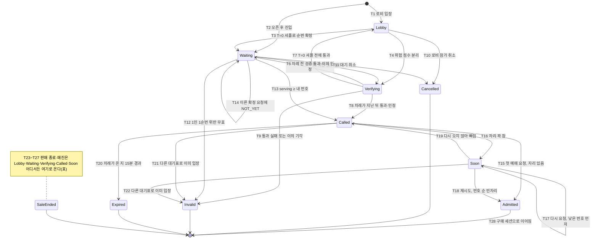

전이 표(번호는 그림과 같다. 조건의 정본은 이 표다, §5.5):

| 번호 | 출발 | 도착 | 전이와 조건 |
| --- | --- | --- | --- |
| T1 | (시작) | Lobby | 로비 입장(팬, 본인확인·사람 확인 통과) |
| T2 | (시작) | Waiting | 오픈 후 진입(팬, 사전 검증 토큰) |
| T3 | Lobby | Waiting | T=0 셔플로 순번 확정(시스템) |
| T4 | Lobby | Verifying | 위험 점수 분리(시스템) |
| T5 | Waiting | Verifying | 위험 점수 분리(시스템) |
| T6 | Verifying | Waiting | 차례 전에 챌린지·본인확인 통과(팬) 또는 이의 인정(CS). 원래 순번 유지, 빠진 번호 표시는 그대로이고 입장 확정은 통과 기록으로 받음 |
| T7 | Verifying | Lobby | T=0 셔플 전에 통과(팬). 번호를 빠진 번호로 돌리지 않음 |
| T8 | Verifying | Called | 차례가 지난 뒤 통과·인정. 15분은 통과 시각부터 |
| T9 | Verifying | Invalid | 통과 실패 또는 이의 기각(CS·시스템) |
| T10 | Lobby | Cancelled | 로비 참가 취소(팬, 참가 토큰 무효, 로비 참가자 목록과 중복 확인 키에서 뺌, ADR-0060) |
| T11 | Waiting | Cancelled | 대기 취소(팬) |
| T12 | Waiting | Invalid | 1인 1순번 위반 무효(시스템) |
| T13 | Waiting | Called | serving ≥ 내 번호(시스템) |
| T14 | Waiting | Waiting | 차례 직전 직접 확인의 이른 입장 확정 요청에 NOT_YET 응답(좌석 자동 배정 공연, ADR-0043) |
| T15 | Called | Admitted | 첫 예매 요청, 자리 있음(팬) |
| T16 | Called | Soon | 자리 꽉 참(시스템, Retry-After). 곧 입장 대기열에 번호 순으로 넣음(ADR-0104) |
| T17 | Soon | Soon | 안내한 시각에 다시 요청했지만 더 낮은 번호가 먼저(시스템). 15분 만료를 세지 않음 |
| T18 | Soon | Admitted | 재시도, 번호 순 빈자리(팬) |
| T19 | Soon | Called | 안내한 다시 시도 시각 + 3초 [가정] 안에 다시 오지 않아 곧 입장 대기열에서 빠짐(시스템). 원래 15분 규칙으로 돌아감(ADR-0104) |
| T20 | Called | Expired | 차례가 온 지 15분 경과(시스템, 410). 곧 입장 대기열에 있는 동안에는 만료하지 않음 |
| T21 | Called | Invalid | 같은 사람이 다른 대기표로 이미 입장(409 DUPLICATE_ADMISSION, ADR-0056) |
| T22 | Soon | Invalid | 같은 사유(ADR-0056) |
| T23 | Lobby | SaleEnded | 판매 종료(공연 시작 24시간 전, 빠진 사유 SALE_END, ADR-0064)나 매진(회차 판매 상태 SOLD_OUT, §2.15. 일시 매진에는 끝나지 않음. 빠진 사유 SOLD_OUT, ADR-0122)(시스템) |
| T24 | Waiting | SaleEnded | 같은 사유 |
| T25 | Verifying | SaleEnded | 같은 사유 |
| T26 | Called | SaleEnded | 같은 사유(차례 뒤 입장 확정 전, 410 sale-ended) |
| T27 | Soon | SaleEnded | 같은 사유 |
| T28 | Admitted | (끝) | 구매 세션으로 이어짐 |

만료(Expired)·취소(Cancelled)된 대기 참여는 끝난다. 같은 사람이 다시 줄을 서면 새 대기 참여가 맨 뒤 번호로 생긴다. 이 회차에 입장한 적이 있는 사람은 다시 줄을 설 수 없다(추천 적용 2026-10-14, ADR-0062). 사전 셔플 공연도 다시 줄을 설 수 있다(추천 적용 2026-10-14, ADR-0064). 차례가 오기 전이나, 차례가 온 뒤 입장을 확정하기 전에 그 회차의 판매 종료(공연 시작 24시간 전)나 매진(SOLD_OUT. 좌석이 돌아올 수 있는 일시 매진에는 끝나지 않고 입장만 멈춘다, §2.15)이 오면 대기 참여는 끝나고(SaleEnded), 판매 종료 뒤에는 새 대기 참여가 생기지 않는다(소유자 결정 2026-10-14, ADR-0064). 대기 기록(`QueueEntryRecord`)의 빠진 사유는 판매 종료면 `SALE_END`, 매진이면 `SOLD_OUT`으로 나눠, 분석에서 '매진으로 끝난 대기'와 '판매 시간이 끝난 대기'를 가른다. 매진이 풀려도 끝난 대기 참여는 되살리지 않고, 새로 오는 사람은 맨 뒤 번호로 들어온다(ADR-0122). 오픈 전 로비 참가 취소(Lobby → Cancelled)는 참가 토큰을 무효로 하고 중복 확인 키 `q:dup:{pid}:E`를 지워, 다른 기기에서 다시 참가할 수 있게 한다(ADR-0060. 빠진 사유는 대기 취소와 같은 `LEFT`, 추천 적용 2026-10-28, 기술 검토 낮음-130). 차례가 온 뒤 자리가 꽉 차 곧 입장(Soon)을 받은 사람은 번호 순으로 기다리고, 곧 입장 대기열에 있는 동안은 15분 만료를 세지 않는다. 안내한 다시 시도 시각에서 3초 [가정]가 지나도 다시 오지 않으면 곧 입장 대기열에서 빠지고(Soon → Called), 그때부터 차례가 온 시각 기준의 원래 15분 규칙을 따른다. 그래서 이미 15분이 지났다면 다음 입장 요청이 410으로 만료된다(docs/features/queue-admission.md §6, ADR-0104).

### 2.2 입장 자리와 구매 세션(AdmissionSlot, PurchaseSession)

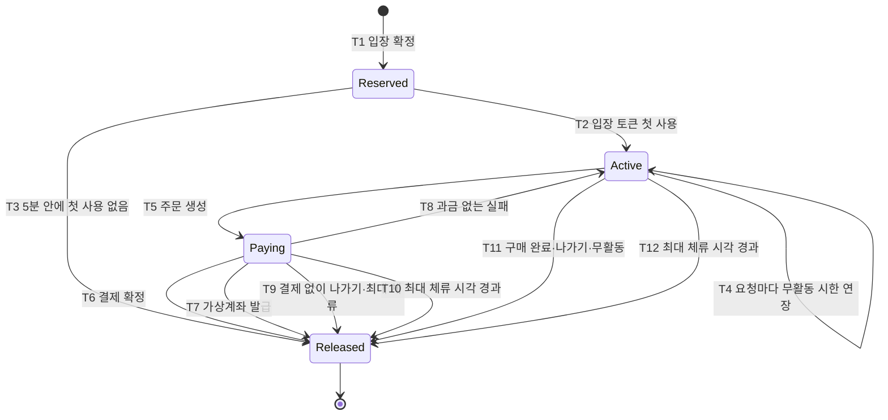

전이 표(번호는 그림과 같다. 조건의 정본은 이 표다, §5.5):

| 번호 | 출발 | 도착 | 전이와 조건 |
| --- | --- | --- | --- |
| T1 | (시작) | Reserved | 입장 확정, 만료 = 첫 사용 기한 5분(queue-svc) |
| T2 | Reserved | Active | 입장 토큰 첫 사용(좌석 스냅샷, 좌석 자동 배정 공연은 자동 배정 홀드 요청) → 구매 세션 시작 이벤트, 만료 = 최대 체류 시각 |
| T3 | Reserved | Released | 5분 안에 첫 사용 없음(admission-ctrl 정리) |
| T4 | Active | Active | 홀드·결제 요청마다 무활동 시한 연장 |
| T5 | Active | Paying | 주문 생성(활동 없어도 종료하지 않음) |
| T6 | Paying | Released | 결제 확정 → 구매 세션 종료 이벤트 |
| T7 | Paying | Released | 가상계좌 발급(입금 대기로 넘어감) → 구매 세션 종료 이벤트 |
| T8 | Paying | Active | 과금 없는 실패(좌석 해제, 좌석맵으로. 최대 체류 시각까지) |
| T9 | Paying | Released | 결제하지 않고 사용자 나가기·최대 체류 시각 경과 → 종료 이벤트. 결제를 접수하지 않은 주문은 홀드·결제 시도가 끝나면 Expired(§2.4, ADR-0107) |
| T10 | Paying | Released | 최대 체류 시각 경과(안전장치. 종료 이벤트가 빠져도 입장 자리를 강제로 정리, queue-admission §6) |
| T11 | Active | Released | 구매 완료·사용자 나가기·무활동(초기값 5분, POL-009) → 종료 이벤트. 판매 일시정지(명령 3) 동안은 세지 않음 |
| T12 | Active | Released | 최대 체류 시각 경과(안전장치) |

### 2.3 좌석(Seat)

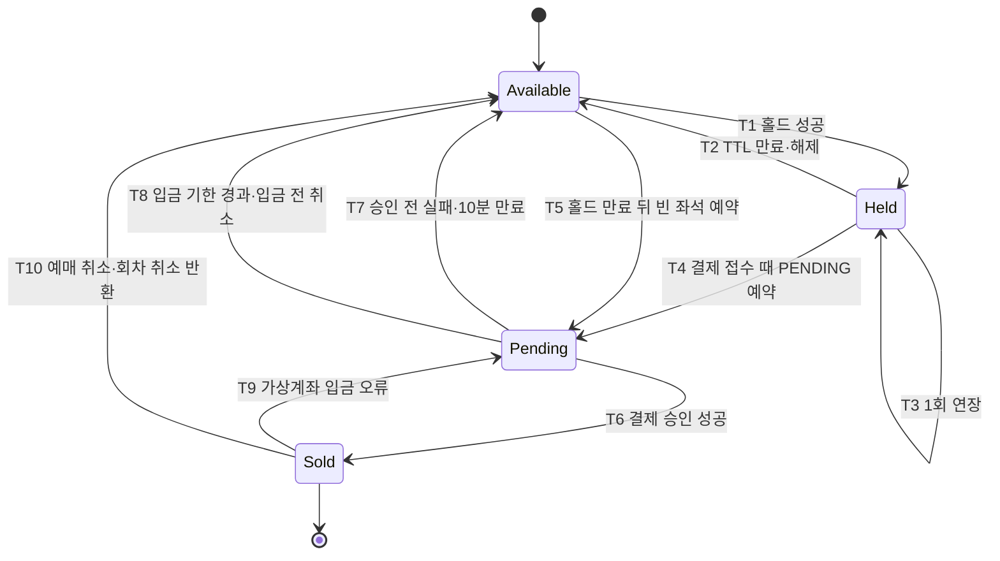

전이 표(번호는 그림과 같다. 조건의 정본은 이 표다, §5.5):

| 번호 | 출발 | 도착 | 전이와 조건 |
| --- | --- | --- | --- |
| T1 | Available | Held | 홀드 성공(팬, Lua 원자 처리, 1인 한도 통과) |
| T2 | Held | Available | TTL 만료·해제(시스템), 3초 안 재노출 |
| T3 | Held | Held | 1회 연장(팬, 접근성) |
| T4 | Held | Pending | 결제 접수 시 판매 행 PENDING 예약(시스템, 유니크 제약) |
| T5 | Available | Pending | 홀드가 만료됐어도 좌석이 비어 있으면 예약 시도(결제창 30분) |
| T6 | Pending | Sold | 결제 승인 성공(시스템, 가상계좌는 입금 확인) |
| T7 | Pending | Available | 승인 전 실패·10분 만료(시스템, 과금 없음) |
| T8 | Pending | Available | 가상계좌 입금 기한 경과·입금 전 취소(시스템, 과금 없음) |
| T9 | Sold | Pending | 가상계좌 입금 오류(결제사가 입금을 되돌림). 재입금하면 다시 Sold |
| T10 | Sold | Available | 예매 취소·회차 취소로 반환(판매 행 RETURNED). 판매 종료 전의 예매 취소면 취소표로 다시 판매(POL-032), 회차 취소나 판매 종료 뒤의 반환이면 팔지 않는 빈 좌석(ADR-0064) |

### 2.4 주문·결제(Order)

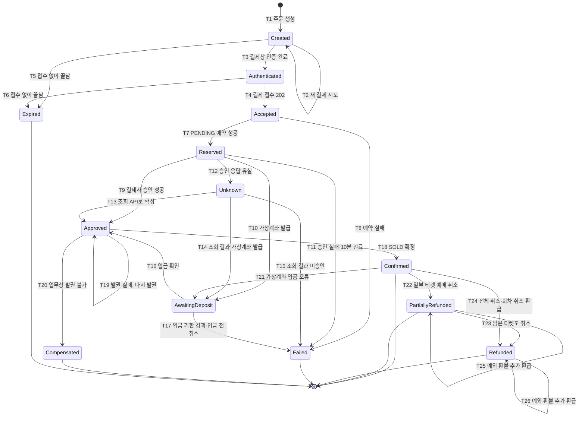

전이 표(번호는 그림과 같다. 조건의 정본은 이 표다, §5.5):

| 번호 | 출발 | 도착 | 전이와 조건 |
| --- | --- | --- | --- |
| T1 | (시작) | Created | 주문 생성, 금액 서버 계산(팬) |
| T2 | Created | Created | 새 결제 시도(접수 전, 이전 시도 대체, 결제사 다시 선택, POL-036) |
| T3 | Created | Authenticated | 결제 시도의 결제창 인증 완료(팬, 결제사 복귀 값) |
| T4 | Authenticated | Accepted | 결제 접수 202, 금액 대조, Saga 시작(시스템) |
| T5 | Created | Expired | 결제를 접수하지 않고 끝남(구매 세션 종료·홀드 해제·결제 시도 만료 가운데 마지막 것, 시스템), 과금 없음(ADR-0107) |
| T6 | Authenticated | Expired | 같은 조건, 과금 없음(ADR-0107) |
| T7 | Accepted | Reserved | 판매 행 PENDING 예약 성공 |
| T8 | Accepted | Failed | 예약 실패(좌석 이미 팔림), 과금 없음 |
| T9 | Reserved | Approved | 고정된 결제사 승인 성공(승인 기한 안, 토스 10분·포트원 추정 10분) |
| T10 | Reserved | AwaitingDeposit | 가상계좌 발급(승인 응답이 입금 대기). 구매 세션은 끝나고 좌석은 PENDING 유지 |
| T11 | Reserved | Failed | 승인 실패·10분 만료, PENDING 삭제·좌석 해제 |
| T12 | Reserved | Unknown | 승인 응답 유실 |
| T13 | Unknown | Approved | 조회 API로 확정 |
| T14 | Unknown | AwaitingDeposit | 조회 결과 가상계좌 발급됨 |
| T15 | Unknown | Failed | 조회 결과 미승인 |
| T16 | AwaitingDeposit | Approved | 입금 확인(입금 웹훅 뒤 조회 API로 입금 완료 확인) |
| T17 | AwaitingDeposit | Failed | 입금 기한 경과(기한 + 10분에 조회로 미입금 확인) 또는 입금 전 취소(회차 취소). PENDING 삭제·좌석 해제, 과금 없음 |
| T18 | Approved | Confirmed | SOLD 확정 → 발권 → 알림 |
| T19 | Approved | Approved | 발권 실패(잠깐의 장애) → 같은 주문 ID로 다시 발권(발권 재시도 큐, 발권 기한 승인 뒤 30분 [가정], 시스템, ADR-0106) |
| T20 | Approved | Compensated | 업무상 발권 불가(회차 취소 확정) 또는 발권 기한을 넘겨 CS가 확인 → 결제 취소(멱등키) |
| T21 | Confirmed | AwaitingDeposit | 가상계좌 입금 오류(결제사가 입금 완료를 되돌림, 웹훅 뒤 조회로 확인). 발권한 티켓 무효, 좌석은 PENDING으로, 재입금 안내 |
| T22 | Confirmed | PartiallyRefunded | 일부 티켓 예매 취소(POL-032) |
| T23 | PartiallyRefunded | Refunded | 남은 티켓도 취소 |
| T24 | Confirmed | Refunded | 전체 취소 또는 회차 취소 확정 뒤 일괄 환급(POL-032·038) |
| T25 | PartiallyRefunded | PartiallyRefunded | 승인된 예외 환불로 공제분 추가 환급(POL-038) |
| T26 | Refunded | Refunded | 승인된 예외 환불로 공제분 추가 환급(POL-038) |

Expired는 결제를 접수하지 않은 채 끝난 주문이고, Failed는 결제를 접수한 뒤 과금 없이 실패한 주문이다. 결제 시도(READY)는 만든 지 40분 [가정](결제창 인증 유효 시간 30분 + 인증 뒤 승인 기한 10분)이 지나면 만료된다. 구매 세션 종료·홀드 해제·결제 시도 만료가 모두 끝나면 주문은 Expired로 끝나고, 사건이 빠질 때는 만든 지 90분 [가정] 지난 주문을 안전망이 끝낸다(추천 적용 2026-10-28, ADR-0107). 결제 승인은 되돌리기 어려운 고비 단계라, 승인 뒤 발권이 실패하면 결제를 취소하지 않고 같은 주문 ID로 다시 발권한다. 결제 취소는 회차 취소가 확정됐을 때와, 발권 기한을 넘겨 CS가 확인한 때(승인 업무 '시스템 잘못이 확인된 환불')만 한다(추천 적용 2026-10-28, ADR-0106).

AwaitingDeposit은 가상계좌를 허용한 공연에서만 생긴다(고수요 온세일은 가상계좌를 끈다, POL-014). 입금 기한은 발급 다음 날 23:59(KST)와 입장 시작 24시간 전 중 이른 때로 정해 결제사에 보낸다 [가정]. 기한까지 2시간 [가정]이 남지 않았으면 결제수단에 가상계좌를 보이지 않는다. 결제사는 기한이 지나도 웹훅을 보내지 않으므로, PEAKET이 기한 + 10분 [가정]에 조회해 끝낸다. 입금 대기 동안 PENDING 좌석은 지금처럼 1인 한도에 들고, Failed가 되면 한도를 되돌린다. 가상계좌 결제의 보상 취소(Compensated)와 입금 뒤 취소는 환불 계좌가 필요하므로 환불 대기(POL-014)를 거친다(추천 적용 2026-10-14, ADR-0062).

### 2.5 티켓(Ticket)

**영역 1: 소유·결제**

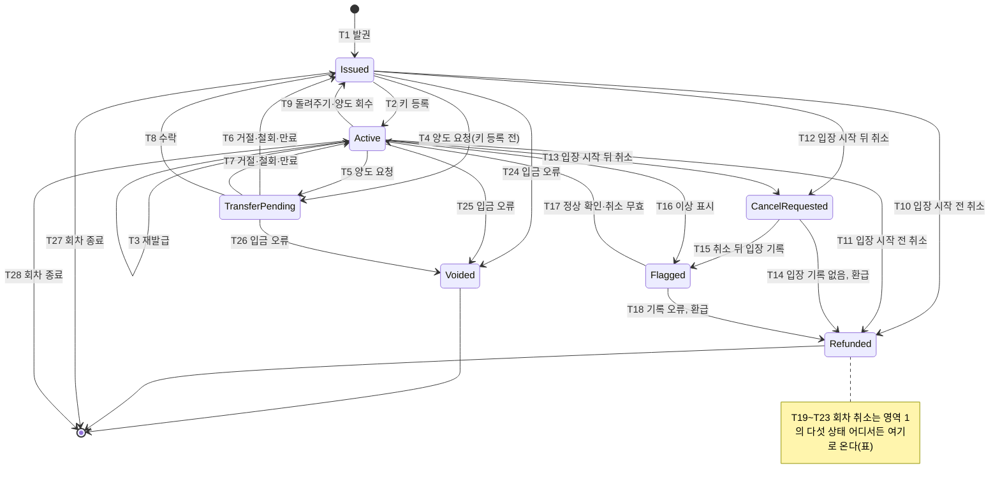

전이 표(번호는 그림과 같다. 조건의 정본은 이 표다, §5.5):

| 번호 | 출발 | 도착 | 전이와 조건 |
| --- | --- | --- | --- |
| T1 | (시작) | Issued | 발권(시스템) |
| T2 | Issued | Active | '입장용 휴대폰 등록'으로 기기 키 등록(팬 기기, 입장 시작 뒤면 소셜 재인증, ADR-0051) |
| T3 | Active | Active | 재발급(사건 Reissued. 저장소 삭제 등, 입장 시작 전 온라인 재인증, 입장 시작 뒤 부스). 이전 키 폐기 |
| T4 | Issued | TransferPending | 키 등록 전에도 양도 요청(Active와 같은 조건) |
| T5 | Active | TransferPending | 양도 요청(결제자인 보유자, 공연 2시간 전과 입장 시작 중 이른 때까지, 소셜 재인증, POL-017) |
| T6 | TransferPending | Issued | 거절·철회·기한 만료(키 등록 전에 보낸 경우) |
| T7 | TransferPending | Active | 거절·철회·기한 만료(보낸 사람에게 남음) |
| T8 | TransferPending | Issued | 수락(사건 Transferred. 입장 시작 전만, 입장 시작부터 입장 기록 마감까지는 409 `ENTRY_STARTED`. 보유자가 받는 사람으로 바뀌고 보낸 사람 키 폐기. 받는 사람이 등록 버튼으로 키를 만들면 Active) |
| T9 | Active | Issued | 돌려주기(입장 시작 전만, 입장 시작부터 입장 기록 마감까지는 409 `ENTRY_STARTED`, 받은 사람 키 폐기, 결제자가 다시 등록하면 Active) 또는 승인된 양도 회수로 결제자에게 되돌림. 양도 회수도 입장 시작 전이고 입장 기록이 없을 때만 한다. 입장 시작부터 입장 기록 마감까지는 회수하지 않고(`ENTRY_STARTED`, ticket-svc `ReclaimTicket`이 '입장 시작'으로 답한다) 실패로 끝나 CS 처리함 분쟁으로 잇는다(POL-017, ADR-0051 결정 10. 2026-10-30 이 칸에 더했다). 보유자 탈퇴는 입장 시작 전이면 돌려주기, 입장 시간대면 키를 바로 폐기하고 입장 기록 마감 뒤 결제자에게 돌림(§1.5 ②) |
| T10 | Issued | Refunded | 입장 시작 전 예매 취소(키 등록과 무관) |
| T11 | Active | Refunded | 입장 시작 전 결제자의 예매 취소(보유자 = 결제자, POL-032) |
| T12 | Issued | CancelRequested | 입장 시작 뒤 예매 취소(키 등록과 무관) |
| T13 | Active | CancelRequested | 입장 시작 뒤 예매 취소. 티켓 즉시 폐기, 환급 보류 |
| T14 | CancelRequested | Refunded | 입장 기록 마감 뒤 입장 기록 없음 → 환급 |
| T15 | CancelRequested | Flagged | 취소 뒤 입장 기록(영역 2, 오프라인 스캐너) → 취소 무효 후보 |
| T16 | Active | Flagged | 서버 판정 표의 이상 표시(영역 2의 중복 입장·퇴장 기록 없음·세션 밖 기록) → 그 구역 현장 책임자·파트너 |
| T17 | Flagged | Active | 현장 책임자 정상 확인, 또는 CS가 취소 무효 확정 |
| T18 | Flagged | Refunded | CS 확인 결과 기록 오류(취소가 유효) → 환급 |
| T19 | Issued | Refunded | 회차 취소 일괄 환급(영역 2의 입장 상태와 무관, 입장 기록 마감을 기다리지 않음) |
| T20 | Active | Refunded | 같은 사유(입장한 티켓·퇴장한 티켓도) |
| T21 | TransferPending | Refunded | 같은 사유(진행 중 양도 요청은 시스템이 먼저 철회, §2.9) |
| T22 | CancelRequested | Refunded | 같은 사유(보류 중인 예매 취소를 공제 없는 회차 취소 환급으로 바꿈) |
| T23 | Flagged | Refunded | 같은 사유 |
| T24 | Issued | Voided | 주문의 가상계좌 입금 오류(키 폐기, 재입금하면 새로 발권) |
| T25 | Active | Voided | 같은 사유 |
| T26 | TransferPending | Voided | 같은 사유(양도 요청도 끝남) |
| T27 | Issued | (끝) | 회차 종료(키를 등록하지 않은 채 쓰지 않은 티켓) |
| T28 | Active | (끝) | 회차 종료(쓴 티켓과 쓰지 않은 티켓 모두. 입장 기록은 영역 2에 남는다) |

**영역 2: 입장**

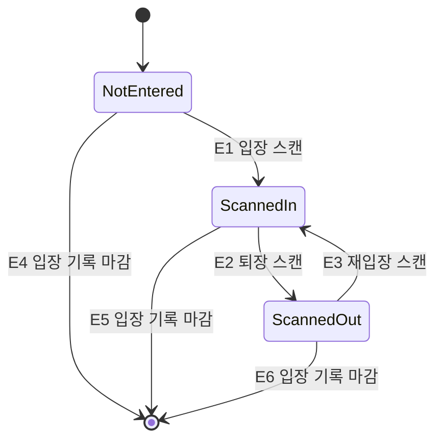

전이 표(번호는 그림과 같다. 조건의 정본은 이 표다, §5.5):

| 번호 | 출발 | 도착 | 전이와 조건 |
| --- | --- | --- | --- |
| E1 | NotEntered | ScannedIn | 입장 스캔 통과(현장 스태프). 온라인 스캐너는 영역 1이 Active일 때만 통과시키고, 오프라인 스캐너의 폐기 전 키 통과는 서버 판정 표가 이상 표시로 받는다 |
| E2 | ScannedIn | ScannedOut | 퇴장 스캔(재입장 허용 공연, 퇴장 모드 기기) |
| E3 | ScannedOut | ScannedIn | 재입장 스캔 |
| E4 | NotEntered | (끝) | 입장 기록 마감(한 번도 들어오지 않음) |
| E5 | ScannedIn | (끝) | 입장 기록 마감 |
| E6 | ScannedOut | (끝) | 입장 기록 마감(퇴장한 뒤 다시 들어오지 않음) |

티켓 상태는 서로 따로 움직이는 두 영역이다(추천 적용 2026-10-28, 기술 검토 중간-050). 두 영역은 발권 때 함께 시작하고, 티켓은 두 영역이 모두 끝나야 끝난다. 2026-10-28 전에는 한 그림 안에 두 칸으로 그렸고, 그림 쓰기 규칙(§5.5, ADR-0138)에 따라 두 그림으로 나눴다. 첫 그림의 영역 1 '소유·결제'는 저장 값 `ticket.status`(ISSUED·ACTIVE·TRANSFER_PENDING·CANCEL_REQUESTED·FLAGGED·REFUNDED·VOIDED)이고, 둘째 그림의 영역 2 '입장'(입장 전·입장·퇴장)은 서버 판정 표가 갱신하는 입장 상태다(docs/data.md `ticket`, docs/features/offline-gate.md §7.1). 재발급(Reissued)과 양도 수락(Transferred)은 상태가 아니라 사건이다. 회차 취소 일괄 환급은 영역 2와 관계없이 영역 1의 Refunded로 간다. 그래서 이미 입장했거나 퇴장한 티켓도 환급한다. 입장 시작 뒤에 확정된 회차 취소는 입장 기록 마감을 기다리지 않는다. 입장 기록 마감은 '취소한 뒤 들어왔는지'를 가려 부정 환급을 막는 장치인데, 회차 취소는 입장 여부와 관계없이 모두 돌려주므로 가릴 것이 없다(docs/features/transfer-refund.md §5). 회차 종료 뒤 영역 1은 쓰지 않은 티켓도 Active·Issued로 끝나고, 영역 2는 입장 기록 마감으로 끝난다.

Issued와 Active는 입장용 기기 키가 있는지만 다르다. 소유권, 양도, 예매 취소, 환급 규칙은 같다(POL-017·032). 양도가 거절되면 보낸 사람의 티켓은 보내기 전 상태(Issued 또는 Active)로 돌아간다.

### 2.6 운영 명령(Command)

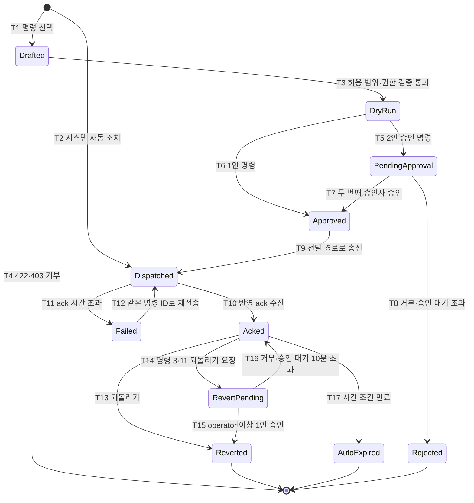

전이 표(번호는 그림과 같다. 조건의 정본은 이 표다, §5.5):

| 번호 | 출발 | 도착 | 전이와 조건 |
| --- | --- | --- | --- |
| T1 | (시작) | Drafted | 명령 선택, 사유 입력(운영자) |
| T2 | (시작) | Dispatched | 시스템 자동 조치(AIMD 목표 자동 감축, 버짓 소진 연동 조치. 행위자 SYSTEM, 승인 단계 없음) |
| T3 | Drafted | DryRun | 허용 범위·권한 검증 통과, 영향 범위 미리보기 |
| T4 | Drafted | (끝) | 422 안전 한계 밖 / 403 권한 없음 |
| T5 | DryRun | PendingApproval | 2인 승인 명령 |
| T6 | DryRun | Approved | 1인 명령(위험 명령은 재인증 토큰 확인) |
| T7 | PendingApproval | Approved | 두 번째 승인자 승인(요청자 ≠ 승인자) |
| T8 | PendingApproval | Rejected | 거부 또는 승인 대기 시간 초과(10분) |
| T9 | Approved | Dispatched | 전달 경로로 송신(감사 로그 기록 후) |
| T10 | Dispatched | Acked | 반영 ack 수신(p99 3초) |
| T11 | Dispatched | Failed | ack 시간 초과(10초 [가정]. 3초를 넘으면 명령 카드에 '전파 지연') → 재시도·런북 CLI 안내 |
| T12 | Failed | Dispatched | 같은 명령 ID로 다시 보냄([ 다시 시도 ] 또는 런북 CLI) |
| T13 | Acked | Reverted | 되돌리기(직전 값 복원, 재개, 해제). 1인 되돌리기 명령 |
| T14 | Acked | RevertPending | 명령 3·11의 되돌리기(판매 재개, 자동 제어 재개) 요청(commander, 사유·재인증, POL-021 B) |
| T15 | RevertPending | Reverted | 요청자 아닌 operator 이상 1인 승인(재인증) |
| T16 | RevertPending | Acked | 거부 또는 승인 대기 10분 초과(명령은 그대로 유지) |
| T17 | Acked | AutoExpired | 허용 범위의 시간 조건(입장 일시정지 10분(연장하면 연장 시각부터 10분), 차단은 정한 만료 시각(최대 24시간), 로그 레벨 30분) |

이 그림은 정본 docs/features/control-tower.md §4 '명령 수명주기'의 요약이다. 둘이 다르면 정본을 따르고, 정본을 고칠 때 이 그림도 함께 고친다. 전파에 실패한 명령은 끝내지 않고 같은 명령 ID로 다시 보낸다(control-tower §5, ADR-0062). 다른 핵심 객체처럼 이 절에서도 한눈에 보이게 그림을 남기고, 링크만 두는 방식으로 바꾸지는 않았다(추천 적용 2026-10-28, 기술 검토 낮음-131).

### 2.7 게시물(Review), 관리 계정(AdminAccount), 현장 스태프 배정(StaffAssignment)

**게시물(Review)**

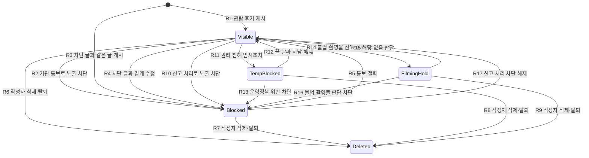

전이 표(번호는 그림과 같다. 조건의 정본은 이 표다, §5.5):

| 번호 | 출발 | 도착 | 전이와 조건 |
| --- | --- | --- | --- |
| R1 | (시작) | Visible | 관람 후기 게시(자격 있는 결제자, POL-042) |
| R2 | Visible | Blocked | 신고기관·수사기관 통보로 노출 차단(운영자, 24시간 안) |
| R3 | (시작) | Blocked | 차단한 게시물과 내용이 같은 글 게시(시스템, POL-024 마목) |
| R4 | Visible | Blocked | 차단한 게시물과 같은 내용으로 수정(시스템) |
| R5 | Blocked | Visible | 통보 철회(운영자) |
| R6 | Visible | Deleted | 작성자 삭제·탈퇴 |
| R7 | Blocked | Deleted | 작성자 삭제·탈퇴(조치 증적은 남는다) |
| R8 | TempBlocked | Deleted | 같은 사유 |
| R9 | FilmingHold | Deleted | 같은 사유 |
| R10 | Visible | Blocked | 신고 처리로 노출 차단(cs_agent, 운영정책 위반 사유, POL-044) |
| R11 | Visible | TempBlocked | 권리 침해 삭제 요청의 임시조치(cs_agent, 끝 날짜 30일 이내) |
| R12 | TempBlocked | Visible | 끝 날짜 지남(시스템) 또는 해제(cs_agent) |
| R13 | TempBlocked | Blocked | 운영정책 위반으로 노출 차단(cs_agent) |
| R14 | Visible | FilmingHold | 음란물·불법 촬영물 신고 접수(시스템, 확인할 때까지 바로 가림) |
| R15 | FilmingHold | Visible | 해당 없음으로 판단(cs_agent) |
| R16 | FilmingHold | Blocked | 불법 촬영물로 판단해 노출 차단(cs_agent) |
| R17 | Blocked | Visible | 신고 처리 차단의 해제(cs_agent, 이의 인정 등) |

**관리 계정(AdminAccount)**

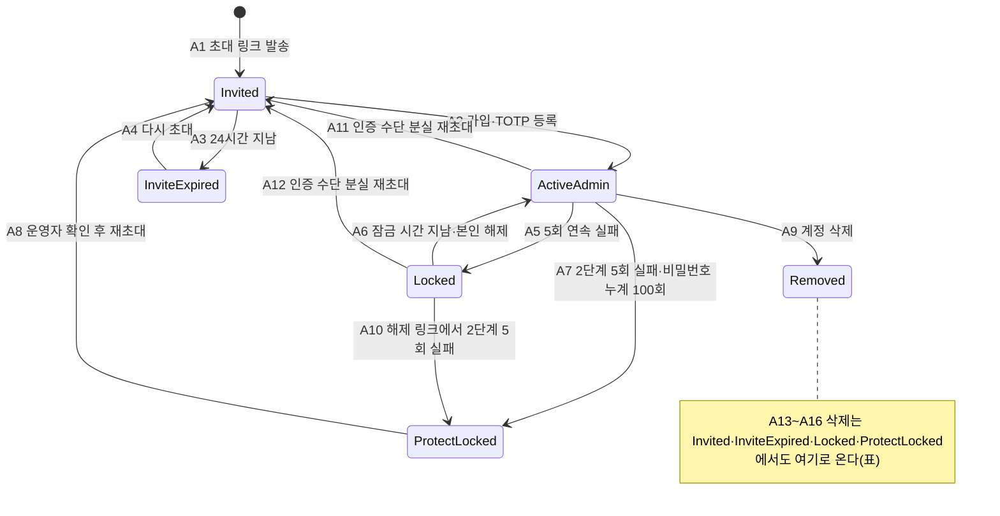

전이 표(번호는 그림과 같다. 조건의 정본은 이 표다, §5.5):

| 번호 | 출발 | 도착 | 전이와 조건 |
| --- | --- | --- | --- |
| A1 | (시작) | Invited | 초대 링크 발송(24시간, 1회용) |
| A2 | Invited | ActiveAdmin | 가입·TOTP 등록(partner_admin·operator·commander는 패스키도, POL-020) |
| A3 | Invited | InviteExpired | 24시간 지남(시스템, 화면 '초대가 만료되었습니다') |
| A4 | InviteExpired | Invited | 다시 초대(새 링크, 옛 링크 무효, 재초대 까닭 `RESEND`). 아직 Invited인 계정에 다시 보내도 같은 처리를 하고 상태는 Invited 그대로다(openapi `POST /v1/ops/admin-accounts/{adminAccountId}/invitation`, docs/design/d5 SCR-064 '초대됨·초대 만료', 추천 적용 2026-10-30) |
| A5 | ActiveAdmin | Locked | 계정 5회 연속 실패(시간 잠금 15분, 24시간 안 다시면 1시간) |
| A6 | Locked | ActiveAdmin | 잠금 시간 지남 또는 업무 이메일 링크 + 인증 앱 코드로 본인이 풂 |
| A7 | ActiveAdmin | ProtectLocked | 비밀번호가 맞은 뒤 인증 앱·복구 코드 5회 연속 실패, 또는 비밀번호 연속 실패 누계 100회(로그인에 성공해야 0이 된다. 추천 적용 2026-10-30, docs/security/auth-controls.md §3.2, ADR-0157 결정 1)(보호 잠금) |
| A8 | ProtectLocked | Invited | 운영자 확인 후 재초대 |
| A9 | ActiveAdmin | Removed | 계정 삭제(권한 말소 내역 3년 보관) |
| A10 | Locked | ProtectLocked | 시간 잠금 중 업무 이메일 해제 링크에서 인증 앱·복구 코드가 틀려 2단계 실패 수가 5회에 이름(보호 잠금. 추천 적용 2026-10-30, docs/security/auth-controls.md §3.3) |
| A11 | ActiveAdmin | Invited | 계정 주인이 비밀번호나 인증 앱을 잃어 요청한 재초대(재초대 까닭 `CREDENTIAL_LOST`). 업무 이메일 밖의 길로 신원을 확인한 뒤 하고, 비밀번호 해시·TOTP 시드·패스키·복구 코드를 지우며 모든 세션을 끝낸다. 스스로 하는 비밀번호 재설정은 없다(openapi `POST /v1/ops/admin-accounts/{adminAccountId}/invitation`, docs/features/identity.md §6 '관리 계정 관리 API', 소유자 결정 2026-10-30, open-items 73번, 세부는 추천 적용 2026-10-30) |
| A12 | Locked | Invited | 시간 잠금 중인 계정의 주인이 인증 수단을 잃은 경우의 같은 재초대(`CREDENTIAL_LOST`). 시간 잠금만 걸린 계정에 보호 잠금 해제 재초대(`PROTECT_LOCK`)는 보내지 못한다(409, 시간 잠금은 본인 해제 A6). 처리는 A11과 같다 |
| A13 | Invited | Removed | 초대 중인 계정 삭제. 초대 링크가 바로 무효가 되고 업무 이메일을 지운다(초대 취소). 처리와 남기는 기록은 A9와 같다 |
| A14 | InviteExpired | Removed | 초대가 만료된 계정 삭제. A13과 같다 |
| A15 | Locked | Removed | 시간 잠금 중인 계정 삭제. 잠금이 풀리기를 기다리지 않는다. A9와 같다 |
| A16 | ProtectLocked | Removed | 보호 잠금 중인 계정 삭제. 업무 이메일이 탈취되어 재초대로 되찾을 수 없는 계정은 이렇게 지운 뒤 새 이메일로 초대한다(docs/security/auth-controls.md §3.2). A9와 같다 |

삭제는 지우지 않은 다섯 상태(Invited·InviteExpired·ActiveAdmin·Locked·ProtectLocked) 어디서든 된다(A9·A13~A16, 추천 적용 2026-10-30). 퇴직·업무 변경을 통보받은 그날 안에 역할을 거두거나 계정을 지워야 하는데(docs/security/internal-management-plan.md §2 제5호 ②, 고시 제5조), 그때 계정이 잠겼거나 초대 중일 수 있기 때문이다. 삭제는 권한을 줄이는 쪽이라 상태로 막을 까닭이 없다. 누가 지울 수 있는지, 자기 계정·마지막 활성 `partner_admin`·commander 계정을 막는 규칙은 상태와 상관없이 같다(docs/security/authz-matrix.md §6.1). 이미 삭제한 계정(Removed)에 다시 보내면 그대로 200이다.

**현장 스태프 배정(StaffAssignment)**

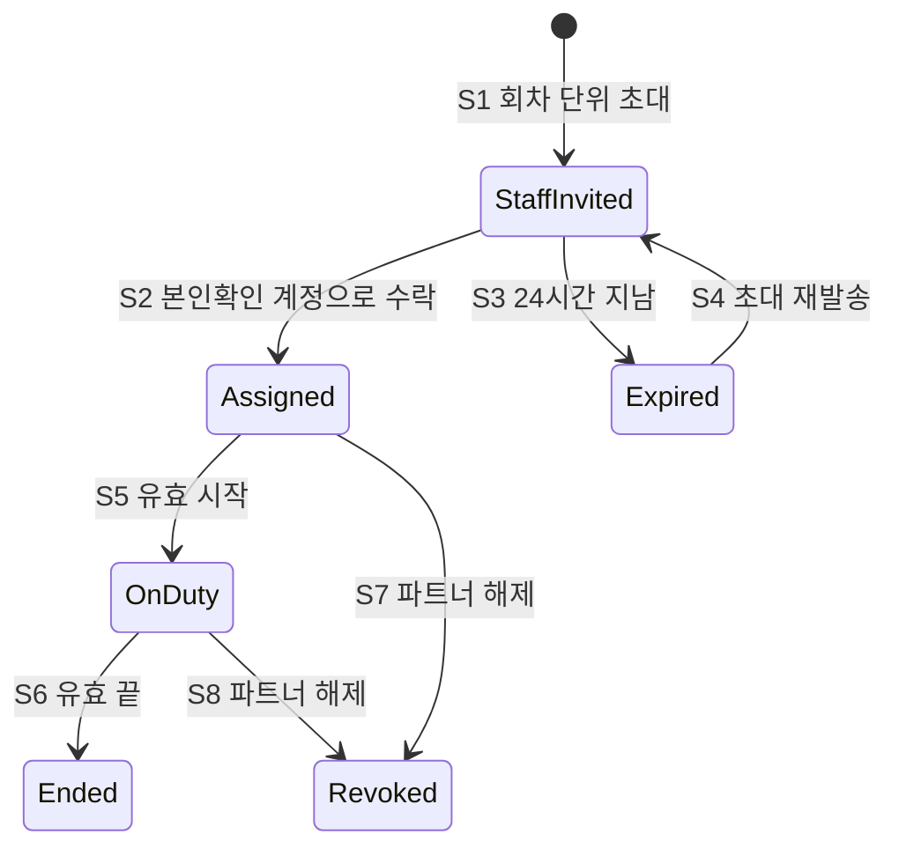

전이 표(번호는 그림과 같다. 조건의 정본은 이 표다, §5.5):

| 번호 | 출발 | 도착 | 전이와 조건 |
| --- | --- | --- | --- |
| S1 | (시작) | StaffInvited | 파트너가 회차 단위 초대(24시간, 1회용) |
| S2 | StaffInvited | Assigned | 본인확인 완료·검증 이메일 일치 계정으로 수락, 동의 두 개(ADR-0051) |
| S3 | StaffInvited | Expired | 24시간 지남 |
| S4 | Expired | StaffInvited | 초대 재발송(같은 배정, 새 토큰, 옛 토큰 무효) |
| S5 | Assigned | OnDuty | 유효 시작(입장 시작 3시간 전) |
| S6 | OnDuty | Ended | 유효 끝(공연 종료 2시간 뒤), 스캐너가 스스로 세션 종료, 남은 기록은 기기 인증으로 업로드 |
| S7 | Assigned | Revoked | 파트너 해제 |
| S8 | OnDuty | Revoked | 파트너 해제, 서버가 다음 요청부터 거부, 다음 변경분 때 스캐너 로그아웃 |

후기의 저장 값(docs/data.md `review.status`)은 Visible이 `VISIBLE`, Blocked·TempBlocked·FilmingHold가 `HIDDEN`(어느 것인지는 가린 조치 `takedown_action`으로 구별한다), Deleted가 `DELETED`다(추천 적용 2026-10-20, ADR-0073).

### 2.8 계정 연결 제안(LinkProposal)과 계정 병합(AccountMerge)

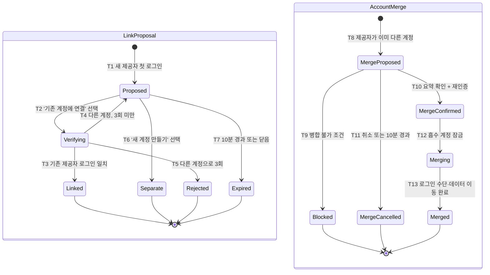

전이 표(번호는 그림과 같다. 조건의 정본은 이 표다, §5.5):

| 번호 | 출발 | 도착 | 전이와 조건 |
| --- | --- | --- | --- |
| T1 | (시작) | Proposed | 새 제공자 첫 로그인, 검증 이메일이 같은 활성 계정 1개(시스템) |
| T2 | Proposed | Verifying | '기존 계정에 연결' 선택(팬) |
| T3 | Verifying | Linked | 기존 제공자 로그인이 그 계정과 일치(팬) |
| T4 | Verifying | Proposed | 다른 계정으로 로그인, 3회 미만(팬) |
| T5 | Verifying | Rejected | 다른 계정으로 3회(시스템) |
| T6 | Proposed | Separate | '새 계정 만들기' 선택(팬) |
| T7 | Proposed | Expired | 10분 경과 또는 닫음(시스템) |
| T8 | (시작) | MergeProposed | 설정에서 인증한 제공자 계정이 이미 다른 계정(시스템) |
| T9 | MergeProposed | Blocked | 진행 중 홀드·구매 세션(`ACTIVE_PURCHASE_SESSION`)·결제 대기(`PENDING_PAYMENT`), 합산 한도 초과(`QUOTA_EXCEEDED`), 둘 다 본인확인(`BOTH_VERIFIED`), 흡수 계정의 탈퇴(`WITHDRAWAL_IN_PROGRESS`)·이의 제기 계류(`APPEAL_PENDING`), 입장 중인 회차의 티켓(`ENTRY_STARTED`). 시스템이 판정한다(POL-034, 괄호 안은 openapi `MergeProposal.blockers`) |
| T10 | MergeProposed | MergeConfirmed | 요약 확인 + 재인증(팬) |
| T11 | MergeProposed | MergeCancelled | 취소 또는 10분 경과 |
| T12 | MergeConfirmed | Merging | 흡수 계정 잠금, 세션 종료(시스템) |
| T13 | Merging | Merged | 로그인 수단·데이터 이동 완료, 두 계정에 알림(시스템) |

### 2.9 양도 요청(TransferOffer) [보완]

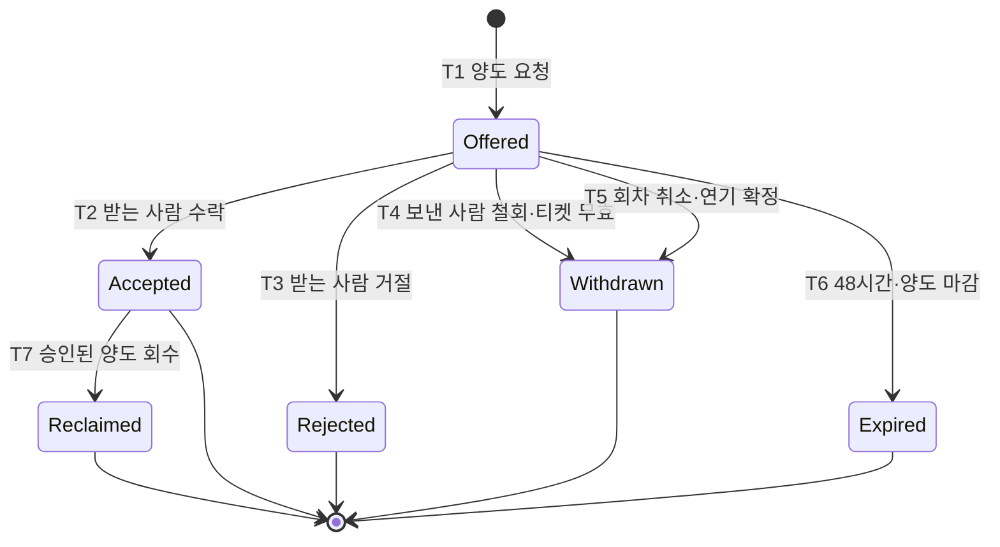

전이 표(번호는 그림과 같다. 조건의 정본은 이 표다, §5.5):

| 번호 | 출발 | 도착 | 전이와 조건 |
| --- | --- | --- | --- |
| T1 | (시작) | Offered | 양도 요청(결제자인 보유자, 소셜 재인증) |
| T2 | Offered | Accepted | 받는 사람 수락(기한 안) |
| T3 | Offered | Rejected | 받는 사람 거절(받는 사람 탈퇴 포함) |
| T4 | Offered | Withdrawn | 보낸 사람 철회(수락 전, 보낸 사람 탈퇴 포함), 티켓 무효(가상계좌 입금 오류, 시스템) |
| T5 | Offered | Withdrawn | 회차 취소·연기 확정(시스템, 받는 사람과 보낸 사람에게 알림. 취소면 같은 트랜잭션에서 결제자에게 환급을 건다) |
| T6 | Offered | Expired | 48시간 또는 양도 마감 중 이른 때 |
| T7 | Accepted | Reclaimed | 승인된 양도 회수(계정 탈취, POL-038) |

- 돌려주기는 양도 요청이 아니라, 티켓의 보유자를 결제자로 바꾸는 일이다(§2.5).
- 회차 취소·연기가 확정되면 진행 중인 양도 요청은 시스템이 철회한다. 그래서 '진행 중인 양도 요청이 없을 때만 예매 취소' 규칙이 일괄 환급을 막지 않는다. 철회와 수락이 겹치면 티켓 행 잠금으로 먼저 온 쪽만 성공한다(docs/features/transfer-refund.md §5, 추천 적용 2026-10-28, 기술 검토 중간-044).

### 2.10 승인 업무(ApprovalRequest) [보완]

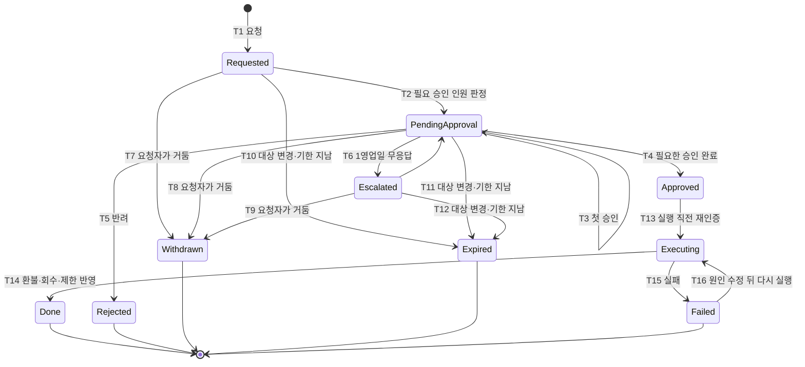

전이 표(번호는 그림과 같다. 조건의 정본은 이 표다, §5.5):

| 번호 | 출발 | 도착 | 전이와 조건 |
| --- | --- | --- | --- |
| T1 | (시작) | Requested | 요청(사유, 증빙 확인, 대상, 금액) |
| T2 | Requested | PendingApproval | 서버가 필요한 승인 인원 판정(1인·2인, POL-038). 저장 값 PENDING_APPROVAL |
| T3 | PendingApproval | PendingApproval | 첫 승인(2인 업무) |
| T4 | PendingApproval | Approved | 필요한 승인 완료(요청자 제외) |
| T5 | PendingApproval | Rejected | 반려(사유) |
| T6 | PendingApproval | Escalated | 1영업일 무응답 → 상위 승인자 알림 |
| T7 | Requested | Withdrawn | 요청자가 거둠(사유 필수) |
| T8 | PendingApproval | Withdrawn | 요청자가 거둠(사유 필수) |
| T9 | Escalated | Withdrawn | 요청자가 거둠(사유 필수) |
| T10 | Requested | Expired | 대상 상태가 바뀜·처리 기한 지남(시스템, POL-038 공통) |
| T11 | PendingApproval | Expired | 대상 상태가 바뀜·처리 기한 지남(시스템) |
| T12 | Escalated | Expired | 대상 상태가 바뀜·처리 기한 지남(시스템) |
| T13 | Approved | Executing | 실행 직전 관리 계정 재인증 |
| T14 | Executing | Done | 환불·회수·제한 반영 |
| T15 | Executing | Failed | 실패 → CS 처리함 |
| T16 | Failed | Executing | 원인을 고친 뒤 승인자가 approve를 다시 불러 같은 대상·금액으로 다시 실행(실행 직전 재인증, 처리 기한 안, 승인 ID가 멱등키라 두 번 실행되지 않음, 추천 적용 2026-10-20, ADR-0073) |

### 2.11 회차 취소 요청(EventCancellationRequest) [보완]

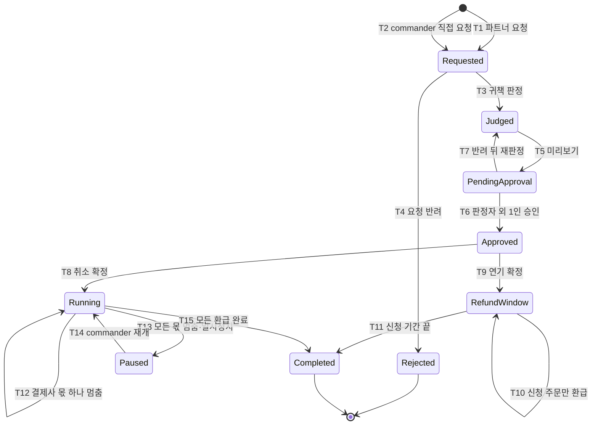

전이 표(번호는 그림과 같다. 조건의 정본은 이 표다, §5.5):

| 번호 | 출발 | 도착 | 전이와 조건 |
| --- | --- | --- | --- |
| T1 | (시작) | Requested | 파트너 요청(취소·연기, 사유, 증빙) |
| T2 | (시작) | Requested | 판매 중지(§2.14)된 공연의 회차는 commander가 직접 요청(취소만, 사유, ADR-0123) |
| T3 | Requested | Judged | commander 귀책 판정(1영업일 안) |
| T4 | Requested | Rejected | 요청 반려(사유) |
| T5 | Judged | PendingApproval | 미리보기(대상 주문 수, 환급 총액, 배상 총액) |
| T6 | PendingApproval | Approved | 판정자 외 1인 승인(2인 확정) |
| T7 | PendingApproval | Judged | 반려 뒤 재판정 |
| T8 | Approved | Running | 취소 확정(회차 CANCELLED). 팬 통지, 진행 중 양도 요청 철회, 일괄 환불 작업 시작 |
| T9 | Approved | RefundWindow | 연기 확정(회차 POSTPONED, 바뀐 일시). 팬 통지, 진행 중 양도 요청 철회, 환급 신청 창 열기 |
| T10 | RefundWindow | RefundWindow | 신청한 결제자의 주문만 환급(공제 없음, 결제사 몫·멈춤 규칙은 Running과 같다) |
| T11 | RefundWindow | Completed | 신청 기간 끝(바뀐 공연 시작 전까지), 신청 건 환급 완료(실패 건은 CS 처리함) |
| T12 | Running | Running | 결제사 몫 하나가 스스로 멈춤(그 결제사의 1분 창 취소 실패율 5% [가정] 이상·연속 실패 20건 [가정]·서킷 열림). 다른 결제사 몫은 계속 |
| T13 | Running | Paused | 모든 결제사 몫이 멈춤, 1분 창 업무 거절률 5% [가정] 이상(작업 전체), 또는 commander 일시정지(전체) |
| T14 | Paused | Running | commander 재개(결제사 몫마다 가능, 결과 모름 건은 조회 먼저. 자동 정지 기준은 재개 뒤에도 그대로) |
| T15 | Running | Completed | 모든 환급 완료(실패 건은 CS 처리함) |

일괄 환불 작업은 결제사마다 몫을 나눠 돌리고, 결제사 몫이 스스로 멈추는 기준·수동 일시정지·재개 조건은 docs/features/transfer-refund.md §5에 있다(추천 적용 2026-10-28, 기술 검토 중간-045). 연기는 일괄 환불이 아니라, 바뀐 공연이 시작하기 전까지 환급을 원하는 결제자의 신청을 받아 그 주문만 환급하는 흐름이다(RefundWindow, 추천 적용 2026-10-28, 기술 검토 중간-044). 판매 중지(§2.14)된 공연은 파트너의 요청을 기다리지 않고 commander가 회차 취소를 요청할 수 있고, 그 뒤 판정·2인 확정·일괄 환불은 같다(추천 적용 2026-10-28, ADR-0123).

### 2.12 정산서(SettlementStatement) [보완]

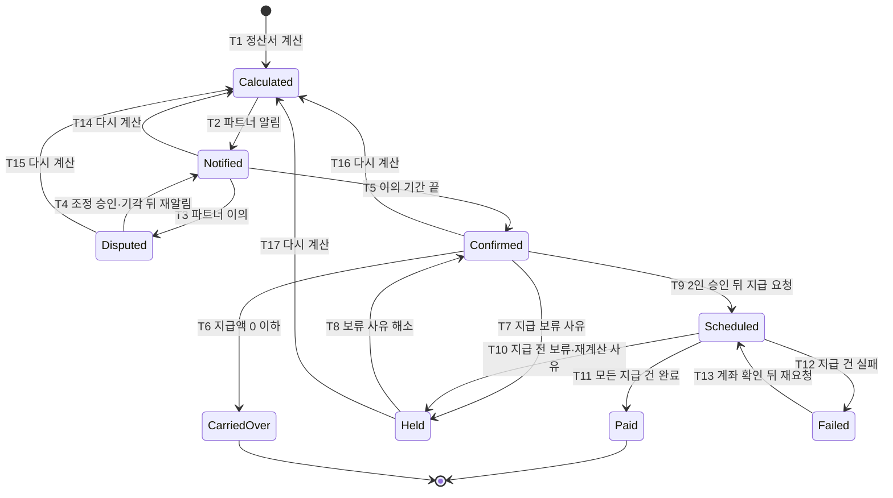

전이 표(번호는 그림과 같다. 조건의 정본은 이 표다, §5.5):

| 번호 | 출발 | 도착 | 전이와 조건 |
| --- | --- | --- | --- |
| T1 | (시작) | Calculated | 회차 정산서는 회차 종료 다음 영업일, 상품 정산서는 매주 첫 영업일(대사 완료 원장) |
| T2 | Calculated | Notified | 파트너 알림(이의 기간 2영업일) |
| T3 | Notified | Disputed | 파트너 이의 |
| T4 | Disputed | Notified | 수기 조정 승인 또는 기각 뒤 다시 알림 |
| T5 | Notified | Confirmed | 이의 기간 끝 |
| T6 | Confirmed | CarriedOver | 지급액 0 이하(미수금으로) |
| T7 | Confirmed | Held | KYC 필요, 계좌 변경 뒤 3영업일, 잔액 부족, 포트원 계좌 불일치(ADR-0108), 판매 중지(ADR-0123) |
| T8 | Held | Confirmed | 보류 사유 해소 |
| T9 | Confirmed | Scheduled | 지급 묶음 2인 승인 뒤 결제사 요청 |
| T10 | Scheduled | Held | 지급 전 보류 사유나 다시 계산할 사유(토스페이먼츠는 예약 취소, 포트원은 실행에서 뺌) |
| T11 | Scheduled | Paid | 모든 지급 건 완료 |
| T12 | Scheduled | Failed | 지급 건 실패(은행 사정) |
| T13 | Failed | Scheduled | 계좌 확인 뒤 새 지급 건 요청 |
| T14 | Notified | Calculated | 다시 계산(회차 취소·연기 환급 또는 승인된 수기 판단, 판본 +1) |
| T15 | Disputed | Calculated | 같은 사유로 다시 계산(이의는 새 판에 다시 낸다) |
| T16 | Confirmed | Calculated | 같은 사유로 다시 계산 |
| T17 | Held | Calculated | 같은 사유로 다시 계산 |

- 다시 계산하면 판본을 1 올린 새 판이 Calculated로 시작하고, 옛 판은 금액을 고치지 않은 채 Superseded로 끝난다. 그래서 위 '→ Calculated'는 옛 판이 Superseded가 되고 새 판이 생긴다는 뜻이다. 지급 건이 진행 중이거나 끝난 정산서는 다시 계산하지 않고, 그 뒤의 환불은 미수금으로 잡는다(docs/features/settlement.md §4.1·§4.4·§12, 추천 적용 2026-10-28, 기술 검토 중간-043).
- 대사가 끝나지 않은 결제는 그 결제만 빼고 계산하고, 풀리면 지급 전이면 조정 행, 지급 뒤면 다음 정산서의 조정이나 미수금으로 넣는다.

### 2.13 굿즈·부가 상품 주문(MerchOrder, MerchOrderItem) [보완]

**주문(MerchOrder)**

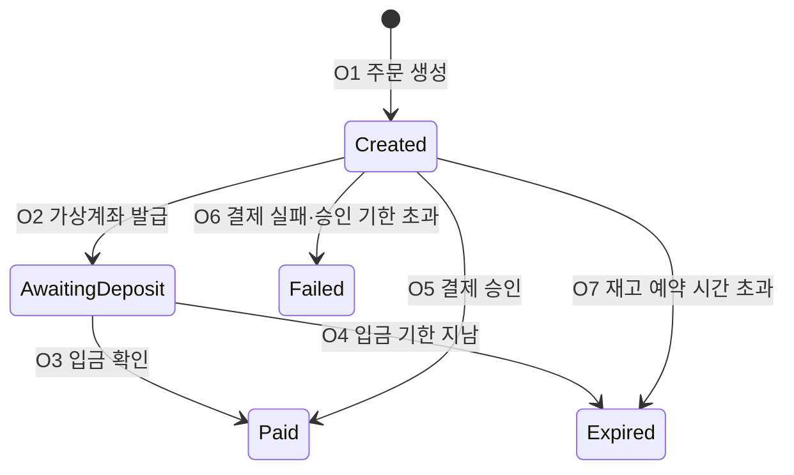

전이 표(번호는 그림과 같다. 조건의 정본은 이 표다, §5.5):

| 번호 | 출발 | 도착 | 전이와 조건 |
| --- | --- | --- | --- |
| O1 | (시작) | Created | 주문 생성(한 판매자·한 수령 방식), 한정 재고 선차감 |
| O2 | Created | AwaitingDeposit | 가상계좌 발급 |
| O3 | AwaitingDeposit | Paid | 입금 확인, 재고 확정 |
| O4 | AwaitingDeposit | Expired | 입금 기한 지남, 재고 반환 |
| O5 | Created | Paid | 결제 승인, 재고 확정 |
| O6 | Created | Failed | 결제 실패·승인 기한 초과, 재고 반환 |
| O7 | Created | Expired | 재고 예약 유효 시간(주문 뒤 15분 [가정], 결제 접수 때 승인 기한까지 연장) 안에 결제가 끝나지 않음, 재고 반환(ADR-0107) |

**항목(MerchOrderItem)**

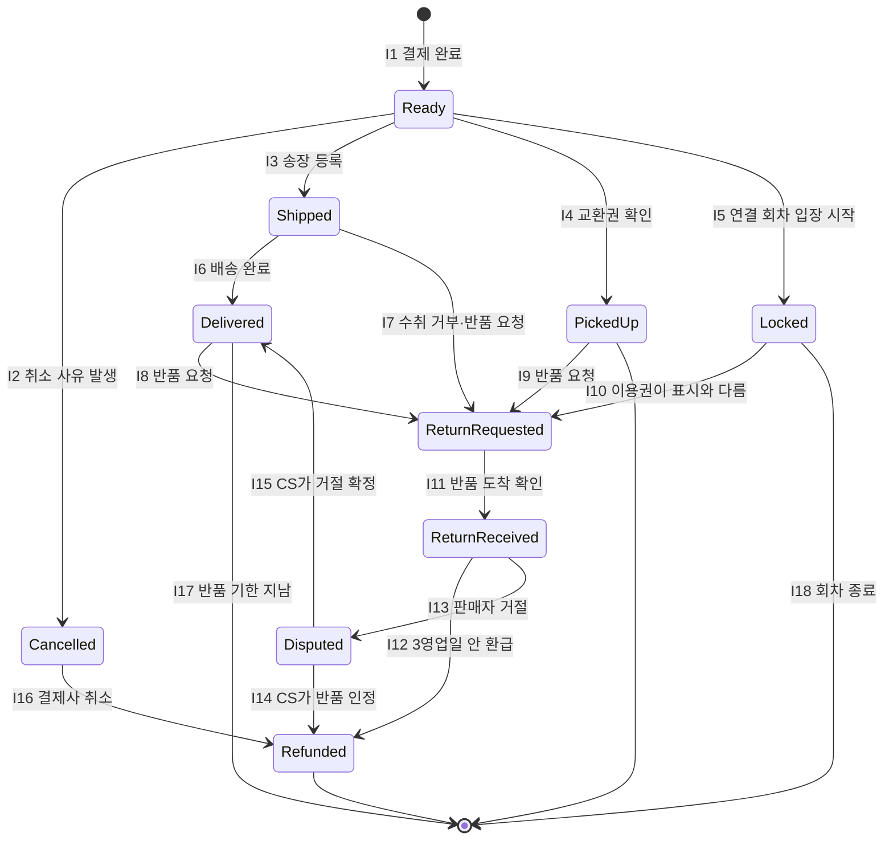

전이 표(번호는 그림과 같다. 조건의 정본은 이 표다, §5.5):

| 번호 | 출발 | 도착 | 전이와 조건 |
| --- | --- | --- | --- |
| I1 | (시작) | Ready | 결제 완료(택배 '배송 준비', 현장 '수령 대기', 부가 상품 '사용 가능') |
| I2 | Ready | Cancelled | 구매자 취소(발송·수령 전, 부가 상품은 입장 시작 전), 연결 티켓 취소, 회차 취소, 미수령, 공급 곤란 |
| I3 | Ready | Shipped | 판매자 송장 등록(택배) |
| I4 | Ready | PickedUp | 교환권 확인(현장 수령) |
| I5 | Ready | Locked | 연결 회차 입장 시작(부가 상품, 취소 불가) |
| I6 | Shipped | Delivered | 배송 완료 기록 |
| I7 | Shipped | ReturnRequested | 수취 거부·반품 요청 |
| I8 | Delivered | ReturnRequested | 반품 요청(단순 변심 7일, 이상·다름 3개월) |
| I9 | PickedUp | ReturnRequested | 반품 요청(택배 반품) |
| I10 | Locked | ReturnRequested | 이용권이 표시와 다르게 제공됨 |
| I11 | ReturnRequested | ReturnReceived | 판매자 도착 확인(부가 상품은 CS 확인), 또는 반품 처리 지연 3영업일을 넘겨 CS가 반품 인정(ADR-0073) |
| I12 | ReturnReceived | Refunded | 3영업일 안 환급 |
| I13 | ReturnReceived | Disputed | 판매자 거절(§17②1·2호) → CS 처리함 분쟁 |
| I14 | Disputed | Refunded | CS가 반품 인정(기한 넘기면 지연배상금) |
| I15 | Disputed | Delivered | CS가 거절 확정(상품 다시 보냄) |
| I16 | Cancelled | Refunded | 결제사 취소(3영업일 안) |
| I17 | Delivered | (끝) | 반품 기한 지남 |
| I18 | Locked | (끝) | 회차 종료 |

주문(MerchOrder)은 결제까지, 항목(MerchOrderItem)은 결제 뒤의 배송·수령·반품을 나타낸다. 기한과 환급 규칙은 §1.4를 따른다(추천 적용 2026-10-14, ADR-0062). 주문을 만들 때 먼저 깎은 한정 재고는 재고 예약으로 묶어 두고, 예약 유효 시간 안에 결제가 끝나지 않으면 만료 작업이 주문을 Expired로 바꾸고 재고를 돌린다(홀드와 같은 정렬 집합 쓸기, docs/data.md §3). 같은 계정은 같은 상품에 결제하지 않은 주문을 동시에 하나만 [가정] 둔다(추천 적용 2026-10-28, ADR-0107).

### 2.14 판매 승인(SaleReview) [보완]

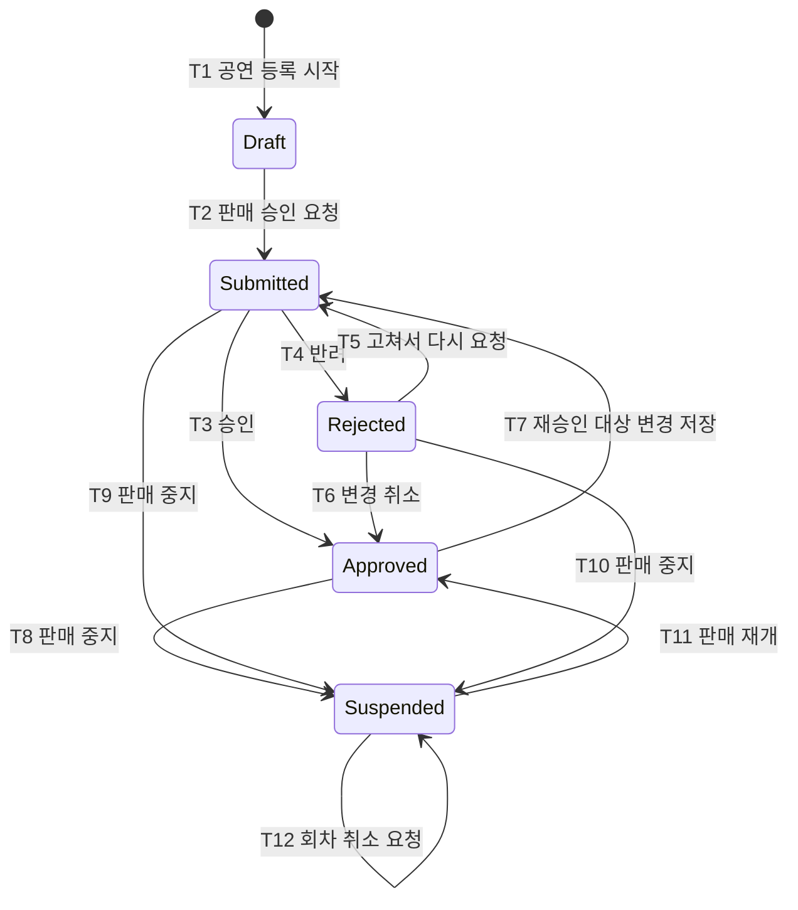

전이 표(번호는 그림과 같다. 조건의 정본은 이 표다, §5.5):

| 번호 | 출발 | 도착 | 전이와 조건 |
| --- | --- | --- | --- |
| T1 | (시작) | Draft | 공연 등록 시작(파트너, 위저드 임시저장) |
| T2 | Draft | Submitted | 판매 승인 요청(파트너 관리자, 5단계 판매자 정보·정산 계좌) |
| T3 | Submitted | Approved | 승인(operator 1인, 확인 항목 6가지(아티스트·공연장 연결 포함)·회차마다 공연 규모. 수수료율과 결제사 지정을 회차에 고정, 재승인이면 변경분을 공개본에 반영) 또는 변경 취소(파트너 관리자, 승인 이력이 있을 때만) |
| T4 | Submitted | Rejected | 반려(operator, 사유 필수, 판매 조건은 고치지 않음) |
| T5 | Rejected | Submitted | 고쳐서 다시 요청(파트너 관리자) |
| T6 | Rejected | Approved | 변경 취소(파트너 관리자, 승인 이력이 있을 때만. 마지막 승인 내용으로 돌아감) |
| T7 | Approved | Submitted | 재승인 대상 변경 저장(파트너 관리자. 가격·회차(더하기 포함)·좌석 등급·좌석맵·판매 정책, FR-052) |
| T8 | Approved | Suspended | 판매 중지(operator 이상 요청 + 요청자가 아닌 commander 승인, 사유 필수, 승인 업무 SALE_SUSPENSION, ADR-0123). 비공개, 검색·홈에서 뺌, 판매 중인 회차에 판매 일시정지와 같은 제어 상태, 정산 지급 보류. 이미 판 티켓은 그대로 |
| T9 | Submitted | Suspended | 같은 조건(승인 이력이 있을 때만. 기다리던 변경분은 거둔다) |
| T10 | Rejected | Suspended | 같은 조건(승인 이력이 있을 때만) |
| T11 | Suspended | Approved | 판매 재개(같은 2인, 승인 업무 SALE_RESUMPTION). 마지막 승인 내용으로 다시 공개·판매. 판매 중지 중에 오픈 시각이 지난 오픈 전 회차는 열지 않는다 |
| T12 | Suspended | Suspended | 그 공연 회차의 회차 취소 요청(commander가 직접, §2.11). 회차마다 따로 확정하고 판매 중지는 이어진다 |

| 상태(data.md 값) | 승인 이력 없음 | 승인 이력 있음(재승인) |
| --- | --- | --- |
| Draft(DRAFT) | 비공개 | — |
| Submitted(SUBMITTED) | 비공개, 승인 대기 | 마지막 승인 내용으로 공개·판매를 계속한다. 오픈 전이면 오픈 예약을 멈춘다 |
| Rejected(REJECTED) | 비공개, 반려 사유 표시 | 위와 같다(변경 반려) |
| Approved(APPROVED) | 공개·오픈 예약 가능 | 같다 |
| Suspended(SUSPENDED) | — | 비공개(공연 상세는 판매 중지 안내만), 검색·홈에서 빠짐, 새 판매 막음(새 홀드·결제 423, 입장 멈춤), 오픈 예약 멈춤, 정산 지급 보류. 이미 판 티켓은 보유·예매 취소·양도·입장 모두 평소 규칙대로다 |

승인 뒤 바꾼 재승인 대상 항목은 변경분으로 따로 두었다가, 승인될 때 공개본에 반영한다. 그때 공연 상세 캐시를 무효화한다(FR-022). 이미 판 표의 가격은 바뀌지 않는다. 회차 취소·연기는 이 상태가 아니라 회차 상태(§2.11)로 다룬다. 판매자 상호·대표자 같은 판매자 신원정보의 변경은 공연의 재승인이 아니라 판매자 정보 변경 요청(SCR-020)으로 운영자가 따로 확인한다. 이 상태는 공연마다 하나다. 승인은 그 공연의 회차를 모두 함께 판정하고, 공연 규모는 회차마다 정한다(추천 적용 2026-10-27, ADR-0093. 그전에는 단위를 docs/design/d5 §1.6 31번에서 정하기로 했다, ADR-0062).

**판매 중지(Suspended, 추천 적용 2026-10-28, ADR-0123)**: 승인한 공연을 운영자가 내리는 길이다. 판매자 신원 문제, 법적 요청, 사기 의심처럼 판매를 계속하면 안 될 때 쓴다. POL-043 ④의 '판매 승인이 풀림'과 POL-045 ⑦·docs/features/search.md의 '판매 승인 취소'는 이 전이를 가리킨다.
- **누가**: operator 이상이 사유 코드와 사유를 적어 요청하고, 요청자가 아닌 commander가 승인한다(2인 [가정], 승인 업무, POL-038 ⑩). 판매 재개도 같다. 급하면 commander가 먼저 명령 3(판매 일시정지, 1인)으로 판매만 멈추고 판매 중지를 요청한다.
- **한 번에 바꾸는 것**: core-svc가 한 트랜잭션으로 판매 승인 상태, 비공개, 검색 읽기 모델·홈에서 빼기, 오픈 예약 멈춤, 기다리던 변경분 거두기를 쓰고, 그 뒤 CDN 검색 경로와 홈·공연 상세 캐시를 비운다. ops-svc는 그 공연의 판매 종료 전 회차마다 판매 일시정지(명령 3)와 같은 효과의 제어 상태를 따로 건다(`sale_control.suspended`, 대기 상태 파일은 PAUSED). 그래서 명령 3을 재개해도 판매 중지는 풀리지 않는다.
- **이미 판 것**: 결제를 접수한 주문은 끝까지 처리한다. 티켓은 그대로 유효하다. 결제자에게는 판매 중지만으로 알리지 않고, 회차 취소가 확정되면 회차 취소 통지가 간다 [가정]. 파트너 관리자에게는 사유 요약을 알린다.
- **다음**: 판매 재개(마지막 승인 내용으로 돌아감)나 회차 취소다. 판매 중지된 공연의 회차는 파트너 요청을 기다리지 않고 commander가 회차 취소를 요청할 수 있다(§2.11). 판매 중지 중에 오픈 시각이 지난 오픈 전 회차는 재개해도 열지 않고, 파트너가 오픈 시각을 바꿔 재승인을 받는다(판매 조건은 PEAKET이 바꾸지 않는다, POL-037).

### 2.15 회차 판매 상태(EventSale) [보완]

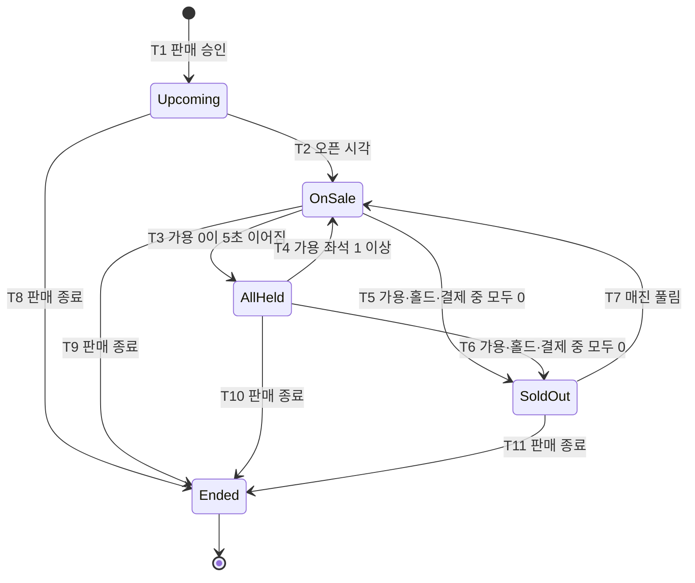

전이 표(번호는 그림과 같다. 조건의 정본은 이 표다, §5.5):

| 번호 | 출발 | 도착 | 전이와 조건 |
| --- | --- | --- | --- |
| T1 | (시작) | Upcoming | 판매 승인(§2.14), 오픈 시각 전 |
| T2 | Upcoming | OnSale | 오픈 시각(open_at) |
| T3 | OnSale | AllHeld | 가용 좌석 0이 5초 [가정] 이어짐(홀드나 결제 중인 판매 예약이 남음) |
| T4 | AllHeld | OnSale | 가용 좌석이 1 이상(홀드 만료·해제, 승인 실패로 좌석이 돌아옴) |
| T5 | OnSale | SoldOut | 가용 0·홀드 0·결제 중 0이 1초 간격 [가정] 두 번 이어짐 |
| T6 | AllHeld | SoldOut | 같은 조건 |
| T7 | SoldOut | OnSale | 매진 풀림. 판매 종료 전에 좌석이 하나라도 돌아옴(예매 취소 반환, 입금 기한 경과, 결과 모름이 미승인으로 확정). 취소표 알림, 새 진입은 맨 뒤 번호 |
| T8 | Upcoming | Ended | 판매 종료(starts_at − 24시간, ADR-0064) |
| T9 | OnSale | Ended | 같은 사유 |
| T10 | AllHeld | Ended | 같은 사유 |
| T11 | SoldOut | Ended | 같은 사유(판매 종료 뒤 돌아온 좌석은 다시 팔지 않는다) |

| 상태(저장 값) | 뜻 | 대기열과 화면 |
| --- | --- | --- |
| Upcoming(UPCOMING) | 판매 승인 뒤 오픈 시각 전 | 로비만 연다 |
| OnSale(ON_SALE) | 오픈 뒤 판매 종료 전이고 가용 좌석이 있다 | 지금 규칙 |
| AllHeld(ALL_HELD) | 일시 매진. 가용 좌석은 0이지만 홀드나 결제 중인 판매 예약이 남아 좌석이 돌아올 수 있다 | 대기는 이어지고 입장(serving 전진)은 멈춘다. 대기 화면은 '남은 좌석이 모두 결제 중입니다. 결제되지 않은 좌석이 풀리면 차례대로 이어집니다' |
| SoldOut(SOLD_OUT) | 매진. 가용·홀드·결제 중이 모두 0이다 | 대기가 끝나고(§2.1 SaleEnded), 새 진입은 엣지와 원본에서 410 `sold-out`이다(POL-015) |
| Ended(ENDED) | 판매 종료 | 대기가 끝나고 다시 열지 않는다 |

회차 판매 상태는 회차마다 하나이고 purchase-svc가 판정한다. 좌석 수의 정본(좌석 비트맵, `seat_sale`)을 가진 서비스이기 때문이다. 판매 중인 회차마다 1초 [가정]마다 가용(비트맵에서 비어 있는 좌석), 홀드(만료 인덱스), 결제 중(승인 결과를 기다리는 `seat_sale` PENDING)을 센다. 입금 대기와 결과 모름의 PENDING은 결제 중으로 세지 않고 팔린 쪽으로 본다. 입금 대기는 하루가 넘을 수 있고 결과 모름은 대부분 승인으로 끝나서, 이 둘을 기다리면 대기가 하루 넘게 이어지기 때문이다. 그 좌석이 나중에 돌아오면 매진을 푼다. 그래서 일시 매진의 길이는 홀드 TTL(최대 10분)과 승인 기한(10분)으로 묶인다(새 결제 일시 정지 동안은 홀드 시간이 멈춰 그만큼 길어진다, ADR-0085). 상태가 바뀌면 purchase DB `event_sale`에 판 번호와 함께 쓰고 `trade.seats`로 `EventSaleChanged`를 낸다. queue-svc(대기 상태 파일·입장 멈춤·원본 410), core-svc(홈·검색의 공연 판매 상태, 공연 상세 캐시, 취소표 알림), 분석(매진 시각)이 이 사건을 읽는다. 판매 일시정지(명령 3)·판매 중지(§2.14)와 등급 매진은 판매 상태가 아니라 덧씌워 보이는 표시이고, 대기 상태 파일은 ENDED > SOLD_OUT > PAUSED > ALL_HELD > TIER_SOLD_OUT > ON_SALE 순으로 앞의 것을 쓴다(추천 적용 2026-10-28, ADR-0122).

## 3. 권한 매트릭스 [보완]

접근 권한 표기 기준: 조회(R), 생성(C), 수정(U), 삭제(D), 최종 승인(A). '본인'은 본인 소유의 데이터만 가리킨다. 빈칸은 그 역할에 권한이 없다는 뜻이다. 이 표는 기능 단위 권한의 정본이고, 각 칸에 붙는 데이터·칸 단위 조건(본인, 소속 테넌트, 배정 회차, 상태·시간, 보이는 칸)과 검사 위치는 docs/security/authz-matrix.md가 정한다(2026-10-30).

| 기능 | 팬 | 파트너 | viewer | operator | commander | CS 담당자 | 현장 스태프 | 시스템 |
| --- | --- | --- | --- | --- | --- | --- | --- | --- |
| 공연·좌석맵·판매 정책 | R | C U D(소속 테넌트 한정. 판매 승인 뒤 재승인 대상 항목의 변경 저장은 관리자) | R | R | R | R | R(배정 공연 한정) | — |
| 좌석맵 템플릿(SCR-022, FR-023) | — | R(템플릿 목록·내용), C(템플릿에서 소속 공연의 배치본 만들기, 좌석이 있으면 바꾸기 확인) | — | — | — | — | — | U(배포 때 저장소의 정적 자료로 넣는다. 운영자 편집 화면은 없다) |
| 로비·대기열 참여 | C R D(본인) | — | R(집계) | R(집계) | R(집계) | R(본인 확인 요청 시) | — | U(serving 번호 전진, 셔플 실행) |
| 좌석 홀드·주문·결제 | C R(본인) | R(소속 공연 집계) | R(집계) | R(집계) | R(집계) | R(원장 이력) | — | U(Saga 오케스트레이션) |
| 예매 취소·환불 | C R(결제자 본인, 보유 중, 공연 시작 전) | R(소속 공연) | R(집계) | R(집계) | R(집계) | R(원장 이력) | — | U(결제사 결제 취소, 취소표 반환, 키 폐기) |
| 티켓·월렛·양도 | R U(본인: 양도 요청·철회·수락·거절·돌려주기) | R(관람객 명단은 관리자, 법정 동의 범위) | — | — | — | R | R(유효성 검증) | C(발권) U(키 교체·폐기, 양도 요청 기한 만료) |
| 회차 취소·연기 요청·판정·확정 | — | C(요청은 관리자, 소속 공연 한정) | R | C(제2승인자 A) | C A(귀책 판정), C(판매 중지된 공연의 회차 취소 요청, ADR-0123), U(일괄 환불 일시정지·재개, 기술 검토 중간-045) | R | — | U(일괄 환불 작업과 결제사 몫별 자동 정지, 팬 통지) |
| 예외 환불(시스템 잘못·재량 면제) | — | — | — | — | A(재량 면제 2인 승인의 제2승인자) | C(`cs_agent` 요청), A(`cs_lead`, 요청자 제외) | — | U(기본 환불 자동, 승인 뒤 추가 환불) |
| 양도 회수(계정 탈취) | C(소명 제출, 받은 사람 본인) | — | — | — | A | C(`cs_lead` 요청) | — | U(키 교체, 폐기 목록 전파) |
| 배상 지급(주최 측 귀책·공연 내용 변경) | C(계좌 입력, 결제자 본인) | R(대상 수·금액 합계, 소속 공연) | R(집계) | — | R | R | — | U(금액 산정, 송금 요청, 정산 상계 기록) |
| CS 처리함 | — | — | —(목록·상세를 보지 않는다. 정산 건은 정산 화면 SCR-049의 건수 요약만, 소유자 결정 2026-10-30, open-items 82번 ①) | R, U(지급·대사·KYC 정산 건만 처리, 소유자 결정 2026-10-30, open-items 82번 ②) | R, U(operator와 같다) | C R U(정산 건은 '정산 이의'만, open-items 72번) | — | C(자동 등록, 기한 알림) |
| 고객 문의(SCR-056, FR-069) | C R(본인 문의만: 접수·추가 문의, 하루 10건 [가정]) | — | — | R | R | R, U(`cs_agent`: 답변·진행 경과 남기기·문의 닫기) | — | C(CS 처리함 건, 기한 알림) U(답변 뒤 14일 [가정] 닫기, 처리가 끝나고 3년 뒤 파기) |
| 예매 제한·소명 | C(소명 제출, 본인) | — | — | — | — | R, U(`cs_lead` 제한·해제) | — | C(남용 표시) |
| 공연 판매 승인 | — | C(승인 요청은 관리자, 소속 공연 한정) | R | A(공연 단위, 회차마다 규모, ADR-0093), C(판매 중지·재개 요청, 사유 필수, ADR-0123) | A, A(판매 중지·재개 승인, 요청자 제외, ADR-0123) | R | — | U(승인 전·판매 중지 중 비공개, 판매 중지 때 검색·홈에서 빼고 판매를 막는 제어 상태 걸기) |
| 아티스트·공연장·다른 이름(ADR-0093, POL-045) | R(공개 이름) | R(찾기), C(공연 등록 때 새 아티스트·새 공연장 요청, 공연의 다른 이름 5개 [가정]) | R | C U(아티스트·공연장 만들기와 고치기, 다른 이름 고치기, 판매 승인 때 잇기, 사유·감사 로그) | C U | R | — | U(검색 읽기 모델·자동완성 사전 갱신, CDN 검색 경로 무효화) |
| 굿즈·부가 상품 주문 | C R(본인) | C U(상품 빌더), R(주문 현황, 택배 주문의 주문별 배송지는 동의 범위, 배송 명단 내려받기는 관리자·사유 기록), U(송장 등록, 반품 도착 확인·거절, 현장 수령 확인) | R(집계) | — | — | R, U(`cs_agent`: 부가 상품 반품 확인, 반품 분쟁 판정, 반품 처리 지연 건의 반품 인정) | — | U(재고 원자 차감) |
| 관람 후기 | C(그 회차 결제자, 공연 종료 예정 시각 뒤, 회차당 하나, 사진 3장 [가정]까지, POL-042) R U D(본인) | R | R | U(법정 통보에 따른 노출 차단 및 복원만. 일반 신고 처리는 CS 담당자, 소유자 결정 2026-10-30, open-items 82번 ⑤) | U(operator와 같다) | R, U(`cs_agent` 신고 처리, 아래 '게시물 신고' 행) | — | U(같은 내용 자동 숨김, 탈퇴 때 삭제, 사진 검사·다시 인코딩·파생본, 붙이지 않은 사진 삭제) |
| 게시물 신고·권리 침해 삭제 요청(FR-070, POL-044) | C(신고, 내 후기 제외, 후기당 한 번·하루 10건 [가정]) R(본인 신고의 결과 알림) | — | — | R | R | R, U(`cs_agent`: 조치 없음·임시조치·노출 차단·해제, 사유 필수) | — | C(CS 처리함 건, 같은 후기 신고 묶기) U(불법 촬영물 신고 즉시 가림, 임시조치 끝 날짜에 해제, 처리 뒤 1년 [가정] 파기) |
| 홈 구성(배너·테마, SCR-068) | R(게시된 홈) | — | R | C U D(판매 승인된 공연만, 1인 게시) | C U D | — | — | C(랭킹·지금 판매 중 계산, 홈 구성 정적 파일 생성, 기간 끝·승인 해제(판매 중지, §2.14) 공연 자동 제외) |
| 계정 설정·세션 관리 | R U D(본인) | R U(본인) | — | U(원격 강제 만료) | U | R | — | — |
| 관리 계정 본인 세션(로그아웃, 다른 기기 끊기, 비밀번호 바꾸기) | — | R U(본인) | R U(본인) | R U(본인) | R U(본인) | R U(본인) | —(현장 기기 세션은 docs/features/offline-gate.md §6) | — |
| 계정 연결·병합 | C R(본인), D(연결 해제, 단일 수단 제외) | — | — | — | — | R(병합 이력 추적) | — | U(병합 트랜잭션, 데이터 옮기기) |
| 파트너 계정 초대(역할 `partner_admin`·`partner_member` 지정)·역할 변경·잠금 해제. 파트너사마다 활성 관리자 1명 이상 | — | R(관리자: 소속 계정 목록) | — | C U D(D는 파트너 계정 삭제. 추천 적용 2026-10-30, docs/features/identity.md §6 '관리 계정 관리 API', SCR-064) | C U D | — | — | — |
| 관리 계정(운영자·CS) 초대·역할 부여·회수·잠금 해제·세션 강제 종료·지정(SCR-064) | — | — | — | R(계정 목록), U(세션 강제 종료) | C U D(운영자·CS 초대, 역할 부여·회수, 보호 잠금 해제는 재초대(시간 잠금은 본인이 이메일 링크와 인증 앱 코드로 푼다, POL-020), 삭제, 접속기록 점검자·가명정보 취급자 지정. 자기 역할 변경 불가), A(commander 역할의 부여·회수, 요청자 제외) | — | — | C(권한 부여·변경·말소 내역 3년 보관, 고시 §5③) |
| 파트너사·계약(판매자 정보, 결제사 등록, 계약 수수료율·보증, SCR-065) | — | R(소속 계약 조건) | — | C U(판매자 정보·결제사 등록 입력, 수수료율·보증 변경 요청) | C U, A(수수료율·보증 변경 승인, 요청자 제외) | R | — | U(판매 승인 때 수수료율을 공연에 고정) |
| 판매자 정보 변경 요청·웹훅 연동·판매 자격 명단(파트너 콘솔) | — | R(판매자 정보 보기, 웹훅 목록·발송 이력 보기), C U(관리자: 판매자 정보 변경 요청·웹훅·명단) | — | R | R | R | — | U(웹훅 발송, 명단 대조·파기) |
| 팬 조회(가린 값은 열람 사유 입력 뒤, SCR-066) | — | — | — | R | R | R | — | C(열람 사유와 접속기록) |
| 봇 판정 표본 검토(SCR-067, FR-049) | — | — | — | — | — | C R(`cs_agent`·`cs_lead`의 검토 라벨. 개인 식별 정보와 판정 가중치 제외) | — | C(온세일 뒤 표본 추출, 사후 라벨 집계) |
| 공지 관리(대기실 공지 템플릿, 파트너 긴급 공지, SCR-068) | — | R(받은 긴급 공지) | — | C U(템플릿 작성, 긴급 공지 발송) | C U, A(템플릿 승인) | — | — | — |
| 운영 명령 1인 전결 (목표 조정, 일시정지, IP 차단, 공지 배너, 로그 레벨, 비핵심 기능 제어, 게시물 차단, 결제사 지정) | — | — | — | C | C | — | — | — |
| 운영 명령 2인 승인 (봇 판정 강도, Degraded Mode(결제사 전환 포함), ASN 단위·IPv4 /16·IPv6 /48보다 넓은 대역 차단) | — | — | — | C(명령 4의 2인 조건만 요청), A(제2승인자, 요청자 제외) | C A | — | — | — |
| 판매 일시정지(킬스위치, 명령 3) | — | — | — | A(재개의 제2승인자, 요청자 제외) | C (단독 실행, ADR-0095), 재개는 C A(2인) | — | — | — |
| 자동화 정지 스위치(입장 제어 자동화, 오토스케일 제외) | — | — | — | A(재개의 제2승인자, 요청자 제외) | C (긴급 단독), 재개는 C A(2인) | — | — | — |
| 불변 감사 로그·인시던트 리플레이 | — | — | R | R | R | R | — | C (시스템 감사 기록) |
| 실시간 관제 대시보드 | — | R(판매 통계, 개인정보 및 봇 원천 제외) | R | R | R | R | — | — |
| 신고기관·수사기관 요청 처리 | — | — | — | C R U(통보·요청 등록과 점검표, 게시물 차단, 자료 추출 요청, 제출 기록. 추출·제출은 commander 승인 뒤에만) | C R U A(자료 추출·제출 승인, 요청자 제외. 소유자 결정 2026-10-30, open-items 68번, docs/features/control-tower.md §9) | R(건 요약만) | — | C(승인된 범위의 행만 뽑은 제출 파일, 승인 대기 만료) |
| 보안 사고 등록·신고·통지 | — | — | R | C R U(등록, 신고·통지 기록) | C R U A(해당 판단) | R | — | C(공격으로 생긴 장애 시간 기록, 기한 알림) |
| 접속기록 정기 점검 | — | — | — | — | C R U(정기 점검, 사유 확인, 사후조치. 자기 기록 제외. 시연 데이터에서만 '자기 점검(시연)' 표시로 본인 종결, 소유자 결정 2026-10-30, open-items 69번) | — | — | C(매일 이상 탐지, 점검 기한 알림) |
| 개인정보 보호책임자의 점검 보고·파기 결과 확인(docs/security/internal-management-plan.md §2.1·§4.5·§5) | — | — | — | — | R U(개인정보 보호책임자인 사람만, 표 아래 문단: 월 접속기록 점검 보고와 월 파기 결과 요약을 보고, 확인한 사실을 남긴다. 이 행으로 접속기록 행이나 개인정보 원문을 보지는 않는다) | — | — | C(월 요약 생성, 확인 기한 알림) |
| 정산 리포트·관람객 명단 다운로드 | — | R(정산 리포트는 모두, 관람객 명단과 다운로드 이력은 관리자. 다운로드 사유 필수 기록) | — | — | — | — | — | — |
| 정산서 확인·이의 | — | R(소속 테넌트), C(이의 제기는 관리자, 통지 뒤 2영업일) | R | R | R | R U(CS 처리함 '정산 이의' 건으로만. 건에 붙은 그 정산서의 금액 항목·상태·이의 내용을 보고, `cs_lead`가 이의를 처리한다. 정산 화면(SCR-049)은 쓰지 않는다, 소유자 결정 2026-10-30, open-items 72번) | — | C(계산·통지) U(이의 기간 끝 확정) |
| 지급 묶음·지급 실행 | — | R(소속 정산서의 지급 상태) | R | C(확인 요청, 포트원 일괄 지급 실행 기록) | A(요청자 제외) | — | — | U(결제사 예약 요청, 상태 동기화, 보류) |
| 정산서 수기 조정 | — | R(조정 결과) | R | — | A | C(`cs_lead` 요청. 이의 인정은 CS 처리함 '정산 이의' 건에서, 이의 없는 조정은 승인 업무(SCR-046)에서 정산서 ID로 요청하고 그 정산서의 금액 항목·상태만 본다) | — | U(조정 행 추가) |
| 정산 계좌 변경 | — | U(관리자만, TOTP 재인증과 패스키(POL-020), 예금주 일치 때만) | R(끝 4자리만) | R(끝 4자리만) | R(끝 4자리만) | — | — | U(예금주 조회, 결제사 수정 요청, 3영업일 보류) |
| 미수금(상계·보증·청구) | — | R(소속) | R | R | R | — | — | C U(상계, 보증 충당, 청구) |
| 스캐너 기기 등록·배정·폐기(SCR-053) | — | R(소속에 배정된 기기) | R | C U D(등록, 배정 파트너, 즉시 폐기) | C U D | — | — | U(관리 앱 인증서 자동 갱신, 폐기 시 스태프 세션 종료) |
| 현장 스태프 초대·해제 | — | C U D(소속 공연 회차 한정, 여러 명 초대·재발송) | R | R | R | — | C(초대 수락: 본인확인 완료·검증 이메일 일치, 동의 두 개) R(본인 배정 내역) | U(유효 시간 자동 만료, 24시간 초대 만료) |
| 기기 배치(게이트 구역·모드) | — | C U(소속 회차의 소속 기기) | R | R | R | — | U(`gate_lead`만) | — |
| 스캐너 기기 승인 로그인·스캔 판정·업로드 | — | — | — | — | — | — | C(배정 회차·유효 시간 안, 같은 파트너 기기) | U(목록·변경분 배포, 서버 입장 판정, 이상 표시) |
| 예외 통과·이상 표시 처리·부스 재발급 허용·확인 스캔 | C(부스 재발급 요청과 본인확인, 본인 티켓) | R(소속 회차 이상 표시) | R(집계) | R(집계) | R(집계) | R U(사후 검토, CS 처리함) | U(`gate_lead` 전결) | C(이상 표시·사후 검토 등록) |
| 개인정보 파기 자동화 배치 | — | — | — | R | R | — | — | D (큰 표를 기간 등으로 나눈 부분인 파티션 가운데 법정 보존이 끝난 것을 삭제) |
| 공연 리포트(골드·지표 뷰) 조회 | — | R(소속 회차의 판매 요약, R3 뒤) | R | R | R | — | — | C(마감 실행, 리포트 생성) |
| 분석 실버(가명 사건) 조회 | — | — | — | — | R(개인정보 보호책임자가 가명정보 취급자로 지정한 계정만, 접속기록 점검 대상) | — | — | U(적재·변환) |
| 결정 기록 | — | R(소속 회차의 파트너 권고만) | R | R | C U(작성, 확인 결과 확정, 철회) | — | — | U(기대 효과 대비 결과 계산) |

'관리 계정 본인 세션' 행은 관리 계정마다 자기 세션만 다룬다는 뜻이고, 남의 세션을 끊는 것은 위 '계정 설정·세션 관리' 행의 operator 이상이다(소유자 결정 2026-10-30, open-items 82번 ④). 아티스트·공연장 찾기는 CS 담당자도 조회한다(소유자 결정 2026-10-30, open-items 82번 ③). CS 담당자 열은 `cs_agent`(요청)와 `cs_lead`(CS 책임자: 1인 승인, 예매 제한 확인, 정산 이의 처리와 수기 조정 요청)를 함께 적는다(POL-038, ADR-0046). CS 담당자는 정산 화면(SCR-049)과 정산 계좌를 보지 않고, 정산 이의는 CS 처리함 건으로만 다룬다. 관제 역할(viewer·operator·commander)은 파트너 정산 계좌를 은행 이름과 끝 4자리만 본다(소유자 결정 2026-10-30, open-items 72번. 칸 단위 규칙은 docs/security/authz-matrix.md §4.1). 파트너 열은 파트너 관리자(`partner_admin`)와 파트너 실무자(`partner_member`)를 함께 적는다. '관리자'가 붙은 권한은 `partner_admin`만 하고, 나머지는 둘 다 한다(추천 적용 2026-10-14, ADR-0062).

개인정보 보호책임자는 역할이 아니라 사람에게 붙는 지정이다(개인정보 보호법 제31조, 내부 관리계획 §2 제2호). 책임자가 하는 일 가운데 화면에서 하는 것은 위 '개인정보 보호책임자의 점검 보고·파기 결과 확인' 행의 둘이고, 접속기록 점검자와 가명정보 취급자 지정은 '관리 계정(운영자·CS) 초대·…·지정' 행의 commander 칸이 그 지정 문서를 근거로 기록한다(docs/data.md `admin_designation.basis`). 그래서 책임자 행은 commander 열에 적었다. 책임자가 관제 계정을 쓰지 않는 사람(관제 권한 없는 대표자 등)이면 두 요약을 보고서로 받고, 확인 사실은 그 보고서의 회신으로 남긴다 [가정]. 책임자를 계정에 묶는 지정 종류는 지금 없다(`admin_designation.kind`는 접속기록 점검자·가명정보 취급자 둘이다). 그래서 지정 종류를 더하기 전까지는 보고서와 회신으로 하고, 책임자가 관제 계정으로 확인하게 되면 지정 종류(예: 개인정보 보호책임자)를 더한 뒤 위 행의 계정 확인을 그 지정으로 한다(추천 적용 2026-10-30).

'운영 명령 2인 승인' 행의 IPv6 대역 기준은 POL-021 B 명령 4와 docs/features/control-tower.md §3의 /48이다. 2026-10-28 기술 검토 낮음-129(소유자 승인, ADR-0136)로 /32에서 /48로 좁혔는데 이 표만 /32로 남아 있어, 더 최근의 소유자 승인 값으로 맞췄다(추천 적용 2026-10-30).

## 4. 용어 사전

영문 표기는 소스코드, REST/gRPC(서비스끼리 함수를 부르듯 빠르게 호출하는 통신 방식) API 명세, 데이터베이스 스키마(데이터의 구조 정의)에서 함께 쓰는 공식 식별자다. 원문 설계서 §5의 33개 핵심 용어와 이번 재구성 작업에서 표준으로 정한 용어를 함께 실었다.

| 용어 | 정의 | 영문 표기 | 쓰지 않을 동의어 |
| --- | --- | --- | --- |
| 온세일 | 티켓 판매가 열리는 시점과 그 직후 수십 분간 트래픽이 몰리는 기간이다. 평소보다 수백 배 이상의 트래픽이 몰린다. 온세일 윈도우는 T-10분부터 T+60분까지로 정한다 | `onsale` | 판매 시작(기간 뜻으로) |
| 오픈 | 티켓 판매가 시작되는 시각(T=0)이다 | `open_at`, `T0` | 온세일(시각 뜻으로) |
| 판매 종료 | 회차의 판매가 끝나는 시각이다. 공연 시작 시각에서 24시간을 뺀 때다(소유자 결정 2026-10-14, ADR-0064). 따로 저장하는 데이터 칸 없이 `event.starts_at`에서 계산한다(추천 적용 2026-10-14, ADR-0064). 모든 정렬 방식·좌석 배정 방식에서 같다. 이 뒤에는 로비·대기열 진입, 입장 확정, 좌석 홀드, 새 주문(판매 종료 전에 만든 홀드의 주문은 받는다), 취소표 알림 신청을 받지 않는다. 그 전에 홀드한 구매 세션은 홀드·결제 시간 안에서 결제를 마칠 수 있다. 온세일 윈도우의 끝은 판매 종료가 아니다(ADR-0063 결정 11). 예매 취소 기한(공연 시작 전, POL-032)·양도 마감(POL-017)과 다르다(POL-030) | `sale_ends_at`(계산값, API `saleEndsAt`), 대기 기록 빠진 사유 `SALE_END` | 판매 마감, 온세일 종료(판매가 끝나는 뜻으로) |
| 매진 | 회차의 가용 좌석·홀드·결제 중인 판매 예약이 모두 0인 판매 상태다(§2.15). 입금 대기와 결과 모름의 판매 예약은 팔린 쪽으로 센다. purchase-svc가 판정하고, 판매 종료 전에 좌석이 돌아오면 매진을 푼다(매진 풀림, 추천 적용 2026-10-28, ADR-0122) | `SOLD_OUT`, 사건 `EventSaleChanged` | 완판 |
| 일시 매진 | 가용 좌석은 0이지만 홀드나 결제 중인 판매 예약이 남아 좌석이 돌아올 수 있는 판매 상태다(§2.15). 대기는 이어지고 입장만 멈춘다(추천 적용 2026-10-28, ADR-0122) | `ALL_HELD` | 임시 매진, 매진 대기 |
| 가상 대기열 | 백엔드 인프라가 감당할 수 있는 한계 용량 안에서만 트래픽을 차례로 들여보내려고, 웹 엣지와 인프라 앞단에 둔 가상의 줄이다 | `queue` | 대기 라인 |
| 프리큐(로비) | 티켓 오픈 시각 전에 미리 접속해 기다리는 사전 대기실이다 | `lobby` | 대기실(로비만 가리킬 때. 대기실은 로비와 대기열을 합친 대기 단계다), prequeue |
| 대기실 | 로비(SCR-007, 오픈 전)와 대기열(SCR-008, 오픈 뒤)을 합친 대기 단계 전체다. 매진 안내(SCR-018)와 함께 대기실 경량 페이지가 그린다. 오픈 전만 가리킬 때는 '로비'를 쓴다(소유자 결정 2026-10-22) | — | — |
| 참가 토큰 | 로비에 들어온 이용자에게 queue-svc가 HMAC으로 서명해 발급하는 토큰이다. 토큰 자체에는 순번이 들어 있지 않다. 셔플이 끝나면 셔플 결과 파일을 조회해 확정 순번을 확인하고, 입장 확정 때 대기표 대신 쓰인다 | `lobby_token` | 익명 참가 토큰 |
| 대기표 | 오픈 시각 이후에 들어온 사람에게 발급하는 토큰이다. 종류 문자열(`PEAKET-queue-v1`), 대기 순번, 공연 ID, 단말 고유 식별자, 세대 번호, 구간 번호(segment)를 queue-svc가 HMAC으로 서명해 발급한 불변 토큰이다(ADR-0053 결정 13). 로비에 들어온 사람에게는 참가 토큰이 이 역할을 한다 | `queue_ticket` | 대기열 토큰, 서명 토큰, 서명된 대기표 |
| 사전 검증 토큰 | 오픈 뒤 들어오는 경로에서 공연 상세 화면의 사람 확인 챌린지를 미리 통과했음을 증명하는, 단말에 묶인 단기 토큰(유효기간 15분)이다 | `preverify_token` | — |
| 순번 | 대기열 안에서 이용자에게 붙은 절대 대기 번호다. Redis `INCR` 명령으로 원자적으로 발급된다 | `seq` | 대기번호(화면 문구에서는 허용) |
| serving 번호 | 지금 예매 화면으로 불러들이고 있는 대기 순번의 상한선이다. 은행 번호표 전광판의 호출 번호와 같은 원리로 움직인다 | `serving` | 입장 중인 번호, 서빙 번호, 서빙 순번 |
| 차례 진행 속도 | 1초당 serving이 통과하는 유효 순번 수다. 빠진 번호는 세지 않으며, 실제 입장 처리량이 아니다(docs/features/queue-admission.md §4). 남은 예상 대기 시간을 계산하는 기준 지표로 쓴다 | `serving_rate` | 입장률(현장 입장률은 별개 용어), 입장 속도(결과값으로만) |
| 빠진 번호 비트맵 | 대기 취소, 이탈, 결격 사유로 대기열에서 빠진 번호를 공연별로 번호 하나에 1비트씩 표시한 비트맵으로, 용량이 작다(100만 명 기준 약 125KB) | `removed_bitmap` | 무효 번호 목록 |
| 대기 상태 파일 | 대기 순번 1,000개 구간 단위로 1초마다 새로 만들어 CDN 엣지에 1초간 캐시해 두는 가벼운 정적 파일이다. 입장 임박 구간 파일은 다음 생성 시각까지만 캐시한다(ADR-0110). 현재 serving 번호, 차례 진행 속도, 티켓 판매 상태, 빠진 번호 누계와 비트맵 데이터, 생성 시각(밀리초)을 담고, 입장 임박 구간 파일은 최근 serving 전진 기록도 담는다 | `queue_state_file` | 상태 파일, 구간 파일 |
| 대기실 경량 페이지 | 로비·대기열·매진 안내(SCR-007·008·018)를 화면 라이브러리인 React나 웹 화면을 만드는 프레임워크인 Next.js 없이, TypeScript 상태표와 DOM 갱신으로 그리는 소비자 웹의 별도 빌드 정적 페이지다. 브라우저가 내려받는 자바스크립트 묶음인 대기실 번들의 예산(JS 50KB·CSS 10KB, NFR-012)을 지키려고 둔다(추천 적용 2026-10-21, ADR-0079) | `queue-room` | 대기실 앱, 정적 대기 페이지 |
| 구간 | 순번 1,000개씩 나눈 대기 상태 파일과 그 CDN 캐시의 단위다. 파일 하나가 구간 하나다(기술 검토 중간-106) | `segment` | 버킷(히스토그램 버킷·S3 버킷은 그 뜻으로 씀) |
| 셔플 결과 파일 | '참가 토큰 해시 → 확정 순번'을 짝지어 둔 정적 파일로, 참가 토큰 해시의 접두어별로 나눠 배포한다(약 1,000개 파일로 샤딩) | `shuffle_result_file` | 개인 조회 |
| 입장 확정 | 차례가 온 이용자가 예매 화면을 처음 열 때(입장 토큰을 받을 때) 입장 자리를 배정받는 일이다 | `admission` | 입장 처리 |
| 입장 자리 | 좌석 선택과 결제 화면에 동시에 머물 수 있도록 시스템이 내주는 자리 1개다. 대기열 Redis의 Sorted Set 원소로 관리한다 | `admission_slot` | 슬롯(Redis 해시 슬롯·CDC 복제 슬롯·화면 컴포넌트 슬롯은 그 뜻으로 씀), 좌석 선택 단계의 자리 |
| 입장 토큰 | 입장 확정 때 queue-svc가 비대칭 ES256 알고리즘으로 서명해 발급하는 토큰이다. 구매 세션 하나에만 쓴다. 처음 쓰는 기한은 5분이고, 최종 만료는 최대 체류 허용 시각과 같다 | `admission_token` | 1회용 입장 토큰 |
| 구매 세션 | 입장 토큰을 예매 화면에서 처음 쓴 때부터 결제 완료, 사용자의 직접 퇴장, 무활동 시간 초과로 끝날 때까지 이어지는 세션이다. purchase-svc가 세션 상태를 소유한다 | `purchase_session` | 입장 세션 |
| 동시 입장 목표 | 좌석 선택과 결제 단계에 동시에 머물 수 있는 인원의 목표치(초기값 5,000명)다. 시스템 AIMD 제어 루프가 스스로 조절하는 유일한 통제 변수다 | `admission_target` | 입장률(현장 입장률은 별개 용어), 동시 입장 상한(합산 상한은 별도) |
| 입장 비율 | serving 번호를 앞으로 보내 부른 유효 번호(빠진 번호 제외) 가운데 입장 확정을 요청한 번호의 비율이다. 자리가 없어 '곧 입장'을 받은 번호도 요청한 것으로 센다. 불린 지 10~60초 [가정]인 번호로 잰다(추천 적용 2026-10-28, ADR-0104) | `admission_ratio` | 입장 전환율('입장 → 구매 전환율'과 헷갈린다), 도착률(입장 비율을 가리킬 때. 부하 시험·게이트의 도착률은 그 뜻으로 씀) |
| 빈자리 | 지금 정한 동시 입장 목표 인원에서 지금 쓰고 있는 입장 자리 수를 뺀, 남은 자리 수다 | `free_slots` | 여유(빈자리 수를 가리킬 때) |
| 오는 중 | 입장 제어 루프가 최근 W초(처음 5초 [가정]) 안에 serving을 올려 불렀지만, 아직 입장 확정을 보내지 않았고 곧 올 것으로 보는 인원의 추정이다(부른 번호 수 × 입장 비율 − 이미 온 요청 수). 루프는 빈자리에서 이 몫을 빼고 부른다(POL-010, ADR-0104) | `in_flight` | 도착 대기 |
| 곧 입장 대기열 | 차례가 왔지만 입장 자리가 없어 '곧 입장'(`SOON`)을 받은 대기표를 순번 순으로 모아 둔 집합이다. 빈자리는 다시 요청한 순서가 아니라 이 대기열의 낮은 번호부터 간다. 다시 요청하는 동안은 15분 유예를 세지 않는다(POL-008, ADR-0104) | `soon_queue` | 곧 입장 버퍼 |
| AIMD | TCP 혼잡 제어에서 나온 방식이다. 시스템 지표가 정상이면 용량을 일정한 폭으로 조금씩 늘리고, 성능이 떨어진 것을 감지하면 바로 절반으로 줄인다. 결과를 보고 다시 조절하는 제어 알고리즘이다 | `aimd` | — |
| 자동 조절 멈춤 | 운영자가 동시 입장 목표 조정(명령 1)으로 목표치를 직접 정한 뒤 AIMD 자동 조절이 15분 멈추는 시간이다. 남은 시간은 관제 콘솔 위 상태 바에 <일시정지 mm:ss>로 보이고, 끝나면 운영자 확인을 거쳐 자동 조절로 돌아간다. 멈춘 동안에도 지정 뒤 새로 울린 경보나 새로 넘은 소진선이면 에러 버짓 연동 감축을 하고, 감축하면 멈춤이 끝난다(POL-010, POL-021 C(2), 소유자 결정 2026-10-22) | — | 유예, 15분 유예(차례가 온 뒤의 입장 기한만 가리킨다) |
| 에러 버짓 연동 감축 | 온세일 예산의 10배 소진 경보나 50% 소진선을 보고 admission-ctrl이 동시 입장 목표를 50% 줄이는 자동 조치다. 경보 하나·소진선 하나에 한 번이고, 뒤에는 운영자가 명령 1로 정할 때까지 자동 증액을 멈춘다. 입장 목표가 부하를 정하는 여정(좌석 홀드·좌석 상태 전파·결제 접수·결제 확정)의 예산으로만 하며, 결제사 쪽 원인일 때의 감축은 결제사를 빠르게 하지 않고 실패를 겪는 사람 수를 줄이는 '노출 줄이기'다(POL-010, POL-021 C(3), ADR-0069·0126) | `budget_alert`, `budget_50` | — |
| 추가 검증 큐 | 이상 행동 위험 점수가 기준값을 초과한 세션을 불이익 없이 강화된 사람 확인 절차로 따로 보내는 검증 줄이다. 검증을 통과하면 원래 배정된 순번의 대기 순서로 돌아간다 | `verification_queue` | 별도 검증 큐, 검증 큐 |
| 사람 식별값 | 실명 연계정보(CI)의 HMAC 값을 별도 KMS HMAC 키(장기 키, 온세일 밖에서만 교체)로 다시 해시한 고유 식별자다. 본인확인 때 한 번 계산해 저장한다. 액세스 토큰에 클레임으로 넣어 1인 1순번 중복 발급을 막는 데 쓴다 | `pid` | 연계정보 HMAC 기준 |
| 1인 1순번 중복 확인 키 | 한 회차에서 한 사람(사람 식별값)에게 순번이 하나만 나가게 하는 대기열 Redis 키다. 키를 잡는 일은 '순번 선점'이라 부르고, 잡은 뒤 순번을 발급해 기록한다. 그 대기가 끝날 때 지우고, 남은 키는 그 회차의 판매 종료 때 지운다(탈퇴한 계정의 키는 5일 안에 지운다, ADR-0087 결정 18). 장애 전환으로 키가 사라져 두 번째 순번이 나가면 입장 확정 때 사람별 입장 키로 막는다(ADR-0056). 줄여서 '중복 확인 키'라 쓴다(소유자 결정 2026-10-22) | `q:dup:{pid}:E` | 선점 키, 1인 1순번 키, 선점 락, 잠금 키 |
| 구매 권한 | 휴대폰 본인확인을 마친 계정의 액세스 토큰에만 붙는 인가 클레임이다 | `ticket:buy` | 본인확인 클레임 |
| 연계정보 | 공인 본인확인 기관이 주는, 사람마다 하나인 연계정보(CI)다. 원문은 즉시 폐기하고, 단방향 HMAC 값만 데이터베이스에 보관한다 | `ci_hmac` | CI 원문 |
| 홀드(Soft Hold) | 결제 중에 다른 예매자가 가로채는 것을 막으려고 좌석을 잠시 잡아 두는 상태다. 정해진 TTL이 지나면 시스템이 자동으로 푼다 | `seat_hold` | 찜(비유), 선점(홀드를 가리킬 때. 중복 확인 키를 잡는 '순번 선점'은 별개) |
| 판매 확정(Hard Sale) | 데이터베이스 원장에 좌석의 소유권을 영구히 확정하는 일이다. 한 좌석은 중복 체결될 수 없다. 사전 예약(PENDING)과 최종 판매 완료(SOLD)의 2단계 트랜잭션으로 이루어진다 | `hard_sale`, 상태 `PENDING`/`SOLD` | 확정 예약(PENDING 단계는 '사전 예약'이라 부른다) |
| 오버셀 | 같은 좌석이 2인 이상의 구매자에게 팔리는 사고로, 데이터가 서로 어긋나는 결함이다 | `oversell` | 중복 판매 |
| 펜싱 토큰 | 좌석 홀드를 얻은 순서대로 커지기만 하는 번호다. 네트워크 지연으로 늦게 도착한 옛 점유 요청이 최신 점유를 덮어쓰지 못하게 막는 잠금 토큰이다. 입장 제어 리더의 쓰기는 이 번호 대신 리더 세대(리더가 바뀔 때마다 커지는 Lease `leaseTransitions`)로 막아, 물러난 옛 리더의 쓰기를 거절한다(ADR-0056, 기술 검토 중간-106) | `fencing_token` | — |
| 세대 번호 | Redis에서 고장 난 쪽 대신 예비 쪽으로 넘기는 페일오버 전후에 발급된 대기표를 구분해, 순번 중복을 가려내려고 대기표에 넣는 버전 번호다. 좌석 델타·스냅샷의 회차 세대도 같은 뜻이다. 좌석 Redis 장애 조치·비트맵 다시 만들기 뒤 되돌아갔을 수 있는 구역별 일련번호를 가른다(추천 적용 2026-10-28, 기술 검토 중간-040) | `generation`, 좌석은 `seatEpoch` | 에포크 |
| 비트맵·델타 | 좌석마다 1비트(가용/점유)로 줄인 전체 좌석맵 데이터와, 상태가 바뀐 좌석의 변경분만 보내는 가벼운 실시간 메시지다 | `seat_bitmap`, `seat_delta` | — |
| Saga | 여러 분산 마이크로서비스에 걸친 비즈니스 트랜잭션을 로컬 트랜잭션을 단계별로 실행해 끝내는 아키텍처 패턴이다. 중간에 결함이 생기면 보상 트랜잭션을 역순으로 실행해 일관성을 되찾는다. 되돌리기 어려운 고비 단계(pivot. 이 설계에서는 결제 승인)가 성공한 뒤의 단계는 되돌리지 않고 멱등하게 다시 시도해 끝낸다(추천 적용 2026-10-28, ADR-0106) | `saga` | 분산 트랜잭션(2PC 뜻으로) |
| Outbox | 상태 변경과 보낼 이벤트를 같은 DB 트랜잭션에 함께 적고(원자적인 것은 이 둘이다), 중계기가 커밋된 이벤트를 브로커로 적어도 한 번 보내는 신뢰성 패턴이다. 같은 이벤트가 두 번 갈 수 있으므로 받는 쪽은 두 번 받아도 결과가 같게 만든다(기술 검토 중간-106). 중계기는 서비스마다 둔 Outbox 릴레이로, Outbox 표를 짧은 주기로 읽어 보낸다(폴링 릴레이, 모든 환경 같다, ADR-0116) | `outbox` | — |
| 멱등성(Idempotency-Key) | 같은 식별자를 가진 HTTP 요청이 네트워크 재전송 때문에 여러 번 들어와도, 시스템이 처음 1회만 처리해 항상 같은 결과를 보장하는 성질이다 | `Idempotency-Key` | 중복 방지 키 |
| SLI·SLO·SLA | 실제로 재는 서비스 품질 값(SLI), 엔지니어링 팀이 정한 내부 운영 목표(SLO), 고객·파트너사와 맺은 계약상의 법적 약속(SLA)이다 | `sli`, `slo`, `sla` | — |
| p99 | 지연 분포의 99번째 백분위수다. 요청 100건을 빠른 순으로 세웠을 때 99번째 요청이 걸린 시간으로, 100건 중 99건이 이 시간 이하에 끝난다. 요청이 성공했는지와는 다른 값이다(실패는 오류율로 본다). 이 프로젝트는 히스토그램 칸으로 어림하고, 기준 판정은 칸 경계의 비율로 한다(예: 'p99 ≤ 150ms'는 '150ms를 넘은 요청이 1% 이하', ADR-0077, docs/observability.md §8) | `p99` | 99퍼센타일 |
| 에러 버짓·번 레이트 | 에러 버짓은 SLO(가용성·지연 목표)가 허용하는 나쁜 사건(실패했거나 기준 시간을 넘긴 요청)의 총량이다. '1 − 목표'로 셈한다(예: 성공률 99.95%면 0.05%, 온세일 결제 2.5만 건이면 약 12건). 번 레이트는 지금 나쁜 사건 비율 ÷ 허용 비율(1 − 목표)이다. 1이면 기간이 끝날 때 예산을 꼭 다 쓰고, 10이면 열 배 빠르게 쓴다. 경보는 이 배수와 창 길이로 정한다(2분 창 10배 등, POL-022, docs/observability.md §4. SRE Workbook 5장, 2026-10-28 원문 확인, 기술 검토 중간-106) | `error_budget`, `burn_rate` | — |
| Degraded Mode | 큰 인프라 장애 때 핵심 가치(오버셀 0건, 이중 결제 차단)를 지키려고, 부가 기능이나 응답 신선도를 미리 합의한 범위 안에서 일부러 줄이는 서비스 감내 모드다. 한국어 이름은 '감내 모드'다(POL-021 명령 6 'Degraded Mode 전환'의 '핵심 여정별 감내 모드', POL-029). 명령 6의 한 갈래인 '결제 감내 모드'는 결제사 전환만 가리킨다(소유자 결정 2026-10-22) | `degraded_mode` | 기능 축소 모드, 축소 운영(별개 용어, 아래 '축소 운영' 행) |
| 축소 운영 | 봇 판정 서비스(trust-svc)에 장애가 나면 모두 통과시키지 않고, 캐시한 규칙과 보수적인 레이트 리밋으로 판정을 이어 가는 운영이다. 대기열 진입 자체는 막지 않고, 탐지 정밀도는 잠시 떨어진다(FR-039, POL-006). 두 층이다. ① trust-svc는 살아 있고 의존성 일부(피처 Redis, 사람 확인 검증, 설정 읽기)가 멈추면 trust-svc가 남은 점수기로 판정하고 응답에 `degraded`를 표시한다. ② trust-svc 전체가 응답하지 않으면 queue-svc가 서킷 브레이커를 열고 캐시한 규칙(기기·참가자당 한도, 호스팅·프록시 대역에만 거는 IP 한도)으로 판정하며, 사람 확인은 '검증 보류'로 표시해 나중에 다시 판정받게 한다(추천 적용 2026-10-30, docs/features/bot-defense.md §11, ADR-0156 결정 13). Degraded Mode(감내 모드)와 다른 말이다(소유자 결정 2026-10-22) | 판정 응답의 `degraded` 표시(trust.proto, ① 층), queue-svc 서킷 상태 지표 `trust_breaker_state`(② 층) | 축소 모드, Fail-Safe 축소 모드, 축소 운영 모드 |
| 경보 시점 예산 소모 | 경보가 울릴 때까지 이미 써 버린 오류 예산의 비율이다. 소진 배수 × 긴 창 길이 ÷ 예산 기간으로 계산한다(SRE Workbook 5장). 온세일 경보는 이 값이 30% 이하가 되게 창을 정한다(ADR-0049) | `budget_consumed_at_alert` | — |
| MTTD | 장애가 생긴 때부터 모니터링 시스템과 운영진이 그것을 알아차리기까지 걸린 평균 탐지 시간(Mean Time To Detect)이다. PEAKET은 목표를 평균으로 두지 않고 '주입한 장애마다 탐지 시간 60초 이내(최댓값 기준)'로 둔다(K8, ADR-0049) | `mttd` | 평균 탐지 시간(목표 문장에서) |
| 차례 전 입장 | 입장 확정 때 그 사람의 순번이 그 시각 들여보내고 있는 순번의 끝인 serving 번호보다 큰 경우, 즉 차례가 오기 전에 입장한 경우다. 대기 순서 공정성에서 늘 0건이어야 하는 불변식이다(NFR-025, POL-029) | `admit_before_turn` | 순번 역전 |
| 결제사 한도 사용률 | 결제사별 초당 승인 요청 수를 그 결제사 채널의 추정 상한(ADR-0036)으로 나눈 값이다. 한도 초과 응답과 함께 추정 상한을 실제 값으로 바꿀 근거로 쓴다(ADR-0049) | `pg_quota_utilization` | — |
| 보안 사고 | 침해사고(정보통신망법 §2①7호: 해킹·컴퓨터바이러스·서비스거부 등으로 정보통신망이나 정보시스템을 공격해 생긴 사태)와 개인정보 유출등(개인정보 보호법 §34: 분실·도난·유출·위조·변조·훼손)을 함께 이르는 말이다. 법정 신고·통지 기한이 있다(FR-063) | `security_incident` | — |
| 데이터 평면·제어 평면 | 대규모 사용자 트래픽이 직접 흐르는 데이터 경로와, 운영자의 긴급 제어 명령이 전달되는 통제 경로를 서로 떼어 놓은 두 갈래 아키텍처다. 제어 평면은 Kafka·게이트웨이·웨이포인트, 핫패스 노드, 공유 저장소에서 떨어지지만, 같은 클러스터 네트워크와 노드 프록시, 받는 서비스의 프로세스는 데이터 요청과 함께 쓴다(2026-10-28 ADR-0102) | `data_plane`, `control_plane` | 데이터 평면(관측 경로 뜻으로), 완전 분리(제어 평면을 가리킬 때) |
| 직접 제어 채널 | 핵심 제어 명령(명령 1·2·3·7·11과 명령 6의 대기열 진입·대체 결제사 전환. 대체 결제사 전환은 2026-10-29에 더했다, ADR-0143)을 Kafka·게이트웨이·웨이포인트를 거치지 않고 받는 서비스의 제어 전용 gRPC 포트로 바로 보내는 길이다. 계약은 `peaket.control.v1.ControlReceiver/ApplyControl`이고, 비상 런북도 같은 길을 쓴다(추천 적용 2026-10-28, ADR-0102) | `direct_control_channel` | 대역 외 채널, TCP 제어 채널 |
| 제어 상태·판 번호 | 운영 명령의 효력을 메시지가 아니라 상태로 둔 것이다. 명령마다 범위(전체·회차)와 종류의 현재 값을 받는 서비스가 자기 저장소에 두고, 판 번호(그 범위·종류에서 늘어나기만 하는 수)가 지금 것보다 클 때만 바꾼다. 새로 뜬 서버는 이 상태를 읽어야 준비 상태가 된다(추천 적용 2026-10-28, ADR-0103) | `control_state`, `control_version` | — |
| 비상 접근 계정 | IAM Identity Center(AWS 로그인 관리 서비스)가 멈췄을 때만 쓰는 AWS 계정이다. 하드웨어 보안 키를 건 사용자 둘이 commander 한 명씩에 묶이고, 비상 런북 Job 만들기와 서명만 할 수 있다. 로그인하면 바로 SEV1이 난다(RB-37, 추천 적용 2026-10-28, ADR-0102) | `break_glass_account` | 긴급 접근 역할(평소 경로의 긴급 권한을 가리킬 때) |
| 관측 경로 | 지표·분산 트레이스·애플리케이션 로그처럼 시스템이 내보내는 운영 신호인 텔레메트리 데이터를 모으고 저장하는, 독립된 관측 인프라 경로다 | `observability_path` | 데이터 평면(관측 경로를 가리킬 때) |
| 텔레메트리 수집기 | 지표·로그·요청 기록을 모으는 공통 표준과 도구인 OpenTelemetry의 Collector로, 요청 기록(trace)·로그·브라우저 지표를 받아 가공해 관측 저장소로 보낸다. 노드마다 도는 에이전트, 테일 샘플링·개인정보 2차 마스킹·브라우저 수집 경로를 맡는 게이트웨이 수집기, 컨테이너로 만든 앱을 여러 서버에서 실행하고 관리하는 플랫폼인 쿠버네티스의 이벤트를 한 번만 받는 클러스터 수집기로 나눈다. 지표는 수집기를 거치지 않고, 지표를 모아 저장하는 도구인 Prometheus가 긁어 간다(ADR-0076) | `otel_collector`(`agent`·`gateway`·`cluster`) | 게이트웨이(수집기를 가리킬 때는 '게이트웨이 수집기') |
| 버전 벡터 | 분산 환경에서 여러 노드와 단말 사이 사건의 인과 관계를 추적하려고, 각 노드의 로컬 카운터를 묶어 동시성 충돌을 알아내는 논리적 시계 벡터다. PEAKET에서는 게이트 스캔 판정의 두 칸 버전 벡터(판정 때 반영한 서버 변경 일련번호, 기기 일련번호, ADR-0051)만 이 이름으로 부른다. 좌석 델타의 구역 번호는 쓰는 쪽이 하나라 '구역별 일련번호'다(추천 적용 2026-10-28, 기술 검토 낮음-006) | `version_vector` | 벡터 클록(개념 설명에서만) |
| 구역별 일련번호 | 좌석 델타에서 구역마다 1씩 오르는 번호다. 그 구역을 바꾸는 쪽은 회차 좌석 샤드의 Lua 하나뿐이라, 여러 쓰는 쪽의 순서를 맞추는 버전 벡터가 아니다. 클라이언트는 이 번호로 빠진 델타와 중복을 찾고, 비교는 같은 회차 세대 안에서만 한다(기술 검토 중간-040, 추천 적용 2026-10-28, 기술 검토 낮음-006) | `sectionVersion`, `s:{event:E}:secver` | 버전 벡터(좌석 델타를 가리킬 때) |
| commit-reveal | 난수 시드값의 해시를 미리 공개해 봉인(Commit)하고, 이벤트가 끝난 뒤 원래 시드를 공개(Reveal)해 누구나 추첨 과정의 무결성을 나중에 검증할 수 있게 하는 암호 기법이다 | `commit_reveal` | — |
| v0·v1 | 유능한 팀이 처음 만들 법한 단순한 설계로 만든 베이스라인(v0)과, 이 설계로 병목을 해결한 프로덕션 아키텍처(v1)다. v0는 일부러 망가뜨리지 않는다. 같은 조건에서 실제로 재어 비교하되, v1 합격은 NFR과 K의 절대값으로 판정하고 v0 대비 비율은 보조 숫자다(ADR-0096) | `v0`, `v1` | 베이스라인(v0을 가리킬 때는 허용) |
| Polyglot persistence | 데이터의 접근 패턴, 데이터가 서로 어긋나지 않아야 하는 정도, 트래픽 특성에 맞춰 RDBMS, 인메모리 NoSQL, 시계열 DB, 객체 스토리지 같은 데이터베이스 엔진 가운데 가장 알맞은 것을 골라 조합하는 저장소 아키텍처다 | `polyglot_persistence` | — |
| 게이트웨이 | 클라이언트 단말 종류별로 앞에 둔 API 게이트웨이(gw-queue, gw-fan, gw-partner, gw-ops, gw-scanner)다. 요청을 받아 안쪽 서비스로 넘기는 프록시 서버인 Envoy를 바탕으로 하며, 인증, 공통 정책 적용, 들어온 요청의 라우팅을 맡는다 | `gateway`, `gw-*` | BFF(앱 서버를 가리킬 때) |
| 앱 서버 | 프론트엔드 화면이 필요로 하는 대로 여러 하위 마이크로서비스의 응답을 모아 조합해 주는 백엔드 서버(웹·파트너 Next.js 서버. 파트너 tRPC와 ops-svc GraphQL은 2026-10-28 ADR-0100으로 뺐고, 파트너 앱 서버는 로그인·셸·서버 컴포넌트 조합만 맡는다)다 | `app_server`, `web BFF`, `partner BFF` | 게이트웨이(앱 서버를 가리킬 때) |
| realtime-gw | 5만석 좌석맵의 상태 델타 메시지 가운데 각 연결이 구독한 구역(좌석이 보이도록 확대한 구역)의 것만, 연결을 열어 둔 채 서버와 브라우저가 주고받는 통신 방식인 WebSocket으로 보내는 실시간 전용 게이트웨이 서비스다(API Gateway가 아니다, seat-hold §5, 기술 검토 중간-106) | `realtime-gw` | WebSocket 게이트웨이 |
| 관제 콘솔 | 운영자가 시스템 지표를 실시간으로 지켜보고, 표준 운영 명령을 실행하고, 감사 로그를 추적하는 통합 운영 플랫폼(Control Tower)이다 | `control_tower`, 앱 `console-host` | 관제실(장소 비유로만), 관제(관제 콘솔을 줄여 부를 때) |
| 원격 위젯 계약 | 서비스 저장소가 만든 관제 원격 위젯과 관제 콘솔 호스트 사이의 약속(위젯 정보·속성·호스트 서비스·권한·계약 판)이다. 패키지 `@peaket/console-contract`가 정본이다. 계약의 주판이 다르면 호스트가 위젯을 싣지 않는다(추천 적용 2026-10-21, ADR-0079) | `console-contract` | 리모트 인터페이스, MF 계약 |
| 포렌식 리플레이 | 지난 온세일의 좌석 상태 변화와 홀드·결제 흐름을 시간 순서로 다시 보고, 구역·시간·결과로 걸러 봇 후보를 찾아보는 화면이다(SCR-069). 1단계는 합성 시나리오 데모를, 2단계(출시 뒤 선택)는 회차의 가명 사건 기록을 쓴다. 감사 기록의 정본이 아니며, 개인 조치에 쓰지 않는다(추천 적용 2026-10-21, ADR-0080) | `forensic-replay` | 포렌식 스튜디오, 트래픽 포렌식 콘솔 |
| 합성 시나리오 | 포렌식 리플레이 1단계가 쓰는, 시드를 고정한 의사난수로 만든 가상 온세일 사건 묶음이다. 사람·봇 세션의 정답이 있고, 개인정보가 없으며, 실제 측정값이 아니다(추천 적용 2026-10-21, ADR-0080) | `synthetic-scenario` | 데모 데이터셋 |
| 운영자 | 관제 콘솔로 시스템을 지켜보고 비상시에 개입하는 전문 엔지니어 액터다. viewer, operator, commander 권한으로 나뉜다 | `operator`(액터), 역할 `viewer`/`operator`/`commander` | 관제 운영자 |
| 파트너 | 티켓 등록, 좌석 구성, 판매 정책 수립, 정산 조회를 하는 기획사·프로모터사 실무자 액터다. 멀티 테넌트(`promoter_id`) 단위로 서로 분리된다 | `partner`, 테넌트 `promoter_id` | 프로모터, 기획사(법률 문맥에서 괄호 병기만) |
| 현장 스태프 | 파트너사가 공연 회차 단위로 초대해 오프라인 게이트에서 스캐너 PWA를 다루는 현장 운영 요원 액터다 | `gate_staff` | 스태프, 스캐너 사용자 |
| 현장 책임자 | 일반 스태프의 입장 검증 기능에 더해 기기 배치, 예외 통과, 이상 표시 처리, 부스 재발급 허용, 확인 스캔 권한을 가진 게이트 총괄 관리자다(ADR-0051) | `gate_lead` | 게이트 관리자 |
| 기기 승인 로그인 | 등록된 스캐너 단말 화면에 뜬 일회용 QR 코드를 스태프 본인의 휴대폰 브라우저(PEAKET 로그인)로 열고, 8자 확인 코드를 맞춰 본 뒤 승인해 단말에 로그인하는 장치 승인 방식이다(RFC 8628 표준을 따른다) | `device_approval` | QR 로그인, 원격 로그인 |
| 기기 등록 | 운영자가 현장 스캐너 기기를 이름과 배정 파트너로 등록하고, 스캐너가 1회용 등록 코드로 기기 키를 그 기록에 묶는 일이다(mTLS 선택지에서는 관리 앱으로 기기 인증서를 넣는다). 스캐너 로그인 뒤의 근무 준비와 다르다(ADR-0051) | `scanner_enrollment` | 스캐너 등록(근무 준비를 가리킬 때) |
| 기기 배치 | 한 회차에서 스캐너 기기 한 대가 맡는 게이트 구역과 모드(입장·퇴장)다. 파트너나 현장 책임자만 정한다(ADR-0051) | `scanner_placement` | 게이트 선택 |
| 근무 준비 | 스캐너 로그인 직후 기기 배치를 확인하고, 회차 목록 전체를 받고, 시계를 맞춘 뒤 준비 완료를 보고하는 단계다(SCR-033, ADR-0051) | `shift_setup` | 기기 등록(이 단계를 가리킬 때) |
| 입장 상태 | 티켓마다 마지막 입장·퇴장 방향과 시각, 그 기록을 남긴 기기다. 스캐너는 다른 스캐너의 입장 상태를 변경분으로 받아 두 번째 입장을 거부한다(ADR-0051) | `scan_state` | 출입 상태 |
| 이상 표시 | 서버가 올라온 스캔 기록을 판정 표로 다시 판정해 붙이는 표시다. 중복 입장, 퇴장 기록 없음, 취소 뒤 입장, 세션 밖 기록, 마감 뒤 도착이 있다. 그 구역 현장 책임자와 파트너에게 보낸다(ADR-0051) | `gate_flag` | 비정상 플래그, 동시 스캔 충돌 |
| 예외 통과 | 현장 책임자가 회전 QR을 확인하지 못한 관객을 좌석 표시로 찾아 사유와 함께 들여보내는 처리다. 모두 사후 검토 대상이다(ADR-0051) | `override` | 수동 입장, 수동 판정 |
| 확인 스캔 | 현장 책임자 스캐너에서 판정만 하고 입장 기록은 남기지 않는 스캔이다. 좌석에서 이상 표시를 확인할 때 쓴다(ADR-0051) | `verify_scan` | — |
| 부스 재발급 | 입장 시작 뒤 월렛 저장소를 잃은 관객이 휴대폰 본인확인으로 보유 계정과 같은 사람임을 보이면, 현장 책임자가 허용해 새 기기 키를 등록하는 절차다(ADR-0050·0051) | `booth_reissue` | 현장 재발급 |
| 입장 기록 마감 | 역할 유효 시간이 끝난 뒤, 그 회차의 스캔 기록이 다 모였다고 보고 환급·이상 표시 판정을 확정하는 시점이다. 모든 기기가 큐를 비웠으면 바로, 아니면 24시간 [가정] 안이다(ADR-0051) | `entry_close` | 입장 종료(공연 종료를 가리킬 때) |
| 현장 입장률 | 회차에서 발권한 티켓 가운데 공연장 게이트에서 입장한 티켓의 비율이다(입장한 티켓 ÷ 발권한 티켓). 입장 기록 마감 뒤 마감 단계 R3에서 확정한다(docs/features/analytics.md §6.3 지표 30, 소유자 결정 2026-10-22) | — | 입장률(단독으로), 참석률 |
| 입장용 휴대폰 등록 | 팬이 월렛에서 '이 휴대폰을 입장용으로 등록'을 눌러 그 기기에서 회전 QR 키를 만드는 일이다. 키는 이 동작으로만 만든다(ADR-0051) | `entry_device_binding` | 기기 등록(팬 쪽을 가리킬 때) |
| 입장 시작 | 공연장 게이트에서 관객을 들여보내기 시작하는 시각(`event.entry_opens_at`)이다. 대기열에서 예매 단계로 들어가는 '입장 확정'과 다르다 | `entry_opens_at` | 오픈(게이트를 여는 시각을 가리킬 때) |
| 입장 정책 | 공연 회차별로 정하는 현장 게이트 입장 규정이다. 지금은 관람객의 재입장 허용 여부(기본값: 재입장 불가)를 뜻한다 | `entry_policy`, `reentry_allowed` | 재입장 설정 |
| 팬 | 대중문화 공연의 입장권과 공식 굿즈를 예매·구매하는 최종 일반 소비자다 | `fan` | 소비자(사람을 가리킬 때. 앱 이름 '소비자 웹'과 법령의 말은 그대로), 사용자(일반 의미로만) |
| 관람 후기 | 공연 종료 예정 시각이 지난 뒤 그 회차를 결제한 팬이 별점과 글(사진 3장 [가정]까지)로 남기는 공개 게시물이다. 한 계정은 한 회차에 하나를 쓴다. 후기마다 [신고]가 붙고, 신고 모달의 암표·매크로 사유에는 신고기관 바로가기가 있다. 화면 표기는 '후기'다(POL-042·044, ADR-0063·0066) | `review` | 기대평(두지 않음), 리뷰(후기를 가리킬 때. 코드 리뷰는 그 뜻으로 씀), 게시물(법률 문맥에서만) |
| 임시조치 | 권리 침해 삭제 요청을 받았으나 침해 여부를 판단하기 어렵거나 다툼이 예상될 때 그 후기를 끝 날짜까지(30일 이내) 가리는 조치다(정보통신망법 §44의2④, 권리를 침해한다고 인정될 때의 임의 임시조치는 §44의3). 가린 자리에 '권리 침해 신고로 임시조치된 후기입니다(11/18까지)'를 보이고, 신청인과 글쓴이에게 알린다(POL-044, ADR-0066) | `TEMP_BLOCK`(조치), `RIGHTS_TEMP`(차단 기록 종류) | 블라인드, 임시 삭제 |
| 권리 침해 삭제 요청 | 후기 때문에 사생활 침해나 명예훼손 같은 권리 침해를 당한 본인이 그 후기의 삭제를 요청하는 것이다(정보통신망법 §44의2①). 신고 사유 '개인정보 노출·명예훼손'에서 본인이라고 고르면 이 요청으로 받는다. 처리 결과를 받을 곳을 고르게 하고, 지체 없이 처리한다(POL-044, ADR-0066) | `RIGHTS_REQUEST` | 명예훼손 신고(일반 게시물 신고와 섞어 쓸 때) |
| 장르 | 공연의 종류다. 정본 목록은 콘서트·뮤지컬·연극·클래식·페스티벌·팬미팅·기타 7개다. 공연 등록(SCR-021 1단계)·검색 필터(SCR-003)·홈 장르 바로가기와 장르별 랭킹 칩(SCR-001)이 같은 목록을 쓴다(추천 적용 2026-10-14, ADR-0063) | `genre` | 카테고리(화면 문구 '전체 장르' 버튼은 허용) |
| 홈 구성 | 운영자가 관제 콘솔(SCR-068)에서 판매 승인된 공연 가운데 홈의 배너와 테마에 올릴 것을 고르고, 순서와 노출 기간을 정해 게시하는 일이다. 장르별 랭킹과 지금 판매 중은 시스템이 계산한다(POL-043) | `home_curation` | 메인 큐레이션, 기획전(화면 문구에서는 '테마') |
| 장르별 랭킹 | 홈에서 장르마다 공연을 어제 판매 매수 순으로 늘어놓은 목록이다. 하루 한 번 계산해 만든 정적 파일이다(POL-043) | `genre_ranking` | 인기 순위, 판매 순위(검색 정렬 '인기'는 최근 7일 확정 판매 매수 [가정] 순으로 다른 말이다) |
| 자동완성 | 전역 머리 검색창에 입력하는 동안 그 아래 창에 보이는 공연·아티스트·공연장 후보다. 한글 음절은 1자부터, 로마자·숫자는 2자부터 [가정] 보이고, 조합 중인 글자·초성·다른 이름으로도 맞춘다(SCR-003, 소유자 결정 2026-10-27, ADR-0094) | `search_suggestion` | 연관 검색어(검색 기록으로 만드는 기능을 넣을 때만 그 기능 이름으로), 추천 검색어, 검색어 추천 |
| 관련 공연 | 검색 결과에서 맞은 아티스트·공연장의 다른 공연과, 결과가 없을 때의 오픈 예정 인기 공연이다. 카탈로그 관계로만 고르고 검색 기록은 쓰지 않는다(ADR-0094) | `related` | 연관 공연, 추천 공연(사람마다 다른 추천으로 오해) |
| 연관 검색어 | 다른 사람들이 이어서 찾은 검색어를 검색 기록으로 만들어 보이는 기능이다. 지금은 두지 않는다(소유자 결정 2026-10-27, ADR-0094 결정 2). 입력 중 후보 창은 '자동완성'이다 | — | — |
| 다른 이름(별칭) | 공연·아티스트·공연장의 영문 표기와 옛 이름 같은 다른 이름이다. 검색에만 쓰고 화면 이름을 바꾸지 않는다(POL-045, ADR-0093) | `search_alias` | 동의어(뜻이 같은 낱말 사전으로 오해) |
| 공연 | 같은 파트너가 같은 공연장에서 같은 배치본으로 여는 회차의 묶음이다. 공연명·아티스트·설명·이미지·판매 승인·찜·후기 보기·랭킹의 단위다(소유자 결정 2026-10-27, ADR-0093) | `production` | 프로덕션, 공연 상품 |
| 회차 | 공연의 한 번(날짜·시각)이다. 대기열·좌석·주문·결제·티켓·정산서의 단위이고 API의 `eventId`는 회차다. 지난 문서에서 회차를 '공연'이라 적은 곳(예: 대기표의 '공연 ID')은 회차로 읽는다(ADR-0093) | `event` | 이벤트(화면 문구에서), 세션 |
| 공연장 | 공연이 열리는 실제 장소다. 이름·주소·다른 이름을 운영자가 관리한다. 좌석맵 템플릿과 공연용 배치본은 공연장이 아니다(ADR-0093) | `place` | venue(배치본·템플릿 표 이름이라 섞지 않는다) |
| 아티스트 | 공연에 나오는 사람이나 팀의 활동명이다. 공연과 여러 대 여러로 잇고, 판매 승인 때 운영자가 기존 아티스트에 잇거나 새로 만든다(ADR-0093) | `artist` | 출연자(공연예술통합전산망 항목 '출연진'에서만) |
| 본인확인 흐름 | 본인확인을 부르는 화면의 버튼이 본인확인기관 창을 열고, 결과를 그 화면 위 대화상자로 보여 주는 절차다. 따로 된 화면은 없다. 기관이 페이지 이동으로 처리할 때만 복귀 화면(`/verify/return`)을 거친다(SCR-006, ADR-0063) | `identity_verification` | 본인확인 화면, 본인인증 페이지 |
| 티켓 연동 부가 상품 | 유효한 입장 티켓을 가진 예매자에게만 파는 공연장 주차권, VIP 라운지 이용권, 패스트 트랙 패키지 상품이다 | `ticket_addon` | 부가 상품 |
| 굿즈(MD) | 티켓을 예매했는지와 상관없이 로그인한 회원이면 누구나 살 수 있는 아티스트 공식 상품(머천다이즈)이다 | `merch` | MD(허용), 상품(일반 의미) |
| 회전 QR | 브라우저 WebCrypto의 비대칭 서명 키쌍(스크립트가 꺼낼 수 없는 키, 하드웨어 보관은 아님)으로 15초마다 새로 서명해 만드는, 계속 바뀌는 모바일 티켓 입장 QR 코드다 | `rotating_qr` | 동적 QR |
| 폐기 목록 | 티켓 취소, 환불, 양도, 재발급으로 무효가 된 단말 티켓 공개키들의 키 식별자 목록이다. 스캐너가 '양도·취소된 옛 QR'과 '위조'를 나눠 보여 주는 데 쓴다(ADR-0051) | `revocation_list` | 블랙리스트 |
| 게이트 구역 | 현장 관람객이 나눠 들어가도록 티켓 권종과 좌석 위치에 따라 정해 둔 전용 게이트 진입 구역이다 | `gate_zone` | 게이트(게이트 구역을 가리킬 때) |
| 좌석맵 템플릿 | 흔한 공연장 모양 10종(실내 아레나 3종, 돔 구장, 종합운동장, 극장 3종, 콘서트홀, 평면 블록)을 본뜬 좌석맵의 출발점이다. 파트너가 템플릿을 고르고 목표 좌석 수와 변형을 정하면, 그 공연의 배치본으로 복제해 고친다. 실제 공연장의 배치도가 아니며 특정 공연장 이름도 쓰지 않는다. 저장소의 정적 자료로 배포 때 넣고, 파트너는 읽기만 한다(FR-023, ADR-0066) | `seatmap-templates`(API), `venue` TEMPLATE 행 | 공연장 배치도(실제 배치도로 오해), 표준 공연장 |
| 킬스위치 | 범위 안 회차(또는 전체)의 새 좌석 홀드·결제 시도 시작·결제 접수를 막고 입장을 멈추는 비상 운영 명령(명령 3)이다. 이미 접수된 결제는 끝까지 처리한다(추천 적용 2026-10-14, ADR-0062) | `kill_switch` | 판매 중단(명령 3을 가리킬 때) |
| 예매 취소 | 관람객이 공연 시작 전에 마이 티켓 메뉴에서 자기 티켓 예매를 취소하고, 공정위 고시 공제율에 따라 환불을 받는 절차다 | `ticket_cancellation` | 환불 신청(환불은 돈을 돌려주는 결과를 가리킬 때만) |
| 공제율 | 예매를 취소할 때 환불 총액에서 빼는 법정 취소 수수료율이다. 공정거래위원회 소비자분쟁해결기준을 상한으로 적용한다 | `deduction_rate` | 취소 수수료(화면 문구에서는 허용), 위약금 |
| 취소표 | 이용자가 예매를 취소해 점유가 풀리고, 다시 팔 수 있는 좌석으로 즉시 돌아간 좌석이다 | `returned_seat` | 반환 좌석 |
| 통신판매중개자 | PEAKET의 법적 지위다. 파트너가 PEAKET 사이버몰에서 공연을 팔게 하고 그 거래를 알선한다. 판매정보 제공과 청약 접수가 PEAKET에서 이뤄지므로 '통신판매업자인 통신판매중개자'다(POL-037) | `intermediary` | 오픈마켓, 판매 대행(지침의 '판매 대행형' 분류명으로만) |
| 판매자 | 팬과 관람 계약을 맺는 판매 당사자다. 공연을 올린 파트너의 사업자를 가리킨다. 화면에는 신원정보 7항목과 함께 표시한다(POL-037) | `seller` | 주최사(화면 문구에서는 허용), 셀러(결제사 지급대행에 등록한 대상을 가리킬 때만) |
| 판매 승인 | 파트너가 등록한 공연을 PEAKET 운영자가 확인해 공개·오픈을 허락하는 절차다. 판매 조건은 고치지 않고 확인과 반려만 한다(POL-037). 공연 단위이고 그 공연의 회차를 함께 판정한다(ADR-0093) | `sale_review` | 공연 검수, 공연 심사, 판매 심사 |
| 판매 중지 | 승인한 공연을 운영자가 내리는 판매 승인 상태다(§2.14). 비공개로 돌리고 검색·홈에서 빼며 새 판매를 막지만, 이미 판 티켓은 그대로 둔다. operator 이상이 요청하고 요청자가 아닌 commander가 승인한다. 판매 재개나 회차 취소로 이어진다(추천 적용 2026-10-28, ADR-0123). 판매 일시정지(명령 3)는 판매만 잠시 멈추는 운영 명령이라 다르다. POL-045 ⑦과 검색 문서의 '판매 승인 취소'는 이 상태로 가는 전이를 가리킨다 | `SUSPENDED`, 승인 업무 `SALE_SUSPENSION`·`SALE_RESUMPTION` | 승인 철회, 공연 내리기(기능 이름으로) |
| 결제자 | 티켓 주문을 결제한 계정이다. 결제자는 바뀌지 않으며, 예매 취소와 환불은 결제자에게만 한다(POL-017·032) | `payer` | — |
| 보유자 | 지금 티켓을 가진 계정이다. 양도 수락, 돌려주기, 양도 회수로 바뀐다 | `holder` | — |
| 양도 요청 | 보유자이면서 결제자인 팬이 받는 사람을 정해 보내는 양도 제안이다. 받는 사람이 수락하면 끝나고, 48시간과 양도 마감 가운데 먼저 오는 때에 만료된다(POL-017) | `transfer_offer` | 선물하기, 양도 신청 |
| 돌려주기 | 양도받은 보유자가 티켓을 결제자에게 되돌리는 일이다. 결제자 수락 없이 바로 돌아간다(POL-017) | `ticket_return` | 반송, 반환(취소표 반환·응답 반환 같은 다른 뜻으로만) |
| 양도 회수 | 계정 탈취로 넘어간 티켓을 승인 업무로 결제자에게 되돌리는 일이다(POL-038) | `transfer_reclaim` | 강제 반환 |
| 승인 업무 | 정책을 벗어나 돈이나 티켓 소유권이 움직이는 일과 되돌릴 수 없는 일괄 작업을, 요청자가 아닌 다른 승인자가 확인하는 업무다. 1인·2인 기준은 POL-038을 따른다 | `approval_request` | 결재 |
| 예외 환불 | 정책 안의 직접 취소로는 처리할 수 없는 환불이다. 시스템 잘못이 확인되는 환불과 재량 면제로 나뉜다(POL-038) | `exception_refund` | 특별 환불, 수동 환불 |
| 재량 면제 | 질병·사망 같은 사유로 공제를 면제해 주는, 정책 밖의 예외 환불이다. 면제한 금액만 승인 뒤에 추가로 환불한다(POL-038) | `discretionary_waiver` | 위약금 면제 |
| 회차 취소 요청 | 파트너가 회차의 취소나 연기를 PEAKET에 요청하는 것이다. 운영자의 귀책 판정과 2인 승인을 거친 뒤에 확정된다(POL-032·038) | `event_cancellation_request` | 공연 취소 등록 |
| 귀책 판정 | commander가 회차 취소 요청을 주최 측 귀책, 불가항력, 공연 내용 변경 중 하나로 정하는 일이다. 배상 여부는 여기서 정해진다 | `fault_judgement` | — |
| 일괄 환불 작업 | 취소가 확정된 회차의 모든 주문을 결제사 처리 한도 안에서 나눠 환급하는 작업이다. 결제사마다 몫을 나눠 돌리고, 결제사 몫은 취소 실패가 기준을 넘으면 스스로 멈춘다(docs/features/transfer-refund.md §5). 일시정지·재개할 수 있고, 실행된 환불은 되돌리지 않는다 | `bulk_refund_job` | — |
| 배상금 | 소비자분쟁해결기준에 따라 주최 측 귀책이나 공연 내용 변경이 있을 때 실제 결제 금액의 10%를 주는 돈이다. PEAKET이 먼저 계좌로 지급하고 파트너에게서 회수한다(POL-032) | `compensation` | 법정 배상금, 위약 배상금 |
| CS 처리함 | 사람이 판단해야 할 건(결제 상태 불명, 환급 실패, 이상 표시, 환불·배상 대기, 남용 표시, 분쟁 접수, 판정 대기, 고객 문의, 게시물 신고, 권리 침해 삭제 요청, 정산·지급 오류, 반품 처리 지연, 추가 검증 이의 등. 전체 목록은 POL-038)을 기한과 함께 모은 관제 콘솔 화면이다(POL-038·044, ADR-0066) | `cs_inbox` | CS 수동 처리 대장 |
| 소명 | 예매 제한이나 양도 회수 대상이 된 팬이 사정을 설명하는 절차다. 1일 이상의 기한을 준다(POL-038) | `appeal` | 이의 신청(추가 검증 큐의 이의 제기와 구분) |
| 공연예술통합전산망 | 문화체육관광부가 운영하는 공연 정보 전산망이다. PEAKET은 공연정보를 1일 단위로 보낸다(공연법 §4, POL-037) | `kopis` | KOPIS(전산망을 가리킬 때만 괄호 병기) |
| 정산서 | 회차와 결제사 단위로 판매 대금, 환급, 중개수수료와 부가세, 미수금 상계, 지급액을 적은 문서이자 지급 단위다(POL-039) | `settlement_statement` | 정산 내역서, 정산 명세서 |
| 지급대행 | 결제사가 PEAKET 대신 파트너 정산 계좌로 판매 대금을 보내는 서비스다(토스페이먼츠 지급대행, 포트원 지급대행, ADR-0047) | `payout_agency` | 지급 대행, 정산 대행(전자금융거래법 문맥에서만) |
| 지급 묶음 | 같은 지급일·결제사의 확정 정산서를 모은 지급 단위다. operator 확인과 commander 승인(2인)을 거친 뒤 결제사에 요청한다(POL-039) | `payout_batch` | 일괄 지급(포트원 콘솔 기능을 가리킬 때만) |
| 정산 계좌 | 파트너가 정산금을 받는 사업자 계좌다. 예금주가 판매자와 같아야 한다. 계좌 정보는 결제사 등록 요청에 바로 넘기고, PEAKET에는 은행과 끝 4자리만 남긴다(POL-039) | `payout_account` | 지급 계좌, 정산금 계좌 |
| 미수금 | 파트너에게서 돌려받을 돈이다(지급 뒤 환불, 카드 이의제기, 배상 선지급, 0 이하 정산서). 다음 정산서 상계 → 보증 → 청구 순으로 처리한다(POL-039) | `partner_receivable` | 채권, 차감금 |
| PG 어댑터 | 헥사고날 아키텍처로 만든 결제 기능의 포트 인터페이스를 결제사마다 따로 구현한 어댑터 모듈(토스페이먼츠, 포트원, 시험용 시뮬레이터)이다. 어느 어댑터를 쓸지는 결제사 선택기가 결제 시도마다 정한다(POL-036) | `pg_adapter` | PG 모듈 |
| 결제 시도 | 주문 하나에서 결제창을 한 번 여는 단위다. 시작할 때 결제사를 정한다. 주문당 활성 결제 시도는 1건이고, 결제 접수 뒤에는 그 결제사에 고정된다(POL-036) | `payment_attempt` | 결제 요청 건, 결제 회차 |
| 결제사 지정 | 운영자가 공연마다 기본 결제사와 대체 결제사를 정하는 일이다. 온세일 윈도우 밖에서 운영 명령 12로 한다(POL-036) | `pg_assignment` | PG 설정, 결제사 배정 |
| 결제사 전환 | 결제사 장애 때 새 결제 시도를 공연의 대체 결제사로 보내는 결제 감내 모드다. 명령 6의 2인 상호 승인(commander 요청과 요청자 아닌 operator 이상 1인 승인)으로 켠다. 이미 접수된 결제는 원래 결제사에 남는다(POL-036). 전환은 직접 제어 채널(제어 전용 gRPC)로 payment-svc의 모든 파드와 admission-ctrl 리더에 보내고, payment DB `pg_switch`에 판 번호와 함께 둔다(추천 적용 2026-10-29, ADR-0143) | `pg_switchover`, 상태 표 `pg_switch` | 결제사 페일오버, PG 우회 |
| 오픈 간격 규칙 | 큰 접속이 한꺼번에 몰리는 때가 겹치지 않도록, 공연끼리 티켓 오픈 시각을 떼어 놓게 강제하는 규칙이다 (대형 공연 간 30분, 일반 공연 간 5분 간격) | `open_slot_rule` | 오픈 슬롯 |
| 간주(프로젝트 결정) | 대외 법령이나 행정 규정에 구체적 기준이 없어서 프로젝트가 합리적으로 정한 자체 정책이다. 출시 전에 법률 자문을 받을 대상이다 | `assumed_by_project` | 해석(별개 표기), 추정(WBS의 작업 일수 어림 '추정(일)'과 POL-027의 '추정(날짜)' 표시는 그 뜻으로 씀) |
| 계정 연결 | PEAKET 계정 하나에 다른 소셜 로그인 수단(다른 IdP 계정)을 추가로, 안전하게 연결해 등록하는 일이다 | `provider_link` | 소셜 연동, 계정 통합(병합과 구분) |
| 계정 병합 | 서로 다른 소셜 수단으로 이미 만든 PEAKET 계정 2개를 대표 계정 하나에 옮겨 담고, 흡수 계정을 폐쇄하는 되돌릴 수 없는 절차다 | `account_merge` | 계정 통합, 합치기(팬 화면 문구의 '합치다'는 허용, docs/design/d2 §4) |
| 대표 계정 | 계정 병합이 끝난 뒤 계속 남는 기준 계정이다. 실명 본인확인을 마친 계정이 최우선으로 대표 계정이 된다 | `primary_account` | 주 계정, 메인 계정 |
| 흡수 계정 | 계정 병합으로 가진 데이터를 대표 계정에 옮긴 뒤 '병합 완료' 상태로 바뀐 계정이다. 이 계정으로 로그인하면 대표 계정으로 자동으로 넘어간다 | `merged_account` | 부 계정, 삭제 계정 |
| 사람 확인 | 정상적인 사람 이용자와 자동화 봇 프로그램을 가려내려고 브라우저 챌린지로 실행하는, 이용자가 따로 조작하지 않아도 되는 검증 서비스(Cloudflare Turnstile)다. 봇 판정의 보조 신호로 쓴다 | `human_check` | 보안문자, 캡차, Turnstile(제품을 가리킬 때는 씀) |
| 인증 앱 코드 | 파트너·운영자·CS 관리 계정이 로그인과 재인증 때 넣는 6자리 숫자다. 계정에 등록한 인증 앱이 표준 TOTP(시간 기반 일회용 비밀번호)로 만든다. 화면에서는 '인증 앱'(등록·다시 등록)과 '인증 앱 코드'만 쓴다(POL-020, 추천 적용 2026-10-14, ADR-0062) | `totp` | OTP, TOTP(화면 문구에서), 일회용 비밀번호, 인증번호, 인증 코드(단독) |
| 보호 잠금 | 관리 계정 잠금 가운데 운영자가 신원을 확인하고 재초대해야만 풀리는 잠금이다. 비밀번호가 맞은 뒤 2단계(인증 앱 코드·복구 코드) 실패가 5회 [가정]에 이르거나 비밀번호 연속 실패 누계가 100회에 이르면 건다. 걸린 동안 모든 로그인과 재인증 토큰 발급을 거절하고 본인 해제 링크를 보내지 않는다. 이미 열린 세션은 이어지지만 재인증이 필요한 작업은 못 한다. 시간이 지나면 풀리는 시간 잠금(15분, 24시간 안에 다시 잠기면 1시간)과 다르다(POL-020, §2.7 A7·A10, docs/security/auth-controls.md §3.2, 추천 적용 2026-10-30, ADR-0157) | `lock_kind` `PROTECT`, 상태 `ProtectLocked` | 계정 정지, 영구 잠금 |
| 비밀번호 연속 실패 누계 | 관리 계정의 비밀번호가 틀린 횟수를 로그인에 성공할 때까지 쌓은 값이다. 시간 잠금이 풀려도 줄지 않고, 비밀번호와 2단계를 모두 통과해야 0이 된다. 잠긴 동안 거절한 시도는 세지 않는다. 50회 [가정]면 계정 주인과 관제에 알리고, 100회면 보호 잠금을 건다(NIST SP 800-63B-4 §3.2.2의 연속 실패 100회 상한). 시간 잠금을 거는 '계정 실패 수'(5회, 시간 잠금을 걸 때와 본인 해제 때 0이 된다)와 다르다(POL-020, docs/security/auth-controls.md §3.1, 추천 적용 2026-10-30, ADR-0157 결정 1) | `admin_account.password_failure_total` | 누적 실패 횟수 |
| 봇 등급 | 시험용 합성 봇을 4대 공격 목적과 기술 수준 3단계(HTTP 스크립트, 브라우저 자동화, 사람 입력 재생)로 나눈 위협 모델 분류다. 12칸이고 이름은 `<유형>-L<단계>`로 쓴다(docs/perf-ledger.md §10.2) | `bot_tier` | 봇 레벨, 봇 난이도 |
| 적응 라운드 | 공격자가 방어 쪽의 대응 결과를 분석해 봇 전략을 우회하도록 고친 뒤, 같은 비용으로 다시 공격하는 반복 시험 회차다 (K6 측정 기준 3회) | `adaptive_round` | 재공격 시험 |
| 허니팟 신호 | 화면과 접근성 트리에서 숨겨 사람이 보거나 누를 일이 없는 함정 요소를 건드렸다는 신호다. 하한 집계에 쓰는 높은 확신 신호(허니팟 라벨)로 남기고 위험 점수를 올린다(FR-049). 허니팟 라벨의 정밀도는 사람이 본 표본으로 재고, 봇 확정 라벨(`LABELED_BOT`)은 아니다. 로그인한 사람의 적중은 다음 판정의 확정 신호가 된다(추천 적용 2026-10-30, docs/features/bot-defense.md §4.3·§7, ADR-0156 결정 2). 같은 출처에서 사람이 일으킨 요청만 센다. 다른 사이트가 부르게 한 요청과 브라우저의 미리 가져오기는 세지 않는다(docs/features/queue-admission.md §7, 추천 적용 2026-10-15, ADR-0065) | `honeypot_signal` | — |
| 확정 신호 | 봇 판정에서 점수의 가중합을 기다리지 않고 판정을 일찍 끝내는 신호다. 차단 기기 목록에 오른 기기와 허니팟 적중 둘뿐이다. 판정을 추가 검증(`CHALLENGE`)으로 고정할 뿐 '봇 확정' 라벨이 아니고, 점수기는 그때도 모두 돈다(추천 적용 2026-10-30, docs/features/bot-defense.md §1·§4.3, ADR-0156 결정 2) | — | 봇 확정 신호, 확정 라벨 |
| 그림자 실행 | 새 판정 규칙(앞으로 머신러닝 모델을 넣으면 그것도)을 실제 운영 트래픽에 배포하되 실제로 막지는 않고 판정 결과만 기록해, 기존 규칙과 얼마나 어긋나는지 확인하는 방법이다 | `shadow_evaluation` | 섀도 모드, 드라이런 |
| 판정용 사람 표본 | 봇 탐지 평가에서 오탐 판정에만 쓰는 사람 세션 묶음이다. 사람마다 판정 세션 하나씩만 넣는다(1인 1판정 세션. 같은 사람의 다른 세션은 참고 세션으로 층별 참고에만 쓴다). 크기와 합격 오탐 수는 모집 전에 장부에 적는다(기본 947명·1건 이하). 규칙 조정이나 재생 궤적에는 쓰지 않고, 조정용 표본과는 사람 단위로 나눈다(ADR-0048·0112) | `holdout_human_sample` | 대조군(사람 표본을 가리킬 때) |
| 1장당 획득 비용 | 봇이 티켓 1장을 얻는 데 드는 돈이다. 명의·프록시·사람 확인 풀이·운영 시간·시험 인프라 비용을 더해 얻은 장수로 나누고, 그 값을 웃돈에 견준다. 기대 처벌 비용은 합격 판정에 넣지 않고 적발 확률별 민감도로 따로 본다(ADR-0048, 기술 검토 낮음-149) | `cost_per_ticket` | 봇 1장 비용, 봇 침투 비용 |
| 동시 도착 구간 | 티켓 오픈 직후 처음 N초(기본 2초) 동안 한꺼번에 몰려 들어온 패킷을 시간차 없이 같은 시점에 도착한 것으로 보고, 한 번의 무작위 셔플로 처리하는 공정성 구간이다. 이 구간에 모인 진입을 '동시 도착 묶음'이라 부르고, 묶음마다 한 번 셔플한다(`q:{event:E}:batch_members:{batchNo}`, 소유자 결정 2026-10-22). 회차의 정렬 설정 '오픈 직후 묶음'(`openBatch`)이 켜진 공연에만 둔다(POL-003, 추천 적용 2026-10-28, ADR-0118) | `arrival_batch_window` | 선착순 버퍼, 2초 로비 |
| 좌석 자동 배정 | 그래픽 좌석맵을 눌러 고르는 대신 원하는 좌석 등급과 매수만 정하면, 시스템의 최적 연석(붙은 좌석) 알고리즘이 좌석을 자동으로 배정하는 티켓 판매 모드다 (POL-035) | `auto_seat_assignment` | 자동 지정, 랜덤 좌석 |
| 희망 조건 | 좌석 자동 배정 공연에서 팬이 차례가 오기 전에 미리 입력하는 1순위 등급, 매수, 휠체어석 필요 여부와, 선택 항목인 2순위 등급, 분리 좌석 허용 여부다. 브라우저에만 저장했다가 차례가 오면 배정 요청에 실어 보낸다. 파트너가 정하는 좌석 '선호 순'과는 다르다 (ADR-0043) | `seat_preference` | 선호 좌석, 사전 선택 |
| 차례 직전 직접 확인 | 좌석 자동 배정 공연에서 예상 대기가 짧아지면(초기 10초) 브라우저가 대기 상태 파일만 보지 않고, 차례가 올 것으로 예상되는 시각에 맞춰 입장 확정 요청을 직접 보내는 규칙이다. 이른 요청에는 NOT_YET과 남은 예상 시간을 응답한다 (ADR-0043) | `pre_turn_direct_check` | 직접 폴링, 순번 직접 조회 |
| 분석 저장소 | 회차가 끝난 뒤 다음 회차를 어떻게 열지 정하려고 거래·운영 사건을 모아 두는 ClickHouse 분석 DB와 S3 아카이브(동결한 회차 골드의 회차별 Parquet 파일, 2026-10-28 Iceberg에서 바꿈, ADR-0115)다. 분석 단위는 회차·등급·구역·분·구매 세션이다. 사람 단위 마케팅 분석에는 쓰지 않는다(ADR-0042·0052) | `analytics` | 데이터 웨어하우스(ADR-0042 제목과 일반 개념 설명에서만 허용), 데이터 레이크(S3 아카이브를 가리킬 때만 허용) |
| 분석 층 | 분석 저장소의 데이터 품질 단계다. 브론즈(원본 그대로, 가명 처리만, 90일), 실버(중복 제거·정리, 가명, 90일), 골드(스타 스키마 집계, 사람 단위 행 없음, 2년), 아카이브(동결된 골드, 영구)로 나눈다. 실시간 표(`rt`)는 잠정 숫자라 층에 넣지 않는다(ADR-0052) | `bronze`·`silver`·`gold`·`archive` | 원시 층(브론즈를 가리킬 때만 허용), 메달리온(설계 패턴 이름으로만 허용) |
| 마감 단계 | 공연 리포트의 숫자가 확정되는 단계다. R0(온세일 윈도우 종료 30분 뒤, 잠정), R1(다음 영업일, 결제·비용), R2(오픈 7일 뒤, 봇·이의 제기), R3(회차 종료 다음 영업일, 입장·환불·정산서 대조), 동결 순이다(POL-040) | `close_stage`(`R0`~`R3`, `FROZEN`) | 정산(이 뜻으로) |
| 공연 리포트 | 회차가 끝난 뒤 분석 저장소의 숫자로 만드는 회차별 결과 보고서다. 마감 단계마다 새 판을 내고, 결정 규칙 판정, 같은 규모 비교 기준선, 데이터 품질, 지난 결정의 확인 줄을 담는다. 파트너에게는 R3 뒤 판매 요약만 보인다(FR-068) | `event_report` | 공연 종합 리포트, 공연 운영 결과 리포트, 정산 리포트(정산서를 가리킬 때만 허용) |
| 지표 사전 | 지표마다 정의(분자·분모), 나눠 볼 차원, 확정 단계, 목표, 결정 규칙을 한 곳에 적은 정의 파일이다. 관제 콘솔, 공연 리포트, 파트너 판매 요약이 같은 정의를 쓴다 | `metrics.yml`, 뷰 `mtr_*` | 메트릭 정의서 |
| 결정 규칙 표 | 공연 리포트의 지표가 조건에 걸리면 어떤 결정을 검토할지 정한 표다(docs/planning/01 §3.2). 결정을 강제하지 않고 검토를 연다 | `rules.yml` | 의사결정 규칙 매트릭스 |
| 결정 기록 | 공연 리포트를 보고 내린 결정의 계기, 내용, 기대 효과, 확인 시점, 되돌릴 조건을 남긴 기록이다. 다음 회차 리포트가 기대 효과 대비 결과를 붙인다(POL-040) | `decision_record` | — |
| 변경 동결 창 | 온세일을 지키려고 운영 변경을 시작하지 않는 시간이다. 대형·중형 온세일은 오픈 90분 전부터 오픈 60분 뒤까지 모든 운영 변경을 막는다. 소형 온세일은 오픈 50분 전부터 60분 뒤까지 핫패스 묶음의 변경을 막는다. 코드 병합은 막지 않는다(POL-028) | `change_freeze_window` | 코드 프리즈(병합을 막지 않으므로), 배포 금지 기간 |
| 변경 동결 달력 | 판매 승인된 회차의 오픈 시각과 규모로 앞으로 7일의 변경 동결 창을 계산하는 구성 요소다. 계산한 창은 GitOps 저장소에 쓰고, 배포 도구의 동기화 창과 노드 중단 예산으로 건다(docs/devops.md §8.2) | `freeze_calendar` | 배포 달력 |
| 정비 시간 | 무거운 DB 변경, 인프라 교체, 노드 이미지 교체, 클러스터 버전 올리기, 비밀 자동 교체를 하는 매일 04:00~06:00(KST)이다. 클라우드 관리형 유지보수 창은 수요일 04:00(KST)부터로 지정한다(POL-041) | `maintenance_slot` | 점검 시간(서비스 점검 공지와 혼동) |
| 카나리 배포 | 새 버전을 일부 트래픽(5%, 25%, 50%)에만 보내 안정판과 나란히 비교해 판정한 뒤 넓히는 배포 방식이다. 판정에 실패하면 자동으로 안정판으로 돌아간다 | `canary` | 점진 배포(뜻이 넓음) |
| 확장·축소 변경 | 호환되지 않는 변경을 확장(옛것과 새것을 함께 지원), 이전(사용처 옮기기), 축소(옛것 제거)로 나눠 여러 배포에 걸쳐 하는 방식이다. 스키마·Redis 키·이벤트 변경에 쓴다 | `expand_contract` | 무중단 마이그레이션(뜻이 넓음) |
| 릴리스 플래그 | 이미 배포한 코드의 공개 여부를 코드 변경 없이 켜고 끄는 설정이다. 소유자와 만료일이 있다. 운영 중 바꾸는 값(관제 명령, 명령 9의 기능 플래그 포함)과는 구분한다(POL-041) | `release_flag` | 피처 토글(공개 여부 뜻으로) |
| 기능 플래그 | 운영 중에 비핵심 기능(관람 후기, 인접 좌석 추천, 찜하기)을 켜고 끄는 설정 값이다. 운영 명령 9로 끄고, 운영 설정 이벤트(`control.settings`의 `FEATURE_FLAG`)로 모든 서비스에 알린다. 배포한 코드의 공개 여부를 정하는 릴리스 플래그와 다르다(POL-021 B 명령 9, 소유자 결정 2026-10-22) | `FEATURE_FLAG`(운영 설정 키) | 피처 플래그 |
| 환경 승격 | 한 번 빌드한 같은 이미지 다이제스트를 다음 환경(데모, 운영)에 배포하도록 GitOps 저장소의 환경 값을 바꾸는 일이다. 문맥이 분명하면 '승격'으로 줄여 쓴다. Redis 복제본(원본을 복사해 두고 장애 때 대신하는 저장소) 승격·리더 승격과는 다른 뜻이다 | `promotion` | 프로모션 |
| 긴급 변경 | 변경 동결 창 안에서도 허용하는 되돌리기(이전 이미지로 되돌리기, 릴리스 플래그 끄기)와 오토스케일 정지(미리 만든 KEDA 정지 패치만, RB-30, ADR-0069)다. 인시던트 번호와 commander 결정이 있어야 하고, 포스트모템이 필수다(POL-041) | `emergency_change` | 핫픽스(긴급 변경을 가리킬 때. 새 코드는 긴급 변경이 아니다) |
| 출처 증명 | 산출물이 어느 저장소의 어느 커밋에서 어떤 빌드 절차로 만들어졌는지 서명해 남긴 기록이다(SLSA provenance). 코드의 안전성을 증명하지는 않는다(docs/devops.md §4.2) | `build_provenance` | 빌드 인증서 |
| 위협 모델 | 신뢰 경계(믿는 정도가 다른 두 구역 사이의 선)마다 생각한 위협을 STRIDE 여섯 갈래(위장·변조·부인·정보 노출·서비스 거부·권한 상승)로 나눠, 대응 위치와 남는 위험을 적은 문서다. ASVS 13.1.4 판정의 근거다(docs/security/threat-model.md, 추천 적용 2026-10-28, 기술 검토 중간-065) | threat model | — |
| 교대 사용자 교체 | 저장소 비밀번호를 자동으로 바꿀 때 같은 권한의 사용자 둘을 두고 지금 쓰지 않는 쪽만 바꿔, 옛 판 비밀을 쥔 파드도 다음 교체까지 붙을 수 있게 하는 방식이다(Secrets Manager의 alternating users 전략, docs/devops.md §8.3, 추천 적용 2026-10-28, 기술 검토 중간-064) | alternating users rotation | — |
| 모노레포 | 코드 전부를 저장소 하나에 폴더로 나눠 담는 방식이다. PEAKET은 문서·계약·화면 앱·서버·공용 패키지·데이터 모델·인프라 코드·배포 상태·부하 시험을 `peaket` 하나에 두고, 공개하면 안 되는 봇 시뮬레이터만 비공개 `peaket-bots`에 따로 둔다(ADR-0165·0169, docs/devops.md §2.1). 가상 팀 경계는 폴더 단위 코드 주인(CODEOWNERS)으로 나눈다 | `monorepo` | 단일 저장소, 모노리포 |
| git flow | 코드 저장소의 가지 규칙이다. 영구 가지로 `main`(운영 출시 상태. 모든 커밋이 출시이고 태그가 붙는다)과 `develop`(다음 출시를 모으는 통합 가지)을 둔다. 작업 가지·릴리스 가지·핫픽스 가지는 정해진 방향으로만 병합한다(Vincent Driessen 2010, ADR-0074, docs/devops.md §2.2). GitOps 저장소는 `main` 하나를 쓰는 예외다(POL-041 ⑨) | `git flow` | 깃 플로우, gitflow |
| 작업 가지 | `develop`에서(버그 수정은 열린 릴리스·핫픽스 가지에서도) 갈라져 나와 기능 하나를 만들거나 버그 하나를 고치고, 나온 가지로 돌아가는 짧은 가지다(`feature/*`, `bugfix/*`). PR(코드 변경을 합쳐 달라는 요청)로 스쿼시 병합해 커밋 하나가 된다. 3일 [가정]을 넘기면 경고한다(ADR-0074) | `feature branch`, `bugfix branch` | 토픽 브랜치, 기능 브랜치 |
| 릴리스 가지 | `develop`에서 출시할 범위를 잘라 버전을 정하고, 출시 후보를 데모에서 검증하는 가지다(`release/X.Y.Z`). 버그 수정과 출시 메타데이터만 받는다. 끝나면 `main`에 병합 커밋으로 들어가 태그가 붙고, `develop`으로 역병합된다. 공개 설정인 릴리스 플래그와는 다른 말이다(ADR-0074) | `release branch` | 배포 브랜치 |
| 핫픽스 | 운영에 나간 출시본의 결함을 다음 정기 릴리스를 기다리지 않고 고치는 새 코드다. `main`의 출시 태그에서 핫픽스 가지(`hotfix/X.Y.Z`)를 만들고, 출시 후보 검증을 거친 뒤 `main`과 `develop`(열린 릴리스 가지가 있으면 그 가지)에 병합한다. 변경 동결 창 안에서는 운영에 승격하지 않는다. 긴급 변경이 아니다(ADR-0074) | `hotfix` | 긴급 패치 |
| 역병합 | `main`에 들어간 릴리스·핫픽스 가지의 변경을 `develop`(열린 릴리스 가지가 있으면 그 가지)에 다시 병합하는 일이다. 병합 커밋으로 하고, 충돌은 역병합 가지(`merge/*`)에서 푼다(ADR-0074) | `back-merge` | 백머지 |
| 출시 후보 | 릴리스·핫픽스 가지에서 빌드해, 데모에서 카나리로 내보내고 한동안 머물게 두며 검증하는 이미지다. `main`에 병합한 뒤에도 다시 빌드하지 않고 이 다이제스트를 운영에 승격한다. 병합 결과 트리가 후보 커밋의 트리와 같은지로 확인한다(ADR-0074) | `release candidate` | 릴리스 후보, RC 빌드 |
| 공개 앵커 | 감사 기록을 요약한 감사 체크포인트의 해시를 피켓 밖의 공개 타임스탬프(OpenTimestamps, 비트코인)에 고정하고, 체크포인트를 공개 위치에 게시하는 일이다. 기록 원문과 개인정보는 밖으로 나가지 않는다. 블록체인 네트워크를 운영하지는 않는다(ADR-0075) | `public anchor` | 블록체인 장부 |
| 감사 체크포인트 | 피켓이 서명한 감사 기록 요약이다. 직전 체크포인트 뒤의 감사 기록을 머클 트리(잎마다 비공개 솔트를 섞는다)로 묶은 루트, 직전 체크포인트 해시, 그날 법정 접속기록 일 앵커 등을 담는다. 매일, 그리고 회차의 온세일 윈도우가 끝난 뒤 만든다(ADR-0075) | `audit_checkpoint` | 감사 스냅샷 |
| 포함 증명 | 기록 하나가 어느 감사 체크포인트의 머클 루트에 들어 있음을 보이는 옆 노드 해시 목록이다(RFC 9162). 기록 정규화 값·잎 솔트와 함께 검증 묶음으로 만들어 분쟁 당사자에게만 준다(ADR-0075) | `inclusion proof` | 머클 증명 |
| 규칙 모델 검사 | 핵심 규칙을 실행할 수 있는 명세로 쓰고, 작은 범위(사람·좌석·서버·장애 횟수)에서 일어날 수 있는 모든 순서를 컴퓨터로 검사하는 일이다. 결과는 '검사한 범위 안에서 위반 없음'까지만 말한다(docs/verification.md §2, ADR-0057) | `model_checking` | 형식 증명(범위 밖까지 증명하지 않음) |
| 모델 기반 시험 | 실제 코드에 명세와 같은 이름의 동작을 무작위 순서로 넣고, 결과를 단순한 참조 모델과 비교하는 시험이다. 실패하면 가장 짧은 재현 순서로 줄여 회귀 시험으로 남긴다(docs/verification.md §2.4) | `model_based_test` | — |
| 외삽 | 1천·1만·10만 명처럼 잰 범위의 결과를 설계 식으로 늘려 구한 숫자다. 진입 서버의 비례 전제가 깨지면 USL(서버를 늘릴 때 처리량이 덜 늘어나는 모양을 나타낸 식. N은 진입 서버 대수)로 맞춘 값을 쓴다(ADR-0096). 근거 실행, 식과 계수, 외삽 배수를 함께 적는다. 외삽 배수는 목표 ÷ 측정한 최대 값이고, 진입 서버처럼 대수로 늘리는 식은 필요한 대수 ÷ 잰 최대 대수다(docs/perf-ledger.md §7, docs/verification.md §3.3, 기술 검토 중간-106) | `extrapolated` | — |
| 문서 인용 | 우리가 재지 않고 제공사 공식 문서에만 근거한 숫자에 붙이는 표시다(예: AWS의 CDN인 CloudFront 배포 하나의 한도, 관리형 장애 조치 시간). 문서 주소와 확인 날짜를 붙인다 | `cited` | — |
| 증거 수준 | 요구사항·기능·KPI마다 무엇을 실제로 했는지 나눈 네 가지 표시다. 측정함(만들어 돌리고 성능 장부에 원시 데이터가 있다), 구현함(만들어 자동화 시험을 통과했다), 설계만(문서와 정적 검사까지), 계산만(설계 식·외삽·제공사 문서로만 낸 숫자)이다(docs/planning/02 §2, docs/perf-ledger.md §7, 추천 적용 2026-10-28, 기술 검토 중간-111) | `evidence_level`(`measured`·`implemented`·`design_only`·`calculated`) | — (숫자 하나에 붙이는 실측·외삽·문서 인용 표시는 '증명 수준'으로 따로 부른다, docs/planning/02 §3.1 원칙 5) |
| 랩 판정 | 실제 사용자 없이, 정해 둔 기기 프로필(중급 모바일, CPU 4배 느림)에서 스크립트로 화면을 조작해 잰 값으로 내리는 웹 성능 판정이다. 포트폴리오 기간의 판정이고, 운영 판정(RUM p75)과 나눠 적는다(docs/frontend.md §5.8, 추천 적용 2026-10-28, 기술 검토 중간-003) | `lab` | RUM(합성 세션을 가리킬 때) |
| 확장성 법칙(USL) | 서버를 N대로 늘렸을 때 경합(α)과 일관성 지연(β) 때문에 처리량이 덜 늘어나는 모양을 C(N) = N / (1 + α(N−1) + βN(N−1))로 나타낸 Gunther의 모델이다. 6점 이상의 측정에 맞추고, 잰 범위 밖은 외삽으로 표시한다. 진입 용량 판단에서는 처리량이 대수에 비례한다는 전제를 확인하는 보조 자료다(docs/verification.md §3.3, ADR-0096) | `usl` | — |
| 외부 한도 대조표 | 경로 위 외부 서비스의 공개 한도와 추정 한도를 설계 피크와 한 표에 놓고 견주어 보는 표다. 피크가 한도의 80%를 넘으면 문제 대장에 올린다(docs/verification.md §4) | `external_limits` | — |
| 대체 장애 | 운영·스테이징을 띄우지 않는 기간에 관리형 서비스 장애 주입(AWS FIS 등) 대신 로컬에서 같은 효과를 내는 장애 주입이다(예: 로컬 Redis 주 노드 강제 종료). 관리형 서비스 자체의 동작은 문서 인용으로 둔다(docs/verification.md §5) | `substitute_fault` | — |
| 선택 보정 | PC 실측을 클라우드 숫자로 바꾸려고 지출 상한 안에서 한 번 하는 클라우드 측정이다(환산 계수 1회, CloudFront 무료 범위 확인). 하지 않아도 검증 계획은 성립한다(docs/verification.md §6) | `cloud_calibration` | — |
| 제어 입력 없음 | 입장 제어 자동화가 읽는 지표(뒤쪽 서비스 p99·오류율, 에러 버짓 소진 신호)가 쿼리 실패·빈 결과이거나 마지막 표본이 30초 [가정]보다 오래된 상태다. 빈 결과를 0으로 읽지 않는다. 이때 자동화는 목표를 늘리지도 줄이지도 않고, 관제 콘솔 위 상태 바에 <입력 없음>을 띄운다(POL-010, ADR-0069) | `control_input_stale` | — |
| 감축 확인 시간 | AIMD가 동시 입장 목표를 줄인 뒤 추가 감축을 하지 않는 시간이다. 예매 단계 인원이 새 목표 아래로 내려오고 감축 뒤 35초 [가정](지표 조회 창 30초 + 긁기 간격 5초)가 지나거나, 2분 [가정]이 지나면 끝난다. 감축은 새 입장만 멈추고 이미 들어온 사람은 그대로 머물러 있어, 효과가 늦게 나타나기 때문이다(POL-010, ADR-0069) | `decrease_hold` | — |
| 인시던트 선언 | 경보나 이상을 인시던트로 다루기 시작하는 일이다. 기준은 POL-022에 있다. 선언하면 인시던트 채널을 열고 지휘관을 정하며, 포스트모템 대상이 된다(ADR-0069) | `incident_declared` | — |
| 탐지 경로 | 장애를 처음 알아챈 길이다. 경보, 사람(운영자가 화면에서 먼저 본 경우), 외부(고객 문의·SNS·파트너) 셋으로 포스트모템에 적는다. 사람이나 외부가 먼저면 감시 실패로 보고 경보를 고친다(POL-022, ADR-0069) | `detection_path` | — |
| 원인 유형 | 장애의 원인을 나누는 9가지 분류다: 변경, 외부 의존, 내부 저장소·메시징, 용량·포화, 코드 결함, 데이터, 보안, 운영 조작, 기반. 어디에도 들지 않으면 '기타'와 사유를 쓴다. 포스트모템마다 주 원인 유형과 구성 요소 하나, 기여 원인 유형 여러 개를 적는다. POL-022의 '같은 종류의 장애'는 주 원인 유형과 구성 요소가 같은 장애다. 런북은 유형별 색인으로 찾는다(docs/infra.md §10, 추천 적용 2026-10-21, ADR-0078) | `cause_type` | — |
| 배경 작업 | 사용자 요청 경로 밖에서 묶음으로 도는 작업이다(일괄 환불, 정산 지급, 파트너 웹훅 재시도, 광고성 알림 묶음, 공연예술통합전산망 재전송, 홈 랭킹 게시). 대형·중형 온세일 윈도우에는 새 묶음을 미룬다(POL-028, ADR-0069) | `background_job` | — |
| 정규 로그 줄 | 요청 하나가 끝날 때 서비스가 남기는 한 줄의 넓은 구조화 로그다. 공통 필드, 의존성별 소요 시간, 켜진 플래그, 표본 비율을 담는다(docs/observability.md §7, ADR-0069) | `canonical_log_line` | — |
| 결제 확정 소요 | 결제 승인 요청을 시작해 승인 결과가 정해질 때까지 걸린 시간이다. 같은 멱등키 재시도와 결과 모름 조회를 포함한다. 결제사 전환 검토(RB-07)의 기준이다. 승인 호출 하나에 걸리는 시간(경보 기준 2초. 2026-10-28부터 호출은 2초에 끊지 않고 읽기 시간 초과 60초 [가정]까지 기다린다, 기술 검토 높음-16)과는 다르다(ADR-0069). 재시도 큐에서 끝난 건은 `retry_queue` 경로로 따로 세고, 전환 검토와 새 결제 진입 정지의 시작에는 바로 끝난 `direct` 경로만 쓴다(ADR-0105) | `payment_confirm_resolution` | — |
| 확인 호출 | 결제사 장애로 새 결제 진입을 멈춘 동안 payment-svc의 정지 판정자가 그 결제사에 1초에 1건 [가정] 보내는 결제 단건 조회다. 결제가 없는 고정 확인 번호를 물어 '없음(404)' 응답이 오면 결제사가 답하는 것으로 본다. 그 결제사의 서킷을 거쳐 반 열림 상태의 시험 호출도 된다(docs/features/payment.md §9, ADR-0105) | `pg_probe` | 헬스체크(쿠버네티스 프로브와 헷갈린다) |
| 시험 재개 | 확인 호출이 정상이 된 뒤 새 결제 시도의 일부(5% [가정])만 받아 실제 승인 경로를 확인하는 단계다. 첫 승인 20건 [가정]이 기준을 넘으면 새 결제 진입을 모두 연다. 이 동안에도 회차는 새 결제 일시 정지로 본다(ADR-0085·0105) | `entry_trial` | 카나리(배포에 쓰는 말이다) |
| 진단 증거 | 재시작하면 사라지는 프로세스 안 상태(진단 보고서, 힙 스냅샷)와 장애 순간의 DB·Redis 상태, 쿠버네티스 이벤트다. 치명 오류 때와 인시던트 때는 자동으로 남기고, 재시작 전에는 파드(쿠버네티스에서 앱이 실행되는 가장 작은 단위) 하나에 주석을 달아(RB-31) 남긴다. 개인정보가 섞일 수 있어 전용 저장소에 P1 기준으로 14일 [가정] 둔다(ADR-0070) | `diagnostic_evidence` | 덤프(일반 뜻으로) |
| 프로브 | 쿠버네티스가 컨테이너(앱과 실행 환경을 한 묶음으로 만든 실행 단위)의 상태를 주기적으로 묻는 검사다. 생존(멈췄으면 재시작), 준비(트래픽을 받을지), 시작(시작이 끝났는지) 셋이다. 준비 상태에는 공유 의존성과 부하를 넣지 않는다(docs/architecture.md §5, ADR-0070). T-30분 점검의 저장소 헬스체크는 프로브가 아니다 | `liveness`·`readiness`·`startup` | 헬스체크(프로브 뜻으로) |
| 시간 초과 기본값 | 의존성마다 정한 기다리는 시간의 상한이다. DB 역할 기본값(`statement_timeout`·`idle_in_transaction_session_timeout`), PgBouncer 대기 상한, 연결 풀 대기 한도, Redis 명령 시간 초과를 docs/architecture.md §5 표에 둔다(ADR-0070) | `timeout_defaults` | 타임아웃 기본값 |
| 처리량 급감 경보 | 실패한 요청 없이 다음 단계로 넘어가는 사람이 줄어드는 장애를 잡는 경보다. 온세일에는 퍼널 단계 비율이 기준선의 절반 아래일 때, 평시에는 로그인·주문 처리량이 지난주 같은 시각의 절반 아래일 때 SEV2다(docs/observability.md §5, RB-33, ADR-0070) | `throughput_drop` | 처리율 급감 경보 |
| 장시간 시험 | 오래 떠 있는 서비스를 평균 부하로 몇 시간 이어서 돌려, 서서히 늘어나는 자원(메모리, 파일 디스크립터, 연결)과 응답 저하를 찾는 시험이다. 로컬에서 서비스 하나씩 6시간 [가정] 돌려 NFR-027로 판정한다(docs/verification.md §3.6, ADR-0070) | `soak_test` | 소크 테스트 |
| 워터마크 | Flink 같은 스트림 처리 엔진이 '이 시각 이전 사건은 다 왔다'고 보는 이벤트 시각이다. 병렬 입력들의 워터마크 중 가장 작은 값이므로, 사건이 없는 파티션 하나가 전체를 붙잡아 둘 수 있다. 이 설계는 쓰지 않는다. 관제 실시간 표는 읽을 때 사건 시각으로 칸을 나누므로 늦게 온 사건도 제 칸에 들어간다(docs/streaming.md §3, ADR-0099). 옛 ADR(0071·0072)과 대안 비교를 읽을 때의 뜻이다 | `watermark` | 허용 지연(뜻이 다름) |
| 심장 박동 사건 | `rt-pulse`가 1초마다 관제 실시간 표 입력 토픽의 모든 파티션에 넣는 표시 사건이다. 이 사건이 발행된 때부터 ops-svc가 읽을 때까지 걸린 시간으로 관제 실시간 표의 신선도(NFR-009)를 재고, 파티션마다 받은 수로 끊긴 파티션을 찾는다(ADR-0071·0087·0099) | `PipelinePulse` | 하트비트(서비스 생존 신호와 구별) |
| 조회 시점 집계 | 원본 사건을 그대로 표에 두고, 읽을 때마다 SQL로 중복을 지우고 세는 방식이다. 관제 실시간 표가 쓴다. 누적은 `eventKey`로 중복을 지우고 세며, 1초 칸은 사건 시각으로 나눈다. 같은 사건을 다시 보내도 두 번 세지 않고, 늦게 온 사건도 제 칸에 들어간다(docs/streaming.md §4, ADR-0099) | `read-time aggregation` | 합산 뷰(머티리얼라이즈드 뷰와 구별) |
| 스트림 작업자 | Kafka 토픽을 계속 읽어 ClickHouse·Redis·Kafka에 쓰는 작은 TypeScript 서비스다. `analytics-ingest`(원본 적재), `ops-rt`(관제 실시간 원시 적재), `trust-reassess`(대기 중 재평가)가 있다. 상태가 없고, 쓰기가 성공한 뒤에만 읽은 위치를 커밋한다(docs/streaming.md §1·§2, ADR-0099) | `stream worker` | 스트림 잡 |
| 대기 중 재평가 | 판정을 통과한 뒤 기다리는 동안, 재평가 작업자 `trust-reassess`가 여러 계정 사이의 패턴(같은 기기에 여러 계정, 같은 행동 요약값 반복)을 Redis로 세어 추가 검증 후보로 내는 일이다. 그림자 실행으로 시작한다. 적용하면 대기 중 격리로 이어지며, 격리 상한을 둔다(POL-006, ADR-0071·0099) | `trust reassess` | 재판정(대기 중 재평가를 가리킬 때), 재채점 |
| 지표 출처 표 | 관제 화면의 숫자마다 어디서 읽는지 하나로 정한 표다. 판단·제어 숫자는 클러스터 안 Prometheus에서 읽고, 상세 퍼널·판매 누적·잔여석·파트너 현황·봇 잠정 숫자는 관제 실시간 표에서 읽는다(docs/observability.md §8, ADR-0071) | — | — |
| 체크포인트 | Flink 같은 스트림 처리 엔진이 작업 상태와 Kafka에서 읽은 위치를 함께 주기적으로 저장한 것이다. 이 설계의 스트림 작업자는 상태가 없어 이 뜻의 체크포인트를 두지 않는다(ADR-0099). 옛 ADR(0072)과 대안 비교를 읽을 때의 뜻이다. 감사 체크포인트는 따로 정의한다 | `checkpoint` | 스냅숏(세이브포인트와 구별) |
| 세이브포인트 | Flink 같은 스트림 처리 엔진에서 업그레이드나 되돌리기 때 일부러 남기는 작업 상태의 저장본이다. 이 설계는 쓰지 않는다(스트림 작업자는 롤링으로 올린다, ADR-0099). 옛 ADR(0072)과 대안 비교를 읽을 때의 뜻이다 | `savepoint` | 백업(데이터 백업과 구별) |
| 예상 진입 인원 | 오픈 알림 구독 수 × 구독 대비 진입 비율로 계산한 그 회차의 진입 인원 예측이다. 비율은 구독 수가 비슷한 지난 회차의 실제 값(중앙값과 75번째 백분위)이며, 머신러닝으로 구한 값이 아니다. 상단 값으로 공연 규모 등급을 제안한다. R1에는 실제 진입 인원과 비교한 수요 예측 오차(지표 31)를 남긴다(POL-030, 추천 적용 2026-10-21, ADR-0078) | `expected_entrants` | — |
| 서비스 메시 | 서비스끼리 주고받는 통신을 앱 대신 처리하는 층이다. 운영 설계는 서비스 메시 제품인 Istio의 앰비언트 모드를 쓴다. 노드 프록시(ztunnel)가 모든 서비스 사이 연결을 mTLS로 감싸고, 서비스 사이 gRPC를 받는 서비스에서만 웨이포인트가 요청 단위 분산·재시도·시간 초과를 맡는다. 메시는 연결과 전송을, 앱은 데드라인·업무 재시도·대체 응답을 맡는다. 포트폴리오 실행(로컬, 코드를 올릴 때마다 자동으로 검사하고 빌드하는 CI, 데모)에는 메시를 두지 않는다(docs/architecture.md §5, ADR-0082) | `mesh`, `waypoint`, `ztunnel` | 사이드카(메시 프록시 전체를 가리킬 때) |
| 투명 재시도 | gRPC 라이브러리가 설정 없이 하는 재시도다. 연결에 오르지 못한 요청과, 서버 라이브러리가 앱에 넘기기 전에 거절한 요청(`REFUSED_STREAM`, GOAWAY 뒤의 스트림)만 다시 보낸다. 그래서 서버 앱이 같은 요청을 두 번 처리하지 않는다. 메시 없는 포트폴리오 실행에서 서비스 사이 재시도는 이것뿐이다(docs/api/guidelines.md §5, ADR-0082) | `transparent retry` | 자동 재시도(앱 재시도 정책과 구별할 때) |
| 발송 원장 | 알림과 파트너 웹훅의 '보낼 일'과 결과를 적어 두는 core DB 표다(`notification_job`·`notification_delivery`·`webhook_delivery`). 발송 워커가 `FOR UPDATE SKIP LOCKED`로 몇 건씩 골라 임대 시각을 걸고 보낸다. 보내다 죽으면 임대가 끝난 뒤 다른 워커가 다시 보낸다(적어도 한 번). 캐시 Redis의 작업 큐(BullMQ)를 대신한다(추천 적용 2026-10-28, ADR-0109) | `notification_job`, `webhook_delivery`, `lease_until` | 작업 큐(BullMQ를 가리킬 때) |
| 대량 발송 | 한 회차의 신청자 전체에게 같은 신청 알림(오픈 알림, 취소표 알림)을 보내는 방식이다. 받는 사람이 1,000명 [가정]을 넘는 신청 알림만 이렇게 보낸다. 받는 사람마다 발송 원장 행을 만들지 않고, 신청 ID 범위로 나눈 조각(조각당 500명 [가정])마다 행 하나를 적는다. 조각마다 보낼 시각을 HMAC으로 창 안에 흩어 속도와 받는 순서를 함께 고른다. 회차 취소·연기 안내 같은 거래 알림은 받는 사람이 수만 명이어도 낱건으로 보낸다(추천 적용 2026-10-30, docs/features/notify.md §4.2·§5, ADR-0155 결정 2·3) | `notification_broadcast`, `notification_broadcast_chunk` | 일괄 발송, 단체 발송, 브로드캐스트 |
| 키 유실 등급 | 세션·캐시 Redis의 키를 잃었을 때 무슨 일이 생기는지로 나눈 세 등급이다. A는 다시 만든다(캐시), B는 사람이 다시 한다(세션·기기 승인 코드), C는 다른 층이 마지막을 지킨다(레이트 리밋 카운터·굿즈 재고 카운터). 다시 만들 원본이 없는 데이터는 이 클러스터에 두지 않는다(docs/data.md §3, 추천 적용 2026-10-28, ADR-0109) | `loss class` | 유실 허용(클러스터 전체를 한 등급으로 부를 때) |
| 잃지 않는 갈래 | 법정 접속기록이 되는 줄만 따로 보내는 수집 경로다. 읽은 위치를 디스크에 저장하고, 디스크 큐에 쌓아 재시도를 그만두지 않으며, 원천 건수와 적재 건수를 대조하고, 하루 사본을 지울 수 없는 S3 버킷에 둔다(docs/observability.md §7, 추천 적용 2026-10-28, 기술 검토 높음-21) | `legal lane` | 법정 사본 분기(가르는 일만 가리킬 때는 그대로 쓴다) |
| 상품 유형 스키마 | 굿즈·부가 상품의 유형마다 다른 속성 모양을 코드에 정한 Zod 스키마와 그 판이다. 상품은 PostgreSQL `product` 표의 `attributes`(JSONB 칸)에 두고 저장 전에 이 스키마로 검사한다. 유형 목록은 참조 표 `product_type`의 행이라 새 유형에 DDL이 없다(docs/data.md §2, 추천 적용 2026-10-28, ADR-0101) | `product_type`, `schema_version` | 상품 문서(MongoDB를 가리킬 때) |
| 보류 사건 | 서비스 소비자(purchase-svc 주문 Saga·홀드 원장 적재, core-svc 알림 등)가 다시 해도 같은 결과일 실패(검증 실패, 상태 전이 불가, 코드 예외)를 5회 [가정] 겪어 처리하지 못한 Kafka 사건이다. 처리 못 하는 사건은 Kafka 데드 레터 토픽이 아니라 그 서비스 DB의 보류 표 `held_event`로 옮기고, 같은 업무 키의 뒤 사건도 함께 보류한다(ADR-0142). 다른 키는 계속 처리한다. 저장소 연결 실패·시간 초과는 보류하지 않고 그 파티션(토픽을 나눈 칸)을 멈춰 기다린다. 결제·주문 토픽은 1건부터 SEV2, 그 밖은 SEV3이고, RB-11 '보류 사건 다시 처리'로 원인을 고친 뒤 다시 넣는다. 보류 행은 다시 처리한 뒤 7일 [가정]에 지운다(추천 적용 2026-10-29) | `held_event` | DLQ·데드 레터(서비스 소비자의 보류를 가리킬 때. Kafka 데드 레터 토픽은 어디에도 두지 않는다), 실패 메시지 적재 |
| 결과 당기기 | 결제 승인 결과 사건(`trade.payments`)이 5초 [가정] 안에 오지 않으면 purchase-svc가 payment-svc `BatchGetPayments`로 직접 묻는 일이다(당기기, ADR-0140). 평소처럼 사건으로 받는 길(밀기)을 대신하지 않는 보조 길이다. 답에 실린 결제 상태와 마지막 결제 사건의 `eventKey`·순번을 사건과 같은 처리기로 반영하고, 이미 반영한 순번 이하는 건너뛴다. 그래서 거래 Kafka가 멈춰도 결제 확정이 이어지고(지연은 5~10초 [추정] 는다), 같은 결과가 두 길로 와도 한 번만 반영된다. 당기기로 반영한 건이 1분 동안 있으면 SEV3다(사건 길이 늦다는 신호, 추천 적용 2026-10-29) | `BatchGetPayments`, `payment_result_pulled_total` | 결과 폴링(결제 결과 롱 폴링과 헷갈린다), 결과 조회 폴백 |
| 영역 빼기 | 영역 빼기(zonal shift, 망가진 AZ로 새 연결을 보내지 않게 하는 NLB 기능)다. AZ는 같은 리전 안의 독립 데이터센터 묶음이고, NLB는 네트워크 부하 분산기다. AWS ARC(Application Recovery Controller) 기능이라 NLB마다 켜야 하고 한 번에 AZ 하나만 뺀다. 빼면 그 AZ의 대상 용량도 빠지고, 기존 연결은 끊지 않는다. PEAKET은 NLB 셋 모두에 켜 두고, AZ 하나가 망가졌다고 판단하면 RB-13에서 사람이 뺀다. 자동 영역 빼기(autoshift)는 쓰지 않는다. 온세일 중 사람이 모르는 용량 감소를 막으려는 것이다(추천 적용 2026-10-29, ADR-0144) | `zonal shift` | 존 시프트, AZ 격리 |
| 추천 적용 | 소유자가 방향만 정하고 세부를 맡긴 부분('추천대로', '정해 주세요')에서 설계 작성 중 제안한 값·규칙을 문서에 적용한 것이다. 소유자가 직접 고른 결정과 구별하려고 '(추천 적용, 날짜)'로 표시한다. 목록은 00-summary §6에 둔다. 이미 반영돼 유효하며 검토 요청이 아니다. 바꾸고 싶은 항목은 언제든 바꾼다. 2026-10-22 소유자 요청으로 옛 이름 '위임 결정'을 모든 문서에서 바꿨다 | — | 위임 결정(옛 이름. 이름을 바꾼 기록에서만) |

## 5. 문서 쓰기 규칙: 쉬운 말과 용어 풀이

2026-10-22 소유자 요청("전체적으로 기획 설계 문서를 이해하기 쉽게 다듬어야 하는데요. 너무 어려운 용어들은 지양하도록 해주세요. 그리고 문체도 다듬어 주시고요.")으로 정한 규칙이다. 다듬는 정도는 소유자가 고른 '쉬운 말 + 용어 풀이'다. 흔한 말로 쓰고 긴 문장은 나누며, 꼭 필요한 전문 용어는 남기되 문서마다 처음 나올 때 풀어 쓴다(소유자 결정 2026-10-22). 적용 범위는 docs/planning/, docs/design/, docs/(ADR 본문 제외), docs/00-summary.md, docs/wbs/wbs.md다. docs/guide/는 이보다 더 쉽게 풀어 쓰는 해설서다. ADR 본문, docs/review/의 지난 기록, docs/00-diagnosis.md는 쓴 그대로 둔다(00-summary §8). 학습 지도 부록 docs/appendix-learning-map.md는 2026-10-27에 없앴고(ADR-0097), 원문 설계서는 같은 날 archive/에서 지워 git 태그 `archive-original`에만 남겼다(ADR-0098). 이 규칙으로 기존 문서를 다듬은 기록은 docs/review/consistency-review.md §3(R-94)에 있고, 다듬으며 찾은 원문 문제와 표준어 후보는 같은 문서 §10.2에 있다.

### 5.1 원칙

| 원칙 | 이렇게 쓴다 | 예(지금 → 고친 뒤) |
| --- | --- | --- |
| 쉬운 말 | 같은 뜻이면 짧고 흔한 말을 쓴다. 번역투와 딱딱한 한자어는 §5.3대로 바꾼다 | '구현을 수행하였다' → '만들었다' |
| 용어 풀이 | 꼭 필요한 전문 용어는 남기고, 문서마다 처음 나올 때 문장 안에서 뜻을 풀거나 괄호로 짧게 푼다. 풀이는 §5.2를 따른다. 용어 사전(§4)의 표준어와 쓰지 않을 동의어 규칙은 그대로다 | '오버셀을 0건으로 통제하며' → '같은 좌석이 두 사람에게 팔리는 오버셀은 0건으로 막고' |
| 한 문장에 한 가지 | 긴 문장은 나누고 주어와 서술어를 가깝게 둔다. 한 문장에 조건과 예외가 셋 넘게 붙으면 나눌 수 있는지 본다 | '…하고, …하며, …하여 …한다' → '…한다. …한다.' |
| 명사를 길게 잇지 않는다 | 명사 서너 개를 붙인 덩어리는 동사를 살려 풀어 쓴다 | '실시간 좌석 상태 브로드캐스트 팬아웃' → '좌석 변경을 접속한 모든 사람에게 보내기' |
| 문장 끝 | 본문은 '~다'로 끝낸다. 표 칸과 목록은 문장이면 '~다', 이름이나 짧은 항목이면 명사로 끝낸다. '~함·~음·~됨·~임'으로 끝내지 않는다 | '단일 플랫폼 안에 완결되어 있음' → '한 플랫폼 안에서 끝난다' |
| 과장하지 않기 | '극심한·완벽히·원천 차단·결코' 같은 말을 쓰지 않고, 무엇을 막고 무엇이 남는지 적는다(docs/planning/01 §5.2) | '극심한 트래픽 버스트 상황에서도' → '접속이 한꺼번에 몰려도' |
| 바꾸지 않는 것 | 숫자와 단위, ID, 절 번호와 절 제목, 표 머리와 표의 첫 열, 코드 이름(`…`), API 경로, 상태값, 역할 이름, 큰따옴표 안의 화면 문구와 인용, 법령 이름과 조문 번호, 링크, 날짜와 결정 표시('소유자 결정 날짜', '추천 적용 날짜', 가정 표시), 여러 문서가 같이 쓰는 정해진 이름(값·모드·명령·화면 이름. 예: 최대 체류, 결제 감내 모드, 15분 유예, 공연 등록 위저드, 좌석맵 에디터), ASVS 추적 표의 '요구사항 요약' 칸(같은 ASVS ID에는 여러 추적 표가 같은 문장을 쓰도록 맞출 칸이다. 2026-10-22 기준 196개 ID가 표마다 달라, ID마다 ASVS 원문 기준 한 문장으로 맞추고 점검 도구에 일치 검사를 더하기로 했다(소유자 결정 2026-10-22, 00-summary 질문 45-5). 2026-10-23에 맞추고 doc-check에 `asvs` 검사를 더했다, ADR-0087 결정 30) | — |
| 제품 이름 | 기능은 쉬운 한국어로 부르고, 제품 이름은 제품을 가리킬 때와 문서별 첫 언급에만 쓴다(ADR-0039 결정 8). 처음 나올 때 하는 일을 붙인다 | 'Redis(메모리에 데이터를 두는 빠른 저장소)' |
| 법령의 말 | 법령을 인용하거나 법률 용어로 판단을 적을 때는 법령의 말을 그대로 쓰고, 뜻은 처음 나올 때 풀어 쓴다 | '상계(줄 돈에서 받을 돈을 빼고 남는 만큼만 주고받는 것)' |

### 5.2 처음 나올 때 풀어 쓰는 용어

문서마다 처음 나오는 곳에서 한 번 푼다. 문장 안에서 자연스럽게 풀어도 되고 괄호를 써도 된다. 절 제목, 표 머리, 표의 첫 열, 코드에는 풀이를 넣지 않고 그다음 본문에서 푼다. 뜻이 둘 이상인 말(파티션, 노드, 오프셋, 체크포인트, 트레이스, CI, CSR, 트랜잭션)은 그 문서에서 쓰는 뜻으로 푼다(트랜잭션은 추천 적용 2026-10-30. Redis의 원자 실행에는 되돌리기가 없어 DB의 뜻과 다르다). 표준어의 정의는 §4가 정본이고, 아래 풀이는 그 정의를 짧게 줄인 것이다.

| 분야 | 용어 | 짧은 풀이 |
| --- | --- | --- |
| 웹·네트워크 | API | 프로그램끼리 요청과 응답을 주고받는 창구 |
| 웹·네트워크 | CDN | 사용자 가까운 곳에 파일을 복사해 두고 대신 응답하는 전송망 |
| 웹·네트워크 | 엣지 | CDN이 사용자 가까이에 둔 서버 |
| 웹·네트워크 | 오리진(Origin) | CDN 뒤에서 원본 파일을 주는 서버. HTTP `Origin` 헤더는 요청을 보낸 페이지의 출처를 알리는 값으로 다른 뜻이다 |
| 웹·네트워크 | 캐시 | 자주 쓰는 값을 가까운 곳에 복사해 둔 것 |
| 웹·네트워크 | TTL | 저장한 값이나 키를 쓸 수 있는 시간. 지나면 지워지거나 새로 받는다 |
| 웹·네트워크 | RPS·TPS | 초당 요청 수·초당 처리 건수 |
| 웹·네트워크 | p99·p95·p50 | 요청 백 건 중 아흔아홉 건이 이 시간 안에 끝난다는 뜻·요청 백 건 중 아흔다섯 건이 이 시간 안에 끝난다는 뜻·요청의 절반이 이 시간 안에 끝난다는 뜻 |
| 웹·네트워크 | 핫패스 | 요청이 가장 많이 지나는 경로 |
| 웹·네트워크 | 폴링 | 정해진 간격으로 다시 물어보는 방식 |
| 웹·네트워크 | 레이트 리밋 | 일정 시간에 받는 요청 수의 상한 |
| 웹·네트워크 | 로드 밸런서 | 들어온 요청을 여러 서버에 나눠 주는 장치 |
| 웹·네트워크 | WebSocket | 연결을 열어 둔 채 서버와 브라우저가 주고받는 통신 방식 |
| 웹·네트워크 | SSE | 서버가 브라우저로 한 방향으로 계속 보내는 통신 방식 |
| 웹·네트워크 | gRPC | 서비스끼리 함수를 부르듯 빠르게 호출하는 통신 방식 |
| 웹·네트워크 | 게이트웨이 | 클라이언트 종류별로 앞에 둔 입구 서버. 인증, 공통 정책, 안쪽 서비스로 넘기기를 맡는다. 텔레메트리의 게이트웨이 수집기는 에이전트가 보낸 신호를 모아 가공해 저장소로 보내는 중간 수집기 |
| 웹·네트워크 | 서비스 메시 | 서비스끼리 주고받는 통신을 앱 대신 처리하는 층 |
| 웹·네트워크 | 웨이포인트 | Istio 앰비언트에서 서비스 하나 앞에 두는 작은 L7 프록시 |
| 웹·네트워크 | TLS·mTLS | 통신을 암호화하는 표준·양쪽이 서로 인증서를 확인하는 TLS |
| 웹·네트워크 | WAF | 악성 요청을 걸러 내는 웹 방화벽 |
| 웹·네트워크 | DDoS | 요청을 대량으로 퍼부어 서비스를 멈추게 하는 공격 |
| 웹·네트워크 | 리디렉션 | 브라우저를 다른 주소로 보내는 응답 |
| 웹·네트워크 | 웹훅 | 일이 생기면 상대 서버가 우리 주소를 불러 알려 주는 방식. 쿠버네티스 웹훅은 API 서버가 요청을 검사·변경하려고 부르는 주소 |
| 웹·네트워크 | 엔드포인트 | API를 부르는 주소 하나. 쿠버네티스의 엔드포인트는 서비스 뒤에서 요청을 받는 파드 주소 목록 |
| 웹·네트워크 | 쿠키 | 브라우저가 사이트별로 저장했다가 요청마다 함께 보내는 작은 값 |
| 웹·네트워크 | 이그레스 | 클러스터나 네트워크 밖으로 나가는 연결 |
| 웹·네트워크 | 직렬화 | 메모리 속 데이터를 저장·전송할 수 있는 바이트나 글자로 바꾸는 일(요청 직렬화는 요청을 하나씩 차례로 보내는 것) |
| 웹·네트워크 | 롱 폴링 | 서버가 새 결과가 생길 때까지 응답을 미뤘다가 보내는 물어보기 방식 |
| 웹·네트워크 | 교차 출처 | 요청을 보내는 페이지와 받는 주소의 출처(스킴·호스트·포트)가 다른 경우 |
| 웹·네트워크 | 사전 요청 | 브라우저가 교차 출처 요청을 보내기 전에 허용 여부를 묻는 OPTIONS 요청 |
| 웹·네트워크 | 단조 시계 | 시스템 시각을 바꿔도 뒤로 가지 않는 시계. 지난 시간을 잴 때 쓴다 |
| 웹·네트워크 | 데드라인 | 호출이 끝나야 하는 마감 시각. gRPC는 호출마다 실어 보내고, 지나면 호출을 포기한다 |
| 데이터·메시지 | 트랜잭션 | DB에서는 여러 변경을 한꺼번에 반영하거나 한꺼번에 취소하는 작업 단위. Redis(Lua 스크립트·`MULTI`)에서는 여러 명령을 다른 요청이 끼어들지 못하게 한 번에 실행하는 단위이고, 중간에 실패해도 앞의 변경을 되돌리지 않는다. 그래서 PEAKET의 Lua는 검사를 모두 먼저 하고 조건이 맞을 때만 쓴다(docs/features/seat-hold.md §3 'Lua 스크립트 실행 계약', 추천 적용 2026-10-30) |
| 데이터·메시지 | 원자적 | 중간 상태 없이 한 번에 끝나는 |
| 데이터·메시지 | 멱등성 | 같은 요청이 여러 번 와도 한 번 처리한 것과 결과가 같은 성질 |
| 데이터·메시지 | Outbox | DB를 바꿀 때 보낼 이벤트를 같은 트랜잭션으로 DB 표에 먼저 적어 두고 나중에 보내는 방식 |
| 데이터·메시지 | Saga | 여러 서비스에 걸친 일을 단계별로 처리하고, 중간에 실패하면 앞 단계를 되돌리는 방식 |
| 데이터·메시지 | 스키마 | 데이터의 구조 정의 |
| 데이터·메시지 | 파티션 | Kafka에서는 토픽을 나눈 칸(순서는 칸 안에서만 지켜진다), DB에서는 큰 표를 기간 등으로 나눈 부분 |
| 데이터·메시지 | 샤딩 | 데이터를 여러 저장소에 나눠 담는 것 |
| 데이터·메시지 | 복제본(레플리카) | 원본을 복사해 두고 읽기를 나눠 받거나 장애 때 대신하는 저장소 |
| 데이터·메시지 | 토픽 | 메시지를 종류별로 모아 두는 통로 |
| 데이터·메시지 | 오프셋 | Kafka에서는 메시지를 어디까지 읽었는지 나타내는 위치 번호. 목록 조회에서는 앞에서 건너뛸 개수, 시계에서는 두 시계의 차이, 시간대에서는 UTC와의 시간 차, 좌석맵에서는 기준점에서 떨어진 거리 |
| 데이터·메시지 | 컨슈머·프로듀서 | 메시지를 읽는 쪽·쓰는 쪽 |
| 데이터·메시지 | CDC | DB의 변경 기록을 읽어 다른 시스템으로 흘려보내는 방식 |
| 데이터·메시지 | DLQ | 처리에 실패한 메시지를 따로 모아 두는 큐. PEAKET은 Kafka 데드 레터 토픽을 두지 않고 그 서비스 DB의 보류 표를 쓴다(§4 '보류 사건', ADR-0142) |
| 데이터·메시지 | JSONB | JSON을 이진 형식으로 저장하고 안쪽 값으로 거를 수 있는 PostgreSQL 칸 |
| 데이터·메시지 | GIN 인덱스 | 값 안의 요소(키·값, 배열 원소, 낱말)마다 색인 항목을 만드는 인덱스 |
| 데이터·메시지 | 임대(lease, 작업) | 워커가 일을 맡았다고 표에 적어 두는 짧은 시간. 끝나면 다른 워커가 가져간다 |
| 데이터·메시지 | 스냅샷 | 어느 시점의 전체 상태를 찍어 둔 것 |
| 데이터·메시지 | 체크포인트 | Flink에서는 작업 상태를 주기적으로 저장해 두는 지점(장애 뒤 여기서 다시 시작한다). 감사 체크포인트는 §4 정의를 따른다 |
| 데이터·메시지 | 세이브포인트 | 업그레이드나 되돌리기 때 일부러 남기는 Flink 작업 상태 저장본 |
| 데이터·메시지 | 워터마크 | Flink가 '이 시각보다 이른 사건은 다 왔다'고 보는 시각 |
| 데이터·메시지 | 조회 시점 집계 | 원본 사건을 그대로 두고 읽을 때마다 SQL로 세는 방식 |
| 데이터·메시지 | 스트림 작업자 | Kafka 토픽을 계속 읽어 저장소에 쓰는 작은 서비스 |
| 데이터·메시지 | 머티리얼라이즈드 뷰 | 데이터가 들어오는 순간 미리 계산해 두는 뷰 |
| 데이터·메시지 | 비트맵·델타 | 좌석마다 한 비트로 줄인 전체 좌석 상태와, 바뀐 좌석만 담은 작은 메시지. 좌석 밖에서는 항목마다 1비트로 있음·없음을 적은 표(예: 빠진 번호 비트맵) |
| 데이터·메시지 | 리더 선출 | 여러 복제 중 일을 맡을 하나를 고르는 것 |
| 데이터·메시지 | Lease | 정해진 시간 동안만 유효한 권한. 갱신하지 않으면 다른 쪽이 가져간다 |
| 데이터·메시지 | 펜싱 토큰 | 홀드 순서대로 커지는 번호. 늦게 도착한 옛 요청이 최신 값을 덮어쓰지 못하게 막는다 |
| 데이터·메시지 | 그레인 | 사실 표의 한 행이 나타내는 단위(예: 주문 1건) |
| 데이터·메시지 | 대사 | 두 기록(예: 결제사 거래 내역과 우리 결제 원장)을 맞대어 어긋난 곳을 찾는 일 |
| 운영·신뢰성 | SLI·SLO·SLA | 실제로 재는 서비스 품질 값·팀이 정한 목표·고객과 맺은 약속 |
| 운영·신뢰성 | 에러 버짓·번 레이트 | 목표가 허용하는 실패(또는 기준 시간 초과)의 총량·그 허용량을 허용 속도의 몇 배로 쓰고 있는지 |
| 운영·신뢰성 | 가용성 | 서비스를 멈춤 없이 쓸 수 있는 정도 |
| 운영·신뢰성 | Degraded Mode | 큰 장애 때 핵심(오버셀 없음, 이중 결제 차단)을 지키려고 부가 기능이나 화면의 새로움을 미리 정한 범위에서 줄여 버티는 운영 모드 |
| 운영·신뢰성 | AIMD | 정상이면 조금씩 늘리고 나빠지면 크게 줄이는 조절 방식 |
| 운영·신뢰성 | 오토스케일 | 부하에 따라 서버 수를 자동으로 늘리고 줄이는 것 |
| 운영·신뢰성 | 프리워밍 | 부하가 몰리기 전에 서버·연결·캐시를 미리 늘리거나 채워 두는 일 |
| 운영·신뢰성 | 페일오버 | 고장 난 쪽 대신 예비 쪽으로 넘기는 것 |
| 운영·신뢰성 | 서킷 브레이커 | 계속 실패하는 호출을 잠시 끊어 장애가 번지지 않게 하는 장치 |
| 운영·신뢰성 | 백오프·지터 | 재시도 간격을 점점 늘리는 것·재시도 시각을 일부러 조금씩 흩뜨리는 것 |
| 운영·신뢰성 | 백프레셔 | 받는 쪽이 밀리면 보내는 쪽을 늦추게 하는 장치 |
| 운영·신뢰성 | 벌크헤드 | 의존성마다 연결을 칸막이처럼 나눠, 한 곳이 막혀도 다른 곳이 버티게 하는 방식 |
| 운영·신뢰성 | 헤지 요청 | 응답이 늦으면 같은 요청을 다른 서버에 하나 더 보내, 먼저 온 응답을 쓰는 방식 |
| 운영·신뢰성 | 카나리 배포(카나리) | 새 버전을 일부 요청에만 먼저 보내 안정판과 비교해 보는 배포 |
| 운영·신뢰성 | 롤백 | 이전 버전으로 되돌리는 것 |
| 운영·신뢰성 | 런북 | 장애가 났을 때 따라 하는 절차서 |
| 운영·신뢰성 | Game Day | 일부러 장애를 내고 대응을 연습하는 날 |
| 운영·신뢰성 | 인시던트 | 대응이 필요한 장애나 보안 사건 |
| 운영·신뢰성 | 포스트모템 | 장애가 끝난 뒤 원인과 대응을 돌아보고 고칠 일을 정하는 기록. 사람의 책임을 묻지 않는 사후 검토로 쓴다 |
| 운영·신뢰성 | 대역 외(Out-of-band) | 평소 쓰는 통신 경로와 다른 별도 통로. 관제 제어 채널에는 쓰지 않는다(같은 네트워크를 함께 써서 '직접 제어 채널'이라 부른다, ADR-0102) |
| 운영·신뢰성 | 판 번호 | 제어 상태가 바뀔 때마다 하나씩 늘어나는 번호. 받는 쪽은 더 큰 판만 적용한다 |
| 운영·신뢰성 | 압축 토픽 | 키마다 마지막 값만 남기고 옛 값을 지우는 Kafka 토픽 |
| 운영·신뢰성 | 데드맨 스위치 | 정해진 시간 안에 신호가 오지 않으면 경보를 보내는 감시 장치 |
| 운영·신뢰성 | SEV1·SEV2·SEV3 | 장애 심각도 등급. 숫자가 작을수록 심각하다 |
| 운영·신뢰성 | 텔레메트리 | 시스템이 내보내는 지표·로그·요청 기록 같은 운영 신호. 브라우저 텔레메트리는 브라우저가 보내는 조작·성능 기록 |
| 운영·신뢰성 | 관측 | 지표·로그·요청 기록으로 시스템 안을 들여다보는 일 |
| 운영·신뢰성 | 트레이스 | 요청 하나가 여러 서비스를 거친 길과 시간을 남긴 기록(요청 기록). 스택 트레이스는 오류 때 거쳐 온 함수 호출 목록, 브라우저 성능 트레이스는 브라우저가 한 일을 시간 순서로 남긴 기록 |
| 운영·신뢰성 | 정규 로그 줄 | 요청 하나가 끝날 때 핵심 값을 한 줄에 모아 남기는 로그 |
| 운영·신뢰성 | 히스토그램 | 값을 구간별로 나눠 센 분포 지표 |
| 운영·신뢰성 | 카디널리티 | 지표에 붙는 이름표 값의 가짓수. 많으면 저장 비용이 커진다 |
| 운영·신뢰성 | 프로브 | 쿠버네티스가 컨테이너 상태를 주기적으로 묻는 검사(생존·준비·시작) |
| 운영·신뢰성 | 하트비트 | 서비스가 살아 있음을 알리려고 주기적으로 보내는 신호. 관제 실시간 표의 표시 사건은 '심장 박동 사건'이라 부른다 |
| 운영·신뢰성 | 외삽 | 잰 범위의 결과를 식으로 늘려 그보다 큰 규모의 값을 구한 것 |
| 운영·신뢰성 | USL | 서버를 늘릴 때 처리량이 덜 늘어나는 모양을 나타낸 식(확장성 법칙) |
| 운영·신뢰성 | PoC | 본 개발 전에 위험한 부분만 먼저 만들어 확인하는 시험 |
| 운영·신뢰성 | k6 | 부하 시험 도구 |
| 운영·신뢰성 | 오픈 모델 | 응답 속도와 상관없이 사용자가 정해진 속도로 계속 도착하게 하는 부하 시험 방식 |
| 운영·신뢰성 | 리전·AZ | 클라우드 데이터센터가 모인 지역·리전 안의 독립된 데이터센터 묶음 |
| 운영·신뢰성 | RTO·RPO | 복구까지 걸려도 되는 시간·잃어도 되는 데이터의 시간 폭 |
| 운영·신뢰성 | 쿠버네티스 | 컨테이너로 만든 앱을 여러 서버에서 실행하고 관리하는 플랫폼 |
| 운영·신뢰성 | 컨테이너 | 앱과 실행 환경을 한 묶음으로 만든 실행 단위 |
| 운영·신뢰성 | 파드 | 쿠버네티스에서 앱이 실행되는 가장 작은 단위 |
| 운영·신뢰성 | 노드 | 쿠버네티스에서는 파드가 실행되는 서버 한 대. 좌석맵에서는 좌석이나 구역 같은 그림 요소. Redis 클러스터에서는 클러스터를 이루는 서버 한 대, 웹 화면에서는 화면 구조를 이루는 요소 하나 |
| 운영·신뢰성 | Spot·온디맨드 | 싸지만 회수될 수 있는 클라우드 서버·정가로 계속 쓰는 서버 |
| 운영·신뢰성 | GitOps | 배포 상태를 저장소에 적어 두고 클러스터를 그대로 맞추는 운영 방식 |
| 운영·신뢰성 | 릴리스 플래그 | 배포한 코드의 공개 여부를 코드 변경 없이 켜고 끄는 설정 |
| 운영·신뢰성 | 기능 플래그 | 운영 중에 비핵심 기능을 켜고 끄는 설정 값(명령 9). 배포한 코드의 공개 여부인 릴리스 플래그와 다르다 |
| 운영·신뢰성 | 핫픽스 | 운영에 나간 출시본의 결함을 다음 정기 출시를 기다리지 않고 고치는 새 코드 |
| 운영·신뢰성 | 킬스위치 | 범위 안 회차의 새 홀드·새 결제와 입장을 바로 멈추는 비상 운영 명령. 이미 접수된 결제는 끝까지 처리한다 |
| 보안 | 해시 | 원래 값으로 되돌릴 수 없게 바꾼 고정 길이 값 |
| 보안 | HMAC | 비밀 키로 만든 위조 확인용 값. 키가 없으면 같은 값을 만들 수 없다 |
| 보안 | KMS | 암호 키를 안전하게 보관하고 대신 써 주는 클라우드 서비스 |
| 보안 | 토큰 | 권한이나 상태를 증명하려고 주고받는 서명된 문자열. 난수 토큰은 추측할 수 없게 만든 무작위 문자열 |
| 보안 | JWT | 서명된 정보 묶음 형식의 토큰 |
| 보안 | CSP | 페이지가 실행할 수 있는 스크립트의 출처를 정하는 브라우저 규칙 |
| 보안 | CSRF | 사용자가 모르게 다른 사이트가 요청을 보내게 하는 공격 |
| 보안 | CORS | 다른 주소에서 온 요청을 브라우저가 허용할지 정하는 규칙 |
| 보안 | XSS | 악성 스크립트를 페이지에 끼워 넣는 공격 |
| 보안 | OWASP·ASVS | 웹 보안 기준을 만드는 비영리 단체·그 단체가 만든 웹 앱 보안 검증 항목 목록 |
| 보안 | SBOM | 소프트웨어에 들어간 부품(라이브러리) 목록 |
| 보안 | 출처 증명 | 산출물이 어느 커밋에서 어떤 빌드 절차로 만들어졌는지 서명해 남긴 기록 |
| 보안 | STRIDE | 위협을 위장·변조·부인·정보 노출·서비스 거부·권한 상승 여섯 갈래로 나눠 빠짐없이 보는 방법 |
| 보안 | KYC | 고객 신원 확인 절차 |
| 보안 | TOTP | 인증 앱이 시간에 따라 새로 만드는 일회용 코드(인증 앱 코드) |
| 보안 | 패스키(WebAuthn) | 기기 안의 키로 서명해 인증하는 표준 방식. 등록한 사이트 주소에서만 쓰여 피싱에 강하다(관리 계정의 단계 인증, POL-020) |
| 보안 | DPoP | 요청마다 기기 안의 키로 서명한 짧은 증명을 붙여, 토큰을 훔쳐도 그 키 없이는 못 쓰게 하는 표준(RFC 9449, 스캐너 기기 자격) |
| 보안 | SSRF | 서버가 남이 준 주소로 요청을 보내게 해 내부망이나 클라우드 메타데이터에 닿게 하는 공격 |
| 보안 | OAuth·OIDC | 다른 서비스 계정으로 로그인하게 하는 표준·그 위에 사용자 정보를 더한 로그인 표준 |
| 보안 | PKCE | 로그인 중 가로챈 코드를 못 쓰게 하는 OAuth 보강 방식 |
| 보안 | IdP | 로그인을 대신 처리해 주는 쪽(신원 제공자) |
| 보안 | 연계정보(CI) | 본인확인 기관이 주는, 사람마다 하나인 연계 식별값 |
| 보안 | CI(지속적 통합) | 코드를 올릴 때마다 자동으로 검사하고 빌드하는 과정 |
| 보안 | 가명정보·가명처리 | 추가 정보 없이는 누구인지 알 수 없게 바꾼 정보·그렇게 바꾸는 일 |
| 보안 | 테넌트 격리 | 여러 고객(테넌트)의 데이터와 자원이 서로 보이거나 섞이지 않게 나누는 일 |
| 보안 | 상수 시간 비교 | 값이 어디서 다른지와 상관없이 늘 같은 시간이 걸리게 비교하는 방법(응답 시간 차이로 값을 알아내는 공격을 막는다) |
| 화면 | PWA | 설치형 앱처럼 쓰는 웹 앱 |
| 화면 | SSR·CSR·ISR | 서버에서 화면을 그려 보내는 방식·브라우저에서 그리는 방식·미리 그려 두고 정해진 주기로 다시 그리는 방식 |
| 화면 | 번들 | 브라우저가 내려받는 자바스크립트 묶음 |
| 화면 | 디자인 토큰 | 색·글자 크기·간격 같은 디자인 값에 이름을 붙여 정해 둔 것 |
| 화면 | 하이드레이션 | 서버가 그린 화면에 브라우저가 동작을 붙이는 일 |
| 화면 | INP·LCP·CLS | 조작에 화면이 반응하기까지 걸린 시간·화면의 가장 큰 요소가 보이기까지 걸린 시간·화면이 갑자기 밀리는 정도 |
| 화면 | Long Task | 브라우저를 오래 붙잡아 조작을 막는 작업 |
| 화면 | IndexedDB | 브라우저 안에 데이터를 저장하는 곳 |
| 화면 | Service Worker | 브라우저 뒤에서 오프라인 동작과 캐시를 맡는 스크립트 |
| 화면 | WCAG | 웹 접근성 국제 기준 |
| 화면 | 화면 낭독기(스크린리더) | 화면의 글자를 소리로 읽어 주는 프로그램 |
| 화면 | aria 속성 | 화면 낭독기에 뜻을 알려 주는 HTML 속성 |
| 화면 | 낙관적 갱신 | 서버 응답을 기다리지 않고 화면을 먼저 바꾼 뒤, 실패하면 되돌리는 방식 |
| 일하는 방식 | FR·NFR | 기능 요구사항·성능이나 보안 같은 품질 요구사항 |
| 일하는 방식 | KPI | 성과를 재는 핵심 지표 |
| 일하는 방식 | 인수 조건 | 완료로 인정하는 조건. 조건·행동·결과(Given-When-Then) 순서로 쓴다 |
| 일하는 방식 | WBS | 할 일을 잘게 나눈 작업 목록 |
| 일하는 방식 | PR | 코드 변경을 합쳐 달라는 요청 |
| 일하는 방식 | ADR | 아키텍처 결정과 그 이유를 남긴 기록 |
| 일하는 방식 | 벤치마크 | 비교 기준으로 삼아 견주어 보는 것. 그대로 따라 만드는 복제와 다르다 |
| 티케팅·사업·법률 | 온세일 | 판매가 열리는 시각 앞뒤로 접속이 몰리는 기간 |
| 티케팅·사업·법률 | 홀드 | 결제하는 동안 다른 사람이 가져가지 못하게 좌석을 잠시 잡아 두는 것 |
| 티케팅·사업·법률 | 오버셀 | 같은 좌석이 두 사람 이상에게 팔리는 사고 |
| 티케팅·사업·법률 | 셔플 | 순번을 무작위로 섞는 것 |
| 티케팅·사업·법률 | serving 번호 | 지금 예매 화면으로 들여보내고 있는 순번의 끝. 은행 번호표 전광판의 호출 번호와 같다 |
| 티케팅·사업·법률 | commit-reveal | 추첨에 쓸 비밀 값의 해시를 먼저 공개하고 나중에 원래 값을 공개해, 누구나 조작이 없었는지 확인하게 하는 방법 |
| 티케팅·사업·법률 | 오탐·미탐 | 사람을 봇으로 잘못 잡는 것·봇을 놓치는 것 |
| 티케팅·사업·법률 | PG | 온라인 결제를 대신 처리해 주는 결제사 |
| 티케팅·사업·법률 | 상계 | 줄 돈에서 받을 돈을 빼고 남는 만큼만 주고받는 것 |
| 티케팅·사업·법률 | 지급대행 | 결제사가 PEAKET 대신 파트너 정산 계좌로 판매 대금을 보내는 서비스 |
| 티케팅·사업·법률 | 미수금 | 파트너에게서 돌려받을 돈 |
| 티케팅·사업·법률 | 통신판매중개자 | 직접 팔지 않고 판매자와 구매자의 거래를 알선하는 사업자(법률 용어) |
| 티케팅·사업·법률 | 소명 | 예매 제한이나 양도 회수 대상이 된 팬이 사정을 설명하는 절차 |
| 제품 | Redis | 메모리에 데이터를 두는 빠른 저장소 |
| 제품 | Kafka·MSK | 이벤트를 순서대로 쌓아 두고 여러 곳에 나눠 주는 메시지 시스템·AWS가 운영해 주는 Kafka |
| 제품 | PostgreSQL·Aurora | 관계형 데이터베이스·AWS가 운영해 주는 PostgreSQL 호환 데이터베이스 |
| 제품 | MongoDB | 문서 형태로 저장하는 데이터베이스. 이 설계는 쓰지 않는다(2026-10-28, ADR-0101). 옛 ADR(0013)과 대안 비교를 읽을 때의 뜻이다 |
| 제품 | ClickHouse | 대량 이벤트 집계에 강한 분석용 데이터베이스 |
| 제품 | Flink | 흘러드는 이벤트를 실시간으로 계산하는 스트림 처리 엔진 |
| 제품 | Debezium | DB 변경 기록을 읽어 Kafka로 보내는 도구 |
| 제품 | Kafka Connect | Kafka의 데이터를 다른 저장소로 옮기거나 들여오는 도구 |
| 제품 | RisingWave | 러스트로 만든 스트리밍 데이터베이스 |
| 제품 | Envoy | 요청을 받아 안쪽 서비스로 넘기는 프록시 서버 |
| 제품 | Istio | 서비스 메시 제품 |
| 제품 | CloudFront·S3 | AWS의 CDN·AWS의 파일(객체) 저장소 |
| 제품 | EKS | AWS가 운영해 주는 쿠버네티스 |
| 제품 | Karpenter·KEDA | 필요한 만큼 서버를 붙이고 떼는 도구·대기 작업량 같은 지표로 파드 수를 늘리고 줄이는 도구 |
| 제품 | ArgoCD | 저장소의 배포 정의대로 쿠버네티스를 맞추는 배포 도구 |
| 제품 | Kyverno | 쿠버네티스에 들어오는 설정을 규칙으로 검사하는 도구 |
| 제품 | Prometheus·Grafana | 지표를 모아 저장하는 도구·지표와 로그를 그래프로 보여 주는 도구 |
| 제품 | Loki·Tempo·Mimir | 로그 저장소·요청 기록 저장소·지표 장기 저장소 |
| 제품 | OpenTelemetry | 지표·로그·요청 기록을 모으는 공통 표준과 도구 |
| 제품 | Sentry·Datadog | 앱 오류를 모아 알려 주는 서비스·관측 기능을 묶어 파는 상용 서비스 |
| 제품 | Next.js·React | 웹 화면을 만드는 프레임워크·화면 라이브러리 |
| 제품 | NestJS | Node.js 서버 프레임워크 |
| 제품 | Drizzle | 조건까지 타입 검사되는 SQL형 쿼리 도구(ORM) |
| 제품 | Turnstile | Cloudflare의 사람 확인 서비스. 기능은 '사람 확인'이라 부른다 |
| 제품 | 토스페이먼츠·포트원 | PEAKET이 연동하는 결제사(PG) |
| 제품 | SEED Design | 당근이 공개한 디자인 시스템 |

### 5.3 쉬운 말로 바꾸는 표현

설명하는 문장에서는 왼쪽 표현 대신 가운데 말을 쓴다. 법령 인용, 화면 문구, 코드 이름, 용어 사전 표준어(§4), 절 제목처럼 정해진 이름에 들어간 경우는 그대로 둔다.

| 쓰지 않을 표현 | 바꿔 쓸 말 | 메모 |
| --- | --- | --- |
| 벤치마킹하여 | 벤치마크해, 참고해 | '본떠'는 그대로 따라 만든다는 뜻이라 쓰지 않는다(소유자 요청 2026-10-26, review R-103) |
| 재설계 | 다시 설계 | — |
| 수행한다·실시한다·진행한다 | 한다 | 뜻 없이 붙은 경우 |
| ~를 통해 | ~로, ~에서 | — |
| ~에 대한·~에 관한 | ~의, ~을 | 뜻이 같을 때 |
| ~를 의미한다·~에 해당한다 | ~이다, ~를 뜻한다 | — |
| 존재한다 | 있다 | — |
| 명시한다·기재한다·기술한다 | 적는다, 밝힌다 | — |
| 상세화·구체화 | 자세히 정한다 | — |
| 이관한다 | 옮긴다 | — |
| 확립한다·구축한다 | 정한다, 세운다, 만든다 | — |
| 갈음한다 | 대신한다 | — |
| 각인되다 | 들어 있다 | — |
| 귀속시킨다 | 넘긴다, 확정한다 | — |
| 준용한다 | 따른다 | — |
| 상존한다 | 늘 있다 | — |
| 기인한다 | ~ 때문이다 | — |
| 수반한다 | 따른다, 함께 생긴다 | — |
| 상쇄된다 | 없어진다, 줄어든다 | — |
| 결여 | 없음, 부족 | — |
| 도래하면 | 되면, 오면 | — |
| 익일 | 다음 날 | — |
| 상기 | 위 | — |
| 파지하다 | 들다, 쥐다 | — |
| 체류하다 | 머물다 | '최대 체류'처럼 정해진 값 이름은 그대로 |
| 감내하다 | 견디다, 버티다 | '감내 모드'·'결제 감내 모드' 같은 모드 이름은 그대로 |
| 고도화 | 강화, 더 정교하게 | — |
| 가시화 | 보이게 한다 | — |
| 일원화 | 하나로 모은다 | — |
| 정합성 | 서로 어긋나지 않음, 맞음 | '정합성 검토'·'정합성 점검'처럼 정해진 이름은 그대로 |
| 임계값·임계치 | 기준값 | — |
| 상한치·하한치 | 상한, 하한 | — |
| 유예 | 미룸, 기다리는 시간 | '15분 유예'(차례가 온 뒤의 입장 기한)·'탈퇴 유예'처럼 규칙 이름에 쓴 곳은 그대로. 운영자가 목표를 정한 뒤 AIMD가 15분 멈추는 것은 '자동 조절 멈춤'이다(§4) |
| 락 | 잠금 | 코드 이름은 그대로 |
| 타임아웃 | 시간 초과 | 표준어 '시간 초과 기본값'과 맞춘다 |
| 버스트 | 한꺼번에 몰림, 폭주 | — |
| 다운된다 | 멈춘다 | — |
| 오프로드한다 | 대신 맡긴다 | — |
| 브로드캐스트·팬아웃 | 모두에게 보낸다, 여러 곳에 나눠 보낸다 | — |
| 인터랙션 | 조작 | — |
| 렌더링 | 그리기, 화면을 그린다(설정·리포트를 만든다는 뜻이면 '만든다') | SSR·CSR 같은 이름은 그대로 |
| 위저드 | 단계별 입력 화면 | '공연 등록 위저드'(SCR-021) 같은 화면 이름은 그대로 |
| 어뷰징 | 악용 | — |
| 레퍼런스 | 참고 사례 | — |
| 프로세스 | 절차 | 운영체제의 프로세스는 그대로 |
| 리소스 | 자원 | — |
| 이슈 | 문제, 쟁점 | GitHub·Sentry 기능 이름 '이슈'는 그대로 |
| 케이스 | 경우 | — |
| 컨텍스트 | 맥락 | KMS '암호화 컨텍스트' 같은 표준 용어는 그대로 |
| 피드백 제어 | 결과를 보고 다시 조절하는 제어 | — |
| 극심한·극도로·압도적으로·전면적인 | 빼거나 크게, 많이 | 과장하지 않는다 |
| 완벽히·원천 차단·결코 | 무엇을 막고 무엇이 남는지 적는다 | docs/planning/01 §5.2 |
| 블레임리스 포스트모템 | 책임을 묻지 않는 사후 검토(포스트모템) | — |
| 온보딩 | 처음 일을 익히는 안내(문장에 맞게 풀어 쓴다) | — |
| Phase 이연 | 나중 Phase로 미룸(Phase가 정해졌으면 'Phase N으로 미룸') | ASVS 추적 표의 미적용 사유 분류도 같다 |
| 셀프 취소 | 직접 취소 | — |
| 비용 가드레일 | 비용 상한 장치 | — |

### 5.4 표기를 하나로 정한 말

뜻은 같은데 표기가 갈려 있던 말이다. 2026-10-22 소유자 결정(00-summary 질문 45, '추천대로')으로 왼쪽 표기를 쓴다. 코드 이름, 큰따옴표 안의 인용, 쓴 그대로 두는 문서(§5 첫 문단)는 바꾸지 않는다.

| 쓸 표기 | 쓰지 않을 표기 | 메모 |
| --- | --- | --- |
| 화면 낭독기 | 스크린리더 | 처음 나올 때 '화면 낭독기(스크린리더)'처럼 함께 적을 수 있다(§5.2) |
| IdP | IDP | 로그인 표준 OIDC·SAML 문서의 표기(Identity Provider)다 |
| 리디렉션 | 리다이렉트 | 코드 이름(`redirect_uri` 등)은 그대로 |
| 백프레셔 | 역압 | 문서마다 처음 나올 때 §5.2 풀이를 붙인다 |
| 유휴 만료 | 무활동 만료(로그인 세션을 가리킬 때) | 팬·관리 계정의 로그인 세션(POL-019·POL-020) |
| 무활동 시간 초과 | 유휴 만료(구매 세션을 가리킬 때) | 구매 세션(POL-009). '무활동 경고'·'무활동 만료'도 구매 세션의 말이다 |
| 온세일 윈도우 | 온세일 창, 온세일 기간 | 경보의 '창'(소진 배수를 재는 시간 길이)은 다른 말이다 |
| 기능 플래그 | 피처 플래그 | §4 '기능 플래그'. 공개 여부 설정은 '릴리스 플래그'다 |
| serving 번호 전진 속도 상한 | 번호 전진 속도 상한, 초당 serving 번호 증가율 상한 | POL-010의 안전 한계 |
| 티케팅 | 티켓팅 | 외래어 표기법(제3장 제1절 제1항)은 받침을 낱말 끝이나 자음 앞에서만 쓴다. 그래서 ticketing처럼 모음 앞에 오는 t는 다음 음절의 첫소리로 적는다(표준국어대사전의 마케팅·세팅과 같은 꼴). 표준국어대사전에는 두 표기 모두 없고, 우리말샘은 '티켓팅'에 '규범 표기는 미확정'이라고 적었다. 국립국어원 다듬은 말(2012)도 '티케팅'으로 적는다. 바깥 자료의 제목과 파일 경로는 그대로 둔다(소유자 요청 2026-10-26, review R-104) |

### 5.5 그림 쓰기 규칙

2026-10-28 소유자 요청("문서에 나오는 mermaid 들이 화살표가 겹치면서 가독성이 안좋은 부분들이 있어요")으로 정한 규칙이다. 방향(mermaid를 그대로 쓰고, 배치 엔진을 바꾸고, 그림은 줄여 그려 조건을 표로 옮긴다)은 소유자 결정이고, 기준 수치와 번호 붙이는 방식은 추천 적용이다(추천 적용 2026-10-28, ADR-0138). 배치 엔진은 상자와 선을 어디에 둘지 계산하는 부분이다. 적용 범위는 문서 안의 mermaid 그림 전체다(docs/guide/ 포함, ADR 본문과 docs/review/의 지난 기록은 쓴 그대로 둔다).

| 규칙 | 이렇게 쓴다 | doc-check |
| --- | --- | --- |
| 그림 원문 | 그림은 mermaid 텍스트로 문서 안에 둔다. 그림 파일(PNG·SVG)로만 두지 않는다. 사람과 LLM이 같은 원문을 읽게 하려는 것이다 | — |
| 그리는 판 | 리더기(tools/reader)와 doc-check가 같은 mermaid 판(지금 12.2.0)을 쓴다. 배치 엔진은 ELK, 모양은 classic이다. 판을 올릴 때는 둘을 함께 올리고, 바뀐 배치를 눈으로 확인한다 | 문법 오류는 오류 |
| 선 수 | 흐름도·상태도 하나에 선은 25개 이하로 둔다. 넘으면 관점별로 나눈다(요청 경로·저장소·외부 연동, 대상별 상태도처럼). 나누지 않아도 ELK로 그려 선 교차가 거의 없으면, 그림 첫머리에 `%% 선 수 예외: <이유와 잰 교차 수>`를 적는다 | 25개 초과는 경고 |
| 그림 글자 수 | 그림 하나의 mermaid 원문은 50,000자 이하로 둔다. mermaid 기본 한도(`maxTextSize`)라 넘으면 'Maximum text size in diagram exceeded'로 그려지지 않는다. 넘으면 업무 묶음별로 나눈다(docs/data.md §2 ERD처럼) | 넘으면 오류 |
| 선 라벨 | 선 라벨은 40자 이하의 짧은 이름으로 쓴다. 조건·예외·근거(ADR·POL 번호)는 그림 바로 아래 표에 적고, 라벨 앞에 번호(영문 대문자 하나와 숫자, 예: T1·E2·F1)를 붙여 표의 첫 칸과 잇는다 | 40자 초과는 경고, 그림 번호가 아래 표에 없으면 오류 |
| 상태도의 전이 표 | 상태도는 그림 아래에 전이 표(번호·출발·도착·전이와 조건)를 둔다. 전이와 조건의 정본은 표다. 그림은 길잡이다. 한 절에 그림이 여럿이면 그림마다 번호 글자를 다르게 한다(§2.5의 T·E처럼) | 위 번호 대조 |
| 여러 곳에서 모이는 선 | 같은 사유로 넷 이상의 상태에서 한 상태로 모이는 선은, 그림이 선 수 기준을 넘거나 선이 얽히면 그림에서 빼고 메모 한 줄로 대신한다(예: §2.5의 'T19~T23 회차 취소는 영역 1의 다섯 상태 어디서든 여기로 온다'). 표에는 모두 남긴다 | — |
| 여러 개가 여러 개와 이어지는 관계 | 서비스 × 저장소처럼 여러 개가 여러 개와 이어지면 표로 적고, 그림에는 묶음 단위 화살표만 그린다(docs/infra.md §1 ②) | — |
| C4 그림 | C4 모델(시스템 맥락·컨테이너·구성 요소) 그림도 흐름도로 그린다. mermaid의 C4 문법(`C4Context`·`C4Container`·`C4Component`)은 자동 배치를 하지 않아 선이 상자를 곧게 가로지르고, ELK도 쓰지 않는다. 묶음(boundary)은 `subgraph`로, 상자 종류와 기술은 라벨에 `[Person]`·`[System]`·`[External System]`·`[Container: 기술]`·`[Container DB: 기술]`·`[Component: 기술]`로 적고, 색은 `classDef`로 C4 색을 따른다(docs/architecture.md §1·§3·§3.3) | C4 문법을 쓰면 경고 |
| 적는 순서 | 상자와 선은 흐름 순서대로 적는다. 원문만 읽어도 흐름이 보이게 하려는 것이다 | — |
| 괄호 | 흐름도 상자 라벨 안에 괄호를 쓰려면 라벨 전체를 큰따옴표로 감싼다(`A["가(나)"]`). 따옴표 없이 쓰면 문법 오류로 그림이 그려지지 않는다. 선 라벨과 상태도 라벨의 괄호는 괜찮다 | 문법 오류는 오류 |
| 메모 위치 | 상태도의 메모(`note … of 상태`)는 그 상태가 선에 처음 나온 뒤, 그림 끝에 둔다. 앞에 두면 그림이 그려지지 않는다 | 문법 검사로는 잡히지 않는다(리더기에서 확인) |
