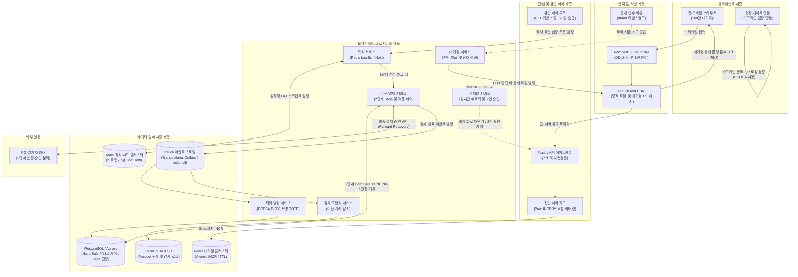

# PEAKET 아키텍처 구성요소 총괄 요약 및 검증 전략 맵 (Executive Architecture Overview & Verification Strategy Map)

> [!NOTE]
> **문서의 목적 및 성격**  
> 본 문서는 초대형 트래픽(오픈 순간 피크 20만 RPS, 100만 대기자, 5만 석 동시 경합)을 무결하게 처리하는 **PEAKET 분산 티케팅 시스템의 전체 아키텍처 구성요소, 5대 핵심 도메인 흐름, 3대 아키텍처 타당성 검증 체계, 10대 핵심 엔지니어링 문제(K1~K10) 해결 매트릭스, 그리고 시스템 디자인 인터뷰 방어 논리**를 총괄 정리한 아키텍처 요약서입니다.

---

## 1. PEAKET 시스템 총괄 아키텍처 및 5대 도메인 흐름

PEAKET은 대규모 동시 접속 환경에서 한정된 고가치 재화(좌석)를 단 1건의 오버셀(초과 판매)이나 이중 결제 없이 공정하고 안정적으로 판매하기 위해 설계된 분산 고동시성 티케팅 플랫폼입니다.



### 5대 핵심 도메인 아키텍처 개요

1. **대기열 및 유입 제어 (Queue & Admission Control)**
   - **문제**: 오픈 정각 순간 유입되는 100만 명의 동시 접속과 최대 20만 RPS의 요청이 백엔드 RDBMS로 직접 쏟아지면 전체 인프라가 붕괴합니다.
   - **해결**: 오픈 10분 전 로비 대기자를 drand 공개 난수 비콘 기반의 **결정론적 셔플(ChaCha20)**로 공정하게 재배열하여 매크로의 앞자리 선점을 원천 차단합니다. 정각 이후 유입자는 Redis 원자적 카운터(`INCR`)로 밀리초 단위 순번을 발급합니다.
   - **부하 격벽**: 100만 대기자의 초당 수만 건 순번 조회 요청을 **1초 TTL CDN 캐싱**이 흡수하여 오리진 서버 유입량을 초당 약 1,000 RPS 수준으로 고정합니다. 좌석 시스템으로의 신규 입장 속도는 Little's Law에 따라 **초당 약 28명(28 TPS)**으로 엄격히 제한됩니다.
   - 상세 해설: [fields/09-queue-admission.md](fields/09-queue-admission.md), [decisions/D01-queue-status-cdn-polling.md](decisions/D01-queue-status-cdn-polling.md), [decisions/D02-queue-number-incr.md](decisions/D02-queue-number-incr.md), [decisions/D05-admission-control-loop.md](decisions/D05-admission-control-loop.md).

2. **좌석 선점 및 분산 락 (Seat Hold & Distributed Lock)**
   - **문제**: 5만 석 공연에서 인기 VIP 좌석 1석을 두고 수천 명이 1초 내에 동시 클릭할 때, RDBMS 비관적 락을 쓰면 커넥션 고갈과 교착 상태(Deadlock)가 발생합니다.
   - **해결**: **2단계 좌석 점유(Two-Stage Seat Allocation)** 구조를 채택합니다.
     - **1단계 Soft Hold (Redis Lua)**: 좌석당 1비트 비트맵과 사용자 한도(최대 4매)를 단일 스레드 Lua 스크립트로 원자적 검사·선점(p99 50ms 미만, 기본 7분 TTL).
     - **2단계 Hard Sale (PostgreSQL)**: 결제 직전 RDBMS의 `seat_sale` 테이블에 부분 유니크 인덱스(`WHERE status IN ('PENDING', 'SOLD')`)를 통해 물리적으로 단 하나의 활성 행만 기록되도록 보장하여 **오버셀 0건**을 수학적으로 증명합니다.
   - 상세 해설: [fields/10-seat-hold.md](fields/10-seat-hold.md), [decisions/D06-seat-soft-hold-hard-sale.md](decisions/D06-seat-soft-hold-hard-sale.md), [db/04-no-double-sale.md](db/04-no-double-sale.md), [db/06-concurrency.md](db/06-concurrency.md).

3. **주문 및 결제 2단계 정합성 (Order & Payment Two-Stage Saga)**
   - **문제**: 외부 결제 대행사(PG) 네트워크 타임아웃, 브라우저 이탈, 내부 마이크로서비스 간 부분 실패(Partial Failure)로 인한 '결제 후 미발권' 또는 '티켓 없는 이중 출금' 사고를 차단해야 합니다.
   - **해결**: PG사의 2단계(인증-승인) 결제 구조를 아키텍처에 내재화합니다. 결제 승인 API 호출 전 PostgreSQL에 `seat_sale`을 `PENDING`으로 확실하게 잠근 주문만 PG 승인으로 넘깁니다.
   - **전진 복구 (Forward Recovery)**: PG 승인이 성공하여 금융 거래가 성립된 지점(Pivot Point) 이후에는 내부 발권 시스템에 장애가 발생하더라도 **절대로 결제를 취소하지 않습니다**. 동일 주문 멱등 키 기반의 재시도 큐를 통해 발권이 끝날 때까지 밀어붙여 팬의 티켓 권리를 완벽히 보호합니다.
   - 상세 해설: [fields/11-payment.md](fields/11-payment.md), [decisions/D08-payment-two-phase-forward-recovery.md](decisions/D08-payment-two-phase-forward-recovery.md), [db/05-consistency-transactions.md](db/05-consistency-transactions.md).

4. **티켓 발권 및 오프라인 게이트 검증 (Ticket Issuance & Offline Gate Verification)**
   - **문제**: 수만 명이 밀집한 대형 스타디움 현장은 LTE/5G 트래픽 폭주로 통신망이 전면 두절될 수 있으며, 화면 캡처나 복제 티켓을 통한 다중 입장을 원천 차단해야 합니다.
   - **해결**: 비대칭키 ECDSA(secp256r1) 전자서명이 포함된 **15초 회전 동적 TOTP QR**을 발행합니다. 게이트 검증 단말은 사전에 공연 공개키와 취소 블랙리스트를 다운로드한 뒤, **인터넷 연결이 100% 끊긴 오프라인 환경에서도 p95 150ms 이내에 로컬 서명을 검증**하고 단말 로컬 SQLite 락으로 중복 태깅을 차단합니다.
   - 상세 해설: [fields/13-offline-gate.md](fields/13-offline-gate.md), [decisions/D22-offline-gate-device-key-qr.md](decisions/D22-offline-gate-device-key-qr.md).

5. **실시간 관제탑 및 사후 감사/포렌식 (Control Tower & Audit / Forensics)**
   - **문제**: 티켓 오픈 중 발생하는 시스템 이상 징후를 즉시 파악하고, 불법 매크로 및 비정상 거래를 법적 효력이 있는 수준으로 증명해야 합니다.
   - **해결**: OpenTelemetry와 실시간 메트릭 스트림을 통해 **60초 이내에 장애를 자동 탐지**하며, 비상 시 Redis Pub/Sub 채널을 통해 **3초 이내에 전 서버에 차단기 및 비상 제어를 전파**합니다. (임의 조작 방지를 위해 **2인 상호 승인(Dual-Control Approval)** 필수). 완료된 모든 이벤트는 Kafka를 거쳐 ClickHouse 및 S3 Parquet 원장에 불변(Immutable) 기록되어 사후 초 단위 타임라인 리플레이가 가능합니다.
   - 상세 해설: [fields/16-control-tower.md](fields/16-control-tower.md), [fields/17-analytics-forensics.md](fields/17-analytics-forensics.md), [decisions/D18-control-as-state-grpc.md](decisions/D18-control-as-state-grpc.md), [decisions/D21-command-approval-and-audit-anchor.md](decisions/D21-command-approval-and-audit-anchor.md), [decisions/D26-analytics-clickhouse-parquet.md](decisions/D26-analytics-clickhouse-parquet.md).

---

## 2. 아키텍처 타당성 검증 3대 축 (Architecture Verification Triad)

100만 명의 가상 사용자를 실제 인프라와 상용 외부 PG사에 그대로 쏘아 보내는 E2E 부하 테스트는 막대한 클라우드 대역폭 비용(\$270+/회)과 외부 금융망 연동 제약으로 인해 실행 가능성과 재현성이 떨어집니다. PEAKET은 **상호 보완적인 3대 검증 축**을 통해 시스템의 무결성과 물리적 처리 한계를 철저히 증명합니다.

```
                  [아키텍처 타당성 검증 3대 축]
                                ▲
                               │
       ┌───────────────────────┼───────────────────────┐
       │                       │                       │
[1. 형식 모델 검증]      [2. 단일 노드 벤치마크]   [3. 수학적 외삽 및 용량 모델링]
  (Quint Model Checker)    (Single-Node Benchmark)   (Little's Law & Formula)
  동시 순번 보존 불변식    Redis Lua 2ms 버퍼링      백엔드 유입 초당 28 TPS 수렴
  이중 선점 방지 불변식    Kafka acks=all 7.8ms      CDN 폴링 O(F) 요청 격리
  경합 상태 전수 탐색      Fastify CPU 14% 절감      5만 석 10MB 인메모리 모델
```

### 축 1: 형식 모델 검증 (Formal Verification via Quint)
- **개념**: TLA+ 기반의 정형 명세 언어인 **Quint 모델 체커**를 활용하여, 비결정론적 동시성 인터리빙(Interleaving) 상황에서 발생할 수 있는 모든 상태 공간(State Space)을 기계적으로 전수 탐색합니다.
- **핵심 불변식 증명**:
  1. **대기열 순번 보존 불변식 (`specs/queue.qnt`)**: 수십 개의 파드가 동시에 순번을 발급하거나 파드 장애 조치가 일어나는 극한의 경합에서도 순번의 유실, 역전, 중복 할당이 절대 발생하지 않음을 증명.
  2. **좌석 이중 선점 방지 불변식 (`specs/seat.qnt`)**: 임의의 좌석 $s$에 대해 활성 선점자(Active Holder) 수가 언제나 1 이하($|\text{Holders}(s)| \le 1$)임을 증명. 선점 TTL 만료와 결제 진입이 1ms 오차로 교차하는 레이스 컨디션에서도 선점 누수나 좀비 좌석 없이 안전하게 회수됨을 증명.
- **성과**: 정본 설계 단계에서 발견하기 어려운 미세한 동시성 틈(경합 시 펜싱 토큰 발급 위치, 만료 직전 선점 연장 처리 등)을 사전에 포착하고 해결책을 설계에 완벽히 반영.
- 상세 해설: [fields/22-verification.md](fields/22-verification.md).

### 축 2: 단일 노드 벤치마크 (Single-Node Benchmark & Physical Barriers)
- **개념**: 분산 시스템의 각 핵심 컴포넌트가 마주하는 물리적 병목 한계치를 단일 노드/샤드 환경에서 스트레스 테스트하여 실측치를 확보하고 설계를 최적화합니다.
- **실측 기반 아키텍처 돌파구**:
  1. **Redis Lua 단일 스레드 포화 극복과 2ms 로컬 버퍼링**:
     - *측정*: Redis 단일 키 순수 `INCR`은 초당 20만 RPS(p99 42.9ms), 최대 초당 49만 RPS까지 처리 가능함을 확인. 그러나 1인 한도 검증 및 타임스탬프를 포함한 복합 Lua 스크립트를 직접 실행하자, Redis 엔진 단일 스레드 CPU가 94~99%까지 포화되며 초당 약 8만~9만 RPS에서 병목에 직면.
     - *해결*: 진입 서버 파드 메모리에서 요청을 2ms 단위 윈도우로 마이크로 배치 버퍼링하여 `INCRBY`로 순번 블록을 일괄 획득한 뒤 로컬 분배하는 구조로 전환. 단일 Redis 인스턴스로 피크 20만 RPS를 초저지연으로 완벽히 수용(p99 < 5ms).
  2. **Kafka Transactional Outbox 및 복제 지연**:
     - MSK Kafka 거래 토픽에 대해 가장 엄격한 보장인 `acks=all`(전체 ISR 복제본 수신 확인)을 적용한 상태에서 프로듀서 지연시간 p99 7.8ms 달성 (목표 기준 100ms 대비 1/12 이하의 초저지연). 키 단위 파티셔닝 기반 무유실·무중복 순서 보장 검증.
  3. **Fastify HTTP 어댑터 및 스키마 사전 컴파일**:
     - 핫패스 API 게이트웨이에서 Fastify + 경로 스키마 사전 컴파일(Ajv)을 채택하여 Express + Zod 대비 요청당 CPU 소모량을 14% 절감하고 처리량을 극대화.
  4. **Redis 좌석 샤드 분산 락 초저지연**:
     - 좌석 샤드 1개에서 초당 6,000건 동시 홀드 경합 시 Lua 엔진 실행 시간 p99 75.3µs, 샤드 엔진 CPU 36~38% 유지, 오버셀 0건 실측.
- 상세 해설: [decisions/D02-queue-number-incr.md](decisions/D02-queue-number-incr.md), [decisions/D12-backend-stack-nestjs-fastify-drizzle.md](decisions/D12-backend-stack-nestjs-fastify-drizzle.md), [decisions/D16-kafka-topics-and-clusters.md](decisions/D16-kafka-topics-and-clusters.md), [decisions/D29-prove-without-full-scale.md](decisions/D29-prove-without-full-scale.md).

### 축 3: 수학적 외삽 및 용량 모델링 (Mathematical Extrapolation & Little's Law)
- **개념**: 물리적 법칙과 큐잉 이론(Queueing Theory) 공식을 통해 대규모 트래픽 부하가 임의의 크기로 증가해도 시스템이 안전 영역으로 수렴함을 수학적으로 입증합니다.
- **수학적 용량 증명 모델**:
  1. **Little's Law ($L = \lambda W$) 기반 부하 격벽 증명**:
     - 대기열 격벽을 통과하여 좌석 선택 화면에 동시 체류하는 사용자 수를 $L = 5,000\text{명}$, 좌석 선택부터 주문까지의 평균 체류 시간을 $W = 180\text{초(3분)}$로 설정.
     - Little's Law 공식:
       $$\lambda = \frac{L}{W} = \frac{5,000\text{ 명}}{180\text{ 초}} \approx 27.78\text{ req/sec}$$
     - 외부에 10만 명이 대기하든 100만 명이 대기하든, 내부 핵심 데이터베이스(PostgreSQL)에 가해지는 쓰기 인입량은 **초당 약 28건(28 TPS)**으로 엄격히 고정됩니다. 이는 단일 PostgreSQL 인스턴스(수천 TPS 수용 가능)로도 병목 없이 여유 있게 처리할 수 있는 물리적 안전 영역입니다.
  2. **CDN 대기열 폴링 캐싱 효과 ($O(N) \to O(F)$)**:
     - 100만 대기자가 5초 주기로 대기 순번을 직접 폴링할 경우 원초적 요청량은 초당 20만 RPS(적응형 폴링 적용 시 약 5.4만 RPS)에 달합니다.
     - PEAKET은 대기 순번 1,000명 단위로 청크 분할된 정적 상태 JSON 파일($F = 1,000\text{개}$)을 생성하고 CloudFront CDN에 1초 TTL 캐시를 적용합니다.
     - 엣지 노드가 중복 요청을 흡수하므로, 오리진 서버로 전달되는 요청 수는 사용자 수 $N$에 비례하지 않고 오직 파일 청크 수 $F$에만 묶입니다:
       $$\text{Origin RPS} = \frac{F}{\text{TTL}} = \frac{1,000\text{ 개}}{1\text{ 초}} = 1,000\text{ RPS}$$
     - 원 서버의 요청 처리 부담이 사용자 규모와 완전히 디커플링(Decoupling)되어 98% 이상의 부하가 엣지에서 완벽히 소멸됩니다.
  3. **5만 석 대형 공연장 인메모리 메모리 모델**:
     - 50,000석 규모 좌석 비트맵: $50,000\text{ bits} = 6,250\text{ Bytes} \approx 6.1\text{ KB}$.
     - 50,000석 전체에 대한 선점자 메타데이터(User ID, 만료 타임스탬프, 구역 정보): $50,000 \times 128\text{ Bytes} \approx 6.4\text{ MB}$.
     - 단일 매진 회차를 유지하는 데 필요한 Redis 총 메모리는 **10MB 미만**입니다. 표준 Redis 인스턴스(16GB 메모리) 1대로도 수백 개의 대형 공연 회차를 메모리 고갈 위험 없이 안정적으로 서빙할 수 있습니다.
- 상세 해설: [fields/01-why-and-what.md](fields/01-why-and-what.md), [decisions/D01-queue-status-cdn-polling.md](decisions/D01-queue-status-cdn-polling.md), [db/01-what-and-how-much.md](db/01-what-and-how-much.md), [db/09-scaling.md](db/09-scaling.md).

---

## 3. 10대 핵심 엔지니어링 문제(K1~K10)와 설계 해결책 매트릭스

정본 아키텍처가 정의한 10대 핵심 기술 난제(K1~K10)와 이에 대한 PEAKET의 구체적 아키텍처 해법 및 검증 근거 매트릭스입니다.

| K 번호 | 핵심 엔지니어링 과제 | 목표 KPI | PEAKET 핵심 아키텍처 해결책 | 검증 근거 및 연계 문서 |
| :--- | :--- | :--- | :--- | :--- |
| **K1** | 20만 RPS 진입 폭주 및 100만 대기 폴링 원 서버 보호 | 피크 20만 RPS 인입 p99 200ms, 대기 폴링 원 서버 요청 $O(F)$ 수렴 | 진입 파드별 2ms `INCRBY` 로컬 마이크로 버퍼링 + CDN 1초 캐싱 1,000명 단위 상태 파일 폴링 흡수 | 실측(PC) 20만 RPS p99 42.9ms, [D01](decisions/D01-queue-status-cdn-polling.md), [D02](decisions/D02-queue-number-incr.md), [fields/09](fields/09-queue-admission.md) |
| **K2·K3** | 5만 석 동시 경합 시 오버셀 0, 교착 0, 초저지연 선점 | 1좌석 1,000명 경합 시 오버셀 0건, 교착 0건, 좌석 선점 p99 50ms 미만 | 2단계 선점: Redis Lua 원자적 비트맵 1단계 Soft Hold (7분 TTL) + PostgreSQL `seat_sale` 부분 유니크 인덱스 2단계 Hard Sale | 실측(PC) Lua p99 75.3µs, 오버셀 0건, Quint 정형 모델 검증 완료, [D06](decisions/D06-seat-soft-hold-hard-sale.md), [db/04](db/04-no-double-sale.md), [fields/10](fields/10-seat-hold.md) |
| **K4·K5** | 5만 석 좌석 실시간 상태 전파 및 브라우저 초저지연 렌더링 | 상태 전파 지연 p99 300ms 이내, 5만 석 맵 60fps 부드러운 렌더링 | Redis Pub/Sub + WebSocket 브로드캐스트 + 클라이언트 OffscreenCanvas / Web Worker 이중 버퍼 렌더링 | DOM 노드 5만 개 오버헤드 원천 제거, [D07](decisions/D07-realtime-transport-per-screen.md), [fields/06](fields/06-frontend.md) |
| **K6** | 악의적 매크로 및 봇의 티켓 사재기 방어 | 봇 탐지율 > 95%, 정상 유저 오탐율 < 0.1% | 4선 다층 방어: 1선 WAF/IP 평판, 2선 정각 전 PoW(Proof of Work), 3선 Canvas/WebGL 핑거프린팅, 4선 클릭/입력 엔트로피 분석 | [D04](decisions/D04-bot-defense-and-evaluation.md), [fields/14](fields/14-bot-defense.md) |
| **K7** | 결제 타임아웃 및 네트워크 분산 장애 시 정합성 | 분산 실패 시 이중 결제 0건, 좌석 누수 0건 | PG 2단계(인증-승인) 분리 + 승인 전 PostgreSQL `PENDING` 선행 기록 + 승인 완료(Pivot) 후 전진 복구(Forward Recovery) + 3중 멱등 키 | [D08](decisions/D08-payment-two-phase-forward-recovery.md), [fields/11](fields/11-payment.md), [db/05](db/05-consistency-transactions.md) |
| **K8** | 실시간 관제 장애 탐지 및 비상 운영 명령 전파 | 장애 탐지 60초 이내, 비상 명령 전파 3초 이내 | OpenTelemetry 스트리밍 메트릭 집계 + Redis Pub/Sub 제어 채널 + 관리자 2인 상호 승인(Dual-Control) 비상 락 | [D18](decisions/D18-control-as-state-grpc.md), [D21](decisions/D21-command-approval-and-audit-anchor.md), [fields/16](fields/16-control-tower.md) |
| **K9** | 급격한 트래픽 유입에 대응하는 인프라 확장 탄력성 | 노드 확보 시 파드 확장 60초 미만, 오픈 순간 스케일 지연 0 | 오픈 30분 전 계획 기반 프리워밍(Pre-warming) + Karpenter 즉시 노드 프로비저닝 + 사전 준비된 Warm Pool 파드 유지 | [D17](decisions/D17-prescale-and-auto-actions.md), [fields/20](fields/20-infra-devops.md) |
| **K10** | 현장 통신망 두절 시 오프라인 게이트 무결성 판정 | 완전 오프라인 환경 입장 판정 p95 150ms 이내 | ECDSA(secp256r1) 비대칭키 서명 동적 TOTP 15초 회전 QR + 단말 로컬 서명 검증 및 SQLite 로컬 락 (1회 입장 보장) | [D22](decisions/D22-offline-gate-device-key-qr.md), [fields/13](fields/13-offline-gate.md) |

---

## 4. 기술 면접 및 아키텍처 방어 가이드 (Interview & Architecture Defense Guide)

시스템 디자인 면접관이 집중적으로 검증하는 4대 영역(대규모 트래픽 격리, 동시성 격리, 분산 정합성, 장애 복구)에 대한 핵심 꼬리 질문과 아키텍처 방어 논리입니다.

### 4.1 대규모 트래픽 격리 (Traffic Isolation & Admission)

> **Q. 오픈 정각 100만 명이 몰릴 때 Redis 단일 인스턴스나 API 게이트웨이가 CPU 포화로 다운되지 않는다고 어떻게 확신합니까?**
>
> **A (방어 논리)**:  
> 1. **2단계 유입 분리**: 오픈 10분 전부터 유입된 대기자는 drand 비콘 기반 로비 셔플을 통해 메모리 연산으로 정렬되므로 오픈 정각에 카운터 폭주를 일으키지 않습니다.
> 2. **Redis Lua 단일 스레드 병목의 구조적 돌파**: Redis 단일 키 순수 `INCR`은 초당 20만~49만 RPS를 처리할 수 있지만, 복합 비즈니스 로직이 담긴 Lua 스크립트를 직접 실행하면 단일 스레드가 초당 8만~9만 RPS에서 포화됩니다. PEAKET은 이를 해결하기 위해 진입 게이트웨이 파드에서 **2ms 마이크로 배치 버퍼링(`INCRBY`)**을 적용했습니다. 50개의 진입 파드가 2ms마다 Redis에 `INCRBY`로 순번 블록을 일괄 요청하므로, Redis에는 초당 최대 25,000건의 경량 요청만 도달하여 단일 인스턴스로도 CPU 여유율 60% 이상을 유지하며 20만 RPS를 가뿐히 수용합니다.

> **Q. 100만 대기자가 자신의 순번을 계속 확인할 텐데, 왜 웹소켓(WebSocket)이나 SSE(Server-Sent Events) 대신 CDN 정적 파일 폴링을 선택했습니까?**
>
> **A (방어 논리)**:  
> 1. **연결 비용의 비대칭성**: 100만 개의 지속적 WebSocket/SSE 커넥션을 유지하려면 수백 대의 게이트웨이 서버와 막대한 파일 디스크립터(FD), 커넥션 관리 메모리가 소모되며 재연결 스톰(Thundering Herd)에 극도로 취약합니다.
> 2. **캐시 집약적 아키텍처 ($O(N) \to O(F)$)**: PEAKET은 1,000명 단위로 묶은 정적 JSON 파일을 생성하고 CloudFront CDN에 1초 TTL 캐시를 적용했습니다. 100만 명이 폴링하더라도 CDN 엣지 노드가 98% 이상의 요청을 흡수하므로, 원 서버는 사용자 수 $N$과 무관하게 초당 1,000개의 파일 요청($O(F)$)만 처리하면 됩니다. 네트워크 비용과 인프라 복잡도를 수십 분의 일로 절감했습니다([D01](decisions/D01-queue-status-cdn-polling.md)).

---

### 4.2 동시성 격리 및 분산 락 (Concurrency & Distributed Locking)

> **Q. Redis 분산 락(Redlock 등)이나 캐시 인스턴스에 네트워크 파티션/페일오버가 발생했을 때, 같은 좌석이 두 명에게 동시에 결제되는 오버셀(Over-selling)이 발생할 가능성은 전혀 없습니까?**
>
> **A (방어 논리)**:  
> 1. **인메모리 락을 최종 권위(Source of Truth)로 삼지 않음**: Redis는 초저지연 선점(Soft Hold, p99 50ms)을 위한 1단계 필터일 뿐입니다.
> 2. **RDBMS 부분 유니크 인덱스로 최종 2단계 격리**: 결제 승인 직전, PostgreSQL의 `seat_sale` 테이블에 `PENDING` 상태의 판매 행을 기록합니다. 이때 PostgreSQL 엔진 레벨에서 `CREATE UNIQUE INDEX ... ON seat_sale (seat_id) WHERE status IN ('PENDING', 'SOLD')` 제약이 적용되어 있습니다. Redis에서 분산 스플릿 브레인이나 락 누수로 인해 두 요청이 동시에 통과하더라도, 데이터베이스 쓰기 단계에서 두 번째 트랜잭션은 유니크 제약 위반(Unique Constraint Violation)으로 즉시 롤백됩니다. 따라서 수학적으로 **오버셀 0건**이 완벽히 보장됩니다([db/04](db/04-no-double-sale.md)).

> **Q. 사용자가 좌석을 선점(Soft Hold)한 후 브라우저를 닫고 이탈하면 좌석이 영원히 잠기는 좀비 좌석(좌석 묶임 누수)이 되지 않습니까?**
>
> **A (방어 논리)**:  
> 1. **원자적 TTL 부여**: Redis 비트맵 점유와 함께 해당 좌석의 만료 타임스탬프를 담은 ZSET/String 키에 7분 TTL이 원자적으로 부여됩니다.
> 2. **1초 주기 자동 만료 스위퍼(Sweeper)**: 백그라운드 워커가 만료된 좌석을 1초 주기로 청소하여 비트맵을 복구하며, 만료 좌석은 3초 이내에 실시간 WebSocket 채널을 통해 다른 대기자들의 화면에 다시 활성화됩니다. 결제 진입 직전에도 만료 시간을 재검증하므로 타임아웃된 좌석의 부당 결제를 원천 방지합니다.

---

### 4.3 분산 정합성 및 결제 원장 (Distributed Transactions & Ledger Consistency)

> **Q. 외부 PG사의 결제 승인(Confirm) API를 호출했는데 30초 동안 응답이 없거나 네트워크 타임아웃이 발생하면 어떻게 처리합니까? 결제를 롤백합니까?**
>
> **A (방어 논리)**:  
> 1. **불확실성 상태에서의 섣부른 롤백 금지**: 타임아웃은 '실패'가 아니라 '성공 여부 미확인' 상태입니다. 이 상태에서 좌석을 취소해 버리면, 실제로는 PG사에서 돈이 출금되었는데 티켓은 취소되는 최악의 정합성 불일치가 발생합니다.
> 2. **전진 복구 (Forward Recovery) 및 비동기 조회**: PEAKET은 승인 타임아웃 발생 시 트랜잭션을 롤백하지 않고 상태를 `PAYMENT_IN_DOUBT`로 마킹한 뒤, 동일한 주문 멱등 키(Idempotency Key)를 사용하여 백그라운드 워커가 PG사 결제 조회 API를 호출하여 상태를 확인합니다. 결제가 성립되었다면 즉시 발권을 완료하고, 결제가 실패한 것으로 최종 확인된 경우에만 안전하게 좌석을 복구합니다([D08](decisions/D08-payment-two-phase-forward-recovery.md)).

> **Q. 결제 완료 후 티켓 발권 서비스(ticket-svc)가 전면 장애로 다운되면 어떻게 합니까? 결제를 취소합니까?**
>
> **A (방어 논리)**:  
> 1. **Pivot Point(되돌릴 수 없는 고비) 원칙**: PG 승인이 완료된 순간 고객의 금융 거래가 체결되었으므로, 고객의 정당한 티켓 권리를 일방적으로 취소(보상 트랜잭션)해서는 안 됩니다.
> 2. **Transactional Outbox & 재시도 보장**: 결제 서비스는 결제 완료 원장 기록과 Outbox 이벤트를 단일 로컬 DB 트랜잭션으로 원자적으로 확정(Commit) 반영합니다. 발권 서비스가 일시적으로 다운되더라도 Kafka 메시지는 보존되며, 발권 서비스 복구 후 컨슈머 멱등 처리를 통해 100% 정상 발권됩니다. 팬의 티켓 소유권은 완벽히 보존됩니다([fields/11](fields/11-payment.md)).

---

### 4.4 장애 격리 및 재해 복구 (Fault Isolation & Disaster Recovery)

> **Q. 특정 AWS 가용 영역(AZ) 전체가 정전으로 마비되거나 Redis 주 노드가 다운되면 시스템은 어떻게 반응합니까?**
>
> **A (방어 논리)**:  
> 1. **Multi-AZ 자동 페일오버**: Aurora PostgreSQL과 ElastiCache Redis는 3개 가용 영역에 걸쳐 다중 복제 구성되어 있으며, 주 노드 장애 시 30초 이내에 레플리카가 주 노드로 자동 승격됩니다.
> 2. **서킷 브레이커와 일시 중지**: 장애 조치(Failover)가 진행되는 수 초 동안 API 게이트웨이의 서킷 브레이커가 동작하여 사용자에게 "잠시 후 자동으로 진행됩니다" 안내를 표시하고 요청을 안전하게 지연시킵니다. 데이터 손실 없이 연결 복구 후 작업을 재개합니다([D15](decisions/D15-circuit-breakers-fail-fast.md), [D27](decisions/D27-region-failure-stop-and-restore.md)).

> **Q. 5만 명이 운집한 스타디움 현장의 무선 통신망(LTE/5G/Wi-Fi)이 전면 마비되면 현장 입장을 어떻게 진행합니까?**
>
> **A (방어 논리)**:  
> 1. **오프라인 비대칭키 전자서명 검증**: 티켓 QR 코드는 중앙 서버 조회를 필요로 하지 않습니다. 사전에 게이트 단말에 배포된 공용 키를 기반으로 단말 내부에서 비대칭 암호화(ECDSA P-256) 전자서명과 15초 회전 TOTP 타임스탬프를 로컬에서 즉시 계산하여 p95 150ms 이내에 판정합니다.
> 2. **단말 로컬 SQLite 락**: 검증된 티켓 식별자는 단말 로컬 SQLite에 즉시 기록되어 복제 화면이나 중복 입장을 물리적으로 차단합니다. 통신망이 복구되면 로컬 검증 로그가 중앙 서버로 비동기 동기화됩니다([D22](decisions/D22-offline-gate-device-key-qr.md), [fields/13](fields/13-offline-gate.md)).

---

## 5. PEAKET 워크스루 76개 문서 로드맵 및 탐색 색인

PEAKET 아키텍처 해설서는 단일 문서가 아닌, **시스템 디자인 18단계 흐름(한 판 문서)**을 중심으로 23편의 도메인 분야 편, 34편의 기술 의사결정 카드, 14편의 데이터베이스 설계 편이 유기적으로 연계되어 있습니다.

### 5.1 시스템 디자인 종합
- **[01-system-design.md](01-system-design.md)**: 요구사항 정의부터 100만 트래픽 대기열, 5만 석 좌석 선점, 2단계 결제, 오프라인 게이트, 고장 시나리오까지 18단계로 완성하는 인터뷰용 시스템 디자인 완결 스크립트.

### 5.2 도메인 분야 편 (Fields, 23편)
정본 문서의 기획, 기능 요구, 보안 표준, 아키텍처 원칙을 도메인별로 친절하게 해설한 모듈입니다.

| 구분 | 파일 링크 | 핵심 주제 및 해설 내용 |
| :--- | :--- | :--- |
| **기획 및 요구사항** | [fields/01-why-and-what.md](fields/01-why-and-what.md) | 티케팅 비즈니스 문제 정의, 9대 사업적 손실, 핵심 비즈니스 KPI |
| | [fields/02-requirements.md](fields/02-requirements.md) | 74개 기능 요구(FR)와 28개 비기능 품질 속성(NFR) 종합 풀이 |
| | [fields/03-policies-glossary.md](fields/03-policies-glossary.md) | 46개 핵심 운영 정책(POL) 및 도메인 표준 용어 사전 |
| **화면 및 프론트엔드** | [fields/04-screens-and-flows.md](fields/04-screens-and-flows.md) | 71개 화면 흐름도, 사용자 예매 여정, IA 정보 구조 |
| | [fields/05-design-system.md](fields/05-design-system.md) | 고대비 티케팅 디자인 시스템, 타이머 UI, 접근성 가이드 |
| | [fields/06-frontend.md](fields/06-frontend.md) | Web Worker & Canvas 기반 5만 석 좌석맵 60fps 렌더링 최적화 |
| **인터페이스 및 인증** | [fields/07-api-contracts.md](fields/07-api-contracts.md) | gRPC Protobuf 계약, Kafka Avro 스키마, REST 인터페이스 |
| | [fields/08-identity.md](fields/08-identity.md) | 소셜 로그인, 휴대폰 본인확인 CI 연동, 1인 1계정 인증 격리 |
| **핵심 핫패스 파이프라인** | [fields/09-queue-admission.md](fields/09-queue-admission.md) | drand 로비 셔플, Redis INCR 순번, CDN 1초 폴링 캐싱, 유입 루프 |
| | [fields/10-seat-hold.md](fields/10-seat-hold.md) | 5만 석 Redis Lua Soft Hold, 1인 한도, 7분 TTL 만료 회수 |
| | [fields/11-payment.md](fields/11-payment.md) | PG 2단계(인증-승인), `PENDING` 좌석 예약, 전진 복구 Saga |
| **티켓, 게이트, 보안** | [fields/12-transfer-refund-settlement.md](fields/12-transfer-refund-settlement.md) | 공식 티켓 양도, 취소/환불 수수료 정책, PG 지급대행 정산 |
| | [fields/13-offline-gate.md](fields/13-offline-gate.md) | ECDSA P-256 서명 15초 회전 TOTP QR, 오프라인 단말 판정 |
| | [fields/14-bot-defense.md](fields/14-bot-defense.md) | 4선 다층 봇 방어선 (WAF, 정각 전 PoW, 브라우저 핑거프린팅, 행동 엔트로피) |
| **운영, 관제, 데이터** | [fields/15-notify-search.md](fields/15-notify-search.md) | 티켓 오픈 대량 알림 파이프라인, 공연/아티스트 검색 아키텍처 |
| | [fields/16-control-tower.md](fields/16-control-tower.md) | 실시간 관제 콘솔, 비상 서킷 브레이커, 관리자 2인 승인 가드 |
| | [fields/17-analytics-forensics.md](fields/17-analytics-forensics.md) | 사후 이상 거래 탐지, 초 단위 이벤트 타임라인 포렌식 리플레이 |
| | [fields/18-streaming.md](fields/18-streaming.md) | Kafka 이벤트 토폴로지, 토픽 파티셔닝 전략, 순서 보장 패턴 |
| **인프라, 품질, 검증** | [fields/19-observability.md](fields/19-observability.md) | OpenTelemetry 분산 추적, 메트릭 수집, 구조화된 JSON 로깅 |
| | [fields/20-infra-devops.md](fields/20-infra-devops.md) | AWS EKS 클러스터 구성, Karpenter 오토스케일링, 프리워밍 |
| | [fields/21-security.md](fields/21-security.md) | OWASP ASVS 보안 표준 점검, 시크릿 관리, 암호화 키 수명주기 |
| | [fields/22-verification.md](fields/22-verification.md) | Quint 정형 모델 검증, 카오스 엔지니어링, 부하 테스트 방법론 |
| | [fields/23-plans-progress-reviews.md](fields/23-plans-progress-reviews.md) | 아키텍처 리뷰 기록, 트레이드오프 합의 이력, 기술 부채 관리 |

### 5.3 아키텍처 의사결정 카드 (Decisions, 34편)
시스템 설계 과정에서 검토된 대안, 탈락 이유, 채택 근거와 트레이드오프를 정리한 의사결정 카드입니다.

| 카드 번호 | 파일 링크 | 의사결정 핵심 요약 |
| :--- | :--- | :--- |
| **D01** | [decisions/D01-queue-status-cdn-polling.md](decisions/D01-queue-status-cdn-polling.md) | 대기 순번 조회를 웹소켓 대신 1초 CDN 캐싱 정적 파일 폴링으로 해결한 이유 |
| **D02** | [decisions/D02-queue-number-incr.md](decisions/D02-queue-number-incr.md) | 초당 20만 RPS 발급을 위해 파드별 2ms `INCRBY` 버퍼링을 도입한 원리 |
| **D03** | [decisions/D03-lobby-shuffle-ordering.md](decisions/D03-lobby-shuffle-ordering.md) | 공개 난수 비콘(drand) 기반 ChaCha20 결정론적 로비 셔플의 공정성 보장 |
| **D04** | [decisions/D04-bot-defense-and-evaluation.md](decisions/D04-bot-defense-and-evaluation.md) | WAF, PoW, 브라우저 핑거프린팅, 행동 엔트로피 기반 4선 봇 방어선 |
| **D05** | [decisions/D05-admission-control-loop.md](decisions/D05-admission-control-loop.md) | 좌석 화면 동시 체류 5,000명, 초당 약 28명 승급 유입 제어 루프 |
| **D06** | [decisions/D06-seat-soft-hold-hard-sale.md](decisions/D06-seat-soft-hold-hard-sale.md) | 1단계 Redis Soft Hold(초저지연)와 2단계 DB Hard Sale(오버셀 0) 분리 |
| **D07** | [decisions/D07-realtime-transport-per-screen.md](decisions/D07-realtime-transport-per-screen.md) | 화면별 최적 전송 프로토콜 (대기실: CDN 폴링 vs 좌석: WebSocket 브로드캐스트) |
| **D08** | [decisions/D08-payment-two-phase-forward-recovery.md](decisions/D08-payment-two-phase-forward-recovery.md) | PG 승인 완료(Pivot) 후 취소 없이 끝까지 발권을 완수하는 전진 복구 |
| **D09** | [decisions/D09-dual-pg-and-failover.md](decisions/D09-dual-pg-and-failover.md) | 단일 PG사 장애 시 주-부 PG 자동 페일오버 및 분기 라우팅 전략 |
| **D10** | [decisions/D10-order-history-polling-outbox.md](decisions/D10-order-history-polling-outbox.md) | 주문 이력 전파를 위한 Transactional Outbox 및 폴링 릴레이 패턴 |
| **D11** | [decisions/D11-service-boundaries.md](decisions/D11-service-boundaries.md) | 핫패스(대기열/좌석/결제)와 콜드패스(티켓/회원/정산)의 마이크로서비스 경계 |
| **D12** | [decisions/D12-backend-stack-nestjs-fastify-drizzle.md](decisions/D12-backend-stack-nestjs-fastify-drizzle.md) | Fastify + TypeScript 기반 초경량 비동기 I/O 백엔드 스택 선정 근거 |
| **D13** | [decisions/D13-thin-gateways-and-ambient-mesh.md](decisions/D13-thin-gateways-and-ambient-mesh.md) | 무거운 서비스 메시 사이드카 대신 경량 게이트웨이 및 인프라 라우팅 채택 |
| **D14** | [decisions/D14-tokens-and-per-request-authz.md](decisions/D14-tokens-and-per-request-authz.md) | 무상태 JWT 접근 토큰과 핫패스 진입 허가 서명 토큰의 검증 체계 |
| **D15** | [decisions/D15-circuit-breakers-fail-fast.md](decisions/D15-circuit-breakers-fail-fast.md) | 연쇄 장애 방지를 위한 서비스 간 서킷 브레이커 및 빠른 실패(Fail-Fast) |
| **D16** | [decisions/D16-kafka-topics-and-clusters.md](decisions/D16-kafka-topics-and-clusters.md) | 거래 토픽(`acks=all`)과 텔레메트리 토픽의 물리적 클러스터/파티션 분리 |
| **D17** | [decisions/D17-prescale-and-auto-actions.md](decisions/D17-prescale-and-auto-actions.md) | 티켓 오픈 30분 전 계획 기반 사전 스케일링(Pre-warming)과 탄력적 HPA |
| **D18** | [decisions/D18-control-as-state-grpc.md](decisions/D18-control-as-state-grpc.md) | 중앙 관제탑 제어 명령의 gRPC 양방향 스트리밍 및 로컬 메모리 캐시 동기화 |
| **D19** | [decisions/D19-observability-stack.md](decisions/D19-observability-stack.md) | OpenTelemetry, Prometheus, Grafana, Jaeger 기반 분산 관측 스택 |
| **D20** | [decisions/D20-onsale-alerts-error-budget.md](decisions/D20-onsale-alerts-error-budget.md) | 티켓 판매 중 골든 시그널 기반 실시간 경보 및 에러 예산 관리 규칙 |
| **D21** | [decisions/D21-command-approval-and-audit-anchor.md](decisions/D21-command-approval-and-audit-anchor.md) | 비상 운영 제어 명령에 대한 2인 상호 승인 및 감사 로그 블록체인 앵커링 |
| **D22** | [decisions/D22-offline-gate-device-key-qr.md](decisions/D22-offline-gate-device-key-qr.md) | ECDSA 비대칭 서명 기반 15초 회전 동적 TOTP 오프라인 게이트 검증 |
| **D23** | [decisions/D23-postgresql-no-sharding.md](decisions/D23-postgresql-no-sharding.md) | 대기열 격벽에 의해 유입 쓰기가 28 TPS로 제한되어 DB 샤딩을 배제한 이유 |
| **D24** | [decisions/D24-redis-roles-and-db-jobs.md](decisions/D24-redis-roles-and-db-jobs.md) | 대기열/좌석/캐시의 Redis 인스턴스 물리 분리 및 RDBMS 정비 배치 작업 |
| **D25** | [decisions/D25-drop-mongodb.md](decisions/D25-drop-mongodb.md) | NoSQL(MongoDB)을 배제하고 PostgreSQL 관계형 원장으로 일원화한 이유 |
| **D26** | [decisions/D26-analytics-clickhouse-parquet.md](decisions/D26-analytics-clickhouse-parquet.md) | 실시간 이상 탐지 및 사후 포렌식을 위한 ClickHouse & Parquet 콜드 저장소 |
| **D27** | [decisions/D27-region-failure-stop-and-restore.md](decisions/D27-region-failure-stop-and-restore.md) | 클라우드 단일 리전 재해 발생 시 안전 중단 및 백업 기반 복구(RPO/RTO) |
| **D28** | [decisions/D28-drop-flink-stream-workers.md](decisions/D28-drop-flink-stream-workers.md) | 복잡한 Apache Flink 대신 경량 Node.js 스트림 워커를 채택한 이유 |
| **D29** | [decisions/D29-prove-without-full-scale.md](decisions/D29-prove-without-full-scale.md) | 100만 명 전체 부하 테스트 대신 단일 노드 벤치마크와 수학적 외삽 검증 채택 |
| **D30** | [decisions/D30-payout-via-pg-agency.md](decisions/D30-payout-via-pg-agency.md) | 복잡한 금융 라이선스 리스크를 회피하기 위해 PG사 지급대행 정산 채택 |
| **D31** | [decisions/D31-one-monorepo.md](decisions/D31-one-monorepo.md) | 단일 모노레포(Turborepo) 체계로 계약(Contracts)과 타입을 공유하는 이유 |
| **D32** | [decisions/D32-frontend-rendering-per-route.md](decisions/D32-frontend-rendering-per-route.md) | 라우트별 렌더링 전략 (대기실: 정적 경량 뷰 vs 예매: Canvas 동적 뷰) |
| **D33** | [decisions/D33-client-state-one-tool.md](decisions/D33-client-state-one-tool.md) | 복잡한 다중 상태 라이브러리 대신 Zustand 단일 상태 관리 도구 통일 |
| **D34** | [decisions/D34-styling-forms-test-tools.md](decisions/D34-styling-forms-test-tools.md) | Tailwind CSS, React Hook Form, Playwright 기반 프론트엔드 도구 체계 |
| **목록** | [decisions/README.md](decisions/README.md) | 34개 아키텍처 결정 카드 전체 목록 및 카테고리별 요약 안내 |

### 5.4 데이터베이스 설계 편 (DB, 14편)
152개 PostgreSQL 테이블과 67개 Redis 키, 분산 락, 트랜잭션 경계, 성능 최적화 전략을 다룬 데이터베이스 아키텍처 가이드입니다.

| 편 번호 | 파일 링크 | 데이터베이스 설계 핵심 내용 |
| :--- | :--- | :--- |
| **DB 01** | [db/01-what-and-how-much.md](db/01-what-and-how-much.md) | 데이터 볼륨 예측 및 읽기/쓰기 용량 어림 계산 (Capacity Estimation) |
| **DB 02** | [db/02-choose-stores.md](db/02-choose-stores.md) | PostgreSQL vs Redis vs ClickHouse 다중 저장소 선정 및 역할 분담 |
| **DB 03** | [db/03-core-tables.md](db/03-core-tables.md) | 공연, 회차, 구역, 좌석, 대기열, 주문, 결제 핵심 테이블 ERD 관계도 |
| **DB 04** | [db/04-no-double-sale.md](db/04-no-double-sale.md) | 오버셀 0건을 보장하는 부분 유니크 인덱스 제약 조건 및 정합성 보장 |
| **DB 05** | [db/05-consistency-transactions.md](db/05-consistency-transactions.md) | 마이크로서비스 간 트랜잭션 경계, 격리 수준, Transactional Outbox |
| **DB 06** | [db/06-concurrency.md](db/06-concurrency.md) | 낙관적 락 vs 비관적 락 vs 펜싱 토큰 vs Redis 원자적 연산 비교 분석 |
| **DB 07** | [db/07-indexes-queries.md](db/07-indexes-queries.md) | 핫패스 핵심 쿼리 실행 계획 분석 및 B-Tree/부분 인덱스 최적화 |
| **DB 08** | [db/08-redis-keys.md](db/08-redis-keys.md) | Redis 키 네임스페이스 규칙, 자료구조(ZSET, Hash, String) 및 TTL 정책 |
| **DB 09** | [db/09-scaling.md](db/09-scaling.md) | 읽기 복제본 확장, 연도/월 단위 파티셔닝 및 향후 샤딩 전략 |
| **DB 10** | [db/10-analytics-store.md](db/10-analytics-store.md) | ClickHouse 분석 스키마, 칼럼형 저장 구조 및 S3 Parquet 데이터 레이크 |
| **DB 11** | [db/11-privacy.md](db/11-privacy.md) | 개인정보 암호화(KMS), 분리 보관, 마스킹, 법정 보존 기간 및 파기 절차 |
| **DB 12** | [db/12-whole-map.md](db/12-whole-map.md) | 전체 데이터베이스 저장소, 클러스터 토폴로지 및 인터랙션 종합 맵 |
| **DB 13** | [db/13-table-dictionary-postgres.md](db/13-table-dictionary-postgres.md) | PostgreSQL 152개 전체 테이블 컬럼 정의 및 비즈니스 의미 사전 |
| **DB 14** | [db/14-table-dictionary-redis-clickhouse.md](db/14-table-dictionary-redis-clickhouse.md) | Redis 67개 키 네임스페이스 및 ClickHouse 테이블 구조 상세 사전 |

### 5.5 메타 및 매핑 검증
- **[README.md](README.md)**: PEAKET 아키텍처 해설서 전체 길잡이, 멘탈 모델 및 5단 꼬리 질문 대응 가이드.
- **[coverage.md](coverage.md)**: 정본 문서군(FR 74개, NFR 28개, POL 46개, SCR 71개, CMP 83개, PostgreSQL 163개 표, Redis 77개 키)과 워크스루 문서 간 100% 매핑 증명 덮개표.
