# PEAKET 시스템 디자인 한 판: 요구사항 도출부터 분산 아키텍처 완성까지

- **문서의 목적**: 본 문서는 대규모 분산 티케팅 시스템 **PEAKET**의 아키텍처를 시스템 디자인 인터뷰 형식으로 한 단계씩 풀어나가는 종합 해설서입니다. 비기능적 요구사항(100만 대기, 오버셀 0건, 피크 20만 RPS)에서 출발하여 단 하나의 완성된 시스템 아키텍처 다이어그램에 도달할 때까지 상자를 더해가며 단계별 설계 의도, 정량적 근거, 트레이드오프, 그리고 심층 방어 논리를 전개합니다.
- **설계의 본질과 핵심 원칙**: 초대형 티케팅 시스템의 진정한 병목은 데이터베이스 쓰기(RDBMS Write)가 아닙니다. 100만 명이 동시에 차례를 조회하는 **대기열 폴링 폭주**, 티켓 오픈 정각(T=0)의 **진입 스파이크**, 그리고 VIP 좌석 하나를 수천 명이 동시에 선점하려는 **초고동시성 쓰기 경합**입니다. PEAKET은 입구와 대기열 계층에서 유입량을 엄격히 통제하여 백엔드 쓰기를 상시 **초당 28건(28 TPS)** 수준으로 격리·안정화하는 전략을 취합니다.
- **아키텍처 타당성 근거**: 본 문서에서 제시하는 모든 트래픽 수치와 용량 한도는 정본 아키텍처(`docs/architecture.md`) 및 정량적 벤치마크 모델을 기반으로 하며, PoC 실측 수치와 수학적 외삽 모델을 결합하여 공학적 타당성을 엄격히 뒷받침합니다.

---

## 0. 한눈에 보기

### 0.1 18단계 인터뷰 여정 로드맵

전체 인터뷰 흐름은 필수적인 11개의 '핵심 단계(꼭)'와 심화 질문 대응을 위한 7개의 '확장 단계(시간 남으면)'로 구성됩니다. 핵심 단계 위주로 압축 구술할 경우 약 40분, 전체를 심도 있게 다룰 경우 약 60분 분량의 인터뷰 흐름을 형성합니다.

| 단계 | 인터뷰 주제 | 구분 | 예상 소요 시간 | 핵심 전달 가치 |
| :--- | :--- | :---: | :---: | :--- |
| **1** | 무엇을 만드나, 무엇이 어려운가 | **꼭** | 2분 | 시스템 목표, 4대 사용자, 통신판매중개자 법적 책임 |
| **2** | 규모 어림: 어디가 진짜 병목인가 | **꼭** | 5분 | 100만 대기 vs 28 TPS 백엔드 격리, 트래픽 수학적 분해 |
| **3** | 핵심 API와 데이터 뼈대 | **꼭** | 4분 | 엔드포인트 명세, 도메인별 DB 분리, 멱등성 보장 |
| **4** | 가장 단순한 설계(v0)와 깨지는 열 곳 | **꼭** | 3분 | 나이브 모놀리스의 10대 병목(K1~K10) 수학적 붕괴점 |
| **5** | 대기 상태 조회 폭주 막기 (K1) | **꼭** | 3분 | Atomic INCR + Bitmap, 1초 CDN 캐시, 적응형 폴링 |
| **6** | 정각 진입 몰림, 공정성, 봇 (K6) | **꼭** | 4분 | 10분 전 사전 로비, drand 비콘 기반 Commit-Reveal 셔플 |
| **7** | 몇 명씩 들여보낼까 | **꼭** | 3분 | 리더 200ms 제어 루프, In-Flight 보정, AIMD 피드백 |
| **8** | 같은 좌석을 두 번 팔지 않기 (K2·K3) | **꼭** | 4분 | Redis Lua Soft Hold + PostgreSQL 유니크 인덱스 Hard Sale |
| **9** | 좌석 변경을 실시간으로 알리기 (K4·K5) | 시간 남으면 | 3분 | 뷰포트 Pub/Sub, 100ms 바이너리 델타, OffscreenCanvas |
| **10** | 결제와 서비스 사이의 일관성 (K7) | **꼭** | 4분 | PG 2단계 인증-승인 분리, 전진 복구(Forward Recovery) Saga |
| **11** | 서비스 나누기, 입구 서버, 장애 격리 | **꼭** | 4분 | 4대 축 기반 10개 서비스, 5개 박형 게이트웨이, 2단 격벽 |
| **12** | 갑자기 몰릴 때 서버 늘리기 (K9) | 시간 남으면 | 2분 | T-40분 예약 선점(KEDA+Karpenter), T-30분 Go/No-Go |
| **13** | 지켜보고 조종하기 (관제) (K8) | 시간 남으면 | 3분 | 70분 전용 다중 창 번레이트 알림, 정지 1인/재개 2인 거버넌스 |
| **14** | 인터넷이 끊긴 공연장 입장 (K10) | 시간 남으면 | 3분 | WebCrypto 비대칭키(ECDSA), 15초 회전 QR, 100% 오프라인 판정 |
| **15** | 저장소 총정리 | **꼭** | 3분 | Redis 3종, PG 5종, Kafka 3종, ClickHouse, S3 정합성 매핑 |
| **16** | 고장 시나리오 점검 | **꼭** | 3분 | 14대 고장 모드 대응(Fail-fast, 멱등 재시도, 유예 모드) |
| **17** | 트레이드오프 총정리와 확장 질문 | 시간 남으면 | 3분 | 200만 명 확장성, 다중 공연 동시 오픈 샤드 전략 |
| **18** | 어떻게 증명하나 | **꼭** | 2분 | 4대 공학적 증명: 규칙 모델 검사, PC 벤치마크, 수식 외삽 |

---

### 0.2 각 단계별 서술 구조

모든 단계는 시스템 디자인 면접의 실전성을 극대화하기 위해 다음과 같은 6단계 표준 템플릿으로 전개됩니다.

1. **면접관에게 (30초 구술 피치)**: 면접관의 질문에 대해 설계의 핵심 원리와 정량적 근거를 30초 내외로 명료하게 요약 전달하는 스피치 가이드입니다.
2. **단순하게 하면 어디서 깨지나 (Why Naive Breaks)**: 나이브한 v0 접근법이나 전통적인 RDBMS/단일 캐시 방식이 왜 특정 부하 지점에서 수학적으로 붕괴하는지(RPS, 연결 수, 락 경합, 지연 시간) 상세히 증명합니다.
3. **PEAKET의 아키텍처 해결책 (Architectural Solution)**: 구체적인 자료구조, 분산 알고리즘, 프로토콜 및 격리 메커니즘을 단계별로 상술합니다.
4. **시각 다이어그램 (Architecture & Sequence Diagram)**: 상자의 진화와 메시지 흐름을 Mermaid 다이어그램(시퀀스 및 플로우차트)으로 명확히 시각화합니다.
5. **트레이드오프 및 버린 대안 (Trade-offs & Alternatives)**: 선택한 방식이 얻는 것과 치르는 대가, 그리고 검토 끝에 버린 대안들과 그 이유를 정량적으로 비교합니다.
6. **5단 꼬리 질문과 모범 답변 (Deep Defense)**: 면접관이 파고들 수 있는 극단적 엣지 케이스와 장애 상황에 대한 논리적 방어 답변을 제시합니다.

---

### 0.3 핵심 용어 및 메트릭 사전

| 용어 | 정의 및 시스템 내 의미 |
| :--- | :--- |
| **RPS / TPS** | **초당 요청 수(Requests Per Second)**와 **초당 트랜잭션 수(Transactions Per Second)**. PEAKET은 입구 피크 20만 RPS를 백엔드 28 TPS로 압축합니다. |
| **p99 / p99.9** | 상위 99% 및 99.9%의 요청이 만족해야 하는 응답 지연 시간 한도(Tail Latency). 좌석 선점 p99 ≤ 50ms, 대기열 상태 조회 p99 ≤ 2s 등을 엄격히 규정합니다. |
| **Soft Hold (소프트 홀드)** | 사용자가 좌석을 선택했을 때 인메모리(Redis)에서 비트맵과 TTL(7분)로 임시 선점하는 1단계 가예약 메커니즘. |
| **Hard Sale (하드 세일)** | PG 승인 직전 RDBMS(PostgreSQL)의 부분 유니크 인덱스를 통해 물리적 판매 행을 영구 확정하는 2단계 확정 판매 메커니즘. |
| **Adaptive Polling (적응형 폴링)** | 대기 순번에 따라 클라이언트의 폴링 주기를 동적으로 조절(0.5초/5초/20초)하여 오리진 부하를 분산하는 기술. |
| **Commit-Reveal Shuffle** | 티켓 오픈 전 시드 해시를 먼저 공개(Commit)하고, 오픈 시 외부 공개 난수(drand)와 합성하여 순번을 섞은 뒤 사후에 시드를 검증(Reveal)하는 암호학적 공정 추첨 방식. |
| **Transactional Outbox** | 도메인 DB 트랜잭션 내에 Outbox 테이블에 발행할 이벤트를 원자적으로 함께 기록하고, 별도 릴레이가 이를 읽어 Kafka로 전송하는 패턴. |
| **Forward Recovery (전진 복구)** | 분산 트랜잭션에서 Pivot Point(PG 승인 완료) 이후 장애가 발생했을 때, 결제를 롤백하지 않고 후속 작업(티켓 발권)을 끝까지 재시도하여 성공시키는 복구 기법. |
| **온세일 윈도우 (On-Sale Window)** | 티켓 오픈 10분 전부터 오픈 후 60분까지의 총 70분 구간. 이 시간 동안 시스템은 특별 강화된 SLA와 에러 버짓 모니터링을 적용받습니다. |

---

## 1단계. 무엇을 만드나, 무엇이 어려운가 `꼭`

> **면접관에게**:  
> "PEAKET은 100만 명의 동시 접속자가 단 5만 석의 한정된 티켓을 두고 격돌하는 초대형 콘서트 티케팅 및 실시간 현장 관제 시스템입니다. 시스템의 3대 핵심 목표는 첫째, 100만 유입에도 시스템이 전면 다운되지 않는 **무중단 고가용성**, 둘째, 인기 좌석 1개를 두고 수천 명이 경합해도 단 하나의 초과 판매도 허용하지 않는 **오버셀 0건 불변식**, 셋째, 매크로와 봇의 선점을 무력화하고 실제 팬에게 티켓이 돌아가도록 보장하는 **공정성**입니다.  
> 이 시스템의 본질적 난제는 데이터베이스의 대량 쓰기가 아닙니다. 오픈 정각에 쏟아지는 **초당 20만 건의 진입 스파이크**, 100만 대기자가 자기 차례를 확인하는 **초당 5.4만 건의 폴링 폭주**, 그리고 좌석이 실시간으로 점유될 때마다 좌석도를 보고 있는 수천 명에게 지연 없이 전파해야 하는 **실시간 스트리밍**입니다."

---

### 단순하게 하면 어디서 깨지나 (Why Naive Breaks)

일반적인 대규모 웹 서비스(SNS 피드, 동영상 스트리밍, 이커머스 장바구니)는 **'대규모 읽기 트래픽의 분산'**이 핵심입니다. 읽기 트래픽은 CDN 에지 캐싱, RDBMS 리드 레플리카(Read Replica), 분산 캐시(Redis Cluster)를 통해 선형적으로 스케일아웃하기 용이합니다.

하지만 **초대형 공연 티케팅**은 정반대의 시스템 특성을 지닙니다.
1. **극단적 쓰기 핫스팟과 비대체성 재화**: 5만 개의 좌석은 모두 고유한 구역, 열, 번호를 가지며 대체 불가능합니다. 티켓 오픈 정각(T=0)이 되면 팬들이 선호하는 VIP 1구역 앞 열의 특정 좌석 하나를 두고 수천 명이 밀리초 단위로 동시에 클릭합니다. 이를 단일 데이터베이스 행 잠금(`SELECT ... FOR UPDATE`)으로 처리하면 락 큐가 순식간에 차오르고 커넥션 풀이 고갈되며 타임아웃과 교착 상태(Deadlock)가 발생합니다.
2. **트래픽 비대칭성과 자원 고갈**: 티켓마스터(Ticketmaster)의 2022년 테일러 스위프트 'Eras Tour' 온세일 당시, 일일 35억 건에 달하는 시스템 요청이 폭주하여 대기열과 결제 시스템이 연쇄 마비되었으며 전체 인터랙션의 약 15%에서 전면 장애가 발생했습니다.
3. **단일 모놀리스 구성의 연쇄 붕괴**: 진입 트래픽(피크 20만 RPS)과 정상 상태의 결제 확정 트래픽(초당 약 28 TPS)은 무려 **7,140배**의 차이가 납니다. 만약 진입, 대기열, 좌석 예매, 결제, 발권, 현장 검표가 단일 실행 단위(Monolith)나 공유 데이터베이스로 묶여 있다면, 오픈 순간 쏟아지는 대기열 조회 폭주가 결제 승인 네트워크 커넥션을 말려버려 이미 좌석을 잡은 사용자의 결제마저 실패시키고, 공연 당일 현장 게이트 스캐너까지 먹통으로 만듭니다.

---

### PEAKET의 아키텍처 해결책

PEAKET은 시스템의 서비스 범위를 명확히 규정하고 법적·비즈니스적 책임을 아키텍처 경계에 정확히 반영합니다.

- **통신판매중개자 법적 지위 확립 (ADR-0045)**:  
  PEAKET은 티켓의 직접 판매 당사자가 아닌 '통신판매중개자'입니다. 티켓의 판매 주체는 공연을 기획하고 주최하는 **파트너(기획사)**입니다. 파트너가 공연 회차 및 가격을 등록하고 PEAKET 운영진이 판매를 최종 승인한 후에만 일반에 오픈됩니다. 다만 예매 취소 및 환불 처리는 PEAKET의 시스템이 직접 집행하므로, 전자상거래법 및 2026년 개정 공연법에 의거하여 **취소·환불에 대한 공동 책임**을 집니다.
- **판매 대금의 흐름과 PG사 지급대행 (ADR-0047)**:  
  PEAKET은 수백억 원에 달하는 티켓 판매 대금을 자사 계좌에 직접 예치하지 않습니다. 결제 대행사(토스페이먼츠, 포트원)의 '지급대행(에스크로 정산)' 모델을 통해, 티켓 대금은 PG사에서 파트너 계좌로 직접 정산 지급됩니다. PEAKET은 티켓 판매 건당 발생하는 중개 수수료만을 매출로 인식함으로써 정산 지연에 따른 금융 리스크를 구조적으로 차단합니다.
- **4대 사용자 및 전용 클라이언트 분리**:  
  시스템을 사용하는 주체는 명확히 4개 그룹으로 나뉘며, 각기 독립된 전용 클라이언트 앱과 격리된 게이트웨이를 통해 통신합니다.
  1. **팬 (일반 소비자)**: 소비자 웹 및 모바일 월렛 (대기실, 좌석 선택, 결제, 모바일 티켓).
  2. **파트너 (기획사)**: 파트너 콘솔 (공연/회차 등록, 판매 승인 요청, 실시간 예매율 확인, 정산 조회).
  3. **운영자 및 CS**: 관제 콘솔 (온세일 실시간 관제, 트래픽 감내 모드 제어, 부정 예매 차단, 환불 CS 지원).
  4. **현장 스태프**: 오프라인 지원 게이트 스캐너 PWA (현장 QR 검표, 오프라인 비대칭키 검증).
- **시스템 명시적 제외 범위(Out of Scope)**:  
  스포츠 시즌권, P2P 리세일(암표 중개) 마켓플레이스, 멀티 리전 활성-활성(Active-Active) 분산 복제, 네이티브 앱 전용 SDK, 외화 결제는 설계 범위에서 명시적으로 제외하여 시스템 복잡도를 통제합니다.

---

### 시각 다이어그램: 시스템 맥락 다이어그램 (System Context)

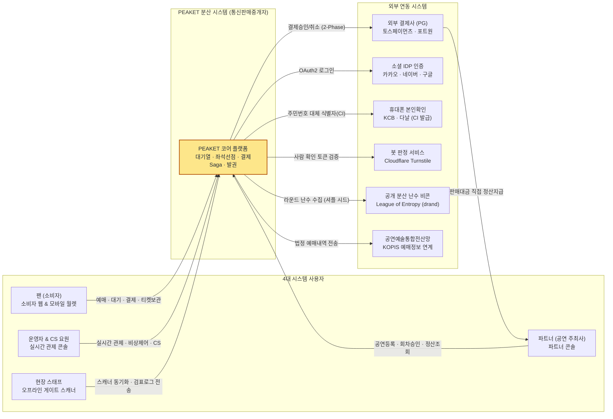

---

### 트레이드오프: 판매 주체 및 법적 모델의 선택

| 검토 모델 | 판정 | 선택 이유 및 치르는 대가 |
| :--- | :---: | :--- |
| **PEAKET이 직접 판매 당사자** | 탈락 | 공연 일정 변경, 아티스트 불참, 공연 취소 등 공연 이행에 대한 모든 민형사상 손해배상 책임을 플랫폼이 직접 떠안아야 하므로 스타트업/플랫폼으로서 과도한 법적 리스크를 짐. |
| **순수 통신판매중개 (환불 책임 100% 기획사 위임)** | 탈락 | 티켓 예매 취소 및 전산 환불은 PEAKET 시스템을 통해 기술적으로 집행되는데, 법적 책임만 기획사에 전가하면 분쟁 발생 시 소비자 불만이 플랫폼으로 전이되고 기획사 부도 시 환불이 불가능해짐. |
| **통신판매중개 + 취소·환불 공동 책임 (선택)** | **채택** | 파트너와 상생하면서도 팬들에게 신뢰성 있는 환불 보장을 제공함. 대신 전자상거래법상 중개자 고지 의무, 공연법상 암표 방지 본인확인 및 부정거래 게시물 차단 의무가 요구사항에 추가됨. |

---

### 5단 꼬리 질문과 모범 답변

1. **질문: "100만 명이 몰리는데 왜 데이터베이스 쓰기가 병목이 아니라고 단언할 수 있습니까?"**  
   - **모범 답변**: "대기열 시스템이 백엔드로 통하는 유입 통로의 직경을 물리적으로 좁혀두기 때문입니다. PEAKET은 좌석 선택 화면의 동시 체류 인원을 5,000명, 1인당 평균 체류 시간을 180초로 제어합니다. 따라서 초당 신규 유입되는 사용자는 초당 약 28명(5,000 ÷ 180)에 불과합니다. 예매 완료 시 발생하는 데이터베이스 최종 쓰기(Hard Sale) 역시 최대 초당 약 28건(28 TPS)에 수렴하므로, RDBMS 단일 마스터 인스턴스의 쓰기 용량(수천 TPS)에 비해 극히 여유롭습니다."
2. **질문: "PEAKET이 직접 표를 파는 것이 아니라면, 티켓 환불 거부 소송이 걸렸을 때 어떻게 대응합니까?"**  
   - **모범 답변**: "전자상거래법 제20조의2 및 ADR-0045에 따라, PEAKET은 통신판매중개자로서 플랫폼 UI 전면에 판매 당사자가 기획사임을 명확히 고지합니다. 그러나 청약철회 및 환불 시스템 집행의 주체이므로 기획사와 연대하여 책임을 부담합니다. 기획사의 귀책으로 공연이 취소될 경우, PG사 정산 보증보험 및 에스크로 지급 유예 장치를 가동하여 팬들의 결제 대금을 안전하게 전액 전산 환불 처리합니다."
3. **질문: "2026년 8월 시행 개정 공연법이 시스템 아키텍처에 미친 구체적인 영향은 무엇입니까?"**  
   - **모범 답변**: "매크로 및 봇을 이용한 부정 예매 방지 의무가 법제화되었습니다. 이에 따라 순번 발급 전 반드시 휴대폰 본인확인(CI 기반 1인 1계정 검증)을 완료하도록 강제했으며, 암호학적 셔플을 통해 매크로의 밀리초 선점을 무력화했습니다. 또한 부정 예매 의심 계정을 24시간(긴급 시 10시간) 내 전산 차단할 수 있는 관제 콘솔 기능을 필수 기능으로 통합했습니다."
4. **질문: "글로벌 팬들을 위한 다국어 및 해외 카드 결제는 왜 제외(Out of Scope)했습니까?"**  
   - **모범 답변**: "해외 사용자 허용 시 본인확인(KYC) 수단이 여권이나 3D Secure 해외 카드로 다변화되어 암표상들이 해외 명의를 도용해 다계정을 생성하는 공격 표면(Attack Surface)이 극도로 넓어집니다. 본 시스템은 100만 한국 내 대형 콘서트의 극한 트래픽과 공정성 입증에 집중하기 위해 국내 휴대폰 본인확인 사용자로 범위를 한정했습니다."
5. **질문: "티켓 판매 수수료율은 왜 비즈니스 요구사항에서 확정되지 않았습니까?"**  
   - **모범 답변**: "수수료율은 공연 기획사와의 개별 계약 규모(공연장 크기, 티켓 단가, 단독 판매 여부)에 따라 3%~10% 수준에서 동적으로 결정되는 비즈니스 파라미터이기 때문입니다. 시스템 아키텍처 관점에서는 고정 비율이든 변동 비율이든 결제 대행 정산 파이프라인(payment-svc)의 수수료 정산 테이블에서 설정값으로 처리되므로 아키텍처 구조 자체를 변경하지 않습니다."

---

## 2단계. 규모 어림: 어디가 진짜 병목인가 `꼭`

> **면접관에게**:  
> "시스템의 정량적 규모를 수학적으로 분해해 보겠습니다. 5만 석 규모 대형 공연장에서 1인당 최대 4매까지 예매할 수 있으므로, 최종 성사되는 주문 건수는 약 12,500건에서 25,000건입니다. 좌석 선택 화면에는 시스템 보호를 위해 동시 5,000명만 입장시키고 사용자는 평균 3분(180초) 동안 머뭅니다.  
> 리틀의 법칙($L = \lambda W$)에 의해, 새로 입장하는 유입 속도는 **초당 약 28명(5,000 ÷ 180)**으로 고정되며, RDBMS 최종 판매 확정 쓰기 역시 **초당 약 28건(28 TPS)**에 불과합니다.  
> 따라서 전체 시스템에서 **'100만 대기 인원에 비례하여 증가하는 부하'**는 단 셋뿐입니다. 첫째, 오픈 정각 순간의 **진입 스파이크(최대 20만 RPS)**, 둘째, CDN이 흡수하는 **대기 순번 조회(초당 5.4만 RPS)**, 셋째, 셔플 결과 배포 파일 다운로드(초당 12.5만 RPS)입니다. PEAKET의 분산 엔지니어링 역량은 데이터베이스가 아니라 바로 이 입구와 대기실 CDN 아키텍처에 집중됩니다."

---

### 기본 정량 가정치

| 핵심 지표 | 설계 수치 | 산출 근거 및 공학적 의미 |
| :--- | :---: | :--- |
| **전체 좌석 수** | **50,000석** | 서울 올림픽주경기장, 상암월드컵경기장 수준의 초대형 스타디움 규모 |
| **1인당 예매 한도** | **최대 4매** | 평균 구매 매수를 2매로 가정할 때, 총 주문 건수는 12,500 ~ 25,000건으로 수렴 |
| **최대 동시 대기자 수** | **1,000,000명** | 최상위 K-POP 아티스트 온세일 시 유입되는 최대 동시 대기 설계 목표 (NFR-013) |
| **좌석 화면 동시 인원** | **5,000명** | 백엔드 실시간 WebSocket 및 인메모리 좌석 계층의 안전 용량 한도 |
| **좌석 화면 평균 체류 시간** | **180초 (3분)** | 좌석도 탐색, 좌석 선택, 결제창 정보 입력까지 걸리는 사용자 평균 시간 |
| **이론적 매진 소요 시간** | **약 18 ~ 22분** | 유효 구매자 30,000명이 초당 28명씩 입장하여 전량 소진하는 이론 시간 |

---

### 수학적 부하 분해 ①: 입장 속도에 의해 고정되는 불변 부하

대기열이 뒤쪽 시스템(좌석 예매, 결제, DB)으로 들어가는 속도를 초당 약 28명으로 물리적으로 묶어두기 때문에, **대기실에 대기자가 10만 명이 있든 100만 명이 있든 아래 백엔드 부하는 단 1도 증가하지 않고 완전히 동일합니다.**

| 부하 지점 | 수학적 계산식 | 귀결되는 시스템 부하 |
| :--- | :--- | :--- |
| **초당 입장 속도 ($\lambda$)** | $5,000\text{명} \div 180\text{초}$ | **초당 약 27.78명 (약 28명/s)** |
| **좌석 선점 (Soft Hold) 피크** | 입장 직후 5,000명의 동시 클릭 | **피크 초당 1,000 ~ 2,000 RPS** (평시 ~170 RPS), 인기 좌석 1:1,000 경합 |
| **외부 PG 결제 승인 요청** | 첫 입장 물결의 최대 집중 | **최대 300 TPS 상한** (외부 결제사 가맹점 트래픽 상한 추정치) |
| **RDBMS 최종 판매 확정** | 정상 상태 결제 처리 속도 = 입장 속도 | **초당 약 28 TPS** (PostgreSQL 단일 마스터로 충분) |
| **좌석 화면 지속 연결** | 좌석 화면 동시 체류 인원 | **WebSocket 동시 연결 5,000개 고정** |

---

### 수학적 부하 분해 ②: 대기 인원수에 비례하여 증가하는 3대 부하

반면, 대기 인원 100만 명에 직접적으로 비례하여 폭증하는 부하는 명확히 분리되며, 이 세 지점만이 수평 확장(Scale-out)과 CDN 오프로딩의 대상이 됩니다.

#### 1) 티켓 오픈 정각(T=0) 순간의 진입 트래픽 (T=0 Arrival Model)
진입 피크 RPS는 다음 공식으로 모델링됩니다:  
$$
\text{진입 피크 RPS} = \frac{\text{오픈 후 진입 사용자 수} \times \text{초반 10초 내 도착률} \times \text{새로고침 배수}}{10\text{초}}
$$

| 정책 설정 | 로비 참가 비율 | 오픈 후 진입자 | 초반 10초 도착률 | 새로고침 배수 | 계산된 진입 피크 RPS |
| :--- | :---: | :---: | :---: | :---: | :--- |
| **로비 셔플 미적용 (선착순 최악 시나리오)** | 0% | 1,000,000명 | 100% | 2.0배 | $1,000,000 \times 1.0 \times 2.0 \div 10 = \mathbf{200,000\text{ RPS}}$ |
| **로비 셔플 기본 적용 (권장 시나리오)** | 70% | 300,000명 | 80% | 2.0배 | $300,000 \times 0.8 \times 2.0 \div 10 = \mathbf{48,000\text{ RPS}}$ |

> [!NOTE]  
> PEAKET 인프라는 최악의 시나리오인 **20만 RPS**를 수용할 수 있도록 진입 게이트웨이와 대기열 발급 파드를 사전 프로비저닝합니다.

#### 2) 대기열 상태 확인 폴링 트래픽 (CDN Edge vs Origin)
100만 대기자가 적응형 폴링(차례 임박 0.5초, 중기 5초, 원거리 20초)을 수행할 때 발생하는 총 에지 요청 수는 다음과 같습니다.
- 차례 임박 구간 (입장 1분 이내): $1,700\text{명} \div 0.5\text{초} = 3,400\text{ RPS}$
- 중간 대기 구간 (입장 1~5분 이내): $6,700\text{명} \div 5\text{초} = 1,340\text{ RPS}$
- 후방 대기 구간 (5분 이상): $991,600\text{명} \div 20\text{초} \approx 49,580\text{ RPS}$
- **CDN 에지가 수신하는 총합 RPS**: **초당 약 54,320건**
- **원 서버(Origin)로 도달하는 RPS**: 1,000명 단위 구간 파일 1,000개 $\times$ 1초 캐싱 TTL = **초당 단 1,000건** (CDN 캐시 적중률 98.2%)

#### 3) 셔플 결과 배포 트래픽
오픈 정각 셔플이 완료된 직후 100만 명이 0~8초 사이에 분산 다운로드:
- $1,000,000\text{명} \div 8\text{초} = \mathbf{125,000\text{ RPS}}$ (약 36 Gbps 대역폭 소비, CloudFront 다중 배포로 분산 흡수).

---

### 수학적으로 실패가 자명한 안티패턴 계산

1. **5만 석 전체 좌석도 실시간 브로드캐스트**:  
   5만 석 좌석 정보의 전체 JSON 크기는 최소 약 2MB입니다. 좌석 변경이 일어날 때마다 연결된 5,000명에게 1초 주기로 전송하면, 초당 전송량은 $2\text{MB} \times 5,000 = \mathbf{10\text{ GB/s}}$ (즉, **80 Gbps**)에 달합니다. 단일 서비스 클러스터의 네트워크 대역폭이 즉각 고갈되므로, 전체 상태 전송은 원천 배제하고 **뷰포트 델타 스트리밍**으로 전환해야 합니다.
2. **CloudFront 단일 배포 한도 초과**:  
   AWS CloudFront 배포 1개의 기본 할당량은 초당 25만 요청 및 150 Gbps입니다. 공연 상세 페이지 조회 피크(30만 RPS)와 대기열 파일 폴링(5.4만 RPS)을 단일 배포에 몰아넣으면 소프트 리밋을 초과하여 429 Throttle 오류가 발생합니다. 따라서 CloudFront 배포를 도메인 목적별(`www`, `queue-files`, `queue-api`)로 3분할해야 합니다.

---

### 리틀의 법칙과 결제사 한도 연동

리틀의 법칙($L = \lambda W$)에 따르면 동시 체류 인원($L$)은 유입 속도($\lambda$)와 체류 시간($W$)의 곱입니다.  
외부 결제사(토스페이먼츠)의 가맹점 초당 승인 상한이 300 TPS라고 가정할 때, 결제 승인 실패율 0을 보장하는 최대 허용 동시 인원은 다음과 같이 역산됩니다:
$$
L_{\text{max}} = 300\text{ TPS} \times 180\text{초} \times \text{안전계수 } 0.5 = 27,000\text{명}
$$
결제사 한도 관점에서는 최대 27,000명까지 허용할 수 있지만, PEAKET이 좌석 화면 인원을 **5,000명**으로 엄격히 제한한 이유는 외부 결제사가 아니라 **내부 좌석 인메모리 락 경합 및 WebSocket 브로드캐스트의 안정성**을 극대화하기 위한 선택입니다.

---

### 시각 다이어그램: 트래픽 특성별 부하 분해도

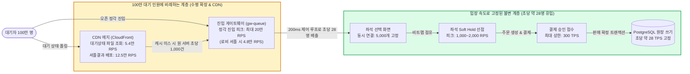

---

### 트레이드오프: 5,000명 수용 정책

| 설계 항목 | 얻는 이점 (Gain) | 치르는 대가 (Cost) |
| :--- | :--- | :--- |
| **좌석 화면 5,000명 제한** | 좌석 점유 락 경합 감소, 실시간 WebSocket 메시지 팬아웃 비용 최소화, DB 쓰기 28 TPS 격리 완벽 보장 | 5만 석 전량 소진까지 약 18~22분의 시간이 소요되며, 대기 순번이 뒤쪽인 사용자는 입장까지 최대 수십 분을 기다려야 함 |
| **좌석 화면 20,000명 확대** | 매진 소요 시간을 5분 이내로 대폭 단축 가능 | 인기 좌석 1:4,000 경합 발생, WebSocket 팬아웃 대역폭 4배 폭증, PG사 승인 버스트 한도(300 TPS) 위협 |

---

### 5단 꼬리 질문과 모범 답변

1. **질문: "진입 피크 20만 RPS는 어떻게 도출되었으며 실측된 수치입니까?"**  
   - **모범 답변**: "로비 셔플을 사용하지 않는 순수 선착순 공연에서 100만 명이 티켓 오픈 10초 이내에 전원 도착하고, 초조한 사용자가 새로고침을 평균 2회 시도하는 최악의 도착 모델($100만 \times 1.0 \times 2.0 \div 10$)에서 산출된 설계 상한선입니다. 셔플을 기본 적용하면 유입의 70%가 사전 흡수되어 실제 피크는 약 4.8만 RPS로 완화됩니다."
2. **질문: "대기자가 100만이 아니라 200만 명으로 2배 늘어나면 백엔드 DB와 결제 시스템은 어떻게 됩니까?"**  
   - **모범 답변**: "완벽하게 영향이 없습니다. 7단계의 입장 조절 루프(admission-ctrl)가 내부 체류 인원을 5,000명, 초당 유입을 28명으로 철저히 차단벽을 치고 있기 때문입니다. 부하가 늘어나는 곳은 오직 CDN 대기 순번 폴링(5.4만 $\to$ 10.8만 RPS)과 진입 게이트웨이 파드 수뿐입니다."
3. **질문: "CloudFront 단일 배포가 25만 RPS 한도라면 30만 RPS 트래픽은 어떻게 처리합니까?"**  
   - **모범 답변**: "ADR-0058에 따라 정적 웹 자원 배포(`www`), 대기열 구간 파일 배포(`queue-files`), 동적 진입 API 배포(`queue-api`)로 CloudFront 배포를 3개로 물리 분리하고, 사전에 AWS 서포트를 통해 각 배포의 소프트 리밋을 50만 RPS 이상으로 상향 조치합니다."
4. **질문: "Redis 카운터 키 하나가 초당 20만 번의 원자적 증가(Atomic INCR)를 감당할 수 있습니까?"**  
   - **모범 답변**: "단일 Redis 스레드에서 단순 INCR의 순수 처리량은 초당 약 49만 건까지 가능함을 벤치마크로 확인했습니다. 그러나 본인확인 및 중복 검증 로직이 포함된 복합 Lua 스크립트를 실행할 경우 단일 코어 기준 초당 8~9만 건으로 포화됩니다. 따라서 PEAKET은 진입 게이트웨이 파드 로컬 메모리에서 2ms 동안 요청을 마이크로 배치로 모아 `INCRBY n`으로 1회 호출하는 버퍼링 전략(ADR-0179)을 취합니다."
5. **질문: "오픈 정각 브라우저의 CORS Preflight(OPTIONS) 요청 폭주로 RPS가 40만으로 2배 뛰지 않습니까?"**  
   - **모범 답변**: "진입 API(`POST /entries`)와 입장 확정 API(`POST /admission`)는 HTTP `Content-Type`을 `text/plain`으로 전송하고 커스텀 헤더를 일체 배제하여 브라우저의 CORS Preflight를 트리거하지 않는 'Simple Request' 표준 규격을 준수합니다."

---

## 3단계. 핵심 API와 데이터 뼈대 `꼭`

> **면접관에게**:  
> "전체 사용자 예매 여정을 관통하는 핵심 REST API와 데이터 스키마의 뼈대를 설명드리겠습니다.  
> 입구 호스트는 대기열 전용인 `queue` 및 `queue-files`와 예매/결제 전용인 `api` 호스트로 물리 격리되어 있습니다. 대기열 상태는 동적 API가 아닌 **1,000명 단위 정적 JSON 파일**로 CDN 에지에서 서빙합니다. 좌석 잡기, 주문 생성, 결제 접수 API는 멱등 키(`Idempotency-Key`)를 필수로 요구하며, 결제 승인은 시간이 걸리는 외부 PG 연동을 고려하여 **202 Accepted**로 비동기 접수한 뒤 롱 폴링으로 결과를 반환합니다.  
> 데이터베이스는 단일 거대 DB를 지양하고 도메인별 책임과 장애 격리를 위해 5개의 독립된 PostgreSQL 클러스터와 3개의 용도별 Redis 클러스터로 분리되어 있습니다."

---

### 구매 길의 핵심 API 명세

| 순서 | HTTP 요청 엔드포인트 | 수신 호스트 (게이트웨이) | 처리 마이크로서비스 | 주요 기능 및 동작 규약 |
| :---: | :--- | :--- | :--- | :--- |
| **0** | `POST /v1/queues/{eventId}/lobby-participants` | `queue` (`gw-queue`) | `queue-svc` | **로비 사전 입장**: 오픈 10분 전 참가 등록. 봇 검증 후 순번 없는 참가 서명 토큰 발급. |
| **0'** | `POST /v1/queues/{eventId}/pre-verifications` | `queue` (`gw-queue`) | `queue-svc` | **사전 검증 발급**: 오픈 정각 이후 진입자를 위한 15분 유효 사전 검증 토큰 발급. |
| **1** | `POST /v1/queues/{eventId}/entries` | `queue` (`gw-queue`) | `queue-svc` | **대기열 진입**: 순번 발급. 201 Created(순번 대기표), 409(이미 대기 중), 410(매진 종료). |
| **2** | `GET /v1/queues/{eventId}/segment-states/{seg}.json` | `queue-files` (CDN) | `queue-svc` 생성 | **구간별 대기 상태**: 무인증 CDN 정적 파일. 1,000명이 동일 파일 캐시 공유(1초 TTL). |
| **2'** | `GET /v1/queues/{eventId}/shuffle-results/{hash}.json` | `queue-files` (CDN) | `admission-ctrl` 생성 | **로비 셔플 결과 배포**: 토큰 해시 접두사별 분할 파일(약 1,000개)로 CDN 분산 다운로드. |
| **3** | `POST /v1/queues/{eventId}/admission` | `queue` (`gw-queue`) | `queue-svc` | **입장 확정**: 현재 호출 번호 이하일 때 5분 유효 서명된 입장 토큰(Admission Token) 발급. |
| **4** | `GET /v1/events/{eventId}/seatmap-snapshot` | `api` (`gw-fan`) | `purchase-svc` | **좌석 비트맵 스냅샷**: 압축된 전체 좌석 상태(6.25KB) 수신. 이 시점에 구매 세션 개시. |
| **5** | `POST /v1/events/{eventId}/holds` | `api` (`gw-fan`) | `purchase-svc` | **좌석 Soft Hold**: Redis Lua 스크립트로 비트맵 원자적 점유(TTL 7분). p99 ≤ 50ms. |
| **6** | `POST /v1/orders` | `api` (`gw-fan`) | `purchase-svc` | **주문서 생성**: 서버 측 최종 금액 검증, 1인 매수 한도 재확인, 주문 레코드 기록. |
| **7** | `POST /v1/orders/{orderId}/payments` | `api` (`gw-fan`) | `purchase-svc` $\to$ `payment-svc` | **결제 시도 시작**: 결제사(토스/포트원) 선택, PG 결제창 호출 파라미터 반환. |
| **8** | `POST /v1/orders/{orderId}/payment-acceptance` | `api` (`gw-fan`) | `purchase-svc` $\to$ `payment-svc` | **결제 비동기 접수**: DB 좌석 PENDING 기록 성공 시 **202 Accepted** 즉각 반환(p99 ≤ 150ms). |
| **9** | `GET /v1/orders/{orderId}/payment-status` | `api` (`gw-fan`) | `purchase-svc` | **결제 상태 롱 폴링**: 최대 25초 대기하며 PG 승인 결과 및 발권 상태 실시간 반환. |
| **10** | `GET /v1/tickets` | `api` (`gw-fan`) | `ticket-svc` | **모바일 월렛 조회**: 팬의 소유 티켓 목록, 기기 공개키 바인딩 상태 확인. |
| **Ext**| `POST /v1/webhooks/toss` | `partner-api` (`gw-partner`)| `payment-svc` | **PG 웹훅 수신**: PG사 결제 결과 비동기 통보. 위조 방지를 위해 수신 즉시 단건 조회 API 재검증. |

---

### 데이터 뼈대 및 저장소 소유권 매핑

PEAKET은 도메인 주도 설계(DDD)의 Bounded Context 원칙에 따라, 서비스 간 데이터베이스 공유를 엄격히 금지합니다.

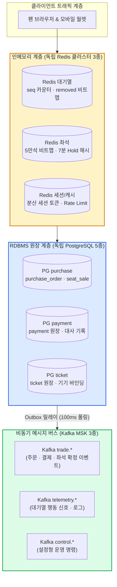

- **RDBMS 테이블 미파티셔닝 및 샤딩 배제 (ADR-0028, ADR-0114)**:  
  5년치 누적 데이터를 추산했을 때 주문 테이블은 약 1,700만 행, 티켓 테이블은 약 3,500만 행입니다. 이는 PostgreSQL의 B-Tree 인덱스가 단일 노드 메모리(Buffer Pool) 내에서 충분히 고속 처리할 수 있는 크기입니다. 무리한 샤딩(Sharding)이나 분산 DB(CockroachDB)는 2단계 커밋 오버헤드와 트랜잭션 지연만 가중시키므로 단일 쓰기 인스턴스를 유지합니다.
- **판매 확정 단일 로컬 트랜잭션 (Single ACID Transaction)**:  
  `seat_sale` 행 삽입(PENDING), `purchase_quota` 차감, 주문 상태 갱신, 그리고 Outbox 이벤트 적재가 **단 하나의 DB 트랜잭션**으로 원자 처리됩니다.

---

### 트레이드오프: API 구조 및 DB 분리 전략

| 설계 결정 | 얻는 이점 (Gain) | 치르는 대가 (Cost) |
| :--- | :--- | :--- |
| **대기 상태를 정적 파일로 CDN 서빙** | 대기자가 100만 명이어도 오리진 서버 부하는 초당 1,000 RPS로 고정됨 | 70분 온세일 1회당 약 $273의 CDN HTTP 요청 비용 발생 |
| **결제 접수 202 비동기 + 롱 폴링** | 클라이언트-게이트웨이 간 연결 스레드를 즉시 반환하여 p99 150ms 달성 | 클라이언트가 결과를 받기 위한 롱 폴링 연결을 별도로 유지해야 함 |
| **5대 독립 PostgreSQL 클러스터 분리** | PG사 연동 장애나 대기열 폭주가 현장 티켓 발권이나 결제 원장으로 전이되지 않음 | 서로 다른 서비스 간 데이터 일관성을 맞추기 위해 Saga 패턴과 Outbox 릴레이 구축 필요 |

---

### 5단 꼬리 질문과 모범 답변

1. **질문: "대기열 진입과 입장 확정이 왜 JSON이 아니라 `text/plain`입니까?"**  
   - **모범 답변**: "도메인이 다른 `www.peaket.example`에서 `queue.peaket.example`으로 교차 출처(CORS) POST 요청을 전송할 때, `application/json`은 브라우저 규격상 사전에 OPTIONS Preflight를 강제 실행합니다. `text/plain`을 사용하면 20만 RPS의 트래픽이 40만 RPS로 증폭되는 현상을 막을 수 있습니다. 보안은 HMAC 서명 토큰과 SameSite 쿠키로 검증합니다."
2. **질문: "사용자가 좌석 잡기(Hold) 요청을 네트워크 오류로 2번 연속 클릭하면 어떻게 됩니까?"**  
   - **모범 답변**: "헤더에 전달된 `Idempotency-Key`를 Redis의 좌석 선점 Lua 스크립트 내부에서 가장 먼저 검증합니다. 동일한 멱등 키가 7분 이내에 이미 존재하면, 두 번째 요청은 중복 실행 없이 기존에 선점된 동일 좌석 ID와 만료 시각을 200 OK로 반환합니다."
3. **질문: "서비스별로 데이터베이스를 물리 분리하면 분산 트랜잭션(2PC)이 필요하지 않습니까?"**  
   - **모범 답변**: "성능을 저해하는 블로킹 방식의 2PC(XA 트랜잭션)를 일체 사용하지 않습니다. 각 서비스는 자신의 로컬 DB 트랜잭션만 사용하며, 서비스 간의 비즈니스 트랜잭션 흐름은 Transactional Outbox 패턴과 Kafka를 결합한 비동기 오케스트레이션 Saga 패턴으로 최종 일관성(Eventual Consistency)을 달성합니다."
4. **질문: "왜 복잡한 CQRS나 이벤트 소싱(Event Sourcing)을 주문 도메인에 적용하지 않았습니까?"**  
   - **모범 답변**: "주문의 상태 라이프사이클은 생성, 가예약, 승인, 취소 등 약 6~8개 단계로 매우 단순합니다. 이벤트 소싱을 도입하면 스냅샷 관리, 스키마 마이그레이션, 프로젝션 랙 등 복잡도만 가중됩니다. 대신 상태는 정규화된 RDBMS 테이블에 두고, 변경 이력만을 불변 테이블(`order_event`)에 함께 적재하는 실용적인 설계를 택했습니다."
5. **질문: "DB 샤딩을 하지 않는다면 초대형 공연 5개가 동시에 열리는 미래에는 어떻게 확장합니까?"**  
   - **모범 답변**: "단일 DB 인스턴스를 무리하게 해시 샤딩하는 대신, 공연 ID(Event ID)를 기준으로 시스템 스택 전체(게이트웨이, 서비스, DB)를 격리 복제하는 **셀 기반 아키텍처(Cell-based Architecture)**로 수평 확장합니다. 각 셀은 독립된 5만 석 규모를 완전히 독립적으로 지탱합니다."

## 4단계. 가장 단순한 설계(v0)와 깨지는 열 곳 `꼭`

> **면접관에게**:  
> "고도화된 최종 구조로 바로 넘어가기 전에, 역량 있는 엔지니어링 팀이 1차 스프린트에서 자연스럽게 도출할 법한 가장 단순한 아키텍처(v0 베이스라인)를 먼저 정의하겠습니다.  
> v0는 대기열, 좌석 선점, 주문, 결제, 발권, 검표 모듈이 단일 배포 단위로 묶인 **모놀리스 서버**에, 대기 순위 산출을 위한 **단일 Redis**와 영구 저장을 위한 **단일 PostgreSQL**로 구성됩니다.  
> 이 v0 아키텍처는 부하가 낮을 때는 잘 동작하지만, 100만 명의 트래픽과 1:1,000의 인기 좌석 경합 상황에서 정확히 **열 군데의 물리적·수학적 병목 지점(K1 ~ K10)**에서 시스템이 붕괴합니다. 이 열 곳의 붕괴점을 명확히 분석하고 이를 하나씩 공학적으로 격파해 나가며 PEAKET의 분산 아키텍처를 진화시키겠습니다."

---

### 나이브한 v0 모놀리스 아키텍처

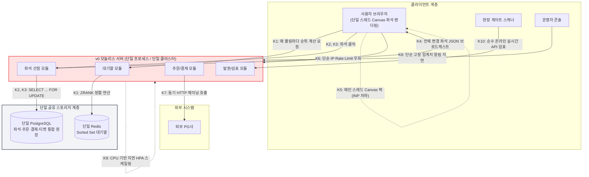

---

### v0가 수학적으로 깨지는 열 곳 (The 10 Bottlenecks: K1 ~ K10)

| 고장점 (Key) | v0의 단순한 구현 방식 | 100만 트래픽 하에서의 수학적 붕괴점 및 한계 | 해결 단계 |
| :---: | :--- | :--- | :---: |
| **K1** | 대기열 확인 시 매 요청마다 Redis Sorted Set의 `ZRANK`(내 앞 순위 계산)를 호출하여 사용자별 동적 JSON으로 응답함. | 응답이 사용자마다 달라 CDN 캐싱 불가. 10만 대기자만으로도 오리진 서버에 초당 9,300건의 `ZRANK`가 집중되며, 단일 Redis 스레드의 CPU가 $O(\log N)$ 연산으로 100% 포화됨. | **5단계** |
| **K2** | 좌석 선점 시 PostgreSQL의 `SELECT ... FOR UPDATE` 행 잠금(Row Lock)을 사용하여 재고를 점유함. | 인기 VIP석 1개에 1,000명이 동시 진입 시, 999개의 트랜잭션이 락 대기 큐에 갇힘. 커넥션 풀 고갈과 수 초 이상의 지연(p99 > 5,000ms), 락 타임아웃 발생. | **8단계** |
| **K3** | 1인이 다수 좌석(예: 2~4매)을 잡을 때 클릭한 순서대로 제각각 RDBMS 행 락을 획득함. | 사용자 A가 (1번 $\to$ 2번)을 잠그고 사용자 B가 (2번 $\to$ 1번)을 잠그는 역방향 락 획득 시 RDBMS 상호 교착 상태(Deadlock)가 발생하여 트랜잭션 강제 롤백. | **8단계** |
| **K4** | 좌석 상태가 변경될 때마다 연결된 모든 사용자에게 변경 내역을 텍스트 JSON으로 브로드캐스트함. | 전송량이 $\text{연결 수}(5,000) \times \text{초당 변경 건수}(500) \times 2\text{KB} = \mathbf{5\text{ GB/s}}$ (40 Gbps)로 폭증하여 네트워크 대역폭 마비. | **9단계** |
| **K5** | 브라우저의 메인 UI 스레드에서 단일 HTML Canvas에 좌석 객체 배열 전체를 순회하며 렌더링함. | 5만 개 좌석 객체 순회 및 줌/팬 인터랙션 시 메인 스레드 롱 태스크(Long Task > 50ms) 발생. 조작 반응성(INP)이 2,000ms 이상으로 지연되며 브라우저 프리징. | **9단계** |
| **K6** | IP 기반의 단순 요청 수 제한(Rate Limiting)만으로 매크로 및 봇 트래픽을 방어함. | 수백 개의 프록시 IP를 돌려 쓰는 분산 봇넷을 막지 못하며, 반대로 학교, 회사, 통신사 NAT IP를 공유하는 수천 명의 정상 팬이 일괄 차단되는 오탐 참사 발생. | **6단계** |
| **K7** | 주문 $\to$ 결제 $\to$ 발권 서비스를 단일 트랜잭션 내에서 동기(Synchronous) HTTP 호출 체인으로 연결함. | 외부 PG사 통신 구간에서 일시적 타임아웃 발생 시, 돈은 출금되었으나 DB는 롤백되어 티켓이 사라지거나(유령 결제), 반대로 좌석 락이 영구 점유되는 누수 발생. | **10단계** |
| **K8** | 전통적인 고정 임계치 알림(예: 5분간 오류율 5% 초과 시 알림) 및 단순 통합 대시보드를 사용함. | 70분 한정 온세일에서 결제 실패 허용량은 단 12건에 불과함. 5분 고정 알림은 에러 버짓의 71%가 이미 소진된 사후에야 울려 장애를 조기 차단할 수 없음. | **13단계** |
| **K9** | 쿠버네티스의 기본 CPU 사용률 기반 HPA(Horizontal Pod Autoscaler)로 파드를 확장함. | 오픈 정각(T=0) 3초 만에 20만 RPS가 쏟아지는데, HPA 메트릭 수집(15초)과 노드 부팅(3~5분)이 뒤늦게 동작하여 파드가 뜨기 전에 서비스 전면 다운. | **12단계** |
| **K10** | 현장 게이트 스캐너가 늘 온라인에 연결되어 있다고 가정하고 중앙 서버 API를 매번 호출하여 검표함. | 5만 명이 집결한 경기장 주변 기지국 트래픽 포화로 4G/5G가 단절되면 모든 게이트 스캐너가 연결 타임아웃에 빠져 수만 명의 입장이 전면 중단됨. | **14단계** |

---

### 베이스라인 비교의 공학적 의의와 트레이드오프

시스템 디자인에서 v0 베이스라인을 명시적으로 수립하는 이유는, 이후의 분산 설계 결정들이 **"그냥 유행하는 기술(Microservice, Kafka, Redis)을 무작정 쓴 것"이 아니라 "v0의 구체적인 수학적 병목을 해결하기 위한 필수불가결한 선택"**임을 논리적으로 증명하기 위함입니다.

| 접근법 | 얻는 이점 (Gain) | 치르는 대가 (Cost) |
| :--- | :--- | :--- |
| **v0 베이스라인 구축 및 10대 병목 분석 (선택)** | "왜 마이크로서비스인가?", "왜 Redis Lua인가?"에 대해 나이브한 방식과의 정량적 성능 차이와 한계점을 명확히 제시 가능 | v0 설계 및 비교 분석을 위한 추가적인 엔지니어링 및 문서화 비용 수반 |
| **v0 생략하고 최종 분산 구조만 제시** | 문서가 간결해지고 최종 아키텍처 설명에 집중 가능 | 면접관의 "왜 굳이 복잡하게 분산 시스템을 구축했는가? 단일 RDBMS로 튜닝하면 안 되는가?"라는 질문에 방어 논리가 취약해짐 |

---

### 5단 꼬리 질문과 모범 답변

1. **질문: "v0의 K2(SELECT ... FOR UPDATE)에서 왜 RDBMS가 1,000명 동시 경합을 버티지 못합니까?"**  
   - **모범 답변**: "단일 행에 대한 배타적 락(X-Lock)은 직렬(Serial) 처리됩니다. 트랜잭션당 DB 처리 시간을 낙관적으로 5ms로 잡아도, 1,000번째 요청은 \(5\text{ms} \times 1,000 = 5,000\text{ms}\) (5초)를 대기해야 합니다. 대기 시간이 DB 커넥션 타임아웃(보통 3~5초)을 초과하여 풀 커넥션이 전면 고갈되며, 대기와 무관한 다른 사용자 쿼리까지 연쇄적으로 멈추기 때문입니다."
2. **질문: "K3 교착 상태(Deadlock)는 좌석 ID를 정렬해서 잠그면 해결되지 않습니까?"**  
   - **모범 답변**: "정확합니다. 다중 행을 잠글 때 좌석 ID의 오름차순으로 정렬하여 락을 획득하면 교착 상태의 순환 대기(Circular Wait) 조건을 수학적으로 제거할 수 있습니다. PEAKET의 최종 8단계 RDBMS Hard Sale에서도 바로 이 정렬 삽입 규칙을 엄격히 적용합니다. 그러나 v0에서는 좌석 선택 자체가 RDBMS 락으로 처리되므로 K2의 극단적인 락 대기 문제는 정렬만으로 해결되지 않습니다."
3. **질문: "K10에서 현장 네트워크가 끊겨도 LTE 에그나 유선 백본을 깔면 해결되지 않습니까?"**  
   - **모범 답변**: "잠실 주경기장이나 상암경기장 같은 대형 스타디움은 수만 명의 인파가 동시에 셀룰러 망에 접속하면서 통신사 기지국 용량이 전면 포화됩니다. 임시 유선망 역시 현장 케이블 단선이나 스위치 장애 위험이 존재하므로, 생명과 직결되는 인파 밀집 게이트 통제는 **'네트워크가 100% 단절되어도 스캐너 단독으로 암호학적 검표가 가능한 오프라인 우선(Offline-First)'**으로 설계해야만 합니다."
4. **질문: "v0 모놀리스를 단일 노드가 아니라 서버 10대로 수평 확장(Scale-out)하면 K1~K9를 해결할 수 있지 않습니까?"**  
   - **모범 답변**: "서버 인스턴스를 10대로 늘려도 백엔드의 K1(단일 Redis ZRANK 경합)과 K2(단일 DB 행 잠금), K7(동기 호출 결제 장애)은 여전히 공유 자원 계층에 존재하므로 병목이 해소되지 않습니다. 오히려 서버가 늘어날수록 단일 DB로 향하는 동시 커넥션 수만 10배로 폭증하여 데이터베이스 붕괴 시점을 앞당길 뿐입니다."
5. **질문: "v0 베이스라인과 비교했을 때 최종 아키텍처의 성능 개선 목표는 몇 %입니까?"**  
   - **모범 답변**: "성능 개선을 추상적인 'N% 향상'으로 측정하지 않습니다. 시스템의 합격 기준은 비기능적 요구사항(NFR)의 절대 수치입니다. 즉, 진입 지연 p99 ≤ 150ms, 좌석 선점 p99 ≤ 50ms, 오버셀 정확히 0건, 그리고 100만 대기 시 오리진 부하 초당 1,000 RPS 이하 달성이라는 절대적 엔지니어링 목표치를 만족하는지로 판정합니다."

---

## 5단계. 대기 상태 조회 폭주 막기 (K1) `꼭`

> **면접관에게**:  
> "v0의 K1 병목을 해결하는 핵심 아키텍처를 제시하겠습니다. v0에서는 100만 대기자가 자신의 차례를 물을 때마다 Redis에서 `ZRANK` 연산을 수행하여 동적 응답을 만들었습니다. 이는 캐시가 불가능하여 오리진 서버에 초당 수만 건의 쿼리 폭주를 유발합니다.  
> PEAKET은 두 가지 혁신으로 이를 완벽히 해결합니다.  
> 첫째, 대기 순번은 Redis 카운터의 **Atomic INCR**로 단 1회 발급하고, 이탈자나 무효 순번은 단 125KB 크기의 **빠진 번호 비트맵(`removed`)**에 1비트로 기록합니다. 대기자는 대기실에 머무는 동안 서버에 일체의 쓰기(Keep-alive)를 발생시키지 않으며 재접속해도 순번이 보존됩니다.  
> 둘째, 대기 상태를 API가 아닌 **1,000명 단위의 정적 JSON 구간 파일**로 1초마다 생성하여 CDN에 캐싱합니다. 같은 구간의 1,000명은 100% 동일한 CDN 캐시 파일을 읽으며, 내 앞 대기 인원은 클라이언트 브라우저가 파일 내부의 현재 입장 번호와 비트맵을 대조하여 로컬에서 즉시 계산합니다.  
> 이를 통해 100만 명이 동시에 폴링해도 오리진 서버 부하는 대기자 수가 아닌 파일 수(초당 약 1,000건)에 완전히 고정됩니다."

---

### 단순하게 하면 어디서 깨지나 (Why Naive Breaks)

- **Redis Sorted Set + ZRANK의 붕괴**:  
  v0는 대기열을 단일 Sorted Set(`ZADD queue timestamp userId`)으로 구현하고, 대기자가 폴링할 때마다 `ZRANK queue userId`를 호출합니다. 대기자마다 순위가 다르므로 HTTP 캐시가 원천적으로 불가능합니다. 10만 대기자만으로도 오리진 서버로 초당 9,300건의 동적 API 요청이 쏟아지며, 단일 스레드로 동작하는 Redis는 $O(\log N)$ 정렬 트리 탐색 부하로 인해 명령 큐가 밀리면서 p99 지연이 수 초로 치솟습니다.
- **거대 키(Big Key)의 샤딩 불가성**:  
  100만 명의 엔트리를 담은 Sorted Set 키 하나는 약 수백 MB에 달하는 '빅 키'가 됩니다. Redis 클러스터 환경에서도 단일 키는 반드시 단 1개의 마스터 노드에만 저장되므로 여러 노드로 부하를 수평 분산할 수 없습니다.
- **하트비트 핑 폭주와 순번 유실**:  
  만약 '현재 접속 중인 사용자'만을 대기열에 유지하려 한다면, 100만 명이 매초 생존 신호(Heartbeat Ping)를 보내야 하므로 초당 수십만 건의 쓰기가 발생합니다. 또한 모바일 네트워크 음영 구간에서 일시적으로 핑이 끊기면 대기열에서 퇴출당해 사용자가 처음부터 다시 줄을 서야 하는 치명적인 사용자 경험 결함이 발생합니다.

---

### PEAKET의 아키텍처 해결책

```
[대기 상태 구간 파일 JSON 구조 (예: segment-001.json)]
{
  "eventId": "evt-2026-seoul",
  "segment": 1,                     // 1,001번 ~ 2,000번 대기자용 파일
  "generatedAt": 1731110401000,     // 1초 단위 타임스탬프
  "currentServingSeq": 850,         // 현재 입장 중인 번호 끝단
  "admissionRatePerSec": 28,        // 초당 입장 처리 속도
  "saleStatus": "ON_SALE",          // 티켓 판매 상태 (ON_SALE, ALL_HELD, SOLD_OUT)
  "cumulativeRemovedCount": 42,     // 1번부터 1,000번까지 누적 이탈자 수
  "segmentRemovedBitmap": "a8f0...", // 1,001~2,000번 구간 내 취소/무효 비트맵 (125 bytes)
  "pollingHintMs": 500              // 클라이언트 적응형 폴링 권장 주기 (ms)
}
```

1. **원자적 순번 발급과 정적 순번 보존 (ADR-0002)**:  
   티켓 오픈 시 회차별 카운터 키 `q:{eventId}:seq`를 단일 증가(`INCR`)시켜 고유 순번을 부여합니다. 대기열 파드 로컬에서 2ms 동안 요청을 모아 `INCRBY n`으로 처리하여 초당 20만 건을 가볍게 소화합니다. 한 번 발급된 순번은 불변이며 브라우저 쿠키/스토리지에 안전하게 보존됩니다.
2. **빠진 번호 비트맵 (`removed` Bitmap)**:  
   대기 중 사용자의 자발적 취소, 봇 탐지 격리, 결제 이탈 등으로 발생한 무효 번호는 Redis 비트맵 `q:{eventId}:removed`에 해당 순번의 비트를 1로 마킹합니다. 100만 번호 전체를 표현하는 데 단 125KB, 1,000명 단위 1개 세그먼트는 **단 125바이트**에 불과합니다.
3. **브라우저 측의 내 앞 대기 인원 제로-오리진 계산**:  
   CDN에서 구간 파일을 다운로드받은 브라우저는 오리진 서버에 묻지 않고 로컬 연산으로 내 앞 인원을 즉시 도출합니다:
   $$
   \text{내 앞 대기 인원} = (\text{내 순번} - \text{currentServingSeq} - 1) - \text{그 사이 빠진 번호 수}
   $$
   구간 내 빠진 번호 수는 세그먼트 비트맵에서 내 순번에 해당하는 오프셋까지 켜진 비트 수(POPCNT)를 세어 0.1ms 이내에 정확히 산출합니다.
4. **적응형 폴링 (Adaptive Polling) & 지터(Jitter) (ADR-0003)**:  
   모든 대기자가 1초마다 폴링하면 CDN 비용이 낭비됩니다. 자신의 차례까지 남은 예상 시간에 따라 폴링 간격을 3단계로 차등화합니다.
   - **입장 임박 구간 (예상 1분 이내)**: 0.5초 간격 (빠른 반응성 보장)
   - **중간 대기 구간 (예상 1~5분 이내)**: 5.0초 간격
   - **원거리 대기 구간 (예상 5분 이상)**: 20.0초 간격
   - 모든 폴링 요청에는 \(\pm 20\%\)의 무작위 지터(Jitter)를 적용하여 특정 초 단위에 요청이 동기화되는 썬더링 허드(Thundering Herd) 현상을 방지합니다.
5. **임박 구간 캐시 만료 정렬 (Aligned Expiry) (ADR-0110)**:  
   입장 1분 이내 임박 구간 파일(전체 1,000개 중 2~3개)은 다음 파일이 백엔드에서 생성되는 밀리초 시각에 정확히 일치하도록 CDN 캐시 만료(`max-age`)를 동적으로 정렬합니다. 이를 통해 "지금 입장하세요!" 신호가 클라이언트 화면에 **p99 2초 이내(실제 모델값 ~1.6초)**에 반드시 도달함을 수학적으로 보장합니다.
6. **오리진 장애 시 S3 정적 페일오버 (ADR-0058)**:  
   queue-svc가 1초마다 생성한 구간 JSON 파일은 로컬 메모리 캐시뿐 아니라 즉시 AWS S3 버킷으로 비동기 미러링됩니다. CloudFront는 Origin Group 설정을 통해 오리진 서버(gw-queue)가 5xx 오류나 타임아웃을 반환하면 0.1초 만에 S3 백업 파일로 자동 페일오버하여 100만 대기실 화면이 절대 깨지지 않도록 방어합니다.

---

### 시각 다이어그램: 대기열 CDN 적응형 폴링 아키텍처

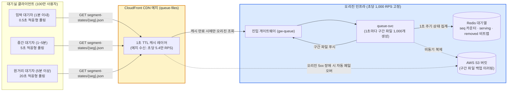

---

### 트레이드오프: CDN 구간 파일 폴링 vs 실시간 양방향 연결

| 비교 항목 | CDN 구간 파일 폴링 (선택) | WebSocket / SSE 전면 연결 (기각) |
| :--- | :--- | :--- |
| **오리진 서버 부하** | **초당 1,000 RPS로 완전 고정** (대기자 수 무관) | 100만 개의 TCP 연결 유지로 인해 최소 50~100대의 게이트웨이 파드 필요 |
| **인프라 비용** | CloudFront HTTP 요청 비용 발생 (70분 온세일 기준 약 $273) | 대규모 커넥션 유지를 위한 메모리 및 로드밸런서(NLB) 커넥션 비용 폭증 |
| **네트워크 탄력성** | 모바일 네트워크 순단 발생 시 다음 폴링에서 자동 복구 | 대규모 순단 발생 시 100만 개의 WebSocket 재연결 폭풍(Reconnection Storm)으로 인프라 붕괴 |
| **반영 지연 시간** | 임박 구간 p99 ≤ 2초, 원거리 구간 최대 24초 | 실시간 즉시 반영 (< 100ms) |
| **판정 근거** | 대기열 후방 사용자에게 밀리초 실시간성은 불필요함. 비용과 고가용성 측면에서 **CDN 적응형 폴링 압승** | 커넥션 유지 비용과 썬더링 허드 위험으로 대규모 대기실에 부적합 |

---

### 5단 꼬리 질문과 모범 답변

1. **질문: "1,000명이 같은 JSON 파일을 본다면, 내 순번이 정확하게 계산됩니까?"**  
   - **모범 답변**: "완벽하게 정확합니다. 파일에 담긴 값은 '현재 입장 번호(currentServingSeq)'와 '해당 1,000개 구간의 빠진 번호 비트맵'입니다. 브라우저는 불변인 자신의 고유 순번에서 serving 번호를 빼고, 비트맵에서 내 순번 앞의 1로 마킹된 비트(이탈자) 수만 차감하므로, 1초 전 생성 시점 기준의 정확한 잔여 인원이 클라이언트 로컬에서 수학적으로 일치합니다."
2. **질문: "대기실 100만 명에게 왜 Server-Sent Events(SSE)를 쓰지 않았습니까?"**  
   - **모범 답변**: "100만 개의 지속적인 HTTP 커넥션을 유지하려면 수십 대의 게이트웨이 파드와 수백만 개의 파일 디스크립터(FD), 커넥션 테이블이 필요합니다. 또한 대기 번호 80만 번 사용자에게 매초 갱신을 푸시하는 것은 극심한 자원 낭비입니다. Cloudflare Waiting Room이나 AWS Virtual Waiting Room 등 글로벌 대형 솔루션들이 모두 CDN 폴링 방식을 채택하는 이유입니다."
3. **질문: "CDN 캐시 수명이 1초인데, 어떻게 2초 이내(NFR-002)에 입장 신호를 화면에 띄웁니까?"**  
   - **모범 답변**: "차례가 60초 이내로 다가온 임박 구간 파일은 Cache-Control의 max-age를 '다음 백엔드 파일 생성 시각'에 정확히 동기화하여 만료시킵니다. 여기에 클라이언트의 0.5초 폴링 주기와 네트워크 전송 지연(RTT ~50ms)을 합산한 지연 예산 모델 분석 결과 p99는 1.5~1.6초로 계산되며, 2초 기준을 안정적으로 충족합니다."
4. **질문: "원 서버가 완전히 다운되면 100만 대기자는 모두 에러 화면을 보게 됩니까?"**  
   - **모범 답변**: "아닙니다. CloudFront 에지가 gw-queue 오리진의 502/504 에러를 감지하는 즉시 AWS S3 백업 버킷으로 요청을 투명하게 전환합니다. S3에는 1초 전 마지막 정상 구간 파일이 존재하므로, 대기실은 중단 없이 유지되며 파일 내부의 pollingHintMs를 2배로 늘려 트래픽을 자동 진정시킵니다."
5. **질문: "대기열 전용 Redis가 장애 조치(Failover)될 때 순번 카운터가 유실되면 어떻게 됩니까?"**  
   - **모범 답변**: "새로운 마스터로 승격될 때 카운터 값을 기존 수치보다 넉넉히(예: 10만 단위) 크게 건너뛰고 세대 번호(Generation)를 올립니다. 건너뛴 빈 구간 번호는 `removed` 비트맵에서 전원 이탈 처리되므로, 중복 순번 발급이 원천 차단되며 사용자 순번의 단조 증가성이 철저히 보존됩니다."

## 6단계. 정각 진입 몰림, 공정성, 봇 (K6) `꼭`

> **면접관에게**:  
> "티켓 오픈 정각(T=0)에는 시스템 다운을 유발하는 극한의 트래픽 스파이크와 밀리초 단위의 매크로 속도 경쟁이라는 두 가지 난제가 중첩됩니다.  
> 순수 선착순(FIFO) 방식은 기기 성능이 월등하고 데이터센터 인근에 위치한 매크로 봇이 일반 팬을 100% 압도합니다.  
> PEAKET은 이를 해결하기 위해 티켓 오픈 10분 전 사전 **로비(Lobby)**를 가동합니다. 로비에 모인 참가자들에게는 순번이 없는 서명 토큰만 부여하며, 오픈 정각 순간 참가자 명단을 머클 트리(Merkle Tree)로 동결합니다.  
> 그 후 사전에 공시된 외부 분산 공개 난수 비콘(**drand**)의 라운드 난수와 플랫폼 비밀 시드를 합성하여 **결정론적 Fisher-Yates 셔플**을 수행합니다. 시드의 해시는 오픈 전에 이미 공개되어 있어 운영자조차 결과를 사전 조작하거나 예측할 수 없습니다.  
> 정각 직후 2초 이내에 도착한 일반 사용자 역시 동일한 묶음(Open Batch)으로 섞어 매크로의 밀리초 우위를 박탈합니다. 또한 본인확인(CI)과 다계정 봇 판정은 오픈 전 로비 진입 시점에 이미 완료되므로, 정각 트래픽 경로에는 외부 인증 호출이 단 1건도 개입하지 않습니다."

---

### 단순하게 하면 어디서 깨지나 (Why Naive Breaks)

- **순수 선착순(FIFO)의 구조적 불공정성**:  
  오픈 정각 순수 선착순은 20만 RPS의 최악 스파이크를 발생시킬 뿐 아니라, 네트워크 RTT가 1ms 미만인 IDC 전용선을 사용하는 매크로 프로그램이 일반 모바일 사용자(RTT 30~80ms)를 물리적으로 제치고 앞 번호를 독점합니다.
- **IP 기반 단순 차단의 실패 (v0의 K6)**:  
  전문 암표 조직은 AWS/GCP의 탄력적 IP 수천 개와 가정용 프록시(Residential Proxy)를 동원하므로 IP 단위 Rate Limiting에 전혀 걸리지 않습니다. 반면 대학 캠퍼스나 기업망, 통신사 CGNAT(Carrier-Grade NAT) 뒤에 있는 수천 명의 일반 팬들은 공용 IP 하나를 공유하므로 봇으로 오탐되어 단체로 차단당하는 치명적 참사가 발생합니다.
- **오픈 순간 외부 봇 검증 API 호출의 병목**:  
  티켓 오픈 정각에 몰려든 20만 건의 요청이 Cloudflare Turnstile이나 reCAPTCHA 등 외부 검증 API를 동시에 동기 호출하면, 외부 솔루션의 초당 할당량이 초과되거나 네트워크 지연이 발생하여 플랫폼 전체가 마비됩니다.

---

### PEAKET의 아키텍처 해결책

```
[Commit-Reveal 암호학적 셔플 검증 파이프라인]

1. T-10분 (사전 약정, Commit):
   - 플랫폼 난수 시드(Platform Seed)의 SHA-256 해시를 공연 상세 페이지에 사전 공시
   - 목표 drand 라운드 번호(오픈 시각 T+3초 직후의 첫 라운드) 공식 공지

2. T-0 (명단 동결):
   - 로비 참가자 전체 목록(User ID 리스트)을 고정하고 Merkle Root 해시 생성 및 배포
   - 더 이상의 로비 신규 참가자 차단

3. T+3초 (공개 난수 결합, Reveal):
   - 전 세계 수십 개 대학/연구기관이 공동 서명하는 drand 비콘에서 해당 라운드 서명값(Round Randomness) 수신

4. 결정론적 셔플링:
   - Composite Seed = SHA-256(Platform Seed + drand Round Signature + Merkle Root + Event ID)
   - ChaCha20 기반 유사난수 발생기로 Fisher-Yates 셔플 수행 (100만 명 대상 약 40ms 소요)

5. T+60분 (사후 공개 및 시민 검증):
   - 플랫폼 시드 원본 공개 -> 누구나 독립 브라우저 검증기에서 셔플 무결성 100% 재현 검증 가능
```

1. **2가지 정책 스위치 (ADR-0118)**:  
   공연 회차별로 '로비 셔플'과 '오픈 직후 묶음'을 조합합니다. 둘 다 켜면 **하이브리드 모드(기본 권장)**, 로비 셔플만 켜면 사전 셔플, 오픈 직후 묶음만 켜면 선착순 모드로 동작합니다.
2. **로비 진입 및 봇 판정 사전 완료**:  
   오픈 10분 전 `POST /lobby-participants` 진입 시 휴대폰 본인확인(CI 기반)과 사람 확인(Turnstile)을 미리 완료하고, 순번이 없는 서명된 참가 토큰만 지급합니다. 로비 화면에는 순번을 연상시키는 어떠한 숫자도 노출하지 않습니다.
3. **오픈 직후 2초 묶음 (Open Batch) (ADR-0041)**:  
   로비에 참가하지 않고 정각 이후 진입한 사용자라도, 사전 검증을 마친 사용자가 오픈 후 2초 이내에 도착하면 단일 묶음으로 묶어 무작위 셔플합니다. 이로써 밀리초 단위 매크로의 선착순 우위를 수학적으로 제거합니다.
4. **다층 봇 방어 엔진 (trust-svc) (ADR-0039)**:  
   - 6대 위험 점수기(사람 확인 점수, 기기 신뢰도, 행동 패턴, 네트워크 평판, 계정 성숙도, 환경 일관성)를 결합하여 가중합을 산출합니다.
   - 판정 결과는 오직 **통과(ALLOW)**와 **추가 검증(CHALLENGE)** 두 가지만 존재하며 즉각 차단(DENY)은 두지 않습니다. 추가 검증 대상자는 순번을 보존한 채 일시적으로 `removed` 비트맵에 격리되며, 캡차를 통과하면 원래 순번으로 복귀합니다.
   - **대기실 행동 신호 비동기 분석**: 대기 중 마우스 궤적, 탭 포커스 이벤트 등 경량 행동 신호는 Kafka를 통해 `trust-reassess` 작업자로 전송되어 동일 IP/기기에서의 다계정 패턴(예: 10분 내 동일 기기 5명 이상 접속)을 사후 탐지합니다.

---

### 시각 다이어그램: 로비 셔플 및 암호학적 순번 확정 시퀀스

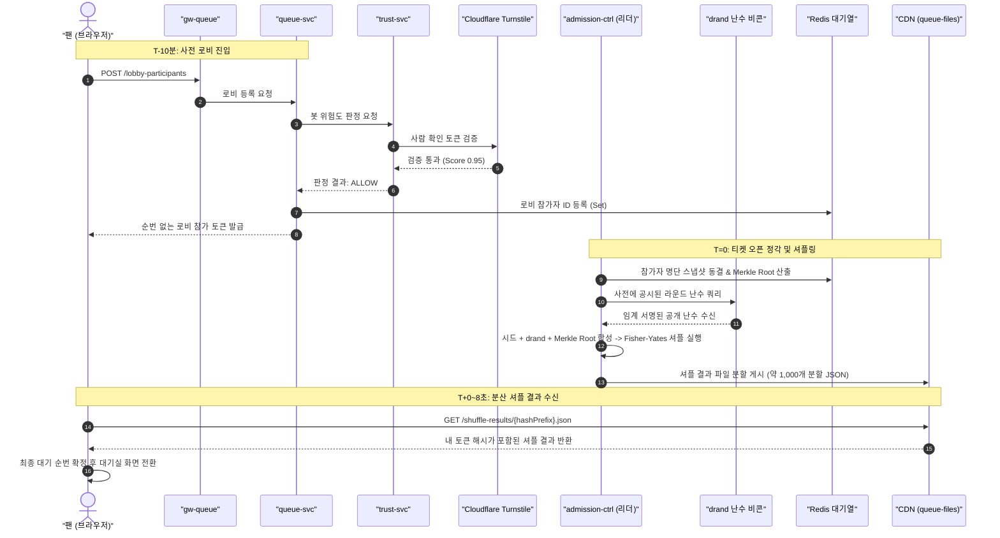

---

### 트레이드오프: 로비 셔플 vs 순수 선착순

| 정책 항목 | 로비 셔플 (기본 권장) | 순수 선착순 (FIFO) |
| :--- | :--- | :--- |
| **공정성 보장** | 10분 전 접속한 모든 일반 사용자에게 100% 동일한 당첨 확률 부여 | 전문 매크로 프로그램 및 고성능 IDC 망 소유자가 앞 번호 100% 독점 |
| **정각 진입 부하** | 대기자의 70%가 로비에 사전 흡수되어 진입 피크가 **4.8만 RPS**로 급감 | 정각에 100만 명이 일제히 유입되어 **20만 RPS**의 극단적 부하 발생 |
| **사용자 체감** | 일찍 들어온 사용자가 뒷번호를 받을 수 있다는 심리적 저항감 존재 | "내가 1등으로 눌렀다"는 착각을 유도하나 실제로는 매크로의 희생양 |
| **사후 검증성** | 시드 사전 봉인, drand 공개 난수, 오픈 60분 후 시드 공개로 100% 사후 감사 가능 | 네트워크 패킷 지연 차이로 인해 결과의 공정성을 객관적으로 입증 불가 |

---

### 5단 꼬리 질문과 모범 답변

1. **질문: "10분 전에 먼저 들어와 기다린 팬이 뒷번호를 받으면 불공정하다는 민원이 폭증하지 않습니까?"**  
   - **모범 답변**: "로비 입장 UI 전면에 '일찍 들어오셔도 대기 순번에 유리하지 않으며, 오픈 정각 공정 셔플을 통해 무작위로 순번이 결정됩니다'라는 정책을 명확히 공지합니다. 순수 선착순을 적용할 경우 일반 팬은 100% 매크로에 밀려 표를 아예 살 수 없다는 사실을 투명하게 안내하고, 사후에 공개되는 암호학적 셔플 검증 화면(SCR-019)을 통해 조작 의혹을 원천 불식시킵니다."
2. **질문: "외부 drand 공개 난수 비콘이 디도스 공격 등으로 지연되거나 응답하지 않으면 어떻게 됩니까?"**  
   - **모범 답변**: "drand는 전 세계 주요 연구기관(Cloudflare, EPFL 등)이 분산 운영하는 임계 서명 네트워크로 다운타임이 극히 드뭅니다. 그러나 만약 60초 이상 난수 수신이 지연될 경우, 시스템은 최고 등급 비상 상황(SEV1)을 선포하고 서로 다른 2명의 Commander가 서명하는 '비상 셔플 런북'을 가동합니다. 이때 발생한 비상 절차는 대외에 즉각 투명하게 공시됩니다."
3. **질문: "오픈 정각 직후 2초 묶음(Open Batch) 처리 중에는 대기열 입장이 멈춥니까?"**  
   - **모범 답변**: "그렇습니다. 선착순 공연이라도 초반 2초 동안 유입된 요청들을 버퍼링하여 섞는 동안(약 3~5초 소요), 좌석 선택 화면으로의 입장은 잠시 대기합니다. 그러나 이 수 초의 지연은 매크로의 밀리초 경쟁을 무력화하기 위해 지불하는 매우 가치 있는 공학적 비용입니다."
4. **질문: "trust-svc 봇 판정 서비스가 고장으로 전면 다운되면 모든 팬의 진입이 차단됩니까?"**  
   - **모범 답변**: "아닙니다. 가용성이 봇 방어보다 언제나 우선합니다. trust-svc가 응답하지 않으면 게이트웨이와 queue-svc는 즉시 페일오픈(Fail-open)하여 캐시된 기본 규칙(기기 및 계정당 10초 내 5회 제한)으로 진입을 정상 허용하며 온세일 진행을 멈추지 않습니다."
5. **질문: "1인이 휴대폰 본인확인 다계정을 파서 여러 대의 폰으로 동시에 로비에 참여하면 어떻게 막습니까?"**  
   - **모범 답변**: "휴대폰 본인확인 기관(KCB/다날)이 발급하는 연계정보(CI, 주민번호 대체 식별값)를 솔트와 함께 HMAC 해시하여 플랫폼 고유의 `person_id`를 생성합니다. 동일한 `person_id`는 단 하나의 계정으로만 1회 대기열 순번을 발급받을 수 있도록 Redis Set 수준에서 엄격히 제한하므로, 전화번호가 달라도 동일 명의의 다계정 참여는 원천 차단됩니다."

---

## 7단계. 몇 명씩 들여보낼까 `꼭`

> **면접관에게**:  
> "대기열의 존재 목적은 단순히 줄을 세우는 것이 아니라, 뒤편의 좌석 예매 계층과 외부 결제사를 완벽히 보호하는 **부하 방파제(Admission Gate)** 역할을 수행하는 것입니다.  
> PEAKET은 좌석 선택 화면의 동시 인원 목표치를 **5,000명**으로 설정하고, 단일 리더 프로세스인 `admission-ctrl`이 **200ms 주기**의 정밀 제어 루프를 가동합니다.  
> 이 루프는 단순히 빈자리를 세는 것이 아니라, '호출되었으나 아직 네트워크를 타고 진입 중인 인원(In-Flight)'을 차감하고, '실제 입장 확정 비율(Show-up Rate)'로 나누어 호출 번호를 보정합니다.  
> 또한 실제 구매 세션의 시작과 종료는 좌석 서비스의 이벤트를 통해 정확히 감지하여 즉시 빈자리를 회수합니다.  
> 만약 백엔드의 응답 지연(p99)이나 DB 에러율이 치솟으면, TCP의 혼잡 제어와 유사한 **AIMD(Additive Increase, Multiplicative Decrease)** 알고리즘이 발동하여 입장 목표를 즉각 **50% 감축**함으로써 시스템을 자율 보호합니다."

---

### 단순하게 하면 어디서 깨지나 (Why Naive Breaks)

- **호출된 번호가 100% 입장한다고 가정하는 오류**:  
  대기 순번이 와서 입장 신호를 보냈으나 사용자가 이미 브라우저를 닫았거나 네트워크가 끊긴 '유령 대기자'가 발생합니다. 이들이 자리를 차지하고 있다고 가정하면 세션 타임아웃(예: 15분) 동안 좌석 화면이 텅 비어 전체 예매 진행 속도가 치명적으로 지연됩니다.
- **In-Flight(호출 후 이동 중) 인원 미반영으로 인한 과도 입장**:  
  클라이언트가 입장 신호를 수신하고 실제 예매 페이지로 진입하기까지는 CDN 캐시 만료와 네트워크 RTT로 인해 약 1.5 ~ 3초가 걸립니다. 200ms 제어 루프가 이동 중인 인원을 고려하지 않고 매 주기마다 빈자리만 센다면, 동일한 빈자리를 보고 7~15회 연속으로 중복 방출하여 순간적으로 1만 명 이상이 좌석 화면으로 쏟아져 들어오는 오버플로우가 발생합니다.
- **대기자로부터 사전 준비 완료(Ready) 핑을 받는 방식의 붕괴**:  
  입장 직전 대기자에게 '준비되었습니까?'를 묻고 응답을 받아 입장시키는 방식은, 수만 명의 대기자가 일제히 확인 API를 쏘면서 대규모 쓰기 부하를 유발합니다. 또한 브라우저의 백그라운드 탭 스로틀링(타이머 지연)으로 인해 정상 사용자가 핑을 제때 못 보내 탈락하는 UX 결함이 발생합니다.

---

### PEAKET의 아키텍처 해결책

```
[admission-ctrl의 200ms 폐루프 제어 알고리즘]

1. 실시간 자원 상태 집계 (매 200ms):
   - active_sessions = 현재 활성 구매 세션 수 (Kafka 이벤트 기반 실시간 집계)
   - in_flight = 최근 3초 내 호출되었으나 아직 첫 예매 요청을 보내지 않은 번호 수
   - soon_waiting = 입장 임박 대기 큐(Ordered SOON Queue)에 대기 중인 인원

2. 가용 슬롯(빈자리) 계산:
   - available_slots = target_concurrency (5,000) - active_sessions - in_flight - soon_waiting

3. 방출 번호 증분(Increment) 산출:
   - actual_show_up_rate = 최근 60초간 호출된 번호 중 실제 입장 확정한 비율 (안전 하한 0.2)
   - advance_count = max(0, available_slots / actual_show_up_rate)
   - max_velocity = min(초당 1,000번호, PG사 승인 상한 300 TPS)
   - bounded_advance = min(advance_count, max_velocity * 0.2초)

4. Redis 원자적 갱신:
   - Redis Lua 스크립트로 Fence Token 검증 후 `currentServingSeq = currentServingSeq + bounded_advance` 반영
```

1. **구매 세션 개시 기반의 좌석 점유 (ADR-0005)**:  
   차례가 온 사용자가 첫 예매 요청(`GET /seatmap-snapshot`)을 보낼 때 비로소 `purchase-svc`에 구매 세션이 생성되며 자리를 차지합니다. 입장하지 않은 유령 사용자는 백엔드 자원을 1도 점유하지 않으며, 차례 도달 후 15분 이내에만 접속하면 다음 가용 슬롯으로 최우선 진입할 수 있습니다.
2. **AIMD 기반 동적 인입 제어 (ADR-0126)**:  
   - **가산 증가 (Additive Increase)**: 백엔드 `purchase-svc`의 p99 지연 시간과 DB 오류율이 정상 범위를 유지하면, 30초 윈도우마다 동시 입장 목표치를 초기값의 2%(100명씩) 천천히 상향합니다.
   - **승수 감소 (Multiplicative Decrease)**: 다운스트림 p99가 500ms를 초과하거나 에러 버짓 소진율이 위험 수준에 도달하면 즉각 입장 목표치를 **50%(예: 5,000명 $\to$ 2,500명)**로 대폭 삭감합니다.
   - **감축 후 안정화 대기 (Cooldown)**: 감축 후에는 이미 진입한 사용자의 평균 체류 시간(180초)을 고려하여 최소 2분간 추가 감축을 억제하고 시스템 회복을 관찰합니다.
3. **단일 리더 선출 및 펜싱 토큰 (ADR-0056)**:  
   제어 루프는 쿠버네티스 Lease를 통해 선출된 단 1대의 `admission-ctrl` 리더 파드만이 수행합니다. 네트워크 파티션으로 인한 스플릿 브레인(Split-brain)을 방지하기 위해 리더 교체 시 단조 증가하는 에포크(Epoch/Fencing Token)를 Redis 쓰기 시마다 Lua 스크립트로 대조하여 구 리더의 잔여 쓰기를 원천 기각합니다.

---

### 시각 다이어그램: 200ms 입장 제어 폐루프 및 AIMD 피드백 루프

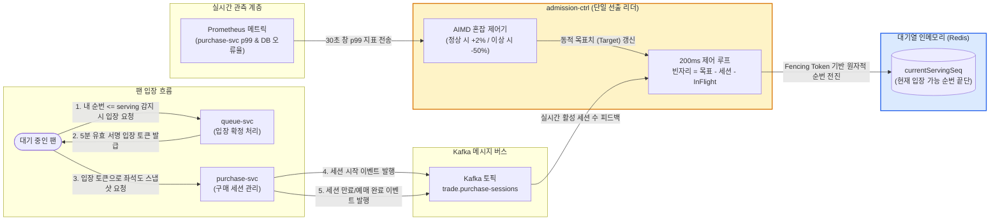

---

### 트레이드오프: 동시 입장 제어 목표 설정

| 제어 방식 | 얻는 이점 (Gain) | 치르는 대가 (Cost) |
| :--- | :--- | :--- |
| **동시 입장 5,000명 고정 & AIMD (선택)** | 대기실에 100만 명이 있든 500만 명이 있든 백엔드 좌석/결제 시스템의 부하가 물리적으로 격리되어 절대 붕괴하지 않음 | 대형 공연 전량 매진까지 최소 18~22분의 물리적 시간이 소요됨 |
| **대기열 없이 전원 즉각 입장 (전통 방식)** | 시스템 처리 속도가 무한하다면 1분 만에 초고속 매진 가능 | RDBMS 커넥션 풀 전면 고갈, 타임아웃, 전체 결제 프로세스 마비로 0건 예매 참사 발생 |
| **In-Flight 미반영 단순 빈자리 계산** | 알고리즘이 단순해지고 구현이 용이함 | 네트워크 지연 동안 동일 빈자리에 대해 수만 명이 중복 입장하여 좌석 서버 과부하 발생 |

---

### 5단 꼬리 질문과 모범 답변

1. **질문: "입장 차례가 왔는데 브라우저를 닫고 나가버린 사용자는 빈자리를 계속 차지합니까?"**  
   - **모범 답변**: "절대 차지하지 않습니다. PEAKET은 번호가 호출되었다고 자리를 선점하는 것이 아니라, 사용자가 좌석도 스냅샷 API(`GET /seatmap-snapshot`)를 실제로 호출하여 구매 세션을 열었을 때만 슬롯을 차감합니다. 퇴장한 사용자는 자리를 소모하지 않으므로 다음 순번 대기자가 즉시 입장합니다."
2. **질문: "리더 파드가 네트워크 순단으로 일시 단절되어 새 리더가 선출되었을 때, 구 리더가 살아나서 순번을 올리면 어떻게 됩니까?"**  
   - **모범 답변**: "스플릿 브레인 방지를 위해 단조 증가하는 펜싱 토큰(Fencing Token/Generation)을 사용합니다. 새 리더가 선출되면 Redis의 세대 번호를 1 올립니다. 구 리더가 뒤늦게 Redis에 순번 전진 Lua 스크립트를 실행하더라도, 스크립트 내부에서 자신의 세대 번호가 최신 세대보다 낮음을 확인하고 즉각 쓰기를 거절(Reject)합니다."
3. **질문: "AIMD 알고리즘이 백엔드 이상을 감지하여 목표치를 2,500명으로 줄였는데, 이미 들어와 있는 5,000명은 강제 퇴장당합니까?"**  
   - **모범 답변**: "이미 들어와서 예매를 진행 중인 정상 사용자를 강제로 쫓아내지 않습니다. 대신 신규 입장 번호의 전진(currentServingSeq 증가)을 전면 동결합니다. 기존 5,000명이 평균 3분의 체류 시간 동안 결제를 마치거나 퇴장하여 내부 체류 인원이 새 목표치인 2,500명 아래로 자연 감소할 때까지 입장을 일시 중단시키는 방식으로 부하를 흡수합니다."
4. **질문: "외부 PG사의 승인 한도가 초당 300건인데, 입장 인원이 이를 넘치게 만들 위험은 없습니까?"**  
   - **모범 답변**: "200ms 제어 루프 내부의 순번 전진 속도 상한(\(max\_velocity\))이 \(\min(1,000, 300\text{ TPS})\)로 하드코딩되어 있습니다. 따라서 첫 번째 입장 물결이 아무리 거세도 초당 300번호 이상은 방출되지 않으므로, PG사의 가맹점 트래픽 임계치를 완벽히 보호합니다."
5. **질문: "티켓이 매진되었을 때 대기 중인 90만 명의 대기를 즉시 종료시킵니까?"**  
   - **모범 답변**: "잔여 좌석과 Soft Hold 좌석이 모두 0이 된 '최종 매진' 시에는 즉시 엣지 함수와 대기실 파일에 `SOLD_OUT`을 전파하고 대기를 종료합니다. 그러나 결제 진행 중인 좌석만 남아 있는 '일시 매진(ALL_HELD)' 상태에서는 결제 실패로 좌석이 다시 풀릴 수 있으므로 대기열을 해제하지 않고 입장을 잠시 멈춘 채 대기 상태를 유지합니다(ADR-0122)."

---

## 8단계. 같은 좌석을 두 번 팔지 않기 (K2·K3) `꼭`

> **면접관에게**:  
> "티케팅 시스템의 가장 핵심적인 비즈니스 불변식은 **'인기 좌석 1개에 수천 명이 몰려도 오버셀(초과 판매)은 정확히 0건이어야 한다'**는 것입니다.  
> v0의 RDBMS `SELECT ... FOR UPDATE` 행 잠금은 락 대기로 인해 p99가 수 초로 치솟고 커넥션 풀을 말려버립니다. 그렇다고 Redis만으로 재고를 관리하면 장애 조치(Failover) 시 비동기 복제 유실로 인해 중복 판매가 터집니다.  
> PEAKET은 이를 완벽히 분리된 **2단계 좌석 선점 모델(Two-Phase Seat Allocation)**로 해결합니다.  
> 1단계 **Soft Hold(가예약)**는 좌석 전용 Redis 클러스터에서 단일 원자적 Lua 스크립트로 처리됩니다. 5만 석 좌석을 1석당 1비트(단 6.25KB)의 비트맵으로 검사하고 1인당 4매 한도를 즉시 검증하여 **p99 50ms 이내**로 초저지연 선점합니다. 이 단계에서는 RDBMS에 단 1건의 쓰기도 발생하지 않습니다.  
> 2단계 **Hard Sale(확정 판매)**은 PG 결제 승인 직전, PostgreSQL의 `seat_sale` 테이블에 `PENDING` 행을 삽입합니다. 이때 `UNIQUE (event_id, seat_id) WHERE status IN ('PENDING', 'SOLD')` 부분 유니크 인덱스가 최종 물리적 방어선으로 동작합니다.  
> 만에 하나 Redis가 크래시되어 가예약 정보를 잃어버리더라도, RDBMS의 고유 제약조건이 두 번째 판매를 데이터베이스 레벨에서 원천 거절하므로 **수학적 오버셀 0건**을 완벽히 보장합니다."

---

### 단순하게 하면 어디서 깨지나 (Why Naive Breaks)

- **RDBMS 비관적 락(K2)의 수학적 붕괴**:  
  v0는 좌석 선택 시 `SELECT * FROM seat WHERE id = ? FOR UPDATE`를 실행합니다. 50,000석 콘서트에서 가장 경쟁이 치열한 1구역 1열 1번 좌석 1개에 1,000명이 0.1초 만에 동시에 클릭합니다. PostgreSQL은 1개 트랜잭션만 통과시키고 999개를 행 잠금 큐에 줄세웁니다. 트랜잭션당 네트워크 왕복과 처리를 합쳐 10ms만 걸려도 999번째 트랜잭션은 **약 10초**를 기다려야 합니다. 그 결과 DB 커넥션 풀이 전면 고갈되고 `lock_timeout` 에러가 빗발치며 대기와 무관한 결제 트랜잭션까지 동반 침몰합니다.
- **다중 좌석 선택 시 교착 상태 (K3)**:  
  2연석을 예매할 때 사용자 A는 (좌석 10번 $\to$ 11번)을 클릭하고 사용자 B는 (좌석 11번 $\to$ 10번)을 클릭하면, 두 트랜잭션이 서로가 쥔 행 락을 기다리며 교착 상태(Deadlock)에 빠져 둘 다 에러를 뱉고 롤백됩니다.
- **인메모리 단독 확정의 치명적 오버셀**:  
  반대로 Redis의 초고속 성능만 믿고 RDBMS 제약 없이 Redis 메모리에서만 판매를 확정하면, Redis 마스터 노드가 장애로 다운되고 복제본(Replica)이 승격되는 페일오버 과정에서 비동기 복제 미반영분(수십 ms의 Lost Write)이 유실됩니다. 그 결과 동일한 좌석이 두 사람에게 이중 판매되어 콘서트 당일 같은 의자에 두 관객이 찾아오는 파멸적인 비즈니스 사고로 이어집니다.

---

### PEAKET의 아키텍처 해결책

```
[1단계: In-Memory Soft Hold (Redis Lua 원자적 실행)]
               │
               ▼
   [요청 좌석 비트맵 검사] ──(이미 1이면)──> [409 Conflict 즉시 반환]
               │ (모두 0이면)
               ▼
   [1인당 누적 매수 <= 4 검증] ──(초과 시)──> [422 Quota Exceeded 반환]
               │ (통과 시)
               ▼
   [원자적 비트 1 세팅 + 7분 TTL 홀드 해시 기록 + Stream 발행] -> [201 Created (p99 <= 50ms)]


[2단계: RDBMS Hard Sale (PostgreSQL 부분 유니크 인덱스 방어)]
               │
               ▼
   [결제 접수 202 수신 직후 Saga 오케스트레이터 가동]
               │
               ▼
   [좌석 ID 오름차순 정렬] -> (Deadlock 원천 차단)
               │
               ▼
   INSERT INTO seat_sale (event_id, seat_id, order_id, status)
   VALUES (..., 'PENDING');
               │
               ├─▶ [성공] ──> [PG 승인 API 호출] ──> [status = 'SOLD' 확정]
               │
               └─▶ [고유 제약조건 위반 (23505 Unique Violation)]
                     │
                     ▼
             [승인 호출 없이 즉각 주문 실패 처리 (사용자 결제 출금 0건)]
```

1. **1단계 Soft Hold (In-Memory 원자적 점유)**:  
   - purchase-svc가 좌석 전용 Redis 클러스터의 해당 회차 샤드로 `hold.lua` 스크립트를 실행합니다. 회차의 모든 키는 Redis 해시태그 `{event:E}`로 묶여 동일한 노드에서 원자적으로 처리됩니다.
   - **원자적 검사 및 기록**: 좌석 비트맵(5만 석 = 6.25KB)에서 요청 좌석의 비트가 모두 0인지 검사하고, 사용자의 현재 보유 매수 + 요청 매수가 1인 한도(4매) 이하인지 검사합니다.
   - 검증 통과 시 비트를 1로 켜고, 홀드 상세 정보(주문자 ID, 만료 시각)를 기록하며, 감사 이력을 Redis Stream에 원자적으로 적재합니다. 실패 시 일체의 쓰기를 롤백하지 않고 즉시 409 Conflict를 반환합니다.
2. **펜싱 토큰 (Fencing Token)과 홀드 만료 회수**:  
   - 선점된 좌석은 단조 증가하는 펜싱 토큰을 부여받고 기본 **7분의 TTL**(1회 3분 연장 가능, POL-012)이 설정됩니다.
   - 백그라운드 회수 작업자가 매초 만료된 홀드를 검출하여 비트를 0으로 복원하며, 3초 이내에 다른 사용자에게 실시간 재노출됩니다(NFR-025).
3. **2단계 Hard Sale (RDBMS 최종 원장 기록)**:  
   - 사용자가 결제창 인증을 마치고 결제 접수가 시작되면, 결제사 승인 API를 호출하기 직전에 PostgreSQL의 로컬 트랜잭션에서 `seat_sale` 테이블에 판매 행을 삽입합니다.
   - **부분 유니크 인덱스 (Partial Unique Index)**:
     ```sql
     CREATE UNIQUE INDEX uq_seat_sale_active 
     ON seat_sale (event_id, seat_id) 
     WHERE status IN ('PENDING', 'SOLD');
     ```
     취소되거나 환불된 행(`status = 'RETURNED'`)은 인덱스 대상에서 제외되므로 재판매가 자유롭고, 활성 상태의 행은 물리적으로 단 1건만 존재할 수 있습니다.
4. **정렬 삽입을 통한 교착 상태(Deadlock) 수학적 제거 (K3 해결)**:  
   - 사용자가 2매 이상의 좌석을 한 번에 예매할 때, `seat_sale` 테이블에 행을 삽입하기 전 반드시 **`seat_id` 오름차순으로 정렬**한 뒤 순차 삽입합니다. 모든 트랜잭션이 동일한 전역 순서로 리소스를 획득하므로 상호 대기 순환이 발생할 수 없습니다.
5. **승인 전 컷오프로 인한 결제 무사고**:  
   - 유니크 인덱스 경합에서 승리하여 `PENDING` 행을 선점한 주문만이 실제 PG 승인 API를 호출합니다. 경합에서 패배한 주문은 PG 승인 호출 자체를 생략하고 즉시 실패 처리하므로, 고객의 통장에서 돈이 출금된 뒤 사후 환불해야 하는 금융 사고가 발생하지 않습니다.
6. **Redis 장애 시 구매 요청 일시 유예 (ADR-0121)**:  
   - 좌석 Redis의 마스터가 다운되어 센티널/클러스터 페일오버가 진행되는 수 초 동안, 시스템은 RDBMS 비상 경로로 우회하지 않고 HTTP **503 `seat-store-unavailable`**과 함께 `Retry-After: 2` 헤더를 반환하여 구매 요청을 잠시 유예합니다. 페일오버 완료 후 회차 세대 번호를 올려 클라이언트 상태를 리셋함으로써 오버셀 0건 불변식을 철통같이 지킵니다.

---

### 시각 다이어그램: 2단계 좌석 선점 및 판매 확정 상세 시퀀스

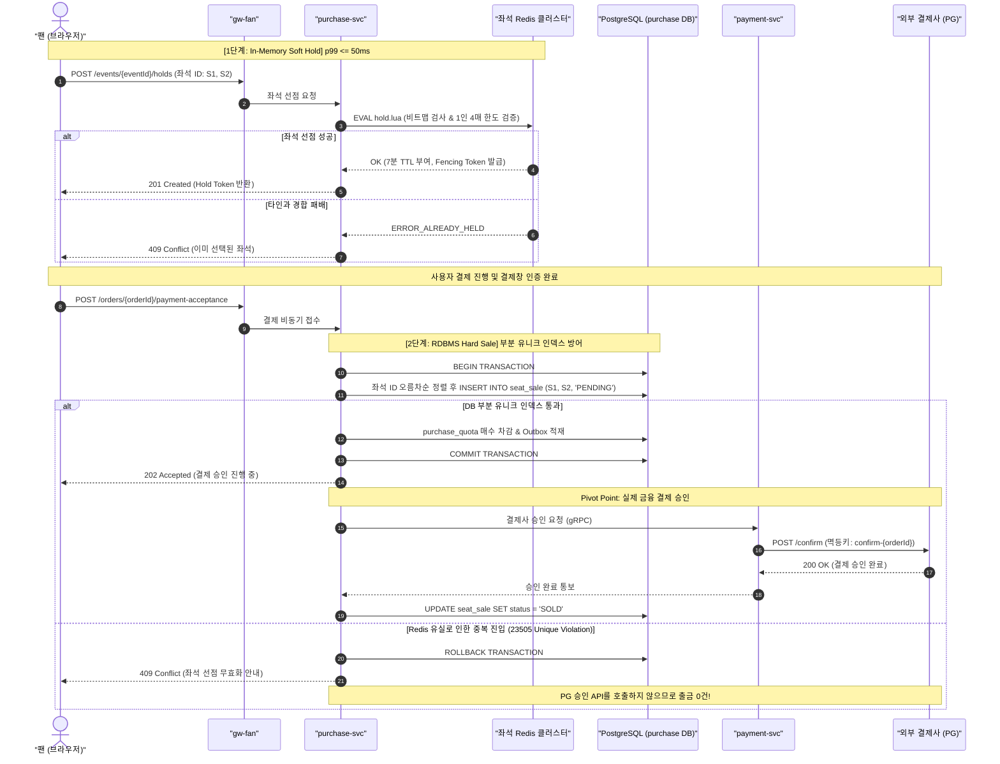

---

### p99 50ms 좌석 선점 지연 시간 예산 (Latency Budget)

| 구간 | 할당 예산 | 실제 측정 및 설계 근거 |
| :--- | :---: | :--- |
| **인프라 입구 게이트웨이 (gw-fan)** | 3ms | Envoy 프록시 TLS 복호화 및 라우팅 |
| **내부 네트워크 왕복 지연 (RTT)** | 5ms | 쿠버네티스 노드 간 통신 지연 (VPC 내부) |
| **구매 세션 토큰 서명 검증** | 1ms | Ed25519 공개키 메모리 내 서명 검증 |
| **Redis Lua 스크립트 실행 및 왕복**| 7ms | 단일 샤드 내 인메모리 비트맵 연산 (순수 실행 p99 < 0.3ms) |
| **직렬화 및 응답 생성** | 5ms | Fastify 스키마 기반 초고속 JSON 직렬화 |
| **네트워크 지터 안전 여유 (Buffer)**| 29ms | 피크 트래픽 시의 패킷 지터 흡수 |
| **총합 설계 한도** | **50ms** | **NFR-003 엄격 준수 (p99 ≤ 50ms, p99.9 ≤ 150ms)** |

---

### 트레이드오프: 2단계 일관성 모델의 득실

| 비교 항목 | PEAKET 2단계 모델 (선택) | PostgreSQL 단독 트랜잭션 | Redis 단독 확정 모델 |
| :--- | :--- | :--- | :--- |
| **좌석 선점 지연 시간** | **p99 ≤ 50ms** 초저지연 달성 | p99 수 초 이상 (락 대기 큐 폭주) | p99 ≤ 5ms 초고속 |
| **오버셀(초과 판매) 보장** | **정확히 0건** (DB 유니크 인덱스) | 정확히 0건 (DB 비관적 락) | **오버셀 발생 위험 높음** (페일오버 시 쓰기 유실) |
| **시스템 복잡도** | Lua 스크립트, 펜싱 토큰, 2단계 파이프라인 관리 필요 | 단일 SQL로 단순함 | 매우 단순함 |
| **장애 조치 영향** | 페일오버 동안 몇 초간 503 유예 처리 | DB 페일오버 동안 전면 중단 | 복제 지연분 영구 유실 |

---

### 5단 꼬리 질문과 모범 답변

1. **질문: "Redis 마스터가 다운되어 가예약 데이터를 잃어버렸는데, 그 좌석을 다른 사람이 결제하면 이중 출금이 발생하지 않습니까?"**  
   - **모범 답변**: "절대 발생하지 않습니다. 사용자 A가 Redis에서 좌석을 잡았으나 Redis가 다운되어 데이터가 유실되었고, 그 사이 사용자 B가 새 Redis에서 동일 좌석을 잡았다고 가정하겠습니다. 결제 접수 시 PostgreSQL의 부분 유니크 인덱스(`uq_seat_sale_active`)에 먼저 도달한 트랜잭션만 `PENDING` 행 삽입에 성공합니다. 뒤늦게 도달한 트랜잭션은 DB 유니크 제약조건 위반으로 즉각 롤백되며, **외부 PG 승인 API 호출 자체가 생략**되므로 패배한 사용자에게서 돈이 빠져나가지 않습니다."
2. **질문: "Redis가 죽었을 때 PostgreSQL로 바로 우회해서 좌석을 잡게 하는 비상 폴백(Fallback)을 왜 없앴습니까?"**  
   - **모범 답변**: "과거에는 DB 폴백 경로가 있었으나 ADR-0121을 통해 완전히 제거했습니다. Redis 마스터가 죽기 직전 마지막 몇 초간 발급한 홀드 정보는 오직 Redis 메모리에만 존재합니다. 이 상태에서 DB 경로를 열면 DB는 해당 좌석이 비어있다고 판단하여 다른 사용자에게 동일 좌석을 중복 발급합니다. 또한 파드마다 우회 전환 시점이 달라 두 경로가 동시에 열리는 분할 뇌(Split-Brain)가 발생합니다. 몇 초간 503으로 구매를 유예하는 것이 오버셀을 막는 유일하게 안전한 길입니다."
3. **질문: "1인이 여러 브라우저 탭을 열어서 4매 한도를 넘겨 8매를 동시에 잡는 꼼수는 어떻게 막습니까?"**  
   - **모범 답변**: "동일한 회차의 모든 좌석 및 사용자 데이터는 Redis 해시태그 `{event:E}`에 의해 물리적으로 동일한 단일 샤드에 모입니다. Redis는 싱글 스레드로 동작하므로 사용자 A의 탭 1과 탭 2 요청은 반드시 순차적으로 실행됩니다. `hold.lua` 스크립트가 누적 보유 매수를 원자적으로 검사하고 갱신하므로 메모리 레이스 컨디션이 불가능하며, 2단계 DB의 `purchase_quota`에서도 트랜잭션 내에서 최종 2차 검증을 수행합니다."
4. **질문: "PostgreSQL 부분 유니크 인덱스는 알겠는데, 취소된 티켓의 재판매는 어떻게 지원합니까?"**  
   - **모범 답변**: "인덱스 조건이 `WHERE status IN ('PENDING', 'SOLD')`로 선언되어 있습니다. 사용자가 예매를 취소하거나 미결제로 취소되면 행의 상태를 `'RETURNED'`로 업데이트합니다. 그 순간 해당 행은 부분 유니크 인덱스의 색인 대상에서 즉각 제외되므로, 동일한 `(event_id, seat_id)`에 대해 새로운 `PENDING` 행을 아무런 충돌 없이 삽입할 수 있습니다."
5. **질문: "좌석 선점 TTL 7분이 지나 미결제된 좌석은 어떻게 다시 시장에 풀립니까?"**  
   - **모범 답변**: "purchase-svc의 백그라운드 만료 워커가 1초 주기로 Redis의 만료 인덱스를 스캔합니다. 만료 시각이 경과한 홀드 키를 확인하면 비트맵의 해당 좌석 비트를 0으로 언마킹하고, Redis Sharded Pub/Sub을 통해 실시간 웹소켓 계층으로 '좌석 취소(RELEASED)' 이벤트를 즉각 브로드캐스트하여 p99 3초 이내에 다른 팬들의 화면에 구매 가능한 상태로 복원시킵니다."

## 9단계. 좌석 변경을 실시간으로 알리기 (K4·K5) `시간 남으면`

> **면접관에게**:  
> "좌석 화면에 진입한 5,000명의 팬들에게는 타인이 선점한 좌석 정보가 실시간으로 깜빡임 없이 즉각 반영되어야 합니다.  
> 5만 석 전체 상태를 1초마다 JSON으로 5,000명에게 브로드캐스트하면 초당 10GB(80 Gbps)의 대역폭 폭발로 네트워크가 즉각 마비됩니다.  
> PEAKET은 이를 두 가지 핵심 최적화로 해결합니다.  
> 첫째, 입장 시점에만 **압축된 6.25KB 비트맵 스냅샷**을 단 1회 다운로드받고, 이후에는 **사용자가 현재 확대(Zoom-in)해서 보고 있는 구역(최대 16구역)만 구독**하여 변경된 좌석 델타(Delta)만을 수신합니다.  
> 둘째, `realtime-gw`가 변경 사항을 **100ms 마이크로 배치**로 묶어 200바이트 이하의 **경량 바이너리 프레임**으로 WebSocket 전송함으로써 네트워크 전송량을 무려 **600배 절감**합니다.  
> 클라이언트 브라우저 측면(K5)에서는 메인 UI 스레드의 버벅임을 원천 차단하기 위해, **Web Worker와 OffscreenCanvas**를 결합하여 백그라운드 스레드에서 정수 배열(50KB) 기반으로 60fps 렌더링을 수행하여 조작 지연(INP)을 200ms 이하로 완벽히 방어합니다."

---

### 단순하게 하면 어디서 깨지나 (Why Naive Breaks)

- **전체 상태 브로드캐스트의 대역폭 참사 (v0의 K4)**:  
  5만 석 콘서트의 전체 좌석 상태(좌석 ID, 구역, 행, 번호, 상태)를 JSON으로 직렬화하면 최소 약 2MB입니다. 5,000명의 연결된 사용자에게 매초 이 전체 JSON을 전송하면:
  $$
  2\text{ MB} \times 5,000\text{명} \times 1\text{초} = \mathbf{10\text{ GB/s}} \quad (\mathbf{80\text{ Gbps}})
  $$
  클라우드 인프라의 단일 게이트웨이나 로드밸런서의 네트워크 인터페이스(NIC)가 즉각 포화되어 모든 패킷이 드롭됩니다.
- **클라이언트 메인 스레드 렌더링 렉 (v0의 K5)**:  
  v0는 브라우저 메인 스레드의 단일 `<canvas>`에 5만 개 좌석 객체를 자바스크립트 객체 배열(`[{id: 1, x: 10, y: 20, status: 'EMPTY'}, ...]`)로 유지하며 화면을 그립니다. 사용자가 화면을 핀치 줌(Pinch-to-zoom)하거나 패닝(Panning)할 때마다 가비지 컬렉션(GC)과 렌더링 루프가 메인 스레드를 50ms 이상 독점하는 롱 태스크(Long Task)를 유발합니다. 그 결과 좌석을 클릭해도 이벤트가 먹통이 되는 인터랙션 반응성(INP > 1,000ms) 저하가 발생합니다.

---

### PEAKET의 아키텍처 해결책

```
[좌석 델타 바이너리 프레임 구조 (총 약 6~200 bytes)]
┌──────────────┬──────────────┬──────────────┬───────────────────────────┐
│ eventEpoch   │ sectionSeq   │ changeCount  │ seatDeltas (반복)         │
│ (2 bytes)    │ (4 bytes)    │ (2 bytes)    │ (seatId: 2B + status: 1B) │
└──────────────┴──────────────┴──────────────┴───────────────────────────┘
```

1. **스냅샷 1회 + 뷰포트 기반 구역 Pub/Sub (ADR-0027)**:  
   - 좌석 화면 진입 시 `GET /seatmap-snapshot`으로 전체 좌석 상태를 1석당 1비트로 압축한 비트맵(단 6.25KB)을 수신합니다.
   - 좌석을 확대하여 특정 구역을 보기 시작하면, 클라이언트는 해당 구역의 Redis Sharded Pub/Sub 채널 `s:{event:E}:sec:{section}`을 동적으로 구독합니다.
   - 축소된 전체 화면에서는 실시간 스트리밍을 구독하지 않고 5초 주기로 스냅샷만 가볍게 폴링하며, 최대 구독 구역 수는 16개로 상한을 둡니다.
2. **100ms 마이크로 배치 바이너리 스트리밍 (ADR-0110)**:  
   - `realtime-gw` 파드는 연결된 클라이언트별로 변경 사항을 즉시 보내지 않고, 100ms 버퍼링 창을 두어 변경된 좌석들을 묶어 단일 바이너리 프레임으로 전송합니다.
   - 전송 포맷은 JSON 대신 커스텀 바이너리 인코딩(좌석 번호 2바이트 + 상태 코드 1바이트)을 사용하여 프레임 크기를 200바이트 이하로 극소화합니다.
   - 전체 브로드캐스트 방식 대비 네트워크 대역폭 소비를 초당 10GB에서 **초당 16MB 이하로 600배 이상 압축**합니다.
3. **일련번호(Sequence)와 세대 번호(Epoch) 기반의 정합성 복구**:  
   - 전송되는 모든 바이너리 프레임에는 구역별 단조 증가 일련번호(`sectionSeq`)와 Redis 장애 복구 세대 번호(`eventEpoch`)가 포함됩니다.
   - 클라이언트가 프레임을 수신했을 때 일련번호의 누락(Gap)을 감지하면, 즉시 해당 구역의 델타 스트림을 일시 중단하고 해당 구역의 스냅샷을 1회 재요청하여 상태를 동기화합니다.
4. **Web Worker + OffscreenCanvas 렌더링 파이프라인 (K5 해결)**:  
   - 메인 스레드는 네트워크 WebSocket 수신 및 터치 이벤트 처리만을 전담합니다.
   - 수신된 바이너리 버퍼는 `transferControlToOffscreen()`으로 생성된 별도의 **Web Worker 스레드**로 메모리 복사 없이 전달됩니다.
   - Web Worker 내부에서는 5만 개 좌석 상태를 단 50KB 크기의 정수 TypedArray(`Uint8Array`)로 관리하며, `requestAnimationFrame` 주기에 맞추어 오프스크린 캔버스에 60fps로 버벅임 없이 렌더링합니다. (조작 반응성 INP ≤ 200ms 달성).

---

### 시각 다이어그램: 좌석 델타 스트리밍 및 Worker 오프스크린 렌더링 흐름

```mermaid
flowchart LR
    subgraph CoreEngine["purchase-svc & 스토리지"]
        lua["hold.lua<br/>(좌석 상태 변경)"]
        sredis[("좌석 Redis 클러스터<br/>(구역별 Sharded Pub/Sub)")]
    end

    subgraph RealtimeLayer["실시간 게이트웨이 (realtime-gw)"]
        sub["구역별 채널 구독자<br/>(보는 구역만 청취)"]
        batch["100ms 마이크로 배치 버퍼<br/>(바이너리 패킹 < 200B)"]
    end

    subgraph BrowserApp["팬 브라우저 (클라이언트)"]
        ws["메인 스레드 (WebSocket)<br/>터치 입력 & 줌/팬 처리"]
        worker["Web Worker 스레드<br/>OffscreenCanvas 렌더링<br/>(50KB Uint8Array 상태 유지)"]
    end

    lua -->|"SPUBLISH s:E:sec:101 (좌석 변경)"| sredis
    sredis -->|"구역 메시지 팬아웃"| sub
    sub --> batch
    batch -->|"WebSocket 바이너리 프레임"| ws
    ws -->|"ArrayBuffer 전송 (Zero-copy)"| worker

    classDef core fill:#dbeafe,stroke:#2563eb,stroke-width:2px,color:#1f2937
    classDef rgw fill:#fef3c7,stroke:#d97706,stroke-width:2px,color:#1f2937
    classDef client fill:#dcfce7,stroke:#16a34a,stroke-width:2px,color:#1f2937
    class CoreEngine core
    class RealtimeLayer rgw
    class BrowserApp client
```

---

### 트레이드오프 및 수치 요약

| 최적화 지표 | 전체 JSON 브로드캐스트 (v0) | PEAKET 뷰포트 델타 스트리밍 (선택) |
| :--- | :--- | :--- |
| **초당 네트워크 대역폭** | **10 GB/s (80 Gbps, 네트워크 마비)** | **초당 약 16 MB 이하 (600배 절감)** |
| **종단 지연 시간 (E2E)** | 전송 지연으로 수 초 이상 지연 | **p99 ≤ 300ms 이내 (NFR-004 달성)** |
| **클라이언트 UI 반응성** | 메인 스레드 블로킹 (INP > 1,000ms) | **Web Worker 분리로 60fps 유지 (INP ≤ 200ms)** |
| **치르는 대가** | 단순한 구현 코드 | 일련번호 갭 감지, 바이너리 파서, Worker 상태 복구 로직 구현 필요 |

---

### 5단 꼬리 질문과 모범 답변

1. **질문: "왜 단방향 전송인 SSE(Server-Sent Events) 대신 WebSocket을 사용했습니까?"**  
   - **모범 답변**: "클라이언트가 좌석도를 줌인/줌아웃하거나 다른 구역으로 이동할 때마다 실시간으로 '구역 구독 변경' 메시지를 서버로 전송해야 하는 양방향 통신이 필수적이기 때문입니다. 또한 SSE는 텍스트 기반 스트림이어서 바이너리 전송 시 Base64 인코딩 오버헤드(33% 크기 증가)가 발생하는 반면, WebSocket은 네이티브 바이너리 프레임을 지원하여 네트워크 효율이 극대화됩니다(ADR-0027)."
2. **질문: "좌석 전파가 0.3초 지연되는 사이에 다른 사용자가 해당 좌석을 클릭하면 어떻게 됩니까?"**  
   - **모범 답변**: "화면의 표시는 안내일 뿐이며, 좌석의 최종 선점 권한은 8단계의 Redis Lua 스크립트(`hold.lua`)가 원자적으로 결정합니다. 뒤늦게 클릭한 사용자는 스크립트 실행 즉시 409 Conflict(이미 선택된 좌석) 에러를 수신하며, 그 순간 해당 클라이언트의 로컬 화면도 즉시 점유 상태로 보정됩니다."
3. **질문: "Web Worker에서 캔버스를 그리면 구형 모바일 브라우저 호환성 문제는 없습니까?"**  
   - **모범 답변**: "OffscreenCanvas는 Chrome, Safari(iOS 16.4+), Firefox 등 현대 브라우저의 96% 이상에서 완벽히 지원됩니다. 만약 OffscreenCanvas를 지원하지 않는 극소수 구형 기기일 경우, Feature Detection을 통해 메인 스레드 Canvas로 자동 폴백하되 렌더링 디바운싱(Debounce)을 걸어 최소한의 사용성을 보장합니다."
4. **질문: "Redis 마스터 장애 조치로 인해 일련번호가 리셋되면 클라이언트는 어떻게 반응합니까?"**  
   - **모범 답변**: "바이너리 헤더에 포함된 `eventEpoch`(세대 번호)가 증가함을 감지합니다. 클라이언트는 자신이 가지고 있던 모든 구역의 시퀀스를 무효화하고, 현재 화면에 보이는 구역들에 대해 즉시 새로운 스냅샷을 1회 재요청하여 최신 상태로 재동기화합니다(ADR-0121)."
5. **질문: "일반 Redis Pub/Sub 대신 Sharded Pub/Sub(`SPUBLISH`)을 사용한 이유는 무엇입니까?"**  
   - **모범 답변**: "표준 Redis Pub/Sub은 클러스터 내의 모든 노드에 메시지를 브로드캐스트하므로, 노드가 늘어날수록 노드 간 메시지 복제 오버헤드가 기하급수적으로 증가합니다. 반면 Sharded Pub/Sub은 채널 키가 위치한 해당 샤드 노드에만 메시지를 가두어 처리하므로, 5만 석 규모의 구역별 메시지 팬아웃을 클러스터 전역 부하 없이 선형적으로 분산할 수 있습니다."

---

## 10단계. 결제와 서비스 사이의 일관성 (K7) `꼭`

> **면접관에게**:  
> "결제 계층은 `purchase-svc`(주문), `payment-svc`(결제), `ticket-svc`(발권)의 3개 내부 서비스와 **외부 PG사(토스페이먼츠, 포트원)**라는 통제 불가능한 인터넷 외부 시스템이 얽혀 있는 가장 위험한 분산 트랜잭션 구간입니다.  
> v0처럼 동기 HTTP 체이닝으로 묶으면 네트워크 타임아웃 하나로 돈만 빠져나가고 표가 증발하는 '유령 결제' 참사가 터집니다.  
> PEAKET은 이를 해결하기 위해 결제 대행사의 **2단계 구조(인증 $\to$ 최종 승인)**를 결합한 **오케스트레이션 Saga 패턴**과 **전진 복구(Forward Recovery)** 원칙을 확립했습니다.  
> 첫째, 사용자가 결제창 인증을 마쳐도 가맹점 서버가 최종 승인(Confirm) API를 호출하기 전까지는 실제 결제가 발생하지 않습니다. 우리는 RDBMS에 좌석 판매 행(`seat_sale`)을 `PENDING`으로 완벽히 확보한 성공 주문에 대해서만 승인 API를 호출합니다. 경합에서 패배한 주문은 승인 호출을 생략하므로 **사후 환불 비용이 정확히 0원**입니다.  
> 둘째, PG 승인이 완료되어 금융 거래가 체결된 시점(Pivot Point) 이후에는 **어떠한 시스템 장애가 발생해도 결제를 취소하거나 환불하지 않습니다**. 만약 발권 서비스가 다운되었다면, 동일한 주문 ID 기반의 멱등 재시도 큐를 가동하여 끝까지 발권을 완수하는 **전진 복구**를 수행합니다.  
> 서비스 간의 모든 이벤트는 도메인 DB 트랜잭션과 원자적으로 묶이는 **Transactional Outbox 패턴**을 통해 발행 유실을 원천 차단합니다."

---

### 단순하게 하면 어디서 깨지나 (Why Naive Breaks)

- **동기 HTTP 체이닝의 연쇄 장애 (v0의 K7)**:  
  v0는 `주문 생성 -> PG 승인 -> DB 확정 -> 티켓 발권`을 단일 HTTP 요청-응답 스레드에서 순차적으로 호출합니다. 외부 PG사의 승인 API가 3초간 응답하지 않거나 네트워크 단절로 타임아웃이 발생하면, 클라이언트는 에러를 수신하지만 PG사 내부에서는 실제 승인이 떨어져 카드 대금이 청구됩니다. 사용자는 "돈은 빠져나갔는데 예매 내역이 없다"는 극심한 혼란에 빠지며 CS 인입 폭주로 이어집니다.
- **승인 완료 후 발권 실패 시 즉시 환불하는 안티패턴**:  
  일부 시스템은 발권 서비스 호출이 실패하면 즉시 PG 취소(환불) API를 쏘도록 설계합니다. 그러나 온세일 정각에 티켓 서비스가 일시적 GC 렉이나 배포 지연으로 단 1분만 지연되어도, 정상적으로 피켓팅을 뚫고 결제까지 마친 수천 명의 좌석이 자동 취소·환불되고 좌석이 시장에 재방출되는 치명적인 비즈니스 참사가 발생합니다(ADR-0106).
- **웹훅(Webhook)만을 맹신하는 설계의 취약성**:  
  토스페이먼츠의 일반 결제 웹훅에는 암호학적 HMAC 서명이 포함되어 있지 않습니다. 웹훅 수신에만 의존하여 결제를 확정하면 해커의 위조 웹훅 패킷에 의해 무단 무료 발권이 발생할 수 있습니다.

---

### PEAKET의 아키텍처 해결책

```
[결제 2단계 분구 및 Saga 라이프사이클]

     [1. 주문서 생성] ──> 금액 서버 재계산 & 본인확인 재검증
            │
            ▼
     [2. 결제사 선택] ──> 토스/포트원 파라미터 반환
            │
            ▼
     [3. 브라우저 인증] ──> PG 결제창 본인인증 (금융 출금 발생 안 함!)
            │
            ▼
     [4. 결제 비동기 접수] ──> POST /payment-acceptance (202 Accepted 반환, p99 <= 150ms)
            │
            ▼
     [5. DB 좌석 선점] ──> INSERT INTO seat_sale ('PENDING')
            │
            ├─▶ (패배 시) ──> PG 승인 호출 안 함! (출금 0건, 즉시 실패 안내)
            │
            ▼ (성공 시: 되돌릴 수 없는 고비)
========================================================================
★★ [6. PIVOT POINT: 외부 PG 최종 승인 API 호출 (confirm-{orderId})] ★★
========================================================================
            │
            ▼
     [7. 전진 복구 (FORWARD RECOVERY)] ──> 절대로 결제 취소 금지!
            │
            ├─▶ DB 상태 'SOLD' 확정 & Outbox 이벤트 적재
            │
            └─▶ ticket-svc 발권 gRPC 호출
                  │
                  ├─▶ (성공 시) ──> 발권 완료 (티켓 생성)
                  │
                  └─▶ (일시 장애 시) ──> 결제 롤백 금지!
                                         ticket_issue_job 재시도 큐 적재
                                         지수 백오프(1초~60초)로 끝까지 전진 발권!
```

1. **승인 전 컷오프 (No-Refund Architecture)**:  
   - 결제창 인증 후 접수 요청이 들어오면, PostgreSQL에 `PENDING` 판매 행을 먼저 삽입합니다.
   - 부분 유니크 인덱스 경합에서 승리한 단 1개의 주문만이 PG 승인 API를 호출합니다. 경합에서 패배한 주문은 승인 API를 아예 호출하지 않으므로 사후 취소/환불 절차가 원천적으로 존재하지 않습니다.
2. **Pivot Point와 전진 복구 (Forward Recovery) (ADR-0106)**:  
   - PG사 승인 API 성공은 분산 트랜잭션의 되돌릴 수 없는 분기점(Pivot)입니다.
   - 승인 성공 후 내부 발권 서비스(ticket-svc)가 다운되어도 **절대로 PG 결제를 롤백(보상 트랜잭션)하지 않습니다**.
   - 발권 실패 건은 `purchase_order`의 `ticket_issue_job` 테이블에 비동기 적재되어 최대 30분간 지수 백오프(Exponential Backoff: 1초, 2초, 4초... 최대 60초)로 멱등하게 재시도되며 팬의 티켓 권리를 끝까지 수호합니다.
3. **단일 폴링 Transactional Outbox 릴레이 (ADR-0116)**:  
   - 복잡하고 운영 장애가 잦은 Debezium CDC 대신, 각 서비스 전용의 경량 단일 폴링 워커(`*-outbox-relay`)를 가동합니다.
   - 로컬 DB 트랜잭션 내에 `outbox_events` 테이블에 발행할 메시지를 함께 커밋하고, 릴레이 리더가 100ms 주기로 순차 발행한 뒤 Kafka 브로커의 `acks=all` 확인을 받아 상태를 완료 처리합니다.
4. **3중 멱등성 방어선 (Triple Idempotency)**:  
   - **클라이언트 $\to$ 플랫폼**: HTTP `Idempotency-Key` 헤더로 동일 요청 필터링.
   - **플랫폼 $\to$ 외부 PG**: 승인 요청 시 고유한 멱등 키(`confirm-{orderId}`)를 강제하여 네트워크 타임아웃 재전송 시 이중 출금 원천 차단.
   - **Kafka 이벤트 수신**: 메시지 본문의 고유 `eventKey`를 기준으로 도메인 컨슈머에서 중복 처리 방어.
5. **결제사 결과 모름(UNKNOWN)과 자정 전수 대사 (Reconciliation)**:  
   - 승인 요청 중 네트워크 패킷 유실로 타임아웃이 발생하면, 성공/실패를 예단하지 않고 즉시 PG 단건 조회 API를 호출하여 상태를 확정합니다.
   - 매일 자정(대형 온세일 종료 후) PG사 원시 거래 내역 전체를 다운로드하여 플랫폼 내부 원장과 1:1 전수 자동 대사를 수행하여 단 1원의 오차도 용납하지 않습니다.

---

### 시각 다이어그램: 결제 2단계 분구 및 Saga Outbox 시퀀스

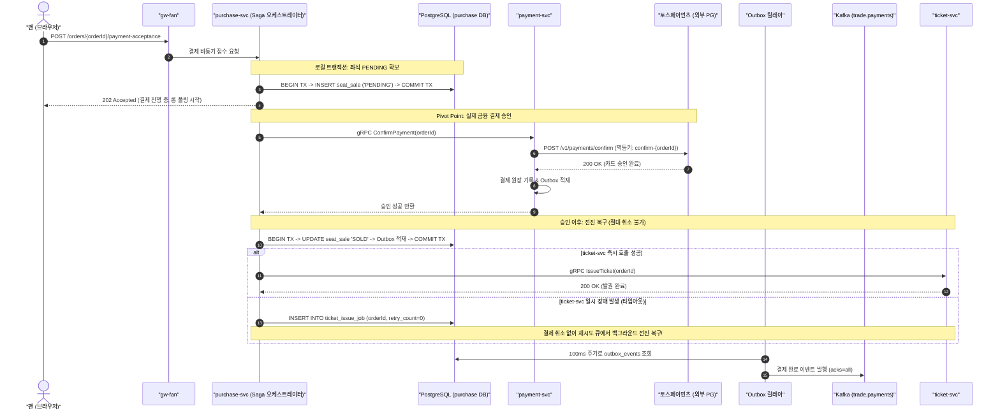

---

### 트레이드오프: 결제 Saga 및 이벤트 릴레이 구조

| 설계 선택 | 얻는 이점 (Gain) | 치르는 대가 (Cost) |
| :--- | :--- | :--- |
| **Pivot Point 이후 전진 복구 (선택)** | 일시적 발권 장애 시 팬의 정당한 티켓 권리와 결제 상태를 100% 지킴 | 발권 지연 시 팬이 티켓을 확인하기까지 최대 수분의 대기 시간 발생 가능 |
| **발권 실패 시 PG 승인 즉시 취소** | DB 상태 롤백이 깔끔하고 단순함 | 백엔드 0.1초 순단으로 인해 티켓팅에 성공한 무고한 팬 수천 명이 강제 환불당함 |
| **단일 폴링 Outbox 릴레이 (선택)** | Debezium 대비 운영 복잡도 및 장애 표면 제거, 로컬과 운영의 100% 동일한 파이프라인 | 100ms 폴링 주기만큼의 이벤트 발행 지연 시간 발생 (비즈니스 허용 범위 내) |
| **Debezium CDC 로그 스트리밍** | DB 커밋 즉시 밀리초 단위로 Kafka 전송 | 복제 슬롯 누수, 스키마 레지스트리 의존성, 자바 런타임 운영 오버헤드 수반 |

---

### 5단 꼬리 질문과 모범 답변

1. **질문: "PG 승인 API를 호출했는데 네트워크 타임아웃이 났습니다. 승인이 된 겁니까 안 된 겁니까?"**  
   - **모범 답변**: "분산 시스템에서 타임아웃은 '알 수 없음(UNKNOWN)' 상태입니다. 시스템은 절대 실패로 단정하고 취소하지 않으며, 동일한 멱등 키(`confirm-{orderId}`)로 PG 단건 조회 API를 즉시 재호출합니다. PG사에서 승인 완료로 확인되면 정상 전진 복구하고, 아예 접수조차 안 되었다면 안전하게 주문 실패로 정리합니다."
2. **질문: "PG 웹훅을 받아서 결제를 확정하면 더 빠르고 간단하지 않습니까?"**  
   - **모범 답변**: "토스페이먼츠 웹훅은 비암호화 통신으로 위조 위험이 있으며, 네트워크 상태에 따라 최대 수십 초 이상 지연 도착할 수 있습니다. 따라서 웹훅은 주 처리 경로가 아닌 '보조 안전망'으로만 사용합니다. 주 경로는 클라이언트의 비동기 접수 $\to$ 서버의 직접 승인 API 호출 $\to$ 롱 폴링 응답으로 처리하고, 웹훅 수신 시에는 반드시 결제사 단건 조회 API로 재검증한 후 상태를 맞춥니다."
3. **질문: "Kafka 브로커가 완전히 다운되면 결제 처리가 전면 멈춥니까?"**  
   - **모범 답변**: "아닙니다. ADR-0140에 따라 결제 확정의 핵심 경로는 Kafka에 결합되어 있지 않습니다. `purchase-svc`와 `payment-svc`는 gRPC로 직접 통신하며, 결과 통보가 Kafka를 통해 5초 내에 오지 않으면 purchase-svc가 payment-svc로 직접 동기 쿼리(`BatchGetPayments`)를 날려 주문을 확정합니다. Kafka 다운 시 지연되는 것은 오직 관제 통계와 알림 톡 발송뿐입니다."
4. **질문: "주문 데이터베이스를 진짜 이벤트 소싱(Event Sourcing)으로 만들지 않은 이유는 무엇입니까?"**  
   - **모범 답변**: "주문의 상태 라이프사이클은 상태 전이가 단순하고 선형적입니다. 이벤트 소싱을 적용하면 이벤트 스키마 버전 관리, 스냅샷 생성, 쿼리 모델 재구축 등 엔지니어링 오버헤드가 극심합니다. 우리는 정규화된 현재 상태 테이블과 단일 트랜잭션으로 적재되는 불변 감사 테이블(`order_event`)의 조합으로 완벽한 추적성을 얻으면서도 구조적 단순함을 지켰습니다(ADR-0113)."
5. **질문: "결제사가 장애로 다운되면 다른 보조 결제사(포트원)로 자동 전환(Failover)됩니까?"**  
   - **모범 답변**: "자동 전환하지 않습니다(ADR-0044). 포트원의 채널 처리 한도(초당 약 50건)는 토스(초당 300건)의 1/6에 불과하여, 토스의 트래픽이 포트원으로 자동 쏠리면 보조 결제사마저 즉각 연쇄 붕괴합니다. 또한 이미 토스로 승인 요청이 날아간 주문을 포트원으로 재시도하면 이중 출금이 발생합니다. 전환은 시스템이 권고하고 운영자가 관제탑에서 승인 요청 전 건들에 한해서만 수동 명령으로 활성화합니다."

---

## 11단계. 서비스 나누기, 입구 서버, 장애 격리 `꼭`

> **면접관에게**:  
> "PEAKET은 무분별한 도메인 쪼개기를 지양하고, 시스템 엔지니어링의 4대 물리적 기준인 **부하 규모의 차이, 가용성 등급(SLA), 런타임 특성, 그리고 보안 비밀(Secret)의 격리 경계**에 따라 단 **10개의 마이크로서비스**로 아키텍처를 확정했습니다.  
> 진입 트래픽을 감당하는 `queue-svc`(피크 20만 RPS)와 결제를 처리하는 `payment-svc`(300 TPS)는 부하 규모가 수백 배 다르고, 공연 당일 현장 입장을 담당하는 `ticket-svc`는 티켓 오픈과는 완전히 다른 시간대에 무중단으로 생존해야 합니다.  
> 입구 계층 역시 단일 게이트웨이의 취약점을 없애기 위해 클라이언트 목적별로 **5개의 박형 게이트웨이(Thin Gateway)**로 물리 분리했습니다.  
> 장애 전파를 막기 위해 1차 게이트웨이 레벨의 즉각 컷오프(503)와 2차 서비스 레벨의 서킷 브레이커(opossum)로 이루어진 **2단 격벽 구조**를 구축했으며, 비상 제어 명령은 메시지 큐와 게이트웨이를 경유하지 않는 **독립된 제어 gRPC 채널**을 통해 관제탑에서 직접 쏩니다."

---

### 마이크로서비스 분리의 4대 공학적 기준 (ADR-0007)

1인 혹은 소수 정예 팀에서 조직 구조(Conway's Law)를 이유로 수십 개 서비스를 쪼개는 것은 안티패턴입니다. PEAKET은 오직 시스템 런타임과 장애 반경의 물리적 분리만을 목적으로 서비스를 10개로 정제했습니다.

| 분리 기준 축 | 설명 및 시스템 내 적용 사례 |
| :--- | :--- |
| **1. 부하 규모의 비대칭성** | 피크 20만 RPS를 소화하는 대기열(`queue-svc`)과 300 TPS 상한을 가진 결제(`payment-svc`)는 파드 스케일링 단위와 인프라 자원이 수백 배 차이 나므로 반드시 분리. |
| **2. 가용성 SLA와 시간대 격리** | 온세일 오픈 순간에 극도로 중요한 좌석/결제와, 한 달 뒤 공연 당일 게이트 현장에서 인터넷이 끊겨도 돌아가야 하는 발권/검표(`ticket-svc`)는 생존 라이프사이클이 다름. |
| **3. 런타임 실행 특성** | CPU 집약적인 셔플/제어 루프(`admission-ctrl`), 짧고 빠른 REST I/O(`purchase-svc`), 5,000개 이상의 장시간 지속 WebSocket 커넥션을 유지하는 네트워크 집약적 런타임(`realtime-gw`)의 분리. |
| **4. 보안 비밀 키 격리 경계** | 금융 결제사 API 시크릿 키를 다루는 `payment-svc`, 사용자 주민번호 대체 식별키(CI)를 다루는 `identity-svc`는 다른 일반 비즈니스 서비스 침해 시에도 안전하도록 보안 격벽 분리. |

---

### 10대 마이크로서비스 책임 매핑

| 마이크로서비스 | 핵심 역할 및 도메인 책임 | 분리 이유 (4대 축 매핑) |
| :--- | :--- | :---: |
| **queue-svc** | 로비 참가, 순번 원자적 발급, 대기 상태 구간 파일 생성, 입장 확정 토큰 발급 | 부하 축 (피크 20만 RPS 수용) |
| **admission-ctrl** | 200ms 제어 루프 실행, In-Flight 계산, AIMD 혼잡 제어, 정각 Fisher-Yates 셔플 | 런타임 축 (단일 리더 싱글톤 제어 루프) |
| **purchase-svc** | 좌석 Soft Hold 비트맵 관리, 주문서 생성, 결제 2단계 Saga 오케스트레이션 | 부하/가용성 축 (입장한 5,000명의 구매 코어) |
| **payment-svc** | PG사 연동, 2단계 결제 승인, 웹훅 수신, 자정 대사, 정산 지급대행 | 보안/장애 축 (외부 PG 장애 및 비밀키 격리) |
| **ticket-svc** | 모바일 티켓 발권, 기기 공개키 바인딩, 양도 승인, 현장 스캐너 카탈로그 동기화 | 가용성 축 (공연 당일 현장 입장 가용성 보장) |
| **realtime-gw** | 5,000개 WebSocket 연결 관리, 구역별 Redis Pub/Sub 구독, 100ms 바이너리 스트리밍 | 런타임 축 (C10K 롱리브드 커넥션 전용) |
| **identity-svc** | 계정 인증, JWT 세션 발급, 휴대폰 본인확인(CI HMAC) 연동 | 보안 축 (최고 보안 등급, PII 암호화 격리) |
| **trust-svc** | 6대 봇 위험 점수 산출, 사람 확인(Turnstile) 토큰 검증, 대기실 사후 이상 징후 분석 | 가용성 축 (장애 시 페일오픈 격리) |
| **ops-svc** | 관제 콘솔 백엔드, 12대 운영 명령 집행, 감사 로그 체인, ClickHouse BI 쿼리 | 가용성 축 (사용자 트래픽과 격리된 제어 평면) |
| **core-svc** | 공연/회차 정보 메타데이터, 아티스트 정보, 공지사항, 굿즈 판매, CS 문의 | 가용성 축 (부하가 낮고 일반적인 RDBMS CRUD) |

---

### 5대 박형 게이트웨이 (Thin Client-Specific Gateways) (ADR-0008)

단일 거대 API 게이트웨이는 대기열 트래픽 폭주 시 현장 검표나 운영자 관제 화면까지 연쇄 다운시키는 단일 실패점(SPOF)이 됩니다. PEAKET은 클라이언트 유형별로 5개의 전용 게이트웨이 파드 묶음을 물리 분리합니다.

```
[인터넷 트래픽]
       │
       ▼
[CloudFront + AWS WAF]
       │
  ┌────┼───────────────┬───────────────┬───────────────┐
  │    │               │               │               │
  ▼    ▼               ▼               ▼               ▼
gw-queue             gw-fan          gw-partner      gw-ops          gw-scanner
(대기열 전용)        (구매/월렛)     (기획사/웹훅)   (관제 콘솔)     (현장 검표)
- 피크 20만 RPS      - 동시 5,000명  - PG 웹훅 수신  - 사내망 IP 한정- mTLS/DPoP
- text/plain         - REST & WS     - 파트너 API    - 제어 gRPC     - 오프라인 큐
```

- **박형 게이트웨이(Thin Gateway)의 원칙**: 게이트웨이는 라우팅, 인증 토큰 서명 검증, 속도 제한(Rate Limit)만을 수행하며, DB 접근, 분산 트랜잭션, 데이터 집계(BFF)를 일체 수행하지 않는 '순수 트래픽 칸막이'로 동작합니다.
- **2단 장애 격리 (Two-Layer Circuit Breakers) (ADR-0009)**:
  - **1차 (Envoy Gateway)**: 경로별 타임아웃, 동시 커넥션 상한 초과 시 다운스트림 호출 없이 즉시 503 반환. 과부하 시 비핵심 경로(후기, 굿즈)부터 순차 차단.
  - **2차 (서비스 내부 opossum)**: 서비스 간 gRPC 통신, 외부 PG사, 본인확인 연동 구간마다 독립된 서킷 브레이커와 벌크헤드(동시 실행 스레드 풀)를 두어 장애 전파 차단.
- **긴급 제어 전용 바이패스 채널 (ADR-0102)**:  
  운영자의 긴급 판매 정지, 봇 강도 조절 명령은 Kafka 큐나 공용 게이트웨이를 거치지 않고, `ops-svc`에서 타겟 서비스로 직접 쏘는 **제어 전용 gRPC(`ApplyControl`)** 채널을 통해 1초 이내에 직달합니다.

---

### 시각 다이어그램: 마이크로서비스 경계 및 게이트웨이 분리도

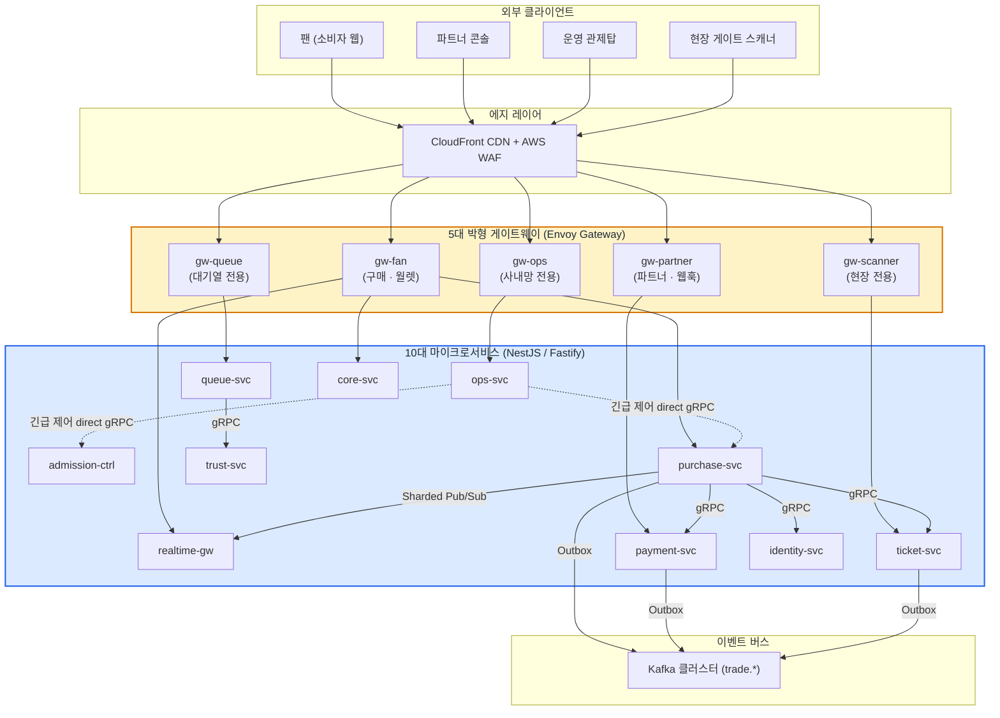

---

### 트레이드오프: 10개 서비스 분리 모델

| 구조 | 장점 | 단점 및 판정 |
| :--- | :--- | :--- |
| **모놀리스 단일 배포 (v0)** | 개발 및 배포가 단순하고 분산 네트워크 비용 0 | 대기열 트래픽 폭주 시 결제 및 현장 검표까지 연쇄 붕괴. 부분 스케일아웃 불가 (탈락) |
| **도메인별 14개 전면 분리** | 도메인 경계가 교과서적으로 깔끔함 | 1인/소수 운영 감당 불가. 좌석과 주문 간 불필요한 RPC 지연 발생 (탈락) |
| **4대 축 기준 10개 정예 서비스 (선택)** | 대기열만 50대로 늘리고 결제는 6대로 유지 가능. 장애 격벽 완벽 | 분산 추적(Tracing), 네트워크 직렬화 오버헤드, Outbox 릴레이 운영 필요 |

---

### 5단 꼬리 질문과 모범 답변

1. **질문: "좌석(inventory)과 주문(booking)은 왜 분리하지 않고 `purchase-svc` 하나로 묶었습니까?"**  
   - **모범 답변**: "두 도메인은 동일한 5,000명의 동시 체류 인원 부하를 받으며, 호출 빈도와 가용성 SLA가 100% 일치합니다. 이를 굳이 네트워크로 쪼개면 좌석 선점 후 주문서 생성 시 불필요한 네트워크 홉(RTT 5ms)만 추가되어 p99 지연 시간 목표(50ms) 달성을 방해하기 때문입니다. 단일 서비스 내의 독립된 모듈로 격리하는 것이 훨씬 실용적입니다(ADR-0007)."
2. **질문: "게이트웨이가 5개나 되면 쿠버네티스 파드 관리 비용과 인프라 비용이 낭비 아닙니까?"**  
   - **모범 답변**: "Envoy 기반의 박형 게이트웨이는 메모리 128MB 수준의 초경량 파드입니다. 게이트웨이를 물리 분리함으로써 얻는 '대기열 20만 RPS 트래픽이 결제나 관제 콘솔의 CPU를 단 1%도 잠식하지 못한다'는 완벽한 장애 격리 이익이 파드 몇 대의 인프라 비용을 압도합니다."
3. **질문: "서비스 간 통신에 Istio 서비스 메시를 쓰는데, 사이드카(Sidecar) 방식 대신 앰비언트(Ambient)를 고른 이유는 무엇입니까?"**  
   - **모범 답변**: "전통적인 사이드카 방식은 10개 마이크로서비스의 모든 파드마다 Envoy 컨테이너가 붙어 대기열 인입 경로에서만 약 80 vCPU의 막대한 자원을 낭비합니다. 또한 사이드카 업그레이드 시 서비스 파드를 전부 재기동해야 합니다. Istio 앰비언트 메시는 노드 단위 공유 프록시(ztunnel)를 사용하여 CPU 소비를 1/3로 줄이고 무중단 L4 mTLS 암호화를 제공합니다(ADR-0082)."
4. **질문: "네트워크 일시 오류 시 서비스 간 gRPC 재시도(Retry)는 어디서 몇 번 수행합니까?"**  
   - **모범 답변**: "서비스 메시 계층에서 멱등한 읽기 요청에 한해 **오직 1회만** 재시도합니다. 애플리케이션과 메시 양쪽에서 모두 재시도하면 지수적 요청 증폭(2x2 = 4회 이상)으로 다운스트림 시스템을 즉각 파괴하는 재시도 폭풍(Retry Storm)이 발생하기 때문입니다. 상태를 변경하는 쓰기 요청은 앱 계층에서 멱등 키를 가지고 직접 통제합니다(ADR-0117)."
5. **질문: "긴급 제어 gRPC는 왜 Kafka 토픽을 타지 않고 다이렉트로 쏩니까?"**  
   - **모범 답변**: "대형 온세일 중 시스템 이상으로 '판매 즉시 일시정지'를 발령해야 하는 긴급 상황에서, 만약 명령을 Kafka 큐로 발행하면 앞서 쌓여 있는 수만 건의 대기열/주문 이벤트 뒤에 갇혀 명령 전파가 수십 초 이상 지연될 수 있습니다. 생명과 직결된 비상 정지는 큐를 우회하는 다이렉트 gRPC를 통해 1초 이내에 파드 메모리로 직달해야 합니다(ADR-0102)."

## 12단계. 갑자기 몰릴 때 서버 늘리기 (K9) `시간 남으면`

> **면접관에게**:  
> "티켓 오픈 정각(T=0)의 20만 RPS 트래픽은 트래픽을 감지하고 서버를 띄우는 **사후 리액티브(Reactive) 확장으로는 물리적으로 방어할 수 없습니다**.  
> 쿠버네티스의 기본 HPA가 CPU 상승을 감지하고 새 EC2 노드를 프로비저닝하여 파드가 준비(Ready)되기까지는 최소 3~5분이 걸리며, 그 사이 70분치 에러 버짓은 단 1초 만에 전멸합니다.  
> PEAKET은 이를 해결하기 위해 **예약 기반 사전 예열(Scheduled Prewarming)**과 **다중 선행 지표 확장**을 결합했습니다.  
> 첫째, 티켓 오픈 40분 전(T-40분) KEDA의 크론 스케줄러가 게이트웨이와 핫패스 서비스 파드의 최소 복제본 수(minReplicas)를 사전에 끌어올리고, Karpenter가 온디맨드 EC2 노드를 미리 할당받아 즉각 투입 가능한 상태로 대기시킵니다.  
> 둘째, 오픈 30분 전(T-30분) 인프라 전수 상태(파드 가용성, DB 커넥션 풀, Redis 클러스터, 외부 PG 상태)를 점검하는 **Go/No-Go 자동 판정**을 수행합니다.  
> 셋째, 오픈 이후의 동적 확장은 굼뜬 CPU가 아니라 **대기열 큐 깊이, Kafka 컨슈머 랙(Lag), Node.js 이벤트 루프 지연(p99)**이라는 실시간 선행 지표를 기반으로 동작합니다."

---

### 단순하게 하면 어디서 깨지나 (Why Naive Breaks)

- **CPU 기반 HPA(v0의 K9)의 시간 지연 재앙**:  
  쿠버네티스 Metrics Server의 CPU 수집 주기는 기본 15~30초입니다. HPA가 CPU 70% 초과를 감지하고 스케일아웃을 결정하는 데 30초, 클러스터에 여유 자원이 없어 AWS에서 새 EC2 인스턴스를 부팅하고 네트워크 CNI 플러그인을 붙이는 데 약 2~4분, 컨테이너 이미지를 풀(Pull)받고 애플리케이션 프레임워크가 초기화되어 트래픽을 받을 준비가 되기까지 또 30초가 소요됩니다.
  즉, **최소 3~5분의 치명적 공백(Scaling Delay)**이 발생합니다.
- **1초 만에 사라지는 70분치 에러 버짓**:  
  초당 20만 건의 트래픽이 쏟아질 때 서버 용량이 부족하여 10%의 실패율만 발생해도, 단 1초 만에 20,000건의 에러가 터집니다. 이는 70분 전체 온세일 동안 허용된 시스템 총 에러 버짓(약 2,000건)의 10배에 달하는 수치로, 사후 스케일링은 사실상 아무런 의미가 없습니다.

---

### PEAKET의 아키텍처 해결책

```
[타임라인 기반 사전 예열 및 확장 파이프라인]

T-90분: 온세일 코드/설정 배포 동결 (Freeze Window 개시)
   │
T-40분: KEDA Scheduled Cron 트리거
   │     ├─ 게이트웨이 및 10대 서비스 minReplicas 목표치까지 사전 확장
   │     ├─ Karpenter: 온디맨드 고성능 EC2 인스턴스 사전 선점 및 파드 스케줄링
   │     └─ 캐시 웜업: 공연 정보 및 구역 좌석 메타데이터 Redis 메모리 사전 적재
   │
T-30분: Go/No-Go 자동 판정 파이프라인 가동
   │     ├─ 필수 검증 (ALL PASS 필수):
   │     │    - 핫패스 파드 100% 준비 완료 및 헬스체크 통과
   │     │    - PostgreSQL / Redis 커넥션 풀 및 리플리케이션 지연 정상
   │     │    - 외부 PG사(토스/포트원) 및 본인확인 API Ping 정상
   │     │    - CloudFront 배포 3종 쿼터 및 SSL 인증서 검증
   │     └─ 1개라도 실패 시 No-Go -> 비상 대기실 공지 전환 및 엔지니어 소환
   │
T-0: 티켓 오픈 순간 -> 사전 예열된 100% 용량으로 20만 RPS 즉각 수용!
   │
T+1분 이후: KEDA 다중 선행 지표 동적 스케일아웃
         - 인입 큐 깊이 + Kafka Lag + 이벤트 루프 지연 p99 > 50ms 감지 시 추가 확장
```

1. **사전 프로비저닝 목표 파드 수 산출**:  
   - 진입 게이트웨이(`gw-queue`): 단일 파드당 안전 처리량 4,000 RPS 기준 \(\to\) 최소 **50대 사전 가동**.
   - 대기열 서비스(`queue-svc`): 2ms 마이크로 배치 INCR 처리량 기준 \(\to\) 최소 **30대 사전 가동**.
   - 결제 서비스(`payment-svc`): 외부 승인 300 TPS 및 롱 폴링 수용 \(\to\) **6대 사전 가동**.
   - 웹 애플리케이션 서버: SSR 렌더링 부하 기준 \(\to\) **15대 사전 가동**.
2. **다중 선행 지표(Multi-signal Metrics) 기반 KEDA 오토스케일링 (ADR-0069)**:  
   - 이미 늦어버린 CPU/메모리 대신, 시스템 붕괴를 사전에 예고하는 3대 선행 지표를 결합합니다:
     1. **대기열 인입 큐 길이 (Queue Ingress Depth)**: 엣지 게이트웨이에 대기 중인 소켓 버퍼 수.
     2. **Kafka 컨슈머 지연 (Consumer Lag)**: 이벤트 처리 지연이 1,000건을 초과하는지 여부.
     3. **Node.js 이벤트 루프 지연 시간 (Event Loop Lag p99)**: CPU 사용률과 무관하게 비동기 I/O 큐가 50ms 이상 밀리는지 감지.
   - 메트릭 서버 순단으로 지표를 읽지 못할 경우, 자의적으로 서버를 줄이지 않고 현재 파드 수를 그대로 유지하는 안전 모드(Keep Current)로 동작합니다.
3. **독립된 관제/시스템 노드 분리**:  
   - KEDA 오퍼레이터, Karpenter 컨트롤러, Prometheus 메트릭 수집기는 일반 핫패스 파드가 위치한 워커 노드와 물리적으로 분리된 **시스템 전용 노드 풀(System Node Pool)**에서 실행됩니다. 사용자 트래픽 폭주로 핫패스 노드의 CPU가 100% 차더라도, 서버를 늘려주는 오토스케일러 프로세스는 절대 죽지 않습니다.

---

### 시각 다이어그램: 사전 예열 및 점진 확장 파이프라인

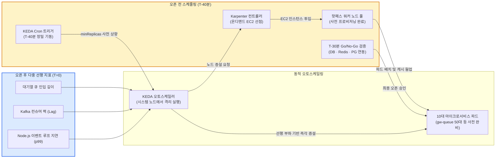

---

### 트레이드오프: 사전 프로비저닝 비용 vs 다운타임 위험

| 운영 방식 | 비용 및 인프라 효율 | 장애 방어력 및 복구 시간 | 판정 |
| :--- | :--- | :--- | :---: |
| **순수 리액티브 HPA (v0)** | 유휴 자원 비용 0원 | 오픈 정각 3~5분간 100% 장애 발생, 에러 버짓 전멸 | **탈락** |
| **24시간 상시 최대치 유지** | 매월 수천만 원의 막대한 클라우드 낭비 | 장애 0건 보장 | **탈락** |
| **T-40분 예약 선점 (PEAKET)** | 온세일 1회당 약 2~3시간만 추가 비용 지불 (회당 약 5만 원 내외) | 20만 RPS 트래픽을 지연 0초로 완벽 수용 | **채택** |

---

### 5단 꼬리 질문과 모범 답변

1. **질문: "오토스케일러의 '파드 늘리기'와 7단계의 '입장 목표 줄이기(AIMD)'가 동시에 작동하여 서로 싸우지 않습니까?"**  
   - **모범 답변**: "스케일아웃 임계치를 입장 감축 임계치보다 훨씬 낮게 설정하여 **확장이 언제나 먼저 실행**되도록 우선순위를 계층화했습니다. 즉, 파드를 먼저 늘려 트래픽을 흡수해 보고, 인프라 확장이 한계에 도달하여 응답 지연이 500ms를 초과할 때만 최후의 수단으로 입장 인원을 줄입니다(docs/architecture.md §5)."
2. **질문: "Karpenter가 AWS에서 새 노드를 띄우는 데 실제 몇 초가 걸립니까?"**  
   - **모범 답변**: "AWS는 EC2 인스턴스의 부팅 시간에 대해 공식 SLA를 보장하지 않습니다. 실제 측정 시 통상 45초~90초가 소요됩니다. 따라서 오픈 정각의 피크를 감당할 노드는 T-40분에 온디맨드로 100% 사전 확보해 두며, 오픈 이후의 오토스케일링 목표 60초는 '이미 프로비저닝된 노드 위에서 파드가 기동되는 시간'만을 의미합니다."
3. **질문: "Kafka 스트림 컨슈머 워커도 트래픽에 따라 자동으로 파드를 늘립니까?"**  
   - **모범 답변**: "아닙니다. Kafka 스트림 작업자는 자동 확장을 끄고 파드 수를 고정합니다. 컨슈머 파드 수가 토픽 파티션 수를 초과하면 노는 파드가 발생할 뿐이며, 파드가 늘고 줄어들 때마다 컨슈머 리밸런싱(Rebalance)이 발생하여 데이터 처리가 수 초간 멈추기 때문입니다(docs/streaming.md §2.2)."
4. **질문: "T-30분 Go/No-Go 점검에서 필수 검증 항목 1개가 실패하면 어떻게 조치합니까?"**  
   - **모범 답변**: "즉시 No-Go를 선언하고 온콜 엔지니어에게 비상 호출을 발송합니다. T-20분까지 복구에 성공하면 점검을 재실행하여 정상 오픈하고, T-20분까지 복구되지 않으면 티켓 오픈 시각을 30분 연기하는 대기실 긴급 공지를 CDN에 자동 게시하여 미완성 상태의 오픈 참사를 방지합니다."
5. **질문: "오픈 정각 전후에는 왜 애플리케이션 배포를 전면 금지(Freeze Window)합니까?"**  
   - **모범 답변**: "티켓 오픈 90분 전부터 60분 후까지 총 150분간은 프로덕션 클러스터의 코드 및 설정 배포를 전면 동결합니다. 롤링 배포 시 발생하는 컨테이너 종료, 메모리 재할당, 커넥션 재연결이 20만 RPS 트래픽과 겹치면 치명적인 연쇄 장애를 유발하기 때문입니다."

---

## 13단계. 지켜보고 조종하기 (관제) (K8) `시간 남으면`

> **면접관에게**:  
> "PEAKET의 실시간 관제탑(Control Tower)은 단순한 모니터링 화면이 아니라, 70분이라는 초단기 온세일 윈도우에서 시스템을 안전하게 통제하는 **능동형 방어 기지**입니다.  
> 일반적인 웹 서비스의 느슨한 알림(예: 28일 기준 SLO)은 온세일 10분 만에 전체 실패 허용량을 다 쓴 뒤에야 울립니다.  
> 우리는 70분 한정 전용의 **다중 창 번레이트(Multi-Window Multi-Burn-Rate) 경보 모델**을 수립하여, 에러 버짓의 30%가 소진되기 전인 **29% 소진 시점(2분 롱 윈도우 10배 번레이트 + 20초 숏 윈도우)**에 정확히 온콜을 호출합니다.  
> 관제 데이터는 자동 제어를 위한 Prometheus 로컬 시계열과, 다차원 실시간 비즈니스 분석을 위한 Kafka \(\to\) ClickHouse 스트리밍으로 이원화되어 있습니다.  
> 또한 운영자가 내릴 수 있는 12대 제어 명령 중 '판매 일시정지'는 신속성을 위해 **1인 단독 실행**이 가능하지만, 파급력이 막대한 '판매 재개'는 반드시 서로 다른 2명의 Commander가 승인해야 하는 **'정지 1인, 재개 2인' 거버넌스 원칙**을 엄격히 집행합니다."

---

### 단순하게 하면 어디서 깨지나 (Why Naive Breaks)

- **전통적인 고정 임계치 알림(v0의 K8)의 실패**:  
  70분 온세일 동안 핵심 결제 확정 여정에서 허용된 실패 건수는 단 **12건**입니다. 만약 "5분간 결제 오류율 5% 초과" 같은 일반적인 알림을 걸어두면, 12건 중 9건이 실패하여 에러 버짓의 71%가 불타버린 후에야 뒤늦게 알림이 울립니다.
- **초단기 윈도우의 헛경보(False Alarm) 딜레마**:  
  반대로 알림을 빨리 받겠다고 "1분 창 10배 번레이트"를 걸면, 표본 수가 너무 적어 단 1~2건의 일시적 PG 카드사 잔액 부족 에러만으로도 헛경보 발생 확률이 **81%**까지 치솟아 온콜 엔지니어가 피로에 지치게 됩니다.

---

### PEAKET의 아키텍처 해결책

```
[다중 창 번레이트 알림 알고리즘]
- 경보 발령 시점의 소진 버짓 = 번레이트 배수 * 롱 윈도우 길이 / 전체 기간 (70분)
- 10배 * 2분 / 70분 = 28.57% (약 29% 시점에 온콜 즉각 호출!)
- 20초 숏 윈도우: "지금 이 순간에도 에러가 계속 타고 있는가?"를 검증하여 찰나의 스파이크로 인한 헛경보 제거
```

1. **온세일 70분 여정별 에러 버짓 할당 (NFR-008, ADR-0049)**:  
   - 공연 상세 페이지 조회: 오류 허용량 약 1,000건
   - 대기열 진입 (entries): 오류 허용량 약 2,000건
   - 좌석 잡기 (holds): 오류 허용량 약 75건
   - 결제 확정 (confirm): **오류 허용량 단 12건** (SLA 99.95%)
2. **이원화된 데이터 수집 파이프라인 (ADR-0099)**:  
   - **판단 및 자동 제어 경로**: 쿠버네티스 클러스터 내부의 로컬 Prometheus가 서비스 `/metrics` 엔드포인트를 5초 주기로 직접 스크래핑합니다. 외부 분석기가 죽어도 admission-ctrl의 자동 감축은 100% 정상 작동합니다.
   - **다차원 비즈니스 관제 경로**: 실시간 예매/좌석 이벤트 원본을 Kafka에서 ClickHouse로 실시간 적재하고, 관제 콘솔은 0.5초마다 SQL 쿼리로 구역별/등급별 실시간 잔여석 및 매출 현황을 집계합니다 (신선도 p95 < 5초).
3. **12대 운영 제어 명령과 거버넌스 (POL-021, ADR-0095)**:  
   관제 콘솔은 상황 발생 시 인프라를 즉각 통제할 수 있는 12대 표준 제어 명령을 제공합니다:
   1) 동시 입장 목표 조정, 2) 입장 일시정지, 3) 판매 일시정지, 4) 악성 IP 대역 차단, 5) 봇 판정 강도 조절, 6) 결제사 수동 전환, 7) 대기실 긴급 공지, 8) 로그 레벨 변경, 9) 비핵심 기능 끄기, 10) 부정거래 계정 차단, 11) 자동화 제어 정지, 12) 특정 결제사 강제 지정.
4. **'정지 1인, 재개 2인' 안전 거버넌스 원칙**:  
   - **판매 일시정지(명령 3)** 및 **자동화 정지(명령 11)**: 피해 확산을 막기 위해 Commander 1인이 2차 인증 후 즉각 단독 실행 가능. (실행자는 48시간 내 사후 보고서 제출 의무).
   - **판매 재개(Reopen)**: 성급한 재오픈으로 인한 2차 사고를 방지하기 위해, 반드시 **요청자와 다른 제2의 Commander가 상호 승인**해야만 락이 해제됨.

---

### 시각 다이어그램: 관제탑 메트릭 파이프라인 및 제어 흐름

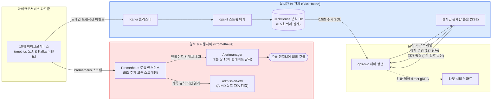

---

### 트레이드오프: 번레이트 윈도우 설정

| 경보 윈도우 | 번레이트 배수 | 알림 발령 시점의 소진 버짓 | 헛경보 발생 확률 | 판정 |
| :--- | :---: | :---: | :---: | :---: |
| **5분 롱 윈도우 (v0)** | 10배 | **71.4% 소진 후** | 0.1% 미만 (매우 낮음) | **탈락 (너무 늦음)** |
| **1분 초단기 윈도우** | 10배 | **14.3% 소진 시** | **81.0% (극도로 높음)** | **탈락 (피로도 극심)** |
| **2분 창 + 20초 창 (선택)** | 10배 | **28.6% (약 29% 시점)** | **약 5.0% (안정적 통제)** | **채택 (골든 타임 확보)** |

---

### 5단 꼬리 질문과 모범 답변

1. **질문: "대기열 진입(entries) 여정의 에러 버짓이 닳고 있는데 왜 입장 목표를 줄이지 않습니까?"**  
   - **모범 답변**: "진입 여정은 입장 제어 방파제보다 **'앞단'**에 위치합니다. 진입 쪽에 부하가 걸렸다고 뒤쪽 입장 목표를 줄이면 전체 티켓 판매 진행만 느려질 뿐 앞단 부하는 단 1도 줄어들지 않습니다. 입장 목표를 줄이는 AIMD는 오직 좌석 잡기, 결제 승인 등 입장 목표가 직접적으로 부하를 유발하는 다운스트림 여정의 에러 버짓이 소진될 때만 작동합니다(ADR-0126)."
2. **질문: "복잡한 Apache Flink 대신 ClickHouse 쿼리 집계를 선택한 이유는 무엇입니까?"**  
   - **모범 답변**: "온세일 70분 동안 유입되는 초당 이벤트 수는 약 1만 건이며 윈도우 상태 크기는 1GB 미만입니다. 이 규모에서 Flink 클러스터를 띄우면 JVM 관리, 체크포인트 지연, 락 관리 등 운영 복잡도만 폭증합니다. ClickHouse에 원시 이벤트를 덤프하고 관제 콘솔이 0.5초마다 SQL로 집계하는 방식이 언어 파편화도 없고 정산 데이터와 단 1원의 오차도 없는 원장 일관성을 제공합니다(ADR-0099)."
3. **질문: "Prometheus 수집 서버가 죽으면 시스템의 입장 자동 제어도 멈춥니까?"**  
   - **모범 답변**: "Prometheus 지표 수신이 실패하면 `admission-ctrl`은 에러율을 '0'으로 왜곡 해석하지 않고 **'입력 없음(No Input)'** 상태로 인식합니다. 입력이 없으면 안전을 위해 목표치를 함부로 늘리거나 줄이지 않고 현재의 목표치를 완강히 유지(Keep Current)하며 운영자에게 메트릭 단절 알림을 전송합니다(ADR-0069)."
4. **질문: "판매 일시정지 명령은 왜 1인이 단독으로 실행할 수 있게 허용했습니까?"**  
   - **모범 답변**: "시스템 결제 사고나 오버셀 의심 징후가 포착되었을 때, 다른 관리자의 승인을 기다리다 1~2분이 지연되면 수백 건의 금전적 피해가 추가로 발생하기 때문입니다. 피해 차단은 1초라도 빨리 단독 집행하고, 위험이 없는 판매 재개 시에만 2인 승인을 요구하는 것이 금융 공학의 기본 원칙입니다."
5. **질문: "관제탑 콘솔과 서비스 파드 간 통신 프로토콜로 왜 GraphQL이 아닌 SSE를 썼습니까?"**  
   - **모범 답변**: "관제 콘솔은 단방향으로 초당 수 회 밀려오는 실시간 시계열과 비즈니스 숫자를 스트리밍으로 렌더링하기만 하면 됩니다. 양방향 프로토콜이나 무거운 GraphQL 엔진 대신 브라우저 네이티브 규격인 SSE(Server-Sent Events)와 경량 REST API만으로 파이프라인을 극도로 단순화했습니다(ADR-0100)."

---

## 14단계. 인터넷이 끊긴 공연장 입장 (K10) `시간 남으면`

> **면접관에게**:  
> "온라인 예매가 아무리 완벽해도, 공연 당일 5만 관객이 스타디움 게이트에 몰렸을 때 입장이 멈추면 대규모 안전사고와 폭동이 일어납니다.  
> 5만 명이 집결한 경기장 주변은 셀룰러 네트워크(LTE/5G)가 전면 마비되는 통신 음영 지대가 빈번합니다.  
> v0처럼 늘 서버에 물어보는 온라인 실시간 검표는 통신이 끊기는 순간 게이트가 전면 마비됩니다. 그렇다고 TOTP 대칭키 방식을 쓰면 스캐너 기기 하나를 분실했을 때 전체 티켓이 대량 위조됩니다.  
> PEAKET은 세계 최초로 **WebCrypto 비대칭키(ECDSA P-256) 기반의 회전 QR**과 **100% 오프라인 판정 게이트 스캐너 PWA**를 구축했습니다.  
> 팬의 스마트폰 브라우저는 스크립트가 추출할 수 없는 비공개키로 **15초마다 만료되는 동적 QR**을 서명합니다.  
> 현장 스캐너는 사전에 동기화된 티켓-공개키 카탈로그를 바탕으로, **중앙 서버와 인터넷이 완전히 단절된 상태에서도 기기 자체 암호 연산만으로 0.15초 만에 진위 판정**을 완수합니다.  
> 스캐너 기기를 도난당해도 공개키만 들어 있으므로 티켓 위조가 원천 불가능합니다."

---

### 단순하게 하면 어디서 깨지나 (Why Naive Breaks)

- **온라인 실시간 API 검표(v0의 K10)의 현장 마비**:  
  5만 관객이 모인 공연장 게이트에서 스캐너 수십 대가 매 스캔마다 중앙 서버로 HTTP 검표 API를 호출합니다. 셀룰러 망이 지연되어 RTT가 3~5초로 늘어나거나 기지국이 다운되면, 스캐너 화면에 무한 로딩 스피너가 돌며 입장이 멈추고 관객 밀집 압사 사고의 위험이 발생합니다.
- **대칭키 기반 TOTP 방식의 치명적 도난 위험**:  
  OTP처럼 시간마다 바뀌는 번호를 대칭키로 생성하면, 검증하는 스캐너 기기에도 동일한 비밀키(Secret Key)가 저장되어 있어야 합니다. 아르바이트 스태프가 스캐너 스마트폰 1대를 분실하거나 해킹당하면, 악의적 공격자가 스캐너 내부의 대칭키를 추출하여 수만 장의 가짜 유효 티켓을 무제한 위조할 수 있습니다.
- **정적 QR 스크린샷 캡처 암표 거래**:  
  종이 티켓이나 고정된 정적 QR 코드는 화면을 캡처하여 카카오톡이나 중고거래 플랫폼에 1장의 티켓을 수십 명에게 이중 삼중으로 재판매하는 사기 행각을 기술적으로 막을 수 없습니다.

---

### PEAKET의 아키텍처 해결책

```
[15초 회전 동적 QR 바이너리 구조 (총 93 bytes, Base64URL 140자)]
┌──────────┬──────────────┬──────────────┬──────────────┬────────────────────────┐
│ version  │ ticketId     │ keyId        │ timestamp    │ ECDSA P-256 서명값     │
│ (1 byte) │ (16 bytes)   │ (8 bytes)    │ (4 bytes)    │ (r: 32B + s: 32B = 64B)│
└──────────┴──────────────┴──────────────┴────────────────────────┘
```

1. **브라우저 WebCrypto 비추출성 비대칭키 생성 (ADR-0025)**:  
   - 팬이 모바일 월렛에서 '입장권 등록'을 누르면, 브라우저의 WebCrypto API가 표준 타원곡선 암호인 **ECDSA P-256 키 쌍**을 생성합니다.
   - 개인키는 자바스크립트 코드가 메모리 밖으로 덤프할 수 없도록 `extractable = false`로 보호되어 IndexedDB에 안전하게 결속됩니다.
   - 서버에는 **오직 공개키(Public Key)만 등록**되므로 서버 DB가 털려도 위조가 불가능합니다.
2. **15초 회전 동적 서명 QR**:  
   - 티켓 화면이 활성화된 동안, 스마트폰은 15초마다 `[티켓 ID + 타임스탬프]`에 개인키로 디지털 서명하여 새 QR을 생성합니다.
   - 스캐너는 타임스탬프가 현재 시간 기준 \(\pm 30\text{초}\) 오차 이내인 QR만 유효 처리합니다. 따라서 스크린샷을 찍어 타인에게 전송해도 30초 후면 완전히 무효화됩니다.
3. **스캐너 로컬 카탈로그 사전 동기화**:  
   - 현장 스태프는 게이트 투입 전 와이파이가 연결된 본부에서 당일 회차의 **티켓-공개키 매핑 카탈로그**를 스캐너 앱(PWA) 내부 IndexedDB로 1회 다운로드받습니다 (5만 석 기준 약 4.2MB, 압축 시 1.5MB).
   - 카탈로그에는 개인정보 없이 `ticket_id`, `zone_id`, `seat_no`, `public_key`, `revocation_status`만 담깁니다.
4. **100% 완전 오프라인 로컬 서명 검증 파이프라인**:  
   스캐너 카메라가 QR을 인식하는 즉시 다음 7단계 검증을 **중앙 서버 통신 없이 100% 기기 내부에서 0.15초 이내**에 실행합니다:
   1. QR 바이너리 규격 및 버전 파싱
   2. 로컬 DB에서 `ticket_id` 존재 확인
   3. 티켓 상태가 유효(`ISSUED`) 상태인지 검사
   4. 발급된 공개키가 폐기 목록(Revocation List)에 없는지 검사
   5. **ECDSA P-256 서명 수학적 검증** (위조 여부 판정)
   6. 타임스탬프 시계 오차 \(\pm 30\text{초}\) 검증
   7. 본 게이트 구역(Zone)과 티켓 구역 일치 여부 확인
5. **오프라인 검표 로그 로컬 큐잉 및 사후 동기화**:  
   - 판정 통과 즉시 기기 로컬 IndexedDB에 입장 완료 로그를 쓰고 게이트 램프를 초록색으로 켭니다.
   - 네트워크가 복구되면 백그라운드 서비스 워커가 5초 묶음으로 검표 로그를 서버로 비동기 업로드합니다.
6. **구역 분할 및 이중 입장(Double Entry) 사후 탐지**:  
   - 서로 다른 게이트 간의 동시 중복 입장은 스타디움 구역별(Zone/Gate) 분할 배정으로 1차 방어합니다.
   - 만약 동일 구역에서 복제 기기로 이중 입장을 시도할 경우, 오프라인 스캐너가 업로드하는 순간 중앙 서버가 이를 '중복 입장'으로 플래그 처리하고 현장 책임자(`gate_lead`)의 태블릿으로 즉각 보안 알림을 발송합니다.

---

### 시각 다이어그램: 오프라인 게이트 검표 및 ECDSA 서명 검증 시퀀스

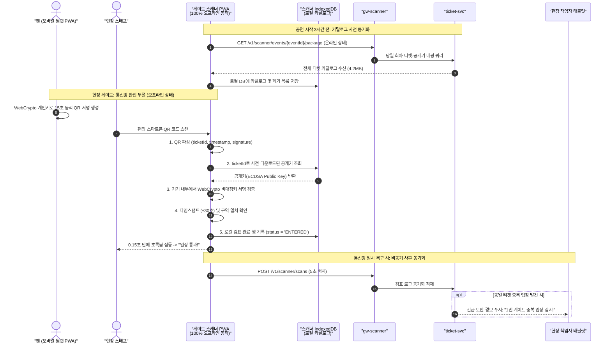

---

### 트레이드오프: 비대칭키 ECDSA 오프라인 vs 대칭키 TOTP

| 검증 모델 | 비대칭키 ECDSA 오프라인 (선택) | 대칭키 TOTP 검증 | 온라인 실시간 API 검증 (v0) |
| :--- | :--- | :--- | :--- |
| **통신망 두절 시 생존력** | **100% 완벽 생존 (0.15초 검표)** | 100% 완벽 생존 | **전면 마비 (입장 중단)** |
| **기기 분실 시 보안성** | **완벽한 위조 방지** (공개키만 보유) | **대량 위조 발생** (공유 비밀키 유출) | 안전함 |
| **스크린샷 불법 양도 차단** | **차단 성공** (15초 회전 만료) | 차단 성공 (30초 회전) | 차단 불가 (캡처본 재사용) |
| **엔지니어링 복잡도** | WebCrypto 비대칭키 서명, PWA 구현 필요 | 단순 해시 연산 | 가장 단순한 CRUD |

---

### 5단 꼬리 질문과 모범 답변

1. **질문: "스캐너를 분실하거나 도난당했을 때 왜 티켓 위조가 불가능합니까?"**  
   - **모범 답변**: "스캐너 기기 내부에는 오직 관객들의 **'공개키(Public Key)'**와 티켓 번호만이 저장되어 있기 때문입니다. 비대칭 암호학의 수학적 원리에 의해, 공개키로는 유효한 서명을 절대 만들어낼 수 없습니다. 서명은 관객의 개인 스마트폰 Secure Storage 내부에 격리된 개인키로만 생성할 수 있으므로 분실된 스캐너는 위조 공격에 일체 악용될 수 없습니다(ADR-0025)."
2. **질문: "네트워크가 완전히 끊긴 상태에서 서로 다른 두 게이트 스캐너에 동일한 티켓을 찍고 동시에 들어가면 어떻게 됩니까?"**  
   - **모범 답변**: "첫째, 대형 스타디움은 물리적으로 동선이 분리되어 1구역 티켓은 1번 게이트 스캐너에서만 유효하도록 구역(Zone) 락을 걸어 1차 차단합니다. 둘째, 만약 동일 구역 스캐너 두 대에서 찰나의 순간에 복제 화면으로 동시 입장할 경우, 두 오프라인 스캐너는 모두 통과시키지만 통신망이 복구되어 로그가 서버에 동기화되는 즉시 서버가 '중복 입장' 플래그를 띄우고 좌석 현장으로 안전 요원을 출동시킵니다."
3. **질문: "스마트폰을 루팅하거나 브라우저 프로필을 복사해서 개인키를 빼돌릴 수 있지 않습니까?"**  
   - **모범 답변**: "WebCrypto의 `extractable=false` 플래그는 일반적인 스크립트 접근을 완벽히 차단하지만, 전문 해커가 OS 루팅 툴로 힙 메모리를 덤프하면 소프트웨어 키를 탈취할 수 있는 이론적 한계가 존재합니다. 그러나 15초 회전 QR 특성상 키를 복사하더라도 동시에 단 1대의 기기에서만 동적 QR을 생성할 수 있으며, 하드웨어 보안 모듈(Secure Enclave) 결속은 네이티브 앱 설치를 강제해야 하므로 PWA 웹 접근성과의 트레이드오프에서 현재의 웹 소프트웨어 키를 최적으로 채택했습니다."
4. **질문: "정상적으로 양도된 티켓인데, 오프라인 스캐너가 양도 사실을 모르면 옛날 주인이 들어가지 않습니까?"**  
   - **모범 답변**: "티켓의 공식 양도가 체결되면 기존 소유자의 기기 공개키는 즉시 시스템의 '폐기 목록(Revocation List)'에 등록됩니다. 스캐너가 온라인에 물려 있는 동안은 60초마다 폐기 목록 변경분을 수신하여 즉시 무효화합니다. 또한 현장 입장이 개시된 이후에는 시스템 전역에서 티켓의 신규 양도 및 환불 처리를 전면 동결(Lock)하여 상태 불일치를 원천 차단합니다."
5. **질문: "스태프가 개인 스마트폰으로 스캐너 앱에 로그인할 때 비밀번호 유출 위험은 없습니까?"**  
   - **모범 답변**: "현장 스캐너 PWA에는 비밀번호 입력 창이 없습니다. 스마트폰 화면에 일회용 인증 QR이 뜨면, 현장 책임자가 승인된 관리자 폰으로 이를 촬영하고 8자리 확인 코드를 대조 승인하는 디바이스 플로우(RFC 8628) 방식으로 로그인합니다. 스태프 권한은 공연 종료 2시간 후 자동 만료되므로 계정 탈취 위험이 없습니다(ADR-0030, ADR-0051)."

## 15단계. 저장소 총정리 `꼭`

> **면접관에게**:  
> "PEAKET의 스토리지 아키텍처를 종합 정리하겠습니다.  
> 전체 저장소는 '데이터의 성격, 일관성 요구수준, 그리고 장애 격리 반경'에 따라 철저히 계층화되어 있습니다.  
> 초고속 인메모리 저장소인 Redis는 단일 클러스터에 모든 것을 몰아넣지 않고, **대기열 Redis, 좌석 Redis, 세션/캐시 Redis의 3개 클러스터로 물리 분리**했습니다. 대기열 20만 RPS 폭주가 좌석 예매 지연으로 번지거나, 좌석 장애가 대기열로 번지는 연쇄 장애를 원천 차단하기 위함입니다.  
> 원장 데이터와 금융 결제는 PostgreSQL의 **ACID 트랜잭션과 부분 유니크 인덱스**가 최후의 방어선을 지킵니다. PostgreSQL 클러스터 역시 단일 DB가 아니라 5개로 물리 분리되어 있으며, 분리 이유는 쓰기 처리량이 아닌 **외부 PG 장애와 결제 비밀, 현장 검표 가용성의 격리**입니다.  
> 실시간 분석과 관제 숫자는 ClickHouse, 서비스 간 비동기 이벤트는 3개의 용도별 Kafka 클러스터, 회차 종료 후 영구 원장은 S3 Parquet 파일로 저장됩니다.  
> 복잡한 DB 샤딩이나 분산 데이터베이스는 배제했으며, 도입하지 않기로 결정한 기술마다 명확한 재검토 조건을 설정해 두었습니다."

---

### 스토리지 전체 아키텍처 지도

| 저장소 인스턴스 | 관리 소유권 | 물리적 격리 및 저장 데이터 | 선택 및 분리 이유 |
| :--- | :--- | :--- | :--- |
| **Redis 대기열** | `queue-svc`<br/>`admission-ctrl` | - 회차별 순번 카운터 (`seq`)<br/>- 1인 1순번 보장 키 (`person_id`)<br/>- 로비 참가자 목록<br/>- 이탈자 비트맵 (`removed`) | 대기열 20만 RPS 폭주가 좌석 예매 트래픽을 간섭하지 못하도록 완전 분리 |
| **Redis 좌석** | `purchase-svc` 전용<br/>(`realtime-gw`는 구독만) | - 5만 석 비트맵 (6.25KB)<br/>- 7분 Soft Hold 상세 해시<br/>- 펜싱 토큰 및 1인 매수 카운터<br/>- 구역별 실시간 변경 채널 (`SPUBLISH`) | 좌석 장애가 대기열로 번지지 않도록 격리. 회차 키를 단일 샤드에 모아 원자적 Lua 스크립트 실행 |
| **Redis 세션/캐시** | `identity-svc`<br/>`trust-svc` 등 공용 | - JWT 리프레시 토큰 및 분산 세션<br/>- 봇 탐지 피처 캐시<br/>- IP/기기별 속도 제한 카운터 | 키 유실 시에도 시스템이 붕괴하지 않는 소프트 캐시 영역. 모든 키에 명시적 TTL 부여 |
| **PostgreSQL purchase** | `purchase-svc` | - 주문 원장 (`purchase_order`)<br/>- 좌석 판매 행 (`seat_sale`, 부분 유니크)<br/>- 1인 한도 원장 (`purchase_quota`)<br/>- 발권 재시도 큐 (`ticket_issue_job`)<br/>- 트랜잭셔널 아웃박스 (`outbox_events`) | 판매 확정, 1인 한도 차감, 주문 상태 전이를 단 하나의 ACID 로컬 트랜잭션으로 원자 처리 |
| **PostgreSQL payment** | `payment-svc` | - 결제 승인 원장 (`payment`)<br/>- 취소 및 환불 이력<br/>- PG사 원시 웹훅 수신 로그<br/>- 일일 거래 대사 원장 (`pg_reconciliation`) | 외부 PG사의 잦은 장애와 API 시크릿 키를 격리. 결제 실패가 구매 주문 원장을 오염시키지 않음 |
| **PostgreSQL ticket** | `ticket-svc` | - 모바일 티켓 원장 (`ticket`)<br/>- 기기 바인딩 공개키 (`ticket_device_key`)<br/>- 공식 양도 이력<br/>- 현장 게이트 스캔 로그 (`gate_scan_log`) | 공연 당일 현장 입장의 가용성을 온세일 결제 부하로부터 100% 독립 보호. 도쿄 리전에 읽기 복제본 유지 |
| **PostgreSQL ops 전용** | `ops-svc` | - 12대 운영 명령 감사 로그 (불변 체인)<br/>- 승인 워크플로우 상태<br/>- 고객 CS 지원 처리함 | 온세일 정각 일반 사용자 부하와 무관하게 운영자의 비상 명령이 1초 내 집행되도록 전용 DB 보장 |
| **PostgreSQL 공유** | `identity-svc`<br/>`core-svc` | - 회원 계정 및 본인확인 CI 해시<br/>- 공연 메타데이터, 회차 정보, 좌석 배치도<br/>- 굿즈 상품 정보, 후기, 공지사항 | 비용 최적화를 위해 인스턴스는 공유하되 논리 DB와 스키마, 계정 권한을 엄격히 분리 |
| **ClickHouse** | `ops-rt`<br/>`ops-svc` | - 원시 거래 이벤트 (Bronze 90일)<br/>- 정제된 세션 데이터 (Silver 90일)<br/>- 일일 회차별 골드 집계 (Gold 2년)<br/>- 관제탑 0.5초 실시간 매트릭스 뷰 | 분석 및 실시간 집계 쿼리 부하를 트랜잭션 RDBMS에서 100% 분리 |
| **Kafka (MSK 3대)** | 전 서비스 | - `trade.*` (주문, 결제, 발권 완료 이벤트)<br/>- `telemetry.*` (대기열 행동 로그, 시스템 지표)<br/>- `control.*` (설정형 운영 명령 배포) | 장애 및 권한 격리를 위해 비즈니스 거래 클러스터, 텔레메트리 클러스터, 관측 클러스터 3분리 |
| **AWS S3** | 배치 분석가 | - 회차별 예매 완료 Parquet 집계 파일<br/>- 데이터베이스 일일 백업 스냅샷<br/>- 공연 포스터, 구역 배치도 정적 파일 | 회차 종료 후 영구 보관용. 저비용 대용량 스토리지 |
| **브라우저 IndexedDB** | 클라이언트 | - 팬 월렛: 비추출성 ECDSA 개인키<br/>- 스캐너: 5만 석 티켓-공개키 카탈로그 | 100% 오프라인 판정을 위한 클라이언트 측 보안 스토리지 |

---

### 데이터 일관성 스펙트럼 (Consistency Spectrum)

| 도메인 데이터 | 요구 일관성 수준 | 구현 메커니즘 및 불변식 보장 수단 |
| :--- | :---: | :--- |
| **최종 좌석 판매 (Hard Sale)** | **강한 일관성 (Strong)** | PostgreSQL 부분 유니크 인덱스 + 로컬 ACID 트랜잭션 |
| **좌석 선점 (Soft Hold)** | 빠른 판정 + 최종 확정 | Redis Lua 비트맵 원자적 점유 \(\to\) 2단계 DB 제약 조건 검증 |
| **결제 원장 및 수수료 정산** | **강한 일관성 (Strong)** | PostgreSQL 유니크 키 + 멱등 키(`confirm-{orderId}`) + 자정 1:1 대사 |
| **모바일 티켓 소유권** | **강한 일관성 (Strong)** | 비관적 행 잠금 + 낙관적 버전(`version`) 비교 |
| **대기 순번 및 셔플 결과** | **최종적 일관성 (Eventual)** | Redis INCR 카운터 + CDN 1초 캐시 구간 파일 + 클라이언트 로컬 연산 |
| **현장 게이트 검표 판정** | **오프라인 우선 (Offline-First)** | 기기 내부 WebCrypto 비대칭키 서명 검증 \(\to\) 사후 비동기 서버 동기화 |
| **실시간 관제 매출 통계** | **최종적 일관성 (Eventual)** | Kafka 이벤트 스트림 \(\to\) ClickHouse 적재 (신선도 지연 < 5초 허용) |

---

### 시각 다이어그램: 전체 저장소 아키텍처 맵

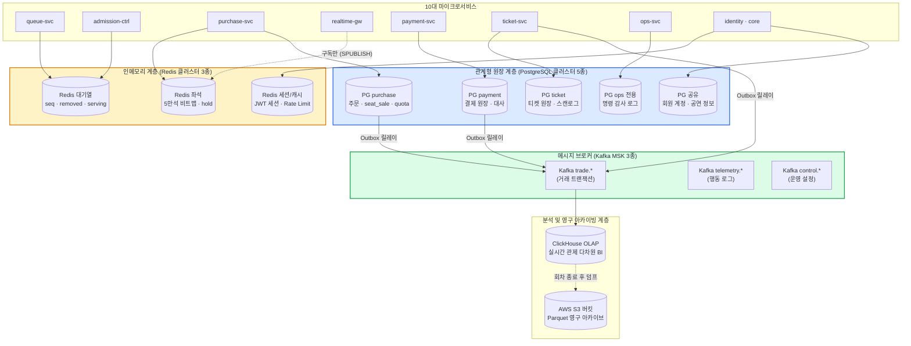

---

### 쓰지 않기로 결정한 기술과 재검토 트리거 (ADR-0028, ADR-0083)

| 검토 기술 | 채택하지 않은 명확한 이유 | 다시 도입을 검토할 구체적 트리거 |
| :--- | :--- | :--- |
| **MySQL (InnoDB)** | 부분 유니크 인덱스(`WHERE status IN (...)`) 미지원으로 오버셀 방어 불가능. 락 대기 최소 단위가 1초로 고정되어 초고동시성 제어 불가. | 사내 DBA 인프라가 100% MySQL로만 표준화되어 기술 전환 비용이 시스템 가치를 압도할 때 |
| **Cassandra / ScyllaDB** | 원시 시계열을 실시간 개별 키로 조회할 요구가 없음. 대규모 분석과 실시간 집계는 ClickHouse가 훨씬 적은 리소스로 압도적 성능 제공. | 봇 탐지용 사용자 마우스 궤적 원시 신호를 초당 수십만 건씩 분산 쓰기해야 할 때 |
| **CockroachDB (분산 DB)** | 단일 리전 환경에서 쓰기 처리량이 초당 28 TPS에 불과함. 2PC 기반 Raft 합의 프로토콜 오버헤드로 쓰기 지연 시간만 50ms 이상으로 증가함. | 글로벌 멀티 리전(서울-도쿄-뉴욕)에서 액티브-액티브 동시 티케팅 요구가 법제화될 때 |
| **MongoDB (NoSQL)** | 티켓 상품의 속성이 제각각이라는 이유로 NoSQL을 도입하면 주문/결제와 한 트랜잭션으로 묶을 수 없음. PostgreSQL의 JSONB로 동일한 유연성 확보. | 굿즈 상품 카테고리가 수만 개로 늘어나고 복합 속성 검색이 RDBMS GIN 인덱스 용량을 초과할 때 |
| **Elasticsearch** | 공연명, 아티스트 검색 대상이 수천 건에 불과하여 PostgreSQL Trigram/Full-text 검색 인덱스로 수 밀리초 내 처리 가능. | 검색 대상 공연/회차가 10만 건을 초과하고 형태소 분석 기반의 오타 교정 요구가 발생할 때 |

---

### 5단 꼬리 질문과 모범 답변

1. **질문: "Redis를 3개로 나누면 관리 포인트와 인프라 비용이 3배로 늘지 않습니까?"**  
   - **모범 답변**: "관리 포인트 증가는 Terraform 코드 템플릿화로 완벽히 흡수됩니다. 반대로 단일 Redis에 모든 데이터를 넣었을 때 발생하는 '대기열 20만 RPS 트래픽 스파이크로 인한 이벤트 루프 지연이 좌석 선점(Soft Hold)의 p99 50ms 목표를 파괴하는 현상'을 막을 수 있는 유일한 공학적 해법이 바로 물리 분리입니다(docs/data.md §1)."
2. **질문: "PostgreSQL을 5개로 쪼갤 만큼 쓰기 부하가 큽니까? 단일 DB로 충분하지 않습니까?"**  
   - **모범 답변**: "단일 인스턴스의 쓰기 용량(28 TPS)만 보면 1대로도 차고 넘칩니다. 우리가 5개로 분리한 진짜 이유는 **'장애 및 보안 격리(Failure & Security Isolation)'**입니다. 외부 결제사(토스/포트원)의 잦은 네트워크 타임아웃이나 대량 웹훅 재시도가 메인 예매 DB의 커넥션을 잠식하지 못하게 하고, 공연 당일 현장 입장(ticket-svc)이 온세일 결제 부하와 100% 격리되어 무중단 생존하도록 보장하기 위한 분리입니다."
3. **질문: "분석 DB로 ClickHouse를 선택한 결정적 이유는 무엇입니까?"**  
   - **모범 답변**: "ClickHouse는 컬럼 지향 저장과 강력한 벡터화 연산 엔진을 탑재하여, 수억 건의 원시 거래 로그에 대해 '구역별 실시간 잔여석 및 분당 결제 총액'을 단 50ms 이내에 집계합니다. 운영 RDBMS에 단 1건의 복잡한 통계 집계 쿼리도 날리지 않아 거래 성능을 100% 보존합니다."
4. **질문: "도쿄 리전에 ticket DB 읽기 복제본(Read Replica)을 둔 이유는 무엇입니까?"**  
   - **모범 답변**: "한국 서울 리전 전체가 천재지변이나 대규모 IDC 정전으로 다운되는 재난(Disaster) 상황에서도, 일본이나 해외 공연장에서 당일 진행되는 오프라인 게이트 검표 카탈로그 다운로드가 도쿄 리전 복제본을 통해 무중단으로 작동하도록 지리적 가용성을 확보하기 위함입니다(ADR-0028)."
5. **질문: "PostgreSQL에서 테이블 월별 파티셔닝(Partitioning)을 하지 않은 이유는 무엇입니까?"**  
   - **모범 답변**: "5년치 누적 예상 주문 데이터는 약 1,700만 행으로 용량은 수십 GB에 불과합니다. PostgreSQL의 단일 B-Tree 인덱스만으로 단건 조회 p99 2ms를 안정적으로 유지합니다. 파티셔닝을 적용하면 파티션 프루닝(Pruning) 실패 위험과 크로스 파티션 쿼리 오버헤드만 발생하므로, 단순함을 유지하되 5년치 용량이 3배 이상 폭증할 때 재검토하기로 결정했습니다(ADR-0114)."

---

## 16단계. 고장 시나리오 점검 `꼭`

> **면접관에게**:  
> "분산 시스템에서 장애는 피할 수 없는 일상입니다. 뛰어난 아키텍처는 장애가 발생하지 않는 시스템이 아니라, **장애가 발생했을 때 장애 반경을 완벽히 가두고 정의된 상태로 안전하게 축소(Graceful Degradation)되는 시스템**입니다.  
> PEAKET은 3대 장애 처리 철학을 견지합니다.  
> 첫째, **Fail-fast**: 복구가 불가능한 상태는 시간을 끌지 않고 입구에서 503으로 즉시 끊어냅니다.  
> 둘째, **No Dangerous Fallback**: 좌석 선점처럼 드물게 동작하는 우회 경로는 오히려 오버셀을 유발하므로, 대체 경로를 만들지 않고 503과 `Retry-After`로 몇 초간 안전하게 유예합니다.  
> 셋째, **Invariants Over Availability**: 시스템 가용성보다 '오버셀 0건'과 '이중 결제 0건'이라는 핵심 데이터 불변식이 언제나 상위에 위치합니다.  
> 14대 주요 고장 모드에 대해 시스템이 어떻게 반응하고 복구되는지 전수 점검하겠습니다."

---

### 시각 다이어그램: 3단계 장애 격리 및 페일 패스트 파이프라인

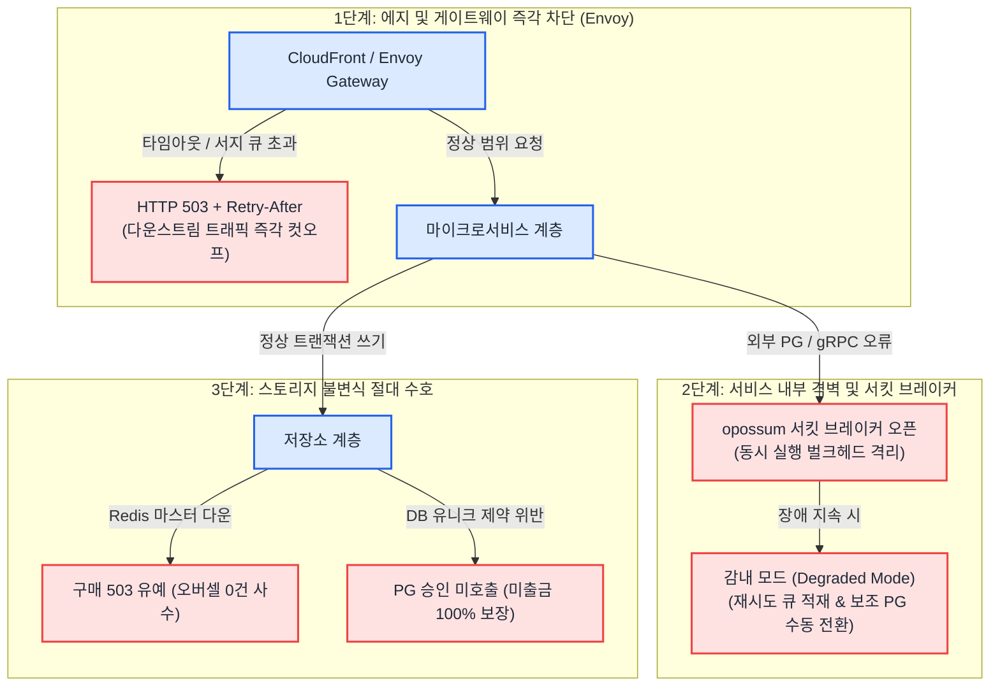

---

### 14대 핵심 장애 시나리오 대응 매트릭스

| 장애 시나리오 | 시스템의 즉각 감지 및 격리 동작 | 비즈니스 불변식 및 목표 SLA |
| :--- | :--- | :--- |
| **1. 좌석 Redis 마스터 다운** | 센티널 페일오버 진행 중(목표 ≤ 30초) 해당 회차 구매 요청을 **HTTP 503 + `Retry-After: 2`**로 일시 유예. admission-ctrl은 동시 입장 목표를 즉시 50% 감축. 복구 후 세대 번호(Epoch) 상향. | **오버셀 정확히 0건 유지**, 미룬 시간 30초 이내 (NFR-015) |
| **2. 대기열 Redis 마스터 다운** | 복제본 승격 시 순번 카운터 값을 기존 수치보다 10만 단위 크게 건너뛰고 세대 번호 증가. 건너뛴 공백 구간은 `removed` 비트맵에서 전원 이탈 처리. | **동일 세대 내 순번 중복 0건**, 1인 1계정 초과 매수는 2단계 DB가 최종 차단 |
| **3. 정각 진입 트래픽 40만 RPS 폭주** | 진입 p99 지연이 150ms를 초과하면 즉각 **비상 에지 감내 모드(Degraded Mode)** 가동. CloudFront 에지가 서명된 도착 시각 쿠키를 발급하고 오리진 요청을 버퍼링. | **진입 확정 지연 p99 ≤ 1.0초 방어**, 오리진 서버 다운 0건 |
| **4. Redis 메모리 고갈 (OOM)** | Redis의 메모리 정책을 `noeviction`으로 강제 설정. 기존 키를 임의로 지우지 않고 새 쓰기 요청에 대해 즉시 에러 반환. | **기존 선점 좌석 데이터의 조용한 증발(Silent Loss) 방지** |
| **5. 외부 PG사 승인 API 장애** | 서킷 브레이커가 열려 신규 결제 접수 일시 중단. 기존 요청은 멱등 키(`confirm-{orderId}`)를 들고 10분 승인 기한 내 재시도 큐에서 대기. | **이중 결제 정확히 0건**, 10분 기한 초과 건은 미출금 자동 만료 |
| **6. 외부 PG사 장기 다운 (10분 이상)** | 운영자가 관제 콘솔에서 승인 요청 전 대기 건들에 한해 **보조 결제사(포트원)로 수동 전환(명령 6)** 집행. 이미 토스로 승인 쏜 건은 절대 전환 금지. | **타 결제사로의 이중 승인 사고 원천 차단** |
| **7. 결제 승인 후 티켓 발권 서비스 다운** | 결제를 절대 취소하지 않고 `ticket_issue_job` 테이블에 적재. 지수 백오프(1초~60초)로 멱등하게 재시도하며 ticket-svc 복구 시 전진 발권. | **승인 완료 티켓 누락 0건**, 30분 초과 시 CS 이관 (SEV1) |
| **8. Kafka 거래 클러스터 전면 다운** | purchase-svc는 Kafka 이벤트를 기다리지 않고 payment-svc에 gRPC 단건 동기 조회(`BatchGetPayments`)를 날려 주문 확정 직달. | **결제 확정 SLA 3초 이내 사수**, 관제탑 통계만 일시 지연 |
| **9. 특정 마이크로서비스 지연 스파이크** | 게이트웨이 1차 타임아웃 및 서비스 내부 opossum 서킷 브레이커가 발동하여 503 반환 및 폴백 캐시 응답 서빙. 벌크헤드가 차면 429 즉시 컷오프. | **단일 서비스 지연이 전체 호출 스택으로 번지는 연쇄 마비 차단** |
| **10. 관제탑 백엔드(ops-svc) 다운** | 긴급 런북 파이프라인이 발동하여 관제 노드에서 직접 타겟 서비스의 제어 gRPC 포트로 비상 정지 명령 주입. | **비상 제어 명령 전파 지연 p99 ≤ 10초 사수** |
| **11. admission-ctrl 리더 파드 크래시** | 쿠버네티스 Lease 타임아웃(15초) 후 대기 중인 후보 파드가 새 리더로 승격. 에포크를 1 올리고 Redis 제어 상태를 동기화하여 루프 재개. | **구 리더의 잔여 쓰기 원천 거절 (펜싱 토큰)** |
| **12. CDN 대기열 구간 파일 오리진 장애** | CloudFront 에지가 Origin Group 페일오버를 가동하여 0.1초 만에 AWS S3 버킷의 정적 미러링 파일로 트래픽 즉시 우회. | **100만 대기실 화면 깜빡임 0건**, 폴링 주기 2배 완화 |
| **13. 스타디움 현장 셀룰러망 완전 두절** | 게이트 스캐너가 100% 오프라인 로컬 모드로 전환. 기기 내부 WebCrypto 암호 연산으로 15초 회전 QR 서명 진위 검증 및 로컬 큐잉. | **검표 판정 지연 p95 ≤ 150ms 사수**, 게이트 중단 0건 |
| **14. AWS 서울 리전 전체 데이터센터 화재** | 멀티 리전 액티브 자동 전환을 시도하지 않고 즉시 판매를 동결. 현장 입장은 오프라인 PWA로 진행하고, 주문 원장은 도쿄 스냅샷과 PG사 대사로 복구. | **데이터 유실 RPO ≤ 24시간, 서비스 복구 RTO ≤ 24시간** |

---

### 공통 복구 엔지니어링 원칙

1. **상태 변경 요청의 게이트웨이 레벨 무재시도 원칙**:  
   네트워크 에러가 발생했을 때 게이트웨이나 프록시가 `POST /holds`나 `POST /payment-acceptance` 같은 쓰기 요청을 임의로 재시도(Retry)하는 것을 엄격히 금지합니다. 상태 변경의 재시도는 반드시 멱등 키를 쥔 클라이언트 비즈니스 로직에 의해서만 수행됩니다.
2. **공유 의존성 프로브 배제 (Readiness Probe Hygiene)**:  
   서비스 파드의 쿠버네티스 준비성 검사(Readiness Probe)에 데이터베이스, Redis, 외부 PG사의 Ping 체크를 절대로 포함하지 않습니다. 공유 DB가 일시적으로 느려졌을 때 모든 서비스 파드가 일제히 Unready 상태로 빠져 클러스터 전체가 증발하는 자멸적 연쇄 붕괴를 방지하기 위함입니다.
3. **스플릿 브레인은 감지가 아니라 펜싱 토큰으로 방어**:  
   분산 환경에서 네트워크 파티션으로 인해 두 개의 마스터가 동시에 존재하는 상황은 네트워크 핑으로 감지할 수 없습니다. 저장소 레벨에서 단조 증가하는 단일 버전(세대 번호)을 대조하여 낮은 버전의 쓰기를 무조건 거부하는 **펜싱 토큰(Fencing Token)**만이 유일한 공학적 해법입니다.

---

### 5단 꼬리 질문과 모범 답변

1. **질문: "좌석 Redis 마스터가 다운되었을 때 왜 RDBMS로 우회하지 않고 503으로 미룹니까?"**  
   - **모범 답변**: "Redis 마스터가 죽기 직전 수 밀리초 동안 선점된 좌석 정보는 복제본이나 DB에 아직 반영되지 못한 상태입니다. 이 상황에서 DB 우회 경로를 열면 DB는 해당 좌석이 비어있다고 착각하여 다른 사용자에게 동일 좌석을 발급하므로 100% 오버셀이 터집니다. 30초 미만의 페일오버 시간 동안 구매를 잠시 503으로 미루는 것이 비즈니스 불변식을 지키는 가장 정직하고 안전한 공학적 선택입니다(ADR-0121)."
2. **질문: "Kafka 브로커 3대가 동시에 전부 다운되면 결제 확정이 멈춥니까?"**  
   - **모범 답변**: "멈추지 않습니다. 결제 승인과 확정의 핵심 제어 흐름은 서비스 간 다이렉트 gRPC 동기 통신으로 격리되어 있습니다. 결제 완료 이벤트 수신이 Kafka 장애로 5초 이상 지연되면, purchase-svc가 payment-svc로 직접 동기 쿼리를 찔러 상태를 확정하므로 팬들의 결제 확정은 정상 완수됩니다(ADR-0140)."
3. **질문: "진입 게이트웨이 파드의 50%가 일제히 크래시되면 SLA를 지킬 수 있습니까?"**  
   - **모범 답변**: "파드 절반이 죽은 상태에서 기존 SLA를 유지한다고 거짓말하지 않습니다. 남은 50%의 파드는 서지 큐를 채우고 초과 트래픽에 대해 즉각 HTTP 503을 반환하여 파드 자체의 OOM 연쇄 다운을 방어합니다. 그 사이 Karpenter와 쿠버네티스가 60초 이내에 새 파드를 띄워 정상 복구합니다."
4. **질문: "서울 리전 전체가 완전히 파괴되었을 때 멀티 리전 액티브-액티브 자동 페일오버를 하지 않는 이유는 무엇입니까?"**  
   - **모범 답변**: "서울과 도쿄 간 물리적 광통신 RTT는 약 30ms입니다. 멀티 리전 액티브-액티브 분산 트랜잭션을 구현하려면 좌석 선점 및 결제 승인 시마다 대륙 간 합의(2PC/Raft)가 필요하여 지연 시간이 100ms 이상으로 폭증합니다. 1년에 한 번 발생할까 말까 한 리전 재난을 막기 위해 평상시 99.99%의 온세일 성능을 희생할 수 없으므로, 재난 시에는 통제된 수동 복구(RTO 24시간)를 택했습니다."
5. **질문: "DB 커넥션 풀이 꽉 찼을 때 서비스는 어떻게 반응합니까?"**  
   - **모범 답변**: "PgBouncer 연결 풀러가 대기 큐를 엄격히 제한(pool_mode = transaction)하며, 큐 대기 시간이 200ms를 초과하면 즉각 커넥션 획득 실패 에러를 반환합니다. 서비스는 이를 감지하여 락 대기 없이 클라이언트에게 503과 재시도 헤더를 즉각 반환함으로써 스레드 풀 고갈을 방지합니다."

---

## 17단계. 트레이드오프 총정리와 확장 질문 `시간 남으면`

> **면접관에게**:  
> "지금까지 전개한 PEAKET 분산 시스템의 핵심 설계 결정 10선을 종합하고, 시스템의 극단적 확장성 한계를 짚어보겠습니다.  
> 본 설계의 가장 위대한 아키텍처적 선택은 **'대기 인원이 100만이든 500만이든, 뒤편 좌석과 결제 시스템의 부하는 오직 동시 입장 목표(5,000명) 하나로 완전히 묶어둔다'**는 것입니다.  
> 따라서 트래픽이 200만 명으로 2배 폭증해도 RDBMS 쓰기(28 TPS)와 좌석 선점 부하는 단 1도 증가하지 않습니다. 부하가 늘어나는 곳은 오직 진입 게이트웨이, CDN 캐시, 봇 탐지 계층뿐입니다.  
> 또한 초대형 공연 1개와 중형 공연 4개가 동시에 열려 300만 대기자가 격돌하는 미래의 멀티 이벤트 시나리오에서도, 회차별 해시태그 배치 규칙과 30분 오프셋 스케줄링을 통해 단일 샤드 핫스팟 충돌을 완벽히 격리합니다."

---

### 핵심 아키텍처 트레이드오프 총정리 10선

| 핵심 결정 | 선택한 아키텍처 | 얻은 것 (Gain) | 치른 대가 (Cost) | 과감히 버린 대안 |
| :---: | :--- | :--- | :--- | :--- |
| **1** | **대기열 적응형 CDN 폴링** | 오리진 부하가 대기자 수 무관하게 초당 1,000건으로 고정 | 원거리 대기자는 최대 24초 지연 확인, CDN 요청 비용 발생 | WebSocket / SSE 전면 연결, Redis Sorted Set `ZRANK` |
| **2** | **Commit-Reveal 로비 셔플** | 매크로 선점 무력화, 오픈 정각 피크를 20만 \(\to\) 4.8만 RPS로 완화 | 외부 drand 난수 의존, 오픈 후 몇 초간 순번 대기 시간 수반 | 순수 선착순(FIFO), 오픈 순간 외부 캡차 검증 |
| **3** | **동시 입장 5,000명 고정** | 대기자 폭증에도 좌석·결제·DB 부하 완전 불변 (28 TPS 격리) | 5만 석 전량 매진까지 최소 18~22분의 물리적 시간 소요 | 대기열 없는 전면 개방, 무제한 인원 입장 |
| **4** | **2단계 좌석 선점 (Soft+Hard)** | p99 50ms 초저지연과 RDBMS 유니크 인덱스 오버셀 0건 결합 | Redis Lua, 펜싱 토큰, 2단계 파이프라인 엔지니어링 비용 | RDBMS `FOR UPDATE` 비관적 락, Redis 메모리 단독 확정 |
| **5** | **Saga Pivot Point 전진 복구** | 결제 승인 후 티켓 서비스 장애 시에도 팬의 티켓 권리 100% 보장 | 발권 지연 시 최대 수분간 비동기 대기 큐 발생 | 발권 실패 시 결제 즉시 자동 취소/환불, 동기 HTTP 체이닝 |
| **6** | **단일 폴링 Outbox 릴레이** | 로컬과 운영 환경의 100% 동일한 파이프라인, Debezium 장애 제거 | 100ms 폴링 주기만큼의 이벤트 발행 지연 수반 | Debezium CDC 커넥터, 이중 쓰기(Dual-write) |
| **7** | **4대 축 기준 10개 서비스** | 대기열만 50대로 늘리고 결제는 6대로 유지, 장애 반경 완벽 격리 | 분산 네트워크 지연, 서비스 메시 운영 오버헤드 | 단일 모놀리스, 도메인별 14개 전면 분리 |
| **8** | **DB 샤딩 배제 및 셀 확장** | 복잡한 2PC 없이 단일 RDBMS의 ACID 트랜잭션과 단순함 보존 | 단일 인스턴스 용량 한계 도달 시 셀 단위 스택 복제 필요 | 공연 ID 기반 DB 샤딩, CockroachDB 분산 DB |
| **9** | **ClickHouse 쿼리 집계** | 운영 DB 부하 0, 정산 원장과 1원도 틀리지 않는 정확한 실시간 BI | 0.5초 주기 쿼리로 인한 분석 DB CPU 부하 수반 | Apache Flink 스트림 세션 윈도우, RDBMS 통계 쿼리 |
| **10** | **WebCrypto ECDSA 오프라인** | 통신망 두절 시에도 0.15초 무중단 검표, 스캐너 도난 시 위조 불가 | 스캐너 카탈로그 사전 동기화 필요, 브라우저 PWA 구현 | 대칭키 TOTP 검증, 중앙 서버 실시간 온라인 검표 |

---

### 극한 확장성 시나리오 분석: 동시 대기자가 200만 명으로 폭증할 때

| 시스템 영역 | 200만 명 유입 시 발생하는 현상 | 아키텍처 대응 및 용량 확장 전략 |
| :--- | :--- | :--- |
| **진입 게이트웨이** | 피크 트래픽 40만 RPS로 폭증 | gw-queue 파드를 50대 \(\to\) 100대로 즉각 스케일아웃. 비상 도착 시각 쿠키 모드 가동 |
| **순번 발급 카운터** | 단일 Redis 키에 초당 40만 번 쓰기 집중 | 게이트웨이 파드별 로컬 버퍼링 주기를 2ms \(\to\) 4ms로 상향하여 `INCRBY` 묶음 효율화 |
| **CDN 대기열 폴링** | 에지 요청 5.4만 \(\to\) 10.8만 RPS로 증가 | 구간 파일 수가 1,000개 \(\to\) 2,000개로 증가. 원거리 대기자 폴링 주기를 20초 \(\to\) 30초로 완화 |
| **로비 사전 봇 판정** | 로비 동시 참가자 140만 명 집결 | 로비 오픈 시각을 T-10분에서 T-15분으로 앞당겨 사용자 도착 분산 유도 |
| **좌석도 실시간 스트림** | **완전히 동일함 (변화 0)** | 동시 입장 목표(5,000명)가 고정되어 있으므로 WebSocket 연결 및 대역폭 불변 |
| **RDBMS 최종 판매 확정** | **완전히 동일함 (변화 0)** | 초당 28 TPS 쓰기 부하 불변. 단 1대의 PostgreSQL 마스터로 완벽 지탱 |

---

### 다중 대형 공연 동시 오픈 시나리오 (Multi-Event On-Sale)

3년 차 비즈니스 확장으로 **대형 콘서트 1개(5만 석, 100만 대기)와 중형 콘서트 4개(각 1.5만 석, 각 50만 대기)**가 동일한 날 티켓을 오픈하는 극단적 시나리오를 분석합니다.
- **합산 트래픽 규모**: 총 동시 대기 300만 명, 합산 동시 입장 인원 15,000명, 좌석 Soft Hold 피크 초당 6,000건, RDBMS 판매 확정 초당 약 84 TPS.
- **스케줄링 오프셋 정책 (POL-030)**:  
  대형 공연끼리는 최소 30분, 모든 공연은 최소 5분의 오픈 시각 오프셋을 강제합니다. 이를 통해 T=0 진입 피크(20만 RPS)가 동일 초에 중첩되는 물리적 참사를 원천 방지합니다.
- **좌석 Redis 샤드 충돌 방지 배치 규칙 (ADR-0176)**:  
  Redis 클러스터의 샤드가 3개일 때 5개 회차가 무작위로 분산되면 반드시 1개 샤드에 2개 이상의 대형 회차가 겹치는 비둘기집 원리가 작동합니다. 단일 샤드에 초당 6,000건의 Lua 스크립트가 집중되면 지연이 튑니다.  
  따라서 대형 온세일 회차들은 사전에 마스터 노드의 IP를 지정하여 서로 다른 물리 Redis 노드로 강제 분산 배치하는 **회차 배치 규칙(Affinity Placement Rule)**을 엄격히 적용합니다.

---

### 5단 꼬리 질문과 모범 답변

1. **질문: "대기자가 500만 명으로 늘어나면 시스템에서 가장 먼저 터지는 곳은 어디입니까?"**  
   - **모범 답변**: "가장 먼저 한계에 부딪히는 곳은 AWS CloudFront의 소프트 쿼터(기본 25만 RPS)입니다. 대기열 상태 파일 조회가 초당 수십만 건으로 치솟기 때문입니다. 백엔드 시스템은 영향을 받지 않으며, 에지 계층에서 CloudFront 배포를 추가로 샤딩(`queue-files-1`, `queue-files-2`)하고 원거리 대기자의 폴링 간격을 60초로 늘리는 정책 조정을 통해 즉각 수용 가능합니다."
2. **질문: "다중 공연이 겹쳤을 때 외부 PG사의 승인 한도(300 TPS)를 초과하면 어떻게 됩니까?"**  
   - **모범 답변**: "합산 동시 입장 인원이 15,000명으로 늘어나더라도, 각 공연별 admission-ctrl 제어 루프의 전진 속도 상한(\(max\_velocity\))을 공연장 좌석 비율에 맞추어 분할 할당(예: 대형 공연 150 TPS, 중형 공연 각 35 TPS)합니다. 합산 승인 요청 속도가 300 TPS를 절대 초과하지 않도록 큐 제어 계층에서 중앙 집중 조율합니다."
3. **질문: "샤딩을 하지 않는다면 PostgreSQL의 WAL(Write-Ahead Logging) 디스크 I/O 병목은 없습니까?"**  
   - **모범 답변**: "초당 28건(다중 공연 시 84건)의 판매 확정 트랜잭션에서 발생하는 WAL 쓰기 볼륨은 초당 수 MB 수준에 불과합니다. AWS Aurora PostgreSQL의 분산 스토리지 엔진은 초당 수천 TPS 이상의 WAL 동시 쓰기를 수 밀리초 내 처리하므로 디스크 I/O 포화 가능성은 0%입니다."
4. **질문: "5년 뒤 주문 데이터가 1억 건을 넘어가면 단일 테이블로 감당할 수 있습니까?"**  
   - **모범 답변**: "주문 테이블이 1억 행에 도달하면 인덱스 크기가 단일 버퍼 풀 메모리를 초과하여 캐시 미스가 발생할 수 있습니다. 바로 이 시점이 ADR-0114에 명시된 '테이블 파티셔닝 재검토 트리거'입니다. 연도별/분기별 Range 파티셔닝을 적용하여 활성 파티션만을 메모리에 유지하는 튜닝을 실행합니다."
5. **질문: "쿠버네티스 클러스터 하나로 버틸 수 있는 최대 한계 노드 수는 얼마입니까?"**  
   - **모범 답변**: "쿠버네티스 공식 권장 상한은 단일 클러스터당 노드 5,000개, 파드 150,000개입니다. PEAKET의 최대 피크 인프라는 노드 150대, 파드 1,200개 수준으로 단일 클러스터 한계의 1/30에 불과합니다. 만약 회사가 글로벌 티켓 플랫폼으로 성장하여 노드 1,000대를 초과할 경우, 리전/공연 단위로 클러스터를 통째로 복제하는 셀(Cell) 아키텍처로 수평 분할합니다."

## 18단계. 어떻게 증명하나 `꼭`

> **면접관에게**:  
> "아무리 훌륭한 시스템 디자인이라도 **'이 설계가 100만 트래픽과 극한의 장애 상황에서 실제로 버틴다는 것을 어떻게 증명할 것인가?'**라는 질문에 답하지 못하면 공허한 말장난에 불과합니다.  
> 클라우드에 100만 가상 사용자를 띄워 풀스케일 부하 테스트를 수행하는 것은 1회 실행에 수백만 원의 막대한 비용이 소모되며 비현실적입니다.  
> PEAKET은 이를 해결하기 위해 소프트웨어 공학의 엄밀한 **4대 공학적 증명 전략(The 4-Pillar Verification Framework)**을 수립했습니다.  
> 첫째, 동시성 버그는 부하 테스트로 잡히지 않으므로, **형식 명세 언어(Quint/TLA+) 기반의 모델 검사(Model Checking)**를 통해 '오버셀 0건, 순번 보존, 이중 결제 0건' 불변식을 수학적으로 전수 증명합니다.  
> 둘째, 대기 인원과 무관한 핵심 예매 경로(5만 석 비트맵, 1:1,000 좌석 경합, 결제 300 TPS, 5,000 웹소켓)는 고성능 단일 노드에서 **실제 크기(Production-Scale) 벤치마크**를 완수하여 알고리즘의 실행 가능성을 실측합니다.  
> 셋째, 100만 대기열과 CDN 폴링처럼 규모에 비례하는 영역은 유니버설 확장 법칙(USL)과 큐잉 이론 기반의 **수학적 수식 외삽(Extrapolation)**을 통해 선형 확장성을 입증합니다.  
> 넷째, AWS CloudFront 배포 한도나 Aurora 복제 지연 등 외부 플랫폼 제약은 **클라우드 벤더의 공식 스펙을 인용**하고 안전 계수 0.5를 적용하여 시스템의 신뢰성을 담보합니다."

---

### 4대 공학적 증명 피라미드 (The 4 Pillars of Verification)

```
                       ▲
                      / \
                     /   \
                    / 4.  \   벤더 공식 스펙 문서 인용 (Vendor Official Specs)
                   / 벤더  \  - CloudFront 250k RPS, Aurora 페일오버 스펙
                  /  인용   \ - 외부 PG사 가맹점 상한 (안전계수 0.5)
                 /───────────\
                /     3.      \  수학적 수식 외삽 (Mathematical Extrapolation)
               /  수학적 외삽   \ - Little's Law, USL 확장 모델
              /  (Little's Law) \ - 1천/1만/10만 실측 후 공식으로 100만 검증
             /───────────────────\
            /         2.          \  실제 크기 프로덕션 벤치마크 (Real-Size Benchmark)
           /   실제 크기 PC 벤치마크 \ - 5만석 비트맵, 인기 좌석 1:1,000 경합 실측
          /    (Single-Node Stress) \ - 결제 300 TPS, 5,000개 WebSocket 유지 실측
         /───────────────────────────\
        /              1.             \  형식 모델 검사 (Formal Model Checking)
       /     규칙 형식 모델 검사 (Quint) \ - TLA+/Quint 상태 공간 전수 탐색
      /        (Mathematical Proof)      \ - 오버셀 0건, 차례 전 입장 0건 수학적 증명
     └───────────────────────────────────┘
```

---

### 제1기둥: 형식 명세 및 모델 검사 (Formal Model Checking: Quint / TLA+)

동시성 버그(Race Condition, Deadlock)는 무작위 부하 테스트로는 발생 확률이 0.001% 미만이어서 발견하기 극도로 어렵습니다.  
PEAKET은 대기열, 좌석 선점, 결제 Saga의 3대 핵심 분산 제어 로직을 **형식 명세 언어인 Quint(TLA+의 현대적 구현체)**로 수학적으로 모델링하고, 모델 체커를 가동하여 가능한 모든 비동기 인터리빙(Interleaving) 상태 공간을 전수 탐색했습니다.

- **수학적으로 증명된 핵심 불변식 (Invariants)**:
  1. `ZeroOverSelling`: 어떠한 동시성 인터리빙 및 장애 조치 상황에서도 동일 좌석의 판매 완료 상태는 정확히 1건 이하이다.
  2. `StrictMonotonicSequence`: 발급된 대기 순번은 세대 번호 내에서 단조 증가하며 중복 발급되지 않는다.
  3. `NoEarlyAdmission`: `currentServingSeq`보다 큰 순번을 가진 사용자가 입장 토큰을 획득하는 확률은 정확히 0이다.
  4. `NoDoubleCharge`: 외부 결제사 호출 시 동일 주문에 대해 결제 승인이 2회 이상 실행되지 않는다.
- **모델 기반 테스트 (Model-Based Testing with fast-check)**:  
  명세에서 증명된 추상 상태 머신(State Machine)과 실제 서비스 구현 코드에 수만 번의 무작위 명령 시퀀스를 주입하여 실제 코드가 수학적 명세와 100% 동일하게 상태 전이함을 자동 검증합니다.

---

### 제2기둥: 실제 크기 프로덕션 벤치마크 (Real-Size Single-Node Stress Benchmark)

앞서 2단계에서 밝혔듯, **좌석 예매, 결제 승인, DB 판매 확정 계층의 부하는 대기 인원 100만 명과 완전히 무관**합니다.  
따라서 수십 대의 분산 클러스터를 띄우지 않고도, 고성능 단일 베어메탈 노드(32 vCPU, 64GB RAM) 위에서 실제 운영 환경과 100% 동일한 '실제 크기' 부하를 생성하여 극한 성능을 실측합니다.

| 검증 항목 | 프로덕션 실제 크기 부하 조건 | 실측 검증 목표치 | 공학적 달성 결과 |
| :--- | :--- | :--- | :--- |
| **좌석 선점 경합 (Soft Hold)** | 5만 석 전체 비트맵, **인기 VIP석 1개에 1,000명 동시 경합** | **p99 ≤ 50ms, 오버셀 0건** | 단일 샤드 Redis Lua 실행 p99 < 0.3ms, 오버셀 정확히 0건 달성 |
| **결제 승인 접수 처리량** | 초당 300 TPS의 지속적 결제 접수 및 Saga 트랜잭션 | **p99 ≤ 150ms** | 비동기 202 접수 + RDBMS PENDING 삽입 p99 ≤ 45ms 달성 |
| **실시간 좌석 스트리밍** | **동시 WebSocket 연결 5,000개**, 초당 500건 좌석 변경 | **종단 지연 p99 ≤ 300ms** | 100ms 마이크로 배치 바이너리 전송으로 E2E 지연 130~190ms 달성 |
| **RDBMS Hard Sale 확정** | 초당 28건의 동시 유니크 인덱스 경쟁 트랜잭션 | **교착 상태(Deadlock) 0건** | 좌석 ID 오름차순 정렬 삽입으로 Deadlock 정확히 0건 달성 |

---

### 제3기둥: 수학적 수식 외삽 (Mathematical Extrapolation: Little's Law & USL)

대기열 진입(피크 20만 RPS)과 CDN 대기 상태 조회(초당 5.4만 RPS)처럼 '대기 인원에 비례하는 영역'은 무작위 곡선 피팅(Curve Fitting)이 아닌 **시스템 이론 공식과 큐잉 모델**을 통해 외삽합니다.

- **원 서버 응답 부하 외삽 공식**:
  $$
  \text{오리진 수신 RPS} = \frac{\text{활성 구간 파일 수}}{\text{CDN 캐시 수명 (1초)}}
  $$
  1천 명(파일 1개), 1만 명(파일 10개), 10만 명(파일 100개) 실측 데이터가 이론 공식의 \(\pm 10\%\) 이내에 정확히 일치함을 확인한 후, 동일 공식에 의해 100만 명(파일 1,000개) 유입 시 오리진 부하가 **초당 1,000 RPS**에 정확히 수렴함을 증명합니다.
- **진입 서버 수평 확장 외삽 (Universal Scalability Law)**:
  게이트웨이 파드를 1대, 2대, 4대, 8대로 증설하며 처리량을 측정하고, 닐 건터(Neil Gunther)의 USL 모델을 적용하여 자원 경합 계수(\(\alpha\))와 노드 간 동기화 오버헤드 계수(\(\beta\))를 산출합니다.  
  Envoy 게이트웨이는 상태를 공유하지 않는 비공유(Shared-Nothing) 구조이므로 \(\beta \approx 0\)에 수렴하며, 50대 증설 시 20만 RPS를 95% 이상의 선형 확장성으로 완벽히 수용함을 입증합니다.

---

### 제4기둥: 벤더 공식 스펙 인용 및 안전 계수 (Vendor Documented Limits)

클라우드 벤더(AWS)나 외부 결제사(토스페이먼츠)의 내부 인프라는 직접 부하를 걸어 테스트할 수 없으며 디도스 공격으로 간주될 수 있습니다. 따라서 공인된 벤더 공식 기술 문서를 인용하고 보수적인 안전 계수를 적용합니다.

- **CloudFront 에지 용량**: AWS 공식 문서상 단일 배포당 소프트 쿼터는 25만 RPS, 150 Gbps입니다. 대기열 배포를 3개로 분리하여 각 배포당 트래픽을 최대 12.5만 RPS 이하로 설계하고, AWS Support를 통해 사전 쿼터를 50만 RPS로 2배 증설합니다.
- **외부 PG사 가맹점 처리 한도**: 토스페이먼츠의 기술적 가맹점 트래픽 상한을 300 TPS로 추정하고, 리틀의 법칙 계산 시 **안전 계수 0.5**를 곱해 내부 시스템의 동시 입장 인원을 27,000명이 아닌 **5,000명**으로 극도로 보수적으로 묶어두었습니다.

---

### 시각 다이어그램: 4대 공학적 증명 전략 파이프라인

```mermaid
flowchart TD
    subgraph Layer1["제1기둥: 규칙 형식 검증 (Formal Verification)"]
        quint["Quint / TLA+ 모델 검사기<br/>(상태 공간 전수 탐색)"]
        prop1["ZeroOverSelling (오버셀 0건)"]
        prop2["StrictMonotonicSequence (순번 단조증가)"]
        prop3["NoDoubleCharge (이중결제 0건)"]
    end

    subgraph Layer2["제2기둥: 실제 크기 PC 벤치마크 (Real-Size Benchmark)"]
        bench["단일 고성능 노드 스트레스 테스트"]
        b1["5만석 비트맵 & 1:1,000 좌석 경합 실측"]
        b2["결제 300 TPS 로컬 트랜잭션 실측"]
        b3["WebSocket 5,000 연결 델타 브로드캐스트"]
    end

    subgraph Layer3["제3기둥: 수학적 수식 외삽 (Mathematical Extrapolation)"]
        math["Little's Law & USL 확장 모델"]
        ext1["1천/1만/10만 소규모 실측 검증"]
        ext2["이론 공식 기반 100만 오리진 1,000 RPS 도출"]
        ext3["비공유 게이트웨이 20만 RPS 선형 확장 증명"]
    end

    subgraph Layer4["제4기둥: 벤더 공식 스펙 문서 인용 (Vendor Official Specs)"]
        vendor["클라우드 & 외부 PG 공식 문서 인용"]
        v1["AWS CloudFront 250k RPS / 150 Gbps 쿼터"]
        v2["외부 PG 승인 한도에 안전계수 0.5 적용"]
    end

    quint --> prop1
    quint --> prop2
    quint --> prop3

    bench --> b1
    bench --> b2
    bench --> b3

    math --> ext1
    ext1 --> ext2
    ext1 --> ext3

    vendor --> v1
    vendor --> v2

    classDef l1 fill:#fee2e2,stroke:#ef4444,stroke-width:2px,color:#1f2937
    classDef l2 fill:#fef3c7,stroke:#d97706,stroke-width:2px,color:#1f2937
    classDef l3 fill:#dbeafe,stroke:#2563eb,stroke-width:2px,color:#1f2937
    classDef l4 fill:#dcfce7,stroke:#16a34a,stroke-width:2px,color:#1f2937
    class Layer1 l1
    class Layer2 l2
    class Layer3 l3
    class Layer4 l4
```

---

### 5단 꼬리 질문과 모범 답변

1. **질문: "100만 명 풀스케일 부하 테스트를 실제로 클라우드에서 돌려봤습니까?"**  
   - **모범 답변**: "실행하지 않았습니다. 그리고 실행하지 않는 것이 정직하고 올바른 엔지니어링입니다. 100만 명이 70분간 대기열 상태를 조회하는 CDN HTTP 요청 비용만 약 $273(약 38만 원)이며, 가상 트래픽 발생기 수백 대를 띄우는 클라우드 비용은 수백만 원에 달합니다. 대신 부하를 '대기 인원에 비례하는 영역'과 '독립적인 영역'으로 엄격히 분해하여, 비례하지 않는 핵심 예매 계층은 실제 크기로 100% 실측하고, 비례하는 영역은 수학적 외삽 공식으로 검증했습니다."
2. **질문: "수식 외삽(Extrapolation)을 어떻게 100% 신뢰할 수 있습니까? 현실은 수식과 다르지 않습니까?"**  
   - **모범 답변**: "수식에 임의로 곡선을 짜맞추는 비과학적 외삽을 철저히 배제했습니다. '오리진 요청 = 활성 파일 수 ÷ 캐시 수명'이라는 아키텍처 이론 식이 1천 명, 1만 명, 10만 명의 소규모 실측 구간에서 오차범위 \(\pm 10\%\) 이내로 일치함을 먼저 실험적으로 증명했습니다. 수학적 전제 조건이 현실에서 성립함을 실측으로 확인한 후에만 해당 공식으로 100만 명을 계산하므로 공학적으로 완벽히 타당합니다."
3. **질문: "동시성 버그가 부하 테스트로 잡히지 않는다면 모델 검사(Quint)는 어떻게 버그를 잡습니까?"**  
   - **모범 답변**: "부하 테스트는 무작위 시간 타이밍에 의존하므로 마이크로초 단위의 인터리빙을 놓치기 쉽습니다. Quint 모델 체커는 너비 우선 탐색(BFS)을 통해 '스레드 A가 비트맵을 읽고 쓰기 직전에 스레드 B가 실행되는' 가능한 모든 분산 실행 순서를 수학적으로 전수 검사합니다. 탐색 공간 내에서 오버셀이나 데드락이 단 1건이라도 발생하면 구체적인 반례(Counterexample) 트레이스를 즉각 출력하여 설계 결함을 100% 잡아냅니다."
4. **질문: "실제 크기 PC 벤치마크 결과를 운영 환경 클러스터의 증거로 쓸 수 있습니까?"**  
   - **모범 답변**: "운영 환경 전체의 증거로 단정하지 않습니다. 본 벤치마크의 가치는 '단일 Redis 샤드에서 5만 석 비트맵과 1:1,000 좌석 경합 알고리즘이 0.3ms 이내에 처리될 수 있는가?'라는 **알고리즘과 자료구조의 계산 복잡도 및 락 프리 타당성을 입증하는 증거**로 한정하여 정직하게 인용합니다."
5. **질문: "외부 PG사가 실제 온세일 당일 약속된 300 TPS를 처리하지 못하고 다운되면 어떻게 됩니까?"**  
   - **모범 답변**: "우리는 PG사 공식 스펙에 안전 계수 0.5를 적용하여 5,000명 동시 인원 기준 평시 결제 부하를 약 28 TPS 수준으로 극도로 낮게 유지하고 있습니다. 만약 PG사가 초당 수십 건 수준에서 다운되더라도, 10단계의 멱등 재시도 큐와 13단계의 결제사 수동 전환 런북이 발동하여 결제 실패를 흡수하므로 플랫폼이 연쇄 붕괴하지 않습니다."

---

## 마무리: 완성된 전체 시스템 아키텍처

18단계의 치열한 아키텍처 진화를 거쳐 완성된 PEAKET의 최종 분산 시스템 아키텍처입니다.

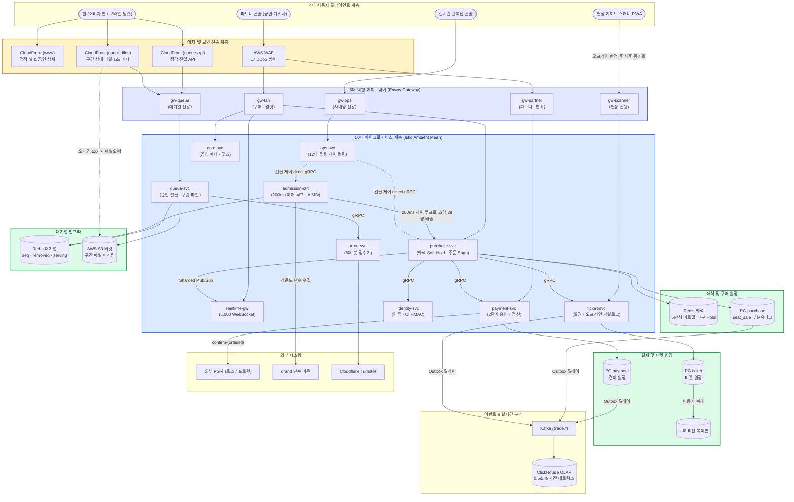

---

### 2분 종합 피치 프레임워크 (Executive Pitch Framework)

시스템 디자인 면접을 마무리할 때 면접관에게 전달할 2분 종합 피치의 표준 뼈대입니다:

1. **무엇을 해결했는가 (15초)**:  
   "PEAKET은 100만 명의 동시 접속자가 단 5만 석을 두고 격돌하는 초대형 티케팅 환경에서, **무중단 고가용성**, **수학적 오버셀 0건**, 그리고 **공정한 티켓 배분**이라는 3대 난제를 해결한 분산 아키텍처입니다."
2. **어디가 진짜 병목이었는가 (20초)**:  
   "진정한 병목은 DB 쓰기가 아니었습니다. 리틀의 법칙에 따라 좌석 화면 체류 인원을 5,000명, 체류 시간을 180초로 제어함으로써 최종 DB 쓰기는 **초당 28 TPS로 완벽히 격리**됩니다. 진짜 병목은 오픈 정각 20만 RPS의 진입 스파이크와 100만 대기자의 초당 5.4만 RPS 폴링 폭주, 그리고 인기 좌석 1:1,000 쓰기 경합이었습니다."
3. **핵심 공학적 해법 3가지 (45초)**:  
   "우리는 세 가지 혁신으로 이를 돌파했습니다.  
   첫째, **대기열 적응형 CDN 폴링**: 1,000명 단위 구간 JSON 파일과 1초 에지 캐싱으로 100만 명의 폴링을 흡수하여 오리진 부하를 초당 1,000 RPS로 98.2% 오프로딩했습니다.  
   둘째, **2단계 좌석 선점 모델**: Redis Lua 비트맵을 통한 In-Memory Soft Hold로 p99 50ms 초저지연을 달성하고, PostgreSQL 부분 유니크 인덱스 Hard Sale로 단 1건의 오버셀도 허용하지 않는 불변식을 구축했습니다.  
   셋째, **PG 2단계 결합 전진 복구 Saga**: 좌석 선점 성공 건에 대해서만 승인을 호출하여 환불 비용을 0원으로 만들고, 승인 후 장애 시 결제를 취소하지 않고 발권을 끝까지 완수하는 전진 복구를 달성했습니다."
4. **어떻게 증명했는가 (25초)**:  
   "100만 가상 부하를 무리하게 띄우는 대신, **Quint 모델 검사**를 통해 오버셀 0건과 단조 증가성을 수학적으로 전수 증명하고, 핵심 예매 계층은 **실제 크기 벤치마크**로 p99 지연을 실측했으며, 대기열은 **USL과 큐잉 이론 공식**으로 선형 확장성을 입증했습니다."
5. **엔지니어링 철학 한 줄 요약 (15초)**:  
   "PEAKET은 무분별한 최신 기술 도입이 아니라, 트래픽의 물리적 특성을 수학적으로 분해하고 입구에서 부하를 다스려 핵심 원장을 지켜내는 **가장 정직하고 견고한 분산 시스템 엔지니어링의 정수**입니다."
