# PEAKET 시스템 디자인 한 판: 요구사항에서 완성된 구조까지

- **기준 시점**: ADR-0177까지, 2026-11-01(18단계의 현황은 2026-11-03)
- **이 문서가 하는 일**: 시스템 디자인 면접처럼 요구사항에서 출발해, 그림 하나에 상자를 더해 가며 PEAKET의 전체 구조를 한 번에 완성한다. 단계마다 '왜 이렇게 했나', 근거 숫자, 트레이드오프(얻는 것과 치르는 값), 꼬리 질문을 붙인다.
- **규범이 아니다**: 정본을 풀어 쓴 해설이다. 숫자와 규칙이 정본과 다르면 정본이 맞다([ADR-0177](../adr/0177-walkthrough-explain-in-interview.md)). 길잡이는 [README.md](README.md)다.
- **서비스 측정 전이다**: 기반 PoC(본 개발 전에 위험한 부분을 미리 재 보는 시험, wbs 0.5.1)는 PC 한 대에서 쟀다(ADR-0176). 그 숫자는 '실측(PC)'이고 운영 규모의 증거가 아니다. NFR 목표를 운영 규모로 잰 서비스 수준 측정은 아직 없어, 이 문서의 서비스 성능 숫자는 모두 설계 목표값이고 `[실측 전]`이다. 정본이 가정한 값에는 `[가정]`을 그대로 붙였다.

## 0. 한눈에 보기

### 0.1 단계 목록

'꼭'은 짧은 면접에서도 말할 단계, '시간 남으면'은 긴 면접이나 면접관이 물을 때 말할 단계다. 말하는 시간은 이 문서가 잡은 어림이다. '꼭' 단계만 말하면 약 40분이다.

| 단계 | 하는 이야기 | 표시 | 말하는 시간(어림) |
| --- | --- | --- | --- |
| 1 | 무엇을 만드나, 무엇이 어려운가 | 꼭 | 2분 |
| 2 | 규모 어림: 어디가 진짜 병목인가 | 꼭 | 5분 |
| 3 | 핵심 API와 데이터 뼈대 | 꼭 | 4분 |
| 4 | 가장 단순한 설계(v0)와 깨지는 열 곳 | 꼭 | 3분 |
| 5 | 대기 상태 조회 폭주 막기 | 꼭 | 3분 |
| 6 | 정각 진입 몰림, 공정성, 봇 | 꼭 | 4분 |
| 7 | 몇 명씩 들여보낼까 | 꼭 | 3분 |
| 8 | 같은 좌석을 두 번 팔지 않기 | 꼭 | 4분 |
| 9 | 좌석 변경을 실시간으로 알리기 | 시간 남으면 | 3분 |
| 10 | 결제와 서비스 사이의 일관성 | 꼭 | 4분 |
| 11 | 서비스 나누기, 입구 서버, 장애 격리 | 꼭 | 4분 |
| 12 | 갑자기 몰릴 때 서버 늘리기 | 시간 남으면 | 2분 |
| 13 | 지켜보고 조종하기(관제) | 시간 남으면 | 3분 |
| 14 | 인터넷이 끊긴 공연장 입장 | 시간 남으면 | 3분 |
| 15 | 저장소 총정리 | 꼭 | 3분 |
| 16 | 고장 시나리오 점검 | 꼭 | 3분 |
| 17 | 트레이드오프 총정리와 확장 질문 | 시간 남으면 | 3분 |
| 18 | 어떻게 증명하나, 지금 어디까지 했나 | 꼭 | 2분 |

### 0.2 단계마다 같은 순서

1. **면접관에게**: 그 단계에서 소리 내어 할 말이다. 외우지 말고, 읽은 뒤 자기 말로 바꿔 말한다.
2. **단순하게 하면 어디서 깨지나**: 숫자로 보인다.
3. **이렇게 고친다**: 지금 설계다.
4. **그림**: 이번 단계에서 더한 상자는 노란색이다.
5. **트레이드오프**: 얻는 것, 치르는 값, 버린 길.
6. **꼬리 질문**: 면접관이 물을 법한 질문과 답의 요지, 근거.
7. **더 깊이**: 이어 읽을 정본의 자리.

### 0.3 이 문서에서 처음 나오는 말

뒤에서 자주 쓰는 말을 먼저 풀어 둔다. 그 밖의 말은 처음 나오는 자리에서 푼다.

| 말 | 뜻 |
| --- | --- |
| RPS·TPS | 초당 요청 수, 초당 처리 건수 |
| p99 | 요청 100건 가운데 99건이 이 시간 안에 끝난다는 뜻. p95·p99.9도 같은 방식이다 |
| Redis | 메모리에 데이터를 두는 빠른 저장소. PEAKET은 대기열·좌석·세션용으로 셋을 따로 둔다 |
| PostgreSQL·Aurora | 표로 데이터를 두는 관계형 데이터베이스. Aurora는 AWS가 운영해 주는 PostgreSQL이다 |
| CDN·CloudFront | 사용자 가까운 곳에 파일을 복사해 두고 대신 답하는 전송망. CloudFront는 AWS의 CDN이다 |
| 원 서버 | CDN 뒤에서 실제로 답을 만드는 PEAKET 서버 |
| 폴링 | 브라우저가 정해진 간격으로 "바뀐 것 있나요?"를 묻는 방식 |
| 트랜잭션 | 여러 쓰기를 모두 하거나 모두 하지 않게 묶는 데이터베이스의 단위 |
| 멱등 | 같은 요청이 두 번 와도 결과가 한 번 처리한 것과 같다는 성질 |
| Kafka | 이벤트를 순서대로 쌓아 두고 여러 곳에 나눠 주는 메시지 시스템 |
| gRPC | 서비스끼리 정해진 계약으로 빠르게 묻고 답하는 통신 방식 |
| 온세일 | 공연 표를 처음 파는 시간. 정본은 오픈 10분 전부터 오픈 뒤 60분까지 70분을 잰다 |

## 1단계. 무엇을 만드나, 무엇이 어려운가 `꼭`

> **면접관에게**: "PEAKET은 공연 티켓 예매와 관제를 하는 시스템입니다. 목표는 셋입니다. 100만 명이 한꺼번에 몰려도 멈추지 않고, 같은 좌석이 두 사람에게 팔리는 일을 0건으로 막고, 봇보다 사람에게 표가 가게 합니다. 쓰는 사람은 팬, 공연을 올리는 파트너, 운영자와 CS, 현장 스태프 넷입니다. 이 시스템에서 어려운 곳은 데이터베이스 쓰기가 아닙니다. 수십만 명이 동시에 자기 차례를 묻는 것, 오픈 정각에 진입이 한꺼번에 몰리는 것, 좌석이 바뀔 때마다 좌석 화면에 있는 5,000명에게 알리는 것, 이 셋입니다."

**단순하게 하면 어디서 깨지나**

- 쇼핑몰이나 SNS 예제는 '읽기를 늘리는' 문제다. 티케팅은 한정된 좌석을 두고 같은 순간 쓰기가 몰리는 '쓰기 경합'과, 수십만 명이 같은 순간 몰리는 진입·대기 조회가 겹친다(docs/planning/01-overview.md §1.1).
- 실제로 2022년 11월 Ticketmaster의 Eras Tour 판매 때 요청이 35억 건(이전 최고치의 4배) 들어왔고, 상호작용의 약 15%에서 장애가 났다(같은 절).
- 전부 한 덩어리로 묶으면 진입 피크 20만 RPS와 결제 접수 300 TPS가 한 실행 단위에 있게 된다. 둘은 670배 차이가 나서, 진입이 몰리면 결제·발권·관제·현장 입장까지 함께 멈춘다(docs/architecture.md §3). 20만 RPS는 최악의 설정일 때의 상한이고, 2단계에서 푼다.

**이렇게 정했다**

- **판매 구조**: PEAKET은 통신판매중개자다. 판매 당사자는 공연을 올린 파트너이고, 파트너 공연은 PEAKET이 판매를 승인한 뒤에만 공개된다. 예매 취소와 환불은 PEAKET 시스템이 집행하고 책임도 파트너와 함께 진다(ADR-0045 결정 1·2·4).
- **돈의 흐름**: PEAKET은 판매 대금을 받아 두지 않는다. 결제사가 지급대행으로 파트너에게 정산금을 직접 보낸다(ADR-0047). PEAKET의 매출은 중개수수료다. 수수료율은 아직 정하지 않았다(docs/planning/00-executive-summary.md §9).
- **화면 앱**: 소비자 웹(대기실 포함), 파트너 콘솔, 관제 콘솔, 게이트 스캐너의 넷과, 사후 포렌식 리플레이 데모 하나다(docs/architecture.md §6.2).
- **하지 않는 것**: 스포츠 입장권, 리세일 중개, 여러 리전이 동시에 판매하는 구성, 네이티브 앱, 외화 결제, 100만 명 전체 실측, 운영·스테이징 환경의 실제 구축(docs/planning/01-overview.md §4.2).

**그림: 시스템과 그 바깥**

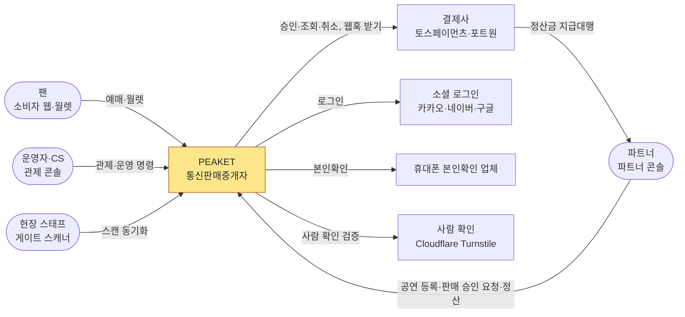

정본의 시스템 맥락 그림(docs/architecture.md §1)에는 바깥 시스템이 더 있다. 공개 난수 비콘(drand), 공연예술통합전산망, 알림 발송, 상태 페이지 같은 것들이다. 면접에서는 위 네 가지(결제사, 소셜 로그인, 본인확인, 사람 확인)면 된다.

**트레이드오프: 판매 구조**

| 길 | 판정과 이유(ADR-0045 '검토한 대안') |
| --- | --- |
| PEAKET이 판매 당사자 | 버렸다. 가격·회차·공연 이행을 파트너가 정하는 구조와 맞지 않고, 모든 공연의 불이행 책임까지 진다 |
| 순수 중개(환불 책임까지 파트너에게) | 버렸다. 환불은 PEAKET 시스템이 집행해 책임과 실행이 어긋나고, 파트너가 부도나면 팬 환불이 막힐 수 있다 |
| 중개 + 취소·환불 공동 책임 | 골랐다. 대신 중개자 고지, 판매자 정보, 분쟁 처리 기한, 공연예술통합전산망 전송 같은 법정 의무가 요구사항으로 늘었다 |

**꼬리 질문**

| 질문 | 답의 요지 | 근거 |
| --- | --- | --- |
| 왜 DB가 병목이 아닌가요? | 대기열이 좌석 화면을 동시 5,000명, 입장 초당 약 28명으로 묶는다. 그래서 판매 확정 쓰기도 초당 약 28건이다. 2단계에서 계산한다 | docs/architecture.md §9.1 |
| PEAKET이 표를 파나요? | 아니다. 판매 당사자는 파트너다. 다만 청약 확인, 청약철회, 환급은 PEAKET도 진다 | ADR-0045 결정 1·2 |
| 법이 설계를 바꿨나요? | 2026-08-28 시행 개정 공연법이 중개업자에게 부정구매·부정판매 방지 의무를 두었다. 구매자·판매자 본인 확인, 부정판매 게시물 신고 기능, 사전 고지, 통보받은 게시물 차단(기본 24시간, 고시 사항에 해당하면 10시간 안)을 더했다 | ADR-0045 결정 8, docs/planning/01-overview.md §1.1 |
| 해외 팬도 살 수 있나요? | 구매에는 한국 휴대폰 본인확인이 필요하다. 한국 휴대폰이 없으면 둘러보기만 된다 | docs/planning/01-overview.md §4.2 |
| 수수료는 몇 %인가요? | 정하지 않았다. 계약 단계에서 정할 일이다 | docs/planning/00-executive-summary.md §9 |

**더 깊이**: [docs/planning/00-executive-summary.md](../planning/00-executive-summary.md) §1·§4 → [docs/planning/01-overview.md](../planning/01-overview.md) §1.1·§2·§4.1·§4.2 → [docs/planning/02-requirements.md](../planning/02-requirements.md) §1 → [docs/architecture.md](../architecture.md) §1 → [ADR-0045](../adr/0045-intermediary-legal-status.md), [ADR-0047](../adr/0047-settlement-payout-via-pg-agency.md). 해설서의 분야 편 1 '무엇을 왜 만드나'가 이어 받는다.

## 2단계. 규모 어림: 어디가 진짜 병목인가 `꼭`

> **면접관에게**: "숫자부터 잡겠습니다. 5만 석 공연이고 한 사람이 최대 4장이라 주문은 많아야 2만 5천 건입니다. 좌석 화면에는 동시에 5,000명을 들이고, 한 사람이 평균 3분 머뭅니다. 그러면 새로 들어오는 사람은 초당 약 28명이고, 판매를 확정하는 데이터베이스 쓰기도 초당 약 28건입니다. 데이터베이스 한 대로 충분합니다. 대기 인원에 비례해서 커지는 것은 셋뿐입니다. 오픈 순간의 진입, CDN으로 받는 대기 상태 조회, 순번 섞기 결과 조회입니다. 그래서 이 설계의 힘은 대부분 데이터베이스가 아니라 대기실과 입구에 들어갑니다."

**기본 가정**(docs/architecture.md §9.1)

| 항목 | 값 | 비고 |
| --- | --- | --- |
| 좌석 | 50,000석 | 대형 공연장 |
| 1인 한도 | 4매 | 주문은 12,500~25,000건. 용량 어림은 상한 25,000건으로 한다(건당 평균 2매일 때) |
| 동시 대기 | 100만 명 | 설계 목표(NFR-013) |
| 좌석 화면 동시 인원 | 5,000명 | 처음 값. 좌석·결제 계층 용량으로 정했다 |
| 1인 체류 | 180초 | 좌석 화면에 머무는 평균 시간 |
| 매진까지 입장 | 25,000~30,000명 | 용량 어림은 상한 3만 명 |

**① 입장 속도가 정하는 부하: 대기 인원과 관계없다**

| 부하 | 계산 | 값 |
| --- | --- | --- |
| 입장 속도 | 5,000명 ÷ 180초 | 초당 약 28명 |
| 이론 매진 시간 | 30,000명 ÷ 초당 28명 | 약 18분(목표는 여유 20%를 더해 22분 이하) |
| 좌석 잡기(홀드) | 입장 직후 피크 | 초당 1,000~2,000건(평시 약 170건), 인기 좌석 하나에 수십 명 동시 경합. 시험은 한 좌석 1,000명 경합으로 더 세게 한다(NFR-003) |
| 결제 접수 | 첫 물결의 상한 | 300 TPS. 토스페이먼츠의 가맹점 승인 상한이 공개되지 않아 추정했다(ADR-0036) |
| 판매 확정(PostgreSQL 쓰기) | 정상 상태의 결제 속도 = 입장 속도 | 초당 약 28건 |
| 좌석 화면 연결 | 동시 인원 | WebSocket(연결을 열어 둔 채 서버와 브라우저가 주고받는 방식) 5,000개 |

대기자가 10만 명이든 100만 명이든 이 표의 숫자는 그대로다. 대기열이 뒤쪽으로 들어가는 속도를 묶기 때문이다.

**② 대기 인원에 비례하는 부하: 셋뿐이다**

진입 피크는 '오픈 뒤 진입하는 사람 수 × 처음 10초 안에 오는 비율 × 새로고침 배수 ÷ 10초'로 셈한다. 값은 모두 `[가정]`이다(docs/architecture.md §9.1 'T=0 도착 모델').

| 정렬 설정 | 로비 참가 | 오픈 뒤 진입 | 처음 10초 안 도착 | 새로고침 배수 | 진입 피크 |
| --- | --- | --- | --- | --- | --- |
| 로비 셔플 끔(화면 이름 '선착순') | 0% | 100만 명 | 100% | 2배 | 100만 × 2 ÷ 10초 = 20만 RPS |
| 로비 셔플 켬(기본) | 70% | 30만 명 | 80% | 2배 | 30만 × 0.8 × 2 ÷ 10초 ≈ 4.8만 RPS |

로비 셔플은 오픈 10분 전에 대기실(로비)에 모인 사람의 순번을 오픈 순간 무작위로 섞는 방식이다(6단계). 설계와 진입 서버 대수는 상한인 20만 RPS로 셈한다.

| 부하 | 계산 | 값 |
| --- | --- | --- |
| 대기 상태 조회(CDN이 받음) | 입장 1분 이내 1,700명 ÷ 0.5초 + 1~5분 6,700명 ÷ 5초 + 5분 넘게 99만 명 ÷ 20초 | 초당 약 5.4만 건 |
| 대기 상태 조회(원 서버까지 옴) | 1,000명 단위 파일 약 1,000개 × 1초 캐시 | 초당 약 1,000건 |
| 셔플 결과 조회(CDN이 받음) | 100만 명 ÷ 결과 공개 뒤 0~8초 `[가정]` | 초당 약 12.5만 건, 약 36 Gbps |

**③ 계산만으로 실패가 분명한 것**

- 좌석이 바뀔 때마다 5만 석 전체를 JSON(약 2MB)으로 5,000명에게 1초마다 보내면 초당 약 10GB다. 네트워크가 바로 포화한다. 그래서 단순한 설계(v0)로도 만들지 않는다(docs/architecture.md §9.1, ADR-0096 결정 7). 9단계에서 푼다.
- CloudFront 배포 하나의 기본 한도는 초당 25만 건, 150 Gbps다. 공연 페이지 피크 30만 RPS(NFR-007) 하나만으로도 넘는다. 그래서 배포를 공연 페이지(`www`), 대기열 파일(`queue-files`), 대기열 API(`queue`) 셋으로 나누고, 배포마다 설계 피크의 1.5배 `[가정]` 이상으로 한도를 미리 올린다(ADR-0058, docs/infra.md §4.1).

**그림: 부하 지도**

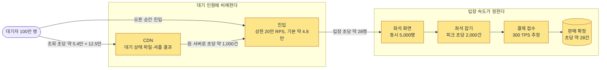

**결제사 상한과 동시 입장 인원**

- 결제사 승인 상한은 두 갈래로 지킨다. 첫 물결은 순번 전진 속도를 '승인 상한 ÷ 결제 비율' 아래로 둔다. 정상 상태는 '동시 입장 ≤ 승인 상한 × 180초 ÷ 결제 비율 × 안전 계수 0.5 `[가정]`'으로 둔다(리틀의 법칙: 동시에 머무는 수 = 들어오는 속도 × 머무는 시간)(docs/architecture.md §9.1).
- 토스페이먼츠 300 TPS로 셈하면 결제사가 허용하는 동시 입장은 300 × 180 × 0.5 = 27,000명이다. 그래서 5,000명은 결제사가 아니라 좌석·결제 계층의 용량으로 정한 값이다. 포트원 공연은 채널 하나가 초당 50건(추정)이라 4,500명이다.
- 동시 입장 목표의 절대 상한은 8,000명 `[가정]`이다(docs/planning/03-policies-glossary.md §1.1 POL-021 명령 1). 8,000을 고른 근거는 정본에 비어 있다. 면접 전에 소유자가 정해 둘 일이다(docs/review/open-items.md 86번).

**트레이드오프**

- **얻는 것**: 비례하는 부하와 비례하지 않는 부하를 나누면 "100만 명"이라는 숫자를 두 종류로 다룰 수 있다. 비례하지 않는 예매 계층은 실제 크기로 재고, 비례하는 부하만 식과 문서로 늘린다(18단계).
- **치르는 값**: 진입 피크와 새로고침 배수 같은 사람의 행동은 가정이다. 실제 공연이 생기기 전에는 확인할 수 없다(ADR-0057 '남는 한계').

**꼬리 질문**

| 질문 | 답의 요지 | 근거 |
| --- | --- | --- |
| 20만 RPS는 어디서 나왔나요? | 위 'T=0 도착 모델'의 계산이다. 셔플을 끈 공연에서 100만 명이 모두 10초 안에 오는 최악의 경우이고, 기본 설정은 약 4.8만이다. 값은 모두 가정이다 | docs/architecture.md §9.1 |
| 공연 페이지 30만 RPS(NFR-007)는 어디서 나왔나요? | 계산이 아직 정본에 없다고 정직하게 말한다. 화면 하나를 열면 브라우저가 API를 여러 번 불러, 요청은 '사람 수 × 화면 하나의 호출 수'로 센다. 공연 상세는 정적 셸(미리 만들어 둔 화면 틀)·공개 회차 요약·후기 요약을 CDN이 받고, 원본까지는 개인 영역 다섯 가지(본인확인·사람 확인·찜·알림·예매 제한 상태)와 사전 검증 토큰(진입 전에 사람 확인을 미리 마쳤다는 증표) 갱신만 온다. 30만의 근거는 wbs 0.5.5에서 CDN 쪽 식으로 채운다 | docs/architecture.md §9.1 '페이지당 호출 수', ADR-0180 결정 8 |
| 대기자가 200만이면 DB와 결제는요? | 그대로다. 동시 입장 목표가 뒤쪽 부하를 정하기 때문이다. 늘어나는 것은 진입(40만 RPS), CDN 조회, 로그인·봇 판정, 매진 공지다 | docs/architecture.md §9.2 |
| 결제사 300 TPS의 근거는요? | 공개되지 않아 설계에 필요한 값을 추정했다. 틀려도 넘는 승인은 같은 멱등 키로 큐에서 기다리고, 10분 기한을 넘기면 돈을 받지 않고 만료한다. 100 TPS 비관 시험으로 확인한다 | ADR-0036 결정 1·2·4 |
| 5,000명과 8,000명은 어디서요? | 5,000은 좌석·결제 계층 용량으로 정한 처음 값이다. 8,000은 절대 상한 `[가정]`인데 근거가 비어 있다고 정직하게 말한다 | docs/architecture.md §9.1, docs/review/open-items.md 86번 |
| Redis 키 하나에 초당 20만 번 더하기가 되나요? | 기반 PoC에서 PC로 쟀다. 순수 `INCR`(1 더하기)은 묶지 않아도 p99 중앙값 42.9ms로 기준 200ms 안이었고, 한 키 최대 처리량은 적어도 초당 49만 건이다(실측(PC)). 그런데 표시 확인까지 하는 실제 진입 스크립트를 초당 20만 번 부르니 Redis 엔진 스레드(Redis가 명령을 하나씩 차례로 처리하는 실행 줄 하나)가 차서 초당 약 8만~9만 건만 처리했다(실측(PC)). 그래서 진입 서버 파드마다 2ms `[가정]`씩 모아 스크립트 한 번으로 더한다(묶음을 넣은 진입 스크립트는 아직 재지 않았다) | docs/architecture.md §9.1·§9.4, ADR-0176 결정 1, ADR-0179 |
| 오픈 순간 CORS 사전 요청(브라우저가 다른 주소로 보내기 전에 미리 묻는 요청)까지 두 배가 되지 않나요? | 진입과 입장 확정은 사전 요청이 생기지 않는 형식(`text/plain` 본문, 기본 허용 헤더만)으로 보낸다 | docs/architecture.md §9.1 |

**더 깊이**: [docs/architecture.md](../architecture.md) §9.1(표, 'T=0 도착 모델', 결제사 문단, 외부 한도 문단) → [docs/planning/02-requirements.md](../planning/02-requirements.md) §3.2(NFR 표) → [docs/planning/01-overview.md](../planning/01-overview.md) §3.2 → [docs/verification.md](../verification.md) §3.1 → [docs/streaming.md](../streaming.md) §11 → [ADR-0036](../adr/0036-external-limits-estimates.md).

## 3단계. 핵심 API와 데이터 뼈대 `꼭`

> **면접관에게**: "구매 길의 API를 순서대로 보겠습니다. 호스트는 대기열 쪽과 구매 쪽으로 나뉩니다. 대기열 쪽은 진입과 입장 확정을 받는 queue 호스트와, 대기 상태 파일을 주는 CDN 호스트입니다. 대기 상태는 API로 답하지 않고, 1,000명 단위로 묶은 파일로 줍니다. 구매 쪽은 api 호스트이고 좌석 잡기, 주문, 결제를 받습니다. 결제 접수는 결제사 호출을 응답 밖에 두고 202로 바로 답하고, 결과는 따로 묻게 합니다. 데이터베이스는 서비스마다 따로 둡니다."

**구매 길의 API**(docs/api/openapi.yaml)

| 순서 | 요청 | 호스트(입구) | 받는 서비스 | 하는 일 |
| --- | --- | --- | --- | --- |
| 0 | `POST /v1/queues/{eventId}/lobby-participants` | queue(gw-queue) | queue-svc | 로비 입장. 순번 없는 참가 토큰을 준다. 사람 확인은 여기와 사전 검증, 추가 검증 제출에서 서버가 검증한다. 오픈 순간 경로에서는 하지 않는다 |
| 0' | `POST /v1/queues/{eventId}/pre-verifications` | queue(gw-queue) | queue-svc | 오픈 뒤에 오는 사람의 사전 검증 토큰(15분) |
| 1 | `POST /v1/queues/{eventId}/entries` | queue(gw-queue) | queue-svc | 대기열 진입. 순번을 받는다(201 대기표, 202 오픈 직후 묶음, 409 이미 대기 중, 410 매진) |
| 2 | `GET /v1/queues/{eventId}/segment-states/{segment}.json` | queue-files(CDN) | queue-svc가 만든다 | 구간별 대기 상태 파일. 인증·쿠키 없이 같은 구간 1,000명이 같은 파일을 본다 |
| 2' | `GET /v1/queues/{eventId}/shuffle-results/{hashPrefix}.json` | queue-files(CDN) | admission-ctrl이 만든다 | 로비 셔플 결과 파일 |
| 3 | `POST /v1/queues/{eventId}/admission` | queue(gw-queue) | queue-svc | 입장 확정. 내 번호가 지금 들어갈 번호 안이면 입장 토큰을 준다 |
| 4 | `GET /v1/events/{eventId}/seatmap-snapshot` | api(gw-fan) | purchase-svc | 좌석 상태 전체를 압축한 스냅샷. 이 요청이 구매 세션을 시작한다 |
| 5 | `POST /v1/events/{eventId}/holds` | api(gw-fan) | purchase-svc | 좌석 잡기(홀드). 201 성공, 409 경합에서 짐, 422 한도 초과, 423 판매 일시정지, 503 좌석 저장소 장애 조치 중 |
| 6 | `POST /v1/orders` | api(gw-fan) | purchase-svc | 주문 만들기. 금액은 서버가 계산하고 본인확인 상태를 다시 본다 |
| 7 | `POST /v1/orders/{orderId}/payments` | api(gw-fan) | purchase-svc → payment-svc | 결제 시도 시작. 결제사를 고르고 결제창 값을 준다 |
| 8 | `POST /v1/orders/{orderId}/payment-acceptance` | api(gw-fan) | purchase-svc → payment-svc | 결제 접수. 202로 바로 답하고 뒤에서 승인을 진행한다 |
| 9 | `GET /v1/orders/{orderId}/payment-status` | api(gw-fan) | purchase-svc | 결제 결과를 최대 25초 `[가정]` 기다려 답한다(long polling: 답이 생길 때까지 요청을 붙잡아 두는 방식) |
| 10 | `GET /v1/tickets` | api(gw-fan) | ticket-svc | 내 티켓(월렛) |
| 밖 | `POST /v1/webhooks/toss`, `POST /v1/webhooks/portone` | partner-api(gw-partner) | payment-svc | 결제사가 결과를 알려 오는 웹훅. 받은 뒤 결제사 조회 API로 다시 확인한다 |

'받는 서비스' 칸은 정본의 서비스 그림(docs/architecture.md §3)과 서비스 맵(§3.1)의 책임에서 읽었다. 경로마다 서비스를 적은 표는 정본에 따로 없다.

- 진입과 좌석 잡기는 로그인 서비스(identity-svc)를 거치지 않는다. 입구 서버가 공개키로 토큰을 확인한다. 주문을 만들 때만 purchase-svc가 본인확인 상태를 묻는다(docs/architecture.md §3).
- 좌석 잡기와 주문·결제 요청에는 `Idempotency-Key`(멱등 키)를 붙인다. 같은 키로 다른 내용을 보내면 422로 거절한다(docs/api/guidelines.md §4).

**데이터 뼈대**(docs/data.md §1·§2)

| 저장소 | 주인 | 구매 길에서 담는 것 |
| --- | --- | --- |
| Redis 대기열 | queue-svc, admission-ctrl | 순번 카운터, 1인 1순번 확인 키, 로비 참가자, 빠진 번호 비트맵(값마다 한 비트로 줄여 적은 표), 입장 자리 |
| Redis 좌석 | purchase-svc가 혼자 쓰고, realtime-gw는 변경 채널만 구독 | 좌석 상태 비트맵, 홀드 세부, 펜싱 토큰, 1인 보유 수, 구매 세션 |
| PostgreSQL purchase | purchase-svc | 주문 `purchase_order`, 주문 상태 이력 `order_event`, 좌석 판매 행 `seat_sale`, 1인 한도 원장 `purchase_quota`, 결제 시도 `payment_attempt`, 발권 재시도 `ticket_issue_job` |
| PostgreSQL payment | payment-svc | 결제 원장 `payment`, 결제 상태 이력, 웹훅 받은 기록 |
| PostgreSQL ticket | ticket-svc | 티켓 원장 `ticket`, 양도, 기기 공개키, 게이트 스캔 기록 |
| PostgreSQL 공유(논리 DB 따로) | identity-svc, core-svc | 계정과 본인확인, 공연·회차·공연장·가격 |
| Kafka | 이벤트를 내는 서비스마다 | 주문·결제·좌석 확정·발권 같은 거래 이벤트 |

- **서비스마다 데이터베이스를 따로 둔다**: 다른 업무 영역끼리는 데이터베이스를 같이 쓰지 않는다. 같은 업무를 실행 방식 때문에 나눈 곳(queue-svc와 admission-ctrl, purchase-svc와 realtime-gw)만 저장소를 함께 쓴다(docs/architecture.md §3).
- **판매 확정은 트랜잭션 하나다**: 좌석 판매 행 예약, 1인 한도 차감, 주문 상태 바꾸기를 한 번에 한다(docs/data.md §1).
- **표를 나누지 않는다**: 5년치가 주문 약 1,700만 행, 티켓 약 3,500만 행이라 표 하나로 감당한다(ADR-0114, NFR-021). 데이터베이스를 여러 대로 쪼개는 샤딩도 하지 않는다(ADR-0028).

**트레이드오프**

| 정한 것 | 얻는 것 | 치르는 값 |
| --- | --- | --- |
| 대기 상태를 API가 아니라 파일로 | 원 서버 요청이 대기 인원이 아니라 파일 수에 묶인다(초당 약 1,000건) | 대형 온세일마다 CDN 요청 요금이 든다(한 번에 약 273달러) |
| 결제 시도는 purchase, 결제 원장은 payment에 | 결제 비밀 키와 결제사 장애를 payment 안에 가둔다 | 두 데이터베이스 사이를 이벤트로 맞춰야 한다(10단계) |
| 샤딩하지 않음 | 관계형 데이터베이스 하나의 트랜잭션 보장과 단순함 | 큰 공연 여러 개가 동시에 열리면 셀(같은 구성을 통째로 하나 더 두는 단위)로 늘리는 준비가 필요하다 |

샤딩의 다른 길(ADR-0028 '검토한 대안'): 공연 ID로 나누는 샤딩은 여러 샤드를 묶는 조정 비용으로 지연이 튀고 큰 공연이 한 샤드에 몰려 버렸다. CockroachDB 같은 분산 데이터베이스는 단일 리전이고 쓰기가 적어 필요 없다고 버렸다(ADR-0021).

데이터베이스 클러스터를 다섯으로 나눈 이유는 처리량이 아니라 격리다. 쓰기량만 보면 하나로도 충분하다. payment는 결제 비밀과 결제사 장애를, ticket은 현장 입장의 가용성을 따로 지키려고 나눴다(ADR-0028 상태 줄).

**꼬리 질문**

| 질문 | 답의 요지 | 근거 |
| --- | --- | --- |
| 왜 진입과 입장 확정만 `text/plain`인가요? | 공연 페이지(www)에서 다른 주소(queue)로 보내는 쓰기라, JSON이면 CORS 사전 요청이 생긴다. 위조는 본문 토큰, 출처 확인, SameSite 쿠키로 막는다 | docs/api/guidelines.md §9 |
| 결제 접수는 왜 202인가요? | 결제사 승인을 기다리지 않고 접수만 바로 답해 p99 150ms 미만을 지킨다. 결과는 long polling으로 p99 3초 안에 받는다 | NFR-005·NFR-006, ADR-0015 |
| 같은 좌석 잡기를 두 번 보내면요? | 멱등 키가 같으면 한 번만 처리한다. 멱등 범위는 계정 × 작업이다. 좌석 잡기의 키는 좌석 Redis에 두고 좌석을 잡는 같은 스크립트에서 확인하며(7분 보관), 주문·결제 시도·결제 접수의 키는 PostgreSQL `order_idempotency`에 둔다 | docs/data.md §3, docs/api/guidelines.md §4 |
| 서비스끼리 DB를 같이 쓰나요? | 다른 업무끼리는 쓰지 않는다. 같은 업무를 실행 방식으로 나눈 두 쌍만 같이 쓴다 | docs/architecture.md §3 |
| 왜 샤딩하지 않나요? | 판매 확정이 초당 약 28건이라 쓰기 노드 하나로 받는다. 늘면 셀 단위로 늘린다 | docs/architecture.md §9.1, ADR-0028 |

**더 깊이**: [docs/architecture.md](../architecture.md) §3·§3.1·§3.2 → [docs/api/openapi.yaml](../api/openapi.yaml)(`servers`와 위 경로) → [docs/api/guidelines.md](../api/guidelines.md) §4·§9·§10 → [docs/data.md](../data.md) §1, §2의 ③·④·⑤ → [ADR-0028](../adr/0028-postgres-no-sharding-cell-scaling.md). DB 설계 편 1~3이 이어 받는다.

## 4단계. 가장 단순한 설계(v0)와 깨지는 열 곳 `꼭`

> **면접관에게**: "먼저 유능한 팀이 처음 만들 법한 단순한 설계를 그리겠습니다. 모듈 경계는 나중 설계와 같게 나눈 모놀리스(한 프로그램으로 묶어 배포하는 구조) 하나에 Redis 대기열과 PostgreSQL 하나를 붙인 구조입니다. 이 설계가 깨지는 곳을 열 군데 짚고, 하나씩 고쳐 가며 지금의 설계에 도착하겠습니다. 실제로도 이 v0를 만들어 같은 부하로 지금 설계와 견줄 계획입니다. 다만 합격은 v0보다 몇 % 나아졌는지가 아니라 목표 숫자를 채웠는지로 판정합니다."

**그림: v0**

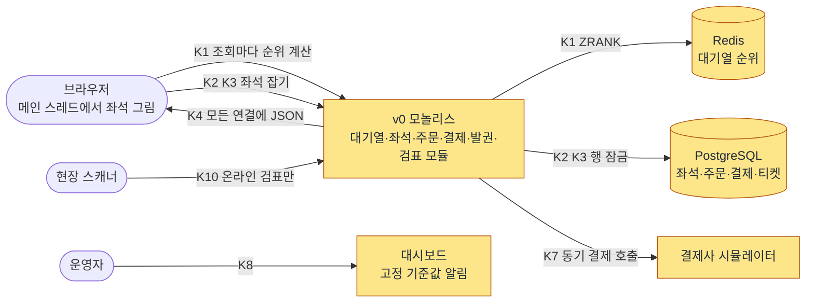

**v0가 깨지는 열 곳**(docs/architecture.md §9.3)

| K | v0가 하는 일 | 드러날 한계 | 고치는 단계 |
| --- | --- | --- | --- |
| K1 | 대기 상태 요청마다 Redis `ZRANK`(정렬된 목록에서 내 순위 세기)로 앞 인원을 계산해 JSON으로 답한다. 폴링 주기는 지금 설계와 같은 0.5·5·20초다 | 원 서버 요청이 대기 인원에 비례한다. 10만 명이면 초당 약 9,300건 | 5 |
| K2 | PostgreSQL `SELECT … FOR UPDATE`(읽은 행을 잠그는 문장)로 좌석을 잡는다 | 경합이 크면 지연이 몇 초로 치솟고 잠금 시간 초과가 난다 | 8 |
| K3 | 클릭한 순서대로 제각각 행을 잠근다 | 서로 엇갈려 잠가 교착(서로의 잠금을 기다리다 멈춤)이 생긴다 | 8 |
| K4 | 바뀐 좌석을 JSON으로 연결된 모든 사람에게 보낸다 | 전송량이 연결 수 × 변경 수로 늘어난다 | 9 |
| K5 | 메인 스레드의 Canvas 한 장에 좌석 객체 배열로 그린다 | 확대·이동 때 긴 작업이 조작을 막는다 | 9 |
| K6 | IP 기반 요청 수 제한만 쓴다 | 여러 IP를 쓰는 봇을 못 막고 사람을 잘못 막는다 | 6 |
| K7 | 서비스 사이 일을 동기 HTTP 호출로 줄줄이 잇는다 | 네트워크가 끊기면 이중 결제나 좌석 누수가 생긴다 | 10 |
| K8 | 단순한 대시보드와 고정 기준값 알림 | 온세일 중 이상을 늦게 알거나 놓친다 | 13 |
| K9 | CPU 사용률로 파드를 늘린다(Kubernetes HPA) | 갑자기 몰리면 파드가 늦게 떠서 장애가 난다 | 12 |
| K10 | 늘 인터넷이 된다고 가정한 온라인 검표 | 공연장 네트워크가 끊기면 입장이 모두 멈춘다 | 14 |

5만 석 전체를 1초마다 보내는 방식(초당 약 10GB)은 계산만으로 실패가 분명해서 v0로도 만들지 않는다(ADR-0096 결정 7). v0는 대기열·좌석·결제와 발권·검표를 만들어 로컬 클러스터에 올렸다(BUILD_ORDER BSL-020~050, 2026-11-03까지. 정본은 각 기능 문서의 'v0 베이스라인' 절). 기준선 측정(BSL-090)도 2026-11-03에 끝났다(실측(PC), docs/verification.md §3.10 '결과', 성능 장부 `2026-11-03-v0-*`).

**트레이드오프: v0를 두는 이유**(ADR-0096)

- **얻는 것**: v0가 '처음 만들 법한 설계'라서 "왜 그 v0인가"에 답할 수 있다. 합격이 v0를 어떻게 만들었는지에 기대지 않는다.
- **치르는 값**: v0와의 차이가 작아져 "99% 줄였다" 같은 큰 숫자를 앞세우지 못한다.
- **버린 길**: v0를 없애고 지금 설계만 재는 길은 버렸다. 단순한 설계가 어디서 무너지는지(K2 잠금 경합, K7 동기 호출의 이중 결제)를 보이는 데 v0가 쓸모 있기 때문이다. "90% 줄인다" 같은 비율 목표도 측정 전에 정할 근거가 없어 두지 않았다.

**꼬리 질문**

| 질문 | 답의 요지 | 근거 |
| --- | --- | --- |
| 허수아비와 비교한 것 아닌가요? | v0는 많은 팀이 처음 고르는 방식이고, 폴링 주기도 지금 설계와 같게 두었다. 합격은 비율이 아니라 목표 숫자로 판정한다 | ADR-0096 결정 5~7 |
| 모놀리스를 역할별로 따로 띄우면 충분하지 않나요? | 같은 코드를 한 프로세스, 역할별 배포, 서비스 10개의 세 구성으로 같은 자원 합계에서 잰다. 11단계에서 다시 말한다 | ADR-0096 결정 4, docs/verification.md §3.8 |
| v0에서 가장 먼저 무너지는 곳은요? | 측정 전이라 정본은 순위를 정하지 않았다. 설계상으로는 K1의 원 서버 요청 증가, K2의 잠금 경합, K7의 이중 결제를 먼저 본다 | docs/architecture.md §9.3 |
| v0보다 몇 % 좋아졌나요? | 보조 숫자로 잰 대로 적고 합격에는 쓰지 않는다 | docs/verification.md §1.4 |

**더 깊이**: [docs/architecture.md](../architecture.md) §9.3 → [ADR-0096](../adr/0096-evidence-design-entry-capacity-split-comparison-v0-baseline.md)(상태 줄 → 결정 4~7 → 검토한 대안) → [docs/verification.md](../verification.md) §1.4·§3.4·§3.8 → [docs/planning/01-overview.md](../planning/01-overview.md) §3.1.

## 5단계. 대기 상태 조회 폭주 막기(K1) `꼭`

> **면접관에게**: "v0에서는 대기자가 물을 때마다 서버가 Redis에서 순위를 셉니다. 10만 명만 돼도 원 서버에 초당 약 9,300건이 옵니다. 그래서 두 가지를 바꿨습니다. 첫째, 순번은 Redis 카운터 하나를 1씩 올려서 주고, 중간에 빠진 번호만 따로 적습니다. 대기자가 '아직 기다린다'는 신호를 보낼 필요가 없습니다. 둘째, 대기 상태는 번호 1,000개마다 파일 하나로 1초마다 만들어 CDN에 둡니다. 같은 구간 1,000명이 같은 파일을 읽고, 내 앞 인원은 브라우저가 파일 안의 숫자로 셉니다. 원 서버 요청은 대기자 수가 아니라 파일 수에 묶여서, 100만 명이어도 초당 약 1,000건입니다."

**단순하게 하면 어디서 깨지나**

- v0는 정렬된 목록(Redis Sorted Set)에 대기자를 넣고, 물을 때마다 `ZRANK`로 순위를 센다. 응답이 사람마다 달라 CDN이 대신 답할 수 없다. 그래서 원 서버 요청이 대기 인원에 비례한다. 10만 명이면 초당 약 9,300건이다(docs/verification.md §3.4).
- 100만 명이면 원소 100만 개짜리 큰 키 하나가 생긴다. Redis 키 하나는 서버 한 대에만 있으므로 여러 서버로 나눌 수 없다(ADR-0002 '맥락').
- '지금 접속해 있는 사람'으로 앞 인원을 세면, 100만 명이 계속 살아 있다는 신호를 보내야 한다(초당 수만 건 쓰기). 재접속하면 순번이 바뀌는 문제도 생긴다(ADR-0002).

**이렇게 고친다**(docs/features/queue-admission.md §3·§4)

- **순번은 카운터로**: 회차마다 `q:{event:E}:seq`를 올려서 준다. 진입 서버 파드마다 2ms `[가정]` 동안 온 진입을 모아 한 번에 `INCRBY`(n 더하기)하고 받은 범위를 나눠 준다(ADR-0179). 한 사람이 순번을 두 개 받지 못하게 사람 식별값(`pid`)으로 먼저 자리를 잡는다.
- **빠진 번호만 적는다**: 취소, 추가 검증으로 격리, 1인 1순번 위반 무효, 재시도로 생긴 빈 번호의 네 경우만 비트맵 `q:{event:E}:removed`에 1비트씩 적는다. 100만 번호가 125KB, 구간 하나(1,000번호)가 125바이트다.
- **대기 상태는 구간 파일로**: 1초마다 구간마다 파일을 하나 만든다. 파일에는 지금 들여보내는 번호의 끝(serving), 차례가 넘어가는 속도, 판매 상태, 누적 빠진 수, 그 구간의 비트맵, 공지가 들어간다. 사람마다 다른 값은 넣지 않는다.
- **앞 인원은 브라우저가 센다**: 앞 인원 = (내 번호 − serving − 1) − (그 사이 빠진 번호 수). 예를 들어 serving이 1,000이고 내 번호가 1,050이며 그 사이 10개가 빠졌으면 39명이다.
- **가까울수록 자주 묻는다**: 차례가 1분 안이면 0.5초, 1~5분이면 5초, 그보다 멀면 20초마다 묻는다. 모두가 같은 순간에 묻지 않도록 간격을 ±20% 흔든다.
- **차례가 임박한 구간만 캐시 만료를 맞춘다**: 차례가 60초 안인 구간 파일(100만 명 기준 2~3개)은 다음 파일을 만드는 시각에 정확히 만료되게 한다. 그래서 "차례가 왔다"가 화면에 p99 2초 안에 보인다(NFR-002). 모형으로 셈한 p99는 약 1.5~1.6초다 `[실측 전]`. 그 밖 구간은 1초 캐시에, 새 파일을 받는 동안 낡은 값을 2초까지 허용한다(`stale-while-revalidate=2`, 정본 표시는 `[보완]`).
- **원본이 죽으면 S3로**: 파일은 CloudFront 배포 `queue-files`로 나간다. 원본은 gw-queue이고, 원본이 오류를 내면 같은 파일을 복사해 둔 S3로 요청마다 넘긴다(ADR-0058).
- **대기실 페이지는 가볍게**: 대기실은 프레임워크 없는 페이지다. 대기실 모형이 압축해 약 2.73KiB이고, React로 만든 가장 작은 화면도 약 66.0KiB다(docs/frontend.md §5.1).
- **오래 연결하지 않는다**: 대기실 100만 명에게는 SSE나 WebSocket처럼 연결을 붙잡아 두는 방식을 쓰지 않는다. 그런 연결은 좌석 화면의 5,000명에게만 쓴다.

**그림: 대기실**

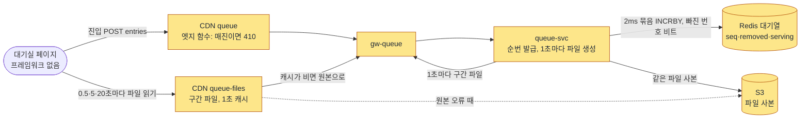

**트레이드오프**

| 정한 것 | 얻는 것 | 치르는 값 |
| --- | --- | --- |
| 카운터 + 빠진 번호 비트맵 | 기다리는 동안 쓰기가 없다. 재접속해도 순번이 그대로다(NFR-025) | 응답을 잃은 번호 몫만큼 앞 인원에 작은 오차가 남는다 |
| 구간 파일 + CDN | 원 서버 요청이 파일 수에 묶인다(초당 약 1,000건) | 먼 구간은 약 20초(±20% 흔들기로 24초에 파일 생성 1초, 캐시 1초, 낡은 값 허용 2초를 더하면 최대 약 28초) 늦게 바뀐다. 그래서 반영 약속(NFR-002)을 차례가 임박한 사람 기준으로 정했다. CDN 요금이 요청 수에 비례한다(100만 명 70분에 약 273달러) |
| 임박 구간 0.5초 폴링 | 차례 반영 p99 2초를 지킬 수 있다 | CDN 요청이 약 3% 는다 |

**버린 길**

- Sorted Set + `ZRANK`: 사람마다 응답이 달라 캐시할 수 없고, 큰 키 하나를 나눌 수 없다(ADR-0002).
- 대기실에 SSE: 100만 개의 지속 연결을 붙잡으려면 입구 서버 파드가 50~100개 넘게 필요하고, 파일 디스크립터와 로드밸런서 연결 한도를 크게 잡아야 한다. 뒤쪽 대기자에게 1초 미만 갱신은 낭비다(ADR-0003 '맥락').
- 임박 구간 파일을 캐시하지 않기: 원 서버 요청이 초당 약 3,400건 는다(ADR-0110 '검토한 대안').
- 약속을 p99 3초로 낮추기: CDN 요청 약 3%로 2초를 지킬 수 있어서 낮추지 않았다(ADR-0110).

**꼬리 질문**

| 질문 | 답의 요지 | 근거 |
| --- | --- | --- |
| 왜 서버가 밀어 주지 않고 폴링하나요? | 100만 지속 연결은 입구 서버와 연결 한도를 크게 늘려야 하고, 뒤쪽 대기자에게는 실시간 갱신이 필요 없다. Cloudflare와 AWS의 대기실 제품도 폴링한다 | ADR-0003 |
| 모두 같은 파일인데 내 앞 인원이 정확한가요? | 파일 안의 serving, 누적 빠진 수, 구간 비트맵으로 브라우저가 센다. 파일 시점(최대 1초 전) 기준으로 맞다 | docs/features/queue-admission.md §4 |
| 1초 캐시인데 2초 안에 차례를 아나요? | 임박 구간은 다음 파일 생성 시각에 맞춰 만료시키고 0.5초마다 묻는다. 지연 예산을 더한 모형 p99가 약 1.5~1.6초다 | ADR-0110 결정 1·2 |
| CDN이나 원본이 죽으면요? | S3 사본으로 넘기고, 파일 안의 폴링 힌트로 폴링을 두 배로 늦춘다. 그때 약속은 p99 5초로 완화한다 | docs/features/queue-admission.md §9 |
| 대기열 Redis가 장애 나면요? | 새 서버로 넘어갈 때 카운터를 넉넉히 건너뛰고 세대 번호를 올린다. 건너뛴 구간은 빠진 번호로 센다 | docs/features/queue-admission.md §3·§9 |
| 매진을 남은 97만 명에게 어떻게 알리나요? | 엣지 함수가 새 진입을 410으로 끝내고, 파일의 판매 상태가 매진으로 바뀐다. 먼 구간도 다음 폴링(최대 약 28초)에 안다 | docs/features/queue-admission.md §8 |
| 원 서버 요청을 몇 % 줄였나요? | 비율은 보조 숫자다. 합격 기준은 원 서버 요청이 설계 식(활성 파일 수 ÷ 캐시 수명)의 ±10% `[가정]` 안에 드는 것이다 | docs/planning/01-overview.md §3.1 K1 |

**더 깊이**: [docs/features/queue-admission.md](../features/queue-admission.md) §3·§4·§8·§9 → [ADR-0002](../adr/0002-queue-sequence-incr-over-sorted-set.md) → [ADR-0003](../adr/0003-waiting-room-adaptive-polling.md)(본문의 1초 폴링은 옛 판, 상태 줄을 먼저) → [ADR-0110](../adr/0110-latency-budgets-nfr002-nfr004-aligned-expiry-100ms-batches-ms-clock.md) → [ADR-0058](../adr/0058-cdn-distributions-quotas-and-shuffle-fetch-spread.md) → [docs/frontend.md](../frontend.md) §5.1. 분야 편 9 '대기열·입장'이 이어 받는다.

## 6단계. 정각 진입 몰림, 공정성, 봇(K6) `꼭`

> **면접관에게**: "오픈 정각에는 두 문제가 겹칩니다. 한꺼번에 몰리는 부하와, 밀리초 단위의 속도 경쟁입니다. 속도 경쟁은 매크로 봇이 이깁니다. 그래서 기본 설정에서는 오픈 10분 전에 로비를 열고, 순번 없는 참가 토큰만 줍니다. 오픈 순간 참가자 목록을 고정하고 무작위로 섞어 순번을 정합니다. 섞는 데 쓰는 비밀 값의 해시를 미리 공개하고, 미리 정해 둔 시각의 공개 난수를 함께 써서, 운영자도 결과를 미리 알거나 바꿀 수 없습니다. 오픈 뒤 처음 2초 안에 온 사람도 한 묶음으로 섞습니다. 봇 판정과 사람 확인은 로비와 사전 검증에서 미리 끝내서, 오픈 순간의 경로에는 외부 호출이 없습니다. 순번을 받기 전에 휴대폰 본인확인을 마쳐야 하고, 한 사람은 순번 하나만 받습니다."

**단순하게 하면 어디서 깨지나**

- **순수 선착순**: 오픈 순간 몰림이 가장 크고(20만 RPS), 속도가 빠른 매크로와 네트워크·기기 성능 차이에 그대로 진다. 여러 탭을 열어 요청을 늘리게 만든다(ADR-0012 '검토한 대안').
- **IP로 막기(v0의 K6)**: 여러 IP를 돌려 쓰는 봇은 못 막는다. 반대로 휴대폰 통신사, 공연장·학교·회사 와이파이는 많은 사람이 IP 하나를 나눠 쓰므로 사람이 함께 막힌다(docs/features/queue-admission.md §7).
- **오픈 순간 사람 확인**: 오픈 순간 몰린 요청이 모두 외부 사람 확인 서버를 부르게 되어 그 자체가 병목이 된다(ADR-0041 '검토한 대안').

**이렇게 고친다**

- **정렬 설정은 두 스위치**: 회차마다 '로비 셔플'과 '오픈 직후 묶음'을 켜고 끈다. 둘 다 켜면 하이브리드(기본), 로비 셔플만 켜면 사전 셔플, 묶음만 켜면 선착순이다. 둘 다 끄는 조합은 받지 않는다(ADR-0118, POL-003).
- **로비(오픈 10분 전)**: `POST /v1/queues/{eventId}/lobby-participants`로 들어오면 사람 확인과 봇 판정을 하고, 순번 없는 참가 토큰을 준다. 로비 화면에는 순번을 떠올리게 하는 숫자를 보이지 않는다(POL-004). 로비가 열리는 순간 몰리지 않도록 [로비 입장] 버튼을 기기마다 0~60초 `[가정]` 사이에 다르게 연다.
- **오픈 순간 섞기**(docs/features/queue-admission.md §2, POL-005)

  | 차례 | 하는 일 | 왜 |
  | --- | --- | --- |
  | 오픈 전 | 섞는 데 쓸 비밀 값(시드)의 해시를 공연 상세에 공개한다 | 나중에 시드를 바꾸지 못하게 미리 봉인한다 |
  | 오픈 순간 | 참가자 목록을 고정하고, 목록 전체를 대표하는 해시(머클 루트)를 공개한다 | 목록에 누구를 넣고 빼지 못하게 한다 |
  | 오픈 직후 | 미리 공시한 회차의 공개 난수(drand: 여러 기관이 함께 만드는 공개 난수)를 기다린다. 오픈에서 3초 넘게 뒤의 첫 회차다 `[가정]` | 운영자도 결과를 미리 계산할 수 없게 한다 |
  | 섞기 | 시드, 공개 난수, 머클 루트, 회차 ID를 합친 해시로 Fisher–Yates(목록을 고르게 섞는 표준 방법)를 돌린다. 100만 명에 수십 ms다 | 같은 입력이면 누구나 같은 결과를 얻는다 |
  | 게시 | 결과를 토큰 해시 앞자리별 파일 약 1,000개(각 약 36KB)로 CDN에 올린다. 브라우저는 0~8초 `[가정]`에 나눠 받는다 | 100만 명이 한꺼번에 받지 않게 한다(초당 약 12.5만 건, 약 36 Gbps) |
  | 오픈 60분 뒤 | 시드 원본을 공개한다. 셔플 검증 화면(SCR-019)에서 누구나 다시 계산해 본다 | 조작이 없었음을 보인다 |

- **오픈 직후 묶음**: 오픈 전에 사전 검증 토큰을 받아 둔 사람이 오픈 뒤 2초 `[가정]` 안에 오면, 도착 순서가 아니라 한 묶음으로 섞는다. 그 뒤에 온 사람은 도착 순이다(ADR-0041). 2초는 '사람 도착 시각의 p90이 들어가는 길이'로 정했다(모형 p90 약 0.95초).
- **순번 전 본인확인**: 모든 정렬 방식에서 순번을 받기 전에 휴대폰 본인확인을 한다. 계정당 한 번이고, 본인확인 기관이 주는 사람 고유 값(CI)을 키로 섞은 값(HMAC)을 계정에 묶는다. 1인 1순번은 이 사람 식별값으로 지킨다(ADR-0006). 오픈 순간에는 입구 서버가 토큰의 구매 권한만 확인하고 외부를 부르지 않는다.
- **봇 판정**(docs/features/bot-defense.md §2·§4): trust-svc가 로비 입장, 사전 검증, 로그인, 추가 검증 제출 때 판정한다. 로비 입장과 사전 검증에서는 점수기 여섯(사람 확인, 기기 신뢰, 행동, 네트워크, 계정 나이, 일관성)의 가중합으로 '통과(ALLOW)'나 '추가 검증(CHALLENGE)'만 낸다. 차단은 없다. 추가 검증 제출 때는 사람 확인만 다시 본다. 가중합을 다시 하면 같은 근거로 또 걸려 원래 순번으로 돌아올 수 없기 때문이다(bot-defense §3.1). 추가 검증이 나오면 순번은 그대로 두고 그 번호를 잠시 빠진 번호로 돌린다. 다시 통과하면 원래 순번으로 돌아온다(POL-006).
- **기다리는 동안 다시 보기**: 판정을 통과한 뒤에도 작업자 `trust-reassess`가 행동 신호를 보고 여러 계정 사이 패턴을 찾는다. 예를 들어 같은 기기에서 10분 안에 서로 다른 사람 5명 이상, 같은 행동 요약을 가진 사람 20명 이상이다 `[가정]`. 처음에는 기록만 하는 그림자 모드로 시작하고, 격리는 10분에 대기 인원의 0.5% `[가정]`까지만 한다(docs/streaming.md §5).

**그림: 오픈 순간**

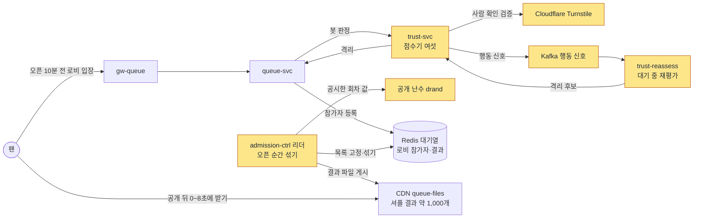

**트레이드오프**

| 정한 것 | 얻는 것 | 치르는 값 |
| --- | --- | --- |
| 로비 셔플 | 로비 안에서는 언제 왔든 순번이 같다. 로비 참가자는 오픈 순간 진입 요청을 보내지 않아 기본 피크가 약 4.8만 RPS로 준다 | 순번을 늦게 받는 사람은 최대 8초 자기 순번을 모른다. 매진까지 최대 약 8초(게시가 늦으면 약 21초) 는다 |
| 미리 봉인한 시드 + 공개 난수 | 운영자도 결과를 미리 알거나 바꿀 수 없고, 누구나 다시 계산한다 | 외부 공개 난수에 기대고, 검증 파이프라인을 운영해야 한다 |
| 오픈 직후 묶음 | 선착순 공연에서도 밀리초 경쟁이 사라진다. 봇도 오픈 전에 기기마다 사람 확인을 거쳐야 한다 | 선착순 공연은 오픈 뒤 약 14~21초 `[가정]` 동안 아무도 입장하지 못한다 |
| 순번 전 본인확인 | 여러 계정으로 확률을 늘리는 일을 실제 사람 수로 막는다 | 처음 사는 사람에게 단계가 하나 는다. 본인확인 업체가 멈추면 아직 인증하지 않은 사람의 진입이 막힌다. 남의 명의를 빌린 경우는 남는다 |

**버린 길**: 사전 셔플 하나만(오픈 뒤에 온 사람의 기회를 없애고, 추첨 조작 의혹 민원이 생긴다), 오픈 시각을 예고 없이 무작위로 늦추기(기준점만 밀린다), 결제 단계에서 본인확인(인증하지 않은 다계정이 순번과 입장 자리를 먼저 차지한다)(ADR-0012·0041·0006 '검토한 대안').

**꼬리 질문**

| 질문 | 답의 요지 | 근거 |
| --- | --- | --- |
| 일찍 온 사람이 뒷번호를 받으면 불공정하지 않나요? 조작은요? | 로비 안에서는 무작위라고 미리 알린다("일찍 들어와도 유리하지 않습니다"). 시드 봉인, 머클 루트, 공시한 공개 난수, 시드 공개로 누구나 다시 계산한다 | POL-004·005 |
| 오픈 순간 사람 확인을 하면 되지 않나요? | 몰린 요청이 모두 외부 서버를 부르게 된다. 사전 검증 토큰(15분)으로 미리 끝내고, 오픈 순간에는 서명만 본다 | ADR-0041 |
| 선착순 공연은 매크로가 밀리초로 이기지 않나요? | 오픈 직후 2초 `[가정]` 안의 도착은 한 묶음으로 섞는다. 묶음 안 순번과 도착 시각의 상관이 거의 없는지(\|ρ\| ≤ 0.05 `[가정]`) 시험한다. 2초 뒤에는 도착 순서가 다시 차이를 만든다 | ADR-0041, docs/features/queue-admission.md §11 Q-T23 |
| 공개 난수가 늦게 오면요? | 상한 60초 `[가정]`을 넘기면 셔플을 멈추고 가장 높은 등급 장애로 다룬다. 비상 셔플은 서로 다른 commander 두 명이 서명해야 하고, 실행하면 '내부자가 결과를 미리 알 수 있었다'는 한계를 공시한다 | docs/features/queue-admission.md §2, POL-005 |
| 봇 판정 서버가 죽으면요? | 진입을 막지 않는다. queue-svc가 캐시한 규칙(기기·사람마다 10초에 5회 `[가정]`)으로 이어 간다. 가용성을 봇 방어보다 먼저 둔 결정이다 | docs/features/bot-defense.md §11 |
| 봇 탐지 목표는 얼마인가요? | 1·2단계 봇은 95% 이상 잡고, 사람을 봇으로 잘못 보는 비율은 95% 신뢰 상한으로 0.5% 이하다. 다만 출시 첫 온세일에는 행동 점수의 가중치를 0으로 두고 그림자로만 본다. "행동으로 봇을 막는다"고 단정하지 않는다 | NFR-022, docs/features/bot-defense.md §10.1 |

**더 깊이**: [docs/planning/03-policies-glossary.md](../planning/03-policies-glossary.md) §1(POL-001~006) → [docs/features/queue-admission.md](../features/queue-admission.md) §1·§2·§3·§7 → [ADR-0012](../adr/0012-queue-ordering-hybrid-shuffle-default.md) → [ADR-0041](../adr/0041-fifo-speed-bot-countermeasures.md) → [ADR-0118](../adr/0118-queue-ordering-two-settings-lobby-shuffle-open-batch.md) → [ADR-0006](../adr/0006-ticket-buyer-identity-verification-before-queue.md) → [docs/features/bot-defense.md](../features/bot-defense.md) §2·§4·§5·§8·§11. 분야 편 9 '대기열·입장'과 14 '봇 방어'가 이어 받는다.

## 7단계. 몇 명씩 들여보낼까 `꼭`

> **면접관에게**: "좌석과 결제 쪽의 부하는 대기 인원이 아니라 '좌석 화면에 동시에 들일 인원' 하나로 정합니다. 처음 값은 5,000명입니다. admission-ctrl의 리더 하나가 200ms마다 빈자리를 세고, 지금 들여보낼 번호의 끝을 그만큼 올립니다. 차례가 와도 안 오는 사람이 있으니 실제로 온 비율로 나눠 더 부르고, 이미 불렀지만 아직 오는 중인 사람은 빼고 셉니다. 자리는 차례가 온 사람이 첫 예매 요청을 보낼 때만 잡기 때문에, 안 오는 사람은 자리를 차지하지 않습니다. 뒤쪽이 느려지면 목표를 바로 절반으로 줄이고, 괜찮으면 30초마다 2%씩 천천히 늘립니다."

**단순하게 하면 어디서 깨지나**

정본의 v0 표(K1~K10)에는 입장 조절만 따로 다룬 줄이 없다. 대신 결정 기록이 버린 길에서 단순한 방식들이 깨지는 곳을 볼 수 있다.

- **부른 번호가 모두 자리를 차지한다고 보기**: 차례가 왔는데 오지 않는 사람의 자리가 만료될 때까지 빈 채로 돈다. 전체 입장 속도가 떨어진다(ADR-0005 '검토한 대안').
- **빈자리를 매번 다시 세기만 하기**: 부른 사람이 1.5~3초 뒤에 오는 동안 루프가 같은 빈자리를 7~15번 다시 센다. 모의 계산에서는 '곧 입장' 응답이 수만~수십만 건 생겼다(측정 아님)(ADR-0104 '맥락').
- **대기자에게 '준비됐다' 신호를 받기**: 대규모 쓰기가 생기고, 브라우저가 숨긴 탭의 타이머를 늦춰 정상 사용자가 빠진다(ADR-0005).

**이렇게 고친다**(docs/features/queue-admission.md §5·§6)

- **200ms 루프**: 리더가 주기마다 이렇게 센다.
  - 빈자리 = 동시 입장 목표 − 차 있는 자리 − 곧 입장 대기 − 오는 중
  - 올릴 번호 수 = 빈자리 ÷ max(입장 비율, 0.2)
  - 입장 비율 = 불린 지 10~60초 `[가정]` 지난 번호 가운데 실제로 입장 확정을 요청한 비율
  - 전진 속도 상한 = min(초당 1,000번호 `[가정]`, 결제사 상한). 토스페이먼츠 300 TPS 추정이면 초당 300번호라 5,000자리를 채우는 데 약 17초다.
- **입장 확정**: 브라우저가 파일에서 "내 번호 ≤ serving"을 보면 `POST /v1/queues/{eventId}/admission`을 보낸다. queue-svc가 대기표 서명, 차례가 지났는지, 빠진 번호가 아닌지, 차례 뒤 15분 안인지, 1인 1순번인지를 본다. 자리가 있으면 입장 토큰(첫 사용 기한 5분)을 주고, 없으면 200 `SOON`으로 '곧 입장 대기열'에 번호 순으로 세운다.
- **구매 세션은 purchase-svc가 가진다**: 입장 토큰을 처음 쓰면(좌석 스냅샷 요청) 구매 세션이 시작된다. 시작과 끝은 이벤트로 Kafka(`trade.purchase-sessions`)를 거쳐 queue-svc에 알린다. 끝나면 자리를 바로 비운다. 최대 체류는 45분, 무활동은 5분이다(POL-009).
- **AIMD로 목표 조절**: AIMD는 조금씩 늘리고 크게 줄이는 방식이다(인터넷의 TCP 혼잡 제어와 같은 원리). 입력은 뒤쪽(purchase-svc, 데이터베이스)의 p99와 오류율이다. 30초 창마다 정상이면 처음 목표의 2%(100명) `[가정]`를 더하고, 나빠지면 바로 50%를 줄인다. 에러 버짓(약속한 오류 허용량)이 빨리 닳는다는 경보가 와도 절반으로 줄인다. 다만 입장 목표가 부하를 정하는 여정(좌석 잡기, 좌석 변경 전파, 결제 접수, 결제 확정)의 허용량일 때만이다(ADR-0126, 13단계).
- **줄인 뒤 기다린다**: 이미 들어온 사람이 평균 3분 머물러 효과가 늦게 나타난다. 그래서 줄인 뒤에는 좌석 화면 인원이 새 목표 아래로 내려오고 35초 `[가정]`가 지나거나, 줄인 지 2분 `[가정]`이 지날 때까지 더 줄이지 않는다.
- **입력이 없으면 그대로**: 지표를 못 읽으면 늘리지도 줄이지도 않고 운영자에게 알린다(ADR-0069).
- **안전 한계(POL-010)**: 전진 속도 상한, 목표의 상한 min(8,000명, 결제사 상한)과 하한은 설정 파일에 고정해 배포로만 바꾼다. 운영자 명령으로도 넘을 수 없다.
- **리더가 둘이 되지 않게**: 쿠버네티스 Lease(지금 리더가 누구인지 적는 표시)로 리더를 뽑고, 리더가 바뀔 때마다 오르는 세대 번호를 Redis 쓰기마다 Lua(Redis 안에서 한 번에 실행되는 짧은 스크립트)로 비교한다. 낮은 세대의 쓰기는 거절한다(ADR-0056).
- **매진**: purchase-svc가 판정하면(남은 좌석, 잡힌 좌석, 결제 중인 판매가 모두 0) 이벤트로 알리고, 엣지와 원본이 새 진입을 410으로 끝낸다. 결제 중인 좌석만 남은 '일시 매진'에는 대기를 끝내지 않고 입장만 멈춘다(ADR-0122).

**그림: 입장 조절**

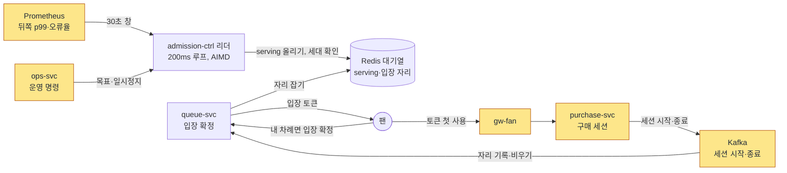

**트레이드오프**

| 정한 것 | 얻는 것 | 치르는 값 |
| --- | --- | --- |
| 동시 입장 목표 하나로 부하를 정함 | 대기자가 200만 명으로 늘어도 좌석·결제·데이터베이스 부하는 그대로다 | 매진 시간이 입장 속도에 묶인다(이론 약 18분) |
| 첫 예매 요청에서만 자리를 잡음 | 실제로 온 사람에게만 쓰기가 생기고(초당 100건 미만), 안 오는 사람이 자리를 독점하지 않는다 | 비율 예측이 빗나가면 잠시 넘치거나 자리가 논다 |
| 오는 중·곧 입장 대기를 빼고 셈 | 모의에서 '곧 입장' 응답이 0건이 되고, 번호 순 약속(POL-008)을 지킨다 | 안 오는 사람 몫의 자리가 몇 초 빈다. 모의에서 입장 수가 약 0.6~1.5% 준다(측정 아님) |
| 세대 번호로 리더 쓰기를 막음 | 리더가 바뀌어도 serving이 하나로 이어진다 | 리더 공백(Lease 15초 `[가정]`) 동안 전진이 멈춘다 |

**꼬리 질문**

| 질문 | 답의 요지 | 근거 |
| --- | --- | --- |
| 차례가 왔는데 브라우저를 닫은 사람은 자리를 차지하나요? | 아니다. 자리는 첫 예매 요청에서만 잡는다. 15분 안에 오면 다음 빈자리로 들어가고, 넘으면 다시 줄을 서야 한다 | ADR-0005, POL-008 |
| 부른 사람이 1~3초 뒤에 오는 동안 같은 자리를 또 부르지 않나요? | '오는 중'을 빼고 센다. 예를 들어 빈자리 80, 비율 80%면 100번호를 올리고, 그 사람들이 오기 전 다음 주기에는 더 올리지 않는다 | ADR-0104, Q-T8 |
| 리더가 동시에 둘이 되면요? | Lease만으로는 한순간 리더 하나를 보장하지 못한다. 그래서 쓰기마다 세대 번호를 비교해 옛 리더를 막는다 | ADR-0056 |
| 결제사 한도가 입장 인원을 정하나요? | 첫 물결은 전진 속도를, 정상 상태는 목표를 묶는다. 토스페이먼츠 추정치로는 결제사 상한이 2.7만 명이라 5,000명을 묶지 않는다 | docs/features/queue-admission.md §5 |
| 대기열 Redis 장애로 1인 1순번 기록을 잃으면요? | 같은 사람이 한 번 더 줄을 설 수 있다. 그래도 1인 매수 한도는 판매 확정 때 데이터베이스(`purchase_quota`)가 지킨다 | docs/features/queue-admission.md §3·§9 |

**더 깊이**: [docs/architecture.md](../architecture.md) §9.1('좌석 예매 입장 속도' 행, 결제사 문단) → [docs/planning/03-policies-glossary.md](../planning/03-policies-glossary.md) §1(POL-008·009·010·015) → [docs/features/queue-admission.md](../features/queue-admission.md) §5·§6·§8 → [ADR-0005](../adr/0005-admission-confirmed-by-first-booking-request.md)(상태 줄 먼저) → [ADR-0104](../adr/0104-admission-loop-in-flight-and-ordered-soon-queue.md) → [ADR-0056](../adr/0056-admission-leader-fencing-and-admission-person-recheck.md) → [ADR-0122](../adr/0122-event-sale-status-all-held-sold-out-reopen.md).

## 8단계. 같은 좌석을 두 번 팔지 않기(K2·K3) `꼭`

> **면접관에게**: "좌석은 두 단계로 지킵니다. 좌석을 고르는 순간에는 좌석 전용 Redis에서 Lua 스크립트 하나가 '좌석이 비었는지'와 '1인 한도 안인지'를 한 번에 확인하고, 둘 다 맞을 때만 잡습니다. 그래서 p99 50ms 안에 답하고, 이 단계에서는 데이터베이스에 쓰지 않습니다. 결제사 승인 바로 앞에서는 PostgreSQL에 판매 행을 넣는데, '좌석 하나에 살아 있는 판매 행은 하나만'이라는 부분 유니크 인덱스가 마지막으로 막습니다. Redis가 고장 나서 잡아 둔 기록을 잃어도 두 번 팔리지는 않습니다. 진 사람은 승인 전에 걸러지니 돈도 나가지 않습니다."

**단순하게 하면 어디서 깨지나**

- **K2**: v0는 PostgreSQL `SELECT … FOR UPDATE`로 좌석 행을 잠근다. 인기 좌석 하나에 1,000명이 몰리면 잠금 대기가 쌓여 p99가 몇 초로 치솟고 잠금 시간 초과가 난다(ADR-0014 '검토한 대안').
- **K3**: 여러 좌석을 클릭한 순서대로 잠그면, A는 1→2번, B는 2→1번 순으로 잠그다가 서로를 기다리며 멈춘다(교착).
- **Redis만으로 확정**: 빠르지만, Redis가 예비 서버로 넘어가는 동안 마지막 쓰기를 잃을 수 있다. 그러면 같은 좌석이 두 번 팔릴 수 있다.
- 부하는 피크 초당 2,000건, 인기 좌석 하나에 1,000명 경합이고, 목표는 p99 50ms·p99.9 150ms·오버셀(같은 좌석이 두 사람에게 팔리는 일) 0건이다(NFR-003).

**이렇게 고친다**(docs/features/seat-hold.md)

- **좌석 잡기(Soft Hold)**: purchase-svc가 좌석 Redis에서 `hold.lua`를 부른다. 회차의 키는 모두 같은 서버(샤드)에 있다.
  - 확인: 요청 좌석의 비트가 모두 0인가(5만 석 비트맵이 약 6.25KB다), 지금 보유 수 + 요청 수 ≤ 1인 한도인가.
  - 쓰기: 둘 다 맞을 때만 비트를 켜고, 홀드 정보·만료 시각·보유 수를 적고, 홀드 이력을 Redis Stream(Redis 안의 사건 목록)에 덧붙인다.
  - Redis(Valkey)에는 이미 한 쓰기를 되돌리는 기능이 없다. 그래서 '실패하면 되돌린다'가 아니라 '확인을 모두 통과한 뒤에만 쓴다'로 한 번에 처리한다.
  - 같은 스크립트가 멱등 키, 판매 일시정지, 회차 준비 상태도 함께 본다.
- **펜싱 토큰**: 홀드마다 회차 안에서 계속 커지는 번호를 붙인다. 늦게 도착한 옛 사건이 최신 상태를 덮어쓰지 못하게, 원장 적재와 좌석 변경 전파가 더 작은 번호를 버린다.
- **홀드 수명**: 7분이고 한 번 3분 연장할 수 있다(POL-012). 만료된 좌석은 1초 `[가정]`마다 거둬 p99 3초 안에 다시 보이게 한다(NFR-025).
- **판매 확정(Hard Sale)**: 결제 접수가 202로 답한 직후, 주문 Saga(10단계)가 한 트랜잭션에서 이렇게 한다.
  - `seat_sale`에 좌석마다 `PENDING` 행을 넣는다. 여러 좌석이면 좌석 ID 오름차순으로 넣는다. 그래서 두 주문이 같은 좌석들을 엇갈린 순서로 잡지 않는다(K3).
  - `purchase_quota`를 '사용 수 + n ≤ 한도'일 때만 늘린다. 1인 한도를 두 번째로 확인하는 곳이다.
  - 같은 트랜잭션에 Outbox(나중에 보낼 사건을 같은 데이터베이스에 함께 적는 표, 10단계)를 적는다.
- **마지막 방어선**: `seat_sale`에 `UNIQUE (event_id, seat_id) WHERE status IN ('PENDING','SOLD')` 부분 유니크 인덱스가 있다. 같은 좌석의 두 번째 행은 데이터베이스가 거절한다. 예매를 취소해 `RETURNED`가 된 좌석은 조건에서 빠지므로 다시 팔 수 있다.
- **이긴 쪽만 승인**: 행을 넣는 데 성공한 주문만 결제사 승인을 부르고, 승인되면 `SOLD`로 바꾼다. 유니크 위반이 나면 승인을 부르지 않고 주문을 실패로 끝낸다. 돈이 나가지 않는다.
- **홀드 기록은 나중에**: 홀드 이력은 Redis Stream → 릴레이 → Kafka `trade.seats` → PostgreSQL `seat_hold` 순서로 비동기로 싣는다. 좌석을 잡는 길에서는 데이터베이스에 쓰지 않는다.
- **불변식 검사**: 판매 좌석 수 ≤ 전체 좌석 수, 좌석당 살아 있는 판매 행 정확히 1건, 사람마다 보유 수 ≤ 한도를 검사한다. 오버셀이 의심되는 일이 1건이라도 있으면 가장 높은 등급 장애(SEV1)다.

**p99 50ms 예산**(docs/features/seat-hold.md §8)

| 구간 | 예산 |
| --- | --- |
| 입구 서버(gw-fan) | 3ms |
| 네트워크 왕복 | 5ms |
| 구매 세션 요청 인증 | 1ms `[가정]` |
| Redis 왕복 | 7ms(스크립트 실행 자체는 p99 0.1ms 이하 `[가정]`) |
| 직렬화 | 5ms |
| 여유 | 29ms |

**좌석 Redis가 고장 나면**(ADR-0121)

- 예비 서버로 넘어가는 동안 그 회차의 구매 요청을 503 `seat-store-unavailable`과 `Retry-After: 2` `[가정]`로 미룬다. 미루는 시간의 목표는 장애 조치마다 30초 이하다(NFR-015).
- 동시에 admission-ctrl이 그 회차의 동시 입장 목표를 절반으로 줄인다(7단계).
- 회복하면 회차 세대 번호를 올려, 화면들이 좌석 상태를 처음부터 다시 맞추게 한다(9단계).
- 예전에는 Redis 장애 때 PostgreSQL로 좌석을 잡는 비상 경로가 있었다. 2026-10-28에 없앴다. 그래서 좌석을 잡아 주는 곳은 늘 하나다.

**그림: 좌석**

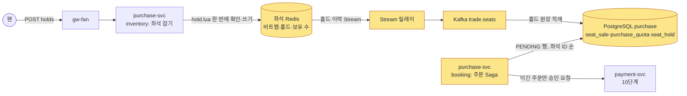

**트레이드오프**

| 정한 것 | 얻는 것 | 치르는 값 |
| --- | --- | --- |
| Redis에서 잡고 PostgreSQL에서 확정 | 좌석을 잡는 길에 데이터베이스 쓰기가 0건이라 p99 50ms를 맞춘다. 오버셀 0은 데이터베이스 제약이 격리 수준과 관계없이 지킨다 | Lua, 펜싱 토큰, 이력 릴레이를 운영해야 하고 불변식 검사기를 계속 돌려야 한다 |
| 승인 앞에서 판매 행을 넣음 | 경합에서 진 주문은 승인 전에 걸러져 취소·환불이 생기지 않는다 | Redis가 원장에 적기 전의 홀드를 잃으면, 같은 좌석을 고른 두 사람 중 한 명은 결제창 인증 뒤에 실패 안내를 받는다(돈은 나가지 않는다) |
| 장애 조치 동안 구매를 미룸 | 홀드를 주는 곳이 늘 하나라 이중 홀드가 없다. 평소 도는 경로만 남는다 | 장애 조치 동안(보통 몇 초, 목표 30초) 그 회차 구매가 멈춘다. 온세일 중이면 그 회의 오류 허용량(약 75건)을 넘긴다 |
| 회차 하나를 샤드 하나에 | 스크립트 하나로 그 회차를 한 번에 다룬다 | 샤드 처리량이 상한이다. 여러 회차가 한 샤드에 겹친 최악(초당 약 6,000건)은 기반 PoC에서 오버셀 0으로 받았지만 SLOWLOG(오래 걸린 명령 기록) 기준을 3회 중 1회 넘어, 큰 회차를 서로 다른 주 노드에 두는 배치 규칙을 둔다(ADR-0176 결정 3) |

**버린 길**

| 길 | 버린 이유 |
| --- | --- |
| PostgreSQL `SELECT … FOR UPDATE`로 잡기(v0) | 경합 때 p99 몇 초, 잠금 시간 초과, 엇갈린 순서의 교착(ADR-0014) |
| Redis만으로 확정 | 장애 조치 때 쓰기를 잃으면 오버셀이 생길 수 있다(ADR-0014) |
| CockroachDB 분산 트랜잭션 | 한 리전이고 쓰기가 적어 필요 없다(ADR-0021) |
| Redis 장애 때 PostgreSQL 비상 경로 | 마지막 몇 초의 홀드는 Redis만 알아서 같은 좌석을 또 준다. 파드마다 넘어가는 시점이 달라 두 곳이 동시에 좌석을 준다. 1년에 몇 번 도는 두 번째 구현이 남는다(ADR-0121) |
| 복제 확인(`WAIT`) 뒤 답해서 잃는 쓰기를 없애기 | `WAIT`는 복제를 보장하지 않는다. 시간이 지나면 확인 없이 돌아온다. 잃는 쓰기를 줄일 뿐이다(ADR-0121) |

**꼬리 질문**

| 질문 | 답의 요지 | 근거 |
| --- | --- | --- |
| Redis가 잡아 둔 좌석을 잃으면 두 사람이 같은 좌석을 결제하나요? | 아니다. 결제 접수 뒤 판매 행을 넣을 때 부분 유니크 인덱스에 걸려 한 명만 남는다. 진 사람은 승인 전이라 돈이 나가지 않는다 | docs/architecture.md §1, docs/features/seat-hold.md §6 |
| 장애 조치 동안 DB로 좌석을 주면 가용성이 낫지 않나요? | 마지막 몇 초의 홀드는 Redis만 알아서 DB 경로가 같은 좌석을 또 준다. 몇 초 미루는 쪽을 골랐다 | ADR-0121 |
| 여러 좌석을 잡을 때 교착은요? | Redis의 스크립트는 샤드에서 하나씩 차례로 돌아 서로 기다리지 않는다. DB는 좌석 ID 오름차순으로 넣는다. 교착 0건을 시험으로 잰다 | docs/features/seat-hold.md §3·§6·§12 S-T10 |
| 여러 탭으로 1인 한도를 넘길 수 있나요? | 같은 샤드의 스크립트가 한 계정의 요청을 차례로 처리하고, 판매 확정 때 `purchase_quota`가 한 번 더 막는다 | docs/features/seat-hold.md §4 |
| 50ms는 어디서 나왔나요? | 좌석 잡기가 자주 실패하면 판매 기회를 잃는다는 이유로 스스로 정한 목표다(NFR-003). 위 표는 그 목표를 구간별로 나눈 예산이고, 그중 요청 인증 1ms는 가정이다 | docs/planning/02-requirements.md §3.2, docs/features/seat-hold.md §8 |

**더 깊이**: [docs/architecture.md](../architecture.md) §1('2단계 일관성 모델') → [docs/features/seat-hold.md](../features/seat-hold.md) §1·§3·§4·§5·§6·§8·§9 → [ADR-0121](../adr/0121-seat-redis-failover-defer-purchase-drop-db-hold-path.md) → [docs/data.md](../data.md) §3·§4·§5 → [ADR-0014](../adr/0014-soft-hold-hard-sale.md)(본문의 비상 경로·예산은 옛 판이다. 상태 줄을 먼저 본다). 분야 편 10 '좌석'과 DB 설계 편 4가 이어 받는다.

## 9단계. 좌석 변경을 실시간으로 알리기(K4·K5) `시간 남으면`

> **면접관에게**: "좌석 화면의 5,000명에게는 다른 사람이 잡은 좌석이 바로 보여야 합니다. 5만 석 전체를 1초마다 보내면 초당 약 10GB라 불가능합니다. 그래서 좌석 화면에 들어올 때 좌석 전체를 비트맵 스냅샷으로 한 번 받고, 그 뒤에는 바뀐 좌석만 받습니다. 그것도 지금 확대해서 보고 있는 구역만 구독하고, 0.1초마다 바뀐 것이 있을 때만 작은 바이너리로 묶어 보냅니다. 메시지를 놓치면 구역별 일련번호로 알아채고 그 구역만 다시 받습니다. 목표는 좌석 상태가 바뀐 때부터 다른 사람 화면에 그려질 때까지 p99 300ms입니다."

**단순하게 하면 어디서 깨지나**

- 5만 석 전체 JSON(약 2MB)을 5,000명에게 1초마다 보내면 초당 약 10GB다. 계산만으로 실패가 분명해 v0로도 만들지 않는다(docs/architecture.md §9.1).
- v0(K4)는 바뀐 좌석을 JSON으로 연결된 모든 사람에게 보낸다. 전송량이 '연결 수 × 전체 변경 수'로 늘어난다.
- v0(K5)는 메인 스레드의 Canvas 한 장에 좌석 객체 배열로 그린다. 확대·이동할 때 긴 작업이 조작을 막는다.

**이렇게 고친다**(docs/features/seat-hold.md §7, docs/frontend.md §4.4)

- **스냅샷 한 번**: 좌석 화면에 들어오면 `GET /v1/events/{eventId}/seatmap-snapshot`으로 좌석 상태 비트맵(약 6.25KB)을 받는다.
- **바뀐 것만, 보는 구역만**: 8단계의 좌석 스크립트가 같은 샤드의 구역 채널 `s:{event:E}:sec:{section}`에 바뀐 좌석을 알린다. Redis의 샤드 Pub/Sub(같은 샤드 안에서만 메시지를 돌리는 방식)을 쓴다. 일반 Pub/Sub은 클러스터의 모든 서버에 메시지를 보내서다. realtime-gw는 연결마다 화면에 좌석이 보이게 확대한 구역만 구독한다. 전체 보기에서는 구독하지 않고 5초 `[가정]`마다 스냅샷을 다시 받는다. 한 연결의 구독 상한은 16구역 `[가정]`이다.
- **0.1초마다 묶어서**: realtime-gw는 연결마다 100ms `[가정]`에 한 번, 바뀐 것이 있을 때만 약 200바이트 이하의 바이너리 묶음을 보낸다. 250ms로 묶으면 기다리는 시간만으로 p99 약 248ms가 들어 300ms 목표를 낼 수 없었다(ADR-0110).
- **놓쳐도 다시 맞춘다**: 묶음마다 구역별 일련번호와 회차 세대 번호를 싣는다. 번호가 건너뛰면 그 구역만 스냅샷을 다시 받는다. 세대가 커지면(좌석 Redis 장애 조치 뒤) 구독한 구역을 모두 다시 받는다.
- **그리기는 화면 밖에서(K5)**: 브라우저는 Web Worker(화면과 따로 도는 작업 스레드)와 OffscreenCanvas로 그린다. 좌석마다 객체를 만들지 않고 숫자 배열(5만 석에 50KB)로 두고, 화면을 다시 그릴 때마다(`requestAnimationFrame`) 한 번에 반영한다. 좌석 배치 파일은 대기 중에 미리 받는다. 목표는 첫 그림 1초 미만, CPU를 4배 느리게 해도 조작 반응(INP) 200ms 이하, 조작 중 긴 작업 0건이다(NFR-012).

**숫자**

| 항목 | 값 |
| --- | --- |
| 목표 | 동시 5,000명, 초당 변경 500건에서 종단 p99 300ms 이하. 놓친 변경은 30초 안에 99.9% 이상 복구(NFR-004) |
| 대역폭 | 바뀐 좌석 초당 약 10MB 이하 + 구역 상태 갱신 초당 최대 약 6MB. 전체를 보내는 방식보다 약 600배 적다 |
| 지연 예산 | 서버 안 전달 10ms 이하 + 묶음 대기 0~100ms + 묶어 보내기 10ms 이하 + 망 한쪽 120ms 이하 `[가정]` + 그리기 20ms 이하 = 300ms. 모형 p99는 약 130~190ms다 `[실측 전]` |

**그림: 좌석 변경 전파**

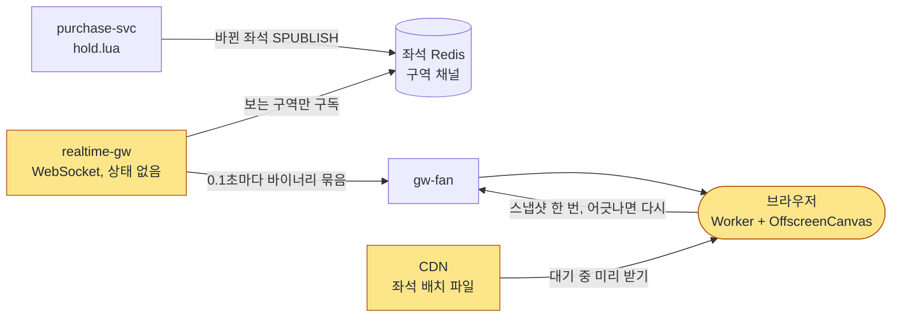

**트레이드오프**

| 정한 것 | 얻는 것 | 치르는 값 |
| --- | --- | --- |
| 스냅샷 + 구역 구독 + 바이너리 묶음 | 대역폭이 약 600배 준다. 지속 연결이 5,000개로 묶인다 | 클라이언트가 일련번호·세대로 다시 맞추는 규칙을 지켜야 한다 |
| 묶음 100ms | 종단 300ms 목표를 낼 수 있다 | 연결마다 묶음이 초당 최대 10개로 늘어 realtime-gw CPU가 는다. 70% `[가정]`를 넘으면 150ms로 늘려 다시 잰다 |
| 좌석 화면에만 WebSocket | 구독을 바꾸는 요청을 보낼 수 있고(양방향), 바이너리를 보낸다 | 대기실과 다른 연결 방식을 하나 더 운영한다 |

**꼬리 질문**

| 질문 | 답의 요지 | 근거 |
| --- | --- | --- |
| 왜 SSE가 아니라 WebSocket인가요? | 구역 구독을 바꿔야 해서 양방향이 필요하고, 바이너리 프레임을 보낸다 | ADR-0027 |
| 화면이 늦게 바뀌면 오버셀이 생기나요? | 아니다. 좌석을 최종으로 정하는 것은 서버의 스크립트다. 늦은 화면은 '이미 잡힌 좌석' 409만 늘린다 | docs/features/seat-hold.md §7 |
| 전파가 밀리면요? | p99가 300ms를 3분 넘게 넘으면 묶음을 1초로 늘리고 화면에 '지연' 표시를 한다. 그때 약속은 p99 1.5초다 | docs/features/seat-hold.md §7·§9 |
| Redis 장애 조치로 번호가 되돌아가면요? | 새 서버가 작은 번호부터 세면 브라우저가 새 변경을 버린다. 그래서 세대 번호를 싣고, 세대가 커지면 모두 다시 맞춘다 | ADR-0121 결정 5 |

**더 깊이**: [docs/architecture.md](../architecture.md) §9.1('좌석 상태 팬아웃' 두 행) → [docs/features/seat-hold.md](../features/seat-hold.md) §7·§10 → [docs/frontend.md](../frontend.md) §4.4·§5.2 → [ADR-0110](../adr/0110-latency-budgets-nfr002-nfr004-aligned-expiry-100ms-batches-ms-clock.md).

## 10단계. 결제와 서비스 사이의 일관성(K7) `꼭`

> **면접관에게**: "결제는 purchase-svc, payment-svc, ticket-svc 세 서비스와 외부 결제사를 거칩니다. 동기 호출로 줄줄이 이으면 네트워크가 끊길 때 이중 결제나 좌석 누수가 생깁니다. 그래서 purchase-svc가 지휘하는 Saga로 만들었습니다. 결제 접수는 한 트랜잭션에 적고 202로 바로 답합니다. 결제사의 '인증 → 서버 승인' 2단계를 이용해, 좌석 판매 행을 먼저 잡은 뒤에만 승인을 부릅니다. 경합에서 진 주문은 돈이 나가지 않습니다. 승인은 되돌리기 어려운 고비라서, 승인 뒤 발권이 실패해도 결제를 취소하지 않고 같은 주문 번호로 발권을 다시 시도합니다. 서비스 사이 사건은 같은 트랜잭션의 Outbox에 적어 릴레이가 Kafka로 보냅니다. 요청, 결제사 호출, 사건 받기 세 곳을 모두 멱등하게 만들었고, 매일 결제사와 장부를 맞춰 봅니다."

**단순하게 하면 어디서 깨지나**

- **동기 호출 체인(K7)**: 주문 → 결제 → 발권을 HTTP로 줄줄이 부르면, 중간에 응답이 끊겼을 때 결제가 됐는지 모른다. 다시 부르면 이중 결제, 포기하면 좌석이 잡힌 채 남는다.
- **승인 뒤에 좌석 확정**: 경합에서 진 사람도 이미 돈이 나가서 환불해야 한다(ADR-0015 '검토한 대안').
- **발권이 실패하면 바로 결제 취소**: ticket-svc가 1분만 멈춰도 온세일 한가운데에서 산 사람의 표가 환불되고, 그 좌석이 다시 팔린다(ADR-0106 '맥락').

**이렇게 고친다: 결제 한 번의 흐름**(docs/features/payment.md §2)

| 차례 | 요청 또는 단계 | 하는 일 |
| --- | --- | --- |
| 1 | `POST /v1/orders` | 본인확인을 다시 보고, 금액을 서버가 계산해 주문을 만든다. 주문 행, 상태 이력, 멱등 기록, Outbox를 한 트랜잭션에 적는다 |
| 2 | `POST /v1/orders/{orderId}/payments` | payment-svc가 결제사를 고르고(전환 중이면 대체 → 공연 지정 → 플랫폼 기본) 결제창 값을 준다 |
| 3 | 결제창 인증 | 브라우저가 결제사 창에서 인증한다. 아직 돈은 나가지 않았다 |
| 4 | `POST /v1/orders/{orderId}/payment-acceptance` | 결제사·금액을 대조하고, 접수 기록과 Saga 시작 명령과 Outbox를 한 트랜잭션에 적은 뒤 202로 답한다(p99 150ms 미만, NFR-005) |
| 5 | 판매 확정 | 8단계의 `PENDING` 행과 1인 한도를 넣는다. 유니크 위반이면 승인 없이 실패로 끝낸다 |
| 6 | 승인 | payment-svc가 그 결제사로만 승인 API를 부른다. 멱등 키는 `confirm-{orderId}`다 |
| 7 | 승인 뒤 | 판매 행을 `SOLD`로, 주문을 승인됨으로 바꾸고 발권 재시도 큐 행을 함께 적는다(한 트랜잭션). ticket-svc가 주문 ID로 멱등하게 발권한다 |
| 8 | 결과 받기 | 브라우저는 `GET /v1/orders/{orderId}/payment-status`로 최대 25초 `[가정]` 기다린다. 결제 확정 목표는 p99 3초다(NFR-006) |

**이렇게 고친다: 원칙**

- **Saga의 세 구간**(ADR-0106): 승인 앞(판매 행, 승인 요청)은 되돌릴 수 있다. 승인은 고비다. 승인 뒤(판매 확정, 발권)는 앞으로 다시 하는 단계다. 결제를 취소하는 보상은 회차 취소가 확정됐을 때와 CS가 시스템 잘못을 확인했을 때 두 경우뿐이다.
- **발권 재시도**: 일시적 오류는 1초부터 두 배씩, 최대 60초 `[가정]` 간격으로 다시 보낸다. 승인 뒤 60초 안에 발권되지도 재시도 큐에 들어가지도 않은 결제 0건이 목표다(NFR-006). 발권 기한(승인 뒤 30분 `[가정]`)을 넘기면 SEV1로 다루고 CS로 넘긴다.
- **Outbox와 릴레이**(ADR-0116): 서비스마다 `<서비스>-outbox-relay`를 따로 띄운다. 리더 하나가 100ms `[가정]`마다 아직 안 보낸 행을 순번대로 읽어 Kafka에 보내고, 받았다는 확인을 받은 뒤 '보냄'으로 표시한다. 보낸 뒤 표시 전에 멈추면 같은 사건이 한 번 더 나가고, 받는 쪽이 사건 키(`eventKey`)로 버린다.
- **멱등 세 겹**: 요청은 `Idempotency-Key`, 결제사 호출은 `confirm-{orderId}`, 사건 받기는 `eventKey`로 중복을 거른다. 데이터베이스에서도 주문당 결제 1건(`payment.order_id` UNIQUE)을 막는다.
- **결과 모름**: 승인 응답이 끊기면 같은 멱등 키로 다시 보낸다. 그래도 모르면 '결과 모름(UNKNOWN)'으로 두고 결제사의 단건 조회로 확정한다. 결과를 가정하지 않는다.
- **Kafka가 멈춰도 확정은 계속**: 결과 사건이 5초 `[가정]` 안에 안 오면 purchase-svc가 payment-svc에 직접 묻는다(`BatchGetPayments`). Kafka는 결제 확정의 정확성이 아니라 속도만 맡는다(ADR-0140).
- **웹훅은 보조 신호**: 토스페이먼츠 결제 웹훅에는 서명이 없다. 그래서 웹훅 내용을 믿지 않고 조회 API 결과로만 상태를 바꾼다.
- **매일 대사**: 매일 자정에 결제사별 하루치 승인·취소를 모두 조회해 내부 장부와 1:1로 맞춘다. 자정이 대형·중형 온세일 윈도우와 겹치면 끝난 뒤에 시작하고, 늦어도 04시 `[가정]`에는 시작한다. 소형 온세일은 미루지 않는다.
- **결제사는 시도마다 고르고, 접수 뒤에는 고정**: 결제 접수 뒤에는 승인, 재시도, 취소, 대사가 모두 그 결제사로만 간다. 결제사가 고장 나도 자동으로 다른 결제사로 넘기지 않는다. 시스템은 추천만 하고, 사람이 명령 6으로 켠다(ADR-0044).
- **주문은 이벤트 소싱이 아니다**: 원본은 주문의 지금 상태이고, 상태 이력은 같은 트랜잭션에 덧붙인다. 이벤트 소싱(사건 목록을 원본으로 두고 다시 재생해 상태를 만드는 방식)은 운영 명령 기록에만 쓴다(ADR-0113).

**그림: 결제**

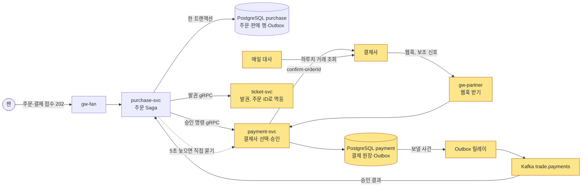

**트레이드오프**

| 정한 것 | 얻는 것 | 치르는 값 |
| --- | --- | --- |
| 2단계 승인 앞에서 좌석 확정 | 진 주문은 돈이 나가지 않아 환불이 없다 | 승인 기한 안에 끝내야 하는 대기 큐와 결과 모름 처리를 만들어야 한다 |
| 승인 뒤에는 앞으로 다시 | 잠깐의 발권 장애가 환불과 좌석 재판매로 번지지 않는다 | 결제는 됐는데 티켓이 없는 시간이 최대 발권 기한(30분 `[가정]`)만큼 생길 수 있다 |
| 서비스별 폴링 릴레이 | 측정한 길과 운영하는 길이 같다. 복제 슬롯·로그 보존 위험과 자바 실행 기반이 없다 | 폴링 주기만큼(최대 약 0.1초 `[가정]`) 늦고, 행마다 갱신이 하나 는다 |
| 결과를 직접 묻는 길 | Kafka가 멈춰도 결제 확정이 이어진다 | Kafka와 payment-svc가 함께 멈추면 확정도 멈춘다 |

**버린 길**

| 길 | 버린 이유 |
| --- | --- |
| 웹훅을 첫 신호로 | 토스페이먼츠 결제 웹훅에 서명이 없어 위조될 수 있다(ADR-0015) |
| 발권을 몇 번 시도하고 안 되면 바로 취소 | 장애가 몇 분 이어지면 결국 산 사람의 표가 환불된다(ADR-0106) |
| 운영은 Debezium(데이터베이스 변경 로그를 읽어 보내는 도구), 로컬은 폴링 | 측정한 길과 운영 길이 다르고, Kafka Connect·복제 슬롯 위험이 운영에만 생긴다(ADR-0116) |
| 주문을 진짜 이벤트 소싱으로 | 요구는 같은데 사건 판 올림·재생·재생 시험이 더해지고, 사건이 10개 안팎 `[추정]`이라 얻는 것이 없다(ADR-0113) |
| 결제사 장애 때 자동 전환 | 포트원 추정 상한이 토스페이먼츠의 약 6분의 1이라 순간 과부하가 오고, 오탐이면 괜히 바꾼다(ADR-0044) |

**꼬리 질문**

| 질문 | 답의 요지 | 근거 |
| --- | --- | --- |
| 승인 응답이 끊겨 다시 보내면 두 번 결제되지 않나요? | 같은 멱등 키로만 다시 보내고, 그래도 모르면 단건 조회로 확정한다 | docs/features/payment.md §4 |
| 승인 뒤 발권이 실패하면 환불하나요? | 하지 않는다. 같은 주문 ID로 다시 발권하고, 발권은 주문 ID로 멱등이다 | ADR-0106 |
| Kafka가 멈추면 결제 확정도 멈추나요? | 5초 안에 결과가 안 오면 직접 묻는다. 확정은 이어지고 알림과 관제 표가 늦는다 | ADR-0140 |
| 왜 CDC(Debezium)가 아니라 폴링인가요? | Outbox 합계가 초당 수천 건 이하라 100ms 폴링으로 지연 예산이 맞는다. 릴레이 지연 p99가 200ms `[가정]`를 넘는 등 조건이 오면 다시 비교한다 | ADR-0116 |
| 주문은 이벤트 소싱인가요? | 아니다. 지금 상태 + 같은 트랜잭션의 덧붙이기 이력 + Outbox다. 매일 상태와 이력을 대조한다 | ADR-0113 |
| 결제사가 죽으면 다른 결제사로 넘기나요? | 자동으로는 넘기지 않는다. 사람이 명령 6으로 켜고, 이미 승인 요청을 보낸 결제는 옮기지 않는다(이중 결제 방지) | ADR-0044 |

**더 깊이**: [docs/architecture.md](../architecture.md) §1('Hard Sale') → [docs/features/payment.md](../features/payment.md) §1~§5·§8·§9 → [docs/data.md](../data.md) §4 → [docs/api/guidelines.md](../api/guidelines.md) §4 → [ADR-0015](../adr/0015-tosspayments-two-phase-approval.md) → [ADR-0106](../adr/0106-forward-recovery-after-payment-approval-ticket-issue-retry.md) → [ADR-0116](../adr/0116-single-polling-outbox-relay-drop-debezium-place-pgbouncer-schema-registry.md) → [ADR-0113](../adr/0113-order-state-with-append-only-history-event-sourcing-only-for-ops-commands.md) → [ADR-0044](../adr/0044-dual-pg-selection-and-switchover.md). 분야 편 11 '결제'와 DB 설계 편 5·6이 이어 받는다.

## 11단계. 서비스 나누기, 입구 서버, 장애 격리 `꼭`

> **면접관에게**: "지금까지 나온 상자들을 서비스로 묶겠습니다. 기준은 도메인 이름이 아니라 부하 규모, 가용성 등급, 실행 방식, 비밀 키 범위가 크게 다른 곳입니다. 그래서 10개입니다. 진입을 받는 queue-svc와 결제를 받는 payment-svc는 부하가 수백 배 다르고, ticket-svc는 공연 당일 현장 입장이라는 다른 시간대에 살아 있어야 합니다. 입구도 클라이언트 종류마다 얇은 게이트웨이 다섯을 따로 띄워, 진입 폭주가 결제나 관제 입구로 번지지 않게 합니다. 장애 격리는 두 단입니다. 입구에서 시간 초과와 동시 요청 상한으로 바로 503을 주고, 서비스 안에서 의존성마다 차단기를 둡니다. 긴급 운영 명령은 Kafka와 게이트웨이를 거치지 않는 제어 전용 gRPC로 보냅니다."

**단순하게 하면 어디서 깨지나**

- **모놀리스 하나**: 진입이 몰리면 결제·관제·현장 게이트까지 함께 멈춘다. 진입 부분만 따로 늘릴 수도 없다(ADR-0007 '검토한 대안').
- **입구 하나**: 진입 폭주나 설정 실수 하나가 관제·파트너·스캐너 입구까지 번진다(ADR-0008 '검토한 대안').
- 모놀리스가 몇 RPS에서 무너지는지 잰 숫자는 정본에 없다. 분리 효과는 아래 '세 구성 비교'로 잴 계획이다.

**이렇게 고친다: 서비스 10개**(docs/architecture.md §3·§3.1, ADR-0007)

나누는 기준은 넷이다. 부하 차이, 가용성·장애 격리 등급, 실행 방식, 비밀 키를 가둘 보안 경계다. 이 기준에 들지 않는 업무는 한 서비스 안의 모듈로 묶었다. 1인 개발이라 '팀마다 서비스 하나' 같은 조직의 이점은 근거로 쓰지 않았다. 처음 14개였던 것을 10개로 합쳤다.

| 서비스 | 하는 일 | 따로 둔 이유 |
| --- | --- | --- |
| queue-svc | 로비, 진입, 순번, 대기 상태 파일, 입장 확정 | 오픈 순간 진입 부하 |
| admission-ctrl | 입장 조절 루프, 오픈 순간 섞기 | 리더 하나만 도는 제어 루프 |
| purchase-svc | 좌석(inventory)과 주문·Saga(booking) | 입장한 5,000명의 핵심 구매 길 |
| payment-svc | 결제사 선택과 연동, 웹훅, 대사, 정산 지급 | 외부 결제사 장애와 결제 비밀 키를 가둔다 |
| ticket-svc | 발권, 월렛, 양도, 스캐너 동기화 | 공연 당일 현장 입장이라는 다른 가용성 시간대 |
| realtime-gw | 좌석 변경을 WebSocket으로 알림 | 오래 유지하는 연결 수에 맞춰 따로 늘린다 |
| identity-svc | 계정, 세션, 토큰, 본인확인 | 가장 높은 보안 경계, 오픈 직전 로그인 몰림 |
| trust-svc | 위험 점수, 봇 판정, 추가 검증 | 장애 때 통과시키지 않고 캐시 규칙으로 줄여 운영 |
| ops-svc | 운영 명령, 감사 로그, 관제 API, CS 처리함 | 관제 전용 노드와 전용 DB로 떨어진 제어 평면 |
| core-svc | 공연 정보, 알림, 굿즈, 후기, 문의 | 부하가 낮고 가용성 요구가 보통이라 다섯 모듈을 하나로 |

- **데이터베이스는 서비스마다**: 다른 서비스의 표나 Redis 키를 직접 읽거나 쓰지 않고 gRPC나 Kafka로만 주고받는다(3단계).
- **통신 방식**: 외부 클라이언트와 입구 사이만 REST다. 서비스끼리는 gRPC(동기)와 Kafka(비동기)이고, 좌석 변경만 Redis 샤드 Pub/Sub이다. Kafka 토픽은 거래(`trade.*`), 텔레메트리(`telemetry.*`), 제어(`control.*`) 셋으로 나누고, Kafka 클러스터도 거래·제어, 텔레메트리, 관측 셋으로 나눈다. 클러스터를 나눈 이유는 처리량이 아니라 장애와 권한의 격리다(ADR-0026).

**이렇게 고친다: 입구와 격리**(docs/architecture.md §4·§5)

- **입구 다섯**: CloudFront(+WAF) → NLB(네트워크 로드밸런서) → Envoy Gateway → 서비스 순서다. 게이트웨이는 `gw-queue`(대기열), `gw-fan`(구매·월렛), `gw-partner`(파트너 콘솔·결제사 웹훅), `gw-ops`(관제), `gw-scanner`(현장 스캐너)의 다섯이다. 게이트웨이마다 파드 묶음이 따로라, `gw-queue`가 포화돼도 다른 입구는 그 부하를 받지 않는다(ADR-0008).
- **입구는 얇게**: 게이트웨이는 토큰 확인, 요청 수 제한, 길 안내만 한다. 데이터베이스 접근, 트랜잭션, 업무 판단, 여러 서비스 응답 합치기는 하지 않는다. 그래서 BFF(화면마다 응답을 모아 주는 서버)가 아니라 칸막이다.
- **서비스 찾기와 메시**: 따로 서비스 찾기 서버를 두지 않고 쿠버네티스 Service 이름을 쓴다. 메시(서비스 사이 통신을 대신 맡는 층)는 Istio 앰비언트다. 노드마다 있는 프록시가 모든 연결을 암호화하고, gRPC를 받는 서비스에만 요청 단위 분산·재시도를 맡는 웨이포인트를 둔다(ADR-0082). 포트폴리오 실행(로컬·CI·데모)은 메시 없이 돈다.
- **재시도는 한 층에서 한 번**: 네트워크 재시도는 메시에서만 최대 1회 한다. 앱에도 넣으면 두 층이 2회씩일 때 최대 9번까지 곱해진다. 같은 요청을 둘 보내 빠른 쪽을 쓰는 헤지 요청은 어디에도 쓰지 않는다(ADR-0117).
- **2단 장애 격리**(ADR-0009)

  | 단 | 어디서 | 하는 일 |
  | --- | --- | --- |
  | 1차 | Envoy Gateway | 경로마다 시간 초과, 동시 요청 상한을 넘으면 바로 503 + `Retry-After`, 계속 실패하는 파드 빼기, 과부하면 후기·굿즈 같은 덜 중요한 경로부터 막기 |
  | 2차 | 서비스 안 차단기(opossum) | 서비스 사이 gRPC, 결제 승인, 사람 확인, 본인확인, 알림 발송마다 따로 차단기와 동시 처리 칸막이를 둔다. 열리면 503, 칸막이가 차면 429 |

- **감내 모드(Degraded Mode)**: 정해 둔 조건에서 일부 기능을 줄여 핵심을 지킨다. 예를 들어 진입 p99가 150ms를 2분 `[가정]` 넘거나 대기열 Redis CPU가 75%를 넘으면 엣지가 도착 시각 쿠키를 주는 진입으로 바꾸고, 결제사 차단기가 열리면 재시도 큐와 새 결제 정지로 바꾼다(docs/architecture.md §7, POL-029).
- **제어 채널**(ADR-0102·0103): 긴급 명령은 `ApplyControl` 제어 전용 gRPC로 보낸다. 이 길은 Kafka, 게이트웨이, 웨이포인트를 거치지 않는다. 명령을 보내는 ops-svc는 관제 전용 노드와 전용 데이터베이스에 따로 둔다. 하지만 같은 클러스터 네트워크와 노드 프록시, 명령을 받는 프로세스(예: 핫패스 노드의 purchase-svc)의 이벤트 루프는 함께 쓰므로 '완전히 따로 떨어진 길'이라고 부르지 않는다. 그래서 명령의 효력은 받는 쪽 저장소에 판 번호와 함께 적힌 제어 상태로 정한다. 새 파드도 이 상태를 읽어야 준비 상태가 된다.

**런타임**(docs/architecture.md §6.1)

- Node.js + NestJS로 10개를 만든다. 정본이 적은 이유는 모듈, 의존성 주입, 요청 가드, gRPC·Kafka 연결, SSE를 한 프레임워크에서 쓸 수 있다는 것이다. 다만 NestJS를 고른 것 자체의 측정 근거는 '없음(문서 근거)'으로 적혀 있다.
- HTTP는 모두 Fastify 위에서 받는다. 이유는 성능이 아니라, 쿠키·보안 헤더·요청 크기 제한·접근 로그를 플랫폼 라이브러리 한 벌로 만들고 시험하려는 것이다. 기반 PoC(V-T41)에서 Fastify는 Express보다 요청당 CPU가 약 14% 적었다(실측(PC)). 요청 검사는 좌석 홀드만 경로 스키마(Fastify가 미리 만든 검사기)로 하고, 대기열 진입은 Zod 파이프(처리기 앞에서 Zod로 검사하는 단계)로 되돌렸다(ADR-0176 결정 4).
- **Java·Spring과 견준 근거는 정본에 없다.** 면접에서 물으면 "비교 근거를 아직 문서로 남기지 않았다"고 말하고 지어내지 않는다. 소유자가 정해 결정 기록으로 남길 일이다(docs/review/open-items.md 86번).

**세 구성 비교: 정말 서비스로 나눠야 했나**(ADR-0096 결정 4)

같은 지금 설계 코드를 (가) 한 프로세스로 합친 것, (나) 같은 이미지를 역할별로 따로 띄운 것, (다) 서비스 10개로 띄운 것으로 같은 CPU·메모리 합계에서 잰다. 결제 접수 300 TPS를 고정하고 진입 폭주를 없음·100%·120% `[가정]`로 겹쳐 각 3회 잰다. (가)와 (나)의 차이는 '실행을 나눈 효과', (나)와 (다)의 차이는 '코드를 서비스로 나눈 효과'다. (나)와 (다)가 편차 안이면, 서비스로 나눈 이유는 성능이 아닌 근거(배포·장애·실행 단위, 저장소 주인, 비밀 키 격리)로만 말한다. 그 결과도 실패가 아니다.

**그림: 서비스와 입구**

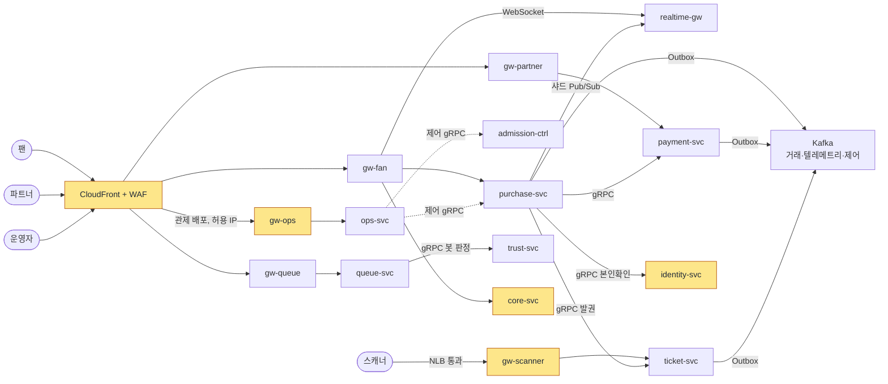

그림을 줄이려고 서비스 사이 선 일부(예: 제어 gRPC의 queue-svc·payment-svc 쪽, gw-fan → ticket-svc 월렛)를 뺐다. 전체 목록은 docs/architecture.md §3.2의 통신 표에 있다.

**트레이드오프**

| 정한 것 | 얻는 것 | 치르는 값 |
| --- | --- | --- |
| 서비스 10개 | 진입만 따로 늘리고, 장애를 서비스 경계 안에 가두고, 비밀 키가 닿는 범위를 줄인다 | 네트워크 지연, 분산 추적, 최종 일관성(잠시 다른 값이 보이다 곧 같아짐)의 비용이 생긴다. 1인이 운영할 것이 늘어난다 |
| 게이트웨이 다섯 | 입구마다 장애 반경이 따로다 | 파드 묶음, 대시보드, 경보 규칙이 다섯 벌이다 |
| Istio 앰비언트 | 앱에 분산·재시도·암호화 코드를 넣지 않는다 | 웨이포인트 운영 비용이 들고, 포트폴리오 실행에서는 메시 아래 동작을 재지 못한다 |
| 제어 gRPC + 저장소의 제어 상태 | 폭주 중에도 긴급 정지가 큐 뒤에 갇히지 않는다 | 같은 클러스터·리전이 통째로 멈추는 장애는 함께 받는다 |

**버린 길**

| 길 | 버린 이유 |
| --- | --- |
| 서비스 14개로 전부 나누기 | 1인 운영 부담이 크고, 좌석과 주문 사이에 쓸데없는 네트워크 단계가 생긴다(ADR-0007) |
| 핫패스 넷 + 나머지 하나 | 결제 비밀, 본인확인 키, 현장 가용성, 관제 생존을 한 프로세스에 모은다(ADR-0007 상태 줄) |
| AWS API Gateway 같은 관리형 입구 | 기본 한도가 초당 1만 건이라 크게 늘려야 하고, 호출 수만큼 요금이 든다(ADR-0008) |
| Istio 사이드카 방식 | 진입 경로 프록시 CPU가 약 80 vCPU로 노드 프록시 방식(약 24 vCPU)의 3배쯤이다 `[추정]`. 업그레이드마다 앱을 다시 띄워야 한다(ADR-0082) |
| 긴급 명령을 Kafka로 | 폭주 때 긴급 정지가 큐 뒤에 갇힌다(ADR-0022) |

**꼬리 질문**

| 질문 | 답의 요지 | 근거 |
| --- | --- | --- |
| 도메인마다 나누지 않고 왜 10개인가요? | 기준이 부하·가용성·실행 방식·비밀 범위라서다. 좌석과 주문은 부하와 약속이 같아 한 서비스의 두 모듈이다 | ADR-0007 결정 1~3 |
| 모놀리스를 역할별로 띄우면 되지 않나요? | 바로 그 (나) 구성을 측정에 넣었다. (다)와 차이가 없으면 성능 이득은 없다고 적는다 | ADR-0096 결정 4 |
| 게이트웨이 다섯은 BFF인가요? | 아니다. 응답을 합치지 않는 칸막이다. 합치기는 Next.js 앱 서버와 ops-svc가 한다 | docs/architecture.md §4 |
| 재시도는 어디서 하나요? | 메시 한 층에서 1회만 한다. 결제 승인 같은 업무 재시도는 앱이 멱등 키로 한다 | docs/architecture.md §5 |
| 제어 채널은 정말 따로 떨어져 있나요? | 일부만이다. Kafka·게이트웨이·웨이포인트는 피하지만 노드 프록시와 이벤트 루프는 함께 쓴다. 그래서 효력을 저장소 상태로 정한다 | ADR-0102·0103 |
| 왜 Java·Spring이 아닌가요? | 비교 근거를 아직 정본에 남기지 않았다. 지어내지 말고 그렇게 말한다 | docs/review/open-items.md 86번 |

**더 깊이**: [docs/architecture.md](../architecture.md) §3·§3.1·§3.2·§4·§5·§6.1·§7 → [ADR-0007](../adr/0007-service-boundaries-by-load-availability-runtime.md) → [ADR-0008](../adr/0008-client-specific-thin-gateways.md) → [ADR-0009](../adr/0009-two-layer-circuit-breakers-fail-fast.md) → [ADR-0082](../adr/0082-istio-ambient-mesh-app-boundary-meshless-portfolio-runs.md) → [ADR-0102](../adr/0102-control-plane-direct-grpc-dedicated-pool-ops-db-audit-chain-worker-break-glass.md) → [ADR-0103](../adr/0103-control-as-state-startup-sync-broadcast-topics-compacted-settings.md) → [ADR-0096](../adr/0096-evidence-design-entry-capacity-split-comparison-v0-baseline.md) 결정 4. 위 ADR 본문은 옛 판이 많다. 상태 줄을 먼저 본다.

## 12단계. 갑자기 몰릴 때 서버 늘리기(K9) `시간 남으면`

> **면접관에게**: "몰림은 반응해서 늘리지 않고 미리 늘립니다. 오픈 40분 전에 예약 작업으로 최소 파드 수를 올리고 노드도 미리 띄우고, 30분 전에 점검해서 오픈해도 되는지 판정합니다. 오픈 뒤에는 CPU가 아니라 대기열 길이, Kafka 소비 지연, 이벤트 루프 지연, 입구의 요청 수를 보고 늘립니다. 노드가 뜨는 시간은 AWS가 보장 수치를 공개하지 않아서, 60초 목표는 노드가 이미 있을 때 파드가 준비되는 시간으로만 판정합니다."

**단순하게 하면 어디서 깨지나**

- v0(K9)는 CPU 사용률로 파드를 늘린다(Kubernetes HPA). 트래픽이 갑자기 치솟으면 파드가 늦게 떠서 장애가 난다(docs/architecture.md §9.3 K9). 새 노드가 부팅되는 시간이 확장 지연의 대부분을 차지한다(docs/infra.md §5).
- 오픈 직후 진입이 초당 20만 건이면, 10배 속도로 실패할 때 70분치 오류 허용량(약 2,000건)이 1초에 사라진다(docs/observability.md §4). 반응해서 늘리기에는 늦다.
- CPU가 몇 초 늦는지 잰 숫자는 정본에 없다.

**이렇게 고친다**(docs/infra.md §4·§5)

- **오픈 40분 전 `[가정]`**: KEDA(이벤트 양을 보고 파드 수를 조절하는 도구)의 예약 규칙이 게이트웨이, queue-svc, admission-ctrl, purchase-svc, payment-svc, realtime-gw, 웹 앱 서버, identity-svc, trust-svc의 최소 파드 수를 올린다. Karpenter(필요한 노드를 띄우는 도구)가 온디맨드 노드를 미리 띄운다. 캐시도 미리 채운다.
- **오픈 30분 전 점검**: 노드·파드 준비, 저장소 상태, 결제사·본인확인 상태, CDN 한도 같은 필수 항목과 캐시 적중률 같은 권고 항목을 보고 오픈 여부(Go/No-Go)를 정한다. 필수 항목이 하나라도 실패하면 No-Go이고, 20분 전까지 회복하면 다시 판정한다. 회복하지 못하면 입장 일시정지와 대기실 공지로 오픈을 시작한다.
- **오픈 뒤 신호**: KEDA가 대기열 길이, Kafka 소비 지연, 이벤트 루프 지연 p99, 입구 요청 수를 본다. 지표를 3회 `[가정]` 연속 못 읽으면 지금 파드 수를 유지한다. KEDA의 CPU·메모리 규칙에는 '지표를 못 읽을 때 대신 할 동작'이 없어서 쓰지 않는다(ADR-0069).
- **확장이 먼저**: 늘리는 기준을 입장 목표를 줄이는 기준(7단계)보다 낮게 둔다. 버티지 못할 때만 입장 감축과 입구 거절이 걸린다.
- **확장 길은 따로**: KEDA, Karpenter, 배포 검사 도구는 관제·시스템 노드에서 돈다. 그래서 핫패스 노드가 포화돼도 '파드를 늘리는 길'은 막히지 않는다.
- **새 파드도 정지 상태를 안다**: 새 파드는 저장소의 제어 상태를 읽어야 준비 상태가 된다. 판매 일시정지 중에 늘어난 파드도 정지를 안다(ADR-0103).
- **바꾸지 않는 창**: 대형·중형 온세일은 오픈 90분 전부터 60분 뒤까지 배포를 멈춘다.
- **예외**: 스트림 작업자는 자동 확장을 끄고 2개 `[가정]`로 고정한다. 소비자 수를 늘려도 파티션 수를 넘지 못하고, 늘리고 줄일 때마다 재조정이 생기기 때문이다(docs/streaming.md §2.2).

**그림: 미리 늘리기**

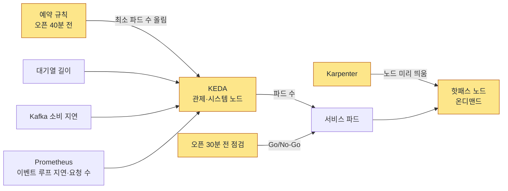

**트레이드오프**

- **얻는 것**: 오픈 순간에 반응을 기다리지 않고 용량이 준비돼 있다. 지표가 끊겨도 파드 수를 유지한다.
- **치르는 값**: 미리 띄운 노드와 파드의 비용이 든다. 온세일 1회 비용과 티켓 1,000장당 비용으로 잰다. 노드를 새로 더하는 경우는 재지 않아 증명하지 못한다. 게이트웨이에 2배 여유를 늘 두지 않으므로, 절반을 잃으면 회복(목표 60초 `[가정]`)까지 503으로 덜어 낸 만큼 오류 허용량을 쓴다.
- **버린 길**: 게이트웨이 2배 여유를 늘 두기(비용이 두 배다, ADR-0144). 지표를 못 읽을 때 KEDA는 지금 파드 수를 유지한다. 같은 원칙으로 입장 조절도 입력이 없으면 목표를 그대로 둔다. '입력이 없으면 안전 하한으로 줄이기'는 관측 장애 하나로 판매가 크게 느려져 버렸다(ADR-0069).

**꼬리 질문**

| 질문 | 답의 요지 | 근거 |
| --- | --- | --- |
| 왜 CPU로 늘리지 않나요? | 갑자기 치솟으면 파드가 늦게 떠서 장애가 나고, KEDA의 CPU 규칙에는 지표를 못 읽을 때의 대체 동작이 없다. 대신 들어오는 양(대기열 길이, Kafka 소비 지연)과 이벤트 루프 지연을 본다 | docs/architecture.md §9.3 K9, ADR-0069 결정 1 |
| 노드가 뜨는 데 몇 초 걸리나요? | AWS가 보장 수치를 공개하지 않는다. 그래서 노드는 미리 띄우고, 60초는 노드가 있을 때만 판정한다 | docs/planning/01-overview.md §3.1 K9 |
| 서버 늘리기와 입장 줄이기가 서로 싸우지 않나요? | 늘리는 기준을 더 낮게 두어 늘리기가 먼저 걸린다. 둘이 함께 걸리는 상황은 Game Day(장애 연습) G-22로 본다 | docs/architecture.md §5, docs/observability.md §12 |
| 몇 대를 미리 띄우나요? | 설계 식과 사전 부하 시험으로 정한다. 정본에 적힌 값은 payment-svc 6개 `[가정]`, 웹 앱 서버 약 15개 `[가정]`, 진입 서버는 '20만 ÷ 1대가 받는 도착률'이다 | docs/infra.md §5, ADR-0096 결정 1 |

**더 깊이**: [docs/infra.md](../infra.md) §4·§5 → [docs/architecture.md](../architecture.md) §5('부하 관리 장치와 순서', '프로브 규칙') → [ADR-0069](../adr/0069-ops-control-principles-audit-self-safety-alert-hygiene-wide-events.md) → [docs/devops.md](../devops.md) §8. 분야 편 20 '인프라·배포'가 이어 받는다.

## 13단계. 지켜보고 조종하기(K8) `시간 남으면`

> **면접관에게**: "온세일 70분 동안은 여정마다 따로 오류 허용량을 두고, 경보가 울릴 때 이미 쓴 허용량이 30% 이하가 되게 걸었습니다. 사람을 부르는 경보는 2분 창과 20초 창이 모두 평소의 10배로 닳을 때라서, 허용량의 29%를 썼을 때 울립니다. 자동 제어와 경보가 읽는 숫자는 클러스터 안의 Prometheus에서 오고, 구역·등급별 판매 같은 비즈니스 숫자는 Kafka에서 ClickHouse로 실은 원시 사건을 읽을 때 SQL로 셉니다. 관제 콘솔은 사유, 미리 보기, 감사 로그, 적용 확인이 붙은 운영 명령 12가지를 냅니다. 판매를 멈추는 쪽은 한 명이 바로 하고, 다시 여는 쪽만 두 명이 승인합니다."

**단순하게 하면 어디서 깨지나**

- v0(K8)는 단순한 대시보드와 고정 기준값 알림이다. 그런데 결제 확정은 70분 동안 허용되는 실패가 약 12건뿐이다. 28일 기준의 느슨한 알림으로는 허용량을 다 쓴 뒤에야 안다(docs/observability.md §4).
- 고치기 전 규칙(5분 창 10배)은 허용량의 71%를 쓴 뒤에 울렸다. 결제 확정으로 치면 12건 중 9건이 실패한 뒤다(ADR-0049 '대안').

**이렇게 고친다**(docs/observability.md §1·§4, docs/features/control-tower.md)

- **온세일 70분의 오류 허용량**: 공연 상세 약 1,000건, 대기열 진입 약 2,000건, 좌석 잡기 약 75건, 결제 확정 약 12건이다.
- **경보 시점의 계산**: 경보가 울릴 때 쓴 허용량 = 닳는 배수 × 긴 창 ÷ 기간이다. 10배 × 2분 ÷ 70분 ≈ 29%다. 짧은 창(20초)은 "지금도 닳고 있나"를 확인해 이미 지나간 문제로 울리지 않게 한다. 짧은 창은 지표를 긁는 간격(5초)의 4배보다 짧게 둘 수 없어서 20초다. 창 길이, 배수, 긁는 간격은 모두 `[가정]`이고 장애 연습과 부하 시험에서 정한다.
- **덜 급한 경보**: 5분 창과 25초 창이 모두 3배면 SEV2다(허용량 21%). 결제 확정만은 예외다. 표본이 적어 이 규칙의 헛경보 확률이 81%라서, 1분 창에서 확실한 원인(결제사 승인 p99 2초 초과, 차단기 열림, 오류율 상승, 한도 초과 응답)을 볼 때 SEV2를 낸다. SEV1만 온콜을 부르고, SEV2는 관제 화면과 운영 채널에 알린다.
- **자동 감축은 경보를 거치지 않는다**: admission-ctrl이 같은 기록 규칙을 Prometheus에서 직접 읽는다(7단계).
- **허용량과 입장 목표를 잇는 범위**(ADR-0126): 허용량이 50% 닳으면, 입장 목표가 부하를 정하는 여정(좌석 잡기, 좌석 변경 전파, 결제 접수, 결제 확정)만 목표를 줄인다. 진입이나 대기 상태 전파의 허용량이 닳아도 목표는 줄이지 않는다. 그쪽은 목표보다 앞에 있어서 줄여도 부하가 그대로이고 판매만 느려지기 때문이다.
- **숫자가 오는 곳 둘**: 판단·제어에 쓰는 숫자는 클러스터 안 Prometheus가 서비스의 `/metrics`를 직접 긁는다. 수집기가 멈춰도 경보와 자동 제어는 그대로다. 차원이 많은 비즈니스 숫자는 스트림 작업자 `ops-rt`가 원시 사건을 ClickHouse(대량 분석에 강한 데이터베이스)에 싣고, ops-svc가 0.5초 `[가정]`마다 SQL로 센다. 목표는 신선도 p95 5초 미만이다(NFR-009).
- **Flink를 쓰지 않는다**: 입력이 초당 약 1만 건(시험 3만)이고 상태가 합쳐 1GB 안이다 `[가정]`. 그래서 원시 사건을 싣고 읽을 때 세면, 관제의 판매 숫자가 확정 숫자와 같은 사건·같은 SQL에서 나온다(ADR-0099).
- **운영 명령 12가지**: 동시 입장 목표 조정, 입장 일시정지, 판매 일시정지, IP 대역 차단, 봇 판정 강도, 감내 모드 전환(대체 결제사 전환 포함), 대기실 공지, 로그 레벨, 덜 중요한 기능 끄기, 부정거래 게시물 차단, 자동화 정지, 결제사 지정이다.
- **승인은 위험의 방향을 따른다**(POL-021, ADR-0095): 판매 일시정지(명령 3)와 자동화 정지(명령 11)는 commander 한 명이 재인증하고 바로 실행한다. 다시 여는 것만 두 명(요청자와 다른 사람)이 승인한다. 이 '멈춤 1인, 재개 2인'은 명령 3과 11에만 걸린다. 입장 일시정지(명령 2)는 한 명이 걸고 한 명이 풀며 최대 10분 뒤 저절로 풀린다. 명령 3·11을 쓴 사람은 48시간 안에 사후 보고서를 쓴다.
- **명령이 가는 길**: 긴급한 명령(목표 조정, 입장·판매 일시정지, 자동화 정지, 명령 6 가운데 대체 결제사 전환 등)은 제어 gRPC(11단계)로, 그 밖의 설정형 명령은 Kafka 압축 토픽 `control.settings`로 보낸다(docs/features/control-tower.md §5, ADR-0143). 약속은 접수 p95 500ms, 전파 p99 3초다(NFR-008). ops-svc가 멈추면 비상 런북 작업이 같은 제어 gRPC로 명령을 넣는다(전파 p99 10초).

**그림: 관제**

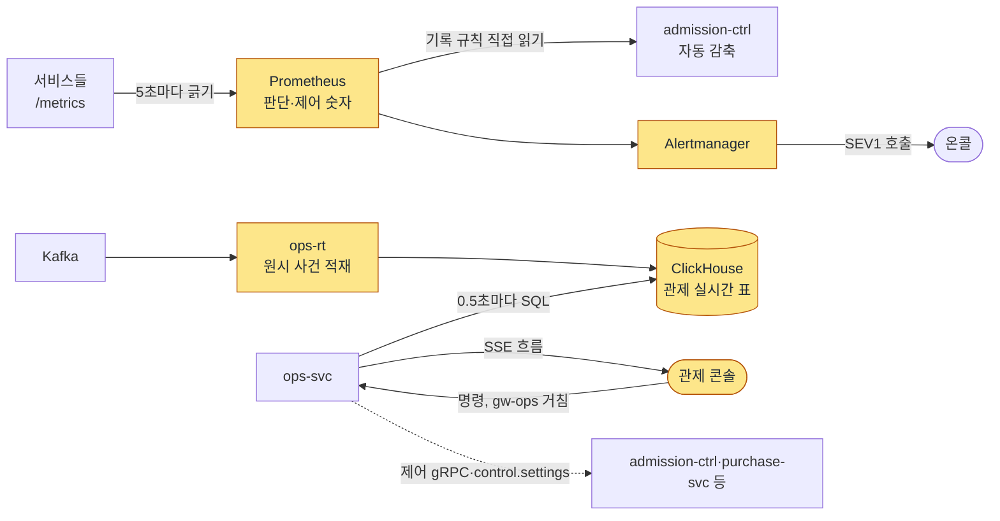

**트레이드오프**

| 정한 것 | 얻는 것 | 치르는 값 |
| --- | --- | --- |
| 짧은 창 경보 | 사람을 부르는 시점이 허용량 71%에서 29%로 앞당겨진다 | 헛경보가 는다. 결제 확정 SEV1의 헛경보 확률은 실패율이 약속 한도일 때 약 5%다. 온세일 중에는 운영자가 이미 관제실에 있어 정확도보다 빨리 아는 쪽을 앞세웠다 |
| 판단 숫자는 Prometheus에서 | 화면과 자동 제어가 같은 값을 본다 | 5초 긁기라 시계열과 저장량이 는다 |
| 조회 시점 집계 | 판매 숫자가 확정 숫자와 같은 SQL에서 나온다 | 읽을 때마다 세므로 조회 부하가 ClickHouse에 생긴다 |
| 멈춤 1인, 재개 2인 | 멈춰야 할 때 늦지 않는다 | 한 사람의 판단으로 판매가 멈출 수 있어 사후 보고서로 보완한다 |

**버린 길**: 1분 창 10배(결제 확정 헛경보 확률 80%), 합성 결제로 표본 늘리기(결제사 한도를 팬과 나눠 쓴다)(ADR-0049), Flink와 세션 창(ADR-0099), 관제에 GraphQL·Socket.IO(REST와 SSE 둘로 줄였다, ADR-0100).

**꼬리 질문**

| 질문 | 답의 요지 | 근거 |
| --- | --- | --- |
| 왜 2분 창인가요? | 10 × 2 ÷ 70 = 29%로 30% 아래이고, 1분 창은 결제 확정에서 헛경보가 80%다 | ADR-0049 결정 1 |
| 진입 허용량이 닳는데 왜 입장 목표를 안 줄이나요? | 진입은 목표 앞에 있어 줄여도 부하가 그대로다. 그쪽은 진입 감내 모드와 폴링 간격이 지킨다 | ADR-0126 |
| 판매를 멈추는 데 왜 한 명이면 되나요? | 멈추는 쪽은 늦으면 손해가 커서다. 다시 여는 쪽만 두 명이다 | POL-021, ADR-0095 |
| Prometheus가 죽으면 자동 제어가 0을 읽고 목표를 올리지 않나요? | 빈 결과를 0으로 읽지 않고 '입력 없음'으로 보아 늘리지도 줄이지도 않는다 | docs/features/queue-admission.md §5 |
| 입장 목표 상한 8,000명은 왜인가요? | 고른 이유가 정본에 없다. 결제사 상한 식으로는 토스페이먼츠 추정치에서 2.7만 명이라 8,000이 먼저 묶는다는 계산만 있다 | docs/review/open-items.md 86번, docs/features/queue-admission.md §5 |

**비상 런북의 서명 수**: ops-svc가 멈췄을 때 런북으로 판매를 멈추는 명령 묶음은 commander 한 명이 서명한다. 판매 재개 묶음과 비상 셔플은 서로 다른 commander 둘, 그 밖의 묶음은 서로 다른 두 운영자가 서명한다(ADR-0095 결정 3). POL-029 표도 2026-11-01에 이렇게 맞췄다.

**더 깊이**: [docs/observability.md](../observability.md) §1·§4·§8 → [ADR-0049](../adr/0049-onsale-alert-windows-and-ops-metrics.md)(본문의 10초 창은 옛 판) → [docs/streaming.md](../streaming.md) §1·§4.5 → [docs/features/control-tower.md](../features/control-tower.md) §3~§6 → [ADR-0126](../adr/0126-error-budget-reduction-only-for-admission-bound-journeys.md). 분야 편 16 '관제탑'과 19 '관측'이 이어 받는다.

## 14단계. 인터넷이 끊긴 공연장 입장(K10) `시간 남으면`

> **면접관에게**: "구매는 온라인 전용이지만 입장은 오프라인이 먼저입니다. 팬 휴대폰이 브라우저 안에서 꺼낼 수 없는 키를 만들고, 그 키로 15초마다 QR에 서명합니다. 스캐너는 미리 받아 둔 '티켓 → 공개키' 목록만으로 기기 안에서 0.15초 안에 판정합니다. 서버에 묻지 않으니 공연장 네트워크가 끊겨도 입장이 멈추지 않습니다. TOTP 같은 공유 비밀을 쓰지 않은 이유는, 스캐너에 비밀이 있으면 스캐너 한 대를 잃어버렸을 때 티켓을 대량으로 위조할 수 있어서입니다. 공개키만 가진 스캐너는 잃어버려도 위조에 쓸 수 없습니다. 같은 티켓의 중복 입장은 두 기록이 모두 서버에 올라온 뒤 서버가 찾아 현장에 알립니다."

**단순하게 하면 어디서 깨지나**

- v0(K10)는 늘 인터넷이 된다고 보고 서버에 물어 검표한다. 대형 공연장에서 네트워크가 포화되면 스캐너가 시간 초과에 빠져 수만 명의 입장이 멈춘다(ADR-0025 '검토한 대안').
- TOTP(시간마다 바뀌는 숫자를 공유 비밀로 만드는 방식)로 QR을 바꾸면, 검증하는 스캐너에도 같은 비밀이 있어야 한다. 스캐너 한 대만 잃어버려도 위조할 수 있다.

**이렇게 고친다**(docs/features/offline-gate.md)

- **기기 키**: 팬이 '이 휴대폰을 입장용으로 등록'을 누르면 브라우저가 WebCrypto(브라우저의 암호 기능)로 ECDSA P-256 키를 만든다. 스크립트가 꺼낼 수 없게(`extractable=false`) 만들지만, 하드웨어에 보관하는 키는 아니고 브라우저 프로필 안의 소프트웨어 키다. 서버에는 공개키만 올린다.
- **회전 QR**: QR 안에는 형식 버전, 티켓 ID, 키 ID, 시각, 서명이 들어간다(93바이트, 140자). 화면이 보이는 동안 15초마다 다시 서명한다. 스캐너는 시각이 ±30초 안인 QR만 받는다. 그래서 스크린샷을 친구에게 보내도 곧 쓸 수 없다.
- **스캐너는 미리 받는다**: 근무 준비 때 그 회차의 전체 목록(티켓마다 구역·좌석·상태·유효 키, 폐기된 키, 개인정보 없음)을 받는다. 화면이 켜진 동안 60초마다 변경분(키 폐기, 다른 스캐너의 입장 기록)을 받는다.
- **판정은 늘 기기 안에서**: QR 형식, 목록에 있는지, 티켓 상태, 키가 폐기되지 않았는지, 서명, 시각, 구역, 입장 상태를 차례로 본다. 걸리는 단계가 있으면 그 사유('유효시간이 지난 QR', '이미 입장한 티켓', 다른 게이트 안내 등)로 거부하고, 일부는 '확인 필요'로 현장 확인을 부른다. 판정 도중 예외가 나면 통과시키지 않고 '다시 찍어 주세요'를 띄운다(실패하면 닫는 쪽).
- **기록은 먼저 기기에 쓴다**: 판정 기록을 기기 저장소(IndexedDB)에 먼저 쓰고 결과를 보인다. 온라인이면 5초 `[가정]` 묶음으로 올리고, 끊겼다가 돌아오면 바로 올린다. 기록마다 ID가 있어 두 번 올려도 한 번만 쌓인다.
- **스캐너 인증은 기기 키로**: 스캐너도 자기 키를 만들고, 요청마다 그 키로 서명한 증명(DPoP)을 붙인다. 인증서 방식(mTLS)을 기본으로 쓰지 않는 이유는, 스캐너 화면과 API가 다른 주소라 생기는 CORS 사전 요청에 브라우저가 TLS 클라이언트 인증서를 싣지 않기 때문이다.
- **현장 스태프**: 파트너가 회차마다 초대한다. 역할은 일반 스태프(`gate_staff`)와 현장 책임자(`gate_lead`)이고, 입장 시작 3시간 전부터 공연 종료 2시간 뒤까지만 유효하다. 로그인은 스캐너의 QR을 스태프 휴대폰으로 열어 확인 코드 8자를 맞춰 보고 승인하는 방식(RFC 8628)이라 비밀번호가 없다. 해제는 서버가 요청마다 확인한다(5초 `[가정]` 캐시).
- **양도와 입장**: 양도를 수락하면 보낸 사람의 키를 바로 폐기 목록에 올린다. 온라인 스캐너는 약 1분 안에 옛 QR을 거부한다. 입장이 시작되면 마감까지 양도와 돌려주기를 막는다.
- **중복 입장**: 다른 문의 동시 입장은 구역을 나눠 막는다. 같은 구역은 두 기록이 모두 서버에 올라온 뒤 서버가 '중복 입장'을 표시한다. 파트너 콘솔에는 10초 `[가정]` 안에 보이고, 그 구역의 현장 책임자 스캐너에는 다음 변경분으로 간다.

**그림: 현장 입장**

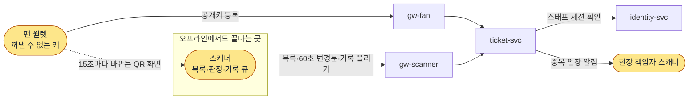

**트레이드오프**

| 정한 것 | 얻는 것 | 치르는 값 |
| --- | --- | --- |
| 오프라인에서 공개키로 판정 | 망이 끊겨도 입장이 멈추지 않는다(판정 p95 150ms, NFR-010). 스캐너를 잃어도 위조에 못 쓴다 | 오프라인 스캐너는 마지막 변경분 뒤의 양도·취소·다른 스캐너 입장을 모른다. 잃어버린 기기의 올라가지 않은 기록은 잃고, 그 안의 중복 입장은 찾지 못한다 |
| 브라우저 소프트웨어 키 | 앱 설치 없이 웹(PWA)으로 된다 | 루팅이나 프로필 복사로 키를 옮길 수 있다. 하드웨어 결속은 네이티브 앱에서만 되는데, 웹 앱 방침과 부딪쳐 하지 않는다 |
| 15초 회전 + ±30초 | 스크린샷은 곧 무효가 된다 | 화면 공유나 영상통화로 QR을 실시간 중계하는 것은 막지 못한다 |
| 회차 한정 스태프 역할 | 판정마다 스태프 계정이 남아 책임을 추적한다 | 해제된 스태프도 오프라인 스캐너에서는 역할이 끝날 때까지 쓸 수 있다(올라오면 '세션 밖 기록'으로 표시) |

**버린 길**: 회차별 공용 마스터 PIN(누가 했는지 남지 않고, 새면 전체를 다시 정해야 한다), 스캐너끼리 서버 없이 직접 동기화(웹 앱에 마땅한 표준이 없고 중개 서버가 필요하다), 티켓 번호 수동 입력(번호만 알면 통과한다)(ADR-0030·0051).

**꼬리 질문**

| 질문 | 답의 요지 | 근거 |
| --- | --- | --- |
| TOTP가 더 간단하지 않나요? | 검증하는 쪽에도 같은 비밀이 있어야 해서 스캐너 한 대 분실이 대량 위조가 된다 | ADR-0025 |
| 오프라인 스캐너 두 대에서 같은 티켓이 들어가면요? | 구역 분리로 먼저 막고, 같은 구역은 두 기록이 올라온 뒤 서버가 중복으로 표시한다. 올라오지 않은 기록은 찾지 못한다고 정직하게 말한다 | docs/features/offline-gate.md §7 |
| 양도 직후 옛 주인이 들어오면요? | 수락하면 옛 키를 바로 폐기하고, 온라인 스캐너는 약 1분 안에 거부한다. 입장이 시작되면 양도를 막는다 | docs/features/offline-gate.md §5 |
| 위조 통과 0건은 어떻게 확인하나요? | 운영에서는 직접 셀 수 없다. 시험으로 확인하고, 운영에서는 중복 입장 표시를 대신 본다 | docs/features/offline-gate.md §7.2 |
| 단기 아르바이트 스태프 계정은요? | 기존 계정으로 회차 초대를 수락해 회차 한정 역할을 받고, 휴대폰 승인으로 로그인한다. 비밀번호와 PIN이 없다 | ADR-0030, ADR-0051 |

**더 깊이**: [docs/features/offline-gate.md](../features/offline-gate.md) §0~§3·§5·§6·§7·§9 → [ADR-0025](../adr/0025-rotating-qr-device-key-signature.md)(본문의 '보안 저장소'는 옛 판) → [ADR-0051](../adr/0051-gate-process-end-to-end.md) 상태 줄과 docs/architecture.md §11.1의 ADR-0051 표. 분야 편 13 '현장 입장'이 이어 받는다.

## 15단계. 저장소 총정리 `꼭`

> **면접관에게**: "저장소를 정리하겠습니다. 데이터의 성격과 부하로 나눴습니다. 메모리 저장소인 Redis는 대기열, 좌석, 세션·캐시 셋으로 물리적으로 나눴습니다. 대기열 폭주가 좌석 예매로, 좌석 장애가 대기열로 번지지 않게 하려는 것입니다. 돈과 좌석, 티켓 소유권처럼 틀리면 안 되는 것은 PostgreSQL의 트랜잭션과 제약이 마지막을 지킵니다. PostgreSQL 클러스터는 다섯인데, 나눈 이유는 처리량이 아니라 격리입니다. 관제와 분석 숫자는 ClickHouse, 서비스 사이 사건은 Kafka, 회차가 끝난 집계는 S3의 파일입니다. 샤딩은 하지 않고, 쓰지 않기로 한 저장소마다 언제 다시 볼지 조건을 적어 두었습니다."

**저장소 지도**(docs/data.md §1)

| 저장소 | 담는 것 | 주인 | 나눈 이유 |
| --- | --- | --- | --- |
| Redis 대기열 | 순번, 1인 1순번 키, 로비 참가자, 셔플 결과, 빠진 번호, 입장 자리 | queue-svc, admission-ctrl | 대기열 폭주가 다른 기능으로 번지지 않게 |
| Redis 좌석 | 좌석 비트맵, 홀드, 펜싱 토큰, 보유 수, 구매 세션, 변경 채널 | purchase-svc(혼자 씀), realtime-gw(구독만) | 좌석 장애가 대기열로 번지지 않게. 회차 키를 한 샤드에 모아 스크립트 하나로 처리 |
| Redis 세션·캐시 | 로그인 세션, 요청 수 제한 카운터, 읽기 캐시, 봇 판정 피처 | 여러 서비스(접두사와 권한으로 나눔) | 키마다 '잃으면 어떻게 하나'를 등급으로 정하고, 키를 지우지 않는 설정과 모든 키의 만료를 둔다(ADR-0109) |
| PostgreSQL purchase | 주문, 결제 시도, 좌석 판매 행, 1인 한도, 홀드 원장, Outbox | purchase-svc | 판매 확정·한도 차감·주문 상태를 트랜잭션 하나로 |
| PostgreSQL payment | 결제 원장, 취소, 웹훅 기록, 대사, 정산 | payment-svc | 결제 비밀과 결제사 장애를 가둔다 |
| PostgreSQL ticket | 티켓 원장, 기기 공개키, 양도, 스캔 기록 | ticket-svc | 현장 입장 가용성. 도쿄 리전에 읽기 복제본 하나를 둔다 |
| PostgreSQL ops 전용 | 운영 명령 감사 로그, 승인 업무, CS 처리함 | ops-svc | 오픈 직전 로그인 몰림에도 명령 접수 약속을 지키려고(ADR-0102) |
| PostgreSQL 공유 | 계정·본인확인, 공연·회차·가격, 상품(JSONB), 검색 읽기 모델, 알림 발송 원장 | identity-svc, core-svc | 비용 때문에 클러스터는 함께 쓰고, 논리 DB와 계정은 따로 둔다 |
| ClickHouse | 원본·정리본·집계본(브론즈 90일, 실버 90일, 골드 2년), 관제 실시간 표 | 스트림 작업자, ops-svc | 분석·관제 부하를 거래 데이터베이스에서 뗀다. 잠정 숫자와 확정 숫자는 다른 표에 둔다(ADR-0042·0052) |
| Kafka(MSK 셋) | 거래 사건, 텔레메트리, 설정형 제어, 세션 종료 | 사건을 내는 서비스마다 | 클러스터를 거래·제어, 텔레메트리, 관측으로 나눠 장애와 권한을 격리 |
| S3 | 회차별 집계 Parquet 파일, 백업, 좌석 배치·랭킹·이미지 같은 공개 파일 | 데이터 엔지니어링, core-svc 등 | 개인정보 원본은 두지 않는다. 회차마다 한 번 쓰는 작은 집계라 표 형식(Iceberg) 대신 파일로(ADR-0115) |
| 브라우저 저장소(IndexedDB) | 월렛 서명 데이터와 기기 개인키, 스캐너 목록과 스캔 기록 큐 | 클라이언트 | 기기 개인키는 서버로 보내지 않는다 |

엔진 판은 Aurora PostgreSQL 18.x(18.6.1 이상), ClickHouse 26.8 LTS, Valkey 8.1 이상, 연결 풀 PgBouncer 1.26.1 이상이다(docs/data.md §1). Kafka는 MSK 브로커 3.9.x로 시작한다(ADR-0141 결정 3).

**일관성의 선택**(docs/data.md §4)

| 데이터 | 요구 | 어떻게 |
| --- | --- | --- |
| 판매 확정 | 강한 일관성(읽으면 늘 마지막으로 확정된 값) | 부분 유니크 인덱스 + 트랜잭션 |
| 좌석 홀드, 1인 한도 | 빠른 판정 + 최종 확정 | Redis 스크립트 + PostgreSQL 제약과 조건부 갱신 |
| 결제 원장, 환불, 정산 | 강한 일관성 + 멱등 | 트랜잭션 + 멱등 키·유일 제약 |
| 티켓 소유권 | 강한 일관성 | 행 잠금 + 버전 칸 비교 |
| 대기 순번, 공연 정보, 관제 지표 | 최종적 일관성(잠시 옛 값이 보여도 곧 같아짐) | CDN·캐시·조회 시점 집계 |
| 현장 스캔 기록 | 오프라인 우선, 나중에 맞춤 | 기기 저장소 → 업로드 → 서버 판정 |

트랜잭션 하나는 한 서비스의 한 데이터베이스 안으로만 한다. 서비스 사이는 Saga와 Outbox로 맞춘다(10단계).

**쓰지 않기로 한 저장소와 다시 볼 조건**(docs/architecture.md §6.1 '일부러 쓰지 않거나 미룬 기술')

| 기술 | 쓰지 않는 이유 | 다시 볼 조건 |
| --- | --- | --- |
| Cassandra | 맡기려던 데이터에 실시간 조회 길이 없고 ClickHouse로 충분하다(ADR-0004) | 원시 신호를 실시간으로 하나씩 조회해야 할 때 등 |
| CockroachDB | 한 리전이고 쓰기가 적다. 리전 장애를 견디려면 리전이 셋 이상 필요하고 쓰기 지연이 는다(ADR-0021) | 정본에 없다 |
| MySQL | 부분 유니크 인덱스가 없고 잠금 대기의 최소 단위가 1초다(ADR-0083) | 운영 조직이 MySQL 경험만 있을 때 |
| MongoDB(상품 정의) | 상품 정의 하나 때문에 저장소를 하나 더 운영해야 한다. JSONB로 같은 유연성을 얻고 상품·재고·주문을 한 트랜잭션에 둔다(ADR-0101) | 상품 유형이 수백 개로 늘고 속성 검색이 병목으로 재어질 때 등 |
| Elasticsearch | 지금 검색 대상과 양에는 PostgreSQL 검색 읽기 모델이면 충분하다(ADR-0094) | 본문 검색 요구, 대상 10만 건 `[가정]` 초과 등 |
| 주문·결제·티켓 월 파티션 | 5년치(주문 약 1,700만, 티켓 약 3,500만 행)가 표 하나로 감당된다(ADR-0114) | 한 달치 지우기가 정비 시간의 절반을 넘을 때, 5년 예상이 3배를 넘을 때 등 |

**그림: 저장소**

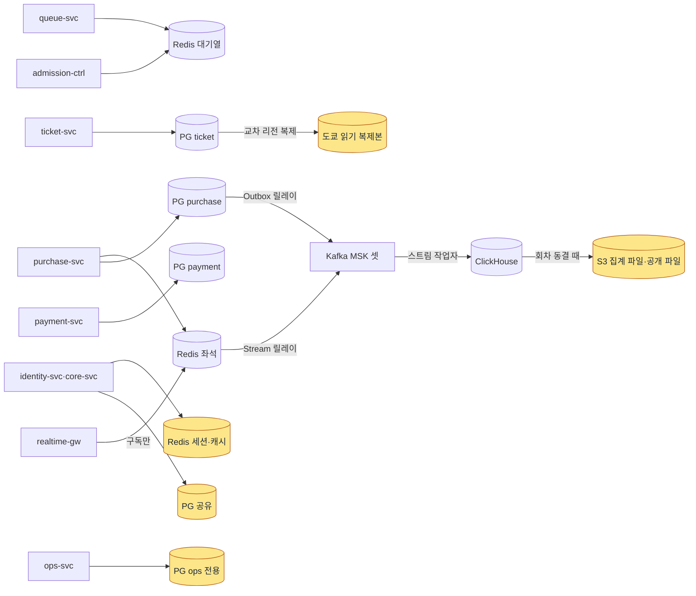

**트레이드오프**

- **얻는 것**: 장애가 저장소 사이로 번지지 않는다. 원장의 정합성은 데이터베이스 제약이 마지막에 지킨다. 분석·관제 부하가 거래 데이터베이스에 닿지 않는다.
- **치르는 값**: 좌석 홀드가 Redis에 있어 장애 조치 때 복제되지 못한 마지막 쓰기를 잃는다(8단계). 저장소가 여럿이라 서비스 사이 일은 Saga·Outbox·멱등 받기로 맞춰야 한다. 공유 클러스터는 비용 때문에 물리 서버를 함께 쓴다.

**꼬리 질문**

| 질문 | 답의 요지 | 근거 |
| --- | --- | --- |
| 왜 Redis를 셋으로 나눴나요? | 대기열 폭주가 좌석 응답 지연으로, 좌석 장애가 대기열로 번지지 않게 물리적으로 격리했다 | docs/data.md §1 |
| 왜 샤딩하지 않나요? | 판매 확정 초당 약 28건, 결제 접수 300 TPS, Outbox 초당 수천 건 이하라 쓰기 노드 하나로 받는다고 셈했다 `[실측 전]`. 한계에 이르면 셀 단위로 늘린다 | docs/architecture.md §9.1, ADR-0028 |
| 속성이 제각각인 상품은 왜 MongoDB가 아닌가요? | 저장소를 하나 더 운영하는 대가가 크고, JSONB와 스키마 검사로 같은 유연성을 얻으며, 상품·재고·주문을 한 트랜잭션에 둘 수 있다 | ADR-0101 |
| 관제 판매 숫자와 정산 숫자가 다르면요? | 잠정 숫자와 확정 숫자를 다른 표에 두고, 같은 지표를 두 번 계산해 대조한다 | docs/data.md §1, NFR-026 |
| 데이터베이스가 장애 나면요? | AZ(데이터센터 한 곳) 장애에서 PostgreSQL은 데이터 손실 0, 복구 5분이 목표다. 결제는 멱등 키 재시도로 흡수한다 | NFR-015, docs/infra.md §6 |

**더 깊이**: [docs/data.md](../data.md) §1·§4·§5·§3 → [docs/architecture.md](../architecture.md) §6.1 → [docs/infra.md](../infra.md) §6 → [ADR-0028](../adr/0028-postgres-no-sharding-cell-scaling.md) → [ADR-0114](../adr/0114-no-monthly-partitions-for-order-payment-ticket-batched-retention-delete.md). DB 설계 편 1~11이 이 단계를 하나씩 풀어 이어 받는다.

## 16단계. 고장 시나리오 점검 `꼭`

> **면접관에게**: "고장 시나리오를 한 번에 점검하겠습니다. 원칙은 이렇습니다. 입구와 서비스 두 층에서 빨리 실패시키고, 재시도는 한 층에서만 합니다. 돈과 좌석은 데이터베이스 제약이 마지막을 지킵니다. 좌석처럼 드물게 도는 대체 경로가 오히려 더 위험한 곳에는 대체 경로를 두지 않고 잠깐 미룹니다. 결제사가 아프면 같은 멱등 키로 기다리고, Kafka가 멈추면 결과를 직접 묻고, 공연장 네트워크가 끊기면 스캐너가 혼자 판정합니다. 리전 전체가 멈추면 자동으로 넘기지 않고, 판매를 멈춘 뒤 통제해서 복구합니다."

**시나리오 표**(docs/architecture.md §5·§7, 기능 설계서마다 '장애 시 동작')

| 장애 | 지금 동작 | 지키는 것 |
| --- | --- | --- |
| 좌석 Redis 장애 조치 | 그 회차 구매 요청을 503 + `Retry-After: 2` `[가정]`로 미루고, 동시 입장 목표를 절반으로 줄인다. 회복 뒤 세대를 올린다 | 오버셀 0, 미룬 시간 30초 이하 |
| 대기열 Redis 장애 조치 | 카운터를 넉넉히 건너뛰고 세대를 올린다. 건너뛴 구간은 빠진 번호로 센다 | 같은 세대 안 순번 중복 0. 1인 1순번 키를 잃어도 1인 한도는 DB가 지킨다 |
| 진입 과부하(p99 150ms 초과가 2분 `[가정]`, 또는 대기열 Redis CPU 75% 초과) | 엣지가 서명한 도착 시각 쿠키로 받고, 그 시각 칸마다 번호를 미리 뗀다 | 진입 확정 p99 1초, 칸 단위 도착 순서 |
| Redis 메모리 가득 | 키를 지우지 않고 새 쓰기를 오류로 돌려준다 | 조용히 잃지 않는다 |
| 결제사 승인 장애 | 같은 멱등 키로 재시도 큐(승인 기한 10분 안), 홀드 연장, 새 결제 정지. 단계적으로 다시 연다(ADR-0105) | 이중 결제 0, 기한을 넘긴 건은 돈을 받지 않고 만료 |
| 결제사 장애가 이어짐 | 사람이 명령 6으로 대체 결제사를 켠다 | 승인 요청을 보낸 결제는 결제사를 옮기지 않는다 |
| 승인 뒤 발권 실패 | 결제를 취소하지 않고 같은 주문 ID로 다시 발권한다. 30분 `[가정]` 넘으면 SEV1과 CS | 이중 발권 0 |
| Kafka(거래·제어) 정지 | 결제 결과는 직접 물어(`BatchGetPayments`) 확정을 이어 간다. 알림·관제 표·설정형 명령은 늦는다 | 승인 뒤 60초 불변식 |
| 서비스 하나가 느림 | 차단기가 열려 503, 칸막이가 차면 429로 바로 거절하고 대체 응답을 낸다 | 한 의존성의 지연이 다른 길로 번지지 않는다 |
| ops-svc 마비 | 비상 런북 작업이 같은 제어 gRPC로 명령을 넣는다 | 명령 전파 p99 10초 |
| admission-ctrl 리더 교체 | 새 리더가 세대를 올리고 제어 상태를 읽은 뒤 이어 간다 | 옛 리더 쓰기는 거절 |
| CDN 대기 상태 조회 장애 | 요청마다 S3 사본으로 넘기고 폴링을 두 배로 늦춘다 | 순번 일치, 차례 뒤 15분 안 입장 기회 |
| 공연 상세 원본 오류 | 마지막 정상 캐시본을 보여 주고 잔여석 대신 '판매 중' 문구를 쓴다 | 캐시 신선도 최대 10분 |
| CloudFront 전체·DNS 장애 | 판매를 멈추는 것 말고 대체 경로가 없다(ADR-0144 '남는 한계') | — |
| 공연장 네트워크 두절 | 스캐너가 로컬 목록으로 판정하고 기록을 쌓았다가 올린다 | 판정 p95 150ms, 위조 통과 0 |
| purchase DB 장애 조치 | 멱등 키 재시도로 흡수한다 | 복구 5분, 데이터 손실 0, 이중 결제 0 |
| 리전 전체 장애 | 자동 전환 없이 판매를 멈춘다. 당일 입장은 오프라인 판정, 주문·결제는 다른 리전의 일 스냅샷과 결제사 대사로 복원한다 | 주문·결제 데이터 손실 최대 24시간, 복구 24시간 안 |

**공통 원칙**(docs/architecture.md §5)

- 재시도는 메시 한 층에서 최대 1회만 하고, 상태를 바꾸는 요청은 입구에서 재시도하지 않는다. 헤지 요청은 쓰지 않는다.
- 파드의 준비 확인(readiness probe)에는 데이터베이스·Redis·Kafka·결제사 같은 공유 의존성을 넣지 않는다. 넣으면 의존성 하나가 죽을 때 모든 파드가 함께 빠져, 빠른 실패와 대체 응답도 못 하게 된다.
- 리더가 둘이 되는 일은 감지로 막지 않고 세대 번호로 막는다.
- 관리형 서비스(Aurora, ElastiCache)의 장애 조치 시간은 재지 않고 문서를 인용한다. 표의 복구 목표는 설계 목표다 `[실측 전]`.

**꼬리 질문**

| 질문 | 답의 요지 | 근거 |
| --- | --- | --- |
| 좌석 Redis가 죽는 동안 DB로 좌석을 주면 되지 않나요? | 두 곳이 같은 좌석을 줄 수 있다. 미룬 시간이 자주 30초를 넘거나 온세일 중 장애 조치가 분기에 한 번보다 잦으면 다시 보기로 했다 | ADR-0121 '되돌릴 조건' |
| Kafka가 통째로 죽으면 결제는요? | 긴급 명령과 대체 결제사 전환은 제어 gRPC라 Kafka를 거치지 않고, 결제 확정은 직접 묻기로 이어진다. 늦어지는 것은 알림과 관제 표다 | docs/features/payment.md §9, ADR-0140 |
| 게이트웨이 파드 절반이 죽으면 약속을 지키나요? | 지킨다고 약속하지 않는다. 남은 파드가 넘치는 요청을 503으로 덜어 내고, 그 503은 오류로 센다. 60초 `[가정]` 안에 파드 수를 회복하는지 본다 | ADR-0009 상태 줄 |
| 리전이 통째로 죽으면요? | 자동으로 넘기지 않는다. 판매를 멈추고 현장 입장은 오프라인으로, 주문·결제는 스냅샷과 대사로 복원한다 | docs/infra.md §6 |

**더 깊이**: [docs/architecture.md](../architecture.md) §5·§7 → [docs/features/seat-hold.md](../features/seat-hold.md) §9 → [docs/features/queue-admission.md](../features/queue-admission.md) §9 → [docs/features/payment.md](../features/payment.md) §9 → [docs/features/offline-gate.md](../features/offline-gate.md) §9 → [docs/infra.md](../infra.md) §4·§6 → [docs/observability.md](../observability.md) §12(Game Day 장애 연습 목록).

## 17단계. 트레이드오프 총정리와 확장 질문 `시간 남으면`

> **면접관에게**: "트레이드오프를 모으고 확장을 이야기하겠습니다. 이 설계의 가장 큰 선택은 '뒤쪽 부하를 대기 인원이 아니라 입장 속도로 묶는다'입니다. 그래서 200만 명이 되어도 바뀌는 곳은 진입, 순번 발급, 대기 상태 조회, 로비 사람 확인, 매진 공지, 관측처럼 대기 인원에 비례하는 곳이고, 좌석·결제·데이터베이스는 그대로입니다. 여러 공연이 동시에 열리면 좌석 Redis의 한 샤드에 회차가 겹칠 수 있어서, 그 최악을 PoC 통과 기준으로 두었습니다."

**트레이드오프 총정리**

| 결정 | 얻는 것 | 치르는 값 | 버린 길 |
| --- | --- | --- | --- |
| 대기 상태는 CDN 파일 + 적응형 폴링 | 원 서버 요청이 파일 수에 묶인다 | 먼 구간은 약 20초(흔들기, 파일 생성, 캐시, 낡은 값 허용을 더하면 최대 약 28초) 늦게 보이고 CDN 요금이 든다 | SSE, Sorted Set + `ZRANK` |
| 로비 셔플 + 공개 난수 | 속도 경쟁이 사라지고 결과를 누구나 검증한다 | 순번을 몇 초 늦게 알고 외부 난수에 기댄다 | 순수 선착순, 오픈 순간 사람 확인 |
| 동시 입장 목표 하나로 뒤쪽 부하를 묶음 | 대기 인원이 늘어도 좌석·결제 부하가 그대로다 | 매진 시간이 입장 속도에 묶인다 | 부른 번호가 모두 자리를 차지하는 방식 |
| 좌석은 Redis에서 잡고 PostgreSQL에서 확정 | p99 50ms와 오버셀 0을 함께 지킨다 | 장애 조치 때 마지막 쓰기를 잃고 구매를 미룬다 | `FOR UPDATE`, Redis만으로 확정, DB 비상 경로 |
| Saga + Outbox + 멱등 세 겹 | 끊겨도 이중 결제와 좌석 누수가 없다 | 결과 모름 처리와 재시도 큐를 만들어야 한다 | 동기 호출 체인, 승인 뒤 바로 취소 |
| 서비스 10개, 게이트웨이 다섯 | 진입만 늘리고 장애를 경계 안에 가둔다 | 분산 비용과 운영할 것이 는다 | 모놀리스, 14개 전면 분리 |
| 샤딩 없음, 셀 단위 확장 | 트랜잭션 하나로 처리하는 단순함 | 쓰기 노드 하나로 받는다는 셈은 아직 실측 전이다 | 공연 ID 샤딩, 분산 데이터베이스 |
| Flink 없이 스트림 작업자 + 조회 시점 집계 | 판매 숫자가 확정 숫자와 같은 SQL에서 나오고 언어가 하나다 | 규모가 크게 늘면 다시 봐야 한다(조건 넷) | Flink, RisingWave |
| Outbox는 폴링 릴레이 | 측정한 길과 운영 길이 같다 | 폴링 주기만큼 늦다 | Debezium |
| 100만 명은 실측하지 않음 | 지출 상한(5만 원) 안에서 증명한다 | 100만 명이 한꺼번에 돌 때만 생기는 상호작용은 증명하지 못한다 | 100만 실측, 목표를 20만으로 낮추기 |

**200만 명이면**(docs/architecture.md §9.2, 이론 분석)

| 영역 | 200만 명일 때 | 바꾸는 것 |
| --- | --- | --- |
| 진입 | 피크 약 40만 RPS | 비상용이던 엣지의 도착 시각 쿠키를 정상 경로로 쓴다. 대기열 API 배포 한도를 60만 `[가정]`으로 |
| 순번 발급 | 키 하나에 초당 40만 번 | 파드마다 모아서 한 번에 더하는 방식(`INCRBY`)을 기본으로 |
| 대기 상태 조회 | CDN 초당 약 10만 건, 파일 약 2,000개 | 원 서버 초당 약 2,000건. 뒤쪽 폴링을 20초에서 30초로 |
| 로비 사람 확인 | 초당 약 3,300건 | 늦어지면 로비를 15분 전에 연다 |
| 좌석, 좌석 변경 전파, 결제 접수, PostgreSQL | 그대로 | 동시 입장 목표가 뒤쪽 부하를 정하기 때문이다 |

**여러 공연이 동시에 열리면**(docs/architecture.md §9.5)

- 3년차 전망은 대형 1개 + 중형 4개가 동시에 열리는 것이다. 합산 동시 대기 300만 명, 합산 동시 입장 15,000명, 좌석 잡기 피크 초당 약 6,000건, 판매 확정 초당 약 84건이다. 결제 접수 피크는 첫 물결 상한에 묶여 300 TPS 그대로다.
- 오픈 간격 규칙(POL-030)으로 대형끼리는 최소 30분, 모든 공연은 최소 5분 떼어 연다. 그래서 진입 설계 기준은 공연 하나의 20만 RPS를 유지한다.
- 회차 키는 한 샤드에 모이지만, 회차끼리 다른 샤드에 흩어진다는 보장은 없다. 샤드 셋에 회차 셋이면 모두 다른 샤드일 확률이 6/27(약 22%)뿐이고, 회차 다섯이면 어딘가 반드시 겹친다. 그래서 겹친 최악(초당 약 6,000건)을 샤드 하나가 받는지를 PoC 통과 기준으로 두었다. 기반 PoC는 오버셀 0으로 받았지만 SLOWLOG 기준을 한 번 넘어, 정본대로 큰 회차 배치 규칙을 두었다(ADR-0176 결정 3).
- 5년이면 주문 약 1,700만, 티켓 약 3,500만 행이다. 파티션 없이 받는다고 셈했고, 5년 예상이 3배를 넘으면 파티션을 다시 고른다.
- 쿠버네티스 클러스터 하나로 가는 기준은 노드 1,000개, 파드 3만 개 `[가정]`다. 넘으면 셀로 나누는 것을 새 결정 기록으로 정한다.

**면접용 핵심 결정 10건**(docs/architecture.md §11)

| ADR | 어느 문제(K) | 한 줄 |
| --- | --- | --- |
| 0002 | K1 | 순번은 `INCR` + 빠진 번호 비트맵 |
| 0003 | K1 | 대기실은 적응형 폴링, SSE를 쓰지 않음 |
| 0014 | K2 | 좌석은 Redis에서 잡고 PostgreSQL 유니크로 확정 |
| 0028 | K3 | PostgreSQL은 샤딩하지 않고 셀 단위로 확장 |
| 0027 | K4 | 좌석 변경은 WebSocket |
| 0039 | K6 | 봇 탐지는 등급별 라벨 시험과 신뢰 구간으로 잰다 |
| 0015 | K7 | 결제사 2단계 승인을 좌석 일관성에 쓴다 |
| 0103 | K8 | 제어는 메시지가 아니라 받는 쪽 저장소의 상태다 |
| 0051 | K10 | 현장 입장 과정을 처음부터 끝까지 설계 |
| 0057 | 검증 | 100만은 실측하지 않고 규칙 검사와 부하 분해·외삽으로 증명 |

정본은 이 10건이 '핵심 결정'이 되려면 측정한 뒤 그 결과로 상태 줄을 고쳐야 한다고 적는다. 서비스 수준 측정이 없어 측정 뒤 고친 것은 아직 없다. 규칙 모델 검사는 2026-11-02에 ADR-0002·0057 상태 줄에 결과를 적었다.

**꼬리 질문**

| 질문 | 답의 요지 | 근거 |
| --- | --- | --- |
| 200만 명이면 무엇이 바뀌나요? | 진입, 순번 발급, 대기 상태 조회, 로비 확인, 매진 공지(CDN 용량만), 관측이 바뀐다. 좌석·결제·데이터베이스는 그대로다. 대기 인원에 비례하는 로그인과 봇 판정도 '그대로인 쪽'에 들지 않는다 | docs/architecture.md §9.2 |
| 여러 공연이 동시에 열리면 Redis가 버티나요? | 한 샤드에 겹칠 수 있어 최악(초당 약 6,000건)을 기반 PoC로 쟀다. 오버셀 0이었지만 SLOWLOG 기준을 한 번 넘어, 큰 회차를 다른 주 노드에 두는 배치 규칙을 정했다. 실제 배치표는 운영 홀드 Lua와 함께 만든다 | docs/architecture.md §9.2·§9.4, ADR-0176 결정 3 |
| 결제사 한도가 병목 아닌가요? | 첫 물결은 전진 속도로, 정상 상태는 리틀의 법칙으로 묶는다. 합산 동시 입장을 묶는 것은 결제사가 아니라 좌석·결제 계층 용량이다 | docs/architecture.md §9.1·§9.5 |

**더 깊이**: [docs/architecture.md](../architecture.md) §9.2·§9.5·§11·§11.1 → [docs/planning/01-overview.md](../planning/01-overview.md) §3.3 → [docs/streaming.md](../streaming.md) §16. 결정 카드가 이 표의 한 줄씩을 풀어 이어 받는다.

## 18단계. 어떻게 증명하나, 지금 어디까지 했나 `꼭`

> **면접관에게**: "무엇을 어떻게 증명하고 지금 어디까지 했는지 말씀드리겠습니다. 100만 명을 한 번에 돌리지는 않습니다. 대기 상태 조회 요청 요금만 약 273달러로, 이 프로젝트의 지출 상한 5만 원을 넘기 때문입니다. 대신 두 질문으로 나눕니다. '규칙이 맞는가'는 모델 검사, 모델 기반 시험, 장애 주입 뒤 기록 검사로 보고, '양을 버티는가'는 대기 인원과 관계없는 예매 계층을 실제 크기로 재고, 비례하는 부분만 설계 식으로 늘려 '외삽'이라고 표시합니다. 지금은 기반 단계입니다. 공용 모듈과 화면은 만들었지만 서비스 10개는 아직 없습니다. 기반 PoC는 PC 한 대에서 재서 결정 기록으로 남겼고, 대기열 규칙은 모델 검사를 했습니다. 서비스 수준의 측정은 아직 없습니다."

**두 질문**(docs/verification.md §1, ADR-0057)

| 질문 | 어떻게 | 결과를 말하는 방식 |
| --- | --- | --- |
| 규칙이 맞는가(차례 전 입장 0, 오버셀 0, 이중 결제 0) | 규칙 명세(Quint)의 모델 검사로 작은 범위의 모든 순서를 본다. 같은 규칙을 실제 코드에 무작위 순서로 넣는 모델 기반 시험(fast-check)을 한다. 장애를 넣은 뒤 기록을 검사한다(Toxiproxy, Jepsen 방식) | "검사한 범위 안에서 위반 없음"과 그 범위 |
| 양을 버티는가 | 부하를 대기 인원과 관계있는지로 나눈다. 관계없는 예매 계층(입장 초당 약 28명, 좌석 잡기 초당 2,000건, 결제 접수 300 TPS, 연결 5,000개)은 PC에서 실제 크기로 잰다. 비례하는 진입과 원 서버 응답은 일부 재고 설계 식으로 늘린다. CDN 조회와 셔플 결과 조회는 공개 한도와 대조한다 | 실측(PC), 외삽(설계 식), 문서 인용 |

**정직하게 재는 규칙**

- **외삽 규칙**: 측정점에 다항식을 맞춰 늘리지 않는다. 설계가 예측하는 식을 먼저 확인하고, 맞을 때만 그 식으로 100만을 계산한다.
  - 원 서버 응답 = 활성 파일 수 ÷ 캐시 수명: 1천·1만·10만 명 실측이 식의 ±10% `[가정]` 안인지 본다(docs/verification.md §3.4, ADR-0057 결정 6).
  - 진입 용량 = min(서버 대수 × 1대가 받는 도착률, Redis 한 키 처리량): 진입 서버를 늘려 가며 'N대가 1대의 N배를 내는 정도'가 0.9 `[가정]` 이상인지 본다. 처리량 곡선(USL) 맞추기는 보조 자료로만 쓴다(docs/verification.md §3.3, ADR-0096 결정 1·2).
- **측정 규칙**: 도착률을 고정하는 부하 방식(k6 오픈 모델)으로 잰다. 못 보낸 요청이 하나라도 있으면 그 측정은 무효다. 부하 발생기 CPU는 80% 이하로 두고, 3회 재서 중앙값을 쓴다. 무효 측정도 지우지 않고 남긴다(docs/perf-ledger.md §3).
- **최소 시행 수**: '99.9% 이상'을 실패 0건으로 보이려면 최소 2,995번, p99는 299번을 시행해야 한다(docs/perf-ledger.md §7).
- **표시**: 모든 숫자에 실측(PC), 실측(클라우드), 외삽, 문서 인용, 설계 목표, 하한선 중 하나를 붙인다.

**지금 어디까지 했나**(2026-11-02)

| 항목 | 상태 |
| --- | --- |
| 빌드 순서 | 300단계 중 47단계를 끝냈다(2026-11-03). 최소 기반 28단계 중 27단계(원격 저장소가 있어야 하는 FND-160만 남음), v0 베이스라인은 기술 블로그(BSL-100)만 남았고, 증명 핵심 24단계 중 11단계다(docs/BUILD_ORDER.md) |
| 만든 것 | 전체 화면 퍼블리싱, 사후 포렌식 문서와 화면, 공용 플랫폼 모듈(서비스 틀, 멱등, Outbox 릴레이, 차단기, Kafka 공용 모듈), 로컬 쿠버네티스(kind) 클러스터와 CI, 기반 PoC 측정 틀, 규칙 모델 검사 도구와 대기열·좌석·결제 명세, v0 대기열·좌석·결제·검표와 그 배포(BSL-020~050), 불변식 검사기와 결제사 시뮬레이터(BSL-010), k6 시나리오와 발생기 보정(BSL-060), 로그인·토큰·본인확인 시험 어댑터(PRF-010~040), 대기열 queue-svc와 입장 제어 admission-ctrl(PRF-050~100) |
| 아직 없는 것 | 좌석 홀드·주문·관제 등 나머지 v1 서비스(`services/`에는 identity-svc·queue-svc·admission-ctrl·payment-svc와 v0 모놀리스, 시험 도구 둘이 있다), 입장 확정(PRF-110) |
| 잰 것 | 기반 PoC(FND-120): 성능 장부에 실행 143개, 숫자는 실측(PC). 규칙 모델 검사(FND-130~150): 대기열·좌석·결제 명세 검사 기록, 정본의 틈은 OPEN[13]~OPEN[16]으로 물어 2026-11-02 모두 추천안대로 정했다(docs/verification.md §2.6). 진입 Lua 한 키 재측정(PRF-070, 기준을 넘어 ADR-0179). v0의 K1~K10 기준선(BSL-090, 실측(PC), docs/verification.md §3.10). v1의 K1~K10 측정은 아직 없다 |
| PoC 판정(ADR-0176 채택) | Redis 한 키는 묶음 없이 직접 `INCR`(초당 20만 건 p99 중앙값 42.9ms, 기준 200ms). 2026-11-03 실제 진입 Lua로 다시 재 기준을 넘어 파드별 2ms 묶음으로 바꿨다(ADR-0179). Redis 클라이언트는 PoC에서 판정 보류였고 2026-11-02 소유자가 node-redis로 정했다(OPEN[11]). 좌석 샤드는 큰 회차 배치 규칙, 만료 작업은 한 번에 100석 `[가정]`. HTTP는 Fastify에 좌석 홀드는 경로 스키마, 대기열 진입은 Zod 파이프. Kafka는 Confluent 클라이언트 확정 |
| 다음 | 증명 핵심의 나머지: 진입·대기열 측정 묶음(PRF-085), 입장 확정(PRF-110) 등(docs/BUILD_ORDER.md) |

현황은 빌드 루프가 계속 바꾼다. 면접 직전에 다시 확인한다. [현황 한 장](00-status.md)이 이 표를 이어 받는다.

**근거가 비어 있는 곳**(docs/review/open-items.md 86번)

- 동시 입장 목표 상한 8,000명을 고른 이유
- Java·Spring과 견준 근거

둘 다 소유자가 정할 일로 남아 있다. 해설서 검토가 찾은 설계 빈칸 14개도 같은 목록 87~100번에 있다. 면접 전에 정해 결정 기록으로 남겨 두는 편이 좋다.

**꼬리 질문**

| 질문 | 답의 요지 | 근거 |
| --- | --- | --- |
| 100만 명을 실제로 돌려 봤나요? | 아니다. 요청 요금만 약 273달러(약 38만 원)로 상한 5만 원을 넘는다. 그래서 100만 숫자에는 '외삽'이 붙는다 | docs/verification.md §1.2 |
| 외삽을 어떻게 믿나요? | 설계 식이 작은 규모 실측과 맞는지 먼저 본다. 맞지 않으면 그 식으로 100만을 계산하지 않는다 | ADR-0057 결정 6, ADR-0096 결정 1 |
| 동시성 버그는 부하 시험으로 잡히나요? | 잘 안 잡힌다. 그래서 모델 검사와 모델 기반 시험, 장애 주입 뒤 기록 검사를 따로 한다 | ADR-0057 결정 2~4 |
| 지금 실제로 잰 것은요? | 기반 PoC 다섯 가지를 PC 한 대에서 쟀다. "실측(PC)"이라고 말하고 운영 규모 증거로 쓰지 않는다. 서비스 수준 측정(K1~K10)은 아직 없다 | ADR-0176, docs/perf-ledger.md §5 |

**더 깊이**: [docs/verification.md](../verification.md) §1·§3.1·§3.3·§8 → [ADR-0057](../adr/0057-verification-without-full-scale-infra.md)(상태 줄 먼저) → [docs/architecture.md](../architecture.md) §9.3·§9.4 → [docs/perf-ledger.md](../perf-ledger.md) §2.1·§3·§4·§7 → [docs/PROGRESS.md](../PROGRESS.md). 분야 편 22 '검증과 측정'이 이어 받는다.

## 마무리: 완성된 그림

18단계를 지나 완성된 구조다. 이 그림 하나를 손으로 그리며 1단계부터 다시 말할 수 있으면 이 문서의 목표에 닿은 것이다.

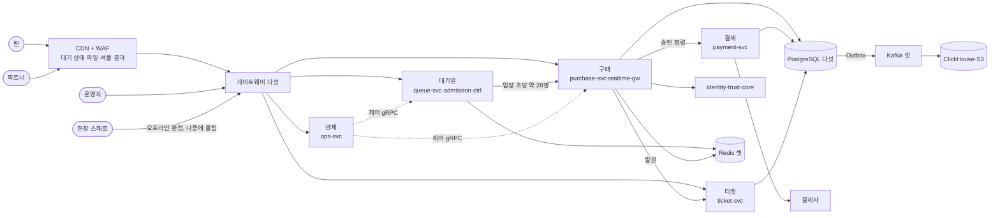

**2분 소개의 뼈대**: 아래 순서로 직접 말을 만들어 연습한다. 문장은 자기 말로 바꾼다.

1. 무엇을 만드나: 100만 명 동시 대기 티케팅과 관제, 목표 셋(멈추지 않음, 오버셀 0, 사람에게 표)
2. 어디가 어려운가: DB 쓰기가 아니라 대기 상태 조회, 정각 진입, 좌석 변경 전파(초당 약 28건이라는 숫자와 함께)
3. 핵심 해법 셋: 대기 상태는 CDN 파일과 적응형 폴링, 좌석은 Redis에서 잡고 PostgreSQL로 확정, 뒤쪽 부하는 동시 입장 목표 하나로 묶기
4. 어떻게 증명하나: 규칙 검사와 부하 분해, 100만은 외삽으로 표시
5. 지금 어디까지: 기반 단계, 기반 PoC 판정(실측(PC)), 서비스 수준 측정 전

**연습**: 단계 하나를 읽은 뒤 Claude에게 "한 판 문서 8단계 면접해 줘"라고 부탁한다. 연습하는 법은 [README.md](README.md) §6에 있다.
