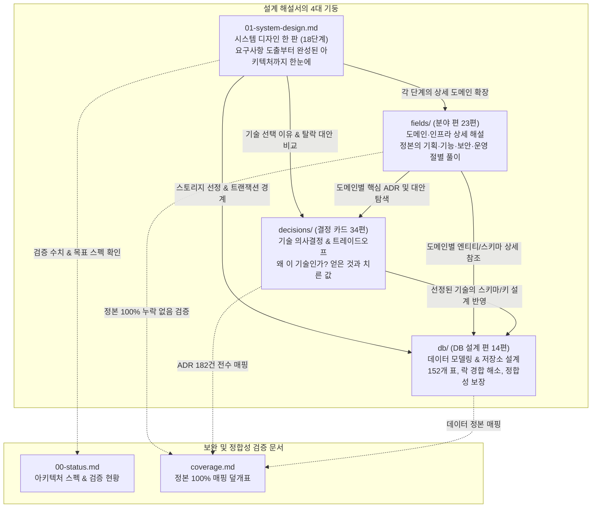
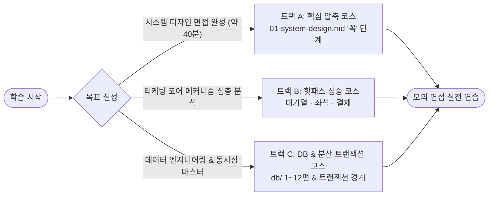

# PEAKET 아키텍처 해설서: 길잡이

PEAKET의 대규모 분산 티케팅 아키텍처 전체(`docs/` 정본)를 깊이 있게 이해하고, 시스템 디자인 면접에서 10초·30초·3분 단위로 유연하게 설명하며 다각도의 꼬리 질문을 방어할 수 있도록 돕는 루트 가이드입니다.

> [!NOTE]
> **해설서의 성격과 원칙**  
> 이 해설서는 정본(`docs/`)의 설계를 알기 쉽게 풀어낸 문서이며 새로운 결정을 내리지 않습니다. 모든 수치와 규칙은 정본을 따르며, 정본에 근거가 없는 내용은 다루지 않습니다([ADR-0177](../adr/0177-walkthrough-explain-in-interview.md)). 숫자나 규칙에 상충이 있다면 정본이 언제나 우선합니다.

---

## 1. PEAKET 분산 시스템 3대 핵심 난제와 멘탈 모델

일반적인 대규모 웹 서비스(SNS, 콘텐츠 플랫폼, 일반 커머스)의 핵심 과제는 **'대규모 읽기 트래픽의 분산'**입니다. 읽기 트래픽은 CDN 캐싱, 리드 레플리카(Read Replica), 분산 캐시(Redis) 등을 통해 비교적 수월하게 스케일아웃할 수 있습니다.

하지만 **초대형 공연 티케팅 시스템**은 본질적으로 다릅니다. 특정 시점(정각 티켓 오픈)에 수십만에서 100만 명의 사용자가 단 5만 석에 불과한 **한정된 비대체성 재화(Non-fungible Inventory)**를 동시에 점유하려고 몰려듭니다. 이로 인해 극단적인 **쓰기 핫스팟(Write Hotspot) 경합**과 **동시성 제어**, 그리고 **엄격한 원장 정합성**이 동시에 요구됩니다.

PEAKET은 이 문제를 다음 세 가지 핵심 축으로 해결합니다.

```
[100만 유입 트래픽 제어]       [초고동시성 좌석 쓰기 경합]       [결제 2단계 정합성 보장]
   입구 피크 20만 RPS               인기 좌석 1:1000 경합             외부 PG 부분 실패 격리
           │                                 │                                 │
           ▼                                 ▼                                 ▼
대기열 격벽 & CDN 폴링 흡수         Soft Hold(Redis) + Hard Sale(PG)     인증-승인 분리 & 전진 복구
(백엔드 유입 초당 ~28명 고정)             (오버셀 0건 보장)                 (이중결제 0건, 발권 보장)
```

### ① 100만 유입 트래픽과 대기열 제어 (Massive Influx & Queue Admission)
- **도전 과제**: 오픈 정각(T=0) 순간 최대 **피크 20만 RPS**(로비 셔플 미적용 최악 시나리오, 10초 내 100만 명 유입 가정)의 진입 트래픽이 쏟아집니다. 이를 데이터베이스나 코어 서비스로 그대로 흘려보내면 커넥션 풀 고갈과 전면 장애로 이어집니다.
- **아키텍처 해법**:
  1. **부하 차단벽(Rate Limiting & Admission Barrier)**: 대기열 시스템이 뒤편 좌석/결제 계층의 인입 속도를 엄격하게 제한합니다. 좌석 화면 동시 체류 인원을 **5,000명**, 평균 체류 시간을 **180초**로 통제함으로써, 초당 신규 입장 속도를 **초당 약 28명(5,000명 ÷ 180초)**으로 고정합니다. 대기자가 10만 명이든 100만 명이든 정상 상태의 최종 DB 쓰기(판매 확정)는 **초당 약 28건(28 TPS)**을 넘지 않으므로 RDBMS 단일 인스턴스로도 안정적으로 처리할 수 있습니다.
  2. **CDN 기반 대기 상태 폴링 흡수**: 대기 중인 100만 사용자의 주기적인 순번 확인 요청(초당 약 5.4만 RPS)을 오리진 서버가 직접 감당하지 않습니다. 1,000명 단위의 대기열 상태 파일을 생성하고 **CDN 1초 캐싱**을 적용하여, 원 서버로 유입되는 실제 요청을 **초당 약 1,000건(1/50 이하)** 수준으로 대폭 축소합니다.
  3. **공정한 순번 보존 (Fair Ordering)**: 오픈 10분 전부터 대기실(로비)에 모인 사용자는 공개 난수 비콘(drand) 기반의 **로비 셔플(ChaCha20 결정론적 무작위 정렬)**을 통해 공정하게 무작위 순번을 부여받아 매크로 선점을 무력화합니다. 정각 이후 유입자는 Redis의 원자적 **Atomic INCR**을 통해 밀리초 단위의 정확한 선착순 순번을 보장받습니다.

### ② 좌석 쓰기 경합과 오버셀 0건 (Hotspot Write Contention & Zero Over-selling)
- **도전 과제**: 5만 석 규모 대형 공연장에서 팬들이 선호하는 VIP석이나 앞 열 특정 좌석 1개를 두고 수백~수천 명이 1초 안에 동시에 클릭합니다(NFR-003 시험: 1좌석 1,000명 경합). 전통적인 RDBMS 행 잠금(`SELECT ... FOR UPDATE`)을 사용하면 대규모 락 대기(Lock Contention)로 인해 지연 시간(p99)이 수 초 이상 치솟고 교착 상태(Deadlock)가 발생합니다.
- **아키텍처 해법 (2-Phase Seat Allocation)**:
  1. **1단계 Soft Hold (In-Memory)**: 좌석 전용 Redis 클러스터에서 단일 Lua 스크립트로 동작합니다. 좌석 1개당 1비트로 표현된 전체 좌석 비트맵과 1인당 매수 한도(최대 4매), 판매 일시정지 여부를 원자적으로 검사하고 점유합니다. RDBMS 쓰기 없이 인메모리에서 즉각 처리되므로 **p99 50ms** 이하의 초저지연 응답을 제공합니다. (선점된 좌석은 기본 **7분 TTL**이 부여되며 1회 3분 연장이 가능하고, 미결제 만료 시 1초 주기 회수 및 3초 내 재노출됩니다).
  2. **2단계 Hard Sale (RDBMS)**: 결제사 승인 직전, PostgreSQL의 `seat_sale` 테이블에 `PENDING` 상태의 판매 행을 기록합니다. 이때 좌석별 부분 유니크 인덱스(`WHERE status IN ('PENDING', 'SOLD')`)가 동작하여 단 하나의 활성 판매 행만 허용합니다. 만에 하나 Redis 계층의 장애 조치(Failover) 등으로 잃어버린 쓰기(Lost Write)가 발생하더라도, DB 레벨에서 중복 판매를 원천 차단하여 **오버셀 0건** 불변식을 수학적으로 보장합니다.

### ③ 결제 2단계 정합성과 전진 복구 (Two-Phase Payment Consistency & Forward Recovery)
- **도전 과제**: 외부 PG(토스페이먼츠, 포트원)와의 통신은 인터넷 구간을 거치므로 타임아웃, 네트워크 단절, 지연 응답 등 부분 실패(Partial Failure)가 불가피합니다. 외부 결제와 내부 주문/티켓 발권 간에 정합성이 깨지면 '돈은 빠져나갔는데 티켓이 없는 사고'나 '표는 나갔는데 돈이 안 들어오는 사고'가 발생합니다.
- **아키텍처 해법**:
  1. **PG 2단계(인증-승인) 구조 활용**: 결제창에서 소비자가 본인 인증을 마쳐도 가맹점 서버가 최종 승인(Confirm) API를 호출하기 전까지는 실제 결제가 이루어지지 않습니다.
  2. **승인 전 사전 예약(PENDING)**: 결제 접수(초당 최대 300 TPS 상한) 시, 먼저 PostgreSQL에 좌석 판매 행을 `PENDING`으로 성공적으로 기록한 주문에 대해서만 PG 승인 API를 호출합니다. 경합에서 밀려 `PENDING` 기록에 실패한 주문은 PG 승인 호출 자체를 생략하므로, 결제가 일어나지 않으며 번거로운 사후 환불 비용도 발생하지 않습니다.
  3. **승인 시점(Pivot Point) 이후 전진 복구 (Forward Recovery)**: PG 승인이 성공하여 금융 거래가 성립된 이후, 만약 내부 티켓 발권 서비스(ticket-svc) 장애로 발권이 지연되더라도 **절대로 결제를 취소하거나 환불하지 않습니다**. 승인은 분산 트랜잭션의 되돌릴 수 없는 고비(Pivot)이므로, 동일한 주문 ID(멱등성 보장) 기반의 재시도 큐를 통해 발권이 완료될 때까지 작업을 밀어붙이는 **전진 복구(Forward Recovery)**를 수행하여 팬의 티켓 권리를 끝까지 지킵니다.

---

## 2. 해설서 아키텍처 맵: 서브 디렉터리의 유기적 관계

해설서는 단일 문서의 나열이 아니라, **시스템 디자인 18단계 흐름(한 판 문서)**을 척추로 삼고 각 도메인과 기술 선택, 데이터베이스 스키마가 유기적인 그물망으로 연결되어 있습니다.



### 4대 기둥의 상호 참조 관계
- **[한 판 문서 (01-system-design.md)](01-system-design.md)**를 읽다가 특정 기능의 세부 구현이나 프로토콜이 궁금하면 **[분야 편 (fields/)](fields/01-why-and-what.md)**으로 이동합니다.
- "왜 이 기술이나 전략을 선택했는가?"에 대한 정량적 트레이드오프와 탈락 대안이 궁금하면 **[결정 카드 (decisions/)](decisions/README.md)**를 확인합니다.
- 데이터 정합성, 인덱스 구조, 락 메커니즘, Redis 키 설계의 실체가 궁금하면 **[DB 설계 편 (db/)](db/01-what-and-how-much.md)**을 함께 확인합니다.
- **[현황 한 장 (00-status.md)](00-status.md)**은 설계 목표와 실제 벤치마크 실측 수치(`ADR-0176`), TLA+/Quint 명세 검사 현황을 파악할 때 참고합니다.
- **[덮개 표 (coverage.md)](coverage.md)**는 정본의 모든 요구사항(FR, NFR), 정책(POL), ADR이 해설서에 누락 없이 반영되었는지 점검하는 색인입니다.

---

## 3. 면접관 5단 꼬리 질문 프레임워크 (5-Tier Defense Framework)

시스템 디자인 면접에서는 단순히 "무엇을 썼다"를 나열하는 것으로는 충분하지 않습니다. 면접관은 설계의 한계점과 경계 조건을 확인하기 위해 꼬리 질문을 던집니다.

해설서의 모든 문서는 아래 **5단계 심층 방어 프레임워크**를 바탕으로 서술되어 있습니다.

```
[1단: 왜 그렇게 했나?]
  └─ 풀려는 문제의 본질과 제약 조건(트래픽 수치, 비즈니스 규칙) 정의
       │
       ▼
[2단: 다른 대안은 없었나?]
  └─ 검토했던 경쟁 대안들과 이를 기각한 기술적/비용적 이유 (트레이드오프)
       │
       ▼
[3단: 그 컴포넌트가 고장 나면?]
  └─ 부분 실패 격리, 폴백 모드(Degraded), 데이터 일관성 복구 전략
       │
       ▼
[4단: 그 숫자의 근거는 무엇인가?]
  └─ 트래픽 모델, 하드웨어 한계, 체류 시간 기반의 명확한 어림 계산식
       │
       ▼
[5단: 실제로 검증해 보았는가?]
  └─ 단일 머신 PoC 실측 데이터, 검증 한계 인정, 프로덕션 검증 로드맵
```

### 5단 프레임워크 실전 적용 예시표

| 단계 | 면접관의 꼬리 질문 | 평가 의도 | 답변 핵심 공식 및 PEAKET 실전 대응 예시 |
| :--- | :--- | :--- | :--- |
| **1단: 왜?** | "왜 대기 상태 조회를 웹소켓이 아닌 CDN 폴링으로 처리했나요?" | 문제 인식의 정확성과 병목 지점 이해도 | **공식: 문제의 크기(숫자) + 가장 단순하고 강력한 격벽 메커니즘**<br/>"100만 대기자에게 웹소켓을 유지하면 100만 개의 장기 연결 커넥션 비용과 브로드캐스팅 팬아웃 부하로 게이트웨이가 마비됩니다. 1초 캐싱된 정적 JSON 파일을 CDN 엣지에서 서빙하면 5.4만 RPS의 조회를 엣지에서 흡수해 원 서버 유입을 1,000 RPS 이하로 98% 이상 깎아낼 수 있기 때문입니다." ([D01](decisions/D01-queue-status-cdn-polling.md)) |
| **2단: 대안은?** | "좌석 선점을 왜 DB `SELECT FOR UPDATE` 대신 Redis Soft Hold로 구현했나요?" | 기술 선택의 폭과 트레이드오프(득과 실) 저울질 능력 | **공식: 버린 대안의 한계점(파탄 임계치) 명시 + 채택 대안의 비용(치른 값)**<br/>"단일 좌석에 1,000명이 동시 경합할 때 RDBMS 비관적 락은 락 큐 대기로 p99가 수 초로 치솟고 교착(Deadlock)이 빈발합니다. 반면 완전 메모리 DB는 장애 조치 시 데이터 유실 위험이 있습니다. 그래서 Redis 비트맵(Soft Hold, p99 50ms)으로 고속 선점하고, PostgreSQL 부분 유니크 인덱스(Hard Sale)로 오버셀을 최종 방어하는 2단계 하이브리드를 택했습니다." ([D06](decisions/D06-seat-soft-hold-hard-sale.md)) |
| **3단: 고장 나면?** | "PG 결제 승인은 성공했는데 티켓 발권 서비스가 다운되면 어떻게 되나요?" | 부분 실패(Partial Failure) 처리 및 분산 트랜잭션 이해도 | **공식: 되돌릴 수 없는 고비(Pivot Point) 정의 + 전진 복구(Forward Recovery)**<br/>"PG 승인은 돈이 인출된 피벗 포인트이므로 섣불리 취소/환불하지 않습니다. 취소 시 팬의 선점권이 부당하게 박탈되기 때문입니다. 동일 주문 ID 기반의 멱등성을 보장하며, Outbox 패턴과 Kafka 재시도 큐를 통해 발권 서비스가 복구될 때까지 끝까지 발권을 완수하는 '전진 복구'를 수행합니다." ([D08](decisions/D08-payment-two-phase-forward-recovery.md)) |
| **4단: 수치 근거는?** | "DB 판매 확정 쓰기가 초당 28건(28 TPS)에 불과하다는 계산은 어디서 나왔나요?" | 시스템 용량 산정(Capacity Estimation) 및 수학적 도출 능력 | **공식: 기본 가정 파라미터 → 유도 공식 → 최종 결과**<br/>"5만 석 대형 공연장 기준, 좌석 선택 화면 동시 체류 인원은 5,000명이고 사용자 평균 체류 시간은 180초입니다. 입장 속도는 `5,000명 ÷ 180초 ≈ 초당 28명`입니다. 들어온 사용자가 100% 티켓을 구매한다고 가정해도 정상 상태의 최종 DB 쓰기는 초당 약 28건에 불과합니다. 따라서 DB 샤딩 없이 단일 인스턴스로 충분합니다." ([한 판 2단계](01-system-design.md#2단계-규모-어림-어디가-진짜-병목인가-꼭)) |
| **5단: 실제 검증은?** | "Redis가 그 속도를 실제로 낼 수 있는지 직접 재 보셨나요?" | 엔지니어링의 정직성과 실증적 검증(Empirical Verification) 능력 | **공식: 실측 조건과 측정값 명시 + 관찰된 한계점 + 개선 조치**<br/>"PC 단일 노드 기반 PoC 벤치마크(`ADR-0176`)에서 단순 INCR은 초당 20만 건(p99 42.9ms)을 견뎠습니다. 그러나 쿼터 검사를 포함한 복합 Lua 스크립트는 8~9만 RPS에서 Redis 단일 스레드 CPU 포화가 관찰되었습니다. 이를 해결하기 위해 진입 게이트웨이 파드마다 2ms 요청 배치(Batching) 최적화를 아키텍처에 추가 반영했습니다." ([00-status.md](00-status.md)) |

---

## 4. 해설서 구성 상세

### 4.1 전체 문서 일람
해설서는 목적과 깊이에 따라 다음과 같이 구성되어 있습니다.

| 문서군 | 파일 및 경로 | 주요 역할 | 추천 활용 시점 |
| :--- | :--- | :--- | :--- |
| **한 판 문서** | [01-system-design.md](01-system-design.md) | 요구사항에서 완성된 아키텍처까지 18단계로 완성하는 시스템 디자인 총괄 가이드 | 전체 아키텍처 조망 및 인터뷰 전체 모의 연습 시 |
| **현황 한 장** | [00-status.md](00-status.md) | 실제 PoC 실측 수치, 명세 모델 검사, 설계 목표값의 증거 수준 요약 | "실제로 측정해 보았는가?" 질문 대비 직전 점검 |
| **분야 편 (23편)** | [fields/](fields/01-why-and-what.md) | 도메인, 보안, 인프라, 비기능 요구사항을 23개 주제별로 정본과 1:1 매핑해 상세 해설 | 특정 도메인(대기열, 좌석, 결제 등)의 심층 원리가 필요할 때 |
| **결정 카드 (34편)** | [decisions/](decisions/README.md) | 34개 핵심 기술 선택의 이유, 탈락 대안, 득과 실, 변경 조건(Change Trigger) 정리 | 기술 선택의 이유와 트레이드오프 꼬리 질문 대비 시 |
| **DB 설계 편 (14편)** | [db/](db/01-what-and-how-much.md) | 저장소 선정, 락/트랜잭션, Redis 키 설계, 전사 152개 테이블 사전 | 데이터베이스 모델링 및 정합성 집중 면접 대비 시 |
| **덮개 표** | [coverage.md](coverage.md) | 정본의 모든 FR, NFR, POL, SCR, CMP, ADR 182건이 해설서 어디에 반영되었는지 전수 검증 | 해설서 내용의 정합성과 누락 여부 확인 시 |

---

### 4.2 분야 편 (23편) 상세 안내

'면접 중요도'는 시스템 디자인 인터뷰에서 빈출되는 비중과 설명의 필수성을 의미합니다.
- **상 (필수 설명)**: 핵심 메커니즘을 백지에 직접 그리고 수치와 꼬리 질문까지 완벽히 설명할 수 있어야 합니다.
- **중 (핵심 이해)**: 아키텍처 상의 위치와 다른 서비스와의 연계 인터페이스를 설명할 수 있어야 합니다.
- **하 (참조 및 탐색)**: 구조의 존재 목적과 문제 발생 시 찾아갈 위치를 이해하는 수준으로 읽습니다.

| 번호 | 분야 편 | 다루는 주제 및 연계 정본 | 중요도 |
| :---: | :--- | :--- | :---: |
| 1 | [무엇을 왜 만드나](fields/01-why-and-what.md) | 통신판매중개자 법적 지위, 파트너 정산 구조, 공연법 개정 대응 | **상** |
| 2 | [요구사항 FR·NFR](fields/02-requirements.md) | 기능 요구 74건, 비기능 품질 요구 28건(지연시간, 가용성, 신뢰성) | **상** |
| 3 | [정책과 용어](fields/03-policies-glossary.md) | 1인 매수 제한, 취소 수수료율, 티켓 양도 불가 정책(POL-001~046) | 중 |
| 4 | [화면 흐름](fields/04-screens-and-flows.md) | 소비자 대기실, 좌석 배치도, 결제창, 파트너 콘솔 등 71개 화면 흐름 | 중 |
| 5 | [디자인 시스템](fields/05-design-system.md) | 접근성 표준(WCAG), 디자인 토큰, 모바일 반응형 원칙 | 하 |
| 6 | [프론트엔드 구조](fields/06-frontend.md) | Next.js App Router, SSR/CSR 경계, OffscreenCanvas 좌석 렌더링 | 중 |
| 7 | [API 규칙과 계약](fields/07-api-contracts.md) | REST 가이드라인, Protocol Buffers(gRPC), Avro 이벤트 스키마 계약 | 중 |
| 8 | [로그인·본인확인·계정](fields/08-identity.md) | 소셜 OAuth2, 휴대폰 본인확인(CI), 디바이스 바인딩, 세션 탈취 방어 | **상** |
| 9 | [대기열·입장](fields/09-queue-admission.md) | 로비 셔플(drand), Redis INCR 순번, 진입 속도 제어 루프, 3단계 토큰 체계 | **상** |
| 10 | [좌석](fields/10-seat-hold.md) | Soft Hold(Redis Lua 비트맵) + Hard Sale(PG 승인 전 유니크 인덱스) | **상** |
| 11 | [결제](fields/11-payment.md) | 토스페이먼츠/포트원 연동, 결제 2단계 분리, 주문 Saga, 전진 복구 | **상** |
| 12 | [양도·환불·정산](fields/12-transfer-refund-settlement.md) | 직계가족 소명 양도, 취소 수수료 계산, PG사 정산금 지급대행 원리 | **상** |
| 13 | [현장 입장](fields/13-offline-gate.md) | Ed25519 동적 서명 QR, 게이트 단말 오프라인 스캔, 로컬 SQLite 동기화 | **상** |
| 14 | [봇 방어](fields/14-bot-defense.md) | Cloudflare Turnstile, 행동 분석 점수화, PoW(작업증명) 동적 난이도 조절 | **상** |
| 15 | [알림·검색](fields/15-notify-search.md) | 대기열 진입 카카오 알림톡, Elasticsearch 공연 검색 및 캐싱 전략 | 중 |
| 16 | [관제탑](fields/16-control-tower.md) | 실시간 유입 모니터링, 판매 일시정지 킬스위치(명령 3), 긴급 통제 프로토콜 | 중 |
| 17 | [분석·사후 포렌식](fields/17-analytics-forensics.md) | 온세일 타임라인 이벤트 재생, 이상 티케팅 포렌식 조사 도구 | 중 |
| 18 | [이벤트 흐름](fields/18-streaming.md) | Kafka 토픽 설계, Outbox 패턴 폴링 릴레이, Exactly-Once 소비 보장 | 중 |
| 19 | [관측](fields/19-observability.md) | OpenTelemetry 분산 트레이싱, Prometheus 지표, 온세일 전용 골든 시그널 | 중 |
| 20 | [인프라·배포](fields/20-infra-devops.md) | AWS EKS, CloudFront 다중 배포, Istio 서비스 메시, 사전 스케일링 | 중 |
| 21 | [보안](fields/21-security.md) | OWASP ASVS L2 준수, 키 격리, 개인정보 암호화 보관 및 파기 절차 | **상** |
| 22 | [검증과 측정](fields/22-verification.md) | 부하 테스트 시나리오, 카오스 엔지니어링, TLA+/Quint 명세 모델 검사 | **상** |
| 23 | [일정·진행·검토 기록](fields/23-plans-progress-reviews.md) | WBS 단계별 이정표, 진단 및 기술 검토 피드백 이력 | 하 |

---

### 4.3 DB 설계 편 (14편) 상세 안내

DB 설계 편은 단순한 테이블 나열이 아닙니다. **1~11편**은 면접 질문에서 출발하여 **'단순한 초안 → 동시성/대용량에서 파탄 → PEAKET의 해결 설계 → 트레이드오프 → 꼬리 질문'** 순으로 점진 발전하는 구조를 취합니다. **12~14편**은 전체 저장소 지도와 전사 사전입니다.

1. [무엇을 얼마나 저장하나: 읽고 쓰는 방식과 양 어림](db/01-what-and-how-much.md): 온세일 70분 데이터 볼륨 산정 및 IOPS 어림
2. [저장소 고르기: 쓰는 저장소와 쓰지 않기로 한 저장소](db/02-choose-stores.md): PostgreSQL, Redis, ClickHouse 채택 및 MongoDB, DynamoDB 기각 이유
3. [핵심 표와 관계](db/03-core-tables.md): 공연, 회차, 좌석, 주문, 티켓 간의 핵심 ERD 모델링
4. [같은 좌석을 두 번 팔지 않기](db/04-no-double-sale.md): 비관적 락 vs 낙관적 락 vs 부분 유니크 인덱스 경합 비교
5. [일관성과 트랜잭션 경계](db/05-consistency-transactions.md): Saga 분산 트랜잭션과 Outbox 패턴 트랜잭션 경계 설정
6. [동시에 고칠 때: 잠금, 펜싱 토큰, 멱등](db/06-concurrency.md): 펜싱 토큰 기반 옛 사건 무효화와 분산 멱등성 보장
7. [인덱스와 쿼리](db/07-indexes-queries.md): B-Tree 복합 인덱스, 커버링 인덱스, Hot-Path 쿼리 실행 계획 최적화
8. [Redis 키 설계](db/08-redis-keys.md): 대기열, 좌석 비트맵, 세션 토큰 등 67종 Redis 키 구조와 샤딩 정책
9. [커질 때: 표 나누기와 복제본](db/09-scaling.md): Read Replica 분기 전략과 샤딩을 도입하지 않은 기술적 근거
10. [분석 저장소](db/10-analytics-store.md): ClickHouse 컬럼 지향 저장소와 Parquet 콜드 아카이빙 파이프라인
11. [개인정보: 암호화, 보존, 파기](db/11-privacy.md): AES-256-GCM 컬럼 암호화, 법정 보존 기한 후 물리 파기 주기
12. [전체 지도: 저장소와 표를 한눈에](db/12-whole-map.md): 전사 5대 저장소(PostgreSQL, Redis, ClickHouse, S3, 단말 SQLite) 데이터 흐름도
13. [표 사전 ①: PostgreSQL 표 전부](db/13-table-dictionary-postgres.md): 152개 PostgreSQL 테이블 전수 컬럼 명세 및 제약조건
14. [표 사전 ②: Redis 키, ClickHouse 표, S3, 기기 안 저장소](db/14-table-dictionary-redis-clickhouse.md): Redis 67종 키 및 특수 저장소 명세

---

## 5. 추천 학습 로드맵과 읽는 순서

목표하는 학습 시간과 관심 분야에 따라 다음 3가지 트랙 중 하나를 선택해 읽는 것을 권장합니다.



### 트랙 A: 시스템 디자인 면접 완성 코스 (소요 시간 약 40분)
시스템 디자인 인터뷰를 앞두고 전체 그림과 핵심 방어 논리를 빠르게 갖추어야 할 때 가장 효과적인 코스입니다.
1. **[01-system-design.md](01-system-design.md)**의 `0. 한눈에 보기`를 읽고 전체 구조를 파악합니다.
2. `꼭` 표시가 붙은 **핵심 11개 단계**를 집중적으로 정독합니다:
   - 1단계(요구사항과 난제) → 2단계(규모 어림과 병목 식별) → 3단계(API와 데이터 뼈대) → 4단계(v0 베이스라인 파탄점)
   - 5단계(대기 상태 조회 폭주 방어) → 6단계(로비 셔플과 순번 보존) → 7단계(진입 속도 제어 루프)
   - 8단계(좌석 2단계 확보와 오버셀 차단) → 10단계(결제 정합성과 전진 복구) → 11단계(서비스 격벽과 입구 게이트웨이)
   - 15단계(저장소 총정리) → 16단계(고장 시나리오 점검) → 18단계(증명과 검증)
3. **[00-status.md](00-status.md)**를 읽어 "실제 측정한 수치"와 "설계 목표값"의 경계를 정리합니다.

### 트랙 B: 핫패스(Hot-Path) 집중 코스 (티케팅 코어 엔지니어링)
티케팅 시스템의 진정한 기술적 차별점인 '유입 → 대기 → 좌석 선점 → 결제' 흐름을 완벽히 마스터하는 코스입니다.
1. **[한 판 문서](01-system-design.md)**의 5~11단계를 정독합니다.
2. **분야 편**의 핵심 3대장 문서를 깊이 파고듭니다:
   - [fields/09-queue-admission.md](fields/09-queue-admission.md) (대기열 및 입장 제어)
   - [fields/10-seat-hold.md](fields/10-seat-hold.md) (좌석 Soft Hold 및 비트맵)
   - [fields/11-payment.md](fields/11-payment.md) (결제 Saga 및 2단계 승인)
3. 해당 흐름을 뒷받침하는 핵심 **결정 카드** 6장을 교차 검토합니다:
   - [D01(대기 CDN 폴링)](decisions/D01-queue-status-cdn-polling.md), [D02(Redis INCR)](decisions/D02-queue-number-incr.md), [D03(로비 셔플)](decisions/D03-lobby-shuffle-ordering.md)
   - [D05(입장 제어 루프)](decisions/D05-admission-control-loop.md), [D06(좌석 2단계 확보)](decisions/D06-seat-soft-hold-hard-sale.md), [D08(결제 전진 복구)](decisions/D08-payment-two-phase-forward-recovery.md)

### 트랙 C: 데이터 모델링 & 분산 트랜잭션 마스터 코스
동시성 제어, 트랜잭션 격리 수준, 분산 락, 대용량 스토리지 아키텍처를 깊이 있게 파고드는 코스입니다.
1. **[db/01-what-and-how-much.md](db/01-what-and-how-much.md) ~ [db/06-concurrency.md](db/06-concurrency.md)**를 차례로 읽으며 락 경합 해소와 트랜잭션 경계를 체득합니다.
2. **[db/08-redis-keys.md](db/08-redis-keys.md)**에서 67개 Redis 키 네임스페이스와 TTL 전략을 확인합니다.
3. **[db/12-whole-map.md](db/12-whole-map.md)**를 통해 PostgreSQL, Redis, ClickHouse, S3, 단말 SQLite의 전사 데이터 흐름을 한 장으로 완성합니다.
4. [D09(이중 PG Failover)](decisions/D09-dual-pg-and-failover.md), [D23(PostgreSQL 샤딩 미도입)](decisions/D23-postgresql-no-sharding.md), [D24(Redis 역할 분리)](decisions/D24-redis-roles-and-db-jobs.md) 카드로 기술적 정당성을 보강합니다.

---

## 6. 실전 면접 구술 훈련법 (Elevator Pitch & Self-Grill)

눈으로 읽기만 해서는 면접장에서 유려하게 말할 수 없습니다. 다음 3가지 구술 훈련을 거쳐 자신의 언어로 소화해야 합니다.

### ① 시간 조절 훈련: 10초 / 30초 / 3분 엘리베이터 피치
동일한 설계 주제에 대해 시간 제약에 맞춰 핵심을 전달하는 연습을 합니다.
- **10초 버전 (핵심 가치 요약)**: 문제의 핵심과 해결책을 한 문장으로 압축합니다.  
  > *"좌석은 Redis Lua 비트맵으로 p99 50ms 만에 선점하고, 결제 직전 PostgreSQL 부분 유니크 인덱스로 오버셀을 0건으로 차단합니다."*
- **30초 버전 (구체적 메커니즘과 수치)**: 핵심 컴포넌트의 동작 순서와 대표 수치를 곁들입니다.  
  > *"좌석 선택 시 Redis에서 Lua 스크립트 하나로 잔여석 비트맵과 1인 4매 한도를 원자적으로 검사해 7분간 Soft Hold를 겁니다. 이후 결제 승인 바로 직전에 PostgreSQL `seat_sale` 테이블에 PENDING 행을 넣는데, 부분 유니크 인덱스가 최종 1건만 통과시켜 오버셀을 0건으로 보장합니다. 경합에서 진 주문은 PG 승인 호출 자체를 생략해 환불 비용을 없앴습니다."*
- **3분 버전 (장애 대응과 트레이드오프)**: 탈락 대안, 컴포넌트 장애 시 동작, 꼬리 질문 방어 논리까지 포괄하여 설명합니다. (각 문서의 `면접관에게` 스크립트 참조).

### ② AI 면접관을 활용한 꼬리 질문 훈련 (Self-Grill)
Claude 등 LLM에게 다음과 같이 프롬프트를 입력하여 실전 모의 면접을 진행합니다:
> *"너는 대규모 시스템 디자인 면접관이야. 내가 '한 판 문서 8단계(좌석 쓰기 경합)'에 대해 설명할 테니, 내 설명을 듣고 '5단 꼬리 질문 프레임워크(왜? 대안은? 고장 나면? 수치 근거는? 실제 검증은?)'에 따라 집요하게 꼬리 질문을 던져줘."*

### ③ 정량적 수치 닻 내리기 (Anchoring)
면접관의 신뢰를 얻는 가장 빠른 방법은 막연한 추상이 아닌 **'구체적인 수치와 어림 계산식'**을 대화의 닻(Anchor)으로 제시하는 것입니다:
- *"동시 대기 100만 명, 입구 피크 20만 RPS"*
- *"좌석 화면 동시 5,000명, 평균 체류 180초 → 입장 속도 초당 약 28명"*
- *"정상 상태의 최종 DB 판매 확정 쓰기는 초당 약 28건(28 TPS)"*
- *"좌석 Soft Hold 지연 시간 p99 50ms, 오버셀 0건"*

---

## 7. 표기법 및 근거 기준 안내

해설서 전반에서 사용하는 특수 표기법은 수치의 엄밀성과 아키텍처적 근거 수준을 명확히 구분하기 위한 규약입니다.

| 표기 | 의미 및 면접 구술 가이드 | 예시 |
| :--- | :--- | :--- |
| `[가정]` | 아키텍처 용량 산정을 위해 합리적으로 가정한 수치입니다. 면접에서도 솔직하게 *"정본에서 가정한 값"*임을 밝히고 논리를 전개합니다. | `처음 10초 내 80% 도착 [가정]` |
| `[실측 전]` | 프로덕션 환경의 최종 목표 성능 수치이며, 대규모 클라우드 인프라 배포 전 단계임을 나타냅니다. | `좌석 홀드 p99 50ms [실측 전]` |
| `실측(PC)` | 로컬 단일 머신 기반의 PoC 벤치마크에서 직접 측정한 실제 데이터입니다([ADR-0176](../adr/0176-foundation-poc-results.md)). 컴포넌트의 한계를 입증하는 근거로 제시합니다. | `Redis 단순 INCR 20만 RPS 달성 실측(PC)` |
| `꼭` | 시간 제약이 있는 40분 안팎의 짧은 시스템 디자인 면접에서도 반드시 언급해야 하는 필수 아키텍처 단계입니다. | `8단계. 같은 좌석을 두 번 팔지 않기 꼭` |
| `시간 남으면` | 면접관이 특정 분야(관제, 인프라, 오프라인 게이트 등)를 깊이 파고들거나 긴 인터뷰 시간일 때 확장하여 설명하는 단계입니다. | `14단계. 인터넷이 끊긴 공연장 입장 시간 남으면` |
